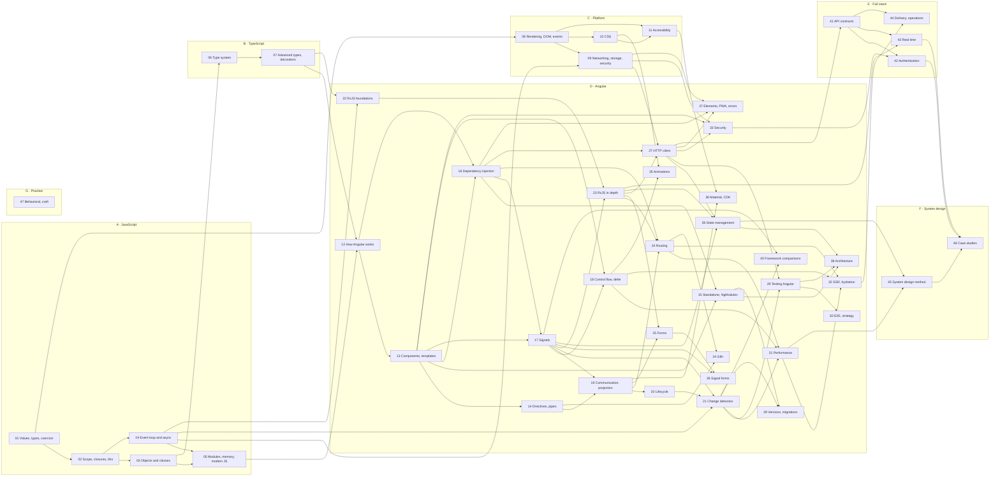

# Angular & Full-Stack Interview Guide

## What this guide is

A study guide for full-stack technical interviews centered on Angular 22. It has 47 modules in seven parts: JavaScript (A), TypeScript (B), the web platform (C), Angular (D), full stack with Spring Boot (E), front-end system design (F) and interview practice (G). Across the modules there are 1,220 interview questions and 192 hands-on exercises, and every exercise has tests in the labs.

It is written for one reader with two speeds. Someone who has never built an Angular app can start at the top of any concept and follow it. Someone preparing for an architect-level interview finds the internals, the edge cases and the trade-offs further down the same concept. Content is never labeled by experience. Depth is signalled by position: every concept, question bank and exercise list runs from the basic idea to the hard trade-offs.

The guide teaches. A fact without its reason is not finished, so each answer says why before what. Where the guide cannot confirm a claim in an official source or by running code, it says so in a `> **Unverified:**` note instead of guessing. Everything is written against [VERSIONS.md](VERSIONS.md): Angular 22.2.1, TypeScript 6.0, RxJS 7.8.2 and ES2026, with the versions checked on 2026-10-03. If you read it later, check what changed after that date before you trust a status line.

Angular is the center, not the whole. The JavaScript, TypeScript and platform parts exist because Angular's behavior follows from them. The full-stack part pairs Angular with Spring Boot (API contracts, authentication, real time, delivery), and some modules carry a *Coming from the backend* note that maps a Spring or Java idea onto its Angular counterpart and states where the analogy breaks. Those notes are optional reading and never a prerequisite.

## How a module is built

Every module has the same shape, so you always know where to look.

1. **A header.** What the module covers, its prerequisites (linked to the exact sections you need), what it leads to, the versions it applies to, the study time, a *Short on time* line that names the sections and question IDs to read in about 30 minutes, and the command that runs only this module's lab tests.
2. **Concept sections.** Each concept is a numbered `##` section that runs problem, mental model, mechanism, code, best practices, traps:
   - *The problem it solves* shows what goes wrong without the concept, as a bug, a performance cliff or a maintenance cost.
   - *Mental model* gives the intuition and an analogy, with a diagram when a picture beats prose.
   - *How it actually works* goes to the depth a demanding interviewer probes: data structures, scheduling, what the compiler emits.
   - *Code* shows minimal, modern examples, preceded by the approach in a sentence or two, with a *Legacy* subsection where production code still uses the older form and the migration path.
   - *Best practices and anti-patterns* gives each rule with its reason.
   - *Misconceptions and traps* corrects popular claims, and when a claim was once true it says until which version and what changed.
3. **A Summary** to re-read before an interview. It restates each concept's core claim and its most-asked trap, linked to the section that teaches it.
4. **A question bank.** Every question has a guide-wide ID such as `Q17.08` and a type tag (see Conventions), and its answer sits in a collapsible block so you can attempt it first.
5. **Hands-on exercises.** Each has a problem, constraints and acceptance criteria, hints, a worked solution with an alternative approach and trade-offs, the follow-ups an interviewer would ask next in a live-coding round, and a link to the tests that check it. Exercises run from simple to hard.
6. **Check your understanding.** Explain-it-back prompts and flashcards.
7. **Connections** to the neighboring modules.

## Prerequisite map

An arrow means "read before". The map shows each module's prerequisites as listed in [SYLLABUS.md](SYLLABUS.md) section 1. Modules 01 and 47 have none. A module's own header links the exact sections it assumes, which is finer than the map. If a prerequisite is already familiar, skip to the section the header names.

## The 47 modules

Q and Ex are the number of questions and exercises each module contains, as counted by `node labs/tools/module-stats.mjs .`. The Angular column says whether the module is about Angular itself. Study time is hours of reading plus hours of exercises, from each module's header. Across the guide that is about 217 hours of reading and 192.5 hours of exercises.

| Module | Part | Angular | Q | Ex | Study time (h) |
|---|---|---|---|---|---|
| [01 Values, types and coercion](modules/01-js-values-types-coercion.md) | A · JavaScript | No | 22 | 3 | 3 + 3 |
| [02 Scope, closures and `this`](modules/02-js-scope-closures-this.md) | A · JavaScript | No | 21 | 3 | 3 + 3 |
| [03 Objects, prototypes and classes](modules/03-js-objects-prototypes-classes.md) | A · JavaScript | No | 22 | 3 | 3.5 + 3 |
| [04 The event loop and asynchronous JavaScript](modules/04-js-async-event-loop.md) | A · JavaScript | No | 28 | 4 | 3 + 3 |
| [05 Modules, memory, errors and modern features](modules/05-js-modules-memory-modern-features.md) | A · JavaScript | No | 21 | 3 | 3 + 3 |
| [06 TypeScript type system essentials](modules/06-ts-type-system-essentials.md) | B · TypeScript | No | 24 | 4 | 3 + 3 |
| [07 Advanced types, decorators and runtime safety](modules/07-ts-advanced-types-and-decorators.md) | B · TypeScript | No | 20 | 3 | 3 + 3 |
| [08 Browser rendering, the DOM and events](modules/08-browser-rendering-dom-events.md) | C · Platform | No | 18 | 3 | 3 + 3 |
| [09 Networking, storage and browser security](modules/09-web-networking-storage-security.md) | C · Platform | No | 22 | 3 | 3 + 3 |
| [10 CSS essentials](modules/10-css-essentials.md) | C · Platform | No | 18 | 3 | 3 + 3 |
| [11 Accessibility](modules/11-accessibility.md) | C · Platform | No | 19 | 3 | 3 + 3 |
| [12 How Angular works](modules/12-angular-how-it-works.md) | D · Angular | Yes | 28 | 4 | 5 + 5 |
| [13 Components and templates](modules/13-components-and-templates.md) | D · Angular | Yes | 30 | 5 | 6 + 6 |
| [14 Directives and pipes](modules/14-directives-and-pipes.md) | D · Angular | Yes | 28 | 5 | 6 + 6 |
| [15 Standalone and NgModules](modules/15-standalone-and-ngmodules.md) | D · Angular | Yes | 25 | 4 | 6 + 6 |
| [16 Dependency injection](modules/16-dependency-injection.md) | D · Angular | Yes | 36 | 6 | 8 + 8 |
| [17 Signals](modules/17-signals.md) | D · Angular | Yes | 40 | 6 | 5 + 5 |
| [18 Control flow and `@defer`](modules/18-control-flow-and-defer.md) | D · Angular | Yes | 26 | 4 | 6 + 6 |
| [19 Component communication and projection](modules/19-component-communication-and-projection.md) | D · Angular | Yes | 29 | 5 | 6 + 6 |
| [20 Lifecycle and render hooks](modules/20-lifecycle-and-render-hooks.md) | D · Angular | Yes | 25 | 4 | 5 + 4 |
| [21 Change detection](modules/21-change-detection.md) | D · Angular | Yes | 35 | 6 | 6 + 5 |
| [22 RxJS foundations](modules/22-rxjs-foundations.md) | D · Angular | Yes | 34 | 5 | 6 + 4 |
| [23 RxJS in depth](modules/23-rxjs-in-depth.md) | D · Angular | Yes | 36 | 6 | 7 + 5 |
| [24 Routing](modules/24-routing.md) | D · Angular | Yes | 34 | 6 | 7 + 5 |
| [25 Forms](modules/25-forms-reactive-and-template-driven.md) | D · Angular | Yes | 34 | 6 | 7 + 5 |
| [26 Signal Forms](modules/26-signal-forms.md) | D · Angular | Yes | 28 | 5 | 6 + 4 |
| [27 HTTP client](modules/27-http-client.md) | D · Angular | Yes | 34 | 6 | 7 + 5 |
| [28 State management](modules/28-state-management.md) | D · Angular | Yes | 34 | 5 | 8 + 5 |
| [29 Testing Angular](modules/29-testing-angular.md) | D · Angular | Yes | 34 | 6 | 8 + 6 |
| [30 End-to-end tests and testing strategy](modules/30-e2e-and-testing-strategy.md) | D · Angular | No | 18 | 3 | 5 + 4 |
| [31 Performance](modules/31-performance.md) | D · Angular | Yes | 27 | 5 | 6 + 5 |
| [32 SSR, SSG and hydration](modules/32-ssr-ssg-hydration.md) | D · Angular | Yes | 27 | 4 | 5 + 4 |
| [33 Security](modules/33-security.md) | D · Angular | Yes | 29 | 4 | 5 + 4 |
| [34 Internationalization](modules/34-i18n.md) | D · Angular | Yes | 25 | 4 | 5 + 4 |
| [35 Animations](modules/35-animations.md) | D · Angular | Yes | 25 | 4 | 4 + 4 |
| [36 Material and the CDK](modules/36-material-and-cdk.md) | D · Angular | Yes | 25 | 4 | 4 + 4 |
| [37 Elements, PWA, error handling and the ecosystem](modules/37-elements-pwa-errors-ecosystem.md) | D · Angular | Yes | 25 | 4 | 4 + 4 |
| [38 Architecture and production structure](modules/38-architecture-and-production-structure.md) | D · Angular | Yes | 29 | 4 | 4 + 4 |
| [39 Version history and migrations](modules/39-version-history-and-migrations.md) | D · Angular | Yes | 25 | 4 | 4 + 4 |
| [40 Framework comparisons](modules/40-framework-comparisons.md) | D · Angular | No | 16 | 2 | 3 + 2 |
| [41 Full-stack API contracts](modules/41-fullstack-api-contracts.md) | E · Full stack | No | 21 | 3 | 3 + 3 |
| [42 Full-stack authentication](modules/42-fullstack-authentication.md) | E · Full stack | No | 23 | 3 | 3 + 3 |
| [43 Full-stack real time](modules/43-fullstack-realtime.md) | E · Full stack | No | 21 | 3 | 3 + 3 |
| [44 Full-stack delivery and operations](modules/44-fullstack-delivery-and-operations.md) | E · Full stack | No | 21 | 3 | 3 + 3 |
| [45 Front-end system design method](modules/45-frontend-system-design-method.md) | F · System design | No | 17 | 2 | 2.5 + 2.5 |
| [46 System design case studies](modules/46-system-design-case-studies.md) | F · System design | No | 26 | 5 | 3 + 4 |
| [47 Behavioral interviews and interview craft](modules/47-behavioral-and-interview-craft.md) | G · Practice | No | 15 | 2 | 2 + 2 |

## Study paths

Five routes through the guide, each named by its goal. A path lists modules in reading order. When it skips a module that a listed one depends on, the listed module's **Prerequisites** line links the exact section you need, so a skipped module costs you that section, not the whole module. Each path's total is the sum of the Study time lines in the headers of the modules it lists, reading plus exercises, the same figures as the table above. The paths start from [SYLLABUS.md](SYLLABUS.md) section 3; where one differs from it, the path says why.

### Linear

**Goal:** learn everything, in dependency order. **Fits** a reader with months rather than weeks, who wants the guide as a course rather than a refresher.

**Modules:** all 47 in number order, with one swap: read [16 Dependency injection](modules/16-dependency-injection.md) before [15 Standalone and NgModules](modules/15-standalone-and-ngmodules.md). Module 15 lists 16 as a prerequisite, and it is the only module in SYLLABUS section 1 whose prerequisite carries a higher number.

**Time:** 409.5 hours, the sum over all 47 headers: 217 hours reading plus 192.5 hours exercises.

**Finish:** run each mock once you have studied the modules and sections named in its opening lines, and make [CHEATSHEET.md](CHEATSHEET.md) your last pass before the interview.

### Interview in one week

**Goal:** the most interview coverage per hour. **Fits** a reader with an interview about a week away who needs the material asked most often ready to say aloud, not the whole guide.

**How it is selective:** in each module read only what its header's **Short on time** line names: the sections and question IDs to read in about 30 minutes, then the Summary. Answer each named question aloud before you open its answer, and do the exercise the line names when there is one.

| Day | Modules (Short on time line only) | Then |
|---|---|---|
| 1 | [12](modules/12-angular-how-it-works.md), [13](modules/13-components-and-templates.md), [16](modules/16-dependency-injection.md) | |
| 2 | [17](modules/17-signals.md), [18](modules/18-control-flow-and-defer.md), [21](modules/21-change-detection.md) | |
| 3 | [22](modules/22-rxjs-foundations.md), [23](modules/23-rxjs-in-depth.md), [27](modules/27-http-client.md) | [Mock 2](MOCK-INTERVIEWS.md#mock-2--signals-and-change-detection) |
| 4 | [24](modules/24-routing.md), [25](modules/25-forms-reactive-and-template-driven.md), [28](modules/28-state-management.md) | |
| 5 | [29](modules/29-testing-angular.md), [31](modules/31-performance.md), [33](modules/33-security.md) | |
| 6 | [41](modules/41-fullstack-api-contracts.md), [42](modules/42-fullstack-authentication.md), [45](modules/45-frontend-system-design-method.md), [47](modules/47-behavioral-and-interview-craft.md) | |
| 7 | The [CHEATSHEET](CHEATSHEET.md) sections of these 19 modules | [Mock 4](MOCK-INTERVIEWS.md#mock-4--routing-forms-and-http) |

Module 23's Short on time line starts with higher-order mapping ([§1](modules/23-rxjs-in-depth.md#1-higher-order-observables-switchmap-mergemap-concatmap-and-exhaustmap)). Module 27 comes on day 3, straight after 23, which it lists as a prerequisite, and ahead of 28, which lists 27. Module 47 is added to SYLLABUS section 3's list: its Short on time line covers the behavioral story bank and live coding, the two parts of an interview no other module prepares, and the mocks' advice for live coding and for getting stuck comes from its [§4](modules/47-behavioral-and-interview-craft.md#4-live-coding-an-angular-task-clarify-say-the-plan-build-in-working-increments-narrate-and-recover-when-stuck).

**Time:** the 19 modules in full come to 197 hours (107.5 reading plus 89.5 exercises, summed from their headers), which no week holds. That is why this path reads only the Short on time lines: 19 of them at about 30 minutes each is about 9.5 hours, plus the exercises they name and two mocks of 55 and 60 minutes.

**Finish:** the two mocks in the table. The path covers 17, 18 and 21 of Mock 2's modules 17 to 21, and 24, 25 and 27 of Mock 4's modules 24 to 27. If the interview loop includes a system design round, run [Mock 7](MOCK-INTERVIEWS.md#mock-7--front-end-system-design-a-team-task-board) instead of Mock 4: its only module is 45, which the path includes.

### Coming from the backend

**Goal:** map what you know from Java and Spring onto Angular, then fill the gaps. **Fits** a Java and Spring developer who is new to Angular or to the front end.

**Modules,** in this order:

1. [04 The event loop](modules/04-js-async-event-loop.md): one thread, with tasks and microtasks. Modules 21 and 22 list it as a prerequisite.
2. [06 TypeScript type system](modules/06-ts-type-system-essentials.md) and [07 Advanced types and decorators](modules/07-ts-advanced-types-and-decorators.md): types matched by shape and erased at run time, where Java classes are nominal and survive, and decorators that run code where Java annotations are passive metadata.
3. [12 How Angular works](modules/12-angular-how-it-works.md) and [13 Components and templates](modules/13-components-and-templates.md): module 16 lists both as prerequisites.
4. [16 Dependency injection](modules/16-dependency-injection.md), whose [§9](modules/16-dependency-injection.md#9-di-patterns-testing-and-the-spring-container) compares it with the Spring container.
5. [17 Signals](modules/17-signals.md), placed before RxJS because 23 lists it as a prerequisite.
6. [22 RxJS foundations](modules/22-rxjs-foundations.md), [23 RxJS in depth](modules/23-rxjs-in-depth.md) and [27 HTTP client](modules/27-http-client.md).
7. [41 API contracts](modules/41-fullstack-api-contracts.md), [42 Authentication](modules/42-fullstack-authentication.md) and [44 Delivery and operations](modules/44-fullstack-delivery-and-operations.md): the seam between Angular and Spring Boot itself.
8. [38 Architecture and production structure](modules/38-architecture-and-production-structure.md).
9. [21 Change detection](modules/21-change-detection.md).

Against SYLLABUS section 3, the path adds 04, 12 and 13 and moves 17 forward from the end, each for the prerequisite reason given. Read each module in full, starting with its *Coming from the backend* notes, which also say where the Spring analogy breaks. For what the path skips, such as 20 under 21 or 15, 28 and 29 under 38, follow the section links in each header's Prerequisites line.

**Time:** 137 hours, summed from the 15 headers: 72 hours reading plus 65 hours exercises.

**Finish:** the CHEATSHEET sections of these 15 modules, then [Mock 6](MOCK-INTERVIEWS.md#mock-6--full-stack-with-spring-boot), whose modules 41, 42 and 44 are all in the path, then [Mock 1](MOCK-INTERVIEWS.md#mock-1--angular-components-templates-and-di), which covers 12 to 16. Mock 1 also reaches outside this path: read the Short on time lines of 11, 14 and 15, and [47 §4](modules/47-behavioral-and-interview-craft.md#4-live-coding-an-angular-task-clarify-say-the-plan-build-in-working-increments-narrate-and-recover-when-stuck) for its live-coding prompt, before you run it.

### Frontend fundamentals first

**Goal:** a solid language and platform base before the framework. **Fits** a reader new to web development, or one coming from another framework who wants the JavaScript, TypeScript and browser behavior that Angular's behavior follows from.

**Modules:** Parts A to C, [01](modules/01-js-values-types-coercion.md) to [11](modules/11-accessibility.md), in number order, then Part D, [12](modules/12-angular-how-it-works.md) to [40](modules/40-framework-comparisons.md), in number order with 16 before 15 as in the Linear path. Every module is read in full. Parts E to G are not in this path; for a full-stack interview, continue with 41 to 47 in number order.

**Time:** 369.5 hours, summed from the 40 headers: 197.5 hours reading plus 172 hours exercises (66.5 hours for Parts A to C, 303 for Part D).

**Finish:** the CHEATSHEET's [Part A](CHEATSHEET.md#part-a--javascript) to [Part D](CHEATSHEET.md#part-d--angular) sections, then Mocks [2](MOCK-INTERVIEWS.md#mock-2--signals-and-change-detection), [4](MOCK-INTERVIEWS.md#mock-4--routing-forms-and-http) and [5](MOCK-INTERVIEWS.md#mock-5--testing-performance-and-ssr), whose modules and warm-ups all fall within 01 to 40. [Mock 1](MOCK-INTERVIEWS.md#mock-1--angular-components-templates-and-di) also fits once you have read [47 §4](modules/47-behavioral-and-interview-craft.md#4-live-coding-an-angular-task-clarify-say-the-plan-build-in-working-increments-narrate-and-recover-when-stuck), which its live-coding prompt uses.

### Architect deep dive

**Goal:** internals, trade-offs and system-level decisions. **Fits** a reader who already builds Angular apps and faces an interview that asks why rather than how.

**Modules and where to start in each:** each module's *Under the hood* section and its decision sections, then the Design and Trade-off questions of these modules, found by the Type column of [QUESTION-INDEX.md](QUESTION-INDEX.md).

| Module | Start with |
|---|---|
| [12 How Angular works](modules/12-angular-how-it-works.md) | [§8](modules/12-angular-how-it-works.md#8-under-the-hood-what-the-compiler-emits-and-what-the-runtime-does-with-it) what the compiler emits |
| [16 Dependency injection](modules/16-dependency-injection.md) | [§5](modules/16-dependency-injection.md#5-the-injector-tree-platform-root-route-and-element-injectors-and-the-modifiers) the injector tree |
| [17 Signals](modules/17-signals.md) | [§9](modules/17-signals.md#9-under-the-hood-the-reactive-graph) the reactive graph |
| [21 Change detection](modules/21-change-detection.md) | [§9](modules/21-change-detection.md#9-under-the-hood-the-notification-the-dirty-flags-and-the-refresh) notification, dirty flags, refresh |
| [23 RxJS in depth](modules/23-rxjs-in-depth.md) | [§2](modules/23-rxjs-in-depth.md#2-choosing-a-flattening-operator-races-lost-writes-cancellation-and-recursion) choosing a flattening operator, [§7](modules/23-rxjs-in-depth.md#7-rxjs-and-signals-decision-rules-tosignal-toobservable-and-rxresource) RxJS or signals |
| [28 State management](modules/28-state-management.md) | [§11](modules/28-state-management.md#11-alternatives-and-the-decision-framework-ngxs-elf-tanstack-query-and-when-a-store-library-is-justified) the decision framework, [§12](modules/28-state-management.md#12-under-the-hood-how-ngrx-store-reduces-actions-and-how-signalstore-keeps-state-in-signals) inside NgRx and SignalStore |
| [31 Performance](modules/31-performance.md) | [§10](modules/31-performance.md#10-rendering-strategy-as-a-performance-decision-csr-ssr-and-ssg) rendering strategy, [§11](modules/31-performance.md#11-under-the-hood-the-cdks-rendered-range-ngoptimizedimages-srcset-and-the-builders-chunks) |
| [32 SSR, SSG and hydration](modules/32-ssr-ssg-hydration.md) | [§10](modules/32-ssr-ssg-hydration.md#10-under-the-hood-a-request-through-the-engine-the-serialized-page-and-the-clients-hydration-pass) a request through the engine |
| [38 Architecture](modules/38-architecture-and-production-structure.md) | [§4](modules/38-architecture-and-production-structure.md#4-layers-library-types-and-dependency-rules) dependency rules, [§8](modules/38-architecture-and-production-structure.md#8-micro-frontends-module-federation-native-federation-and-when-they-are-justified) micro-frontends, [§13](modules/38-architecture-and-production-structure.md#13-under-the-hood-ng-packagrs-build-graph-and-how-nx-computes-affected-projects-and-task-hashes) |
| [39 Version history and migrations](modules/39-version-history-and-migrations.md) | [§10](modules/39-version-history-and-migrations.md#10-a-migration-program-for-an-old-angular-codebase-order-dependencies-and-checkpoints) a migration program, [§12](modules/39-version-history-and-migrations.md#12-under-the-hood-how-ng-update-selects-migrations-and-how-the-update-guide-builds-its-checklist) |
| [40 Framework comparisons](modules/40-framework-comparisons.md) | [§8](modules/40-framework-comparisons.md#8-choosing-a-framework-balanced-trade-offs-and-how-to-answer-why-angular) "why Angular?", [§9](modules/40-framework-comparisons.md#9-under-the-hood-one-state-change-traced-through-angular-react-vue-and-solid) |
| [42 Authentication](modules/42-fullstack-authentication.md) | [§3](modules/42-fullstack-authentication.md#3-where-the-oauth-client-runs-a-browser-only-client-a-token-mediating-backend-or-a-backend-for-frontend-with-spring) where the OAuth client runs, [§9](modules/42-fullstack-authentication.md#9-under-the-hood-one-bff-login-and-the-first-api-call-through-spring-securitys-filters) |
| [44 Delivery and operations](modules/44-fullstack-delivery-and-operations.md) | [§1](modules/44-fullstack-delivery-and-operations.md#1-where-the-api-calls-go-direct-calls-a-same-origin-reverse-proxy-an-api-gateway-or-a-backend-for-frontend) where the API calls go, [§10](modules/44-fullstack-delivery-and-operations.md#10-under-the-hood-opentelemetry-for-the-web-traceparent-and-one-click-traced-to-a-spring-boot-span-and-log-line) |
| [45 System design method](modules/45-frontend-system-design-method.md) | [§2](modules/45-frontend-system-design-method.md#2-communicating-under-time-pressure-a-time-plan-complete-trade-off-statements-and-diagrams-at-three-zoom-levels) trade-off statements, [§8](modules/45-frontend-system-design-method.md#8-under-the-hood-failure-modes-observability-offline-levels-and-consistency-choices) |
| [46 Case studies](modules/46-system-design-case-studies.md) | [§8](modules/46-system-design-case-studies.md#8-under-the-hood-a-money-transfer-with-idempotency-keys-optimistic-ui-that-never-claims-success-and-the-unknown-outcome) a money transfer |

Module 42 is added to SYLLABUS section 3's list: 46 lists [42 §8](modules/42-fullstack-authentication.md#8-logout-everywhere-and-session-timeout-ux) as a prerequisite, and where the OAuth client runs is a decision that spans the stack, asked as the trade-off prompt of Mock 6. The path assumes you build Angular apps already; for what it skips, the headers' Prerequisites lines link the section to refresh.

**Time:** 137 hours, summed from the 15 headers: 72.5 hours reading plus 64.5 hours exercises. The sections in the table are where to start, not a smaller budget.

**Finish:** the CHEATSHEET sections of these modules, then [Mock 7](MOCK-INTERVIEWS.md#mock-7--front-end-system-design-a-team-task-board) (module 45) and [Mock 8](MOCK-INTERVIEWS.md#mock-8--architecture-migrations-and-a-behavioral-close) (modules 38, 39 and 40; its behavioral close uses [47 §1](modules/47-behavioral-and-interview-craft.md#1-the-behavioral-round-what-a-story-is-evidence-of-star-with-the-weight-on-action-and-an-explicit-result-and-a-story-bank)).

## Practice files

Four files at the guide root work across the modules. They link into the modules and teach nothing the linked passage does not.

| File | Use it for |
|---|---|
| [CHEATSHEET.md](CHEATSHEET.md) | The last pass before an interview. Per module, a handful of one-line facts and traps, each ending with a link to the section or question that explains it. |
| [MOCK-INTERVIEWS.md](MOCK-INTERVIEWS.md) | Eight full mock interviews and one scoring rubric they share. Each mock lists the interviewer's prompts in order with follow-ups, a short model-answer outline linked to the guide's own passage, and scoring notes. It opens with how to run a mock. For the craft of the interview itself, read [module 47](modules/47-behavioral-and-interview-craft.md). |
| [QUESTION-INDEX.md](QUESTION-INDEX.md) | All 1,220 questions by part and module, each with its ID linked to the question and its type tag. Use it to drill one topic or one type. It is generated, so do not edit it. |
| [GLOSSARY.md](GLOSSARY.md) | Every term the modules define, alphabetical, each linked to the module section that teaches it. It is generated, so do not edit it. |

## Labs

Every code claim in the modules is backed by code in `labs/`. Three workspaces, one set of tools. Use Node 24: Angular 22 supports Node `^22.22.3 || ^24.15.0 || ^26.0.0` and not odd-numbered releases, and the labs were built on Node 24. Run `npm install` once in a workspace first.

| Workspace | What it holds | Run everything |
|---|---|---|
| `labs/ts-js` | The JavaScript and TypeScript modules, the output questions, and the specs of many later modules. | `cd labs/ts-js && npm test` (type check, then Vitest) |
| `labs/angular` | The Angular workspace, with a shared `ui-lib` project and one folder per Angular module. | `cd labs/angular && npx ng build ui-lib`, then `npx ng build` and `npx ng test --watch=false` |
| `labs/e2e` | Playwright end-to-end specs for modules 30 to 37, with their fixtures. | `cd labs/e2e && npm run install-browser` once, then `npm test` |

Build `ui-lib` first in the Angular workspace: its `tsconfig.json` maps `ui-lib` to `dist/ui-lib`, which the build and the tests need. To check one module instead of a workspace, use the command in that module's header, for example `npx vitest run src/modules/45-frontend-system-design-method src/outputs/45-frontend-system-design-method` from `labs/ts-js`. In `labs/angular`, name the spec files in the `--include` glob; a glob that also matches source files makes Vitest fail with "No test suite found".

The guide's own checks live in `labs/tools/`, run from the guide root:

- `node labs/tools/module-stats.mjs .` counts questions, exercises and prose words per module.
- `node labs/tools/check-links.mjs` resolves every relative link and anchor.
- `node labs/tools/check-snippets.mjs . NN` checks that a module's code blocks match the lab files they cite.

## Conventions

**Question IDs and types.** A question ID is `Q<module>.<nn>`, for example `Q17.08`. IDs are never reused or renumbered, and each has an explicit anchor, which is how the index links to it. Exercises use `Exercise <module>.<n>`. Every question declares its type in its title:

| Type | What it asks |
|---|---|
| Concept | Explain an idea. |
| Difference | Explain the difference between two things. |
| Output | What does this code print, render or do? The answer was verified by running it. |
| Bug hunt | Spot the bug in a code-review snippet. |
| Design | How would you design or implement something? |
| Trade-off | No single right answer: the answer argues both sides and says when each wins. |

A question may carry two tags, such as `Difference · Output`.

**Code.** A snippet is one of five kinds: complete (identical to a lab file, with a source link under it), an excerpt of a lab file (its first line names the file), an output snippet (the code the test named after the question ID runs), partial (its first line says what is omitted or assumed), or Java and Spring, which begins with a comment saying it is illustrative and not compiled in the labs; its APIs are checked against the Spring documentation.

**Callouts.** *Framework vs platform* separates what Angular adds from what TypeScript, JavaScript or the browser provide natively. *Coming from the backend* compares a Spring or Java idea with its Angular counterpart and states where the analogy breaks. *Legacy / deprecated* marks the old way, why it changed and the migration path.

**Observed or documented.** Code verified by running it links to its lab file. A claim read from documentation is cited and never presented as an observed result.

## Versions and status markers

[VERSIONS.md](VERSIONS.md) lists every version the guide assumes and the date it was checked. An API that is not plain stable carries an inline marker in square brackets at its first mention in a module. The markers are:

| Marker | Meaning |
|---|---|
| `[Developer preview since vX]` | Usable, but the API may still change. |
| `[Experimental since vX]` | Expect breaking changes. |
| `[Deprecated since vX — use Y]` | Still works. Move to Y. |
| `[Removed in vX]` | Gone. |
| `[Changed in vX: …]` | Stable, but its behavior or default changed. |
| `[Stable since vX]` | A stable API that interviewers ask "since when" about. |
| `[Added in vX.Y]` | An option or overload added in a minor release. |
| `[Baseline <year>: newly available, per MDN]` | A browser feature in the latest stable Chrome, Edge, Firefox and Safari. |
| `[Baseline <year>: widely available, per MDN]` | A browser feature with at least 2.5 years of consistent support in each. |
| `[Baseline: limited availability, per MDN]` | A browser API not yet in all four, with no year; the supporting browsers are named. |

The version part may also name a language or runtime release (`ES2022`, `TypeScript 5.4`, `Node 22.12`), a library before its version (`NgRx v21.0`), or a patch release (`v22.0.4`) when the change shipped in a patch. Several markers on one API are separated by `·`. The full rules are in [STYLE-GUIDE.md](STYLE-GUIDE.md) section 3.

## Sources and progress

[SOURCES.md](SOURCES.md) lists every source the guide relies on, grouped by module, with official documentation preferred. [PROGRESS.md](PROGRESS.md) is the dashboard with one row per module. [SYLLABUS.md](SYLLABUS.md) holds the module plan and each module's topic checklist, and [STYLE-GUIDE.md](STYLE-GUIDE.md) is the contract every module follows.

