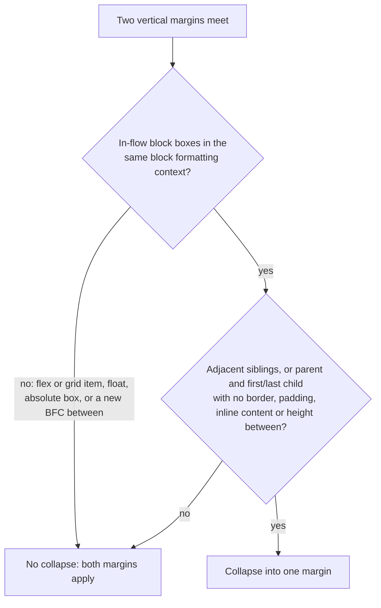
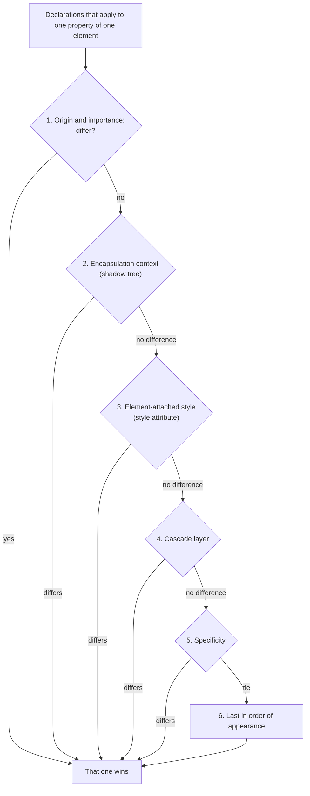
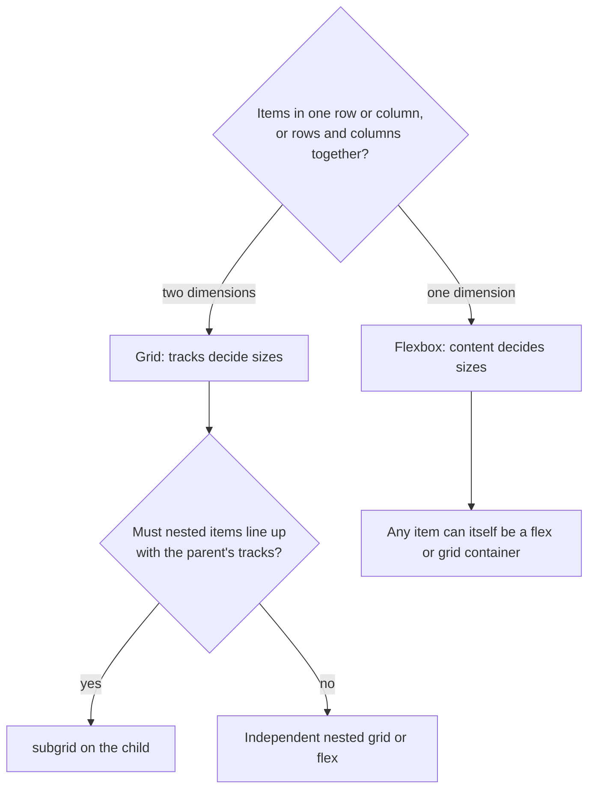
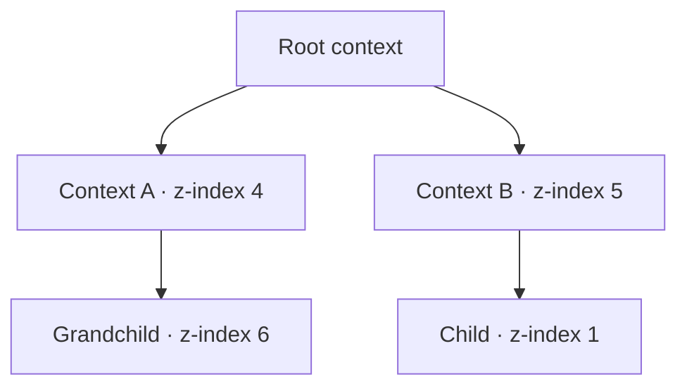
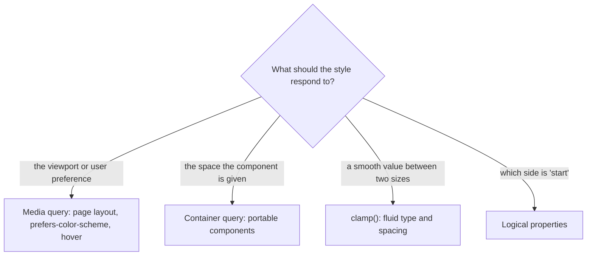
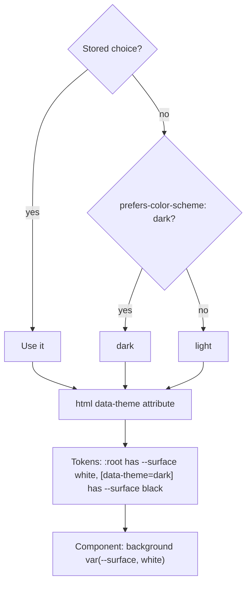
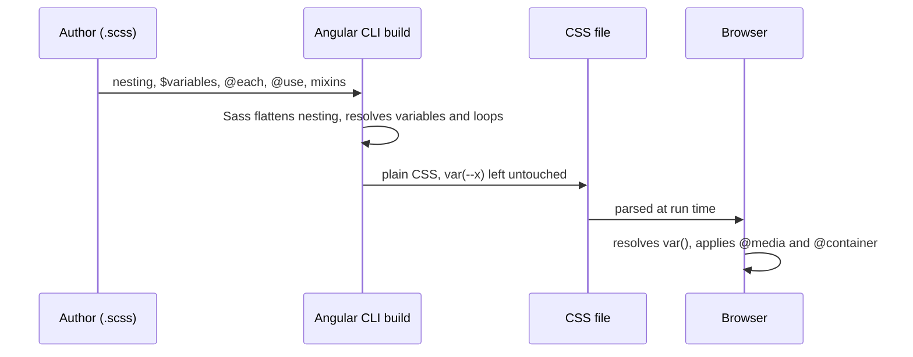

# 10. CSS essentials

> **What this covers:** the CSS (Cascading Style Sheets) box model and formatting contexts (including margin collapse), the cascade (origins, specificity, `!important`, cascade layers and the `:is()`, `:where()` and `:has()` selectors), Flexbox, Grid and subgrid, positioning and stacking contexts, responsive CSS (media queries, container queries, `clamp()` and logical properties), custom properties with light and dark theming, and native CSS nesting versus Sass. By the end you can explain why a rule lost or a `z-index` did nothing, pick the right layout system, and theme an application without a rebuild.
> **Prerequisites:** [08. Layout, paint and composite](08-browser-rendering-dom-events.md#2-layout-paint-and-composite-what-each-change-costs) (what a style change costs) and [08. The critical rendering path](08-browser-rendering-dom-events.md#1-the-critical-rendering-path-from-bytes-to-pixels) (the CSSOM, CSS Object Model: the parsed style rules)
> **Leads to:** [11. Accessibility](11-accessibility.md), [13. Components and templates](13-components-and-templates.md), [31. Performance](31-performance.md), [34. i18n](34-i18n.md), [35. Animations](35-animations.md), [36. Material and CDK](36-material-and-cdk.md)
> **Applies to:** CSS Cascade Level 5, Selectors Level 4, Flexbox, Grid Levels 1 and 2, Containment Level 3 and CSS Nesting as of 2026-10; Baseline status from MDN; jsdom 30.1 in the labs; Dart Sass 1.104 in a throwaway probe only
> **Study time:** ~3 hours reading + ~3 hours exercises
> **Short on time:** read [2. The cascade](#2-the-cascade-origins-specificity-and-layers), [4. Positioning, stacking contexts and z-index](#4-positioning-stacking-contexts-and-z-index) and [5. Responsive CSS](#5-responsive-css-media-queries-container-queries-and-fluid-type), then drill [Q10.03](#q10-03), [Q10.04](#q10-04), [Q10.10](#q10-10), [Q10.12](#q10-12) and [Q10.17](#q10-17), try [Exercise 10.1](#ex10-1), and finish with the [Summary](#summary).
> **Labs:** [`labs/ts-js/src/modules/10-css-essentials/`](../labs/ts-js/src/modules/10-css-essentials/) and [`labs/ts-js/src/outputs/10-css-essentials/`](../labs/ts-js/src/outputs/10-css-essentials/) (section claims, exercises and *Output* questions; jsdom, which implements part of the cascade and no layout). Run (from `labs/ts-js`, Node 24): `npx vitest run src/modules/10-css-essentials src/outputs/10-css-essentials`

## Contents

1. [The box model and formatting contexts](#1-the-box-model-and-formatting-contexts)
2. [The cascade: origins, specificity and layers](#2-the-cascade-origins-specificity-and-layers)
3. [Flexbox, Grid and subgrid](#3-flexbox-grid-and-subgrid)
4. [Positioning, stacking contexts and z-index](#4-positioning-stacking-contexts-and-z-index)
5. [Responsive CSS: media queries, container queries and fluid type](#5-responsive-css-media-queries-container-queries-and-fluid-type)
6. [Custom properties, theming and `color-scheme`](#6-custom-properties-theming-and-color-scheme)
7. [Native nesting versus Sass](#7-native-nesting-versus-sass)
- [Summary](#summary)
- [Question bank](#question-bank)
- [Hands-on exercises](#hands-on-exercises)
- [Check your understanding](#check-your-understanding)
- [Connections](#connections)

**How the claims here are verified.** The labs have no real browser, so this module teaches layout from the specifications and MDN and never presents it as observed. What runs is [jsdom](https://github.com/jsdom/jsdom) 30.1 (`// @vitest-environment jsdom`), which implements the cascade (selector matching, specificity, source order, inline styles, `!important`, inheritance, `:is()`, `:where()`, `:not()`, `:has()`), custom property inheritance and computed `em` and `rem`; those claims say "in jsdom". It computes no layout, applies no `@layer`, `@media`, `@container`, native nesting, `@scope` or `@property` rule, does not resolve `var()` and does not map logical properties: `section-1-jsdom-limits.test.ts` pins each (tests named `Section 1: …`), so no later section can claim an observation jsdom cannot make. The exercises and one helper are pure-TypeScript models of the specification, not browsers. Sass appears only as a throwaway compile of Dart Sass 1.104 on a stated date, never as a committed test. CSS and HTML blocks start with `/* Illustrative, not run */` or `/* Run in jsdom: <test name> */`. **Baseline** is MDN's cross-browser label: *newly available* means a feature works in at least the latest stable version of each Baseline browser (Chrome, Edge, Firefox, Safari), *widely available* means a consistent history of support in each for at least 2.5 years ([MDN](https://developer.mozilla.org/en-US/docs/Glossary/Baseline/Compatibility)).

## 1. The box model and formatting contexts

### The problem it solves

A `width: 100%` input with 12px of padding pokes out of its column. Two stacked cards with `margin: 24px 0` sit 24px apart, not 48px. A child's `margin-top` pushes its whole parent down. A floated image hangs out of its container. All four come from two questions: which box `width` measures, and which layout rules govern the boxes around it.

### Mental model

Every element generates **boxes**. The **CSS box model** nests four like a picture frame: content (the picture), padding (the mat), border (the frame) and margin (the wall up to the next frame). Each box lives in a **formatting context**, a region with one set of layout rules. A **block formatting context** (BFC) stacks block boxes vertically, lets floats interact, and is where margins collapse; flex and grid containers start contexts of their own ([section 3](#3-flexbox-grid-and-subgrid)). A **containing block** is the rectangle a box's percentages resolve against, for ordinary boxes the content edge of the nearest block-container ancestor ([CSS 2.2 §10.1](https://www.w3.org/TR/CSS22/visudet.html#containing-block-details)).



What to notice: collapse is decided by where the two boxes live and what separates them, not by the margin values; the same margins collapse in a block container and stay apart in a flex one ([Q10.02](#q10-02)).

### How it actually works

- **Which box `width` sets** ([MDN `box-sizing`](https://developer.mozilla.org/en-US/docs/Web/CSS/box-sizing)). `content-box`, the initial value, makes `width` the content box: `width: 350px; border: 10px solid` renders 370px wide. `border-box` includes padding and border. The property is not inherited, so a reset lists elements instead of setting it once on `html` ([Q10.01](#q10-01)). A block's `width: auto` fills the containing block after margins, border and padding ([CSS 2.2 §10.3.3](https://www.w3.org/TR/CSS22/visudet.html#blockwidth)); `100%` subtracts nothing. Padding and margin percentages refer to the containing block's *width*, "even for 'padding-top'" ([§8.4](https://www.w3.org/TR/CSS22/box.html#padding-properties)).
- **Outer and inner display** ([Display 3](https://www.w3.org/TR/css-display-3/)). `display` sets how a box takes part in its parent's flow (outer: `block`, `inline`) and which context lays out its children (inner: `flow`, `flow-root`, `flex`, `grid`); `inline-block` is `inline flow-root`. `width` does not apply to non-replaced inline boxes ([§10.2](https://www.w3.org/TR/CSS22/visudet.html#the-width-property)); a **replaced element** (an image) has content CSS does not render ([§3](https://www.w3.org/TR/CSS22/conform.html#defs)).
- **Margin collapsing** ([MDN](https://developer.mozilla.org/en-US/docs/Web/CSS/CSS_box_model/Mastering_margin_collapsing), [CSS 2.2 §8.3.1](https://www.w3.org/TR/CSS22/box.html#collapsing-margins)). Vertical margins combine for adjacent siblings, a parent and its first or last in-flow child, and an empty block's own top and bottom. Separators: a border, padding, inline content, a height, or **clearance** (space `clear` adds above a box to push it below a float, [§9.5.2](https://www.w3.org/TR/CSS22/visuren.html#flow-control)). The result is the largest positive margin plus the most negative. Horizontal margins, floats, absolute boxes and flex or grid items never collapse (their container's own margins can).
- **What makes a BFC** ([MDN](https://developer.mozilla.org/en-US/docs/Web/CSS/CSS_display/Block_formatting_context)): the root element, floats, absolute boxes, `inline-block`, `flow-root`, flex and grid items, `overflow` other than `visible` or `clip`, `contain: layout` or `paint`, and query containers. A new BFC contains its floats and suppresses collapsing with its children.

### Code

Approach: one rule per symptom (the reset, `gap` instead of collapsing margins, `flow-root` around floats). jsdom computes no layout, so only `box-sizing` is read back (`Section 1: box-sizing is read as declared, content-box by default`).

```css
/* Illustrative, not run */
*, *::before, *::after { box-sizing: border-box; }

.stack { display: flex; flex-direction: column; gap: 24px; } /* 24px between cards, no margins */

.media { display: flow-root; }  /* the container now contains its floated image */
.media > img { float: left; }
```

### Best practices and anti-patterns

- **Set `border-box` on every element and on `::before` and `::after`**, because `width` then means the visible box (and leave block `width` as `auto`, which absorbs padding); `*` matches elements, not pseudo-elements ([Selectors 4 §5.2](https://www.w3.org/TR/selectors-4/#the-universal-selector)).
- **Space stacked blocks with `gap` on a flex or grid column**, because margins there do not collapse.
- **Contain floats with `flow-root`, not `overflow: hidden`**, because `overflow` can clip shadows and add scrollbars.

### Misconceptions and traps

- *"`width: 100%` always fits."* Under `content-box` padding and border are added to it. The myth exists because an unpadded `div` does fit.
- *"Margins always add up."* Vertical margins of in-flow blocks in one BFC collapse to the largest; horizontal margins and padding do add, so people generalise.
- *"A child's margin stays inside its parent."* With no border, padding, inline content or height between them, it collapses with the parent's and shows outside it. Nested boxes look enclosed, which hides that the margins are adjoining.
- *"Flex and grid items collapse like blocks."* They do not (MDN). They look like stacked blocks, so the habit carries over.
- *"`overflow: hidden` is how you clear floats."* It works because it creates a BFC; `flow-root` does so without clipping. `overflow` was the trigger people knew first.

## 2. The cascade: origins, specificity and layers

### The problem it solves

A component's `.btn` loses to a later global `.btn`. A team writes ids and `!important` to beat a third-party library. A `:is(#hero, .x)` makes a selector far heavier than it looks. Each asks: when two declarations set the same property on one element, which wins, and why?

### Mental model

The **cascade** is a tournament with fixed rounds. Every **declaration** (one `property: value` pair) that matches an element competes; the first round where two differ decides ([CSS Cascade 5 §6.1](https://www.w3.org/TR/css-cascade-5/#cascade-sort)).



What to notice: specificity is the fifth of six rounds; importance, inline style and layers outrank it, and source order is the last resort ([Q10.03](#q10-03), [Q10.04](#q10-04)).

### How it actually works

- **Origin and importance.** An **origin** is where a style sheet comes from: the browser's default (user agent), the user, or the author. Normal declarations rank author, then user, then user agent; `!important` "inverts the order of precedence", so important user-agent declarations beat important user ones, which beat important author ones, which beat every normal one ([§6.1](https://www.w3.org/TR/css-cascade-5/#cascade-sort), [§6.3](https://www.w3.org/TR/css-cascade-5/#importance)); transitions and animations also rank here ([module 35](35-animations.md#4-the-web-animations-api-elementanimate-the-animation-object-and-getanimations)).
- **Encapsulation context.** Between a page and a [shadow tree](08-browser-rendering-dom-events.md#5-web-components-custom-elements-shadow-dom-and-templates), the outer context wins for normal rules and the inner for important ones ([§6.1](https://www.w3.org/TR/css-cascade-5/#cascade-context)): a shadow tree's normal styles are defaults the page can override.
- **Inline style.** A `style` attribute beats selector-mapped declarations of the same importance and ranks above layers.
- **Cascade layers** ([§6.4](https://www.w3.org/TR/css-cascade-5/#layering); documented, not run: jsdom ignores `@layer`, `Section 1: jsdom applies neither rule of two layers, so layer order is not computed`). A **cascade layer** is a named group of rules, ordered within its origin by first declaration. `@layer reset, base, components;` fixes the order up front, and may precede `@import`. For normal rules the last layer wins; unlayered rules sit in an implicit final layer, so they beat every layer whatever their specificity. For `!important` it reverses: the first layer wins and unlayered is weakest. `@import url(x.css) layer(vendor)` puts a whole file in one layer. MDN: widely available, across browsers since March 2022. [Exercise 10.2](#ex10-2) models this ranking ([Q10.06](#q10-06)).
- **Specificity** ([Selectors 4 §15](https://www.w3.org/TR/selectors-4/#specificity-rules)). A triple A-B-C: A counts id selectors, B class selectors, attribute selectors and pseudo-classes, C type selectors and pseudo-elements. A **pseudo-class** (`:hover`) stands for state not in the document tree; a **pseudo-element** (`::before`) for an element not directly in it. `*` is ignored. Columns compare left to right, so one id beats any number of classes. `:is()`, `:not()` and `:has()` count as their most specific argument; `:where()` counts zero. [Exercise 10.1](#ex10-1) builds the calculator ([Q10.05](#q10-05)).
- **Order of appearance.** The last declaration wins.
- **Inheritance and defaulting.** **Inheritance** passes a property's computed value from parent to child for properties defined as inherited (`color`), while others (`border-*`) take their initial value. The **computed value** is the specified value resolved, for instance relative lengths made absolute ([§4.4](https://www.w3.org/TR/css-cascade-5/#computed)). `inherit`, `initial` and `unset` (inherit if the property inherits, else initial) set the value explicitly; `revert` rolls back to the previous origin, `revert-layer` to the layer below ([§7.3](https://www.w3.org/TR/css-cascade-5/#defaulting-keywords)).
- **`@scope`** limits rules to a subtree and adds a **scoping proximity** round between specificity and order: fewer hops to the scope root win ([MDN](https://developer.mozilla.org/en-US/docs/Web/CSS/@scope): Baseline 2026, newly available since March 2026). jsdom does not apply it.

### Code

Approach: a layered stylesheet (illustrative, since jsdom ignores layers), then the jsdom test: `:where(#t)` loses to a class, `:is(#t, .z)` weighs as an id.

```css
/* Illustrative, not run */
@layer reset, vendor, components, utilities;       /* order fixed once, before any rule */
@import url("vendor.css") layer(vendor);           /* a whole file into one layer */

@layer components { .btn { background: steelblue; } }  /* beats vendor's .btn at any specificity */
@layer utilities  { .hidden { display: none; } }       /* later layer: ranks above components */
.legacy-fix { margin: 0; }                              /* unlayered: beats every layer (normal rules) */
```

```ts
// Excerpt of labs/ts-js/src/modules/10-css-essentials/section-2-cascade.test.ts
const html = '<p id="t" class="b"></p>';
expect(colorOf('.b { color: blue; } :where(#t) { color: red; }', html)).toBe(BLUE);
expect(colorOf(':is(#t, .z) { color: red; } .b { color: blue; }', html)).toBe(RED);
expect(colorOf('.b { color: blue; } :is(#t, .z) { color: red; }', html)).toBe(RED);
```

The file also asserts id over class over type, inline over id, `!important` over inline, `:not` and `:has` counting as their argument, `color` inheriting while `border-top-width` does not, and `inherit`, `initial` and `unset` (`Section 2: …`).

> [!NOTE]
> **Framework vs platform.** Angular's default emulated encapsulation inserts a generated attribute into every selector of a component's styles ([angular.dev](https://angular.dev/guide/components/styling)). An attribute selector counts in column B, so a component's `.btn` outweighs the same global `.btn`. Encapsulation modes and `::ng-deep` belong to [module 13](13-components-and-templates.md).

### Best practices and anti-patterns

- **Keep selectors one class deep**, because flat selectors are overridden by order alone.
- **Declare layer order once, at the top, with libraries in early layers**, because layer order, not specificity, then settles conflicts with third-party CSS.
- **Write base and library defaults inside `:where()`**, because zero specificity lets any consumer rule override them.
- **Avoid `!important` outside deliberate utilities**, because only another important declaration of equal or higher rank can beat it.

### Misconceptions and traps

- *"Higher specificity always wins."* Importance, inline style and layers decide first: an unlayered `audio` rule beats a layered `audio[controls]` rule ([§6.4](https://www.w3.org/TR/css-cascade-5/#layering)). Specificity is the first rule taught, hence the myth.
- *"`!important` is extra specificity."* It moves the declaration to a different importance tier and reverses layer order. It sits inside the declaration, so it reads like a booster.
- *"`:is()` and `:where()` are the same shorthand."* They match the same elements; `:is()` weighs as its most specific argument, `:where()` as zero (MDN). The syntax is identical, so the difference is invisible.
- *"CSS cannot select a parent."* Once true across browsers until Firefox 121 (December 2023); Safari 15.4 and Chrome 105 had it in 2022 (MDN). Now `div:has(p)` matches by structure and counts as its argument (`Section 2: :has matches by structure and counts like its argument`).
- *"Children inherit every property."* Only inherited ones; `border` is not. Text colour and font are inherited, so inheritance looks universal.

## 3. Flexbox, Grid and subgrid

### The problem it solves

Centring a box vertically takes hacks. A row of cards has misaligned buttons because the titles wrap to different heights. A long word makes a text column overflow its parent. All three are about distributing space along one line, or across rows and columns together.

### Mental model

**Flexbox** is a one-dimensional model: it lays items out along one axis at a time, a row or a column, and sizes them from their content outward ([MDN](https://developer.mozilla.org/en-US/docs/Web/CSS/CSS_flexible_box_layout/Basic_concepts_of_flexbox)). **Grid** is two-dimensional: the container defines **tracks** (a grid column or row, [Grid 2](https://www.w3.org/TR/css-grid-2/)) and items are placed into them, so the layout decides the sizes. **Subgrid** lets a nested grid borrow its parent's tracks. This section is documented, not run: jsdom computes no layout.



What to notice: the choice is made per container, not per page, and the two systems nest freely ([Q10.07](#q10-07)).

### How it actually works

- **Flex axes.** A **flex container** (`display: flex`) makes its direct children **flex items**. `flex-direction` sets the **main axis**, the **cross axis** is perpendicular; `justify-content` aligns along the first, `align-items` along the second (default `stretch`) ([MDN](https://developer.mozilla.org/en-US/docs/Web/CSS/CSS_flexible_box_layout/Basic_concepts_of_flexbox)).
- **`flex` shorthand** sets grow, shrink and basis. A single unitless number sets grow and a basis of `0%`, so `flex: 2` is `2 1 0%` and `flex: 1` is `1 1 0%`; `initial` is `0 1 auto` ([MDN](https://developer.mozilla.org/en-US/docs/Web/CSS/flex)).
- **Automatic minimum size** ([Flexbox 1 §4.5](https://www.w3.org/TR/css-flexbox-1/#min-size-auto)). `min-width: auto` is the initial value. A flex item that is not a **scroll container** (`overflow` `hidden`, `scroll` or `auto`, [Overflow 3](https://www.w3.org/TR/css-overflow-3/#scroll-container)) gets a content-based minimum size, built from its `min-content` size (the width with every soft wrap opportunity taken, [Sizing 3](https://www.w3.org/TR/css-sizing-3/#min-content): for text, roughly the longest unbreakable word); for scroll containers it is zero. So the item cannot shrink below its longest word and overflows; `min-width: 0` or `overflow: auto` removes the floor ([Q10.08](#q10-08)).
- **Grid tracks.** The **`fr` unit** is a fraction of the leftover space ([MDN](https://developer.mozilla.org/en-US/docs/Web/CSS/flex_value)); `minmax(min, max)` is a size range. `grid-template-columns`, `-rows` and `-areas` define the explicit grid; items placed outside it create the **implicit grid**, sized by `grid-auto-rows` and `-columns` ([Grid 2 §7.5](https://www.w3.org/TR/css-grid-2/#implicit-grids)).
- **`repeat(auto-fill | auto-fit, minmax(…))`** ([MDN](https://developer.mozilla.org/en-US/docs/Web/CSS/repeat)). `auto-fill` repeats to the largest count that does not overflow; `auto-fit` is the same, but after placement empty repeated tracks collapse, so with few items a `1fr` track grows into the freed space. No JavaScript is needed; [Q17.39](17-signals.md#q17-39) is the case where code must choose the count.
- **Gaps and margins.** `gap` puts space only between tracks ([MDN](https://developer.mozilla.org/en-US/docs/Web/CSS/gap)); flex and grid items do not collapse margins ([section 1](#1-the-box-model-and-formatting-contexts)), and their `z-index` works without `position` ([section 4](#4-positioning-stacking-contexts-and-z-index)).
- **Subgrid** ([MDN](https://developer.mozilla.org/en-US/docs/Web/CSS/CSS_grid_layout/Subgrid)). A nested grid is otherwise independent of its parent; with `grid-template-columns: subgrid` (or rows) it uses the parent's tracks over the area it spans, inheriting gaps (overridable) ([Q10.09](#q10-09)).

### Code

Approach: one rule per problem: flex centring, a grid whose column count follows the width, cards that span three parent rows and share them through `subgrid` so their title, body and button rows line up, and `min-width: 0` on a text item.

```css
/* Illustrative, not run */
.center  { display: flex; justify-content: center; align-items: center; }

.gallery { display: grid; grid-template-columns: repeat(auto-fill, minmax(16rem, 1fr)); gap: 1rem; }
.card    { display: grid; grid-row: span 3; grid-template-rows: subgrid; } /* title, body, button */

.row > .text { min-width: 0; }  /* may shrink below its longest word */
```

### Best practices and anti-patterns

- **Choose flex for one dimension and grid when rows and columns must line up**, because grid tracks belong to the container, not to each row of items.
- **Try `repeat(auto-fill, minmax(…))` before a media query**, because the column count follows the width.
- **Give text items in a flex row `min-width: 0`**, because their automatic minimum is the longest word.
- **Use `subgrid` to align content across cards**, because shared tracks size to the tallest content without fixed heights.

### Misconceptions and traps

- *"Flexbox is for components, grid for pages."* Both nest; the rule is the number of dimensions. Tutorials show navbars in flex and page frames in grid.
- *"`flex: 1` means `width: 100%`."* It means `1 1 0%`: items share leftover space from a zero basis. A bare number looks like a size.
- *"Flex items shrink to fit."* Not below their automatic minimum. The default `flex-shrink: 1` suggests no limit.
- *"`auto-fit` and `auto-fill` are the same."* They differ only when items do not fill the tracks. With a full row they look identical.
- *"Items in a nested grid line up with the parent's."* Only with `subgrid`; otherwise the nested grid sizes its own tracks. Once true across browsers until Chrome and Edge 117 (September 2023); Firefox 71 had it in 2019 (MDN).

## 4. Positioning, stacking contexts and z-index

### The problem it solves

A modal sits behind the header although its `z-index` is 9999. A `position: sticky` header never sticks. A `position: fixed` banner scrolls with its parent. All three come down to what a positioned box is positioned *against*, and which elements `z-index` is compared between.

### Mental model

Painting is a stack of sheets. A **stacking context** is one sheet, painted as a unit inside its parent's sheet, and `z-index` only orders siblings within the same sheet: a child context's number "only [has] meaning within [the] parent" ([MDN](https://developer.mozilla.org/en-US/docs/Web/CSS/CSS_positioned_layout/Understanding_z-index/Stacking_context)). Think version numbers: a `z-index: 6` child inside context 4 is "4.6", below context 5.



What to notice (documented, not run): the grandchild's 6 paints below the child's 1, because A (4) is compared with B (5) first and the numbers inside never cross that boundary ([Q10.10](#q10-10), [Q10.11](#q10-11)).

### How it actually works

- **Positioning** ([MDN `position`](https://developer.mozilla.org/en-US/docs/Web/CSS/position)). A *positioned* box is anything but `static`, the default, where offsets and `z-index` have no effect. `relative` offsets from its normal place, keeping its space. `absolute` leaves the flow and offsets from its **containing block** ([section 1](#1-the-box-model-and-formatting-contexts)): the closest positioned ancestor or the **initial containing block** (the viewport-sized box around the root, CSS 2.2 §10.1). `fixed` uses the viewport, unless an ancestor has `transform`, `perspective` or `filter`; a `transform` ancestor, even unpositioned, also holds `absolute` boxes ([CSS Transforms 1](https://www.w3.org/TR/css-transforms-1/#containing-block-for-all-descendants)). `sticky` is normal flow until a scroll threshold, then offset against the nearest ancestor with a scrolling mechanism (`overflow` `hidden`, `scroll` or `auto`, even if it never scrolls); it needs an offset such as `top`.
- **What creates a context** ([MDN](https://developer.mozilla.org/en-US/docs/Web/CSS/CSS_positioned_layout/Understanding_z-index/Stacking_context)): the root; `absolute` or `relative` with a `z-index` other than `auto`; `fixed` or `sticky`; a flex or grid item with a `z-index` other than `auto`; `container-type: size` or `inline-size` ([section 5](#5-responsive-css-media-queries-container-queries-and-fluid-type)); `opacity` below 1; `mix-blend-mode` other than `normal`; `transform`, `filter`, `perspective`, `clip-path`, `mask` and similar properties other than `none`; `isolation: isolate`; `will-change` naming such a property ([Q08.05](08-browser-rendering-dom-events.md#q08-05)); `contain: layout` or `paint`; top-layer elements.
- **Paint order inside one context** ([CSS 2.2 Appendix E](https://www.w3.org/TR/CSS22/zindex.html#painting-order)): the context element's background and border; child contexts with negative `z-index`; in-flow non-positioned blocks; floats; inline content; positioned descendants with `z-index` `auto` or 0 in tree order (preorder, depth-first, [DOM](https://dom.spec.whatwg.org/#concept-tree-order)); then positive `z-index` ascending.
- **The top layer** (MDN [glossary](https://developer.mozilla.org/en-US/docs/Glossary/Top_layer)) spans the viewport above all other layers and holds fullscreen elements, `<dialog>` shown with `showModal()` and popovers shown with `showPopover()` ([Popover API](https://developer.mozilla.org/en-US/docs/Web/API/Popover_API): Baseline 2025, newly available since January 2025), each in its own context, so none needs a `z-index`.

### Code

Approach: the helper follows MDN's list over declared values read with `getComputedStyle` (jsdom needs no layout for that). `stackingContextReasons` says why an element creates a context; `findCulprit` walks up to the nearest ancestor that does, where the bug lives. The tests show it reads declared values; that a browser paints accordingly is MDN's and the specification's account.

```ts
// Follows the MDN "Stacking context" list (read 2026-10-06). It reads DECLARED values through getComputedStyle, so it
// works in jsdom, which computes no layout. It does not model animated values, top-layer membership or ::backdrop.

const NO_VALUE = new Set(['', 'none', 'auto', 'normal', 'visible']);
const CREATING_PROPERTIES = [
  'transform', 'scale', 'rotate', 'translate', 'filter', 'backdrop-filter', 'perspective', 'clip-path', 'mask', 'mask-image', 'mask-border',
] as const;
const WILL_CHANGE_CREATORS = new Set<string>([...CREATING_PROPERTIES, 'opacity', 'mix-blend-mode', 'isolation', 'position', 'z-index', 'contain']);

function read(style: CSSStyleDeclaration, property: string): string {
  return style.getPropertyValue(property).trim();
}

function positionReasons(style: CSSStyleDeclaration): string[] {
  const position = read(style, 'position');
  const zIndex = read(style, 'z-index');
  const reasons: string[] = [];
  if ((position === 'absolute' || position === 'relative') && !NO_VALUE.has(zIndex)) reasons.push(`position: ${position} with z-index: ${zIndex}`);
  if (position === 'fixed' || position === 'sticky') reasons.push(`position: ${position}`);
  return reasons;
}

function itemReasons(element: Element, style: CSSStyleDeclaration): string[] {
  const parent = element.parentElement;
  const zIndex = read(style, 'z-index');
  if (!parent || NO_VALUE.has(zIndex)) return [];
  const display = read(getComputedStyle(parent), 'display');
  if (display === 'flex' || display === 'inline-flex') return [`flex item with z-index: ${zIndex}`];
  if (display === 'grid' || display === 'inline-grid') return [`grid item with z-index: ${zIndex}`];
  return [];
}

function valueReasons(style: CSSStyleDeclaration): string[] {
  const reasons: string[] = [];
  const containerType = read(style, 'container-type');
  if (containerType === 'size' || containerType === 'inline-size') reasons.push(`container-type: ${containerType}`);
  const opacity = read(style, 'opacity');
  if (opacity !== '' && Number(opacity) < 1) reasons.push(`opacity: ${opacity}`);
  if (!NO_VALUE.has(read(style, 'mix-blend-mode'))) reasons.push(`mix-blend-mode: ${read(style, 'mix-blend-mode')}`);
  for (const property of CREATING_PROPERTIES) {
    if (!NO_VALUE.has(read(style, property))) reasons.push(`${property}: ${read(style, property)}`);
  }
  if (read(style, 'isolation') === 'isolate') reasons.push('isolation: isolate');
  const willChange = read(style, 'will-change').split(',').map((part) => part.trim());
  const named = willChange.find((part) => WILL_CHANGE_CREATORS.has(part));
  if (named) reasons.push(`will-change: ${named}`);
  const contain = read(style, 'contain').split(/\s+/);
  const containing = contain.find((part) => ['layout', 'paint', 'strict', 'content'].includes(part));
  if (containing) reasons.push(`contain: ${containing}`);
  return reasons;
}

/** Why `element` creates a stacking context, from its declared values; an empty array means it does not. */
export function stackingContextReasons(element: Element): string[] {
  const style = getComputedStyle(element);
  const root = element === element.ownerDocument.documentElement ? ['root element'] : [];
  return [...root, ...positionReasons(style), ...itemReasons(element, style), ...valueReasons(style)];
}

/** The nearest ancestor (not the element itself) that creates a stacking context, with its reasons. */
export function findCulprit(element: Element): { element: Element; reasons: string[] } | null {
  for (let node = element.parentElement; node; node = node.parentElement) {
    const reasons = stackingContextReasons(node);
    if (reasons.length > 0) return { element: node, reasons };
  }
  return null;
}
```

<sub>Source: [labs/ts-js/src/modules/10-css-essentials/stacking-context.ts](../labs/ts-js/src/modules/10-css-essentials/stacking-context.ts)</sub>

`Section 4: positioned with z-index auto creates no context and with z-index 2 does` and its siblings assert each creator, a flex child with `z-index`, and `findCulprit`. The fix is often one line:

```css
/* Illustrative, not run */
.page   { isolation: isolate; }                 /* a deliberate context: inner z-index values stay inside */
.header { position: sticky; top: 0; z-index: 10; }
```

### Best practices and anti-patterns

- **Put `isolation: isolate` on a component's root**, because its inner `z-index` values then cannot compete with the rest of the page.
- **Keep a short z-index scale per context**, because 9999 buys nothing across contexts.
- **When an element will not rise, walk up to the nearest creator**, because the contest is between two contexts, not two elements.
- **Open modals with `showModal()`**, because the top layer sits above every other layer.
- **Keep `transform`, `filter` and `perspective` off ancestors of fixed content unless intended**, because they replace the viewport as its containing block.

### Misconceptions and traps

- *"`z-index: 9999` always wins."* It wins among siblings in one context. `z-index` looks global.
- *"`z-index` works on any element."* Not on `static` boxes (MDN), except flex and grid items. Most boxes people give a `z-index` are positioned, so it seems universal.
- *"`position: fixed` is always relative to the viewport."* Not under an ancestor with `transform`, `perspective` or `filter` (MDN). The short definition omits it.
- *"`sticky` fails randomly."* It needs an offset such as `top` and sticks against the nearest ancestor with `overflow` `hidden`, `scroll` or `auto`; an `overflow: hidden` added for clipping does not look like scrolling.
- *"A stacking context needs `position` and `z-index`."* `opacity` below 1, `transform` and the rest create one too. The position rule is taught first.

## 5. Responsive CSS: media queries, container queries and fluid type

### The problem it solves

A card looks right in the main column and breaks in the sidebar, because its media query looks at the viewport. Headings jump in size at each breakpoint. `margin-left` puts the gap on the wrong side in a right-to-left layout.

### Mental model

Three different questions: how wide is the **viewport** (the visible area of the page), how wide is **this component's container**, and how large should a value be **between two sizes**. A **media query** answers the first, a **container query** the second, `clamp()` the third.



What to notice: a container query makes a component portable, a media query makes a page layout, and neither replaces the other ([Q10.12](#q10-12), [Q10.14](#q10-14)). Documented, not run: jsdom applies no `@media` or `@container` rule.

### How it actually works

- **Viewport and media queries.** `<meta name="viewport" content="width=device-width">` sets the viewport width to the device's in CSS pixels (`px`, which can span several device pixels) and fixes the value of `vw` ([MDN](https://developer.mozilla.org/en-US/docs/Web/HTML/Reference/Elements/meta/name/viewport)). `@media` tests features such as `width`, `hover`, `orientation`, `prefers-color-scheme` and `prefers-reduced-motion`, with `min-` and `max-` prefixes or the range syntax `(width >= 30em)` ([MDN](https://developer.mozilla.org/en-US/docs/Web/CSS/CSS_media_queries/Using_media_queries)); `@media` is widely available, across browsers since July 2015 ([MDN](https://developer.mozilla.org/en-US/docs/Web/CSS/@media)).
- **Units** ([MDN](https://developer.mozilla.org/en-US/docs/Web/CSS/length)). `em` is the element's font size, `rem` the root's (usually 16px, user-changeable), `ch` the width of the `0` glyph, `vw` a percentage of the viewport width. `svh`, `lvh` and `dvh` use the small, large and dynamic viewport as browser interface expands or retracts; dynamic ones are not stable even when the viewport is unchanged. ([Q10.13](#q10-13))
- **Container queries** ([MDN](https://developer.mozilla.org/en-US/docs/Web/CSS/CSS_containment/Container_queries)). `container-type: inline-size` (or `size`) makes an element a query container; `container-name` names it; `@container (width >= 40rem)` tests the nearest ancestor container. `inline-size` applies **inline-size containment**: the inline size ignores content, the block size does not ([Containment 3 §3.1](https://www.w3.org/TR/css-contain-3/#containment-inline-size)); `size` contains both axes. It also makes a stacking context ([section 4](#4-positioning-stacking-contexts-and-z-index)) and a BFC ([section 1](#1-the-box-model-and-formatting-contexts)); containment's rendering cost is [08 §2](08-browser-rendering-dom-events.md#2-layout-paint-and-composite-what-each-change-costs).
- **Fluid typography** scales with the viewport between a floor and a ceiling. `clamp(MIN, VAL, MAX)` resolves as `max(MIN, min(VAL, MAX))` (widely available, across browsers since July 2020, [MDN](https://developer.mozilla.org/en-US/docs/Web/CSS/clamp)). For a size growing from `minPx` at `minVp` to `maxPx` at `maxVp`: slope = (maxPx − minPx) / (maxVp − minVp), intercept = minPx − slope × minVp, preferred = intercept + slope × 100vw. From 16px at 320px to 24px at 1280px: `clamp(1rem, 0.8333rem + 0.8333vw, 1.5rem)` (`E10.3 fluidClamp returns clamp(…)`; [Exercise 10.3](#ex10-3)). WCAG (Web Content Accessibility Guidelines) 1.4.4 requires text to resize up to 200% ([WCAG](https://www.w3.org/WAI/WCAG22/Understanding/resize-text.html)), and failure F94 says text sized by viewport units alone cannot be resized by zooming or text settings ([F94](https://www.w3.org/WAI/WCAG22/Techniques/failures/F94)); `rem` bounds keep part of the size tied to the user's font size ([module 11](11-accessibility.md)).
- **Logical properties** ([MDN](https://developer.mozilla.org/en-US/docs/Web/CSS/CSS_logical_properties_and_values)). The **inline** dimension runs parallel to text lines and the **block** dimension perpendicular, whatever the **writing mode** (the direction lines flow). `margin-inline`, `padding-block`, `inline-size` and `inset-inline-start` follow it. Right-to-left design belongs to [module 34](34-i18n.md#11-right-to-left-layouts-dir-logical-css-properties-and-bidirectional-text).

### Code

Approach: the component asks its container, the page the viewport, the heading uses the computed `clamp()`, and spacing uses logical sides. Only `em` and `rem` run, in jsdom (`Section 5: em compounds through nested elements and rem follows the root (jsdom)`).

```css
/* Illustrative, not run */
.card-list { container-type: inline-size; }
.card { display: grid; gap: 1rem; }
@container (width >= 40rem) { .card { grid-template-columns: 8rem 1fr; } }  /* the container, not the viewport */

@media (width >= 60rem) { .page { grid-template-columns: 16rem 1fr; } }     /* page layout: the viewport */

h1    { font-size: clamp(1rem, 0.8333rem + 0.8333vw, 1.5rem); }  /* 16px at 320px wide, 24px at 1280px */
.note { margin-inline: auto; padding-block: 1rem; border-inline-start: 4px solid; }
```

### Best practices and anti-patterns

- **Use container queries for components and media queries for page layout**, because a component's space depends on where it is placed, not on the viewport.
- **Put `container-type` only on wrappers that need it**, because it applies containment and creates a stacking context and a BFC.
- **Give `clamp()` bounds in `rem`**, because viewport units alone fail WCAG F94.
- **Use logical properties for spacing that follows text direction**, because they map to the writing mode, not a physical side.

### Misconceptions and traps

- *"A media query responds to the component's width."* It measures the viewport. The name sounds general.
- *"Container queries are too new to use."* Once true: not across browsers until February 2023 ([MDN](https://developer.mozilla.org/en-US/docs/Web/CSS/@container)). Now `@container` is widely available.
- *"`dvh` is the best height unit."* Dynamic units are not stable even when the viewport is unchanged (MDN); `svh` is the one that never hides content under browser UI. The names look interchangeable.
- *"`vw` alone is fine for text."* WCAG F94 lists it as a failure because zoom cannot resize it. It looks smooth in a resized window.
- *"`margin-left` is just the left."* In a right-to-left layout it is the wrong side; logical properties follow direction. Designs usually start left-to-right.

## 6. Custom properties, theming and `color-scheme`

### The problem it solves

The same colour literal is repeated in forty files. Dark mode flashes white on load. A component with styles in a shadow tree cannot be recoloured by the page. A Sass variable cannot change when the user flips a theme switch, because Sass runs before the browser ([section 7](#7-native-nesting-versus-sass)).

### Mental model

A **custom property** (`--name`) is a value that lives on the element tree: declared on a node, inherited by its descendants, and read by `var()`. Think of a per-scope environment variable, not a compile-time constant: a nested scope shadows the outer one.



What to notice: the decision is made once, by a script, and only the nearest `--surface` declaration changes; every component that reads it follows ([Q10.15](#q10-15), [Q10.16](#q10-16), [Q10.17](#q10-17)).

### How it actually works

- **Syntax and defaults** ([Custom Properties 1 §2](https://www.w3.org/TR/css-variables-1/#custom-property)). A name starts `--`; its value is "a bare stream of CSS tokens", case-sensitive. Custom properties inherit, and their initial value is the **guaranteed-invalid value**, which serializes as the empty string; in jsdom an undeclared name reads as `''` (`Section 6: a name that nothing declares reads as the empty string and names are case-sensitive`).
- **`var(--x, fallback)`.** The value of `--x` is substituted unless it is the guaranteed-invalid value; then the fallback (everything after the first comma) is used. With neither, the property is **invalid at computed-value time** and computes as `unset` (inherited or initial value), not as an earlier rule. A `background-color: var(--not-a-color)` is transparent although `red` was declared before: a variable cannot fail early, so the other cascaded values are already thrown away ([§3.1](https://www.w3.org/TR/css-variables-1/#invalid-variables)). Properties in a reference cycle are all invalid at computed-value time ([§2.3](https://www.w3.org/TR/css-variables-1/#cycles)). **Computed-value time** is after the cascade, which is why a subtree's redefinition reaches its descendants (`Section 6: a custom property is inherited and a subtree can redefine it`; [Exercise 10.3](#ex10-3) models the lookup).
- **`@property`** registers a custom property with a `syntax`, `inherits` and `initial-value`, so values are type-checked ([MDN](https://developer.mozilla.org/en-US/docs/Web/CSS/@property): Baseline 2024, newly available since July 2024).
- **Tokens.** A **design token** is a named design decision (a colour, a spacing step) stored once. A common convention has primitive (`--blue-600`), semantic (`--surface`) and component (`--button-bg`) tiers.
- **Theming.** `prefers-color-scheme` reports the user's light or dark request (MDN: widely available, across browsers since January 2020). `color-scheme` tells the browser which schemes an element supports and changes the canvas, scrollbars and default form-control colours; authors style the rest with `prefers-color-scheme` (widely available, across browsers since January 2022, [MDN](https://developer.mozilla.org/en-US/docs/Web/CSS/color-scheme)). `light-dark(a, b)` picks by the active scheme and needs `color-scheme: light dark` on `:root` (MDN: Baseline 2024, newly available since May 2024, [MDN](https://developer.mozilla.org/en-US/docs/Web/CSS/color_value/light-dark)); `Section 6: color-scheme is read as declared`.
- **No flash** (documented, not run). A classic script in `<head>` blocks the parser ([08 §1](08-browser-rendering-dom-events.md#1-the-critical-rendering-path-from-bytes-to-pixels)), so it runs before the body. Under a strict CSP (Content Security Policy) it needs a nonce or hash ([09 §8](09-web-networking-storage-security.md#8-content-security-policy-and-trusted-types)); the choice lives in `localStorage` ([09 §7](09-web-networking-storage-security.md#7-browser-storage-what-each-is-safe-for)).
- **Shadow trees.** Inheritance "operates on the flattened element tree" ([Cascade 5 §7.2](https://www.w3.org/TR/css-cascade-5/#inheriting)) and custom properties inherit, so tokens set on the host or above are visible inside ([08 §5](08-browser-rendering-dom-events.md#5-web-components-custom-elements-shadow-dom-and-templates)).

### Code

Approach: tokens with a dark override, a component that names only semantic tokens, and the head script that picks the theme (a Partial: it needs `localStorage`, a CSP nonce and a browser).

```css
/* Illustrative, not run */
:root                { color-scheme: light dark; --surface: #fff; --text: #111; }
[data-theme="dark"]  { --surface: #121212; --text: #eee; }
.card                { background: var(--surface, white); color: var(--text, black); }
```

```ts
// Partial: an inline classic script in <head>; the CSP nonce is added by the server (09 §8) and `theme` is saved by the toggle (09 §7)
const stored = localStorage.getItem('theme');
const dark = stored ? stored === 'dark' : matchMedia('(prefers-color-scheme: dark)').matches;
document.documentElement.dataset['theme'] = dark ? 'dark' : 'light';
```

> [!NOTE]
> **Framework vs platform.** Theming through custom properties is the platform, not Angular; component styles are [module 13](13-components-and-templates.md) and Material theming [module 36](36-material-and-cdk.md#3-theming-with-material-3-mattheme-system-variables-and-light-and-dark-with-color-scheme).

### Best practices and anti-patterns

- **Redefine only semantic tokens per theme**, because components then never mention a theme.
- **Give optional hooks a fallback, `var(--x, default)`**, because an undefined name otherwise invalidates the declaration.
- **Set `color-scheme: light dark` with your tokens**, because browser-drawn controls otherwise stay light under a dark page.
- **Set the theme in a blocking `<head>` script**, because a later script lets the first paint use the default theme.

### Misconceptions and traps

- *"CSS variables are Sass variables at run time."* They live on the tree and resolve at computed-value time; Sass variables are gone before the browser starts. Both are called variables, so the two blur.
- *"An undefined variable falls back to the earlier declaration."* It computes as `unset`. A plain syntax error is dropped early, so the earlier rule survives; a variable cannot fail early.
- *"`color-scheme` themes the whole page."* It changes browser UI and default colours; you style the rest. The name sounds global.
- *"`light-dark()` works anywhere."* It needs `color-scheme: light dark`, and is newly available since May 2024 (MDN). It looks self-contained, like `min()`.
- *"A shadow tree is sealed from page tokens."* Custom properties inherit through it. Selector encapsulation gets mistaken for inheritance encapsulation.

## 7. Native nesting versus Sass

### The problem it solves

A team adds Sass only for nesting and inherits a build dependency and deprecation warnings. A developer writes `&__title` (BEM, Block Element Modifier naming) expecting native CSS to build `.card__title`. Nested rules change specificity unexpectedly.

### Mental model

Sass is a **preprocessor**: a compiler that runs at build time and outputs plain CSS; its **mixins** are named blocks of declarations reused with `@include` ([docs](https://sass-lang.com/documentation/at-rules/mixin/)). Native nesting, custom properties and `calc()` are features of CSS itself, handled by the browser at run time. The split is **compile time versus run time**.



What to notice: only what the compiler can compute at build time belongs in Sass; a value that must change in the browser (a theme) must be a custom property that survives compilation ([Q10.18](#q10-18)).

### How it actually works

- **Native nesting** ([MDN](https://developer.mozilla.org/en-US/docs/Web/CSS/Guides/Nesting/Using)). A style rule inside a style rule. `&` is optional before a child or descendant selector but required to join selectors (`&.b`, `&:hover`), because without it the browser inserts whitespace. Any at-rule whose body holds style rules (`@media`, `@container`, `@layer`) can be nested ([CSS Nesting §3.3](https://www.w3.org/TR/css-nesting-1/#conditionals)). `&` counts like `:is()`, the highest specificity in its list ([section 2](#2-the-cascade-origins-specificity-and-layers)), so a nested rule carries its parent's.
- **What native nesting cannot do.** No suffix concatenation: in `&__child`, MDN says the nested selector is treated as a type selector, and a type selector must come first, so `&Element` is invalid. Sass can (probe below).
- **What Sass adds** (observed by compiling a throwaway file on 2026-10-07, Dart Sass 1.104.1, nothing committed): `@use` modules ([docs](https://sass-lang.com/documentation/at-rules/use/): load mixins, functions and variables, with namespaces), mixins and functions with arguments, maps with `@each`, compile-time math (`2 * 8px` became `16px`), and placeholders with `@extend` (`.b, .a { … }`).
- **Deprecations.** `@import` and the global built-in functions such as `darken()` each printed "deprecated and will be removed in Dart Sass 3.0.0" (probe); the docs date it: `@import` is deprecated as of Dart Sass 1.80.0 ([docs](https://sass-lang.com/documentation/breaking-changes/import/)).
- **In Angular.** The command-line interface (CLI) option `inlineStyleLanguage` accepts `css`, `less`, `sass` or `scss` and defaults to `css`, and `stylePreprocessorOptions` takes Sass `includePaths` ([angular.dev](https://angular.dev/reference/configs/workspace-config)). The labs project was generated with `--style css` ([VERSIONS.md](../VERSIONS.md)).
- **When Sass earns its keep:** loops that generate tokens or utilities, mixins with arguments shared by many components, an existing Sass codebase, and Material theming ([module 36](36-material-and-cdk.md#3-theming-with-material-3-mattheme-system-variables-and-light-and-dark-with-color-scheme)). **When not:** a new small app, where native nesting, custom properties and `calc()` cover it.

### Code

Approach: one SCSS file uses a module, a mixin with `@content`, nesting with a BEM suffix and a map loop; the output is what the compiler printed. The probe file was deleted and no Sass test is committed.

```scss
// Observed by compiling a throwaway file on 2026-10-07 (Dart Sass 1.104.1); _tokens.scss defines $space: 4px, space($n) and up($w):
//   $space: 4px;
//   @function space($n) { @return $n * $space; }
//   @mixin up($w) { @media (min-width: $w) { @content; } }
@use 'tokens' as t;
$sizes: (a: 1px, b: 2px);
.card { color: red; &:hover { color: blue; } &__body { padding: t.space(3); @include t.up(40em) { padding: t.space(6); } } }
@each $k, $v in $sizes { .gap-#{$k} { gap: $v; } }
```

```css
/* Output of the compile above (observed 2026-10-07) */
.card { color: red; }
.card:hover { color: blue; }
.card__body { padding: 12px; }
@media (min-width: 40em) { .card__body { padding: 24px; } }
.gap-a { gap: 1px; }
.gap-b { gap: 2px; }
```

The native equivalent has no suffix, loop or function, and keeps theme values as custom properties:

```css
/* Illustrative, not run */
.card { color: red; &:hover { color: blue; } & .title { margin: 0; } @media (width >= 40em) { padding: 1.5rem; } }
```

> [!NOTE]
> **Framework vs platform.** Nesting, custom properties and `calc()` are the platform; variables, loops, mixins, `@use` and compile-time math are the compiler's. Component styles are [module 13](13-components-and-templates.md).

### Best practices and anti-patterns

- **Do not add Sass only for nesting**, because native nesting is widely available and Sass adds a build dependency and its deprecations.
- **Keep theme values in custom properties, not Sass variables**, because a Sass variable is gone after compilation and cannot follow a user's choice.
- **Use `@use`, never `@import`**, because `@import` is deprecated and removal is planned in Dart Sass 3.0.0.
- **Keep nesting shallow**, because each level carries its parent's specificity into the inner rule.

### Misconceptions and traps

- *"Native nesting does `&-suffix` like Sass."* It does not; MDN lists concatenation as impossible. BEM habits come from Sass, which concatenates the suffix (probe).
- *"Nesting is a Sass feature."* It is also CSS, widely available, across browsers since December 2023 ([MDN](https://developer.mozilla.org/en-US/docs/Web/CSS/Reference/Selectors/Nesting_selector)). The syntax looks the same in both, so the two blur.
- *"Sass variables theme at run time."* They are replaced at build time. `$x` and `var(--x)` look alike in use.
- *"`@import` is the normal way to share Sass."* The docs deprecate it as of 1.80.0 in favour of `@use`. Older tutorials still show it.

## Summary

Vertical margins collapse only between in-flow blocks in one formatting context, and `border-box` makes `width` mean the visible box ([1](#1-the-box-model-and-formatting-contexts)). The cascade compares importance, the `style` attribute, layer, specificity and order, in that order, so the higher specificity does not always win; `:where()` weighs zero and `:is()`, `:not()` and `:has()` their most specific argument ([2](#2-the-cascade-origins-specificity-and-layers)). Flexbox lays items out along one axis from their content and Grid in two dimensions from its tracks, and a flex item stays as wide as its longest word until `min-width: 0` ([3](#3-flexbox-grid-and-subgrid)). `z-index` only orders siblings inside one stacking context, which `opacity`, `transform` and `isolation` also create, so a `9999` can lose ([4](#4-positioning-stacking-contexts-and-z-index)).

A media query measures the viewport, a container query the component's container, and `clamp()` with `rem` bounds scales between two sizes ([5](#5-responsive-css-media-queries-container-queries-and-fluid-type)). A custom property lives on the element tree and resolves at computed-value time, so a subtree can redefine it; a Sass variable is gone after the build, so themes use tokens, `color-scheme` and a blocking head script ([6](#6-custom-properties-theming-and-color-scheme)). Native nesting and custom properties cover most new apps, and Sass earns its place for generated tokens, mixins and `@use` modules ([7](#7-native-nesting-versus-sass)). Layout, layers and media queries are documented, not run: jsdom computes none of them.

## Question bank

Every *Output* answer is a jsdom result, asserted by a test named after its question in [`labs/ts-js/src/outputs/10-css-essentials/`](../labs/ts-js/src/outputs/10-css-essentials/); jsdom has no layout and ignores `@layer`. Other answers cite the page named in their section.

<a id="q10-01"></a>
### Q10.01 · Concept · What does `box-sizing` change, and why does almost every reset set `border-box`?

<details>
<summary>Answer</summary>

**Short answer (30 seconds).** It picks which box `width` and `height` set. `content-box` (initial) sizes the content and adds padding and border; `border-box` includes them, so `width: 100%` with padding still fits its column.

**Full explanation.** MDN: `width: 350px; border: 10px solid` renders 370px under `content-box`. The property is not inherited (`Section 1: box-sizing is not inherited`), so resets name every element. [Section 1](#1-the-box-model-and-formatting-contexts).

**Code.**

```css
/* Illustrative, not run */
*, *::before, *::after { box-sizing: border-box; }
```

**Follow-ups an interviewer will ask.**
- *Does it include margin?* No.
- *Why list `::before`?* `*` skips pseudo-elements.

**Trap to avoid.** Setting it on `html` only.

</details>

<a id="q10-02"></a>
### Q10.02 · Concept · When do vertical margins collapse, and what stops it?

<details>
<summary>Answer</summary>

**Short answer (30 seconds).** Touching vertical margins of in-flow blocks in one block formatting context merge: adjacent siblings, a parent and its first or last child, an empty block. The result is the largest positive plus the most negative.

**Full explanation.** A border, padding, inline content, a height or clearance between them stops it; floats, absolute boxes, flex and grid items and a `flow-root` boundary never collapse ([CSS 2.2 §8.3.1](https://www.w3.org/TR/CSS22/box.html#collapsing-margins)). Documented, not run: jsdom has no layout. [Section 1](#1-the-box-model-and-formatting-contexts).

**Follow-ups an interviewer will ask.**
- *How do you keep a child's margin inside its parent?* Padding, a border or `flow-root` on the parent.
- *Does `gap` collapse?* No.

**Trap to avoid.** Treating collapse as arithmetic on the values.

</details>

<a id="q10-03"></a>
### Q10.03 · Concept · How does the browser pick one winner among conflicting declarations?

<details>
<summary>Answer</summary>

**Short answer (30 seconds).** The first round in which declarations differ decides: origin and importance, shadow-tree context, the `style` attribute, layer, specificity, then order of appearance. Specificity is only fifth.

**Full explanation.** `!important` reverses origin order and layer order ([Cascade 5 §6.1](https://www.w3.org/TR/css-cascade-5/#cascade-sort), [§6.4](https://www.w3.org/TR/css-cascade-5/#layering)). Layers are documented, not run: jsdom ignores `@layer` (`Section 1: jsdom ignores rules inside @layer`). [Section 2](#2-the-cascade-origins-specificity-and-layers).

**Follow-ups an interviewer will ask.**
- *Why does `.btn` lose to a later global `.btn`?* In plain CSS every earlier round ties, so order decides (Angular's added attribute changes this: section 2 callout).
- *Does an unlayered rule beat a layered one?* Yes, at any specificity, for normal rules.

**Trap to avoid.** Assuming higher specificity always wins.

</details>

<a id="q10-04"></a>
### Q10.04 · Output · Which colour wins: an id, a class, a later type rule, an inline style and `!important`?

```ts
// Partial: runs in jsdom; mountStyles (labs support/dom.ts) inserts the stylesheet and the markup, `colorOf` reads the computed colour
const colorOf = (element: Element) => getComputedStyle(element).color;
const root = mountStyles(
  '#a { color: red; } .b { color: blue; } p { color: green; } .c { color: red !important; }',
  '<p id="a" class="b"></p><p class="b"></p><p class="b" style="color: purple"></p><p class="c" style="color: purple"></p>',
);
for (const p of root.querySelectorAll('p')) console.log(colorOf(p));
```

<details>
<summary>Answer</summary>

**Short answer (30 seconds).** `rgb(255, 0, 0)`, `rgb(0, 0, 255)`, `rgb(128, 0, 128)`, `rgb(255, 0, 0)`. The id beats class and type; the class beats the later `p`; inline beats the class; an `!important` sheet rule beats a normal inline one.

**Full explanation.** Each is the earliest round that differs. These are jsdom's computed colours, not painting. Verified: `Q10.04` in [`cascade.test.ts`](../labs/ts-js/src/outputs/10-css-essentials/cascade.test.ts); [section 2](#2-the-cascade-origins-specificity-and-layers).

**Follow-ups an interviewer will ask.**
- *Does order matter here?* Only when specificity ties.
- *Can inline beat `!important`?* Only if it is `!important` too.

**Trap to avoid.** Sorting by order first.

</details>

<a id="q10-05"></a>
### Q10.05 · Difference · Output · `:is()`, `:where()`, `:not()` and `:has()`: how does each count towards specificity, and what does each match?

```ts
// Partial: runs in jsdom; colorOfT mounts the stylesheet over this markup and returns the computed colour of #t
const html = '<div id="t" class="x"><p class="q"></p></div>';
console.log(colorOfT(':where(#t) { color: red; } .x { color: blue; }'));
console.log(colorOfT(':is(#t, .z) { color: red; } .x { color: blue; }'));
console.log(colorOfT(':not(#other) { color: red; } .x { color: blue; }'));
console.log(colorOfT('div:has(.q) { color: red; } .x { color: blue; }'));
console.log(mountStyles('', html).querySelector(':has(.q)')?.id);
```

<details>
<summary>Answer</summary>

**Short answer (30 seconds).** `rgb(0, 0, 255)`, three times `rgb(255, 0, 0)`, then `t`. `:where()` counts zero; `:is()`, `:not()` and `:has()` count as their most specific argument. `:has(.q)` matches the `div` that contains `.q`, not `.q`.

**Full explanation.** `:is()` matches any listed selector, `:not()` what its argument does not, `:has()` an element with a matching relative selector; `?.` is ES2020. Verified: `Q10.05` in [`cascade.test.ts`](../labs/ts-js/src/outputs/10-css-essentials/cascade.test.ts); [section 2](#2-the-cascade-origins-specificity-and-layers).

**Follow-ups an interviewer will ask.**
- *Why `:where()` for library defaults?* Consumers override them freely.
- *How does `&` in nesting count?* Like `:is()` ([section 7](#7-native-nesting-versus-sass)).

**Trap to avoid.** Treating `:is()` and `:where()` as one shorthand.

</details>

<a id="q10-06"></a>
### Q10.06 · Design · Design a cascade-layer structure so third-party styles and overrides stay predictable

<details>
<summary>Answer</summary>

**Short answer (30 seconds).** Declare the order once, first: `@layer reset, vendor, base, components, utilities;`. Import third-party CSS into `vendor` and write each tier in its layer; a later layer wins at any specificity, so no ids or `!important`.

**Full explanation.** A layer's first mention fixes its rank, and layer order outranks specificity ([Cascade 5 §6.4](https://www.w3.org/TR/css-cascade-5/#layering)). Unlayered rules beat every layer. Documented, not run: jsdom ignores layers; [Exercise 10.2](#ex10-2) models the ranking. [Section 2](#2-the-cascade-origins-specificity-and-layers).

**Code.**

```css
/* Illustrative, not run */
@layer reset, vendor, base, components, utilities;
@import url("vendor.css") layer(vendor);
@layer components { .btn { background: steelblue; } }
```

**Follow-ups an interviewer will ask.**
- *Where do overrides go?* In `utilities`.
- *What does `!important` do to the order?* Reverses it.

**Trap to avoid.** Leaving overrides unlayered: they beat every layer.

</details>

<a id="q10-07"></a>
### Q10.07 · Difference · Flexbox or Grid: which for what, and how do they nest?

<details>
<summary>Answer</summary>

**Short answer (30 seconds).** Flexbox lays items along one axis and sizes them from their content; Grid defines tracks in two dimensions and places items into them. Choose per container by the number of dimensions; they nest freely.

**Full explanation.** Grid tracks belong to the container, so rows and columns line up; a flex line only distributes items along its axis ([MDN](https://developer.mozilla.org/en-US/docs/Web/CSS/CSS_flexible_box_layout/Basic_concepts_of_flexbox), [Grid 2](https://www.w3.org/TR/css-grid-2/)). Documented, not run: jsdom has no layout. [Section 3](#3-flexbox-grid-and-subgrid).

**Follow-ups an interviewer will ask.**
- *Can a grid item be a flex container?* Yes.
- *Flex for components, grid for pages?* No: dimensions decide.

**Trap to avoid.** Faking a grid with wrapped flex rows.

</details>

<a id="q10-08"></a>
### Q10.08 · Bug hunt · A long word makes a flex child overflow its container instead of truncating: why, and what is the fix?

```css
/* Illustrative, not run */
.row   { display: flex; }
.title { flex: 1; }   /* <p class="title">Pneumonoultramicroscopicsilicovolcanoconiosis</p> beside a button */
```

<details>
<summary>Answer</summary>

**Short answer (30 seconds).** A flex item's `min-width: auto` is a content-based minimum, roughly the longest unbreakable word, and `flex-shrink` cannot go below it. Set `min-width: 0`.

**Full explanation.** A scroll container's automatic minimum is zero ([Flexbox 1 §4.5](https://www.w3.org/TR/css-flexbox-1/#min-size-auto)), so `overflow: hidden` also lifts it. For an ellipsis the text needs `overflow` and `white-space` too: `text-overflow` does not force an overflow ([MDN](https://developer.mozilla.org/en-US/docs/Web/CSS/text-overflow)). Documented, not run. [Section 3](#3-flexbox-grid-and-subgrid).

**Code.**

```css
/* Illustrative, not run */
.title { flex: 1; min-width: 0; overflow: hidden; white-space: nowrap; text-overflow: ellipsis; }
```

**Follow-ups an interviewer will ask.**
- *Is `flex: 1` the cause?* No: it is `1 1 0%`; the floor is the minimum.
- *Why not raise `flex-shrink`?* It cannot cross the minimum.

**Trap to avoid.** A pixel `max-width` patch.

</details>

<a id="q10-09"></a>
### Q10.09 · Trade-off · Cards whose buttons must align across a row: `subgrid`, fixed heights or measuring in JavaScript?

<details>
<summary>Answer</summary>

**Short answer (30 seconds).** `subgrid`: each card spans three parent rows and uses them, so title, body and button rows are as tall as the tallest in the row. Fixed heights clip or waste space when text changes; JavaScript must re-measure on every change.

**Full explanation.** The cost: the cards must be items of one grid. Documented, not run. [Section 3](#3-flexbox-grid-and-subgrid).

**Code.**

```css
/* Illustrative, not run */
.card { display: grid; grid-row: span 3; grid-template-rows: subgrid; }
```

**Follow-ups an interviewer will ask.**
- *Do gaps inherit?* Yes, overridable.
- *Is `subgrid` only for rows?* No, columns too.

**Trap to avoid.** A fixed `height` on the text block.

</details>

<a id="q10-10"></a>
### Q10.10 · Concept · What creates a stacking context, and why does `z-index: 9999` sometimes do nothing?

<details>
<summary>Answer</summary>

**Short answer (30 seconds).** A stacking context is one sheet painted as a unit inside its parent's, and `z-index` only orders siblings within the same sheet; a `9999` inside a lower-ranked context never rises above the next one.

**Full explanation.** Creators include `position` with a `z-index`, `opacity` below 1, `transform`, `filter`, `isolation: isolate` and `container-type` ([MDN](https://developer.mozilla.org/en-US/docs/Web/CSS/CSS_positioned_layout/Understanding_z-index/Stacking_context)). Painting is MDN's account, not run; the lab only reads declared values (`Section 4: opacity below 1, transform, filter, isolation, will-change, contain and container-type each create one`). [Section 4](#4-positioning-stacking-contexts-and-z-index).

**Follow-ups an interviewer will ask.**
- *`z-index` on a `static` box?* No effect, except on flex and grid items.
- *A deliberate context?* `isolation: isolate`.

**Trap to avoid.** Treating `z-index` as global.

</details>

<a id="q10-11"></a>
### Q10.11 · Bug hunt · A dropdown hides behind its sibling although its `z-index` is huge: find the stacking context

```css
/* Illustrative, not run */
.bar     { opacity: 0.95; }                 /* <header class="bar"> holds .menu */
.menu    { position: absolute; z-index: 9999; }
.content { position: relative; z-index: 1; } /* <main class="content"> follows the header */
```

<details>
<summary>Answer</summary>

**Short answer (30 seconds).** `opacity: 0.95` makes `.bar` a stacking context, so `.menu`'s 9999 only competes inside it. `.bar` itself loses to `.content` (`z-index: 1`), so the whole header paints below.

**Full explanation.** Walk up to the nearest ancestor with a creator; `findCulprit` does this (`Section 4: findCulprit walks the ancestors to the nearest context`). Fix: `.bar { position: relative; z-index: 2; }`, or drop the opacity. Paint order: [CSS 2.2 Appendix E](https://www.w3.org/TR/CSS22/zindex.html#painting-order), not run. [Section 4](#4-positioning-stacking-contexts-and-z-index).

**Follow-ups an interviewer will ask.**
- *Why not a bigger `.menu` number?* It is bounded by `.bar`.
- *Could a modal avoid this?* `showModal()` uses the top layer.

**Trap to avoid.** Escalating `z-index` values.

</details>

<a id="q10-12"></a>
### Q10.12 · Difference · Media queries versus container queries: what does each measure and what does `container-type` cost?

<details>
<summary>Answer</summary>

**Short answer (30 seconds).** A media query tests the viewport or a user setting; a container query tests the nearest query container's size, so a component adapts to the space it is given.

**Full explanation.** `container-type: inline-size` applies inline-size containment, so the container's width cannot come from its children ([section 5](#5-responsive-css-media-queries-container-queries-and-fluid-type)). Documented, not run (`Section 1: jsdom parses @container and applies no container rule`).

**Follow-ups an interviewer will ask.**
- *Why not a media query for a sidebar card?* The viewport is the same wherever it sits.
- *Logical properties?* `margin-inline` follows writing mode ([module 34](34-i18n.md#11-right-to-left-layouts-dir-logical-css-properties-and-bidirectional-text)).

**Trap to avoid.** Marking every wrapper a container.

</details>

<a id="q10-13"></a>
### Q10.13 · Output · `rem`, `em` and `%` on nested elements: what are the computed font sizes?

```ts
// Partial: runs in jsdom; mountStyles (labs support/dom.ts) inserts the stylesheet and the markup and returns the element holding it
const root = mountStyles(
  'html { font-size: 20px; } .outer { font-size: 2em; } .inner { font-size: 2em; } .r { font-size: 2rem; } .half { font-size: 50%; }',
  '<div class="outer" id="outer"><div class="inner" id="inner"></div><div class="r" id="r"></div><div class="half" id="half"></div></div>',
);
for (const id of ['outer', 'inner', 'r', 'half']) console.log(getComputedStyle(root.querySelector(`#${id}`) as Element).fontSize);
```

<details>
<summary>Answer</summary>

**Short answer (30 seconds).** `40px`, `80px`, `40px`, `20px`. On `font-size`, `em` and `%` refer to the parent's size, so they compound (2 × 20, 2 × 40, 50% of 40); `rem` refers to the root's 20px and never compounds.

**Full explanation.** MDN: `em` on `font-size` itself "represents the inherited font-size", and `rem` the root's ([MDN](https://developer.mozilla.org/en-US/docs/Web/CSS/length)). These are jsdom's computed values. Verified: `Q10.13` in [`units-and-custom-properties.test.ts`](../labs/ts-js/src/outputs/10-css-essentials/units-and-custom-properties.test.ts); [section 5](#5-responsive-css-media-queries-container-queries-and-fluid-type).

**Follow-ups an interviewer will ask.**
- *Why prefer `rem` for font sizes?* It follows the user's default size.
- *What is `em` on `padding`?* The element's own font size.

**Trap to avoid.** Expecting each nested `2em` to be twice the root.

</details>

<a id="q10-14"></a>
### Q10.14 · Trade-off · Fluid type with `clamp()` or stepped breakpoints?

<details>
<summary>Answer</summary>

**Short answer (30 seconds).** `clamp()` is one declaration that scales smoothly between a floor and a ceiling; breakpoints give exact sizes but jump, need a rule per step and win when distinct sizes are wanted.

**Full explanation.** Use `rem` in the bounds: viewport units alone cannot be zoomed (WCAG F94). [Section 5](#5-responsive-css-media-queries-container-queries-and-fluid-type) and [Exercise 10.3](#ex10-3) derive the slope and intercept.

**Code.**

```css
/* Illustrative, not run */
h1 { font-size: clamp(1rem, 0.8333rem + 0.8333vw, 1.5rem); }
```

**Follow-ups an interviewer will ask.**
- *How is the preferred value derived?* As a line through the two (viewport, size) points.
- *Below 320px?* The floor holds (E10.3 test).

**Trap to avoid.** A `vw`-only preferred value.

</details>

<a id="q10-15"></a>
### Q10.15 · Difference · Custom properties versus Sass variables

<details>
<summary>Answer</summary>

**Short answer (30 seconds).** A Sass variable is replaced at build time, so the browser never sees it. A custom property lives on the element tree, inherits and resolves at computed-value time, so a subtree or script can change it.

**Full explanation.** Custom properties are redefined by subtree and script (`Section 6: a custom property is inherited and a subtree can redefine it`, `Section 6: setProperty on an element is read back by getPropertyValue and reaches descendants`). [Section 6](#6-custom-properties-theming-and-color-scheme), [section 7](#7-native-nesting-versus-sass).

**Follow-ups an interviewer will ask.**
- *What does `var(--x, red)` do?* Uses `red` when `--x` is undefined.
- *Are names case-sensitive?* Yes.

**Trap to avoid.** Calling custom properties run-time Sass variables.

</details>

<a id="q10-16"></a>
### Q10.16 · Output · A custom property redefined on a subtree: what does each element read?

```ts
// Partial: runs in jsdom; mountStyles (labs support/dom.ts) inserts the stylesheet and the markup and returns the element holding it
const root = mountStyles(
  ':root { --surface: white; } [data-theme="dark"] { --surface: black; } .x { --surface: gray; }',
  '<div id="a"><p id="b"></p></div><div id="c" data-theme="dark"><p id="d"></p><p id="e" class="x"></p></div>',
);
for (const id of ['a', 'b', 'c', 'd', 'e']) console.log(getComputedStyle(root.querySelector(`#${id}`) as Element).getPropertyValue('--surface'));
```

<details>
<summary>Answer</summary>

**Short answer (30 seconds).** `white`, `white`, `black`, `black`, `gray`. Custom properties inherit, so `b` reads the root's value; `[data-theme="dark"]` redefines it for `c` and `d`; `e`'s own declaration is closest.

**Full explanation.** jsdom reports the declared values; it does not resolve `var()` (`Section 1: jsdom does not resolve var() in computed values`), which a browser does at computed-value time ([Custom Properties 1](https://www.w3.org/TR/css-variables-1/#invalid-variables), documented). Verified: `Q10.16` in [`units-and-custom-properties.test.ts`](../labs/ts-js/src/outputs/10-css-essentials/units-and-custom-properties.test.ts); [section 6](#6-custom-properties-theming-and-color-scheme).

**Follow-ups an interviewer will ask.**
- *Why not `black` for `e`?* Its own declaration beats the inherited one.
- *Do tokens reach a shadow tree?* Yes, they inherit ([module 08](08-browser-rendering-dom-events.md#5-web-components-custom-elements-shadow-dom-and-templates)).

**Trap to avoid.** Expecting jsdom's `color` to show the substituted value.

</details>

<a id="q10-17"></a>
### Q10.17 · Design · Light and dark theming: `color-scheme`, `light-dark()`, `prefers-color-scheme`, a user toggle and no flash

<details>
<summary>Answer</summary>

**Short answer (30 seconds).** Semantic tokens on `:root` with `color-scheme: light dark`, overridden under `[data-theme="dark"]`. A blocking `<head>` script sets the attribute from the stored choice, else `prefers-color-scheme`; the toggle changes it and saves it.

**Full explanation.** `color-scheme` restyles browser UI, not your colours; `light-dark()` needs `color-scheme: light dark` (MDN: newly available since May 2024); flash and CSP: [section 6](#6-custom-properties-theming-and-color-scheme).

**Code.**

```ts
// Partial: runs in the browser; the head script reads the same `theme` key (section 6)
function setTheme(theme: 'light' | 'dark'): void {
  document.documentElement.dataset['theme'] = theme;
  localStorage.setItem('theme', theme);
}
```

**Follow-ups an interviewer will ask.**
- *Where is the choice stored?* `localStorage` ([09 §7](09-web-networking-storage-security.md#7-browser-storage-what-each-is-safe-for)).
- *Why not only `prefers-color-scheme`?* It cannot express an override.

**Trap to avoid.** Believing `color-scheme` themes the whole page.

</details>

<a id="q10-18"></a>
### Q10.18 · Trade-off · Native nesting or Sass in a new Angular project?

<details>
<summary>Answer</summary>

**Short answer (30 seconds).** Start with plain CSS: native nesting, custom properties and `calc()` cover most new apps without a build dependency. Add Sass for generated tokens or utilities, mixins with arguments, `@use` modules, an existing Sass codebase or Material theming.

**Full explanation.** Sass's `@import` and globals like `darken()` are deprecated, and the CLI defaults to `css` ([angular.dev](https://angular.dev/reference/configs/workspace-config)). [Section 7](#7-native-nesting-versus-sass).

**Follow-ups an interviewer will ask.**
- *Does nesting change specificity?* `&` counts like `:is()`: a nested rule carries its parent's.
- *`@use` or `@import`?* `@use`.

**Trap to avoid.** Adding Sass only for nesting.

</details>

## Hands-on exercises

Solutions and tests for the three exercises live in [`labs/ts-js/src/modules/10-css-essentials/`](../labs/ts-js/src/modules/10-css-essentials/). Each test file has one `describe` (`E10.1` to `E10.3`) and one `it` per criterion, titled with its text. All three are models of the specification, not browsers; jsdom supplies the cascade for the comparisons.

<a id="ex10-1"></a>
### Exercise 10.1 · A specificity calculator

**Problem.** Write `specificity(selector)`, returning `[ids, classes, types]`, and `compareSpecificity(a, b)`: a model of [Selectors 4 §15](https://www.w3.org/TR/selectors-4/#specificity-rules) ([section 2](#2-the-cascade-origins-specificity-and-layers), [Q10.05](#q10-05)).

**Constraints.** One complex selector as a string. Not modelled: nesting `&`, `@scope`, escapes, namespaces, `:nth-child(… of S)`, single-colon pseudo-elements, and `]` or `)` inside values.

**Acceptance criteria.**
- [ ] Ids, classes, attribute selectors and pseudo-classes, and types and pseudo-elements are counted into their own column.
- [ ] `*`, combinators and `:where()` (whatever its argument) add nothing.
- [ ] `:is()`, `:not()` and `:has()` add the specificity of their most specific argument.
- [ ] `compareSpecificity` orders by column left to right, so `[1,0,0]` beats `[0,20,0]`.
- [ ] For a shared table of selector pairs, the calculator's winner equals the colour jsdom computes.

<details><summary>Hint 1</summary>

The arguments of `:is()`, `:not()` and `:has()` are selector lists: split at top-level commas, call `specificity` on each, keep the maximum.

</details>

<details><summary>Hint 2</summary>

Read left to right with anchored patterns, trying functional pseudo-classes first and `::` before `:`.

</details>

<details><summary>Worked solution</summary>

**Approach.** (1) A table of anchored patterns gives each simple selector its weight. (2) A functional pseudo-class is read up to its closing parenthesis: `:where()` weighs zero, `:is()`, `:not()` and `:has()` recurse and keep the maximum, any other counts as one pseudo-class (the `of S` part of `:nth-child()` is not modelled). (3) Weights add. Syntax: ES2020 `??`.

```ts
// Exercise 10.1: a model of Selectors Level 4 section 15 (specificity), not a browser and not a selector parser.
// Not modelled: nesting `&`, `@scope`, escapes, namespaces, `:nth-child(... of S)`, single-colon pseudo-elements, `]` or `)` inside values.

/** Counts of [id selectors, class/attribute/pseudo-class selectors, type selectors/pseudo-elements]. */
export type Specificity = readonly [ids: number, classes: number, types: number];

const ZERO: Specificity = [0, 0, 0];

// Anchored patterns tried in order at each position: `::` before `:`, and combinators and `*` weigh nothing.
const SIMPLE: ReadonlyArray<readonly [RegExp, Specificity]> = [
  [/^#[\w-]+/, [1, 0, 0]],
  [/^\.[\w-]+/, [0, 1, 0]],
  [/^\[[^\]]*\]/, [0, 1, 0]],
  [/^::[\w-]+/, [0, 0, 1]],
  [/^:[\w-]+/, [0, 1, 0]],
  [/^[a-zA-Z][\w-]*/, [0, 0, 1]],
  [/^[\s*>+~]+/, ZERO],
];
const FUNCTIONAL = /^:([\w-]+)\(/;

const add = (x: Specificity, y: Specificity): Specificity => [x[0] + y[0], x[1] + y[1], x[2] + y[2]];

/** Columns compare left to right: a positive number when `a` outranks `b`, negative when `b` does, 0 on a tie. */
export const compareSpecificity = (a: Specificity, b: Specificity): number => Math.sign(a.map((count, column) => count - b[column]!).find((difference) => difference !== 0) ?? 0);

const mostSpecific = (list: readonly Specificity[]): Specificity => list.reduce((best, next) => (compareSpecificity(next, best) > 0 ? next : best), ZERO);

/** Index of the `)` that closes the `(` at `open`. */
function closingParen(text: string, open: number): number {
  let depth = 0;
  for (let i = open; i < text.length; i++) {
    depth += text[i] === '(' ? 1 : text[i] === ')' ? -1 : 0;
    if (depth === 0) return i;
  }
  throw new SyntaxError(`Unclosed "(" at ${open}`);
}

/** Splits a selector list at the commas that are not inside parentheses or brackets. */
function splitList(list: string): string[] {
  const parts: string[] = [];
  let depth = 0;
  let start = 0;
  for (let i = 0; i < list.length; i++) {
    const char = list[i]!;
    depth += '(['.includes(char) ? 1 : ')]'.includes(char) ? -1 : 0;
    if (char === ',' && depth === 0) {
      parts.push(list.slice(start, i));
      start = i + 1;
    }
  }
  return [...parts, list.slice(start)];
}

function functionalWeight(name: string, args: string): Specificity {
  if (name === 'where') return ZERO;
  if (name === 'is' || name === 'not' || name === 'has') return mostSpecific(splitList(args).map(specificity));
  return [0, 1, 0]; // any other functional pseudo-class counts as one pseudo-class
}

function readPart(selector: string, at: number): { weight: Specificity; end: number } {
  const rest = selector.slice(at);
  const functional = FUNCTIONAL.exec(rest);
  if (functional) {
    const close = closingParen(selector, at + functional[0].length - 1);
    return { weight: functionalWeight(functional[1]!, selector.slice(at + functional[0].length, close)), end: close + 1 };
  }
  for (const [pattern, weight] of SIMPLE) {
    const match = pattern.exec(rest);
    if (match) return { weight, end: at + match[0].length };
  }
  throw new SyntaxError(`Unsupported selector text at ${at}: "${rest.slice(0, 10)}"`);
}

/** The specificity of one complex selector. */
export function specificity(selector: string): Specificity {
  let total = ZERO;
  for (let at = 0; at < selector.length; ) {
    const { weight, end } = readPart(selector, at);
    total = add(total, weight);
    at = end;
  }
  return total;
}
```

<sub>Source: [labs/ts-js/src/modules/10-css-essentials/specificity.ts](../labs/ts-js/src/modules/10-css-essentials/specificity.ts)</sub>

**How each criterion is met.** In `specificity.test.ts`: `#a.b[c]:hover p::before` is `[1,3,2]`; `* > .a ~ *` is `[0,1,0]` and `:where(#a .b p)` is zero; `:is(.a, #b .c)` is `[1,1,0]`; `[1,0,0]` beats `[0,20,0]` and a tie gives 0; eleven selector pairs give the colour jsdom computes, a tie going to the later rule.

**Alternative approach:** build a selector tree first and walk it. **Trade-offs:** it would also cover nesting and escapes, at several times the code this scope needs.

**Interviewer follow-ups.**
- *"How would `&` count?"* Like `:is()` of its parent's selector list ([section 7](#7-native-nesting-versus-sass)), so substitute the parent's weight.
- *"Where do layers come in?"* Specificity only ranks declarations once origin, importance and layer tie ([Exercise 10.2](#ex10-2)).

**Tests:** [`specificity.test.ts`](../labs/ts-js/src/modules/10-css-essentials/specificity.test.ts)

</details>

<a id="ex10-2"></a>
### Exercise 10.2 · A cascade resolver with layers

**Problem.** Write `resolve(declarations, layerOrder)`, returning the winning value of each property under the sort order of [Cascade 5 §6.1](https://www.w3.org/TR/css-cascade-5/#cascade-sort) ([section 2](#2-the-cascade-origins-specificity-and-layers), [Q10.03](#q10-03), [Q10.06](#q10-06)). It reuses `specificity` from [Exercise 10.1](#ex10-1).

**Constraints.** Author origin only. Not modelled: user and user-agent origins, shadow-tree contexts, `@scope`, `revert`, animations, transitions and nested layers. Every layer used must be listed in `layerOrder`.

**Acceptance criteria.**
- [ ] An `!important` declaration beats any normal one, whatever the specificity.
- [ ] Among normal declarations an unlayered one beats a layered one, and a later layer beats an earlier one (the order in `layerOrder`).
- [ ] Among `!important` declarations the layer order is reversed and an unlayered one is the weakest.
- [ ] An element-attached (inline) declaration beats selector declarations of the same importance, layered or not.
- [ ] On equal importance and layer, higher specificity wins, then the later declaration.
- [ ] The cases without layers agree with jsdom; layered cases are checked against the specification text only, because jsdom ignores `@layer`.

<details><summary>Hint 1</summary>

Turn each declaration into a list of numbers in sort order and keep the greatest per property.

</details>

<details><summary>Hint 2</summary>

A layer's rank is its index in `layerOrder` and unlayered is one past the last; for `!important` flip it.

</details>

<details><summary>Worked solution</summary>

**Approach.** (1) A rank lists importance, element-attached, layer, the specificity columns and position, the order of the rounds. (2) `layerRank` is the layer's index, unlayered last, flipped for `!important`. (3) The greatest rank per property wins. Syntax: ES2020 `??`.

```ts
// Exercise 10.2: a model of the CSS Cascade Level 5 sort order (section 6.1) for the author origin, not a browser.
// Not modelled: user and user-agent origins, shadow-tree contexts, `@scope`, `revert`, animations, transitions, nested layers.
import { specificity } from './specificity';

export interface Declaration {
  readonly property: string;
  readonly value: string;
  /** The selector of the rule that holds the declaration; omit it for a `style` attribute (an element-attached declaration). */
  readonly selector?: string;
  readonly important?: boolean;
  /** The cascade layer that holds the rule; omit it for an unlayered rule. It must appear in `layerOrder`. */
  readonly layer?: string;
}

type Rank = readonly number[];

const NO_SPECIFICITY = [0, 0, 0] as const;

/** Normal: a later layer ranks higher and unlayered (the implicit final layer) highest. Important: the order is reversed. */
function layerRank(declaration: Declaration, layerOrder: readonly string[]): number {
  const position = declaration.layer === undefined ? layerOrder.length : layerOrder.indexOf(declaration.layer);
  if (position < 0) throw new RangeError(`Layer "${declaration.layer}" is not in layerOrder`);
  return declaration.important ? layerOrder.length - position : position;
}

/** The sort keys in the order the specification applies them: importance, element-attached, layer, specificity, order of appearance. */
function rankOf(declaration: Declaration, order: number, layerOrder: readonly string[]): Rank {
  const [ids, classes, types] = declaration.selector === undefined ? NO_SPECIFICITY : specificity(declaration.selector);
  return [declaration.important ? 1 : 0, declaration.selector === undefined ? 1 : 0, layerRank(declaration, layerOrder), ids, classes, types, order];
}

const compareRanks = (a: Rank, b: Rank): number => a.map((key, index) => key - b[index]!).find((difference) => difference !== 0) ?? 0;

/** The winning value of each property. `layerOrder` lists the layers from the first declared to the last. */
export function resolve(declarations: readonly Declaration[], layerOrder: readonly string[] = []): ReadonlyMap<string, string> {
  const winners = new Map<string, { rank: Rank; value: string }>();
  declarations.forEach((declaration, order) => {
    const rank = rankOf(declaration, order, layerOrder);
    const current = winners.get(declaration.property);
    if (!current || compareRanks(rank, current.rank) > 0) winners.set(declaration.property, { rank, value: declaration.value });
  });
  return new Map([...winners].map(([property, { value }]) => [property, value]));
}
```

<sub>Source: [labs/ts-js/src/modules/10-css-essentials/cascade.ts](../labs/ts-js/src/modules/10-css-essentials/cascade.ts)</sub>

**How each criterion is met.** `cascade.test.ts` has one test per criterion: important beats a three-selector rule and a normal inline one; an unlayered rule beats a layered id rule and `layerOrder`, not source order, ranks layers; `!important` reverses that; inline beats layered rules of the same importance but not an important rule; specificity, then order. Seven unlayered cases match jsdom.

**Alternative approach:** sort all declarations with the same comparator. **Trade-offs:** the sorted list shows the losers too, at O(n log n) instead of O(n).

**Interviewer follow-ups.**
- *"Why does a `style` attribute outrank layers?"* The sort applies element-attached styles before layers ([Cascade 5 §6.1](https://www.w3.org/TR/css-cascade-5/#cascade-sort)).
- *"How would `revert-layer` work?"* It rolls back to the layer below ([section 2](#2-the-cascade-origins-specificity-and-layers)): resolve again without the declaration's own layer.

**Tests:** [`cascade.test.ts`](../labs/ts-js/src/modules/10-css-essentials/cascade.test.ts)

</details>

<a id="ex10-3"></a>
### Exercise 10.3 · A token resolver and a fluid scale

**Problem.** Write `resolveVar(name, scopes, fallback?)`, the lookup behind `var()`, and `fluidClamp({ minPx, maxPx, minViewportPx, maxViewportPx })`, evaluated by `clampAt(css, viewportPx)` ([section 5](#5-responsive-css-media-queries-container-queries-and-fluid-type), [section 6](#6-custom-properties-theming-and-color-scheme), [Q10.14](#q10-14)).

**Constraints.** Scopes run from the element outward; a value is a literal or one `var()`; px and rem at a 16px root. Not modelled: values mixing text and `var()`, a cycle containing a fallback, `@property`. jsdom does not resolve `var()`, so it is compared on declared literal values only.

**Acceptance criteria.**
- [ ] A name is resolved from the nearest scope outward (inheritance) and a redefinition in an inner scope wins.
- [ ] An undefined name uses the fallback, and no fallback gives the guaranteed-invalid value (`undefined` in the model).
- [ ] A reference cycle is invalid, not an infinite loop.
- [ ] `fluidClamp` returns a `clamp(<min>rem, <intercept>rem + <slope>vw, <max>rem)` string that is `minPx` at and below `minViewportPx`, `maxPx` at and above `maxViewportPx`, and linear between.
- [ ] The declared scopes round-trip through jsdom: `getPropertyValue` on a nested element returns what `resolveVar` returns for that scope.

<details><summary>Hint 1</summary>

A custom property's own `var()` is resolved where it is declared, before inheritance: recurse with `scopes.slice(at)`.

</details>

<details><summary>Hint 2</summary>

Meeting a name and scope already on the path is a cycle. The scale uses the formula of [section 5](#5-responsive-css-media-queries-container-queries-and-fluid-type).

</details>

<details><summary>Worked solution</summary>

**Approach.** (1) `lookup` finds the nearest declaring scope and resolves its value from there outward. (2) `resolveValue` turns a `var()` into a lookup or its fallback. (3) A repeated name-and-scope key ends the path. (4) `fluidClamp` writes the intercept in `rem`, the slope in `vw`. Syntax: ES2020 `??`.

```ts
// Exercise 10.3: a model of custom property lookup (Custom Properties Level 1) and of a fluid `clamp()`, not a browser.
// Not modelled: values that mix text and `var()`, a cycle that contains a fallback, `@property`, units other than px and rem (16px root).

/** The custom properties one element declares; a value is a literal or a single `var(--name, fallback)` reference. */
export type Scope = Readonly<Record<string, string>>;

const REFERENCE = /^var\(\s*(--[\w-]+)\s*(?:,\s*(.+?))?\s*\)$/;

function resolveValue(value: string, scopes: readonly Scope[], seen: ReadonlySet<string>): string | undefined {
  const reference = REFERENCE.exec(value.trim());
  if (!reference) return value.trim();
  const [, name, fallback] = reference;
  return lookup(name!, scopes, seen) ?? (fallback === undefined ? undefined : resolveValue(fallback, scopes, seen));
}

/** Finds `name` in the nearest declaring scope and resolves its value from that scope outward (a cycle is `undefined`). */
function lookup(name: string, scopes: readonly Scope[], seen: ReadonlySet<string>): string | undefined {
  const at = scopes.findIndex((scope) => name in scope);
  if (at < 0) return undefined;
  const key = `${name}@${scopes.length - at}`;
  if (seen.has(key)) return undefined;
  return resolveValue(scopes[at]![name]!, scopes.slice(at), new Set(seen).add(key));
}

/**
 * The value `var(name, fallback)` computes to on an element. `scopes` runs from the element itself outward to the root;
 * `undefined` stands for the guaranteed-invalid value.
 */
export function resolveVar(name: string, scopes: readonly Scope[], fallback?: string): string | undefined {
  return lookup(name, scopes, new Set()) ?? (fallback === undefined ? undefined : resolveValue(fallback, scopes, new Set()));
}

export interface FluidScale {
  readonly minPx: number;
  readonly maxPx: number;
  readonly minViewportPx: number;
  readonly maxViewportPx: number;
}

const ROOT_PX = 16;
const round = (value: number): number => Number(value.toFixed(4));

/** `clamp(<min>rem, <intercept>rem + <slope>vw, <max>rem)`: `minPx` at `minViewportPx`, `maxPx` at `maxViewportPx`, linear between. */
export function fluidClamp({ minPx, maxPx, minViewportPx, maxViewportPx }: FluidScale): string {
  const slope = (maxPx - minPx) / (maxViewportPx - minViewportPx);
  const intercept = minPx - slope * minViewportPx;
  return `clamp(${round(minPx / ROOT_PX)}rem, ${round(intercept / ROOT_PX)}rem + ${round(slope * 100)}vw, ${round(maxPx / ROOT_PX)}rem)`;
}

const CLAMP = /^clamp\((-?[\d.]+)rem, (-?[\d.]+)rem \+ (-?[\d.]+)vw, (-?[\d.]+)rem\)$/;

/** The size in px that a string made by `fluidClamp` computes to at a viewport width. */
export function clampAt(css: string, viewportPx: number): number {
  const match = CLAMP.exec(css);
  if (!match) throw new SyntaxError(`Not a fluidClamp string: ${css}`);
  const [min, intercept, slope, max] = match.slice(1).map(Number) as [number, number, number, number];
  return Math.max(min * ROOT_PX, Math.min(intercept * ROOT_PX + (slope * viewportPx) / 100, max * ROOT_PX));
}
```

<sub>Source: [labs/ts-js/src/modules/10-css-essentials/tokens.ts](../labs/ts-js/src/modules/10-css-essentials/tokens.ts)</sub>

**How each criterion is met.** `tokens.test.ts` has one test per criterion: the nearest scope gives `white` or `black`, and a root reference keeps the root's value in a dark subtree; a missing name gives `undefined` or the fallback; mutual and self references give `undefined`, a name repeated on different elements is no cycle; 16px to 24px over 320 to 1280 gives `clamp(1rem, 0.8333rem + 0.8333vw, 1.5rem)`, 20 at 800; three nested scopes match jsdom.

**Alternative approach:** read `getComputedStyle` in a browser. **Trade-offs:** exact, but it needs a browser; the model runs anywhere and covers single-value tokens only.

**Interviewer follow-ups.**
- *"What does `@property` add?"* A syntax, `inherits` and an initial value, so values are checked ([section 6](#6-custom-properties-theming-and-color-scheme)).
- *"Why `rem` in the output?"* The bounds follow the user's font size (WCAG F94, [section 5](#5-responsive-css-media-queries-container-queries-and-fluid-type)).

**Tests:** [`tokens.test.ts`](../labs/ts-js/src/modules/10-css-essentials/tokens.test.ts)

</details>

## Check your understanding

**Explain it back.**
1. Explain to a backend developer why two 24px margins left a 24px gap, and what gives 48px.
2. Explain to a teammate who added `!important` why their rule still lost, naming the rounds of the cascade.
3. Explain to a designer why a dropdown with `z-index: 9999` hides behind the content, and where you look first.
4. Explain to a product owner why a card in a sidebar needs a container query, not a media query.
5. Explain to a tech lead why theme colours belong in custom properties, not Sass variables, and how to avoid the flash.
6. Explain to a designer why the team can drop Sass for nesting, and what still needs it.

**Flashcards.**

<details><summary>What does `min-width: 0` fix on a flex item?</summary>

It removes the automatic minimum (the longest word), so the item can shrink.

</details>

<details><summary>What adds nothing to specificity?</summary>

`*`, combinators and `:where()`.

</details>

<details><summary>Unlayered or layered: which wins for normal rules?</summary>

Unlayered, at any specificity; for `!important` the order reverses.

</details>

<details><summary>Besides `position` with `z-index`, what creates a stacking context?</summary>

`opacity` below 1, `transform`, `filter`, `isolation: isolate`, `container-type` and similar.

</details>

<details><summary>What does `flex: 1` expand to?</summary>

`1 1 0%`.

</details>

<details><summary>How does `auto-fit` differ from `auto-fill`?</summary>

It collapses empty repeated tracks, so items can grow into the space.

</details>

<details><summary>What happens to an undefined `var(--x)` with no fallback?</summary>

It is invalid at computed-value time and computes as `unset`, not as an earlier rule.

</details>

<details><summary>Can native nesting build `&__title`?</summary>

No: the suffix is read as a type selector; Sass concatenates it.

</details>

<details><summary>What can jsdom not compute?</summary>

Layout, `@layer`, `@media`, `@container`, native nesting and `var()`; the `Section 1:` tests pin each.

</details>

## Connections

- **Builds on:** [08. Layout, paint and composite](08-browser-rendering-dom-events.md#2-layout-paint-and-composite-what-each-change-costs) (containment) and [shadow DOM](08-browser-rendering-dom-events.md#5-web-components-custom-elements-shadow-dom-and-templates) (inherited tokens), and [09. CSP](09-web-networking-storage-security.md#8-content-security-policy-and-trusted-types) (the theme script).
- **Read next:** [11. Accessibility](11-accessibility.md) (zoom, focus styles and contrast build on the units and tokens here), then [13. Components and templates](13-components-and-templates.md) (view encapsulation sits on the cascade).
- **Uses these ideas later:** [11](11-accessibility.md), [13](13-components-and-templates.md), [31](31-performance.md) (critical CSS, bundle size), [34](34-i18n.md) (logical properties and RTL), [35](35-animations.md#2-css-transitions-triggers-interruption-events-and-entry-with-starting-style) (transitions), [36](36-material-and-cdk.md#3-theming-with-material-3-mattheme-system-variables-and-light-and-dark-with-color-scheme) (Material tokens and Sass themes) and [38](38-architecture-and-production-structure.md) (styles in a project).
