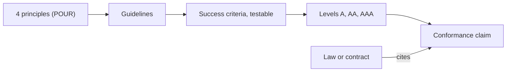
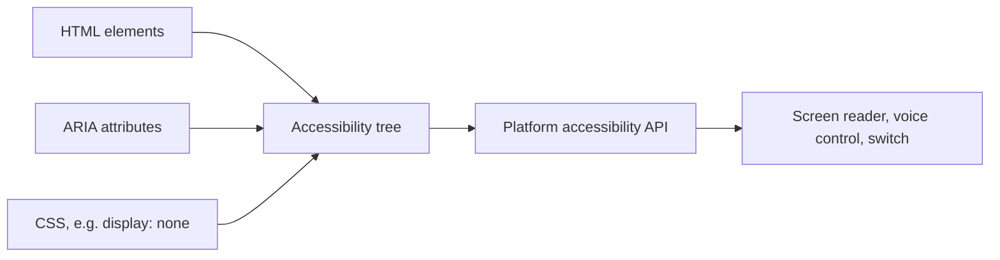
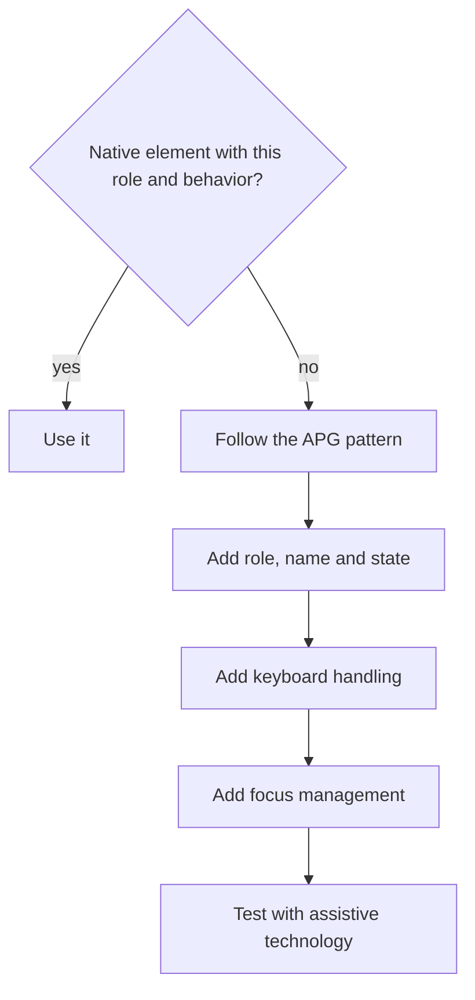
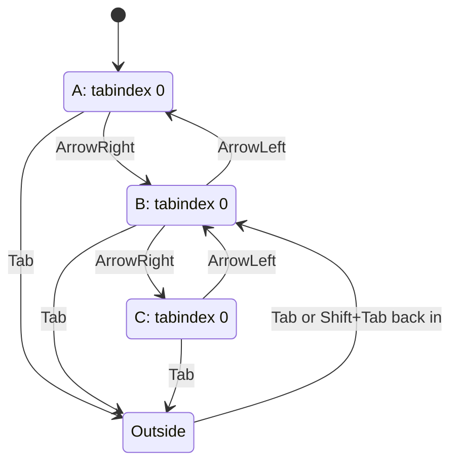
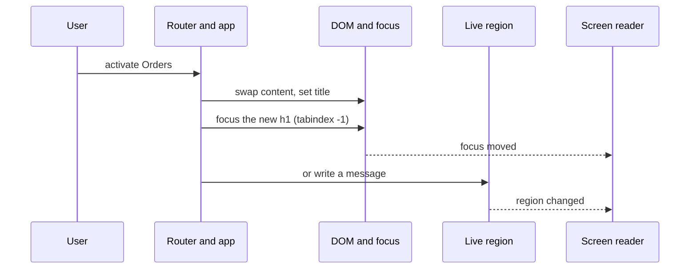
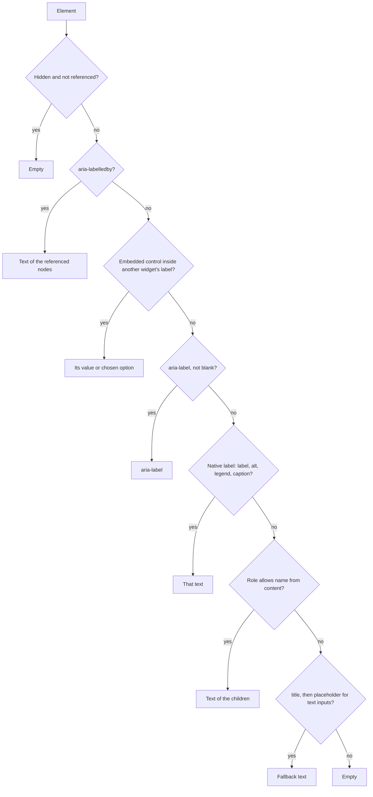
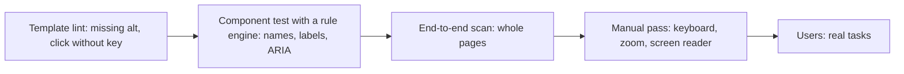

# 11. Accessibility

> **What this covers:** why accessibility matters (users, the law and the business), what WCAG 2.2 and the European Accessibility Act ask of a web application, semantic HTML with landmarks and headings, ARIA and its rules, keyboard navigation, focus order, roving tabindex and focus traps, focus management and live regions in single-page apps, how accessible names and form errors work, and how to test with axe, Lighthouse, screen readers and a manual checklist. By the end you can explain why a custom control failed, make a dialog, a toolbar and a form usable without a mouse, and say what an automated scan can and cannot prove.
> **Prerequisites:** [08. Events: propagation, default actions, passive listeners and delegation](08-browser-rendering-dom-events.md#4-events-propagation-default-actions-passive-listeners-and-delegation) (focus and keyboard events), [08. Web Components](08-browser-rendering-dom-events.md#5-web-components-custom-elements-shadow-dom-and-templates) (`ElementInternals`, shadow DOM), [10. Responsive CSS](10-css-essentials.md#5-responsive-css-media-queries-container-queries-and-fluid-type) (units, zoom) and [10. Custom properties and `color-scheme`](10-css-essentials.md#6-custom-properties-theming-and-color-scheme)
> **Leads to:** [13. Components and templates](13-components-and-templates.md), [24. Routing](24-routing.md), [25. Forms](25-forms-reactive-and-template-driven.md), [26. Signal Forms](26-signal-forms.md), [29. Testing Angular](29-testing-angular.md), [30. E2E and testing strategy](30-e2e-and-testing-strategy.md), [36. Material and CDK](36-material-and-cdk.md)
> **Applies to:** WCAG 2.2, WAI-ARIA, HTML Accessibility API Mappings and the Accessible Name and Description Computation as of 2026-10 (versions and statuses confirmed by the section tasks); jsdom 30.1 (a JavaScript implementation of the DOM for Node.js) in the labs; axe-core 4.14 in a throwaway probe only; Angular CDK (Component Dev Kit) 22.2 and `@angular/aria` 22.2 read from their typings, not used in module 11's labs
> **Study time:** ~3 hours reading + ~3 hours exercises
> **Short on time:** read [2. Semantic HTML](#2-semantic-html-landmarks-and-headings), [4. Keyboard and focus](#4-keyboard-focus-order-roving-tabindex-and-focus-traps) and [6. Accessible names and forms](#6-accessible-names-descriptions-and-forms), then drill [Q11.03](#q11-03), [Q11.05](#q11-05), [Q11.09](#q11-09), [Q11.15](#q11-15) and [Q11.19](#q11-19), try [Exercise 11.1](#ex11-1), and finish with the [Summary](#summary).
> **Labs:** [`labs/ts-js/src/modules/11-accessibility/`](../labs/ts-js/src/modules/11-accessibility/) and [`labs/ts-js/src/outputs/11-accessibility/`](../labs/ts-js/src/outputs/11-accessibility/) (section claims, exercises and *Output* questions). Run (from `labs/ts-js`, Node 24): `npx vitest run src/modules/11-accessibility src/outputs/11-accessibility`

## Contents

1. [Why accessibility, and what the standards require](#1-why-accessibility-and-what-the-standards-require)
2. [Semantic HTML, landmarks and headings](#2-semantic-html-landmarks-and-headings)
3. [ARIA: roles, states, properties and its rules](#3-aria-roles-states-properties-and-its-rules)
4. [Keyboard, focus order, roving tabindex and focus traps](#4-keyboard-focus-order-roving-tabindex-and-focus-traps)
5. [Focus management in SPAs and live regions](#5-focus-management-in-spas-and-live-regions)
6. [Accessible names, descriptions and forms](#6-accessible-names-descriptions-and-forms)
7. [Testing accessibility](#7-testing-accessibility)
- [Summary](#summary)
- [Question bank](#question-bank)
- [Hands-on exercises](#hands-on-exercises)
- [Check your understanding](#check-your-understanding)
- [Connections](#connections)

**How the claims here are verified.** The labs have no real browser and no screen reader, so what a browser or assistive technology does (the accessibility tree, role mapping, announcements, Tab order, `<dialog>` and `inert`, rendered contrast) is taught from the specifications, MDN and the ARIA Authoring Practices Guide (APG) and never presented as observed. What runs is [jsdom](https://github.com/jsdom/jsdom) 30.1 (`// @vitest-environment jsdom`), which implements focus, `tabIndex`, focus events, ARIA reflection, `input.labels` and constraint validation; those claims say "in jsdom". It has no accessibility tree, layout, `showModal`, `inert` or sequential focus navigation, and its `focus()` ignores rendering: `section-2-jsdom-limits.test.ts` pins each (tests named `Section 2: jsdom …`). Helpers and exercises are models of specifications, not browsers, and axe-core appears only as a dated throwaway run. **Baseline** is MDN's cross-browser label: *newly available* means a feature works in at least the latest stable version of each Baseline browser, *widely available* means a consistent history of support in each for at least 2.5 years; MDN adds that it "may not tell you if a feature works with" assistive technology ([MDN](https://developer.mozilla.org/en-US/docs/Glossary/Baseline/Compatibility)).

## 1. Why accessibility, and what the standards require

### The problem it solves

A checkout works with a mouse and cannot be completed from the keyboard. A contract says "conform to WCAG 2.2 AA" and nobody can say how to test that. A team treats accessibility as final polish and rebuilds components twice.

### Mental model

**Accessibility** means people can perceive, operate and understand a page whatever their abilities or situation: keyboard instead of mouse, screen reader instead of eyes, magnifier, a phone in sunlight. Their software is **assistive technology (AT)**. The **Web Content Accessibility Guidelines (WCAG)** from the W3C (World Wide Web Consortium) layer the goal into four principles, guidelines, testable **success criteria (SC)** and three **conformance levels**, for use "in design specification, purchasing, regulation, and contractual agreements" ([WCAG 2.2](https://www.w3.org/TR/WCAG22/)). Analogy: a ramp drawn into the plan costs a line, one bolted on later costs a wall.



What to notice: only success criteria are testable, so "WCAG 2.2 AA" means every A and AA criterion, each passing or failing.

### How it actually works

- **POUR:** the principles are perceivable, operable, understandable and robust.
- **Levels:** AA means all A and AA criteria are met. WCAG advises that "Level AAA conformance" not "be required as a general policy for entire sites" ([§5.2.1](https://www.w3.org/TR/WCAG22/#conformance-reqs)).
- **WCAG 2.2** adds nine criteria (such as 2.5.8 Target Size (Minimum), AA), removes 4.1.1 Parsing as obsolete and does not deprecate 2.0 or 2.1. W3C's [What's New](https://www.w3.org/WAI/standards-guidelines/wcag/new-in-22/) says it was published on 5 October 2023 and the latest version, read 2026-10-07, is headed "W3C Recommendation 12 December 2024"; its change log covers "changes made to 2.2 since its original publication on 05 October 2023".
- **CSS-facing criteria:** text contrast 4.5:1, or 3:1 for large-scale text (1.4.3); 3:1 for controls (1.4.11); 200% resize (1.4.4); reflow at 320 CSS pixels (1.4.10); visible focus (2.4.7, [section 4](#4-keyboard-focus-order-roving-tabindex-and-focus-traps)); 24 by 24 CSS pixel targets, with exceptions (2.5.8). Units and zoom are [module 10](10-css-essentials.md#5-responsive-css-media-queries-container-queries-and-fluid-type); animation is module 35.
- **European Accessibility Act (EAA)**, [Directive (EU) 2019/882](https://eur-lex.europa.eu/eli/dir/2019/882/oj), read from the Official Journal text on 2026-10-07: it covers services provided to consumers after 28 June 2025, among them e-commerce and consumer banking (Article 2; national laws apply from that date, Article 31); a microenterprise (fewer than 10 persons, turnover or balance sheet at most EUR 2 million; Article 3) providing services is exempt (Article 4(5)); an operator is excused for fundamental alteration or disproportionate burden, assessed and documented (Article 14). Annex I asks websites to be "perceivable, operable, understandable and robust", but the text names neither WCAG nor a version; Article 15 presumes conformity for harmonised standards (European standards adopted on a Commission request; Article 3, Regulation 1025/2012) cited in the Official Journal. **EN 301 549** is one: [V3.2.1](https://www.etsi.org/deliver/etsi_en/301500_301599/301549/03.02.01_60/en_301549v030201p.pdf) (2021-03) equates WCAG 2.1 Level AA with its web clauses (clause 9.0) and was prepared for Directive 2016/2102 (public-sector sites); [V4.1.1](https://www.etsi.org/deliver/etsi_en/301500_301599/301549/04.01.01_60/en_301549v040101p.pdf) (2026-09) aligns them with WCAG 2.2 and adds Directive 2019/882, giving a presumption of conformity only once it is cited in the Official Journal (its citation status was not established here). Which version a claim relies on is for a lawyer.
- **The business case is reasoning:** purchasing and regulation use these criteria.

### Code

Contrast is arithmetic. Approach: 1) parse `#rgb` or `#rrggbb`; 2) linearise each sRGB channel (threshold 0.04045; `**` is ES2016, `?.` ES2020); 3) weight and sum to the relative luminance `0.2126 R + 0.7152 G + 0.0722 B`; 4) divide `(L1 + 0.05)` by `(L2 + 0.05)`, L1 the lighter. No alpha.

```ts
// WCAG 2.2 "relative luminance" and "contrast ratio" for sRGB colours written as #rgb or #rrggbb.
// Constants follow the WCAG 2.2 definition of relative luminance (threshold 0.04045, read 2026-10-07).

export type Rgb = readonly [red: number, green: number, blue: number];

const HEX = /^#([0-9a-f]{3}|[0-9a-f]{6})$/i;

export function parseHex(colour: string): Rgb {
  const digits = HEX.exec(colour.trim())?.[1];
  if (digits === undefined) throw new Error(`Not a #rgb or #rrggbb colour: ${colour}`);
  const full = digits.length === 3 ? digits.replace(/./g, (d) => d + d) : digits;
  const channel = (start: number): number => parseInt(full.slice(start, start + 2), 16);
  return [channel(0), channel(2), channel(4)];
}

function linearise(channel8Bit: number): number {
  const srgb = channel8Bit / 255;
  return srgb <= 0.04045 ? srgb / 12.92 : ((srgb + 0.055) / 1.055) ** 2.4;
}

export function relativeLuminance(colour: string): number {
  const [r, g, b] = parseHex(colour);
  return 0.2126 * linearise(r) + 0.7152 * linearise(g) + 0.0722 * linearise(b);
}

export function contrastRatio(first: string, second: string): number {
  const [a, b] = [relativeLuminance(first), relativeLuminance(second)];
  const [lighter, darker] = a >= b ? [a, b] : [b, a];
  return (lighter + 0.05) / (darker + 0.05);
}

/** SC 1.4.3 (AA): at least 4.5:1, or 3:1 for large-scale text. SC 1.4.11 asks 3:1 for UI components and graphics. */
export function passesAA(ratio: number, options: { largeText?: boolean } = {}): boolean {
  return ratio >= (options.largeText ? 3 : 4.5);
}
```

<sub>Source: [labs/ts-js/src/modules/11-accessibility/contrast.ts](../labs/ts-js/src/modules/11-accessibility/contrast.ts)</sub>

`Section 1: black on white is 21:1`, `Section 1: #767676 on white is about 4.54 and passes AA for normal text, #777777 is about 4.48 and fails` and `Section 1: large text uses the 3:1 threshold` assert the numbers: the formula, not rendered pixels.

### Best practices and anti-patterns

- **Name version and level in a contract** ("WCAG 2.2 Level AA"), because "AA" alone does not say whether 2.2's six new A and AA criteria count.
- **Check contrast from the formula**, because `#777777` and `#767676` look alike and only one passes.
- **Start from native elements** ([section 2](#2-semantic-html-landmarks-and-headings)), because every later section is the cost of building controls from `div`s.

### Misconceptions and traps

- *"Accessibility is for blind users."* The criteria above cover contrast, zoom, targets and focus. The screen reader is the visible tool, hence the myth.
- *"The EAA says WCAG 2.1 AA."* The Directive text names no version; the chain runs through harmonised standards (Article 15) and EN 301 549. Guidance compresses the chain.
- *"The formula uses 0.03928."* Once true: until May 2021; WCAG changed it to 0.04045 with "no practical effect on the calculations" (relative luminance, Note 2). Older articles still print it.

Questions: [Q11.01](#q11-01) and [Q11.02](#q11-02).

## 2. Semantic HTML, landmarks and headings

### The problem it solves

A "card" built from `div`s and a click handler cannot be reached with Tab. A screen reader user hears one flat run of text with no way to jump to the content: headings chosen for font size make the outline useless, and with no `main` there is no shortcut past the header.

### Mental model

The browser converts markup into the DOM and then builds an **accessibility tree** from it: objects with a **name**, a **description**, a **role** (what kind of thing it is) and a **state**, which platform **accessibility APIs** pass to assistive technology such as screen readers ([MDN](https://developer.mozilla.org/en-US/docs/Glossary/Accessibility_tree)). Assistive technology reads that tree, not the pixels. Analogy: a second, text-only interface whose source code is your markup.



What to notice: three inputs feed one tree. HTML-AAM leaves an element "not mapped" "usually because the element is not displayed" ([§3.5](https://www.w3.org/TR/html-aam-1.0/)), so CSS can remove a node and ARIA can rewrite one ([section 3](#3-aria-roles-states-properties-and-its-rules)): both can also break it.

### How it actually works

- **A native element supplies role, focusability and keyboard activation.** A `<button>` is "activated by a user with a mouse, keyboard, finger, voice command, or other assistive technology"; an `a` with `href` activates on Enter ([MDN `button`](https://developer.mozilla.org/en-US/docs/Web/HTML/Reference/Elements/button), [`a`](https://developer.mozilla.org/en-US/docs/Web/HTML/Reference/Elements/a)). In jsdom a `button` and an `input` have `tabIndex` 0 and a `div` -1 and cannot take `focus()` until it has a `tabindex` (`Section 2: a button and an input are focusable and a div is not until it has a tabindex`).
- **Landmarks** are regions assistive technology can jump between. Per [ARIA in HTML](https://www.w3.org/TR/html-aria/) (W3C Recommendation, 11 August 2026): `main` is `main`, `nav` is `navigation`, `aside` is `complementary`, `header` is `banner` and `footer` is `contentinfo` unless a descendant of `article`, `aside`, `main`, `nav` or `section` (then `generic`), and `section` is `region` only with an accessible name.
- **Headings are structure.** The HTML Standard (read 2026-10-07) takes the level from the element name (`h1` is 1) plus an optional `headingoffset`, defines the outline as all headings in tree order, and requires each heading to be at most one level deeper than the previous ([§4.3.11](https://html.spec.whatwg.org/multipage/sections.html#heading-levels-&-offsets)). Screen reader users jump heading to heading, so a skipped level leaves them "wondering where the missing heading is" (MDN).
- **Text alternatives.** `alt=""` marks decoration and gives the image the implicit role `presentation` ([MDN `img`](https://developer.mozilla.org/en-US/docs/Web/HTML/Reference/Elements/img)). jsdom's `img.alt` is `""` with or without the attribute, so only `hasAttribute('alt')` tells them apart (`Section 2: a missing alt and an empty alt differ only by the attribute's presence`). `input.labels` follows `for` and wrapping `label` (`Section 2: input.labels follows a for attribute and a wrapping label`).
- **Page criteria** ([WCAG 2.2](https://www.w3.org/TR/WCAG22/)): structure programmatically available (1.3.1), a page title (2.4.2), link purpose from text or context (2.4.4), page language in code (3.1.1).

### Code

Approach: compare what the tree would hold. The first has no role, name or focus stop; the second gets all three from elements.

```html
<!-- Illustrative, not run -->
<div class="card" onclick="open(7)"><span class="big">Order 7</span></div>

<article class="card">
  <h3><a href="/orders/7">Order 7</a></h3>
</article>
```

### Best practices and anti-patterns

- **Use `button` for actions and `a[href]` for navigation**, because each brings its own keyboard activation.
- **Pick the heading level from the outline, then restyle with CSS**, because assistive technology reads the level and never the font size.
- **Name repeated landmarks**, because an unnamed second `nav` forces the user to open both ([MDN](https://developer.mozilla.org/en-US/docs/Web/HTML/Reference/Elements/Heading_Elements): "Primary navigation" and "Footer navigation").

> [!NOTE]
> **Framework vs platform.** The accessibility tree belongs to the browser and Angular adds nothing to it. angular.dev (read 2026-10-07) tells you to re-use native elements, for example a component with an attribute selector on a native `<button>`. Host elements are [module 13](13-components-and-templates.md); CDK helpers [module 36](36-material-and-cdk.md#9-cdk-accessibility-focustrap-focusmonitor-liveannouncer-and-the-key-managers).

### Misconceptions and traps

- *"Every heading can be an `h1`, sections reset the level."* Once true: multiple nested `h1` were allowed "in older versions of the HTML standard", and are now non-conforming (MDN, read 2026-10-07; the version is not stated). The standard read defines levels by element name. Nested sections sounded tidy.
- *"`<section>` is always a landmark."* Only with an accessible name (ARIA in HTML). The name suggests a region.
- *"An empty `alt` is lazy."* It is the right value for decoration (MDN); empty and missing look alike in the DOM.

Questions: [Q11.03](#q11-03) and [Q11.04](#q11-04). [Exercise 11.3](#ex11-3) audits these rules.

## 3. ARIA: roles, states, properties and its rules

### The problem it solves

A custom dropdown rebuilt from `div`s carries fourteen `aria-*` attributes and still cannot be opened with the keyboard. An `aria-label` on a plain `div` is not allowed. An `aria-hidden="true"` on a focused button leaves the user typing into nothing.

### Mental model

**ARIA** (Accessible Rich Internet Applications, the W3C's WAI-ARIA specification) adds annotations to the accessibility tree and never adds behavior. A **role** says what a thing is, a **state** what it is doing now (`aria-expanded`, `aria-checked`), a **property** how it relates to the rest (`aria-labelledby`); property values "are often less likely to change" than state values ([ARIA 1.2 §6.1](https://www.w3.org/TR/wai-aria-1.2/#state_prop_def)). The ARIA Authoring Practices Guide (APG) says "A role is a promise" of keyboard support, because "ARIA roles do not cause browsers to provide keyboard behaviors or styling" ([APG](https://www.w3.org/WAI/ARIA/apg/practices/read-me-first/)). Analogy: subtitles change what you read about the film, never the film.



What to notice: in the "no" branch only one step is ARIA; keyboard, focus and testing are work it does not do.

### How it actually works

- **Roles** are abstract (never used by authors), widget, document structure, landmark, live region or window ([ARIA 1.2 §5.3](https://www.w3.org/TR/wai-aria-1.2/#role_definitions)). A **widget** is an interactive control, a **composite widget** one that holds items; some roles require owned elements, so a `menu` should have at least one `menuitem`, `menuitemcheckbox` or `menuitemradio` (§5.2.6). **Presentational** roles (`presentation`, `none`) strip semantics but keep content exposed (MDN).
- **Names have limits.** Roles such as `generic`, `presentation`, `paragraph` and `code` are "name prohibited": authors "MUST NOT use the aria-label or aria-labelledby attributes" on them (ARIA 1.2 §5.2.8 and §5.2.8.6). A plain `div` is `generic`.
- **The four rules of ARIA use** (Using ARIA, a W3C Discontinued Draft of 24 February 2026, kept "for historical purposes"): 1) use a native element if one has the semantics and behavior; 2) do not change native semantics unless you really have to; 3) every interactive ARIA control must be usable with the keyboard, and a `role="button"` must take focus and activate on Enter and Space; 4) no `role="presentation"` or `aria-hidden="true"` on a focusable element ([Using ARIA](https://www.w3.org/TR/using-aria/)).
- **Hiding.** Per MDN and Using ARIA (read 2026-10-07):

| Technique | In the accessibility tree | Focusable | Visible |
|---|---|---|---|
| `aria-hidden="true"` | removed, with children | still, which is the bug | still |
| `display: none`, `visibility: hidden` | removed | no | no |
| `inert` | excluded | no | still |

  The `hidden` attribute is already out of the tree ([MDN `aria-hidden`](https://developer.mozilla.org/en-US/docs/Web/Accessibility/ARIA/Reference/Attributes/aria-hidden)); `inert` makes an element and its descendants unfocusable, unclickable and absent from the tree, with no visual cue by default ([MDN](https://developer.mozilla.org/en-US/docs/Web/HTML/Reference/Global_attributes/inert)); modal `<dialog>` is [section 4](#4-keyboard-focus-order-roving-tabindex-and-focus-traps).
- **Reflection.** `element.role` and `element.ariaLabel` read and write the attributes (`Section 3: role, ariaLabel and ariaPressed read and write the attributes`; [MDN](https://developer.mozilla.org/en-US/docs/Web/API/Element/ariaLabel)) [Baseline 2023: widely available, per MDN]. A custom element can set a default role through `ElementInternals` without an attribute (`Section 3: ElementInternals sets a default role and writes no attribute`; [08 §5](08-browser-rendering-dom-events.md#5-web-components-custom-elements-shadow-dom-and-templates)).
- **Support varies**, so the APG says to test "with each browser and assistive technology combination that is relevant" ([section 7](#7-testing-accessibility)).

> [!NOTE]
> **Framework vs platform.** ARIA is platform vocabulary; Angular binds attributes, and angular.dev (read 2026-10-07) says ARIA attributes bind "directly like any other HTML attribute", for example `[aria-label]`. The CDK helpers and the `@angular/aria` directives (typings read 2026-10-07; status not read) are [module 36](36-material-and-cdk.md); [Exercise 17.4](17-signals.md#ex17-4) is a native-first example.

### Code

Approach: break the promise and observe. 1) Mount `<div role="button">`. 2) Focus it and dispatch Enter and Space. 3) Read `tabIndex` and `activeElement`.

```html
<!-- Illustrative, not run -->
<div role="button" aria-pressed="false" onclick="toggle()">Mute</div>   <!-- role without the promise -->
<button type="button" aria-pressed="false" onclick="toggle()">Mute</button>
```

`Section 3: a div with role button is not focusable and a keydown on it does nothing` asserts the first line's DOM outcome and `Section 3: focus() reaches a native button and not a div with role button` its counterpart.

### Best practices and anti-patterns

- **Reach for a native element first**, because it brings role, focus and keys together and ARIA brings only the first.
- **Copy an APG pattern end to end**, because "incorrect ARIA misrepresents visual experiences" (APG).
- **Never put `aria-hidden` on or above a focusable element**, because focus lands on nothing (rule 4).

### Misconceptions and traps

- *"ARIA makes a `div` behave like a button."* It changes the tree only (lab test above). The role name sounds like behavior.
- *"More ARIA is more accessible."* APG: "No ARIA is better than Bad ARIA". Attributes look like free extras.
- *"`aria-hidden` hides it from everyone."* It removes the node from the tree, nothing visual, and focus still lands on it (MDN). The name says "hidden".
- *"There are five rules of ARIA."* Once true: Using ARIA working drafts through 27 September 2018 (read) had a fifth rule, "All interactive elements must have an accessible name"; the 24 February 2026 draft lists four.

Questions: [Q11.05](#q11-05), [Q11.06](#q11-06) and [Q11.07](#q11-07).

## 4. Keyboard, focus order, roving tabindex and focus traps

### The problem it solves

A menu opens only on hover. A modal lets Tab walk into the page behind it. `outline: none` leaves the keyboard user blind. A toolbar of twelve buttons costs twelve Tab presses.

### Mental model

**Focus** marks the one element that receives keyboard input; the **tab order** is the path Tab and Shift+Tab take through the focusable elements, each a **tab stop**. The convention: Tab and Shift+Tab "move focus from one UI component to another while other keys, primarily the arrow keys, move focus inside of components" ([APG](https://www.w3.org/WAI/ARIA/apg/practices/keyboard-interface/)). Analogy: Tab walks the corridor between rooms, arrows move around inside a room. A **roving tabindex** gives a group exactly one tab stop and moves it:



What to notice: the group always has one tab stop; arrows move the stop and the focus, not the DOM, and coming back in lands on the item still holding `tabindex="0"`.

### How it actually works

- **Focusable and `tabindex`.** By default `a` with `href`, `button`, `input`, `select`, `textarea`, `iframe` and `summary` take Tab. `tabindex="0"` joins the order at the element's DOM position, `-1` allows focus by script or click only, positive values reorder and should be avoided ([MDN](https://developer.mozilla.org/en-US/docs/Web/HTML/Reference/Global_attributes/tabindex)). In jsdom `tabIndex` is 0 for native controls and -1 for a `div`, and `focus()` skips a disabled input (`Section 4: tabIndex is 0 for native controls and -1 for a div, and focus() skips a disabled input`).
- **Order follows the DOM.** WCAG 2.4.3 asks for an order "that preserves meaning and operability". Flexbox says `order` "intentionally affect[s] only the visual rendering, leaving speech order and navigation based on the source order" ([CSS Flexbox 1 §5.4](https://www.w3.org/TR/css-flexbox-1/#order-accessibility), Candidate Recommendation Draft, 14 October 2025; [module 10](10-css-essentials.md#3-flexbox-grid-and-subgrid)).
- **Focus events.** UI Events gives the typical sequence `focus`, `focusin`, `blur`, `focusout`, `focus`, `focusin` and does not define it for `focus()` ([UI Events §3.3.2](https://www.w3.org/TR/uievents/#events-focusevent-event-order), Working Draft of 21 February 2026). jsdom's `focus()` produced it (`Section 4: focus and blur fire as focus, focusin, blur, focusout between two elements`); `focusin` bubbles ([Q08.11](08-browser-rendering-dom-events.md#q08-11)).
- **Composite widgets** keep one tab stop. Roving tabindex gives the stop `tabindex="0"`, the rest `-1`, and swaps them with `focus()`, so the browser scrolls the item into view; with `aria-activedescendant` DOM focus stays on the container and the attribute names the active descendant ([APG](https://www.w3.org/WAI/ARIA/apg/practices/keyboard-interface/)). [Exercise 11.1](#ex11-1) builds a controller.
- **Focus indicator.** WCAG 2.4.7 requires a mode where "the keyboard focus indicator is visible" and 2.4.11 that focus is "not entirely hidden due to author-created content" ([WCAG 2.2](https://www.w3.org/TR/WCAG22/)). `:focus-visible` matches while an element has focus and the browser "determines via heuristics" that it should show ([MDN](https://developer.mozilla.org/en-US/docs/Web/CSS/:focus-visible)); documented, not run.
- **Skip links.** WCAG technique G1: the first interactive item links to the main content, visible always or on focus, and moves focus there ([G1](https://www.w3.org/WAI/WCAG22/Techniques/general/G1)); a target that is not focusable needs `tabindex="-1"` (MDN above).
- **Modal dialogs.** `showModal()` opens the dialog in the top layer ([module 10 §4](10-css-essentials.md#4-positioning-stacking-contexts-and-z-index)), makes the rest of the document inert, focuses the first focusable element (or `autofocus`) and lets Esc close it ([MDN `dialog`](https://developer.mozilla.org/en-US/docs/Web/HTML/Reference/Elements/dialog), [`showModal`](https://developer.mozilla.org/en-US/docs/Web/API/HTMLDialogElement/showModal)); documented, not run (jsdom lacks it, pinned in section 2). WCAG 2.1.2 No Keyboard Trap asks that focus can leave a component "using only a keyboard interface", with the method advised if it is not a standard exit ([Understanding 2.1.2](https://www.w3.org/WAI/WCAG22/Understanding/no-keyboard-trap.html)).

### Code

Approach: a model of the hand-rolled trap. 1) Remember the opener and focus the first tabbable. 2) On Tab at the last element (or Shift+Tab at the first) prevent the default and focus the other end. 3) On Escape call back (`?.`, ES2020). 4) `release()` removes the listener and refocuses the opener. Tabbability comes from attributes only, so a `display: none` button still counts (`Section 4: the tabbables query includes elements a browser would skip`; that browsers skip it is Using ARIA's statement, documented).

```ts
// A model of the hand-rolled modal focus trap: wrap Tab at the ends, optionally call back on Escape, restore focus on release.
// It decides from the DOM (selector and attributes) only. It does not check rendering, so a hidden element still counts
// as tabbable here (see section-2-jsdom-limits.test.ts); prefer a native modal <dialog> where it fits.

const TABBABLE_SELECTOR = [
  'a[href]',
  'button',
  'input:not([type="hidden"])',
  'select',
  'textarea',
  'summary',
  '[contenteditable]',
  '[tabindex]',
].join(',');

export interface FocusTrap {
  release(): void;
}

export interface FocusTrapOptions {
  onEscape?: () => void;
}

/** Elements in document order that a Tab press could reach, judged from attributes only. */
export function tabbables(container: Element): HTMLElement[] {
  return [...container.querySelectorAll<HTMLElement>(TABBABLE_SELECTOR)].filter(
    (element) => !element.hasAttribute('disabled') && element.tabIndex >= 0,
  );
}

function wrapTarget(container: HTMLElement, event: KeyboardEvent): HTMLElement | undefined {
  const items = tabbables(container);
  const [first, last] = [items[0], items[items.length - 1]];
  const active = document.activeElement;
  if (!first || !last) return undefined;
  if (event.shiftKey) return active === first || !container.contains(active) ? last : undefined;
  return active === last || !container.contains(active) ? first : undefined;
}

export function trapFocus(container: HTMLElement, options: FocusTrapOptions = {}): FocusTrap {
  const opener = document.activeElement instanceof HTMLElement ? document.activeElement : null;

  const onKeydown = (event: KeyboardEvent): void => {
    if (event.key === 'Escape') {
      options.onEscape?.();
      return;
    }
    if (event.key !== 'Tab') return;
    const target = wrapTarget(container, event);
    if (!target) return;
    event.preventDefault();
    target.focus();
  };

  container.addEventListener('keydown', onKeydown);
  tabbables(container)[0]?.focus();

  return {
    release(): void {
      container.removeEventListener('keydown', onKeydown);
      opener?.focus();
    },
  };
}
```

<sub>Source: [labs/ts-js/src/modules/11-accessibility/focus-trap.ts](../labs/ts-js/src/modules/11-accessibility/focus-trap.ts)</sub>

`Section 4: the trap wraps Tab from the last element to the first and Shift+Tab from the first to the last, and ignores other keys` and `Section 4: closing the trap returns focus to the opener` dispatch the keys themselves, because jsdom's Tab moves nothing, and assert `defaultPrevented` and `activeElement`. The roving move, sketched, is Exercise 11.1:

```ts
// Partial: the key handling and the item list are assumed; only the tab-stop move is shown.
function moveStop(items: HTMLElement[], from: number, to: number): void {
  items[from]?.setAttribute('tabindex', '-1');
  items[to]?.setAttribute('tabindex', '0');
  items[to]?.focus();
}
```

> [!NOTE]
> **Framework vs platform.** `<dialog>` and `inert` are the platform's answer. The CDK's `CdkTrapFocus`, `FocusMonitor` and `ListKeyManager` (typings read 2026-10-07) are [module 36](36-material-and-cdk.md#9-cdk-accessibility-focustrap-focusmonitor-liveannouncer-and-the-key-managers); angular.dev offers `cdkTrapFocus` for modal dialogs.

### Best practices and anti-patterns

- **Keep DOM order equal to visual order**, because focus, speech and reading order follow the source.
- **Use `tabindex` 0 and -1 only**, because positive values jump ahead of the whole page.
- **Give composites one tab stop**, because twelve buttons otherwise cost twelve presses.
- **Style `:focus-visible` instead of removing the outline**, because 2.4.7 needs a visible indicator.

### Misconceptions and traps

- *"`tabindex="0"` on everything makes it accessible."* It only makes it reachable; MDN advises against it for faking buttons. It looks like a one-line fix.
- *"`outline: none` is fine with a hover style."* Keyboard users see no hover and 2.4.7 asks for a visible indicator. Designers read the outline as default browser ugliness.
- *"A focus trap is always a bug."* 2.1.2 forbids traps without an exit; Esc is a modal's exit. Its title reads absolute.

Questions: [Q11.08](#q11-08), [Q11.09](#q11-09), [Q11.10](#q11-10) and [Q11.11](#q11-11).

## 5. Focus management in SPAs and live regions

### The problem it solves

A user activates "Orders" in a single-page application (SPA): the content swaps, focus stays on the old link or falls to nothing, the page title is unchanged and nothing is said. "Item added" appears in a toast nobody hears, and search results update silently.

### Mental model

A route change in an SPA replaces part of the DOM inside one document, so nothing in the browser moves the user: the application has three jobs, **update the title, move focus (or deliberately not) and announce changes**. angular.dev (read 2026-10-07) agrees: "you need to make sure your routing code updates focus" ([Angular accessibility](https://angular.dev/best-practices/a11y)). Analogy: a stage manager's cues after a set change. A **live region** is an element whose text changes assistive technology reports without moving focus.



What to notice: the last two arrows are alternatives. A focus move and a live message both tell the user, so choose one channel per change.

### How it actually works

- **Title.** WCAG 2.4.2 asks that "web pages have titles that describe topic or purpose". angular.dev says Angular updates the title when a route activates, from the route's `title`; `TitleStrategy` is [module 24](24-routing.md#9-view-transitions-scroll-restoration-and-titles).
- **Focus after navigation.** angular.dev tells you to use the router's `NavigationEnd` event to focus the main heading and to "avoid situations where focus returns to the body element". The installed `@angular/router` 22.2.1 build contains no `focus` string in its `fesm2022` code (grep, 2026-10-07), so the Router does not do it for you. A heading is not focusable by default, so the target needs `tabindex="-1"` (MDN: focusable by script, not by Tab), which `focusAfterNavigation` adds. History and Navigation API are [08 §7](08-browser-rendering-dom-events.md#7-history-api-versus-navigation-api).
- **When the focused element disappears**, jsdom makes `document.body` active and fires no `blur` on the removed element (`Section 5: removing the focused element makes body active and fires no blur (jsdom)`), the case angular.dev warns about; after a dialog closes, refocus the opener ([section 4](#4-keyboard-focus-order-roving-tabindex-and-focus-traps)).
- **Live regions.** `aria-live` is `off`, `polite` or `assertive`; `aria-atomic`, `aria-relevant` and `aria-busy` refine it ([ARIA 1.2](https://www.w3.org/TR/wai-aria-1.2/#attrs_liveregions)). `role="status"` implies `polite` and atomic, `role="alert"` implies `assertive` and atomic, `role="log"` implies `polite`. WCAG 4.1.3 (AA) wants status messages "programmatically determined through role or properties such that they can be presented ... without receiving focus".
- **Regions must exist first.** MDN: "Establish the live region before updating its content", starting empty, because assistive technologies "will generally only announce dynamic changes". A repeat of identical text is no change, so an announcer clears first. The Angular CDK's `LiveAnnouncer` (source read from `@angular/cdk` 22.2.1) creates one `aria-live="polite"`, `aria-atomic="true"` `div` in `body`, clears it on each `announce`, and writes the message in a 100 ms timeout; `polite` is its default.
- **Politeness.** A change to an `assertive` region "will interrupt any announcement a screen reader is currently making" (MDN) and ARIA 1.2 lets assistive technology clear queued changes. angular.dev adds that `@defer` content may go unannounced unless wrapped in a live region.

### Code

Approach: the announcer follows the CDK pattern (a model, not the CDK). 1) Create a status and an alert region at construction. 2) `announce` clears the target, then writes after a delay. 3) `destroy` removes both. Syntax: `Object.values` ES2017, `??` ES2020.

```ts
// A model of a live-region announcer in the style of the Angular CDK's LiveAnnouncer (read from @angular/cdk 22.2.1, not
// imported): regions exist before their content changes, a message is cleared first so an identical repeat still changes the
// text, and the text is written after a short delay. It writes DOM contents only; what a screen reader says is not modelled.
// Visually hiding the regions needs CSS that is out of scope here.

export type Politeness = 'polite' | 'assertive';

export interface Announcer {
  announce(message: string, politeness?: Politeness): void;
  destroy(): void;
}

export interface AnnouncerOptions {
  delayMs?: number;
  doc?: Document;
}

function createRegion(doc: Document, role: 'status' | 'alert', live: Politeness): HTMLElement {
  const region = doc.createElement('div');
  region.setAttribute('role', role);
  region.setAttribute('aria-live', live);
  region.setAttribute('aria-atomic', 'true');
  doc.body.append(region);
  return region;
}

export function createAnnouncer({ delayMs = 100, doc = document }: AnnouncerOptions = {}): Announcer {
  const regions: Record<Politeness, HTMLElement> = {
    polite: createRegion(doc, 'status', 'polite'),
    assertive: createRegion(doc, 'alert', 'assertive'),
  };
  const timers = new Map<Politeness, ReturnType<typeof setTimeout>>();

  return {
    announce(message: string, politeness: Politeness = 'polite'): void {
      const region = regions[politeness];
      region.textContent = '';
      clearTimeout(timers.get(politeness));
      timers.set(
        politeness,
        setTimeout(() => {
          region.textContent = message;
        }, delayMs),
      );
    },
    destroy(): void {
      for (const timer of timers.values()) clearTimeout(timer);
      timers.clear();
      for (const region of Object.values(regions)) region.remove();
    },
  };
}
```

<sub>Source: [labs/ts-js/src/modules/11-accessibility/announcer.ts](../labs/ts-js/src/modules/11-accessibility/announcer.ts)</sub>

`Section 5: the announcer creates one status region with aria-live polite and writes the message after a tick`, `Section 5: an identical second message is cleared first so the text changes twice` (snapshots `Saved`, empty, `Saved`), `Section 5: assertive messages use role alert` and `Section 5: destroy removes the region` assert it. The navigation helper does the title and focus jobs; calling it is your decision:

```ts
// A model of the three jobs after a client-side route change: set the document title, move focus to the new page's heading
// (or the main landmark) and report what was focused. It never touches the Router: calling it is the application's decision.

export interface NavigationFocusOptions {
  title?: string;
  root?: Document;
}

function focusTarget(root: Document): HTMLElement | null {
  return root.querySelector<HTMLElement>('main h1') ?? root.querySelector<HTMLElement>('main');
}

export function focusAfterNavigation({ title, root = document }: NavigationFocusOptions = {}): HTMLElement | null {
  if (title !== undefined) root.title = title;
  const target = focusTarget(root);
  if (!target) return null;
  if (target.tabIndex < 0 && !target.hasAttribute('tabindex')) target.setAttribute('tabindex', '-1');
  target.focus();
  return target;
}
```

<sub>Source: [labs/ts-js/src/modules/11-accessibility/focus-after-navigation.ts](../labs/ts-js/src/modules/11-accessibility/focus-after-navigation.ts)</sub>

`Section 5: focusing a heading with tabindex -1 moves activeElement to it` asserts the title, `tabindex="-1"` and `activeElement`.

> [!NOTE]
> **Framework vs platform.** The platform supplies focus, `aria-live` and `document.title`; a router decides whether to use them (above). The CDK's `LiveAnnouncer` belongs to [module 36](36-material-and-cdk.md#9-cdk-accessibility-focustrap-focusmonitor-liveannouncer-and-the-key-managers).

### Best practices and anti-patterns

- **Create regions at startup, not at the moment of the message**, because only changes are announced.
- **Default to `polite`**, because `assertive` interrupts the user's current speech.
- **Move focus for page-level changes only**, because every move interrupts and loses the user's place.

### Misconceptions and traps

- *"`aria-live="assertive"` makes sure users hear it."* It interrupts and queued speech may be dropped (ARIA 1.2). The word sounds like a guarantee.
- *"The screen reader announces route changes by itself."* Nothing in the SPA moves the user; the app does it (angular.dev). Ordinary page loads feel automatic, so the habit carries over.
- *"Add `aria-live="assertive"` to `role="alert"` for safety."* MDN reports "double speaking issues in VoiceOver on iOS". Redundancy looks harmless.

Questions: [Q11.12](#q11-12), [Q11.13](#q11-13) and [Q11.14](#q11-14).

## 6. Accessible names, descriptions and forms

### The problem it solves

An icon-only button is read as just "button". A field with only a `placeholder` loses its hint once the user types. A red error message is not tied to its field, so the input has no explanation at all.

### Mental model

Every interactive node needs a **name** (what it is), a role (what kind) and a value or state (WCAG 4.1.2: "the name and role can be programmatically determined"). An **accessible description** is extra help. The browser takes the name from the first source that yields text, in the fixed order of the Accessible Name and Description Computation (AccName). Analogy: a conference badge printed by the organiser (native `<label>`), written by hand (`aria-label`), or "ask Jo" (`aria-labelledby`, pointing at someone else's badge).



What to notice: `aria-labelledby` outranks everything and may point at hidden text, while `title` and `placeholder` are last-resort fallbacks, not labels.

### How it actually works

- **The order** (AccName 1.2, a W3C Working Draft of 02 October 2026; 1.1 is the Recommendation): hidden-not-referenced returns empty; `aria-labelledby` (each referenced node traversed once, so a label that itself has `aria-labelledby` is not followed further); embedded control; `aria-label` unless blank; the host language label (`alt`, HTML `label`); name from content for roles that allow it, recursing through children; last, the tooltip attribute, used "only if nothing else, including subtree content, has provided results". A role that prohibits naming returns empty ([AccName](https://www.w3.org/TR/accname-1.2/#comp_computation)). "Hidden" includes `display: none` and `aria-hidden="true"`; `opacity: 0` is not hidden.
- **HTML per element** ([HTML-AAM §4.1](https://www.w3.org/TR/html-aam-1.0/)). Text inputs: `aria-labelledby` or `aria-label`, then the `label` subtrees in DOM order, then `title`, then `placeholder`, then `aria-placeholder`. A `fieldset` is named by its first rendered child `legend`, a `table` by its `caption`, and a hidden legend or caption names nothing. A placeholder-only input thus gets a fallback name, but MDN says the placeholder "is not a label, and should not be used as a substitute" and it disappears on typing. jsdom computes no names: `input.labels` is empty for a placeholder alone (`Section 6: a placeholder does not create a label`). MDN: "not all assistive technologies" support wrapping labels, so prefer `for`.
- **Descriptions.** The first applicable source wins, `aria-describedby` first (AccName §4.2); ids resolve to the referenced elements (`Section 6: aria-describedby ids resolve to the error element and aria-invalid is a plain attribute`).
- **Label in Name (WCAG 2.5.3, A).** The name "contains the text that is presented visually", because speech-input users "navigate by speaking the visible text labels" ([Understanding 2.5.3](https://www.w3.org/WAI/WCAG22/Understanding/label-in-name.html)). Related: 1.3.1, 3.3.2 (labels or instructions) and 1.3.5 (input purpose programmatically determinable).
- **Errors.** WCAG 3.3.1 asks that the item in error be identified and "described to the user in text", 3.3.3 that known corrections be suggested, 1.4.1 that colour not be "the only visual means". The W3C WAI forms tutorial ties a field to its message with `aria-describedby` ([WAI](https://www.w3.org/WAI/tutorials/forms/notifications/)). GOV.UK's error summary: always show one, even for a single error, move keyboard focus to it, link each entry to its field, and word entries like the inline messages ([GOV.UK](https://design-system.service.gov.uk/components/error-summary/)). `aria-invalid` ("the entered value does not conform to the format expected") is a state you set; in jsdom it is a plain attribute that does not affect `checkValidity()`. `aria-errormessage` also names the message element (ARIA 1.2) but its support was not read, so this guide uses `aria-describedby`.
- **Constraint validation** is platform code: `required` gives `validity.valueMissing`, `setCustomValidity` sets `customError` and `validationMessage`, and `reportValidity()` fires `invalid` (`Section 6: validity.valueMissing, setCustomValidity and the invalid event`; [MDN `ValidityState`](https://developer.mozilla.org/en-US/docs/Web/API/ValidityState)).

[Exercise 11.2](#ex11-2) models the algorithm for a subset: a model of AccName, not a browser.

### Code

Approach: 1) a `label` with `for`; 2) hint and error elements with ids; 3) `aria-describedby` listing both; 4) `aria-invalid="true"` only while the value is wrong.

```html
<!-- Run in jsdom: Section 6: aria-describedby ids resolve to the error element and aria-invalid is a plain attribute -->
<label for="e">Email</label>
<input id="e" aria-describedby="e-hint e-error" aria-invalid="true">
<p id="e-hint">We never share it.</p>
<p id="e-error">Enter an email like name@example.com.</p>
```

> [!NOTE]
> **Framework vs platform.** Angular validators decide whether a value is valid; the platform and your markup decide whether the error is perceivable. Display strategies are [module 25](25-forms-reactive-and-template-driven.md#8-error-display-strategies-and-accessible-errors) and [module 26](26-signal-forms.md#3-binding-with-formfield-native-inputs-attributes-classes-and-rendering).

### Best practices and anti-patterns

- **Use a visible `label` with `for`**, because it is the first native source of the name and stays on screen while typing.
- **Let the accessible name contain the visible text**, because speech-input users say what they see.
- **Point `aria-describedby` at hints and errors**, because it is the first source of the description.
- **Give each error text and a fix, not only red**, because 3.3.1, 3.3.3 and 1.4.1 ask for it.

### Misconceptions and traps

- *"`placeholder` is a label."* HTML-AAM lists it only as the final fallback and MDN says to use a label. It looks like one until the user types.
- *"`title` names everything."* It is the last step of AccName and used only if nothing else supplied text. A hover tooltip suggests priority.
- *"`aria-label` beats visible text."* It wins the computation but can break Label in Name when it omits the visible words. Its name sounds authoritative.

Questions: [Q11.15](#q11-15), [Q11.16](#q11-16) and [Q11.17](#q11-17).

## 7. Testing accessibility

### The problem it solves

"axe reports zero violations" and a keyboard user cannot open the menu. A Lighthouse score of 100 and nobody listened to the page. A team that tests only at the end finds every fix expensive.

### Mental model

Different tools catch different defect classes, so use layers: **template lint** (static checks of source), an **automated rule engine** (a program that checks the DOM against a rule list) on the rendered DOM, a **keyboard pass**, a **screen reader** pass and real users. A **screen reader** is assistive technology that speaks the page. Analogy: smoke detector, fire inspection, fire drill.



What to notice: the first three can run on every change; the last two find what rules cannot express, such as whether a task is possible.

### How it actually works

- **A rule engine** checks the rendered DOM against rules. axe-core returns `violations`, `passes`, `incomplete` ("review items": neither pass nor fail) and `inapplicable` ([API](https://github.com/dequelabs/axe-core/blob/develop/doc/API.md)). Observed by running axe-core 4.14.0 against a throwaway page in jsdom on 2026-10-07 (an `img` without `alt`, an empty `button`, an unlabelled `input`, a `div role="button" onclick`, `h1` then `h3`, a link "click here"): violations `button-name`, `heading-order`, `image-alt`, `label`; incomplete `landmark-one-main` and `page-has-heading-one`; 21 passes (run with `color-contrast` disabled). Not reported: the `div role="button"` that has no keyboard support, and the vague link text (`link-name` passed). With `color-contrast` enabled (the default), jsdom (no layout; it printed "Not implemented: HTMLCanvasElement's getContext()") left it incomplete. Such a **false negative** (a defect the tool does not report) means green is not usable. The scratch files were deleted and no axe test is committed; [Exercise 11.3](#ex11-3) audits the same fixture.
- **Lighthouse** scores accessibility as "a weighted average of all accessibility audits", weighted by axe user impact; each audit is pass or fail, and manual audits "don't affect your score" ([docs](https://developer.chrome.com/docs/lighthouse/accessibility/scoring)). It is not a conformance result.
- **Angular template lint.** `@angular-eslint/eslint-plugin-template` 22.5.0 (rule list read from the package) marks 11 rules as its accessibility preset, among them `alt-text`, `click-events-have-key-events`, `interactive-supports-focus`, `label-has-associated-control`, `valid-aria` and `role-has-required-aria`.
- **Testing Library.** `getByRole` filters by role and, with `name`, by the accessible name computed by `dom-accessibility-api` (`computeAccessibleName`, read from `@testing-library/dom` 10.4.2); inaccessible elements are excluded unless `hidden: true` ([module 29](29-testing-angular.md#11-component-harnesses-and-angular-testing-library)). `@axe-core/playwright` runs axe inside end-to-end tests with `new AxeBuilder({ page }).analyze()` ([module 30](30-e2e-and-testing-strategy.md#6-visual-regression-and-accessibility-checks-in-end-to-end-tests)).
- **The manual pass.** W3C's Easy Checks cover image alternatives, title, headings, contrast, skip link, keyboard focus, language and zoom, and warn that a page "could seem to pass these checks, yet still have significant accessibility barriers" ([WAI](https://www.w3.org/WAI/test-evaluate/easy-checks/)); WAI says "tools can't do it all" ([tools](https://www.w3.org/WAI/test-evaluate/tools/)). Add 200% zoom and 320 CSS pixel reflow ([section 1](#1-why-accessibility-and-what-the-standards-require)), `prefers-reduced-motion` ([MDN](https://developer.mozilla.org/en-US/docs/Web/CSS/@media/prefers-reduced-motion)) and `forced-colors`, where author colours are replaced by system colours ([MDN](https://developer.mozilla.org/en-US/docs/Web/CSS/@media/forced-colors)).
- **Screen readers.** NVDA (NonVisual Desktop Access) is a free Windows screen reader ([NV Access](https://www.nvaccess.org/about-nvda/)); VoiceOver is built into macOS ([Apple](https://support.apple.com/guide/voiceover/welcome/mac)); TalkBack is Google's on Android ([Google](https://support.google.com/accessibility/android/answer/6283677)); Narrator is built into Windows 11 ([Microsoft](https://support.microsoft.com/en-us/windows/complete-guide-to-narrator-e4397a0d-ef4f-b386-d8ae-c172f109bdb1)). No browser pairing or usage figure was read. Check name, role and state, reading order, form errors, route changes and dialogs. CDK and `@angular/aria` helpers are [module 36](36-material-and-cdk.md).

> [!NOTE]
> **Framework vs platform.** The browser's accessibility tree and the assistive technology are the platform; the CDK a11y utilities and `@angular/aria` are Angular's helpers. A rule engine reads the DOM Angular rendered and cannot tell which framework produced it.

### Best practices and anti-patterns

- **Lint templates in the editor and CI**, because a missing `alt` costs seconds before it ships and a rebuild after.
- **Keep `incomplete` results in review, not in the bin**, because they are what the engine could not decide.
- **Do a keyboard and a screen reader pass before release**, because only they find the dead `div`.

### Misconceptions and traps

- *"A passing automated scan means accessible."* The probe above passed a keyboard-dead button. A green dashboard looks like proof.
- *"Lighthouse 100 means WCAG conformant."* Manual audits do not affect the score (docs above). The 0 to 100 scale reads like a grade.

Questions: [Q11.18](#q11-18) and [Q11.19](#q11-19).

## Summary

Accessibility is a contract between the page and every way of using it: WCAG's principles, criteria and levels, which laws and contracts cite; name the version and level, because the European Accessibility Act's text names none ([1](#1-why-accessibility-and-what-the-standards-require)). Native elements put role, name, state and focus in the accessibility tree; a `div` card and skipped headings leave it flat ([2](#2-semantic-html-landmarks-and-headings)). ARIA only annotates that tree, so use a native element first and never `aria-hidden` on something focusable ([3](#3-aria-roles-states-properties-and-its-rules)). Focus follows DOM order, a composite keeps one tab stop, and a modal needs an Escape exit and restored focus ([4](#4-keyboard-focus-order-roving-tabindex-and-focus-traps)).

A single-page app must update the title, move focus and announce changes itself, one channel per change, in a live region that exists first ([5](#5-focus-management-in-spas-and-live-regions)). The name comes from the first source with text, `title` and `placeholder` last, and an error needs text, a link to its field and more than colour ([6](#6-accessible-names-descriptions-and-forms)). A scan never proves a task works, so layer lint, tests, a keyboard and screen-reader pass and users ([7](#7-testing-accessibility)). jsdom has no accessibility tree, layout or screen reader: those parts are documented, not run.

## Question bank

Every *Output* answer is a jsdom or lab-model result, asserted by a test named after its question in `labs/ts-js/src/outputs/11-accessibility/`.

<a id="q11-01"></a>
### Q11.01 · Concept · Who is accessibility for, and what do WCAG's four principles and three levels mean?

<details>
<summary>Answer</summary>

**Short answer (30 seconds).** Everyone who does not use the page as its author tested it. WCAG has four principles (perceivable, operable, understandable, robust: POUR), testable success criteria and levels A, AA and AAA.

**Full explanation.** "WCAG 2.2 AA" means every A and AA criterion passes. [Section 1](#1-why-accessibility-and-what-the-standards-require).

**Follow-ups an interviewer will ask.**
- *In a contract?* Name version and level; "AA" alone leaves 2.2's six new A and AA criteria open.
- *What did 2.2 remove?* 4.1.1 Parsing.

**Trap to avoid.** Treating it as a screen-reader feature.

</details>

<a id="q11-02"></a>
### Q11.02 · Difference · WCAG, EN 301 549 and the European Accessibility Act: which is a standard, which a law, which a test?

<details>
<summary>Answer</summary>

**Short answer (30 seconds).** WCAG is the W3C standard whose criteria are the tests; the EAA is EU law (Directive (EU) 2019/882); EN 301 549 is a European standard using WCAG.

**Full explanation.** The Directive names neither; Article 15 presumes conformity for harmonised standards cited in the Official Journal: EN 301 549 V3.2.1 maps WCAG 2.1 AA for Directive 2016/2102, V4.1.1 WCAG 2.2 for the EAA too, once cited (its citation status was not established here). [Section 1](#1-why-accessibility-and-what-the-standards-require).

**Follow-ups an interviewer will ask.**
- *Who is exempt?* Microenterprises providing services (Article 4(5)).
- *Since when?* 28 June 2025 (Article 31). Earlier contracts may run unchanged to expiry, at most until 28 June 2030 (Article 32).

**Trap to avoid.** "The EAA says WCAG 2.1 AA."

</details>

<a id="q11-03"></a>
### Q11.03 · Concept · What does a native `<button>` give you that a `div` needs ARIA, `tabindex` and key handlers to imitate?

<details>
<summary>Answer</summary>

**Short answer (30 seconds).** Role, focusability, keyboard activation and state, from one element. A `div` has none, and `role="button"` supplies only the first.

**Full explanation.** In jsdom a `div role="button"` is not focusable and ignores a keydown (`Section 3: a div with role button is not focusable and a keydown on it does nothing`). [Section 2](#2-semantic-html-landmarks-and-headings).

**Follow-ups an interviewer will ask.**
- *Button or link?* `button` for actions, `a[href]` for navigation.
- *What must a `div` add?* `tabindex`, key handlers and state.

**Trap to avoid.** Adding `role="button"` and stopping.

</details>

<a id="q11-04"></a>
### Q11.04 · Concept · What are landmarks and heading levels for, and how does a screen reader user use them?

<details>
<summary>Answer</summary>

**Short answer (30 seconds).** They are the page's navigation structure: landmarks (`main`, `nav`, `aside`, `header`, `footer`) are regions to jump between, heading levels an outline to jump through.

**Full explanation.** `section` is a region only with an accessible name (ARIA in HTML). A heading's level comes from its element name and may be at most one deeper than the previous (HTML Standard); a skipped level leaves users "wondering where the missing heading is" (MDN). [Section 2](#2-semantic-html-landmarks-and-headings).

**Follow-ups an interviewer will ask.**
- *Two `nav` elements?* Name each.
- *Smaller text wanted?* Keep the level, restyle with CSS.

**Trap to avoid.** Choosing a heading by its font size.

</details>

<a id="q11-05"></a>
### Q11.05 · Concept · What do ARIA roles, states and properties do, and what can ARIA never do?

<details>
<summary>Answer</summary>

**Short answer (30 seconds).** They annotate the accessibility tree: a role says what a thing is, a state what it is doing now, a property how it relates to others. ARIA never adds behavior.

**Full explanation.** A role promises keyboard support the author must build, and `aria-label` on a plain `div` (`generic`) is not allowed. [Section 3](#3-aria-roles-states-properties-and-its-rules).

**Follow-ups an interviewer will ask.**
- *State or property?* State values change more often (`aria-expanded`) than property values (`aria-labelledby`).
- *First rule of ARIA?* Use a native element when one has the semantics and behavior.

**Trap to avoid.** "More ARIA is more accessible."

</details>

<a id="q11-06"></a>
### Q11.06 · Difference · `aria-hidden`, `hidden`, `display: none`, `visibility: hidden` and `inert`: what does each remove?

<details>
<summary>Answer</summary>

**Short answer (30 seconds).** `aria-hidden="true"` removes the element and its children from the accessibility tree and nothing else. `display: none` and `visibility: hidden` remove it from the tree, focus and view; `inert` from the tree and focus, leaving it visible. `hidden` is already out of the tree.

**Full explanation.** MDN and Using ARIA, documented, not run; jsdom's `focus()` ignores `aria-hidden` (`Section 3: aria-hidden does not stop focus() in jsdom`). [Section 3](#3-aria-roles-states-properties-and-its-rules).

**Follow-ups an interviewer will ask.**
- *Why is `aria-hidden` on a button a bug?* Focus still lands on it.
- *Does `inert` look different?* Not by default.

**Trap to avoid.** `aria-hidden` on or above a focusable element.

</details>

<a id="q11-07"></a>
### Q11.07 · Bug hunt · A custom dropdown "uses ARIA" and still fails: review this snippet

```html
<!-- Illustrative, not run -->
<div class="select" role="listbox" aria-label="Country" onclick="toggle()">
  <div class="option" role="option" aria-selected="true">Spain</div>
  <div class="option" role="option" aria-selected="false">France</div>
</div>
```

<details>
<summary>Answer</summary>

**Short answer (30 seconds).** Nothing can focus it and only a click opens it, so keyboard users cannot reach or operate it; ARIA added no behavior.

**Full explanation.** A role changes the tree only ([Q11.03](#q11-03)). Use a native `select`; failing that, copy the APG pattern: `tabindex`, arrow, Enter and Escape keys, focus management. [Section 3](#3-aria-roles-states-properties-and-its-rules).

**Code.**

```html
<!-- Illustrative, not run -->
<label for="country">Country</label>
<select id="country"><option>Spain</option><option>France</option></select>
```

**Follow-ups an interviewer will ask.**
- *Is `tabindex="0"` enough?* Reachable, not operable.
- *How do you test the custom version?* Keyboard and screen reader passes.

**Trap to avoid.** Treating roles and states as keyboard support.

</details>

<a id="q11-08"></a>
### Q11.08 · Output · Which elements are focusable, what is `tabIndex`, and where does focus end up?

```ts
// Partial: runs in jsdom; mount (labs support/dom.ts) inserts the markup and returns its wrapper
const root = mount('<button id="b"></button><a id="a" href="#x"></a><div id="d"></div><div id="m" tabindex="-1"></div><input id="off" disabled>');
for (const element of root.querySelectorAll<HTMLElement>('*')) {
  element.focus();
  console.log(element.id, element.tabIndex, document.activeElement?.id);
}
```

<details>
<summary>Answer</summary>

**Short answer (30 seconds).** `b 0 b`, `a 0 a`, `d -1 a`, `m -1 m`, `off 0 m`. Native controls have `tabIndex` 0 and a plain `div` -1; `focus()` moves only to what can take focus, so the `div` and the disabled input leave the previous element active.

**Full explanation.** These are jsdom's results, asserted by `Q11.08` in [`focus.test.ts`](../labs/ts-js/src/outputs/11-accessibility/focus.test.ts); a browser's Tab walk is documented, not run. [Section 4](#4-keyboard-focus-order-roving-tabindex-and-focus-traps).

**Follow-ups an interviewer will ask.**
- *How does a `div` become focusable?* `tabindex="0"` (Tab order) or `-1` (script and click).
- *Is the disabled input reachable?* No.

**Trap to avoid.** Reading `tabIndex` as "focusable".

</details>

<a id="q11-09"></a>
### Q11.09 · Concept · What decides tab order, and why is a positive `tabindex` a problem?

<details>
<summary>Answer</summary>

**Short answer (30 seconds).** The DOM order of the focusable elements. `tabindex="0"` joins at its place, `-1` allows focus by script or click only, and a positive value jumps ahead of everything else.

**Full explanation.** CSS `order` changes rendering only (Flexbox 1 §5.4), so keep DOM and visual order equal (WCAG 2.4.3). [Section 4](#4-keyboard-focus-order-roving-tabindex-and-focus-traps).

**Follow-ups an interviewer will ask.**
- *Visual order differs?* Fix the DOM, not `tabindex`.
- *Skip repeated navigation?* A skip link first (technique G1).

**Trap to avoid.** A positive `tabindex` to "fix" the order.

</details>

<a id="q11-10"></a>
### Q11.10 · Design · Build a keyboard-operable toolbar or tab list: roving tabindex or `aria-activedescendant`?

<details>
<summary>Answer</summary>

**Short answer (30 seconds).** Roving tabindex by default: one item has `tabindex="0"`, the rest `-1`, and arrows move the stop and call `focus()`. With `aria-activedescendant` focus stays on the container and an attribute names the active item.

**Full explanation.** Roving moves real focus, so the browser scrolls the item into view; the other makes you do it. [Exercise 11.1](#ex11-1) builds it. [Section 4](#4-keyboard-focus-order-roving-tabindex-and-focus-traps).

**Code.**

```ts
// Partial: toolbar is the container element; createRovingTabindex is Exercise 11.1
const roving = createRovingTabindex(toolbar, { itemSelector: 'button', orientation: 'horizontal', wrap: false });
```

**Follow-ups an interviewer will ask.**
- *Where does Shift+Tab land on re-entry?* On the item holding `tabindex="0"`.
- *Wrap?* An option.

**Trap to avoid.** Leaving every item at `tabindex="0"`: twelve Tab presses.

</details>

<a id="q11-11"></a>
### Q11.11 · Trade-off · Native `<dialog>`, a hand-rolled focus trap or the CDK's `CdkTrapFocus`?

<details>
<summary>Answer</summary>

**Short answer (30 seconds).** Prefer `<dialog>` with `showModal()`: top layer, page behind inert, focus moves in, Esc closes (MDN). Hand-roll a trap or use `cdkTrapFocus` only where it does not fit.

**Full explanation.** A hand-rolled trap wraps Tab, offers an Escape exit and restores focus to the opener (the model in section 4) but leaves the page behind active. WCAG 2.1.2 allows a trap with an exit. The CDK is [module 36](36-material-and-cdk.md#9-cdk-accessibility-focustrap-focusmonitor-liveannouncer-and-the-key-managers). [Section 4](#4-keyboard-focus-order-roving-tabindex-and-focus-traps).

**Follow-ups an interviewer will ask.**
- *After closing?* Return focus to the opener.
- *Is a trap a bug?* Not with an exit.

**Trap to avoid.** No Escape exit, or the page behind still reachable.

</details>

<a id="q11-12"></a>
### Q11.12 · Concept · Why does a single-page app need focus management after a route change?

<details>
<summary>Answer</summary>

**Short answer (30 seconds).** A route change swaps DOM inside one document: nothing resets focus, announces the page or starts reading. The app must update the title, move focus (or choose not to) and announce changes.

**Full explanation.** A heading needs `tabindex="-1"` to take focus (MDN). [Section 5](#5-focus-management-in-spas-and-live-regions).

**Follow-ups an interviewer will ask.**
- *Which target?* The new `h1`.
- *Focus and a message?* One channel.

**Trap to avoid.** Expecting the screen reader to announce route changes itself.

</details>

<a id="q11-13"></a>
### Q11.13 · Design · Design the focus and announcement strategy for navigation, a closing dialog, a deleted item and a live search

<details>
<summary>Answer</summary>

**Short answer (30 seconds).** Navigation: set the title, focus the new `h1`. Closing dialog: refocus the opener. Deleted item: focus a neighbour, plus a polite message. Search: keep focus, update a polite live region with the count.

**Full explanation.** One channel per change. Removing the focused element makes `body` active (in jsdom, section 5), so a deleted item must hand focus on. [Section 5](#5-focus-management-in-spas-and-live-regions).

**Follow-ups an interviewer will ask.**
- *When `assertive`?* Urgent only.
- *Where is the region created?* At startup.

**Trap to avoid.** Moving focus on every update.

</details>

<a id="q11-14"></a>
### Q11.14 · Difference · Output · `polite`, `assertive`, `role="status"` and `role="alert"`: what does an announcer write, and why clear first?

```ts
// Partial: runs in jsdom with vi.useFakeTimers(); createAnnouncer is labs announcer.ts
const announcer = createAnnouncer();
const text = (role: string) => JSON.stringify(document.querySelector(`[role="${role}"]`)?.textContent);
announcer.announce('Saved');
console.log(text('status'));
vi.advanceTimersByTime(100);
console.log(text('status'));
announcer.announce('Saved');
console.log(text('status'));
vi.advanceTimersByTime(100);
console.log(text('status'));
announcer.announce('Payment failed', 'assertive');
vi.advanceTimersByTime(100);
console.log(text('alert'), document.querySelector('[role="alert"]')?.getAttribute('aria-live'));
```

<details>
<summary>Answer</summary>

**Short answer (30 seconds).** `""`, `"Saved"`, `""`, `"Saved"`, `"Payment failed" assertive`. The model writes after 100 ms, clears first so a repeat changes the text twice, and sends assertive messages to a `role="alert"` region.

**Full explanation.** `status` implies `polite` and `alert` implies `assertive` (ARIA 1.2). Asserted by `Q11.14` in [`live-region-and-name.test.ts`](../labs/ts-js/src/outputs/11-accessibility/live-region-and-name.test.ts): DOM contents of a model of the CDK's `LiveAnnouncer`, not speech. [Section 5](#5-focus-management-in-spas-and-live-regions).

**Follow-ups an interviewer will ask.**
- *Why create regions early?* Only changes are announced.
- *Default?* `polite`: `assertive` interrupts.

**Trap to avoid.** `assertive` as a guarantee.

</details>

<a id="q11-15"></a>
### Q11.15 · Concept · Output · How is an accessible name chosen: `aria-labelledby`, `aria-label`, a label, content or `title`?

```ts
// Partial: runs in jsdom; mount and need are labs support/dom.ts, accessibleName is labs accname.ts (Exercise 11.2)
const root = mount(
  '<a id="f1" href="./Documentation.pdf">Documentation.pdf</a>' +
    '<span id="d1" role="button" tabindex="0" aria-label="Delete" aria-labelledby="d1 f1"></span>' +
    '<label for="e">Email</label><input id="e" aria-label="Mail">' +
    '<input id="p" title="Tip" placeholder="Hint"><input id="q" placeholder="Search">',
);
for (const id of ['d1', 'e', 'p', 'q']) console.log(id, JSON.stringify(accessibleName(need(root, `#${id}`))));
```

<details>
<summary>Answer</summary>

**Short answer (30 seconds).** `d1 "Delete Documentation.pdf"`, `e "Mail"`, `p "Tip"`, `q "Search"`. The first source with text wins: `aria-labelledby`, `aria-label`, a native label, content, then `title`, and `placeholder` last for text inputs.

**Full explanation.** `d1` is AccName 1.2 example 5: the self-reference is not followed again, so `aria-label` joins the link text. The results are the lab model's (Exercise 11.2), asserted by `Q11.15` in [`live-region-and-name.test.ts`](../labs/ts-js/src/outputs/11-accessibility/live-region-and-name.test.ts), not a browser's. [Section 6](#6-accessible-names-descriptions-and-forms).

**Follow-ups an interviewer will ask.**
- *Does `title` beat `placeholder`?* Yes for text inputs (HTML-AAM 4.1.1).
- *Visible text?* The name must contain it (2.5.3).

**Trap to avoid.** Reading a `placeholder` as a label.

</details>

<a id="q11-16"></a>
### Q11.16 · Bug hunt · A sign-up form with placeholder labels and red error text: what is wrong, and what is the fix?

```html
<!-- Illustrative, not run -->
<form>
  <input type="email" placeholder="Email">
  <input type="password" placeholder="Password">
  <span style="color: red">Invalid</span>
  <button>Sign up</button>
</form>
```

<details>
<summary>Answer</summary>

**Short answer (30 seconds).** The fields have no label, only the last-resort `placeholder` fallback, which vanishes when the user types; the error is red, vague and unlinked. Add `label`s, a specific message in `aria-describedby`, and `aria-invalid`.

**Full explanation.** WCAG 3.3.1 wants the error in text, 3.3.3 a fix, 1.4.1 not colour alone. [Section 6](#6-accessible-names-descriptions-and-forms).

**Code.**

```html
<!-- Illustrative, not run -->
<label for="e">Email</label>
<input id="e" type="email" aria-describedby="e-error" aria-invalid="true">
<p id="e-error">Enter an email like name@example.com.</p>
```

**Follow-ups an interviewer will ask.**
- *Only `aria-invalid`?* It sets state; it does not describe the error.
- *Many errors?* A summary linking each field (GOV.UK).

**Trap to avoid.** A red "Invalid" that says nothing to fix.

</details>

<a id="q11-17"></a>
### Q11.17 · Design · Design accessible error messaging: inline messages, a summary, focus and announcements

<details>
<summary>Answer</summary>

**Short answer (30 seconds).** A visible `label`, plus an error element with an id named in `aria-describedby`; `aria-invalid="true"` only while wrong; text that says what to fix. On submit show a summary, move focus to it and link each entry to its field.

**Full explanation.** Announce errors that appear while typing through a live region only if needed. [Section 6](#6-accessible-names-descriptions-and-forms).

**Follow-ups an interviewer will ask.**
- *Angular validators?* They decide validity; markup makes it perceivable ([module 25](25-forms-reactive-and-template-driven.md#8-error-display-strategies-and-accessible-errors), [26](26-signal-forms.md#3-binding-with-formfield-native-inputs-attributes-classes-and-rendering)).
- *`aria-errormessage`?* Support not read; use `aria-describedby`.

**Trap to avoid.** Colour as the only cue.

</details>

<a id="q11-18"></a>
### Q11.18 · Concept · What does an automated scan like axe or Lighthouse prove, and what can it never find?

<details>
<summary>Answer</summary>

**Short answer (30 seconds).** That the rules it ran passed on the DOM it saw; never that a task is possible.

**Full explanation.** Section 7's throwaway axe run reported four violations, not the keyboard-dead `div role="button"`. Lighthouse scores axe audits; manual audits "don't affect your score". [Section 7](#7-testing-accessibility).

**Follow-ups an interviewer will ask.**
- *Lighthouse 100?* Not a conformance result.
- *Contrast in jsdom?* Left `incomplete`: no layout.

**Trap to avoid.** Treating a green dashboard as proof.

</details>

<a id="q11-19"></a>
### Q11.19 · Trade-off · Where should accessibility checks live: lint, component tests, end-to-end, manual passes?

<details>
<summary>Answer</summary>

**Short answer (30 seconds).** In layers: lint and component tests run on every change; end-to-end scans and manual passes run less often and find more kinds of defect.

**Full explanation.** [Section 7](#7-testing-accessibility) maps each layer to what it finds.

**Follow-ups an interviewer will ask.**
- *Testing Library?* A failed `getByRole` is a design signal ([module 29](29-testing-angular.md#11-component-harnesses-and-angular-testing-library)).
- *Smallest start?* Lint and a keyboard pass.

**Trap to avoid.** Relying on one layer.

</details>

## Hands-on exercises

Solutions and tests are in [`labs/ts-js/src/modules/11-accessibility/`](../labs/ts-js/src/modules/11-accessibility/); each test file has one `describe` (`E11.1` to `E11.3`) and one `it` per criterion. All three are models of specifications, not browsers or screen readers: jsdom has no Tab navigation, so the tests dispatch keys and assert attributes and `activeElement`.

<a id="ex11-1"></a>
### Exercise 11.1 · A roving-tabindex controller

**Problem.** Write `createRovingTabindex(container, { itemSelector, orientation, wrap, direction })`, returning `{ activate(index), destroy() }`: a model of the roving tabindex of [section 4](#4-keyboard-focus-order-roving-tabindex-and-focus-traps) ([Q11.10](#q11-10)).

**Constraints.** `orientation` is `'horizontal'`, `'vertical'` or `'both'`, `direction` `'ltr'` or `'rtl'`. Not modelled: the real Tab key, type-ahead, modifier keys, `aria-activedescendant`. `destroy()` may use the `signal` option of `addEventListener` (DOM Standard).

**Acceptance criteria.**
- [ ] Exactly one enabled item has `tabindex="0"` (the first), the others `-1`.
- [ ] The arrows of the orientation move the stop to the next or previous item and focus it (`both` accepts both pairs).
- [ ] `Home` and `End` move to the first and last enabled item.
- [ ] At the ends the stop stays, or wraps when `wrap` is true.
- [ ] Disabled items are skipped both ways.
- [ ] With `direction: 'rtl'` the horizontal arrows are mirrored.
- [ ] Focusing an item (`focus()` or `activate`) makes it the tab stop.
- [ ] Handled keys call `preventDefault`; other keys are untouched.
- [ ] After `destroy()` keys do nothing.

<details><summary>Hint 1</summary>

Turn each key into a move and compute the new index over the enabled items only.

</details>

<details><summary>Hint 2</summary>

`focusin` bubbles ([Q08.11](08-browser-rendering-dom-events.md#q08-11)): one listener on the container sees every item.

</details>

<details><summary>Worked solution</summary>

**Approach.** (1) `setStop` writes `0` on one item and `-1` on the rest. (2) `moveFor` maps a key to a move and `targetIndex` applies it among enabled items, which skips disabled ones. (3) `keydown` activates the target; `focusin` makes any focused item the stop (`includes`, ES2016). (4) One `AbortController` signal removes both listeners.

```ts
// Exercise 11.1: a model of the APG roving tabindex, not a browser and not a screen reader.
// Not modelled: real Tab presses, type-ahead, modifier keys, `aria-activedescendant`, `MutationObserver`.

export type Orientation = 'horizontal' | 'vertical' | 'both';

export interface RovingOptions {
  itemSelector: string;
  orientation: Orientation;
  wrap?: boolean;
  direction?: 'ltr' | 'rtl';
}

export interface Roving {
  /** Makes the nth enabled item the tab stop and focuses it. */
  activate(index: number): void;
  destroy(): void;
}

type Move = 1 | -1 | 'first' | 'last';

function moveFor(key: string, { orientation, direction = 'ltr' }: RovingOptions): Move | undefined {
  if (key === 'Home') return 'first';
  if (key === 'End') return 'last';
  const horizontal = orientation !== 'vertical';
  const vertical = orientation !== 'horizontal';
  const forward = direction === 'rtl' ? 'ArrowLeft' : 'ArrowRight';
  const backward = direction === 'rtl' ? 'ArrowRight' : 'ArrowLeft';
  if (horizontal && key === forward) return 1;
  if (horizontal && key === backward) return -1;
  if (vertical && key === 'ArrowDown') return 1;
  if (vertical && key === 'ArrowUp') return -1;
  return undefined;
}

/** Index to move to among `count` enabled items; at an end it stays, or wraps when `wrap` is true. */
function targetIndex(count: number, current: number, move: Move, wrap: boolean): number {
  if (move === 'first') return 0;
  if (move === 'last') return count - 1;
  const next = current + move;
  if (next >= 0 && next < count) return next;
  return wrap ? (next + count) % count : current;
}

export function createRovingTabindex(container: HTMLElement, options: RovingOptions): Roving {
  const { itemSelector, wrap = false } = options;
  const allItems = (): HTMLElement[] => [...container.querySelectorAll<HTMLElement>(itemSelector)];
  const enabledItems = (): HTMLElement[] => allItems().filter((item) => !item.hasAttribute('disabled'));

  const setStop = (stop: HTMLElement | undefined): void => {
    for (const item of allItems()) item.setAttribute('tabindex', item === stop ? '0' : '-1');
  };
  const activateItem = (item: HTMLElement): void => {
    setStop(item);
    item.focus();
  };
  const currentIndex = (enabled: HTMLElement[], event: Event): number => {
    const from = event.target instanceof Element ? event.target.closest<HTMLElement>(itemSelector) : null;
    return Math.max(0, from ? enabled.indexOf(from) : enabled.findIndex((item) => item.tabIndex === 0));
  };

  const onKeydown = (event: KeyboardEvent): void => {
    const move = moveFor(event.key, options);
    const enabled = enabledItems();
    if (move === undefined || enabled.length === 0) return;
    event.preventDefault();
    const next = enabled[targetIndex(enabled.length, currentIndex(enabled, event), move, wrap)];
    if (next) activateItem(next);
  };
  const onFocusin = (event: FocusEvent): void => {
    const item = event.target instanceof Element ? event.target.closest<HTMLElement>(itemSelector) : null;
    if (item && enabledItems().includes(item)) setStop(item);
  };

  const controller = new AbortController();
  const { signal } = controller;
  container.addEventListener('keydown', onKeydown, { signal });
  container.addEventListener('focusin', onFocusin, { signal });
  setStop(enabledItems()[0]);

  return {
    activate(index: number): void {
      const item = enabledItems()[index];
      if (item) activateItem(item);
    },
    destroy(): void {
      controller.abort();
    },
  };
}
```

<sub>Source: [labs/ts-js/src/modules/11-accessibility/roving-tabindex.ts](../labs/ts-js/src/modules/11-accessibility/roving-tabindex.ts)</sub>

**How each criterion is met.** `roving-tabindex.test.ts` has one `it` per criterion: the start state `0 -1 -1 -1` with a disabled item, each orientation against `activeElement`, the ends, the skip, `rtl`, direct focus, `preventDefault` and `destroy()`.

**Alternative approach:** `aria-activedescendant`. **Trade-offs:** focus stays on the container, so you paint and scroll the active item yourself ([section 4](#4-keyboard-focus-order-roving-tabindex-and-focus-traps)).

**Interviewer follow-ups.**
- *"A grid?"* Index by row and column so Up and Down keep the column.
- *"Items render later?"* Re-run `setStop` on change, for example from a `MutationObserver`.

**Tests:** [`roving-tabindex.test.ts`](../labs/ts-js/src/modules/11-accessibility/roving-tabindex.test.ts)

</details>

<a id="ex11-2"></a>
### Exercise 11.2 · An accessible-name calculator (a subset of AccName 1.2)

**Problem.** Write `accessibleName(element)` and `accessibleDescription(element)`: a model of [AccName 1.2](https://www.w3.org/TR/accname-1.2/#comp_computation) with the per-element rules of HTML-AAM 4.1, in the order of [section 6](#6-accessible-names-descriptions-and-forms) ([Q11.15](#q11-15)).

**Constraints.** Not modelled: naming-prohibited roles, Embedded Control, generated content, SVG `title`, `aria-description`, `aria-placeholder`, shadow roots. Hidden is `aria-hidden="true"` or `display` and `visibility` as jsdom computes them. Children join without added spaces; whitespace is collapsed and trimmed.

**Acceptance criteria.**
- [ ] `aria-labelledby` joins the referenced text in id order, even when hidden, beats `aria-label` and native labels, and is followed once (LabelledBy).
- [ ] `aria-label` is next, and a blank value falls through (AriaLabel).
- [ ] Native labels name `input`, `img`, `fieldset`, `table` and button inputs (Host Language Label).
- [ ] `button`, `a[href]`, headings and the roles `button`, `link`, `tab`, `menuitem`, `heading` take the name from content, skipping hidden nodes (Name From Content).
- [ ] `title` is the fallback, and `placeholder` the last one for text inputs only (Tooltip).
- [ ] Whitespace is collapsed and trimmed.
- [ ] The description joins `aria-describedby` texts, else uses `title` when it was not the name.

<details><summary>Hint 1</summary>

Chain steps that return a result or nothing with `??`.

</details>

<details><summary>Hint 2</summary>

A traversal flag stops `aria-labelledby` being followed twice; a hidden node you were sent to still counts.

</details>

<details><summary>Worked solution</summary>

**Approach.** (1) `compute` returns text and source, so a description knows whether `title` was used. (2) It chains `labelledBy`, `ariaLabel`, `hostLabel`, `fromContent` and `fallback` with `??` (ES2020). (3) `traverse` sets `inTraversal` and `hiddenOk` on referenced nodes. (4) A hidden `label`, `legend` or `caption` names nothing (HTML-AAM); `includes` is ES2016.

```ts
// Exercise 11.2: a model of the Accessible Name and Description Computation 1.2 (W3C Working Draft, 02 October 2026) for a subset
// of HTML, with the per-element rules of HTML-AAM 4.1. It is not a browser and not a screen reader.
// Not modelled: roles that prohibit naming, the Embedded Control step, generated content, SVG `title`, `aria-description`,
// `aria-placeholder`, shadow roots and slots. Visibility is `aria-hidden="true"` or `display`/`visibility` as jsdom computes them.

export type Source = 'labelledby' | 'aria-label' | 'host' | 'content' | 'title' | 'placeholder' | 'none';

interface Result {
  text: string;
  source: Source;
}

interface Context {
  /** True inside an aria-labelledby or aria-describedby traversal: aria-labelledby is not followed again. */
  inTraversal: boolean;
  /** True when the node a traversal started from was hidden: hidden nodes below it still contribute. */
  hiddenOk: boolean;
  /** True below the root, or on a referenced node: any element contributes its content. */
  recursing: boolean;
  /** The labelled control, left out of the text of its own wrapping label. */
  skip?: Element;
}

const NAME_FROM_CONTENT_ROLES = new Set(['button', 'link', 'tab', 'menuitem', 'heading']);
const TEXT_INPUT_TYPES = new Set(['text', 'password', 'number', 'search', 'tel', 'email', 'url']);
const BUTTON_INPUT_TYPES = new Set(['button', 'submit', 'reset']);

const NONE: Result = { text: '', source: 'none' };
const flat = (text: string): string => text.replace(/\s+/g, ' ').trim();
const found = (text: string, source: Source): Result => ({ text, source });
const attr = (element: Element, name: string): string => flat(element.getAttribute(name) ?? '');

function isHidden(element: Element): boolean {
  const style = getComputedStyle(element);
  return element.getAttribute('aria-hidden') === 'true' || style.display === 'none' || ['hidden', 'collapse'].includes(style.visibility);
}

function referenced(element: Element, attribute: string): Element[] {
  const ids = (element.getAttribute(attribute) ?? '').split(/\s+/).filter(Boolean);
  return ids.map((id) => element.ownerDocument.getElementById(id)).filter((ref): ref is HTMLElement => ref !== null);
}

/** The text of referenced nodes, in IDREF order, each computed as a traversal that may start on a hidden node. */
function traverse(refs: Element[]): string {
  return refs.map((ref) => compute(ref, { inTraversal: true, hiddenOk: isHidden(ref), recursing: true }).text).join(' ');
}

function labelledBy(element: Element, context: Context): Result | undefined {
  const refs = context.inTraversal ? [] : referenced(element, 'aria-labelledby');
  const text = flat(traverse(refs));
  return text ? found(text, 'labelledby') : undefined;
}

function ariaLabel(element: Element): Result | undefined {
  const text = attr(element, 'aria-label');
  return text ? found(text, 'aria-label') : undefined;
}

/** HTML-AAM: a hidden label, legend or caption provides no name. */
function hostText(host: Element | undefined, control: Element): string {
  return host && !isHidden(host) ? compute(host, { inTraversal: false, hiddenOk: false, recursing: true, skip: control }).text : '';
}

function labelsText(element: Element): string {
  const labels = 'labels' in element ? [...((element as HTMLInputElement).labels ?? [])] : [];
  return flat(labels.map((label) => hostText(label, element)).join(' '));
}

function firstChild(element: Element, tag: string): Element | undefined {
  return [...element.children].find((child) => child.localName === tag);
}

function hostLabel(element: Element): Result | undefined {
  if (element.localName === 'img') return element.hasAttribute('alt') ? found(attr(element, 'alt'), 'host') : undefined;
  const text =
    labelsText(element) ||
    (element.localName === 'fieldset' ? hostText(firstChild(element, 'legend'), element) : '') ||
    (element.localName === 'table' ? hostText(firstChild(element, 'caption'), element) : '') ||
    (isButtonInput(element) ? attr(element, 'value') : '');
  return text ? found(text, 'host') : undefined;
}

function isButtonInput(element: Element): boolean {
  return element.localName === 'input' && BUTTON_INPUT_TYPES.has(element.getAttribute('type') ?? '');
}

function isTextInput(element: Element): boolean {
  if (element.localName === 'textarea') return true;
  return element.localName === 'input' && TEXT_INPUT_TYPES.has(element.getAttribute('type') ?? 'text');
}

function allowsNameFromContent(element: Element): boolean {
  const role = element.getAttribute('role')?.trim().split(/\s+/)[0];
  if (role) return NAME_FROM_CONTENT_ROLES.has(role);
  return /^(button|summary|h[1-6])$/.test(element.localName) || (element.localName === 'a' && element.hasAttribute('href'));
}

function fromContent(element: Element, context: Context): Result | undefined {
  if (!context.recursing && !allowsNameFromContent(element)) return undefined;
  const text = [...element.childNodes].map((child) => compute(child, { ...context, recursing: true }).text).join('');
  return flat(text) ? found(text, 'content') : undefined;
}

/** The tooltip step (`title`), then, for text inputs only, HTML-AAM's last fallback, `placeholder`. */
function fallback(element: Element): Result | undefined {
  if (attr(element, 'title')) return found(attr(element, 'title'), 'title');
  return isTextInput(element) && attr(element, 'placeholder') ? found(attr(element, 'placeholder'), 'placeholder') : undefined;
}

function compute(node: Node, context: Context): Result {
  if (node.nodeType === Node.TEXT_NODE) return found(node.textContent ?? '', 'content');
  if (!(node instanceof Element) || node === context.skip) return NONE;
  if (isHidden(node) && !context.hiddenOk) return NONE;
  return labelledBy(node, context) ?? ariaLabel(node) ?? hostLabel(node) ?? fromContent(node, context) ?? fallback(node) ?? NONE;
}

const ROOT: Context = { inTraversal: false, hiddenOk: false, recursing: false };

export function accessibleName(element: Element): string {
  return flat(compute(element, ROOT).text);
}

/** `aria-describedby` texts when the attribute is present, otherwise `title` unless it already served as the name. */
export function accessibleDescription(element: Element): string {
  if (element.hasAttribute('aria-describedby')) return flat(traverse(referenced(element, 'aria-describedby')));
  const title = attr(element, 'title');
  return compute(element, ROOT).source === 'title' ? '' : title;
}
```

<sub>Source: [labs/ts-js/src/modules/11-accessibility/accname.ts](../labs/ts-js/src/modules/11-accessibility/accname.ts)</sub>

**How each criterion is met.** `accname.test.ts` has one `it` per criterion; the first reproduces AccName's examples 1 (`hello`), 2 (empty), 3 (`element2` empty) and 5 (`Delete Documentation.pdf`); the rest check each native label, `title` before `placeholder` and the description.

**Alternative approach:** `computeAccessibleName` from `dom-accessibility-api` ([section 7](#7-testing-accessibility)). **Trade-offs:** far more of the spec, but a dependency that hides the order.

**Interviewer follow-ups.**
- *"Embedded Control?"* A textbox adds its value, a listbox its chosen option, a range `aria-valuetext` or `aria-valuenow` (AccName example 4).
- *"An SVG icon button?"* Treat SVG `title` as a host-language label.

**Tests:** [`accname.test.ts`](../labs/ts-js/src/modules/11-accessibility/accname.test.ts)

</details>

<a id="ex11-3"></a>
### Exercise 11.3 · A miniature accessibility audit

**Problem.** Write `audit(root)` for [section 7](#7-testing-accessibility), returning `{ rule, element, message }` in document order for ten rules named after axe ids: `image-alt`, `button-name`, `link-name`, `label`, `duplicate-id`, `aria-hidden-focus`, `tabindex` (positive), `heading-order`, `aria-valid-attr-value` (a dangling `aria-labelledby` or `aria-describedby`) and `interactive-supports-focus` (an interactive role that cannot take focus).

**Constraints.** Not axe and not a conformance check. Not modelled: contrast, layout, target size, shadow DOM, iframes, hidden elements. `label` ignores `placeholder`, a hint ([section 6](#6-accessible-names-descriptions-and-forms)).

**Acceptance criteria.**
- [ ] A clean fixture returns no violations and leaves the DOM unchanged.
- [ ] Each rule reports exactly the offending elements on a fixture built for it.
- [ ] An `img` with `alt=""` is not a violation and an `img` with no `alt` attribute is.
- [ ] Names come from `accessibleName` (an icon button named by `aria-label` passes).
- [ ] Results are in document order and each carries its rule id.
- [ ] On the shared fixture the audit reports the four rule ids axe-core 4.14.0 reported in a throwaway run, and also `interactive-supports-focus`, which that run did not.

<details><summary>Hint 1</summary>

Give each rule an id, a message and a function returning its offenders.

</details>

<details><summary>Hint 2</summary>

Sort with `compareDocumentPosition`; a stable sort keeps rule order on one element.

</details>

<details><summary>Worked solution</summary>

**Approach.** (1) A rule is `{ id, message, offenders(root) }`. (2) The name rules run `button` and `a[href]` through `accessibleName` ([Exercise 11.2](#ex11-2)); `label` removes the placeholder for its check and restores it; `aria-hidden-focus` reuses `tabbables` ([section 4](#4-keyboard-focus-order-roving-tabindex-and-focus-traps)). (3) `audit` joins the rules with `flatMap` and sorts with the stable `sort` (both ES2019).

```ts
// Exercise 11.3: a miniature accessibility audit over a DOM subtree. Rule ids are borrowed from axe-core for familiarity; the
// implementation is this model's own, it is not axe and it is not a conformance check (WCAG needs people and a real browser).
// Not modelled: contrast, layout, target size, shadow DOM, iframes, hidden elements (an unnamed hidden button is still reported).
import { accessibleName } from './accname';
import { tabbables } from './focus-trap';

export type RuleId =
  | 'image-alt'
  | 'button-name'
  | 'link-name'
  | 'label'
  | 'duplicate-id'
  | 'aria-hidden-focus'
  | 'tabindex'
  | 'heading-order'
  | 'aria-valid-attr-value'
  | 'interactive-supports-focus';

export interface Violation {
  rule: RuleId;
  element: Element;
  message: string;
}

interface Rule {
  id: RuleId;
  message: string;
  offenders(root: ParentNode): Element[];
}

const INTERACTIVE_ROLES = ['button', 'link', 'checkbox', 'radio', 'switch', 'tab', 'menuitem', 'option'];
const NAMED_BY_LABEL = 'input:not([type="hidden"], [type="submit"], [type="button"], [type="reset"], [type="image"]), select, textarea';

const all = (root: ParentNode, selector: string): Element[] => [...root.querySelectorAll(selector)];
const unnamed = (root: ParentNode, selector: string): Element[] => all(root, selector).filter((element) => accessibleName(element) === '');

/** The name without HTML-AAM's last fallback: a placeholder is a hint, not a label. */
function nameWithoutPlaceholder(control: Element): string {
  const placeholder = control.getAttribute('placeholder');
  control.removeAttribute('placeholder');
  const name = accessibleName(control);
  if (placeholder !== null) control.setAttribute('placeholder', placeholder);
  return name;
}

function duplicateIds(root: ParentNode): Element[] {
  const seen = new Set<string>();
  return all(root, '[id]').filter((element) => {
    const repeated = seen.has(element.id);
    seen.add(element.id);
    return repeated;
  });
}

function hidesFocusable(element: Element): boolean {
  return tabbables(element.parentElement ?? element).some((candidate) => element.contains(candidate));
}

function headingLevel(heading: Element): number {
  return Number(heading.localName.slice(1));
}

function skippedHeadings(root: ParentNode): Element[] {
  const headings = all(root, 'h1, h2, h3, h4, h5, h6');
  return headings.filter((heading, index) => index > 0 && headingLevel(heading) > headingLevel(headings[index - 1] as Element) + 1);
}

function danglingReferences(root: ParentNode): Element[] {
  return all(root, '[aria-labelledby], [aria-describedby]').filter((element) =>
    ['aria-labelledby', 'aria-describedby'].some((name) =>
      (element.getAttribute(name) ?? '').split(/\s+/).filter(Boolean).some((id) => element.ownerDocument.getElementById(id) === null),
    ),
  );
}

const RULES: readonly Rule[] = [
  { id: 'image-alt', message: 'img has no alt attribute (alt="" marks decoration)', offenders: (root) => all(root, 'img:not([alt])') },
  { id: 'button-name', message: 'button has no accessible name', offenders: (root) => unnamed(root, 'button, [role="button"]') },
  { id: 'link-name', message: 'link has no accessible name', offenders: (root) => unnamed(root, 'a[href], [role="link"]') },
  { id: 'label', message: 'form control has no label', offenders: (root) => all(root, NAMED_BY_LABEL).filter((c) => nameWithoutPlaceholder(c) === '') },
  { id: 'duplicate-id', message: 'id is already used by an earlier element', offenders: duplicateIds },
  { id: 'aria-hidden-focus', message: 'aria-hidden="true" contains something focusable', offenders: (root) => all(root, '[aria-hidden="true"]').filter(hidesFocusable) },
  { id: 'tabindex', message: 'positive tabindex reorders focus', offenders: (root) => all(root, '[tabindex]').filter((e) => Number(e.getAttribute('tabindex')) > 0) },
  { id: 'heading-order', message: 'heading skips a level', offenders: skippedHeadings },
  { id: 'aria-valid-attr-value', message: 'aria-labelledby or aria-describedby points at a missing id', offenders: danglingReferences },
  {
    id: 'interactive-supports-focus',
    message: 'element with an interactive role cannot take focus',
    offenders: (root) => all(root, INTERACTIVE_ROLES.map((role) => `[role="${role}"]`).join(',')).filter((e) => !e.hasAttribute('tabindex') && (e as HTMLElement).tabIndex < 0),
  },
];

const inDocumentOrder = (a: Violation, b: Violation): number => {
  if (a.element === b.element) return 0;
  return a.element.compareDocumentPosition(b.element) & Node.DOCUMENT_POSITION_FOLLOWING ? -1 : 1;
};

/** Violations of the ten rules under `root`, in document order (a stable sort keeps the rule order for one element). */
export function audit(root: ParentNode = document): Violation[] {
  const found = RULES.flatMap((rule) => rule.offenders(root).map((element) => ({ rule: rule.id, element, message: rule.message })));
  return found.sort(inDocumentOrder);
}
```

<sub>Source: [labs/ts-js/src/modules/11-accessibility/audit.ts](../labs/ts-js/src/modules/11-accessibility/audit.ts)</sub>

**How each criterion is met.** `audit.test.ts` checks the clean fixture and its markup; `it.each` gives each rule good and bad elements; `alt=""` passes; `aria-label`, `aria-labelledby` and `title` count as names; on the shared fixture the ids equal four constants copied from the throwaway axe run (no test imports axe) plus `interactive-supports-focus`.

**Alternative approach:** run axe-core itself. **Trade-offs:** far more rules, but a new dependency.

**Interviewer follow-ups.**
- *"Catch `click here`?"* Neither axe nor this audit reported it; a deny-list would, with false positives.
- *"Run it in CI?"* Call it in each component test; add `@axe-core/playwright` for whole pages ([module 30](30-e2e-and-testing-strategy.md#6-visual-regression-and-accessibility-checks-in-end-to-end-tests)).

**Tests:** [`audit.test.ts`](../labs/ts-js/src/modules/11-accessibility/audit.test.ts)

</details>

## Check your understanding

**Explain it back.**
1. Explain to a product manager why "WCAG 2.2 AA" is testable and what the European Accessibility Act's text leaves open.
2. Explain to a teammate who styled a `div` as a button why `role="button"` is not enough.
3. Explain to a tech lead with a green axe report why the page can still fail from the keyboard.
4. Explain to a designer why hiding the focus indicator fails 2.4.7.

**Flashcards.**

<details><summary>What are the four rules of ARIA use?</summary>

Native element first; do not change native semantics unless you must; every interactive ARIA control works with the keyboard; no `role="presentation"` or `aria-hidden="true"` on a focusable element. A fifth rule is only history.

</details>

<details><summary>What does Label in Name (2.5.3) ask?</summary>

That the accessible name contains the visible text, so speech-input users can say what they see.

</details>

<details><summary>What can jsdom not do for accessibility?</summary>

No accessibility tree, layout, `showModal`, `inert` or Tab navigation, and `focus()` ignores rendering.

</details>

<details><summary>How many tab stops does a composite widget have?</summary>

One: a roving tabindex gives `tabindex="0"` to one item and the arrow keys move it.

</details>

<details><summary>Why create a live region before its text changes?</summary>

Assistive technology announces changes only; an identical repeat is not one.

</details>

<details><summary>What does `aria-hidden="true"` on a focusable element cause?</summary>

Focus reaches an element missing from the accessibility tree (ARIA rule 4).

</details>

## Connections

- **Builds on:** [08 §4](08-browser-rendering-dom-events.md#4-events-propagation-default-actions-passive-listeners-and-delegation) (focus events), [08 §5](08-browser-rendering-dom-events.md#5-web-components-custom-elements-shadow-dom-and-templates) (`ElementInternals`), [10 §5](10-css-essentials.md#5-responsive-css-media-queries-container-queries-and-fluid-type) (units, zoom) and [10 §6](10-css-essentials.md#6-custom-properties-theming-and-color-scheme) (`color-scheme`).
- **Read next:** [13. Components and templates](13-components-and-templates.md) (host semantics, ARIA bindings), [24. Routing](24-routing.md) (focus and titles on navigation), [25. Forms](25-forms-reactive-and-template-driven.md) (error display) and [36. Material and CDK](36-material-and-cdk.md#9-cdk-accessibility-focustrap-focusmonitor-liveannouncer-and-the-key-managers) (the CDK a11y utilities).
- **Uses these ideas later:** [13](13-components-and-templates.md) (host semantics), [19](19-component-communication-and-projection.md) (projected labels), [24](24-routing.md) (navigation focus), [25](25-forms-reactive-and-template-driven.md) and [26](26-signal-forms.md) (error display), [29](29-testing-angular.md) (role queries), [30](30-e2e-and-testing-strategy.md), [34](34-i18n.md), [35](35-animations.md), [36](36-material-and-cdk.md) and [45](45-frontend-system-design-method.md).
