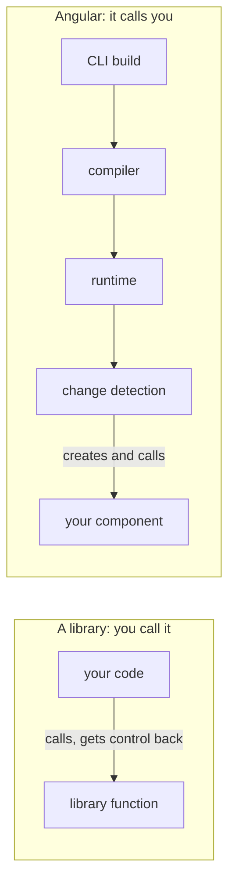
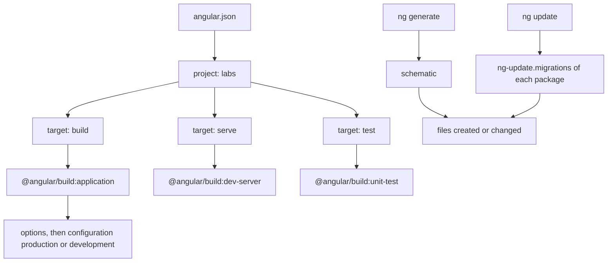
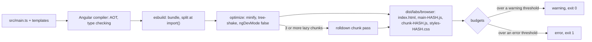
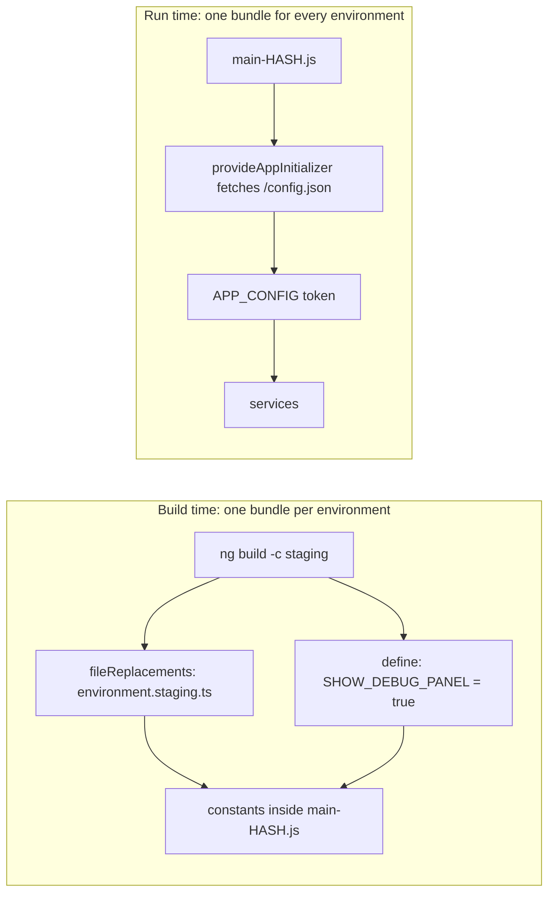
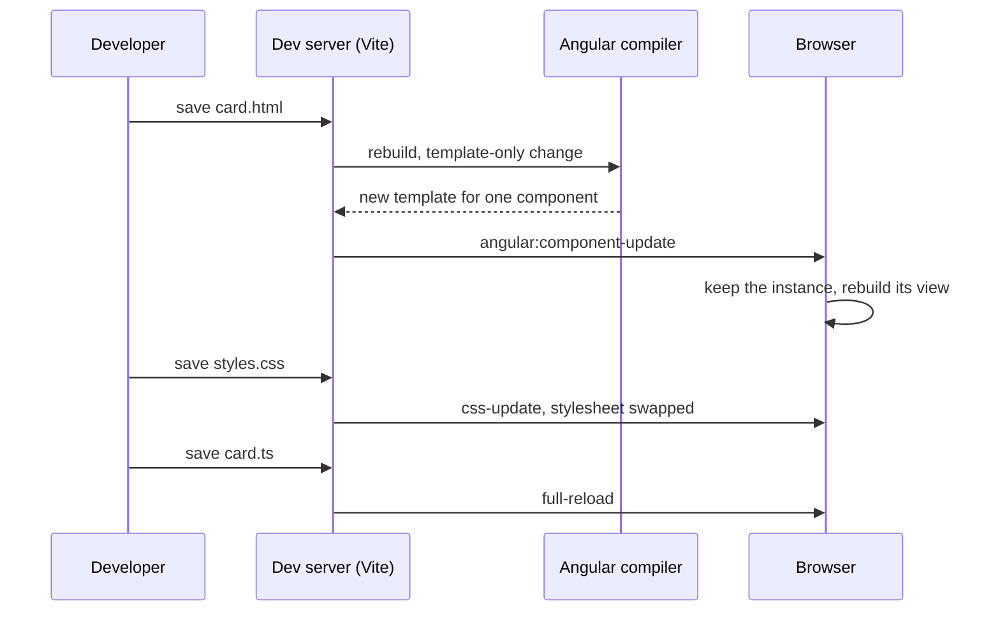
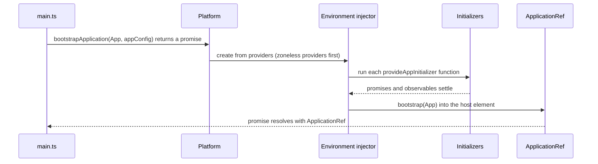
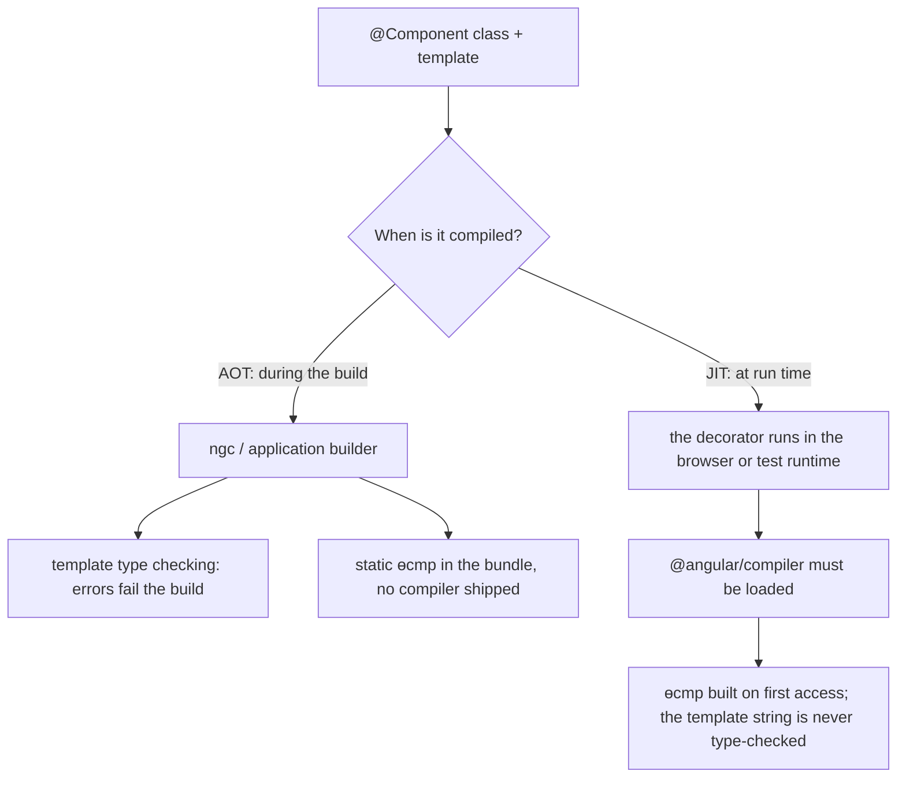
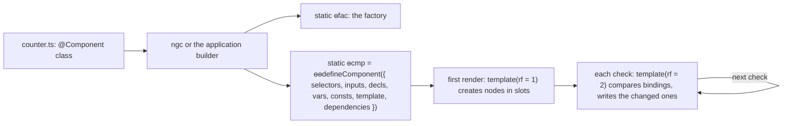

# 12. How Angular works: compiler, runtime, CLI and build

> **What this covers:** what a framework does that a library does not, and how Angular turns your project into a running application: the CLI workspace and `angular.json`, the application builder (esbuild, with Vite as the dev server), output and budgets, build-time versus runtime configuration, hot module replacement and Angular DevTools, what `bootstrapApplication` does at startup, ahead-of-time (AOT) versus just-in-time (JIT) compilation and template type checking, and what the compiler emits (`ɵcmp`, template instructions, locality, partial compilation). By the end you can explain each step from `ng build` to the first rendered component and read compiled Angular output.
> **Prerequisites:** [05. ES modules](05-js-modules-memory-modern-features.md#1-es-modules-static-structure-linking-and-live-bindings) and [dynamic `import()`](05-js-modules-memory-modern-features.md#2-commonjs-interop-and-dynamic-import) (what a bundle is made of), [07. Decorators and what Angular does with them](07-ts-advanced-types-and-decorators.md#7-decorators-tc39-standard-versus-experimentaldecorators-and-what-angular-does-with-them)
> **Leads to:** [13. Components and templates](13-components-and-templates.md), [15. Standalone and NgModules](15-standalone-and-ngmodules.md), [16. Dependency injection](16-dependency-injection.md), [21. Change detection](21-change-detection.md), [31. Performance](31-performance.md), [38. Architecture](38-architecture-and-production-structure.md), [39. Version history and migrations](39-version-history-and-migrations.md), [44. Delivery and operations](44-fullstack-delivery-and-operations.md)
> **Applies to:** Angular 22.2 (`@angular/core`, `@angular/compiler-cli`, `@angular/build`, `@angular/cli` 22.2.1), TypeScript 6.0, Node 24
> **Study time:** ~5 hours reading + ~5 hours exercises
> **Short on time:** read [3. Building](#3-building-the-application-builder-output-layout-and-budgets), [6. Bootstrapping](#6-bootstrapping-bootstrapapplication-the-platform-and-initializers) and [8. Under the hood](#8-under-the-hood-what-the-compiler-emits-and-what-the-runtime-does-with-it), then drill [Q12.06](#q12-06), [Q12.10](#q12-10), [Q12.14](#q12-14), [Q12.19](#q12-19), [Q12.23](#q12-23) and [Q12.26](#q12-26), try [Exercise 12.2](#ex12-2), and finish with the [Summary](#summary).
> **Labs:** [`labs/angular/src/app/modules/12-angular-how-it-works/`](../labs/angular/src/app/modules/12-angular-how-it-works/) (section specs, Exercises 12.1-12.2, *Output* questions) and [`labs/ts-js/src/modules/12-angular-how-it-works/`](../labs/ts-js/src/modules/12-angular-how-it-works/) (workspace test, Exercises 12.3-12.4). Run (Node 24): from `labs/angular`, `npx ng test --watch=false --include='src/app/modules/12-angular-how-it-works/**/*.spec.ts'`; from `labs/ts-js`, `npx vitest run src/modules/12-angular-how-it-works`

## Contents

1. [What a framework does, and Angular's philosophy](#1-what-a-framework-does-and-angulars-philosophy)
2. [The CLI and the workspace: `angular.json`, projects, schematics and `ng update`](#2-the-cli-and-the-workspace-angularjson-projects-schematics-and-ng-update)
3. [Building: the application builder, output layout and budgets](#3-building-the-application-builder-output-layout-and-budgets)
4. [Environments and configuration: build time versus run time](#4-environments-and-configuration-build-time-versus-run-time)
5. [The dev loop: `ng serve`, hot module replacement and Angular DevTools](#5-the-dev-loop-ng-serve-hot-module-replacement-and-angular-devtools)
6. [Bootstrapping: `bootstrapApplication`, the platform and initializers](#6-bootstrapping-bootstrapapplication-the-platform-and-initializers)
7. [AOT versus JIT, and template type checking](#7-aot-versus-jit-and-template-type-checking)
8. [Under the hood: what the compiler emits and what the runtime does with it](#8-under-the-hood-what-the-compiler-emits-and-what-the-runtime-does-with-it)
- [Summary](#summary)
- [Question bank](#question-bank)
- [Hands-on exercises](#hands-on-exercises)
- [Check your understanding](#check-your-understanding)
- [Connections](#connections)

**How the claims here are verified.** Runtime behavior is asserted by Angular specs under `ng test` (Vitest with jsdom; an ahead-of-time (AOT) test build that also loads `@angular/compiler`, so just-in-time (JIT) compilation works too); workspace facts and two models by `labs/ts-js` tests. Each such sentence names its test. Compiler output and template diagnostics are quoted, dated, from `ngc` 22.2.1 runs on a throwaway project. Output layout comes from the lab's `ng build`; budget failures, `define` and `fileReplacements` from a throwaway workspace copy, deleted afterwards. Hot module replacement (HMR) in a browser, Angular DevTools, `ng update` on an old project and the webpack builder are documented from cited sources, never observed.

## 1. What a framework does, and Angular's philosophy

### The problem it solves

A team building on a view library also picks a router, forms, an HTTP client, a test runner and a bundler. Then the router's next major needs a newer view library, the forms library lags, and the upgrade stalls for a quarter. A second team picked another stack, so neither code nor people move between them.

### Mental model

A **library** is code you call: you decide when, and it returns control. A **framework** calls your code: it owns the entry point, creates your objects and decides when your methods run. That reversal is **inversion of control**, "a key part of what makes a framework different to a library" ([Fowler, 2005](https://martinfowler.com/bliki/InversionOfControl.html)). Think of a fitted kitchen versus appliances bought one by one.



What to notice: in the Angular lane your code is the last box; the framework owns the entry point and the update loop (change detection, the pass that refreshes views, is [module 21](21-change-detection.md#1-the-synchronization-problem-dirty-checking-and-fine-grained-reactivity)).

### How it actually works

Angular is **batteries included** (what most applications need ships with it) and **opinionated** (one way to do each thing). This module explains the **CLI** (command-line interface: the `ng` command), the **compiler** (templates and decorators to JavaScript at build time) and the **runtime** (the `@angular/core` code that creates components and updates the DOM). The router, forms, `@angular/common/http`, `@angular/localize` and server rendering ship beside them.

They are **released together**: the `ng-update.packageGroup` field of `@angular/core` 22.2.1's `package.json` lists 16 framework packages, and `@angular/cli`'s lists the CLI, `@angular/build`, `@angular/ssr` and the devkit packages. Updating one member makes `ng update` add every installed member at the same version (`@angular/cli` 22.2.1, `src/commands/update/update-resolver.js`, `_addPackageGroup`), and `@angular/router` 22.2.1 requires `@angular/core` at exactly `22.2.1` as a peer dependency (a package the consumer installs, shared rather than bundled).

In return, the [release policy](https://angular.dev/reference/releases) (read 2026-10-07) promises a major every 12 months with 4-6 minors, support "typically" for 24 months (12 active, then 12 of security and critical fixes), and deprecated APIs kept "in at least the next major release (period of at least 12 months)". **Developer preview** and **experimental** APIs sit outside that policy and "can change at any time, even in new patch versions".

Opinions cost a steeper start and buy shared conventions and automated upgrades ([section 2](#2-the-cli-and-the-workspace-angularjson-projects-schematics-and-ng-update)). Drilled in [Q12.01](#q12-01) and [Q12.02](#q12-02).

### Code

In the lab's root component, notice what your code never does: nothing calls `new App()` or its template, and `src/main.ts` hands the **class** to `bootstrapApplication` ([section 6](#6-bootstrapping-bootstrapapplication-the-platform-and-initializers)).

```ts
import { Component } from '@angular/core';
import { RouterOutlet } from '@angular/router';

@Component({
  selector: 'lab-root',
  imports: [RouterOutlet],
  templateUrl: './app.html',
})
export class App {}
```
<sub>Source: [labs/angular/src/app/app.ts](../labs/angular/src/app/app.ts)</sub>

The decorator only describes the class; [section 8](#8-under-the-hood-what-the-compiler-emits-and-what-the-runtime-does-with-it) shows what the compiler makes of it.

### Best practices and anti-patterns

- **Do update the framework packages together with `ng update`**, because they are one release group and the router pins the exact `@angular/core` version.
- **Do try the first-party piece first** (router, forms, `HttpClient`), because it is released, tested and migrated with the framework.
- **Avoid developer-preview and experimental APIs in code you cannot revisit soon**, because a patch release may change them.

### Misconceptions and traps

- *"Angular is a library like React."* Angular owns the entry point, build and update loop; you never instantiate a component. The myth exists because both render component trees whose code looks alike ([module 40](40-framework-comparisons.md#1-library-framework-progressive-framework-what-each-project-decides-for-you)).
- *"Opinionated means you cannot opt out."* Builder and test runner are options in `angular.json`, and third-party state or UI libraries work. The myth exists because older code declared every component in an NgModule; standalone components reduce "the need for NgModules" ([angular.dev](https://angular.dev/reference/migrations/standalone)) and are the default ([module 15](15-standalone-and-ngmodules.md#2-standalone-components-and-the-imports-array)).
- *"A new major ships every six months."* Once true: "Until Angular v22, Angular had a 6-month major release cycle" (release policy). Now: 12 months, 4-6 minors. The myth survives because most upgrade advice predates v22.

## 2. The CLI and the workspace: `angular.json`, projects, schematics and `ng update`

### The problem it solves

Without a shared tool, every project grows its own build script and "it builds on my machine" tickets. A new component means copying three files and wiring them by hand. A major upgrade means editing hundreds of files from a changelog, so teams postpone it until they are unsupported.

### Mental model

A **workspace** (the folder whose `angular.json` the CLI reads) is a **map of projects to targets**. A **project** is one application or library. A **target** is a named job (`build`, `serve`, `test`) that names a **builder**, the function that does the work, plus its options and named **configurations** that override them. Beside that map sit **schematics**: code generators and code rewriters. `ng generate` runs one; `ng update` runs a package's **migrations**, schematics that rewrite your code for a new version.



What to notice: every `ng` command that builds or tests is "run this target's builder with these options"; the commands that change your source are schematics.

### How it actually works

The workspace schema (`@angular/cli` 22.2.1, `lib/config/schema.json`) requires only `version`, beside `cli`, `schematics`, `newProjectRoot` and `projects`. A project requires `root` and `projectType` (`application` or `library`) and may set `sourceRoot`, `prefix` (prepended to generated selectors) and `architect` (or its alias `targets`). A library project uses the `ng-packagr` builder ([module 38](38-architecture-and-production-structure.md#5-angular-cli-libraries-ng-generate-library-ng-packagr-and-consuming-the-build)).

A target has `builder`, `options`, `configurations` ("A map of alternative target options") and `defaultConfiguration`. `ng build` runs the target named after the command (`architect-base-command-module.js`, `getArchitectTarget`), and `ng run labs:build:development` names project, target and configuration explicitly. The builder string `@angular/build:application` means "package `@angular/build`, builder `application`": Architect, the CLI's task runner, follows the package's `builders` field to `builders.json`, which names an implementation and an option schema (`@angular-devkit/architect` 0.2202.1, `node/node-modules-architect-host.js`). Options are resolved as `{ ...options, ...config1, ...config2 }` for the configuration you pass with `-c` (comma-separated, left to right) or else `defaultConfiguration`. That spread is **shallow**: a configuration's `budgets` array replaces the base one.

A schematic is "a template-based code generator that supports complex logic" packaged into **collections** ([angular.dev](https://angular.dev/tools/cli/schematics)). It edits a virtual tree (`create`, `overwrite`, `delete`, `rename` in the `@angular-devkit/schematics` typings), so `--dry-run` "reports activity without writing out results". `ng generate` uses `@schematics/angular` (component, service, `environments` ([section 4](#4-environments-and-configuration-build-time-versus-run-time)), `library` and more). The component schematic's `type` option has no default, which is why v22 files are `app.ts`, not `app.component.ts` (`ng new`'s `fileNameStyleGuide` `"2016"` restores the suffix) ([module 13](13-components-and-templates.md)).

`ng update` reads each package's **`ng-update` field** in `package.json`: `packageGroup` ([section 1](#1-what-a-framework-does-and-angulars-philosophy)) and `migrations`, a collection whose entries carry a version. It runs every migration whose version is greater than the installed one and at most the target, required ones first, then a prompt for optional ones (`recommended` pre-selected) (`src/commands/update/utilities/migration.js`, `executeMigrations`). In 22.2.1, `@angular/core`'s 22.0.0 migrations include `strict-templates-default` ("Adds 'strictTemplates: false' in tsconfig.json when not set.") and `change-detection-eager` ("Adds `ChangeDetectionStrategy.Eager` to all components.") [Changed in v22: components default to OnPush; `ChangeDetectionStrategy.Eager` opts out], which keep old defaults in upgraded projects. `ng update` refuses to cross several majors at once; the practice is [module 39](39-version-history-and-migrations.md#8-skipping-versions-safely-one-major-per-hop-node-and-typescript-ranges-and-libraries-that-block-a-hop). Drilled in [Q12.03](#q12-03), [Q12.04](#q12-04) and [Q12.05](#q12-05).

### Code

Read the lab's workspace top-down: one project, its `build` target, the builder, base options, two configurations. The three `Section 2: …` tests in [`section-2-workspace.test.ts`](../labs/ts-js/src/modules/12-angular-how-it-works/section-2-workspace.test.ts) assert these values from the file.

```jsonc
// From labs/angular/angular.json (assets and styles lines omitted)
  "projects": {
    "labs": {
      "projectType": "application",
      "schematics": {},
      "root": "",
      "sourceRoot": "src",
      "prefix": "lab",
      "architect": {
        "build": {
          "builder": "@angular/build:application",
          "options": {
            "browser": "src/main.ts",
            "tsConfig": "tsconfig.app.json",
          },
          "configurations": {
            "production": {
              "budgets": [
                {
                  "type": "initial",
                  "maximumWarning": "500kB",
                  "maximumError": "1MB"
                },
                {
                  "type": "anyComponentStyle",
                  "maximumWarning": "4kB",
                  "maximumError": "8kB"
                }
              ],
              "outputHashing": "all"
            },
            "development": {
              "optimization": false,
              "extractLicenses": false,
              "sourceMap": true
            }
          },
          "defaultConfiguration": "production"
        },
```

So `ng build` is a production build; `ng serve` defaults to `labs:build:development`.

> [!TIP]
> **Coming from the backend.** A workspace resembles a Maven multi-module build whose plugin goals are "bound to" lifecycle phases ([Maven](https://maven.apache.org/guides/introduction/introduction-to-the-lifecycle.html)), as builders are to targets. `-c production,staging` reads like `-P` with "a comma-delimited list of profile IDs" ([profiles](https://maven.apache.org/guides/introduction/introduction-to-profiles.html)), and migrations resemble OpenRewrite recipes, refactorings that can accomplish "a framework migration" ([OpenRewrite](https://docs.openrewrite.org/concepts-and-explanations/recipes)). **Where the analogy breaks:** a target runs one builder function, not a chain of phases, and a migration runs once, during `ng update`, not on every build.

### Best practices and anti-patterns

- **Do put environment differences in named configurations**, because `-c` selects them without editing base options.
- **Do repeat the whole array or object in a configuration** that changes `budgets` or `fileReplacements`, because the merge is shallow and replaces it.
- **Avoid hand-bumping Angular versions in `package.json`**, because the migrations only run through `ng update`.

### Misconceptions and traps

- *"`angular.json` is the build config, like `webpack.config.js`."* It selects a builder and passes it options; the pipeline lives in the builder ([section 3](#3-building-the-application-builder-output-layout-and-budgets)). The myth exists because webpack-era projects configured a bundler directly.
- *"`ng update` just bumps versions in `package.json`."* It also updates the package group and runs migrations. The myth exists because `npm update` only changes versions.
- *"Configurations deep-merge."* They are spread one level deep. The myth exists because the docs say "the last-set value" wins ([workspace config](https://angular.dev/reference/configs/workspace-config)), which reads like a deep merge.

## 3. Building: the application builder, output layout and budgets

### The problem it solves

A production bundle quietly doubles after someone imports a date library. A continuous integration (CI) build takes minutes. An old project is stuck on the webpack builder while server-side rendering (SSR) and faster builds need the new one. The build has to be fast and able to refuse an output that grew too big.

### Mental model

`ng build` is a factory line: **compile, bundle, optimize, write, weigh**. The Angular compiler turns templates and TypeScript into JavaScript, **esbuild** (a bundler) joins the modules into a few files, optimization shrinks them, and **budgets**, a contract on output size, are the freight scale at the gate.



What to notice: type checking and budgets can each fail the build, and esbuild never sees a template, only the compiler's JavaScript.

### How it actually works

**The pipeline.** The `application` builder of `@angular/build` 22.2.1 runs the Angular compiler as an esbuild plugin whose `onLoad` hook returns compiled JavaScript (`src/tools/esbuild/angular/compiler-plugin.js`). esbuild 0.28.2 (installed) writes ES modules with `splitting: true` (`application-code-bundle.js`): each dynamic `import()` starts a **chunk**, a separately loaded file (**code splitting**), so the build decides the chunks ([Q09.08](09-web-networking-storage-security.md#q09-08)). npm libraries ship partially compiled, and the build's **linker** finishes them (OXC, a set of JavaScript tools written in Rust, by default, `javascript-transformer-worker.js`; [section 8](#8-under-the-hood-what-the-compiler-emits-and-what-the-runtime-does-with-it)). **Vite** (8.3.0, pinned by `@angular/build`) is "currently within a development server capacity only" ([migration page](https://angular.dev/tools/cli/build-system-migration)): it runs `ng serve` ([section 5](#5-the-dev-loop-ng-serve-hot-module-replacement-and-angular-devtools)). With script optimization on and at least three lazy chunks (default threshold, variable `NG_BUILD_OPTIMIZE_CHUNKS`), a second pass "uses rolldown to bundle and optimize the JavaScript chunks" (`chunk-optimizer.js`); **rolldown** 1.2.8 is another bundler, and the pass is an implementation detail.

**Defaults** (`application/schema.json`): `aot` and `optimization` true, `sourceMap` false, `outputHashing` `none`. **Minification** rewrites code into fewer characters; **tree shaking** drops unused exports ([Q05.07](05-js-modules-memory-modern-features.md#q05-07)). **Output hashing** puts a content hash in each file name, so only a changed file gets a new URL ([Q09.11](09-web-networking-storage-security.md#q09-11)); the lab's production configuration sets `all`. The builder defines `ngDevMode` as `false` "only … when script optimizations are enabled" (`application-code-bundle.js`); Angular guards development-only code with it, so the minifier deletes that code, including `setClassMetadata`, which keeps decorator arguments for tools. `statsJson: true` writes a file for esbuild's analyzer ([module 31](31-performance.md#6-bundle-analysis-budgets-and-tree-shaking-pitfalls)). **Output layout:** `outputPath` takes a `base` plus the folder names `browser`, `server` and `media` (their defaults), and `outputMode` `server` adds a server build ([module 32](32-ssr-ssg-hydration.md#2-adding-angularssr-what-ng-add-generates-the-build-output-and-the-server-entry)).

**Budgets.** A **budget** limits part of the output. Its `type` is `initial` (what bootstrap needs, the "Initial total" line), `bundle` (chunks whose names include `name`), `all`, `allScript`, `any`, `anyScript` or `anyComponentStyle` (each component stylesheet). Thresholds are `maximumWarning`, `maximumError`, `minimumWarning`, `minimumError`, or `warning` and `error` for both directions. The calculator (`src/utils/bundle-calculator.js`) sums raw bytes, counts a `kB` as 1,000 bytes, and reads a percentage relative to **`baseline`**: `baseline: "300kB"` with `warning: "10%"` warns below 270,000 or above 330,000 bytes. An error fails the build; a warning does not (`execute-build.js`). The "Estimated transfer size" column is a Brotli (a compression format) estimate (`src/tools/esbuild/utils.js`), never compared. `ng new` writes `initial` 500kB/1MB and `anyComponentStyle` 4kB/8kB, or 2MB/5MB and 6kB/10kB with `strict: false` (`@schematics/angular` 22.2.1, `application/index.js`); the [build page](https://angular.dev/tools/cli/build) instead says component styles default "to warning at 2kb and erroring at 4kb". [Exercise 12.3](#ex12-3) models the calculator. Drilled in [Q12.06](#q12-06), [Q12.07](#q12-07), [Q12.08](#q12-08) and [Q12.09](#q12-09).

### Code

Observed in the lab's production build on 2026-10-07 in `labs/angular`: the size table is `npx ng build`'s output, the file list is `dist/labs` afterwards, and the last line is the root component's definition cut from `main-626TZXGR.js` after its first instructions (the file writes `ɵ` as `\u0275`):

```text
Initial chunk files | Names         |  Raw size | Estimated transfer size
main-626TZXGR.js    | main          | 189.56 kB |                51.80 kB
styles-5INURTSO.css | styles        |   0 bytes |                 0 bytes

                    | Initial total | 189.56 kB |                51.80 kB

dist/labs/3rdpartylicenses.txt
dist/labs/browser/favicon.ico
dist/labs/browser/index.html
dist/labs/browser/main-626TZXGR.js
dist/labs/browser/styles-5INURTSO.css

static ɵcmp=pr({type:e,selectors:[["lab-root"]],decls:9,vars:0,template:function(n,r){n&1&&(rt(0,"main")(1,"h1"),vn(2,"Angular interview labs"),ot(),
```

Instructions shrink to `rt`, `vn`, `ot`, and a template without bindings has no update block. The same day, a throwaway copy of the workspace (scratchpad, deleted) gained one lazy route: production then emitted an initial shared `chunk-AJJUT6FA.js` (102.87 kB, `<link rel="modulepreload">`), an 88.43 kB `main` and a 287-byte chunk named `lazy`. Its development build wrote an unhashed 432.24 kB `main.js` with `.map` files, still holding:

```text
(typeof ngDevMode === "undefined" || ngDevMode) && setClassMetadata(App, [{
```

Before the lazy route was added, the copy with `initial` `maximumError: "150kB"` printed the first line below (exit 1); after it, a build with the two budgets below printed the other two:

```text
✘ [ERROR] bundle initial exceeded maximum budget. Budget 150.00 kB was not met by 39.56 kB with a total of 189.56 kB.
▲ [WARNING] total scripts failed to meet minimum budget. Budget 270.00 kB was not met by 78.41 kB with a total of 191.59 kB.
✘ [ERROR] lazy exceeded maximum budget. Budget 200 bytes was not met by 87 bytes with a total of 287 bytes.
```

```jsonc
// Illustrative, not run (the two entries added to the throwaway copy)
{ "type": "bundle", "name": "lazy", "maximumError": "200b" },
{ "type": "allScript", "baseline": "300kB", "warning": "10%" }
```

#### Legacy

Projects created before CLI 17 use the webpack `browser` builder of `@angular-devkit/build-angular` [Deprecated since CLI 22.0 — use @angular/build:application] ([CLI CHANGELOG](https://github.com/angular/angular-cli/blob/main/CHANGELOG.md) 22.0.0). Its 22.2.1 source (`src/builders/browser/index.js`, read from the npm tarball, not run) warns `The "@angular-devkit/build-angular:browser" builder is deprecated as part of Angular's Webpack support deprecation.` The automated path is `ng update @angular/cli --name use-application-builder`, a 22.0.0 migration marked optional and recommended; the manual edits follow the [migration page](https://angular.dev/tools/cli/build-system-migration):

```jsonc
// Illustrative, not run: before
"builder": "@angular-devkit/build-angular:browser",
"options": { "main": "src/main.ts", "polyfills": "src/polyfills.ts", "buildOptimizer": true, "vendorChunk": true }

// after
"builder": "@angular/build:application",
"options": { "browser": "src/main.ts", "polyfills": ["src/polyfills.ts"] }
```

`buildOptimizer`, `vendorChunk`, `commonChunk` and `resourcesOutputPath` go. Output moves from `dist/<project-name>` to `dist/<project-name>/browser`, so deployment scripts change too.

> [!NOTE]
> **Framework vs platform.** The browser loads ES modules and `import()` natively ([05 §1](05-js-modules-memory-modern-features.md#1-es-modules-static-structure-linking-and-live-bindings)). Angular's builder adds template compilation, bundling into few requests, minification, hashed names and budgets. Caching hashed files is HTTP's job ([09 §4](09-web-networking-storage-security.md#4-http-caching)).

### Best practices and anti-patterns

- **Do keep an `initial` budget with `maximumError` in CI**, because it fails the build when a dependency quietly grows the startup download.
- **Do add a `bundle` budget for each heavy lazy chunk**, because `initial` ignores lazy chunks.
- **Avoid deploying a development build**, because it keeps `ngDevMode` code, `setClassMetadata` and source maps (432 kB of `main.js` against 88 kB above).

### Misconceptions and traps

- *"Budgets measure gzipped size."* They compare raw bytes. The myth exists because transfer size is what users feel, and the table prints an estimate beside the raw size.
- *"Angular builds production with Vite."* esbuild bundles it; Vite serves `ng serve`. The myth exists because the migration page names "esbuild and Vite" together.
- *"The CLI uses webpack."* Once true: `ng new` generated the webpack builder until CLI 17.0.0 ("update `ng new` to use the esbuild application builder based builder", CLI CHANGELOG), and since 22.0.0 those builders are deprecated. The myth exists because older projects and tutorials still show `@angular-devkit/build-angular:browser`.

## 4. Environments and configuration: build time versus run time

### The problem it solves

The staging app calls the production API because someone built the wrong configuration. One Docker image cannot be promoted from staging to production, because the API URL is compiled into it. An API key in `environment.ts` is readable by anyone who opens developer tools.

### Mental model

**Build-time configuration is baked into the bundle; runtime configuration is fetched when the app starts.** A build configuration ([section 2](#2-the-cli-and-the-workspace-angularjson-projects-schematics-and-ng-update)) selects options, a **file replacement** swaps one source file for another, and **`define`** replaces a global identifier with a constant. Build time is a printed price tag; run time is the price the till looks up.



What to notice: only the run-time lane lets one artifact move from staging to production unchanged.

### How it actually works

In a throwaway workspace copy (2026-10-07, deleted), `ng generate environments` created `src/environments/environment.ts` and `environment.development.ts`, each `export const environment = {};`, and added one `fileReplacements` entry to the `development` configuration. An **environment file** is that plain TypeScript module. Code always imports `environment.ts`; a configuration's `fileReplacements` entry (`replace` and `with`; script or JSON files, per the schema) makes the compiler load the other file instead. `-c production,staging` applies configurations "in order, with conflicting options using the value from the last configuration" ([environments page](https://angular.dev/tools/cli/environments)); in the copy it emitted the staging values.

`define` maps an identifier to source text: "The value will be used directly. String values must be put in quotes" (`application/schema.json`), so a string is `"'staging-42'"`, and TypeScript needs a `declare const`. It also warns: "Identifiers within Angular metadata such as Component Decorators will not be replaced." In the copy, `host: { 'data-build': BUILD_LABEL }` failed the build: `NG1010: Decorator host metadata must be a string -> string object, but found unparseable value`: the compiler could not evaluate that reference while reading metadata at build time ([section 7](#7-aot-versus-jit-and-template-type-checking)).

Constants enable **dead-code elimination**, the minifier deleting code that can never run. With `SHOW_DEBUG_PANEL` defined as `false`, its `if` block is gone from the production output below, but `if (environment.debug)` survives as `<name>.debug&&…` (the minifier picks the name). `isDevMode()` is `typeof ngDevMode === 'undefined' || !!ngDevMode` (`@angular/core` 22.2.1): `false` in optimized builds ([section 3](#3-building-the-application-builder-output-layout-and-budgets)).

None of this is secret: "Files in `src/environments/` are bundled into your client-side application and visible to anyone who loads the page. Never store secrets such as API keys here" (environments page).

**Runtime configuration** is data the app reads after it starts: a `provideAppInitializer` function fetches a JSON file during bootstrap ([section 6](#6-bootstrapping-bootstrapapplication-the-platform-and-initializers)) and exposes it through an **injection token**, a typed key for the injector ([module 16](16-dependency-injection.md)). [Exercise 12.2](#ex12-2) builds that loader; how a deployment writes the file per environment is [module 44](44-fullstack-delivery-and-operations.md#5-runtime-configuration-without-rebuilding-configjson-environment-substitution-at-container-start-and-provideappinitializer). Drilled in [Q12.10](#q12-10) and [Q12.11](#q12-11).

### Code

The copy's configuration and root component:

```jsonc
// Illustrative, not run in the lab (the throwaway copy's angular.json, build target)
"options": { "define": { "BUILD_LABEL": "'prod-1'", "SHOW_DEBUG_PANEL": "false" } },
"configurations": {
  "staging": {
    "fileReplacements": [
      { "replace": "src/environments/environment.ts", "with": "src/environments/environment.staging.ts" }
    ],
    "define": { "BUILD_LABEL": "'staging-42'", "SHOW_DEBUG_PANEL": "true" }
  }
}
```

```ts
// Partial: the throwaway copy's src/app/app.ts; imports of Component, RouterOutlet and environment omitted
declare const BUILD_LABEL: string;
declare const SHOW_DEBUG_PANEL: boolean;

@Component({ selector: 'lab-root', imports: [RouterOutlet], templateUrl: './app.html' })
export class App {
  readonly apiUrl = environment.apiUrl;
  readonly label = BUILD_LABEL;

  constructor() {
    if (SHOW_DEBUG_PANEL) {
      console.log('DEBUG-PANEL-MARKER');
    }
    if (environment.debug) {
      console.log('ENV-DEBUG-MARKER');
    }
  }
}
```

Observed in the copy's `main-*.js` (2026-10-07; production, then `-c production,staging`; cut after the constructor):

```text
var Ac={apiUrl:"https://api.example.com",debug:!1};var Fi=class e{apiUrl=Ac.apiUrl;label="prod-1";constructor(){Ac.debug&&console.log("ENV-DEBUG-MARKER")}
var Ac={apiUrl:"https://staging-api.example.com",debug:!0};var Fi=class e{apiUrl=Ac.apiUrl;label="staging-42";constructor(){console.log("DEBUG-PANEL-MARKER"),Ac.debug&&console.log("ENV-DEBUG-MARKER")}
```

> [!TIP]
> **Coming from the backend.** Spring Boot loads `application-{profile}` files for the profiles named in `spring.profiles.active` ([profiles](https://docs.spring.io/spring-boot/reference/features/profiles.html), [external config](https://docs.spring.io/spring-boot/reference/features/external-config.html)), as `-c` selects configurations. **Where the analogy breaks:** Spring resolves profiles when the jar starts, so one jar serves every environment; an Angular configuration is resolved when the bundle is built, and the browser has no startup environment unless the app fetches one.

### Best practices and anti-patterns

- **Do keep environment files to public, build-specific constants** (feature flags, a build label), because everything in them ships to every visitor.
- **Do fetch values that differ per deployment at startup**, because one image then serves every environment.
- **Avoid `define` identifiers in decorator metadata**, because the compiler cannot evaluate them and the build fails.

### Misconceptions and traps

- *"Environment files are read at run time, like `.env`."* They are compiled into the bundle. The myth exists because of the name, and because server processes read their environment at startup.
- *"Values in the production `environment.ts` are private."* Anyone can read them in the bundle. The myth exists because the file sits in `src/` like server configuration, and minified output looks unreadable.

## 5. The dev loop: `ng serve`, hot module replacement and Angular DevTools

### The problem it solves

Every CSS tweak reloads the page and throws away the half-filled form. A template change waits for a full rebuild. And nobody can see which component holds which state without sprinkling `console.log`.

### Mental model

`ng serve` starts a **dev server**: it rebuilds in memory on save and pushes **only the changed piece** to the open page. A stylesheet or a component's template is swapped in place; anything else falls back to **live reload**, a full page reload. Changing a tyre on a moving car versus parking it. Angular DevTools reads the app through development-only hooks.



What to notice: templates and stylesheets are replaced in place; a change to class code reloads the page.

### How it actually works

**Hot module replacement (HMR)** avoids "reloading the entire page when only part of an application is changed" ([migration page](https://angular.dev/tools/cli/build-system-migration)). Angular replaces global stylesheets, component stylesheets and component templates; "general JavaScript-based hot module replacement (HMR) is currently not supported". The rules, read in `@angular/build` 22.2.1:

- `hmr` "Defaults to the value of 'liveReload'" (true); `ng serve --no-hmr` turns it off. Component updates need AOT as well, and `outputHashing` `all` or `bundles` switches HMR off with a warning (`dev-server/vite/index.js`).
- "Template updates only exist if no other JS changes have occurred" (`build-action.js`); otherwise the page reloads. A CSS-only change becomes a `css-update`, except for shadow-DOM component styles (`hmr.js`).
- At run time, `ɵɵreplaceMetadata` keeps each instance, destroys its view and renders a new one against it (`@angular/core` 22.2.1, `recreateLView`): fields survive, child components inside the view are recreated, and an error falls back to a full reload.

Component stylesheet replacement became the default in CLI 19.0.0 and template replacement in 19.1.0 (CLI CHANGELOG). In 22.2.1 link-based style updates need `NG_HMR_CSTYLES=1`; by default component styles are replaced with the template update (`dev-server/vite/index.js`, read). **Prebundling**, Vite processing third-party dependencies once at the first `ng serve`, is on by default.

**Angular DevTools** is a Chrome and Firefox extension with Components, Profiler, Injector Tree and Router Tree tabs ([DevTools](https://angular.dev/tools/devtools)). On an optimized build it says "Angular DevTools only supports development builds." It relies on the **`ng` global utilities** (`getComponent`, `applyChanges` and more), which Angular publishes on `window.ng` only in **development mode** (`isDevMode()` true): `publishDefaultGlobalUtils`, called from `createOrReusePlatformInjector` and `createPlatform`, runs only when `ngDevMode` is truthy. Profiling is [module 21](21-change-detection.md#8-debugging-the-profiler-providechecknochangesconfig-and-stability) and [module 31](31-performance.md#1-measure-first-the-loop-lab-versus-field-and-what-each-tool-answers). Drilled in [Q12.12](#q12-12) and [Q12.13](#q12-13).

### Code

The two `Section 5: …` tests call that global on a TestBed-created component (`isDevMode()` is `true` in the test build):

```ts
// Excerpt of labs/angular/src/app/modules/12-angular-how-it-works/concepts/section-5-devtools.spec.ts
    expect(ng?.getComponent<CounterBadge>(host)).toBe(fixture.componentInstance);
    fixture.componentInstance.count.set(5);
    ng?.applyChanges(fixture.componentInstance);
    expect(span?.textContent).toBe('5');
```

> [!NOTE]
> **Framework vs platform.** The HMR channel and stylesheet swaps are Vite's; replacing a template in live instances is Angular's runtime. DevTools is an extension reading Angular's debug hooks, not the browser's own developer tools.

### Best practices and anti-patterns

- **Do keep `outputHashing` out of the configuration `ng serve` uses**, because hashing disables HMR.
- **Avoid debugging a production build with DevTools**, because its hooks are compiled out; build with `optimization: false` instead.

### Misconceptions and traps

- *"HMR keeps all state."* The edited component's instance survives, but its view and child components are rebuilt, and a class change reloads the page. The myth exists because "hot" suggests nothing restarts.
- *"DevTools works on production."* It needs a development build. The myth exists because the extension still detects the app and shows its tab.

## 6. Bootstrapping: `bootstrapApplication`, the platform and initializers

### The problem it solves

A feature-flag service is read before its configuration arrives, so the first screen shows the wrong features. An initializer that never settles leaves a blank page with no error. And when an interviewer asks where "the root injector" comes from, nobody on the team can say.

### Mental model

**Bootstrap** is a startup sequence: reuse or create the **platform** (the page-wide Angular layer), create the application's **environment injector** from `ApplicationConfig.providers`, run the **initializers** and wait for them, then create the root component inside its **host element** (the `<lab-root>` tag in `index.html`) and render it. It is an aircraft's pre-flight checklist: the cabin opens only after every item is ticked.



What to notice: nothing renders until every initializer has settled, and a rejection rejects the whole promise.

### How it actually works

`bootstrapApplication(rootComponent, options?, context?)` returns `Promise<ApplicationRef>` (`@angular/platform-browser` 22.2.1 typings); `ApplicationConfig` is just `{ providers }`. In the source (`@angular/core` 22.2.1, `internalCreateApplication`), it:

1. reuses or creates the **platform injector** (`createOrReusePlatformInjector`), one per page and shared by every app on it;
2. creates an environment injector whose parent is the platform injector, with `provideZonelessChangeDetectionInternal()`, an error-handler initializer and then your providers, so no zone is installed unless you ask for one ([module 21](21-change-detection.md#3-zonejs-and-ngzone-how-changes-used-to-be-detected-and-why-zone-left-the-default));
3. runs each initializer through `ApplicationInitStatus.runInitializers` "in the injection context" (where `inject()` works; [module 16](16-dependency-injection.md)), collecting returned promises and observables;
4. after `donePromise` resolves, calls `ApplicationRef.bootstrap(rootComponent)`. **`ApplicationRef`** is the handle to the running application: its root components, its injector, `destroy()`.

This environment injector is what "the root injector" means (step 2), and resolution is [module 16](16-dependency-injection.md). `provideAppInitializer` (added in v19.0.0, [Angular CHANGELOG](https://github.com/angular/angular/blob/main/CHANGELOG.md): "add syntactic sugar for initializers") registers a function returning `Observable | Promise | void`. Its siblings are `provideEnvironmentInitializer` (runs when the injector is created) and `providePlatformInitializer`. `createApplication(options?)` does steps 1-3 and creates no component, which suits Angular Elements ([module 37](37-elements-pwa-errors-ecosystem.md#1-angular-elements-turning-a-component-into-a-custom-element)); `mergeApplicationConfig(...configs)` merges configurations "from left to right". The lab's config adds `provideBrowserGlobalErrorListeners()`, which forwards the window's `error` and `unhandledrejection` events to the `ErrorHandler`.

**When initializers start.** `bootstrapApplication` is `async`, and in the lab's tests (`ngJitMode` not false, `fetch` defined) it first awaits `resolveJitResources()`, so the initializer starts after the call returns (the first test below; why an optimized bundle differs is [Q12.15](#q12-15)). Either way, the root component waits for them. Drilled in [Q12.14](#q12-14), [Q12.15](#q12-15), [Q12.16](#q12-16), [Q12.17](#q12-17) and [Q12.18](#q12-18); [Exercise 12.2](#ex12-2) builds a configuration loader on it.

### Code

The lab's entry point; the `.catch` is where a rejected initializer ends up:

```ts
// Excerpt of labs/angular/src/main.ts
import { bootstrapApplication } from '@angular/platform-browser';
import { appConfig } from './app/app.config';
import { App } from './app/app';

bootstrapApplication(App, appConfig)
  .catch((err) => console.error(err));
```

The five `Section 6: …` tests bootstrap into a host element they create and destroy. The order test:

```ts
// Excerpt of labs/angular/src/app/modules/12-angular-how-it-works/concepts/section-6-bootstrap.spec.ts
    events.push('before bootstrap');
    const started = bootstrapApplication(Boot, delayedInitializer('resolve'));
    events.push('bootstrap returned (promise)');
    appRef = await started;
    events.push(`bootstrap promise resolved; components=${appRef.components.length}`);
    expect(events).toEqual([
      'before bootstrap',
      'bootstrap returned (promise)',
      'initializer start',
      'initializer resolved',
      'root component constructed',
      'bootstrap promise resolved; components=1',
    ]);
```

The others assert that a rejected initializer rejects the promise with its error and creates no component, that `createApplication` yields an `ApplicationRef` with zero components, that `mergeApplicationConfig` concatenates providers, and that `NgZone` is provided by a no-op stand-in while `Zone` is undefined.

#### Legacy

Before v19, initializers were a multi-provider on `APP_INITIALIZER` [Deprecated since v19 — use provideAppInitializer] ("@deprecated from v19.0.0" in the 22.2.1 typings), and NgModule apps start with `platformBrowser().bootstrapModule(AppModule)` ([module 15](15-standalone-and-ngmodules.md#3-bootstrapping-and-providers-without-modules-bootstrapapplication-provide-functions-and-importprovidersfrom)):

```ts
// Partial: AppConfigService and its load(): Promise<void> are assumed
providers: [
  { provide: APP_INITIALIZER, useFactory: (config: AppConfigService) => () => config.load(), deps: [AppConfigService], multi: true },
]
// becomes
providers: [provideAppInitializer(() => inject(AppConfigService).load())]
```

> [!TIP]
> **Coming from the backend.** `SpringApplication` bootstraps "a Spring application that is started from a main() method", and `ApplicationRunner` beans run "just before SpringApplication.run(…) completes" ([SpringApplication](https://docs.spring.io/spring-boot/reference/features/spring-application.html)), like initializers before the first render. **Where the analogy breaks:** Spring's runners run after the context is built, and the app is not ready until they finish; Angular's initializers are asynchronous gates before the root component exists, and there is no classpath scanning: only what `providers` lists exists.

### Best practices and anti-patterns

- **Do give each initializer a timeout or a fallback**, because a promise that never settles leaves the page blank with no error.
- **Do keep `main.ts`'s `.catch`**, because it is the only place a failed bootstrap is reported.
- **Avoid heavy work in initializers**, because every millisecond delays the first render.

### Misconceptions and traps

- *"`bootstrapApplication` is synchronous."* It returns a promise, and the component appears only after initializers settle. The myth exists because `main.ts` reads like a call that finishes.
- *"`APP_INITIALIZER` was removed."* It is deprecated, still exported in 22.2.1. The myth exists because new code and docs use only `provideAppInitializer`.
- *"The root injector is the platform injector."* The root is the application's environment injector; the platform injector is its parent. The myth exists because both are "top level".

## 7. AOT versus JIT, and template type checking

### The problem it solves

A typo inside an `@if` block reaches production because the project checks templates loosely. Shipping the compiler to the browser costs its download plus compiling every template at start-up. And after an upgrade, nobody knows why `tsconfig.json` now says `strictTemplates: false`.

### Mental model

Angular's **compiler** turns each decorated class and its template into a static definition (`ɵcmp`, [section 8](#8-under-the-hood-what-the-compiler-emits-and-what-the-runtime-does-with-it)). It can run at two moments. **AOT** (ahead-of-time) runs it during the build: the bundle carries finished definitions and no compiler. **JIT** (just-in-time) runs it in the browser or the test runtime, when a definition is first read. The build-time compiler (`ngc`, also inside the application builder) adds **template type checking**: it generates TypeScript code mirroring each template's expressions, so TypeScript rejects a wrong binding and the build fails. It is a book translated and printed before shipping versus an interpreter translating on stage every night.



What to notice: both paths end in the same kind of definition; what moves is when it is built, who pays, and whether anything checked the template.

### How it actually works

On the angular.dev [AOT page](https://angular.dev/tools/cli/aot-compiler), JIT "was the default until Angular 8", and AOT is "the default starting in Angular 9". In `@angular/build` 22.2.1 the `aot` option defaults to `true`; with `aot: false` the builder prepends `@angular/compiler` to the polyfills ("Angular JIT mode requires the runtime compiler", source comment). Without it, a class decorated at run time throws "needs to be compiled using the JIT compiler, but '@angular/compiler' is not available" (observed in Node 24 on 2026-10-07).

JIT survives in v22 in three places:

- **Tests.** The unit-test builder adds the virtual entry `'angular:compiler-init': "import '@angular/compiler';"`, so `TestBed.overrideTemplate` and run-time-decorated classes work; the two `Section 7:` tests assert both ([module 29](29-testing-angular.md#2-the-runner-vitest-through-angularbuildunit-test-jsdom-and-browser-mode)).
- **Dev prebundling.** `ng serve` links prebundled npm packages with `jit: true` (`dev-server/vite/index.js`).
- **Run-time templates**, such as markup from a CMS (content management system): possible, but they ship the compiler, skip type checking, and must never come from untrusted input ([module 33](33-security.md#2-xss-and-angulars-template-model-escaping-by-default-trusted-templates-and-the-paths-around-them)).

`@angular/platform-browser-dynamic` (the JIT bootstrap package) is [Deprecated since v20 — use @angular/platform-browser] (Angular CHANGELOG 20.0.0: "Deprecate the `platform-browser-dynamic` package"; npm marks 22.2.1 deprecated).

**Basic versus strict.** Basic mode (`strictTemplates: false`) "validates only top-level expressions" ([template type-checking page](https://angular.dev/tools/cli/template-typecheck)): it skips embedded views (`<ng-template>` contents; `@if` and `@for` bodies also compile to embedded templates, section 8), pipe return types, reference variables and `$event`. Strict mode checks those and "verifies that component/directive bindings are assignable to their input()s". `strictTemplates` is [Changed in v22: defaults to `true`] (`public_options.d.ts` 22.2.1: "Defaults to `true`"). To keep upgrades building, the `strict-templates-default` migration ([section 2](#2-the-cli-and-the-workspace-angularjson-projects-schematics-and-ng-update)) writes `false` when the flag is not set, so an upgraded project stays loose until someone deletes that line.

**Extended diagnostics** are optional checks for likely mistakes (18 named checks in 22.2.1, codes `NG81xx`), warnings by default. `extendedDiagnostics.defaultCategory` sets all of them and `checks` sets one, each to `error`, `warning` or `suppress`. They need strict templates: otherwise the compiler stops with "Using \"extendedDiagnostics\" requires that \"strictTemplates\" is also enabled." The uninvoked-signal check itself is [Q17.32](17-signals.md#q17-32). Nearby switches: `typeCheckHostBindings` (checks host bindings) and `strictStandalone` (non-standalone declarations fail the build). Drilled in [Q12.19](#q12-19), [Q12.20](#q12-20), [Q12.21](#q12-21) and [Q12.22](#q12-22).

### Code

The JIT test decorates a plain class at run time:

```ts
// Excerpt of labs/angular/src/app/modules/12-angular-how-it-works/concepts/section-7-jit.spec.ts
    Component({
      selector: 'lab-runtime-badge',
      template: `<p [title]="label()">{{ label() }}</p>`,
    })(RuntimeBadge);

    // The definition is built on first access by @angular/compiler, which the unit-test builder loads.
    expect(reflectComponentType(RuntimeBadge)?.selector).toBe('lab-runtime-badge');
```

A throwaway component with three mistakes, compiled four ways:

```ts
// Partial: imports omitted; Child declares n = input.required<number>()
@Component({
  selector: 'lab-bad',
  imports: [Child],
  template: `
    <p>{{ count }}</p>
    <lab-child [n]="'three'" />
    <p>{{ missing }}</p>
  `,
})
export class Bad {
  readonly count = signal(0);
}
```

```text
Observed by compiling a throwaway component with ngc 22.2.1 on 2026-10-07 (diagnostic lines only)

strictTemplates: true, and also with strictTemplates not set (exit 1):
  error TS2322: Type 'string' is not assignable to type 'number'.
  error TS2339: Property 'missing' does not exist on type 'Bad'.
  warning NG8109: NG8109: count is a function and should be invoked: count()}. Find more at https://v22.angular.dev/extended-diagnostics/NG8109
  warning NG8117: NG8117: Function in text interpolation should be invoked: count(). Find more at https://v22.angular.dev/extended-diagnostics/NG8117

strictTemplates: false (exit 1):
  error TS2339: Property 'missing' does not exist on type 'Bad'.

strictTemplates: true with extendedDiagnostics { checks: { interpolatedSignalNotInvoked: "error" }, defaultCategory: "suppress" } (exit 1):
  error TS2322: Type 'string' is not assignable to type 'number'.
  error TS2339: Property 'missing' does not exist on type 'Bad'.
  error NG8109: NG8109: count is a function and should be invoked: count()}. Find more at https://v22.angular.dev/extended-diagnostics/NG8109
```

(The stray `}` is the compiler's.) A second throwaway with one typo at the top level and one inside `@if` reported both in strict mode, only the top-level one in basic mode.

> [!NOTE]
> **Framework vs platform.** TypeScript checks your `.ts` files and cannot read a template, which is just a string to it. Angular's compiler turns templates into code TypeScript can check, and reports errors at the template line. The browser just runs the resulting JavaScript.

### Best practices and anti-patterns

- **Do keep strict templates**: after an upgrade, delete the migration's `false` and fix the errors in batches, because basic mode compiles wrong input types and broken `@if` bodies.
- **Do promote the extended diagnostics you rely on to `error`**, because warnings scroll past in CI logs.
- **Avoid `$any()`** except as a temporary escape hatch with a comment, because it switches checking off for that expression ([module 13](13-components-and-templates.md)).

### Misconceptions and traps

- *"JIT is gone in v22."* Every build is AOT by default, but tests load the compiler and the dev server links packages with `jit: true`. The myth exists because application code never sees the compiler.
- *"`strictTemplates` is opt-in."* Once true: an unset `strictTemplates` meant basic mode until v22 (21.2.24 `public_options.d.ts`: "Defaults to `false`"), which is why the 22.0.0 migration writes `false` into old projects. Now: strict when unset [Changed in v22: defaults to `true`].
- *"The AOT compiler collects metadata into `.metadata.json` files for a `StaticReflector`."* That was the pre-Ivy compiler: the Ivy [design doc](https://github.com/angular/angular/blob/main/packages/compiler/design/architecture.md) treats `.metadata.json` as the old library format and compiles each decorator "without global program knowledge" (section 8); `@angular/compiler-cli` 22.2.1 contains no `StaticReflector`. The myth survives because the angular.dev AOT page still describes those three phases.

## 8. Under the hood: what the compiler emits and what the runtime does with it

### The problem it solves

Interviewers ask "what is Ivy?", "what is in `ɵcmp`?" and "why do libraries on npm need a linker?". Without the mechanism the answers are slogans ("Ivy is faster"), and the first follow-up exposes them.

### Mental model

**Ivy** is the name of Angular's current compiler and runtime design (the design doc's "Ivy model"). Each decorator becomes a **definition**, a static property on its own class: `ɵcmp` for a component, `ɵdir` a directive, `ɵpipe` a pipe, `ɵprov` an injectable, and `ɵfac` the factory that creates an instance. A template becomes a **template function** made of **instructions**, small runtime functions such as "start an element here" or "write this text". It runs in two passes. The **create pass** builds the DOM nodes of a **view** (one rendered instance of a template, [module 21](21-change-detection.md#1-the-synchronization-problem-dirty-checking-and-fine-grained-reactivity)) once, storing each node in a numbered **slot**. The **update pass** runs on every check: it compares each binding with the value kept in its slot and writes only the ones that changed. It is a player-piano roll: punched once by the compiler, each playing presses only the keys it lists.



What to notice: the decorator is gone, and no tree of virtual nodes is built or diffed; the generated function itself knows which nodes have bindings.

### How it actually works

**The definition** (Code below). `ɵfac` is `new (__ngFactoryType__ || Counter)()`, which dependency injection (DI) calls ([module 16](16-dependency-injection.md)). `ɵɵdefineComponent` receives `selectors`; `inputs: { label: [1, "label"] }`, where `1` is `InputFlags.SignalBased`; `outputs`; **`decls`**, the number of slots the create pass fills (elements, text nodes, the pipe, the `@if` and `@for` anchors); **`vars`**, the binding slots after them, where the update pass keeps last values; **`consts`**, attribute arrays the elements index into; `dependencies`, from `imports`; and `styles` rewritten with `_ngcontent-%COMP%` for emulated encapsulation ([module 13](13-components-and-templates.md)). At run time `ɵɵdefineComponent` (`@angular/core` 22.2.1) sets `onPush: componentDefinition.changeDetection !== ChangeDetectionStrategy.Eager`, so a component without `changeDetection` is OnPush in v22 ([module 21](21-change-detection.md#2-onpush-and-eager-strategies-and-what-marks-a-view-dirty)), defaults `encapsulation` to Emulated, and leaves `tView: null`: the per-template blueprint is built on first render (`getOrCreateComponentTView`). The `Section 8:` tests assert these fields and `onPush` with `Eager`.

**The template function.** `rf` is the render flag: `renderView` calls the template with `1`, `refreshView` with `2`. The create block calls `ɵɵdomElementStart(0, "h2", 0)` (slot 0, `consts[0]`), `ɵɵtext`, `ɵɵpipe`, and `ɵɵdomListener("click", …)`, which attaches the handler once. `@if` branches and the `@for` body compile to separate template functions (`Counter_Conditional_5_Template`, `Counter_For_9_Template`), each an embedded view with its own two passes ([module 18](18-control-flow-and-defer.md#9-under-the-hood-what-the-blocks-compile-to-how-for-reconciles-and-how-defer-moves-between-states)). The update block uses `ɵɵadvance(n)` to move a cursor to the next node with bindings; `ɵɵdomProperty` and `ɵɵtextInterpolate2` go through `bindingUpdated`, which compares with `Object.is` and skips the DOM when nothing changed. `ɵɵconditional` picks a branch and `ɵɵrepeater` reconciles rows by the `track` key. The last `Section 8:` test clicks the button: the `<h2>` node is kept and its text updated. That the update block visits only binding slots is read from the emitted code below. The `dom*` forms appear because `Counter` imports no directive (`compileComponentFromMetadata`, `@angular/compiler` 22.2.1); otherwise it emits `ɵɵelementStart`, `ɵɵlistener` and `ɵɵproperty`.

**Development-only code.** The `debugName` arguments, `ɵsetClassMetadata` (the decorator's arguments, which `TestBed.overrideTemplate` recompiles, [section 7](#7-aot-versus-jit-and-template-type-checking)) and `ɵsetClassDebugInfo` (class name, file and line) sit behind `ngDevMode`, so production drops them ([Q12.07](#q12-07)).

**Private API.** The [public-API-surface doc](https://github.com/angular/angular/blob/main/contributing-docs/public-api-surface.md) treats symbols "prefixed with underscore (`_`), barred latin o (`ɵ`), and double barred latin o (`ɵɵ`)" as private. Code that needs a component's selector or inputs calls the public **`reflectComponentType`**; [Exercise 12.1](#ex12-1) builds a catalog on it.

**Locality.** The design doc requires that decorators compile "without global program knowledge, and in most cases only with knowledge of that single decorator"; it calls this "the Ivy locality principle". `Counter`'s definition needs only its file and its `imports`. Because each definition carries everything needed to render, a file recompiles on its own and a standalone component can be loaded alone ([module 15](15-standalone-and-ngmodules.md#8-under-the-hood-what-the-compiler-emits-for-modules-and-standalone-components-and-the-standalone-injector), [module 24](24-routing.md#4-lazy-loading-in-depth-loaders-canmatch-and-route-injectors)).

**Partial compilation and the linker.** **Partial compilation** (`compilationMode: "partial"`: "a stable, but intermediate form suitable for publication to NPM", `public_options.d.ts`) emits `ɵɵngDeclareComponent({ minVersion: "17.0.0", version: "22.2.1", … })`, with the template still a string. `@angular/router` 22.2.1 ships `RouterLink` the same way (`ɵɵngDeclareDirective`, `minVersion: "17.1.0"`). The application build's **linker** turns these declarations into full definitions: the OXC in-place linker by default, the Babel one with `NG_BUILD_BABEL_LINKER` (`@angular/build` 22.2.1, `environment-options.js`). Libraries are [module 38](38-architecture-and-production-structure.md#5-angular-cli-libraries-ng-generate-library-ng-packagr-and-consuming-the-build).

**Versus a virtual DOM:** [module 40](40-framework-comparisons.md#3-reacts-model-re-rendering-reconciliation-memoization-and-the-react-compiler); [Exercise 12.4](#ex12-4) models the slot walk. Drilled in [Q12.23](#q12-23), [Q12.24](#q12-24), [Q12.25](#q12-25), [Q12.26](#q12-26), [Q12.27](#q12-27) and [Q12.28](#q12-28).

### Code

What to look for in the compiled output: the factory `ɵfac`, the `consts` table, the create block (`rf & 1`), the update block (`rf & 2`) with its `ɵɵadvance` jumps, the separate `@if` and `@for` template functions, and the development-only `setClassMetadata` and `setClassDebugInfo` calls.

```ts
import { UpperCasePipe } from '@angular/common';
import { Component, computed, input, output, signal } from '@angular/core';

// Section 8 compiles exactly this file with ngc and walks through the emitted definition.
@Component({
  selector: 'lab-counter',
  imports: [UpperCasePipe],
  template: `
    <h2 [title]="label()">{{ label() | uppercase }}: {{ count() }}</h2>
    <button type="button" (click)="increment()">+1</button>
    @if (count() > 2) {
      <p>Many</p>
    } @else {
      <p>Few</p>
    }
    <ul>
      @for (item of items(); track item) {
        <li>{{ item }}</li>
      }
    </ul>
  `,
  styles: `
    h2 {
      color: teal;
    }
  `,
})
export class Counter {
  readonly label = input('Count');
  readonly changed = output<number>();
  protected readonly count = signal(0);
  protected readonly items = computed(() => Array.from({ length: this.count() }, (_, i) => i + 1));

  protected increment(): void {
    this.count.update((n) => n + 1);
    this.changed.emit(this.count());
  }
}
```
<sub>Source: [labs/angular/src/app/modules/12-angular-how-it-works/concepts/counter.ts](../labs/angular/src/app/modules/12-angular-how-it-works/concepts/counter.ts)</sub>

```text
Observed by compiling counter.ts with ngc 22.2.1 on 2026-10-07 (the lab's compiler options, full mode; the two @if branch functions, the import lines and the decorator arguments inside ɵsetClassMetadata are cut as whole lines, marked …)

function Counter_For_9_Template(rf, ctx) { if (rf & 1) {
    i0.ɵɵdomElementStart(0, "li");
    i0.ɵɵtext(1);
    i0.ɵɵdomElementEnd();
} if (rf & 2) {
    const item_r1 = ctx.$implicit;
    i0.ɵɵadvance();
    i0.ɵɵtextInterpolate(item_r1);
} }
export class Counter {
    label = input('Count', /* @ts-ignore */
    ...(ngDevMode ? [{ debugName: "label" }] : /* istanbul ignore next */ []));
    changed = output();
    count = signal(0, /* @ts-ignore */
    ...(ngDevMode ? [{ debugName: "count" }] : /* istanbul ignore next */ []));
    …
    static ɵfac = function Counter_Factory(__ngFactoryType__) { return new (__ngFactoryType__ || Counter)(); };
    static ɵcmp = /*@__PURE__*/ i0.ɵɵdefineComponent({ type: Counter, selectors: [["lab-counter"]], inputs: { label: [1, "label"] }, outputs: { changed: "changed" }, decls: 10, vars: 6, consts: [[3, "title"], ["type", "button", 3, "click"]], template: function Counter_Template(rf, ctx) { if (rf & 1) {
            i0.ɵɵdomElementStart(0, "h2", 0);
            i0.ɵɵtext(1);
            i0.ɵɵpipe(2, "uppercase");
            i0.ɵɵdomElementEnd();
            i0.ɵɵdomElementStart(3, "button", 1);
            i0.ɵɵdomListener("click", function Counter_Template_button_click_3_listener() { return ctx.increment(); });
            i0.ɵɵtext(4, "+1");
            i0.ɵɵdomElementEnd();
            i0.ɵɵconditionalCreate(5, Counter_Conditional_5_Template, 2, 0, "p")(6, Counter_Conditional_6_Template, 2, 0, "p");
            i0.ɵɵdomElementStart(7, "ul");
            i0.ɵɵrepeaterCreate(8, Counter_For_9_Template, 2, 1, "li", null, i0.ɵɵrepeaterTrackByIdentity);
            i0.ɵɵdomElementEnd();
        } if (rf & 2) {
            i0.ɵɵdomProperty("title", ctx.label());
            i0.ɵɵadvance();
            i0.ɵɵtextInterpolate2("", i0.ɵɵpipeBind1(2, 4, ctx.label()), ": ", ctx.count());
            i0.ɵɵadvance(4);
            i0.ɵɵconditional(ctx.count() > 2 ? 5 : 6);
            i0.ɵɵadvance(3);
            i0.ɵɵrepeater(ctx.items());
        } }, dependencies: [UpperCasePipe], styles: ["h2[_ngcontent-%COMP%] {\n      color: teal;\n    }"] });
}
(() => { (typeof ngDevMode === "undefined" || ngDevMode) && i0.ɵsetClassMetadata(Counter, [{
        …
    }], null, { label: [{ type: i0.Input, args: [{ isSignal: true, alias: "label", required: false }] }], changed: [{ type: i0.Output, args: ["changed"] }] }); })();
(() => { (typeof ngDevMode === "undefined" || ngDevMode) && i0.ɵsetClassDebugInfo(Counter, { className: "Counter", filePath: "counter.ts", lineNumber: 28 }); })();
```

> [!NOTE]
> **Framework vs platform.** Decorators are a TC39 proposal and a TypeScript feature ([module 07 §7](07-ts-advanced-types-and-decorators.md#7-decorators-tc39-standard-versus-experimentaldecorators-and-what-angular-does-with-them), [Q07.14](07-ts-advanced-types-and-decorators.md#q07-14)), but in an AOT Angular build they are compile-time metadata: the compiler reads `@Component` and erases it, and the runtime sees only `ɵcmp` and `ɵfac`.

### Best practices and anti-patterns

- **Do read component metadata with `reflectComponentType`**, because `ɵcmp` is private and its encoding may change in any release.
- **Do keep binding expressions cheap**, because the update pass evaluates every binding of a checked view before `bindingUpdated` can skip the write ([module 21](21-change-detection.md#1-the-synchronization-problem-dirty-checking-and-fine-grained-reactivity)).
- **Publish libraries in partial mode**, because a fully compiled library ties every consumer to the Angular version that built it, while declarations are linked by the consumer's own compiler.

### Misconceptions and traps

- *"Angular diffs a virtual DOM."* Bindings are compared with their last values and changed nodes written in place (the emitted update block lists only binding slots; [Exercise 12.4](#ex12-4) counts the writes). The myth exists because React made the virtual DOM the default picture and "change detection" sounds like diffing.
- *"Ivy is a renderer you can switch off."* Once true: while Ivy was opt-in, `ngc` behaved as the Ivy compiler only "when the `angularCompilerOption` `enableIvy` flag is set to `true`" (design doc); v15 removed `enableIvy` "as Ivy is the only rendering engine" (Angular CHANGELOG 15.0.0). The myth survives from those opt-in years.
- *"`ɵcmp` is a stable place to build tools on."* It is private API; `reflectComponentType` is the supported view. The myth exists because it is visible on every component class in the debugger.

## Summary

A framework calls your code: Angular owns the entry point, the build and the update loop, and its packages are one release group ([1](#1-what-a-framework-does-and-angulars-philosophy)). A workspace maps projects to targets, each a builder with options and configurations merged one level deep; `ng update` also runs migrations ([2](#2-the-cli-and-the-workspace-angularjson-projects-schematics-and-ng-update)). `ng build` compiles, bundles with esbuild (Vite only serves `ng serve`), optimizes and weighs the output against budgets of raw bytes, 1 kB being 1,000 ([3](#3-building-the-application-builder-output-layout-and-budgets)). File replacements and `define` are fixed at build time and readable by every visitor, so secrets never go in an environment file and per-deployment values are fetched at startup ([4](#4-environments-and-configuration-build-time-versus-run-time)).

`ng serve` replaces stylesheets and templates in place, keeping the component instance but rebuilding its view; a class change reloads the page, and DevTools needs a development build ([5](#5-the-dev-loop-ng-serve-hot-module-replacement-and-angular-devtools)). `bootstrapApplication` returns a promise: it creates the environment injector that "root injector" means, waits for every initializer, then creates the root component, so a rejected initializer leaves a blank page reported only by `main.ts`'s `.catch` ([6](#6-bootstrapping-bootstrapapplication-the-platform-and-initializers)). AOT, the default since Angular 9, compiles during the build; JIT survives in tests, dev prebundling and run-time templates. Strict templates are the v22 default, but the upgrade migration writes `strictTemplates: false` into old projects ([7](#7-aot-versus-jit-and-template-type-checking)).

The compiler turns each decorator into a static definition (`ɵcmp`, `ɵfac`) and each template into a function whose create pass fills numbered slots once and whose update pass compares each binding with its last value: no virtual DOM is built or diffed. Each definition needs only its own file (locality), libraries ship partial declarations that the application's linker completes, and `ɵ` symbols are private, so tools read `reflectComponentType` ([8](#8-under-the-hood-what-the-compiler-emits-and-what-the-runtime-does-with-it)).

## Question bank

The questions run from the basic idea to the internals. Every *Output* answer is asserted by a spec named after its question; compile-time answers quote dated `ngc` runs and are not tagged *Output*.

<a id="q12-01"></a>
### Q12.01 · Concept · What does Angular decide for you that a library leaves to you, and what does "batteries included" mean in practice?

<details>
<summary>Answer</summary>

**Short answer (30 seconds).** Angular owns the program's shape: it creates your root component, compiles your components, supplies their dependencies and decides when views refresh. A library only answers the calls you make. "Batteries included" means the router, forms, HTTP client, i18n, testing support, CLI and compiler come from one team as one versioned release.

**Full explanation.** The dividing line is inversion of control: you hand Angular a class, and it decides when to construct it and call its methods ([section 1](#1-what-a-framework-does-and-angulars-philosophy)). The pieces are **versioned as a group**: one `ng-update.packageGroup`, and the router pins the exact `@angular/core` version. They are **upgraded together**, by migrations that `ng update` runs ([section 2](#2-the-cli-and-the-workspace-angularjson-projects-schematics-and-ng-update)). They are **supported together**: one release policy, deprecated APIs kept for at least the next major.

**Follow-ups an interviewer will ask.**
- *Which decisions stay yours?* State management, UI components, styling, and the builder or test runner `angular.json` names. The component model and the compiler are fixed.
- *Why does `ng update @angular/core` also update the router?* Updating core alone would break the router's exact peer pin, so the CLI adds every installed group member at the same version (`@angular/cli` 22.2.1, `update-resolver.js`, `_addPackageGroup`).

**Trap to avoid.** Listing features ("it has a router") instead of naming the control: the framework creates and calls your components; a library never does.

</details>

<a id="q12-02"></a>
### Q12.02 · Trade-off · An opinionated, integrated framework or a set of chosen libraries: when does each win for a team?

<details>
<summary>Answer</summary>

**Short answer (30 seconds).** The integrated framework wins when many people, teams or years are involved: one way to build, automated upgrades, skills that move between projects. Chosen libraries win for a small or unusual app, a team expert in a stack, or a piece that must be best in class. The framework charges up front (learning curve, lock-step upgrades); assembly charges later (each upgrade is a compatibility matrix the team owns).

**Full explanation.** Ask *who is the integrator*. With assembled libraries it is the team: when the router's next major needs a newer view library, nobody else fixes that seam ([section 1](#1-what-a-framework-does-and-angulars-philosophy)). With Angular, one release group ships its own migrations, so an upgrade is mostly `ng update` ([section 2](#2-the-cli-and-the-workspace-angularjson-projects-schematics-and-ng-update)). The price is freedom: router and core move together, on one release calendar. Weigh the number of teams, the expected lifetime, the upgrade budget, and any requirement the framework does not ship. Comparing frameworks is [module 40](40-framework-comparisons.md#8-choosing-a-framework-balanced-trade-offs-and-how-to-answer-why-angular).

**Follow-ups an interviewer will ask.**
- *How do you keep the framework's upgrade cost low?* Upgrade one major at a time while each is supported, and keep developer-preview APIs, which a patch may change, out of code you cannot revisit.
- *Can you mix the two?* Yes: keep the core and choose libraries at the edges, such as charts; an edge library whose Angular peer range lags can hold your upgrade back.

**Trap to avoid.** Answering with taste ("I prefer X") instead of criteria and costs.

</details>

<a id="q12-03"></a>
### Q12.03 · Concept · What is in `angular.json`: projects, targets, builders and configurations?

<details>
<summary>Answer</summary>

**Short answer (30 seconds).** The workspace map. `projects` names each application or library (`root`, `sourceRoot`, `prefix`, `projectType`). Each project's `architect` (alias `targets`) lists targets such as `build`, `serve` and `test`; a target names a **builder** (`@angular/build:application`), base `options`, overriding `configurations` and a `defaultConfiguration`. The pipeline itself lives in the builder.

**Full explanation.** Options merge shallowly ([section 2](#2-the-cli-and-the-workspace-angularjson-projects-schematics-and-ng-update)), as the code below shows. Targets reuse each other: the lab's `serve` target runs `@angular/build:dev-server`, whose default `development` configuration sets `buildTarget: "labs:build:development"`. The `Section 2: …` tests in [`section-2-workspace.test.ts`](../labs/ts-js/src/modules/12-angular-how-it-works/section-2-workspace.test.ts) assert the lab's values.

**Code.**
```jsonc
// Illustrative, not run: a staging configuration layered on production
"configurations": {
  "production": { "budgets": [{ "type": "initial", "maximumError": "1MB" }], "outputHashing": "all" },
  "staging": { "budgets": [{ "type": "anyComponentStyle", "maximumError": "8kB" }] }
}
// ng build -c production,staging → outputHashing "all", budgets: only staging's array
```

**Follow-ups an interviewer will ask.**
- *Why is `ng serve` unminified while `ng build` is minified?* `build` defaults to `production`; `serve` uses `labs:build:development`, which sets `optimization: false`.
- *Where do `ng generate` defaults live?* In the workspace's or project's `schematics` object; `cli.schematicCollections` lists the collections to use.

**Trap to avoid.** Treating `angular.json` like `webpack.config.js`: there are no loaders or plugins, only a builder and its documented options.

</details>

<a id="q12-04"></a>
### Q12.04 · Difference · An application project and a library project in one workspace: what differs?

<details>
<summary>Answer</summary>

**Short answer (30 seconds).** An application builds into something you deploy: `@angular/build:application` bundles `src/main.ts` into `dist/` with an `index.html`. A library builds into a package others import: `ng generate library` creates a `projectType: "library"` project built by `@angular/build:ng-packagr`, with a `public-api.ts` entry, an `ng-package.json` and a `package.json` whose peer dependencies are `@angular/core` and `@angular/common` (`@schematics/angular` 22.2.1, `library/`).

**Full explanation.** The difference is the consumer. An application's output is final and fully compiled ([section 3](#3-building-the-application-builder-output-layout-and-budgets)). A library's output is compiled again by someone else's build: its `production` configuration uses `tsconfig.lib.prod.json`, which sets `compilationMode: "partial"`, and the application's linker finishes it ([section 8](#8-under-the-hood-what-the-compiler-emits-and-what-the-runtime-does-with-it), [Q12.28](#q12-28)). The schematic also adds a TypeScript `paths` entry mapping the package name to `./dist/<name>`, so the app imports the library's **build output**: rebuild the library to see a change. Only what `public-api.ts` exports is public. When a library is worth it is [module 38](38-architecture-and-production-structure.md#5-angular-cli-libraries-ng-generate-library-ng-packagr-and-consuming-the-build).

**Follow-ups an interviewer will ask.**
- *Why peer dependencies rather than dependencies?* So the library uses the application's single copy of Angular; the range states which versions it supports.
- *Why publish partial rather than full output?* So the application's own Angular version produces the instructions ([Q12.28](#q12-28)).

**Trap to avoid.** Importing library source by relative path (`../../projects/ui/src/lib/…`): it bypasses the public API and the partial build, and works only inside the workspace.

</details>

<a id="q12-05"></a>
### Q12.05 · Concept · What is a schematic, and what does `ng update` run besides changing versions?

<details>
<summary>Answer</summary>

**Short answer (30 seconds).** A code generator or rewriter: a function that edits a virtual file tree, packaged in a collection a package names in its `schematics` field. `ng update` updates the whole package group, then runs **migrations**: schematics in the package's `ng-update.migrations`, each tagged with a version, for each version after the installed one, up to the target.

**Full explanation.** A schematic edits a tree (create, overwrite, delete, rename), not the disk, so `--dry-run` can report changes before any write ([section 2](#2-the-cli-and-the-workspace-angularjson-projects-schematics-and-ng-update)). Two guards stop `ng update` early: a dirty repository ("Repository is not clean. Please commit or stash any changes before updating.", unless `--allow-dirty`) and a jump across majors ("Updating multiple major versions of '<name>' at once is not supported.") (`@angular/cli` 22.2.1, `src/commands/update/cli.js`). Migrations preserve behavior, as `strict-templates-default` does ([section 7](#7-aot-versus-jit-and-template-type-checking)).

**Follow-ups an interviewer will ask.**
- *Can you re-run one migration?* `ng update @angular/core --name <migration>` implies `--migrate-only`: it runs that migration without changing versions; `--from` and `--to` replay a range.
- *How does a team ship its own conventions?* As its own schematic collection (a `feature` generator, say), listed in `cli.schematicCollections`. Upgrade practice is [module 39](39-version-history-and-migrations.md#7-updating-in-practice-ng-update-migration-schematics-and-the-update-guide).

**Trap to avoid.** Bumping versions in `package.json` and running `npm install`. No migration runs, so the project silently gets strict templates and, without `change-detection-eager`, OnPush components: errors and stale views nobody planned.

</details>

<a id="q12-06"></a>
### Q12.06 · Concept · What happens between `ng build` and the files in `dist/`?

<details>
<summary>Answer</summary>

**Short answer (30 seconds).** The CLI resolves `<project>:build` with its `defaultConfiguration` (`production` in the lab) and runs the `@angular/build:application` builder. The Angular compiler turns templates and TypeScript into JavaScript and type-checks them; esbuild bundles the result into ES modules, one chunk per dynamic `import()`; optimization minifies and drops dead code; the builder writes hashed files and a generated `index.html` to `dist/<project>/browser`; budgets weigh the output and can fail the build.

**Full explanation.** [Section 3](#3-building-the-application-builder-output-layout-and-budgets) draws the pipeline. The builder also writes the HTML: the lab's emitted `index.html` gained `<link rel="stylesheet" href="styles-5INURTSO.css">` and `<script src="main-626TZXGR.js" type="module">`. `extractLicenses` (on by default) adds `3rdpartylicenses.txt` beside `browser/`.

**Follow-ups an interviewer will ask.**
- *Which steps can fail the build?* Compilation, including template type checking ([section 7](#7-aot-versus-jit-and-template-type-checking)), and any budget with an error threshold. A warning budget only prints.
- *How do you find out what made `main` large?* `statsJson: true` writes a metafile for esbuild's analyzer; reading it is [module 31](31-performance.md#6-bundle-analysis-budgets-and-tree-shaking-pitfalls).

**Trap to avoid.** Answering "webpack bundles it" or "Vite builds it". In a v22 project esbuild bundles production; Vite only serves `ng serve`, and webpack belongs to the deprecated builders ([Q12.09](#q12-09)).

</details>

<a id="q12-07"></a>
### Q12.07 · Concept · What does `ngDevMode` guard, and what is missing from a production build that a development build has?

<details>
<summary>Answer</summary>

**Short answer (30 seconds).** `ngDevMode` is a global flag that Angular checks as `typeof ngDevMode === 'undefined' || ngDevMode` around development-only code. When script optimization is on, the builder defines it as `false`, and the minifier deletes every guarded branch. A production build therefore lacks the `setClassMetadata` and `setClassDebugInfo` calls the compiler emits after each class, the `debugName` passed to signals, the `ng` global utilities DevTools reads, and the "Angular is running in development mode." log.

**Full explanation.** The guard is ordinary JavaScript, so removal needs no Angular-specific tool: a constant `false` makes the branch dead code ([section 3](#3-building-the-application-builder-output-layout-and-budgets)). The development build in section 3 still held the guarded `setClassMetadata` call. In the lab's production `main-626TZXGR.js`, grep found neither `setClassMetadata` nor `ngDevMode` (0 matches each, 2026-10-07). The startup log sits behind the same guard in `ApplicationRef.bootstrap` (`@angular/core` 22.2.1).

**Follow-ups an interviewer will ask.**
- *Does `-c production` remove dev code by itself?* No: only script optimization defines it ([section 3](#3-building-the-application-builder-output-layout-and-budgets)), so `optimization: false` keeps it all.
- *Why does an undefined `ngDevMode` mean development?* So code that never passes through the build's `define`, such as framework packages loaded unbundled under `ng test` ([section 6](#6-bootstrapping-bootstrapapplication-the-platform-and-initializers)), defaults to development mode. Application code asks `isDevMode()`, which evaluates the same expression.

**Trap to avoid.** Measuring performance or bundle size on `ng serve`: the development build carries all of this code, unminified, plus source maps.

</details>

<a id="q12-08"></a>
### Q12.08 · Design · Set up bundle budgets for a growing app: which types, which thresholds, and what happens when one is exceeded?

<details>
<summary>Answer</summary>

**Short answer (30 seconds).** Three budgets cover most apps: `initial` for what startup downloads, one `bundle` budget per heavy lazy chunk (by chunk name), and `anyComponentStyle` for each component's styles. Set thresholds from a measured build: warning just above today's size, error at the size the team has agreed to defend. A warning only prints; an error prints "exceeded maximum budget" and the build exits 1.

**Full explanation.** The calculator compares raw bytes, never the transfer estimate, and counts `1kB` as 1,000 bytes ([section 3](#3-building-the-application-builder-output-layout-and-budgets)). `baseline` with a percentage gives a band in both directions, which catches a chunk that suddenly *shrinks* (a route that stopped bundling its feature) as well as one that grows. [Exercise 12.3](#ex12-3) implements these rules.

**Code.**
```jsonc
// Illustrative, not run: thresholds above the lab's measured 189.56 kB initial total
"budgets": [
  { "type": "initial", "maximumWarning": "210kB", "maximumError": "250kB" },
  { "type": "bundle", "name": "admin", "maximumWarning": "100kB", "maximumError": "120kB" },
  { "type": "anyComponentStyle", "maximumWarning": "4kB", "maximumError": "8kB" }
]
```

**Follow-ups an interviewer will ask.**
- *The build fails on `initial`: raise the budget?* Analyze first ([module 31](31-performance.md#6-bundle-analysis-budgets-and-tree-shaking-pitfalls)): usually a dependency entered the initial chunk or a lazy route became eager. Raise it only in a reviewed change that says why.
- *Why not one `all` budget?* It hides where the growth landed: a lazy admin chunk and the startup path cost users differently.

**Trap to avoid.** Putting budgets in `production` and adding a `staging` configuration with its own `budgets`: the configuration merge is shallow, so `-c production,staging` keeps only staging's array ([Q12.03](#q12-03)).

</details>

<a id="q12-09"></a>
### Q12.09 · Trade-off · Your project still uses the webpack `browser` builder: migrate now or later, and how?

<details>
<summary>Answer</summary>

**Short answer (30 seconds).** Migrate now unless the build depends on webpack itself. The `browser` builder is deprecated since CLI 22.0, and its source warns so on every run (read, not run); deprecated APIs stay for at least the next major, so the deadline is close but not today. For a stock setup the cost is `ng update @angular/cli --name use-application-builder`, then fix deployment paths. The real blocker is a custom webpack configuration, loaders or plugins.

**Full explanation.** Staying costs a warning on every build and a migration that only gets harder as the configuration accumulates webpack-only options. Migrating removes the webpack-only options, renames `main` to `browser` and moves the output ([section 3](#3-building-the-application-builder-output-layout-and-budgets)). Webpack customizations have no target: the `application` schema has no webpack or plugin option, and its programmatic `extensions` parameter is documented as "NOT supported" (`@angular/build` 22.2.1, `application/index.d.ts`).

**Follow-ups an interviewer will ask.**
- *What if a custom webpack config exists?* List what it does. Some entries map to options (`define`, `fileReplacements`, `loader`, `externalDependencies`); the rest moves to a separate script, or justifies a dated plan to stay one more major.
- *How do you prove the migration safe?* Run the test suite and end-to-end tests, compare the emitted file list and the budget report with the old build, and deploy to staging before production.

**Trap to avoid.** Forgetting the output path. The build succeeds and the deployment ships an empty folder, because files moved under `browser/`.

</details>

<a id="q12-10"></a>
### Q12.10 · Difference · `fileReplacements`, `define` and runtime configuration: when is each value fixed?

<details>
<summary>Answer</summary>

**Short answer (30 seconds).** `fileReplacements` and `define` are fixed when the bundle is **built**: the first swaps a whole source file per configuration, the second replaces a global identifier with a constant in code. Runtime configuration is fixed when the app **starts** in the browser: an initializer fetches it, so one build serves every environment.

**Full explanation.** A file replacement makes the compiler load the other file, so its values become literals in `main-*.js`: as the staging build in [section 4](#4-environments-and-configuration-build-time-versus-run-time) shows. `define` acts on identifiers in code; inside decorator metadata the compiler cannot evaluate them and the build fails (`NG1010`). Both suit values that belong to the *build*: flags, a build label. Runtime configuration suits values that belong to the *deployment*: `provideAppInitializer` fetches a JSON file before the root component exists, and an injection token hands it to services ([Exercise 12.2](#ex12-2)). Who writes that file per environment is [module 44](44-fullstack-delivery-and-operations.md#5-runtime-configuration-without-rebuilding-configjson-environment-substitution-at-container-start-and-provideappinitializer).

**Follow-ups an interviewer will ask.**
- *Which removes a disabled feature from the bundle?* A `define` boolean: `SHOW_DEBUG_PANEL` set to `false` deleted its `if` block, while `environment.debug` survived as `<name>.debug&&…` (section 4's output).
- *What does runtime configuration cost?* A request before first render, and a new failure mode: if the fetch rejects, the app never starts ([Q12.18](#q12-18)).

**Trap to avoid.** Calling `environment.ts` "runtime configuration"; its values were fixed by the build, and changing one means a new build.

</details>

<a id="q12-11"></a>
### Q12.11 · Bug hunt · Review this environment setup: an API key, a `define` used in component metadata, and one image for all stages

```ts
// Partial: the code under review; imports omitted. CI runs one production `ng build`,
// deploys the image to staging, then promotes the same image to production.

// src/environments/environment.prod.ts (replaces environment.ts in the production build)
export const environment = {
  apiUrl: 'https://api.example.com',
  paymentsSecretKey: 'sk_live_REDACTED', // sent in a header to the payments API
};

// src/app/app.ts
declare const BUILD_LABEL: string; // set by "define" in angular.json
@Component({ selector: 'lab-root', host: { 'data-build': BUILD_LABEL }, template: '<router-outlet />' })
export class App {}
```

<details>
<summary>Answer</summary>

**Short answer (30 seconds).** Three bugs. The secret key ships to every visitor: environment files are bundled into the client and "visible to anyone who loads the page". `BUILD_LABEL` in `host` metadata fails the build with `NG1010`, because `define` does not replace identifiers inside decorator metadata. And `apiUrl` is a build-time literal, so the one image calls the production API from staging.

**Full explanation.** All three treat build time as run time ([section 4](#4-environments-and-configuration-build-time-versus-run-time)). The replacement inlines the production file, so the key is a string literal in `main-*.js`; minification never shortens strings. The compiler evaluates decorator metadata itself, before `define` applies, and section 4's copy failed on exactly this host binding. The fixes: the key moves to your backend, which calls the payments API; the label goes through a class field (`readonly label = BUILD_LABEL`, as in section 4) and a `'[attr.data-build]': 'label'` host binding; the URL comes from runtime configuration loaded by an initializer ([Exercise 12.2](#ex12-2)).

**Follow-ups an interviewer will ask.**
- *How do you check a build for leaked values?* Search the emitted `browser/` files; what you find there, every visitor can read.
- *Who writes the runtime file per stage?* The deployment, so the bundle is identical in every stage ([module 44](44-fullstack-delivery-and-operations.md#5-runtime-configuration-without-rebuilding-configjson-environment-substitution-at-container-start-and-provideappinitializer)).

**Trap to avoid.** Passing the key from a CI variable through `define`. It still lands in the bundle as a literal.

</details>

<a id="q12-12"></a>
### Q12.12 · Concept · What does hot module replacement replace in an Angular dev server, and when does it fall back to a full reload?

<details>
<summary>Answer</summary>

**Short answer (30 seconds).** Global stylesheets, component stylesheets and component templates. A template edit swaps the template in live instances: the component instance and its fields stay, its view and child components are rebuilt. Any other JavaScript change, a failed replacement, HMR switched off, or a JIT build falls back to a full page reload.

**Full explanation.** [Section 5](#5-the-dev-loop-ng-serve-hot-module-replacement-and-angular-devtools) lists the rules, read in the 22.2.1 source and not run: only a template-only edit is hot-swapped, class code always reloads, and hashed output names switch HMR off.

**Follow-ups an interviewer will ask.**
- *A template edit cleared a child's half-typed input. Why?* The child lives in the rebuilt view; only the edited component's instance survives.
- *How do you switch it off when a replacement misbehaves?* `ng serve --no-hmr`: every save reloads the page.

**Trap to avoid.** Expecting an edit to a service or a class body to keep state. The page reloads.

</details>

<a id="q12-13"></a>
### Q12.13 · Concept · What can Angular DevTools show you, and why does it not work on a production build?

<details>
<summary>Answer</summary>

**Short answer (30 seconds).** It is a Chrome and Firefox extension with four tabs: Components, Profiler, Injector Tree and Router Tree. It reads the app through hooks Angular publishes only in development mode. An optimized build defines `ngDevMode` as `false`, the hooks are compiled out, and the extension reports "Angular DevTools only supports development builds."

**Full explanation.** The chain, read in the 22.2.1 packages ([section 5](#5-the-dev-loop-ng-serve-hot-module-replacement-and-angular-devtools), [Q12.07](#q12-07)): `ngDevMode` false, so no `window.ng` from `publishDefaultGlobalUtils` and no debug information. The `Section 5` tests use the same hooks without the extension, as the browser console can.

**Follow-ups an interviewer will ask.**
- *How do you inspect a problem that only happens in production?* Build the production configuration with script optimization off: `ngDevMode` is then not `false`, so the hooks exist.
- *Does the Profiler tell you the bundle is too big?* No; size is the build's job ([Q12.08](#q12-08)), and profiling technique is [module 31](31-performance.md#1-measure-first-the-loop-lab-versus-field-and-what-each-tool-answers).

**Trap to avoid.** Shipping a development build so DevTools keeps working. Every user then downloads every development check.

</details>

<a id="q12-14"></a>
### Q12.14 · Concept · Walk through what `bootstrapApplication` does, step by step

<details>
<summary>Answer</summary>

**Short answer (30 seconds).** It returns a promise, then: reuse or create the platform (one per page); create the environment injector, the root injector, from your `providers` plus zoneless defaults; run the initializers and wait; create and render the root component in its host element; resolve with the `ApplicationRef`.

**Full explanation.** Steps one to three are [section 6](#6-bootstrapping-bootstrapapplication-the-platform-and-initializers)'s list; the initializers start in provider order and the app waits on `Promise.all` of what they return. Then `ApplicationRef.bootstrap` creates the root component where its selector matches, attaches its view and runs a first `tick()`, so the DOM is rendered when the promise resolves. Exact order: [Q12.15](#q12-15).

**Follow-ups an interviewer will ask.**
- *Where does `NgZone` come from if no zone is installed?* A no-op stand-in, so code that injects it keeps working (the `Section 6` test); `provideZoneChangeDetection()` opts back in ([module 21](21-change-detection.md#q21-21)).
- *Two initializers, one slow: do they run one after the other?* No. Both start in provider order and run concurrently; the root waits for the slower one, and either rejecting rejects the bootstrap ([Q12.18](#q12-18)).

**Trap to avoid.** Describing NgModule bootstrap (`bootstrapModule`, an `AppModule`'s imports) for a standalone app. In v22 the root injector holds only what `providers` lists.

</details>

<a id="q12-15"></a>
### Q12.15 · Output · In what order do these lines log: the bootstrap call, an app initializer and the root component?

```ts
// Partial: runs inside an async test with a <lab-q15> element in the page; the spec records lines with a local log() instead of console.log
@Component({ selector: 'lab-q15', template: '' })
class Root {
  constructor() {
    console.log('root constructed');
  }
}

console.log('bootstrap called');
const ready = bootstrapApplication(Root, {
  providers: [
    provideAppInitializer(async () => {
      console.log('initializer started');
      await Promise.resolve(); // settles in a microtask: no timer, no network
      console.log('initializer done');
    }),
  ],
});
console.log('bootstrap returned');
const appRef = await ready;
console.log('bootstrap resolved');
```

<details>
<summary>Answer</summary>

**Short answer (30 seconds).** `bootstrap called`, `bootstrap returned`, `initializer started`, `initializer done`, `root constructed`, `bootstrap resolved`. The call hands back a pending promise before any initializer runs, and the root component waits even for an initializer that settles in a single microtask.

**Full explanation.** `bootstrapApplication` is an `async` function. Under `ng test` the framework packages load unbundled, so `ngJitMode` is not `false` inside them, `fetch` exists, and the function first awaits `resolveJitResources()`: control returns, and `bootstrap returned` prints second ([section 6](#6-bootstrapping-bootstrapapplication-the-platform-and-initializers)). Then the initializer starts and `runInitializers` puts its promise into `Promise.all`; `ApplicationRef.bootstrap`, which constructs `Root`, waits for that, so `initializer done` precedes `root constructed`. In an optimized bundle `ngJitMode` is `false` and, read from the source but not run here, the body runs synchronously up to the initializers, so `initializer started` would print before `bootstrap returned`. Both construct the root after every initializer. Verified: `Q12.15` in [`q12-outputs.spec.ts`](../labs/angular/src/app/modules/12-angular-how-it-works/outputs/q12-outputs.spec.ts).

**Follow-ups an interviewer will ask.**
- *What if the initializer returned an Observable?* Bootstrap waits for it to complete, so one that never completes, such as a `BehaviorSubject`, keeps the page blank.
- *Where does code go that needs the rendered DOM?* After the promise resolves: the section 6 test reads `<p>booted</p>` in the host right after `await`.

**Trap to avoid.** Setting a global after `bootstrapApplication(...)` that an initializer reads. Whether the initializer has already started differs between tests and production; pass the value through a provider.

</details>

<a id="q12-16"></a>
### Q12.16 · Difference · `bootstrapApplication` versus `createApplication`: when do you need an application without a root component?

<details>
<summary>Answer</summary>

**Short answer (30 seconds).** `bootstrapApplication` creates the application and renders one root component into the element its selector matches. `createApplication` does the same setup, initializers included, and stops: it resolves with an `ApplicationRef` holding zero components. You need it when the page, not Angular, decides where components appear: custom elements, widgets inside a server-rendered or other-framework page, several components mounted into chosen elements.

**Full explanation.** Both run the same setup ([section 6](#6-bootstrapping-bootstrapapplication-the-platform-and-initializers)); the `Section 6` test asserts that `createApplication` yields zero components. With the `ApplicationRef` you choose what renders. `appRef.bootstrap(Component, { hostElement })` mounts a component into any element, even one that "does not match the selector" (22.2.1 typings). `createCustomElement(Component, { injector: appRef.injector })` from `@angular/elements` (22.2.1 typings) returns a class for `customElements.define`, so the browser creates the component whenever the tag appears ([module 37](37-elements-pwa-errors-ecosystem.md#1-angular-elements-turning-a-component-into-a-custom-element)). All of them share one injector, so one `HttpClient` and one store serve every widget.

**Code.**

```ts
// Partial: Widget is a standalone component; createCustomElement comes from @angular/elements; runs in an async function or an ES2022 module
const appRef = await createApplication({ providers: [provideHttpClient()] });
customElements.define('order-widget', createCustomElement(Widget, { injector: appRef.injector }));
appRef.bootstrap(Widget, { hostElement: '#sidebar' }); // or mount into an existing element
```

**Follow-ups an interviewer will ask.**
- *Can one page run two Angular applications?* Yes. They share the platform, but each has its own environment injector, so each gets its own instances of root services.
- *Do initializers still run?* Yes; `createApplication` resolves only after they settle, and a rejection rejects it.

**Trap to avoid.** Calling `bootstrapApplication` once per widget. Each call is a separate application with its own injector, so the widgets cannot share state.

</details>

<a id="q12-17"></a>
### Q12.17 · Difference · `APP_INITIALIZER` versus `provideAppInitializer` (and the environment and platform initializers)

<details>
<summary>Answer</summary>

**Short answer (30 seconds).** Same mechanism, new spelling: `provideAppInitializer(fn)` registers `fn` as a multi-provider on the `APP_INITIALIZER` token, and `fn` runs in the injection context, so it calls `inject()` instead of declaring `deps`. The token is deprecated from v19.0.0. The siblings differ in timing: environment initializers run synchronously when an environment injector is built (the application's, just before the app initializers), platform initializers when the platform is. Only app initializers are awaited.

**Full explanation.** In `@angular/core` 22.2.1, `provideAppInitializer` is literally `makeEnvironmentProviders([{ provide: APP_INITIALIZER, multi: true, useValue: initializerFn }])`, and `runInitializers` awaits every entry ([Q12.14](#q12-14)). The legacy form needed a factory returning a function plus a `deps` array in parameter order ([section 6](#6-bootstrapping-bootstrapapplication-the-platform-and-initializers)). `ENVIRONMENT_INITIALIZER` and `PLATFORM_INITIALIZER` are deprecated from v19.0.0 too, in favor of `provideEnvironmentInitializer` and `providePlatformInitializer`. The injector's constructor calls each environment initializer and discards the result, as in one built later with `createEnvironmentInjector` (typings example); the application's injector skips that, and `bootstrap` calls `resolveInjectorInitializers()` just before `runInitializers`. A platform initializer goes into `platformBrowser([...])`, whose `platformRef` is then passed to `bootstrapApplication`.

**Follow-ups an interviewer will ask.**
- *Can an app initializer use `HttpClient`?* Yes, if `provideHttpClient()` is in the same configuration; the typings example lists it after the initializer, because `inject()` resolves when the function runs.
- *Which one for work that must finish before the first render?* An app initializer; nothing else is awaited.

**Trap to avoid.** Returning a promise from `provideEnvironmentInitializer` and expecting bootstrap to wait. The return value is discarded, so nothing waits for that promise.

</details>

<a id="q12-18"></a>
### Q12.18 · Bug hunt · Output · The app shows a blank page after a config server outage. What happened, and what does the bootstrap promise do?

```ts
// Partial: runs inside an async test with a <lab-q18> element in the page; the spec records lines with a local log() instead of console.log, and also keeps the injector for teardown
@Component({ selector: 'lab-q18', template: '<p>dashboard</p>' })
class Shell {
  constructor() {
    console.log('root constructed');
  }
}

const fetchConfig = () => Promise.reject(new Error('503 from /config.json')); // the outage

await bootstrapApplication(Shell, {
  providers: [
    provideAppInitializer(async () => {
      console.log('loading config');
      await fetchConfig();
      console.log('config loaded');
    }),
  ],
}).catch((err: Error) => console.log('bootstrap failed:', err.message));
console.log('host is empty:', document.querySelector('lab-q18')!.innerHTML === '');
```

<details>
<summary>Answer</summary>

**Short answer (30 seconds).** `loading config`, `bootstrap failed: 503 from /config.json`, `host is empty: true`. The initializer's rejection rejects the bootstrap promise, so the root component is never constructed and the host element stays empty. The user sees a blank page; only the console knows why.

**Full explanation.** `runInitializers` puts the initializer's promise into `Promise.all`, and a rejection there rejects the status that `bootstrapApplication` awaits, so `ApplicationRef.bootstrap` never runs ([section 6](#6-bootstrapping-bootstrapapplication-the-platform-and-initializers)). Nothing renders and nothing retries. The bug is a startup dependency with no failure plan. Decide per failure: a server that is down is a reason to start with defaults; a malformed payload is a deployment bug that should stop the start, visibly. [Exercise 12.2](#ex12-2) builds exactly that split. Verified: `Q12.18` in [`q12-outputs.spec.ts`](../labs/angular/src/app/modules/12-angular-how-it-works/outputs/q12-outputs.spec.ts). The fix:

**Code.**

```ts
// Partial: fetchConfig, AppConfigStore and DEFAULT_CONFIG are assumed
provideAppInitializer(() => {
  const store = inject(AppConfigStore); // inject synchronously, before any await
  return fetchConfig().then(
    (config) => store.set(config),
    () => store.set(DEFAULT_CONFIG), // only the outage falls back
  );
}),
```

**Follow-ups an interviewer will ask.**
- *And if the server hangs instead of failing?* The promise never settles and the page stays blank with no error at all; race the fetch against a timeout.
- *What should `main.ts`'s `.catch` do?* Write a message into the host element, because the console is not a user interface.

**Trap to avoid.** Wrapping the whole initializer in `catch` to fall back. It also swallows validation errors, so a broken deployment starts with defaults and nobody notices.

</details>

<a id="q12-19"></a>
### Q12.19 · Difference · AOT versus JIT: what each does, and where JIT is still used in v22

<details>
<summary>Answer</summary>

**Short answer (30 seconds).** Both run the same compiler, which turns a decorated class and its template into a static definition. AOT runs it during the build: no compiler ships, templates are type-checked, errors fail the build. JIT runs it in the browser or test runtime when a definition is first read: `@angular/compiler` must be loaded and nothing checks the template. AOT is the default since v9; in v22 JIT remains in tests, in dev-server linking and for run-time templates.

**Full explanation.** [Section 7](#7-aot-versus-jit-and-template-type-checking) cites the 22.2.1 builder source for each JIT use; the `Section 7` tests assert the test-runtime one (`TestBed.overrideTemplate`, run-time decoration).

**Follow-ups an interviewer will ask.**
- *Is `@angular/platform-browser-dynamic` still needed?* No. It is [Deprecated since v20 — use @angular/platform-browser], and `bootstrapApplication` comes from `@angular/platform-browser`.
- *Is the definition different under JIT?* No, the same `ɵcmp` shape ([section 8](#8-under-the-hood-what-the-compiler-emits-and-what-the-runtime-does-with-it)); only when it is built and whether anything checked the template change.

**Trap to avoid.** Rendering templates from a CMS with JIT for flexibility. That ships the compiler, skips type checking, and compiling untrusted markup is a security hole ([module 33](33-security.md#2-xss-and-angulars-template-model-escaping-by-default-trusted-templates-and-the-paths-around-them)).

</details>

<a id="q12-20"></a>
### Q12.20 · Concept · What does `strictTemplates` check that basic type checking does not?

<details>
<summary>Answer</summary>

**Short answer (30 seconds).** Basic mode "validates only top-level expressions". Strict mode also checks that bindings are assignable to the inputs' types, checks expressions inside embedded views (`@if` and `@for` bodies, `<ng-template>`), and types pipes, template references and `$event`. It is [Changed in v22: defaults to `true`], but the 22.0.0 migration writes `strictTemplates: false` into upgraded projects.

**Full explanation.** Angular's compiler turns each template into TypeScript code that mirrors its expressions; the mode decides how much of it is checked ([section 7](#7-aot-versus-jit-and-template-type-checking)). In section 7's dated `ngc` runs, strict mode reported the wrong input type (`TS2322`) and the missing property (`TS2339`), basic mode only the `TS2339`; a typo inside `@if` failed only in strict mode.

**Follow-ups an interviewer will ask.**
- *Does strict mode catch `{{ count }}` for a signal?* Not as a type error; the extended diagnostics warn (`NG8109`; [Q12.21](#q12-21), [Q17.32](17-signals.md#q17-32)).
- *What does switching it on cost an old app?* Every hidden error surfaces at once ([Q12.22](#q12-22)).

**Trap to avoid.** Assuming `"strict": true` in `tsconfig.json` covers templates. That is TypeScript's flag for `.ts` files; `strictTemplates` lives in `angularCompilerOptions`.

</details>

<a id="q12-21"></a>
### Q12.21 · Concept · What are extended diagnostics, and how do you make one fail the build?

<details>
<summary>Answer</summary>

**Short answer (30 seconds).** Extended diagnostics are extra compiler checks for template code that type-checks but is probably wrong: `{{ count }}` on a signal (`NG8109`), a backwards banana-in-a-box `([ngModel])` (`NG8101`), `??` on a value that cannot be null (`NG8102`). There are 18 in 22.2.1, all warnings by default, and they need strict templates. To fail the build, set `extendedDiagnostics.checks.<name>` to `"error"` in `angularCompilerOptions`.

**Full explanation.** Each check has a code (`NG81xx`) and a name; `checks` sets one by name and `defaultCategory` sets every check not listed, to `error`, `warning` or `suppress` (`public_options.d.ts` 22.2.1). Some need type information, such as `??` on a non-nullable value ([section 7](#7-aot-versus-jit-and-template-type-checking)). Observed by compiling a throwaway component with `ngc` 22.2.1 on 2026-10-07: with the configuration below, `{{ count }}` became `error NG8109: NG8109: count is a function and should be invoked: count()}.` instead of a warning. Why the bug matters is [Q17.32](17-signals.md#q17-32).

**Code.**

```jsonc
// Partial: tsconfig.json, angularCompilerOptions only
{
  "angularCompilerOptions": {
    "strictTemplates": true,
    "extendedDiagnostics": {
      "checks": { "interpolatedSignalNotInvoked": "error" },
      "defaultCategory": "suppress"
    }
  }
}
```

**Follow-ups an interviewer will ask.**
- *Why did `NG8117` disappear in that run?* `{{ count }}` also trips `uninvokedFunctionInTextInterpolation` (`NG8117`); `defaultCategory: "suppress"` hid it; by default it warns too.
- *Why not `defaultCategory: "error"` for everything?* It also covers checks a later release adds, so an upgrade can fail the build. Name the checks you rely on.

**Trap to avoid.** Turning them on in a project that kept `strictTemplates: false`. The compiler stops with "Using \"extendedDiagnostics\" requires that \"strictTemplates\" is also enabled." ([Q12.22](#q12-22)).

</details>

<a id="q12-22"></a>
### Q12.22 · Trade-off · v22 turns `strictTemplates` on by default, and `ng update` turns it off for your old app. Leave it off or fix the errors?

<details>
<summary>Answer</summary>

**Short answer (30 seconds).** Fix them, in stages. The migration's `strictTemplates: false` only keeps upgrade day green. Left in place, the app stays in basic mode: wrong input types and mistakes inside `@if` and `@for` bodies compile, and extended diagnostics are unavailable. Leaving it off suits only a frozen or retiring app.

**Full explanation.** The 22.0.0 migration `strict-templates-default` writes `false` because an unset flag meant basic mode before v22 and means strict mode now ([section 7](#7-aot-versus-jit-and-template-type-checking)). The way out is the flag's own rule: `strictTemplates` "implies all template strictness flags below (unless individually disabled)" (`public_options.d.ts` 22.2.1). If deleting the `false` gives too many errors for one change, set `strictTemplates: true`, switch off the sub-flags behind most of the errors (for example `strictNullInputTypes` or `strictDomEventTypes`, each documented there), and remove one override per change. Every other check starts protecting new code at once, and each step is a reviewable diff.

**Code.**

```jsonc
// Partial: tsconfig.json during the clean-up; delete each override as its errors are fixed
{
  "angularCompilerOptions": {
    "strictTemplates": true,
    "strictNullInputTypes": false,
    "strictDomEventTypes": false
  }
}
```

**Follow-ups an interviewer will ask.**
- *How do you size the work first?* Build once with the line deleted and count the errors per flag; that count is the plan.
- *Can `$any()` clear the errors?* Yes, by switching checking off for that expression ([module 13](13-components-and-templates.md)), which hides the bug; keep it for a commented, temporary case.

**Trap to avoid.** Clearing errors with `$any()` and `!` until the build passes: the count reaches zero and the protection goes with it.

</details>

<a id="q12-23"></a>
### Q12.23 · Concept · What does the compiler turn a template into?

<details>
<summary>Answer</summary>

**Short answer (30 seconds).** Into a template function of instructions, stored in the component's `ɵcmp`. The runtime calls it with render flag `1` once per view to create the DOM nodes, attach listeners and store each node in a numbered slot. It calls it with `2` on every check to compare each binding with its last value and write only the changed ones. `@if` branches and `@for` bodies become separate template functions.

**Full explanation.** In `Counter`'s output ([section 8](#8-under-the-hood-what-the-compiler-emits-and-what-the-runtime-does-with-it)), the create block calls `ɵɵdomElementStart(0, "h2", 0)` (slot 0, attributes from `consts[0]`) and `ɵɵtext(4, "+1")`, static text the update block never mentions. The update block writes only `title` and the `<h2>` text, then skips to the `@if` anchor. `decls` and `vars` size the view's slot array up front ([Q12.24](#q12-24)); [Exercise 12.4](#ex12-4) models it.

**Follow-ups an interviewer will ask.**
- *Is the HTML template still in the bundle?* Not in an application build: only instructions ship. A partially compiled library keeps the string until the linker runs ([Q12.28](#q12-28)).
- *Why `ɵɵdomElementStart` and not `ɵɵelementStart`?* `Counter` is standalone and imports no directive, so the compiler emits the `dom*` forms; with a directive in `imports` it emits the general ones.

**Trap to avoid.** "The update pass re-renders the template." It evaluates every binding expression of a checked view but writes only what changed, so an expensive expression still costs on every check ([module 21](21-change-detection.md#1-the-synchronization-problem-dirty-checking-and-fine-grained-reactivity)).

</details>

<a id="q12-24"></a>
### Q12.24 · Output · What does the definition of this component report: selectors, inputs, `decls`, `vars`, `onPush`?

```ts
// Partial: runs inside a test; the spec records lines with a local log() instead of console.log and declares the ComponentDefinition type for the ɵcmp fields it reads
@Component({
  selector: 'lab-q24, [labQ24]',
  template: `<h3 [title]="label()">{{ label() }}</h3><p>static text</p>`,
})
class Badge {
  readonly label = input.required<string>({ alias: 'heading' });
}

// Private API, read here only to show what the compiler produced.
const def = (Badge as unknown as { ɵcmp: ComponentDefinition }).ɵcmp;
console.log('selectors:', JSON.stringify(def.selectors));
console.log('inputs:', JSON.stringify(def.inputs));
console.log('decls:', def.decls, 'vars:', def.vars, 'onPush:', def.onPush);

const mirror = reflectComponentType(Badge)!;
console.log('selector:', mirror.selector);
console.log('mirror inputs:', JSON.stringify(mirror.inputs));
```

<details>
<summary>Answer</summary>

**Short answer (30 seconds).**

```text
selectors: [["lab-q24"],["","labQ24",""]]
inputs: {"heading":["label",1,null]}
decls: 4 vars: 2 onPush: true
selector: lab-q24,[labQ24]
mirror inputs: [{"propName":"label","templateName":"heading","isSignal":true}]
```

**Full explanation.** Each comma-separated selector becomes one array; `["", "labQ24", ""]` reads "any tag, attribute `labQ24` with any value". `ɵɵdefineComponent` keys the runtime `inputs` by the public name: `heading` maps to the property `label`, flag `1` (signal-based), no transform (`parseAndConvertInputsForDefinition`, `@angular/core` 22.2.1). `decls` is 4 slots: `<h3>`, its text node, `<p>`, its static text. `vars` is 2: the `[title]` binding and the interpolation; static text takes a slot but no binding. `onPush` is `true` because the decorator sets no `changeDetection` ([section 8](#8-under-the-hood-what-the-compiler-emits-and-what-the-runtime-does-with-it)). `reflectComponentType` rebuilds the selector from the arrays, joined by `,`, so the space is gone. Verified: `Q12.24` in [`q12-outputs.spec.ts`](../labs/angular/src/app/modules/12-angular-how-it-works/outputs/q12-outputs.spec.ts), compiled AOT by the test build.

**Follow-ups an interviewer will ask.**
- *Why is the key `heading` and not `label`?* Templates bind by the public name; the property name can be renamed by the minifier (the source calls that key `minifiedKey`).
- *Which view should a tool read?* The mirror: `ɵcmp` is private and its encoding can change in any release ([Q12.25](#q12-25), [Exercise 12.1](#ex12-1)).

**Trap to avoid.** Comparing `mirror.selector` with the string written in the decorator. It is regenerated from the parsed arrays (`lab-q24,[labQ24]`), so the two differ by whitespace.

</details>

<a id="q12-25"></a>
### Q12.25 · Concept · What do the `ɵ` and `ɵɵ` prefixes mean, and why should application code read `reflectComponentType` instead of `ɵcmp`?

<details>
<summary>Answer</summary>

**Short answer (30 seconds).** They mark private API. Angular's public-API-surface doc excludes from its SemVer (semantic versioning: breaking changes only in majors) promise any symbol "prefixed with underscore (`_`), barred latin o (`ɵ`), and double barred latin o (`ɵɵ`)", and also "the contents and API surface of the code generated by Angular's compiler". `ɵcmp` is both, so its fields and encodings can change in any release. `reflectComponentType` (`@publicApi`, `@angular/core` 22.2.1) returns a `ComponentMirror`: selector, inputs, outputs, `ngContentSelectors` and `isStandalone`.

**Full explanation.** They are exported because something must call them: compiled templates import `ɵɵ` instructions from `@angular/core` (`i0.ɵɵdomElementStart` in [section 8](#8-under-the-hood-what-the-compiler-emits-and-what-the-runtime-does-with-it)), and Angular's packages share `ɵ` helpers: `@angular/router` 22.2.1 imports `ɵRuntimeError` and `ɵisNgModule` from core. Exported is not supported. The encodings differ too: [Q12.24](#q12-24)'s runtime `inputs` is a positional tuple, `{"heading":["label",1,null]}`, while the mirror names its fields (`propName`, `templateName`, `isSignal`); code that indexes the tuple breaks when its layout changes. [Exercise 12.1](#ex12-1) builds a catalog on it.

**Follow-ups an interviewer will ask.**
- *Is `@angular/compiler` public?* No. The doc excludes the whole package ("generally considered private/internal API"), and covers only the command line of `@angular/compiler-cli`.
- *Where does the mirror get the selector if the decorator is gone?* From `ɵcmp`: AOT erased `@Component` ([Q07.14](07-ts-advanced-types-and-decorators.md#q07-14)); the mirror is the supported reader.

**Trap to avoid.** Importing a `ɵ` symbol because it is exported and typed. It compiles, and nothing in SemVer warns you before an update changes it.

</details>

<a id="q12-26"></a>
### Q12.26 · Concept · What is Ivy's locality principle, and what did it make possible?

<details>
<summary>Answer</summary>

**Short answer (30 seconds).** Each decorator compiles into a definition on its own class "without global program knowledge, and in most cases only with knowledge of that single decorator" (Ivy design doc). A component's definition needs only its own file plus the declared shape of what it imports, read from `.d.ts` files. That gave per-file compilation, standalone components that can be loaded alone, and libraries published in a form a later compiler can link.

**Full explanation.** Everything needed to render travels with the class: `ɵcmp` lists its own `dependencies` ([section 8](#8-under-the-hood-what-the-compiler-emits-and-what-the-runtime-does-with-it)). For an imported class the compiler needs only its public shape, which is in its type declaration. `@angular/router` 22.2.1's `.d.ts` declares `static ɵdir: i0.ɵɵDirectiveDeclaration<RouterLink, "[routerLink]", …>` with every input, so `<a routerLink>` compiles in your file without the router's source. Before Ivy, libraries also shipped `.metadata.json` files holding decorator metadata (design doc).

**Follow-ups an interviewer will ask.**
- *What does locality have to do with standalone?* A standalone component names its dependencies in its own `imports`; with an NgModule the template's scope is declared in another file ([module 15](15-standalone-and-ngmodules.md#2-standalone-components-and-the-imports-array)).
- *What does lazy loading gain?* `loadComponent` imports one class that carries its definition and dependencies ([module 24](24-routing.md#4-lazy-loading-in-depth-loaders-canmatch-and-route-injectors)).

**Trap to avoid.** "Locality means the compiler never looks at other files." The design doc exempts "the type-checking and … reference inversion" from file-by-file work, so type checking still flags every template that binds a renamed input ([section 7](#7-aot-versus-jit-and-template-type-checking)).

</details>

<a id="q12-27"></a>
### Q12.27 · Difference · Instruction-based rendering versus a virtual DOM: what does each do on an update?

<details>
<summary>Answer</summary>

**Short answer (30 seconds).** A virtual-DOM library calls the render function again, diffs the new tree of plain objects with the previous one and applies the differences. Angular has no tree: each template's compiled update block visits only the slots holding bindings, compares each value with the last one stored and writes the changed ones; static nodes are never revisited.

**Full explanation.** Diffing visits the re-rendered tree's nodes; Angular's update pass visits the checked views' bindings, because the compiler knows which nodes can change. `Counter`'s update block never mentions `ɵɵtext(4, "+1")`: the button label is a create-time constant ([section 8](#8-under-the-hood-what-the-compiler-emits-and-what-the-runtime-does-with-it)). The emitted update block lists only binding slots; [Exercise 12.4](#ex12-4)'s tests count zero DOM writes for an unchanged render. The price is a compiler: structure is fixed at build time and varies only through control-flow blocks, compiled to embedded views. Comparing frameworks is [module 40](40-framework-comparisons.md#3-reacts-model-re-rendering-reconciliation-memoization-and-the-react-compiler).

**Follow-ups an interviewer will ask.**
- *Does Angular skip work when nothing changed?* It skips DOM writes, not evaluation: every binding expression of a checked view runs first. Skipping whole views is [module 21](21-change-detection.md#4-the-tree-walk-global-and-targeted-refreshes).
- *How does `@for` update a list without a tree diff?* `ɵɵrepeater` reconciles that block's rows by their `track` key ([module 18](18-control-flow-and-defer.md#q18-25)).

**Trap to avoid.** "Angular is faster because it has no virtual DOM." Each trades one cost for another (binding checks against tree diffing); say what each does, not which wins.

</details>

<a id="q12-28"></a>
### Q12.28 · Concept · Why do libraries on npm ship `ɵɵngDeclareComponent`, and what does the linker do?

<details>
<summary>Answer</summary>

**Short answer (30 seconds).** Because fully compiled output is private generated code tied to the Angular version that built it ([Q12.25](#q12-25)). Partial compilation (`compilationMode: "partial"`, "a stable, but intermediate form suitable for publication to NPM") emits a declaration instead: the metadata, the template as a string, `minVersion` and `version`. The application build's linker turns each declaration into a full definition for the app's own Angular.

**Full explanation.** `RouterLink` ships with `minVersion: "17.1.0"` ([section 8](#8-under-the-hood-what-the-compiler-emits-and-what-the-runtime-does-with-it)), and a generated library builds in partial mode for production ([Q12.04](#q12-04)). The 22.2.1 linker accepts any `minVersion` up to 22.2.1, so a library built with an older Angular links into a newer app. When the app's Angular is older than a library's `minVersion`, the linker's default `unknownDeclarationVersionHandling: "error"` stops the build: "This application depends upon a library published using Angular version …, which requires Angular version … or newer to work correctly." (`@angular/compiler-cli` 22.2.1, read; the builder passes no override.)

**Follow-ups an interviewer will ask.**
- *Which linker runs?* The OXC in-place linker by default; `NG_BUILD_BABEL_LINKER` selects the Babel one (`@angular/build` 22.2.1, `environment-options.js`).
- *Who writes `minVersion`?* The compiler, per declaration: 17.0.0 for the component in section 8's partial `ngc` run, 17.1.0 for `RouterLink`.

**Trap to avoid.** Reading `version: "22.2.1"` in a library's declaration as "needs Angular 22.2.1". The linker selects by `minVersion`; `version` names the library's build in the error message.

</details>

## Hands-on exercises

Try each exercise before opening the hints. Every solution lives in the labs and passes its tests: Exercises 12.1-12.2 with `ng test` in `labs/angular`, Exercises 12.3-12.4 with `npm test` in `labs/ts-js`, using Node 24 (see [`labs/.nvmrc`](../labs/.nvmrc)).

<a id="ex12-1"></a>
### Exercise 12.1 · A component catalog from `reflectComponentType`

**Problem.** A design-system team wants a generated page that lists every component in the library: its selector, its inputs and outputs by the names a template uses, and its content slots. Build `describeComponents(types)`. It must read what the compiler produced, through public API only, because the `ɵcmp` fields of [section 8](#8-under-the-hood-what-the-compiler-emits-and-what-the-runtime-does-with-it) can change in any release.

**Constraints.** Only `reflectComponentType` from `@angular/core`: no `ɵcmp`, no `ɵ` import, no reading of decorators or `Reflect` metadata. Components only: a directive, pipe or plain class gets an error entry, not a description. No template parsing, no input types or defaults, no rendering of the page.

**Acceptance criteria.**
- [ ] A component's selector, standalone flag and class name are reported.
- [ ] Signal inputs and decorator inputs are both listed with their public (aliased) name and an `isSignal` flag.
- [ ] Outputs (signal `output()` and `@Output`) are listed by public name.
- [ ] `ng-content` selectors are reported for a projecting component.
- [ ] Entries are sorted by selector.
- [ ] A non-component class yields `{ name, error: 'not a component' }` instead of throwing.

<details><summary>Hint 1</summary>

`reflectComponentType(type)` returns a **component mirror** (`ComponentMirror`, a read-only view of a component's compiled metadata) or `null` when the class has no component definition. A directive has one, but it is a directive definition, not a component definition.

</details>

<details><summary>Hint 2</summary>

Each input has a `propName` and a `templateName`. Check which one a template writes before you map them.

</details>

<details><summary>Worked solution</summary>

**Approach.** Map each class to an entry, turning a `null` mirror into an error entry so one bad class cannot break the page; sort the component entries by selector and append the error entries. The shipped source settles the naming question: `toInputRefArray` in `@angular/core` 22.2.1 (`fesm2022/_debug_node-chunk.mjs`) sets `templateName` to the definition's key, the public name, and `propName` to the class property. The `@usageNotes` example above `reflectComponentType` in `types/core.d.ts` shows the two swapped, so code written from that example gets every alias backwards.

```ts
// Excerpt of labs/angular/src/app/modules/12-angular-how-it-works/exercise-1-component-catalog/component-catalog.ts
export function describeComponents(types: readonly Type<unknown>[]): CatalogEntry[] {
  const entries = types.map(describeComponent);
  const components = entries
    .filter(isComponentEntry)
    .sort((a, b) => compareText(a.selector, b.selector));
  const others = entries.filter((entry) => !isComponentEntry(entry));
  return [...components, ...others];
}

function describeComponent(type: Type<unknown>): CatalogEntry {
  const mirror = reflectComponentType(type);
  if (mirror === null) {
    return { name: type.name, error: 'not a component' };
  }
  return {
    name: type.name,
    selector: mirror.selector,
    inputs: mirror.inputs.map(({ propName, templateName, isSignal }) => ({
      property: propName,
      publicName: templateName,
      isSignal,
    })),
    outputs: mirror.outputs.map((output) => output.templateName),
    contentSlots: [...mirror.ngContentSelectors],
    standalone: mirror.isStandalone,
  };
}
```

**How each criterion is met.** Selector, standalone flag and name: read from the mirror and `type.name`, with a legacy `standalone: false` component as contrast (test "reports a component's selector, standalone flag and class name"). That test also asserts that the lab's test build renames the compiled `ProductCard` class to `_ProductCard`, so the catalog shows whatever name the build left, never an identifier to rely on. Inputs: `input('', { alias: 'title' })` and `@Input('tone')` come out as `publicName` `title` and `tone`, `isSignal` true and false ("lists signal inputs and decorator inputs…"). Outputs: `output({ alias: 'deleted' })` and `@Output()` by public name ("lists outputs…"). Slots: `<ng-content select="header" /><ng-content />` gives `['header', '*']` ("reports the ng-content selectors…"). Order ("sorts the entries by selector"). A directive and a plain class become error entries ("yields { name, error… }").

**Alternative approach:** read `ɵcmp` directly, as the section 8 spec does, to also get `onPush`, `decls`, `vars` and `dependencies`. **Trade-offs:** more data, but private fields that any release may rename. A catalog meant to survive `ng update` stays on the mirror.

**Interviewer follow-ups.**
- *"Catalog the whole workspace without listing classes by hand."* Collect the classes at build time with a script or schematic over the sources ([section 2](#2-the-cli-and-the-workspace-angularjson-projects-schematics-and-ng-update)); the mirror still describes each one.
- *"Why does a directive return `null`?"* `reflectComponentType` reads only component definitions, and the public API has no directive mirror.
- *"Can you show input types?"* Not from the mirror: types are erased when TypeScript compiles ([module 06](06-ts-type-system-essentials.md#1-what-typescript-is-erased-types-tsc-and-transpile-only-tools)). Generate them from the source with the TypeScript compiler API instead.

**Tests:** [`component-catalog.spec.ts`](../labs/angular/src/app/modules/12-angular-how-it-works/exercise-1-component-catalog/component-catalog.spec.ts)

</details>

<a id="ex12-2"></a>
### Exercise 12.2 · A startup configuration loader

**Problem.** One build artifact must run in staging and production with different API URLs, so the URL cannot live in an environment file ([section 4](#4-environments-and-configuration-build-time-versus-run-time)). Write `provideStartupConfig(source, options)`. It loads the configuration during bootstrap, before the root component exists ([section 6](#6-bootstrapping-bootstrapapplication-the-platform-and-initializers)), and exposes it through an `APP_CONFIG` injection token typed `AppConfig` (`apiUrl`, `features`).

**Constraints.** The source is a function returning a promise, so tests need no HTTP and no `HttpClient`. Validation is a small hand-written check, with no schema library. No retries, no refresh after startup, no server-side rendering. At most four injected dependencies.

**Acceptance criteria.**
- [ ] The root component is created only after the source resolves, and `inject(APP_CONFIG)` returns the loaded values.
- [ ] An invalid payload rejects bootstrap with an error naming the bad field.
- [ ] A rejected source with a `fallback` bootstraps with the fallback.
- [ ] A rejected source without a fallback rejects the bootstrap promise.
- [ ] The source is called exactly once per application.

<details><summary>Hint 1</summary>

An initializer cannot return a value to the injector. Have it write into an object the injector owns, and give `APP_CONFIG` a factory that reads that object.

</details>

<details><summary>Hint 2</summary>

Decide what the fallback is for. A server that is down is a reason to start with defaults; a payload with the wrong shape is a deployment bug that should stop the start.

</details>

<details><summary>Worked solution</summary>

**Approach.** Three providers: a per-application slot, `APP_CONFIG` reading the slot, and an initializer filling it. The initializer runs through `runInInjectionContext` (`ApplicationInitStatus` in `@angular/core` 22.2.1), so it calls `inject` first, synchronously. The `then` callback runs later, outside that context. `then(parseAppConfig, onRejected)` sends only the source's own rejection to the fallback. A `.catch` after `.then` would also catch validation errors and hide a bad payload behind defaults.

```ts
// Excerpt of labs/angular/src/app/modules/12-angular-how-it-works/exercise-2-startup-config/startup-config.ts
export function provideStartupConfig(
  source: () => Promise<unknown>,
  options: StartupConfigOptions = {},
): EnvironmentProviders {
  return makeEnvironmentProviders([
    // A factory, not useValue, so two applications bootstrapped from one config get two slots.
    { provide: CONFIG_SLOT, useFactory: (): ConfigSlot => ({ config: undefined }) },
    { provide: APP_CONFIG, useFactory: readLoadedConfig },
    provideAppInitializer(() => {
      const slot = inject(CONFIG_SLOT);
      return loadConfig(source, options.fallback).then((config) => {
        slot.config = config;
      });
    }),
  ]);
}

function loadConfig(source: () => Promise<unknown>, fallback?: AppConfig): Promise<AppConfig> {
  return source().then(parseAppConfig, (error: unknown) => {
    if (fallback === undefined) {
      throw error;
    }
    return fallback;
  });
}
```

`parseAppConfig` walks a map of one check per field with `Object.entries` (ES2017) and throws `Invalid startup config: "<field>" is missing or has the wrong type` for the first failure. `readLoadedConfig` throws if `APP_CONFIG` is read before the slot is filled.

**How each criterion is met.** Order and values: the spec holds the source's promise open, sees no component and an empty host, then resolves it and reads the values through the injector and the rendered text (test "creates the root component only after the source resolves…"). Invalid payload: `features: 'search'` rejects with `"features"` even though a fallback is configured ("rejects bootstrap with an error naming the bad field…"). Fallback: a rejected source renders `/api` ("bootstraps with the fallback…"). No fallback: the source's error reaches the bootstrap promise and the host stays empty ("rejects the bootstrap promise…"). Once per application: two reads of `APP_CONFIG`, one call; a second application from the same config makes a second call and gets its own object ("calls the source exactly once per application").

**Alternative approach:** a `ConfigService` that loads in an initializer and holds a `signal<AppConfig | undefined>`. **Trade-offs:** consumers can react to a later reload, but every read must handle `undefined`; the token gives plain, always-loaded values to code that only runs after bootstrap.

**Interviewer follow-ups.**
- *"Load it over HTTP."* `source()` is called synchronously inside the initializer, so it may call `inject`: `() => firstValueFrom(inject(HttpClient).get('/config.json'))`, with `provideHttpClient()` registered ([module 27](27-http-client.md#2-setting-up-httpclient-providehttpclient-its-features-and-the-fetch-backend-default)).
- *"Who writes `config.json` per environment?"* The deployment, not the build: a container entrypoint or the web server ([module 44](44-fullstack-delivery-and-operations.md#5-runtime-configuration-without-rebuilding-configjson-environment-substitution-at-container-start-and-provideappinitializer)).
- *"Two initializers depend on each other."* `runInitializers` starts every initializer, then waits on `Promise.all`, so none waits for another unless it is given the other's promise; chaining both inside one function is simpler ([module 16](16-dependency-injection.md) for multi providers).

**Tests:** [`startup-config.spec.ts`](../labs/angular/src/app/modules/12-angular-how-it-works/exercise-2-startup-config/startup-config.spec.ts)

</details>

<a id="ex12-3"></a>
### Exercise 12.3 · A bundle-budget checker

**Problem.** A team wants pull requests to fail when the initial download grows, and first to know what each budget measures. Write `checkBudgets(budgets, files)`, a **model** of the calculator in `@angular/build` 22.2.1 (`src/utils/bundle-calculator.js`). `ng build` stays the real check ([section 3](#3-building-the-application-builder-output-layout-and-budgets)).

**Constraints.** The input is what the application builder hands the calculator (`src/tools/esbuild/budget-stats.js`): the `.js` and `.css` output files with raw size, initial flag and chunk name, plus one entry per component stylesheet. Raw bytes, no metafile. Messages keep the calculator's wording, in plain bytes. An unreadable size throws.

**Acceptance criteria.**
- [ ] `500kb` means 500,000 bytes and is compared with the sum of initial files.
- [ ] `maximumWarning` and `maximumError` each produce a result only when exceeded, warning and error independently.
- [ ] `anyComponentStyle` checks each component stylesheet on its own.
- [ ] `bundle` budgets match by chunk name.
- [ ] A `baseline` with `%` thresholds checks both a maximum and a minimum around it.
- [ ] Results are ordered as the budgets are declared, and an empty list means the build passes.
- [ ] (model check) The lab's own production budgets applied to the observed `main-*.js` size produce no result.

<details><summary>Hint 1</summary>

Each type measures the same files differently: one total (`initial`, `all`, `allScript`) or one size per file or name (`any`, `anyScript`, `anyComponentStyle`, `bundle`). Measure first, compare second.

</details>

<details><summary>Hint 2</summary>

With a `baseline`, a threshold is an offset from it, and `warning` and `error` apply in both directions. Without a baseline, ask what `10%` is a percentage of.

</details>

<details><summary>Worked solution</summary>

**Approach.** Measure, then compare, as the calculator does. A table maps each type to a measuring function; `thresholdsOf` turns the threshold fields into byte limits in the calculator's order; every size meets every limit. From the source: component stylesheets are extra assets, not chunks, so `initial`, `all` and `any` never count them. `calculateBytes` adds a maximum to the baseline and subtracts a minimum from it, and with no baseline a percentage is a percentage of 0: `maximumWarning: '10%'` alone fails every non-empty build. Editions: `flatMap` ES2019, `??` ES2020.

```ts
// Excerpt of labs/ts-js/src/modules/12-angular-how-it-works/budgets.ts
const MEASURES: Record<BudgetType, (files: readonly OutputFile[], budget: Budget) => Measured[]> = {
  all: (files) => [{ label: 'total', size: total(chunks(files)) }],
  allScript: (files) => [{ label: 'total scripts', size: total(files.filter(isScript)) }],
  any: (files) => each(chunks(files)),
  anyComponentStyle: (files) => each(files.filter((file) => file.componentStyle === true)),
};

export function checkBudgets(budgets: readonly Budget[], files: readonly OutputFile[]): BudgetResult[] {
  return budgets.flatMap((budget) => {
    const thresholds = thresholdsOf(budget);
    return MEASURES[budget.type](files, budget).flatMap((measured) =>
      thresholds.flatMap((threshold) => check(threshold, measured)),
    );
  });
}

function toBytes(value: string, baseline: string | undefined, direction: Direction): number {
  const match = SIZE_PATTERN.exec(value.trim());
  const base = baseline ? toBytes(baseline, undefined, 'maximum') : 0;
  const unit = (match[2] ?? 'b').toLowerCase();
  const amount = Number(match[1]) * (unit === '%' ? base / 100 : UNIT_BYTES[unit as keyof typeof UNIT_BYTES]);
  if (base === 0) {
    return amount;
  }
  return direction === 'maximum' ? base + amount : base - amount;
}
```

The excerpt omits three measures and the `null` guard.

**How each criterion is met.** Units: 500,000 initial bytes pass `500kb`, one more fails, a lazy chunk is ignored (test "500kb means 500,000 bytes…"). Independence: against 1kb/2kb, 1,500 bytes warns and 2,500 also errors ("maximumWarning and maximumError…"). Component styles: only the 5 kB stylesheet of two warns ("anyComponentStyle checks…"). Bundles: a 287-byte `lazy` chunk against `200b` gives section 3's message, "not met by 87 bytes" ("bundle budgets match…"). Baseline: `300kB` with `10%` fails one byte outside 270,000-330,000 ("a baseline with %…"). Order and the empty list ("results are ordered…"). Model check: the lab's production budgets return an empty list for section 3's 189,560-byte `main-*.js`; a `150kB` `initial` budget reproduces its error, "not met by 39560 bytes" ("(model check) the lab's own production budgets…").

**Alternative approach:** call the real calculator: `@angular/build/private` re-exports `bundle-calculator.js`, whose `checkBudgets` takes a webpack-style `{ chunks, assets }` object (the shape `budget-stats.js` builds). **Trade-offs:** exact behavior, including its NaN for an unreadable size, but a private entry point any release may change.

**Interviewer follow-ups.**
- *"Why measure raw bytes, not transfer size?"* Because the calculator only reads each file's `size`, the raw output; the "Estimated transfer size" column is a Brotli estimate shown in the table and compared with nothing ([section 3](#3-building-the-application-builder-output-layout-and-budgets)).
- *"The budget fails: what next?"* Find what grew with the esbuild analyzer before raising anything ([module 31](31-performance.md#6-bundle-analysis-budgets-and-tree-shaking-pitfalls)).
- *"Where does this run?"* In CI: a production `ng build`, where a budget error fails the step ([module 44](44-fullstack-delivery-and-operations.md#7-cicd-for-both-layers-one-image-promoted-through-stages-a-monorepo-or-separate-repositories-and-versioning-the-contract)).

**Tests:** [`budgets.test.ts`](../labs/ts-js/src/modules/12-angular-how-it-works/budgets.test.ts)

</details>

<a id="ex12-4"></a>
### Exercise 12.4 · A miniature instruction-based template runtime

**Problem.** "With no virtual DOM, how does Angular update the page?" is easier after building one. Write `compile(template)`, returning a template function with create and update passes, plus `createView(host, compiled)` and `render(view, ctx)`. This is a **model**, not Angular's runtime: its instruction names (`elementStart`, `text`, `listener`, `property`, `textInterpolate`) only echo those `ngc` emitted in [section 8](#8-under-the-hood-what-the-compiler-emits-and-what-the-runtime-does-with-it).

**Constraints.** Elements (void ones written `<input />`), static text and attributes, `{{ name }}` in text, `[prop]="name"` and `(event)="method"`, each name an identifier read from the context. No expressions, control flow, pipes, components or sanitization ([module 33](33-security.md#12-under-the-hood-from-a-template-binding-to-a-sanitized-dom-write)). The view counts its own DOM writes (no jsdom spy).

**Acceptance criteria.**
- [ ] The first render creates the DOM once and fills bindings.
- [ ] A second render with unchanged context performs zero DOM writes (counted by a write counter the view exposes).
- [ ] Changing one bound value writes exactly one node.
- [ ] Property bindings set DOM properties, not attributes.
- [ ] Event bindings call the context method with the event.
- [ ] `compile` throws a clear error for an unclosed tag or an unknown binding syntax.
- [ ] The create pass runs once per view and the update pass on every `render` (counted).

<details><summary>Hint 1</summary>

Compile into two lists of closures: first render, every render. A slot number lets an instruction find its node again.

</details>

<details><summary>Hint 2</summary>

Store each binding's last value; compare before writing. What must a slot hold first so that `undefined` is still written?

</details>

<details><summary>Worked solution</summary>

**Approach.** A **tokenizer**: one sticky regular expression (`y` flag, ES2015) reads a tag or text, throwing where it cannot. A **compiler** keeps an open-tag stack, numbers nodes (slots) and bound names (bindings), and pushes closures: nodes and listeners to the create list, binding checks to the update list. The counts become `decls` and `vars`, as in `ɵcmp`. A **view** holds the slots, the last binding values (first a private symbol, so the first update writes everything) and its counters. Editions: `includes` ES2016, `matchAll`, `?.` and `??` ES2020, `at` ES2022.

```ts
// Excerpt of labs/ts-js/src/modules/12-angular-how-it-works/mini-template.ts
  const passes = { [CREATE]: program.create, [UPDATE]: program.update };
  const run: TemplateFunction = (rf, ctx, view) => {
    view.context = ctx;
    passes[rf].forEach((instruction) => instruction(view));
    view.stats[rf === CREATE ? 'createPasses' : 'updatePasses'] += 1;
  };
  return Object.assign(run, { decls: program.slots, vars: program.bindings });
}

function property(slot: number, binding: number, name: string, key: string): Instruction {
  return (view) => {
    const value = view.context[key];
    if (bindingUpdated(view, binding, value)) {
      Reflect.set(view.slots[slot] as Node, name, value);
      view.stats.writes += 1;
    }
  };
}

function bindingUpdated(view: View, binding: number, value: unknown): boolean {
  if (Object.is(view.bindings[binding], value)) {
    return false;
  }
  view.bindings[binding] = value;
  return true;
}
```

**How each criterion is met.** First render: one pass of each kind, two writes, `decls` 6, `vars` 3; later renders keep the same `<h2>` (test "the first render creates the DOM once…"). No change: equal values in a new context write nothing, because each binding is compared with `Object.is` ("a second render…"). One change: `count` rewrites one text node; `label` feeds two bindings and writes two ("changing one bound value…"). Properties: `input.value` is `"Ada"`, with no `value` attribute ("property bindings…"). Events: after two renders, a click calls the method once, with the event and latest context ("event bindings…"). Errors: unclosed and mismatched tags, `[(ngModel)]`, attribute interpolation, expressions ("compile throws…"). Passes: three renders, one create pass; a second view creates its own ("the create pass runs once…").

Unlike section 8's output: named slots instead of `ɵɵadvance`, closures instead of generated code, and no skipping of whole views ([module 21](21-change-detection.md#4-the-tree-walk-global-and-targeted-refreshes)).

**Alternative approach:** generate source per template and build it with `new Function`, like `ngc` output. **Trade-offs:** no closure per instruction, but string-built code is harder to debug and a security concern ([module 33](33-security.md#2-xss-and-angulars-template-model-escaping-by-default-trusted-templates-and-the-paths-around-them)).

**Interviewer follow-ups.**
- *"Why compare values, not the rendered text?"* It decides without building the string. Angular's `ɵɵtextInterpolate2` also goes through `bindingUpdated` (section 8).
- *"What would `@if` need?"* A template function per branch, an embedded view with two passes (`Counter_Conditional_5_Template`) ([module 18](18-control-flow-and-defer.md#q18-24)).
- *"How does a virtual DOM compare?"* It builds and diffs a new tree per update; here update cost grows with bindings, not nodes ([module 40](40-framework-comparisons.md#3-reacts-model-re-rendering-reconciliation-memoization-and-the-react-compiler)).

**Tests:** [`mini-template.test.ts`](../labs/ts-js/src/modules/12-angular-how-it-works/mini-template.test.ts)

</details>

## Check your understanding

**Explain it back.**
1. Explain to a backend developer who asks why Angular needs a compiler what it produces from a decorated class and when it runs.
2. Explain to a teammate why an `environment.prod.ts` cannot hold the API key, and what to do instead.
3. Explain to a tech lead planning an upgrade what `ng update` runs besides changing versions, and why the upgraded project says `strictTemplates: false`.
4. Explain to a colleague staring at a blank page what `bootstrapApplication` waits for before the root component exists.
5. Explain to a React developer how Angular finds the DOM nodes to update without a virtual DOM.

**Flashcards.**

<details><summary>What does a component's `ɵcmp` contain?</summary>

Its selectors, inputs and outputs, `decls` (create-pass slots), `vars` (binding slots), `consts`, the template function, `dependencies` and the rewritten styles; at run time also `onPush`.

</details>

<details><summary>What do the create and update passes do?</summary>

The create pass (`rf` 1) builds a view's nodes once into numbered slots; the update pass (`rf` 2) compares each binding with its last value and writes only the changed ones.

</details>

<details><summary>Since which version is AOT the default?</summary>

Angular 9; JIT was the default until Angular 8.

</details>

<details><summary>What does an unset `strictTemplates` mean in v22?</summary>

Strict mode: it defaults to `true`. Upgraded projects keep basic mode because the 22.0.0 migration writes `false`.

</details>

<details><summary>What replaced `APP_INITIALIZER`?</summary>

`provideAppInitializer`, added in v19; `APP_INITIALIZER` is deprecated since v19 but still exported in 22.2.1.

</details>

<details><summary>How many bytes is a `kB` in a budget, and which size is compared?</summary>

1,000 bytes, and the raw size; the estimated transfer size is never compared.

</details>

<details><summary>Does `define` replace an identifier inside decorator metadata?</summary>

No. The schema warns that it will not, and a `define` identifier in `host` failed the build with NG1010.

</details>

<details><summary>Why do libraries on npm ship `ɵɵngDeclareComponent`?</summary>

Partial compilation is a stable intermediate form; the application build's linker turns it into a full definition with the consumer's Angular version.

</details>

## Connections

- **Builds on:** [05 §1](05-js-modules-memory-modern-features.md#1-es-modules-static-structure-linking-and-live-bindings) and [§2](05-js-modules-memory-modern-features.md#2-commonjs-interop-and-dynamic-import) (the modules and dynamic `import()` behind chunks), [06 §1](06-ts-type-system-essentials.md#1-what-typescript-is-erased-types-tsc-and-transpile-only-tools) (`tsc` versus per-file transpilers such as esbuild), [07 §7](07-ts-advanced-types-and-decorators.md#7-decorators-tc39-standard-versus-experimentaldecorators-and-what-angular-does-with-them) (decorators) and [09 §4](09-web-networking-storage-security.md#4-http-caching) (why hashed file names cache well).
- **Read next:** [13. Components and templates](13-components-and-templates.md) (the bindings, encapsulation and `$any` behind section 8's instructions), [16. Dependency injection](16-dependency-injection.md) (how the injectors bootstrap creates resolve providers) and [21. Change detection](21-change-detection.md) (when the update pass runs, and what `onPush` in the definition means).
- **Uses these ideas later:** [15](15-standalone-and-ngmodules.md#3-bootstrapping-and-providers-without-modules-bootstrapapplication-provide-functions-and-importprovidersfrom) (`ApplicationConfig` providers), [18](18-control-flow-and-defer.md) (embedded views for `@if` and `@for`), [24](24-routing.md) (lazy chunks), [29](29-testing-angular.md) (JIT in tests), [31](31-performance.md) (bundle analysis), [32](32-ssr-ssg-hydration.md) (server output), [37](37-elements-pwa-errors-ecosystem.md#1-angular-elements-turning-a-component-into-a-custom-element) (`createApplication`), [38](38-architecture-and-production-structure.md#5-angular-cli-libraries-ng-generate-library-ng-packagr-and-consuming-the-build) (libraries and partial compilation), [39](39-version-history-and-migrations.md#7-updating-in-practice-ng-update-migration-schematics-and-the-update-guide) (`ng update` practice) and [44](44-fullstack-delivery-and-operations.md) (runtime configuration per deployment).
- **Comparisons:** [40. Framework comparisons](40-framework-comparisons.md#6-routing-forms-data-fetching-tooling-and-testing-first-party-or-ecosystem) puts instruction-based rendering next to virtual-DOM libraries, and Angular's integrated toolchain next to stacks of chosen libraries.
