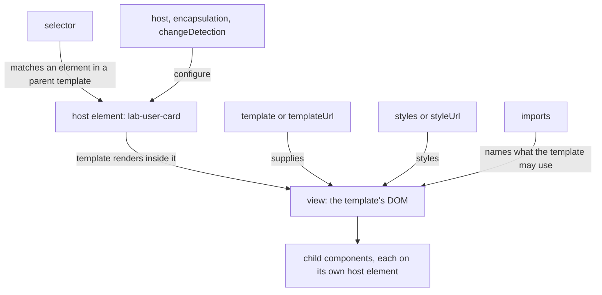
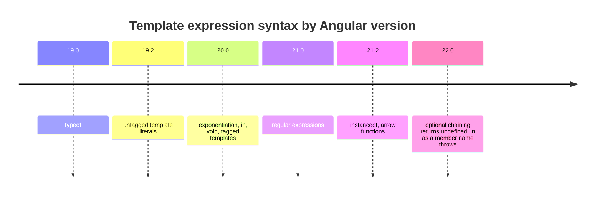
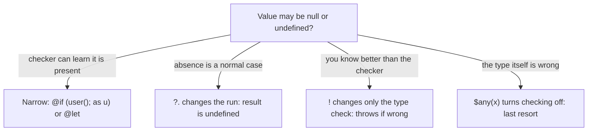
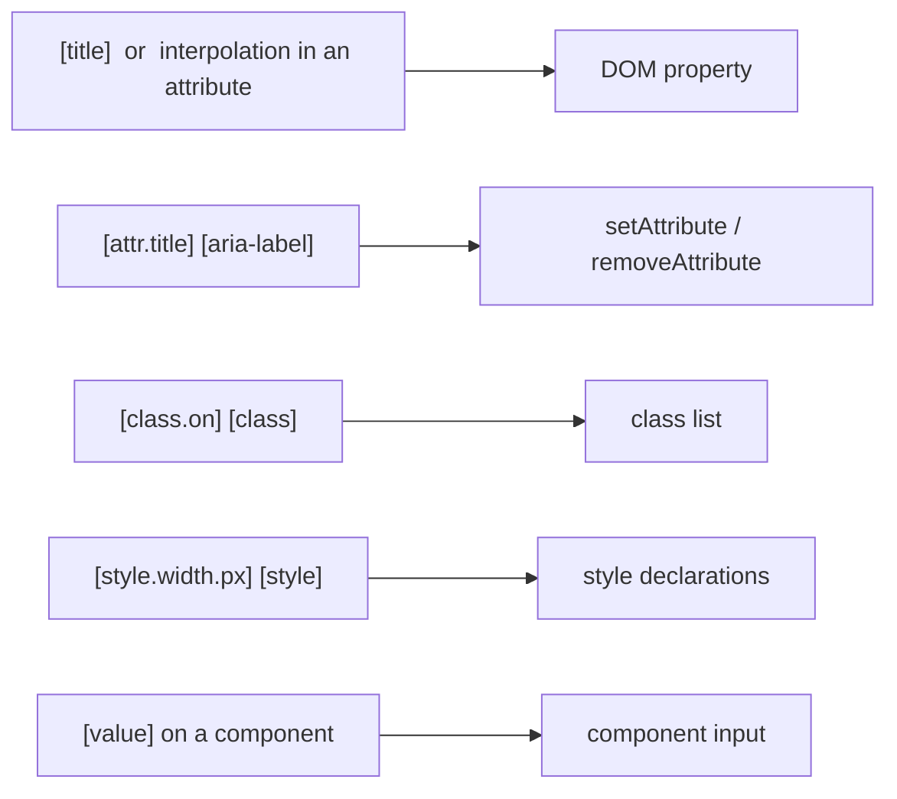
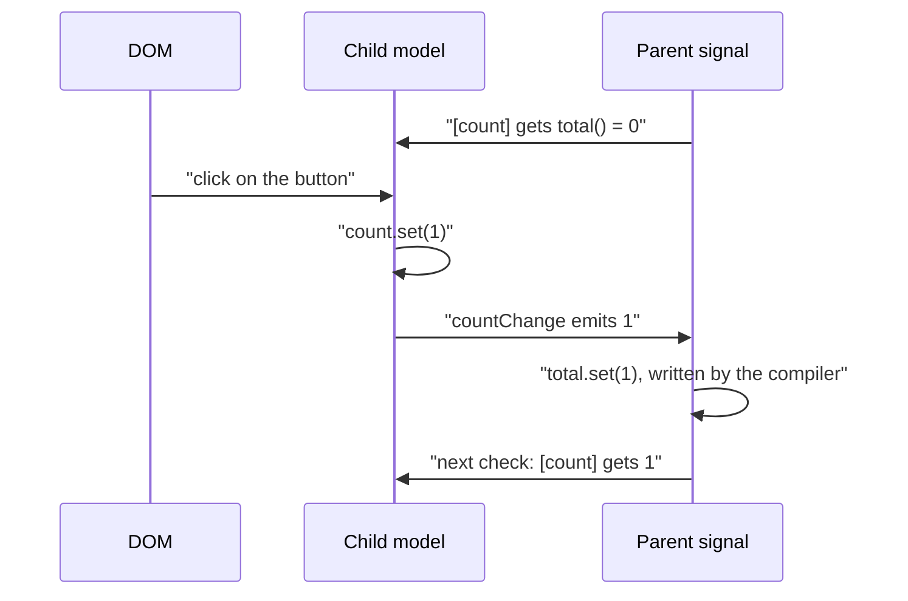
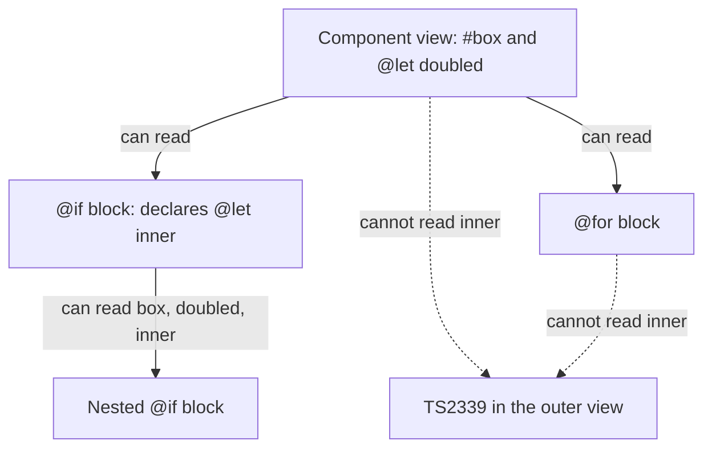
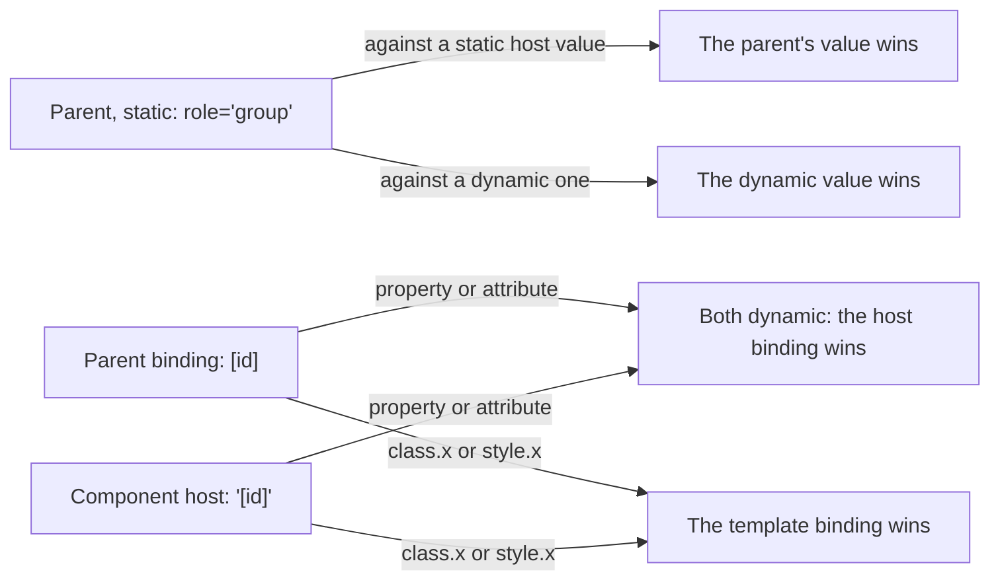
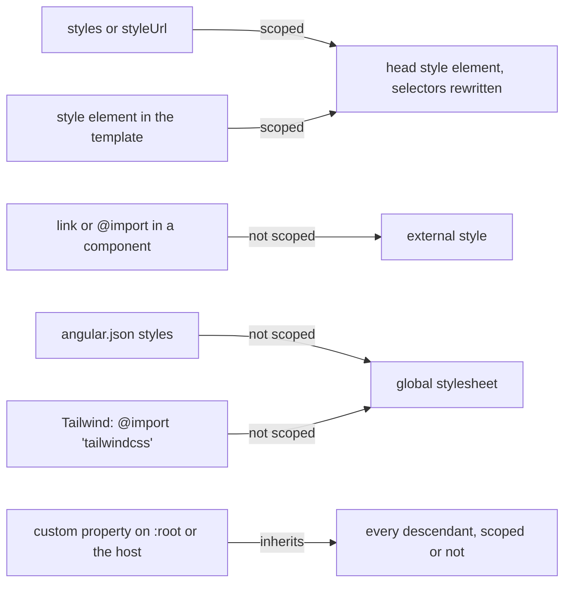
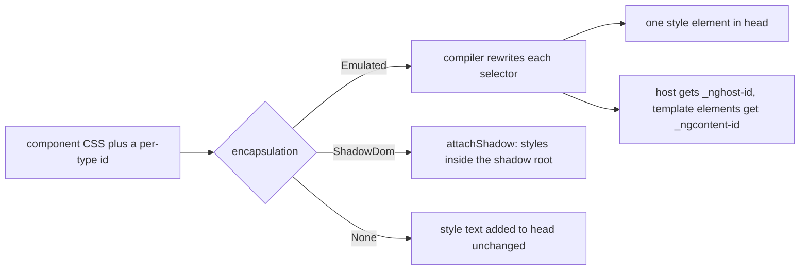

# 13. Components and templates: bindings, the host element and view encapsulation

> **What this covers:** how a component is put together in Angular 22 and how its template language works: selectors, metadata and the v22 file names; what a template expression may contain and which operators arrived in which version; safe navigation, the non-null assertion and `$any`; property, attribute, class and style bindings; event and two-way binding and what `[(x)]` compiles to; template reference variables and `@let`; the host element and host bindings; styling strategies; and view encapsulation, including what the compiler does to your CSS. By the end you can predict what a binding writes to the DOM, explain who wins when the parent and the host disagree, and read the CSS Angular emits.
> **Prerequisites:** [12. How Angular works](12-angular-how-it-works.md#7-aot-versus-jit-and-template-type-checking) (template type checking) and [what the compiler emits](12-angular-how-it-works.md#8-under-the-hood-what-the-compiler-emits-and-what-the-runtime-does-with-it), [08. Shadow DOM](08-browser-rendering-dom-events.md#5-web-components-custom-elements-shadow-dom-and-templates), [10. The cascade](10-css-essentials.md#2-the-cascade-origins-specificity-and-layers) and [custom properties](10-css-essentials.md#6-custom-properties-theming-and-color-scheme)
> **Leads to:** [14. Directives and pipes](14-directives-and-pipes.md), [15. Standalone and NgModules](15-standalone-and-ngmodules.md), [16. Dependency injection](16-dependency-injection.md), [17. Signals](17-signals.md), [18. Control flow and defer](18-control-flow-and-defer.md), [19. Component communication and projection](19-component-communication-and-projection.md), [20. Lifecycle and render hooks](20-lifecycle-and-render-hooks.md), [21. Change detection](21-change-detection.md), [29. Testing Angular](29-testing-angular.md), [33. Security](33-security.md), [35. Animations](35-animations.md), [36. Material and CDK](36-material-and-cdk.md)
> **Applies to:** Angular 22.2 (`@angular/core`, `@angular/compiler`, `@angular/compiler-cli`, `@angular/platform-browser` 22.2.1), TypeScript 6.0, Node 24
> **Study time:** ~6 hours reading + ~6 hours exercises
> **Short on time:** read [4. Property, attribute, class and style bindings](#4-property-attribute-class-and-style-bindings), [7. The host element](#7-the-host-element-host-metadata-hostbinding-and-hostlistener) and [9. View encapsulation](#9-view-encapsulation-emulated-shadowdom-and-none-and-what-the-compiler-does-to-your-css), then drill [Q13.04](#q13-04), [Q13.10](#q13-10), [Q13.16](#q13-16), [Q13.21](#q13-21), [Q13.27](#q13-27) and [Q13.29](#q13-29), try [Exercise 13.2](#ex13-2), and finish with the [Summary](#summary).
> **Labs:** [`labs/angular/src/app/modules/13-components-and-templates/`](../labs/angular/src/app/modules/13-components-and-templates/) (section specs, Exercises 13.1-13.3, *Output* questions) and [`labs/ts-js/src/modules/13-components-and-templates/`](../labs/ts-js/src/modules/13-components-and-templates/) (global-styles test, Exercises 13.4-13.5). Run (Node 24): from `labs/angular`, `npx ng test --watch=false --include='src/app/modules/13-components-and-templates/**/*.spec.ts'`; from `labs/ts-js`, `npx vitest run src/modules/13-components-and-templates`

## Contents

1. [Component anatomy: selector, template, styles, `imports` and the v22 file convention](#1-component-anatomy-selector-template-styles-imports-and-the-v22-file-convention)
2. [Interpolation and template expressions: what is allowed](#2-interpolation-and-template-expressions-what-is-allowed)
3. [Safe navigation, the non-null assertion and `$any`](#3-safe-navigation-the-non-null-assertion-and-any)
4. [Property, attribute, class and style bindings](#4-property-attribute-class-and-style-bindings)
5. [Event binding and two-way binding](#5-event-binding-and-two-way-binding)
6. [Template reference variables and `@let`](#6-template-reference-variables-and-let)
7. [The host element: `host` metadata, `@HostBinding` and `@HostListener`](#7-the-host-element-host-metadata-hostbinding-and-hostlistener)
8. [Styling strategies: component styles, global styles, CSS variables and Tailwind](#8-styling-strategies-component-styles-global-styles-css-variables-and-tailwind)
9. [View encapsulation: Emulated, ShadowDom and None, and what the compiler does to your CSS](#9-view-encapsulation-emulated-shadowdom-and-none-and-what-the-compiler-does-to-your-css)
- [Summary](#summary)
- [Question bank](#question-bank)
- [Hands-on exercises](#hands-on-exercises)
- [Check your understanding](#check-your-understanding)
- [Connections](#connections)

**How the claims here are verified.** Runtime behavior is asserted by Angular specs under `ng test` (Vitest, the `ng test` runner, with jsdom, a JavaScript DOM for Node; an ahead-of-time (AOT) test build); two models are asserted by `labs/ts-js` tests. Each such sentence names its test. Compiler output and template diagnostics are quoted, dated, from `ngc` 22.2.1 (the compiler CLI) runs on a throwaway project that symlinks the lab's `node_modules`; probes that need console output run in a throwaway copy of the lab workspace, deleted afterwards. Tailwind CSS, real-browser rendering and `:host-context()` browser support are documented from cited sources, never observed. jsdom resolves no `var()` and parses no nested CSS, so no test asserts either.

## 1. Component anatomy: selector, template, styles, `imports` and the v22 file convention

### The problem it solves

A developer writes `<button lab-primary>save</button>`, forgets to list `PrimaryButton` in `imports`, and ships a plain button: Angular reports unknown *elements*, not unknown attributes. A second component whose selector also matches `button` makes v22 refuse to compile. A third repository mixes `user-card.component.ts` and `user-card.ts`.

### Mental model

A **component** is a class, a **template** (the HTML it renders) and optional styles, bound to every DOM element that matches its **selector** (the pattern that picks elements). That element is the **host element**; the template renders inside it as the component's **view**. Think of a rubber stamp: every element matching the pattern in a parent's template is stamped, so two matches are two independent instances ([angular.dev](https://angular.dev/guide/components), read 2026-10-07). The `@Component` object is **metadata**, data about the class that the compiler reads to build its definition ([12 §8](12-angular-how-it-works.md#8-under-the-hood-what-the-compiler-emits-and-what-the-runtime-does-with-it), [Q07.14](07-ts-advanced-types-and-decorators.md#q07-14)).



What to notice: the host element is both "the component as the parent wrote it" and "the root of its own view"; `imports` feeds the view, not the host.

### How it actually works

**Metadata.** In the `@angular/core` 22.2.1 typings `Component` extends `Directive` and adds `template`, `templateUrl`, `styles`, `styleUrl`, `encapsulation`, `changeDetection`, `imports` and `schemas`; `selector` (optional) and `host` come from `Directive`. Components are standalone by default [Changed in v19.0: `standalone` defaults to `true`] ([15](15-standalone-and-ngmodules.md#2-standalone-components-and-the-imports-array)), and without `changeDetection` they are OnPush (re-checked only when an input signal, an event or a signal it reads changes) [Changed in v22.0: OnPush is the default] ([21](21-change-detection.md#2-onpush-and-eager-strategies-and-what-marks-a-view-dirty)).

**Selectors.** The forms are an element name, an attribute (`[x]`, `[type="reset"]`) and a class, plus `:not()` and comma lists. Combinators, namespaces and other pseudo-classes are unsupported ([angular.dev, Selectors](https://angular.dev/guide/components/selectors)), yet `ngc` accepted `lab a > b` and `lab-x::before` with exit 0 (2026-10-07). Element names need a hyphen and a **prefix** (a short project-wide start such as the CLI default `app-`); never `ng`, which is Angular's. An attribute selector on a native element (`button[lab-primary]`) keeps its native behavior and ARIA (roles and states for assistive technology) attributes ([Q11.03](11-accessibility.md#q11-03)).

**Diagnostics.** An unknown element is `NG8001`; two components on one element is `NG8023` [Changed in v22.0: "will now throw at compile time"] (core CHANGELOG); a forgotten attribute-selector component produces nothing. Observed by compiling a throwaway file with `ngc` 22.2.1 on 2026-10-07:

```text
src/a.ts:9:55 - error NG8001: 'lab-unknown' is not a known element:
1. If 'lab-unknown' is an Angular component, then verify that it is included in the '@Component.imports' of this component.
2. If 'lab-unknown' is a Web Component then add 'CUSTOM_ELEMENTS_SCHEMA' to the '@Component.schemas' of this component to suppress this message. ...

src/a.ts:24:69 - error NG8023: Multiple components match node with tagname button: 'A', 'B'. ...

src/a.ts:6:43 - warning NG8113: All imports are unused

exit 1
```

A second file with `<button lab-primary>` and no import, plus a template reading a `private` member, compiled with exit 0 and no output.

**File names.** `ng generate component user-card` [Changed in v20.0: no `.component` in generated file names] ([CLI CHANGELOG](https://github.com/angular/angular-cli/blob/main/CHANGELOG.md)) writes `user-card.ts`, `.html`, `.css` and `.spec.ts` from the **schematic** (a code generator the CLI runs, [12 §2](12-angular-how-it-works.md#2-the-cli-and-the-workspace-angularjson-projects-schematics-and-ng-update)) templates of `@schematics/angular` 22.2.1. `ng new --file-name-style-guide` [Added in v21.0] takes `2025` (default) or `2016` (`app.component.ts`).

**Member access.** The [style guide](https://angular.dev/style-guide) (read 2026-10-07) asks for `protected` on template-only members, because public members are API reachable through dependency injection (DI) ([16](16-dependency-injection.md)) and queries, and `readonly` on fields Angular sets. A template may also read `private` members [Added in v22.2] (changelog: "allow template to access private props"; `Section 1: a template reads public, protected and private members under the v22.2 compiler`).

### Code

The generator's default class, then the opening failure: one consumer imports the attribute-selector component, one forgets.

```ts
// Partial: the class `ng generate component user-card` writes by default, rebuilt from the @schematics/angular 22.2.1 template (OnPush is omitted because it is the default)
import { Component } from '@angular/core';

@Component({
  imports: [],
  selector: 'app-user-card',
  styleUrl: './user-card.css',
  templateUrl: './user-card.html',
})
export class UserCard {}
```

```ts
// Excerpt of labs/angular/src/app/modules/13-components-and-templates/concepts/section-1-anatomy.spec.ts
@Component({
  selector: 'button[lab-primary]',
  template: `<ng-content />`,
  host: { class: 'primary', 'data-hit': 'primary' },
})
class PrimaryButton {}

@Component({
  selector: 'lab-imported-host',
  imports: [PrimaryButton],
  template: `<button lab-primary id="b">save</button>`,
})
class ImportedHost {}

@Component({
  selector: 'lab-forgot-import-host',
  template: `<button lab-primary id="b">save</button>`,
})
class ForgotImportHost {}
```

`Section 1: an attribute-selector component that is not imported renders as the plain native element` asserts that only the imported button gets the `primary` class. `Section 1: a component without styles has no host attribute because its encapsulation is None` shows a styleless component gets no `_nghost` attribute ([section 9](#9-view-encapsulation-emulated-shadowdom-and-none-and-what-the-compiler-does-to-your-css)).

### Best practices and anti-patterns

- **Do use an element selector with a project prefix**, because it needs a hyphen to be a valid custom element name and `ng` is reserved.
- **Do use an attribute selector only to extend a native element, and import it everywhere**, because nothing reports a miss.
- **Do give the `.ts`, `.html` and `.css` files one name** and keep a repository's convention, because mixing two confuses more than either.
- **Do keep `imports` to what the template uses**, because `NG8113` warns about unused ones.
- **Avoid CSS combinators in selectors**, because Angular does not support them and `ngc` stays silent.

### Misconceptions and traps

- *"A missing component import always errors."* Only unknown elements do (`NG8001`); attribute and class selectors match nothing silently. The myth exists because the common case, an element selector, fails loudly.
- *"`.component.ts` is required."* Once true: the CLI generated that name until v20.0. Now: `user-card.ts` is the default [Changed in v20.0: no `.component` suffix]. The myth survives because older tutorials use the suffix.
- *"The selector can be any CSS selector."* Combinators and most pseudo-classes are unsupported. The myth exists because the syntax looks like CSS and `ngc` did not object.

Drilled in [Q13.01](#q13-01), [Q13.02](#q13-02) and [Q13.03](#q13-03); practised in [Exercise 13.1](#ex13-1).

## 2. Interpolation and template expressions: what is allowed

### The problem it solves

A developer writes `{{ count++ }}` or `{{ new Date() }}` and gets a parser error. A teammate asks whether `typeof`, `**` or an arrow function works and answers from memory. After the v22 upgrade a member named `in` stops compiling. Summaries and older tutorials group the newer operators as "v20+", which is wrong for two of them.

### Mental model

A **template expression** is the code inside `{{ }}` or inside the quotes of a binding. It is JavaScript restricted to what is safe to run on every check of the view: reads, calls of component members and operators, with **no side effects** (changes outside the expression), no declarations and no globals. Think of a spreadsheet cell: it computes from other cells and never changes them. The compiler turns each expression into code in the update block ([12 §8](12-angular-how-it-works.md#8-under-the-hood-what-the-compiler-emits-and-what-the-runtime-does-with-it)).



What to notice: "v20+" is the middle of the range, and every step moved templates closer to JavaScript. What stays out (assignment, `new`, bitwise operators, comma, declarations) is what causes side effects.

### How it actually works

**Interpolation** (`{{ }}`) is a text binding: the result is converted to a string, objects and arrays "using the value's `toString` method" ([angular.dev, Binding](https://angular.dev/guide/templates/binding), read 2026-10-07). `Section 2: interpolation converts null and undefined to empty text and objects through toString` asserts it: `null` and `undefined` render as nothing, `0` and `false` as written, `[1, [2, 3]]` as `1,2,3`, `{ a: 1 }` as `[object Object]`.

**Operators and their versions.** Each marker below is a line of the `@angular/core` [CHANGELOG](https://github.com/angular/angular/blob/main/CHANGELOG.md) read on 2026-10-07:

- `typeof` [Added in v19.0] ("add support for the `typeof` keyword in template expressions");
- untagged template literals [Added in v19.2] ("support untagged template literals in expressions"): also earlier;
- `**` (ECMAScript 2016), `in`, `void` and tagged templates [Added in v20.0] ("support exponentiation operator in templates", "support the `in` keyword in Binary expression", "support void operator in templates", "support tagged template literals in expressions");
- regular expressions [Added in v21.0] ("support regular expressions in templates");
- `instanceof` and arrow functions [Added in v21.2] ("Add support for the `instanceof` binary operator", "support arrow functions in expressions");
- `??` (ECMAScript 2020) and `?.` came earlier; `?.` changed in v22 ([section 3](#3-safe-navigation-the-non-null-assertion-and-any)).

`Section 2: the v19 to v21 operators evaluate in a template` asserts each one. `**` is right associative, so `2 ** 3 ** 2` is `2 ** 9`, 512 (`Section 2: exponentiation is right associative`; the 20.0 CHANGELOG lists "exponentiation should be right-to-left associative"). Editions: [ES2016](https://262.ecma-international.org/7.0/) has `**`, [ES2020](https://262.ecma-international.org/11.0/) has `??`.

**What the parser rejects.** Assignment is legal only in event statements (`n += 1` compiled, `n++` did not: [section 5](#5-event-binding-and-two-way-binding)). Observed by compiling a throwaway component per expression with `ngc` 22.2.1 on 2026-10-07 (paths removed):

```text
NG5002: Parser Error: Bindings cannot contain assignments at column 6 in [ n = 2 ]
NG5002: Parser Error: Unexpected end of expression:  count++  at the end of the expression [ count++ ]
NG5002: Parser Error: Unexpected token 'Date' at column 6 in [ new Date() ]
NG5002: Parser Error: Binding expression cannot contain chained expression at column 5 in [ n; n ]
NG5002: Parser Error: Unexpected token '&' at column 4 in [ n & 1 ]
NG5002: Parser Error: Unexpected token ',' at column 3 in [ n, n ]
NG5002: Parser Error: Unary operator used immediately before exponentiation expression. Parenthesis must be used to disambiguate operator precedence at column 5 in [ -2 ** 2 ]
NG5002: Parser Error: Unexpected token let at column 2 in [ let x = 1 ]
NG5002: Parser Error: Unexpected token in at column 2 in [ in ]
TS2339: Property 'Math' does not exist on type 'B10'.
```

The same run compiled `2 ** 3`, `'a' in o`, `void 0`, `typeof n`, template literals, a regular expression, an arrow function and `o instanceof D`. The `in` line is the v22 breaking change "`in` variables will throw in template expressions" (22.0.0 CHANGELOG); `{{ this.in }}` compiled. The 20.0.0 notes say a bare `void` became the operator too, so write `this.void`.

**No globals.** Only `undefined` and `$any` are globals ([angular.dev, Expression syntax](https://angular.dev/guide/templates/expression-syntax), read 2026-10-07), so `Math.max(1, 2)` fails as above: expose it as a member or [a pipe](14-directives-and-pipes.md). **`this.`** is implied, a template variable shadows a member of the same name, and `this.n` reads the member (`Section 2: a template variable shadows a member and this. reads the member`) [Changed in v19.0: `this.foo` no longer refers to template context variables]. Signals must be called, `{{ count() }}` ([Q17.32](17-signals.md#q17-32), [Q12.21](12-angular-how-it-works.md#q12-21)).

### Code

The approach: each newer operator gets its own paragraph, so the spec reads it by id. Members hold the values, and `Stamp` and `tag` are exposed because a template has no globals.

```ts
// Excerpt of labs/angular/src/app/modules/13-components-and-templates/concepts/section-2-expressions.spec.ts
@Component({
  selector: 'lab-operator-values',
  template: `
    <p id="typeof">{{ typeof n }}</p>
    <p id="literal">{{ \`n=\${n}\` }}</p>
    <p id="power">{{ 2 ** 3 }}</p>
    <p id="in">{{ 'a' in record }}</p>
    <p id="void">[{{ void 0 }}]</p>
    <p id="tagged">{{ tag\`raw text\` }}</p>
    <p id="regex">{{ /\\d+/.test('a1') }}</p>
    <p id="instanceof">{{ stamp instanceof Stamp }}</p>
    <p id="arrow">{{ items.filter(i => i > 1).length }}</p>
    <p id="coalesce">{{ missing ?? 'fallback' }}</p>
    <p id="spread">{{ [...items, 4].length }}</p>
  `,
})
class OperatorValues {
  protected readonly n = 1;
  protected readonly record = { a: 1 };
  protected readonly items = [1, 2, 3];
  protected readonly missing: string | undefined = undefined;
  protected readonly Stamp = Stamp;
  protected readonly stamp = new Stamp();
  protected readonly tag = (strings: TemplateStringsArray) => strings.raw[0];
}
```

The test expects `number`, `n=1`, `8`, `true`, `[]`, `raw text`, `true`, `true`, `2`, `fallback`, `4`. [Exercise 13.4](#ex13-4) models this subset in plain TypeScript (a model, not Angular's parser).

### Best practices and anti-patterns

- **Keep expressions to reads and simple operators**, because the style guide asks for simple template logic and expressions run on every check.
- **Move `Math`, `Number` and `new` into a member or a pipe**, because the template has no globals and the compiler rejects `new`.
- **Write `this.in` or rename the member**, because a bare `in` is the operator since v20.0 and an error since v22.0.
- **Quote versions from the CHANGELOG**, because summaries lump the operators together.

### Misconceptions and traps

- *"Templates run arbitrary JavaScript."* They run a subset; assignment, `new`, bitwise operators, the comma operator and declarations are parse errors. The myth exists because the syntax looks identical and most expressions work.
- *"`**`, `in` and template literals are v20, and `typeof` too."* `typeof` is v19.0 and untagged template literals are v19.2. The myth exists because release summaries group them.
- *"An expression can call `Math.max`."* Only `undefined` and `$any` are globals; the compiler reports `Property 'Math' does not exist`. The myth exists because JavaScript habit says globals are always in scope.

Drilled in [Q13.04](#q13-04), [Q13.05](#q13-05) and [Q13.06](#q13-06).

## 3. Safe navigation, the non-null assertion and `$any`

### The problem it solves

A profile page throws "Cannot read properties of null" on first render, because the user arrives later. A developer adds `!` to silence the red squiggle, and the crash stays. After the v22 upgrade, `user()?.name === null` stops matching, because `?.` now produces `undefined`.

### Mental model

Three tools talk to **two audiences**. **Optional chaining** (`?.`, [Added in ES2020](https://262.ecma-international.org/11.0/)) changes the **running code**: on a `null` or `undefined` left side the chain stops with `undefined` ([01](01-js-values-types-coercion.md#q01-21)). The **non-null assertion** (`x!`) talks only to the **type checker** ([06](06-ts-type-system-essentials.md)): it claims the value is present and is erased. **`$any(x)`** is Angular's cast to `any`, an **escape hatch** (a way around a check) for one expression. Think of a seat belt, a sticker saying "I wear one" and a removed warning light.



What to notice: only narrowing and `?.` change what happens at run time; `!` and `$any` change what the compiler reports, so a wrong guess is a `TypeError`.

### How it actually works

**`?.` since v22.** It works on properties, keys and calls (`a?.b`, `a?.[0]`, `fn?.()`). `?.` [Changed in v22.0: a nullish left side gives `undefined`, not `null`]: the `@angular/core` [CHANGELOG](https://github.com/angular/angular/blob/main/CHANGELOG.md) 22.0.0 lists "Angular expressions with optional chaining returns `undefined`" (read 2026-10-07). `Section 3: optional chaining on a nullish receiver evaluates to undefined` asserts it.

**The migration aid.** `ng update` wrapped existing chains as `$safeNavigationMigration(foo?.bar)` to keep the `null` result. `@angular/compiler` 22.2.1 rewrites that call away (`convertSafeNavigationMigrationCall`) and compiles the chain with the old null semantics (`safeTransform`); `Section 3: $safeNavigationMigration keeps the null result` asserts it. The [docs](https://angular.dev/guide/templates/expression-syntax) call it "a temporary migration aid only", "not a real function"; it "may be removed in a future version". **Never write it**; stop depending on `null` against `undefined`, for example `user()?.name ?? 'anonymous'`.

**Diagnostics.** The same CHANGELOG says the change "will trigger the `nullishCoalescingNotNullable` and `optionalChainNotNullable` diagnostics", so `ng update` turns both off (`NG8102` and `NG8107`: `@angular/compiler-cli` 22.2.1, `error_code.d.ts`).

**`!` and `$any`.** The assertion leaves no trace in the emitted code below, and `Section 3: the non-null assertion has no run-time effect and a null receiver still throws` asserts the `TypeError`. `$any(x)` becomes `(x as any)` in the type-check code (`@angular/compiler` 22.2.1), so at run time it reads whatever is there (`Section 3: $any changes only the type check`). Prefer narrowing: `@if (maybe(); as u)` compiled `u.name` without `?.` ([18](18-control-flow-and-defer.md#q18-03); `@let`: [section 6](#6-template-reference-variables-and-let)).

### Code

The approach: one component reads a missing user three ways; the spec reads each by id.

```ts
// Excerpt of labs/angular/src/app/modules/13-components-and-templates/concepts/section-3-null-safety.spec.ts
@Component({
  selector: 'lab-chain-values',
  template: `
    <p id="undefined">[{{ user()?.name === undefined }}]</p>
    <p id="null">[{{ user()?.name === null }}]</p>
    <p id="migration">[{{ $safeNavigationMigration(user()?.name) === null }}]</p>
  `,
})
class ChainValues {
  protected readonly user = signal<User | null>(null);
}
```

The test expects `[true]`, `[false]`, `[true]`. Observed by compiling a throwaway component with `ngc` 22.2.1 on 2026-10-07 (`user` is a plain `User`, `maybe` a nullable signal; emitted lines from a rerun without the `TS2339` line; messages shortened: the repeated code and the `Find more at` link are left out):

```text
{{ user?.name }}          warning NG8107: The left side of this optional chain operation does not include 'null' or 'undefined' in its type, therefore the '?.' operator can be replaced with the '.' operator.
{{ user.name ?? 'anon' }} warning NG8102: The left side of this nullish coalescing operation does not include 'null' or 'undefined' in its type, therefore the '??' operator can be safely removed.
{{ user.nickname }}       error TS2339: Property 'nickname' does not exist on type 'User'.

maybe()?.name                                -> ɵɵtextInterpolate(ctx.maybe()?.name);
$safeNavigationMigration(maybe()?.name)      -> ɵɵtextInterpolate((tmp_1_0 = ctx.maybe()) == null ? null : tmp_1_0.name);
maybe()!.name                                -> ɵɵtextInterpolate(ctx.maybe().name);
$any(user).nickname                          -> ɵɵtextInterpolate(ctx.user.nickname);
```

### Best practices and anti-patterns

- **Narrow first** (let the checker learn a value is present) with `@if (…; as u)`, because then no operator is needed.
- **Use `?.` only where absence is normal**, because on a non-nullable value it triggers `NG8107`.
- **Avoid `!` on data that loads later**, because it silences the checker and the page still throws.
- **Keep `$any()` rare and commented**, because it hides every error in that expression ([Q12.22](12-angular-how-it-works.md#q12-22)).

### Misconceptions and traps

- *"`!` prevents the crash."* It removes the compile error only and is erased. The myth exists because the squiggle disappears, which looks like a fix.
- *"`?.` returns `null` in templates."* Once true: until v22.0 it did, and now it gives `undefined` [Changed in v22.0: `?.` gives `undefined`]. The myth exists because pre-v22 tutorials show `null`.
- *"`$any` is a pipe."* It is a compile-time cast. The myth exists because it is written where a pipe would be.

Drilled in [Q13.07](#q13-07), [Q13.08](#q13-08) and [Q13.09](#q13-09); modelled in [Exercise 13.4](#ex13-4).

## 4. Property, attribute, class and style bindings

### The problem it solves

A Save button stays disabled because the template says `[disabled]="'false'"` and a non-empty string is truthy (`Section 4: a property binding passes the value to the DOM property, so the string false disables a button`). A tooltip reads "undefined". A `[class]` object is mutated in place and the page never changes.

### Mental model

A binding is **a one-way sentence: "set this target to this value whenever it changes"**. The **binding target** (the thing written to) is one of five: a **DOM property** (`[title]`, a field on the element's JavaScript object), an **HTML attribute** (`[attr.title]`, the text in the markup), a **class** (`[class.on]`, `[class]`, written through the element's `classList`, its live set of class names), a **style declaration** (`[style.width.px]`, `[style]`) or a **component input** ([17](17-signals.md)). Think of a labelled shelf (the property: what the element holds now) and the sticker on the box (the attribute: what the markup said).



What to notice: only the attribute form can remove something: `null` removes an attribute, while a property receives the text "null".

### How it actually works

**Property or attribute.** Most attributes have a same-named property, so both bindings look alike. They diverge when the property converts the value: `Section 4: a property binding does not write the attribute that an attribute binding writes` shows `[value]` on an input leaving no `value` attribute while `[attr.value]` writes one. `[attr.]` also reaches attributes that have no property: a throwaway `<td [colspan]="2">` is rejected at compile time, `[attr.colspan]="2"` is not.

**What each form writes.** Observed by `Section 4: a property binding of undefined or null writes the string, an attribute binding removes the attribute` (jsdom, 2026-10-07):

| Value | `[title]` | `[attr.title]` | `title="{{ x }}"` |
|---|---|---|---|
| `'x'` | `title="x"` | `title="x"` | `title="x"` |
| `undefined` | `title="undefined"` | no attribute | `title=""` |
| `null` | `title="null"` | no attribute | `title=""` |
| `''` | `title=""` | `title=""` | `title=""` |

The [binding page](https://angular.dev/guide/templates/binding) (read 2026-10-07) says `null` removes an attribute and calls interpolation in an attribute a property binding; the compiled code below calls `ɵɵdomProperty` with `ɵɵinterpolate1`, and [section 2](#2-interpolation-and-template-expressions-what-is-allowed) shows `null` and `undefined` becoming empty text.

**ARIA.** `[aria-label]="x"` [Added in v20.2]: the `@angular/core` [CHANGELOG](https://github.com/angular/angular/blob/main/CHANGELOG.md) 20.2.0 lists "render ARIA property bindings as attributes" (read 2026-10-07), so it compiles to `ɵɵattribute` and `null` removes it (`Section 4: aria bindings write attributes and null removes them`).

**Class and style.** `Section 4: static class, class binding and class.x binding merge`: `class="list"`, `[class]="'box'"` and `[class.expanded]` give `list box expanded`; an array replaces `box`, a falsy `[class.expanded]` removes only itself. A key containing a space is not applied (`Section 4: a class object key with a space is not applied`); the docs send that case to `NgClass` ([14](14-directives-and-pipes.md)). Style forms: `[style.width.px]` appends the unit, `null` or `''` removes the declaration, and `[style.--tone]` sets a custom property ([10](10-css-essentials.md#6-custom-properties-theming-and-color-scheme)) (`Section 4: style units and custom properties bind`).

**Identity.** The docs say object and array values are compared with `===`, so mutation in place is invisible.

**Precedence.** Two bindings of one class or style resolve by a fixed order that the binding page promises and does not give. It is written in a comment of `style_binding_list.ts` at the `v22.2.1` tag (read 2026-10-07; the shipped package strips comments): the template's bindings win over directives' host bindings, which win over the component's own, and inside one source `[style.x]` follows `[style]`. Tests: `Section 4: a style binding beats the style string on the same element`, `Section 4: a template binding beats a host binding for class and style`. Properties and attributes collide differently ([section 7](#7-the-host-element-host-metadata-hostbinding-and-hostlistener)).

> [!NOTE]
> **Framework vs platform.** Properties, attributes, `classList` and `style` belong to the browser's DOM ([08](08-browser-rendering-dom-events.md)); Angular only chooses which one to write and when.

### Code

The approach: change a class object and a style object twice, in place and then by copy, each time bumping a signal the template reads so the view is checked.

1. Mutate both and bump `tick`: nothing changes.
2. Replace both with copies: the DOM updates.

```ts
// Excerpt of labs/angular/src/app/modules/13-components-and-templates/concepts/section-4-bindings.spec.ts
// A class object and a style object compared with ===: the same reference is not re-applied.
@Component({
  selector: 'lab-identity-values',
  template: `
    <p id="target" [class]="flags()" [style]="style()">{{ tick() }}</p>
  `,
})
class IdentityValues {
  readonly flags = signal<Record<string, boolean>>({ active: false });
  readonly style = signal<Record<string, string>>({ color: 'red' });
  readonly tick = signal(0);
}
```

```ts
// Excerpt of labs/angular/src/app/modules/13-components-and-templates/concepts/section-4-bindings.spec.ts
    fixture.componentInstance.flags()['active'] = true;
    fixture.componentInstance.style()['color'] = 'blue';
    await refresh();
    expect(target.textContent).toBe('1');
    expect(view()).toEqual({ cls: '', color: 'red' });

    fixture.componentInstance.flags.update((flags) => ({ ...flags }));
    fixture.componentInstance.style.update((style) => ({ ...style }));
    await refresh();
    expect(view()).toEqual({ cls: 'active', color: 'blue' });
```

Observed by compiling a throwaway component with `ngc` 22.2.1 on 2026-10-07 (one `<p>` per binding; instruction lines only):

```text
<p [title]="t()">          ɵɵdomProperty("title", ctx.t())
<p [attr.title]="t()">     ɵɵattribute("title", ctx.t())
<p title="a {{ t() }}">    ɵɵdomProperty("title", i0.ɵɵinterpolate1("a ", ctx.t()))
<p [aria-label]="t()">     ɵɵattribute("aria-label", ctx.t())
<p [class.on]="flag()">    ɵɵclassProp("on", ctx.flag())
<p [class]="t()">          ɵɵclassMap(ctx.t())
<p [style.width.px]="w()"> ɵɵstyleProp("width", ctx.w(), "px")
<p [style]="t()">          ɵɵstyleMap(ctx.t())

<td [colspan]="2">         error NG8002: Can't bind to 'colspan' since it isn't a known property of 'td'.
```

### Best practices and anti-patterns

- **Bind booleans, not strings**, because the DOM property converts whatever it gets and `'false'` is truthy.
- **Use `[attr.x]` only for attributes without a property, and for ARIA**, because everywhere else the property is the current state and the attribute is only the initial one.
- **Create a new object or array for `[class]` and `[style]`**, because the same reference looks unchanged.
- **Prefer `[class.x]` and `[style.x]` to `NgClass` and `NgStyle`** ([14](14-directives-and-pipes.md)), because the [style guide](https://angular.dev/style-guide) says so and each binding names one thing.

### Misconceptions and traps

- *"`[attr.x]` and `[x]` are interchangeable."* They differ for `null`, booleans and attributes without a property. The myth exists because most attributes reflect to a property, so both look alike.
- *"Mutating the object in `[class]` updates the DOM."* It does not. The myth exists because `NgClass` is often used for the same job, and the docs name `===` only for the binding.
- *"A `[class]` binding replaces the static classes."* It merges with them. The myth exists because `class` and `[class]` look like one attribute written twice, so the later one seems to win.

Drilled in [Q13.10](#q13-10), [Q13.11](#q13-11), [Q13.12](#q13-12) and [Q13.13](#q13-13); practised in [Exercise 13.1](#ex13-1).

## 5. Event binding and two-way binding

### The problem it solves

Shift+Enter does nothing because `(keydown.enter)` also demands that no other modifier is down (`Section 5: key filters match the exact set of modifiers`). A link stops navigating when its handler returns `false` (`Section 5: a handler that returns false calls preventDefault`). `([count])="n"` compiles with a warning and never writes back.

### Mental model

An event binding is **a subscription written as a statement**: `(click)="save()"` subscribes to the DOM event `click` on this element, or to an output of the component on it, and runs the statement each time. `$event` is the DOM event or the emitted value (`Section 5: an output listener receives the emitted value as $event`). A statement may assign and call, and `;` chains several (`Section 5: a listener statement can assign and call`). A two-way binding, `[(count)]="total"` (the "banana in a box"), is **syntax for a pair**, desugared (rewritten) into a property binding `[count]` plus a listener `(countChange)` that writes the value back. Think of a phone line with a call-back number.



What to notice: the arrow back into the parent is an ordinary output plus an assignment the compiler writes (`ɵɵtwoWayBindingSet`); nothing else is special.

### How it actually works

**Listeners and `$event`.** Each listener compiles to an instruction such as `ɵɵdomListener`. At run time `$event` is the native event; `target` is the element hit and `currentTarget` the element listening (`Section 5: event handlers receive the native event`). The [type-checking page](https://angular.dev/tools/cli/template-typecheck) (read 2026-10-07) cautions that `$event.target` is not typed as expected. Observed below: `$event.target.value` on an `<input>` compiled, `$event.currentTarget.value` did not. No source read here gives the rule; it is an observation only.

**Statements.** Pipes are `NG5002`. The [expression page](https://angular.dev/guide/templates/expression-syntax) (read 2026-10-07) lists increment as valid in listeners, yet below `n += 1` compiled and `n++` did not.

**Key filters.** `KeyEventsPlugin` (`@angular/platform-browser` 22.2.1, `fesm2022/_browser-chunk.mjs`, read 2026-10-07) takes names beginning `keydown` or `keyup`, reads the last part as the key and the key modifiers `alt`, `control`, `meta`, `shift` before it in any order. At run time it builds a string from the pressed modifiers plus the key and compares it with `===`, so **the modifier set must match exactly**: `(keydown.enter)` ignores Shift+Enter, and `(keydown.enter.shift)` never fires because the key is not last (`Section 5: modifier order in a key filter does not matter but the key must come last`). `.code.` compares `event.code`, the physical key, not `event.key`, the character; the [events page](https://angular.dev/guide/templates/event-listeners) (read 2026-10-07) shows macOS Alt+S giving `ß`. A name matching no key gets no diagnostic and never fires. Global targets (`window:`, `document:`, `body:`: listen on that object) go in `host` ([section 7](#7-the-host-element-host-metadata-hostbinding-and-hostlistener)), where they are removed on destroy (`Section 7: a document-level host listener is removed when the component is destroyed`); custom plugins (`EVENT_MANAGER_PLUGINS`) are documented only.

**`false` cancels.** The compiled listener returns `false` when the handler does, and the renderer's `decoratePreventDefault` then calls `event.preventDefault()` (`platform-browser` 22.2.1, `_dom_renderer-chunk.mjs`, read).

**Two-way.** Observed by compiling `two-way-pair.ts` with `ngc` 22.2.1 on 2026-10-07 (instruction lines only, shortened):

```text
CountStepper  inputs: { count: [1, "count"] }, outputs: { count: "countChange" }
              ɵɵdomListener("click", function … { return ctx.count.set(ctx.count() + 1); })
SignalParent  ɵɵtwoWayListener("countChange", function … ($event) { i0.ɵɵtwoWayBindingSet(ctx.total, $event) || (ctx.total = $event); return $event; })
              ɵɵtwoWayProperty("count", ctx.total)
PlainParent   the same two instructions, with ctx.total a plain field
```

The expression is passed as the signal itself: `ɵɵtwoWayProperty` unwraps a writable signal, and `ɵɵtwoWayBindingSet` calls `set` and returns `true`, or returns `false` so the assignment runs (`core` 22.2.1, `_debug_node-chunk.mjs`, read). Tests: `Section 5: a two-way binding writes the child value back into the parent signal`, `Section 5: a two-way binding to a plain parent property assigns it`. So the target must be writable: `total()` and `n + 1` are `NG5002` ([Changed in v18.0: only writable expressions], CHANGELOG, read). The child needs input `x` and output `xChange`: `model()` [Stable since v19.0] declares both ([17 §7](17-signals.md#7-signal-based-component-apis), [Q17.29](17-signals.md#q17-29)); an `input()` plus an `output()` also works (`Section 5: an input plus an output named xChange works with [(x)] like model()`), as does writing the halves by hand (`Section 5: [count] plus (countChange) written by hand behaves like [(count)]`).

Observed by compiling throwaway components with `ngc` 22.2.1 on 2026-10-07 (messages shortened: the repeated code and the `Find more at` link are left out):

```text
(input)="t = $event.target.value"         no diagnostic
(input)="t = $event.currentTarget.value"  error TS2531: Object is possibly 'null'.
                                          error TS2339: Property 'value' does not exist on type 'EventTarget'.
(click)="n += 1"                          no diagnostic
(click)="n++"                             error NG5002: Parser Error: Unexpected end of expression: n++
(click)="n = n | json"                    error NG5002: Parser Error: Cannot have a pipe in an action expression
(keydown.enter.shift)="n = 1"             no diagnostic
[(count)]="total()"                       error NG5002: Unsupported expression in a two-way binding
[(label)]="s"  (input, no labelChange)    error NG8007: The property and event halves of the two-way binding 'label' are not bound to the same target.
([count])="n"                             warning NG8101: In the two-way binding syntax the parentheses should be inside the brackets, ex. '[(count)]="n"'.
(countChnage)="n = 1"                     error NG8030: Event 'countChnage' is not emitted by any directive applied to 'lab-k' and it isn't a known native DOM event.
(chnaged)="n = 2"                         no diagnostic
```

`NG8101` is [Q12.21](12-angular-how-it-works.md#q12-21)'s. `NG8030` needs `strictUnclaimedEventNames` [Added in v22.2] (CHANGELOG 22.2.0, compiler-cli, read), on in this probe only, and skips lowercase names. `[(ngModel)]` is one more such pair ([25](25-forms-reactive-and-template-driven.md#4-template-driven-forms-in-depth-ngmodel-ngform-and-asynchronous-registration)).

> [!NOTE]
> **Framework vs platform.** DOM events, `preventDefault` and propagation belong to the browser ([08 §4](08-browser-rendering-dom-events.md#4-events-propagation-default-actions-passive-listeners-and-delegation), [Q08.08](08-browser-rendering-dom-events.md#q08-08)). Key filters, the `false` rule and `[( )]` are Angular's.

### Code

The approach: a child sets a `model()` on click; a parent binds a signal with `[(count)]`.

1. The child's `count` is both input and output.
2. The compiler's listener writes the parent's `total`.

```ts
// Excerpt of labs/angular/src/app/modules/13-components-and-templates/concepts/two-way-pair.ts
export class CountStepper {
  readonly count = model(0);
}
```

```ts
// Excerpt of labs/angular/src/app/modules/13-components-and-templates/concepts/two-way-pair.ts
export class SignalParent {
  readonly total = signal(0);
}
```

<sub>Source: [labs/angular/src/app/modules/13-components-and-templates/concepts/two-way-pair.ts](../labs/angular/src/app/modules/13-components-and-templates/concepts/two-way-pair.ts)</sub>

```html
<!-- Partial: one input, one handler per key combination -->
<input
  (keydown.enter)="ran.push('enter')"
  (keydown.shift.enter)="ran.push('shiftEnter')"
  (keydown.code.keya)="ran.push('codeA')"
/>
```

### Best practices and anti-patterns

- **Name a handler for what it does** (`saveUserData`, not `handleClick`), because the template reads as intent ([style guide](https://angular.dev/style-guide), read 2026-10-07).
- **Call `preventDefault()` explicitly**, because a method that sometimes returns `false` cancels by accident.
- **Use `.code.` for position-bound shortcuts**, because `key` changes with layout and Alt.
- **Bind `[(x)]` to a signal or field**, because anything else is `NG5002`.

### Misconceptions and traps

- *"`(keydown.enter)` fires for any Enter."* It fires only when no other modifier is down. The myth exists because the name reads as one key, not a set.
- *"`[(x)]` is a special binding type."* It is a property binding plus a listener. The myth exists because it has its own syntax.
- *"Returning `false` from a handler is harmless."* It calls `preventDefault`. The myth exists because a listener's return value usually goes nowhere.

Drilled in [Q13.14](#q13-14), [Q13.15](#q13-15), [Q13.16](#q13-16) and [Q13.17](#q13-17); practised in [Exercise 13.1](#ex13-1) and [Exercise 13.2](#ex13-2).

## 6. Template reference variables and `@let`

### The problem it solves

A template reads `{{ inner.value }}` below an `@if` that declared `#inner`, and the compiler answers `TS2339`, because the block is its own scope. Another repeats `total() * 1.2` six times and a price rule changes in five. A third declares `@let a` twice (`NG8017`).

### Mental model

A **template reference variable** (`#name`) is **a name for a thing in the template**: a DOM element, a component or directive instance, or a `TemplateRef` (a handle on an `<ng-template>`, [14](14-directives-and-pipes.md)). `@let name = expression;` [Stable since v19.0] (core CHANGELOG 19.0.0, "stabilize `@let` syntax", read 2026-10-07) is **a name for a computed value** that Angular keeps current. Each `@if` or `@for` block opens an **embedded view** (a template fragment with its own **scope**, the region where a name can be read; [12 §8](12-angular-how-it-works.md#8-under-the-hood-what-the-compiler-emits-and-what-the-runtime-does-with-it), [18](18-control-flow-and-defer.md#4-let-inside-blocks-scope-reactivity-and-when-it-helps)), so names are **visible downwards, never sideways or upwards**. Think of nameplates on desks and a sticky note with a result: a room reads the hall's notes, not the reverse.



What to notice: arrows down are allowed, and a name declared in a block stops at its edge, so sibling and parent fail alike.

### How it actually works

**What a reference holds.** On a plain element it is the DOM element, on a component its instance, on `<ng-template>` a `TemplateRef` (`Section 6: a reference on an element is the DOM element, on a component its instance, on ng-template a TemplateRef`). `#t="labTally"` names the directive whose `exportAs` is `labTally`, and an unknown name is `NG8003` (`Section 6: exportAs names a directive instance`). The [variables page](https://angular.dev/guide/templates/variables) (read 2026-10-07) says "define a variable only once"; the compiler does not.

**Scope.** An inner block reads an outer reference (`Section 6: a reference is visible in nested blocks`). Observed by compiling `reference-demo.ts` with `ngc` 22.2.1 on 2026-10-07 (shortened):

```text
ReferenceDemo_Conditional_12_Template   ɵɵnextContext();  const box_r2 = ɵɵreference(1);  ɵɵtextInterpolate(box_r2.value);
button listener (same view)             const box_r2 = ɵɵreference(1); const kid_r3 = ɵɵreference(3); const tpl_r4 = ɵɵreference(5); …
```

**`@let`.** One variable per block; no reassignment (`NG8015`), no read above its line (`NG8016`), no name already taken in the template, even by a reference (`NG8017`). It follows its signals (`Section 6: @let re-evaluates when its signals change and is visible in nested blocks`) and runs once per check (`Section 6: @let evaluates its expression once per check however often it is read`). Per core CHANGELOG 20.0.0 ("reduce allocations for let declarations only used in the same view"), a `@let` read only in its own view is a local constant; one read from a block goes through the view's storage.

```text
@let doubled = n() * 2; read only here     const doubled_r1 = ctx.n() * 2;
@let doubled, read by an @if block         ɵɵdeclareLet(0);  const doubled_r3 = ɵɵstoreLet(ctx.n() * 2);
the @if block                              const doubled_r1 = ɵɵreadContextLet(0);  const inner_r2 = doubled_r1 + 10;
```

Observed by compiling throwaway components with `ngc` 22.2.1 on 2026-10-07 (messages shortened: the repeated code and the `Find more at` link are left out):

```text
@let v = 1; … (click)="v = 2"            error NG8015: Cannot assign to @let declaration 'v'.
{{ b }} @let b = 1;                      error NG8016: Cannot read @let declaration 'b' before it has been defined.
@let a = 1; @let a = 2;                  error NG8017: Cannot declare @let called 'a' as there is another symbol in the template with the same name.
<input #a> @let a = 2;                   error NG8017 (the same text)
<input #a="foo">                         error NG8003: No directive found with exportAs 'foo'.
@if (on()) { <input #inner> } {{ inner.value }}   error TS2339: Property 'inner' does not exist on type 'E'.
@if (on()) { @let c = 1; } {{ c }}                error TS2339: Property 'c' does not exist on type 'I'.
@let unused = 1;                         warning NG8112: @let unused is declared but its value is never read.
<input #a><input #a>                     no diagnostic
{{ later.value }}<input #later>          no diagnostic
```

**Which one.** A `@let` is local to one view; a `computed()` ([17](17-signals.md)) is class state; a reference is a node handle, and `viewChild('box')` makes it a field ([Q17.31](17-signals.md#q17-31)). The rest of `@let` is [18](18-control-flow-and-defer.md#4-let-inside-blocks-scope-reactivity-and-when-it-helps)'s.

### Code

The approach: name a node once and read it twice; name a derived value once.

1. `#box` is read in a handler and a block.
2. `@let doubled` is read in the view and a block.

```html
<!-- Excerpt of labs/angular/src/app/modules/13-components-and-templates/concepts/reference-demo.ts -->
    <input #box value="a" />
    <button id="inspect" type="button" (click)="inspect(box, kid, tpl, tally, plain)">inspect</button>
    @if (open()) {
      <p id="nested">{{ box.value }}</p>
    }
```

```ts
// Excerpt of labs/angular/src/app/modules/13-components-and-templates/concepts/reference-demo.ts
@Component({
  selector: 'lab-let-demo',
  template: `
    @let doubled = n() * 2;
    @let label = 'n=' + doubled;
    <p id="top">{{ doubled }}-{{ label }}</p>
    @if (show()) {
      @let inner = doubled + 10;
      <p id="nested">{{ inner }}</p>
    }
  `,
})
export class LetDemo {
  readonly n = signal(1);
  readonly show = signal(false);
}
```

<sub>Source: [labs/angular/src/app/modules/13-components-and-templates/concepts/reference-demo.ts](../labs/angular/src/app/modules/13-components-and-templates/concepts/reference-demo.ts)</sub>

### Best practices and anti-patterns

- **Use `@let` for a value read twice or more in one view**, because it runs once per check.
- **Move a value the class needs into `computed()`**, because a `@let` ends with its view.
- **Give every name one owner**, because nothing stops a repeated `#a`.

### Misconceptions and traps

- *"`@let` is a mutable variable."* It cannot be reassigned (`NG8015`). The myth exists because the keyword is `let`.
- *"A reference declared in an `@if` is visible after it."* It stops at the block (`TS2339`). The myth exists because templates look flat.
- *"`@let` is sugar for a method call."* It runs once per check however often it is read; three calls run three times. The myth exists because it reads like a getter.

Drilled in [Q13.18](#q13-18), [Q13.19](#q13-19) and [Q13.20](#q13-20).

## 7. The host element: `host` metadata, `@HostBinding` and `@HostListener`

### The problem it solves

A toggle built as a `div` has no `role`, `tabindex` or key handling, so a screen reader announces nothing and the keyboard cannot reach it. A parent and its child both set `active` on one element; which wins? A component adds a `document` key listener and keeps reacting after it is destroyed.

### Mental model

The **host element** ([section 1](#1-component-anatomy-selector-template-styles-imports-and-the-v22-file-convention)) is the component's outermost DOM node, and **two parties write to it**: the parent's template, through attributes and bindings on the tag, and the component, through **host bindings** and **host listeners** (declared in `host` metadata for the component's own element, not its template). Think of a flat's front door, decorated by landlord and tenant: a clash needs a rule.



What to notice: a property or attribute is decided by static versus dynamic and ends with the host, but `class` and `style` go to the template's binding.

### How it actually works

**Forms.** `host` keys read like template bindings: a plain `role` is a static attribute, `[prop]`, `[attr.x]`, `[class.x]` and `[style.x]` are bindings, `(event)` is a listener, and a `document:`, `window:` or `body:` prefix picks a [global event target](#5-event-binding-and-two-way-binding) ([host-elements page](https://angular.dev/guide/components/host-elements), read 2026-10-07 at tag `v22.2.1`). `Section 7: host metadata sets static attributes, properties, classes, styles and listeners on the host` asserts each.

**Type checking.** Host expressions are type-checked [Added in v20.0] · [Changed in v21.0: on by default] (core CHANGELOG, read 2026-10-07). Observed by compiling a throwaway component with `ngc` 22.2.1 on 2026-10-07:

```text
host: { '[class.on]': 'nope()', '(click)': 'missing()' }   error TS2339: Property 'nope' does not exist on type 'BadHost'.
                                                           error TS2339: Property 'missing' does not exist on type 'BadHost'.
the same file with "typeCheckHostBindings": false          no diagnostic; the output has ɵɵclassProp("on", ctx.nope()) and ctx.missing()
```

**Decorators.** `@HostBinding` and `@HostListener` give the same effect (`Section 7: HostBinding and HostListener produce the same effect`) and compile to the same instructions. Observed by compiling `host-demo.ts` with `ngc` 22.2.1 on 2026-10-07 (host fields only, shortened):

```text
HostMeta        hostAttrs: ["role", "switch"]   hostVars: 6
  create        ɵɵlistener("click", …)("keydown.escape", …, ɵɵresolveDocument)
  update        ɵɵdomProperty("tabIndex", 0)  ɵɵattribute("aria-checked", ctx.on())  ɵɵstyleProp("--%NS%lab-tone", ctx.tone())  ɵɵclassProp("on", ctx.on())
HostDecorators  no hostAttrs                    hostVars: 7
  create        the same two listeners
  update        ɵɵdomProperty("tabIndex", ctx.tabIndex)  ɵɵattribute("role", ctx.role)("aria-checked", ctx.checked)  ɵɵstyleProp("--%NS%lab-tone", ctx.toneValue)  ɵɵclassProp("on", ctx.isOn)
```

`%NS%` is the placeholder for [section 8](#8-styling-strategies-component-styles-global-styles-css-variables-and-tailwind)'s CSS-variable namespace; the renderer replaces it with that namespace, empty unless `provideCssVarNamespacing` is on.

The docs and typings (read 2026-10-07) say to "always prefer" `host` because the decorators "exist exclusively for backwards compatibility", with no version. Both are `@publicApi` with no `@deprecated` tag, so this guide calls them **legacy, not deprecated**. A plain `role` stays static (`hostAttrs`); the decorator version compiled to a binding.

**Collisions.** The page's rules for one property or attribute: both static, the parent's wins; one static, one dynamic (a binding), the dynamic wins; both dynamic, the host's wins. The test confirms them on the first render. **`class` and `style` break the third rule**: the host's `[class.ok]="true"` lost to the parent's `false`, and `style.color` showed the parent's `blue` (`Section 7: static instance attributes beat host attributes, dynamic host properties beat dynamic instance ones, template class and style bindings beat host ones`). The order is [section 4](#4-property-attribute-class-and-style-bindings)'s. The parent's `[id]` showed once it changed: treat a collision as a bug.

**Listeners and attributes.** After `fixture.destroy()` no `document:` or `window:` event reached the handler (`Section 7: a document-level host listener is removed when the component is destroyed`); `body:` is documented only; a hand-written `addEventListener` gets no such removal ([Q02.15](02-js-scope-closures-this.md#q02-15)). `inject(new HostAttributeToken('variation'))` reads a static host attribute; a missing one throws `NG0201` (read from `RuntimeErrorCode`; the test asserts only the message), unless `{ optional: true }` (`Section 7: HostAttributeToken reads a static attribute and throws when it is missing`; [16](16-dependency-injection.md)).

**Around the host.** `[style.--x]` sets a custom property on the host (`--lab-tone` in the test); `:host` is [section 9](#9-view-encapsulation-emulated-shadowdom-and-none-and-what-the-compiler-does-to-your-css)'s, `hostDirectives` [14](14-directives-and-pipes.md)'s and the accessibility of a custom host [11 §3](11-accessibility.md#3-aria-roles-states-properties-and-its-rules)'s ([Q11.03](11-accessibility.md#q11-03)).

> [!NOTE]
> **Framework vs platform.** The host is an ordinary DOM element whose attributes, classes, styles and listeners are the browser's ([08](08-browser-rendering-dom-events.md)). `host` is Angular's way to bind them; the collision rules, the type check and the listener removal are Angular's.

### Code

The approach: put every host form in `host`, repeat it with decorators, then bind the same names from a parent.

1. `host` carries the contract.
2. The decorators repeat it.
3. A parent binds the same names.

```ts
// Excerpt of labs/angular/src/app/modules/13-components-and-templates/concepts/host-demo.ts
@Component({
  selector: 'lab-host-meta',
  template: `<ng-content />`,
  host: {
    role: 'switch',
    '[attr.aria-checked]': 'on()',
    '[class.on]': 'on()',
    '[style.--lab-tone]': 'tone()',
    '[tabIndex]': '0',
    '(click)': 'toggle()',
    '(document:keydown.escape)': 'turnOff()',
  },
})
export class HostMeta {
  readonly on = signal(false);
  readonly tone = signal('teal');

  toggle(): void {
    this.on.update((value) => !value);
  }

  turnOff(): void {
    this.on.set(false);
  }
}
```

#### Legacy

The same host with decorators; the migration moves each into a `host` key (the sources read name no schematic).

```ts
// Excerpt of labs/angular/src/app/modules/13-components-and-templates/concepts/host-demo.ts
@Component({ selector: 'lab-host-decorators', template: `<ng-content />` })
export class HostDecorators {
  readonly on = signal(false);

  @HostBinding('attr.role') readonly role = 'switch';

  @HostBinding('class.on')
  get isOn(): boolean {
    return this.on();
  }

  @HostListener('click')
  toggle(): void {
    this.on.update((value) => !value);
  }

  @HostListener('document:keydown.escape')
  turnOff(): void {
    this.on.set(false);
  }
}
```

<sub>Source: [labs/angular/src/app/modules/13-components-and-templates/concepts/host-demo.ts](../labs/angular/src/app/modules/13-components-and-templates/concepts/host-demo.ts)</sub>

The collision:

```ts
// Excerpt of labs/angular/src/app/modules/13-components-and-templates/concepts/section-7-host.spec.ts
@Component({
  selector: 'lab-collision-child',
  template: ``,
  host: {
    role: 'presentation',
    '[id]': '"host-id"',
    '[class.ok]': 'true',
    '[style.color]': '"red"',
    '[title]': '"host-title"',
    '[attr.data-k]': '"host"',
    'data-s': 'host-static',
    '[attr.lang]': '"host-lang"',
  },
})
class CollisionChild {}
```

<sub>Source: [labs/angular/src/app/modules/13-components-and-templates/concepts/section-7-host.spec.ts](../labs/angular/src/app/modules/13-components-and-templates/concepts/section-7-host.spec.ts)</sub>

```html
<!-- Excerpt of labs/angular/src/app/modules/13-components-and-templates/concepts/section-7-host.spec.ts -->
    <lab-collision-child
      role="group"
      lang="en"
      [attr.data-s]="'instance-dynamic'"
      [id]="otherId()"
      [class.ok]="off()"
      [style.color]="inst()"
      [title]="otherTitle()"
      [attr.data-k]="'instance'"
    />
```

### Best practices and anti-patterns

- **Write `host`, not the decorators**, because the docs recommend it and one object lists the host's contract.
- **Prefer a native element**: a component on a `<button>` gets focus and key activation free, which a `div` must rebuild ([Q13.23](#q13-23)).
- **Never bind one property from both sides**; add an input, because the winner depends on the target.
- **Put global listeners in `host`**, because they stop with the component.
- **Leave `typeCheckHostBindings` on**, because off, a typo fails at run time.

### Misconceptions and traps

- *"`@HostBinding` is deprecated."* It is legacy: no `@deprecated` tag in the 22.2.1 typings. The myth exists because the docs say "Always prefer" `host`.
- *"The host's binding always wins."* Only for two dynamic properties or attributes; for `class` and `style` the template wins. The myth exists because the docs' list names no others.
- *"Host listeners need manual cleanup."* Those in `host` stopped after destroy in the test. The myth exists because `addEventListener` does need it ([Q02.15](02-js-scope-closures-this.md#q02-15)).

Drilled in [Q13.21](#q13-21), [Q13.22](#q13-22) and [Q13.23](#q13-23); practised in [Exercise 13.2](#ex13-2).

## 8. Styling strategies: component styles, global styles, CSS variables and Tailwind

### The problem it solves

A `.title` rule written for one card recolors every heading in the app. A design system wants one blue in forty components. A team adopts Tailwind and asks if `@apply` works in component styles.

### Mental model

A style has **a home and a reach**. A **component style** lives with its component and reaches only its template ([section 9](#9-view-encapsulation-emulated-shadowdom-and-none-and-what-the-compiler-does-to-your-css)). A **global style** lives in `angular.json` and reaches every element. A **CSS custom property** inherits down the DOM, so it crosses every boundary ([10 §6](10-css-essentials.md#6-custom-properties-theming-and-color-scheme)): house rules, city law, and a notice board both can read.



What to notice: only the first two boxes are scoped; `<link>`, `@import` and `angular.json` styles stay outside the rewrite, and Tailwind is just another global stylesheet.

### How it actually works

**Component styles** come from `styles`, `styleUrl` or a `<style>` element in the template ([styling page](https://angular.dev/guide/components/styling), read 2026-10-07). Each became its own head `<style>` with rewritten selectors; the template's element left the template (`Section 8: styles, styleUrl and a style element in the template are scoped alike`). Two instances shared one head style, removed with the last (`Section 8: component styles are added once per component type and removed with the last instance`); v22.0 also removes the styles of a dropped host [Changed in v22.0: unused styles are removed] (core CHANGELOG).

```text
Observed 2026-10-07 under ng test (ids normalized to cN, as the test does):
styleUrl        [_nghost-a-cN] { display: block; } .card-title[_ngcontent-a-cN] { color: var(--card-tone, teal); }
template style  .card-note[_ngcontent-a-cN] { font-style: italic; }
styles          .inline-title[_ngcontent-a-cN] { color: teal; }
```

**Reach.** The card's rule colored its heading, not the same class outside it; a global `<style>` rule colored both (`Section 8: a global rule reaches into an Emulated component but a component rule stays inside it`). The lab lists one global stylesheet, `src/styles.css` (`Section 8: the lab lists one global stylesheet in angular.json styles`). Its build side is [12 §3](12-angular-how-it-works.md#3-building-the-application-builder-output-layout-and-budgets)'s. A `<link>` or `@import` is an **external style**, "not affected by emulated view encapsulation" (styling page; not run).

**Custom properties** are declared on `:root` or `:host`, read with `var()`. A `host` binding writes one (`Section 8: a host binding sets a custom property on the host`); jsdom resolves no `var()`.

**Namespacing** (documented, not run). `provideCssVarNamespacing(namespace?)` from `@angular/platform-browser` [Added in v22.1] (CHANGELOG 22.1.0; the typings give no version) prefixes the custom properties Angular compiles with the **`APP_ID`** (the application's id token, `ng` unless set) plus `_`: `--primary-color` becomes `--my-app_primary-color`. Static `style=""`, `[style]` objects and strings, `Renderer2.setStyle` and global stylesheets are not rewritten; `--global--x` opts out.

**Tailwind** (documented, not run) is a build-time utility-class framework: `ng add tailwindcss`, or install it with **PostCSS** (a CSS transform tool) and put `@import 'tailwindcss';` in `src/styles.css` ([Tailwind page](https://angular.dev/guide/tailwind)); `ng new --style tailwind` is [Added in v21.0] (CLI CHANGELOG). Utilities are class names answered by global rules. For `@apply` elsewhere tailwindcss.com documents `@reference` ([directives](https://tailwindcss.com/docs/functions-and-directives)); a component stylesheet is that case by analogy, and angular.dev is silent.

> [!NOTE]
> **Framework vs platform.** Custom properties and the cascade are the browser's ([10 §2](10-css-essentials.md#2-the-cascade-origins-specificity-and-layers)). Angular adds scoping and namespacing; Tailwind is a build-time tool, neither.

### Code

The approach: a card with a style file, a template `<style>` and a host-bound property; a second with `styles`. `StyledCard`'s input defaults to `teal`, which pins the tone on the host and blocks ancestor theming; [Q13.25](#q13-25) shows the alternative.

```ts
import { Component, input } from '@angular/core';

// Styles from a file (styleUrl) plus a style element inside the template file.
@Component({
  selector: 'lab-styled-card',
  templateUrl: './styled-card.html',
  styleUrl: './styled-card.css',
  host: { '[style.--card-tone]': 'tone()' },
})
export class StyledCard {
  readonly heading = input('Card');
  readonly tone = input('teal');
}

// The same scoping with the styles written as a string in the metadata.
@Component({
  selector: 'lab-inline-card',
  template: `<h3 class="inline-title">Inline</h3>`,
  styles: `
    .inline-title {
      color: teal;
    }
  `,
})
export class InlineCard {}
```

<sub>Source: [labs/angular/src/app/modules/13-components-and-templates/concepts/styled-card.ts](../labs/angular/src/app/modules/13-components-and-templates/concepts/styled-card.ts)</sub>

```html
<h3 class="card-title">{{ heading() }}</h3>
<p class="card-note">Styled by a style element in this template.</p>
<style>
  .card-note {
    font-style: italic;
  }
</style>
```

```css
:host {
  display: block;
}

.card-title {
  color: var(--card-tone, teal);
}
```

```css
/* Documented by tailwindcss.com, not run here: a component stylesheet that cannot see the main one */
@reference "../styles.css";

.badge {
  @apply rounded px-2;
}
```

### Best practices and anti-patterns

- **Read theming values with a fallback, `var(--x, default)`, and let consumers set `--x` on an ancestor**, because a custom property inherits through the boundary and a `:host` default would override it.
- **Keep global CSS to resets, tokens (named values such as a colour) and third-party styles**, because every entry loads everywhere.
- **Bind `[style.--x]`, not `Renderer2.setStyle`, with namespacing on**, because only the binding is rewritten.

### Misconceptions and traps

- *"A component's styles are global because they sit in `<head>`."* Their selectors are rewritten; the same class outside the card stayed plain. It looks true because the DOM shows them in the head.
- *"`angular.json` styles are scoped like component styles."* They are plain global rules; one reached into the component. It looks true because both are called styles.
- *"Tailwind needs `ViewEncapsulation.None`."* Utilities are global rules on class names, which scoped styles never block (inferred from Section 8's global-rule test; Tailwind not run). It looks true because utility classes look like leaking CSS.

Drilled in [Q13.24](#q13-24), [Q13.25](#q13-25) and [Q13.26](#q13-26); practised in [Exercise 13.3](#ex13-3).

## 9. View encapsulation: Emulated, ShadowDom and None, and what the compiler does to your CSS

### The problem it solves

A global `.btn` rule restyles the button of a component whose "styles are scoped". A `:host-context(.dark)` rule works in Angular but not in every browser's plain web components. A `:root { --x: 1 }` in a component stylesheet does nothing. Switching to `ShadowDom` breaks a global theme and a test that queries the document. All four come from not knowing what encapsulation does to your CSS.

### Mental model

**View encapsulation** is how a component's CSS is fenced: by the compiler (Emulated), by the browser (ShadowDom), or not at all (None). **Emulated encapsulation**, the default, rewrites every selector so that it also needs an attribute only this component's elements carry. Think of a name tag on every guest and rules for "guests wearing tag 7"; ShadowDom is a separate room with a door.



What to notice: nothing is isolated "inside"; a scoped rule differs from a global one only by an attribute selector, so its **specificity** (the weight that decides which of two matching rules wins) is higher by one attribute selector ([10 §2](10-css-essentials.md#2-the-cascade-origins-specificity-and-layers)).

### How it actually works

**Attributes.** The host gets `_nghost-<id>` and each element of the template `_ngcontent-<id>`, one suffix per component type (`Section 9: Emulated adds a host attribute and a content attribute that share one suffix`). The compiler's CSS rewriter, `ShadowCss` (private), adds them to the selectors; the style enters the head once ([section 8](#8-styling-strategies-component-styles-global-styles-css-variables-and-tailwind)). With no `styles`, Emulated switches itself to None: no attributes, no style (`Section 9: Emulated with no styles switches to None`; the typings say so).

**The rewrite table.** Every compound selector gains the content attribute; `:host` becomes the host attribute; `:host-context(x)` becomes two selectors, since `x` may sit on the host or above it; `::ng-deep` ends the scoping from its position on.

```text
Observed 2026-10-07 under ng test (@angular/compiler 22.2.1), whitespace collapsed, ids normalized.
NC stands for _ngcontent-a-cN and NH for _nghost-a-cN, each written inside [ ] as emitted.
:host                              ->  [NH]
:host(.on) p                       ->  .on[NH] p[NC]
:host > p                          ->  [NH] > p[NC]
:host-context(.dark) p             ->  .dark[NH] p[NC], .dark [NH] p[NC]
.a .b > c + d ~ e                  ->  .a[NC] .b[NC] > c[NC] + d[NC] ~ e[NC]
a:hover, b::before                 ->  a[NC]:hover, b[NC]::before
p:not(.x)                          ->  p[NC]:not(.x)
.a ::ng-deep .b                    ->  .a[NC] .b
::ng-deep .b                       ->  .b
:host ::ng-deep .b                 ->  [NH] .b
p ::ng-deep a                      ->  p[NC] a
@media, @layer, @container         ->  the inner p becomes p[NC]
@keyframes spin, animation: spin   ->  @keyframes _ngcontent-a-cN_spin, animation: _ngcontent-a-cN_spin
html, body                         ->  html[NC], body[NC]
:root                              ->  [NC]:root
:host(.a, .b)                      ->  [NC]:host(.a, .b)
::part(foo)                        ->  [NC]::part(foo)
.a { .b {} }                       ->  .a[NC] { .b[NC] {} }
:host ::ng-deep { .foo {} }        ->  [NH] { .foo {} }
```

The rows hold in `Section 9: Emulated rewrites :host, :host-context and ::ng-deep as documented`, `Section 9: keyframe names are renamed per component`, `Section 9: html, :root and :host(.a, .b) are rewritten into selectors that match nothing` and `Section 9: nested rules are scoped`; the table shortens ids and declarations only. Selectors that match nothing: `html`, `body` and `:root` get an attribute no element has, `:host(.a, .b)` is not converted, and `::part` is a Shadow DOM feature Emulated "does not support" (styling page, read 2026-10-07).

**v22 clean-ups.** [Changed in v22.0: `:host-context` requires parentheses, "remove dedicated support for legacy shadow DOM selectors", and styles of destroyed hosts are removed] (core CHANGELOG); the names `::shadow`, `::content` and `/shadow-deep/` are from commit `194f723f66`'s message, and `encapsulateStyle` 22.2.1 scopes them like any selector; the BREAKING note warns that other DOM may lose styles unless the component is Emulated. Nested rules are scoped [Changed in v22.2: nested CSS rules are scoped, and not when the parent contains `::ng-deep`] (core CHANGELOG). The nested rows come from a fixture compiled at run time, because the test build flattens nested CSS in an inline style first (`Section 9: the test build flattens nested CSS in an inline style before Angular scopes it`).

**`::ng-deep`.** The [styling page](https://angular.dev/guide/components/styling) "strongly discourages new use" and says the API remains "exclusively for backwards compatibility". No deprecation was found in the core and CLI CHANGELOGs or the typings (read 2026-10-07), so no `[Deprecated]` marker is written: it is discouraged, and it still compiles in 22.2.1.

**ShadowDom** gives the host an open shadow root holding the style and the template; the head gets nothing (`Section 9: ShadowDom attaches a shadow root, puts the styles in it and none in the document head`). The docs add event propagation, `<slot>` and developer tools ([08 §5](08-browser-rendering-dom-events.md#5-web-components-custom-elements-shadow-dom-and-templates) owns them). `ExperimentalIsolatedShadowDom` [Experimental since v21.0] (typings) also makes a shadow root (`Section 9: ExperimentalIsolatedShadowDom also uses a shadow root`); that global styles cannot reach it is the docs' guarantee, not run.

**None** adds the stylesheet to the head as written, `:host` untouched, and removes it with the last instance (`Section 9: None adds no attributes and leaves :host untouched in the style text`). **Global CSS** still enters an Emulated component, and the component's rule wins a clash through its attribute (`Section 9: a global rule reaches into an Emulated component and the scoped rule wins a clash`).

The styling page calls `:host-context()` "deprecated in modern browsers" and Angular's support "full". `@mdn/browser-compat-data` 8.1.4 marks it deprecated: Chrome 54, Edge 79 and Opera 41, not Firefox or Safari (documented, not run). `ng new` and `ng generate component` accept `--view-encapsulation` with `Emulated`, `None` or `ShadowDom` (schematics 22.2.1).

> [!NOTE]
> **Framework vs platform.** Shadow DOM is the browser's. Emulated is Angular's imitation: an attribute on every element, no event or slot isolation. None is plain global CSS. See [08 §5](08-browser-rendering-dom-events.md#5-web-components-custom-elements-shadow-dom-and-templates), [Q08.14](08-browser-rendering-dom-events.md#q08-14) and [10 §2](10-css-essentials.md#2-the-cascade-origins-specificity-and-layers).

### Code

The approach: two components with the same kind of rule, one per mode (the `None` fixture is in [Q13.27](#q13-27)); the spec reads the attributes, the head and the shadow root.

1. Read the attributes on the host and its children.
2. Read the style in the document head.
3. Read the style in the shadow root.

```ts
// Excerpt of labs/angular/src/app/modules/13-components-and-templates/concepts/section-9-encapsulation.spec.ts
@Component({
  selector: 'lab-enc-emulated',
  template: `<h2>Title</h2>`,
  styles: `
    h2 {
      color: teal;
    }
  `,
})
class EmulatedBox {}
@Component({
  selector: 'lab-enc-shadow',
  template: `<h4>Title</h4>`,
  encapsulation: ViewEncapsulation.ShadowDom,
  styles: `
    h4 {
      color: navy;
    }
  `,
})
class ShadowBox {}
```

<sub>Source: [labs/angular/src/app/modules/13-components-and-templates/concepts/section-9-encapsulation.spec.ts](../labs/angular/src/app/modules/13-components-and-templates/concepts/section-9-encapsulation.spec.ts)</sub>

**For test authors.** jsdom resolves no `var()` and logs "Could not parse CSS stylesheet" for nested CSS, so the specs compare normalized style text. The root `div` of TestBed (Angular's test harness) carries the host attribute, so a fixture needing its selector to match nests in a host component.

### Best practices and anti-patterns

- **Keep Emulated unless isolation is the goal**, because global resets and themes keep working and events, slots and tests see no shadow root.
- **Put `html`, `body` and `:root` rules in a global stylesheet**, because scoped they match nothing.
- **Theme with custom properties, not `::ng-deep`**, because a custom property inherits through the boundary ([section 8](#8-styling-strategies-component-styles-global-styles-css-variables-and-tailwind)).
- **Choose `ShadowDom` only for deliberate isolation**, because its styles and nodes are invisible to global CSS and to document queries.

### Misconceptions and traps

- *"Emulated encapsulation is Shadow DOM."* It is an attribute rewrite, with no shadow root (`Section 9: Emulated adds a host attribute …`). It looks true because both share the goal and the word "encapsulation".
- *"Styles in Emulated cannot be overridden from outside."* A global rule still applied, and specificity decides clashes. It looks true because the mode is called "encapsulated".
- *"`::ng-deep` is removed."* It still compiles in 22.2.1 and is discouraged, not deprecated. It looks true because "discouraged, for backwards compatibility" reads like a deprecation.
- *"`ViewEncapsulation.None` applies per element."* It adds the whole stylesheet globally until the last instance is destroyed. It looks true because it feels like a reset for one component.

Drilled in [Q13.27](#q13-27), [Q13.28](#q13-28), [Q13.29](#q13-29) and [Q13.30](#q13-30); practised in [Exercise 13.3](#ex13-3) and [Exercise 13.5](#ex13-5).

## Summary

A component is a class plus `@Component` metadata whose `imports` list everything its template uses: an unknown element is `NG8001`, but a missing attribute-selector component renders as the plain element, silently ([1](#1-component-anatomy-selector-template-styles-imports-and-the-v22-file-convention)). A template expression is a subset of JavaScript that cannot change state (`typeof` since v19.0, `**`, `in` and `void` since v20.0) and whose only globals are `undefined` and `$any`, so `{{ count++ }}` and `Math.max` fail ([2](#2-interpolation-and-template-expressions-what-is-allowed)). Since v22.0 `?.` gives `undefined`, not `null`; `!` and `$any` only change types and are erased, so `!` never prevents a crash ([3](#3-safe-navigation-the-non-null-assertion-and-any)).

`[title]` writes the DOM property, so `undefined` shows as text, while `[attr.title]` removes the attribute; `[class]` merges with static classes, and an object in `[class]` or `[style]` is compared by reference, so mutating it in place changes nothing ([4](#4-property-attribute-class-and-style-bindings)). `(keydown.enter)` fires only when the modifier set matches exactly, `[(x)]` is `[x]` plus `(xChange)`, and a handler that returns `false` calls `preventDefault` ([5](#5-event-binding-and-two-way-binding)). A reference is visible only in its own block, and `@let` cannot be reassigned and is evaluated once per check ([6](#6-template-reference-variables-and-let)).

`host` is preferred over the legacy, not deprecated, decorators; the host wins a clash over dynamic properties and attributes, but the template wins for `class` and `style`, and `document:` listeners in `host` stop with the component ([7](#7-the-host-element-host-metadata-hostbinding-and-hostlistener)). Component styles are scoped while `angular.json` styles are plain global rules, and Tailwind utilities need no `None` ([8](#8-styling-strategies-component-styles-global-styles-css-variables-and-tailwind)). Emulated is an attribute rewrite, not Shadow DOM: `:host` becomes `[_nghost-<id>]`, `:root` and `html` match nothing, `::ng-deep` is discouraged, not removed, and `None` keeps the stylesheet global until the last instance is destroyed ([9](#9-view-encapsulation-emulated-shadowdom-and-none-and-what-the-compiler-does-to-your-css)).

## Question bank

Each *Output* answer is asserted by a spec named after its question, [`q13-outputs.spec.ts`](../labs/angular/src/app/modules/13-components-and-templates/outputs/q13-outputs.spec.ts); compile-time answers quote dated `ngc` runs.

<a id="q13-01"></a>
### Q13.01 · Concept · What is a component made of in v22, and which files does `ng generate component user-card` create?

<details>
<summary>Answer</summary>

**Short answer (30 seconds).** A class plus `@Component` metadata: a template (inline or a file), optional styles, `imports` for everything the template uses, and a `selector` that picks the host elements. `ng generate component user-card` writes `user-card.ts`, `user-card.html`, `user-card.css` and `user-card.spec.ts`; the class is `UserCard` and the selector `app-user-card`.

**Full explanation.** The metadata fields come from the `@angular/core` typings: `Component` extends `Directive` and adds `template`, `templateUrl`, `styles`, `styleUrl`, `encapsulation`, `changeDetection`, `imports` and `schemas`, while `selector` and `host` come from `Directive` ([section 1](#1-component-anatomy-selector-template-styles-imports-and-the-v22-file-convention)). The generated class carries no `standalone` or `changeDetection` line because standalone is the default [Changed in v19.0: `standalone` defaults to `true`] and OnPush is the default [Changed in v22.0: OnPush is the default]. Since CLI 20.0 the generator drops the `.component` infix [Changed in v20.0: no `.component` suffix]; `ng new --file-name-style-guide=2016` [Added in v21.0] brings it back for a new workspace. The names and class come from the `@schematics/angular` 22.2.1 templates, read from the package, not run here.

**Follow-ups an interviewer will ask.**
- *Is `selector` required?* The typings mark it optional, but no parent template can match a component without one.
- *Why is `imports` empty in the generated class?* It lists what the template uses; the schematic's template uses nothing yet, and unused entries raise `NG8113` ([section 1](#1-component-anatomy-selector-template-styles-imports-and-the-v22-file-convention)). What `imports` accepts is [module 15](15-standalone-and-ngmodules.md#2-standalone-components-and-the-imports-array)'s.

**Trap to avoid.** Listing `user-card.component.ts` and an NgModule `declarations` entry: that is the pre-v20 file name and the pre-v19 default.

</details>

<a id="q13-02"></a>
### Q13.02 · Difference · Element, attribute or class selector for a component: when does each fit?

<details>
<summary>Answer</summary>

**Short answer (30 seconds).** Use an **element** selector (`app-user-card`) for a component that owns its own box: it is visible in the markup and a missing import is an error. Use an **attribute** selector on a native element (`button[lab-primary]`) to enhance it while it keeps its native behavior and accessibility. A **class** selector is allowed but hides the component in the markup; avoid it.

**Full explanation.** All three match the element in the parent's template, which becomes the host ([section 1](#1-component-anatomy-selector-template-styles-imports-and-the-v22-file-convention)). An element name needs a hyphen and a project prefix (`app-` by default), never `ng`. An attribute selector on `button` or `input` keeps native focus, keyboard and ARIA behavior ([Q11.03](11-accessibility.md#q11-03)); a custom element must rebuild them. The price is silence: an unimported element selector fails with `NG8001`, an attribute or class selector matches nothing and compiles ([Q13.03](#q13-03)). Asserted by `Section 1: element, attribute, class and :not selectors each match as documented`.

**Follow-ups an interviewer will ask.**
- *Can one component have two selectors?* Yes, a comma list: `lab-sel-list, [lab-sel-list]` matched both a tag and an attribute in the same test.
- *Can two attribute-selector components share one button?* No: two components on one element is `NG8023` since v22 [Changed in v22.0: "will now throw at compile time"].
- *May the selector contain `a > b`?* The selectors page lists no combinators, yet `ngc` 22.2.1 accepted `lab a > b` with exit 0 on 2026-10-07, so do not rely on either.

**Trap to avoid.** Choosing an attribute selector and expecting the compiler to report a forgotten import, or an element named `card` (no prefix, no hyphen).

</details>

<a id="q13-03"></a>
### Q13.03 · Bug hunt · A component with the selector `button[lab-primary]` never shows up in `<button lab-primary>` and the compiler is silent. Why, and how would you find out?

<details>
<summary>Answer</summary>

**Short answer (30 seconds).** The component is not in the `imports` of the component whose template holds the button. Angular reports unknown *elements* (`NG8001`), but an unknown *attribute* is just a plain DOM attribute, so `<button lab-primary>` compiles and renders as a native button. Find out from the rendered DOM, and add the class to that component's `imports`.

**Full explanation.** Matching runs against the components that the template's own component imports; nothing flows down from a parent or up from a child ([section 1](#1-component-anatomy-selector-template-styles-imports-and-the-v22-file-convention)). Observed by compiling a throwaway file with `ngc` 22.2.1 on 2026-10-07, with `<button lab-primary>` and no import:

```text
exit 0 (no diagnostic)
```

So look for what the host should have written: a `host` class or attribute in the rendered DOM.

**Follow-ups an interviewer will ask.**
- *What else makes a selector miss?* `button[lab-primary]` matches only `button` elements, so `<a lab-primary>` renders plain too, as does a misspelled attribute.
- *How do you make the miss loud?* Give the component an element selector, which fails with `NG8001`.

**Trap to avoid.** Adding `CUSTOM_ELEMENTS_SCHEMA`: it only silences the unknown-*element* message of `NG8001`, which this bug never raised.

</details>

<a id="q13-04"></a>
### Q13.04 · Concept · What can a template expression contain, and why does `{{ count++ }}` not compile?

<details>
<summary>Answer</summary>

**Short answer (30 seconds).** A JavaScript subset that cannot change anything: reads, calls of members, literals, and operators such as `??`, `?.`, `!`, `typeof` (v19.0), `**`, `in` and `void` (v20.0). Assignment, `++`, `new`, bitwise operators, the comma operator and declarations are parser errors, and the only globals are `undefined` and `$any`. `{{ count++ }}` fails because `++` would change state during rendering.

**Full explanation.** An expression runs on every check of the view, so the compiler allows only code that computes a value ([section 2](#2-interpolation-and-template-expressions-what-is-allowed)). Observed by compiling a throwaway component with `ngc` 22.2.1 on 2026-10-07:

```text
NG5002: Parser Error: Unexpected end of expression:  count++  at the end of the expression [ count++ ]
```

The parser accepts `count`, then has no rule for `++`; `{{ n = 2 }}` and `new Date()` are parser errors too. Operator versions are listed in the section; `Section 2: the v19 to v21 operators evaluate in a template` asserts each.

**Follow-ups an interviewer will ask.**
- *Where may state change?* In an event binding, `(click)="count += 1"` (`count++` is `NG5002` on 22.2.1 although the docs list it, [section 5](#5-event-binding-and-two-way-binding)); with a signal, `count.update(...)`.
- *Why does `{{ Math.max(a, b) }}` fail?* The template has no globals, so `Math` is not a property of the component (`TS2339`); expose a member or use a pipe ([module 14](14-directives-and-pipes.md)).

**Trap to avoid.** Saying templates "run any JavaScript", or dating `typeof` and template literals to v20: they are v19.0 and v19.2.

</details>

<a id="q13-05"></a>
### Q13.05 · Output · What does each interpolation render: `null`, `undefined`, `0`, `false`, an array, an object?

```ts
// Partial: runs inside a test that renders the component with TestBed and reads the text of the <p>
@Component({
  selector: 'lab-q05',
  template: `<p>[{{ nothing }}][{{ missing }}][{{ zero }}][{{ no }}][{{ list }}][{{ plain }}]</p>`,
})
class Q05 {
  protected readonly nothing = null;
  protected readonly missing = undefined;
  protected readonly zero = 0;
  protected readonly no = false;
  protected readonly list = [1, [2, 3]];
  protected readonly plain = { a: 1 };
}
```

<details>
<summary>Answer</summary>

**Short answer (30 seconds).** `[][][0][false][1,2,3][[object Object]]`. `null` and `undefined` render as empty text; `0` and `false` render as written; the nested array joins with commas and flattens; the plain object becomes `[object Object]`.

**Full explanation.** Interpolation is a text binding: the value is converted to a string, objects and arrays through their `toString` ([section 2](#2-interpolation-and-template-expressions-what-is-allowed)). `Array.prototype.toString` joins the elements, and the inner array is joined by the same rule, so `[1, [2, 3]]` prints `1,2,3`. `Object.prototype.toString` gives `[object Object]`; the falsy `0` and `false` still print. Verified: `Q13.05` in [`q13-outputs.spec.ts`](../labs/angular/src/app/modules/13-components-and-templates/outputs/q13-outputs.spec.ts).

**Follow-ups an interviewer will ask.**
- *How do you print an object usefully?* Expose a formatted member, or give the class a `toString`; the section test prints `custom text` for one.
- *Does `title="a-{{ missing }}-b"` print `undefined`?* No, it gives `a--b` (`Section 2: interpolation converts null and undefined to empty text and objects through toString`); `[title]="undefined"` differs, see [Q13.11](#q13-11).
- *What does an uninvoked signal print?* Not its value; see [Q17.32](17-signals.md#q17-32).

**Trap to avoid.** Expecting `0` and `false` to vanish like `null`, or `null` to print the word `null`: only `null` and `undefined` become empty.

</details>

<a id="q13-06"></a>
### Q13.06 · Output · What does this template render? (`**`, `in`, `typeof`, `void`, a template literal)

```ts
// Partial: runs inside a test that renders the component with TestBed and reads the text of the <p>
@Component({
  selector: 'lab-q06',
  template: "<p>[{{ 2 ** 3 ** 2 }}][{{ 'a' in o }}][{{ typeof n }}][{{ void 0 }}][{{ `n=${n}` }}]</p>",
})
class Q06 {
  protected readonly o = { a: 1 };
  protected readonly n = 1;
}
```

<details>
<summary>Answer</summary>

**Short answer (30 seconds).** `[512][true][number][][n=1]`. `**` is right associative, so `2 ** 3 ** 2` is `2 ** 9`, 512; `'a' in o` asks whether the key exists; `typeof n` prints the type name; `void 0` is `undefined`, which renders as empty text; the template literal interpolates `n`.

**Full explanation.** Template expressions accept these operators because the parser was extended one version at a time: `typeof` in v19.0, untagged template literals in v19.2, `**`, `in` and `void` in v20.0 ([section 2](#2-interpolation-and-template-expressions-what-is-allowed)). The 20.0 CHANGELOG also lists "exponentiation should be right-to-left associative", the JavaScript rule, so the chain groups from the right (a left-to-right reading would give 64). `void 0` yields `undefined`, and interpolation turns `undefined` into empty text ([Q13.05](#q13-05)). `o` and `n` are members because a template has no globals. Verified: `Q13.06` in [`q13-outputs.spec.ts`](../labs/angular/src/app/modules/13-components-and-templates/outputs/q13-outputs.spec.ts).

**Follow-ups an interviewer will ask.**
- *Why is `{{ -2 ** 2 }}` an error?* As in JavaScript, a unary minus directly before `**` is ambiguous; the dated `ngc` run in [section 2](#2-interpolation-and-template-expressions-what-is-allowed) shows `NG5002` asking for parentheses.
- *Which of these operators is older than v20?* `typeof` is v19.0 and untagged template literals are v19.2.
- *Can I call `Math.pow(2, 3)` instead?* No: `Math` is not a member, so the compiler reports `TS2339` ([Q13.04](#q13-04)).

**Trap to avoid.** Expecting `void 0` to print the word `undefined`, or `2 ** 3 ** 2` to print 64.

</details>

<a id="q13-07"></a>
### Q13.07 · Output · Optional chaining on a nullish value in v22: what do these comparisons print?

```ts
// Partial: runs inside a test that renders the component with TestBed and reads the text of the <p>
interface User {
  readonly name: string;
}

@Component({
  selector: 'lab-q07',
  template: `<p>[{{ u()?.name === undefined }}][{{ u()?.name === null }}][{{ $safeNavigationMigration(u()?.name) === null }}]</p>`,
})
class Q07 {
  protected readonly u = signal<User | null>(null);
}
```

<details>
<summary>Answer</summary>

**Short answer (30 seconds).** `[true][false][true]`. Since v22.0 an optional chain whose left side is `null` evaluates to `undefined`, so the first comparison is true and the second false. `$safeNavigationMigration(...)` keeps the old result, `null`, so the third is true. That call is a migration aid, not something to write.

**Full explanation.** Before v22.0 the chain gave `null`; the `@angular/core` 22.0.0 CHANGELOG lists "Angular expressions with optional chaining returns `undefined`" [Changed in v22.0: `?.` gives `undefined`]. The compiler now emits plain JavaScript for the chain, `ctx.maybe()?.name`. The wrapper is rewritten away at compile time into `(tmp = ctx.maybe()) == null ? null : tmp.name` (the dated `ngc` run in [section 3](#3-safe-navigation-the-non-null-assertion-and-any) shows both lines). `ng update` inserts the wrapper so old `=== null` checks keep working; the docs call it temporary. Verified: `Q13.07` in [`q13-outputs.spec.ts`](../labs/angular/src/app/modules/13-components-and-templates/outputs/q13-outputs.spec.ts).

**Follow-ups an interviewer will ask.**
- *What should the template do instead?* Stop comparing with `null`: write `u()?.name ?? 'anonymous'`, or narrow with `@if (u(); as v)` ([module 18](18-control-flow-and-defer.md#q18-03)).
- *Why did two warnings disappear after `ng update`?* The CHANGELOG says the change triggers `optionalChainNotNullable` and `nullishCoalescingNotNullable` (`NG8107`, `NG8102`), so the migration turns them off.
- *Did `?.` in a `.ts` class change?* No; the change is to Angular expressions, and in JavaScript the result was always `undefined` ([Q01.21](01-js-values-types-coercion.md#q01-21)).

**Trap to avoid.** Writing `$safeNavigationMigration` in a new template, or keeping `=== null` after the upgrade.

</details>

<a id="q13-08"></a>
### Q13.08 · Concept · What do `?.`, `!` and `$any()` each do to the type checker and to the running code?

<details>
<summary>Answer</summary>

**Short answer (30 seconds).** `?.` changes the **running code**: on a nullish left side the chain stops and yields `undefined`. `!` changes only the **type checker**: it claims the value is present and is erased, so a null still throws. `$any(x)` also changes only the checker: it casts one expression to `any`, so nothing in it is checked, and at run time the value is read as written.

**Full explanation.** Each tool talks to a different audience ([section 3](#3-safe-navigation-the-non-null-assertion-and-any)). The dated `ngc` run there compiled one line each (`user` a plain `User`, `maybe` a nullable signal):

```text
maybe()?.name                                -> ɵɵtextInterpolate(ctx.maybe()?.name);
maybe()!.name                                -> ɵɵtextInterpolate(ctx.maybe().name);
$any(user).nickname                          -> ɵɵtextInterpolate(ctx.user.nickname);
```

Neither leaves a run-time trace ([section 3](#3-safe-navigation-the-non-null-assertion-and-any)). Narrowing with `@if (maybe(); as u)` needs none of the three.

**Follow-ups an interviewer will ask.**
- *When does `?.` itself get a warning?* On a receiver that cannot be nullish: `NG8107`, "the '?.' operator can be replaced with the '.' operator"; extended diagnostics are [Q12.22](12-angular-how-it-works.md#q12-22)'s.
- *Is `$any` a pipe or a function I can call in the class?* It is a template-only cast; in a `.ts` file write a type assertion, and prefer fixing the type.

**Trap to avoid.** Treating `!` as a guard or `$any` as a pipe: both only quiet the compiler.

</details>

<a id="q13-09"></a>
### Q13.09 · Bug hunt · `{{ user!.name }}` still throws "Cannot read properties of null". What is wrong, and what do you write?

```html
<!-- Partial: the template of a component whose `user` signal starts as null -->
<p>{{ user()!.name }}</p>
```

<details>
<summary>Answer</summary>

**Short answer (30 seconds).** `!` is only a promise to the type checker, and it is erased, so at run time `user()` is still `null` on the first render and `.name` throws. Use `user()?.name` (with `?? 'anonymous'` for a fallback) when absence is normal, or narrow with `@if (user(); as u)` so that `u.name` is only evaluated when the user exists.

**Full explanation.** The squiggle disappears because the checker believes you, not because anything guards the read. The dated `ngc` run in [section 3](#3-safe-navigation-the-non-null-assertion-and-any) shows `maybe()!.name` compiled to `ctx.maybe().name`, with no trace of the `!`. `Section 3: the non-null assertion has no run-time effect and a null receiver still throws` asserts the `TypeError` for a `null` signal and the name for a present one. A user that arrives later (an HTTP response, a route resolver) is `null` during the first check, so the template must handle both states. The fix:

**Code.**

```html
@if (user(); as u) {
  <p>{{ u.name }}</p>
} @else {
  <p>Loading</p>
}
<p>{{ user()?.name ?? 'anonymous' }}</p>
```

**Follow-ups an interviewer will ask.**
- *What does `?.` render when the user is missing?* Empty text, because `undefined` interpolates as nothing ([Q13.05](#q13-05)).
- *Does `$any(user()).name` fix it?* No, it also reads `.name` of `null` and throws (`Section 3: $any changes only the type check`).

**Trap to avoid.** Adding `!` to silence the red squiggle and shipping a page that crashes before the data arrives.

</details>

<a id="q13-10"></a>
### Q13.10 · Difference · `[title]`, `[attr.title]` and `title="{{ x }}"`: what does each set?

<details>
<summary>Answer</summary>

**Short answer (30 seconds).** `[title]` writes the DOM **property**, `[attr.title]` writes or removes the HTML **attribute**, and `title="{{ x }}"` is a property binding of the interpolated text, so `null` and `undefined` become an empty string. They differ for `null` and `undefined`: the property gets the text "null" or "undefined", the attribute binding removes the attribute.

**Full explanation.** Three different instructions are emitted, as the dated `ngc` run in [section 4](#4-property-attribute-class-and-style-bindings) shows: `ɵɵdomProperty("title", ctx.t())`, `ɵɵattribute("title", ctx.t())` and `ɵɵdomProperty("title", ɵɵinterpolate1(…))`. The property setter converts its argument to a string, and interpolation already did that with `null` as empty. Observed results: the table in [section 4](#4-property-attribute-class-and-style-bindings) and [Q13.11](#q13-11).

**Follow-ups an interviewer will ask.**
- *When is `[attr.]` required?* For attributes with no property: `[colspan]="2"` fails with `NG8002`, `[attr.colspan]` compiles. ARIA is the other case, though `[aria-label]` has compiled to an attribute since v20.2.
- *What does `title="a-{{ x }}-b"` print for `undefined`?* `a--b` ([Q13.05](#q13-05)); the bare `[title]="undefined"` case is [Q13.11](#q13-11).

**Trap to avoid.** Writing `[title]="maybe()"` and getting a tooltip that says "undefined".

</details>

<a id="q13-11"></a>
### Q13.11 · Output · What ends up in the DOM when `[title]` and `[attr.title]` receive `undefined`, `null` and `''`?

```ts
// Partial: runs inside a test that renders the component with TestBed, sets `t` to each value in turn and reads the `title` attribute of each <p>
@Component({
  selector: 'lab-q11',
  template: `
    <p id="prop" [title]="t()"></p>
    <p id="attr" [attr.title]="t()"></p>
  `,
})
class Q11 {
  readonly t = signal<string | null | undefined>(undefined);
}
```

<details>
<summary>Answer</summary>

**Short answer (30 seconds).** `[title]` gives `title="undefined"`, `title="null"` and `title=""`. `[attr.title]` gives no attribute for `undefined` and `null`, and `title=""` for `''`. A property receives the value as text; an attribute binding removes the attribute for `null` and `undefined`.

**Full explanation.** The two forms are different instructions in the dated `ngc` run in [section 4](#4-property-attribute-class-and-style-bindings): `ɵɵdomProperty("title", ctx.t())` assigns the DOM property, which converts its argument to a string, and `ɵɵattribute("title", ctx.t())` writes or removes the attribute. The binding page says `null` removes; the test shows `undefined` does too. The table with `title="{{ x }}"` is in [Q13.10](#q13-10). Verified: `Q13.11` in [`q13-outputs.spec.ts`](../labs/angular/src/app/modules/13-components-and-templates/outputs/q13-outputs.spec.ts).

**Follow-ups an interviewer will ask.**
- *How do I omit the tooltip when the value is missing?* `[attr.title]="t()"` removes the attribute; `[title]="t() ?? ''"` leaves an empty one.
- *Does `[attr.title]="''"` remove it?* No, the test keeps `title=""`.

**Trap to avoid.** Binding `[title]` to a value that may be missing and shipping a tooltip that reads "undefined" or "null".

</details>

<a id="q13-12"></a>
### Q13.12 · Concept · How do static `class`, `[class]` and `[class.x]` combine, and what are the style equivalents?

<details>
<summary>Answer</summary>

**Short answer (30 seconds).** They merge. Static `class="list"` stays, `[class]` adds its own names, and each `[class.x]` toggles one name. The style forms mirror this: `style="…"` is static text, `[style]` takes a string or an object, `[style.width.px]` sets one declaration, and a binding wins over the static string.

**Full explanation.** Each binding writes only the names or declarations it owns, so none erases the others. `Section 4: static class, class binding and class.x binding merge` gives `list box expanded`; an array in `[class]` replaces `box` and keeps the rest, and a falsy `[class.expanded]` removes only itself. They compile to `ɵɵclassMap` and `ɵɵclassProp` (dated `ngc` run in [section 4](#4-property-attribute-class-and-style-bindings)). For style, `[style.width.px]` appends the unit, `null` or `''` removes the declaration, and `[style.--tone]` sets a custom property. In `Section 4: a style binding beats the style string on the same element`, `[style.color]` gives `blue` while `display: flex` from the string survives.

**Follow-ups an interviewer will ask.**
- *Can an object key hold two names, `'a b'`?* No, it is not applied (`Section 4: a class object key with a space is not applied`); the docs send that to `NgClass` ([14](14-directives-and-pipes.md)).
- *Which wins, `style="color: red"` or `[style.color]="'blue'"`?* The binding.

**Trap to avoid.** Believing `[class]="'box'"` replaces the static `list`.

</details>

<a id="q13-13"></a>
### Q13.13 · Bug hunt · Output · A `[class]` object is mutated in place and the DOM does not change. What does it show after each step?

```ts
// Partial: runs inside a test that renders the component with TestBed; `view()` reads the class and style attributes of the <p>
@Component({
  selector: 'lab-q13',
  template: `<p [class]="flags()" [style]="st()">{{ tick() }}</p>`,
})
class Q13 {
  readonly flags = signal<Record<string, boolean>>({ active: false });
  readonly st = signal<Record<string, string>>({ color: 'red' });
  readonly tick = signal(0);
}
// step 1: view()
// step 2: flags()['active'] = true; st()['color'] = 'blue'; tick.update((n) => n + 1); then await fixture.whenStable(); view()
// step 3: flags.update((f) => ({ ...f })); st.update((s) => ({ ...s })); the same tick bump; view()
```

<details>
<summary>Answer</summary>

**Short answer (30 seconds).** Step 1: `class="" style="color: red;"`. Step 2: the same, although the text now reads 1. Step 3: `class="active" style="color: blue;"`. The bug is mutating the object in place; the fix is to put a new object into the signal.

**Full explanation.** The docs say object values of `[class]` and `[style]` are compared with `===` ([section 4](#4-property-attribute-class-and-style-bindings)). In step 2 the bump makes the view run its bindings and the text binding sees a new number, but the class and style bindings see the same reference and write nothing. So a refresh is not the fix. In step 3 `{ ...f }` creates a new object, the comparison fails and both bindings write. With signals the clean form is a `computed` that returns a fresh object. Verified: `Q13.13` in [`q13-outputs.spec.ts`](../labs/angular/src/app/modules/13-components-and-templates/outputs/q13-outputs.spec.ts).

**Follow-ups an interviewer will ask.**
- *Why did the text update but the class not?* The text binding compares a primitive by value, the class binding an object by reference.
- *Does `[class.active]="flags().active"` need a copy?* By the same rule no: a boolean is compared by value, and a `[class.expanded]` binding followed its signal in `Section 4: static class, class binding and class.x binding merge`. Mutating the object in place and reading `.active` was not run.

**Trap to avoid.** Calling `detectChanges` or bumping another signal to "make the class update", which re-checks the view and leaves the same-reference binding untouched.

</details>

<a id="q13-14"></a>
### Q13.14 · Concept · How does event binding work: `$event`, key filters, global targets and `preventDefault`?

<details>
<summary>Answer</summary>

**Short answer (30 seconds).** `(click)="save($event)"` subscribes to a DOM event or a component output and runs the statement each time; `$event` is the native event or the emitted value. `(keydown.enter)` filters by key and the modifier set must match exactly. A global target (`window:`, `document:`, `body:`) listens on that object and belongs in `host`. A handler that evaluates to `false` makes Angular call `preventDefault()`; call it explicitly instead.

**Full explanation.** Key filters are [section 5](#5-event-binding-and-two-way-binding) and [Q13.15](#q13-15). The `false` rule is the renderer's `decoratePreventDefault` (`Section 5: a handler that returns false calls preventDefault`). Browser event flow is [08 §4](08-browser-rendering-dom-events.md#4-events-propagation-default-actions-passive-listeners-and-delegation); global targets: [section 7](#7-the-host-element-host-metadata-hostbinding-and-hostlistener).

**Follow-ups an interviewer will ask.**
- *Can a handler contain a pipe or `n++`?* No, both are `NG5002`; `n += 1` compiles (the dated run in [section 5](#5-event-binding-and-two-way-binding)).
- *Why does `(keydown.enter.shift)` never fire?* The key must come last, and there is no diagnostic (`Section 5: modifier order in a key filter does not matter but the key must come last`).

**Trap to avoid.** Letting a handler return `false` by accident, so that a link or form silently stops working.

</details>

<a id="q13-15"></a>
### Q13.15 · Output · Which handlers run for Enter, Shift+Enter and the A key?

```html
<!-- Partial: one input, one handler per key combination -->
<input
  (keydown.enter)="ran.push('enter')"
  (keydown.shift.enter)="ran.push('shiftEnter')"
  (keydown.code.keya)="ran.push('codeA')"
/>
```

```ts
// Partial: the test dispatches three keydown events on the input, then reads `ran`
press({ key: 'Enter', code: 'Enter' });
press({ key: 'Enter', code: 'Enter', shiftKey: true });
press({ key: 'a', code: 'KeyA' });
```

<details>
<summary>Answer</summary>

**Short answer (30 seconds).** `['enter', 'shiftEnter', 'codeA']`, one handler per press. Plain Enter runs only `enter`; Shift+Enter runs only `shiftEnter`, not `enter` too; the A key runs `codeA`, because that filter compares the physical key `KeyA`.

**Full explanation.** A key filter is an exact match of modifiers plus key, not "this key and anything else". `KeyEventsPlugin` builds a string such as `shift.enter` from the pressed modifiers and key and compares it with the filter by `===` ([section 5](#5-event-binding-and-two-way-binding)). So `(keydown.enter)` needs no modifier down, and `(keydown.shift.enter)` needs exactly Shift. `.code.` reads `event.code`, so `KeyA` matches whatever character the layout gives. Verified: `Q13.15` in [`q13-outputs.spec.ts`](../labs/angular/src/app/modules/13-components-and-templates/outputs/q13-outputs.spec.ts); `Section 5: key filters match the exact set of modifiers` adds that Ctrl+Enter runs nothing.

**Follow-ups an interviewer will ask.**
- *What does Ctrl+Enter run here?* Nothing: no filter names exactly Ctrl and Enter.
- *Why use `.code.` for a shortcut?* `event.key` is the character after layout and Alt (macOS Alt+S reports `ß`); `event.code` stays the key position ([Q13.14](#q13-14)).

**Trap to avoid.** Expecting `(keydown.enter)` to fire as well for Shift+Enter, and writing a second guard inside the handler to compensate.

</details>

<a id="q13-16"></a>
### Q13.16 · Concept · What does `[(count)]` desugar to, and what must the child provide?

```html
<!-- Partial: the two lines are the same binding -->
<lab-count-stepper [(count)]="total" />
<lab-count-stepper [count]="total()" (countChange)="total.set($event)" />
```

<details>
<summary>Answer</summary>

**Short answer (30 seconds).** `[(count)]="total"` is a property binding `[count]` plus an event binding `(countChange)` that writes the emitted value back into `total`. The child needs an input `count` and an output named exactly `countChange`; `model()` declares both. The parent side must be assignable.

**Full explanation.** The emitted instructions are in [section 5](#5-event-binding-and-two-way-binding) (dated `ngc` run). The child is not special: `Section 5: an input plus an output named xChange works with [(x)] like model()` and `Section 5: [count] plus (countChange) written by hand behaves like [(count)]` show the name pair is the whole contract. `model()` inside the child is [Q17.29](17-signals.md#q17-29).

**Follow-ups an interviewer will ask.**
- *Can the parent bind `total()`?* No: `NG5002 Unsupported expression in a two-way binding`, as for `n + 1`.
- *Is `[(ngModel)]` special?* No, one more such pair ([25](25-forms-reactive-and-template-driven.md#4-template-driven-forms-in-depth-ngmodel-ngform-and-asynchronous-registration)).

**Trap to avoid.** Treating `[( )]` as a third binding type, when the child only has to name an input `x` and an output `xChange`.

</details>

<a id="q13-17"></a>
### Q13.17 · Bug hunt · This two-way binding does not compile, or compiles and does nothing. Find the mistakes.

```html
<!-- Partial: four attempts to bind the same child (input `count`/output `countChange`; the child `lab-k` has no `labelChange`) -->
<lab-count-stepper [(count)]="total()" />
<lab-count-stepper ([count])="total" />
<lab-count-stepper (countChnage)="total.set(1)" />
<lab-k [(label)]="s" />
```

<details>
<summary>Answer</summary>

**Short answer (30 seconds).** Two fail the build, one only warns and one is silent. `[(count)]="total()"` is `NG5002` (not writable); `([count])` is the warning `NG8101` (parentheses go inside the brackets); `[(label)]` on an input with no `labelChange` is `NG8007`. The silent one is the misspelled `(countChnage)`: no output has that name, so the listener never fires.

**Full explanation.** The first three are checked because the compiler knows what `[( )]` needs: a writable target and an input-output pair (messages quoted from the `ngc` 22.2.1 run of 2026-10-07 in [section 5](#5-event-binding-and-two-way-binding)). A misspelled event name is different: `(x)` may be a native DOM event, so the compiler cannot call it wrong. `NG8030` exists only under `strictUnclaimedEventNames` [Added in v22.2] (CHANGELOG 22.2.0, compiler-cli, read) and skips lowercase names, so `(chnaged)` compiles without a message (same run).

**Follow-ups an interviewer will ask.**
- *Why does `([count])` only warn?* It is an extended diagnostic ([Q12.21](12-angular-how-it-works.md#q12-21)), so the build passes.
- *How do you catch the typo in tests?* Emit from the child and assert on the parent signal, as `Section 5: a two-way binding writes the child value back into the parent signal` does.

**Trap to avoid.** Assuming a clean build means every listener is bound.

</details>

<a id="q13-18"></a>
### Q13.18 · Concept · What can a template reference variable refer to, and where is it visible?

```html
<!-- Partial: three kinds of target -->
<input #box value="a" />
<lab-count-stepper #kid />
<ng-template #tpl>x</ng-template>
@if (open()) { <p>{{ box.value }}</p> }
```

<details>
<summary>Answer</summary>

**Short answer (30 seconds).** On a plain element a reference is the DOM element, on a component its instance, on `<ng-template>` a `TemplateRef`; `#f="exportAs"` names a directive instance instead. It is visible in its own view and every nested block below it, never in a sibling or parent block.

**Full explanation.** References are plain locals read with `ɵɵreference(n)`, and an inner block reaches the outer view through `ɵɵnextContext()` (dated `ngc` run, [section 6](#6-template-reference-variables-and-let)). `Section 6: a reference on an element is the DOM element, on a component its instance, on ng-template a TemplateRef` asserts the three kinds, `Section 6: exportAs names a directive instance` the `#t="labTally"` form, and `Section 6: a reference is visible in nested blocks` the downward visibility. Each `@if` or `@for` block is its own embedded view, so scope ends at its edge. The class reaches a reference only through `viewChild` ([Q17.31](17-signals.md#q17-31)).

**Follow-ups an interviewer will ask.**
- *What if `exportAs` does not exist?* `NG8003: No directive found with exportAs 'foo'`.
- *Can a reference be read above its element?* Yes, `{{ later.value }}<input #later>` has no diagnostic, unlike `@let` (`NG8016`).

**Trap to avoid.** Declaring `#inner` inside an `@if` and reading it after the block.

</details>

<a id="q13-19"></a>
### Q13.19 · Difference · `@let`, a template reference variable and a `computed`: which for what?

```html
<!-- Partial: the same price, held three ways -->
@let gross = net() * 1.2;
<input #qty type="number" />
<p>{{ gross }} x {{ qty.value }}</p>
```

```ts
// Partial: class-level derived state
protected readonly gross = computed(() => this.net() * 1.2);
```

<details>
<summary>Answer</summary>

**Short answer (30 seconds).** A `@let` names a value derived inside one template view; a `computed()` is derived state the class owns, readable from methods, tests and other components; a reference is a handle on a node, not a value. Pick by who needs it.

**Full explanation.** A `@let` runs once per check however often it is read (`Section 6: @let evaluates its expression once per check however often it is read`), follows its signals (`Section 6: @let re-evaluates when its signals change and is visible in nested blocks`) and ends with its view ([section 6](#6-template-reference-variables-and-let)). A `computed()` is memoized and lives with the class, so methods and tests can read it ([17](17-signals.md)). A reference holds the node, so its value is whatever the node exposes, such as `qty.value`. The rest of `@let` is [18](18-control-flow-and-defer.md#4-let-inside-blocks-scope-reactivity-and-when-it-helps)'s.

**Follow-ups an interviewer will ask.**
- *Can a `@let` replace a method call?* For repeated reads, yes: a method runs per read, a `@let` once per check.
- *Can `@let` hold an object a handler mutates?* No, it cannot be reassigned (`NG8015`); write to a signal.

**Trap to avoid.** Putting a value the class needs into a `@let`.

</details>

<a id="q13-20"></a>
### Q13.20 · Bug hunt · Why does `{{ inner.value }}` outside an `@if` fail, and what other scope mistakes do `@let` and references invite?

```html
<!-- Partial: the failing reads -->
@if (on()) { <input #inner> @let c = 1; }
{{ inner.value }} {{ c }}
@let v = 1; <button (click)="v = 2">go</button>
<input #a> @let a = 2;
```

<details>
<summary>Answer</summary>

**Short answer (30 seconds).** `@if` opens its own scope, so `#inner` is unknown outside it: `TS2339 Property 'inner' does not exist`. A `@let` declared in a block fails the same way. The other mistakes are assigning a `@let` (`NG8015`), reading it above its line (`NG8016`) and reusing a name already taken (`NG8017`).

**Full explanation.** Names are visible downwards, never sideways or upwards ([section 6](#6-template-reference-variables-and-let)). The outer view has no `inner` member, so the type checker reports it on the component type; the dated `ngc` 22.2.1 run quotes `TS2339` for the reference and the `@let`. Move the read inside the block, or declare the name in the outer view. `@let` adds `NG8015`, `NG8016` and `NG8017` (same run), and a reference named like a `@let` collides too. References are laxer: `<input #a><input #a>` compiles without a diagnostic, although the [variables page](https://angular.dev/guide/templates/variables) says to define a variable once.

**Follow-ups an interviewer will ask.**
- *Does a `@let` need a reader?* No, an unused one only warns, `NG8112`.
- *Does `{{ later.value }}<input #later>` compile?* Yes, with no diagnostic.

**Trap to avoid.** Fixing `TS2339` by hoisting the block instead of reading the name where it is in scope.

</details>

<a id="q13-21"></a>
### Q13.21 · Difference · `host` metadata versus `@HostBinding` and `@HostListener`: what differs, and which do you write in v22?

```ts
// Partial: one host in both forms
@Component({ selector: 'lab-a', template: ``, host: { role: 'switch', '[class.on]': 'on()', '(click)': 'toggle()' } })
class A {}

@Component({ selector: 'lab-b', template: `` })
class B {
  @HostBinding('class.on') get isOn() { return this.on(); }
  @HostListener('click') toggle() {}
}
```

<details>
<summary>Answer</summary>

**Short answer (30 seconds).** Same effect, different home and status. `host` is one metadata object holding static attributes, bindings and listeners; the decorators sit on class members. In v22 write `host`: the docs say to always prefer it, and the decorators are legacy, not deprecated.

**Full explanation.** Both compile to the same instructions, and `Section 7: HostBinding and HostListener produce the same effect` asserts identical DOM and clicks; the two differences (`hostAttrs`, type checking) are in [section 7](#7-the-host-element-host-metadata-hostbinding-and-hostlistener). The docs (read 2026-10-07) call the decorators "exclusively for backwards compatibility"; the 22.2.1 typings carry no `@deprecated` tag ([section 7](#7-the-host-element-host-metadata-hostbinding-and-hostlistener)).

**Follow-ups an interviewer will ask.**
- *Is `@HostBinding` deprecated?* No: legacy, with no tag in the typings.
- *Does a `document:` listener in `host` need cleanup?* No, it stopped after `fixture.destroy()` (`Section 7: a document-level host listener is removed when the component is destroyed`); a hand-written `addEventListener` does need it ([Q02.15](02-js-scope-closures-this.md#q02-15)).

**Trap to avoid.** Calling `@HostBinding` deprecated with no source.

</details>

<a id="q13-22"></a>
### Q13.22 · Output · The parent and the component's `host` bind the same attribute, class and style. What ends up on the element?

```ts
// Partial: runs inside a test that renders Q22 with TestBed; `host` is the <lab-q22-child> element
@Component({
  selector: 'lab-q22-child',
  template: ``,
  host: {
    role: 'presentation',
    '[id]': '"host-id"',
    '[class.ok]': 'true',
    '[style.color]': '"red"',
    '[title]': '"host-title"',
    '[attr.data-k]': '"host"',
  },
})
class Q22Child {}
// Q22's template: <lab-q22-child role="group" [id]="'parent-id'" [class.ok]="false"
//   [style.color]="'blue'" [title]="'parent-title'" [attr.data-k]="'parent'" />
console.log(
  `role="${host.getAttribute('role')}" id="${host.getAttribute('id')}" title="${host.getAttribute('title')}"`,
  `data-k="${host.getAttribute('data-k')}" ok=${host.classList.contains('ok')} style="${host.getAttribute('style')}"`,
);
```

<details>
<summary>Answer</summary>

**Short answer (30 seconds).** `role="group" id="host-id" title="host-title"` then `data-k="host" ok=false style="color: blue;"`. The parent's static `role` beats the host's static one; for the dynamic properties and attribute the host wins; for `class` and `style` the parent's template binding wins, even with `false`.

**Full explanation.** The docs' rule has three cases: both static, the parent wins; one dynamic, it wins; both dynamic, the host wins. `class` and `style` break the third. The order is in [section 4](#4-property-attribute-class-and-style-bindings). Other cases: [section 7](#7-the-host-element-host-metadata-hostbinding-and-hostlistener). Verified: `Q13.22` in [`q13-outputs.spec.ts`](../labs/angular/src/app/modules/13-components-and-templates/outputs/q13-outputs.spec.ts).

**Follow-ups an interviewer will ask.**
- *What if the parent's `[id]` changes?* The host's constant never changes, so the element then shows the parent's value (`Section 7: static instance attributes beat host attributes, dynamic host properties beat dynamic instance ones, template class and style bindings beat host ones`).
- *How do you avoid the clash?* Bind each name from one side only; add an input.

**Trap to avoid.** Believing "the host always wins": it stops at `class` and `style`.

</details>

<a id="q13-23"></a>
### Q13.23 · Trade-off · A custom control: `role`, `tabindex` and key handlers on the host, or an attribute-selector component on a native `<button>`?

```ts
// Partial: A, a component on its own element rebuilds the button
@Component({
  selector: 'lab-toggle',
  template: `<ng-content />`,
  host: { role: 'switch', '[tabindex]': '0', '(click)': 'toggle()', '(keydown.space)': 'press($event)' },
})
class Toggle {}

// Partial: B, an attribute selector extends the native button
@Component({
  selector: 'button[labToggle]',
  template: `<ng-content />`,
  host: { '[attr.aria-pressed]': 'on()', '(click)': 'toggle()' },
})
class ToggleButton {}
```

<details>
<summary>Answer</summary>

**Short answer (30 seconds).** Prefer B when the control is button-shaped: the native element already supplies role, focus and keyboard activation, and the component adds only state. Choose A when no native element carries the role you need; then you own every behavior.

**Full explanation.** A `div` has none of the native behavior (`Section 3: a div with role button is not focusable and a keydown on it does nothing` in module 11's lab, [Q11.03](11-accessibility.md#q11-03)), so A must add `tabindex`, Space and Enter handling and `preventDefault`, plus the disabled state: Exercise 13.2 builds exactly that. B costs other things: an attribute-selector component that is not imported renders as the plain native element with no diagnostic (`Section 1: an attribute-selector component that is not imported renders as the plain native element`), and two components cannot share one element (`NG8023`, [section 1](#1-component-anatomy-selector-template-styles-imports-and-the-v22-file-convention)). Host mechanics: [section 7](#7-the-host-element-host-metadata-hostbinding-and-hostlistener).

**Follow-ups an interviewer will ask.**
- *How do you make a missed import visible?* A test that mounts the real template and asserts the class, as the Section 1 test does.
- *Who wins if the parent writes `role` too?* The parent's static one (Exercise 13.2's criterion, [Q13.22](#q13-22)).

**Trap to avoid.** Adding `role` and `tabindex` to a `div` and stopping before the keys.

</details>

<a id="q13-24"></a>
### Q13.24 · Concept · Where can a component's styles come from, and where does each source end up in the page?

```ts
// Partial: three scoped sources of one component's styles
@Component({
  selector: 'lab-styled-card',
  templateUrl: './styled-card.html', // may hold a <style> element
  styleUrl: './styled-card.css',
  styles: `.inline-title { color: teal; }`,
})
class StyledCard {}
```

<details>
<summary>Answer</summary>

**Short answer (30 seconds).** Scoped: `styles`, `styleUrl` and a `<style>` element in the template. Each becomes its own `<style>` in the document head with selectors rewritten, and the template's element leaves the template. Not scoped: `<link>` or `@import` in a component and the `styles` in `angular.json`, which stay plain global rules.

**Full explanation.** Head style, instance sharing and the global rule: [section 8](#8-styling-strategies-component-styles-global-styles-css-variables-and-tailwind) (`Section 8: styles, styleUrl and a style element in the template are scoped alike`). The styling page calls `<link>` and `@import` "not affected by emulated view encapsulation" (not run). More: [section 8](#8-styling-strategies-component-styles-global-styles-css-variables-and-tailwind).

**Follow-ups an interviewer will ask.**
- *Is the head style global?* No: the selectors carry the generated attribute.
- *When does it go away?* With the last instance.

**Trap to avoid.** Treating `angular.json` styles as scoped.

</details>

<a id="q13-25"></a>
### Q13.25 · Design · Design a themeable component: which custom properties are its public styling API, and what crosses the encapsulation boundary?

```css
/* Partial: the card's own stylesheet; the property and its fallback are the public API */
.card-title {
  color: var(--card-tone, teal);
}
```

<details>
<summary>Answer</summary>

**Short answer (30 seconds).** Publish a short, documented list of custom properties, each read with a fallback in the component's own styles, and keep every selector private. A custom property inherits, so it is what crosses the Emulated boundary: a consumer sets it on an ancestor or on the host, and no `::ng-deep` is needed.

**Full explanation.** In the lab's `StyledCard` the title reads `var(--card-tone, teal)` and a host binding writes `--card-tone` on the host (`Section 8: a host binding sets a custom property on the host`, teal then coral). Put the default in the fallback, not in a `:host` declaration, and bind the property from an input only when it is set: an element's own declaration beats the value inherited from an ancestor ([Q10.16](10-css-essentials.md#q10-16), where `e` keeps its own value), so a constant on the host blocks ancestor theming. Namespacing: [section 8](#8-styling-strategies-component-styles-global-styles-css-variables-and-tailwind).

**Follow-ups an interviewer will ask.**
- *How does a consumer restyle what has no property?* It cannot; add one, since `::ng-deep` is discouraged ([section 9](#9-view-encapsulation-emulated-shadowdom-and-none-and-what-the-compiler-does-to-your-css)).
- *Does it cross Shadow DOM?* Yes, tokens inherit into a shadow tree ([Q10.16](10-css-essentials.md#q10-16)).

**Trap to avoid.** Declaring the default on `:host`, which overrides every ancestor's theme.

</details>

<a id="q13-26"></a>
### Q13.26 · Trade-off · Tailwind utilities in templates, component styles, or both?

```html
<!-- Partial: A, utilities in the template -->
<h3 class="rounded px-2 text-lg">{{ heading() }}</h3>
```

```css
/* Partial: B, the same rule in the component stylesheet; @reference is what tailwindcss.com documents for @apply */
@reference "../styles.css";

.badge {
  @apply rounded px-2;
}
```

<details>
<summary>Answer</summary>

**Short answer (30 seconds).** Both, by job: utilities in the template for layout and one-off tweaks; a component stylesheet for states and repeated class lists; custom properties for shared values. Neither needs `ViewEncapsulation.None`.

**Full explanation.** Tailwind's output is global rules keyed on class names ([section 8](#8-styling-strategies-component-styles-global-styles-css-variables-and-tailwind)). A global rule reaches into an Emulated component and the component's rule stays inside (`Section 8: a global rule reaches into an Emulated component but a component rule stays inside it`), so utilities work with scoping on. In a clash between plain classes the scoped rule wins through its extra attribute (`Section 9: a global rule reaches into an Emulated component and the scoped rule wins a clash`). `@apply` in a component stylesheet needs `@reference`, per tailwindcss.com (by analogy; angular.dev is silent). Tailwind was not run here: [Tailwind page](https://angular.dev/guide/tailwind).

**Follow-ups an interviewer will ask.**
- *Does Tailwind need `ViewEncapsulation.None`?* No: utilities are global rules on class names, which scoped styles never block (inferred from Section 8's global-rule test; Tailwind not run).
- *How do you theme both?* A custom property on `:host`, read by the stylesheet and by the template's classes ([Q13.25](#q13-25)).

**Trap to avoid.** Switching to `None` so utilities "work": they already do.

</details>

<a id="q13-27"></a>
### Q13.27 · Concept · What do Emulated, ShadowDom and None encapsulation each do to the DOM and to the CSS?

```ts
// Partial: the None fixture of the section 9 spec; the other two are Emulated (the default) and ViewEncapsulation.ShadowDom
@Component({
  selector: 'lab-enc-none',
  template: `<h3>Title</h3>`,
  encapsulation: ViewEncapsulation.None,
  styles: `
    :host {
      display: block;
    }
    h3 {
      color: red;
    }
  `,
})
class NoneBox {}
```

<details>
<summary>Answer</summary>

**Short answer (30 seconds).** Emulated, the default, rewrites the CSS: a host attribute, a content attribute on each template element, selectors that need it, one head `<style>`. ShadowDom: an open shadow root holds style and template, the head gets nothing. None adds the style to the head as written, no attributes.

**Full explanation.** Each mode has a test: `Section 9: Emulated adds a host attribute and a content attribute that share one suffix`, `Section 9: ShadowDom attaches a shadow root, puts the styles in it and none in the document head` and `Section 9: None adds no attributes and leaves :host untouched in the style text` (the head style goes when the component is destroyed). Emulated with no `styles` becomes None (`Section 9: Emulated with no styles switches to None`). The rewrite: [section 9](#9-view-encapsulation-emulated-shadowdom-and-none-and-what-the-compiler-does-to-your-css); [Exercise 13.3](#ex13-3) tells the modes apart from the DOM.

**Follow-ups an interviewer will ask.**
- *What is `ExperimentalIsolatedShadowDom`?* [Experimental since v21.0] (typings); it also makes a shadow root (`Section 9: ExperimentalIsolatedShadowDom also uses a shadow root`); that global styles cannot reach it is documented, not run.
- *Can you set it for new components?* `ng generate component --view-encapsulation` (schematics 22.2.1).

**Trap to avoid.** Treating Emulated as Shadow DOM-lite: no root, and global rules enter.

</details>

<a id="q13-28"></a>
### Q13.28 · Output · One component uses `ViewEncapsulation.None`. Which `h2` elements are styled, and what happens when it is destroyed?

```ts
// Partial: runs inside a test; B and C sit in a host component's template, A has its own fixture.
// A: ViewEncapsulation.None, styles `h2 { color: red; }`; B: Emulated, `h2 { color: green; }`; C: no styles. Each template is <h2>.
const colorOf = (root: HTMLElement) => getComputedStyle(root.querySelector('h2') as HTMLElement).color;
console.log(`A=${colorOf(a.nativeElement)} B=${colorOf(b)} C=${colorOf(c)}`);
a.destroy();
console.log(`C=${colorOf(c)} B=${colorOf(b)}`);
```

<details>
<summary>Answer</summary>

**Short answer (30 seconds).** `A=rgb(255, 0, 0) B=rgb(0, 128, 0) C=rgb(255, 0, 0)`, then `C=rgb(0, 0, 0) B=rgb(0, 128, 0)`. A's rule is global, so it reaches the unstyled C; B stays green; once A is destroyed C falls back to jsdom's default black.

**Full explanation.** None puts `h2 { color: red; }` in the head unscoped, so every `h2` matches, C's too. B's rule becomes `h2[_ngcontent-…]`, one attribute more specific (the table in [section 9](#9-view-encapsulation-emulated-shadowdom-and-none-and-what-the-compiler-does-to-your-css)), so it wins; B's style is created first, so source order is not the cause. Destroying A removes its head style (`Section 9: None adds no attributes and leaves :host untouched in the style text`). Verified: `Q13.28` in [`q13-outputs.spec.ts`](../labs/angular/src/app/modules/13-components-and-templates/outputs/q13-outputs.spec.ts), in jsdom (a real browser was not run).

**Follow-ups an interviewer will ask.**
- *How do you stop the leak?* Make A Emulated, or move the rule to a global stylesheet on purpose ([section 9](#9-view-encapsulation-emulated-shadowdom-and-none-and-what-the-compiler-does-to-your-css)).
- *Does None affect only A's template?* No: the rule matches the whole document.

**Trap to avoid.** Believing `None` applies to one component's elements.

</details>

<a id="q13-29"></a>
### Q13.29 · Difference · `:host`, `:host-context()` and `::ng-deep`: what does the compiler turn each into, and which selectors silently match nothing?

```css
/* Partial: inputs of the rewrite table; Exercise 13.5 models them */
:host(.on) p { }
:host-context(.dark) p { }
.a ::ng-deep .b { }
:root { }
```

<details>
<summary>Answer</summary>

**Short answer (30 seconds).** `:host` becomes the host attribute selector `[_nghost-…]`; `:host-context(x)` becomes two selectors, `x` on the host or above it; `::ng-deep` ends the scoping from its position, so what follows is global. Matching nothing: `html`, `body` and `:root` (the attribute is on no element), `:host(.a, .b)` (unconverted) and `::part()`, which Emulated "does not support".

**Full explanation.** `ShadowCss` (private) rewrites. The rewrites, observed 2026-10-07 on 22.2.1, are the table in [section 9](#9-view-encapsulation-emulated-shadowdom-and-none-and-what-the-compiler-does-to-your-css). Tests: `Section 9: Emulated rewrites :host, :host-context and ::ng-deep as documented`, `Section 9: html, :root and :host(.a, .b) are rewritten into selectors that match nothing`. `:host-context` requires parentheses [Changed in v22.0: parentheses with arguments are enforced] (core CHANGELOG). `::ng-deep` is discouraged, not deprecated: no CHANGELOG or typings entry says so, and it compiles in 22.2.1. [Exercise 13.5](#ex13-5) rebuilds the table.

**Follow-ups an interviewer will ask.**
- *Does `:host-context(.dark)` work?* In Angular, yes: it applies when an ancestor carries the class (`Section 9: :host-context(.dark) applies when an ancestor carries the class`). Browser support is documented.
- *What replaces `::ng-deep`?* A custom property on `:host` ([Q13.25](#q13-25)).

**Trap to avoid.** Putting `:root` or `html` rules in a component stylesheet.

</details>

<a id="q13-30"></a>
### Q13.30 · Difference · Emulated encapsulation versus real Shadow DOM: what changes for styles, events, slots, global CSS and tooling?

```ts
// Partial: the Emulated and ShadowDom fixtures of the section 9 spec differ only in this property
@Component({
  selector: 'lab-enc-shadow',
  template: `<h4>Title</h4>`,
  encapsulation: ViewEncapsulation.ShadowDom,
  styles: `h4 { color: navy; }`,
})
class ShadowBox {}
```

<details>
<summary>Answer</summary>

**Short answer (30 seconds).** Emulated is an attribute rewrite in the ordinary DOM: global CSS still enters, the scoped rule wins a clash, events and queries see one tree, no native slots. ShadowDom is a real root: styles live inside, page selectors stop at its edge, composed events are retargeted to the host, `<slot>` works, `document.querySelector` misses inner nodes.

**Full explanation.** Emulated lets a global rule in and the scoped rule wins (`Section 9: a global rule reaches into an Emulated component and the scoped rule wins a clash`); ShadowDom keeps nodes and style in the root, none in the head (`Section 9: ShadowDom attaches a shadow root, puts the styles in it and none in the document head`). Event retargeting, slots and styling across the boundary are the browser's: [Q08.12](08-browser-rendering-dom-events.md#q08-12) and [Q08.14](08-browser-rendering-dom-events.md#q08-14); the styling page names event propagation, `<slot>` and developer tools ([section 9](#9-view-encapsulation-emulated-shadowdom-and-none-and-what-the-compiler-does-to-your-css)).

**Follow-ups an interviewer will ask.**
- *How does a global theme reach a ShadowDom component?* Through custom properties, which inherit into the shadow tree ([Q10.16](10-css-essentials.md#q10-16)), not selectors.
- *When is ShadowDom right?* For deliberate isolation; [Exercise 13.3](#ex13-3) tells the modes apart.

**Trap to avoid.** Switching to ShadowDom to fix a leak and losing the global theme.

</details>

## Hands-on exercises

Try each exercise before opening the hints. Every solution lives in the labs and passes its tests: Exercises 13.1-13.3 with `ng test` in `labs/angular`, Exercises 13.4-13.5 with `npx vitest run` in `labs/ts-js`, using Node 24 (see [`labs/.nvmrc`](../labs/.nvmrc)).

<a id="ex13-1"></a>
### Exercise 13.1 · A status badge made only of bindings

**Problem.** A dashboard shows build results as small badges. Write `lab-status-badge` for them: a text label whose colour follows a level (`info`, `warn`, `error`), an optional pulsing state, an optional tooltip and an optional fixed width. Every visual rule is a binding on one `<span>` ([section 4](#4-property-attribute-class-and-style-bindings)). A click reports that the user dismissed the badge ([section 5](#5-event-binding-and-two-way-binding)).

**Constraints.** Inputs are `level`, `label`, `pulsing`, `hint` and `width`, all signal inputs, and the output is `dismissed`. No `ngClass`, no `ngStyle`, no `@HostBinding`, and no component style beyond one rule. The template reads signals only. Not covered: accessibility beyond `aria-label` ([module 11](11-accessibility.md)), Tailwind and host bindings ([section 7](#7-the-host-element-host-metadata-hostbinding-and-hostlistener)). At most four injected dependencies (this needs none).

**Acceptance criteria.**
- [ ] The level maps to exactly one level class and the pulsing flag toggles `is-pulsing` without removing it.
- [ ] The tone and width bindings write a custom property and a pixel width, and a `null` width removes the declaration.
- [ ] `aria-label` is written when the label is set and removed when it is `null`.
- [ ] `hint` binds the `title` property as an empty string for `''` and `null`, never the text "null".
- [ ] The class object is replaced, not mutated, when the level changes.
- [ ] Clicking emits `dismissed` once with the current label.

<details><summary>Hint 1</summary>

A `[class]` object is compared with `===` between checks. Build it in a `computed`, so each level produces a new object, and keep the static `class="badge"` beside it.

</details>

<details><summary>Hint 2</summary>

`null` means something different for each target. An attribute or style binding removes what it wrote; a property binding hands `null` to the DOM property, which converts it. Decide per binding what `null` should look like in the DOM.

</details>

<details><summary>Worked solution</summary>

**Approach.** Derive from `level` once, in `computed` values the template reads. The class map owns the level class, `[class.is-pulsing]` owns one flag, and `[style.--badge-tone]` writes a custom property, so the single CSS rule reads `var(--badge-tone)` and nothing in the template names a colour. `[style.width.px]` adds the unit, and `null` removes the declaration. `[attr.aria-label]` removes the attribute for `null`. `[title]` is a property binding, so `hint() ?? ''` keeps `null` from becoming the text "null".

```ts
import { Component, computed, input, output } from '@angular/core';

export type BadgeLevel = 'info' | 'warn' | 'error';

const TONES: Record<BadgeLevel, string> = {
  info: 'teal',
  warn: 'orange',
  error: 'crimson',
};

@Component({
  selector: 'lab-status-badge',
  template: `
    <span
      class="badge"
      [class]="levelClasses()"
      [class.is-pulsing]="pulsing()"
      [style.--badge-tone]="tone()"
      [style.width.px]="width()"
      [attr.aria-label]="label()"
      [title]="hint() ?? ''"
      (click)="dismissed.emit(label())"
      >{{ label() }}</span
    >
  `,
  styles: `
    .badge {
      background: var(--badge-tone);
    }
  `,
})
export class StatusBadge {
  readonly level = input<BadgeLevel>('info');
  readonly label = input<string | null>(null);
  readonly pulsing = input(false);
  readonly hint = input<string | null>(null);
  readonly width = input<number | null>(null);
  readonly dismissed = output<string | null>();

  // A new object for every level: [class] compares the previous object with ===.
  protected readonly levelClasses = computed(() => ({
    'is-info': this.level() === 'info',
    'is-warn': this.level() === 'warn',
    'is-error': this.level() === 'error',
  }));
  protected readonly tone = computed(() => TONES[this.level()]);
}
```

<sub>Source: [labs/angular/src/app/modules/13-components-and-templates/exercise-1-status-badge/status-badge.ts](../labs/angular/src/app/modules/13-components-and-templates/exercise-1-status-badge/status-badge.ts)</sub>

**How each criterion is met.** Each criterion is one test titled with its wording. The class test compares the sorted `classList` after every level and flag change. The tone test reads `--badge-tone` with `getPropertyValue`, and the width test checks that `style` no longer mentions `width` after `null`. The label test checks `hasAttribute('aria-label')`, the hint test reads `span.title`, and the click test calls a real `click()`. The replacement test changes the level twice and checks that the previous class is gone each time.

```ts
// Excerpt of labs/angular/src/app/modules/13-components-and-templates/exercise-1-status-badge/status-badge.spec.ts
  it('clicking emits `dismissed` once with the current label', () => {
    const { fixture, host, span } = setup();
    host.label.set('Deploy failed');
    fixture.detectChanges();

    span.click();
    expect(host.dismissals).toEqual(['Deploy failed']);
  });
```

**Alternative approach:** a single `[class]="classString()"` that joins the names. **Trade-offs:** one string is easy to log, but you build it by hand and the pulsing flag is mixed in; separate bindings let Angular add and remove each class.

**Interviewer follow-ups.**
- *"Why not `[ngClass]`?"* `NgClass` ([module 14](14-directives-and-pipes.md)) is a directive that repeats what `[class]` does natively, at the cost of an import.
- *"Why would mutating the class object not update the view?"* The binding compares the previous object with `===`, so a mutated object looks unchanged ([Q13.13](#q13-13)); the `computed` returns a fresh object on every change.
- *"Why not bind the width on the host?"* Host bindings follow different precedence rules ([section 7](#7-the-host-element-host-metadata-hostbinding-and-hostlistener)); here every binding stays in the template.

**Tests:** [`status-badge.spec.ts`](../labs/angular/src/app/modules/13-components-and-templates/exercise-1-status-badge/status-badge.spec.ts)

</details>

<a id="ex13-2"></a>
### Exercise 13.2 · A toggle switch driven by its host

**Problem.** A settings page needs an on/off switch that is not a native checkbox. Write `lab-toggle-switch`: a custom element that announces itself to assistive technology as a switch, can be reached and operated with the keyboard, and reports its state to the parent with `[(checked)]`. Everything the component does to its own element goes through `host` metadata ([section 7](#7-the-host-element-host-metadata-hostbinding-and-hostlistener)).

**Constraints.** `checked` is a `model()` and `disabled` a signal input; `model()` appears only as the child side of `[(x)]` ([section 5](#5-event-binding-and-two-way-binding), [17 §7](17-signals.md#7-signal-based-component-apis) owns it). No `@HostBinding` or `@HostListener`, no forms API, and key handling only for Space and Enter. The `document` Escape listener exists only to prove cleanup and clears nothing. Not covered: focus styles and forms ([module 25](25-forms-reactive-and-template-driven.md)). At most four injected dependencies (this needs none).

**Acceptance criteria.**
- [ ] The host has `role="switch"`, `aria-checked` and a `tabindex` of 0, or -1 when disabled.
- [ ] A click or Space or Enter toggles `checked` and the parent signal bound with `[(checked)]` follows.
- [ ] Shift+Enter does nothing.
- [ ] A disabled switch ignores clicks and keys and renders `aria-disabled="true"`.
- [ ] The parent's static `role="presentation"` wins over the component's static `role`, as the collision rules say.
- [ ] Destroying the component leaves no listener behind: its `document` Escape handler is not called afterwards.

<details><summary>Hint 1</summary>

A key name in a listener is a filter on the exact modifier set ([section 5](#5-event-binding-and-two-way-binding)). Write one listener per key you accept, and no others.

</details>

<details><summary>Hint 2</summary>

Two static attributes on the same element are decided by the parent first, and a binding is decided another way ([section 7](#7-the-host-element-host-metadata-hostbinding-and-hostlistener)). Decide which `role` you want to be overridable before you write it.

</details>

<details><summary>Worked solution</summary>

**Approach.** Declare the contract once, in `host`: a static `role`, bindings for the state, and one listener per accepted input. `model()` writes `checked` back to the parent, so the component never touches the parent signal. `toggle`, which every listener calls, is the one place that checks `disabled`. The Escape listener uses the `document:` prefix, so Angular removes it on destroy and no cleanup code exists.

```ts
import { Component, input, model, signal } from '@angular/core';

@Component({
  selector: 'lab-toggle-switch',
  template: `<ng-content />`,
  host: {
    role: 'switch',
    '[attr.aria-checked]': 'checked()',
    '[attr.aria-disabled]': 'disabled()',
    '[tabindex]': 'disabled() ? -1 : 0',
    '(click)': 'toggle()',
    '(keydown.space)': 'press($event)',
    '(keydown.enter)': 'press($event)',
    '(document:keydown.escape)': 'escapes.update((count) => count + 1)',
  },
})
export class ToggleSwitch {
  readonly checked = model(false);
  readonly disabled = input(false);
  // Counts Escape presses on the document; it exists to show that a host listener is removed on destroy.
  readonly escapes = signal(0);

  protected toggle(): void {
    if (!this.disabled()) {
      this.checked.update((value) => !value);
    }
  }

  protected press(event: Event): void {
    // Cancel the browser's default action for the key: a handled key should not also act natively.
    event.preventDefault();
    this.toggle();
  }
}
```

<sub>Source: [labs/angular/src/app/modules/13-components-and-templates/exercise-2-toggle-switch/toggle-switch.ts](../labs/angular/src/app/modules/13-components-and-templates/exercise-2-toggle-switch/toggle-switch.ts)</sub>

**How each criterion is met.** Each criterion is one test titled with its wording. One host component binds `[(checked)]` to a signal and another to a plain property. Keys are real `KeyboardEvent`s dispatched on the element. The collision test renders `<lab-toggle-switch role="presentation" />` and reads the attribute: both values are static, so the parent's wins and the element is **not** a switch. That is the lesson: a `role` the component must guarantee belongs in a binding, which would win by the same rules. The cleanup test dispatches Escape on `document` before and after `fixture.destroy()` and compares a counter.

```ts
// Excerpt of labs/angular/src/app/modules/13-components-and-templates/exercise-2-toggle-switch/toggle-switch.spec.ts
  it('Shift+Enter does nothing', () => {
    const { fixture, host, element } = setup();
    press(element, { key: 'Enter', shiftKey: true });
    fixture.detectChanges();
    expect(host.on()).toBe(false);
  });
```

**Alternative approach:** an attribute-selector component on a native `<button role="switch">`. **Trade-offs:** a native button gets focus and key activation free ([section 7](#7-the-host-element-host-metadata-hostbinding-and-hostlistener)), so most of the host contract disappears; you give up a free element choice and must still bind `aria-checked` ([Q13.23](#q13-23)).

**Interviewer follow-ups.**
- *"Why not set `role` with `[attr.role]`?"* A host binding beats a static parent attribute, so the role could not be overridden by accident, but it could not be overridden on purpose either; the choice is a policy ([Q13.22](#q13-22)).
- *"Why does `(keydown.enter)` ignore Shift+Enter?"* The filter compares the pressed modifiers and key as one string, so an extra modifier fails the match ([section 5](#5-event-binding-and-two-way-binding)).
- *"Why no `ngOnDestroy` to remove the Escape listener?"* A `document:` listener declared in `host` is removed with the component; a hand-written `addEventListener` is not ([Q02.15](02-js-scope-closures-this.md#q02-15)).

**Tests:** [`toggle-switch.spec.ts`](../labs/angular/src/app/modules/13-components-and-templates/exercise-2-toggle-switch/toggle-switch.spec.ts)

</details>

<a id="ex13-3"></a>
### Exercise 13.3 · An encapsulation inspector

**Problem.** A heading turned red after a new component shipped. Write an inspector that finds out why from the rendered DOM alone: `inspectEncapsulation(host)` reports the mode, the marker attributes and where the styles live, and `leaksInto(a, b, property)` says whether the styles of `a`'s component change the computed `property` of an element in `b` ([section 8](#8-styling-strategies-component-styles-global-styles-css-variables-and-tailwind), [section 9](#9-view-encapsulation-emulated-shadowdom-and-none-and-what-the-compiler-does-to-your-css)).

**Constraints.** DOM only: no `ɵcmp` and no decorator metadata. `ExperimentalIsolatedShadowDom` counts as `shadow-dom`, since it also attaches a shadow root. Only open roots can be read, and fixtures use literal values because jsdom does not resolve `var()`. Not covered: `:host-context`, `::ng-deep`, Tailwind and sanitization. Nothing is injected (the limit is four).

**Acceptance criteria.**
- [ ] An Emulated component reports `emulated` with `_nghost-…` and `_ngcontent-…` attributes sharing one suffix.
- [ ] A ShadowDom component reports `shadow-dom` and `stylesIn: 'shadow-root'`.
- [ ] A None component reports `none` with no attributes and `stylesIn: 'head'`.
- [ ] A component with no styles reports `none` (the Emulated switch).
- [ ] `leaksInto` is true for a None style into an unrelated Emulated component and false for an Emulated style, after normalizing the property.
- [ ] Two instances of one Emulated component report the same suffix, and destroying both removes the style from the head.

<details><summary>Hint 1</summary>

Emulated writes attributes and ShadowDom attaches a root, but None writes nothing: a None style can only be recognised by what it matches.

</details>

<details><summary>Hint 2</summary>

Equal computed colours prove nothing, since the target may declare the same colour itself. Remove the candidate's styles and see whether the target moves.

</details>

<details><summary>Worked solution</summary>

**Approach.** Read the trace of each mode in a fixed order: a shadow root means `shadow-dom`, a `_nghost-` attribute on the host means `emulated`, and anything else is `none`. Then locate the styles. An Emulated selector carries the component's attribute, so the head `<style>` that mentions it is the component's; a None style carries no mark, so it is found by a rule whose selector matches the host or something inside it. `leaksInto` measures the cause: it normalizes `backgroundColor` to `background-color`, reads the target's computed value, takes `a`'s style elements out of the document, reads again and puts them back in place. Optional `catch` binding is ES2019.

```ts
export type EncapsulationMode = 'emulated' | 'shadow-dom' | 'none';
export type StyleLocation = 'head' | 'shadow-root' | 'none';

export interface EncapsulationReport {
  readonly mode: EncapsulationMode;
  readonly hostAttribute: string | null;
  readonly contentAttribute: string | null;
  readonly stylesIn: StyleLocation;
}

const HOST_PREFIX = '_nghost-';
const CONTENT_PREFIX = '_ngcontent-';

function attributeStartingWith(element: Element, prefix: string): string | null {
  return element.getAttributeNames().find((name) => name.startsWith(prefix)) ?? null;
}

function contentAttributeOf(host: Element): string | null {
  const names = Array.from(host.querySelectorAll('*'), (element) => attributeStartingWith(element, CONTENT_PREFIX));
  return names.find((name) => name !== null) ?? null;
}

function selectorMatches(element: Element, selector: string): boolean {
  try {
    return element.matches(selector);
  } catch {
    return false;
  }
}

function styleReaches(style: HTMLStyleElement, elements: Element[]): boolean {
  const rules = Array.from(style.sheet?.cssRules ?? []);
  return rules.some(
    (rule) => 'selectorText' in rule && elements.some((element) => selectorMatches(element, String(rule.selectorText))),
  );
}

// Emulated styles are found by the attribute their selectors carry; None styles carry no mark,
// so they are found by a rule whose selector matches the element or something inside it.
function headStylesOf(element: Element, names: readonly string[]): HTMLStyleElement[] {
  const styles = Array.from(document.head.querySelectorAll('style'));
  if (names.length > 0) {
    return styles.filter((style) => names.some((name) => (style.textContent ?? '').includes(`[${name}]`)));
  }
  const reached = [element, ...Array.from(element.querySelectorAll('*'))];
  return styles.filter((style) => styleReaches(style, reached));
}

function locationOf(styles: HTMLStyleElement[]): StyleLocation {
  return styles.length > 0 ? 'head' : 'none';
}

export function inspectEncapsulation(host: HTMLElement): EncapsulationReport {
  if (host.shadowRoot) {
    const stylesIn = host.shadowRoot.querySelector('style') ? 'shadow-root' : 'none';
    return { mode: 'shadow-dom', hostAttribute: null, contentAttribute: null, stylesIn };
  }
  const hostAttribute = attributeStartingWith(host, HOST_PREFIX);
  const contentAttribute = contentAttributeOf(host);
  const names = [hostAttribute, contentAttribute].filter((name) => name !== null);
  const mode = hostAttribute === null ? 'none' : 'emulated';
  return { mode, hostAttribute, contentAttribute, stylesIn: locationOf(headStylesOf(host, names)) };
}

function toKebabCase(property: string): string {
  return property.replace(/[A-Z]/g, (letter) => `-${letter.toLowerCase()}`);
}

function ownStylesOf(element: Element): HTMLStyleElement[] {
  if (element.shadowRoot || element.getRootNode() instanceof ShadowRoot) {
    return [];
  }
  const names = element.getAttributeNames().filter((name) => name.startsWith('_ng'));
  return headStylesOf(element, names);
}

// Take a's own styles out of the document and see whether b's computed value moves: a leak is a change a caused.
export function leaksInto(a: HTMLElement, b: HTMLElement, property: string): boolean {
  const name = toKebabCase(property);
  const detached = ownStylesOf(a).map((style) => ({ style, parent: style.parentNode, next: style.nextSibling }));
  const before = getComputedStyle(b).getPropertyValue(name);
  detached.forEach(({ style }) => style.remove());
  try {
    return getComputedStyle(b).getPropertyValue(name) !== before;
  } finally {
    detached.forEach(({ style, parent, next }) => parent?.insertBefore(style, next));
  }
}
```

<sub>Source: [labs/angular/src/app/modules/13-components-and-templates/exercise-3-encapsulation-inspector/encapsulation-inspector.ts](../labs/angular/src/app/modules/13-components-and-templates/exercise-3-encapsulation-inspector/encapsulation-inspector.ts)</sub>

**How each criterion is met.** Each criterion is one test titled with its wording. The fixtures declare the same `h2` rule in three modes, plus an unstyled component and a bystander, which is Emulated with a rule that never touches its heading. The Emulated test compares the suffixes, and the next three compare the whole report with `toEqual`. The leak test tries three spellings of the property, checks that the style is back afterwards, and expects `false` for the Emulated and ShadowDom fixtures. The last test counts the head styles that mention the attribute across both instances.

```ts
// Excerpt of labs/angular/src/app/modules/13-components-and-templates/exercise-3-encapsulation-inspector/encapsulation-inspector.spec.ts
    const none = mount(NoneBox);
    const bystander = mount(Bystander);
    const target = heading(bystander.host);

    expect(leaksInto(heading(none.host), target, 'color')).toBe(true);
    expect(leaksInto(heading(none.host), target, 'backgroundColor')).toBe(true);
    expect(leaksInto(heading(none.host), target, 'background-color')).toBe(true);
```

**Alternative approach:** read the style text and look for selectors without the component's attribute. **Trade-offs:** that needs no cascade but reasons about selectors instead of measuring; the removal check sees what the engine does, but only as well as jsdom's cascade.

**Interviewer follow-ups.**
- *"Why not read `ɵcmp.encapsulation`?"* The `ɵ` prefix marks an internal export, and the DOM shows what really ran, including the switch to None for a component without styles ([section 9](#9-view-encapsulation-emulated-shadowdom-and-none-and-what-the-compiler-does-to-your-css)).
- *"Why remove the style instead of comparing two computed values?"* Equal values do not prove a cause. Removing the candidate isolates it.
- *"Can anything leak into an Emulated component?"* Yes, a global rule reaches in, because the attributes only gate the component's own selectors ([Q13.28](#q13-28)).

**Tests:** [`encapsulation-inspector.spec.ts`](../labs/angular/src/app/modules/13-components-and-templates/exercise-3-encapsulation-inspector/encapsulation-inspector.spec.ts)

</details>

<a id="ex13-4"></a>
### Exercise 13.4 · A template-expression evaluator

**Problem.** The template compiler accepts a subset of JavaScript and rejects the rest. Write `evaluate(source, context, options?)`, `renderInterpolation(text, context)` and an `ExpressionError` with a `kind`, so the subset ([section 2](#2-interpolation-and-template-expressions-what-is-allowed)) and the `?.` rule ([section 3](#3-safe-navigation-the-non-null-assertion-and-any)) run in plain TypeScript. This is a **model**, not Angular's parser; the error kinds come from the `ngc` 22.2.1 run of 2026-10-07 in section 2.

**Constraints.** Supported: literals, member and keyed access, calls of context functions, `?.`, `??`, `&&`, `||`, `!`, `typeof`, `void`, `in`, `**`, the ternary, template literals, arithmetic and comparison; identifiers read the context only. Not covered: pipes, arrow functions, regular expressions, tagged templates, spread, array and object literals, `$any`.

**Acceptance criteria.**
- [ ] literals, arithmetic and member/keyed access evaluate against the context
- [ ] `a?.b` is `undefined` when `a` is nullish and `null` with `legacySafeNavigation`, and a nullish receiver short-circuits the rest of the chain
- [ ] `2 ** 3 ** 2` is 512 and `-2 ** 2` throws `unary-before-exponent`
- [ ] `typeof`, `void`, `in`, `??`, `&&`, ternary and template literals follow JavaScript
- [ ] assignment, `++`, `new`, bitwise operators, the comma operator, `;` chains and declarations each throw the matching `ExpressionError` kind
- [ ] `renderInterpolation` renders `null` and `undefined` as empty, arrays joined with commas and objects as `[object Object]`
- [ ] `Math` and other JavaScript globals are not readable (an unknown identifier is `undefined`, or throws `global` for the listed JavaScript globals)

<details><summary>Hint 1</summary>

Tokenize first, then write one short function per precedence level, each returning a closure over the context, so `&&` and the ternary can skip what they do not need.

</details>

<details><summary>Hint 2</summary>

A chain is a head plus steps: when an optional step meets a nullish value, what happens to the steps after it? For `-2 ** 2`, look at what follows the unary operand.

</details>

<details><summary>Worked solution</summary>

**Approach.** A regular expression with named groups (ES2018) makes the tokens. A recursive-descent parser has one method per precedence level, each returning a closure over the context, so evaluation is lazy. Binary operators sit in one table, with the right side passed as a thunk (a function that computes it on demand), so `&&`, `||` and `??` skip it. `**` is right associative because its exponent goes back through `power`. A unary operator parses only a postfix operand, so a `**` right after it is refused. In a chain, the first optional step that meets `null` or `undefined` ends the whole chain. Refused lexemes map to their kind. `Math` and its siblings throw `global`, as the run reported `TS2339`; other unknown names are `undefined`. Editions: `**` ES2016, `?.` and `??` ES2020, `Object.hasOwn` ES2022.

```ts
// Excerpt of labs/ts-js/src/modules/13-components-and-templates/expression-evaluator.ts
const BINARY = new Map<string, { prec: number; apply: Apply }>([
  ['??', { prec: 1, apply: (l, r) => (l ?? r()) }],
  ['&&', { prec: 3, apply: (l, r) => (l && r()) }],
  ['+', { prec: 6, apply: num((a, b) => a + b) }],
  ['*', { prec: 7, apply: num((a, b) => a * b) }],
]);
```

```ts
// Excerpt of labs/ts-js/src/modules/13-components-and-templates/expression-evaluator.ts
  private unary(): Evaluator {
    const apply = UNARY.get(this.peek().text);
    if (!apply) {
      return this.power();
    }
    this.position += 1;
    const operand = UNARY.has(this.peek().text) ? this.unary() : this.postfix();
    if (this.at('**')) {
      throw new ExpressionError('unary-before-exponent', 'A unary operator before ** needs parentheses');
    }
    return (context) => apply(operand(context));
  }

  private power(): Evaluator {
    const base = this.postfix();
    if (!this.eat('**')) {
      return base;
    }
    const exponent = this.unary(); // recursion on the right side makes ** right associative
    return (context) => (base(context) as number) ** (exponent(context) as number);
  }
```

```ts
// Excerpt of labs/ts-js/src/modules/13-components-and-templates/expression-evaluator.ts
function runChain(head: unknown, steps: Step[], context: Context, miss: unknown): unknown {
  let value = head;
  let receiver: unknown = context;
  for (const step of steps) {
    if (step.optional && value == null) {
      return miss;
    }
    const next = step.apply(value, receiver, context);
    receiver = value;
    value = next;
  }
  return value;
}
```

**How each criterion is met.** One test per criterion, titled with its wording. The chain test leaves a counter at zero for `a?.b.c.d(log())` and `a?.[log()]`, while `a.b` on `null` throws a `TypeError`. The error test walks `[kind, source, ngc message]` rows. `Math` throws `global` unless the context supplies it.

**Alternative approach:** build JavaScript source and run it with `new Function`. **Trade-offs:** no closure per node, but the string carries the whole language ([module 33](33-security.md#2-xss-and-angulars-template-model-escaping-by-default-trusted-templates-and-the-paths-around-them)); the compiler emits code from a parsed tree ([12 §8](12-angular-how-it-works.md#8-under-the-hood-what-the-compiler-emits-and-what-the-runtime-does-with-it)).

**Interviewer follow-ups.**
- *"Why is `-2 ** 2` an error?"* It could mean `-(2 ** 2)` or `(-2) ** 2`, so the language refuses it, and so does Angular (section 2).
- *"Why does `a?.b.c` stop at `a`?"* The short-circuit covers the whole chain; v22 only changed the miss value ([section 3](#3-safe-navigation-the-non-null-assertion-and-any)).
- *"Could this run templates a user typed?"* No: it reads any property the context exposes, so it is no sandbox ([module 33](33-security.md#2-xss-and-angulars-template-model-escaping-by-default-trusted-templates-and-the-paths-around-them)).

**Tests:** [`expression-evaluator.test.ts`](../labs/ts-js/src/modules/13-components-and-templates/expression-evaluator.test.ts)

</details>

<a id="ex13-5"></a>
### Exercise 13.5 · A scoped-CSS rewriter

**Problem.** A component style reaches only its own template because the compiler rewrites its selectors. Write `scopeCss(css, id)`, which returns the CSS with the content attribute `[_ngcontent-<id>]` and the host attribute `[_nghost-<id>]` where Emulated encapsulation puts them ([section 9](#9-view-encapsulation-emulated-shadowdom-and-none-and-what-the-compiler-does-to-your-css)), so the rewrite table runs in plain TypeScript. This is a **model of a subset**, not Angular's `ShadowCss` (private): its expected strings are pairs recorded on 2026-10-07 from `encapsulateStyle` of `@angular/compiler` 22.2.1, the public export that runs `ShadowCss`.

**Constraints.** Supported: simple selectors, combinators, comma lists, `:host`, `:host(sel)`, `:host-context(sel)`, `::ng-deep`, pseudo-classes and pseudo-elements, `@media`, `@layer`, `@container` and top-level `@keyframes` with the `animation` and `animation-name` references. Whitespace is compared collapsed. Not covered: nested CSS, comments, `@import` and other at-rules without a block, strings holding braces, escapes, `:is()` and `:where()` arguments, keyframes inside an at-rule block, minified input, and special handling of `::part` and `::slotted`, which stay after the attribute.

**Acceptance criteria.**
- [ ] type, class, id, attribute and universal selectors each gain the content attribute, per compound selector, across combinators and comma lists
- [ ] `:host`, `:host(.on)`, `:host(.on) p` and `:host > p` use the host attribute
- [ ] `:host-context(.dark) p` yields the two documented selectors
- [ ] `::ng-deep` stops the rewriting after its position and `::ng-deep .b` yields a global selector
- [ ] pseudo-classes and pseudo-elements stay after the attribute (`a[_NC]:hover`, `b[_NC]::before`)
- [ ] rules inside `@media` are rewritten and `@keyframes spin` becomes `<id>_spin` with the matching `animation` reference
- [ ] `html`, `body` and `:root` get the attribute (the documented "matches nothing" trap) and `:host(.a, .b)` is left unconverted, as the real compiler leaves it

<details><summary>Hint 1</summary>

Split a rule into prelude and braces first; only the prelude is rewritten. Then split at commas, and each selector at combinators, ignoring separators inside parentheses and brackets.

</details>

<details><summary>Hint 2</summary>

Where does the attribute go in `a:hover` and in `input[type=text]`? For `::ng-deep`, scope what comes before it and leave the rest as written.

</details>

<details><summary>Worked solution</summary>

**Approach.** A table of rules decides by the prelude what a block is: `@keyframes` renames its name, `@media`, `@layer` and `@container` recurse, other at-rules are copied, anything else is a style rule. A style rule goes through small steps: split at commas, cut at `::ng-deep`, expand `:host-context`, split into compounds, place one attribute in each. A compound gets its attribute before the first pseudo-class or pseudo-element outside `[...]`, which also explains `[NC]:root` and `[NC]::part(foo)`. `:host(sel)` becomes `sel` plus the host attribute, and a comma inside it leaves the compound to the generic path, as the compiler does. Keyframe names are collected first, then renamed in declarations and prelude. Edition note: `matchAll` is ES2020.

```ts
// Excerpt of labs/ts-js/src/modules/13-components-and-templates/scoped-css.ts
const BLOCK_RULES: ReadonlyArray<readonly [RegExp, BlockRule]> = [
  [KEYFRAMES_PRELUDE, (prelude, body, scope) => `${renameKeyframes(prelude, scope)} { ${body.trim()} }`],
  [NESTING_AT_RULE, (prelude, body, scope) => `${prelude} { ${scopeBlocks(body, scope)} }`],
  [/^@/, (prelude, body) => `${prelude} { ${body.trim()} }`],
  [/./, (prelude, body, scope) => `${scopeSelectorList(prelude, scope)} { ${body.trim()} }`],
];
```

```ts
// Excerpt of labs/ts-js/src/modules/13-components-and-templates/scoped-css.ts
function scopeCompound(compound: string, scope: Scope): string {
  const host = HOST.exec(compound);
  if (host && !host[1]?.includes(',')) {
    return `${host[1] ?? ''}${scope.host}${host[2]}`;
  }
  const at = BEFORE_FIRST_PSEUDO.exec(compound)![0].length; // pseudo-classes and -elements stay after the attribute
  return compound.slice(0, at) + scope.content + compound.slice(at);
}
```

**How each criterion is met.** One test per criterion, titled with its wording, loops over the recorded pairs of its group and compares collapsed strings. The last group holds the traps.

**Alternative approach:** a real CSS parser and a tree rewrite. **Trade-offs:** nesting, comments and strings come for free, but it needs a dependency; the compiler rewrites text with regular expressions.

**Interviewer follow-ups.**
- *"Why does `:host-context(.dark) p` yield two selectors?"* `.dark` may sit on the host or above it, so the rewrite covers both ([section 9](#9-view-encapsulation-emulated-shadowdom-and-none-and-what-the-compiler-does-to-your-css)).
- *"Why does `:root { … }` in a component do nothing?"* It becomes `[NC]:root`, and the root element has no content attribute; put it in a global stylesheet ([section 8](#8-styling-strategies-component-styles-global-styles-css-variables-and-tailwind)).
- *"Why is the host styled with `:host` and not a class?"* The host element belongs to the parent's template, so only `[_nghost-<id>]` can name it from the component ([section 7](#7-the-host-element-host-metadata-hostbinding-and-hostlistener)).

**Tests:** [`scoped-css.test.ts`](../labs/ts-js/src/modules/13-components-and-templates/scoped-css.test.ts)

</details>

## Check your understanding

**Explain it back.**
1. Explain to a React developer who asks why `[title]="undefined"` shows "undefined" what a property binding writes and how `[attr.title]` differs.
2. Explain to a designer why a component's style cannot reach a child component's button, and what the ways around it cost.
3. Explain to a backend developer why `{{ count++ }}` is not allowed in a template.
4. Explain to a colleague whose `[(count)]` does nothing what it expands to and what the child must declare.
5. Explain to a teammate who sets `role` on a component's host and from the parent which one wins, and why it depends on the target.

**Flashcards.**

<details><summary>What does `?.` return in a template in v22?</summary>

`undefined` since v22.0 (it was `null` before); `!` and `$any` only change types.

</details>

<details><summary>What does `[(x)]` compile to?</summary>

A property binding `[x]` plus an event binding `(xChange)` that writes the emitted value back; `model()` declares both.

</details>

<details><summary>Can `@let` be reassigned?</summary>

No (`NG8015`); it is evaluated once per check and scoped to its block.

</details>

<details><summary>Who wins when the host and the parent bind the same thing?</summary>

The host for dynamic properties and attributes; the parent template for `class` and `style`; the parent for a static `role`.

</details>

<details><summary>`host` or `@HostBinding`?</summary>

`host`: the docs say to always prefer it. The decorators are legacy, not deprecated.

</details>

<details><summary>What does Emulated encapsulation do to your CSS?</summary>

It rewrites selectors with attributes (`[_ngcontent-<id>]`, `[_nghost-<id>]`); there is no shadow root.

</details>

<details><summary>What do `:root` and `html` match in an Emulated component?</summary>

Nothing: the content attribute is on no such element, so put them in a global stylesheet.

</details>

<details><summary>Which flag picks the generated file names?</summary>

`ng new --file-name-style-guide` [Added in v21.0]: `2025` (default, `user-card.ts`) or `2016` (`user-card.component.ts`).

</details>

## Connections

- **Builds on:** [12 §7](12-angular-how-it-works.md#7-aot-versus-jit-and-template-type-checking) and [§8](12-angular-how-it-works.md#8-under-the-hood-what-the-compiler-emits-and-what-the-runtime-does-with-it) (type checking and what a template compiles to), [08 §5](08-browser-rendering-dom-events.md#5-web-components-custom-elements-shadow-dom-and-templates) (Shadow DOM), [10 §2](10-css-essentials.md#2-the-cascade-origins-specificity-and-layers) and [§6](10-css-essentials.md#6-custom-properties-theming-and-color-scheme) (the cascade and custom properties behind encapsulation and theming), [11 §2](11-accessibility.md#2-semantic-html-landmarks-and-headings) (native elements first) and [01](01-js-values-types-coercion.md) (`null`, `undefined` and `?.`).
- **Read next:** [14. Directives and pipes](14-directives-and-pipes.md) (`exportAs`, host directives and pipes in expressions), [18. Control flow and defer](18-control-flow-and-defer.md) (`@if`, `@for` and `@let` in depth), [19. Component communication and projection](19-component-communication-and-projection.md) (the input and output APIs behind `[(x)]`) and [21. Change detection](21-change-detection.md) (what OnPush means for the bindings here).
- **Uses these ideas later:** [15](15-standalone-and-ngmodules.md#2-standalone-components-and-the-imports-array) (`imports`), [16](16-dependency-injection.md) (`HostAttributeToken`), [17](17-signals.md) (signals in templates), [20](20-lifecycle-and-render-hooks.md) (hooks of the view), [25](25-forms-reactive-and-template-driven.md) (form bindings), [29](29-testing-angular.md) (querying the host), [33](33-security.md) (binding sanitization), [34](34-i18n.md) (translated attributes), [35](35-animations.md#5-animateenter-and-animateleave-with-css-classes-syntax-bindings-and-when-the-element-leaves) (host bindings), [36](36-material-and-cdk.md#4-customizing-the-theme-system-and-component-token-overrides-and-theming-your-own-components) (theming), [37](37-elements-pwa-errors-ecosystem.md#3-elements-at-run-time-lifecycle-change-detection-without-zonejs-styles-and-several-apps-on-one-page) (`ViewEncapsulation.ShadowDom`) and [38](38-architecture-and-production-structure.md#12-a-complete-production-folder-tree-folder-by-folder) (style structure).
