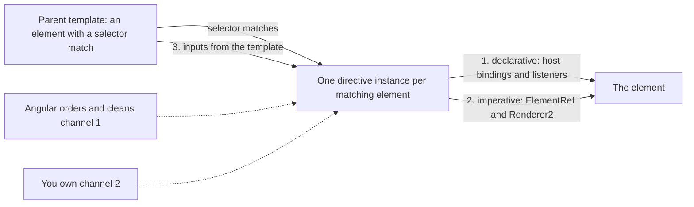
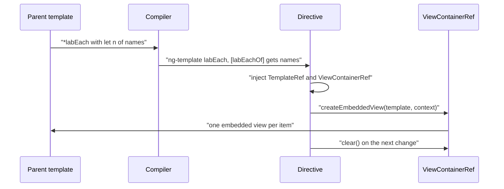
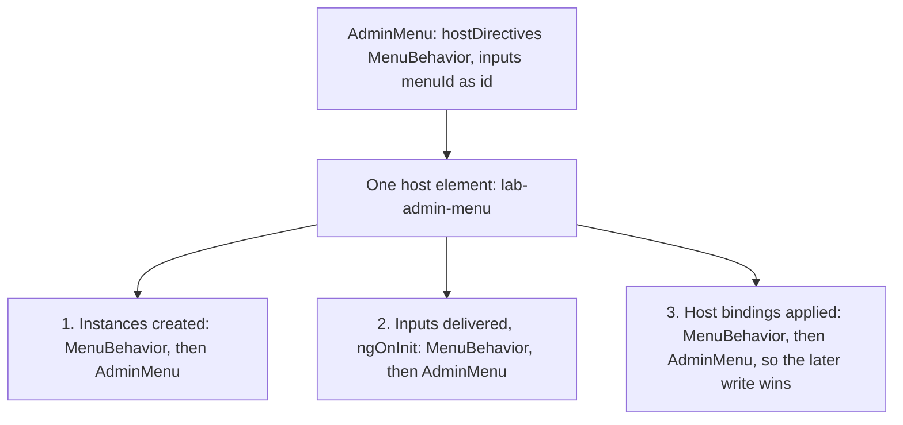
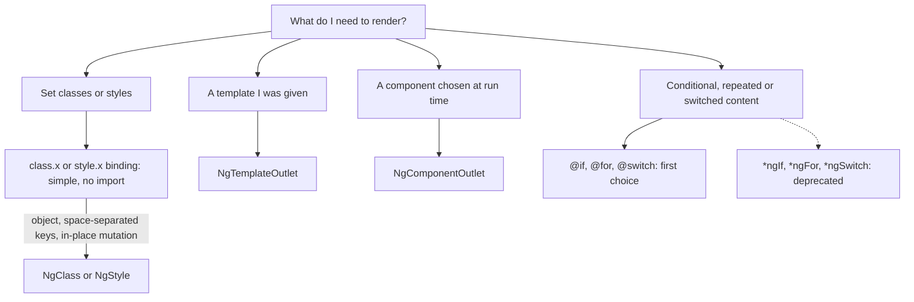
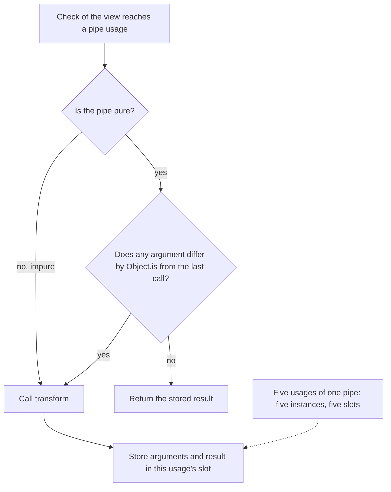
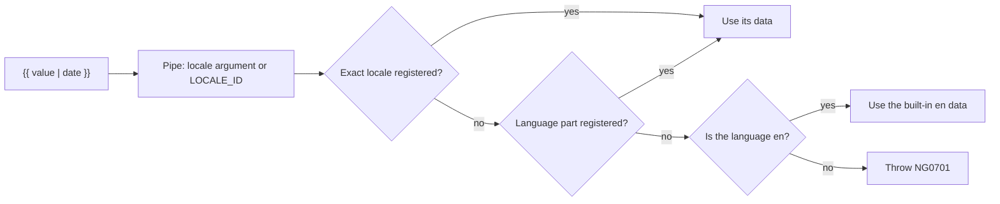
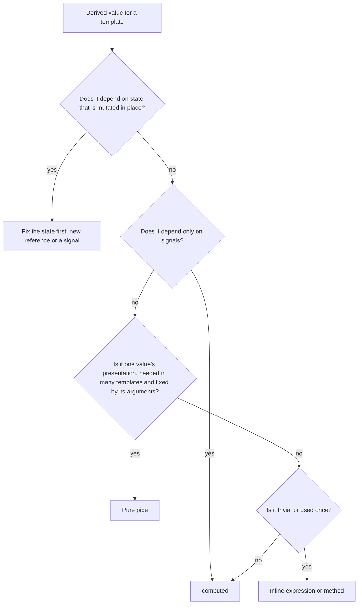
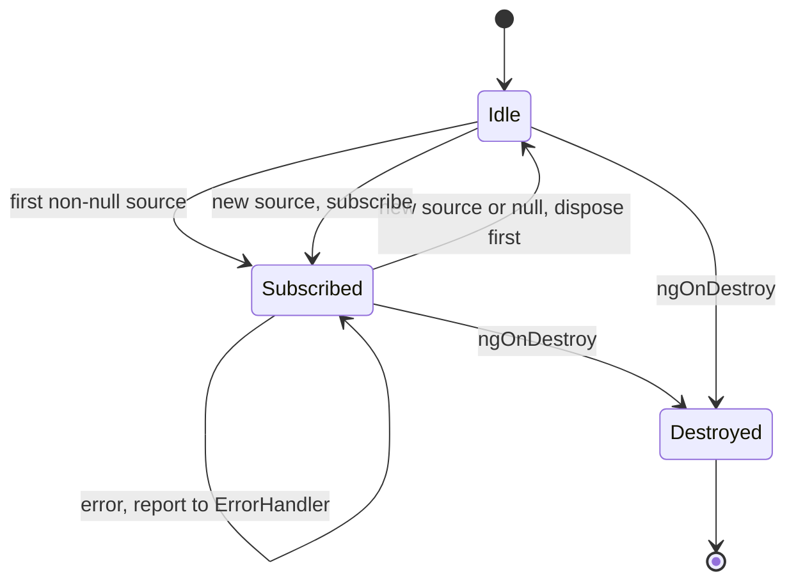

# 14. Directives and pipes: attribute and structural directives, host directives, pipes and the async pipe

> **What this covers:** how Angular 22 attaches behavior and formatting to templates: attribute directives with `host`, inputs, `ElementRef` and `Renderer2`; structural directives built on `TemplateRef` and `ViewContainerRef`, the microsyntax and the template type guards; host directives and the composition API; the built-in directives that are still current (`NgClass`, `NgStyle`, `NgTemplateOutlet`, `NgComponentOutlet`) and the ones control flow deprecated; pure and impure pipes, custom pipes and injection; the built-in pipes and locale data; the choice between a pipe, a `computed` and a method call; and the internals of the `async` pipe. By the end you can predict how often a pipe or a method runs, explain who wins when a directive and a binding disagree, and say what the `async` pipe does at every step of its life.
> **Prerequisites:** [13. Components and templates](13-components-and-templates.md#7-the-host-element-host-metadata-hostbinding-and-hostlistener) (host metadata, [reference variables](13-components-and-templates.md#6-template-reference-variables-and-let)) and [17 §2](17-signals.md#2-writable-signals) and [§3](17-signals.md#3-computed-signals) (signals and `computed`)
> **Leads to:** [15. Standalone and NgModules](15-standalone-and-ngmodules.md), [16. Dependency injection](16-dependency-injection.md), [18. Control flow and defer](18-control-flow-and-defer.md), [19. Component communication and projection](19-component-communication-and-projection.md), [21. Change detection](21-change-detection.md), [34. i18n](34-i18n.md)
> **Applies to:** Angular 22.2 (`@angular/core`, `@angular/common`, `@angular/compiler-cli` 22.2.1), TypeScript 6.0, Node 24
> **Study time:** ~6 hours reading + ~6 hours exercises
> **Short on time:** read [1. Directives and attribute directives](#1-directives-and-attribute-directives-host-inputs-elementref-and-renderer2), [5. Pipes](#5-pipes-pure-and-impure-custom-pipes-injection-and-imports) and [8. The `async` pipe](#8-the-async-pipe-under-the-hood), then drill [Q14.02](#q14-02), [Q14.05](#q14-05), [Q14.09](#q14-09), [Q14.17](#q14-17), [Q14.18](#q14-18) and [Q14.26](#q14-26), try [Exercise 14.4](#ex14-4), and finish with the [Summary](#summary).
> **Labs:** [`labs/angular/src/app/modules/14-directives-and-pipes/`](../labs/angular/src/app/modules/14-directives-and-pipes/) (section specs, Exercises 14.1-14.4, *Output* questions) and [`labs/ts-js/src/modules/14-directives-and-pipes/`](../labs/ts-js/src/modules/14-directives-and-pipes/) (Exercise 14.5). Run (Node 24): from `labs/angular`, `npx ng test --watch=false --include='src/app/modules/14-directives-and-pipes/**/*.spec.ts'`; from `labs/ts-js`, `npx vitest run src/modules/14-directives-and-pipes`

## Contents

1. [Directives and attribute directives: host, inputs, `ElementRef` and `Renderer2`](#1-directives-and-attribute-directives-host-inputs-elementref-and-renderer2)
2. [Structural directives: `ng-template`, `TemplateRef`, `ViewContainerRef` and the microsyntax](#2-structural-directives-ng-template-templateref-viewcontainerref-and-the-microsyntax)
3. [Host directives: the composition API](#3-host-directives-the-composition-api)
4. [Built-in directives: `NgClass`, `NgStyle`, the outlets and what control flow replaced](#4-built-in-directives-ngclass-ngstyle-the-outlets-and-what-control-flow-replaced)
5. [Pipes: pure and impure, custom pipes, injection and imports](#5-pipes-pure-and-impure-custom-pipes-injection-and-imports)
6. [Built-in pipes and locale data](#6-built-in-pipes-and-locale-data)
7. [Pipe, `computed` or method call in a template](#7-pipe-computed-or-method-call-in-a-template)
8. [The `async` pipe under the hood](#8-the-async-pipe-under-the-hood)
- [Summary](#summary)
- [Question bank](#question-bank)
- [Hands-on exercises](#hands-on-exercises)
- [Check your understanding](#check-your-understanding)
- [Connections](#connections)

**How the claims here are verified.** Runtime behavior is asserted by Angular specs under `ng test` (the ahead-of-time test build, which type-checks templates, running in jsdom, a JavaScript DOM for Node), and one model by a `labs/ts-js` Vitest test; each such sentence names its test. Compiler output and diagnostics are quoted, dated, from `ngc` 22.2.1 (the compiler's command line) runs on a throwaway project. Package behavior is read from the 22.2.1 typings and sources, and guidance from angular.dev (footer "Built by Angular at v22.2.1") and the Angular CHANGELOG, each dated. Server-side rendering, real-browser rendering, timings and non-`en` locale data are documented from cited sources only, never observed.

## 1. Directives and attribute directives: host, inputs, `ElementRef` and `Renderer2`

### The problem it solves

A highlight directive sets `el.nativeElement.style.color = 'red'` in its constructor, but the template binds `[style.color]`, so the text stays blue. On an `<ng-template>` the same directive throws, because its "element" is a comment. A reviewer asks why it uses `Renderer2` when the docs say that adds no safety.

### Mental model

A **directive** is behavior attached to an existing element by a [selector](13-components-and-templates.md#1-component-anatomy-selector-template-styles-imports-and-the-v22-file-convention), with no view of its own; a component is a directive that owns a view. An **attribute directive** changes how its element looks or behaves; the **structural** kind, which adds and removes elements, is [section 2](#2-structural-directives-ng-template-templateref-viewcontainerref-and-the-microsyntax). Think of an accessory clipped onto a tool: the tool keeps its own body. A directive has three channels to its element.



What to notice: only channel 1 is written by bindings, so an imperative write loses to a binding.

### How it actually works

**When to write one.** Angular has three kinds (components, attribute and structural directives) ([Directives](https://angular.dev/guide/directives), read 2026-10-07). For one element, "Angular's template syntax already covers changing a single element's classes, styles, properties, and events" ([Attribute directives](https://angular.dev/guide/directives/attribute-directives), read 2026-10-07).

**Metadata.** The `Directive` typings (`@angular/core` 22.2.1, read 2026-10-07) allow element, class, attribute, `:not()` and comma-list selectors, none crossing "element boundaries". `host` metadata, which declares **host bindings** and listeners on the directive's element, is [13 §7](13-components-and-templates.md#7-the-host-element-host-metadata-hostbinding-and-hostlistener)'s ([Q13.21](13-components-and-templates.md#q13-21)); here it is channel 1 (`Section 1: host metadata and a signal input configure the host element`).

**Inputs, aliases and `exportAs`.** A signal `input()` named like the selector lets one binding apply and configure the directive, `[labHighlight]="colour()"` ([docs](https://angular.dev/guide/directives/attribute-directives)). A bare `labHighlight` sets the input to `''`, not its default `'yellow'`: the bare element gets no background (`Section 1: host metadata and a signal input configure the host element`). `input(false, { transform: booleanAttribute })` turns `''` into `true` (`Section 1: a bare attribute is true through booleanAttribute`). An **alias** is an input's or output's public template name: `input(1, { alias: 'labSize' })` and `output<number>({ alias: 'labFired' })` bound under them (`Section 1: input and output aliases use the template names`). `exportAs` publishes the instance to a [template reference](13-components-and-templates.md#6-template-reference-variables-and-let) (`Section 1: exportAs lets a template reference read the directive instance`).

**`ElementRef`.** `ElementRef` wraps the host's DOM node in `nativeElement`, typed `any`. Its typings carry `@security`: "Permitting direct access to the DOM can make your application more vulnerable to XSS attacks" (**XSS**, cross-site scripting, runs an attacker's script in your page; [33](33-security.md#2-xss-and-angulars-template-model-escaping-by-default-trusted-templates-and-the-paths-around-them)). On a `<div>` it is an element; on `<ng-template>` and `<ng-container>` it is a **comment node**, a DOM node that renders nothing ([08 §3](08-browser-rendering-dom-events.md#3-dom-apis-and-observers)) (`Section 1: nativeElement is an element on a div and a comment node on ng-template and ng-container`). A comment has no `style`: a write throws a `TypeError` (`Section 1: a style write on a comment node throws a TypeError because it has no style property`).

**`Renderer2`.** `Renderer2` is an abstract class that Angular's DOM renderer implements. Its typings say that, "in context of accessing DOM elements", it "provides no extra security". The docs add that, beyond style encapsulation and [animation](35-animations.md#8-legacy-angularanimations-triggers-states-transitions-query-and-stagger) hooks, "there is no difference between using `Renderer2` and native DOM APIs" ([Using DOM APIs](https://angular.dev/guide/components/dom-apis), read 2026-10-07).

**Why not touch the DOM directly.** (1) A binding overwrites the write, `Renderer2` included: `style="color: blue;"` after red (`Section 1: a binding on the same property overwrites a direct write, and an unbound class stays`, `Section 1: Renderer2 writes are overwritten by a binding like direct writes`). (2) The docs state `Renderer2` "do[es] not support DOM manipulation in server-side rendering" ([32](32-ssr-ssg-hydration.md#4-hydration-reusing-the-servers-dom-mismatches-and-ngskiphydration)); documented only. (3) `innerHTML` set directly skips the sanitizing that bindings do (docs). (4) Angular guarantees a rendered DOM only in render callbacks such as `afterEveryRender` ([20](20-lifecycle-and-render-hooks.md#4-render-hooks-afternextrender-aftereveryrender-and-their-phases)), the docs' place for focus, measuring and observers.

`ng generate directive shared/highlight` writes `highlight.ts`; `--type directive` gives `highlight.directive.ts` (`--dry-run`, 2026-10-07).

> [!NOTE]
> **Framework vs platform.** The element, `style`, comment nodes and events are the browser's ([08](08-browser-rendering-dom-events.md)). Angular adds selector matching, host bindings and `Renderer2`, which the docs say buys only encapsulation and animation hooks.

### Code

The approach: configure the host declaratively; write imperatively only where no binding competes.

1. `Highlight` puts an input, named like its selector, on the host.
2. `Direct` writes in its constructor; a binding overwrites it.

```ts
// Excerpt of labs/angular/src/app/modules/14-directives-and-pipes/concepts/section-1-attribute-directives.spec.ts
@Directive({
  selector: '[labHighlight]',
  host: {
    '[style.background-color]': 'labHighlight()',
    '[class.hovered]': 'hovered()',
    '(mouseenter)': 'hovered.set(true)',
    '(mouseleave)': 'hovered.set(false)',
  },
})
class Highlight {
  readonly labHighlight = input('yellow');
  protected readonly hovered = signal(false);
}
```

```ts
// Excerpt of labs/angular/src/app/modules/14-directives-and-pipes/concepts/section-1-attribute-directives.spec.ts
@Directive({ selector: '[labDirect]' })
class Direct {
  constructor() {
    const el: HTMLElement = inject(ElementRef).nativeElement;
    el.style.color = 'red';
    el.classList.add('direct');
  }
}
```

```html
<!-- Excerpt of labs/angular/src/app/modules/14-directives-and-pipes/concepts/section-1-attribute-directives.spec.ts -->
<p id="direct" labDirect [style.color]="colour()" [class.on]="flag()">direct</p>
```

### Best practices and anti-patterns

- **Use `host` bindings for per-element behavior**, because Angular keeps them current.
- **Write a directive for reused behavior only**, because one element needs a binding.
- **Name an input like the selector**, because one binding then applies and configures it.
- **Reach for `ElementRef` last**, for focus, measuring or observers, because the docs allow DOM APIs for them.
- **Never set `innerHTML` from a directive**, because the docs call it an XSS risk.

### Misconceptions and traps

- *"`Renderer2` makes DOM access safe."* The typings say it "provides no extra security". The myth exists because the name suggests a safety layer.
- *"A directive only lives on elements."* It also matches `<ng-template>` and `<ng-container>`, where `nativeElement` is a comment. The myth exists because of the name.
- *"A bare `labHighlight` uses the default."* The input receives `''`. The myth exists because a missing binding feels like a missing value.

Drilled in [Q14.01](#q14-01), [Q14.02](#q14-02), [Q14.03](#q14-03) and [Q14.04](#q14-04); practised in [Exercise 14.1](#ex14-1).

## 2. Structural directives: `ng-template`, `TemplateRef`, `ViewContainerRef` and the microsyntax

### The problem it solves

A team needs "render this only if the user may" in 40 templates, so each one copies an `@if` with a service call. A developer writes `<p *labA *labB>` and gets a parser error. A custom directive's `let item` is typed `any`, so `item.nam` compiles.

### Mental model

A **structural directive** is a directive on an `<ng-template>` that decides when, and how often, that template is stamped out; the `*` is shorthand that wraps an element in the `<ng-template>`. Think of a stencil: the `<ng-template>` renders nothing by itself, **`TemplateRef`** is the stencil, **`ViewContainerRef`** is the spot on the page where copies go, and each copy is an **embedded view**, a view created from a template with its own bindings and lifecycle.



What to notice: the directive never touches the elements inside the template; it only decides how many views exist and what context each receives.

### How it actually works

**`<ng-template>` and `TemplateRef`.** A `TemplateRef` comes from a reference variable, a query or injection into a directive on the `<ng-template>`, and renders through `NgTemplateOutlet` ([section 4](#4-built-in-directives-ngclass-ngstyle-the-outlets-and-what-control-flow-replaced)) or `ViewContainerRef.createEmbeddedView` ([ng-template](https://angular.dev/guide/templates/ng-template), read 2026-10-07). The typings (`@angular/core` 22.2.1, read 2026-10-07) say the root elements of views in a container "become siblings of the anchor element", a comment node (as in [section 1](#1-directives-and-attribute-directives-host-inputs-elementref-and-renderer2)); the anchor survives when every view is cleared (`Section 2: a structural directive creates, replaces and clears embedded views`).

**The `*` shorthand and the microsyntax.** The **microsyntax** is the mini-language inside `*dir="…"`. The docs translate a naked expression to `[prefix]`, a key to `[prefixKey]` and `let local` to `let-local="export"`; a bare `let` reads `$implicit`. Their table row, quoted: `*myDir="let item of [1,2,3] as items; trackBy: myTrack; index as i"` is `<ng-template myDir let-item [myDirOf]="[1,2,3]" let-items="myDirOf" [myDirTrackBy]="myTrack" let-i="index">` ([Structural directives](https://angular.dev/guide/directives/structural-directives), read 2026-10-07). The **template context** is the object given to `createEmbeddedView`, and **`$implicit`** is its key a bare `let` reads. `*labRepeat="n(); let v; let i = index; let first = first"` renders `0-0-true` and `10-1-false` (`Section 2: microsyntax keys bind prefixed inputs and let variables read the context`); `else other` binds the input `labUnlessElse`, and the view comes from the same container (`Section 2: an else template is rendered through the same view container`). Both forms render the same HTML (`Section 2: the shorthand and the long form render the same DOM`). Since v20.3.1 only inputs named in the microsyntax bind [Changed in v20.3.1: "only bind inputs that are part of microsyntax to a structural directive"] ([CHANGELOG](https://github.com/angular/angular/blob/main/CHANGELOG.md), read 2026-10-07).

**One `*` per element.** Only one `<ng-template>` exists to unwrap onto, so the docs allow "only one structural directive per element" and suggest `<ng-container>` (a grouping element that renders nothing, as a comment) as the wrapper. The diagnostics are quoted below; a missing import of a `*` directive is only an extended-diagnostic warning ([Q12.21](12-angular-how-it-works.md#q12-21)).

**Views and injectors.** `clear()` and destroying the directive destroy its views (`Section 2: embedded views are destroyed with the directive`). A view's injector "comes from the template declaration's location, not from where it is rendered": a template declared in a component that provides a token as `declarer`, rendered inside one that provides `renderer`, reads `declarer` (`Section 2: an embedded view injects from where the template is declared, not where it renders`). The docs override it with an `injector` option ([16](16-dependency-injection.md)).

**Template type guards.** The **template type checker** ([12 §7](12-angular-how-it-works.md#7-aot-versus-jit-and-template-type-checking)) compiles a `let` variable as untyped unless the directive adds a guard (below). A **type assertion function** is a function whose return type `x is T` tells TypeScript that `x` is a `T` afterwards. `ngTemplateContextGuard` is a static one that types the context from the directive's own generic; `ngTemplateGuard_input` narrows an input's expression, by assertion function or by the literal `'binding'`, which treats the bound expression as truthy inside the template (docs). The docs call the body "not used at runtime, and included only to avoid TypeScript errors": a guard whose body throws still renders (`Section 2: a context guard body never runs, it only types the template`). `NgIf` [Deprecated since v20.0 — use @if] (typings: `@deprecated 20.0`) carries both ([section 4](#4-built-in-directives-ngclass-ngstyle-the-outlets-and-what-control-flow-replaced)).

### Code

The approach: two small directives, each with its guard.

1. Inject `TemplateRef` and `ViewContainerRef`.
2. Rebuild the views in an `effect` (Angular re-runs it when a signal it read changes, [17 §4](17-signals.md#4-effects)) that reads the input; `untracked` keeps any signal read while creating a view out of its dependencies.
3. Add the guards as static members.

```ts
// Excerpt of labs/angular/src/app/modules/14-directives-and-pipes/concepts/repeat-demo.ts
export interface EachContext<T> {
  readonly $implicit: T;
  readonly index: number;
}

@Directive({ selector: '[labEach]' })
export class Each<T> {
  readonly labEachOf = input.required<readonly T[]>();
  private readonly template = inject<TemplateRef<EachContext<T>>>(TemplateRef);
  private readonly container = inject(ViewContainerRef);

  constructor() {
    effect(() => {
      const items = this.labEachOf();
      untracked(() => {
        this.container.clear();
        items.forEach((item, index) => this.container.createEmbeddedView(this.template, { $implicit: item, index }));
      });
    });
  }

  static ngTemplateContextGuard<T>(_directive: Each<T>, _context: unknown): _context is EachContext<T> {
    return true;
  }
}
```

```ts
// Excerpt of labs/angular/src/app/modules/14-directives-and-pipes/concepts/repeat-demo.ts
@Directive({ selector: '[labShow]' })
export class Show {
  readonly labShow = input.required<unknown>();
  static ngTemplateGuard_labShow: 'binding';
}
```

```html
<!-- Excerpt of labs/angular/src/app/modules/14-directives-and-pipes/concepts/repeat-demo.ts -->
<li *labEach="let name of names(); let i = index">{{ i }}:{{ name.toUpperCase() }}</li>
<p *labShow="nickname">{{ nickname.length }}</p>
```

Observed by compiling `repeat-demo.ts` with `ngc` 22.2.1 on 2026-10-07 (instruction lines only, the `i0.` prefix left out):

```text
consts: [[4, "labEach", "labEachOf"], [4, "labShow"]]
create: ɵɵtemplate(1, RepeatDemo_li_1_Template, 2, 2, "li", 0)
        ɵɵtemplate(2, RepeatDemo_p_2_Template, 2, 1, "p", 1)
update: ɵɵproperty("labEachOf", ctx.names())
        ɵɵproperty("labShow", ctx.nickname)
in RepeatDemo_li_1_Template: const name_r1 = ctx.$implicit; const i_r2 = ctx.index;
```

Each `*` became a template instruction plus an input binding, and the guards stayed ordinary static members that no emitted template function calls; `ɵ` names are compiler output, not for application code. Observed by compiling throwaway components with `ngc` 22.2.1 on 2026-10-07 (paths removed, messages shortened):

```text
*labEach, guarded:        error TS2339: Property 'nope' does not exist on type 'string'.
*labPlain, no guard:      (no diagnostic: n.nope compiles)
*labShow="maybe":         (no diagnostic inside); the same read outside: error TS2531: Object is possibly 'null'.
*labShow="sig()":         error TS2531: Object is possibly 'null'.
<p *labA *labB>:          error NG5002: Can't have multiple template bindings on one element. Use only one attribute prefixed with *
*labA, not imported:      warning NG8116: A structural directive `labA` was used in the template without a corresponding import in the component. ...
*ngIf, not imported:      warning NG8103: The `*ngIf` directive was used in the template, but neither the `NgIf` directive nor the `CommonModule` was imported. ...
```

The `'binding'` guard narrowed a property read but not the call `sig()`.

### Best practices and anti-patterns

- **Use `@if` and `@for` for one-off rendering and a structural directive for a rule repeated across templates**, because the docs say "For everyday conditional and repeated rendering, use Angular's built-in control flow blocks" ([18](18-control-flow-and-defer.md#1-built-in-blocks-versus-directives-and-the-if-family-with-as)).
- **Add `ngTemplateContextGuard` to every directive that supplies a context**, because without it `let` variables are untyped and a typo compiles.
- **Add `ngTemplateGuard_x: 'binding'` when the template renders only for a truthy input**, because nullable values then narrow inside it.
- **Wrap in `<ng-container>` to combine two structural directives**, because one element accepts one `*` (`NG5002`).
- **Keep a guard body to `return true`**, because it never runs and any other body misleads the reader.

### Misconceptions and traps

- *"`*` is the special syntax of `*ngIf`."* It is shorthand any directive can use. The myth exists because `*ngIf` was the first structural directive everyone met.
- *"The element carrying `*` is rendered, then hidden."* The template renders nothing until a view is created, and a cleared container leaves only the anchor comment. The myth exists because of `[hidden]` habits.
- *"`ngTemplateContextGuard` runs at run time."* It is compile-time only. The myth exists because it is written as a method.

Drilled in [Q14.05](#q14-05), [Q14.06](#q14-06), [Q14.07](#q14-07) and [Q14.08](#q14-08); practised in [Exercise 14.2](#ex14-2).

## 3. Host directives: the composition API

### The problem it solves

Four components repeat the same `role`, focus ring and `aria-busy` (an ARIA state, [11 §3](11-accessibility.md#3-aria-roles-states-properties-and-its-rules), that marks an element as being updated: [ARIA 1.2](https://www.w3.org/TR/wai-aria-1.2/#aria-busy), read 2026-10-08) handling in their `host` metadata. A base class shares them but forces one inheritance chain, and a design-system component must expose exactly one input of the shared behavior.

### Mental model

**Host directives** are directives that a class applies to its own host element from its decorator, with `hostDirectives`; **composition** is building a class's behavior from such parts instead of inheriting it. Think of a manufacturer fitting a certified part: the buyer cannot remove it, and the manufacturer chooses which switches reach the dashboard.



What to notice: the order is the same for constructors, inputs and host bindings, so the host can override the directive and never the reverse.

### How it actually works

**The API and its constraints.** `hostDirectives` [Stable since v15.0] arrived with "enable the new directive composition API" in 15.0.0 ([CHANGELOG](https://github.com/angular/angular/blob/main/CHANGELOG.md), read 2026-10-07); the docs ([Directive composition API](https://angular.dev/guide/directives/directive-composition-api), read 2026-10-07) say Angular applies host directives "statically at compile time", they "may not specify `standalone: false`" and their selector is ignored. Directives can have host directives too (transitive composition); invalid forms fail to compile (below).

**Exposure and aliases.** By default none of a host directive's inputs or outputs reach the host; the `Directive` typings (`@angular/core` 22.2.1, read 2026-10-07) say so. **Exposure** means listing the name in `inputs` or `outputs`, and an [alias](#1-directives-and-attribute-directives-host-inputs-elementref-and-renderer2) `'menuId: id'` renames it for templates. In the lab, `id="top"` reaches the input and stays a plain attribute, an unexposed `menuId="ignored"` stays a plain attribute, and an output reaches a listener only when exposed (`Section 3: only the listed inputs and outputs are exposed and an alias renames them`).

**Order and precedence.** The docs order constructors, then input deliveries, then host bindings, host directive first each time. The lab logs `ctor MenuBehavior`, `ctor AdminMenu has MenuBehavior=true`, `init MenuBehavior id=top`, `init AdminMenu`, and the component's `role="navigation"` and `color: blue` beat the directive's `menu` and `red`; a class that overrides nothing shows the directive's values, and the directive's class binding survives (`Section 3: host directive constructors and inputs run before the host's and the host's bindings win`). Template-versus-`host` collisions are [13's](13-components-and-templates.md#q13-22).

**Injection.** The docs say host and host directives can inject each other, and the providers of the class with `hostDirectives` take precedence over a host directive's for the same token. The lab checks only the mutual injection (`Section 3: the host can inject its host directive`), not that precedence. Provider order beyond that is [16](16-dependency-injection.md)'s.

**De-duplication** [Changed in v22.0: "de-duplicate host directives"] (CHANGELOG, 22.0.0). **De-duplication** keeps one instance of a directive reached more than once. A directive also matched in the template keeps that match, with its full API (`Section 3: a directive that is also matched in the template is one instance`). A host directive reached by two directives is one merged instance (`Section 3: two directives sharing a host directive get one instance`). This is the **diamond problem**: two paths reach one shared part, and in multiple inheritance it is unclear which copy applies. Different aliases for one input on the two paths are `NG8024`.

**Against inheritance and the template.** `extends` couples a class to one parent, and a template needs every consumer to repeat the attribute; host directives need neither but are static, so no runtime choice. This is my argument, not a doc claim. For `role` and keys the native element comes first ([Q13.23](13-components-and-templates.md#q13-23), [Q11.03](11-accessibility.md#q11-03)); a host directive is the host-side half.

### Code

The approach: one directive carries the shared behavior, one component composes it and publishes a single renamed input.

1. `MenuBehavior` sets a role, colour and class through `host`, with an input and an output.
2. `AdminMenu` lists it, exposes `menuId` as `id` and `closed`, and overrides `role` and colour.

```ts
// Excerpt of labs/angular/src/app/modules/14-directives-and-pipes/concepts/menu-demo.ts
@Directive({
  selector: '[labMenuBehavior]',
  host: {
    role: 'menu',
    '[style.color]': "'red'",
    '[class.menu-behavior]': 'true',
  },
})
export class MenuBehavior implements OnInit {
  readonly menuId = input('none');
  readonly closed = output<void>();
}
```

```ts
// Excerpt of labs/angular/src/app/modules/14-directives-and-pipes/concepts/menu-demo.ts
@Component({
  selector: 'lab-admin-menu',
  template: 'admin',
  hostDirectives: [{ directive: MenuBehavior, inputs: ['menuId: id'], outputs: ['closed'] }],
  host: {
    role: 'navigation',
    '[style.color]': "'blue'",
  },
})
export class AdminMenu implements OnInit {
  private readonly behavior = inject(MenuBehavior);
}
```

Observed by compiling `menu-demo.ts` with `ngc` 22.2.1 on 2026-10-07 (the `features` entry of `AdminMenu`, the `i0.` prefix left out):

```text
features: [ɵɵHostDirectivesFeature([{ directive: MenuBehavior, inputs: ["menuId", "id"], outputs: ["closed", "closed"] }])]
```

The decorator became a static entry; each alias is a pair of names. Observed by compiling throwaway components with `ngc` 22.2.1 on 2026-10-07 (paths, trailing link and code frame left out):

```text
inputs: ['nope']:        error NG2017: Directive DirIn does not have an input with a public name of nope.
outputs: ['gone']:       error NG2017: Directive DirOut does not have an output with a public name of gone.
standalone: false:       error NG2014: Host directive DirNonStandalone must be standalone
a plain class:           error NG2013: NotADirective must be a standalone directive to be used as a host directive
required, not exposed:   error NG2019: Required input 'must' from host directive Req must be exposed.
labPopover labDropdown:  error NG8024: Input declared in TriggerRef.triggerId is exposed under the following conflicting names: "popoverTriggerId", "dropdownTriggerId". An input can only be exposed under a single name.
```

The last row comes from two directives that alias `TriggerRef.triggerId` differently; it is reported at the element.

### Best practices and anti-patterns

- **Expose only what consumers need**, because the rest can change freely.
- **Override a host directive's binding in the component**, because the host applies last.
- **Expose every required input of a host directive**, because `NG2019` fails the build otherwise.
- **Alias a shared host directive's input identically on every path**, because two aliases are `NG8024`.
- **Keep the native element first for roles and keys**, because a host directive does not replace a `<button>`.

### Misconceptions and traps

- *"Host directive inputs are part of the component's API automatically."* They are not: the docs and typings say none are exposed by default. The myth exists because a directive's inputs are public when applied in a template.
- *"The component's `host` and its host directive's `host` merge, so order does not matter."* The later write wins, and the component is later. The myth exists because "merge" sounds order-free.
- *"`hostDirectives` was added in v22."* The API is v15.0; v22.0 reworked de-duplication. The myth exists because the v22 change is the recent one.

Drilled in [Q14.09](#q14-09), [Q14.10](#q14-10), [Q14.11](#q14-11) and [Q14.12](#q14-12); practised in [Exercise 14.3](#ex14-3).

## 4. Built-in directives: `NgClass`, `NgStyle`, the outlets and what control flow replaced

### The problem it solves

A team keeps `[ngClass]` everywhere while the style guide asks for `[class]`. A table cell must render a caller-supplied template. A dashboard renders run-time widgets and loses an input when its config object changes. A new hire asks why `*ngFor` is struck through.

### Mental model

A **built-in directive** is an ordinary directive that ships in `@angular/common`: nothing in it is privileged, so you can read, copy or replace each one. Think of a tool drawer: some tools are still sold, but a better replacement now hangs on the wall, the template syntax itself.



What to notice: only the dotted branch is deprecated; `NgClass` and `NgStyle` sit on a side path that is not.

### How it actually works

**`NgClass` and `NgStyle`.** Both implement `ngDoCheck`, a hook that runs on every check of the view ([20](20-lifecycle-and-render-hooks.md#3-which-hooks-still-matter-with-signals)), and write through `Renderer2` ([section 1](#1-directives-and-attribute-directives-host-inputs-elementref-and-renderer2)). `NgClass` keeps a per-class state map and splits keys on whitespace; `NgStyle` uses a **key-value differ**, a helper that compares an object with its previous copy, and removes a style whose value is null (`@angular/common` 22.2.1, `fesm2022/_common_module-chunk.mjs`, read 2026-10-07). So they see in-place mutation and accept `'a b': on` (`Section 4: NgClass applies space-separated keys and sees in-place mutation while [class] does not`), and `{ 'width.px': w }` renders `width: 10px` (`Section 4: NgStyle applies units and removes null`); a `[class]` binding compares references ([Q13.13](13-components-and-templates.md#q13-13)). Neither carries a deprecation tag; for "more simple use cases" the typings point to bindings: "It doesn't require importing a directive" (read 2026-10-07). Two schematics migrate them, `ngclass-to-class` and `ngstyle-to-style` [Added in v21.0] ([CHANGELOG](https://github.com/angular/angular/blob/main/CHANGELOG.md), read 2026-10-07: "add migration to convert ngClass to use class"); the `ngstyle-to-style` option `--best-effort-mode` "can be unsafe" for mutated objects ([page](https://angular.dev/reference/migrations/ngstyle-to-style), read 2026-10-07).

**`NgTemplateOutlet`.** An **outlet** renders something it is given. `*ngTemplateOutlet="tpl; context: ctx"` creates an embedded view ([section 2](#2-structural-directives-ng-template-templateref-viewcontainerref-and-the-microsyntax)); the typings say it forwards the context through a proxy, so a swapped object keeps the same node and shows `T[ctx2|6]` (`Section 4: ngTemplateOutlet renders with a context and follows a swapped context object without recreating the view`). The injector is the declaration site's unless `injector` overrides it (`Section 4: ngTemplateOutlet uses the declaration injector unless an injector is given`); `'outlet'` [Added in v21.2] ("add an 'outlet' injector option for ngTemplateOutlet") inherits the outlet's own (`Section 4: ngTemplateOutletInjector 'outlet' inherits the injector of the outlet's location`).

**`NgComponentOutlet`.** It creates a **dynamic component**, one whose class is chosen at run time, with inputs, an injector, an environment injector (application scope, [16](16-dependency-injection.md)) and content. The `ngModuleFactory` input is gone [Changed in v21.0: "NgModuleFactory has been removed, use NgModule instead"]. When the inputs object changes, the source sets each dropped input to `undefined`, not its default: `W1[L1|1]` becomes `W1[L2|]` (`Section 4: ngComponentOutlet sets inputs and resets dropped ones to undefined`). The `injector` input supplies tokens the widget could not otherwise see (`Section 4: ngComponentOutlet honors the injector option`).

**What control flow replaced.** `NgIf` ([section 2](#2-structural-directives-ng-template-templateref-viewcontainerref-and-the-microsyntax)), `NgForOf` and `NgSwitch` with its case directives are `@deprecated 20.0` in the typings, "Intent to remove in a future major release" [Deprecated since v20.0 — use `@if`, `@for`, `@switch`]; 22.2.1 still ships them. The blocks need no import and compile to dedicated instructions (below). The migration `ng generate @angular/core:control-flow` documents one breaking change: when a `track` property changes on the same object, `@for` updates the view's bindings where `*ngFor` recreated the element ([migration page](https://angular.dev/reference/migrations/control-flow), read 2026-10-07; not run here; [18](18-control-flow-and-defer.md#8-migrating-with-ng-generate-angularcorecontrol-flow) owns the detail). The team's stated reasons were not readable, so no performance claim is made.

### Code

The approach: render one widget chosen at run time from a signal.

1. Expose the class as a member, because the template cannot name it.
2. Bind `inputs` and `injector` in the microsyntax.
3. Replace the inputs object to change them; any key left out is reset.

```ts
// Excerpt of labs/angular/src/app/modules/14-directives-and-pipes/concepts/section-4-builtin-directives.spec.ts
@Component({ selector: 'lab-s4-w1', template: `W1[{{ label() }}|{{ n() }}]` })
class W1 {
  readonly label = input('L0');
  readonly n = input(0);
}
```

```ts
// Excerpt of labs/angular/src/app/modules/14-directives-and-pipes/concepts/section-4-builtin-directives.spec.ts
@Component({
  selector: 'lab-s4-comp-host',
  imports: [NgComponentOutlet],
  template: `<ng-container *ngComponentOutlet="comp(); inputs: inputs(); injector: injector()" />`,
})
class CompHost {
  // A template cannot name a class, so the class is exposed as a member.
  readonly comp = signal<Type<unknown>>(W1);
  readonly inputs = signal<Record<string, unknown>>({ label: 'L1', n: 1 });
  readonly injector = signal<Injector | undefined>(undefined);
}
```

Observed by compiling throwaway components with `ngc` 22.2.1 on 2026-10-07: `*ngComponentOutlet="W1"` without a member is `error TS2339: Property 'W1' does not exist on type 'Q'.` One component holding `*ngIf`, a custom `*labTwo="n(); of: list()"` and `@if` emitted (the `i0.` prefix left out):

```text
consts: [[4, "ngIf"], [4, "labTwo", "labTwoOf"]]
create: ɵɵtemplate(0, P_p_0_Template, 2, 0, "p", 0)(1, P_p_1_Template, 2, 0, "p", 1)
        ɵɵconditionalCreate(2, P_Conditional_2_Template, 2, 0, "p")
update: ɵɵproperty("ngIf", ctx.n())
        ɵɵproperty("labTwo", ctx.n())("labTwoOf", ctx.list())
        ɵɵconditional(ctx.n() ? 2 : -1)
dependencies: [NgIf, LabTwo]
```

Both `*` forms became a template plus input bindings resolved through `dependencies`; `@if` needs neither. `ɵ` names are not application API.

#### Legacy

```html
<!-- Partial: the deprecated form, then its block -->
<li *ngFor="let u of users; trackBy: byId">{{ u.name }}</li>
@for (u of users; track u.id) { <li>{{ u.name }}</li> }
```

### Best practices and anti-patterns

- **Use `[class.x]` and `[style.x]` for simple cases**, because they need no import.
- **Reach for `NgClass` only for space-separated keys or in-place mutation**, because `[class]` does neither.
- **List every input you want kept in each `ngComponentOutletInputs` object**, because a dropped key is reset to `undefined`, not to its default.
- **Expose the component class as a member**, because a template cannot name it.
- **Write blocks in new code and migrate old code**, because the `*` forms are deprecated ([18](18-control-flow-and-defer.md#8-migrating-with-ng-generate-angularcorecontrol-flow)).

### Misconceptions and traps

- *"`NgClass` and `NgStyle` are deprecated."* The typings carry no tag on them, nor on the two outlets. The myth exists because the docs steer simple cases to bindings and ship migrations.
- *"`ngComponentOutlet` keeps the input default when a key disappears."* It sets `undefined`. The myth exists because a component never given the key does keep its default.
- *"`*ngIf` was removed in v20."* It was deprecated in v20.0 and still ships in 22.2.1. The myth exists because the IDE strike-through looks like removal.
- *"Control flow is just a faster `*ngIf`."* No source read here claims speed. The readable differences are no import, dedicated instructions and mandatory `track`. The myth exists because both arrived together.

Drilled in [Q14.13](#q14-13), [Q14.14](#q14-14), [Q14.15](#q14-15) and [Q14.16](#q14-16).

## 5. Pipes: pure and impure, custom pipes, injection and imports

### The problem it solves

A search box feeds `{{ items | filterBy: term }}`. Someone `push`es a new item and the screen does not change, because the pipe got the same array again. The obvious fix, `pure: false`, makes the pipe run on every check of the view. Other traps: a pipe injected into a service to reuse its logic; `isAdmin ? 'a' : 'b' | uppercase` leaving "a" in lower case; a callback passed to a pipe that reads a signal and never refreshes.

### Mental model

A **pipe** is a function the template calls for you (`{{ value | name: arg }}`), with a cache of exactly one result per place it is used. A **pure pipe** calls `transform` again only when an argument is a different value by `Object.is`, JavaScript's "same value" test, which for objects means the same reference ([01 §6](01-js-values-types-coercion.md#6-equality)). An **impure pipe** calls it on every check of its view. A cashier with a sticky note: if the same note comes back, she reads out the old answer.



What to notice: the sticky note lives in one expression's slot, so five usages are five instances with five caches, and impure pipes never ask the question.

### How it actually works

**Declaration.** `@Pipe({ name, pure, standalone })` plus `PipeTransform`, whose signature is `transform(value: any, ...args: any[]): any` (`@angular/core` 22.2.1 typings, read 2026-10-08). The typings say "Pipes are pure by default" and an impure pipe is "invoked on each change-detection cycle". The [pipes page](https://angular.dev/guide/templates/pipes) (read 2026-10-08, tag `v22.2.1`): "mutations to object properties or array items are not detected unless the entire object or array reference is replaced".

**Instances and slots.** A **view slot** is a cell Angular reserves in a view's storage for one binding ([12 §8](12-angular-how-it-works.md#8-under-the-hood-what-the-compiler-emits-and-what-the-runtime-does-with-it)). `ɵɵpipe` builds one pipe instance per usage when the view is created, through the **node injector** (the injector tied to a template node; [16](16-dependency-injection.md)) (`@angular/core` 22.2.1, `fesm2022/_debug_node-chunk.mjs`, read 2026-10-08), so nothing is shared between usages (`Section 5: every usage of a pipe gets its own instance`). `ɵɵpipeBind1` and `ɵɵpipeBind2` call `transform` directly for an impure pipe; for a pure one they compare each argument with the slot through `Object.is` and call only on a difference (`Section 5: a pure pipe runs again only when an argument changes by reference`, `Section 5: an impure pipe runs on every check of its view`).

**Literals and arrow functions.** The compiler hoists a literal such as `[1, 2]` into `ɵɵpureFunction0`, so the same array is passed each time (`Section 5: a literal argument does not make a pure pipe run again`). An arrow function argument [Added in v21.2] (CHANGELOG 21.2.0) goes through `ɵɵarrowFunction`, which creates the function once, stores it in the slot and returns the stored one afterwards (source read; the context is not compared). **Observed in 22.2.1, undocumented:** a callback reading `min()` keeps its first result after `min` changes (`Section 5: an arrow function passed to a pure pipe is not recreated when the signal it reads changes`). Do not rely on it. The [expression syntax page](https://angular.dev/guide/templates/expression-syntax) on `main` (read 2026-10-08) allows passing an arrow function to a pipe; the page at tag `v22.2.1` lists arrow functions as unsupported, so that page and the installed compiler disagree.

**Injection.** A pipe can `inject()` root tokens, `LOCALE_ID`, component `providers` and, observed, the host's `viewProviders` (`Section 5: a pipe can inject root, component and view providers`); the `ɵɵpipe` source switches view providers off during creation, so why is not explained here. Order is [16's](16-dependency-injection.md). "Pipes are not designed as injectable services" (docs): put the logic in a function that `transform` calls.

**Precedence.** The operator binds looser than `+` and tighter than `?:`. In the three expressions below the first pipes only `'no'`, so it prints `yes`; the parenthesized one prints `YES`; the third pipes the sum, `AB` (`Section 5: the pipe operator binds looser than plus and tighter than the conditional`).

```html
<!-- Excerpt of labs/angular/src/app/modules/14-directives-and-pipes/concepts/section-5-pipes.spec.ts -->
[{{ yes() ? 'yes' : 'no' | labS5Upper }}][{{ (yes() ? 'yes' : 'no') | labS5Upper }}][{{ 'a' + 'b' | labS5Upper }}]
```

**Imports and names.** Pipes are standalone by default [Changed in v19.0: `standalone` defaults to `true`] (CHANGELOG 19.0.0, "flipping the default value for `standalone` to `true`"): list one in `imports` ([15](15-standalone-and-ngmodules.md#2-standalone-components-and-the-imports-array)). `ng generate pipe shared/kebab-case --dry-run` creates `kebab-case-pipe.ts` and its spec (observed 2026-10-08); the class is `KebabCasePipe`.

**Compile time.** Observed by compiling a throwaway component with `ngc` 22.2.1 on 2026-10-08 (the `i0.` prefix removed, pieces of the emitted lines):

```text
create:      ɵɵpipe(2, "labDouble")   ɵɵpipe(4, "labLive")
update:      ɵɵpipeBind1(2, 5, ctx.n())   ɵɵpipeBind2(3, 7, ctx.n(), 3)
literal:     ɵɵpipeBind2(5, 12, ctx.n(), ɵɵpureFunction0(19, _c0))   const _c0 = () => [1, 2];
arrow:       ɵɵpipeBind2(6, 16, ctx.items(), ɵɵarrowFunction(15, arrowFn0, ctx))
             const arrowFn0 = (ctx, view) => i => i > ctx.min();
definition:  ɵɵdefinePipe({ name: "labDouble", type: DoublePipe, pure: true })
             ɵɵdefinePipe({ name: "labLive", type: LivePipe, pure: false })
```

Observed the same way (paths, code frames and positions left out; the left column is mine):

```text
{{ 1 | labDouble: 'x' }}  error TS2345: Argument of type 'string' is not assignable to parameter of type 'number'.
{{ 2 | labSum: 'y' }}     error TS2345: Argument of type 'string' is not assignable to parameter of type 'readonly number[]'.
{{ 3 | labMissing }}      error NG8004: No pipe found with name 'labMissing'.
```

These `ɵ` names are not application API.

> [!TIP]
> **Coming from the backend.** Spring's `@Cacheable` skips a call when the arguments repeat. **Where the analogy breaks:** the key is reference identity (`Object.is`), and the cache has one entry per usage, never shared or evicted by a policy.

### Code

The approach: a pure pipe and an impure twin that count calls, and a pipe that injects.

1. The pure pipe counts its calls.
2. The twin differs by one flag.
3. The third reads four tokens with `inject()`.

```ts
// Excerpt of labs/angular/src/app/modules/14-directives-and-pipes/concepts/section-5-pipes.spec.ts
@Pipe({ name: 'labS5Join' })
class JoinPipe implements PipeTransform {
  transform(items: readonly number[]): string {
    calls.join++;
    return items.join(',');
  }
}
```

```ts
// Excerpt of labs/angular/src/app/modules/14-directives-and-pipes/concepts/section-5-pipes.spec.ts
@Pipe({ name: 'labS5JoinLive', pure: false })
class JoinLivePipe implements PipeTransform {
  transform(items: readonly number[]): string {
    calls.impure++;
    return items.join(',');
  }
}
```

```ts
// Excerpt of labs/angular/src/app/modules/14-directives-and-pipes/concepts/section-5-pipes.spec.ts
@Pipe({ name: 'labS5Who' })
class WhoPipe implements PipeTransform {
  private readonly root = inject(ROOT);
  private readonly locale = inject(LOCALE_ID);
  private readonly comp = inject(COMP);
  private readonly view = inject(VIEW);
}
```

### Best practices and anti-patterns

- **Replace the array instead of mutating it**, because a pure pipe sees only a new reference; avoid `pure: false`, which runs on every check ([7](#7-pipe-computed-or-method-call-in-a-template)).
- **Put reusable logic in a function the pipe calls**, because pipes are not injectable services.
- **Parenthesize a conditional before a pipe**, because the pipe binds tighter than `?:`.
- **Pass no callback that reads reactive state**, because it is created once per view (observed, undocumented).

### Misconceptions and traps

- *"A pure pipe runs once per value."* It keeps only the previous arguments of each usage. The myth exists because "pure" sounds like memoize forever.
- *"Impure pipes are fine because change detection is cheap."* The docs warn of "a significant performance penalty". The myth exists because one call looks cheap; the pipe repeats it on every check of its view.
- *"Pipes are services."* The docs say they are not designed as injectable services. The myth exists because they can `inject()`.
- *"The pipe operator binds tightly."* It is looser than `+`. The myth exists because of the Unix pipe.

Drilled in [Q14.17](#q14-17), [Q14.18](#q14-18), [Q14.19](#q14-19) and [Q14.20](#q14-20); practised in [Exercise 14.4](#ex14-4).

## 6. Built-in pipes and locale data

### The problem it solves

A price shows `$` for a German user. `date` prints US month order for `en-GB`. `{{ obj | keyvalue }}` lists keys in an order nobody chose. Setting `LOCALE_ID` to `de` crashes the whole page with `NG0701`. All four trace to tables that ship with Angular.

### Mental model

A **locale** is a language plus an optional region (`en-GB`), and `LOCALE_ID` is the token that holds the locale the pipes use (`en-US` by default). A **formatting pipe** (`date`, `currency`, `number`, `percent`, `i18nPlural`) turns a value into text using the locale's tables. Like a phrasebook bought per language: an unlisted language is an error, not a guess.



What to notice: `en-GB` falls back silently, and only `en` is always there.

### How it actually works

**The 13 built-ins** are `async`, `currency`, `date`, `number`, `i18nPlural`, `i18nSelect`, `json`, `keyvalue`, `lowercase`, `percent`, `slice`, `titlecase` and `uppercase` ([pipes page](https://angular.dev/guide/templates/pipes), read 2026-10-08, tag `v22.2.1`). Four are impure (read from `@angular/common` 22.2.1, `fesm2022/_common_module-chunk.mjs`, 2026-10-08; asserted by `Section 6: json, keyvalue, slice and async are impure and the other built-ins pure`):

```text
name: "async",    pure: false
name: "json",     pure: false
name: "keyvalue", pure: false
name: "slice",    pure: false
```

**Formatting.** With no token configured `date` uses `mediumDate` (typings), and `DATE_PIPE_DEFAULT_OPTIONS` changes the format and timezone (`Section 6: DATE_PIPE_DEFAULT_OPTIONS changes the default format`). With `'UTC'` as timezone, `date:'yyyy-MM-dd HH:mm'` renders `2024-07-08 15:30`; `currency`, `number` and `percent` take digit patterns such as `1.2-2` (`Section 6: date, currency, number and percent format with en-US data`). The `en` data puts U+202F, a narrow no-break space, before `PM`, so the test normalizes it. A `Y` (week-numbering year) pattern without `w` is detected as suspicious [Changed in v20.0: a suspicious pattern throws] (CHANGELOG 20.0.0, read 2026-10-08); not run in the lab.

**`keyvalue`.** It sorts with a **comparator**, a function that orders two entries. The default compares keys as strings, so keys `10, 9, 2` render `10 2 9`; a numeric comparator gives `2 9 10` and a by-value one reorders letters (`Section 6: keyvalue sorts keys as strings by default and accepts a comparator`). Optional keys are accepted [Added in v21.0] and a literal key union is kept [Changed in v22.1.3: "preserve literal key union in KeyValuePipe.transform()"] (CHANGELOG, read 2026-10-08).

**Plurals and failures.** `i18nPlural` picks an exact key such as `=0`, else a **plural category** such as `other`, and replaces `#` (`Section 6: i18nPlural picks the category and replaces #`). An unregistered `de` throws `NG0701`, while `en-GB` renders `Jul 8, 2024` from the `en` data (`Section 6: an unregistered locale throws NG0701 and en-GB falls back to en`). A bad string throws `NG02100: InvalidPipeArgument: 'NG02311: Unable to convert "not a date" into a date' for pipe 'DatePipe'` (`Section 6: an invalid date string throws InvalidPipeArgument`). Registering data is [34's](34-i18n.md#3-angulars-locale-data-and-formatting-functions-versus-intl); the package ships 742 `.js` locale files under `locales/` (counted 2026-10-08).

> [!NOTE]
> **Framework vs platform.** The browser has `Intl.DateTimeFormat` and `Intl.NumberFormat`; these pipes do not call them. `grep -c 'Intl\.'` over every `.mjs` file in `@angular/common` 22.2.1 `fesm2022` returned 0 (run 2026-10-08), and the package ships its own locale files. What a browser's `Intl` prints is not claimed here; see [08](08-browser-rendering-dom-events.md) for the platform and [34](34-i18n.md#3-angulars-locale-data-and-formatting-functions-versus-intl) for Angular's i18n. The typings name the CLDR project as the source of currency data.

### Code

The approach: order one object with `keyvalue` using two comparators, then trigger the locale failure directly.

1. Write comparators as plain functions of two entries.
2. Pass one as the pipe argument.
3. Call `formatNumber` with an unregistered locale and read the message.

```ts
// Excerpt of labs/angular/src/app/modules/14-directives-and-pipes/concepts/section-6-builtin-pipes.spec.ts
const byValueDescending = (a: KeyValue<string, number>, b: KeyValue<string, number>): number =>
  b.value - a.value;

const byNumericKey = (a: KeyValue<string, number>, b: KeyValue<string, number>): number =>
  Number(a.key) - Number(b.key);
```

```ts
// Excerpt of labs/angular/src/app/modules/14-directives-and-pipes/concepts/section-6-builtin-pipes.spec.ts
    expect(errorMessage(() => formatNumber(1234.5, 'de', '1.1-1'))).toContain(
      'NG0701: Missing locale data for the locale "de".',
    );
    expect(formatDate(JULY_8, 'mediumDate', 'en-GB', 'UTC')).toBe('Jul 8, 2024');
```

### Best practices and anti-patterns

- **Register a locale's data first**, because an unregistered language throws `NG0701` ([34](34-i18n.md#3-angulars-locale-data-and-formatting-functions-versus-intl)).
- **Give `keyvalue` a comparator when order matters**, because numeric keys sort as strings.
- **Call `formatDate` or `formatNumber` outside templates**, because they need no pipe instance.
- **Call a signal before `json` or `keyvalue`**, because they warn that they do not unwrap signals.

### Misconceptions and traps

- *"`en-GB` formats British dates out of the box."* It falls back to `en` and prints `Jul 8, 2024`. The myth exists because the code looks valid.
- *"All built-in pipes are pure."* `async`, `json`, `keyvalue` and `slice` are not. The myth exists because pure is the default.
- *"`keyvalue` sorts numerically."* Keys are strings, so `10` precedes `2`. The myth exists because numeric keys look like numbers.
- *"The pipes use `Intl`."* No `Intl.` call exists in the package. The myth exists because both do the same job.

Drilled in [Q14.21](#q14-21), [Q14.22](#q14-22) and [Q14.23](#q14-23).

## 7. Pipe, `computed` or method call in a template

### The problem it solves

A review comment says "no method calls in templates", and a teammate answers "signals are method calls". A pure pipe filters an array that gets `push`ed to and shows a stale list. Nobody can say which of a pipe, a `computed` or a method fits a price, a filtered table or a total.

### Mental model

**Memoization** is remembering the last result of a function so that a repeat call with the same input skips the work. **Derived state** is a value computed from other state, such as a total from a list. **Dependency tracking** means a `computed` records which signals it read and re-runs only when one of them changed ([17](17-signals.md)). A **view check** is Angular re-evaluating a template's bindings ([21](21-change-detection.md#1-the-synchronization-problem-dirty-checking-and-fine-grained-reactivity)). The tools remember in three places: the method nowhere, the pure pipe in the view slot ([§5](#5-pipes-pure-and-impure-custom-pipes-injection-and-imports)), the `computed` in the reactive graph. Like three notes: none, a sticky note on one cell, and a ledger of which numbers an answer came from.



What to notice: the first question is about the state, not the tool, because a pipe compares references and a `computed` hears only signal writes.

### How it actually works

**Counts.** One host shows the same sum four ways. After an unrelated signal changed in the same view, the method ran again, the impure pipe ran again, the pure pipe and the `computed` did not (`Section 7: after an unrelated signal change a method runs again, a pure pipe and a computed do not`). After `list().push(4)` the pure pipe and the `computed` still showed 6, because the push never told the signal and the pipe saw no new reference (`Section 7: after an in-place push the pure pipe and the computed keep the old result`). After `list.update((l) => [...l, 4])` each ran once more (`Section 7: replacing the array recomputes the pure pipe and the computed once`), and `list.set([10, 20])` made the `computed` show 30 (`Section 7: a computed re-runs when the signal value is replaced inside the same view`).

**How often a view is checked.** In v22 a component without a `changeDetection` property is **OnPush** [Changed in v22.0: the default], re-checked only when an input changes, an event fires inside it, a signal it reads changes or `markForCheck` is called, as the `async` pipe does ([§8](#8-the-async-pipe-under-the-hood); [VERSIONS.md](../VERSIONS.md), [21](21-change-detection.md#2-onpush-and-eager-strategies-and-what-marks-a-view-dirty)). Next to a sibling, an impure pipe and a method did not run when the sibling's signal changed and ran on a click inside and on the component's own signal (`Section 7: under OnPush a sibling signal change checks neither an impure pipe nor a method, an own change checks both`; [Q14.25](#q14-25)). Method versus `computed` in general is [Q17.07](17-signals.md#q17-07); `async` over signals is [Q17.40](17-signals.md#q17-40).

**Reuse.** A pipe is a named helper any template can import and a test can call as a function, and it reads only its arguments ([§5](#5-pipes-pure-and-impure-custom-pipes-injection-and-imports)). A `computed` is named component state that tracks its own reads. The advice rests on these counts and the [pipes page](https://angular.dev/guide/templates/pipes) (tag `v22.2.1`, read 2026-10-08), not on timings.

### Code

The approach: write the sum as a method and as a `computed`, count each run, then mutate and replace the list.

1. Count calls in the method and in the `computed`.
2. Push into the array and change an unrelated signal.
3. Replace the array and compare.

```ts
// Excerpt of labs/angular/src/app/modules/14-directives-and-pipes/concepts/section-7-pipe-computed-method.spec.ts
  readonly sum = computed(() => {
    calls.computed++;
    return this.list().reduce((a, b) => a + b, 0);
  });

  protected sumByMethod(): number {
    calls.method++;
    return this.list().reduce((a, b) => a + b, 0);
  }
```

```html
<!-- Excerpt of labs/angular/src/app/modules/14-directives-and-pipes/concepts/section-7-pipe-computed-method.spec.ts -->
<p id="method">{{ sumByMethod() }}</p>
<p id="pure">{{ list() | labS7Sum }}</p>
<p id="impure">{{ list() | labS7SumLive }}</p>
<p id="computed">{{ sum() }}</p>
<p id="tick">{{ tick() }}</p>
```

```ts
// Excerpt of labs/angular/src/app/modules/14-directives-and-pipes/concepts/section-7-pipe-computed-method.spec.ts
    host.list().push(4);
    host.tick.set(1);
    fixture.detectChanges();
```

```ts
// Excerpt of labs/angular/src/app/modules/14-directives-and-pipes/concepts/section-7-pipe-computed-method.spec.ts
    host.list.update((l) => [...l, 4]);
    fixture.detectChanges();
```

### Best practices and anti-patterns

- **Use a `computed` for values derived from signals**, because it re-runs only when a read signal changed.
- **Use a pure pipe for one value's presentation shared by templates**, because it is reusable and testable as a function.
- **Replace arrays instead of mutating them**, because both pipe and `computed` miss in-place changes.
- **Avoid `pure: false` to fix staleness**, because it re-runs on every check of its view; fix the state.

### Misconceptions and traps

- *"Methods in templates are always bad."* Reading a signal is a method call and is the normal pattern ([Q17.07](17-signals.md#q17-07)). The myth exists because the advice dates from when every component was checked on every pass.
- *"A pure pipe is a `computed`."* The pipe compares argument references, the `computed` compares what it read. The myth exists because both cache.
- *"An impure pipe runs on every key press in the app."* It runs when its own view is checked (`Section 7: under OnPush a sibling signal change checks neither an impure pipe nor a method, an own change checks both`). The myth exists because the name sounds global.

Drilled in [Q14.24](#q14-24) and [Q14.25](#q14-25); practised in [Exercise 14.4](#ex14-4).

## 8. The `async` pipe under the hood

### The problem it solves

Two `| async` on one HTTP-like stream fire two requests. A stream error leaves a label blank and nobody sees why. After the v20 upgrade a test needs updating because of how a stream error is reported. A signal passed to `async` fails the build with `TS2769`.

### Mental model

A **subscription** is the live connection between a source and the code that listens to it; to **dispose** it is to close that connection. A **subscribable** is any object with a `subscribe` method, such as an RxJS `Observable`; a **cold** one starts its work (an HTTP request) for each subscriber ([22](22-rxjs-foundations.md#3-cold-and-hot-unicast-and-multicast)). `markForCheck` tells Angular that a view must be re-checked ([21](21-change-detection.md#7-changedetectorref-markforcheck-detectchanges-detach-and-reattach)). The `ErrorHandler` is the application's central error sink ([37](37-elements-pwa-errors-ecosystem.md#8-errorhandler-and-global-listeners-what-reaches-the-handler-and-what-does-not)).

The `async` pipe is a small subscription manager that lives in the view. Like a mail clerk at your desk: given an address, the clerk opens the mailbox, puts the latest letter in front of you, re-routes when you change address, and closes the box when you leave.



What to notice: a new object reference is a new subscription, so `makeStream() | async` over a getter that builds the stream disposes and subscribes on every check.

### How it actually works

**Impure by definition.** The pipe is declared `pure: false` ([§6](#6-built-in-pipes-and-locale-data)), so `transform` runs on every check of its view and compares the object it is given with the one it holds. An unchanged reference returns the stored latest value.

**Subscribe, then remember.** On the first non-null source the pipe picks a **strategy** (a design pattern: one interface, interchangeable algorithms) by shape: a promise or a subscribable, otherwise it throws. For a subscribable, `subscribe` and `unsubscribe` run under `untracked`, so signal reads inside the source do not become dependencies of the view; the promise strategy calls `.then` without it. Before the first value the pipe returns `null`.

**New values.** Each emission stores the value and calls `markForCheck`, which is why the view updates under OnPush ([§7](#7-pipe-computed-or-method-call-in-a-template)) with no call from you, even in a **zoneless** app, one without **zone.js** (ZoneJS in the CHANGELOG), the library that tells Angular when async work may have changed something; a **zone-based** app loads it ([17 §1](17-signals.md#1-why-signals-exist)) (`Section 8: the async pipe shows null before the first value and updates after each emission`). The first, synchronous subscribe suppresses that call, [Changed in v17.2.3: no markForCheck on subscription] (CHANGELOG 17.2.3, 2024-02-27); `markForCheckOnValueUpdate` is `false` while `_subscribe` runs inside `transform` (source read); that the view is already being checked is my inference from it and the 17.2.3 `perf` entry.

**New source, destroy.** A different reference disposes the old subscription, resets the value to `null` and subscribes again; a late value from the old source is ignored because it no longer matches the current one (`Section 8: swapping the source unsubscribes the old one and ignores its late values`). `ngOnDestroy` disposes too (`Section 8: destroying the view unsubscribes`).

**Errors.** `AsyncPipe` [Changed in v20.0: reports stream errors to the `ErrorHandler` itself]. The view keeps the last value (`Section 8: a stream error reaches the ErrorHandler and the last value stays`). `TestBed` (Angular's test harness, [13 §9](13-components-and-templates.md#9-view-encapsulation-emulated-shadowdom-and-none-and-what-the-compiler-does-to-your-css)) rethrows application errors by default, so a test needs `rethrowApplicationErrors: false` to observe the handler (`Section 8: with the TestBed default a stream error is rethrown to the test`).

```text
Breaking Changes, common (CHANGELOG 20.0.0, read 2026-10-08):
- `AsyncPipe` now directly catches unhandled errors in
  subscriptions and promises and reports them to the application's
  `ErrorHandler`. For Zone-based applications, these errors would have
  been caught by ZoneJS and reported to `ErrorHandler` so the result is
  generally the same. The change to the exact mechanism for reporting can
  result in differences in test environments that will require test
  updates.
```

**One per usage.** Each `| async` owns a subscription, so three usages of a cold source subscribe three times; `@let v = src | async;` [Stable since v19.0] ([13](13-components-and-templates.md#6-template-reference-variables-and-let)) subscribes once (`Section 8: each async pipe subscribes separately and an @let binding shares one`); `@if (src | async; as v)` follows the same rule but no test here covers it.

**Invalid input.** With the lab's `strictTemplates`, a signal passed to `async` is a build error, `TS2769` (block below). Behind `$any` the call reaches `transform` and throws the run-time `NG02100`; with `strictTemplates` off the compile passes too, so the same throw is expected there (not run); the lab spec uses `$any` (`Section 8: a signal passed to async throws NG02100`). `warnIfSignal` belongs to `json` and `keyvalue`, not to `async`. For signals, [`toSignal` and `resource`](17-signals.md#8-interop-with-rxjs) are the tools, and [23](23-rxjs-in-depth.md#5-multicasting-in-depth-share-configuration-sharereplay-and-connect) covers sharing a stream.

Observed by compiling a throwaway component with `ngc` 22.2.1 on 2026-10-08 (message shortened):

```text
{{ sig | async }}:        error TS2769: No overload matches this call.
                          Argument of type 'WritableSignal<number>' is not assignable to parameter of type 'Observable<unknown> | Subscribable<unknown> | PromiseLike<unknown>'.
{{ $any(sig) | async }}:  (no diagnostic)
strictTemplates off:      (no diagnostic for {{ sig | async }}; ngc exit 0)
```

### Code

The approach: a source that counts subscribers, mounted under three `async` pipes, then destroyed.

1. Give the source `subscribe` and `unsubscribe` counters.
2. Bind it three times in one template.
3. Destroy the fixture and read the counters.

```ts
// Excerpt of labs/angular/src/app/modules/14-directives-and-pipes/concepts/section-8-async-pipe.spec.ts
  subscribe(observer: Partial<Observer<T>>): { unsubscribe(): void } {
    this.subs++;
    this.everSubscribed.push(observer);
    this.live.push(observer);
    return {
      unsubscribe: () => {
        this.unsubs++;
        this.live = this.live.filter((o) => o !== observer);
      },
    };
  }
```

```html
<!-- Excerpt of labs/angular/src/app/modules/14-directives-and-pipes/concepts/section-8-async-pipe.spec.ts -->
<p id="a">{{ src | async }}</p>
<p id="b">{{ src | async }}</p>
<p id="c">{{ src | async }}</p>
```

```ts
// Excerpt of labs/angular/src/app/modules/14-directives-and-pipes/concepts/section-8-async-pipe.spec.ts
    fixture.destroy();
    expect(fixture.componentInstance.src.unsubs).toBe(3);
```

Source lines read from `@angular/common` 22.2.1 on 2026-10-08:

```text
fesm2022/_common_module-chunk.mjs
  pure: false
  this.markForCheckOnValueUpdate = false;   // while the first _subscribe runs
  if (obj !== this._obj) { this._dispose(); return this.transform(obj); }
  ngOnDestroy() { if (this._subscription) { this._dispose(); } ... }
  e => this.applicationErrorHandler(e)
```

### Best practices and anti-patterns

- **Bind a stored stream, not a method that builds one**, because a new reference disposes and subscribes on every check.
- **Share a cold source with `@let`** (or `as`, untested here), because each `| async` subscribes on its own.
- **Update tests that depend on how a stream error is reported**, because v20 changed the mechanism and the CHANGELOG says test environments can differ.
- **Avoid `async` on a signal**, because `strictTemplates` rejects it (`TS2769`) and `$any` only moves the failure to a run-time `NG02100`; read the signal directly.

### Misconceptions and traps

- *"`async` shares the stream."* Each usage subscribes. The myth exists because one pipe and one stream look like one subscription.
- *"`async` swallows errors."* It never did: ZoneJS reported them until v20.0, and the pipe now reports them itself [Changed in v20.0: the pipe reports errors to `ErrorHandler`]. The myth exists because the view keeps its last value, blank if none came, so nothing shows.
- *"`async` needs `markForCheck` from you."* The pipe calls it on each emission. The myth exists because of Default-era habits.
- *"`async` works with signals."* It does not: the build fails with `TS2769`, and `NG02100` follows at run time once `$any` hides it. The myth exists because both are called reactive.

Drilled in [Q14.26](#q14-26), [Q14.27](#q14-27) and [Q14.28](#q14-28); practised in [Exercise 14.5](#ex14-5).

## Summary

A directive is behavior attached by a selector, with no template; `host` bindings are declarative and kept current, while a direct `ElementRef` write is overwritten by any binding on the same property, and on `<ng-template>` the "element" is a comment ([1](#1-directives-and-attribute-directives-host-inputs-elementref-and-renderer2)). A `*` wraps the element in an `<ng-template>` and the directive decides, through `TemplateRef` and `ViewContainerRef`, when to create a view; the context guards are compile-time only and their body never runs ([2](#2-structural-directives-ng-template-templateref-viewcontainerref-and-the-microsyntax)).

`hostDirectives` (v15.0) applies directives to your own host and exposes none of their inputs or outputs unless you list them; constructors, inputs and host bindings run directive first, so the host wins a conflict ([3](#3-host-directives-the-composition-api)). `NgClass`, `NgStyle` and the two outlets are not deprecated; `*ngIf`, `*ngFor` and `*ngSwitch` are, since v20.0, and still ship in 22.2.1 ([4](#4-built-in-directives-ngclass-ngstyle-the-outlets-and-what-control-flow-replaced)).

A pure pipe re-runs only when an argument reference changes, so an in-place `push` is invisible to it; impure ones run on every check of their view, and a pipe can `inject()` but is not designed as a service ([5](#5-pipes-pure-and-impure-custom-pipes-injection-and-imports)). Formatting pipes read locale data, and `en-GB` falls back to `en`; `async`, `json`, `keyvalue` and `slice` are impure ([6](#6-built-in-pipes-and-locale-data)). Choose by cost and clarity: a pure pipe for a reusable format, a `computed` for derived state, and a signal read in a template is the normal pattern, not a banned method call ([7](#7-pipe-computed-or-method-call-in-a-template)). The `async` pipe is one subscription per usage: a new reference disposes and resubscribes, each emission marks the view for check, errors go to the `ErrorHandler` since v20.0, and a signal is a `TS2769` build error ([8](#8-the-async-pipe-under-the-hood)).

## Question bank

Each *Output* answer is asserted by a spec named after its question, [`q14-outputs.spec.ts`](../labs/angular/src/app/modules/14-directives-and-pipes/outputs/q14-outputs.spec.ts); compile-time answers quote dated `ngc` runs.

<a id="q14-01"></a>
### Q14.01 · Concept · What is a directive, which kinds exist, and when do you write one instead of a binding or a component?

<details>
<summary>Answer</summary>

**Short answer (30 seconds).** A directive is a class Angular attaches to an element or `<ng-template>` when its selector matches, adding behavior without a template. The kinds are components (a directive with a template), attribute directives (change the host) and structural directives (add or remove views). Write one for behavior reused across templates; use a binding for a one-off change and a component to render markup.

**Full explanation.** The docs say directives work best for "reusable behavior that you want to apply to an existing element or component", and send you to a component when you "need to render your own markup" ([Directives](https://angular.dev/guide/directives), read 2026-10-07). The attribute-directive page adds that template syntax "already covers changing a single element's classes, styles, properties, and events" ([Attribute directives](https://angular.dev/guide/directives/attribute-directives), read 2026-10-07). So the choice follows reuse and markup: one element, a binding; repeated behavior, a directive; markup, a component ([section 1](#1-directives-and-attribute-directives-host-inputs-elementref-and-renderer2); structural ones in [section 2](#2-structural-directives-ng-template-templateref-viewcontainerref-and-the-microsyntax)).

**Follow-ups an interviewer will ask.**
- *Several directives on one element?* Yes; the docs limit only structural ones to one ([Q14.05](#q14-05)).
- *If the directive is not imported?* A bare attribute stays plain, as observed for components in [Q13.03](13-components-and-templates.md#q13-03).

**Trap to avoid.** A directive for one element's colour: a `[style.color]` binding is shorter.

</details>

<a id="q14-02"></a>
### Q14.02 · Difference · `host` metadata, `ElementRef.nativeElement` and `Renderer2` in a directive: when does each fit, and why not touch the DOM directly?

<details>
<summary>Answer</summary>

**Short answer (30 seconds).** `host` for state and events Angular keeps current; `nativeElement` for what only the node gives: focus, measuring, observers; `Renderer2` only for style encapsulation and animation hooks. A direct write, `Renderer2` included, competes with bindings.

**Full explanation.** `host` entries are bindings, so Angular re-applies them at every check. `ElementRef` hands over the raw node and its typings warn of XSS; the `Renderer2` typings say it "provides no extra security". Apart from encapsulation and animation, "there is no difference between using `Renderer2` and native DOM APIs" ([Using DOM APIs](https://angular.dev/guide/components/dom-apis), read 2026-10-07). The cost is the overwrite in [Q14.04](#q14-04), the same for both (`Section 1: Renderer2 writes are overwritten by a binding like direct writes`); more in [section 1](#1-directives-and-attribute-directives-host-inputs-elementref-and-renderer2).

**Follow-ups an interviewer will ask.**
- *Does `Renderer2` make server rendering safe?* The docs say its APIs "do not support DOM manipulation in server-side rendering"; documented, not run ([32](32-ssr-ssg-hydration.md#4-hydration-reusing-the-servers-dom-mismatches-and-ngskiphydration)).
- *What if `host` and the template bind the same property?* See [Q13.22](13-components-and-templates.md#q13-22).

**Trap to avoid.** Treating `Renderer2` as the safe `nativeElement`: the typings say it is not.

</details>

<a id="q14-03"></a>
### Q14.03 · Output · What does `nativeElement` hold when the same directive sits on a `<div>`, an `<ng-template>` and an `<ng-container>`?

```ts
// Partial: runs inside a test that creates Q03 with TestBed and detects changes; `seen` is an array the test declares
@Directive({ selector: '[labProbe]' })
class Probe {
  constructor() {
    seen.push(inject(ElementRef<Node>).nativeElement);
  }
}

@Component({
  selector: 'lab-q03',
  imports: [Probe],
  template: `<div labProbe></div><ng-template labProbe></ng-template><ng-container labProbe />`,
})
class Q03 {}
// printed: seen.map((node) => `[${node.nodeType} ${node.nodeName}]`).join('')
```

<details>
<summary>Answer</summary>

**Short answer (30 seconds).** `[1 DIV][8 #comment][8 #comment]`. The `<div>` gives the element (type 1); `<ng-template>` and `<ng-container>` give a comment node (type 8).

**Full explanation.** A directive matches any node its selector matches. `<ng-template>` and `<ng-container>` render no element, only a comment marking where views go ([section 2](#2-structural-directives-ng-template-templateref-viewcontainerref-and-the-microsyntax)), and `nativeElement` is that comment. A comment has no `style` property, so `el.style.color = 'red'` would throw there (from the DOM, not run). Verified: `Q14.03` in [`q14-outputs.spec.ts`](../labs/angular/src/app/modules/14-directives-and-pipes/outputs/q14-outputs.spec.ts).

**Follow-ups an interviewer will ask.**
- *Why does it compile?* `ElementRef<Node>` is the author's type; the compiler does not tie it to the selector.
- *How do you keep it off the other two?* Name the element in the selector, `div[labProbe]` (`Directive` typings, 22.2.1, read 2026-10-07).

**Trap to avoid.** Assuming `nativeElement` is always an `HTMLElement`.

</details>

<a id="q14-04"></a>
### Q14.04 · Bug hunt · Output · A directive sets `el.style.color = 'red'` in its constructor, yet the text is blue. What does the DOM show at each step, and how do you fix it?

```ts
// Partial: runs inside a test that creates Q04 with TestBed; the test reads `style` and `class` of the <p> after each detectChanges
@Directive({ selector: '[labDirect]' })
class Direct {
  constructor() {
    const el: HTMLElement = inject(ElementRef).nativeElement;
    el.style.color = 'red';
    el.classList.add('direct');
  }
}

@Component({
  selector: 'lab-q04',
  imports: [Direct],
  template: `<p labDirect [style.color]="c()" [class.on]="flag()">text</p>`,
})
class Q04 {
  readonly c = signal('blue');
  readonly flag = signal(false);
}
```

<details>
<summary>Answer</summary>

**Short answer (30 seconds).** First check: `style="color: blue;" class="direct"`. After `c` is `'purple'` and `flag` is true: `style="color: purple;" class="direct on"`. After `c` is `''` and `flag` is false: `style="" class="direct"`. The binding wins the colour; the class written directly stays. Fix: declare the colour in the directive's `host` metadata, so one owner writes it.

**Full explanation.** The constructor writes red once. The first check applies the `[style.color]` binding to the same property, so red is never visible; an empty bound value leaves no colour (`style=""`). Nothing binds `direct`, so it stays; `[class.on]` toggles only `on`. `Renderer2.setStyle` loses the same way (`Section 1: Renderer2 writes are overwritten by a binding like direct writes`); a `host` entry is the declarative form (`Section 1: host metadata and a signal input configure the host element`). Verified: `Q14.04` in [`q14-outputs.spec.ts`](../labs/angular/src/app/modules/14-directives-and-pipes/outputs/q14-outputs.spec.ts); see [section 1](#1-directives-and-attribute-directives-host-inputs-elementref-and-renderer2).

**Follow-ups an interviewer will ask.**
- *Does `Renderer2` fix it?* No, as above.
- *When is a direct write fine?* When nothing binds the property: focus, measuring.

**Trap to avoid.** Concluding the directive never ran: its class is still there.

</details>

<a id="q14-05"></a>
### Q14.05 · Concept · What does `*` expand to, and how does the microsyntax `*dir="expr; let x = y; key: expr2"` map to inputs and variables?

<details>
<summary>Answer</summary>

**Short answer (30 seconds).** `*dir` wraps the element in an `<ng-template>` carrying the directive. A leading expression binds input `dir`, `key: expr2` binds `dirKey` (key capitalized, appended), `let x = y` declares `x` reading context key `y`, and a bare `let x` reads `$implicit`.

**Full explanation.** The docs give the translation table: `*myDir="let item of [1,2,3] as items; trackBy: myTrack; index as i"` is `<ng-template myDir let-item [myDirOf]="[1,2,3]" let-items="myDirOf" [myDirTrackBy]="myTrack" let-i="index">` ([Structural directives](https://angular.dev/guide/directives/structural-directives), read 2026-10-07). The compiler does the rewrite. Observed by compiling a throwaway component with `ngc` 22.2.1 on 2026-10-08, `*labEach="let item of items; trackBy: f"` with a directive declaring only `labEachOf` (instruction lines only):

```text
exit 0 (no diagnostic)
consts: [[4, "labEach", "labEachOf", "labEachTrackBy"]]
update: ɵɵproperty("labEachOf", ctx.items)("labEachTrackBy", ctx.f)
in the view: const item_r1 = ctx.$implicit;
```

Lab runs: [section 2](#2-structural-directives-ng-template-templateref-viewcontainerref-and-the-microsyntax).

**Follow-ups an interviewer will ask.**
- *Why is `<p *a *b>` an error?* One `<ng-template>` exists to unwrap onto: `NG5002`; wrap one directive in `<ng-container>`.
- *Is `item` typed?* Only with `ngTemplateContextGuard`.

**Trap to avoid.** Expecting a key with no matching input to fail: this compile printed no diagnostic. Run-time behavior was not checked.

</details>

<a id="q14-06"></a>
### Q14.06 · Design · Write a structural directive that renders its template only for an allowed role. What do `TemplateRef` and `ViewContainerRef` each do?

```ts
// Partial: the render rule only; the version with `else` and a context guard is Exercise 14.2
@Directive({ selector: '[labAllowed]' })
export class Allowed {
  readonly labAllowed = input.required<string>();
  private readonly template = inject(TemplateRef);
  private readonly container = inject(ViewContainerRef);
  private readonly roles = inject(CurrentRoles).roles;

  constructor() {
    effect(() => {
      const allowed = this.roles().includes(this.labAllowed());
      untracked(() => {
        this.container.clear();
        if (allowed) {
          this.container.createEmbeddedView(this.template);
        }
      });
    });
  }
}
```

<details>
<summary>Answer</summary>

**Short answer (30 seconds).** Put the directive on the `<ng-template>` that `*labAllowed="'admin'"` creates, inject `TemplateRef` and `ViewContainerRef`, and in an `effect` call `createEmbeddedView` when the role is allowed and `clear()` otherwise. `TemplateRef` is the template to stamp out and renders nothing itself; `ViewContainerRef` is the place where its views are created, ordered and destroyed.

**Full explanation.** The `*` wraps the element in an `<ng-template>` and binds the expression to the directive's input, so the directive can inject both objects (`Section 2: a structural directive creates, replaces and clears embedded views`). The `effect` ([17](17-signals.md)) re-runs when the roles or the required role change, and `untracked` keeps signals read while a view is created out of its dependencies. The sketch recreates the view whenever `roles` changes, even if the answer stays the same, which destroys the view's state, so the lab version remembers what it shows; a context guard types any `let` ([Q14.08](#q14-08)). Mechanism in [section 2](#2-structural-directives-ng-template-templateref-viewcontainerref-and-the-microsyntax); practice in [Exercise 14.2](#ex14-2).

**Follow-ups an interviewer will ask.**
- *Why not `@if (auth.can('admin'))`?* It works once; a directive earns its place when the rule repeats across templates and should live in one class.
- *Why `clear()` first?* Otherwise each run adds a view next to the old ones.

**Trap to avoid.** Calling the directive authorization: it only hides markup in the browser, so the server must still refuse the data (my argument, not a doc claim).

</details>

<a id="q14-07"></a>
### Q14.07 · Bug hunt · Two `*` directives on one element, a `let` variable typed `any`, a structural directive that silently does nothing: find the three problems.

```html
<!-- Partial: three templates in one component; labEach has no guard, labGone is not in imports -->
<li *labEach="let item of items" *labShow="ok">{{ item }}</li>
<li *labPlain="let item of items">{{ item.nam }}</li>
<p *labGone="ok">text</p>
```

<details>
<summary>Answer</summary>

**Short answer (30 seconds).** Line 1 puts two `*` on one element: error `NG5002`; wrap one in `<ng-container>`. Line 2 types `item` as `any` because the directive has no `ngTemplateContextGuard`, so the typo `nam` compiles; add the guard. Line 3 uses a directive missing from `imports`: only the warning `NG8116` appears and no directive is there to create a view.

**Full explanation.** Observed by compiling throwaway components with `ngc` 22.2.1 on 2026-10-07 (messages shortened):

```text
<p *labA *labB>:   error NG5002: Can't have multiple template bindings on one element. Use only one attribute prefixed with *
*labPlain:         (no diagnostic: n.nope compiles)
*labEach, guarded: error TS2339: Property 'nope' does not exist on type 'string'.
*labA, not imported: warning NG8116: A structural directive `labA` was used in the template without a corresponding import in the component. ...
```

Each `*` becomes one `<ng-template>`, so a second has nothing to unwrap onto. Without a match, the `<ng-template>` has no directive to create a view, and the template renders nothing until a view exists ([section 2](#2-structural-directives-ng-template-templateref-viewcontainerref-and-the-microsyntax)); the run-time effect of line 3 was not run, only the warning was observed. Warnings versus errors: [12's](12-angular-how-it-works.md#q12-21).

**Follow-ups an interviewer will ask.**
- *Does the guard change run time?* No, it only types the template ([Q14.08](#q14-08)).
- *Why is line 3 not an error?* The compiler printed a warning, not an error.

**Trap to avoid.** Reading a build without errors as proof the directive applies.

</details>

<a id="q14-08"></a>
### Q14.08 · Concept · What do `ngTemplateContextGuard` and `ngTemplateGuard_x` change, and does the guard body ever run?

<details>
<summary>Answer</summary>

**Short answer (30 seconds).** Both are compile-time only. `ngTemplateContextGuard` is a static assertion function that tells the template type checker the type of the context, so `let item` is typed instead of `any`. `ngTemplateGuard_x` narrows the expression bound to input `x` inside the template, by an assertion function or the literal `'binding'`, which treats the expression as truthy. The body never runs.

**Full explanation.** The docs call the body "not used at runtime, and included only to avoid TypeScript errors" ([Structural directives](https://angular.dev/guide/directives/structural-directives), read 2026-10-07); a guard whose body throws still renders (`Section 2: a context guard body never runs, it only types the template`). Observed by compiling throwaway components with `ngc` 22.2.1 on 2026-10-07 (messages shortened):

```text
*labEach, guarded:    error TS2339: Property 'nope' does not exist on type 'string'.
*labPlain, no guard:  (no diagnostic: n.nope compiles)
*labShow="maybe":     (no diagnostic inside); the same read outside: error TS2531: Object is possibly 'null'.
*labShow="sig()":     error TS2531: Object is possibly 'null'.
```

The emitted template calls neither guard ([section 2](#2-structural-directives-ng-template-templateref-viewcontainerref-and-the-microsyntax)). `NgIf` [Deprecated since v20.0 — use @if] declares both (typings, read 2026-10-07).

**Follow-ups an interviewer will ask.**
- *Does `'binding'` narrow a call?* Not in the observed run: `sig()` stayed possibly `null`.
- *Why make the directive generic?* So the input's `T` types the context.

**Trap to avoid.** Putting real logic in the guard body: it never runs, so it only misleads the reader.

</details>

<a id="q14-09"></a>
### Q14.09 · Concept · What does `hostDirectives` do, what constraints apply, and how do you expose and alias inputs and outputs?

```ts
// Excerpt of labs/angular/src/app/modules/14-directives-and-pipes/concepts/menu-demo.ts: the `template` and `host` members are omitted
@Component({
  selector: 'lab-admin-menu',
  hostDirectives: [{ directive: MenuBehavior, inputs: ['menuId: id'], outputs: ['closed'] }],
})
```

<details>
<summary>Answer</summary>

**Short answer (30 seconds).** `hostDirectives` makes a component or directive apply other directives to its own host element, statically at compile time, so every use gets them. Host directives must be standalone and their selector is ignored. None of their inputs and outputs reach the host's API by default: list names in `inputs` or `outputs` to expose them, and write `'menuId: id'` to rename one for templates.

**Full explanation.** The docs say Angular applies host directives "statically at compile time", that they "may not specify `standalone: false`" and that the selector is ignored ([Directive composition API](https://angular.dev/guide/directives/directive-composition-api), read 2026-10-07). The compile errors for the invalid forms are in [Q14.12](#q14-12). In the lab, `id="top"` sets the input and also stays a plain attribute, and unexposed names stay plain attributes (`Section 3: only the listed inputs and outputs are exposed and an alias renames them`). More: [section 3](#3-host-directives-the-composition-api).

**Follow-ups an interviewer will ask.**
- *Can a host directive have its own?* Yes, the docs allow transitive composition.
- *Can a consumer remove one?* No: it is fixed in the class, so there is no runtime choice (my argument, not a doc claim; [Q14.11](#q14-11)).

**Trap to avoid.** Assuming the alias hides the original: the plain attribute stays on the element.

</details>

<a id="q14-10"></a>
### Q14.10 · Output · In what order do constructors, `ngOnInit` and host bindings run for a component and its host directive, and who wins a conflict?

```ts
// Partial: runs inside a test; `log` is a string array, one host component creates <lab-q10 id="top" /> and another <lab-q10-plain />; the test prints the log, then the role and colour of each element
@Directive({ selector: '[labBase]', host: { role: 'menu', '[style.color]': "'red'" } })
class Base implements OnInit {
  readonly menuId = input('none');
  constructor() {
    log.push('ctor Base');
  }
  ngOnInit(): void {
    log.push(`init Base id=${this.menuId()}`);
  }
}

@Component({
  selector: 'lab-q10',
  template: '',
  hostDirectives: [{ directive: Base, inputs: ['menuId: id'] }],
  host: { role: 'navigation', '[style.color]': "'blue'" },
})
class Q10 implements OnInit {
  private readonly base = inject(Base);
  constructor() {
    log.push(`ctor Q10 has Base=${this.base instanceof Base}`);
  }
  ngOnInit(): void {
    log.push('init Q10');
  }
}

@Component({ selector: 'lab-q10-plain', template: '', hostDirectives: [Base] })
class Plain {}
```

<details>
<summary>Answer</summary>

**Short answer (30 seconds).** The log reads `ctor Base`, `ctor Q10 has Base=true`, `init Base id=top`, `init Q10`. Then `<lab-q10>` shows `role="navigation"` and `color: blue`, and the plain component shows `role="menu"` and `color: red`. The host directive is constructed first, receives its inputs and runs `ngOnInit` first, and its host bindings apply first, so the component's later write wins.

**Full explanation.** The docs order the steps: the host directive is instantiated before the host, both then receive inputs, and host bindings apply with the host directive first, so "components with `hostDirectives` can override any host bindings specified by a host directive" ([Directive composition API](https://angular.dev/guide/directives/directive-composition-api), read 2026-10-07). Both write the same attribute and style, and the later write stays. `inject(Base)` in the component's constructor works because the directive already exists. A component that overrides nothing keeps the directive's values. Verified: `Q14.10` in [`q14-outputs.spec.ts`](../labs/angular/src/app/modules/14-directives-and-pipes/outputs/q14-outputs.spec.ts); see [section 3](#3-host-directives-the-composition-api). Collisions between template and `host` are [13's](13-components-and-templates.md#q13-22).

**Follow-ups an interviewer will ask.**
- *Does the directive's class binding survive?* Yes: `menu-behavior` stays on both menus (`Section 3: host directive constructors and inputs run before the host's and the host's bindings win`).
- *Is `id` on the element too?* Yes: the alias also leaves the plain attribute ([Q14.09](#q14-09)).

**Trap to avoid.** Assuming the directive wins because it is applied first: the later write wins, and the component is later.

</details>

<a id="q14-11"></a>
### Q14.11 · Trade-off · Host directives, inheritance or applying the directive in the template: which for a reusable behavior?

```ts
// Partial: three ways to give every menu the same behavior; MenuBehavior is the directive of section 3
@Component({ selector: 'lab-admin-menu', hostDirectives: [MenuBehavior] /* … */ }) class AdminMenu {}   // 1. composition
@Component({ selector: 'lab-menu', /* … */ }) class Menu extends MenuBase {}                          // 2. inheritance
// 3. template: <lab-menu labMenuBehavior />, repeated by every consumer
```

<details>
<summary>Answer</summary>

**Short answer (30 seconds).** Use host directives when the behavior belongs to the component itself: every use carries it, and the class publishes only the inputs it chooses. Apply the directive in the template when the consumer decides. Keep inheritance for sharing code inside one hierarchy you own: a class has one parent.

**Full explanation.** Host directives are applied statically and fixed in the class, and their inputs and outputs stay private unless listed ([Directive composition API](https://angular.dev/guide/directives/directive-composition-api), read 2026-10-07). That guarantees the behavior without a base class, but no consumer can opt out (my argument from "statically", not a doc claim). The template form is the opposite: nothing is forced, and every consumer must remember the attribute. They combine: a directive matched both ways stays one instance (`Section 3: a directive that is also matched in the template is one instance`). Inheritance cannot compose two behaviors. Details: [section 3](#3-host-directives-the-composition-api).

**Follow-ups an interviewer will ask.**
- *What if the behavior must reach a native `<button>`?* A host directive needs a class to decorate, so a native element takes it in the template.
- *Can the component still configure it?* Yes: list `inputs` or `outputs` ([Q14.09](#q14-09)).

**Trap to avoid.** Using a host directive to replace a native element's semantics: it adds behavior and does not turn a `<div>` into a button ([Q11.03](11-accessibility.md#q11-03)).

</details>

<a id="q14-12"></a>
### Q14.12 · Bug hunt · These host-directive declarations do not compile (`NG2017`, `NG2014`, `NG2019`, `NG8024`). Why?

```ts
// Partial: Tone has one input, defaulting to 'calm' and not named colour; Legacy is standalone: false; Must has a required input `must`; Shared has an input `sharedId`; labA and labB each list Shared with a different alias
@Component({ selector: 'lab-c1', template: '', hostDirectives: [{ directive: Tone, inputs: ['colour'] }] }) class C1 {}
@Component({ selector: 'lab-c2', template: '', hostDirectives: [Legacy] }) class C2 {}
@Component({ selector: 'lab-c3', template: '', hostDirectives: [Must] }) class C3 {}
@Directive({ selector: '[labA]', hostDirectives: [{ directive: Shared, inputs: ['sharedId: aId'] }] }) class A {}
@Directive({ selector: '[labB]', hostDirectives: [{ directive: Shared, inputs: ['sharedId: bId'] }] }) class B {}
// used together: <p labA labB></p>
```

<details>
<summary>Answer</summary>

**Short answer (30 seconds).** Four different mistakes. `NG2017`: `inputs: ['colour']` names an input `Tone` does not have. `NG2014`: a host directive may not be `standalone: false`. `NG2019`: the required input `must` is not exposed. `NG8024`: the same input is exposed as `aId` on one path and `bId` on the other. Rename, make standalone, expose, or alias identically.

**Full explanation.** Observed by compiling these declarations with `ngc` 22.2.1 on 2026-10-08 (paths, code frames and a trailing link left out):

```text
error NG2017: Directive Tone does not have an input with a public name of colour.
error NG2014: Host directive Legacy must be standalone
error NG2019: Required input 'must' from host directive Must must be exposed.
error NG8024: Input declared in Shared.sharedId is exposed under the following conflicting names: "aId", "bId". An input can only be exposed under a single name.
```

The first three are reported on the host-directive entry, the last at the element that uses both directives. The diamond case is [section 3's](#3-host-directives-the-composition-api) de-duplication: one `Shared` cannot have two public names. Observed with `ngc` only.

**Follow-ups an interviewer will ask.**
- *Why must a required input be exposed?* Nothing else could supply it, so the build fails ([Q14.09](#q14-09)); that reasoning is mine, the message is the observation.
- *Does the same check cover `outputs`?* Yes: `outputs: ['gone']` on a directive without it is `error NG2017: Directive DirOut does not have an output with a public name of gone.` (`ngc` 22.2.1, 2026-10-08).

**Trap to avoid.** Treating `NG2019` as a warning: it stops the build, so list the required input.

</details>

<a id="q14-13"></a>
### Q14.13 · Trade-off · `NgClass` and `NgStyle` or `[class]` and `[style]` bindings in v22?

```html
<!-- Partial: flags is a signal holding an object that the code mutates in place -->
<p [class.on]="active()" [style.width.px]="width()">bindings</p>
<p [ngClass]="flags()" [ngStyle]="{ 'width.px': width() }">directives</p>
```

<details>
<summary>Answer</summary>

**Short answer (30 seconds).** Use `[class.x]`, `[class]`, `[style.x]` and `[style]` bindings by default: they need no import. Keep `NgClass` or `NgStyle` for an object that is mutated in place, or for several space-separated classes under one key. Do not rewrite working code just to remove them.

**Full explanation.** Both diff their object on every check, so they see an in-place change; a `[class]` binding compares references and does not (`Section 4: NgClass applies space-separated keys and sees in-place mutation while [class] does not`). The typings call bindings the choice "for more simple use cases" (`@angular/common` 22.2.1, read 2026-10-07). The schematics `ngclass-to-class` and `ngstyle-to-style` convert only usages considered safe ([migration page](https://angular.dev/reference/migrations/ngclass-to-class), read 2026-10-07). Details: [section 4](#4-built-in-directives-ngclass-ngstyle-the-outlets-and-what-control-flow-replaced).

**Follow-ups an interviewer will ask.**
- *Can `[class]` take an object?* Yes, but it compares references and missed an in-place change in the same test.
- *Does `NgStyle` take units?* Yes: `{ 'width.px': w }` (`Section 4: NgStyle applies units and removes null`).

**Trap to avoid.** Calling `NgClass` deprecated in review: the typings carry no tag, only `NgIf`, `NgFor` and `NgSwitch` have one.

</details>

<a id="q14-14"></a>
### Q14.14 · Concept · How do `NgTemplateOutlet` and `NgComponentOutlet` render, and what do context, injector and inputs do?

<details>
<summary>Answer</summary>

**Short answer (30 seconds).** Both are outlets: directives that render something they are given. `NgTemplateOutlet` creates an embedded view from a `TemplateRef`, and its context supplies the `let-` variables. `NgComponentOutlet` creates a component whose class is chosen at run time, and its `inputs` object sets that component's inputs. An injector option on each decides which tokens the rendered part sees.

**Full explanation.** The template outlet forwards the context through a proxy, so a swapped context object updates the same node (`Section 4: ngTemplateOutlet renders with a context and follows a swapped context object without recreating the view`). Its injector is the template's declaration site, not the outlet's, unless `ngTemplateOutletInjector` is set. The component outlet replaces its instance when the class changes, and `injector` supplies tokens the widget could not see otherwise (`Section 4: ngComponentOutlet honors the injector option`). Sources: `@angular/common` 22.2.1, `fesm2022/_common_module-chunk.mjs`, and [`ng-template`](https://angular.dev/guide/templates/ng-template), read 2026-10-07. More: [section 4](#4-built-in-directives-ngclass-ngstyle-the-outlets-and-what-control-flow-replaced); dropped inputs are [Q14.15](#q14-15).

**Follow-ups an interviewer will ask.**
- *Can a template name the class?* No: expose it as a member, or `TS2339` appears.
- *What recreates the template outlet's view?* A new template or `ngTemplateOutletInjector`; a new context object does not (`_shouldRecreateView`, source read, 2026-10-08).

**Trap to avoid.** Assuming the rendered template sees the outlet's providers: it sees its declaration site's.

</details>

<a id="q14-15"></a>
### Q14.15 · Output · A dashboard renders a widget with `ngComponentOutlet` and an inputs object. What does the widget show when a key disappears from the object?

```ts
// Partial: runs inside a test; the test prints the text content after each change to `config`
@Component({ selector: 'lab-q15-widget', template: `W1[{{ label() }}|{{ n() }}]` })
class Widget {
  readonly label = input('L0');
  readonly n = input(0);
}

@Component({
  selector: 'lab-q15',
  imports: [NgComponentOutlet],
  template: `<ng-container *ngComponentOutlet="widget; inputs: config()" />`,
})
class Dashboard {
  // A template cannot name a class, so the class is exposed as a member.
  protected readonly widget = Widget;
  readonly config = signal<Record<string, unknown>>({ label: 'L1', n: 1 });
}
// then: config.set({ label: 'L2' }), then config.set({ n: 7 })
```

<details>
<summary>Answer</summary>

**Short answer (30 seconds).** The widget shows `W1[L1|1]`, then `W1[L2|]`, then `W1[|7]`. A key that leaves the inputs object is set to `undefined`, not back to its default `'L0'` or `0`, and an interpolation renders `undefined` as nothing.

**Full explanation.** The outlet remembers which input names it applied. On every change-detection pass of the directive (`ngDoCheck`), `_applyInputStateDiff` calls `setInput(name, undefined)` for a remembered name that is missing from the object now, and sets the others to their current values (`@angular/common` 22.2.1, `fesm2022/_common_module-chunk.mjs`, read 2026-10-08). The default in `input('L0')` applies only before the first `setInput`. Verified: `Q14.15` in [`q14-outputs.spec.ts`](../labs/angular/src/app/modules/14-directives-and-pipes/outputs/q14-outputs.spec.ts); see [section 4](#4-built-in-directives-ngclass-ngstyle-the-outlets-and-what-control-flow-replaced).

**Follow-ups an interviewer will ask.**
- *How do I keep the defaults?* Pass every key each time, for example by spreading a full defaults object first; that is my suggestion, not run.
- *Is the component recreated?* Not by this change: the source recreates it for a new class, injector, environment injector, content or module, not for `inputs` ([Q14.14](#q14-14)).

**Trap to avoid.** Sending only the changed key: the others are reset to `undefined`, not left alone.

</details>

<a id="q14-16"></a>
### Q14.16 · Concept · Why did built-in control flow replace `*ngIf`, `*ngFor` and `*ngSwitch`, and what do you do with a code base full of them?

<details>
<summary>Answer</summary>

**Short answer (30 seconds).** Blocks (`@if`, `@for`, `@switch`) are template syntax, not directives: they need no import, compile to dedicated instructions and `@for` requires `track`. The `*` directives are deprecated since v20.0 but still ship in 22.2.1, so nothing breaks today. For an old code base, run the migration schematic and read the diff.

**Full explanation.** The typings tag `NgIf`, `NgForOf` and `NgSwitch` `@deprecated 20.0` with "Intent to remove in a future major release" (`@angular/common` 22.2.1, read 2026-10-08). The dated `ngc` block in [section 4](#4-built-in-directives-ngclass-ngstyle-the-outlets-and-what-control-flow-replaced) compares the emitted code. To migrate, `ng generate @angular/core:control-flow` (entry `control-flow-migration`, alias `control-flow`, read 2026-10-08) rewrites a whole application; its page documents one change: when a `track` property changes, `@for` updates bindings where `*ngFor` recreated the element ([page](https://angular.dev/reference/migrations/control-flow), read 2026-10-07; not run here). [18](18-control-flow-and-defer.md#8-migrating-with-ng-generate-angularcorecontrol-flow) owns the detail.

**Follow-ups an interviewer will ask.**
- *Is `*ngIf` removed?* No, only deprecated.
- *Are `NgClass` and `NgStyle` deprecated too?* No: the typings carry no tag on them ([Q14.13](#q14-13)).

**Trap to avoid.** Calling blocks "faster `*ngIf`": no source read here says so.

</details>

<a id="q14-17"></a>
### Q14.17 · Concept · What is a pure pipe, how does it differ from an impure one, and how many instances does a pipe have?

<details>
<summary>Answer</summary>

**Short answer (30 seconds).** A pure pipe (the default) runs `transform` again only when an argument differs by `Object.is`; an impure pipe (`pure: false`) runs it on every check of its view. A pipe has one instance per place it is written, so five usages are five instances, each with its own one-entry cache.

**Full explanation.** The typings say "Pipes are pure by default" and that an impure pipe is invoked on each change-detection cycle (`@angular/core` 22.2.1, read 2026-10-08). `ɵɵpipe` creates the instance with the view; for a pure pipe `ɵɵpipeBind1`/`ɵɵpipeBind2` compare each argument with the slot, the cell kept for that expression, and call `transform` only on a difference. So an in-place mutation is invisible. Verified: `Section 5: every usage of a pipe gets its own instance`; see [section 5](#5-pipes-pure-and-impure-custom-pipes-injection-and-imports).

**Follow-ups an interviewer will ask.**
- *Does a literal argument make it re-run?* No: the compiler hoists `[1, 2]` into one stored array (`Section 5: a literal argument does not make a pure pipe run again`).
- *Is it memoized forever?* No: only the previous arguments of that usage.

**Trap to avoid.** Making the pipe impure to fix a stale list: replace the array instead ([Q14.18](#q14-18)).

</details>

<a id="q14-18"></a>
### Q14.18 · Output · How many times does `transform` (or the method, or the computed) run after an unrelated change, an in-place push and a replaced array?

```ts
// Partial: runs inside a test; `runs` counts calls, `Sum` is pure, `SumLive` has `pure: false`, `byMethod()` is a method, `total` is a `computed`; each call below is followed by `detectChanges()`
template: `<p>{{ list() | labQ18Sum }}|{{ list() | labQ18SumLive }}|{{ byMethod() }}|{{ total() }}</p><i>{{ tick() }}</i>`
// 1. first check   2. tick.set(1)   3. list().push(4); tick.set(2)   4. list.update((l) => [...l])
```

<details>
<summary>Answer</summary>

**Short answer (30 seconds).** The runs and texts per step, pure, impure, method, computed, are `1 1 1 1` (`6|6|6|6`), then after the unrelated change `0 1 1 0`, after the in-place push `0 1 1 0` (`6|10|10|6`), and after the replaced array `1 1 1 1` (`10|10|10|10`). Pure pipe and `computed` react only to a new array.

**Full explanation.** The pure pipe compares its argument by `Object.is`, so the pushed array is the same reference and its old `6` stays. The `computed` also keeps `6` because a `push` never notifies the signal; replacing the array does ([Q17.07](17-signals.md#q17-07) owns computed versus method). The method and the impure pipe run on every check, and `tick` triggers one. Verified: `Q14.18` in [`q14-outputs.spec.ts`](../labs/angular/src/app/modules/14-directives-and-pipes/outputs/q14-outputs.spec.ts); see [section 5](#5-pipes-pure-and-impure-custom-pipes-injection-and-imports) and [section 7](#7-pipe-computed-or-method-call-in-a-template).

**Follow-ups an interviewer will ask.**
- *What fixes the stale `6`?* Replace the array instead of pushing.
- *Does OnPush stop the method?* It limits how often the view is checked, not what a check runs ([Q14.25](#q14-25)).

**Trap to avoid.** Believing a `computed` sees a `push` into its array: it recomputes only when the signal's value is replaced.

</details>

<a id="q14-19"></a>
### Q14.19 · Design · Write a custom pipe that needs an injected dependency, and decide where its logic should live.

```ts
// Excerpt of labs/angular/src/app/modules/14-directives-and-pipes/exercise-4-search-pipe/search.pipe.ts
export function search(items: readonly string[], term: string, normalize: Normalizer): string[] {
  const needle = normalize(term);
  return items.filter((item) => normalize(item).includes(needle));
}

@Pipe({ name: 'labSearch' })
export class SearchPipe implements PipeTransform {
  private readonly normalize = inject(SEARCH_NORMALIZER);
  transform(items: readonly string[], term: string): string[] {
    return search(items, term, this.normalize);
  }
}
```

<details>
<summary>Answer</summary>

**Short answer (30 seconds).** Write the logic as a plain function, inject the collaborator with `inject()` in a field, and let `transform` only call the function. Here `SEARCH_NORMALIZER` is an `InjectionToken` with a default factory, so a component can replace it in its own `providers`. The function is reusable from a `computed` or a unit test without any pipe.

**Full explanation.** A pipe is created through the node injector, so `inject()` works in its fields, for root tokens, `LOCALE_ID` and component `providers` (`Section 5: a pipe can inject root, component and view providers`). The docs say "Pipes are not designed as injectable services" and advise a function (pipes page, read 2026-10-08). A function needs no instance or `TestBed`. [Exercise 14.4](#ex14-4) asserts that a host-provided token changes the result and that `the function is reused by the computed without injecting any pipe` (`E14.4` in `search.pipe.spec.ts`). See [section 5](#5-pipes-pure-and-impure-custom-pipes-injection-and-imports).

**Follow-ups an interviewer will ask.**
- *Can the impure twin share the function?* Yes: `SearchLivePipe` calls it too and differs only by `pure: false` ([Q14.17](#q14-17)).
- *Where is a pipe imported?* In the `imports` of each standalone component using it ([15](15-standalone-and-ngmodules.md#2-standalone-components-and-the-imports-array)).

**Trap to avoid.** Injecting a pipe into a service to reuse it: extract the function.

</details>

<a id="q14-20"></a>
### Q14.20 · Bug hunt · Output · An arrow function passed to a pure pipe reads a signal, and the result never updates. Why, and what does the DOM show?

```ts
// Partial: runs inside a test; `items` is `signal([1, 2, 3])` and `min` is `signal(0)`; the second pipe has `pure: false`; the test runs `min.set(1)` and checks again
template: `{{ (items() | labQ20Where: (n => n > min())).length }}|{{ (items() | labQ20WhereLive: (n => n > min())).length }}`
```

<details>
<summary>Answer</summary>

**Short answer (30 seconds).** The DOM shows `3|3` at first and `3|2` after `min.set(1)`; the pure pipe's `transform` has run once, before and after. The arrow function is created once per view and stored, so the pure pipe sees the same argument and never calls `transform` again; the impure pipe calls it on every check, and the stored function reads the current `min()`.

**Full explanation.** `ɵɵarrowFunction` stores the function in the view's slot (source read, `@angular/core` 22.2.1, 2026-10-08). **Observed in 22.2.1, undocumented:** the callback is not recreated when the signal it reads changes (`Section 5: an arrow function passed to a pure pipe is not recreated when the signal it reads changes`). Verified: `Q14.20` in [`q14-outputs.spec.ts`](../labs/angular/src/app/modules/14-directives-and-pipes/outputs/q14-outputs.spec.ts); see [section 5](#5-pipes-pure-and-impure-custom-pipes-injection-and-imports).

**Follow-ups an interviewer will ask.**
- *How do I fix it?* Pass the value, not a callback: `where: min()` (my suggestion, not run).
- *Is making it impure the fix?* It works, at the cost of a call on every check ([Q14.17](#q14-17)).

**Trap to avoid.** A callback that reads a signal in a pure pipe: its arguments do not change, so the pipe never runs again.

</details>

<a id="q14-21"></a>
### Q14.21 · Concept · Which built-in pipes exist, which are impure, and where does the formatting data come from?

<details>
<summary>Answer</summary>

**Short answer (30 seconds).** There are 13: `async`, `currency`, `date`, `number`, `i18nPlural`, `i18nSelect`, `json`, `keyvalue`, `lowercase`, `percent`, `slice`, `titlecase` and `uppercase`. `async`, `json`, `keyvalue` and `slice` are impure; the other nine are pure. The formatting ones (`date`, `currency`, `number`, `percent`, `i18nPlural`) read Angular's own locale tables, not the browser's `Intl`.

**Full explanation.** The impure four were read from the compiled definitions (`Section 6: json, keyvalue, slice and async are impure and the other built-ins pure`). The pipes call `formatDate`, `formatNumber` and similar functions, which find the data through `findLocaleData` ([Q14.23](#q14-23)). The typings say only `en-US` data comes with Angular; other locales are files under `locales/` registered at run time, which [module 34](34-i18n.md#3-angulars-locale-data-and-formatting-functions-versus-intl) owns, and no `Intl.` call exists in the package ([section 6](#6-built-in-pipes-and-locale-data) has the count).

**Follow-ups an interviewer will ask.**
- *Does `keyvalue` sort numerically?* No: it compares keys as strings ([Q14.22](#q14-22)).
- *Can I format outside a template?* Yes: `formatDate` and `formatNumber` are plain functions taking a locale.

**Trap to avoid.** "All built-ins are pure": four are not, and they run on every check of their view.

</details>

<a id="q14-22"></a>
### Q14.22 · Output · What do these `date`, `currency`, `number`, `percent`, `keyvalue` and `i18nPlural` expressions render?

```ts
// Partial: the template and fields of the component the test renders (en-US data, no `LOCALE_ID` override)
template: `
  <p>{{ day | date: 'yyyy-MM-dd HH:mm' : 'UTC' }}</p>
  <p>{{ 1234.5 | currency: 'EUR' }}</p>
  <p>{{ 5 | number: '3.1-1' }}</p>
  <p>{{ 0.256 | percent: '1.1-1' }}</p>
  <p>@for (e of keys | keyvalue; track e.key) {{{ e.key }} }</p>
  <p>@for (e of keys | keyvalue: byNumericKey; track e.key) {{{ e.key }} }</p>
  <p>{{ 0 | i18nPlural: plural }}</p>
  <p>{{ 5 | i18nPlural: plural }}</p>
`
// day = new Date(Date.UTC(2024, 6, 8, 15, 30)); keys = { 10: 1, 9: 1, 2: 1 }
// byNumericKey = (a, b) => Number(a.key) - Number(b.key)
// plural = { '=0': 'none', '=1': 'one item', other: '# items' }
```

<details>
<summary>Answer</summary>

**Short answer (30 seconds).** The eight paragraphs read, in order:

```text
2024-07-08 15:30
€1,234.50
005.0
25.6%
10 2 9
2 9 10
none
5 items
```

**Full explanation.** `'UTC'` fixes the time zone, so the date does not depend on the machine. `currency: 'EUR'` uses the symbol and two digits. The digit pattern `3.1-1` means at least three integer digits and exactly one fraction digit, so `5` becomes `005.0`; `percent` multiplies by 100 first. By default `keyvalue` orders keys as strings, so `10` comes before `2` and `9`; the comparator turns them into numbers and gives `2 9 10`. `i18nPlural` tries the exact key `=0`, then the locale's plural category, then `other`, and replaces `#` with the number (source read, 2026-10-08). Verified: `Q14.22` in [`q14-outputs.spec.ts`](../labs/angular/src/app/modules/14-directives-and-pipes/outputs/q14-outputs.spec.ts), run on 22.2.1; see [section 6](#6-built-in-pipes-and-locale-data).

**Follow-ups an interviewer will ask.**
- *What changes with `LOCALE_ID` set to `de`?* Without registered data the render throws `NG0701` ([Q14.23](#q14-23)); with data, the output is `de`'s, not asserted here.
- *Why is `5` printed as `5 items`, not `# items`?* No `=5` key and no matching category exist, so `other` is chosen and `#` is replaced by the value.

**Trap to avoid.** Reading `10 2 9` as a bug: numeric keys are strings, so sort with a comparator.

</details>

<a id="q14-23"></a>
### Q14.23 · Bug hunt · A `de` locale crashes with `NG0701`, `en-GB` still prints US dates, and an invalid string throws. Why?

```ts
// Partial: three symptoms, one cause (the app registers no locale data)
providers: [{ provide: LOCALE_ID, useValue: 'de' }]     // the page throws NG0701
formatDate(day, 'mediumDate', 'en-GB', 'UTC')           // returns "Jul 8, 2024"
{{ 'not a date' | date }}                               // throws NG02100
```

<details>
<summary>Answer</summary>

**Short answer (30 seconds).** Only `en` data is built in; any other locale's data must be registered at run time. `de` is not registered and is not `en`, so the lookup throws `NG0701`. `en-GB` is not registered either, but its language part is `en`, so it silently uses `en` data and prints US-style dates. The third is a different cause: a string that does not parse is a bad argument, so the pipe throws.

**Full explanation.** The lookup is `findLocaleData`, and its order is the diagram in [section 6](#6-built-in-pipes-and-locale-data) (source read, `@angular/core` 22.2.1, 2026-10-08). The lab asserts the first two symptoms (`Section 6: an unregistered locale throws NG0701 and en-GB falls back to en`). `DatePipe` returns `null` for `null`, `undefined`, `''` and `NaN`; a string it cannot parse throws `NG02100`, whose text [section 6](#6-built-in-pipes-and-locale-data) quotes (`Section 6: an invalid date string throws InvalidPipeArgument`). The fix is to register the locale's data first ([module 34](34-i18n.md#3-angulars-locale-data-and-formatting-functions-versus-intl); not run here). See [section 6](#6-built-in-pipes-and-locale-data).

**Follow-ups an interviewer will ask.**
- *Why does `en-GB` look fine?* No error is raised, so only a visual check shows it.
- *Is an empty string an error?* No: the pipe returns `null` and the text is empty.

**Trap to avoid.** Setting `LOCALE_ID` and assuming the data came with it: the token only names the locale.

</details>

<a id="q14-24"></a>
### Q14.24 · Trade-off · Pipe, `computed` or method call in the template: which for formatting, filtering and derived state?

<details>
<summary>Answer</summary>

**Short answer (30 seconds).** By dependency. Derived from signals (a filtered list, a total): a `computed`. One value's presentation, reused across templates and fixed by its arguments (a price, a date): a pure pipe. Trivial or used once: an inline expression or a method. Fix state mutated in place first, because neither a pipe nor a `computed` sees it.

**Full explanation.** After an unrelated signal changed, the method and the impure pipe ran again and the pure pipe and the `computed` did not; after an in-place `push`, both cached ones kept the old result (`Section 7: after an in-place push the pure pipe and the computed keep the old result`). The pipe compares argument references, the `computed` tracks what it read. See [section 7](#7-pipe-computed-or-method-call-in-a-template) and [Exercise 14.4](#ex14-4).

**Follow-ups an interviewer will ask.**
- *Are methods in templates always bad?* No: see [Q17.07](17-signals.md#q17-07).
- *Does an impure pipe fix a stale list?* It hides it, at a call on every check ([Q14.17](#q14-17)).

**Trap to avoid.** Treating a pure pipe as a `computed`: the pipe misses in-place changes too.

</details>

<a id="q14-25"></a>
### Q14.25 · Difference · Output · Does an impure pipe run on every key press anywhere, and how does it differ from a method call in an OnPush app?

```ts
// Partial: runs inside a test; `Own` has `version = signal(0)`, a button that updates an unread `clicks` signal, and the template below; `Sibling` has its own `value` signal; `runs` counts calls
template: `<p>{{ version() | labQ25Live }}|{{ describe() }}</p>`   // labQ25Live has `pure: false`; describe() is a method
// 1. first check   2. sibling.value.set(1)   3. click the button   4. own.version.set(1); each step is followed by `detectChanges()`
```

<details>
<summary>Answer</summary>

**Short answer (30 seconds).** No. The counts, impure pipe then method, are `1 1` after the first check, `1 1` after the sibling's signal changed, `2 2` after a click inside the component and `3 3` after its own signal changed. In a v22 component without a `changeDetection` property, both run when that component is checked.

**Full explanation.** A check runs each impure pipe and method call in the view once, so the count follows how often the component is checked ([21](21-change-detection.md#4-the-tree-walk-global-and-targeted-refreshes) owns the rule). Observed: another component's signal did not check this one; an event inside it and a signal it reads did. They differ in shape, not count: a pipe is its own object, one instance per usage ([Q14.17](#q14-17)), reusable in any template and fed only its arguments; a method reads `this` and belongs to one class. A pure pipe would not run again for an unchanged argument ([Q14.18](#q14-18)). A component opted out of OnPush was not run. Verified: `Q14.25` in [`q14-outputs.spec.ts`](../labs/angular/src/app/modules/14-directives-and-pipes/outputs/q14-outputs.spec.ts); see [section 7](#7-pipe-computed-or-method-call-in-a-template).

**Follow-ups an interviewer will ask.**
- *So is a method in an OnPush template free?* No: it runs once per check of its component ([Q14.24](#q14-24)).
- *When is the impure pipe worth it?* When in-place mutation must show; the price is one call per check ([Q14.17](#q14-17)).

**Trap to avoid.** Reading "impure" as "runs on every event in the app": its frequency is its component's check frequency.

</details>

<a id="q14-26"></a>
### Q14.26 · Concept · What does the `async` pipe do on first value, new value, new source, error and destroy?

<details>
<summary>Answer</summary>

**Short answer (30 seconds).** It is a subscription manager inside the view. A source arrives: it subscribes and returns `null` until a value comes. Each value: it stores it and marks the view for check. A different source: it unsubscribes the old one, drops the stored value and subscribes the new one. An error: it reports it to the `ErrorHandler` and keeps the last value. Destroy: it unsubscribes.

**Full explanation.** Read from `@angular/common` 22.2.1 on 2026-10-08. A truthy value that is neither a promise nor a subscribable throws; a falsy one returns `null`. A value is stored only if its source is still current, so a late emission from a replaced source is ignored (`Section 8: swapping the source unsubscribes the old one and ignores its late values`). Only the first, synchronous subscribe skips `markForCheck`; [section 8](#8-the-async-pipe-under-the-hood) has the inferred reason.

**Follow-ups an interviewer will ask.**
- *And a promise?* It stores the resolved value; disposing only nulls the callbacks, so the promise is not cancelled (source read).
- *And `null`?* Any new object, `null` included, disposes the old subscription and clears the value.

**Trap to avoid.** Passing a method that builds a new stream: each check sees a new reference, so it unsubscribes and subscribes again.

</details>

<a id="q14-27"></a>
### Q14.27 · Output · Three async pipes over one cold source, then the source is swapped: how many subscriptions and unsubscriptions?

```ts
// Partial: runs inside a test; `first` and `second` are cold sources that share one `counts` object, `src` is a signal holding `first`
template: `<p>[{{ src() | async }}][{{ src() | async }}][{{ src() | async }}]</p>`
// 1. first check   2. first.emit(1)   3. src.set(second)   4. fixture.destroy()
```

<details>
<summary>Answer</summary>

**Short answer (30 seconds).** The lines are `subs=3 unsubs=0 [][][]`, then `subs=3 unsubs=0 [1][1][1]`, after the swap `subs=6 unsubs=3 [][][]`, and after destroy `subs=6 unsubs=6`. Each pipe subscribes on its own, so one cold source is subscribed three times.

**Full explanation.** Every `| async` is its own pipe instance with its own subscription ([Q14.17](#q14-17)), so three usages mean three subscribers and, for an HTTP-like source, three requests. A swap changes the reference all three receive: each disposes its old subscription, clears its value to `null` and subscribes the new source, hence 3 more of each, and the text goes empty until the new source emits. Destroy disposes the three left. Verified: `Q14.27` in [`q14-outputs.spec.ts`](../labs/angular/src/app/modules/14-directives-and-pipes/outputs/q14-outputs.spec.ts); see [section 8](#8-the-async-pipe-under-the-hood) and [Exercise 14.5](#ex14-5).

**Follow-ups an interviewer will ask.**
- *How do I subscribe once?* Bind one pipe to a `@let` variable and read it (`Section 8: each async pipe subscribes separately and an @let binding shares one`; the `as` form is not tested).
- *What of a late value from the first source?* It is ignored: the pipe stores only the current source's values ([Q14.26](#q14-26)).

**Trap to avoid.** Expecting three bindings of one observable to share one subscription.

</details>

<a id="q14-28"></a>
### Q14.28 · Bug hunt · A signal passed to `async` fails, and a stream error leaves the view blank. What is wrong, and what changed in v20?

<details>
<summary>Answer</summary>

**Short answer (30 seconds).** Two bugs. A signal is neither a promise nor a subscribable, so `{{ count | async }}` is a `TS2769` build error under `strictTemplates` (`NG02100` is the run-time error behind `$any`); read `count()`. A stream that errors is reported, not repaired: the pipe keeps its last value (blank if none came) and does not resubscribe; handle the error in the stream. Since v20.0 the pipe reports it to the `ErrorHandler` itself.

**Full explanation.** Observed with `ngc` 22.2.1 on 2026-10-08 (the block in [section 8](#8-the-async-pipe-under-the-hood)): `{{ sig | async }}` is `error TS2769: No overload matches this call.` Behind `$any`, the strategy check throws `NG02100: InvalidPipeArgument: '[Signal (sig): 1]' for pipe 'AsyncPipe'` (`Section 8: a signal passed to async throws NG02100`). The error case is asserted by `Section 8: a stream error reaches the ErrorHandler and the last value stays`. Before v20.0 ZoneJS reported them; the [CHANGELOG 20.0.0](https://github.com/angular/angular/blob/main/CHANGELOG.md) calls the result "generally the same" but warns tests may differ: TestBed rethrows unless `rethrowApplicationErrors: false` (`Section 8: with the TestBed default a stream error is rethrown to the test`). See [section 8](#8-the-async-pipe-under-the-hood).

**Follow-ups an interviewer will ask.**
- *How do I show something on error?* Catch it in the stream and emit a fallback (my suggestion, not run).
- *Why did a test break after upgrading?* The CHANGELOG says only that the reporting mechanism changed and tests may need updates. For signals instead of streams, see [Q17.40](17-signals.md#q17-40).

**Trap to avoid.** Assuming `async` swallows errors (it never did) or retries them.

</details>

## Hands-on exercises

Try each exercise before opening the hints. Every solution lives in the labs and passes its tests: Exercises 14.1-14.4 with `ng test` in `labs/angular`, Exercise 14.5 with `npx vitest run` in `labs/ts-js`, using Node 24 (see [`labs/.nvmrc`](../labs/.nvmrc)).

<a id="ex14-1"></a>
### Exercise 14.1 · A busy-state directive

**Problem.** A form has buttons and panels that must look and act "busy" while a request runs: an `aria-busy` attribute, a spinner class, a `disabled` attribute and no activation. Write the `labBusy` directive ([section 1](#1-directives-and-attribute-directives-host-inputs-elementref-and-renderer2)). One binding, `[labBusy]="saving()"`, switches it on and off. A click reports an activation only when the element is idle, through an `activated` output.

**Constraints.** Host metadata only: a signal input named like the selector with the `booleanAttribute` transform, an `isBusy` computed, an `activated` output and `exportAs: 'labBusy'`. No `ElementRef`, no `Renderer2` and no `@HostBinding`, so the directive injects nothing. Not covered: forms APIs, focus handling, a real `<button>` (the test uses a `<div>`, so the browser's own disabled behavior plays no part) and the order of two listeners on one element.

**Acceptance criteria.**
- [ ] `[labBusy]="true"` renders `aria-busy="true"`, `class="is-busy"` and a `disabled` attribute, and `false` removes all three.
- [ ] A bare `labBusy` attribute is busy (the `booleanAttribute` transform).
- [ ] `#b="labBusy"` exposes `b.isBusy()` to the template.
- [ ] Clicking while busy does not emit `activated` or reach an ancestor (a listener on a child still runs); clicking when idle emits once.
- [ ] Toggling the input back and forth leaves no duplicate classes and no stale attribute.
- [ ] The directive injects nothing: it can be built in an injector that provides nothing.

<details><summary>Hint 1</summary>

Bind each attribute to `null` when idle: `[attr.x]` removes the attribute for `null`.

</details>

<details><summary>Hint 2</summary>

A bare attribute reaches the input as `''` ([section 1](#1-directives-and-attribute-directives-host-inputs-elementref-and-renderer2)). Which transform turns it into `true`?

</details>

<details><summary>Worked solution</summary>

**Approach.**
1. Declare `labBusy` as an input with `booleanAttribute`, so `labBusy`, `[labBusy]="true"` and `[labBusy]="false"` all land as booleans.
2. Derive `isBusy` once in a `computed`; the three host bindings and the click handler read it, so they cannot disagree.
3. Bind each attribute to a value or `null` (`null` removes it) and `[class.is-busy]` to the boolean.
4. In the `(click)` listener, call `stopImmediatePropagation` (the DOM event method that stops the remaining listeners) while busy and emit `activated` otherwise. The call stops the other listeners on this element and the event's trip up to the ancestors, but not a child's listener, which already ran because an event is delivered to the clicked element first and then to each ancestor (**bubbling**).

```ts
import { booleanAttribute, computed, Directive, input, output } from '@angular/core';

@Directive({
  selector: '[labBusy]',
  exportAs: 'labBusy',
  host: {
    '[attr.aria-busy]': 'isBusy() ? "true" : null',
    '[class.is-busy]': 'isBusy()',
    '[attr.disabled]': 'isBusy() ? "" : null',
    '(click)': 'onClick($event)',
  },
})
export class Busy {
  // A bare `labBusy` attribute arrives as '', which booleanAttribute turns into true.
  readonly labBusy = input(false, { transform: booleanAttribute });
  readonly activated = output<void>();
  readonly isBusy = computed(() => this.labBusy());

  protected onClick(event: Event): void {
    if (this.isBusy()) {
      // Stops the other listeners on this element and the event's trip up to the ancestors; a child already ran.
      event.stopImmediatePropagation();
      return;
    }
    this.activated.emit();
  }
}
```

<sub>Source: [labs/angular/src/app/modules/14-directives-and-pipes/exercise-1-busy-directive/busy.ts](../labs/angular/src/app/modules/14-directives-and-pipes/exercise-1-busy-directive/busy.ts)</sub>

**How each criterion is met.** Each criterion is one test titled with its wording. A host component binds `busy` to a `<div>` with a `<span>` child that counts its own clicks. The click test clicks the child, then the `<div>`, inside a `<section>` that counts its clicks: it expects no activation, one child click and no ancestor click, because both clicks pass through the busy `<div>`; after the signal flips it expects one activation and one ancestor click. The last test builds the class with `runInInjectionContext` over `Injector.create({ providers: [] })`, so any `inject()` call would throw.

```ts
// Excerpt of labs/angular/src/app/modules/14-directives-and-pipes/exercise-1-busy-directive/busy.spec.ts
  it('the directive injects nothing: it can be built in an injector that provides nothing', () => {
    const empty = Injector.create({ providers: [] });
    const busy = runInInjectionContext(empty, () => new Busy());
    expect(busy.isBusy()).toBe(false);
  });
```

**Alternative approach:** write the attributes with `Renderer2` in an `effect`. **Trade-offs:** it works, but you inject two services and undo every write yourself; host bindings stay current without cleanup code ([section 1](#1-directives-and-attribute-directives-host-inputs-elementref-and-renderer2)).

```ts
// Partial: the Renderer2 version, not part of the lab.
private readonly renderer = inject(Renderer2);
private readonly el: HTMLElement = inject(ElementRef).nativeElement;

private readonly sync = effect(() => {
  const busy = this.isBusy();
  if (busy) {
    this.renderer.addClass(this.el, 'is-busy');
    this.renderer.setAttribute(this.el, 'aria-busy', 'true');
  } else {
    this.renderer.removeClass(this.el, 'is-busy');
    this.renderer.removeAttribute(this.el, 'aria-busy');
  }
});
```

**Interviewer follow-ups.**
- *"Why `host` metadata and not `@HostBinding`?"* Host metadata keeps the bindings beside the selector ([Q13.21](13-components-and-templates.md#q13-21)).
- *"Why is a bare `labBusy` busy?"* The attribute arrives as `''` and `booleanAttribute` maps it to `true`.
- *"Does `stopImmediatePropagation` hide the click from a parent?"* Yes, the test shows the ancestor's count unchanged while busy; the child's own listener had already run.

**Tests:** [`busy.spec.ts`](../labs/angular/src/app/modules/14-directives-and-pipes/exercise-1-busy-directive/busy.spec.ts)

</details>

<a id="ex14-2"></a>
### Exercise 14.2 · A permission structural directive

**Problem.** Fifteen templates show a button only to administrators, each with its own `@if`. Write the `*labAllowed` structural directive ([section 2](#2-structural-directives-ng-template-templateref-viewcontainerref-and-the-microsyntax)): `*labAllowed="'admin'; else denied; let roles; let key = role"` renders its template when the current user holds the role and the `else` template otherwise. A roles change re-decides, but one that leaves the answer unchanged must not rebuild the view.

**Constraints.** Inject `TemplateRef`, `ViewContainerRef` and one small `CurrentRoles` class that holds a signal of roles; no `@if` or `NgIf` inside. The context is `{ $implicit: roles, role: key }`, typed by a static `ngTemplateContextGuard`. Not covered: a permission backend, a route guard, hiding by CSS, and a test of the guard: it works at compile time, and the spec's template reads `key.toUpperCase()` and `roles.length` for the AOT test build to type-check ([section 2](#2-structural-directives-ng-template-templateref-viewcontainerref-and-the-microsyntax) shows what the checker does without a guard).

**Acceptance criteria.**
- [ ] The main template renders for an allowed role and the `else` template for a missing one.
- [ ] Changing the roles signal swaps the rendered template.
- [ ] A change that keeps the answer `true` keeps the same DOM node (no recreation).
- [ ] `let roles` reads the roles through `$implicit` and `role` reads the key through the context.
- [ ] Without an `else` template a denied user sees nothing and the container is empty.
- [ ] Destroying the host destroys the embedded view (a `ngOnDestroy` of a child in the template runs once).

<details><summary>Hint 1</summary>

Keep the last answer in a field and return early from the `effect` when the new one matches it.

</details>

<details><summary>Hint 2</summary>

`createEmbeddedView(template, context)` keeps the object you pass. If a getter on it reads a signal, what does the view see after the signal changes?

</details>

<details><summary>Worked solution</summary>

**Approach.**
1. Inject `TemplateRef`, `ViewContainerRef` and `CurrentRoles`; declare inputs `labAllowed` and `labAllowedElse` (the key `else` binds the second).
2. Give the directive one context object whose getters read the signals. A view created with it reads fresh roles on every check, so the context never needs replacing (replacing a view's `context` is deprecated: the setter on `ViewRef`, the class behind `EmbeddedViewRef`, is `@deprecated` in the `@angular/core` 22.2.1 typings, read 2026-10-08).
3. In an `effect`, reduce the inputs to a three-way answer (main, `else` or nothing) and return early when it equals the last one, so an unchanged answer keeps the view.
4. Otherwise `clear()` and create the matching view.
5. Add `ngTemplateContextGuard` as a static member.

```ts
// Excerpt of labs/angular/src/app/modules/14-directives-and-pipes/exercise-2-allowed-directive/allowed.ts
@Directive({ selector: '[labAllowed]' })
export class Allowed {
  readonly labAllowed = input.required<string>();
  readonly labAllowedElse = input<TemplateRef<unknown> | null>(null);

  private readonly template = inject<TemplateRef<AllowedContext>>(TemplateRef);
  private readonly container = inject(ViewContainerRef);
  private readonly current = inject(CurrentRoles);
  private shown: Shown = 'none';
  private elseTemplate: TemplateRef<unknown> | null = null;
  // One context object per directive: its getters read the signals, so the view always reads fresh values.
  private readonly context: AllowedContext = new SignalContext(this.current.roles, this.labAllowed);

  constructor() {
    effect(() => {
      const allowed = this.current.roles().includes(this.labAllowed());
      const elseTemplate = this.labAllowedElse();
      untracked(() => this.render(allowed, elseTemplate));
    });
  }

  // Compile-time only: the template type checker reads this signature; the body never runs.
  static ngTemplateContextGuard(_directive: Allowed, _context: unknown): _context is AllowedContext {
    return true;
  }
}
```

<sub>Source: [labs/angular/src/app/modules/14-directives-and-pipes/exercise-2-allowed-directive/allowed.ts](../labs/angular/src/app/modules/14-directives-and-pipes/exercise-2-allowed-directive/allowed.ts)</sub>

**How each criterion is met.** Each criterion is one test titled with its wording. A host component uses the directive twice, with and without `else`; the tests set `CurrentRoles.roles` and call `detectChanges`. The no-recreation test expects the very same `<p>` node afterwards and a child `ngOnDestroy` count of 0. The guard has no test: the spec's template reads `key.toUpperCase()` and `roles.length`, so a guard that typed them wrongly would fail the AOT build, but a missing guard would not, because the variables would then be `any` ([section 2](#2-structural-directives-ng-template-templateref-viewcontainerref-and-the-microsyntax)).

```ts
// Excerpt of labs/angular/src/app/modules/14-directives-and-pipes/exercise-2-allowed-directive/allowed.spec.ts
  it('a change that keeps the answer `true` keeps the same DOM node (no recreation)', () => {
    const { find, update } = setup(['admin']);
    const before = find('#main');
    update(['admin', 'editor']);
    expect(find('#main')).toBe(before);
    expect(destroyed).toBe(0);
  });
```

**Alternative approach:** replace the view's `context` object on each change. **Trade-offs:** it needs a stored view reference and is deprecated; the getter object leaves one stable context.

```ts
// Partial: not part of the lab.
if (next === this.shown && this.view) {
  this.view.context = { $implicit: roles, role };
}
```

**Interviewer follow-ups.**
- *"Why does the `else` template come from the same container?"* Here one container holds one live view, so the swap is `clear()` plus one `createEmbeddedView` ([section 2](#2-structural-directives-ng-template-templateref-viewcontainerref-and-the-microsyntax)).
- *"Is this a security control?"* No: the roles reach the browser, so the server must still enforce the rule.
- *"What do `TemplateRef` and `ViewContainerRef` each do here?"* `TemplateRef` is the template to stamp out and `ViewContainerRef` is the place where its views live ([Q14.06](#q14-06)).

**Tests:** [`allowed.spec.ts`](../labs/angular/src/app/modules/14-directives-and-pipes/exercise-2-allowed-directive/allowed.spec.ts)

</details>

<a id="ex14-3"></a>
### Exercise 14.3 · A menu button from host directives

**Problem.** Four design-system components repeat a keyboard-reachable `role="button"` host, a focus ring and an optional tooltip. A base class ties them to one parent, and attributes in every template rely on each author remembering. Write `lab-menu-button` so that it brings the behavior along with `hostDirectives` ([section 3](#3-host-directives-the-composition-api)) and exactly one input, `hint`.

**Constraints.** Two small directives in one file: `FocusRing` (a class binding driven by `focus` and `blur`, no inputs) and `Hint` (an input `text` bound to `title`). The component lists both, exposes `text` under the alias `hint` and sets `role` and `tabindex` through `host`. No `extends`, no `NgModule`, and DI only to read the host directive. A shared `recorder` array logs each constructor. Not covered: keyboard handling, outputs, and the conflicting-alias error (`NG8024`), which stays in the dated `ngc` block of [section 3](#3-host-directives-the-composition-api).

**Acceptance criteria.**
- [ ] The host directives' constructors run before the component's and the recorder shows `focus-ring`, `hint`, `menu-button`.
- [ ] Only `hint` is exposed: `hint="Open"` sets the title, while `text="x"` stays a plain attribute and sets nothing.
- [ ] The host element keeps the component's `role` and `tabindex` and the directive's class binding after focus and blur.
- [ ] `inject(Hint)` in the component returns the instance that owns the title.
- [ ] The same directive written in the template is **one** instance: the recorder shows one `hint` constructor line and the template's input wins.

<details><summary>Hint 1</summary>

An alias in `inputs` has the form `'classMember: publicName'`. Which name does the template use?

</details>

<details><summary>Hint 2</summary>

Is a host directive's instance already there when the component's field initializers run?

</details>

<details><summary>Worked solution</summary>

**Approach.**
1. Write `FocusRing`: a `focused` signal, a class binding on it and `focus`/`blur` listeners in `host`.
2. Write `Hint`: `text = input<string | null>(null)` and `[attr.title]`; `null` removes the attribute.
3. List both in `hostDirectives` on `lab-menu-button`; give `Hint` `inputs: ['text: hint']`. Nothing else is listed, so `text` is not public under its own name ([section 3](#3-host-directives-the-composition-api)).
4. Put `role` and `tabindex` in the component's `host`, and call `inject(Hint)` in a field.
5. Push one line from each constructor into `recorder`.

```ts
// Excerpt of labs/angular/src/app/modules/14-directives-and-pipes/exercise-3-menu-button/menu-button.ts
@Component({
  selector: 'lab-menu-button',
  template: '<ng-content />',
  // Only `text` is exposed, and under the public name `hint`; the focus ring has nothing to expose.
  hostDirectives: [FocusRing, { directive: Hint, inputs: ['text: hint'] }],
  host: { role: 'button', tabindex: '0' },
})
export class MenuButton {
  readonly hint = inject(Hint);

  constructor() {
    recorder.push('menu-button');
  }
}
```

<sub>Source: [labs/angular/src/app/modules/14-directives-and-pipes/exercise-3-menu-button/menu-button.ts](../labs/angular/src/app/modules/14-directives-and-pipes/exercise-3-menu-button/menu-button.ts)</sub>

**How each criterion is met.** Each criterion is one test titled with its wording; three host components mount the button: one with `hint="Open"`, one adding a button `text="x"`, and one with `labHint text="Both"` (its `imports` list `Hint`, so the template matches it too). The order test clears `recorder` first and expects exactly `['focus-ring', 'hint', 'menu-button']`. The exposure test expects `title="Open"` on one button and, on the other, a `text` attribute and no `title`. The focus test dispatches `focus` and `blur` and checks the class, `role` and `tabindex` after each `detectChanges`. The injection test compares the `hint` field with `injector.get(Hint)`. The last test expects one `hint` line and the title `Both`: the template's `text` reached the single instance.

```ts
// Excerpt of labs/angular/src/app/modules/14-directives-and-pipes/exercise-3-menu-button/menu-button.spec.ts
  it('the same directive written in the template is **one** instance: the recorder shows one `hint` constructor line and the template\'s input wins', () => {
    const { button } = mount(MatchHost);
    expect(recorder.filter((line) => line === 'hint')).toHaveLength(1);
    expect(recorder).toEqual(['focus-ring', 'hint', 'menu-button']);
    expect(button('lab-menu-button').getAttribute('title')).toBe('Both');
  });
```

**Alternative approach:** write `labFocusRing` and `labHint` in every template. **Trade-offs:** a template can choose its parts, but each author must remember both and `text` becomes public under its own name; `hostDirectives` is static, so no runtime choice ([Q14.11](#q14-11)).

```html
<!-- Partial: not part of the lab. -->
<lab-menu-button labFocusRing labHint text="Open" />
```

**Interviewer follow-ups.**
- *"Why can a consumer not write `text`?"* Only listed names are exposed, and the alias renames the input, so `text="x"` is a plain attribute ([Q14.09](#q14-09)).
- *"If the component and the directive both set `role`, which wins?"* The component: host bindings apply directive first, component last ([Q14.10](#q14-10)).
- *"Why not `extends`?"* A class has one parent, so two behaviors need a chain (my argument, not a doc claim; [Q14.11](#q14-11)).
- *"What happens if two directives on one element alias the same host-directive input differently?"* `NG8024`, shown in section 3's `ngc` block ([Q14.12](#q14-12)).

**Tests:** [`menu-button.spec.ts`](../labs/angular/src/app/modules/14-directives-and-pipes/exercise-3-menu-button/menu-button.spec.ts)

</details>

<a id="ex14-4"></a>
### Exercise 14.4 · A search pipe, pure and impure, with an injected normalizer

**Problem.** Three templates filter product names, each with its own `toLowerCase()`, and a new market needs accent-insensitive matching. Put the filtering in one function offered as a pure pipe, an impure twin and a `computed` and see what each misses ([section 5](#5-pipes-pure-and-impure-custom-pipes-injection-and-imports), [section 7](#7-pipe-computed-or-method-call-in-a-template)).

**Constraints.** A plain `search(items, term, normalize)`, a pure `labSearch` pipe and an impure `labSearchLive` pipe (`pure: false`) that delegate to it, and an `InjectionToken` `SEARCH_NORMALIZER` for the *normalizer*, a function that turns text into a comparable form; the default lower-cases. The pipes inject only that token; no pipe is injected anywhere. A host holds a `computed` over it. Counts come from a normalizer that counts its calls and a counter bumped in each pipe constructor, never timers. Not covered: change detection beyond the v22 default ([module 21](21-change-detection.md#2-onpush-and-eager-strategies-and-what-marks-a-view-dirty)); timing.

**Acceptance criteria.**
- [ ] The pure pipe filters case-insensitively through the injected normalizer, and a different `SEARCH_NORMALIZER` provided by the host changes the result.
- [ ] An unrelated signal change does not call the pure pipe again but calls the impure one.
- [ ] An in-place `push` leaves the pure pipe's result stale and updates the impure one and **not** the computed (the signal was not notified).
- [ ] Replacing the array refreshes the pure pipe and the computed.
- [ ] Two usages of the pipe create two instances (a constructor counter).
- [ ] The function is reused by the computed without injecting any pipe.

<details><summary>Hint 1</summary>

One search calls the normalizer a fixed number of times. What does that number reappearing tell you?

</details>

<details><summary>Hint 2</summary>

Which consumer can know a `push` happened, and which only compares references?

</details>

<details><summary>Worked solution</summary>

**Approach.**
1. Write `search`: normalize the term once, then keep the items whose normalized text contains it.
2. Declare `SEARCH_NORMALIZER` with a lower-casing root factory, so no provider is needed.
3. Write both pipes: each injects the token, bumps its counter and calls `search`; the twin adds `pure: false` ([section 5](#5-pipes-pure-and-impure-custom-pipes-injection-and-imports)).
4. In the host, hold a `computed` over `search` and the token; without a pipe ([section 7](#7-pipe-computed-or-method-call-in-a-template)).

```ts
// Excerpt of labs/angular/src/app/modules/14-directives-and-pipes/exercise-4-search-pipe/search.pipe.ts
export const SEARCH_NORMALIZER = new InjectionToken<Normalizer>('SEARCH_NORMALIZER', {
  factory: () => (value) => value.toLowerCase(),
});

export function search(items: readonly string[], term: string, normalize: Normalizer): string[] {
  const needle = normalize(term);
  return items.filter((item) => normalize(item).includes(needle));
}

@Pipe({ name: 'labSearchLive', pure: false })
export class SearchLivePipe implements PipeTransform {
  private readonly normalize = inject(SEARCH_NORMALIZER);

  transform(items: readonly string[], term: string): string[] {
    return search(items, term, this.normalize);
  }
}
```

<sub>Source: [labs/angular/src/app/modules/14-directives-and-pipes/exercise-4-search-pipe/search.pipe.ts](../labs/angular/src/app/modules/14-directives-and-pipes/exercise-4-search-pipe/search.pipe.ts)</sub>

**How each criterion is met.** One test per criterion, titled with its wording. The counting normalizer adds one per call, so three items make four ticks. Test 1 mounts a host without providers (`APP` finds `Apple`) and one whose `providers` swap in an identity function (none). Test 2 resets the counter, changes an unrelated signal and expects 0 ticks from the pure host and 4 from the impure one. Test 3 pushes `Date` and changes that signal: the pure text stays `Apple,Cherry`, the impure one gains `Date`, and the `computed` stays stale because nothing notified it. Test 4 sets a new array: all three show `Date`. Test 5 counts constructors after two usages; test 6 mounts a host with no pipe and expects both counters at zero.

```ts
// Excerpt of labs/angular/src/app/modules/14-directives-and-pipes/exercise-4-search-pipe/search.pipe.spec.ts
  it('an unrelated signal change does not call the pure pipe again but calls the impure one', () => {
    const pure = mount(PureHost);
    expect(calls.normalizer).toBe(4);
    calls.normalizer = 0;
    pure.instance.tick.set(1);
    pure.fixture.detectChanges();
    expect(calls.normalizer).toBe(0);
```

**Alternative approach:** a host method `filtered()` that calls `search`. **Trade-offs:** it is shortest and sees a `push` only because it runs on every check, but it is not reusable; the pure pipe is reusable but blind to mutation, and the impure one buys sight with a call per check ([section 7](#7-pipe-computed-or-method-call-in-a-template), [Q14.25](#q14-25)).

```html
<!-- Partial: not part of the lab. -->
<p>{{ filtered().join(',') }}</p>
```

**Interviewer follow-ups.**
- *"Why is the pure pipe stale?"* It compares arguments by `Object.is`, and the array is the same reference ([Q14.18](#q14-18)).
- *"Why does the `computed` miss it?"* A `push` never notifies the signal; replacing the array does ([Q14.18](#q14-18)).
- *"Why two instances?"* One is created per place the pipe is written ([Q14.17](#q14-17)).

**Tests:** [`search.pipe.spec.ts`](../labs/angular/src/app/modules/14-directives-and-pipes/exercise-4-search-pipe/search.pipe.spec.ts)

</details>

<a id="ex14-5"></a>
### Exercise 14.5 · A model of the `async` pipe

**Problem.** `{{ orders$ | async }}` shows a value that arrives later, so the pipe must subscribe, return the latest value, ask for a re-check per new one and clean up. Write `createAsyncPipeModel(host)`, whose `transform(source)` and `destroy()` reproduce that life cycle ([section 8](#8-the-async-pipe-under-the-hood), [section 5](#5-pipes-pure-and-impure-custom-pipes-injection-and-imports)). This is **a model of the behavior read in `AsyncPipe` 22.2.1, not Angular's pipe**, and runs without Angular.

**Constraints.** The host is `{ markForCheck(); reportError(error) }`, where `markForCheck` flags the view for the next check ([module 21](21-change-detection.md#7-changedetectorref-markforcheck-detectchanges-detach-and-reattach) owns what that does) and `reportError` stands in for the application's error handler. A source is a promise or a **`Subscribable`**, a type matched by shape: any object whose `subscribe({ next, error })` returns `{ unsubscribe() }`, so there is no RxJS. Any other truthy value throws `InvalidPipeArgumentError` naming it. Left out: `ChangeDetectorRef`, `untracked`, zones, the real error handler and the typings overloads. Counts come from a source.

**Acceptance criteria.**
- [ ] `transform(null)` returns `null` and subscribes to nothing.
- [ ] The first call subscribes, returns the latest value (`null` until one arrives) and a later emission is returned by the next `transform` and calls `markForCheck` once.
- [ ] A value emitted synchronously during the first subscribe is returned without calling `markForCheck`.
- [ ] Passing a different source unsubscribes the old one first, resets the value to `null`, and values the old source emits afterwards are ignored.
- [ ] Passing the same source again does not subscribe again.
- [ ] `destroy()` unsubscribes and later emissions neither store a value nor call `markForCheck`.
- [ ] An error goes to `reportError`, the last value stays, and promises are supported with the same rules.
- [ ] A plain object or a function throws `InvalidPipeArgumentError`.

<details><summary>Hint 1</summary>

Which of the three things you keep must a late emission from an old source be compared with?

</details>

<details><summary>Hint 2</summary>

The first subscribe runs inside `transform`, which returns the value anyway. What would a `markForCheck` there ask for?

</details>

<details><summary>Worked solution</summary>

**Approach.**
1. Hold `current` (the source), `subscription`, `latest` and a `notify` flag.
2. `subscribe` handles a promise (a flag `unsubscribe` clears) or a `Subscribable`, else throws.
3. Store a value, and call `markForCheck` if `notify`, only while its source is still `current`.
4. `transform` with no current source subscribes with `notify` false and returns `latest`; with a different one it disposes (unsubscribe, reset) and starts again; with the same one it returns `latest`.

```ts
// Excerpt of labs/ts-js/src/modules/14-directives-and-pipes/async-pipe-model.ts
const transform = (source: AsyncSource<T> | null | undefined): T | null => {
  if (!current) {
    if (source) {
      try {
        notify = false;
        subscribe(source);
      } finally {
        notify = true;
      }
    }
    return latest;
  }
  if (source !== current) {
    dispose();
    return transform(source);
  }
  return latest;
};
```

<sub>Source: [labs/ts-js/src/modules/14-directives-and-pipes/async-pipe-model.ts](../labs/ts-js/src/modules/14-directives-and-pipes/async-pipe-model.ts)</sub>

**How each criterion is met.** One test per criterion, titled with its wording. A counting source records `subscribes` and `unsubscribes` and can `emit` or `fail`; the host counts marks. Test 3 uses a source that emits inside `subscribe`: the value returns and `marks` stays 0, because `notify` is off only then. Test 4 emits from the old source after the swap and expects `null` and no new mark: it is no longer `current`. Test 7 awaits promises and checks a promise abandoned by `destroy()` marks nothing.

```ts
// Excerpt of labs/ts-js/src/modules/14-directives-and-pipes/async-pipe-model.test.ts
  it('a value emitted synchronously during the first subscribe is returned without calling markForCheck', () => {
    const { host, pipe } = setup<number>();
    expect(pipe.transform(stream(7))).toBe(7);
    expect(host.marks).toBe(0);
  });
```

**Alternative approach:** a class with `transform`, `ngOnDestroy` and a `ChangeDetectorRef`. **Trade-offs:** it is closer to the real pipe but needs TestBed, a component per rule; the model keeps the rules and proves nothing about Angular; [Q14.27](#q14-27) checks the real one under `ng test`.

**Interviewer follow-ups.**
- *"Why no `markForCheck` on the first value?"* `transform` returns it in the same check ([Q14.26](#q14-26)).
- *"Why compare the source before storing?"* A swapped-out source may still emit, and must not overwrite the new value ([Q14.27](#q14-27)).
- *"Where do errors go?"* To the application's error handler, since v20.0 ([Q14.28](#q14-28)).

**Tests:** [`async-pipe-model.test.ts`](../labs/ts-js/src/modules/14-directives-and-pipes/async-pipe-model.test.ts)

</details>

## Check your understanding

**Explain it back.**
1. Explain to a teammate who sets `el.style.color` in a directive's constructor why the template's `[style.color]` binding wins, and what to do instead.
2. Explain to a backend developer why a pure pipe does not see `push` on the array it receives, and what to change.
3. Explain to a reviewer who bans methods in templates why reading a signal there is fine and a method that builds a list is not.
4. Explain to a colleague whose `*` directive reports `NG5002` what `*` expands to and what the directive must accept.
5. Explain to a React developer what the `async` pipe does over its life that `useEffect` plus state would need written by hand.

**Flashcards.**

<details><summary>What does `*` expand to?</summary>

A `<ng-template>` carrying the directive and the expression bound to its input; the directive injects `TemplateRef` and `ViewContainerRef`.

</details>

<details><summary>Host directive or component: who wins a conflict?</summary>

The component. Host directives are created and written first, so the host's later write wins.

</details>

<details><summary>What does `hostDirectives` expose by default?</summary>

Nothing: list each input or output, with an alias if you like.

</details>

<details><summary>Is `NgClass` deprecated like `NgIf`?</summary>

No. `NgIf`, `NgFor` and `NgSwitch` are [Deprecated since v20.0 — use `@if`, `@for`, `@switch`]; `NgClass`, `NgStyle` and the outlets carry no tag.

</details>

<details><summary>When does a pure pipe re-run?</summary>

When an argument reference changes; an in-place mutation does not count.

</details>

<details><summary>Which built-in pipes are impure?</summary>

`async`, `json`, `keyvalue` and `slice`.

</details>

<details><summary>What does `en-GB` format like without registered locale data?</summary>

Like `en`: the lookup falls back to `en` (`Jul 8, 2024`).

</details>

<details><summary>Where does `async` send a stream error?</summary>

To the application's `ErrorHandler`, itself, since v20.0 [Changed in v20.0: the pipe reports errors to `ErrorHandler`]; the last value stays.

</details>

## Connections

- **Builds on:** [13 §7](13-components-and-templates.md#7-the-host-element-host-metadata-hostbinding-and-hostlistener) (`host` metadata) and [§6](13-components-and-templates.md#6-template-reference-variables-and-let) (references behind `exportAs`), [12 §7](12-angular-how-it-works.md#7-aot-versus-jit-and-template-type-checking) and [§8](12-angular-how-it-works.md#8-under-the-hood-what-the-compiler-emits-and-what-the-runtime-does-with-it) (type checking and emitted instructions), [17](17-signals.md) (signals and `computed`, [Q17.07](17-signals.md#q17-07)) and [08 §3](08-browser-rendering-dom-events.md#3-dom-apis-and-observers) (DOM nodes).
- **Read next:** [15. Standalone and NgModules](15-standalone-and-ngmodules.md) (how `imports` and legacy `declarations` list directives and pipes), [16. Dependency injection](16-dependency-injection.md) (the injectors behind pipes, host directives and outlets), [18. Control flow and defer](18-control-flow-and-defer.md) (what replaced `*ngIf` and `*ngFor`, in depth), [19. Component communication and projection](19-component-communication-and-projection.md) (inputs, outputs and `TemplateRef` queries), [21. Change detection](21-change-detection.md) (what OnPush means for impure pipes) and [34. i18n](34-i18n.md) (locale data).
- **Uses these ideas later:** [20](20-lifecycle-and-render-hooks.md) (render hooks for DOM work), [22](22-rxjs-foundations.md) and [23](23-rxjs-in-depth.md) (the streams behind `async`), [25](25-forms-reactive-and-template-driven.md) (form directives), [29](29-testing-angular.md) (testing directives and pipes), [33](33-security.md) (sanitization), [35](35-animations.md), [36](36-material-and-cdk.md) (CDK directives and host directives), [37](37-elements-pwa-errors-ecosystem.md#8-errorhandler-and-global-listeners-what-reaches-the-handler-and-what-does-not) (`ErrorHandler`) and [38](38-architecture-and-production-structure.md#4-layers-library-types-and-dependency-rules) (shared directives and pipes).
