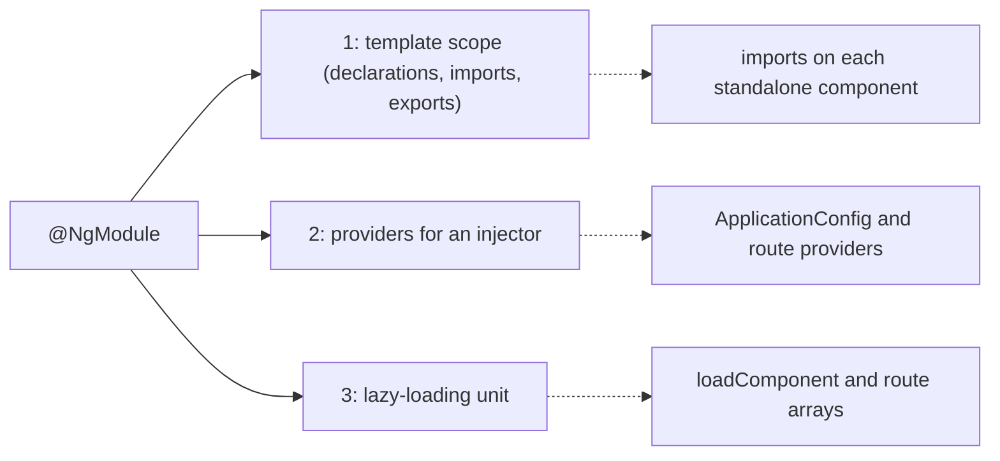
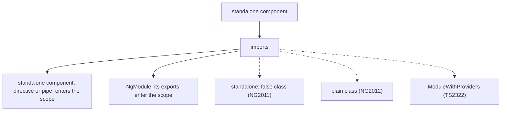
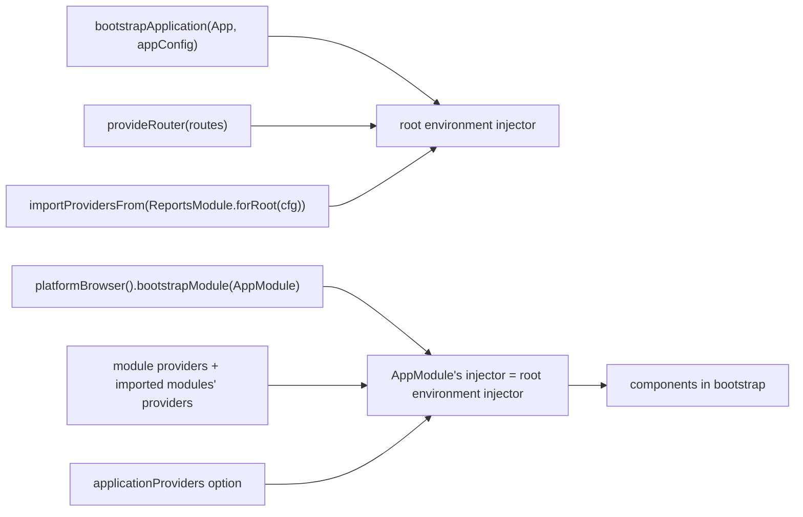
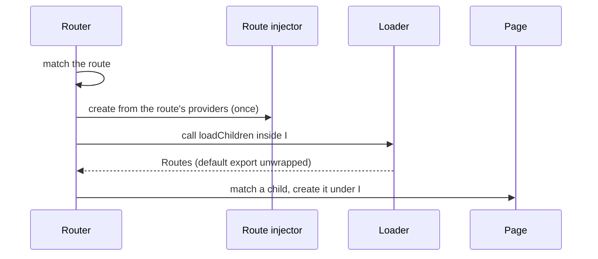
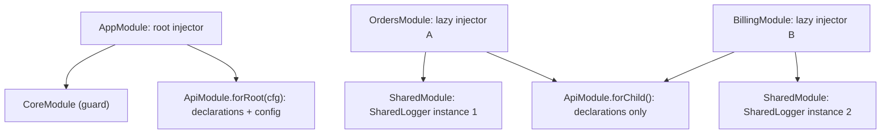
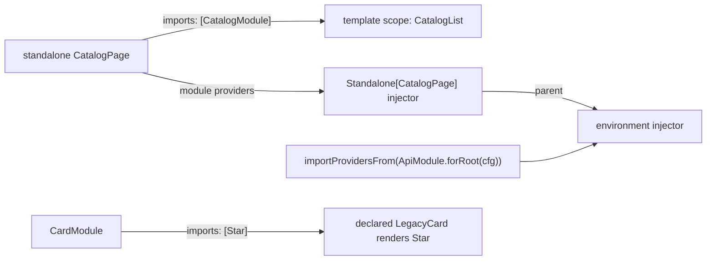
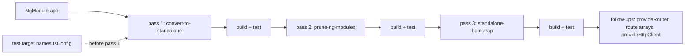
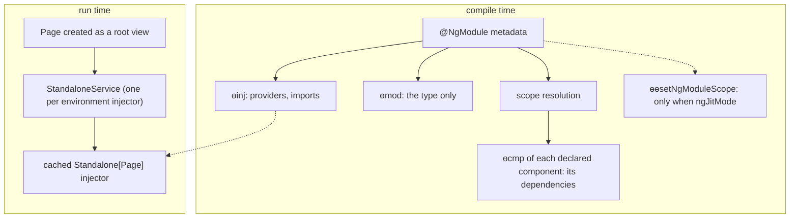

# 15. Standalone and NgModules: `imports`, providers without modules, lazy loading, legacy NgModules, interop and migration

> **What this covers:** what an NgModule did (a compilation scope, a provider list and a lazy-loading unit) and what replaced each job: standalone components and their `imports`, `bootstrapApplication` and `provide*` functions, `importProvidersFrom` for module-shaped libraries, and lazy loading with `loadComponent` and route arrays; the legacy patterns still in production code (`declarations`, `exports`, `forRoot`/`forChild`, `SharedModule`, `CoreModule`); interop in both directions; the three-pass `ng generate @angular/core:standalone` migration and its common failures; and what the compiler and runtime do with modules and standalone components.
> **Prerequisites:** [13. Components and templates](13-components-and-templates.md#1-component-anatomy-selector-template-styles-imports-and-the-v22-file-convention) (component anatomy and `imports`) and [16. Dependency injection](16-dependency-injection.md#5-the-injector-tree-platform-root-route-and-element-injectors-and-the-modifiers) (environment injectors; [section 7](16-dependency-injection.md#7-injectiontoken-multi-providers-environment-providers-and-initializers) for `EnvironmentProviders`)
> **Leads to:** [24. Routing](24-routing.md), [29. Testing Angular](29-testing-angular.md), [38. Architecture](38-architecture-and-production-structure.md), [39. Version history and migrations](39-version-history-and-migrations.md)
> **Applies to:** Angular 22.2 (`@angular/core`, `@angular/compiler-cli`, `@angular/router`, `@angular/cli` 22.2.1), TypeScript 6.0, Node 24
> **Study time:** ~6 hours reading + ~6 hours exercises
> **Short on time:** read [1. What NgModules did](#1-what-ngmodules-did-compilation-scope-injector-and-lazy-loading-unit), [2. Standalone components and `imports`](#2-standalone-components-and-the-imports-array), [3. Bootstrapping and providers without modules](#3-bootstrapping-and-providers-without-modules-bootstrapapplication-provide-functions-and-importprovidersfrom) and [7. Migrating with the standalone schematic](#7-migrating-with-ng-generate-angularcorestandalone-three-passes-hybrid-apps-and-common-failures), then drill [Q15.01](#q15-01), [Q15.03](#q15-03), [Q15.07](#q15-07), [Q15.13](#q15-13), [Q15.16](#q15-16) and [Q15.20](#q15-20), try [Exercise 15.1](#ex15-1), and finish with the [Summary](#summary).
> **Labs:** [`labs/angular/src/app/modules/15-standalone-and-ngmodules/`](../labs/angular/src/app/modules/15-standalone-and-ngmodules/) (section specs, legacy NgModule fixtures, Exercises 15.1-15.3, *Output* questions) and [`labs/ts-js/src/modules/15-standalone-and-ngmodules/`](../labs/ts-js/src/modules/15-standalone-and-ngmodules/) (Exercise 15.4). Run (Node 24): from `labs/angular`, `npx ng test --watch=false --include='src/app/modules/15-standalone-and-ngmodules/**/*.spec.ts'`; from `labs/ts-js`, `npx vitest run src/modules/15-standalone-and-ngmodules`

## Contents

1. [What NgModules did: compilation scope, injector and lazy-loading unit](#1-what-ngmodules-did-compilation-scope-injector-and-lazy-loading-unit)
2. [Standalone components and the `imports` array](#2-standalone-components-and-the-imports-array)
3. [Bootstrapping and providers without modules: `bootstrapApplication`, `provide*` functions and `importProvidersFrom`](#3-bootstrapping-and-providers-without-modules-bootstrapapplication-provide-functions-and-importprovidersfrom)
4. [Lazy loading without modules: `loadComponent` and `loadChildren` with route arrays](#4-lazy-loading-without-modules-loadcomponent-and-loadchildren-with-route-arrays)
5. [Legacy NgModule patterns: `declarations`, `exports`, `forRoot`/`forChild`, `SharedModule` and `CoreModule`](#5-legacy-ngmodule-patterns-declarations-exports-forrootforchild-sharedmodule-and-coremodule)
6. [Interop: NgModule libraries in standalone apps and standalone pieces in NgModule apps](#6-interop-ngmodule-libraries-in-standalone-apps-and-standalone-pieces-in-ngmodule-apps)
7. [Migrating with `ng generate @angular/core:standalone`: three passes, hybrid apps and common failures](#7-migrating-with-ng-generate-angularcorestandalone-three-passes-hybrid-apps-and-common-failures)
8. [Under the hood: what the compiler emits for modules and standalone components, and the standalone injector](#8-under-the-hood-what-the-compiler-emits-for-modules-and-standalone-components-and-the-standalone-injector)
- [Summary](#summary)
- [Question bank](#question-bank)
- [Hands-on exercises](#hands-on-exercises)
- [Check your understanding](#check-your-understanding)
- [Connections](#connections)

**How the claims here are verified.** Runtime behavior is asserted by Angular specs under `ng test` (the ahead-of-time build, running in jsdom, a JavaScript DOM for Node), and the scope model of Exercise 15.4 by a `labs/ts-js` Vitest test; each such sentence names its test. Compiler diagnostics and emitted code are quoted, dated, from `ngc` 22.2.1 runs on throwaway projects, and schematic output from runs on a scratch workspace. Package behavior is read from the 22.2.1 typings and sources, guidance from angular.dev (v22.2.1) and the Angular CHANGELOG, each dated. Bundle size, performance and server-side bootstrap are documented only, never observed.

## 1. What NgModules did: compilation scope, injector and lazy-loading unit

### The problem it solves

A list renders in one feature but is "not a known element" in another. A logger turns up twice. A feature cannot be lazy loaded until someone writes a module for it. A newcomer asks why `@NgModule({ imports: [CommonModule] })` is needed when the file already imports `CommonModule`. All four come from one class doing three jobs.

### Mental model

An **NgModule** is a class decorated with `@NgModule` that groups **declarables** (components, directives and pipes) and providers. It did three jobs:

1. **A compilation scope** (template scope): the selectors and pipe names a declared component's template may use, filled from the module's `declarations` (its own declarables), its `imports` (other modules) and their `exports` (the declarables they make public).
2. **A provider list** for an injector (the object that creates and caches services, [16 §1](16-dependency-injection.md#1-why-dependency-injection-containers-constructor-injection-and-inject)).
3. **A lazy-loading unit**: what the router loaded on demand.

Think of a club card that also decides your rooms and your locker. A **standalone component** ([section 2](#2-standalone-components-and-the-imports-array)) carries its own key list instead.



What to notice: each job has its own replacement, so a migration can move one job at a time ([section 7](#7-migrating-with-ng-generate-angularcorestandalone-three-passes-hybrid-apps-and-common-failures)).

### How it actually works

**Scope.** The 22.2.1 typings of `NgModule` say the selectors available to a template "include those declared here, and those that are exported from imported NgModules", that "Declarables must belong to exactly one module" and that exported declarations "are the module's public API". In the lab, `CatalogList` uses `*ngFor` [Deprecated since v20.0 — use @for] from the imported `CommonModule` and the `m15Price` pipe from its own module's `declarations` (`Section 1: a declared component renders what its module imports`). Observed by compiling a throwaway file with `ngc` 22.2.1 (the Angular compiler's command line) on 2026-10-08 (source frames omitted): `Twice` declared in modules `A` and `B`, and `B` exporting a `Stray` it neither declares nor imports:

```text
src/probe.ts:7:14 - error NG6007: The Component 'Twice' is declared by more than one NgModule.
    'Twice' is listed in the declarations of the NgModule 'A'.
    'Twice' is listed in the declarations of the NgModule 'B'.
src/probe.ts:15:46 - error NG6004: Can't be exported from this NgModule, as it must be either declared by this NgModule, or imported here via its NgModule first
```

An unexported declaration stays invisible to importers. The same day, `User`, declared in a module that imports `A`, used `A`'s unexported `lab-hidden`:

```text
src/probe.ts:9:47 - error NG8001: 'lab-hidden' is not a known element:
1. If 'lab-hidden' is an Angular component, then verify that it is part of this module.
```

**Providers.** A module's `providers` join the injector that imports the module, not a private space: `importProvidersFrom(CatalogModule)` gives an **environment injector** (an injector for app-wide or route-wide services, [16 §5](16-dependency-injection.md#5-the-injector-tree-platform-root-route-and-element-injectors-and-the-modifiers)) a `CatalogStore` that its parent cannot see (`Section 1: a module's providers are created in the injector that imports the module`; `importProvidersFrom` is [section 3](#3-bootstrapping-and-providers-without-modules-bootstrapapplication-provide-functions-and-importprovidersfrom)'s). The typings add that the **root module** (the one bootstrapped) "uses the root injector" and that "A lazy-loaded module has its own injector, typically a child of the app root injector". A **feature module** groups one feature; a **lazy-loaded module** is one the router loads with `loadChildren` ([section 4](#4-lazy-loading-without-modules-loadcomponent-and-loadchildren-with-route-arrays)). The module class itself is instantiated when its injector is created (`Section 1: the module constructor runs when its injector is created`).

**Why it confused people.** A component's scope lives in another file, so the error above names a module the component never mentions. Importing a module for one template also imports its providers, which in a widely imported module meant one instance per lazy injector ([section 5](#5-legacy-ngmodule-patterns-declarations-exports-forrootforchild-sharedmodule-and-coremodule)).

**Status.** The 22.2.1 typings carry no `@deprecated` tag on `NgModule`; the [NgModules overview](https://angular.dev/guide/ngmodules/overview) (v22.2.1, read 2026-10-08) says "The Angular team recommends using standalone components instead of `NgModule` for all new code."

> [!NOTE]
> **Framework vs platform.** `import { CatalogModule } from './catalog.module'` is an ES module import: it decides what the TypeScript file can reference ([Q05.01](05-js-modules-memory-modern-features.md#q05-01)). The `imports` array of `@NgModule` or `@Component` is Angular metadata: it decides what a template can use and, for modules, which providers join the injector. A template needs both.

### Code

The approach: write the catalog list as a standalone component and compare it with the module version.

1. The list names its `Price` pipe in its own `imports`; `@for` needs no import.
2. The test's environment injector provides `CatalogStore`, as `ApplicationConfig` would.

```ts
// Excerpt of labs/angular/src/app/modules/15-standalone-and-ngmodules/concepts/section-1-what-ngmodules-did.spec.ts
@Component({
  selector: 'lab-m15-catalog-list-standalone',
  imports: [Price],
  template: `
    <ul>
      @for (item of store.items(); track item.name) {
        <li>{{ item.name }}: {{ item.cents | m15Price }}</li>
      }
    </ul>
  `,
})
class StandaloneCatalogList {
  protected readonly store = inject(CatalogStore);
}
```

Both render `Pen: $1.50` and `Book: $12.99` (`Section 1: the standalone version renders the same items without a module`).

#### Legacy

The module version under `legacy/`: one class owns scope, provider and export. `CatalogList` is `standalone: false` [Changed in v19.0: `standalone` defaults to `true`], the only kind an NgModule can declare ([section 2](#2-standalone-components-and-the-imports-array)).

```ts
// Excerpt of labs/angular/src/app/modules/15-standalone-and-ngmodules/legacy/catalog/catalog.module.ts
@NgModule({
  declarations: [CatalogList, PricePipe],
  imports: [CommonModule],
  exports: [CatalogList],
  providers: [CatalogStore],
})
export class CatalogModule {
  constructor() {
    inject(CATALOG_LOG, { optional: true })?.push('CatalogModule created');
  }
}
```

Migration path: `ng generate @angular/core:standalone` moves each job out in three passes ([section 7](#7-migrating-with-ng-generate-angularcorestandalone-three-passes-hybrid-apps-and-common-failures)); [Exercise 15.1](#ex15-1) does it by hand.

### Best practices and anti-patterns

- **Write new components standalone**, because the scope then sits next to the template that uses it.
- **In a module you keep, export only what other templates use**, because exports are the module's public API and everything else stays private.
- **Avoid providers in a module imported for its declarations**, because each importing injector gets them too.
- **Keep module constructors light**, because they run when the injector is created, before anything is injected.

### Misconceptions and traps

- *"NgModules are deprecated."* They are not: no `@deprecated` tag in 22.2.1. The myth exists because the docs recommend standalone for all new code.
- *"`imports` in `@NgModule` is the same as `import { X }`."* One is template scope plus providers, the other a file reference. The myth exists because both use the word "import".
- *"A module's providers are private to the module."* Declarations are private by default; providers join the importing injector. The myth exists because the two are listed side by side in one decorator.

Drilled in [Q15.01](#q15-01) and [Q15.02](#q15-02); modelled in [Exercise 15.4](#ex15-4).

## 2. Standalone components and the `imports` array

### The problem it solves

After an upgrade, every component a module declares fails with `NG6008`. A developer imports a library component and gets `NG2011`. Another puts `RouterModule.forRoot(routes)` into a component's `imports` and gets a type error. A reviewer asks how code can tell at run time whether a class is standalone. Each is a question about one list: what a component's `imports` may contain.

### Mental model

A **standalone component** is a component that carries its own compilation scope: its `imports` array (the metadata listing its template dependencies) is the only place its template finds other components, directives and pipes. No module needs to declare it. Think of a recipe that lists its own ingredients instead of pointing at "whatever is in the kitchen".



What to notice: a module in `imports` contributes only what it exports; the dashed entries are refused at compile time.

### How it actually works

**The flag.** Components, directives and pipes are standalone unless they say `standalone: false` [Changed in v19.0: `standalone` defaults to `true`]. The 22.2.1 typings: "Set `standalone` to `false` if you want to import the directive into an NgModule." Standalone components arrived in v14.0 (CHANGELOG, "initial implementation of standalone components") as a developer preview ([roadmap](https://angular.dev/roadmap), read 2026-10-08); the release that made them stable was not read here, so no version is given. `ng new` and `ng generate component` default `standalone` to `true` (CLI 22.2.1 schemas).

**What `imports` accepts.** The typings: "Standalone components can import other standalone components, directives, and pipes as well as existing NgModules", and the property is "only available for standalone components". Observed by compiling one throwaway file per mistake with `ngc` 22.2.1 on 2026-10-08 (source frames omitted):

```text
error NG6008: Component Badge is standalone, and cannot be declared in an NgModule. Did you mean to import it instead?
error NG2011: The component 'Old' appears in 'imports', but is not standalone and cannot be imported directly.
    It can be imported using its 'OldModule' NgModule instead.
error NG2010: 'imports' is only valid on a component that is standalone.
    Did you forget to add 'standalone: true' to this @Component?
error NG2012: Component imports must be standalone components, directives, pipes, or must be NgModules.
error TS2322: Type 'ModuleWithProviders<Cfg>' is not assignable to type 'readonly any[] | Type<any>'.
```

The last one is `Cfg.forRoot()` in `imports`: a `ModuleWithProviders` (a module plus extra providers, [section 5](#5-legacy-ngmodule-patterns-declarations-exports-forrootforchild-sharedmodule-and-coremodule)) is not a type the array accepts, so its providers belong in an environment injector ([section 3](#3-bootstrapping-and-providers-without-modules-bootstrapapplication-provide-functions-and-importprovidersfrom)). The `NG2010` hint still suggests `standalone: true`, which is now the default. What a missing or unused import does (`NG8001`, `NG8113`) is [module 13](13-components-and-templates.md#1-component-anatomy-selector-template-styles-imports-and-the-v22-file-convention)'s.

**`schemas`** (which unknown elements a template may contain) is also standalone-only; `CUSTOM_ELEMENTS_SCHEMA`, which allows custom elements, is [module 37](37-elements-pwa-errors-ecosystem.md)'s.

**Checking at run time.** `isStandalone` [Added in v15.1] reads the compiled definition of a component, directive or pipe and returns its `standalone` field; anything else, an NgModule included, gives `false` (read from the 22.2.1 source). The lab: `Section 2: a component without a standalone flag is standalone and a standalone false one is not`.

**Enforcing it.** The `strictStandalone` compiler option [Added in v19.0] rejects every `standalone: false`. Observed with it set in `angularCompilerOptions`, same day:

```text
error NG2023: Only standalone components/directives are allowed when 'strictStandalone' is enabled.
```

**`CommonModule` or single imports.** The `CommonModule` directives and pipes became standalone in v14.1 (CHANGELOG), so `NgClass` and `DecimalPipe` can be imported one by one (`Section 2: a directive and a pipe imported directly work without CommonModule`); built-in control flow replaces `*ngIf` [Deprecated since v20.0 — use @if] and `*ngFor` ([Q14.16](14-directives-and-pipes.md#q14-16)). Importing all of `CommonModule` for one `number` pipe compiled, the same day, to `dependencies: [CommonModule, i1.DecimalPipe]`: the list names the module (its class stays referenced, [section 8](#8-under-the-hood-what-the-compiler-emits-for-modules-and-standalone-components-and-the-standalone-injector)) and the pipe the template uses.

### Code

The approach: one standalone component imports a standalone component and an NgModule; another imports a directive and a pipe directly.

1. `Shelf` lists `Badge` and `CatalogModule`, whose export `CatalogList` then renders inside it.
2. `Total` lists `NgClass` and `DecimalPipe`, no `CommonModule`.

```ts
// Excerpt of labs/angular/src/app/modules/15-standalone-and-ngmodules/concepts/section-2-standalone-imports.spec.ts
@Component({
  selector: 'lab-m15-shelf',
  imports: [Badge, CatalogModule],
  template: '<lab-m15-badge /><lab-m15-catalog-list />',
})
class Shelf {}

@Component({
  selector: 'lab-m15-total',
  imports: [NgClass, DecimalPipe],
  template: `<p [ngClass]="'hot'">{{ 1234.5 | number }}</p>`,
})
class Total {}
```

`Shelf` renders the badge and two catalog rows (`Section 2: a standalone component renders what it imports, including an NgModule's exports`).

#### Legacy

A declared component says `standalone: false` and has no `imports`; its scope comes from its module ([section 1](#1-what-ngmodules-did-compilation-scope-injector-and-lazy-loading-unit)):

```ts
// Excerpt of labs/angular/src/app/modules/15-standalone-and-ngmodules/legacy/catalog/catalog-list.ts
@Component({
  selector: 'lab-m15-catalog-list',
  standalone: false,
  template: `
    <ul>
      <li *ngFor="let item of store.items()">{{ item.name }}: {{ item.cents | m15Price }}</li>
    </ul>
  `,
})
export class CatalogList {
  protected readonly store = inject(CatalogStore);
}
```

Code bases are full of this line because the v19 update wrote it: the 19.0.0 CHANGELOG says to "Specify `standalone: false` for declarations that are currently declared in `@NgModule`s" and that "`ng update` for v19 will take care of this automatically". The migration path removes it again ([section 7](#7-migrating-with-ng-generate-angularcorestandalone-three-passes-hybrid-apps-and-common-failures), [Exercise 15.1](#ex15-1)).

### Best practices and anti-patterns

- **Omit `standalone: true`**, because it is the default and the line only adds noise.
- **Import the single directive or pipe, or use control flow**, because the import list then documents what the template needs.
- **Import a library's NgModule when `NG2011` says so**, because its exports are what the module meant to share.
- **Turn on `strictStandalone` once migrated**, because it stops new `standalone: false` classes from coming back.

### Misconceptions and traps

- *"You still need `standalone: true`."* Once true: until v19.0, when the default flipped. The myth survives because the pre-v19 default made the flag mandatory, and older tutorials and the `NG2010` hint still show it.
- *"A standalone component cannot use an NgModule."* `imports` accepts NgModules and uses their exports. The myth exists because the name suggests independence from modules.
- *"Importing `CommonModule` bloats the bundle."* Not shown here: the emitted `dependencies` list `CommonModule` as well as the pipe, and no size was measured. The myth exists because `CommonModule` groups many directives and pipes.

Drilled in [Q15.03](#q15-03), [Q15.04](#q15-04) and [Q15.05](#q15-05); practised in [Exercise 15.1](#ex15-1).

## 3. Bootstrapping and providers without modules: `bootstrapApplication`, `provide*` functions and `importProvidersFrom`

### The problem it solves

A team moves to a standalone app and copies `HttpClientModule` into a component's `imports`. A charting library ships only `ReportsModule.forRoot(config)`. An `AppModule` with twenty imports hides which of them carry providers. Someone writes `importProvidersFrom(...)` in a component's `providers` and the build fails. All four ask one question: without a root module, where do providers go?

### Mental model

**Providers go straight to an injector.** **`bootstrapApplication(App, appConfig)`** starts a standalone app and fills the root environment injector from an **`ApplicationConfig`** (an object with one `providers` array, by convention in `app.config.ts`). A **`provide*` function** such as `provideRouter(routes)` returns the providers one feature needs as **`EnvironmentProviders`** [Added in v15.0] (a wrapper only environment injectors accept, [16 §7](16-dependency-injection.md#7-injectiontoken-multi-providers-environment-providers-and-initializers)). **`importProvidersFrom`** unwraps module-shaped libraries into the same list. An NgModule app gets the same injector from **`bootstrapModule`** and its root module. Think of buying a boxed kit to get one tool: now you pick the tools, and `importProvidersFrom` is the box cutter for the kits you still own.



What to notice: both paths end in one root environment injector; only the place where you list providers moves.

### How it actually works

**`bootstrapApplication`.** Its steps (create the root injector, run initializers, render the root component) are [Q12.14](12-angular-how-it-works.md#q12-14)'s. `ApplicationConfig` lives in `@angular/core`; the `@angular/platform-browser` export is [Removed in v21.0] (CHANGELOG 21.0.0). A fresh `ng new` config lists `provideBrowserGlobalErrorListeners()` (no version in the typings) and `provideRouter(routes)` ([VERSIONS.md](../VERSIONS.md#what-a-fresh-ng-new-gives-you-cli-2221-run-2026-10-03)).

**`bootstrapModule`.** An NgModule app calls `platformBrowser().bootstrapModule(AppModule)`: `platformBrowser()` returns the **platform** (the page-wide Angular layer, [12 §6](12-angular-how-it-works.md#6-bootstrapping-bootstrapapplication-the-platform-and-initializers)), and the root module lists the root component in `bootstrap`. In jsdom, without zone.js (the library that zone-based change detection relies on, [module 21](21-change-detection.md#3-zonejs-and-ngzone-how-changes-used-to-be-detected-and-why-zone-left-the-default)), it rendered the root and resolved to an `NgModuleRef` (the handle to the running module) whose `instance` is the module (`Section 3: bootstrapModule renders the bootstrap component of an NgModule`). Read from the 22.2.1 source (`PlatformRef.bootstrapModuleFactory`): the module's injector is created on the platform injector with the zoneless (no zone.js) change-detection providers first and then the `applicationProviders`, so that injector *is* the root environment injector and `ApplicationRef` (the app's root handle, [12 §6](12-angular-how-it-works.md#6-bootstrapping-bootstrapapplication-the-platform-and-initializers)) lives in it. The **`applicationProviders`** option [Added in v21.0] adds root providers without editing the module (`Section 3: bootstrapModule accepts applicationProviders`). A standalone component in `bootstrap` is refused, observed by compiling a throwaway file with `ngc` 22.2.1 on 2026-10-08:

```text
src/probe.ts:7:51 - error NG6009: The `Root` class is a standalone component, which can not be used in the `@NgModule.bootstrap` array. Use the `bootstrapApplication` function for bootstrap instead.
```

**`provide*` functions replace provider-carrying modules.** `provideRouter` and `RouterModule.forRoot` both configure the router, and neither is deprecated in 22.2.1. `HttpClientModule` is [Deprecated since v18.0 — use provideHttpClient(withInterceptorsFromDi())] (CHANGELOG 18.0.0; [module 27](27-http-client.md#2-setting-up-httpclient-providehttpclient-its-features-and-the-fetch-backend-default)); `BrowserAnimationsModule` and `provideAnimations` are [Deprecated since v20.2 — use animate.enter or animate.leave] (typings). A component's `providers` refuses `EnvironmentProviders` ([16 §6](16-dependency-injection.md#6-providers-versus-viewproviders-and-per-instance-state)).

**`importProvidersFrom`** arrived with `bootstrapApplication` (CHANGELOG 14.0.0). Its typings: it "Collects providers from all NgModules and standalone components, including transitively imported ones", usable "only … in an application injector or another environment injector (such as a route injector)". Read from the 22.2.1 source (`internalImportProvidersFrom`, `walkProviderTree`): it walks each module and its `imports`, skips any module already in a `dedup` set, and emits per module its `providers`, the module class, and an environment initializer (a function the injector runs when it is created, [16 §7](16-dependency-injection.md#7-injectiontoken-multi-providers-environment-providers-and-initializers)) that injects that class. The initializer is why the module constructor runs when the injector is created while a service waits for its first `get` (`Section 3: importProvidersFrom creates the module instance when the injector is created and the service on first use`); the set is why a module reached twice in one call is created once (`Section 3: importProvidersFrom deduplicates a module imported twice in one call`). A `ModuleWithProviders` (what `forRoot()` returns, [section 5](#5-legacy-ngmodule-patterns-declarations-exports-forrootforchild-sharedmodule-and-coremodule)) adds its extra providers, and transitively imported modules come along (`Section 3: importProvidersFrom makes a module's providers available in an environment injector`). In development mode, as in the lab, a standalone component throws `NG0800: Importing providers supports NgModule or ModuleWithProviders but got a standalone component` (`Section 3: importProvidersFrom rejects a standalone component with NG0800`). Observed with `ngc` 22.2.1 on 2026-10-08, the result in a component, and a `forRoot()` listed bare in `ApplicationConfig` as the [NgModules overview](https://angular.dev/guide/ngmodules/overview) (v22.2.1) shows it:

```text
src/probe.ts:11:15 - error TS2322: Type 'EnvironmentProviders' is not assignable to type 'Provider'.
src/probe.ts:14:42 - error TS2322: Type 'ModuleWithProviders<MenuModule>' is not assignable to type 'Provider | EnvironmentProviders'.
```

### Code

The approach: start a standalone app whose only provider-carrying dependency is an NgModule library.

1. `appConfig` unwraps `ReportsModule.forRoot(...)` with `importProvidersFrom`; a library with a `provideReports()` function would not need it ([Exercise 15.2](#ex15-2)).
2. `ReportTitle` injects the configuration token and `ChartSvc`, which comes from `ChartsModule`, imported by `ReportsModule`.
3. `bootstrapApplication(ReportTitle, appConfig)` renders `Q3 report (charts ready)` (`Section 3: bootstrapApplication takes an NgModule library's providers through importProvidersFrom`).

```ts
// Excerpt of labs/angular/src/app/modules/15-standalone-and-ngmodules/concepts/section-3-bootstrap-and-providers.spec.ts
@Component({
  selector: 'lab-m15-report-title',
  template: '<h1>{{ config.title }} ({{ charts ? "charts ready" : "no charts" }})</h1>',
})
class ReportTitle {
  protected readonly config = inject(REPORTS_CONFIG);
  protected readonly charts = inject(ChartSvc);
}

const appConfig: ApplicationConfig = {
  providers: [importProvidersFrom(ReportsModule.forRoot({ title: 'Q3 report' }))],
};
```

#### Legacy

The root module of an NgModule app, bootstrapped by `platformBrowser().bootstrapModule(BootModule)` in the lab:

```ts
// Excerpt of labs/angular/src/app/modules/15-standalone-and-ngmodules/legacy/boot/boot.module.ts
@NgModule({
  declarations: [BootRoot],
  imports: [BrowserModule],
  providers: [BootSvc],
  bootstrap: [BootRoot],
})
export class BootModule {}
```

`ng new --standalone=false` still generates this shape. Observed by running the CLI 22.2.1 `ng-new` schematic with `standalone: false` on a scratch workspace on 2026-10-08: `app-module.ts`, `app-routing-module.ts` (`RouterModule.forRoot`), a `standalone: false` `App`, and a `main.ts` calling `platformBrowser().bootstrapModule(AppModule, {})`; its `AppModule` lists `provideBrowserGlobalErrorListeners()` in `providers`, which the `NgModule` typings allow (`Array<Provider | EnvironmentProviders>`). Migration path: pass 3 of `ng generate @angular/core:standalone` switches the bootstrap ([section 7](#7-migrating-with-ng-generate-angularcorestandalone-three-passes-hybrid-apps-and-common-failures)); then replace each module behind `importProvidersFrom` with its `provide*` function.

### Best practices and anti-patterns

- **Keep app-wide providers in `app.config.ts`**, because one file then shows everything the root injector holds.
- **Prefer a library's `provide*` function to `importProvidersFrom(SomeModule)`**, because the module also brings its class and runs its constructor eagerly.
- **Use `importProvidersFrom` only in `ApplicationConfig` or route `providers`**, because it returns `EnvironmentProviders`, which components refuse.
- **Replace `HttpClientModule` and the animations modules first**, because they are the deprecated ones and each names its replacement.

### Misconceptions and traps

- *"`importProvidersFrom` works anywhere providers go."* Only environment injectors take it. The myth exists because NgModule-era `providers` arrays looked the same everywhere.
- *"`RouterModule.forRoot` is deprecated."* It carries no tag in 22.2.1. The myth exists because it is migrated alongside `HttpClientModule`, which is deprecated.
- *"Standalone removed `bootstrapModule`."* It still renders and gained `applicationProviders` in v21.0. The myth exists because the overview "recommends using bootstrapApplication instead of `bootstrapModule` for all new code".
- *"A module constructor runs only when one of its services is used."* It runs as the injector is created. The myth exists because services are lazy, so the module is assumed to be too.

Drilled in [Q15.06](#q15-06), [Q15.07](#q15-07), [Q15.08](#q15-08) and [Q15.09](#q15-09); practised in [Exercise 15.2](#ex15-2).

## 4. Lazy loading without modules: `loadComponent` and `loadChildren` with route arrays

### The problem it solves

Many NgModules existed only because `loadChildren` needed one. A lazy admin feature needs a store shared by its pages and hidden from the rest. Someone points `loadComponent` at a module and gets `NG04014`.

### Mental model

**Lazy loading** (downloading a feature's code only when a navigation first needs it) now loads a file, not a module: **`loadComponent`** one standalone component, **`loadChildren`** a **`Routes`** array (the router's list of path entries, [module 24](24-routing.md#1-router-configuration-providerouter-route-matching-redirects-and-the-wildcard)). A route's **`providers`** give the feature its own environment injector, the one thing a lazy NgModule added. Think of ordering the chair, or the room plan, instead of a crate.



What to notice: the injector comes from a route's `providers`, not from the file that was loaded.

### How it actually works

Both loaders arrived in v14.0 (CHANGELOG 14.0.0). The bundler gives each `import()` target its own **chunk** (a separately downloaded file, [12 §3](12-angular-how-it-works.md#3-building-the-application-builder-output-layout-and-budgets)); a scratch `ng build` with one `loadComponent` route, 2026-10-08:

```text
Lazy chunk files    | Names         |  Raw size | Estimated transfer size
chunk-HDP6QPSG.js   | admin-page    | 297 bytes |               297 bytes
```

A **default export** is unwrapped [Added in v15.0] (CHANGELOG 15.0.0), so `import('./admin.routes')` needs no `.then` (`Section 4: a default export is unwrapped for loadChildren and loadComponent`).

Read from the 22.2.1 router source (`getOrCreateRouteInjectorIfNeeded`, `RouterConfigLoader`): when a route with `providers` matches, the router creates its environment injector once, caches it on the route, and calls the loader inside it [Changed in v20.1: `loadComponent` and `loadChildren` run in the route's injection context], so a loader can `inject()` a route-provided value (`Section 4: a loader can inject from the route's injector`). The lab's admin routes list `providers: [AdminStore]` on their top route: both pages share one instance and the root gets `NG0201` (`Section 4: route providers are shared by the lazy pages and invisible at the root`). Identity across routes is [Q16.16](16-dependency-injection.md#q16-16)'s. A loaded array is used as is (`Section 4: loadChildren with a routes array renders the child route`); anything else is compiled and created as an NgModule whose parent is the route's injector, so a lazy NgModule still works, with its own injector (`Section 4: a lazy NgModule still loads and gets its own injector`).

**The wrong target**, observed in development mode: `loadComponent` given a module fails with `NG04014: Invalid configuration of route 'wrong-component'. You are using 'loadComponent' with a module, …` (`Section 4: loadComponent given an NgModule fails with NG04014`; added in 15.2.1, CHANGELOG). `loadChildren` given a component takes the NgModule path and fails with `ASSERTION ERROR: NgModule '_AdminSettings' is not a subtype of 'NgModuleType'.` (the unit-test build prefixes class names with an underscore; the lab's specs match it with `_?`), naming no route (`Section 4: loadChildren given a component fails with a development-mode assertion, not a coded error`).

> [!NOTE]
> **Framework vs platform.** `import('./admin.routes')` is the platform's dynamic `import()` ([05 §2](05-js-modules-memory-modern-features.md#2-commonjs-interop-and-dynamic-import)), a promise of the file's exports, where the bundler splits a chunk. The router decides when and in which injector to call it. `@defer` splits template parts instead ([module 18](18-control-flow-and-defer.md#7-what-lands-in-a-chunk-testing-deferred-blocks-and-the-ssr-pointer)).

### Code

The approach: one lazy routes file owns the feature's provider and pages.

1. The top route lists `AdminStore` in `providers`; its children use that injector.
2. Settings gets its own chunk through `loadComponent`.
3. The default export lets the app route write `loadChildren: () => import('./lazy/admin.routes')`.

```ts
// Excerpt of labs/angular/src/app/modules/15-standalone-and-ngmodules/concepts/lazy/admin.routes.ts
export const ADMIN_ROUTES: Routes = [
  {
    path: '',
    providers: [AdminStore],
    children: [
      { path: '', component: AdminUsers },
      { path: 'settings', loadComponent: () => import('./admin-page') },
    ],
  },
];

export default ADMIN_ROUTES;
```

#### Legacy

Before v14 the lazy unit was a module, loaded with `.then((m) => m.LegacyAdminModule)`:

```ts
// Excerpt of labs/angular/src/app/modules/15-standalone-and-ngmodules/concepts/lazy/legacy-admin.module.ts
@NgModule({
  declarations: [LegacyAdminPage],
  imports: [RouterModule.forChild([{ path: '', component: LegacyAdminPage }])],
  providers: [LegacyAdminStore],
})
export class LegacyAdminModule {}
```

Migration path: module `providers` to the top route's `providers`, `forChild` routes to an exported array, declarations to standalone ([section 7](#7-migrating-with-ng-generate-angularcorestandalone-three-passes-hybrid-apps-and-common-failures); [Exercise 15.3](#ex15-3) does it by hand).

### Best practices and anti-patterns

- **Default-export the routes array**, because no `.then` is left for a rename to break.
- **Put feature-wide services in the lazy route's `providers`**, because its pages share one instance the rest of the app cannot inject.
- **Keep app-wide services in root**, because a route's `providers` would build a second instance.
- **Point `loadComponent` at components and `loadChildren` at routes**, because the reverse mistake fails only with a development assertion.

### Misconceptions and traps

- *"You need a module to lazy load."* Once true: until v14.0, when `loadComponent` and route arrays arrived. The myth survives because every lazy route needed a module before v14.0, and guides and code bases written then still show it.
- *"`loadComponent` gives the component its own injector."* Only route `providers` or a lazy NgModule create one. The myth exists because every lazy module had one.
- *"A lazy feature always gets fresh services."* A root service stays one instance ([Q16.18](16-dependency-injection.md#q16-18)). The myth comes from lazy NgModules, whose `providers` built new ones.

Drilled in [Q15.10](#q15-10) and [Q15.11](#q15-11); practised in [Exercise 15.3](#ex15-3).

## 5. Legacy NgModule patterns: `declarations`, `exports`, `forRoot`/`forChild`, `SharedModule` and `CoreModule`

> [!WARNING]
> **Legacy.** Everything in this section is NgModule-era code that production apps still carry. It changed because standalone components, `provide*` functions and route `providers` do each job without a shared class ([section 1](#1-what-ngmodules-did-compilation-scope-injector-and-lazy-loading-unit)). Migration path: `ng generate @angular/core:standalone` ([section 7](#7-migrating-with-ng-generate-angularcorestandalone-three-passes-hybrid-apps-and-common-failures)) or by hand ([Exercise 15.1](#ex15-1)).

### The problem it solves

A `SharedModule` that forty feature modules import lists a `LoggerService` in its `providers`, and two lazy features log through different instances. A `CoreModule` throws "already loaded" when someone imports it in a lazy module. A library's `forRoot(config)` is called again in a feature module and the configuration splits. An interviewer asks what `ModuleWithProviders` is for. These patterns are habits built on one rule: providers follow injectors, not imports.

### Mental model

**`forRoot` and `forChild` are two doors into one module.** `forRoot(config)` brings the module's declarations plus its providers; `forChild()` brings only the declarations, so the providers land once, in the root. A **`SharedModule`** was the habit of one module that **re-exports** (lists in `exports` a module it imports, so importers get that module's exports too) the declarables every feature needs; the **anti-pattern** (a habit that looks right and causes a defect) was giving it providers. A **`CoreModule`** held app-wide singletons and refused to be imported twice. Think of a franchise kit: head office (`forRoot`) gets the till; each branch (`forChild`) only the signage.



What to notice: the duplication follows injectors, not imports; `forChild` exists so a lazy injector does not get a second configuration.

### How it actually works

**Declarations, exports and re-exports.** Rules and diagnostics (`NG6007`, `NG6004`) are [section 1](#1-what-ngmodules-did-compilation-scope-injector-and-lazy-loading-unit)'s. The [NgModules overview](https://angular.dev/guide/ngmodules/overview) (v22.2.1) adds that a module "can also export any other components, directives, pipes, and NgModules that it imports". In the lab, `OrdersBanner`, declared in a module that imports `SharedModule`, uses `*ngIf` [Deprecated since v20.0 — use @if] from the re-exported `CommonModule` and `SharedModule`'s own `m15Shout` pipe (`Section 5: a re-exported module's declarations are usable by the importer`).

**`ModuleWithProviders`.** The 22.2.1 typings: "A wrapper around an NgModule that associates it with providers": `{ ngModule, providers? }`, and "Usage without a generic type is deprecated". **`forRoot`** and **`forChild`** are static methods returning one; the overview calls the name "a convention" for providers "intended to be added exclusively to the _root_", which "are eagerly loaded, increasing the JavaScript bundle size of your initial page load" (documented, not measured here). `RouterModule.forChild` "does not include the `Router` service" (typings). In the lab, `ApiModule.forRoot({ url: '/api' })` provides `API_CONFIG` and `forChild()` gives `NG0201` (`Section 5: forRoot provides the configuration and forChild does not`). The overview also shows `forChild()` in a component's `providers`; observed by compiling that shape with `ngc` 22.2.1 on 2026-10-08:

```text
src/probe.ts:10:62 - error TS2322: Type 'ModuleWithProviders<MenuModule>' is not assignable to type 'Provider'.
```

**`SharedModule` providers.** Each import creates the module and its providers inside the injector that imports it ([section 3](#3-bootstrapping-and-providers-without-modules-bootstrapapplication-provide-functions-and-importprovidersfrom) explains the walk). Two lazy injectors therefore build two `SharedModule` instances and two loggers (`Section 5: a provider in a shared module gives each lazy injector its own instance`), while two features imported into one injector share one of each, because the walk skips a module it has seen (`Section 5: a module imported twice into one injector is created once`).

**`CoreModule` guard.** The **module constructor** (the constructor of the NgModule class, run when its injector is created, [section 3](#3-bootstrapping-and-providers-without-modules-bootstrapapplication-provide-functions-and-importprovidersfrom)) injects its own class with `skipSelf`, which starts the lookup at the parent injector ([16 §5](16-dependency-injection.md#5-the-injector-tree-platform-root-route-and-element-injectors-and-the-modifiers)), and throws if one exists. In the lab the second import throws the guard's message and the log holds one `CoreModule created` (`Section 5: the CoreModule guard throws on a second import`). A root-provided service (`providedIn: 'root'` or `@Service` [Added in v22.0]) is already one instance app-wide ([16 §3](16-dependency-injection.md#3-providedin-service-scopes-and-tree-shaking)), so there is nothing to guard; `providedIn: SomeModule` is [Q16.07](16-dependency-injection.md#q16-07)'s.

**A root listed only in `bootstrap`.** The overview says such components "are automatically included in the NgModule's declarations". At run time a `standalone: false` root listed in `bootstrap` and declared nowhere rendered (`Section 5: a component listed only in bootstrap renders under bootstrapModule`). Its template did not get the module's scope; observed with `ngc` 22.2.1 on 2026-10-08, a module declaring `Child` and bootstrapping `Root`, whose template uses `<lab-child />`:

```text
src/probe.ts:7:66 - error NG8001: 'lab-child' is not a known element:
1. If 'lab-child' is an Angular component, then verify that it is part of this module.
```

**Removed APIs (history).** `entryComponents` [Removed in v16.0]; `createNgModuleRef` [Removed in v22.0], replaced by `createNgModule`; `ComponentFactoryResolver` [Removed in v22.0] (CHANGELOG 16.0.0, 22.0.0).

### Code

The approach: fixtures under `legacy/shared/` reproduce the patterns so the tests can count instances.

1. `ApiModule` returns the same `ngModule` from both doors; only `forRoot` adds a provider.
2. `CoreModule`'s constructor looks one injector up for an earlier instance.

```ts
// Excerpt of labs/angular/src/app/modules/15-standalone-and-ngmodules/legacy/shared/api.module.ts
@NgModule({ declarations: [ApiStatus], exports: [ApiStatus] })
export class ApiModule {
  static forRoot(config: ApiConfig): ModuleWithProviders<ApiModule> {
    return { ngModule: ApiModule, providers: [{ provide: API_CONFIG, useValue: config }] };
  }

  static forChild(): ModuleWithProviders<ApiModule> {
    return { ngModule: ApiModule };
  }
}
```

```ts
// Excerpt of labs/angular/src/app/modules/15-standalone-and-ngmodules/legacy/shared/core.module.ts
@NgModule({ providers: [CoreSession] })
export class CoreModule {
  constructor() {
    const parent = inject(CoreModule, { optional: true, skipSelf: true });
    if (parent) {
      throw new Error('CoreModule is already loaded. Import it only in the root module.');
    }
    inject(CORE_LOG, { optional: true })?.push('CoreModule created');
  }
}
```

The standalone replacements: a `provideApi(config)` function instead of `forRoot` ([Exercise 15.2](#ex15-2)), direct imports instead of `SharedModule`, root services instead of `CoreModule`.

### Best practices and anti-patterns

- **Keep a `SharedModule` declarations-only**, because each injector that imports it builds its providers again.
- **Call `forRoot` once, in the root, and `forChild` everywhere else**, because a second `forRoot` in a lazy injector creates a second configuration.
- **Replace a `CoreModule` with root services before migrating**, because its guard only patrols a problem that `providedIn: 'root'` cannot have.
- **Never put a `ModuleWithProviders` in a component**, because component `imports` and `providers` reject it at compile time.

### Misconceptions and traps

- *"A `SharedModule` gives one shared instance of its services."* It gives one per injector that imports it. The myth exists because the name says "shared".
- *"`forRoot` is an Angular API."* It is a static-method convention returning `ModuleWithProviders`. The myth exists because `RouterModule` and most libraries ship one.
- *"`CoreModule` is still needed for singletons."* A root-provided service is one instance app-wide. The myth exists because the guard really did protect singletons that lived in module `providers`.
- *"A root in `bootstrap` is declared like any other."* It renders, but its template gets no module scope. The myth exists because the overview says it is "automatically included".

Drilled in [Q15.12](#q15-12), [Q15.13](#q15-13), [Q15.14](#q15-14) and [Q15.15](#q15-15); practised in [Exercise 15.2](#ex15-2) and [Exercise 15.4](#ex15-4).

## 6. Interop: NgModule libraries in standalone apps and standalone pieces in NgModule apps

### The problem it solves

A standalone app must use a library that ships only NgModules and a `forRoot()`. An NgModule app wants one standalone component. A standalone page imports a module with `providers`, and the root cannot inject its service. A library author must serve both. **Interop** (the rules that let the two styles work together) answers all four; a **hybrid app** mixes them, as every migration does for a while.

### Mental model

Interop is two adapters, one per direction. A standalone component can import an NgModule: the module's exports enter its template scope, and its providers go into a **standalone injector** (an environment injector Angular creates for a standalone component whose imports carry providers). An NgModule can import a standalone component, directive or pipe: it joins the module's scope and can be re-exported. Think of a travel plug adapter for each direction.



What to notice: a component-imported module's providers live in a child of the environment injector, not in the root.

### How it actually works

**Standalone imports NgModule.** The [NgModules overview](https://angular.dev/guide/ngmodules/overview) (v22.2.1) makes module providers available to "Any standalone component, directive, or pipe that imports the NgModule". `CatalogPage` imports `CatalogModule` and renders its export `CatalogList`, whose `CatalogStore` nothing else provides (`Section 6: a standalone component uses an NgModule's exported component`). Creating the page ran the module's constructor; the page's injector finds the store, the root gives `NG0201` (`Section 6: a module's providers imported by a standalone component live in a standalone injector, not the root`). Two pages share one store and one module instance (`Section 6: two instances of that component share the standalone injector's service`).

**Why, read from the 22.2.1 source.** A standalone component's definition carries `getStandaloneInjector`, which asks `StandaloneService` for an injector built from its imports (the walk and the cache are [section 8](#8-under-the-hood-what-the-compiler-emits-for-modules-and-standalone-components-and-the-standalone-injector)'s). Only the root-view path calls it (`createRootViewInjector`): bootstrap, `ViewContainerRef.createComponent` (which router outlets use) and `TestBed.createComponent` (`TestBed` is Angular's test harness, [module 29](29-testing-angular.md)). A component rendered by tag gets none and reads from its root view's (`Section 6: a component rendered in a template uses the standalone injector of the root component that imports it`).

**NgModule imports standalone.** Since v14.0 (CHANGELOG 14.0.0, "standalone types imported into NgModule scopes") a module's `imports` take standalone classes. `CardModule` imports and re-exports `Star`, and its declared `LegacyCard` renders `<lab-m15-star>` (`Section 6: an NgModule-declared component renders a standalone component the module imports`). The reverse, a `standalone: false` class in a component's `imports`, is `NG2011`, whose hint names the module to import instead ([section 2](#2-standalone-components-and-the-imports-array)).

**App-wide configuration.** Configuration goes into an environment injector: with `importProvidersFrom(ApiModule.forRoot({ url: '/v2' }))` in the root providers, `ApiPage` imports `ApiModule` for its template and renders `api /v2` (`Section 6: importProvidersFrom with forRoot in an environment injector configures an NgModule library`).

**Library authors.** A **library** is a package of Angular code for other apps, published partially compiled for the CLI's linker to finish ([Q12.28](12-angular-how-it-works.md#q12-28)). It serves both kinds of app with standalone pieces, a `provide*` function and optionally an NgModule that re-exports the pieces with a `forRoot` delegating to that function ([Exercise 15.2](#ex15-2); designing the function is [Q16.33](16-dependency-injection.md#q16-33)).

### Code

The approach: interop in both directions.

1. `CatalogPage` lists `CatalogModule`; no test provides `CatalogStore`.
2. `Shop` renders the page by tag; its standalone injector holds the store.
3. `CardModule` imports `Star` for its declared `LegacyCard`.

```ts
// Excerpt of labs/angular/src/app/modules/15-standalone-and-ngmodules/concepts/section-6-interop.spec.ts
@Component({
  selector: 'lab-m15-catalog-page',
  imports: [CatalogModule],
  template: '<h2>Catalog</h2><lab-m15-catalog-list />',
})
class CatalogPage {}

@Component({
  selector: 'lab-m15-shop',
  imports: [CatalogPage],
  template: '<lab-m15-catalog-page />',
})
class Shop {}

@Component({ selector: 'lab-m15-star', template: '*' })
class Star {}

@Component({ selector: 'lab-m15-legacy-card', standalone: false, template: 'card <lab-m15-star />' })
class LegacyCard {}

@NgModule({ declarations: [LegacyCard], imports: [Star], exports: [LegacyCard, Star] })
class CardModule {}
```

#### Legacy

An NgModule app imported a library twice: `LibModule.forRoot(cfg)` in `AppModule`, `LibModule` (or `forChild()`) in each feature module ([section 5](#5-legacy-ngmodule-patterns-declarations-exports-forrootforchild-sharedmodule-and-coremodule)). Migration path: `forRoot` moves to `importProvidersFrom` in `ApplicationConfig`, each feature import to the components that use the library (pass 1 of [section 7](#7-migrating-with-ng-generate-angularcorestandalone-three-passes-hybrid-apps-and-common-failures)).

### Best practices and anti-patterns

- **Import a library's NgModule in the component that uses its exports**, because the dependency is then named where the template uses it.
- **Put a library's `forRoot` in `ApplicationConfig` through `importProvidersFrom`**, because components refuse it and the root then holds one configuration.
- **Ship a library as standalone pieces plus a `provide*` function**, because NgModule apps can still get a thin wrapper module.

### Misconceptions and traps

- *"Importing a module into a standalone component adds its providers to the root."* They go to the root component's standalone injector. The myth exists because NgModule imports did add providers to the importing module's injector.
- *"A library must choose NgModules or standalone."* Both directions render in the lab. The myth exists because before v14.0 only NgModules existed.
- *"`NG2011` means the library is unusable."* Its hint says to import the library's NgModule. The myth exists because the message says the class "cannot be imported directly".

Drilled in [Q15.16](#q15-16), [Q15.17](#q15-17), [Q15.18](#q15-18) and [Q15.19](#q15-19); practised in [Exercise 15.2](#ex15-2).

## 7. Migrating with `ng generate @angular/core:standalone`: three passes, hybrid apps and common failures

### The problem it solves

An app with forty NgModules must become standalone without a feature freeze. One command name hides three modes, run in a fixed order. A pass that builds can still leave the tests broken, and after the last pass `RouterModule.forRoot` and a lazy module are still there.

### Mental model

The **standalone migration** is a **schematic** (a code rewriter that `ng generate` runs, [12 §2](12-angular-how-it-works.md#2-the-cli-and-the-workspace-angularjson-projects-schematics-and-ng-update)), `@angular/core:standalone` [Added in v15.2], run three times. Each run is a **migration pass**: `convert-to-standalone` moves the template scope into components, `prune-ng-modules` deletes modules that no longer do anything, and `standalone-bootstrap` replaces `bootstrapModule`. Between passes the app is a hybrid app ([section 6](#6-interop-ngmodule-libraries-in-standalone-apps-and-standalone-pieces-in-ngmodule-apps)), and you build and test it. Think of renovating a house room by room while living in it.



What to notice: every pass ends in an app that builds, which is what makes migrating one folder at a time possible.

### How it actually works

**Options and rules.** The 22.2.1 schema has `mode` (`convert-to-standalone` by default, `prune-ng-modules`, `standalone-bootstrap`) and `path` (default `./`), the folder to migrate. The [migration guide](https://angular.dev/reference/migrations/standalone) (v22.2.1, read 2026-10-08) asks for Angular 15.2.0 or later, a project that builds and a clean Git branch, and says to verify "that your code builds and runs between each step". Its common problems include files "not captured by a tsconfig" (a TypeScript project file listing what to compile) and metadata that "cannot be statically analyzed".

**The sample.** Observed by running the schematic on a scratch workspace on 2026-10-08 (the lab's config files and `node_modules`): `AppModule` declares `App` and `Hello`, imports `BrowserModule`, a `SharedModule` (declares and exports `Badge` and the `m15Short` pipe, re-exports `CommonModule`) and an `AppRoutingModule` (`RouterModule.forRoot` with a lazy `AdminModule`); two specs. The before and after code is in the lab (`legacy/migration-sample/`, `concepts/migrated/`).

**Pass 1** removed `standalone: false` from `Hello`, `Badge`, the pipe and `AdminPage`, gave each an exact `imports` (`Hello`: `[NgIf, Badge, ShortPipe]`, not `CommonModule`) and moved them from `declarations` to the modules' `imports`, so the modules still compile. It left the bootstrapped `App` declared, as the guide says ("ignores NgModules which bootstrap a component"), and reprinted every file it touched (double quotes, re-wrapped templates). `ng build` passed; `ng test` did not (the test build's underscore prefix again):

```text
Error: Unexpected "_Hello" found in the "declarations" array of the "TestBed.configureTestingModule" call, "_Hello" is marked as standalone and can't be declared in any NgModule - did you intend to import it instead (by adding it to the "imports" array)?
```

The spec was never touched. Read from the 22.2.1 schematic source (`getProjectTsConfigPaths`): it migrates the files of every tsconfig named by a `tsConfig` option on a workspace target, and the lab's `test` target names only the unit-test builder, with no options. With `"options": { "tsConfig": "tsconfig.spec.json" }` on that target, the same pass rewrote the spec to `imports: [Hello]` and both specs passed.

**Pass 2** deleted `shared.module.ts` and its references; `AdminModule` stayed, because it imports `RouterModule.forChild`, a `ModuleWithProviders`, one of the guide's reasons to keep a module. The build passed; the test build failed on the second spec, which imported `SharedModule` for `Badge` and was left alone:

```text
✘ [ERROR] TS2307: Cannot find module './shared.module' or its corresponding type declarations.
```

Importing `Badge` instead fixed it. A reference the pass cannot delete gets `/* TODO(standalone-migration): clean up removed NgModule reference manually */` (guide; none appeared here).

**Pass 3** deleted `app.module.ts`, gave `App` `imports: [Hello, RouterOutlet]` and rewrote `main.ts` (Code below); build and specs passed. In the lab both apps render the same start page and lazy admin page (`Section 7: the migrated app renders what the NgModule app rendered`), and all five migrated declarables are standalone (`Section 7: every migrated declarable is standalone`).

**What is left.** `RouterModule.forRoot` behind `importProvidersFrom`, the lazy `AdminModule` and an unused `platformBrowser` import. Of the **follow-up schematics** run on that output, `route-lazy-loading` [Added in v18.2] turned the admin route into a `loadComponent` but deleted the `AdminPage` import the module's `imports` still used, so the build failed with `TS2304: Cannot find name 'AdminPage'` and `NG1010`; `cleanup-unused-imports` [Added in v19.1] and `common-to-standalone` (which swaps `CommonModule` for single imports) found nothing. `provideRouter`, a routes file ([section 4](#4-lazy-loading-without-modules-loadcomponent-and-loadchildren-with-route-arrays)) and `provideHttpClient` ([section 3](#3-bootstrapping-and-providers-without-modules-bootstrapapplication-provide-functions-and-importprovidersfrom)) are by hand.

**Tests and AOT.** AOT is ahead-of-time compilation ([Q12.19](12-angular-how-it-works.md#q12-19)). The guide's limitations say "Because unit tests are not ahead-of-time (AoT) compiled, `imports` added to components in unit tests might not be entirely correct." The v22 unit-test builder compiles them ahead of time: before migrating, the sample's test build failed with `NG8001` for `lab-m15-mig-badge`, a template diagnostic ([section 8](#8-under-the-hood-what-the-compiler-emits-for-modules-and-standalone-components-and-the-standalone-injector) explains it). Planning a whole-codebase migration is [module 39](39-version-history-and-migrations.md)'s.

### Code

The approach: run the three modes in order on a clean branch, checking between them.

1. Name `tsconfig.spec.json` on the `test` target, so specs are migrated.
2. Run `ng generate @angular/core:standalone --mode=<mode> --path=./` for each mode, then `ng build` and `ng test`.
3. Fix what each check reports before the next pass.

Pass 3 wrote this `main.ts`:

```ts
import {
  platformBrowser,
  BrowserModule,
  bootstrapApplication,
} from "@angular/platform-browser";

import { Greeter } from "./app/greeter";
import { AppRoutingModule } from "./app/app-routing.module";
import { App } from "./app/app";
import { importProvidersFrom } from "@angular/core";

bootstrapApplication(App, {
  providers: [importProvidersFrom(BrowserModule, AppRoutingModule), Greeter],
}).catch((err) => console.error(err));
```
<sub>Source: [labs/angular/src/app/modules/15-standalone-and-ngmodules/concepts/migrated/main.ts](../labs/angular/src/app/modules/15-standalone-and-ngmodules/concepts/migrated/main.ts)</sub>

#### Legacy

The root module that pass 3 deleted:

```ts
// Excerpt of labs/angular/src/app/modules/15-standalone-and-ngmodules/legacy/migration-sample/app/app.module.ts
@NgModule({
  declarations: [App, Hello],
  imports: [BrowserModule, SharedModule, AppRoutingModule],
  providers: [Greeter],
  bootstrap: [App],
})
export class AppModule {}
```

Migration path: the three passes, then the follow-ups; [Exercise 15.1](#ex15-1) does one feature by hand.

### Best practices and anti-patterns

- **Name the spec tsconfig on the `test` target before pass 1**, because the schematic migrates only files of tsconfigs that a target names.
- **Run `ng test` after every pass, not only `ng build`**, because the build's tsconfig excludes specs, and both test failures here came with a green build.
- **Migrate a large app folder by folder with `--path`**, because every pass leaves a hybrid app that builds.
- **Build after each follow-up schematic**, because `route-lazy-loading` broke a lazy NgModule here.

### Misconceptions and traps

- *"The schematic migrates everything in one run."* It has three modes, run in order with checks between. The myth exists because one command name covers all three.
- *"After pass 3 the app is fully standalone."* `RouterModule.forRoot` and lazy NgModules remain. The myth exists because `AppModule`, the most visible module, is gone.
- *"`ng update` migrates you to standalone."* The 22.2.1 `migrations.json` has no standalone migration; the v19 one added `standalone: false`. The myth exists because that v19 migration touched every declaration.

Drilled in [Q15.20](#q15-20), [Q15.21](#q15-21), [Q15.22](#q15-22) and [Q15.23](#q15-23); practised in [Exercise 15.1](#ex15-1).

## 8. Under the hood: what the compiler emits for modules and standalone components, and the standalone injector

### The problem it solves

An interviewer asks why a standalone component compiles on its own and a declared one does not. A spec that declares an NgModule component fails to build with `NG8001` although the app builds. A debugger shows a `Standalone[Page]` injector. Someone claims NgModules slow the runtime down.

### Mental model

AOT resolves a module's scope once and writes it into each declared component's **`ɵcmp`** (the component's compiled definition, [12 §8](12-angular-how-it-works.md#8-under-the-hood-what-the-compiler-emits-and-what-the-runtime-does-with-it)). At run time the module is an injector recipe: **`ɵmod`** (its module definition) and **`ɵinj`** (its injector definition: providers and imports). A standalone component whose imports reach an NgModule gets one cached child injector. Think of seats printed on each ticket: nobody reads the box-office ledger during the show.



What to notice: nothing at run time looks up a declaration in a module.

### How it actually works

**What `ngc` emits.** Observed by compiling a throwaway file with `ngc` 22.2.1 on 2026-10-08: `CatalogModule` declares `List` and `Row`, imports `CommonModule` and provides `CatalogStore`; standalone `Page` imports the module (excerpts; `ɵ` names are internal, never for application code, [Q12.25](12-angular-how-it-works.md#q12-25)):

```text
static ɵmod = /*@__PURE__*/ i0.ɵɵdefineNgModule({ type: CatalogModule });
static ɵinj = /*@__PURE__*/ i0.ɵɵdefineInjector({ providers: [CatalogStore], imports: [CommonModule] });
(function () { (typeof ngJitMode === "undefined" || ngJitMode) && i0.ɵɵsetNgModuleScope(CatalogModule, { declarations: [List, Row], imports: [CommonModule], exports: [List] }); })();
List: … }, dependencies: [i1.NgIf, Row], encapsulation: 2 });
Row:  … }, dependencies: [i1.DecimalPipe], encapsulation: 2 });
Page: … }, dependencies: [CatalogModule, List], encapsulation: 2 });
```

`ɵmod` keeps only the type. The declarations sit in the `ɵɵsetNgModuleScope` call, which runs only when **`ngJitMode`** (a global an optimized build sets to `false`, [Q12.15](12-angular-how-it-works.md#q12-15)) allows just-in-time (JIT) compilation. Each declared component received only what its template uses (`Row`: `DecimalPipe`, not `CommonModule`). Read from the 22.2.1 source: `ɵɵdefineComponent` turns `dependencies` into the `directiveDefs` and `pipeDefs` the renderer reads. In the lab, `CatalogList`'s definition holds `NgForOf` and `PricePipe` (`Section 8: AOT writes the module scope into a declared component's dependencies`) and `CatalogModule.ɵinj` its providers and imports (`Section 8: an NgModule's ɵinj lists its imports and providers`).

**Why a declared component needs its module.** Its scope is computed from the declaring module, so that module must be in the same compilation. Locality ([Q12.26](12-angular-how-it-works.md#q12-26)) holds for a standalone component because its `imports` sit in its own decorator. Observed by running the CLI 22.2.1 on a scratch workspace on 2026-10-08: `XModule` declares `Parent` and `Child`; a spec with `declarations: [Parent, Child]` that never imports the module file failed the test build:

```text
✘ [ERROR] NG8001: 'lab-x-child' is not a known element:
1. If 'lab-x-child' is an Angular component, then verify that it is part of this module.
```

`ng build` passed, and a spec with `imports: [XModule]` passed. The unit-test builder compiles the specs and what they import ahead of time; `TestBed` `declarations` are run-time values the compiler never reads.

**The standalone injector**, read from the 22.2.1 source (`StandaloneService`, `walkProviderTree`). `StandaloneService` (one per environment injector) collects, for a standalone component created as a root view, providers with `importProvidersFrom`'s walk ([section 3](#3-bootstrapping-and-providers-without-modules-bootstrapapplication-provide-functions-and-importprovidersfrom)), where every NgModule reached contributes its own class besides its `providers`. So a module without providers still yields an injector, and only a component whose imports reach no NgModule uses the environment injector itself (`Section 8: a standalone component gets its own environment injector only when its imports reach an NgModule`). The injector, named `Standalone[PageA]` in development mode, is cached per component definition: two `PageA`s share it, `PageB` with the same import gets another (`Section 8: a standalone component's imported module providers get one injector per component type`). It outlives the component: destroying `PageA` left `TrackedStore` alive, and destroying the parent environment injector ran its `ngOnDestroy` (the method Angular calls when the owner is destroyed, [module 20](20-lifecycle-and-render-hooks.md#5-teardown-ngondestroy-destroyref-and-takeuntildestroyed)) through `StandaloneService.ngOnDestroy` (`Section 8: destroying the parent environment injector destroys the standalone injector's services`).

**Performance** was not measured; the code shows only that rendering does no module lookup.

### Code

The approach: give the standalone injector a parent the test can destroy.

1. `PageA` imports `TrackedModule`, whose `TrackedStore` logs its creation and destruction.
2. Render `PageA` against a child environment injector; destroy the component, then the parent, reading the log each time.

```ts
// Excerpt of labs/angular/src/app/modules/15-standalone-and-ngmodules/concepts/section-8-under-the-hood.spec.ts
@Component({ selector: 'lab-m15-page-a', imports: [TrackedModule], template: 'A' })
class PageA {
  readonly store = inject(TrackedStore);
  readonly environment = inject(EnvironmentInjector);
}

  it("Section 8: destroying the parent environment injector destroys the standalone injector's services", () => {
    const parent = createEnvironmentInjector([], TestBed.inject(EnvironmentInjector));
    const ref = createComponent(PageA, { environmentInjector: parent });

    ref.destroy();
    expect(events).toEqual(['TrackedStore created']);

    parent.destroy();
    expect(events).toEqual(['TrackedStore created', 'TrackedStore destroyed']);
  });
```

### Best practices and anti-patterns

- **Import the declaring NgModule in every spec that renders a `standalone: false` component**, because the AOT test build takes the scope from it.
- **Provide app-wide services in `ApplicationConfig`, not through modules components import**, because each importing component type gets its own instance.

### Misconceptions and traps

- *"Angular looks up the NgModule at run time to find a component's dependencies."* AOT writes them into the component's definition. The myth exists because JIT mode still registers the scope on the module.
- *"Every standalone component gets its own injector."* Only those whose imports reach an NgModule, one per component type per environment injector. The myth exists because of the name "standalone injector".
- *"TestBed `declarations` give a component its template scope."* Under the AOT test build the scope comes from the declaring module. The myth exists because `configureTestingModule` still accepts `declarations`.

Drilled in [Q15.24](#q15-24) and [Q15.25](#q15-25); modelled in [Exercise 15.4](#ex15-4).

## Summary

An NgModule did three jobs: the template scope of its declared components, providers that join the importing injector (not a private space), and the lazy-loading unit; it is not deprecated, but the docs recommend standalone for new code ([1](#1-what-ngmodules-did-compilation-scope-injector-and-lazy-loading-unit)). A standalone component's `imports` is its whole template scope: standalone classes and NgModules (their exports only), never a `standalone: false` class (`NG2011`) or a `forRoot()` (`TS2322`); standalone is the default since v19.0, and `strictStandalone` stops `standalone: false` returning ([2](#2-standalone-components-and-the-imports-array)). `bootstrapApplication` fills the root environment injector from `ApplicationConfig`; `bootstrapModule` still works and its module's injector is that same root. `importProvidersFrom` serves environment injectors only, runs each module constructor as the injector is created, and builds a module reached twice in one call once ([3](#3-bootstrapping-and-providers-without-modules-bootstrapapplication-provide-functions-and-importprovidersfrom)).

Lazy loading now loads a file: `loadComponent` a standalone component, `loadChildren` a routes array. A route's `providers` give the feature an injector its pages share and the root cannot see; `loadComponent` given a module fails with `NG04014`, the reverse only with a development assertion ([4](#4-lazy-loading-without-modules-loadcomponent-and-loadchildren-with-route-arrays)). `forRoot` and `forChild` are a convention returning `ModuleWithProviders`, the first with providers and the second without; a `SharedModule` with providers gives each lazy injector its own instance, a `CoreModule` guard protects nothing a root service needs, and a root listed only in `bootstrap` renders but gets no module scope ([5](#5-legacy-ngmodule-patterns-declarations-exports-forrootforchild-sharedmodule-and-coremodule)).

Interop runs both ways: a standalone component importing an NgModule gets its exports, and its providers go into a standalone injector cached per component type (the root gets `NG0201`); a module's `imports` take standalone classes; a library ships standalone pieces and a `provide*` function, with an optional delegating `forRoot` ([6](#6-interop-ngmodule-libraries-in-standalone-apps-and-standalone-pieces-in-ngmodule-apps)). The schematic's three passes (`convert-to-standalone`, `prune-ng-modules`, `standalone-bootstrap`) each leave an app that builds, but specs are migrated only when the `test` target names their tsconfig, a green `ng build` hid both test failures, and `RouterModule.forRoot` and lazy modules remain ([7](#7-migrating-with-ng-generate-angularcorestandalone-three-passes-hybrid-apps-and-common-failures)). AOT writes a module's scope into each declared component's `dependencies`, so nothing looks a module up at run time and a spec must import the declaring module; a standalone injector exists only when imports reach an NgModule, and dies with its parent environment injector, not the component ([8](#8-under-the-hood-what-the-compiler-emits-for-modules-and-standalone-components-and-the-standalone-injector)).

## Question bank

Each *Output* answer is asserted by a spec named after its question, [`q15-outputs.spec.ts`](../labs/angular/src/app/modules/15-standalone-and-ngmodules/outputs/q15-outputs.spec.ts); compile-time answers quote dated `ngc` 22.2.1 runs and are not tagged *Output*.

<a id="q15-01"></a>
### Q15.01 · Concept · What did an NgModule do, and which of those jobs moved where in a standalone app?

<details>
<summary>Answer</summary>

**Short answer (30 seconds).** Three jobs in one class: the template scope of its declared components, a provider list for the injector that imported it, and the router's lazy-loading unit. Standalone gives each job a home: scope in each component's `imports`, providers in `ApplicationConfig` or a route's `providers`, lazy loading in `loadComponent` or a `loadChildren` routes array.

**Full explanation.** The coupling hurt: importing a module for a template also imported its providers, and lazy loading needed a module. In the lab the jobs come apart: the declared `CatalogList` takes its scope from its module, the standalone version from its own `imports` (`Section 1: the standalone version renders the same items without a module`); the module's `CatalogStore` lands in the importing injector (`Section 1: a module's providers are created in the injector that imports the module`); a lazy routes array gets its injector from a route's `providers` (`Section 4: route providers are shared by the lazy pages and invisible at the root`). See [section 1](#1-what-ngmodules-did-compilation-scope-injector-and-lazy-loading-unit).

**Follow-ups an interviewer will ask.**
- *Are NgModules deprecated?* No `@deprecated` tag in 22.2.1; the docs recommend standalone "for all new code".
- *What is the module class at run time?* An injector recipe; its constructor runs when its injector is created (`Section 1: the module constructor runs when its injector is created`), and the scope is compiled into each component ([Q15.24](#q15-24)).

**Trap to avoid.** Calling standalone one swap: three jobs moved to three places, so a migration moves them one at a time ([section 7](#7-migrating-with-ng-generate-angularcorestandalone-three-passes-hybrid-apps-and-common-failures)).

</details>

<a id="q15-02"></a>
### Q15.02 · Bug hunt · A component declared in `FeatureModule` is "not a known element" in another module, and a second module declares it too. What is wrong?

```ts
// Partial: imports from '@angular/core' omitted; OtherModule first declared only Page, then Row was added
@Component({ selector: 'lab-row', standalone: false, template: 'row' })
export class Row {}

@NgModule({ declarations: [Row] })
export class FeatureModule {}

@Component({ selector: 'lab-page', standalone: false, template: '<lab-row />' })
export class Page {}

@NgModule({ declarations: [Page, Row], imports: [FeatureModule] })
export class OtherModule {}
```

<details>
<summary>Answer</summary>

**Short answer (30 seconds).** `FeatureModule` declares `Row` but does not export it, so importing the module gives `Page` nothing: `NG8001`. Declaring `Row` again does not help, because a declarable belongs to exactly one module: `NG6007`. The fix is one declaration plus an export, or a standalone `Row`.

**Full explanation.** Declarations are private by default; an importer's scope receives only what the imported module lists in `exports` ([section 1](#1-what-ngmodules-did-compilation-scope-injector-and-lazy-loading-unit)). Observed by compiling the snippet with `ngc` 22.2.1 on 2026-10-08, first with `OtherModule` declaring only `Page`, then as shown (source frames omitted):

```text
src/probe.ts:9:66 - error NG8001: 'lab-row' is not a known element:
1. If 'lab-row' is an Angular component, then verify that it is part of this module.
src/probe.ts:4:14 - error NG6007: The Component 'Row' is declared by more than one NgModule.
    'Row' is listed in the declarations of the NgModule 'FeatureModule'.
    'Row' is listed in the declarations of the NgModule 'OtherModule'.
src/probe.ts:12:50 - error NG6002: This import contains errors, which may affect components that depend on this NgModule.
```

"This module" in the first message is `Page`'s, though the missing export is in `FeatureModule`. The fix:

**Code.**

```ts
// Partial: Row and Page as in the question; `ngc` 22.2.1 reported nothing for it on 2026-10-08
@NgModule({ declarations: [Row], exports: [Row] })
export class FeatureModule {}

@NgModule({ declarations: [Page], imports: [FeatureModule] })
export class OtherModule {}
```

**Follow-ups an interviewer will ask.**
- *And if `Row` were standalone?* `FeatureModule` could not declare it (`NG6008`, [Q15.05](#q15-05)); a module imports and re-exports it instead (`Section 6: an NgModule-declared component renders a standalone component the module imports`).
- *Can a tool model these rules?* [Exercise 15.4](#ex15-4) reports both diagnostics, as a model, not Angular's compiler.

**Trap to avoid.** Answering "not a known element" by declaring the component where it is used: the error becomes `NG6007`; the missing piece is an export.

</details>

<a id="q15-03"></a>
### Q15.03 · Concept · What can a standalone component's `imports` list, and what does the compiler say about each wrong entry?

<details>
<summary>Answer</summary>

**Short answer (30 seconds).** Standalone components, directives and pipes; NgModules, of which only the exports enter the template scope; and arrays of these, which the compiler flattens. It refuses a `standalone: false` class (`NG2011`, whose hint names the module to import), any other class (`NG2012`), a `ModuleWithProviders` such as `forRoot()` (`TS2322`), and `imports` on a non-standalone component (`NG2010`).

**Full explanation.** `imports` is the template's compilation scope, so it takes only classes with a selector or pipe name, or modules exporting them. The lab renders an imported `Badge` and `CatalogModule`'s export (`Section 2: a standalone component renders what it imports, including an NgModule's exports`), and `NgClass` with `DecimalPipe` without `CommonModule` (`Section 2: a directive and a pipe imported directly work without CommonModule`). A `ModuleWithProviders` fails the array's type, `readonly any[] | Type<any>`: its providers belong in an environment injector ([section 3](#3-bootstrapping-and-providers-without-modules-bootstrapapplication-provide-functions-and-importprovidersfrom)). Observed by compiling a throwaway file with `ngc` 22.2.1 on 2026-10-08: `const UI = [Badge, Chip]` listed as `imports: [UI]` compiled to `dependencies: [Badge, Chip]`. Diagnostic texts: [section 2](#2-standalone-components-and-the-imports-array).

**Follow-ups an interviewer will ask.**
- *Where do an imported NgModule's providers go?* Into an injector created for the component, not the root ([Q15.16](#q15-16), [Q15.25](#q15-25)).
- *What about a missing or an unused import?* `NG8001` and `NG8113` are [module 13](13-components-and-templates.md#1-component-anatomy-selector-template-styles-imports-and-the-v22-file-convention)'s.

**Trap to avoid.** `RouterModule.forRoot(routes)` in a component's `imports` (`TS2322`): import the router directives there and configure the router in `ApplicationConfig`.

</details>

<a id="q15-04"></a>
### Q15.04 · Difference · Output · `standalone: true`, the default and `standalone: false`: what changed in v19, and what does `isStandalone` report?

```ts
// Partial: imports from '@angular/core' omitted; the test collects the four lines instead of logging them
@Component({ selector: 'lab-m15-q04-default', template: 'default' })
class ByDefault {}

@Component({ selector: 'lab-m15-q04-explicit', standalone: true, template: 'explicit' })
class Explicit {}

@Component({ selector: 'lab-m15-q04-declared', standalone: false, template: 'declared' })
class Declared {}

@NgModule({ declarations: [Declared], exports: [Declared] })
class DeclaringModule {}

console.log(`default: ${isStandalone(ByDefault)}`);
console.log(`standalone: true: ${isStandalone(Explicit)}`);
console.log(`standalone: false: ${isStandalone(Declared)}`);
console.log(`NgModule: ${isStandalone(DeclaringModule)}`);
```

<details>
<summary>Answer</summary>

**Short answer (30 seconds).** Omitting the flag means standalone since v19.0 [Changed in v19.0: `standalone` defaults to `true`], so the first two are the same kind of component. `isStandalone` reads the `standalone` field of a component, directive or pipe definition, and a module has none, so it reports `false`:

```text
default: true
standalone: true: true
standalone: false: false
NgModule: false
```

**Full explanation.** Before v19 an omitted flag meant "declared in a module"; 19.0.0 flipped it, and the v19 `ng update` added `standalone: false` to declared classes, which is why code bases carry the line ([section 2](#2-standalone-components-and-the-imports-array)). Observed by compiling a throwaway file with `ngc` 22.2.1 on 2026-10-08: the `ɵcmp` of an explicit `standalone: true` component has no `standalone` field, like the default, while a `standalone: false` one emits `standalone: false`. `isStandalone` [Added in v15.1] returns that field for a component, directive or pipe definition and `false` for anything else (read from the 22.2.1 source). Verified: `Q15.04` in [`q15-outputs.spec.ts`](../labs/angular/src/app/modules/15-standalone-and-ngmodules/outputs/q15-outputs.spec.ts).

**Follow-ups an interviewer will ask.**
- *How do you stop new `standalone: false` classes?* `strictStandalone` [Added in v19.0] turns each into `NG2023` ([section 2](#2-standalone-components-and-the-imports-array)).
- *Where is `isStandalone` useful?* In tests and tooling choosing `imports` or `declarations`; [Exercise 15.1](#ex15-1) asserts it per converted component.

**Trap to avoid.** Reading an omitted flag the same way in every version: in a v18 code base that component is a declared one.

</details>

<a id="q15-05"></a>
### Q15.05 · Bug hunt · Four decorator mistakes after the v19 default flip: which compile, and what does `ngc` report?

```ts
// Partial: imports from '@angular/core' omitted
// 1. Written after v19, listed in a module
@Component({ selector: 'lab-badge', template: 'new' })
export class Badge {}

// 2. Kept standalone: false, but given imports
@Component({ selector: 'lab-old', standalone: false, imports: [Badge], template: '<lab-badge />' })
export class Old {}

// 3. The root component, now standalone, still in bootstrap
@Component({ selector: 'lab-root', template: 'root' })
export class Root {}

// 4. standalone: false, declared by no module
@Component({ selector: 'lab-orphan', standalone: false, template: 'orphan' })
export class Orphan {}

@NgModule({ declarations: [Badge], bootstrap: [Root] })
export class AppModule {}
```

<details>
<summary>Answer</summary>

**Short answer (30 seconds).** Only the fourth compiles. `Badge` has no flag, so it is standalone and cannot be declared (`NG6008`); `imports` on a `standalone: false` component is `NG2010`; a standalone root in `bootstrap` is `NG6009`, which names `bootstrapApplication`. `Orphan` passes silently, a declared-style class no module declares.

**Full explanation.** Each error comes from the default flip: a class written without the flag is now standalone, so the module-side lists refuse it, and a class that kept `standalone: false` may not have its own scope. Observed by compiling the snippet with `ngc` 22.2.1 on 2026-10-08 (source frames omitted):

```text
src/probe.ts:8:63 - error NG2010: 'imports' is only valid on a component that is standalone.
    Did you forget to add 'standalone: true' to this @Component?
src/probe.ts:19:48 - error NG6009: The `Root` class is a standalone component, which can not be used in the `@NgModule.bootstrap` array. Use the `bootstrapApplication` function for bootstrap instead.
src/probe.ts:19:28 - error NG6008: Component Badge is standalone, and cannot be declared in an NgModule. Did you mean to import it instead?
```

With `<lab-nowhere />` as `Orphan`'s template, a same-day run gave `NG8001` in the module wording: its scope is empty. The fix:

**Code.**

```ts
// Partial: Badge and Root as in the question, AppModule and Orphan deleted; `ngc` 22.2.1 reported nothing for it on 2026-10-08
@Component({ selector: 'lab-old', imports: [Badge], template: '<lab-badge />' })
export class Old {}

export const boot = () => bootstrapApplication(Root);
```

**Follow-ups an interviewer will ask.**
- *What catches the fourth?* `strictStandalone`: every `standalone: false` becomes `NG2023` ([section 2](#2-standalone-components-and-the-imports-array)).
- *Is `NG2010`'s hint right?* It still suggests `standalone: true`, now the default; deleting `standalone: false` has the same effect.

**Trap to avoid.** Silencing `NG6008` by adding `standalone: false` back: it compiles, but it rebuilds the module dependency the migration removes. Import the class, as the hint says.

</details>

<a id="q15-06"></a>
### Q15.06 · Difference · `bootstrapApplication` with an `ApplicationConfig` versus `bootstrapModule` with an `AppModule`: what moves where?

<details>
<summary>Answer</summary>

**Short answer (30 seconds).** Both build one root environment injector and render a root component; only where you name them moves. `bootstrapApplication(App, appConfig)` takes a standalone root and an `ApplicationConfig` whose `providers` fill the root injector, and resolves to `ApplicationRef`. `platformBrowser().bootstrapModule(AppModule)` takes a module: the root is a declared component in its `bootstrap`, the providers are the module's and its imports', and it resolves to an `NgModuleRef`.

**Full explanation.** Read from the 22.2.1 source ([section 3](#3-bootstrapping-and-providers-without-modules-bootstrapapplication-provide-functions-and-importprovidersfrom)): `bootstrapModule` creates the module's injector on the platform injector, so that injector *is* the root environment injector and holds `ApplicationRef`. In the lab it rendered the declared root and its `NgModuleRef.instance` was the module (`Section 3: bootstrapModule renders the bootstrap component of an NgModule`), and the `applicationProviders` option [Added in v21.0] added a root value (`Section 3: bootstrapModule accepts applicationProviders`). The paths do not mix: a standalone root in `bootstrap` is `NG6009` ([Q15.05](#q15-05)). The step-by-step walk is [Q12.14](12-angular-how-it-works.md#q12-14)'s.

**Code.**

```ts
// Partial: App is standalone, AppModule declares and bootstraps a standalone: false root, routes defined elsewhere
export const startStandalone = () => bootstrapApplication(App, { providers: [provideRouter(routes)] });

export const startModule = () =>
  platformBrowser().bootstrapModule(AppModule, { applicationProviders: [provideBrowserGlobalErrorListeners()] });
```

**Follow-ups an interviewer will ask.**
- *Can an NgModule app use `provide*` functions?* Yes: module `providers` are typed `Array<Provider | EnvironmentProviders>`, and `ng new --standalone=false` lists `provideBrowserGlobalErrorListeners()` there.
- *And an app with no root component?* That is `createApplication` ([Q12.16](12-angular-how-it-works.md#q12-16)).

**Trap to avoid.** Calling `bootstrapModule` removed or deprecated: it rendered in the lab and gained an option in v21.0; the docs only recommend `bootstrapApplication` for new code.

</details>

<a id="q15-07"></a>
### Q15.07 · Concept · What does `importProvidersFrom` do, where is it allowed, and what does it run eagerly?

<details>
<summary>Answer</summary>

**Short answer (30 seconds).** It turns NgModules and `ModuleWithProviders` (what `forRoot()` returns) into `EnvironmentProviders`: their `providers`, those of every module they import, and the module classes. It belongs where an environment injector is built: `ApplicationConfig`, a route's `providers`, `createEnvironmentInjector`. Eagerly, it runs each module's constructor as the injector is created; services still wait for their first lookup.

**Full explanation.** Read from the 22.2.1 source (`walkProviderTree`, [section 3](#3-bootstrapping-and-providers-without-modules-bootstrapapplication-provide-functions-and-importprovidersfrom)): each module gets an environment initializer that injects its class, and that is the eager part (`Section 3: importProvidersFrom creates the module instance when the injector is created and the service on first use`); [Q15.08](#q15-08) shows the order. In a component's `providers` it is `TS2322` (dated `ngc` run in section 3); a standalone component passed in throws at run time (`Section 3: importProvidersFrom rejects a standalone component with NG0800`).

**Follow-ups an interviewer will ask.**
- *Why do components refuse it?* `EnvironmentProviders` is a wrapper only environment injectors accept; the type and `NG0207` are [Q16.26](16-dependency-injection.md#q16-26)'s.
- *Still needed with `provide*` functions?* Only for libraries that ship modules. Prefer the function, which brings no module class or constructor ([Exercise 15.2](#ex15-2)).

**Trap to avoid.** Expecting one instance when two injectors import the same module: each injector runs its own walk ([Q15.13](#q15-13)).

</details>

<a id="q15-08"></a>
### Q15.08 · Output · When do a module's constructor and its service's constructor run under `importProvidersFrom`?

```ts
// Partial: runs inside a test; `root` is TestBed's EnvironmentInjector and `built` a counter the test declares
@Injectable()
class FeatSvc {
  constructor() {
    console.log(`FeatSvc ctor ${++built}`);
  }
}

@NgModule({})
class UtilModule {
  constructor() {
    console.log('UtilModule ctor');
  }
}

@NgModule({ imports: [UtilModule], providers: [FeatSvc] })
class FeatureModule {
  constructor() {
    console.log('FeatureModule ctor');
  }
}

const env = createEnvironmentInjector([importProvidersFrom(FeatureModule)], root);
console.log('after create');
const a = env.get(FeatSvc);
const b = env.get(FeatSvc);
console.log(`same instance: ${a === b}`);
```

<details>
<summary>Answer</summary>

**Short answer (30 seconds).** Both modules are built while the injector is created, the imported one first; the service waits for the first `get` and is then cached:

```text
UtilModule ctor
FeatureModule ctor
after create
FeatSvc ctor 1
same instance: true
```

**Full explanation.** `importProvidersFrom` gives each module an environment initializer that injects its class, and an environment injector runs its initializers inside `createEnvironmentInjector`, so both constructors print before the call returns; the walk handles `FeatureModule`'s `imports` before the module itself (read from `walkProviderTree`), so `UtilModule` comes first. `FeatSvc` is an ordinary provider: created on the first `get`, cached for the second. Mechanism: [section 3](#3-bootstrapping-and-providers-without-modules-bootstrapapplication-provide-functions-and-importprovidersfrom). Verified: `Q15.08` in [`q15-outputs.spec.ts`](../labs/angular/src/app/modules/15-standalone-and-ngmodules/outputs/q15-outputs.spec.ts).

**Follow-ups an interviewer will ask.**
- *Does a module constructor run if nothing is ever injected?* Yes: both printed before `after create`, with no `get`.
- *And `UtilModule` listed again next to `FeatureModule`?* Still one instance: the walk skips a module it has seen (`Section 3: importProvidersFrom deduplicates a module imported twice in one call`).

**Trap to avoid.** Treating a module constructor as lazy: it runs as soon as its injector exists, which is what made `CoreModule` guards work ([Q15.14](#q15-14)).

</details>

<a id="q15-09"></a>
### Q15.09 · Difference · `RouterModule.forRoot` versus `provideRouter`, and `HttpClientModule` versus `provideHttpClient`: what is the same, and what changed?

<details>
<summary>Answer</summary>

**Short answer (30 seconds).** Each pair registers the same machinery in different packaging. `RouterModule.forRoot(routes, config)` is a `ModuleWithProviders`: directives as exports, options in one object; `provideRouter(routes, ...features)` returns `EnvironmentProviders`, options as feature functions, directives imported per component. `HttpClientModule` [Deprecated since v18.0 — use provideHttpClient(withInterceptorsFromDi())] is itself `provideHttpClient` with the XHR backend [Changed in v22.0: `FetchBackend` is the default `HttpBackend`; `withXhr()` keeps XHR], that is `provideHttpClient(withInterceptorsFromDi(), withXhr())`, so the suggested replacement also switches the backend.

**Full explanation.** Read from the 22.2.1 sources. `forRoot` builds its list from the internals `provideRouter` takes as arguments: `preloadingStrategy` becomes `withPreloading(...)`'s providers, `enableTracing` `withDebugTracing()`'s, and `useHash` the same `HashLocationStrategy` provider as `withHashLocation()`. In development mode `forRoot` adds a guard that throws `NG04007` ("The Router was provided more than once…") when a router already exists above it (read, not run). Neither router form is deprecated ([section 3](#3-bootstrapping-and-providers-without-modules-bootstrapapplication-provide-functions-and-importprovidersfrom)). `provideHttpClient` alone makes `FetchBackend` the `HttpBackend` (since v22.0, CHANGELOG 22.0.0; before it the fetch backend needed `withFetch()`, which the typings mark `@deprecated` and the 22.0.0 CHANGELOG lists as deprecated), while the module adds `withXhr()`, so keeping the XHR backend means adding it. Router features are [module 24](24-routing.md#1-router-configuration-providerouter-route-matching-redirects-and-the-wildcard)'s, HTTP features [module 27](27-http-client.md#2-setting-up-httpclient-providehttpclient-its-features-and-the-fetch-backend-default)'s.

**Code.**

```ts
// Partial: `routes` is a Routes array defined elsewhere; both arrays compiled with ngc 22.2.1 on 2026-10-08
export const legacyProviders = [
  importProvidersFrom(RouterModule.forRoot(routes, { useHash: true }), HttpClientModule),
];

export const appConfig: ApplicationConfig = {
  providers: [provideRouter(routes, withHashLocation()), provideHttpClient(withInterceptorsFromDi(), withXhr())],
};
```

**Follow-ups an interviewer will ask.**
- *Which first?* `HttpClientModule`, the deprecated one; `RouterModule.forRoot` behind `importProvidersFrom` keeps working after the schematic ([Q15.23](#q15-23)).
- *What does `withInterceptorsFromDi()` keep?* Class-based interceptors registered under `HTTP_INTERCEPTORS`: its factory injects that token (source).

**Trap to avoid.** Replacing `HttpClientModule` with a bare `provideHttpClient()`: the class-based interceptors stop running and the backend changes.

</details>

<a id="q15-10"></a>
### Q15.10 · Concept · How do you lazy load a feature without an NgModule, and what does a route with `providers` add?

<details>
<summary>Answer</summary>

**Short answer (30 seconds).** Point the route at a file: `loadComponent` for one standalone component, `loadChildren` for a `Routes` array; with a default export no `.then` is needed [Added in v15.0]. A route's `providers` add the one thing a lazy NgModule gave: an environment injector shared by the route's children and invisible to the root.

**Full explanation.** Read from the 22.2.1 router source ([section 4](#4-lazy-loading-without-modules-loadcomponent-and-loadchildren-with-route-arrays)): when a route with `providers` first matches, the router creates its injector, caches it on the route and calls the loader inside it [Changed in v20.1: `loadComponent` and `loadChildren` run in the route's injection context] (`Section 4: a loader can inject from the route's injector`). In the lab the pages share one `AdminStore` and the root gets `NG0201` (`Section 4: route providers are shared by the lazy pages and invisible at the root`); the cache keeps it on re-entry ([Exercise 15.3](#ex15-3): `leaving and re-entering /admin keeps the same store`).

**Code.**

```ts
// Excerpt of labs/angular/src/app/modules/15-standalone-and-ngmodules/exercise-3-lazy-feature/admin.routes.ts
export const ADMIN_ROUTES: Routes = [
  {
    path: '',
    component: AdminShell,
    providers: [AdminStore],
    children: [
      { path: '', component: UserList },
      { path: 'settings', loadComponent: () => import('./settings-page') },
    ],
  },
];

export default ADMIN_ROUTES;
```

**Follow-ups an interviewer will ask.**
- *Two routes list the same service: one instance?* One per route injector; identities are [Q16.16](16-dependency-injection.md#q16-16)'s, and a lazy route's service unseen elsewhere is [Q16.18](16-dependency-injection.md#q16-18)'s.
- *What if `loadComponent` is given a module?* `NG04014` ([Q15.11](#q15-11)).

**Trap to avoid.** Listing a root service in the lazy route's `providers`: the feature then gets a second instance.

</details>

<a id="q15-11"></a>
### Q15.11 · Bug hunt · A lazy route points `loadComponent` at an NgModule and another points `loadChildren` at a component. What fails, and how do you read the errors?

```ts
// Excerpt of labs/angular/src/app/modules/15-standalone-and-ngmodules/concepts/section-4-lazy-loading.spec.ts
  {
    path: 'wrong-component',
    loadComponent: () => import('./lazy/legacy-admin.module').then((m) => m.LegacyAdminModule),
  },
  { path: 'wrong-children', loadChildren: () => import('./lazy/admin-page') },
```

<details>
<summary>Answer</summary>

**Short answer (30 seconds).** Both fail at navigation. The first gets a coded router error naming the route and the fix; the second gets no router check, only a development-mode assertion naming the class. Swap the loaders:

```text
NG04014: Invalid configuration of route 'wrong-component'. You are using 'loadComponent' with a module, but it must be used with standalone components. Use 'loadChildren' instead.
ASSERTION ERROR: NgModule '_AdminSettings' is not a subtype of 'NgModuleType'.
```

**Full explanation.** Read from the 22.2.1 sources ([section 4](#4-lazy-loading-without-modules-loadcomponent-and-loadchildren-with-route-arrays)): after `loadComponent` resolves, the router runs `assertStandalone` when `ngDevMode` is on, which throws `4014` for an NgModule and, with "The component must be standalone.", for a `standalone: false` component. `loadChildren` has no such check: a result that is not a routes array is compiled and created as an NgModule, and the `NgModuleRef` constructor's `assertDefined` (also development-only) rejects a class with no module definition. Both are asserted, the second by its start (`Section 4: loadComponent given an NgModule fails with NG04014`, `Section 4: loadChildren given a component fails with a development-mode assertion, not a coded error`; the underscore is the test build's).

**Follow-ups an interviewer will ask.**
- *How do you trace the second error?* Search the routes for a `loadChildren` whose import returns the named class.
- *And in a production build?* Both checks are development-only in the source; what production does instead was not run here, so exercise lazy routes in development first.

**Trap to avoid.** Reading the assertion as a broken module or build: the class is fine, the loader is wrong.

</details>

<a id="q15-12"></a>
### Q15.12 · Concept · What are `forRoot`, `forChild` and `ModuleWithProviders`, and why must `forRoot` be imported only once?

<details>
<summary>Answer</summary>

**Short answer (30 seconds).** `ModuleWithProviders<T>` is `{ ngModule, providers? }`, a module plus extra providers. `forRoot(config)` and `forChild()` are a convention for two static methods returning one: both bring the module's declarations, only `forRoot` the app-wide providers. Those providers land in whichever injector imports them, so a second `forRoot` in a lazy module builds a second set there.

**Full explanation.** The lab's `ApiModule` returns the same `ngModule` from both doors; `forRoot({ url: '/api' })` provides `API_CONFIG` and `forChild()` gives `NG0201` (`Section 5: forRoot provides the configuration and forChild does not`). The router guards its own: read from the 22.2.1 source, `RouterModule.forRoot` adds a development-mode check that throws `NG04007` ("The Router was provided more than once…") when a router already exists above ([Q15.09](#q15-09)). In a standalone app a library's `forRoot` goes through `importProvidersFrom` in `ApplicationConfig` (`Section 6: importProvidersFrom with forRoot in an environment injector configures an NgModule library`); a component's `imports` refuse it (`TS2322`, [Q15.03](#q15-03)). See [section 5](#5-legacy-ngmodule-patterns-declarations-exports-forrootforchild-sharedmodule-and-coremodule).

**Follow-ups an interviewer will ask.**
- *Is `forRoot` an Angular API?* No: a static-method convention; the overview calls it "a convention".
- *What replaces it in a new library?* A `provideX(config)` function returning `EnvironmentProviders`; `forRoot` can delegate to it and guard against a second call ([Exercise 15.2](#ex15-2); design is [Q16.33](16-dependency-injection.md#q16-33)).

**Trap to avoid.** Writing `ModuleWithProviders` without its generic: the 22.2.1 typings call that usage deprecated.

</details>

<a id="q15-13"></a>
### Q15.13 · Output · A `SharedModule` with a provider is imported by two lazy modules, and by two modules into one injector: how many instances?

```ts
// Partial: runs inside a test; `root` is TestBed's EnvironmentInjector, `loggers` and `modules` are counters the test declares
@Injectable()
class SharedLogger {
  readonly id = ++loggers;
}

@NgModule({ providers: [SharedLogger] })
class SharedModule {
  constructor() {
    modules++;
  }
}

@NgModule({ imports: [SharedModule] })
class OrdersModule {}

@NgModule({ imports: [SharedModule] })
class BillingModule {}

// What two lazy-loaded feature modules did: one environment injector each.
const orders = createEnvironmentInjector([importProvidersFrom(OrdersModule)], root);
const billing = createEnvironmentInjector([importProvidersFrom(BillingModule)], root);
console.log(`orders logger: ${orders.get(SharedLogger).id}`);
console.log(`billing logger: ${billing.get(SharedLogger).id}`);
console.log(`SharedModule instances: ${modules}`);

// What an eager AppModule importing both features did: one injector.
const combined = createEnvironmentInjector([importProvidersFrom(OrdersModule, BillingModule)], root);
console.log(`combined logger: ${combined.get(SharedLogger).id}`);
console.log(`SharedModule instances: ${modules}`);
```

<details>
<summary>Answer</summary>

**Short answer (30 seconds).** Two loggers and two modules for the two injectors; one more of each for the combined injector, although two features import `SharedModule` there:

```text
orders logger: 1
billing logger: 2
SharedModule instances: 2
combined logger: 3
SharedModule instances: 3
```

**Full explanation.** Providers follow injectors, not imports. Each `createEnvironmentInjector` runs its own `importProvidersFrom` walk, so each lazy injector registers `SharedModule` and its provider again and builds its own logger. Inside one call the walk keeps a `dedup` set, so the second path to `SharedModule` is skipped and the combined injector holds one module and one logger ([section 3](#3-bootstrapping-and-providers-without-modules-bootstrapapplication-provide-functions-and-importprovidersfrom) reads the source). Verified: `Q15.13` in [`q15-outputs.spec.ts`](../labs/angular/src/app/modules/15-standalone-and-ngmodules/outputs/q15-outputs.spec.ts).

**Follow-ups an interviewer will ask.**
- *Does a second logger matter?* For stateless code, little; for state (a cart, a cache) each feature sees its own copy ([Q15.14](#q15-14)).
- *What if `SharedLogger` were `@Service()`?* One root instance, since no module lists it ([16 §3](16-dependency-injection.md#3-providedin-service-scopes-and-tree-shaking)).

**Trap to avoid.** Counting imports: one `SharedModule` class does not mean one instance; count the injectors that import it.

</details>

<a id="q15-14"></a>
### Q15.14 · Bug hunt · Review this `SharedModule` and `CoreModule`: which parts are anti-patterns, and why?

```ts
// Partial: imports omitted; Spinner and ShortPipe are standalone: false declarables, the four services @Injectable()
@NgModule({
  declarations: [Spinner, ShortPipe],
  imports: [CommonModule, FormsModule],
  exports: [CommonModule, FormsModule, Spinner, ShortPipe],
  providers: [SharedLogger, CartStore],
})
export class SharedModule {}

@NgModule({ providers: [AuthService, CoreSession] })
export class CoreModule {
  constructor() {
    if (inject(CoreModule, { optional: true, skipSelf: true })) {
      throw new Error('CoreModule is already loaded. Import it only in the root module.');
    }
  }
}
```

<details>
<summary>Answer</summary>

**Short answer (30 seconds).** Three. `providers` in a module every feature imports give each lazy feature its own `CartStore`: the cart splits. Re-exporting `CommonModule` and `FormsModule` floods every importer's scope and hides what each template needs. `CoreModule` works but is obsolete: root services cannot be duplicated, and its guard fails only at run time.

**Full explanation.** The provider duplication is [Q15.13](#q15-13)'s mechanism (`Section 5: a provider in a shared module gives each lazy injector its own instance`). The re-export costs clarity; no size was measured. A declared component's compiled `dependencies` keep only what its template uses ([section 8](#8-under-the-hood-what-the-compiler-emits-for-modules-and-standalone-components-and-the-standalone-injector)). The guard throws when a second injector imports the module (`Section 5: the CoreModule guard throws on a second import`), which for a lazy module means at navigation, never at compile time. The fix, which `ngc` 22.2.1 compiled with no diagnostic on 2026-10-08:

**Code.**

```ts
// Partial: Spinner and ShortPipe as in the question; CartStore and the other services decided separately (Q15.15)
@NgModule({ declarations: [Spinner, ShortPipe], exports: [Spinner, ShortPipe] })
export class SharedModule {}

@Service()
export class SharedLogger {}
```

**Follow-ups an interviewer will ask.**
- *Should `CartStore` become a root service too?* Only if one cart is intended; per-feature carts belong in each feature route's `providers` ([Q15.15](#q15-15)).
- *Are the declarations wrong too?* No: a declarations-only `SharedModule` is acceptable legacy ([section 5](#5-legacy-ngmodule-patterns-declarations-exports-forrootforchild-sharedmodule-and-coremodule)).

**Trap to avoid.** Importing `SharedModule` only in `AppModule` to stop the duplication: lazy modules then lose `Spinner` from their scope and fail with `NG8001`.

</details>

<a id="q15-15"></a>
### Q15.15 · Design · Retire a `CoreModule` and a `SharedModule`: where does each provider, component and re-export go in a standalone app?

<details>
<summary>Answer</summary>

**Short answer (30 seconds).** `CoreModule` services become root services (`@Service()` or `providedIn: 'root'`), configuration moves to `ApplicationConfig`, the guard goes. `SharedModule` declarables become standalone and are imported by the components that use them; the re-exported `CommonModule` becomes control flow and single imports. Its providers need a decision: root for one instance, or a lazy route's `providers` for the per-feature instances the old app had. A `forRoot(config)` becomes a `provideX(config)`.

**Full explanation.** Start with providers, because that is where behavior can change silently ([Q15.13](#q15-13)); a route's `providers` keep one instance per feature, shared by its pages (`Section 4: route providers are shared by the lazy pages and invisible at the root`). Then declarations: pass 1 of the schematic gives each component an exact `imports` (`Hello` received `[NgIf, Badge, ShortPipe]`, [section 7](#7-migrating-with-ng-generate-angularcorestandalone-three-passes-hybrid-apps-and-common-failures)). Pass 2 deletes a module only if, among other conditions, it "Has no `providers`" ([migration guide](https://angular.dev/reference/migrations/standalone), v22.2.1, read 2026-10-08), so `CoreModule` is left for you. Folder layout is [module 38](38-architecture-and-production-structure.md)'s.

**Code.**

```ts
// Partial: routes, CartStore, OrdersPage and provideGreeting (Exercise 15.2's shape) defined elsewhere; compiled with ngc 22.2.1 on 2026-10-08
export const appConfig: ApplicationConfig = {
  providers: [provideRouter(routes), provideGreeting({ text: 'Hello' })],
};

export const ORDERS_ROUTES: Routes = [{ path: '', providers: [CartStore], component: OrdersPage }];
```

**Follow-ups an interviewer will ask.**
- *A library's `forRoot` you cannot change?* `importProvidersFrom(Lib.forRoot(cfg))` in `ApplicationConfig` (`Section 6: importProvidersFrom with forRoot in an environment injector configures an NgModule library`).
- *Where do layout components declared in `CoreModule` go?* Standalone, imported by the root component's `imports`.

**Trap to avoid.** Moving every `SharedModule` provider to root unchecked: features that each had their own instance now share one, a change no compiler reports.

</details>

<a id="q15-16"></a>
### Q15.16 · Concept · A standalone component imports an NgModule-based library: what happens to the library's declarations and to its providers?

<details>
<summary>Answer</summary>

**Short answer (30 seconds).** Only the module's **exports** join the template scope: an unexported declaration is still `NG8001`. Its **providers** skip the root: when the component is created as a root view (bootstrapped, routed or by `TestBed`), they go into a standalone injector, a child of the environment injector. `forRoot()` belongs in `ApplicationConfig`, through `importProvidersFrom`.

**Full explanation.** The template side is compile time: `ngc` writes the module and the exports the template uses into the component's `dependencies` ([section 8](#8-under-the-hood-what-the-compiler-emits-for-modules-and-standalone-components-and-the-standalone-injector)). The DI side is run time ([Q15.25](#q15-25)). In the lab `TestBed.inject(CatalogStore)` fails with `NG0201` (`Section 6: a module's providers imported by a standalone component live in a standalone injector, not the root`); `ModuleWithProviders` in `imports` is `TS2322` ([section 2](#2-standalone-components-and-the-imports-array)).

**Follow-ups an interviewer will ask.**
- *Does a child rendered by tag get one?* No: it uses its root view's injector (`Section 6: a component rendered in a template uses the standalone injector of the root component that imports it`).
- *Configured once, how?* `importProvidersFrom(LibModule.forRoot(cfg))` in `ApplicationConfig`, the plain module in components (`Section 6: importProvidersFrom with forRoot in an environment injector configures an NgModule library`).

**Trap to avoid.** Treating that service as the app-wide singleton: a root service injecting it gets `NG0201`.

</details>

<a id="q15-17"></a>
### Q15.17 · Output · Two instances of a standalone component import a module with a provider: which service instance does each get, and can the root inject it?

```ts
// Partial: runs inside a test; `stores` is a counter the test declares, and TestBed supplies the environment injector
@Injectable()
class FeatStore {
  readonly id = ++stores;
}

@NgModule({ providers: [FeatStore] })
class FeatModule {}

@Component({ selector: 'lab-m15-q17-panel', imports: [FeatModule], template: 'panel' })
class Panel {
  readonly store = inject(FeatStore);
}

const first = TestBed.createComponent(Panel);
const second = TestBed.createComponent(Panel);
console.log(`first panel store: ${first.componentInstance.store.id}`);
console.log(`second panel store: ${second.componentInstance.store.id}`);
console.log(`stores created: ${stores}`);
try {
  TestBed.inject(FeatStore);
} catch (error) {
  console.log(`root: ${(error as Error).message.split(':')[0]}`);
}
```

<details>
<summary>Answer</summary>

**Short answer (30 seconds).** Both panels get the same store, and the root cannot find it:

```text
first panel store: 1
second panel store: 1
stores created: 1
root: NG0201
```

The standalone injector is cached per component type, so the second panel reuses it; lookups go up from it, never down to it.

**Full explanation.** Read from the 22.2.1 source: `StandaloneService` caches injectors per component definition (`cachedInjectors`). Both `createComponent` calls use `TestBed`'s environment injector, so the second finds the `Standalone[Panel]` injector the first created. The root is its parent and never looks into children, so `TestBed.inject` throws `NG0201`. Verified: `Q15.17` in [`q15-outputs.spec.ts`](../labs/angular/src/app/modules/15-standalone-and-ngmodules/outputs/q15-outputs.spec.ts).

**Follow-ups an interviewer will ask.**
- *A second component type imports `FeatModule` too?* It gets its own injector and its own store (`Section 8: a standalone component's imported module providers get one injector per component type`).
- *A panel under a lazy route's environment injector?* That injector has its own `StandaloneService`, so another store (read from the source, not run).

**Trap to avoid.** Reading "both panels share it" as "it is a singleton": add a second component type or a second environment injector and the count rises.

</details>

<a id="q15-18"></a>
### Q15.18 · Concept · How does an NgModule-based app use a standalone component, directive or pipe?

<details>
<summary>Answer</summary>

**Short answer (30 seconds).** List it in a module's `imports`, never in `declarations` (`NG6008`). Every component the module declares can use it, and `exports` re-exports it to other modules. The standalone class keeps its own scope: its template sees only its own `imports`. A standalone root cannot sit in `bootstrap` (`NG6009`).

**Full explanation.** Since v14.0 a module's scope can contain standalone classes, and the compiler writes the ones a template uses into each declared component's `dependencies`. Scope runs one way: the module sees the class, not the reverse. Observed by compiling a throwaway file with `ngc` 22.2.1 on 2026-10-08: with the module in Code, `Card` compiled with `dependencies: [Star, Mark, Old, ShoutPipe]`, while `Star` using `<lab-x-old />` failed with `NG8001` in the standalone wording ("verify that it is included in the '@Component.imports' of this component"). In the lab, `LegacyCard` renders `Star` (`Section 6: an NgModule-declared component renders a standalone component the module imports`).

**Code.**

```ts
// Partial: Old and Card are standalone: false components; Star, ShoutPipe and Mark are standalone (compiled with ngc 22.2.1 on 2026-10-08)
@NgModule({ declarations: [Old, Card], imports: [Star, ShoutPipe, Mark], exports: [Card, Star] })
export class CardModule {}
```

**Follow-ups an interviewer will ask.**
- *What if `Star` imports a module with providers?* The walk recurses into standalone imports, so the importing module's injector gets them (read from the 22.2.1 `walkProviderTree`).
- *And converting the declared classes later?* Pass 1 of the migration ([Q15.20](#q15-20)).

**Trap to avoid.** Writing new components `standalone: false` to "fit" an NgModule app: import them instead.

</details>

<a id="q15-19"></a>
### Q15.19 · Trade-off · A component library: ship NgModules, standalone pieces with `provide*` functions, or both?

<details>
<summary>Answer</summary>

**Short answer (30 seconds).** By default, standalone pieces and a `provide*` function, which both kinds of app can use. Add a thin NgModule with `forRoot` only when NgModule consumers expect it, and make `forRoot` call the `provide*` function. NgModules alone work everywhere, but standalone apps get their providers in component scope.

**Full explanation.** *NgModules only.* Standalone apps import them ([Q15.16](#q15-16)), but `forRoot` needs `importProvidersFrom`, and module `providers` give each importing component type its own instance ([Q15.17](#q15-17)). *Standalone plus `provide*`.* Consumers import what they use; `EnvironmentProviders` keeps the function out of component `providers` (`provideGreeting cannot be listed in a component's providers`, Exercise 15.2). NgModule apps are served too: a module's `imports` take the pieces ([Q15.18](#q15-18)), and its `providers` are typed `Array<Provider | EnvironmentProviders>` (22.2.1 typings; `providers: [provideGreeting(cfg)]` compiled with `ngc` on 2026-10-08). *Both.* A second API to document and test; Exercise 15.2's tests show both giving one configuration. What the function returns is [Q16.33](16-dependency-injection.md#q16-33)'s.

**Code.**

```ts
// Excerpt of labs/angular/src/app/modules/15-standalone-and-ngmodules/exercise-2-dual-library/greeting.ts
export function provideGreeting(config: GreetingConfig): EnvironmentProviders {
  return makeEnvironmentProviders([{ provide: GREETING_CONFIG, useValue: config }]);
}

@NgModule({ imports: [GreetingBanner], exports: [GreetingBanner] })
export class GreetingModule {
  static forRoot(config: GreetingConfig): ModuleWithProviders<GreetingModule> {
    return { ngModule: GreetingModule, providers: [provideGreeting(config)] };
  }
}
```

**Follow-ups an interviewer will ask.**
- *When is NgModules-only right?* When the library supports Angular before v14.0, which had no standalone APIs.
- *Should the standalone piece work without configuration?* A default lets `forChild()` consumers render it (`forChild() exports the banner but provides no configuration (the banner falls back to its default)`).

**Trap to avoid.** A `forRoot` that does not call the `provide*` function: the two drift apart.

</details>

<a id="q15-20"></a>
### Q15.20 · Concept · What do the three passes of `ng generate @angular/core:standalone` do, and why in that order?

<details>
<summary>Answer</summary>

**Short answer (30 seconds).** Pass 1 (`convert-to-standalone`) makes each declarable standalone with exact `imports` and moves it from `declarations` to the modules' `imports`, skipping the bootstrapping root module. Pass 2 (`prune-ng-modules`) deletes modules left empty. Pass 3 (`standalone-bootstrap`) converts the root, deletes `AppModule` and writes `bootstrapApplication`. Each needs the previous result and leaves an app that builds.

**Full explanation.** The order follows the removal rules: pass 2 deletes a module only if it has no `declarations`, `providers` or `bootstrap`, among other rules ([migration guide](https://angular.dev/reference/migrations/standalone), v22.2.1, read 2026-10-08): until pass 1 has emptied `declarations`, almost nothing qualifies. Pass 1 skips the root module, "likely" used by `bootstrapModule`, and pass 3 converts its declarations while replacing that call. The run is in [section 7](#7-migrating-with-ng-generate-angularcorestandalone-three-passes-hybrid-apps-and-common-failures).

**Follow-ups an interviewer will ask.**
- *Can pass 2 run first?* It keeps every module that still declares a class, so it would remove little.
- *Is the app standalone after pass 3?* Not fully: `RouterModule.forRoot` and the lazy `AdminModule` remain ([Q15.23](#q15-23)).

**Trap to avoid.** Checking only `ng build` between passes: in the sample both test failures came with a green build ([Q15.21](#q15-21)).

</details>

<a id="q15-21"></a>
### Q15.21 · Bug hunt · After the migration the tests fail: a standalone class in `declarations` and a spec importing a deleted module. Why?

```ts
// Partial: two spec files of the section 7 sample, one after the other; TestBed and component imports omitted

// hello.spec.ts after pass 1, run with the lab's `test` target (it names no tsConfig)
TestBed.configureTestingModule({ declarations: [Hello] });

// the Badge spec after pass 2, which deleted shared.module.ts
import { SharedModule } from './shared.module';
TestBed.configureTestingModule({ imports: [SharedModule] });
```

<details>
<summary>Answer</summary>

**Short answer (30 seconds).** Two causes. Pass 1 made `Hello` standalone but skipped its spec, because the lab's `test` target names no tsconfig; `TestBed` then rejects a standalone class in `declarations` at run time. Pass 2 deleted `shared.module.ts` and left a spec importing it, so the test build fails with `TS2307`. `ng build` passed both times, because its tsconfig excludes specs.

**Full explanation.** Observed by running the schematic on a scratch workspace on 2026-10-08 ([section 7](#7-migrating-with-ng-generate-angularcorestandalone-three-passes-hybrid-apps-and-common-failures)):

```text
Error: Unexpected "_Hello" found in the "declarations" array of the "TestBed.configureTestingModule" call, "_Hello" is marked as standalone and can't be declared in any NgModule - did you intend to import it instead (by adding it to the "imports" array)?
✘ [ERROR] TS2307: Cannot find module './shared.module' or its corresponding type declarations.
```

`TestBed.configureTestingModule` throws the first message when a `declarations` entry is standalone (`assertNoStandaloneComponents`, read in the 22.2.1 sources). The fix: name the spec tsconfig before pass 1.

**Code.**

```json
"test": {
  "builder": "@angular/build:unit-test",
  "options": { "tsConfig": "tsconfig.spec.json" }
}
```

**Follow-ups an interviewer will ask.**
- *What did pass 1 write once the target named it?* `imports: [Hello]`, and both specs passed (section 7).
- *Is the guide's "unit tests are not AoT compiled" the cause?* No: the v22 builder compiles specs ahead of time, which is why a module-less spec fails with `NG8001` ([Q15.24](#q15-24)).

**Trap to avoid.** Moving `Hello` back to `standalone: false` to make the spec pass: fix the spec instead.

</details>

<a id="q15-22"></a>
### Q15.22 · Trade-off · Migrate a large NgModule app in one go or folder by folder with `--path`, and how long do you stay hybrid?

<details>
<summary>Answer</summary>

**Short answer (30 seconds).** One go suits an app one team can freeze briefly: a short hybrid window, but one large reprinted diff that conflicts with open branches. Folder by folder with `--path` suits large apps: small, verifiable changes, since every pass leaves an app that builds. Hybrid is supported, so stay while features ship, but set an end: pass 3, then `strictStandalone`.

**Full explanation.** The guide documents `path` as the way "to migrate sections of your project incrementally" and says apps can adopt standalone "incrementally … without any breaking changes" ([migration guide](https://angular.dev/reference/migrations/standalone), v22.2.1). The cost of a long hybrid phase is semantic and no compiler reports it: modules whose `providers` components now import give each component type its own instance ([Q15.17](#q15-17)), not one per injector ([Q15.13](#q15-13)). Sequencing this with control flow, signals and zoneless across a codebase is [module 39](39-version-history-and-migrations.md)'s.

**Follow-ups an interviewer will ask.**
- *How do you prevent regressions?* Once done, `strictStandalone` makes any `standalone: false` an `NG2023` ([section 2](#2-standalone-components-and-the-imports-array)).
- *Does staying hybrid slow the app?* Nothing was measured; rendering does no module lookup ([section 8](#8-under-the-hood-what-the-compiler-emits-for-modules-and-standalone-components-and-the-standalone-injector)).

**Trap to avoid.** Reviewing a migrated folder for compile errors only: audit every module with `providers` that a component now imports.

</details>

<a id="q15-23"></a>
### Q15.23 · Design · Finish what the schematic leaves: `RouterModule.forRoot`, lazy NgModules, `HttpClientModule` and `CommonModule`.

<details>
<summary>Answer</summary>

**Short answer (30 seconds).** Replace each module with its function or route form: `importProvidersFrom(AppRoutingModule)` becomes `provideRouter(routes)`; a lazy `AdminModule` becomes a routes file for `loadChildren`, its `providers` on the route; `HttpClientModule` becomes `provideHttpClient(withInterceptorsFromDi())`; `CommonModule` becomes single imports (`common-to-standalone`) and then control flow. Drop `BrowserModule`; build and test after each step.

**Full explanation.** Convert lazy modules by hand: `route-lazy-loading` broke `AdminModule` in section 7. Observed under `ng test` in a scratch copy of the lab on 2026-10-08: the Code below rendered "Hello, Ada [Ada]" and, at `/admin`, "Hello, Ada [Ada]admin [ops]", the texts `Section 7: the migrated app renders what the NgModule app rendered` asserts. `BrowserModule` can go because `bootstrapApplication` already adds its `BROWSER_MODULE_PROVIDERS` (read from the 22.2.1 source). The literal `HttpClientModule` replacement also switches the backend from XHR to `fetch` ([Q15.09](#q15-09)). `cleanup-unused-imports` [Added in v19.1] trims `imports`; [Q14.16](14-directives-and-pipes.md#q14-16) covers `*ngIf` to `@if`. Codebase planning is [module 39](39-version-history-and-migrations.md)'s.

**Code.**

```ts
// Partial: three files of the section 7 sample after finishing; imports omitted; run under ng test in a scratch copy on 2026-10-08
export default [{ path: '', component: AdminPage }] satisfies Routes; // admin/admin.routes.ts

export const routes: Routes = [{ path: 'admin', loadChildren: () => import('./admin/admin.routes') }];

export const appConfig: ApplicationConfig = {
  providers: [provideRouter(routes), provideHttpClient(withInterceptorsFromDi()), Greeter],
};
```

**Follow-ups an interviewer will ask.**
- *Where do the lazy module's providers go?* The route's `providers`: one instance for the feature, invisible at the root (`Section 4: route providers are shared by the lazy pages and invisible at the root`).
- *And `RouterModule.forChild` routes?* They become the routes file's array ([section 4](#4-lazy-loading-without-modules-loadcomponent-and-loadchildren-with-route-arrays)).

**Trap to avoid.** Running every follow-up schematic at once: one broke the build here.

</details>

<a id="q15-24"></a>
### Q15.24 · Concept · What does the compiler emit for an NgModule and for a component it declares, and why can a standalone component compile on its own?

<details>
<summary>Answer</summary>

**Short answer (30 seconds).** The module becomes `ɵmod` (only its type), `ɵinj` (providers and imports) and a `ɵɵsetNgModuleScope` call that runs only in JIT mode. The scope is resolved at compile time and written into each declared component's `dependencies`, keeping only what its template uses. So a declared component needs its module in the same compilation, while a standalone one names its dependencies in its own `imports`. These `ɵ` names are internal.

**Full explanation.** [Section 8](#8-under-the-hood-what-the-compiler-emits-for-modules-and-standalone-components-and-the-standalone-injector) quotes the dated `ngc` output (`Row` gets only `DecimalPipe` from all of `CommonModule`) and asserts it (`Section 8: AOT writes the module scope into a declared component's dependencies`). That self-containment is Ivy's locality ([Q12.26](12-angular-how-it-works.md#q12-26)); the `ɵcmp` fields are [12 §8](12-angular-how-it-works.md#8-under-the-hood-what-the-compiler-emits-and-what-the-runtime-does-with-it)'s. For a compiled library the compiler reads scope from typings: `@angular/common` declares `static ɵmod: i0.ɵɵNgModuleDeclaration<CommonModule, never, [...], [...]>`, whose parameters are the type, declarations, imports and exports (read from the 22.2.1 typings).

**Follow-ups an interviewer will ask.**
- *Why does a spec with `declarations: [Parent, Child]` fail with `NG8001`?* The test build never sees the declaring module, and `TestBed` `declarations` are run-time values (section 8).
- *Does the module matter at run time?* As an injector recipe (`ɵinj`) only.

**Trap to avoid.** Saying the runtime looks up the NgModule to render a template: AOT already wrote the scope into the component.

</details>

<a id="q15-25"></a>
### Q15.25 · Concept · How does the runtime give a standalone component the providers of the NgModules it imports?

<details>
<summary>Answer</summary>

**Short answer (30 seconds).** When a standalone component is created as a root view, the environment injector's `StandaloneService` walks its imports with `importProvidersFrom`'s algorithm and, if an NgModule is reached, creates a child environment injector, cached per component type and destroyed with its parent. Components rendered by tag use their root view's.

**Full explanation.** Read from the 22.2.1 source: `createRootViewInjector` calls `getStandaloneInjector`, which reaches `internalImportProvidersFrom(false, componentType)`. Its `walkProviderTree` recurses into a standalone component's `dependencies` and handles each NgModule as in [Q15.08](#q15-08). An empty list means no injector. In the lab: `Section 8: a standalone component gets its own environment injector only when its imports reach an NgModule` and `Section 8: destroying the parent environment injector destroys the standalone injector's services`. All these names are internal.

**Follow-ups an interviewer will ask.**
- *A module without `providers`?* It still yields an injector: the module class itself is registered.
- *Why does `importProvidersFrom(SomeComponent)` throw `NG0800` when this walk accepts components?* The public call passes `true` for the component check, the service `false` ([section 3](#3-bootstrapping-and-providers-without-modules-bootstrapapplication-provide-functions-and-importprovidersfrom)).

**Trap to avoid.** "Every standalone component gets its own injector": only those whose imports reach an NgModule, one per type.

</details>

## Hands-on exercises

Try each exercise before opening the hints. Every solution lives in the labs and passes its tests, on Node 24 (see [`labs/.nvmrc`](../labs/.nvmrc)); the run commands are in the header.

<a id="ex15-1"></a>
### Exercise 15.1 · Convert an NgModule feature to standalone by hand

**Problem.** `TasksModule` (under `legacy/`) declares a task list and a task item, re-exports `CommonModule`, provides `TaskStore` and renders rows with `*ngFor`. Rewrite the feature as standalone components and a lazy routes file, by hand.

**Constraints.** No NgModule in the solution. No `CommonModule` import ([Q14.16](14-directives-and-pipes.md#q14-16)). `TaskStore` comes from the feature route's `providers`. The legacy files stay unchanged and compiling, because other code uses them until the migration ends. Not covered: the schematic ([section 7](#7-migrating-with-ng-generate-angularcorestandalone-three-passes-hybrid-apps-and-common-failures)), bootstrapping, guards ([module 24](24-routing.md#5-functional-guards-canmatch-canactivate-candeactivate-and-redirectcommand)).

**Acceptance criteria.**
- [ ] the standalone list renders the same items as the legacy module for the same store data
- [ ] every solution component is standalone (isStandalone)
- [ ] a test configures the solution with imports only (no declarations)
- [ ] the store is shared by the list and the items through the route and is not visible from the root (NG0201)
- [ ] a legacy NgModule can import the new standalone item and render it (hybrid step)
- [ ] visiting the route twice reuses the same store

<details><summary>Hint 1</summary>

Start at the leaf: make the item standalone first and let an NgModule import it, the hybrid step ([section 6](#6-interop-ngmodule-libraries-in-standalone-apps-and-standalone-pieces-in-ngmodule-apps)).

</details>

<details><summary>Hint 2</summary>

The module's `providers` go to the top route of a routes array ([section 4](#4-lazy-loading-without-modules-loadcomponent-and-loadchildren-with-route-arrays)).

</details>

<details><summary>Worked solution</summary>

The approach: move each of the module's three jobs ([section 1](#1-what-ngmodules-did-compilation-scope-injector-and-lazy-loading-unit)): scope into each component's `imports`, the provider into a route, the lazy unit into a routes file.

1. `TaskItem` drops `standalone: false`, and its decorator input becomes a signal input ([17 §7](17-signals.md#7-signal-based-component-apis)).
2. `TaskList` lists `TaskItem` in `imports` and replaces `*ngFor` with `@for`.
3. `tasks.routes.ts` default-exports one route whose `providers` hold `TaskStore`.

```ts
import { Component, inject, input } from '@angular/core';
import { Task, TaskStore } from './task-store';

@Component({
  selector: 'lab-m15-e1-task-item',
  template: `<button type="button" (click)="store.toggle(task().id)">{{ task().done ? 'done' : 'open' }}</button> {{ task().title }}`,
})
export class TaskItem {
  readonly task = input.required<Task>();
  protected readonly store = inject(TaskStore);
}
```
<sub>Source: [labs/angular/src/app/modules/15-standalone-and-ngmodules/exercise-1-convert-feature/task-item.ts](../labs/angular/src/app/modules/15-standalone-and-ngmodules/exercise-1-convert-feature/task-item.ts)</sub>

```ts
import { Component, inject } from '@angular/core';
import { TaskItem } from './task-item';
import { TaskStore } from './task-store';

@Component({
  selector: 'lab-m15-e1-task-list',
  imports: [TaskItem],
  template: `
    <h3>{{ store.open() }} open</h3>
    <ul>
      @for (task of store.tasks(); track task.id) {
        <li><lab-m15-e1-task-item [task]="task" /></li>
      }
    </ul>
  `,
})
export class TaskList {
  protected readonly store = inject(TaskStore);
}
```
<sub>Source: [labs/angular/src/app/modules/15-standalone-and-ngmodules/exercise-1-convert-feature/task-list.ts](../labs/angular/src/app/modules/15-standalone-and-ngmodules/exercise-1-convert-feature/task-list.ts)</sub>

```ts
import { Routes } from '@angular/router';
import { TaskList } from './task-list';
import { TaskStore } from './task-store';

// The feature's lazy unit: a routes array whose top route owns the store.
export const TASKS_ROUTES: Routes = [{ path: '', providers: [TaskStore], component: TaskList }];

export default TASKS_ROUTES;
```
<sub>Source: [labs/angular/src/app/modules/15-standalone-and-ngmodules/exercise-1-convert-feature/tasks.routes.ts](../labs/angular/src/app/modules/15-standalone-and-ngmodules/exercise-1-convert-feature/tasks.routes.ts)</sub>

Meanwhile an NgModule can import the standalone item for its declared list:

```ts
// Excerpt of labs/angular/src/app/modules/15-standalone-and-ngmodules/exercise-1-convert-feature/convert-feature.spec.ts
// Legacy (the hybrid step): a module-declared list that imports the new standalone item.
@Component({
  selector: 'lab-m15-e1-hybrid-task-list',
  standalone: false,
  template: `<ul><li *ngFor="let task of store.tasks()"><lab-m15-e1-task-item [task]="task" /></li></ul>`,
})
class HybridTaskList {
  protected readonly store = inject(TaskStore);
}

@NgModule({ declarations: [HybridTaskList], imports: [CommonModule, TaskItem], providers: [TaskStore] })
class HybridTasksModule {}
```

**How each criterion is met.** Each criterion is the title of one test in `describe('E15.1 …')`.
- Same items: the legacy list (through `TasksModule`) and the standalone list give the same two rows.
- Standalone: `isStandalone` is `true` for `TaskList` and `TaskItem`, `false` for `LegacyTaskList` ([section 2](#2-standalone-components-and-the-imports-array)).
- Imports only: `imports: [TaskList]` plus the store renders both rows; `TaskItem` arrives through the list's `imports`.
- Shared: after `/tasks`, the list's and both items' injectors return one `TaskStore`; clicking an item's button updates the list's header; `TestBed.inject(TaskStore)` throws `NG0201`.
- Hybrid: `HybridTasksModule`'s declared list renders both rows through `TaskItem`.
- Twice: `/tasks`, `/home`, `/tasks` returns the same store, because the router keeps a route's injector ([section 4](#4-lazy-loading-without-modules-loadcomponent-and-loadchildren-with-route-arrays)).

**Alternative approach:** run `ng generate @angular/core:standalone --path=<feature folder>` pass by pass ([section 7](#7-migrating-with-ng-generate-angularcorestandalone-three-passes-hybrid-apps-and-common-failures)). **Trade-offs:** faster on a large feature, and each pass builds, but it reprints every file it touches, skips specs unless the `test` target names their tsconfig, and leaves the routes file to you.

**Interviewer follow-ups.**
- *"Why not `providedIn: 'root'`?"* The whole app could then inject the store; the route keeps it inside the feature ([section 4](#4-lazy-loading-without-modules-loadcomponent-and-loadchildren-with-route-arrays)).
- *"Reset the tasks whenever the user leaves."* The route injector outlives the visit (last test). List the store in `TaskList`'s `providers`: each list creates one and its items reach it ([16 §6](16-dependency-injection.md#6-providers-versus-viewproviders-and-per-instance-state)).
- *"Another feature still imports `TasksModule`."* Keep it as a thin wrapper that imports and re-exports the standalone list until the last importer moves ([section 6](#6-interop-ngmodule-libraries-in-standalone-apps-and-standalone-pieces-in-ngmodule-apps); [Exercise 15.2](#ex15-2)).

**Tests:** [`convert-feature.spec.ts`](../labs/angular/src/app/modules/15-standalone-and-ngmodules/exercise-1-convert-feature/convert-feature.spec.ts)

</details>

<a id="ex15-2"></a>
### Exercise 15.2 · A library that serves both worlds: `provideGreeting()` and `GreetingModule.forRoot()`

**Problem.** Ship one greeting library for a standalone app and an older NgModule app: a standalone `GreetingBanner`, a `GREETING_CONFIG` token, `provideGreeting(config)` returning `EnvironmentProviders`, and a `GreetingModule` whose `forRoot(config)` and `forChild()` give NgModule apps the shape they expect ([section 5](#5-legacy-ngmodule-patterns-declarations-exports-forrootforchild-sharedmodule-and-coremodule)).

**Constraints.** The module holds no configuration logic: `forRoot` delegates to `provideGreeting`, and its only code is the guard of the last criterion. No `providedIn: NgModule` ([Q16.07](16-dependency-injection.md#q16-07)). At most three injected dependencies per class; no network. Not covered: designing the function's options ([Exercise 16.4](16-dependency-injection.md#ex16-4), [Q16.33](16-dependency-injection.md#q16-33)) and publishing the package ([Q12.28](12-angular-how-it-works.md#q12-28)).

**Acceptance criteria.**
- [ ] a standalone app configured with provideGreeting renders the banner with the configured text
- [ ] an NgModule app importing GreetingModule.forRoot(config) renders the same banner through a declared component
- [ ] importProvidersFrom(GreetingModule.forRoot(config)) in an environment injector gives the same configuration as provideGreeting(config)
- [ ] forChild() exports the banner but provides no configuration (the banner falls back to its default)
- [ ] provideGreeting cannot be listed in a component's providers
- [ ] a second forRoot inside a child injector throws a named error

<details><summary>Hint 1</summary>

Write the standalone half first; the module only wraps it. An NgModule can import and re-export a standalone component ([section 6](#6-interop-ngmodule-libraries-in-standalone-apps-and-standalone-pieces-in-ngmodule-apps)).

</details>

<details><summary>Hint 2</summary>

`ModuleWithProviders.providers` accepts `EnvironmentProviders` (22.2.1 typings), so `forRoot` can return `provideGreeting(config)` unchanged. For the guard, compare the module's own injector with its parent, as `CoreModule` does ([section 5](#5-legacy-ngmodule-patterns-declarations-exports-forrootforchild-sharedmodule-and-coremodule)).

</details>

<details><summary>Worked solution</summary>

The approach: the standalone pieces are the library; the NgModule is a thin adapter for apps that still think in modules ([section 6](#6-interop-ngmodule-libraries-in-standalone-apps-and-standalone-pieces-in-ngmodule-apps)).

1. `GreetingBanner` injects `GREETING_CONFIG` optionally and falls back to `Hello`.
2. `provideGreeting` wraps its one provider in `makeEnvironmentProviders`, so only environment injectors accept it ([section 3](#3-bootstrapping-and-providers-without-modules-bootstrapapplication-provide-functions-and-importprovidersfrom)).
3. `GreetingModule` imports and exports the banner; `forRoot` returns `provideGreeting(config)` as its providers, `forChild` none.
4. The module constructor runs as its injector is created; it throws when that injector and an ancestor both hold a configuration.

```ts
import {
  Component,
  EnvironmentProviders,
  inject,
  InjectionToken,
  makeEnvironmentProviders,
  ModuleWithProviders,
  NgModule,
} from '@angular/core';

export interface GreetingConfig {
  readonly text: string;
}

export const GREETING_CONFIG = new InjectionToken<GreetingConfig>('lab-m15-e2-greeting-config');

const DEFAULT_GREETING: GreetingConfig = { text: 'Hello' };

// The standalone piece: both kinds of app render this one class.
@Component({
  selector: 'lab-m15-e2-greeting-banner',
  template: '<p>{{ config.text }}</p>',
})
export class GreetingBanner {
  protected readonly config = inject(GREETING_CONFIG, { optional: true }) ?? DEFAULT_GREETING;
}

// The standalone entry point: environment-only, like provideRouter.
export function provideGreeting(config: GreetingConfig): EnvironmentProviders {
  return makeEnvironmentProviders([{ provide: GREETING_CONFIG, useValue: config }]);
}

// Legacy wrapper for NgModule apps: re-exports the banner and delegates to provideGreeting.
@NgModule({ imports: [GreetingBanner], exports: [GreetingBanner] })
export class GreetingModule {
  constructor() {
    const here = inject(GREETING_CONFIG, { self: true, optional: true });
    const above = inject(GREETING_CONFIG, { skipSelf: true, optional: true });
    if (here && above) {
      throw new Error('GreetingModule.forRoot() was called twice. Use forChild() below the root.');
    }
  }

  static forRoot(config: GreetingConfig): ModuleWithProviders<GreetingModule> {
    return { ngModule: GreetingModule, providers: [provideGreeting(config)] };
  }

  static forChild(): ModuleWithProviders<GreetingModule> {
    return { ngModule: GreetingModule };
  }
}
```
<sub>Source: [labs/angular/src/app/modules/15-standalone-and-ngmodules/exercise-2-dual-library/greeting.ts](../labs/angular/src/app/modules/15-standalone-and-ngmodules/exercise-2-dual-library/greeting.ts)</sub>

From the spec:

```ts
// Excerpt of labs/angular/src/app/modules/15-standalone-and-ngmodules/exercise-2-dual-library/greeting.spec.ts
// Legacy: an NgModule app whose declared page gets the banner from GreetingModule's exports.
@Component({ selector: 'lab-m15-e2-legacy-home', standalone: false, template: '<lab-m15-e2-greeting-banner />' })
class LegacyHome {}

@NgModule({ declarations: [LegacyHome], imports: [GreetingModule.forRoot(config)] })
class LegacyAppModule {}

@Component({
  selector: 'lab-m15-e2-misplaced',
  // @ts-expect-error EnvironmentProviders is not a Provider, so a component's providers refuse it.
  providers: [provideGreeting(config)],
  template: '',
})
class Misplaced {}
```

**How each criterion is met.** Each criterion is the title of one test in `describe('E15.2 …')`.
- Standalone app: with `provideGreeting(config)` in the providers, as `ApplicationConfig` would list it, a standalone page renders `Hola`.
- NgModule app: `LegacyAppModule` imports `forRoot(config)`, and its declared `LegacyHome` renders `Hola`.
- Same configuration: an environment injector built from `importProvidersFrom(GreetingModule.forRoot(config))` and one built from `provideGreeting(config)` both return the same `config` object.
- `forChild()`: the declared `LegacyFeature` renders `Hello`; `TestBed.inject(GREETING_CONFIG, null)` is `null`.
- Component providers: without the `@ts-expect-error` line, `tsc` reports `TS2322` (run 2026-10-08), so the typecheck fails if that error disappears; creating `Misplaced` throws `NG0207` ([Q16.26](16-dependency-injection.md#q16-26)).
- Second `forRoot`: below a configured injector, `forChild()` passes and `forRoot({ text: 'Hi' })` throws the guard's message.

**Alternative approach:** ship no module. An NgModule app lists `provideGreeting(config)` in its module `providers`, which accept `EnvironmentProviders` ([section 3](#3-bootstrapping-and-providers-without-modules-bootstrapapplication-provide-functions-and-importprovidersfrom)), and imports `GreetingBanner` directly. **Trade-offs:** nothing to maintain, but those apps lose the `forRoot`/`forChild` convention, and nothing stops a lazy module from adding a second configuration.

**Interviewer follow-ups.**
- *"Why `makeEnvironmentProviders`, not a plain array?"* A plain `Provider[]` type-checks in a component's `providers` and gives each component its own configuration; the wrapper makes that a compile error ([16 §7](16-dependency-injection.md#7-injectiontoken-multi-providers-environment-providers-and-initializers)).
- *"A lazy feature module needs the banner."* It imports `GreetingModule.forChild()`: the banner without a second configuration ([section 5](#5-legacy-ngmodule-patterns-declarations-exports-forrootforchild-sharedmodule-and-coremodule)).

**Tests:** [`greeting.spec.ts`](../labs/angular/src/app/modules/15-standalone-and-ngmodules/exercise-2-dual-library/greeting.spec.ts)

</details>

<a id="ex15-3"></a>
### Exercise 15.3 · A lazy feature without modules

**Problem.** An admin area has a shell with an outlet, a user list and a settings page, and an `AdminStore` its pages share. Build it as a lazy routes file the app mounts with `loadChildren`, with settings in its own chunk through `loadComponent`. The old lazy NgModule route stays next to it under `legacy/` for comparison.

**Constraints.** No NgModule in the solution. `AdminStore` is not provided in root. Tests navigate with `RouterTestingHarness` only (a test helper hosting a router outlet). Not covered: guards, resolvers and preloading ([module 24](24-routing.md)), route injector identities in depth ([Q16.16](16-dependency-injection.md#q16-16)).

**Acceptance criteria.**
- [ ] /admin renders the user list through the lazy routes array
- [ ] /admin/settings renders the default-exported component
- [ ] the list and the settings page share one AdminStore
- [ ] the root cannot inject AdminStore
- [ ] leaving and re-entering /admin keeps the same store
- [ ] the legacy NgModule route still works next to it and has its own store instance

<details><summary>Hint 1</summary>

Whatever the lazy module's `providers` did, a route's `providers` do: put them on the route that every admin page sits under ([section 4](#4-lazy-loading-without-modules-loadcomponent-and-loadchildren-with-route-arrays)).

</details>

<details><summary>Hint 2</summary>

Default-export both the routes array and the settings component, so neither `import()` needs a `.then`.

</details>

<details><summary>Worked solution</summary>

The approach: the routes file replaces the lazy module's two jobs, the lazy unit and the feature injector; each page states its own `imports` ([section 2](#2-standalone-components-and-the-imports-array)).

1. `AdminStore` is a `@Service({ autoProvided: false })`, so only a `providers` list creates it ([16 §3](16-dependency-injection.md#3-providedin-service-scopes-and-tree-shaking)).
2. The top route renders `AdminShell` and lists `AdminStore` in `providers`; the list is its empty-path child.
3. `settings` uses `loadComponent` with a default-exported `SettingsPage`.
4. The app route is `loadChildren: () => import('./admin.routes')`.

```ts
import { Routes } from '@angular/router';
import { AdminShell } from './admin-shell';
import { AdminStore } from './admin-store';
import { UserList } from './user-list';

// The lazy unit: the top route owns the store, the shell and both pages.
export const ADMIN_ROUTES: Routes = [
  {
    path: '',
    component: AdminShell,
    providers: [AdminStore],
    children: [
      { path: '', component: UserList },
      { path: 'settings', loadComponent: () => import('./settings-page') },
    ],
  },
];

export default ADMIN_ROUTES;
```
<sub>Source: [labs/angular/src/app/modules/15-standalone-and-ngmodules/exercise-3-lazy-feature/admin.routes.ts](../labs/angular/src/app/modules/15-standalone-and-ngmodules/exercise-3-lazy-feature/admin.routes.ts)</sub>

```ts
import { Component, inject } from '@angular/core';
import { AdminStore } from './admin-store';

// A default export, so `loadComponent: () => import('./settings-page')` needs no `.then`.
@Component({
  selector: 'lab-m15-e3-settings-page',
  template: '<p>{{ store.users().length }} users to manage</p>',
})
export default class SettingsPage {
  protected readonly store = inject(AdminStore);
}
```
<sub>Source: [labs/angular/src/app/modules/15-standalone-and-ngmodules/exercise-3-lazy-feature/settings-page.ts](../labs/angular/src/app/modules/15-standalone-and-ngmodules/exercise-3-lazy-feature/settings-page.ts)</sub>

The spec's app mounts both versions; the legacy module lists the same `AdminStore` in its `providers`:

```ts
// Excerpt of labs/angular/src/app/modules/15-standalone-and-ngmodules/exercise-3-lazy-feature/lazy-feature.spec.ts
const appRoutes: Routes = [
  { path: 'admin', loadChildren: () => import('./admin.routes') },
  { path: 'old-admin', loadChildren: () => import('./legacy/legacy-admin.module').then((m) => m.LegacyAdminModule) },
  { path: 'home', component: Home },
];
```

```ts
// Excerpt of labs/angular/src/app/modules/15-standalone-and-ngmodules/exercise-3-lazy-feature/legacy/legacy-admin.module.ts
// Legacy (kept for comparison): the pre-v14 lazy unit, whose `providers` build the module's own store.
@NgModule({
  declarations: [LegacyUsersPage],
  imports: [RouterModule.forChild([{ path: '', component: LegacyUsersPage }])],
  providers: [AdminStore],
})
export class LegacyAdminModule {}
```

**How each criterion is met.** Each criterion is the title of one test in `describe('E15.3 …')`.
- List: `/admin` renders the shell's `Admin` heading and the rows `ada`, `linus`.
- Settings: `/admin/settings` renders `2 users to manage` from the default export.
- Shared: a user added through the list's store shows as `3 users to manage` on settings, whose store is the same object.
- Root: `TestBed.inject(AdminStore)` throws `NG0201` after `/admin` has loaded.
- Re-entering: `/admin`, `/home`, `/admin` returns the same store, because the router caches the route's injector ([section 4](#4-lazy-loading-without-modules-loadcomponent-and-loadchildren-with-route-arrays)).
- Legacy: `/old-admin` renders `legacy: 2 users` with an `AdminStore` that is not the route's, because the module's injector created its own.

**Alternative approach:** list `AdminStore` in `AdminShell`'s component `providers` and drop the route's. In a scratch probe (2026-10-08) both child pages still got one store, but re-entering `/admin` gave a new one, because the store now lives and dies with the shell element ([16 §6](16-dependency-injection.md#6-providers-versus-viewproviders-and-per-instance-state)). **Trade-offs:** a fresh state on every visit, at the cost of the fifth criterion.

**Interviewer follow-ups.**
- *"Settings needs a service the list must not see."* Give the `settings` route its own `providers`: the router creates a child of the admin route's injector ([Q16.16](16-dependency-injection.md#q16-16)).
- *"How do you know settings is a separate download?"* `ng build` lists it under "Lazy chunk files" ([section 4](#4-lazy-loading-without-modules-loadcomponent-and-loadchildren-with-route-arrays)).
- *"Preload admin after the first page."* A router feature, not a modules question ([module 24](24-routing.md#8-preloading-strategies-and-route-reuse)).

**Tests:** [`lazy-feature.spec.ts`](../labs/angular/src/app/modules/15-standalone-and-ngmodules/exercise-3-lazy-feature/lazy-feature.spec.ts)

</details>

<a id="ex15-4"></a>
### Exercise 15.4 · A model of NgModule compilation scope

**Problem.** Write `computeScopes(units)`. It takes NgModules (`declarations`, `imports`, `exports`) and components (`selector`, `standalone`, `imports`, the selectors their template `uses`), and returns each component's **template scope** (the classes its template may use) plus diagnostics. It is **a model of the rules read and observed in Angular 22.2.1, not Angular's compiler** ([section 1](#1-what-ngmodules-did-compilation-scope-injector-and-lazy-loading-unit), [section 8](#8-under-the-hood-what-the-compiler-emits-for-modules-and-standalone-components-and-the-standalone-injector)).

**Constraints.** No Angular import. The codes are borrowed (`NG6007`, `NG6008`, `NG2011`, `NG6004`, `NG8001`, `NG6002` for a cycle); the messages are the model's own. Not covered: pipes versus directives (everything is a class with a selector), `schemas`, providers, `forwardRef`, JIT, and the follow-on errors Angular adds after a cycle.

**Acceptance criteria.**
- [ ] a declared component sees its module's declarations and the exports of imported modules
- [ ] exports are transitive through re-exported modules
- [ ] a declaration not exported is invisible to importers
- [ ] a standalone component sees only itself and its own imports (and the exports of imported modules)
- [ ] each of the five diagnostics is reported with the class names involved
- [ ] a cycle of module imports terminates and is reported once

<details><summary>Hint 1</summary>

One function for what a module *exports*, recursing into exported modules, serves every `imports` entry.

</details>

<details><summary>Hint 2</summary>

Find cycles in a separate depth-first pass that keeps the current path.

</details>

<details><summary>Worked solution</summary>

The approach: compute scopes from exports, then run one small check per diagnostic.

1. `exportedBy` follows exported modules; `seen` stops loops. Exporting a module needs no import of it (`ngc` 22.2.1 accepted `exports: [AModule]` alone, probe 2026-10-08).
2. `scopeOf`: a declared component gets its module's declarations plus its imports' exports; a standalone one gets itself and its `imports` (the probe listed a self-rendering standalone component in its own `dependencies`).
3. `checkCycles` keeps the path and a `done` set: each cycle is found once.
4. The other checks compare declarations, exports and `uses` with the scopes.

```ts
// Excerpt of labs/ts-js/src/modules/15-standalone-and-ngmodules/scope-model.ts
class Program {
  // What a module contributes to whoever imports it: its exported components and, transitively, the exports of the
  // modules it exports. `seen` makes a cycle of exports terminate.
  exportedBy(moduleName: string, seen = new Set<string>()): string[] {
    const mod = this.modules.get(moduleName);
    if (!mod || seen.has(moduleName)) return [];
    seen.add(moduleName);
    return (mod.exports ?? []).flatMap((name) =>
      this.modules.has(name) ? this.exportedBy(name, seen) : [name],
    );
  }

  // What an `imports` entry brings into a template: a module's exports, or the class itself.
  importedBy(names: readonly string[]): string[] {
    return names.flatMap((name) =>
      this.modules.has(name) ? this.exportedBy(name) : [name],
    );
  }

  scopeOf(component: ComponentUnit): string[] {
    if (component.standalone) {
      const imported = (component.imports ?? []).filter(
        (name) => this.components.get(name)?.standalone !== false,
      );
      return [component.name, ...this.importedBy(imported)];
    }
    const mod = this.modules.get(
      this.declaredBy.get(component.name)?.[0] ?? "",
    );
    return [
      ...(mod?.declarations ?? []),
      ...this.importedBy(mod?.imports ?? []),
    ];
  }
}
```

```ts
// Excerpt of labs/ts-js/src/modules/15-standalone-and-ngmodules/scope-model.ts
function checkCycles(program: Program): void {
  const done = new Set<string>();
  const visit = (name: string, path: string[]): void => {
    if (path.includes(name)) {
      const cycle = path.slice(path.indexOf(name));
      program.report(
        "NG6002",
        cycle,
        `the imports of ${cycle.join(" -> ")} -> ${name} form a cycle`,
      );
      return;
    }
    if (done.has(name)) return;
    const next = (program.modules.get(name)?.imports ?? []).filter((imported) =>
      program.modules.has(imported),
    );
    next.forEach((imported) => visit(imported, [...path, name]));
    done.add(name);
  };
  [...program.modules.keys()].forEach((name) => visit(name, []));
}
```

The cycle code comes from two files whose modules import each other, compiled with `ngc` 22.2.1 on 2026-10-08:

```text
src/b.ts:7:45 - error NG6002: This import contains errors, which may affect components that depend on this NgModule.
src/b.ts:8:14 - error NG6002: NgModule "import" field contains a cycle
```

**How each criterion is met.** Each criterion titles one test in `describe('E15.4 …')`. In the fixture `SharedModule` declares `Badge` and `Hidden`, exporting `Badge`; `UiModule` re-exports it.
- Declared: `Cart`, declared with `Row` in a module importing `SharedModule`, gets `Badge`, `Cart`, `Row`, no diagnostics.
- Transitive: the standalone `Solo` imports `UiModule` and gets `Badge`.
- Invisible: `User`'s scope lacks `Hidden`, and its `lab-hidden` gives one `NG8001`, as in [section 1](#1-what-ngmodules-did-compilation-scope-injector-and-lazy-loading-unit).
- Standalone: `Rating` gets `Rating`, `Star`; `Solo` gets `Badge`, `Solo`.
- Five diagnostics: one input yields `NG6007` (`Twice`, `A`, `B`), `NG6008` (`Badge`, `B`), `NG6004` (`B`, `Stray`), `NG2011` (`Page`, `Old`), `NG8001` (`Lost`, `lab-twice`): as compiled in sections 1 and [2](#2-standalone-components-and-the-imports-array).
- Cycle: `AModule` and `BModule` import and export each other; scopes return and one `NG6002` names both.

**Alternative approach:** a fixed point: start every export set empty and add exports until nothing changes. **Trade-offs:** no `seen` set, but longer code, and cycles still need their own pass.

**Interviewer follow-ups.**
- *"Where does Angular keep the result?"* In each component's `dependencies`; the module scope call runs only under `ngJitMode` ([section 8](#8-under-the-hood-what-the-compiler-emits-for-modules-and-standalone-components-and-the-standalone-injector)).
- *"A spec declaring the component fails with `NG8001`, yet the app builds."* The spec's compilation lacks the declaring module, and TestBed `declarations` give no scope ([section 8](#8-under-the-hood-what-the-compiler-emits-for-modules-and-standalone-components-and-the-standalone-injector)).
- *"Add pipes."* A second namespace keyed by pipe name, checked the same way.

**Tests:** [`scope-model.test.ts`](../labs/ts-js/src/modules/15-standalone-and-ngmodules/scope-model.test.ts)

</details>

## Check your understanding

**Explain it back.**
1. Explain to a backend developer what replaced each of the three jobs of an NgModule.
2. Explain to a teammate why `NG6008` appeared on components written after the v19 update, and why adding `standalone: false` back is the wrong fix.
3. Explain to a reviewer why a `SharedModule` provider gave each lazy feature its own instance but one instance inside one injector.
4. Explain to a library author why the providers of an NgModule that a standalone component imports do not reach the root.
5. Explain to a lead how the three migration passes keep the app building, and what to check besides `ng build`.

**Flashcards.**

<details><summary>Since when is a component standalone without saying so?</summary>

Since v19.0: omitting the flag means standalone; declared classes say `standalone: false`.

</details>

<details><summary>What may a standalone component's `imports` list?</summary>

Standalone classes and NgModules (their exports only); not a `standalone: false` class (`NG2011`) or a `ModuleWithProviders` (`TS2322`).

</details>

<details><summary>Where is `importProvidersFrom` allowed?</summary>

Where an environment injector is built: `ApplicationConfig`, a route's `providers`, `createEnvironmentInjector`; never a component's `providers`.

</details>

<details><summary>When does an NgModule's constructor run?</summary>

When its injector is created, before anything is injected; its services wait for their first lookup.

</details>

<details><summary>What does `forChild()` bring that `forRoot(config)` also brings?</summary>

The module's declarations and exports; only `forRoot` adds the providers.

</details>

<details><summary>Two lazy injectors import a `SharedModule` with a provider: how many instances?</summary>

Two, one per injector; two imports into one injector give one.

</details>

<details><summary>The three passes of `ng generate @angular/core:standalone`, in order?</summary>

`convert-to-standalone`, `prune-ng-modules`, `standalone-bootstrap`, with `ng build` and `ng test` after each.

</details>

<details><summary>Where does a declared component's template scope live after AOT?</summary>

In its own definition's `dependencies`, holding only what the template uses.

</details>

## Connections

- **Builds on:** [13 §1](13-components-and-templates.md#1-component-anatomy-selector-template-styles-imports-and-the-v22-file-convention) (component anatomy, `imports`, `NG8001`), [16 §5](16-dependency-injection.md#5-the-injector-tree-platform-root-route-and-element-injectors-and-the-modifiers) and [§7](16-dependency-injection.md#7-injectiontoken-multi-providers-environment-providers-and-initializers) (environment injectors and `EnvironmentProviders`, where module providers land), [12 §6](12-angular-how-it-works.md#6-bootstrapping-bootstrapapplication-the-platform-and-initializers) (the bootstrap walk behind `bootstrapApplication`) and [14 §5](14-directives-and-pipes.md#5-pipes-pure-and-impure-custom-pipes-injection-and-imports) (standalone pipes, imported one by one).
- **Read next:** [18. Control flow and `@defer`](18-control-flow-and-defer.md) (splitting template parts, where section 4 splits routes), [24. Routing](24-routing.md) (lazy routes in depth), [27. HTTP client](27-http-client.md) (`provideHttpClient` and the XHR-to-fetch change of [Q15.09](#q15-09)), [29. Testing Angular](29-testing-angular.md) (`TestBed` `imports` versus `declarations` beyond section 8) and [39. Version history and migrations](39-version-history-and-migrations.md) (sequencing this migration with control flow, signals and zoneless).
- **Uses these ideas later:** [32](32-ssr-ssg-hydration.md) (bootstrapping on the server), [37](37-elements-pwa-errors-ecosystem.md) (`CUSTOM_ELEMENTS_SCHEMA` and Angular Elements) and [38](38-architecture-and-production-structure.md) (feature folders without a `SharedModule` or `CoreModule`).
