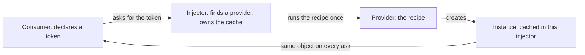
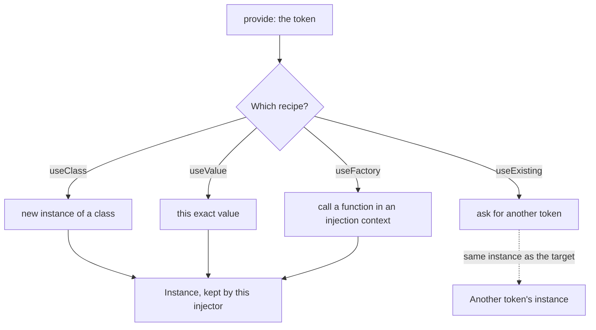
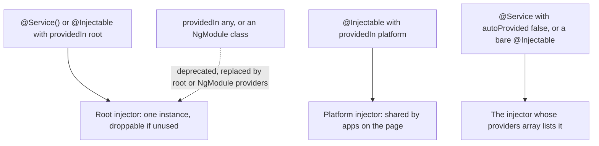
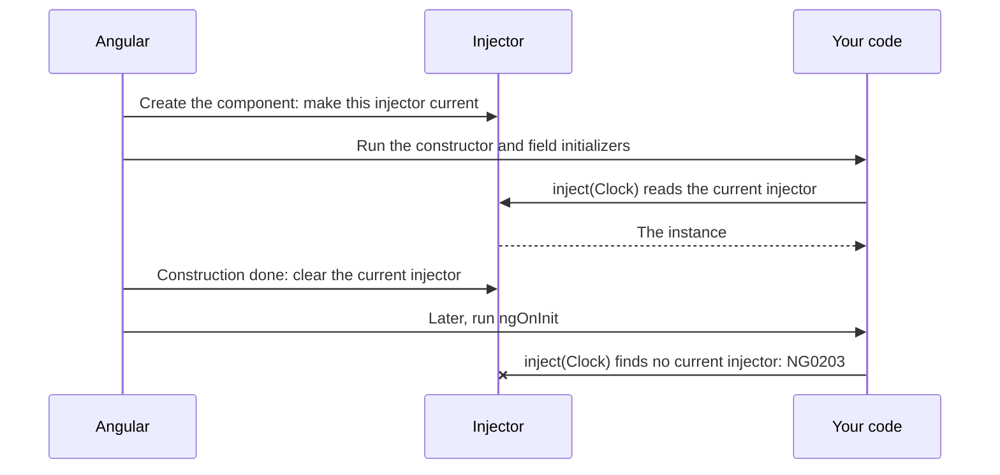
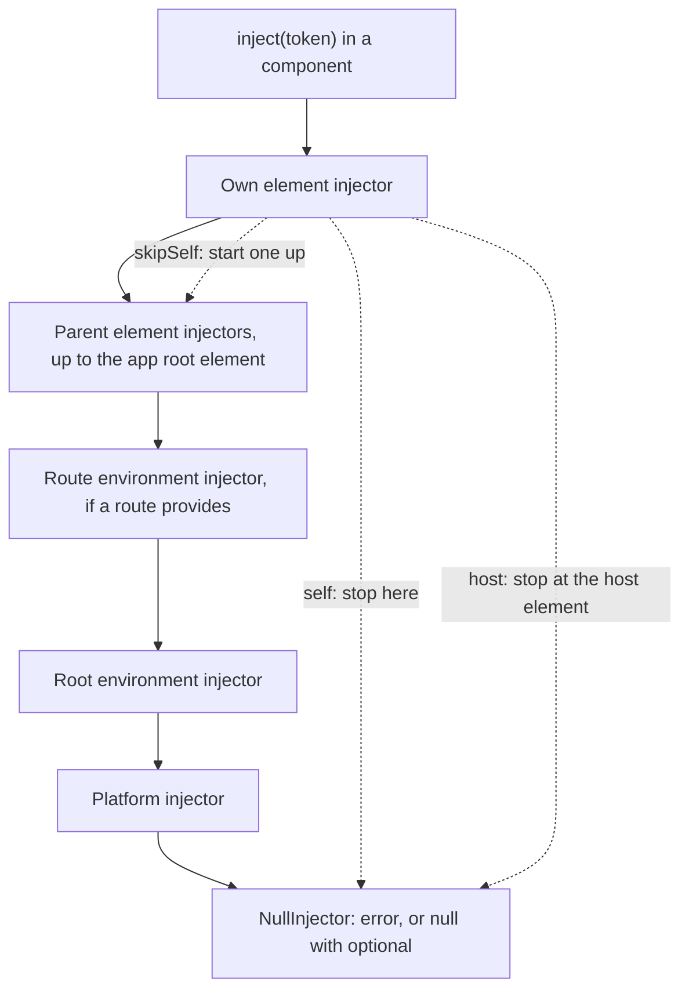
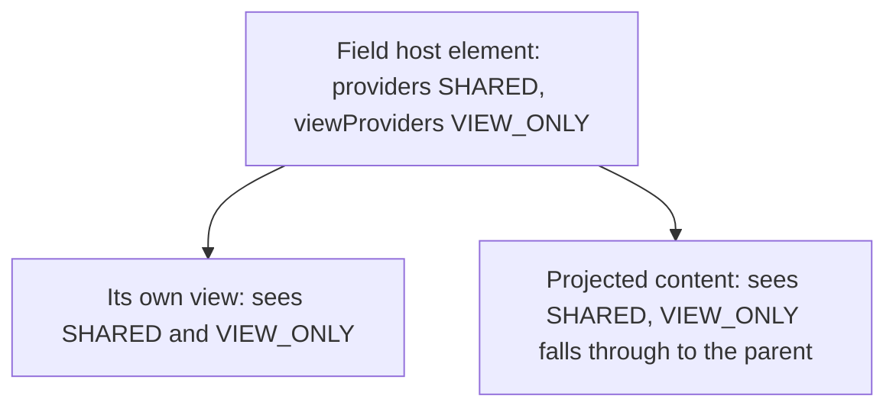
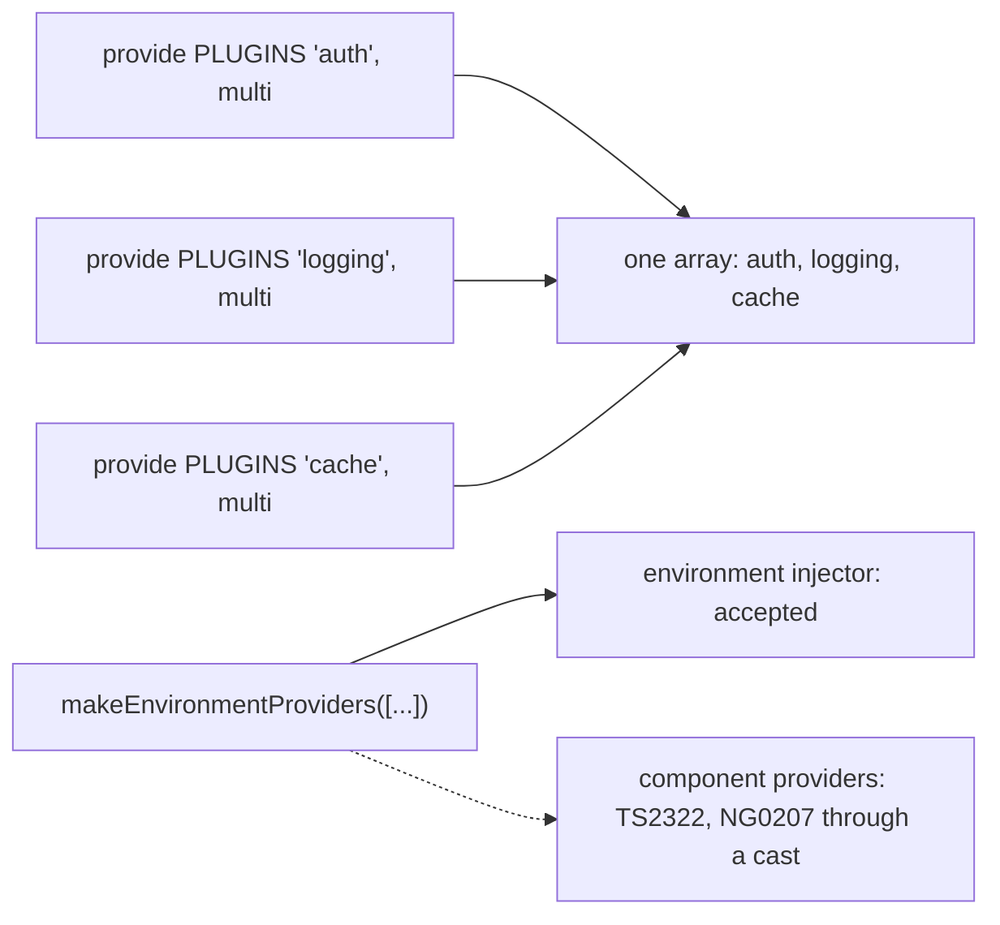
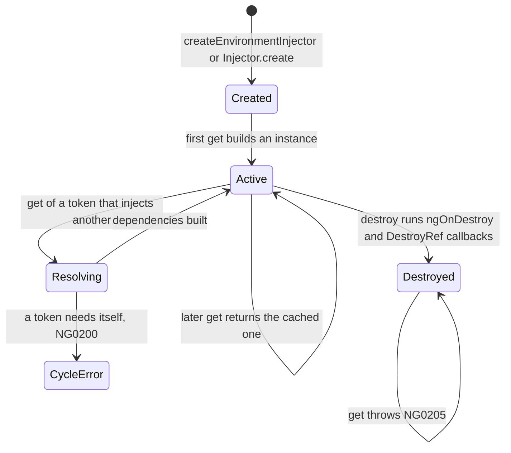
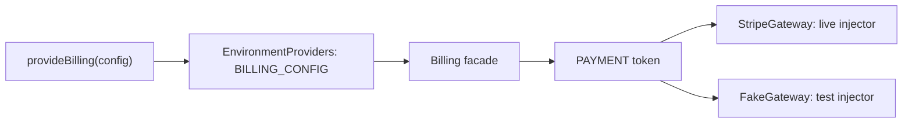

# 16. Dependency injection: providers, `@Service`, injection context, the injector tree and lifetime

> **What this covers:** how Angular 22 decides which object a class receives: why a container beats hand-built constructors; the four provider recipes, tokens, `providedIn`, `@Service` and tree-shaking; `inject()` and the injection context; the injector tree (platform, root, route, element) and the resolution modifiers; `providers` versus `viewProviders`; `InjectionToken`, multi providers and environment providers; `DestroyRef`, environment injectors, forward references and circular dependencies; DI patterns, testing and the Spring container compared. By the end you can predict which instance an `inject()` returns, why it throws `NG0201` or `NG0203`, and who destroys what.
> **Prerequisites:** [12. Angular: how it works](12-angular-how-it-works.md#6-bootstrapping-bootstrapapplication-the-platform-and-initializers) (bootstrap, the platform and initializers) and [13. Components and templates](13-components-and-templates.md#7-the-host-element-host-metadata-hostbinding-and-hostlistener) (the host element)
> **Leads to:** [15. Standalone and NgModules](15-standalone-and-ngmodules.md), [17. Signals](17-signals.md), [24. Routing](24-routing.md), [27. HTTP client](27-http-client.md)
> **Applies to:** Angular 22.2 (`@angular/core`, `@angular/compiler-cli` 22.2.1), TypeScript 6.0, Node 24
> **Study time:** ~8 hours reading + ~8 hours exercises
> **Short on time:** read [1. Why dependency injection](#1-why-dependency-injection-containers-constructor-injection-and-inject), [3. `providedIn`, `@Service`, scopes and tree-shaking](#3-providedin-service-scopes-and-tree-shaking), [5. The injector tree](#5-the-injector-tree-platform-root-route-and-element-injectors-and-the-modifiers) and [6. `providers` versus `viewProviders`](#6-providers-versus-viewproviders-and-per-instance-state), then drill [Q16.02](#q16-02), [Q16.08](#q16-08), [Q16.10](#q16-10), [Q16.15](#q16-15), [Q16.17](#q16-17) and [Q16.19](#q16-19), try [Exercise 16.1](#ex16-1), and finish with the [Summary](#summary).
> **Labs:** [`labs/angular/src/app/modules/16-dependency-injection/`](../labs/angular/src/app/modules/16-dependency-injection/) (section specs, Exercises 16.1-16.5, *Output* questions) and [`labs/ts-js/src/modules/16-dependency-injection/`](../labs/ts-js/src/modules/16-dependency-injection/) (Exercise 16.6). Run (Node 24): from `labs/angular`, `npx ng test --watch=false --include='src/app/modules/16-dependency-injection/**/*.spec.ts'`; from `labs/ts-js`, `npx vitest run src/modules/16-dependency-injection`

## Contents

1. [Why dependency injection: containers, constructor injection and `inject()`](#1-why-dependency-injection-containers-constructor-injection-and-inject)
2. [Providers and tokens: `useClass`, `useValue`, `useFactory` and `useExisting`](#2-providers-and-tokens-useclass-usevalue-usefactory-and-useexisting)
3. [`providedIn`, `@Service`, scopes and tree-shaking](#3-providedin-service-scopes-and-tree-shaking)
4. [The injection context: `inject()`, `runInInjectionContext` and `injectAsync`](#4-the-injection-context-inject-runininjectioncontext-and-injectasync)
5. [The injector tree: platform, root, route and element injectors, and the modifiers](#5-the-injector-tree-platform-root-route-and-element-injectors-and-the-modifiers)
6. [`providers` versus `viewProviders` and per-instance state](#6-providers-versus-viewproviders-and-per-instance-state)
7. [`InjectionToken`, multi providers, environment providers and initializers](#7-injectiontoken-multi-providers-environment-providers-and-initializers)
8. [Lifetime and dynamic injectors: `DestroyRef`, `EnvironmentInjector`, `Injector.create`, forward references and cycles](#8-lifetime-and-dynamic-injectors-destroyref-environmentinjector-injectorcreate-forward-references-and-cycles)
9. [DI patterns, testing and the Spring container](#9-di-patterns-testing-and-the-spring-container)
- [Summary](#summary)
- [Question bank](#question-bank)
- [Hands-on exercises](#hands-on-exercises)
- [Check your understanding](#check-your-understanding)
- [Connections](#connections)

**How the claims here are verified.** Runtime behavior is asserted by Angular specs under `ng test` (the ahead-of-time build, running in jsdom, a JavaScript DOM for Node), and one model by a `labs/ts-js` Vitest test; each such sentence names its test. Compiler output and diagnostics are quoted, dated, from `ngc` 22.2.1 (the compiler's command line) runs on throwaway projects, and one bundle observation from a scratch `ng build`. Package behavior is read from the 22.2.1 typings and sources, guidance from angular.dev (v22.2.1), the Angular CHANGELOG and the Spring reference, each dated. Server-side scoping of injectors, timings, memory and Spring Boot behavior are documented only, never observed.

## 1. Why dependency injection: containers, constructor injection and `inject()`

### The problem it solves

A `Report` class builds its own clock with `new SystemClock()`, so a test cannot give it a fixed time, and two components that each build a `Cart` hold two copies of its state. A reviewer asks why a container is needed when constructors take arguments; a team argues over `constructor(private cart: Cart)` against `cart = inject(Cart)`.

### Mental model

**Dependency injection** (DI) is a class declaring what it needs and something else deciding what it gets. A **dependency** is anything a class requires but does not create ([DI overview](https://angular.dev/guide/di), read 2026-10-08). A cook asks the pass for "a knife" and the pass picks which; the cook never visits the supplier. That reversal is **inversion of control** ([Spring reference](https://docs.spring.io/spring-framework/reference/core/beans/introduction.html), read 2026-10-08). An **injector** resolves a **token** (the key a consumer asks for: a class, abstract class or `InjectionToken`; typing one is [Q07.18](07-ts-advanced-types-and-decorators.md#q07-18)) through a **provider** (the recipe that produces the value), and caches the result. One cache per injector is what makes a **singleton**, one shared instance.



What to notice: the consumer holds a token, never a class it constructs, and the cache sits in the injector.

### How it actually works

**What a container adds:** lookup by token, a cache per injector and a parent chain ([section 5](#5-the-injector-tree-platform-root-route-and-element-injectors-and-the-modifiers)). Two consumers of a root service share one instance; a component listing it in `providers` gets another (`Section 1: a root service is one instance across consumers`, `Section 1: a component-level provider gives its own instance`). A test swaps a collaborator (`Section 1: providers replace a dependency and the consumer is unchanged`). `ProviderToken<T>` in the 22.2.1 typings allows these token forms (`Section 1: a class, an abstract class and an InjectionToken are tokens`).

**Constructor injection or `inject()`.** Both ask one injector (`Section 1: a field inject() and a constructor parameter resolve one instance`). `inject()` also runs in field initializers, an **injection context** ([section 4](#4-the-injection-context-inject-runininjectioncontext-and-injectasync)), and a subclass with no constructor inherits the field (`Section 1: a subclass inherits an inject() field`). The docs prefer it for "more accurate types"; migrate with `ng generate @angular/core:inject` ([migration](https://angular.dev/reference/migrations/inject-function), read 2026-10-08). Constructor parameters still work, `@Inject` and `@Optional` too (`Section 1: @Inject and @Optional parameters resolve`). `@Service()` [Added in v22.0], the docs' shorthand for `@Injectable({ providedIn: 'root' })`, refuses them ([section 3](#3-providedin-service-scopes-and-tree-shaking)).

**What fails.** An unprovided class or token throws `NG0201` naming it (`Section 1: an unprovided class or token fails with NG0201 naming it`); an undecorated class with a constructor parameter has no provider (`Section 1: an undecorated class with a constructor parameter has no provider`). Observed by compiling `src/plain.ts`, then `src/undecorated.ts`, with `ngc` 22.2.1 on 2026-10-08, `strictInjectionParameters: true`:

```text
src/plain.ts:5:22 - error NG2003: No suitable injection token for parameter 'a' of class 'Plain'. Find more at https://next.angular.dev/errors/NG2003
  Consider using the @Inject decorator to specify an injection token.
    This type is not supported as injection token.
src/plain.ts:9:14 - error NG2028: @Service class cannot use constructor dependency injection. Use the `inject` function instead.
src/undecorated.ts:10:62 - error NG2005: The class 'Undecorated' cannot be created via dependency injection, as it does not have an Angular decorator. This will result in an error at runtime.

Either add the @Injectable() decorator to 'Undecorated', or configure a different provider (such as a provider with 'useFactory').
```

`Plain` was `@Injectable({ providedIn: 'root' })` and `WithCtor` was `@Service()`, each with `a: string`; `Undecorated`, with no decorator and a `Dep` parameter, was listed in a component's `providers`.

> [!NOTE]
> **Framework vs platform.** JavaScript supplies constructors and arguments; the injector, tokens, providers and the compiler step that reads parameter types are Angular's.

> [!TIP]
> **Coming from the backend.** Spring's reference "generally advocates constructor injection" ([Spring reference](https://docs.spring.io/spring-framework/reference/core/beans/dependencies/factory-collaborators.html), read 2026-10-08). **Where the analogy breaks:** Angular has two injector hierarchies, one of them an `ElementInjector` per DOM element ([Hierarchical injectors](https://angular.dev/guide/di/hierarchical-dependency-injection), read 2026-10-08), so a lookup climbs a chain that follows the UI. [Section 9](#9-di-patterns-testing-and-the-spring-container) compares them.

### Code

The approach: ask for tokens in two ways, then replace one in a test.

1. `First` asks for `Cart` (which holds a [signal](17-signals.md#2-writable-signals)) in a field initializer, `FromConstructor` in a parameter.
2. `Report` asks for the abstract `Clock`; the test provides a fixed one.

```ts
// Excerpt of labs/angular/src/app/modules/16-dependency-injection/concepts/section-1-why-di.spec.ts
@Service()
class Cart {
  readonly count = signal(0);
}

@Component({ selector: 'lab-s1-first', template: '' })
class First {
  readonly cart = inject(Cart);
}

@Component({ selector: 'lab-s1-ctor', template: '' })
class FromConstructor {
  constructor(readonly cart: Cart) {}
}
```

```ts
// Excerpt of labs/angular/src/app/modules/16-dependency-injection/concepts/section-1-why-di.spec.ts
abstract class Clock {
  abstract now(): number;
}

@Service()
class Report {
  private readonly clock = inject(Clock);

  stamp(): string {
    return `generated at ${this.clock.now()}`;
  }
}
```

```ts
// Excerpt of labs/angular/src/app/modules/16-dependency-injection/concepts/section-1-why-di.spec.ts
  it('Section 1: providers replace a dependency and the consumer is unchanged', () => {
    TestBed.configureTestingModule({
      providers: [{ provide: Clock, useValue: { now: () => 42 } }],
    });
    expect(TestBed.inject(Report).stamp()).toBe('generated at 42');
  });
```

### Best practices and anti-patterns

- **Ask for a token a test may replace; avoid `new` on it**, because no provider can reach a class built inside another.
- **Use `inject()` in a `readonly` field**, because a subclass inherits it with no constructor.
- **Keep to four injected dependencies per class**, because more means a missing facade (one class in front of several services, [section 9](#9-di-patterns-testing-and-the-spring-container)).

### Misconceptions and traps

- *"DI is just constructor syntax."* The injector and its cache are the point. The myth exists because Java tutorials show only the constructor.
- *"`inject()` is an unsafe service locator."* It runs only in an injection context and throws `NG0201` for a missing provider. The myth exists because a lookup call resembles a registry.
- *"Constructor parameters are gone in v22."* Only `@Service` refuses them. The myth exists because its error says "Use the `inject` function instead".

Drilled in [Q16.01](#q16-01), [Q16.02](#q16-02) and [Q16.03](#q16-03); practised in [Exercise 16.6](#ex16-6).

## 2. Providers and tokens: `useClass`, `useValue`, `useFactory` and `useExisting`

### The problem it solves

A team swaps a real payment client for a fake by editing production code, because nothing lets a test choose. A `Logger` alias written as a second class makes two console loggers with two buffers. Two providers listed for one token leave one unused, silently. All three come from not knowing what a provider does to instance identity.

### Mental model

A **provider** is a recipe attached to a token in one injector ([section 1](#1-why-dependency-injection-containers-constructor-injection-and-inject) defined all three). Think of recipe cards in a binder, one binder per injector: another binder may hold a card of the same name, and the nearest wins ([section 5](#5-the-injector-tree-platform-root-route-and-element-injectors-and-the-modifiers)). There are four recipes. `useClass` builds a new instance of a class. `useValue` hands over one given value. `useFactory` calls a **factory function**, a function that returns the value. `useExisting` makes an **alias**, a second token that answers with the instance of another token.



What to notice: only `useExisting` points at another token; the other three produce or hold the value themselves.

### How it actually works

**The shorthand.** `providers: [Basket]` and `{ provide: Basket, useClass: Basket }` register the same recipe: each gives its component an own `Basket` and leaves the root injector without one (`Section 2: a class shorthand equals useClass of itself`). `provide` is the token, and the typings declare it `any` (`@angular/core` 22.2.1, `ClassProvider`, read 2026-10-08), so TypeScript checks nothing about it. An interface cannot be a token because it does not exist at run time ([docs](https://angular.dev/guide/di/defining-dependency-providers), read 2026-10-08); use an abstract class or an `InjectionToken` ([section 7](#7-injectiontoken-multi-providers-environment-providers-and-initializers)).

**`useClass` against `useExisting`.** `useClass` constructs the class, so one class under two tokens is two instances. `useExisting` asks the injector for the target and returns that instance. The test provides three tokens and counts two constructor calls (`Section 2: useClass creates its own instance while useExisting returns the target instance`). An alias to an unprovided target fails naming the target (`Section 2: useExisting to an unprovided token fails naming the target`).

**`useValue`.** The injector keeps the reference, never a copy: a later mutation shows through every consumer (`Section 2: useValue returns the same object every time`). The value is not checked against the token's type either; `42` is accepted for an `InjectionToken<Settings>` (`Section 2: useValue is not checked against the token type`).

**`useFactory`.** The function is not called until the first lookup, runs once per injector and runs in an injection context ([section 4](#4-the-injection-context-inject-runininjectioncontext-and-injectasync)), so it can call `inject()`. One root call serves the root and a component reading from it; two components with their own provider add two, three in all (`Section 2: useFactory runs once per injector and can inject`). The other form lists tokens in `deps`, passed as arguments (`Section 2: useFactory deps pass the resolved tokens to the factory`); the typings declare `useFactory: Function` and `deps?: any[]`, so nothing compares them.

**Last wins.** With several providers for one token in an injector, the last answers and the others raise no error (`Section 2: the last provider for a token wins`). Only `multi: true` collects ([section 7](#7-injectiontoken-multi-providers-environment-providers-and-initializers)): two multi providers return both values (`Section 2: two multi providers for a token return both values in order`), and a multi provider mixed with a regular one throws at the first lookup, in either order (`Section 2: a multi provider mixed with a regular one throws`).

**A missing provider.** `TestBed.inject` (`TestBed` is Angular's testing harness, [module 29](29-testing-angular.md)) throws the first message; a component's lookup adds `Source: DynamicTestModule` (`Section 2: a missing provider is NG0201 with the source named`):

```text
NG0201: No provider found for `InjectionToken lab-s2-missing`. Find more at https://v22.angular.dev/errors/NG0201
NG0201: No provider found for `InjectionToken lab-s2-missing`. Source: DynamicTestModule. Find more at https://v22.angular.dev/errors/NG0201
```

### Code

The approach: put one class under three tokens and count constructions, then give a factory its dependency through `inject()`.

1. `ConsoleLogger` counts its constructor calls in `calls.logger`.
2. The test lists `ConsoleLogger`, an alias `Logger` and a `useClass` copy `AuditLogger`.
3. The alias returns the target, the copy does not, and the counter reads 2.
4. `apiProvider` builds an `ApiClient` from `inject(BASE_URL)`.

```ts
// Excerpt of labs/angular/src/app/modules/16-dependency-injection/concepts/section-2-providers.spec.ts
@Injectable()
class ConsoleLogger extends Logger {
  constructor() {
    super();
    calls.logger++;
  }
}
```

```ts
// Excerpt of labs/angular/src/app/modules/16-dependency-injection/concepts/section-2-providers.spec.ts
    TestBed.configureTestingModule({
      providers: [
        ConsoleLogger,
        { provide: Logger, useExisting: ConsoleLogger },
        { provide: AuditLogger, useClass: ConsoleLogger },
      ],
    });

    const target = TestBed.inject(ConsoleLogger);
    expect(TestBed.inject(Logger)).toBe(target);
    expect(TestBed.inject(AuditLogger)).not.toBe(target);
    expect(calls.logger).toBe(2);
```

```ts
// Excerpt of labs/angular/src/app/modules/16-dependency-injection/concepts/section-2-providers.spec.ts
const apiProvider: Provider = {
  provide: ApiClient,
  useFactory: () => new ApiClient(inject(BASE_URL)),
};
```

### Best practices and anti-patterns

- **Give one instance two names with `useExisting`**, because `useClass` builds a second instance with its own state.
- **Make the token an abstract class or an `InjectionToken` when two implementations exist**, because consumers then import neither and a test provides the other.
- **Call `inject()` inside `useFactory` rather than listing `deps`**, because the compiler cannot compare a `deps` list with the factory's parameters.
- **Avoid listing one token twice to override it in one array**, because the earlier entry is dropped without an error; override in a nearer injector.

### Misconceptions and traps

- *"`useExisting` and `useClass` are interchangeable aliases."* `useClass` makes a second instance and `useExisting` reuses the first. The myth exists because both map a token to a class in one line.
- *"Providing a token twice merges the providers."* The last one wins. The myth exists because `multi: true` collects, so people expect the default to collect too.
- *"`useValue` copies the object."* The injector keeps your reference. The myth exists because the word "value" suggests a copy.
- *"A typed `InjectionToken<T>` checks the `useValue`."* Nothing checks it. The myth exists because the generic reads like a contract, but the typings leave `provide` and `useValue` as `any`.

Drilled in [Q16.04](#q16-04), [Q16.05](#q16-05) and [Q16.06](#q16-06); practised in [Exercise 16.1](#ex16-1).

## 3. `providedIn`, `@Service`, scopes and tree-shaking

### The problem it solves

A service "provided in root" appears twice because a component lists it too. An unused service ships anyway. A v22 template shows `@Service()`, and a reviewer asks whether `@Injectable` is wrong now. A constructor parameter will not compile under it. All four trace to where a provider is registered.

### Mental model

`providedIn` registers a class's recipe on the class itself; a `providers` array registers it where it is used, like a product with its own shelf label against one in the shop's catalogue. The registration point decides which injector caches it ([section 1](#1-why-dependency-injection-containers-constructor-injection-and-inject)) and whether the build can drop the class. **Tree-shaking** is the build dropping code nothing reaches.



What to notice: the class never changes; the registration point sets the scope.

### How it actually works

**Scopes.** `providedIn: 'root'` gives every consumer one instance, built at the first lookup (`Section 3: a root service and a @Service class are singletons`, `Section 3: nothing is constructed before the first lookup`). `'platform'` means "a special singleton platform injector shared by all applications on the page" (typings, read 2026-10-08): the root injector finds a platform service, the platform injector no root one (`Section 3: a platform service is visible from the root injector and a root service is not visible from the platform injector`). A bare `@Injectable()` is registered nowhere (`Section 3: an @Injectable without providedIn is not found`); a component's `providers` entry for a root service adds a second instance (`Section 3: a component-level provider shadows the root instance`).

**Deprecated forms.** `providedIn: 'any'` and an NgModule class carry [Deprecated since v15.0 — use 'root' or NgModule.providers]. The typings call `'any'` "a unique instance in each lazy loaded module"; I did not run it. Module providers are [module 15](15-standalone-and-ngmodules.md#1-what-ngmodules-did-compilation-scope-injector-and-lazy-loading-unit).

**`@Service`** [Added in v22.0] is, per the docs, "a modern, ergonomic shorthand" for `@Injectable({ providedIn: 'root' })`. Read from the 22.2.1 source, its definition sets `providedIn` to `null` when `autoProvided` is `false` and to `'root'` otherwise. Observed by compiling `src/shop.ts` with `ngc` 22.2.1 on 2026-10-08, the `ɵprov` of `@Service()`, a root `@Injectable`, `@Service({ autoProvided: false })` and a platform `@Injectable`:

```text
static ɵprov = /*@__PURE__*/ i0.ɵɵdefineService({ token: Shopping, factory: Shopping.ɵfac });
static ɵprov = /*@__PURE__*/ i0.ɵɵdefineInjectable({ token: LegacyShopping, factory: LegacyShopping.ɵfac, providedIn: 'root' });
static ɵprov = /*@__PURE__*/ i0.ɵɵdefineService({ token: OptIn, factory: OptIn.ɵfac, autoProvided: false });
static ɵprov = /*@__PURE__*/ i0.ɵɵdefineInjectable({ token: PlatformStamp, factory: PlatformStamp.ɵfac, providedIn: 'platform' });
```

A `factory` replaces construction and may `inject()` (`Section 3: a @Service factory replaces construction and can inject`). `autoProvided: false` leaves registration to `providers` (`Section 3: autoProvided false is not found until listed in providers`).

**What it forbids.** A constructor parameter, even with a `factory`, and options beyond those two. Observed by compiling `src/bad.ts` (a `factory` and a `string` constructor parameter) and `src/scoped.ts` (`providedIn: 'platform'`) with `ngc` 22.2.1 on 2026-10-08 ([section 1](#1-why-dependency-injection-containers-constructor-injection-and-inject) quotes `NG2028` and `NG2003` for the plain cases):

```text
src/bad.ts:9:14 - error NG2028: @Service class cannot use constructor dependency injection. Use the `inject` function instead.
src/scoped.ts:3:12 - error TS2769: No overload matches this call.
  Overload 1 of 4, '(options: { autoProvided: false; }): TypeDecorator', gave the following error.
    Object literal may only specify known properties, and 'providedIn' does not exist in type '{ autoProvided: false; }'.
```

A typings grep on 2026-10-08 found `@deprecated` only on `Injectable`'s NgModule and `'any'` signature.

**Generating and migrating.** `ng generate service` writes `@Service()` unless `--injectable` is passed (the `@schematics/angular` 22.2.1 template; a dry run on 2026-10-08 listed a 75-byte `shop.ts`, the template's size). A **migration** is a code-rewriting schematic ([module 12](12-angular-how-it-works.md#2-the-cli-and-the-workspace-angularjson-projects-schematics-and-ng-update)). `ng generate @angular/core:service` [Added in v22.1] turns `providedIn: 'root'` into `@Service()` and `@Injectable()` into `autoProvided: false`, skipping constructor injection, other options and scopes ([docs](https://angular.dev/reference/migrations/injectable-to-service)).

**Tree-shaking, observed once.** The docs promise a root service is "excluded from the final production bundle if your code never explicitly uses it". Observed in a scratch build on 2026-10-08: `ng build` (`@angular/build` 22.2.1, production) of an app using one pair of classes beside three unused pairs, each a `@Service` and a root `@Injectable`; marker strings counted in `main.js`:

```text
build                  main.js bytes   unimported pair   export * pair   named export pair
direct import          92,486          absent            absent          absent
index with export *    92,804          absent            kept (2 of 2)   absent
index with named       92,802          absent            absent          kept (2 of 2)
```

Unreferenced classes were dropped; the same classes re-exported through an index the app imports stayed. The cause is not established; this is no rule about barrels (index files that re-export other files).

### Code

The approach: register one class several ways and count constructions.

1. `Shopping` and `LegacyShopping` are root singletons.
2. `OptIn` waits for a `providers` array.
3. `Greeter` is abstract, so only its factory builds it.
4. `PlatformStamp` goes to the platform injector.

```ts
import { inject, Injectable, InjectionToken, Service } from '@angular/core';

// Counts constructions so a test asserts how many instances were made.
export const built = { shopping: 0, legacy: 0, optIn: 0, greeter: 0, stamp: 0 };

// A root singleton written both ways: the shorthand and the long form.
@Service()
export class Shopping {
  constructor() {
    built.shopping++;
  }
}

@Injectable({ providedIn: 'root' })
export class LegacyShopping {
  constructor() {
    built.legacy++;
  }
}

// Not registered anywhere until a `providers` array lists it.
@Service({ autoProvided: false })
export class OptIn {
  constructor() {
    built.optIn++;
  }
}

// A token with a default value, read by the factory below.
export const SALUTATION = new InjectionToken<string>('lab-s3-salutation', {
  providedIn: 'root',
  factory: () => 'hello',
});

// A factory builds the instance and may call inject(); the class is abstract, so only the factory can build it.
@Service({ factory: () => new Polite(inject(SALUTATION)) })
export abstract class Greeter {
  abstract greet(): string;
}

class Polite extends Greeter {
  constructor(private readonly salutation: string) {
    super();
    built.greeter++;
  }

  greet(): string {
    return this.salutation;
  }
}

// Provided in the platform injector, above the root.
@Injectable({ providedIn: 'platform' })
export class PlatformStamp {
  constructor() {
    built.stamp++;
  }
}
```

<sub>Source: [labs/angular/src/app/modules/16-dependency-injection/concepts/service-demo.ts](../labs/angular/src/app/modules/16-dependency-injection/concepts/service-demo.ts)</sub>

```ts
// Excerpt of labs/angular/src/app/modules/16-dependency-injection/concepts/section-3-provided-in-and-service.spec.ts
  it('Section 3: a component-level provider shadows the root instance', () => {
    const root = TestBed.inject(Shopping);
    const own = TestBed.createComponent(OwnShopping).componentInstance.shopping;
    const shared = TestBed.createComponent(ReadsShopping).componentInstance.shopping;

    expect(own).not.toBe(root);
    expect(shared).toBe(root);
    expect(built.shopping).toBe(2);
  });
```

> [!TIP]
> **Coming from the backend.** Spring can "automatically detect stereotyped classes" such as `@Service`, a specialization of `@Component` ([Spring reference](https://docs.spring.io/spring-framework/reference/core/beans/classpath-scanning.html), read 2026-10-08). **Where the analogy breaks:** Angular scans nothing; the compiler writes a definition onto the class. Spring's `@Service` labels a layer, Angular's sets a scope, and Spring's example injects through the constructor, which Angular's refuses.

### Best practices and anti-patterns

- **Write `@Service()` for a new root singleton that uses `inject()`**, because the docs choose it there and the compiler rejects constructor parameters.
- **Keep `@Injectable` for constructor injection, provider keys and `'platform'`**, because `@Service` lacks them.
- **Avoid listing a root service in `providers` unless you want a second instance**, because the nearer injector answers first.

### Misconceptions and traps

- *"`@Service` replaces `@Injectable`."* It covers the root-singleton case. The myth exists because "shorthand" reads like a rename, yet the docs list what `@Injectable` still does and the typings tag no deprecation.
- *"An unused `providedIn: 'root'` service is always tree-shaken."* The scratch build kept two reached through an index. The myth exists because the docs name no exception.
- *"`providedIn: 'any'` gives one instance per lazy module."* Once true: a documented option until deprecated in v15.0 (CHANGELOG 15.0.0, 2022-11-16: "confusing semantics"). Now: deprecated. The myth survives because the typings still describe it.
- *"`@Service` can take constructor parameters."* It cannot (`NG2028`). The myth exists because `@Injectable` can.

Drilled in [Q16.07](#q16-07), [Q16.08](#q16-08), [Q16.09](#q16-09) and [Q16.10](#q16-10); practised in [Exercise 16.1](#ex16-1).

## 4. The injection context: `inject()`, `runInInjectionContext` and `injectAsync`

### The problem it solves

`inject()` works in a field initializer and throws `NG0203` in `ngOnInit`. A helper `injectUser()` fails the same way in a click handler. A utility must run with an injector it was handed, and a rarely used chunk should load only when needed. Each asks which injector is active right now.

### Mental model

**`inject()` asks "which injector is active right now?"**, and Angular sets the answer only during construction. That window is the **injection context** ([docs](https://angular.dev/guide/di/dependency-injection-context), read 2026-10-08). A hotel key card works only during check-in; later the clerk, an injector, opens the door.



What to notice: the context exists during construction, not for the object's life.

### How it actually works

**Where a context exists.** The docs list a constructor, a **field initializer** (an expression after `=` in a class), a **provider factory** (the function behind `useFactory`, a `@Service` `factory` or an `InjectionToken` `factory`; [section 2](#2-providers-and-tokens-useclass-usevalue-usefactory-and-useexisting)) and a function run by `runInInjectionContext`. A component uses the first three (`Section 4: inject works in a constructor, a field initializer and a provider factory`). A **lifecycle hook** such as `ngOnInit` (a method Angular calls at set moments, [module 20](20-lifecycle-and-render-hooks.md#2-constructor-ngoninit-and-inputs-what-exists-when)) is no context, nor is any later method (`Section 4: inject in ngOnInit throws NG0203`). Runtime text (the test build adds an underscore before the class name):

```text
NG0203: The `_Clock` token injection failed. `inject()` function must be called from an injection context such as a constructor, a factory function, a field initializer, or a function used with `runInInjectionContext`. Find more at https://v22.angular.dev/errors/NG0203
```

**A helper that wraps `inject()`.** `assertInInjectionContext(helper)` [Added in v16.0] names the helper in its error (`Section 4: assertInInjectionContext names the helper`):

```text
NG0203: injectClock() can only be used within an injection context such as a constructor, a factory function, a field initializer, or a function used with `runInInjectionContext`. Find more at https://v22.angular.dev/errors/NG0203
```

**A captured injector.** `runInInjectionContext(injector, fn)` [Added in v16.0] makes `injector` current while `fn` runs. Capture `inject(Injector)` during construction, use it later (`Section 4: runInInjectionContext lets a function inject with a captured injector`). The injector you pass decides the answer (`Section 4: the injector passed to runInInjectionContext decides the answer`). The context ends at the first `await`, so `inject()` after one throws `NG0203` (`Section 4: inject after an await throws NG0203`). `TestBed.runInInjectionContext(fn)` [Added in v15.1] does it for tests (`Section 4: TestBed.runInInjectionContext runs a helper`). `inject(token, options)` [Added in v14.1] takes `optional`, `self`, `skipSelf` and `host` ([section 5](#5-the-injector-tree-platform-root-route-and-element-injectors-and-the-modifiers)).

**Why the context ends.** Read from the 22.2.1 source, not run (internal names, not API): `inject()` calls `ɵɵinject` in `fesm2022/_pending_tasks-chunk.mjs`, which asks one of two module-level variables. While an element injector builds a component or directive, it installs an inject implementation (`ɵɵdirectiveInject`, `_debug_node-chunk.mjs`); otherwise `injectInjectorOnly` reads the current injector that `setCurrentInjector` (`_not_found-chunk.mjs`) stores. `R3Injector.get`, `runInContext` and `runInInjectionContext` set it in a `try` and restore the previous value in `finally`, so nothing is current once the call returns, and `injectInjectorOnly` throws the `NG0203` above. Code after an `await` runs after that return.

**The method form does not exist.** Observed by compiling `src/docs-form.ts` with `ngc` 22.2.1 on 2026-10-08, calling `injector.runInInjectionContext(...)`, the free function and the deprecated `env.runInContext(...)`; only the first was reported:

```text
src/docs-form.ts:9:26 - error TS2339: Property 'runInInjectionContext' does not exist on type 'Injector'.
```

The guide and API pages I read that day show only the free function.

**`injectAsync`** [Added in v22.0] loads a service on demand. Its typings take a loader returning a promise of a class (or of a module whose `default` is one) and return **a function** returning a promise of the instance. It reads `inject(Injector)` when called (source), so it needs a context. Observed: nothing loads until that function is called, the loader runs once, each call returns a new promise for the one root instance, a default export works, and outside a context it throws `NG0203` naming `injectAsync()` (`Section 4: injectAsync loads once, returns a new promise per call and needs a context`, `Section 4: injectAsync accepts a module with a default export`). The service must register itself; `autoProvided: false` fails at the call (`Section 4: injectAsync of an unregistered service fails with NG0201`). A rejected load is kept, not retried; a `prefetch` trigger (a function returning a promise) starts the loader when it resolves (`Section 4: injectAsync prefetch loads early and a failed load stays failed`). 22.0.3 (2026-06-25) fixed uncaught promise errors in prefetching (CHANGELOG). The build splits chunks at `import()` ([module 12](12-angular-how-it-works.md#3-building-the-application-builder-output-layout-and-budgets)); the lab loader returns a class instead.

### Code

The approach: keep an injector while a context exists, and use it when none does.

1. `Deferred` captures `inject(Injector)` in a field initializer.
2. `later()` runs its callback under `runInInjectionContext`.
3. `injectClock` asserts first.
4. `Lazy` hands `injectAsync` a counting loader.

```ts
// Excerpt of labs/angular/src/app/modules/16-dependency-injection/concepts/section-4-injection-context.spec.ts
@Service()
class Deferred {
  private readonly injector = inject(Injector);

  later(): Clock {
    return runInInjectionContext(this.injector, () => inject(Clock));
  }
}
```

```ts
// Excerpt of labs/angular/src/app/modules/16-dependency-injection/concepts/section-4-injection-context.spec.ts
function injectClock(): Clock {
  assertInInjectionContext(injectClock);
  return inject(Clock);
}
```

```ts
// Excerpt of labs/angular/src/app/modules/16-dependency-injection/concepts/section-4-injection-context.spec.ts
class Lazy {
  loads = 0;
  readonly exporter = injectAsync(() => {
    this.loads++;
    return Promise.resolve(Exporter);
  });
}
```

```ts
// Excerpt of labs/angular/src/app/modules/16-dependency-injection/concepts/section-4-injection-context.spec.ts
    const first = lazy.exporter();
    const second = lazy.exporter();

    expect(first).not.toBe(second);
    expect(await first).toBe(await second);
    expect(lazy.loads).toBe(1);
```

### Best practices and anti-patterns

- **Read `inject()` into a field and use the field later**, because a later method has no context.
- **Begin a wrapping helper with `assertInInjectionContext(helper)`**, because the error then names it.
- **Capture `inject(Injector)` once for deferred work, and read every dependency before an `await`**, because the context is gone after construction and at the first `await`.
- **Use `injectAsync` only for a rarely used service behind heavy code**, because the saving is the unloaded chunk.

### Misconceptions and traps

- *"`inject()` works anywhere in a class."* It works where a context exists. The myth exists because fields and constructors look like class properties, yet the context belongs to the running code.
- *"`runInInjectionContext` is a method of `Injector`."* It is a free function (TS2339 above). The myth exists because `TestBed.runInInjectionContext` is a method. Once true: `EnvironmentInjector.runInContext(fn)` was the method form until v16.0 deprecated it (CHANGELOG 16.0.0, 2023-05-03: "introduce `runInInjectionContext` and deprecate prior version"); 22.2.1 still declares it, deprecated.
- *"`injectAsync` caches the promise."* It keeps the loader's promise; each call returns a new one (test). The myth exists because the guide says "Subsequent calls reuse the same promise", true of the load, not of what you receive.

Drilled in [Q16.11](#q16-11), [Q16.12](#q16-12), [Q16.13](#q16-13) and [Q16.14](#q16-14); practised in [Exercise 16.2](#ex16-2).

## 5. The injector tree: platform, root, route and element injectors, and the modifiers

### The problem it solves

A service provided in a lazy route is not found from the root. Two sibling routes hold two instances of "the same" service. `optional` returns `null` where `self` was meant, and nobody can say where a lookup stopped. All of it follows from one rule: which injector asks first, and where the walk ends.

### Mental model

There are **two trees of injectors**. An **element injector** belongs to one element of the page and is empty unless that element's component or directive lists `providers`. An **environment injector** holds providers for a whole region: the platform one at the top, the root one below it, and one more for each route that lists `providers` ([hierarchical injectors](https://angular.dev/guide/di/hierarchical-dependency-injection), read 2026-10-08). A lookup walks the element tree upward first, then returns to the element where it began and walks the environment tree. Asking a colleague for a stapler: the desks along your row, then the department supplies, then the building store, then nobody. **Resolution** is that walk; a **modifier** is an option that moves its start or its end.



What to notice: `self` and `host` end the walk early, `skipSelf` starts it higher, and `host` never reaches the environment tree.

### How it actually works

**The walk.** A component's own `providers` answer before the root (`Section 5: the element tree is searched before the environment tree`). The `NullInjector` ends the tree: it throws `NG0201`, or returns the fallback you pass (`Section 5: the null injector at the top of the tree throws NG0201 or returns the fallback`). How the platform and root see each other is [section 3](#3-providedin-service-scopes-and-tree-shaking). Whether a server creates one platform injector per request is not claimed here; [module 32](32-ssr-ssg-hydration.md) owns it.

**What the injectors are.** Read from the 22.2.1 source, not run (`fesm2022/_debug_node-chunk.mjs` and `_pending_tasks-chunk.mjs`; internal names). An element injector is no object of its own: it is a slot in the view's data arrays holding a 256-bit bloom filter of the tokens its element's providers and directives may supply, plus a link to the parent slot; a `NodeInjector` is a wrapper made on request. `getOrCreateInjectable` calls `lookupTokenUsingNodeInjector`, which climbs the slots, tests each bloom (`bloomHasToken`) and, on a hit, scans the element's list in `searchTokensOnInjector`. Past the top element it calls `lookupTokenUsingModuleInjector`, the environment injector. That is an `R3Injector`: a `records` `Map` from token to factory and value, filled from `providers` at construction and, for a class whose `providedIn` matches the injector's scope, at the first lookup; a miss asks `parent`. The four options become bit flags (`convertToBitFlags`); `shouldSearchParent` stops the climb for `self`, and for `host` at the host element.

**Route injectors.** A route that lists `providers` makes its own environment injector; the routes themselves are [module 24](24-routing.md#4-lazy-loading-in-depth-loaders-canmatch-and-route-injectors). Sibling routes get different instances (`Section 5: a route with providers creates its own injector and sibling routes get different instances`), a revisited route reuses its injector (`Section 5: revisiting a route reuses its injector`), and a child route's provider wins inside the child (`Section 5: a parent route's provider is overridden by a child route's`). The root injector sees none of them (`Section 5: the root injector does not see route providers`), which is the "not found from the root" of the problem.

**Modifiers.** The options of `inject(token, options)` ([section 4](#4-the-injection-context-inject-runininjectioncontext-and-injectasync)) are `optional` (return `null` instead of throwing), `self` (look only at the current element), `skipSelf` (start at the parent) and `host` (stop at the host element). `optional` does not mean "only if I have it": it still searches upward. The tree in the lab is `Parent` (provides `'parent'`), `Child` (provides `'child'`) and a `Probe` in `Child`'s view with no providers; the root default is `'root'`. All of this is `Section 5: self, skipSelf, host and optional change where the walk starts and stops`:

| Asked from | plain | `self` | `skipSelf` | `host` |
| --- | --- | --- | --- | --- |
| `Child` | `'child'` | `'child'` | `'parent'` | `'child'` |
| `Probe` | `'child'` | `null` with `optional`, else `NG0201` | `'child'` | `NG0201`, or `null` with `optional` |

`Child` with `host` and `skipSelf` together also fails with `NG0201`, although a parent provider and a root default exist. The error text is `NG0201: No provider for InjectionToken lab-s5-who found in NodeInjector`, which names the node injector, not the environment. Only these combinations were tested; I claim nothing about others, for instance on a projected node ([section 6](#6-providers-versus-viewproviders-and-per-instance-state)).

**Older spelling.** `@Self()`, `@SkipSelf()`, `@Optional()` and `@Host()` carry no `@deprecated` tag in the 22.2.1 typings (read 2026-10-08) and give the same answers on constructor parameters (`Section 5: the older decorators give the same answers as the options object`). A `@Service` class cannot take constructor parameters ([section 3](#3-providedin-service-scopes-and-tree-shaking)), so new code uses the options.

**Asking an injector directly.** An `Injector` read in a component answers from that element, and the root environment injector's `get(Injector)` returns itself (`Section 5: an injector read in a component answers from that element`).

### Code

The approach: build a three-level tree, ask the same token with each modifier, and give two routes a provider each.

1. `WHO` has a root default, so a lookup that reaches the root answers `'root'`.
2. `Parent` and `Child` each provide `WHO`; `Probe` sits in `Child`'s view.
3. `Child` asks with `self`, `skipSelf` and `host`.
4. `Scoped` is registered nowhere except in the two routes' `providers`.

```ts
// Excerpt of labs/angular/src/app/modules/16-dependency-injection/concepts/section-5-injector-tree.spec.ts
const WHO = new InjectionToken<string>('lab-s5-who', {
  providedIn: 'root',
  factory: () => 'root',
});
```

```ts
// Excerpt of labs/angular/src/app/modules/16-dependency-injection/concepts/section-5-injector-tree.spec.ts
class Child {
  readonly plain = inject(WHO);
  readonly self = inject(WHO, { self: true });
  readonly skipSelf = inject(WHO, { skipSelf: true });
  readonly host = attempt(() => inject(WHO, { host: true }));
```

```ts
// Excerpt of labs/angular/src/app/modules/16-dependency-injection/concepts/section-5-injector-tree.spec.ts
const routes: Routes = [
  { path: 'a', component: ReadsScoped, providers: [Scoped] },
  { path: 'b', component: ReadsScoped, providers: [Scoped] },
```

```ts
// Excerpt of labs/angular/src/app/modules/16-dependency-injection/concepts/section-5-injector-tree.spec.ts
    expect(child.skipSelf).toBe('parent');
    expect(child.host).toBe('child');
    expect(child.hostSkipSelf).toMatch(NOT_IN_NODE);
```

### Best practices and anti-patterns

- **Provide shared state at the root and per-instance state in a component's `providers`**, because the nearest injector answers first and a second provider creates a second instance.
- **List `providers` on a route only for state that should live and die with that route's subtree**, because sibling routes then hold separate instances.
- **Combine `self` with `optional` to ask "is it provided right here?"**, because `self` alone throws on a miss.
- **Use `skipSelf`, not `host`, to reach a parent's provider**, because `host` ends the walk at the host element.
- **Write the options object in new code**, because the decorators need constructor parameters, which `@Service` refuses.

### Misconceptions and traps

- *"All services are global singletons."* Only a root service is one per application. The myth exists because "provide it in root" is the default advice; a route or component provider makes another instance (route tests above).
- *"`optional` means 'if I have it'."* It means `null` instead of an error, and the walk still goes up (`Probe` got `'child'` with `optional`). The myth exists because the English word suggests a local check; that is `self` with `optional`.
- *"`host` means the parent."* It means the host element of the asking component: `Probe` asking with `host` found nothing although a parent and a root provide the token. The myth exists because "host" sounds like the container above, while the walk ends at the component's own element.

Drilled in [Q16.15](#q16-15), [Q16.16](#q16-16), [Q16.17](#q16-17) and [Q16.18](#q16-18); practised in [Exercise 16.6](#ex16-6).

## 6. `providers` versus `viewProviders` and per-instance state

### The problem it solves

Two form fields end up editing one validation object. A tab component has a helper that any markup placed inside it can reach by accident. A directive reads a `theme` attribute from the DOM by hand. Each asks who sees which provider, and whether the instance is shared or one per component.

### Mental model

A component's `providers` and `viewProviders` both register on its element injector ([section 5](#5-the-injector-tree-platform-root-route-and-element-injectors-and-the-modifiers)); they differ in who may ask. A **view** is the template the component declares. **Content** is the markup a parent writes between the component's tags, shown through `<ng-content>` (**projection**, [module 19](19-component-communication-and-projection.md)). `providers` answer view and content; `viewProviders` only the view. Think of a shop: staff see the back room (`viewProviders`), a visitor's helper walking in as content sees only the counter. **Per-instance state** belongs to one component instance, and a component's `providers` give each instance its own.



What to notice: the line is the view boundary, not DOM nesting; both parts sit under the same host element.

### How it actually works

**One per instance.** A class listed in a component's `providers` is built once per component instance: two fields in one host held two `FieldState` objects with different ids, and the root had none (`Section 6: each component instance gets its own provider instance`). Its `ngOnDestroy` (the method Angular calls when its owner is destroyed, [module 20](20-lifecycle-and-render-hooks.md#5-teardown-ngondestroy-destroyref-and-takeuntildestroyed)) runs when the component is removed (`Section 6: a component-level provider is destroyed with its component`). A pipe reading these providers is in [14 §5](14-directives-and-pipes.md#5-pipes-pure-and-impure-custom-pipes-injection-and-imports); how `TestBed` overrides reach them is [section 9](#9-di-patterns-testing-and-the-spring-container).

**The view boundary.** In the lab, `Field` lists `SHARED` in `providers` and `VIEW_ONLY` in `viewProviders`. A probe in its view reads both (`Section 6: viewProviders are visible in the view and hidden from projected content`). A probe projected between the field's tags reads `SHARED` (`Section 6: providers are visible to projected content`), but its `VIEW_ONLY` is the host's `'host-providers'`: the walk skips the field's view providers and continues upward. A child component inside the view does see them (`Section 6: a child component in the view sees the component's viewProviders`). Read from the 22.2.1 source, not run: `searchTokensOnInjector` (`_debug_node-chunk.mjs`) sets `canAccessViewProviders` when the walk has just crossed from a component's view into its host, the previous and current `TView` differing; otherwise `locateDirectiveOrProvider` starts after the view-provider slice. A projected node is declared in the outer view, so it reaches the host without crossing. The docs agree ([hierarchical injectors](https://angular.dev/guide/di/hierarchical-dependency-injection), read 2026-10-08). Modifiers on a projected node are not claimed.

**Environment providers are refused.** `EnvironmentProviders` [Added in v15.0] (CHANGELOG 15.0.0: "introduce `EnvironmentProviders` wrapper type"; [section 7](#7-injectiontoken-multi-providers-environment-providers-and-initializers)) are for environment injectors, and the compiler stops them first. Observed with `ngc` 22.2.1 on 2026-10-08, compiling `providers: [makeEnvironmentProviders([])]`:

```text
src/bad.ts:5:15 - error TS2322: Type 'EnvironmentProviders' is not assignable to type 'Provider'.
```

Cast past the type and creating the component throws `NG0207: Invalid providers present in a non-environment injector. 'EnvironmentProviders' can't be used for component providers.` (`Section 6: EnvironmentProviders in a component's providers is NG0207`).

**The host without the DOM.** `inject(new HostAttributeToken('theme'))` returned `'dark'` for `theme="dark"`, and `null` for an absent attribute with `optional` (`Section 6: HostAttributeToken reads an attribute and is null when optional and absent`). Without `optional` the docs say a missing attribute throws ([host elements](https://angular.dev/guide/components/host-elements), read 2026-10-08); not run here, but [13 §7](13-components-and-templates.md#7-the-host-element-host-metadata-hostbinding-and-hostlistener) asserts the throw and reads its code, `NG0201`, from `RuntimeErrorCode`. `HOST_TAG_NAME` [Added in v18.0] gave `'section'` on a `<section>` (`Section 6: HOST_TAG_NAME reads the tag name`).

### Code

The approach: one field component with a provider for both audiences, probed from its view and from projected content.

1. `FieldState` is registered nowhere but the component, so each field builds its own.
2. `Field` puts `SHARED` in `providers` and `VIEW_ONLY` in `viewProviders`.
3. A `Probe` directive reads both tokens with `optional`.
4. The host projects one probe into a field; the field's template holds another.

```ts
// Excerpt of labs/angular/src/app/modules/16-dependency-injection/concepts/section-6-providers-and-view-providers.spec.ts
class Probe {
  readonly shared = inject(SHARED, { optional: true });
  readonly viewOnly = inject(VIEW_ONLY, { optional: true });
  readonly state = inject(FieldState, { optional: true });
}
```

```ts
// Excerpt of labs/angular/src/app/modules/16-dependency-injection/concepts/section-6-providers-and-view-providers.spec.ts
  providers: [FieldState, { provide: SHARED, useValue: 'field-providers' }],
  viewProviders: [{ provide: VIEW_ONLY, useValue: 'field-view-providers' }],
  template: '<span class="in-view" labS6Probe></span><ng-content />',
```

```ts
// Excerpt of labs/angular/src/app/modules/16-dependency-injection/concepts/section-6-providers-and-view-providers.spec.ts
    expect(inView.viewOnly).toBe('field-view-providers');
    expect(projected.viewOnly).toBe('host-providers');
```

### Best practices and anti-patterns

- **Put per-instance state in the component's `providers`**, because every instance builds its own object.
- **Use `viewProviders` for a helper the template needs and projected markup should not reach**, because content cannot depend on it by accident.
- **Read a host attribute with `HostAttributeToken` and `inject()`**, because a field initializer needs no constructor parameter.
- **Do not put `EnvironmentProviders` in a component**, because a cast only moves the failure to `NG0207` at creation.
- **Prefer a [signal](17-signals.md#2-writable-signals) for state only the template shows**, because DI pays off when other classes share the instance ([Q16.21](#q16-21)).

### Misconceptions and traps

- *"`viewProviders` are private to the component class."* They are private to the view: a child component inside it reads them. The myth exists because the name sounds like "private"; the boundary is the template.
- *"A component-level provider is a singleton for the app."* There is one per instance (two fields, two ids). The myth exists because root services are the default advice.
- *"`@Attribute` is the only way to read a host attribute."* `HostAttributeToken` does it from `inject()`; I state no version for it, as none was read. The myth exists because `@Attribute` is the form constructor-based code uses.

Drilled in [Q16.19](#q16-19), [Q16.20](#q16-20), [Q16.21](#q16-21) and [Q16.22](#q16-22); practised in [Exercise 16.3](#ex16-3).

## 7. `InjectionToken`, multi providers, environment providers and initializers

### The problem it solves

A configuration object has no class to serve as its key. Plugins should be collected from several places into one list. A library wants to offer `provideAuth()`, a function that must never be pasted into a component's `providers`. And some setup must run when an injector is created.

### Mental model

An **`InjectionToken<T>`** is a typed key you create with a description, for values that have no class ([section 2](#2-providers-and-tokens-useclass-usevalue-usefactory-and-useexisting) defined tokens; how `T` is carried is [Q07.18](07-ts-advanced-types-and-decorators.md#q07-18)). A **multi provider** (`multi: true`) is a provider that appends to a list instead of replacing the value. **`EnvironmentProviders`** is a wrapper type for providers that only an environment injector ([section 5](#5-the-injector-tree-platform-root-route-and-element-injectors-and-the-modifiers)) may hold, made by **`makeEnvironmentProviders`**. An **initializer** is a function an injector runs when it is created. Think of a labelled shelf versus one that takes an item from each contributor.



What to notice: lists merge across contributors inside one injector; a child injector starts its own list.

### How it actually works

**A token with a factory.** `new InjectionToken<number>('lab-s7-page-size', { providedIn: 'root', factory: () => 25 })` provides itself: the first lookup runs the factory in an injection context ([section 4](#4-the-injection-context-inject-runininjectioncontext-and-injectasync)), two lookups both returned `25`, and a `providers` entry overrode it. A token without a factory has no provider: `TestBed.inject` throws `NG0201`, and `optional` gives `null` (`Section 7: a token with a factory is provided in root and one without is NG0201`). So give a default to configuration, and omit the factory when the app must supply the value: the failure then names the token at first use.

**Multi.** Three lists written in different places, one of them wrapped, gave one array in order (`Section 7: multi providers from separate provider lists collect into one array`). Order and the mixing error are [section 2](#2-providers-and-tokens-useclass-usevalue-usefactory-and-useexisting)'s. The typings call `HTTP_INTERCEPTORS` "a multi-provider token" ([module 27](27-http-client.md)), and the forms directives use the `NG_VALIDATORS` multi-provider list. Each injector owns its list: a child created with one plugin read `['child']`, and its parent still read its own two (`Section 7: a child injector's multi list neither extends nor replaces its parent's`).

**Environment providers.** The typings say `makeEnvironmentProviders` prevents providers "from being accidentally referenced in `@Component`". `EnvironmentProviders` is therefore not a `Provider[]` alias. A component's `providers` refuses it at compile time with TS2322; `NG0207` appears only through a cast, both shown in [section 6](#6-providers-versus-viewproviders-and-per-instance-state). An environment injector accepted it, wrapped lists included (`Section 7: makeEnvironmentProviders is accepted in an environment injector`); for `bootstrapApplication` the typings declare `ApplicationConfig.providers` as `Array<Provider | EnvironmentProviders>`. `importProvidersFrom` is [module 15](15-standalone-and-ngmodules.md#3-bootstrapping-and-providers-without-modules-bootstrapapplication-provide-functions-and-importprovidersfrom)'s.

**Initializers.** `provideEnvironmentInitializer(fn)` [Added in v19.0] returns `EnvironmentProviders`; `fn` runs once, in an injection context, as the environment injector is built (`Section 7: provideEnvironmentInitializer runs once and can inject`). The awaited sibling `provideAppInitializer` [Added in v19.0] and the multi tokens both replace, `ENVIRONMENT_INITIALIZER` [Deprecated since v19.0 — use provideEnvironmentInitializer] and `APP_INITIALIZER` [Deprecated since v19.0 — use provideAppInitializer] (CHANGELOG 19.0.0; `@deprecated` in the 22.2.1 typings), are [Q12.17](12-angular-how-it-works.md#q12-17)'s. The legacy environment token still ran its function (`Section 7: the deprecated ENVIRONMENT_INITIALIZER token runs its function the same way`).

### Code

The approach: one `providePlugins()` library function over a multi token, a configuration token with a default, and an initializer that reads it.

1. `PAGE_SIZE` has a factory, so nothing has to provide it.
2. `providePlugins()` wraps one multi provider per name in `makeEnvironmentProviders`.
3. A test collects plugins from three lists in one injector.
4. An initializer injects `PAGE_SIZE` into a child environment injector.

```ts
// Excerpt of labs/angular/src/app/modules/16-dependency-injection/concepts/section-7-tokens-and-multi.spec.ts
const PAGE_SIZE = new InjectionToken<number>('lab-s7-page-size', {
  providedIn: 'root',
  factory: () => 25,
});
```

```ts
// Excerpt of labs/angular/src/app/modules/16-dependency-injection/concepts/section-7-tokens-and-multi.spec.ts
function providePlugins(...names: string[]): EnvironmentProviders {
  return makeEnvironmentProviders(
    names.map((name) => ({ provide: PLUGINS, useValue: name, multi: true })),
  );
}
```

```ts
// Excerpt of labs/angular/src/app/modules/16-dependency-injection/concepts/section-7-tokens-and-multi.spec.ts
    TestBed.configureTestingModule({
      providers: [
        providePlugins('auth'),
        { provide: PLUGINS, useFactory: () => 'logging', multi: true },
        providePlugins('cache', 'metrics'),
      ],
    });

    expect(TestBed.inject(PLUGINS)).toEqual(['auth', 'logging', 'cache', 'metrics']);
```

```ts
// Excerpt of labs/angular/src/app/modules/16-dependency-injection/concepts/section-7-tokens-and-multi.spec.ts
        provideEnvironmentInitializer(() => {
          seen.push(`page size ${inject(PAGE_SIZE)}`);
        }),
```

### Best practices and anti-patterns

- **Give a configuration token a `factory` default**, because callers set only what differs.
- **Leave the factory off a token the app must supply**, because the `NG0201` at first use names it.
- **Return `makeEnvironmentProviders(...)` from `provideX()` functions**, because a misplaced call fails at compile time.
- **Do not write the legacy tokens in new code**, because the typings mark them deprecated from v19.0.0.

### Misconceptions and traps

- *"A multi provider in a child replaces the parent's list."* It does neither: each injector builds its own list. The myth exists because a plain provider in a child does override the parent's.
- *"The two `provide…Initializer()` functions are the same."* Only the app's is awaited ([Q12.17](12-angular-how-it-works.md#q12-17)). The myth exists because both run at startup.
- *"`EnvironmentProviders` is an alias for `Provider[]`."* It is a branded wrapper that components refuse. The myth exists because it is built from an array of providers. Once true: until 19.0.0 the multi tokens were the way to write initializers; now the `provide…Initializer()` functions are, and the tokens are deprecated since v19 (CHANGELOG 19.0.0 and the 22.2.1 typings).

Drilled in [Q16.23](#q16-23), [Q16.24](#q16-24), [Q16.25](#q16-25) and [Q16.26](#q16-26); practised in [Exercise 16.4](#ex16-4).

## 8. Lifetime and dynamic injectors: `DestroyRef`, `EnvironmentInjector`, `Injector.create`, forward references and cycles

### The problem it solves

A feature loaded at run time needs its own services and must clean up. A utility must register cleanup without owning a component. A class is listed before its declaration. Two services need each other and the app throws `NG0200`.

### Mental model

**An injector owns the lifetime of what it creates.** It builds an instance on the first request (**lazy instantiation**), and destroying the injector runs each instance's **`ngOnDestroy`**, the method Angular calls when the owner is destroyed ([module 20](20-lifecycle-and-render-hooks.md#5-teardown-ngondestroy-destroyref-and-takeuntildestroyed)). **`DestroyRef`** is the handle for registering cleanup for whatever the code lives inside. Think of a rented room: when the lease ends everything inside is cleared, and `DestroyRef` is the checkout checklist.



What to notice: instances are created on first request and destroyed with their injector, not with the code that asked.

### How it actually works

**`DestroyRef`** [Added in v16.0] (CHANGELOG 16.0.0: "introduce concept of `DestroyRef`"). `onDestroy(callback)` returns a function that unregisters it; a removed callback never ran (`Section 8: DestroyRef.onDestroy callbacks run once and can be removed`). `destroyed` [Added in v20.1] says whether the scope is over. Per the typings the scope is where it is injected: a component's or directive's destruction, otherwise the injector's. A service built by an environment injector got that injector's `DestroyRef`, its callback ran at `destroy()`, and registering afterwards threw `NG0205`; a component's reported `destroyed` once destroyed (`Section 8: a service's DestroyRef belongs to its injector and a component's to the component`). `takeUntilDestroyed` is [module 20 §5](20-lifecycle-and-render-hooks.md#5-teardown-ngondestroy-destroyref-and-takeuntildestroyed)'s and [23](23-rxjs-in-depth.md#6-unsubscription-strategies-in-angular-and-finding-leaks)'s.

**Environment injectors at run time.** `createEnvironmentInjector(providers, parent)` builds an **environment injector** ([section 5](#5-the-injector-tree-platform-root-route-and-element-injectors-and-the-modifiers)) on demand, with a required parent. The child reached the parent's providers; the parent did not see the child's (`Section 8: createEnvironmentInjector reaches parent providers`). Routes build one for their `providers`; `createComponent` takes one in its typings. `destroy()` ran the `ngOnDestroy` of the instances it built, `destroyed` [Added in v20.1] became `true`, and `get` threw `NG0205` (`Section 8: destroying an environment injector destroys its instances and further get is NG0205`). A root service reached through a child stayed alive, its instance living in the root (`Section 8: a root service reached through a child injector is not destroyed with it`). Read from the 22.2.1 source, not run (`R3Injector` in `fesm2022/_pending_tasks-chunk.mjs`): `hydrate` builds an instance at its first request and, if it has an `ngOnDestroy`, adds it to `_ngOnDestroyHooks`, a `Set`; `destroy()` iterates that set. A `Set` keeps insertion order, so instances are destroyed in creation order, the order [Q16.28](#q16-28) printed.

**`Injector.create({ providers, parent })`** builds a lighter injector: `parent` is optional and providers are typed `Provider | StaticProvider`, so `EnvironmentProviders` do not fit. `destroy()` on it ran `ngOnDestroy` and `get` afterwards threw `NG0205` (`Section 8: Injector.create destroy runs ngOnDestroy of its instances and further get is NG0205`); it resolves its own providers and its parent's (`Section 8: Injector.create resolves its own providers and its parent's`). That `destroy()` is [Added in v20.0] (CHANGELOG 20.0.0: "Expose `Injector.destroy` on `Injector` created with `Injector.create`").

**Forward references.** A **forward reference**, `forwardRef(() => X)`, delays reading a class. A component's `providers` naming a class declared below it is `TS2449`; the wrapped form compiled and resolved (`Section 8: forwardRef lets a provider list name a class declared later`). Observed by compiling `src/early.ts` with `ngc` 22.2.1 on 2026-10-08, the lab's compiler options:

```text
src/early.ts:3:66 - error TS2449: Class 'LaterGreeter' used before its declaration.

3 @Component({ selector: 'lab-s8-early', template: '', providers: [LaterGreeter] })
                                                                   ~~~~~~~~~~~~

  src/early.ts:9:14
    9 export class LaterGreeter {
                   ~~~~~~~~~~~~
    'LaterGreeter' is declared here.
```

**Circular dependencies.** A **circular dependency** is two tokens that need each other. `ngc` compiled two `@Service` classes injecting each other without a diagnostic (`src/cycle.ts`, same run), so it fails at run time. The test build prefixes class names with an underscore; a component's lookup names a path from the component (`Section 8: a circular dependency is NG0200 with a path from a component`) an injector's starts at the class (`Section 8: a circular dependency between injector services is NG0200 with a path`):

```text
NG0200: Circular dependency detected for `_Chicken`. Path: _CycleHost -> _Chicken -> _Egg -> _Chicken. Find more at https://v22.angular.dev/errors/NG0200
NG0200: Circular dependency detected for `_Chicken`. Path: _Chicken -> _Egg -> _Chicken. Find more at https://v22.angular.dev/errors/NG0200
```

A `forwardRef` on one side left the same `NG0200` (`Section 8: forwardRef does not break a circular dependency`): it defers reading a class, not building an instance. Read from the same source, not run: while a factory runs, `hydrate` marks its record `CIRCULAR`, and an element injector sets a `resolving` flag (`getNodeInjectable`); meeting either mark again throws `NG0200`.

### Code

The approach: break a cycle by reading one side lazily, and tie an instance to an injector you destroy.

1. `Tenant` injects the `Injector`, not `Landlord`, and asks for it inside a method.
2. A test builds both in an environment injector and reads them.
3. A second test destroys an environment injector and reads the log.

```ts
// Excerpt of labs/angular/src/app/modules/16-dependency-injection/concepts/section-8-lifetime-and-injectors.spec.ts
@Service({ autoProvided: false })
class Tenant {
  private readonly injector = inject(Injector);

  landlord(): Landlord {
    return this.injector.get(Landlord);
  }
}
```

```ts
// Excerpt of labs/angular/src/app/modules/16-dependency-injection/concepts/section-8-lifetime-and-injectors.spec.ts
    const injector = createEnvironmentInjector([Landlord, Tenant], TestBed.inject(EnvironmentInjector));

    const landlord = injector.get(Landlord);

    expect(landlord.tenant.landlord()).toBe(landlord);
```

```ts
// Excerpt of labs/angular/src/app/modules/16-dependency-injection/concepts/section-8-lifetime-and-injectors.spec.ts
    const injector = createEnvironmentInjector([FeatureCache], TestBed.inject(EnvironmentInjector));
    injector.get(FeatureCache);
    expect(destroyedLog).toEqual([]);

    injector.destroy();

    expect(destroyedLog).toEqual(['FeatureCache']);
```

The first is `Section 8: injecting the Injector and reading lazily breaks the cycle`.

### Best practices and anti-patterns

- **Give each dynamic feature its own environment injector and destroy it when the feature goes**, because its instances and their `ngOnDestroy` live as long as it, and later `get` throws `NG0205`.
- **Register cleanup with `inject(DestroyRef).onDestroy(...)`**, because it follows the scope it was injected in without an `ngOnDestroy` method.
- **Break a cycle with a third service both depend on**, because the cycle is in the design, and `forwardRef` only defers a class read.
- **List a class in the injector whose lifetime it should follow**, because a root-provided class stays in the root.

### Misconceptions and traps

- *"A root service's `ngOnDestroy` runs when the component that used it is destroyed."* It does not: the instance lives in the root injector and a child's `destroy()` left it alone. The myth exists because a component-level provider does die with its component ([section 6](#6-providers-versus-viewproviders-and-per-instance-state)).
- *"`forwardRef` fixes any circular dependency."* It only defers a class reference; the cycle stayed `NG0200`. The myth exists because the name suggests resolving something forward.
- *"`Injector.create` returns an injector you cannot destroy."* It returns one with `destroy()`, and `createEnvironmentInjector` still differs: its parent must be an `EnvironmentInjector` and it accepts `EnvironmentProviders`. The myth exists because both make injectors. Once true: until 20.0.0 `Injector.destroy` was not exposed on an `Injector.create` result (CHANGELOG 20.0.0).

Drilled in [Q16.27](#q16-27), [Q16.28](#q16-28), [Q16.29](#q16-29), [Q16.30](#q16-30) and [Q16.31](#q16-31); practised in [Exercise 16.5](#ex16-5).

## 9. DI patterns, testing and the Spring container

### The problem it solves

Payments use a live gateway in production and a fake in tests. A library wants one stable `provideBilling()` call, not its internal providers. A test must replace a service a component lists in its own `providers`. And a Spring developer asks whether this is the container they know.

### Mental model

**Swap behavior by swapping what a token resolves to.** A **strategy** is one interface with interchangeable implementations behind a token. A **facade** is one class in front of several services, so consumers learn a single method. An **adapter** is a class that gives a foreign API the shape a token promises, so consumers keep one interface. A **configuration object** is a token holding typed settings. A **feature flag** is a token whose value picks an implementation. A **`provide*` function** returns `EnvironmentProviders` ([section 7](#7-injectiontoken-multi-providers-environment-providers-and-initializers)) so an app configures a feature in one call. Think of a power strip with labelled sockets: appliances ask for "mains" and the room decides which circuit.



What to notice: `Billing` is the same class in every environment; only the injector's answer for `PAYMENT` changes.

### How it actually works

**Strategy and facade.** `PAYMENT` was provided with `StripeGateway` in one environment injector ([section 8](#8-lifetime-and-dynamic-injectors-destroyref-environmentinjector-injectorcreate-forward-references-and-cycles)) and `FakeGateway` in another; `Billing`, listed in both, returned `stripe:500 500 USD` from one and `fake:500 500 USD` from the other (`Section 9: a token resolves to a different strategy per injector`). `Billing` injects two services; past four, group related ones behind another service.

**Configuration and `provide*` functions.** A token with a `factory` default reads `USD` until `provideBilling({ currency: 'EUR' })` is in the providers, then `EUR` (`Section 9: a provide function returns environment providers that configure a service`). **Feature flags** need no new mechanism: a factory that injects the flag token chose `old checkout`, then `new checkout` once the flag token was provided differently (`Section 9: a feature-flag token chooses an implementation through a factory`).

**Testing overrides.** `TestBed` is [module 29](29-testing-angular.md)'s; only the DI facts are here. `configureTestingModule({ providers })` replaced a root service, but a component that lists the class in its own `providers` still got the real one (`Section 9: module-level providers replace a root service but not a component-level one`). `overrideProvider` behaved the same (`Section 9: overrideProvider replaces a root service but not a component-level one`). `overrideComponent(…, { set: { providers } })` replaced the component's own provider (`Section 9: overrideComponent replaces a component-level provider`). The cause is [section 6](#6-providers-versus-viewproviders-and-per-instance-state)'s: the component builds its own instance. `TestBed.runInInjectionContext` [Added in v15.1] (CHANGELOG 15.1.0: "Add `TestBed.runInInjectionContext`") ran `inject()` against the test injector (`Section 9: TestBed.runInInjectionContext lets a test call inject()`).

**The Spring container, documented only.** Spring Framework 7.0.9's reference says "The singleton scope is the default scope in Spring" and calls it "per-container and per-bean" ([Bean Scopes](https://docs.spring.io/spring-framework/reference/core/beans/factory-scopes.html), read 2026-10-08). For a shorter-lived bean inside a longer-lived one it says "you may choose to inject an AOP proxy in place of the scoped bean" (same page), the **scoped proxy**. Angular picks a different lifetime by choosing the injector (`Section 3: a component-level provider shadows the root instance`, `Section 5: a route with providers creates its own injector and sibling routes get different instances`). Spring's **component scan** finds stereotyped classes ([section 3](#3-providedin-service-scopes-and-tree-shaking)); Angular finds nothing by name, so a provider must be listed or `providedIn`. Constructor injection is Spring's preference ([section 1](#1-why-dependency-injection-containers-constructor-injection-and-inject)); Angular uses `inject()`.

> [!TIP]
> **Coming from the backend.** Spring's default scope is the singleton, "per-container" ([Bean Scopes](https://docs.spring.io/spring-framework/reference/core/beans/factory-scopes.html), read 2026-10-08), much like a root service. **Where the analogy breaks:** an Angular app has many injectors alive at once, one per component instance that lists `providers`, so a singleton is one per injector ([section 5](#5-the-injector-tree-platform-root-route-and-element-injectors-and-the-modifiers)); a short-lived value is reached through its own injector, not a proxy; and nothing is scanned.

### Code

The approach: one facade over a strategy token, a `provide*` function for configuration, and overrides in the test.

1. `PAYMENT` has no default, so each injector provides it.
2. `provideBilling()` wraps the configuration provider in `makeEnvironmentProviders`.
3. `Billing` injects the token and a service and exposes one method.
4. A test replaces the component's own provider with `overrideComponent`.

```ts
// Excerpt of labs/angular/src/app/modules/16-dependency-injection/concepts/section-9-patterns-and-testing.spec.ts
function provideBilling(config: Partial<BillingConfig> = {}): EnvironmentProviders {
  return makeEnvironmentProviders([
    { provide: BILLING_CONFIG, useValue: { currency: 'USD', ...config } },
  ]);
}
```

```ts
// Excerpt of labs/angular/src/app/modules/16-dependency-injection/concepts/section-9-patterns-and-testing.spec.ts
@Service({ autoProvided: false })
class Billing {
  private readonly payment = inject(PAYMENT);
  private readonly invoicer = inject(Invoicer);

  pay(cents: number): string {
    return `${this.payment.charge(cents)} ${this.invoicer.label(cents)}`;
  }
}
```

```ts
// Excerpt of labs/angular/src/app/modules/16-dependency-injection/concepts/section-9-patterns-and-testing.spec.ts
    TestBed.overrideComponent(LocalGreeting, {
      set: { providers: [{ provide: Greeter, useValue: fakeGreeter }] },
    });

    const fixture = TestBed.createComponent(LocalGreeting);
    fixture.detectChanges();

    expect(fixture.nativeElement.textContent).toBe('fake');
```

### Best practices and anti-patterns

- **Depend on a token, not a concrete gateway**, because the consumer then stays unchanged when the environment's answer does.
- **Return `makeEnvironmentProviders(...)` from `provide*` functions**, because a component cannot list them by mistake ([section 7](#7-injectiontoken-multi-providers-environment-providers-and-initializers)).
- **Group dependencies behind a facade past four**, because a long injection list shows a class doing several jobs.
- **Override a component-level provider with `overrideComponent`**, because module-level providers and `overrideProvider` never reach it.
- **Give a token a default only if the default is safe**, because a missing production value should fail with `NG0201`.

### Misconceptions and traps

- *"`TestBed` providers replace any provider."* They replaced the root service only; the component's own stayed real. The myth exists because both are "providers".
- *"Angular scans for services like Spring."* Nothing is scanned: a class is reachable by listing it or by `providedIn` ([section 3](#3-providedin-service-scopes-and-tree-shaking)). The myth exists because both ecosystems call these classes services.
- *"A `provideX()` function is just a naming convention."* Its return type makes it environment-only. The myth exists because it looks like any helper. Once true: until 15.0.0 the wrapper type did not exist (CHANGELOG 15.0.0: "introduce `EnvironmentProviders` wrapper type").

Drilled in [Q16.32](#q16-32), [Q16.33](#q16-33), [Q16.34](#q16-34), [Q16.35](#q16-35) and [Q16.36](#q16-36); practised in [Exercise 16.4](#ex16-4).

## Summary

A container adds lookup by token, a cache per injector and a parent chain, so a test can replace a collaborator; constructor parameters still work on `@Injectable`, but `@Service` refuses them ([1](#1-why-dependency-injection-containers-constructor-injection-and-inject)). `useClass` makes a second instance where `useExisting` reuses the first, and the last provider for a token wins without an error ([2](#2-providers-and-tokens-useclass-usevalue-usefactory-and-useexisting)). `@Service` [Added in v22.0] covers the root-singleton case and does not replace `@Injectable`; a root service listed in a component's `providers` gets a second instance, and a scratch build kept unused classes that were reached through an index, so "always tree-shaken" is too strong ([3](#3-providedin-service-scopes-and-tree-shaking)).

`inject()` works where an injection context exists: a constructor, a field initializer, a provider factory or `runInInjectionContext`. `ngOnInit` and anything after an `await` throw `NG0203`, so read the dependency into a field or capture the `Injector`; `runInInjectionContext` is a free function, and each call of the function `injectAsync` returns gives a new promise ([4](#4-the-injection-context-inject-runininjectioncontext-and-injectasync)). A lookup walks the element tree upward, then the environment tree, to the `NullInjector`; `optional` still searches upward, `self` stops at the element, `host` stops at the host element and is not "the parent", and a route's `providers` give each sibling route its own instance ([5](#5-the-injector-tree-platform-root-route-and-element-injectors-and-the-modifiers)). A component's `providers` give one instance per component instance, and `viewProviders` are hidden from projected content but not from a child component in the view ([6](#6-providers-versus-viewproviders-and-per-instance-state)).

An `InjectionToken` with a `factory` provides itself and one without fails with `NG0201` at first use; a child injector's multi list neither extends nor replaces its parent's, components refuse `EnvironmentProviders`, and `provideEnvironmentInitializer` is not `provideAppInitializer`, which the application awaits ([7](#7-injectiontoken-multi-providers-environment-providers-and-initializers)). Destroying an injector destroys the instances it built, but a root service reached through a child lives on, and `forwardRef` defers a class reference without breaking an `NG0200` cycle ([8](#8-lifetime-and-dynamic-injectors-destroyref-environmentinjector-injectorcreate-forward-references-and-cycles)). Patterns swap what a token resolves to per injector; module-level `TestBed` providers and `overrideProvider` miss a component's own providers and `overrideComponent` does not, and Spring's scanning and scoped proxies have no counterpart here ([9](#9-di-patterns-testing-and-the-spring-container)).

## Question bank

Each *Output* answer is asserted by a spec named after its question, [`q16-outputs.spec.ts`](../labs/angular/src/app/modules/16-dependency-injection/outputs/q16-outputs.spec.ts); compile-time answers quote dated `ngc` runs.

<a id="q16-01"></a>
### Q16.01 · Concept · What does dependency injection give you over `new`, and what does an injector actually do?

<details>
<summary>Answer</summary>

**Short answer (30 seconds).** Injection lets a class name what it needs and leaves the choice to an injector, so a test can swap a collaborator and consumers share an instance by scope. An injector takes a token, runs the matching provider's recipe, caches the result and asks its parent when it has no provider.

**Full explanation.** The gain is that the choice lives outside the consumer. `Report` asks for the abstract `Clock`, and a test provides a fixed one without editing `Report` (`Section 1: providers replace a dependency and the consumer is unchanged`). Two consumers of a root service got one instance, a component listing the class in `providers` got its own (`Section 1: a root service is one instance across consumers`). An unprovided lookup throws `NG0201` naming the token. Definitions: [section 1](#1-why-dependency-injection-containers-constructor-injection-and-inject); the chain is [section 5](#5-the-injector-tree-platform-root-route-and-element-injectors-and-the-modifiers).

**Follow-ups an interviewer will ask.**
- *Is the injector one global registry?* No. Each injector has its own cache (`Section 1: a component-level provider gives its own instance`).
- *Is a missing provider found at build time?* Mostly no: a missing provider is a run-time `NG0201`. At compile time `ngc` catches a decorated class whose parameter type cannot be a token (`NG2003`) and an undecorated class listed in `providers` (`NG2005`), both in section 1's dated run.

**Trap to avoid.** Calling DI "a way to share state": it shares only within one injector.

</details>

<a id="q16-02"></a>
### Q16.02 · Difference · Constructor injection or `inject()`: what is the same and what differs in v22?

<details>
<summary>Answer</summary>

**Short answer (30 seconds).** Both ask the same injector, so they return the same instance. `inject()` also works in field initializers and a subclass with no constructor inherits it; constructor parameters need a decorated class so the compiler can read their types. In v22 `@Service()` [Added in v22.0] refuses constructor parameters.

**Full explanation.** A field `inject(Cart)` and a constructor parameter resolved one instance (`Section 1: a field inject() and a constructor parameter resolve one instance`), and a subclass inherited the field (`Section 1: a subclass inherits an inject() field`). The parameter style still works with `@Inject` and `@Optional` (`Section 1: @Inject and @Optional parameters resolve`), but an undecorated class with a parameter has no provider (`Section 1: an undecorated class with a constructor parameter has no provider`). `ngc` 22.2.1 on 2026-10-08 gave `NG2003` for an `@Injectable` with a `string` parameter, `NG2005` for an undecorated class in `providers` and `NG2028` for a `@Service` with a parameter, quoted in [section 1](#1-why-dependency-injection-containers-constructor-injection-and-inject); the `@Service` rule is [section 3](#3-providedin-service-scopes-and-tree-shaking)'s.

**Follow-ups an interviewer will ask.**
- *Are constructor parameters deprecated?* No: only `@Service` refuses them.
- *Can `inject()` go anywhere?* No; it needs an injection context, and outside one it fails with `NG0203` ([section 4](#4-the-injection-context-inject-runininjectioncontext-and-injectasync)).

**Trap to avoid.** Treating the choice as forced: only `@Service` has none.

</details>

<a id="q16-03"></a>
### Q16.03 · Trade-off · Hand-wired factories or a DI container: when does the container pay for itself?

<details>
<summary>Answer</summary>

**Short answer (30 seconds).** Hand-wired factories win for a small, fixed graph: the compiler checks every argument. A container pays once instances differ by scope, a test must swap a dependency without touching consumers, or wiring crosses the component tree. Its price is token lookups that fail at run time.

**Full explanation.** Wiring by hand means a `createReport()` building `new Report(new SystemClock())`: fully typed. It strains when a component deep in the tree needs a service built at the top, because every layer passes it down. The container answers with scope: one root instance for all consumers, or a component's own (`Section 1: a component-level provider gives its own instance`). The cost is real: `42` was accepted for an `InjectionToken<Settings>` (`Section 2: useValue is not checked against the token type`). [Section 9](#9-di-patterns-testing-and-the-spring-container) shows the swap patterns.

**Follow-ups an interviewer will ask.**
- *Can the two be mixed?* Yes: a `useFactory` provider is hand-wiring inside the container, and it can `inject()` its inputs (`Section 2: useFactory runs once per injector and can inject`).
- *What does a container add that a factory cannot?* Scoped caches, a parent chain and cleanup; [Exercise 16.6](#ex16-6) models them (a model, not Angular's injector).

**Trap to avoid.** A container for a two-class graph: run-time failures for no sharing or swapping gain.

</details>

<a id="q16-04"></a>
### Q16.04 · Concept · What are the four provider recipes, and what does each do to instance identity?

<details>
<summary>Answer</summary>

**Short answer (30 seconds).** `useClass` constructs a class, `useValue` hands over one given value, `useFactory` calls a function, and `useExisting` makes a token answer with another token's instance. Identity: a new instance per injector, always the same reference, one result per injector, and the target's own.

**Full explanation.** One class under three tokens showed the split: the alias returned the target, the `useClass` copy did not, and the constructor ran twice (`Section 2: useClass creates its own instance while useExisting returns the target instance`). `useValue` keeps your reference (`Section 2: useValue returns the same object every time`). The factory runs on first lookup, once per injector, and may call `inject()` (`Section 2: useFactory runs once per injector and can inject`). `providers: [Basket]` is `useClass` of itself (`Section 2: a class shorthand equals useClass of itself`). See [section 2](#2-providers-and-tokens-useclass-usevalue-usefactory-and-useexisting).

**Follow-ups an interviewer will ask.**
- *Two providers for one token?* The last wins with no error ([Q16.06](#q16-06)).
- *Is the `useValue` type checked?* No (`Section 2: useValue is not checked against the token type`).

**Trap to avoid.** Writing an alias as `useClass`: it builds a second instance with its own state, and only `useExisting` shares the first ([Q16.05](#q16-05)).

</details>

<a id="q16-05"></a>
### Q16.05 · Output · `useExisting` and `useClass` for the same target: how many instances, and which are the same?

```ts
// Partial: runs inside a test; `built` is a counter the test declares and the TestBed is configured as shown
@Injectable()
class Mailer {
  constructor() {
    built++;
  }
}

class MailerAlias {}
class MailerCopy {}

TestBed.configureTestingModule({
  providers: [
    Mailer,
    { provide: MailerAlias, useExisting: Mailer },
    { provide: MailerCopy, useClass: Mailer },
  ],
});

const target = TestBed.inject(Mailer);
// printed, one line each:
// `alias is target: ${TestBed.inject(MailerAlias) === target}`
// `copy is target: ${TestBed.inject(MailerCopy) === target}`
// `copy is copy: ${TestBed.inject(MailerCopy) === TestBed.inject(MailerCopy)}`
// `constructed: ${built}`
```

<details>
<summary>Answer</summary>

**Short answer (30 seconds).** Two instances, and the alias shares the first:

```text
alias is target: true
copy is target: false
copy is copy: true
constructed: 2
```

**Full explanation.** `useExisting` makes the alias token ask the injector for `Mailer`, so it returns that instance. `useClass` constructs the class again for its own token and the injector caches the result, so asking twice gives the same copy; the constructor ran once for the target and once for the copy. Mechanism and the shorthand `providers: [Mailer]` (a `useClass` of itself) are in [section 2](#2-providers-and-tokens-useclass-usevalue-usefactory-and-useexisting). Verified: `Q16.05` in [`q16-outputs.spec.ts`](../labs/angular/src/app/modules/16-dependency-injection/outputs/q16-outputs.spec.ts); the section's own count is `Section 2: useClass creates its own instance while useExisting returns the target instance`.

**Follow-ups an interviewer will ask.**
- *What if the alias targets a class nobody provided?* The lookup fails with `NG0201` naming the target (`Section 2: useExisting to an unprovided token fails naming the target`).
- *Is the copy one instance for the whole app?* One per injector, so a component that lists the provider gets its own ([Q16.04](#q16-04)).

**Trap to avoid.** Reading `useClass` as an alias: the copy has its own state.

</details>

<a id="q16-06"></a>
### Q16.06 · Bug hunt · Two providers for one token, and a multi provider mixed with a regular one: what happens?

```ts
// Partial: two tokens, each listed twice in one `providers` array
providers: [
  { provide: ENDPOINT, useValue: 'first' },
  { provide: ENDPOINT, useValue: 'second' },
  { provide: TAGS, useValue: 'a', multi: true },
  { provide: TAGS, useValue: 'b' },
]
```

<details>
<summary>Answer</summary>

**Short answer (30 seconds).** `ENDPOINT` answers `'second'` and `'first'` is dropped without an error. `TAGS` throws `Cannot mix multi providers and regular providers` at its first lookup, whichever order the two are in. Fix it by giving each token one kind, and override from a nearer injector.

**Full explanation.** For a regular token the injector keeps one recipe, so a later entry replaces an earlier one (`Section 2: the last provider for a token wins`; the test lists three and reads the third). Only `multi: true` collects, and `TestBed.inject` then returns `['a', 'b']` in order (`Section 2: two multi providers for a token return both values in order`). Mixing kinds is the one conflict the injector rejects (`Section 2: a multi provider mixed with a regular one throws`). See [section 2](#2-providers-and-tokens-useclass-usevalue-usefactory-and-useexisting).

**Follow-ups an interviewer will ask.**
- *How do you override on purpose?* List the new provider in a nearer injector, such as a component's `providers`, where it is the only entry for that injector ([section 5](#5-the-injector-tree-platform-root-route-and-element-injectors-and-the-modifiers)).
- *When is the mixing error raised?* At the first read, not at configuration: `configureTestingModule` returned and `inject` threw. Multi providers are [section 7](#7-injectiontoken-multi-providers-environment-providers-and-initializers)'s.

**Trap to avoid.** Expecting the second provider to merge with the first.

</details>

<a id="q16-07"></a>
### Q16.07 · Concept · What do `providedIn: 'root'`, `'platform'` and the deprecated forms mean, and what is tree-shaking here?

<details>
<summary>Answer</summary>

**Short answer (30 seconds).** `'root'` registers the class in the root injector: one instance, built at the first lookup. `'platform'` registers it one level higher, shared by every application on the page. `'any'` and an NgModule class are deprecated since v15.0. Tree-shaking drops a root service nothing reaches.

**Full explanation.** The registration sits on the class, so the injector that answers decides the lifetime ([section 3](#3-providedin-service-scopes-and-tree-shaking)). A root service was one instance for every consumer and was not constructed before the first lookup (`Section 3: a root service and a @Service class are singletons`, `Section 3: nothing is constructed before the first lookup`). The platform level is [Q16.18](#q16-18). Tree-shaking is the build omitting unreached code: in one scratch build unreferenced classes were dropped but two re-exported through an imported index stayed, cause not established, so no rule about barrels.

**Follow-ups an interviewer will ask.**
- *Does listing a root service in `providers` still share it?* No: that component gets a second instance (`Section 3: a component-level provider shadows the root instance`).
- *What does `'any'` do?* The typings say one instance per lazy module; I did not run it, and it is deprecated.

**Trap to avoid.** Assuming every unused `providedIn: 'root'` service vanishes from the bundle.

</details>

<a id="q16-08"></a>
### Q16.08 · Concept · What is `@Service`, what does it forbid, and what does it compile to?

<details>
<summary>Answer</summary>

**Short answer (30 seconds).** `@Service()` [Added in v22.0] is a shorthand for a root singleton that gets dependencies through `inject()`. It refuses constructor parameters (`NG2028`, even with a `factory`) and a `providedIn` option. It compiles to `ɵɵdefineService` instead of `ɵɵdefineInjectable`.

**Full explanation.** The two options are `autoProvided: false`, which leaves registration to a `providers` array (`Section 3: autoProvided false is not found until listed in providers`), and `factory`, which replaces construction and may call `inject()` (`Section 3: a @Service factory replaces construction and can inject`). Observed by compiling a throwaway file with `ngc` 22.2.1 on 2026-10-08:

```text
static ɵprov = /*@__PURE__*/ i0.ɵɵdefineService({ token: Shopping, factory: Shopping.ɵfac });
static ɵprov = /*@__PURE__*/ i0.ɵɵdefineInjectable({ token: LegacyShopping, factory: LegacyShopping.ɵfac, providedIn: 'root' });
src/bad.ts:9:14 - error NG2028: @Service class cannot use constructor dependency injection. Use the `inject` function instead.
```

The first line is `@Service()`, the second a root `@Injectable`. Full runs and the `providedIn` rejection are in [section 3](#3-providedin-service-scopes-and-tree-shaking).

**Follow-ups an interviewer will ask.**
- *Is `@Injectable` deprecated?* No tag in the typings: a grep on 2026-10-08 found `@deprecated` only on its NgModule and `'any'` signature.
- *Does `ng generate service` write it?* Yes, unless `--injectable` is passed (the template, read).

**Trap to avoid.** Adding a `factory` to rescue a constructor parameter: `NG2028` remains.

</details>

<a id="q16-09"></a>
### Q16.09 · Trade-off · `@Service` or `@Injectable({ providedIn: 'root' })` for new code, and what do you do with the old classes?

<details>
<summary>Answer</summary>

**Short answer (30 seconds).** Write `@Service()` for a new root singleton that uses `inject()`: the compiler then rejects a constructor parameter. Keep `@Injectable` where you need constructor injection, provider keys or `'platform'`. Leave old classes alone unless a team decision says otherwise, and use the migration if it does.

**Full explanation.** The gain is a guarantee, not behavior: both are root singletons built at the first lookup (`Section 3: a root service and a @Service class are singletons`). The cost is a mixed codebase and a second decorator to teach. Nothing forces a rewrite, since the typings carry no deprecation tag on `@Injectable`. When you want one style, `ng generate @angular/core:service` [Added in v22.1] turns `providedIn: 'root'` into `@Service()` and `@Injectable()` into `autoProvided: false`, skipping classes with constructor injection, other options and scopes ([docs](https://angular.dev/reference/migrations/injectable-to-service), read 2026-10-08). See [section 3](#3-providedin-service-scopes-and-tree-shaking).

**Follow-ups an interviewer will ask.**
- *Which classes does the migration skip?* Those with constructor injection, other options or scopes, as above.
- *When does a team still pick `@Injectable`?* For a `'platform'` service or one whose constructor takes `@Inject`-style parameters, because `@Service` lacks both.

**Trap to avoid.** Rewriting every service because a template shows `@Service`: the old form is not deprecated.

</details>

<a id="q16-10"></a>
### Q16.10 · Bug hunt · `NG0201: No provider found`: three causes and how to read the message.

<details>
<summary>Answer</summary>

**Short answer (30 seconds).** The lookup walked to the top of the injector tree and found no recipe. Three causes: the class is registered nowhere, the token was never provided, or the provider sits in an injector the lookup does not reach. The message names the token.

**Full explanation.** Registered nowhere: a bare `@Injectable()` (`Section 3: an @Injectable without providedIn is not found`) or an unlisted `autoProvided: false` service (`Section 3: autoProvided false is not found until listed in providers`). Never provided: a token names its description (`Section 1: an unprovided class or token fails with NG0201 naming it`). Wrong injector: the root saw no route provider, and an `optional` lookup returned `null` (`Section 5: the root injector does not see route providers`); without `optional` the null injector throws (`Section 5: the null injector at the top of the tree throws NG0201 or returns the fallback`).

```text
NG0201: No provider found for `InjectionToken lab-s2-missing`. Source: DynamicTestModule. Find more at https://v22.angular.dev/errors/NG0201
```

`Source:` names where the lookup began and is absent for a direct `TestBed.inject` ([section 2](#2-providers-and-tokens-useclass-usevalue-usefactory-and-useexisting)). Causes: [section 3](#3-providedin-service-scopes-and-tree-shaking).

**Follow-ups an interviewer will ask.**
- *Why `_Unscoped` in test output?* The test build prefixes class names with an underscore; specs match `_?`.
- *Does `optional` fix it?* It turns the error into `null`; the provider is still missing.

**Trap to avoid.** Adding the class to `providers` everywhere: that creates second instances ([section 3](#3-providedin-service-scopes-and-tree-shaking)).

</details>

<a id="q16-11"></a>
### Q16.11 · Concept · What is an injection context and where does one exist?

<details>
<summary>Answer</summary>

**Short answer (30 seconds).** An injection context is the stretch of running code in which Angular has made an injector current, so `inject()` knows whom to ask. It exists in a constructor, a field initializer, a provider factory and a function given to `runInInjectionContext`, not in a lifecycle hook or event handler.

**Full explanation.** One component injected in all three construction places (`Section 4: inject works in a constructor, a field initializer and a provider factory`); `ngOnInit` and code after an `await` threw `NG0203` (`Section 4: inject in ngOnInit throws NG0203`, `Section 4: inject after an await throws NG0203`). Why the context ends with construction, and the error texts: [section 4](#4-the-injection-context-inject-runininjectioncontext-and-injectasync).

**Follow-ups an interviewer will ask.**
- *How does a test get one?* `TestBed.runInInjectionContext(fn)` (`Section 4: TestBed.runInInjectionContext runs a helper`).
- *Who creates the context for a provider factory?* The injector running the recipe, so a factory can call `inject()` ([section 2](#2-providers-and-tokens-useclass-usevalue-usefactory-and-useexisting)).

**Trap to avoid.** Reading "injection context" as "inside the class": the context belongs to the running construction, not to the object.

</details>

<a id="q16-12"></a>
### Q16.12 · Bug hunt · `inject()` works in a field and throws in `ngOnInit` and in a click handler. Why, and what are the fixes?

<details>
<summary>Answer</summary>

**Short answer (30 seconds).** A field initializer runs during construction, when an injector is current; `ngOnInit` and a click handler run later, when none is, so `inject()` throws `NG0203`. Fix it by reading the dependency into a field, or by capturing `inject(Injector)` and running the later code under `runInInjectionContext`.

**Full explanation.** `inject(Clock)` in `ngOnInit` and in a click-handler method failed with one message (`Section 4: inject in ngOnInit throws NG0203`). The field fix serves every method; the captured injector suits a dependency chosen late (`Section 4: runInInjectionContext lets a function inject with a captured injector`). Read every dependency before an `await` ([section 4](#4-the-injection-context-inject-runininjectioncontext-and-injectasync)).

```text
NG0203: The `_Clock` token injection failed. `inject()` function must be called from an injection context such as a constructor, a factory function, a field initializer, or a function used with `runInInjectionContext`. Find more at https://v22.angular.dev/errors/NG0203
```

**Follow-ups an interviewer will ask.**
- *Does wrapping `inject()` in a helper fix it?* No, a helper only changes the message ([Q16.13](#q16-13)).
- *Which injector answers under `runInInjectionContext`?* The one you pass (`Section 4: the injector passed to runInInjectionContext decides the answer`).

**Trap to avoid.** Writing `injector.runInInjectionContext(...)`: it is TS2339; the function is free.

</details>

<a id="q16-13"></a>
### Q16.13 · Design · Write an `injectX()` helper that fails clearly outside an injection context, and run it with a captured injector.

<details>
<summary>Answer</summary>

**Short answer (30 seconds).** Start the helper with `assertInInjectionContext(helper)` so the error names it, read dependencies once, and return a derived value. For code that runs later, add a second function that takes an `Injector` and calls the helper under `runInInjectionContext`.

**Full explanation.** The choice is where the failure surfaces: with the assert, the message starts `NG0203: injectFeatureFlag()` (`outside an injection context it throws an error naming injectFeatureFlag`). The helper returns a `computed`, so a flag change reaches every reader (`the computed updates when the flags signal changes`), and the late caller passes a captured injector (`readFlagLater works with a captured Injector`). Walk-through: [Exercise 16.2](#ex16-2); rules: [section 4](#4-the-injection-context-inject-runininjectioncontext-and-injectasync).

```ts
// Excerpt of labs/angular/src/app/modules/16-dependency-injection/exercise-2-inject-helper/inject-feature-flag.ts
// An injectX() helper: it calls inject(), so it is valid only where inject() is.
export function injectFeatureFlag(name: string): Signal<boolean> {
  // Fails first, and by name, when called outside an injection context.
  assertInInjectionContext(injectFeatureFlag);
  const flags = inject(FEATURE_FLAGS);
  return computed(() => flags()[name] ?? false);
}

// Outside a context, hand the helper the injector captured earlier.
export function readFlagLater(injector: Injector, name: string): boolean {
  return runInInjectionContext(injector, () => injectFeatureFlag(name)());
}
```

**Follow-ups an interviewer will ask.**
- *How do you test it?* With `TestBed.runInInjectionContext` (`a TestBed.runInInjectionContext test reads a flag from a test token`).
- *Why return a `computed`?* The flags are a signal, so the result follows later changes.

**Trap to avoid.** Calling the helper from `ngOnInit` to "get the value later": it throws.

</details>

<a id="q16-14"></a>
### Q16.14 · Concept · What does `injectAsync` do, and how often does it load and create promises?

<details>
<summary>Answer</summary>

**Short answer (30 seconds).** [Added in v22.0] `injectAsync(loader)` returns a function. Calling it loads the service class on first use and returns a promise of the instance. The loader runs once, each call returns a new promise, and every promise resolves to the one instance.

**Full explanation.** Nothing loads until the returned function is called. Called twice, it gave two different promises for the one root instance, and the loader ran once; `injectAsync` itself outside a context throws `NG0203` naming it (`Section 4: injectAsync loads once, returns a new promise per call and needs a context`). The service must register itself: `autoProvided: false` fails at the call with `NG0201` (`Section 4: injectAsync of an unregistered service fails with NG0201`). See [section 4](#4-the-injection-context-inject-runininjectioncontext-and-injectasync).

**Follow-ups an interviewer will ask.**
- *What if the load fails?* The failure is kept: both later calls reject and the loader is not retried (`Section 4: injectAsync prefetch loads early and a failed load stays failed`).
- *What is `prefetch`?* A function returning a promise; the loader starts when it resolves (same test).

**Trap to avoid.** Treating the result as a promise: `await injectAsync(...)` awaits a function.

</details>

<a id="q16-15"></a>
### Q16.15 · Concept · Describe the injector hierarchy and the resolution algorithm, from an element up to `NullInjector`.

<details>
<summary>Answer</summary>

**Short answer (30 seconds).** There are two trees. A lookup climbs the element injectors from the asking element, then the environment tree: the route injector if a route provides, the root, the platform, and finally `NullInjector`, which throws `NG0201` or returns your fallback. The nearest provider wins.

**Full explanation.** An element injector holds only what its component or directive lists in `providers`; an environment injector holds a region's providers. A component inside `Outer` got `'outer'`, the same component alone got the root default (`Section 5: the element tree is searched before the environment tree`). At the end, `Injector.NULL` throws or returns the fallback (`Section 5: the null injector at the top of the tree throws NG0201 or returns the fallback`). The root sees the platform's providers, not the reverse ([Q16.18](#q16-18)); modifiers move the walk's start or end ([Q16.17](#q16-17)). Diagram and tests: [section 5](#5-the-injector-tree-platform-root-route-and-element-injectors-and-the-modifiers).

**Follow-ups an interviewer will ask.**
- *What does a route add?* An environment injector below the root ([Q16.16](#q16-16)).
- *Which injector does `inject(Injector)` give a component?* One that answers from that element (`Section 5: an injector read in a component answers from that element`).

**Trap to avoid.** Picturing one chain ending at the root: the element tree comes first.

</details>

<a id="q16-16"></a>
### Q16.16 · Output · Two sibling routes provide the same service, and one route is visited twice: what are the instance identities?

```ts
// Partial: runs inside a test with `provideRouter(routes)`; both components inject `RouteScoped` or `ROUTE_WHO`
const routes: Routes = [
  { path: 'a', component: ReadsRouteScoped, providers: [RouteScoped] },
  { path: 'b', component: ReadsRouteScoped, providers: [RouteScoped] },
  {
    path: 'shell',
    providers: [{ provide: ROUTE_WHO, useValue: 'shell' }],
    children: [
      { path: 'a', component: ReadsRouteWho, providers: [{ provide: ROUTE_WHO, useValue: 'route-a' }] },
      { path: 'b', component: ReadsRouteWho },
    ],
  },
];
// ROUTE_WHO is an InjectionToken whose root default is 'root'. Visits, in order:
// /a, /b, /a, /shell/b, /shell/a through RouterTestingHarness; printed, one line each:
// `a differs from b: ${firstA.scoped !== b.scoped}`
// `a again is first a: ${againA.scoped === firstA.scoped}`
// `root has RouteScoped: ${TestBed.inject(RouteScoped, null, { optional: true }) !== null}`
// `shell/b who: ${shellB.who}`
// `shell/a who: ${shellA.who}`
// `root who: ${TestBed.inject(ROUTE_WHO)}`
```

<details>
<summary>Answer</summary>

**Short answer (30 seconds).** Each route holds its own instance, a revisit keeps it, and the root holds none:

```text
a differs from b: true
a again is first a: true
root has RouteScoped: false
shell/b who: shell
shell/a who: route-a
root who: root
```

**Full explanation.** Each route that lists `providers` gets its own environment injector, so `/a` and `/b` build one `RouteScoped` each. Returning to `/a` gives a new component but the first service. `/shell/b` climbs to the shell route's `'shell'`; `/shell/a` lists its own, which wins in that child. The root sees none of them. Mechanism: [section 5](#5-the-injector-tree-platform-root-route-and-element-injectors-and-the-modifiers); routes themselves: [module 24](24-routing.md#4-lazy-loading-in-depth-loaders-canmatch-and-route-injectors). Verified: `Q16.16` in [`q16-outputs.spec.ts`](../labs/angular/src/app/modules/16-dependency-injection/outputs/q16-outputs.spec.ts); the section's own checks are `Section 5: a route with providers creates its own injector and sibling routes get different instances` and `Section 5: revisiting a route reuses its injector`.

**Follow-ups an interviewer will ask.**
- *How do you get one instance for both routes?* Provide it at the root or on a shared parent route; `/shell/b` shows the climb.
- *Is the component reused on a revisit?* No, only the service (`Section 5: revisiting a route reuses its injector`).

**Trap to avoid.** Reading "same class" as "same instance": identity is per injector.

</details>

<a id="q16-17"></a>
### Q16.17 · Output · What do `optional`, `self`, `skipSelf` and `host` return at each level of this component tree?

```ts
// Partial: runs inside a test; `nodeError` returns the start of the NG0201 message instead of throwing
const TREE_WHO = new InjectionToken<string>('lab-q16-17-who', {
  providedIn: 'root',
  factory: () => 'root',
});

@Component({ selector: 'lab-q16-17-probe', template: '' })
class TreeProbe {
  readonly plain = inject(TREE_WHO);
  readonly optional = inject(TREE_WHO, { optional: true });
  readonly selfOptional = inject(TREE_WHO, { self: true, optional: true });
  readonly skipSelf = inject(TREE_WHO, { skipSelf: true });
  readonly host = nodeError(() => inject(TREE_WHO, { host: true }));
  readonly hostOptional = inject(TREE_WHO, { host: true, optional: true });
}

@Component({
  selector: 'lab-q16-17-child',
  imports: [TreeProbe],
  providers: [{ provide: TREE_WHO, useValue: 'child' }],
  template: '<lab-q16-17-probe />',
})
class TreeChild {
  readonly plain = inject(TREE_WHO);
  readonly self = inject(TREE_WHO, { self: true });
  readonly skipSelf = inject(TREE_WHO, { skipSelf: true });
  readonly host = nodeError(() => inject(TREE_WHO, { host: true }));
  readonly hostSkipSelf = nodeError(() => inject(TREE_WHO, { host: true, skipSelf: true }));
}

// TreeParent provides 'parent' and holds <lab-q16-17-child />. Printed, one line each, in this order:
// `child plain: ${child.plain}`, `child self: ${child.self}`, `child skipSelf: ${child.skipSelf}`,
// `child host: ${child.host}`, `child host+skipSelf: ${child.hostSkipSelf}`,
// `probe plain: ${probe.plain}`, `probe optional: ${probe.optional}`, `probe self+optional: ${probe.selfOptional}`,
// `probe skipSelf: ${probe.skipSelf}`, `probe host: ${probe.host}`, `probe host+optional: ${probe.hostOptional}`
```

<details>
<summary>Answer</summary>

**Short answer (30 seconds).** `TreeChild` provides `'child'` under a `TreeParent` that provides `'parent'`, and `TreeProbe` provides nothing:

```text
child plain: child
child self: child
child skipSelf: parent
child host: child
child host+skipSelf: NG0201: No provider for InjectionToken lab-q16-17-who found in NodeInjector
probe plain: child
probe optional: child
probe self+optional: null
probe skipSelf: child
probe host: NG0201: No provider for InjectionToken lab-q16-17-who found in NodeInjector
probe host+optional: null
```

**Full explanation.** `self` looks only at the asking element: `TreeChild` finds its own, `TreeProbe` nothing. `skipSelf` starts one element up: `TreeChild` reaches the parent, `TreeProbe` reaches `TreeChild`. `host` stops at the asking component's own element, which provides for `TreeChild` and nothing for `TreeProbe`; with `skipSelf` it starts above where it must stop, so nothing answers. Under `host` the environment tree is never reached, so the root default stays hidden. Only these combinations were run. See [section 5](#5-the-injector-tree-platform-root-route-and-element-injectors-and-the-modifiers). Verified: `Q16.17` in [`q16-outputs.spec.ts`](../labs/angular/src/app/modules/16-dependency-injection/outputs/q16-outputs.spec.ts); the section's own check is `Section 5: self, skipSelf, host and optional change where the walk starts and stops`.

**Follow-ups an interviewer will ask.**
- *Does `optional` stop the climb?* No: `probe optional` is `'child'`.
- *Do the decorators answer the same?* Yes (`Section 5: the older decorators give the same answers as the options object`).

**Trap to avoid.** Reading `host` as "the parent": it stops at the asking component's own element.

</details>

<a id="q16-18"></a>
### Q16.18 · Bug hunt · A service provided in one lazy route cannot be injected elsewhere, and a root service cannot be read from the platform injector. Why?

<details>
<summary>Answer</summary>

**Short answer (30 seconds).** Both are one rule: a lookup only climbs. A route's `providers` live in its own injector, so the root and other routes cannot see them; the platform sits above the root, so it cannot see root services. Provide the service where every consumer's walk reaches it.

**Full explanation.** After a route that listed `Scoped` was visited, the root lookup still found nothing (`Section 5: the root injector does not see route providers`); the lab's routes were not lazy-loaded. `platform.get(Shopping)` failed with `NG0201 … Source: Platform: core.` (`Section 3: a platform service is visible from the root injector and a root service is not visible from the platform injector`). Fixes: provide at the root, on a parent route the consumers share, or inject only inside the route's subtree ([section 5](#5-the-injector-tree-platform-root-route-and-element-injectors-and-the-modifiers)).

**Follow-ups an interviewer will ask.**
- *Does `optional` fix it?* It turns the error into `null`, which hides the wrong scope.
- *Can a root service use the route's instance?* Not by injection; pass it in.

**Trap to avoid.** Reading `NG0201` as "provided nowhere": it can be provided where the walk never goes.

</details>

<a id="q16-19"></a>
### Q16.19 · Difference · `providers` or `viewProviders`: who can see what?

<details>
<summary>Answer</summary>

**Short answer (30 seconds).** Both register on the component's element injector. `providers` answer the component's view and its projected content; `viewProviders` answer only the view, and a projected node skips them and climbs on.

**Full explanation.** In the lab's `Field`, a probe in its template read both tokens. A probe projected between its tags read the `providers` token but got the host's value for the `viewProviders` one (`Section 6: viewProviders are visible in the view and hidden from projected content`, `Section 6: providers are visible to projected content`). The boundary is the template: a child component inside the view sees the view providers (`Section 6: a child component in the view sees the component's viewProviders`). See [section 6](#6-providers-versus-viewproviders-and-per-instance-state); projection itself is [module 19](19-component-communication-and-projection.md).

**Follow-ups an interviewer will ask.**
- *Is a `providers` class a singleton?* No: two fields built two `FieldState` objects (`Section 6: each component instance gets its own provider instance`).
- *Can either hold `provideX()` results?* No: `EnvironmentProviders` are a compile error there ([Q16.26](#q16-26)).

**Trap to avoid.** Reading `viewProviders` as private to the class.

</details>

<a id="q16-20"></a>
### Q16.20 · Output · A component with `providers` and `viewProviders` has a projected directive and a view directive: what does each inject?

```ts
// Partial: runs inside a test; FieldProbe reads both tokens with inject() and no modifiers
@Component({
  selector: 'lab-q16-20-field',
  imports: [FieldProbe],
  providers: [{ provide: SHARED_20, useValue: 'field-providers' }],
  viewProviders: [{ provide: VIEW_ONLY_20, useValue: 'field-view-providers' }],
  template: '<span class="in-view" labQ1620Probe></span><ng-content />',
})
class OutputField {}

@Component({
  selector: 'lab-q16-20-host',
  imports: [OutputField, FieldProbe],
  providers: [{ provide: VIEW_ONLY_20, useValue: 'host-providers' }],
  template: '<lab-q16-20-field><span class="projected" labQ1620Probe></span></lab-q16-20-field>',
})
class OutputHost {}
// Printed, one line each, for the probe `.in-view` and the probe `.projected`:
// `view shared: ${inView.shared}`           `view viewOnly: ${inView.viewOnly}`
// `projected shared: ${projected.shared}`   `projected viewOnly: ${projected.viewOnly}`
```

<details>
<summary>Answer</summary>

**Short answer (30 seconds).** Both probes get the field's `providers` value. Only the view probe gets the field's `viewProviders` value; the projected one gets the host's:

```text
view shared: field-providers
view viewOnly: field-view-providers
projected shared: field-providers
projected viewOnly: host-providers
```

**Full explanation.** Both probes sit under the field's element, so `providers` reach them. The projected probe is declared in the host's template, outside the field's view, so its walk skips `viewProviders` and meets the host's `VIEW_ONLY_20`. Mechanism: [section 6](#6-providers-versus-viewproviders-and-per-instance-state). Verified: `Q16.20` in [`q16-outputs.spec.ts`](../labs/angular/src/app/modules/16-dependency-injection/outputs/q16-outputs.spec.ts); the section's own checks are `Section 6: viewProviders are visible in the view and hidden from projected content` and `Section 6: providers are visible to projected content`.

**Follow-ups an interviewer will ask.**
- *Does the host's own view see the field's `viewProviders`?* No: they register on the field's element and answer the field's view only, not its parent.
- *Is the difference DOM nesting?* No: both probes are children of the same element. It is where the template declares them: the projected probe is declared in the host's view ([Q16.19](#q16-19)).

**Trap to avoid.** Predicting `field-view-providers` for the projected probe because it is "inside" the field.

</details>

<a id="q16-21"></a>
### Q16.21 · Design · Give every instance of a component its own state through DI, and say when to prefer a signal.

<details>
<summary>Answer</summary>

**Short answer (30 seconds).** Put a state class in the component's `providers` and inject it where needed: each instance builds its own and destroys it with the component. Keep a plain signal on the component when only its template reads the state; reach for DI when other classes must share that one instance.

**Full explanation.** In the lab, two fields built two `FieldState` objects with different ids, and the root had none (`Section 6: each component instance gets its own provider instance`). Its `ngOnDestroy` ran when the field was removed (`Section 6: a component-level provider is destroyed with its component`). Design steps: one class holding signals, listed in `providers` only, injected by the component and by the directives and projected children that edit it ([Exercise 16.3](#ex16-3) does this). Choose DI for sharing across classes without passing inputs through each level, and for teardown through `ngOnDestroy`. See [section 6](#6-providers-versus-viewproviders-and-per-instance-state); exposing signals read-only is [Q17.05](17-signals.md#q17-05).

**Follow-ups an interviewer will ask.**
- *Why not a root service keyed by id?* Its entries outlive the field unless you remove them; the component's provider is destroyed with the component.
- *Should the child hold its own copy?* No: it injects the field's instance, and the state stays single.

**Trap to avoid.** Listing the class in `providedIn: 'root'` as well: root shares one instance, defeating the point.

</details>

<a id="q16-22"></a>
### Q16.22 · Concept · How do `HostAttributeToken` and `HOST_TAG_NAME` read the host without touching the DOM?

<details>
<summary>Answer</summary>

**Short answer (30 seconds).** Both are tokens the element injector answers from the host element itself. `inject(new HostAttributeToken('theme'))` returns the attribute's string, `inject(HOST_TAG_NAME)` the tag name, so a class needs neither `ElementRef` nor `nativeElement`.

**Full explanation.** In the lab, a directive on `<section theme="dark">` read `'dark'` through `HostAttributeToken`, and `null` for an absent `kind` when `optional` was set (`Section 6: HostAttributeToken reads an attribute and is null when optional and absent`). `HOST_TAG_NAME` [Added in v18.0] gave `'section'` (`Section 6: HOST_TAG_NAME reads the tag name`). Without `optional` the docs say a missing attribute throws; that was not run. Both work in a field initializer because they are `inject()` calls ([section 4](#4-the-injection-context-inject-runininjectioncontext-and-injectasync)). See [section 6](#6-providers-versus-viewproviders-and-per-instance-state); [Exercise 16.3](#ex16-3) asserts the same pair on a component.

**Follow-ups an interviewer will ask.**
- *How does this differ from `@Attribute`?* `@Attribute` is a constructor-parameter decorator; the token is the `inject()` form. I state no version for the token, as none was read.
- *Does it replace `host` metadata?* No: that sets attributes on the host, which is [module 13](13-components-and-templates.md)'s.

**Trap to avoid.** Reading it as a binding: the lab reads it when the class is created, and a later change is not claimed.

</details>

<a id="q16-23"></a>
### Q16.23 · Concept · When do you need an `InjectionToken`, and what does a factory on it change?

<details>
<summary>Answer</summary>

**Short answer (30 seconds).** Use one when the value has no class to be its key: a number, a config object, a function. A `factory` (with `providedIn: 'root'`) makes the token provide itself, so it has a default; without one, nothing provides it and the app must.

**Full explanation.** In the lab, `PAGE_SIZE` with `factory: () => 25` returned `25` twice, the same value, with no provider; a `providers` entry of `50` replaced it. A token without a factory threw `NG0201` from `TestBed.inject` and gave `null` with `optional` (`Section 7: a token with a factory is provided in root and one without is NG0201`). The factory runs in an injection context, so it can `inject()` other tokens. See [section 7](#7-injectiontoken-multi-providers-environment-providers-and-initializers); how `T` is carried is [Q07.18](07-ts-advanced-types-and-decorators.md#q07-18).

**Follow-ups an interviewer will ask.**
- *Is the factory a `useFactory` provider?* Different place: this one lives on the token and defines its default; `useFactory` lives in a `providers` entry ([Q16.04](#q16-04)).
- *Do you need a token for a class?* No: the class is the token.

**Trap to avoid.** Expecting a token without a factory to be `undefined` when unprovided: it throws.

</details>

<a id="q16-24"></a>
### Q16.24 · Concept · What does `multi: true` do, and where is it used in Angular?

<details>
<summary>Answer</summary>

**Short answer (30 seconds).** `multi: true` makes each provider for a token append to one array instead of replacing the value. Several places can contribute without knowing each other, which is how Angular collects interceptors, form validators and legacy initializers.

**Full explanation.** In the lab, three provider lists (one wrapped in `makeEnvironmentProviders`) gave one array in order, `['auth', 'logging', 'cache', 'metrics']` (`Section 7: multi providers from separate provider lists collect into one array`). Each injector owns its list: a child created with one plugin read `['child']` and its parent kept its own two (`Section 7: a child injector's multi list neither extends nor replaces its parent's`). In Angular, the typings call `HTTP_INTERCEPTORS` "a multi-provider token" ([module 27](27-http-client.md)), the forms directives use the `NG_VALIDATORS` list, and the deprecated `ENVIRONMENT_INITIALIZER` and `APP_INITIALIZER` are multi tokens. See [section 7](#7-injectiontoken-multi-providers-environment-providers-and-initializers).

**Follow-ups an interviewer will ask.**
- *What if one provider omits `multi`?* Mixing the two kinds for one token is an error ([Q16.06](#q16-06)).
- *Which wins when two contributors disagree?* Neither: both are in the array, in provider order.

**Trap to avoid.** Expecting a child's multi provider to extend the parent's list: it starts a new one.

</details>

<a id="q16-25"></a>
### Q16.25 · Difference · `provideEnvironmentInitializer`, `ENVIRONMENT_INITIALIZER` and `provideAppInitializer`: how do they differ?

<details>
<summary>Answer</summary>

**Short answer (30 seconds).** `provideEnvironmentInitializer(fn)` is the current spelling of a multi provider on `ENVIRONMENT_INITIALIZER`, the token deprecated from v19.0.0. Both run `fn` once, in an injection context, while an environment injector is built. `provideAppInitializer(fn)` is the sibling over `APP_INITIALIZER`, which the application awaits.

**Full explanation.** In the lab, an initializer given to `createEnvironmentInjector` ran once, during creation, and could `inject()` (`Section 7: provideEnvironmentInitializer runs once and can inject`); a multi provider on the legacy token did the same (`Section 7: the deprecated ENVIRONMENT_INITIALIZER token runs its function the same way`). Function and token differ in spelling; `provideAppInitializer` differs in timing. The source shape, why nothing awaits an environment initializer, and the startup order are [Q12.17](12-angular-how-it-works.md#q12-17)'s.

**Follow-ups an interviewer will ask.**
- *Why did the function form replace the token?* It is `EnvironmentProviders`, so a component cannot take it by mistake ([Q16.26](#q16-26)), and `fn` needs no `deps`.
- *Can I still write the token?* It runs, but it is deprecated.

**Trap to avoid.** Returning a promise from `provideEnvironmentInitializer` and expecting startup to wait ([Q12.17](12-angular-how-it-works.md#q12-17)).

</details>

<a id="q16-26"></a>
### Q16.26 · Bug hunt · `provideX()` placed in a component's `providers` fails with `NG0207`. Why, and what is `EnvironmentProviders`?

```ts
// Partial: the call is wrapped in makeEnvironmentProviders, as every provideX() should be
@Component({
  selector: 'lab-q16-26-bad',
  template: '',
  providers: [provideBilling()],
})
class Bad {}
```

<details>
<summary>Answer</summary>

**Short answer (30 seconds).** `provideX()` returns `EnvironmentProviders`, a wrapper type only an environment injector may hold, so a component's `providers` refuses it. With the types intact the build fails first, with TS2322; `NG0207` is the run-time error you reach only through a cast.

**Full explanation.** `makeEnvironmentProviders` wraps providers so they cannot be "accidentally referenced in `@Component`" (typings). The compiler enforces it: `ngc` 22.2.1 on 2026-10-08 reported `error TS2322: Type 'EnvironmentProviders' is not assignable to type 'Provider'`, the block quoted in [section 6](#6-providers-versus-viewproviders-and-per-instance-state). Cast past the type and creating the component threw `NG0207: Invalid providers present in a non-environment injector` (`Section 6: EnvironmentProviders in a component's providers is NG0207`). So `NG0207` points at a cast. The fix is to move the call to `bootstrapApplication`, a route's `providers` or `createEnvironmentInjector`, which accept it (`Section 7: makeEnvironmentProviders is accepted in an environment injector`). See [section 7](#7-injectiontoken-multi-providers-environment-providers-and-initializers).

**Follow-ups an interviewer will ask.**
- *Is `EnvironmentProviders` an alias of `Provider[]`?* No: it is a branded wrapper built from an array of providers.
- *Why must `provideX()` return it?* Its initializers belong to an injector built once, not to each component instance ([Q16.25](#q16-25)).

**Trap to avoid.** Silencing TS2322 with a cast: `NG0207` then appears when the component is created.

</details>

<a id="q16-27"></a>
### Q16.27 · Concept · What does `DestroyRef` do, and whose lifetime does it mean in a component, a directive and a root service?

<details>
<summary>Answer</summary>

**Short answer (30 seconds).** `DestroyRef` lets code register cleanup without owning a `ngOnDestroy` method. Its scope is where it is injected: a component's or a directive's destruction, otherwise the injector's. A root service's is therefore the root injector's, which lives as long as the application.

**Full explanation.** `onDestroy(callback)` returns an unregister function (`Section 8: DestroyRef.onDestroy callbacks run once and can be removed`). In the lab, a service built by an environment injector received that injector's `DestroyRef` and its callback ran at `destroy()`, while a component's `destroyed` turned `true` with the component (`Section 8: a service's DestroyRef belongs to its injector and a component's to the component`). The directive case is the typings' wording, not run here. The root case follows from that rule and is not asserted. See [section 8](#8-lifetime-and-dynamic-injectors-destroyref-environmentinjector-injectorcreate-forward-references-and-cycles); `takeUntilDestroyed` is [module 20 §5](20-lifecycle-and-render-hooks.md#5-teardown-ngondestroy-destroyref-and-takeuntildestroyed)'s.

**Follow-ups an interviewer will ask.**
- *What if I register after destruction?* It threw `NG0205` in the lab's service case, so register early.
- *Is it a replacement for `ngOnDestroy`?* For registering, yes; a class can still define the method.

**Trap to avoid.** Expecting a root service's callback to run when the component using it is destroyed.

</details>

<a id="q16-28"></a>
### Q16.28 · Output · An environment injector is destroyed: which `ngOnDestroy` calls run, in what order, and what does `get` do afterwards?

```ts
// Partial: runs inside a test; EarlyDest and LateDest are @Service({ autoProvided: false }) with an ngOnDestroy
// that pushes its name, RootDest is a root @Service, destroyLog28 is the array they push to
const injector = createEnvironmentInjector([EarlyDest, LateDest], TestBed.inject(EnvironmentInjector));
injector.get(LateDest);
injector.get(EarlyDest);
const viaChild = injector.get(RootDest);
// ... `before` is read here, then injector.destroy(), then injector.get(EarlyDest) in a try/catch
// Printed, one line each:
// `before: ${before}`   `after: destroyed ${injector.destroyed}, log [${destroyLog28.join(', ')}]`
// `get after destroy: ${afterGet}`   `root service is still the same one: ${TestBed.inject(RootDest) === viaChild}`
```

<details>
<summary>Answer</summary>

**Short answer (30 seconds).** Only the instances the injector built are destroyed, in the order they were created (not the order listed), and the root service stays alive. After `destroy()`, `get` throws `NG0205`:

```text
before: destroyed false, log []
after: destroyed true, log [LateDest.ngOnDestroy, EarlyDest.ngOnDestroy]
get after destroy: NG0205: Injector has already been destroyed.
root service is still the same one: true
```

**Full explanation.** An injector builds each instance on first request and keeps the ones with an `ngOnDestroy`; `destroy()` calls them. `LateDest` was requested first, so it is destroyed first. `RootDest` was reached through the child, but its instance lives in the root injector, so the child's `destroy()` skipped it. See [section 8](#8-lifetime-and-dynamic-injectors-destroyref-environmentinjector-injectorcreate-forward-references-and-cycles). Verified: `Q16.28` in [`q16-outputs.spec.ts`](../labs/angular/src/app/modules/16-dependency-injection/outputs/q16-outputs.spec.ts); the section's own checks are `Section 8: destroying an environment injector destroys its instances and further get is NG0205` and `Section 8: a root service reached through a child injector is not destroyed with it`.

**Follow-ups an interviewer will ask.**
- *Does `Injector.create` behave the same?* Yes, since v20.0 [Added in v20.0] (`Section 8: Injector.create destroy runs ngOnDestroy of its instances and further get is NG0205`).
- *Does a `DestroyRef` callback run too?* Yes: it runs at `destroy()` (`Section 8: a service's DestroyRef belongs to its injector and a component's to the component`); its order against `ngOnDestroy` is not asserted.

**Trap to avoid.** Expecting `RootDest.ngOnDestroy` in the log because the child asked for it.

</details>

<a id="q16-29"></a>
### Q16.29 · Design · Create an environment injector at run time for a feature and tear it down; when is `Injector.create` enough?

<details>
<summary>Answer</summary>

**Short answer (30 seconds).** Build the feature's injector with `createEnvironmentInjector(providers, parent)`, hold it while the feature is open, and call `destroy()` on close, so its instances clean up. `Injector.create` is enough when you need plain providers and a destroyable lookup, not environment features.

**Full explanation.** List the feature's services in the new injector, with a required `EnvironmentInjector` parent so root services still resolve (`Section 8: createEnvironmentInjector reaches parent providers`). Teardown is [Q16.28](#q16-28); [Exercise 16.5](#ex16-5) builds exactly this. `Injector.create({ providers, parent })` takes an optional parent and `Provider | StaticProvider`, so `EnvironmentProviders` such as `provideX()` do not fit its typings. Its `DestroyableInjector` resolved its own and its parent's providers (`Section 8: Injector.create resolves its own providers and its parent's`). Choose it for a small standalone lookup and the environment injector for `provideX()` or an `EnvironmentInjector` argument such as `createComponent`'s `environmentInjector`. See [section 8](#8-lifetime-and-dynamic-injectors-destroyref-environmentinjector-injectorcreate-forward-references-and-cycles).

**Follow-ups an interviewer will ask.**
- *Who destroys it?* Whoever created it. A route's injector is built by the router, which [module 24](24-routing.md#4-lazy-loading-in-depth-loaders-canmatch-and-route-injectors) covers.
- *Should a feature service be `providedIn: 'root'`?* No: the root would keep it after the feature closes.

**Trap to avoid.** Creating an injector per open and never destroying it.

</details>

<a id="q16-30"></a>
### Q16.30 · Concept · What does `forwardRef` solve, and what does the compiler say without it?

<details>
<summary>Answer</summary>

**Short answer (30 seconds).** `forwardRef(() => X)` delays reading the class `X` until the arrow runs, so a decorator can name a class declared further down the file. Without it the compiler rejects the use as `TS2449`. It defers a read; it builds nothing and resolves no dependency.

**Full explanation.** A decorator argument such as `providers: [LaterGreeter]` is read when the class above it is defined, before `LaterGreeter` exists. TypeScript flags that, and the section's `ngc` 22.2.1 run (2026-10-08) printed:

```text
src/early.ts:3:66 - error TS2449: Class 'LaterGreeter' used before its declaration.
```

Wrapped in `forwardRef`, the same list compiled and resolved (`Section 8: forwardRef lets a provider list name a class declared later`). `inject(forwardRef(() => Right))` is the same idea in a field. See [section 8](#8-lifetime-and-dynamic-injectors-destroyref-environmentinjector-injectorcreate-forward-references-and-cycles).

**Follow-ups an interviewer will ask.**
- *Does it fix two classes that need each other?* No: the cycle stayed `NG0200` (`Section 8: forwardRef does not break a circular dependency`), see [Q16.31](#q16-31).
- *Is it a lazy bean, as in Spring?* No: it defers reading a class reference, not creating an instance. A lazy instance is `Injector.get` inside a method ([Q16.31](#q16-31)).

**Trap to avoid.** Reaching for `forwardRef` on a cycle: it silences a compile error, not a design problem.

</details>

<a id="q16-31"></a>
### Q16.31 · Bug hunt · Two services inject each other and the app throws `NG0200`. How do you read the path and break the cycle?

<details>
<summary>Answer</summary>

**Short answer (30 seconds).** Read the `Path:` from left to right: it is the chain of lookups that came back to a token already being built. Break the cycle by removing one edge: move the shared part into a third service both inject, or inject the `Injector` and read the other side lazily, inside a method.

**Full explanation.** The compiler accepts the cycle; at run time the path starts at the component or at the class (names carry the test build's `_`):

```text
NG0200: Circular dependency detected for `_Chicken`. Path: _CycleHost -> _Chicken -> _Egg -> _Chicken. Find more at https://v22.angular.dev/errors/NG0200
NG0200: Circular dependency detected for `_Chicken`. Path: _Chicken -> _Egg -> _Chicken. Find more at https://v22.angular.dev/errors/NG0200
```

(`Section 8: a circular dependency is NG0200 with a path from a component`, `Section 8: a circular dependency between injector services is NG0200 with a path`). Reading through the `Injector` worked (`Section 8: injecting the Injector and reading lazily breaks the cycle`); prefer the third service, because a cycle is a design smell ([section 8](#8-lifetime-and-dynamic-injectors-destroyref-environmentinjector-injectorcreate-forward-references-and-cycles)).

**Follow-ups an interviewer will ask.**
- *Does `forwardRef` on one side help?* No, the same `NG0200` (`Section 8: forwardRef does not break a circular dependency`; [Q16.30](#q16-30)).
- *Why not always inject the `Injector`?* It hides the dependency from the constructor and moves a failure to the first call.

**Trap to avoid.** Treating the first name in `Path:` as the culprit: any edge on the loop can be the one to cut.

</details>

<a id="q16-32"></a>
### Q16.32 · Design · Choose an implementation per environment with a token (a strategy), and justify the shape.

<details>
<summary>Answer</summary>

**Short answer (30 seconds).** Declare an interface, an `InjectionToken` for it with no default, and one class per implementation. Each environment's injector provides the token with the class it wants, and consumers only `inject(PAYMENT)`. The consumer never changes; the answer for the token does.

**Full explanation.** Two environment injectors listed `PAYMENT` with `StripeGateway` and `FakeGateway`, and the same `Billing` returned `stripe:500 500 USD` from one and `fake:500 500 USD` from the other (`Section 9: a token resolves to a different strategy per injector`). The shape is justified by three choices. A token, because an interface leaves no runtime value to ask for ([module 07](07-ts-advanced-types-and-decorators.md) types tokens). No default, so a forgotten provider fails with `NG0201` instead of silently using a wrong gateway. `useClass` per environment, or `useFactory` when a flag picks one. Choosing between them by a flag token needs no new mechanism (`Section 9: a feature-flag token chooses an implementation through a factory`). See [section 9](#9-di-patterns-testing-and-the-spring-container); [Exercise 16.4](#ex16-4) builds it.

**Follow-ups an interviewer will ask.**
- *Where does production choose?* In the app's `providers`; a test provides the fake there, or in `TestBed`.
- *When is a plain `if` enough?* With one fixed implementation and no test seam, a token is ceremony.
- *What if the vendor SDK has a different shape?* Wrap it in an adapter that implements the token's interface and provide it with `useClass`. [Exercise 16.4](#ex16-4)'s `StripeGateway` and `FakeGateway` are two adapters of one token (`the PAYMENT token resolves to the fake or the stripe adapter by option`).

**Trap to avoid.** Giving the token a default that is the live gateway: a test that forgets to override talks to production.

</details>

<a id="q16-33"></a>
### Q16.33 · Design · Design a `provideBilling(config)` function for a library, and what it should return.

<details>
<summary>Answer</summary>

**Short answer (30 seconds).** One function, typed options in, `EnvironmentProviders` out, built with `makeEnvironmentProviders`. The app calls `provideBilling({ provider: 'stripe' })` once in its root providers and never learns which tokens, hooks or initializers sit inside.

**Full explanation.** Return `EnvironmentProviders`, not `Provider[]`, so a component cannot list it by mistake: that is `NG0207` territory ([Q16.26](#q16-26)). Inside, the lab's version provides a config token from the options, a `PAYMENT` strategy through a `useFactory` that reads the config, a `multi: true` hook, and a `provideEnvironmentInitializer` that logs. Options are a small object with optional fields, because a bag can grow without breaking callers, while positional arguments cannot. The pieces and their tests are in [Exercise 16.4](#ex16-4); the config default and the `provide*` return type are in [section 9](#9-di-patterns-testing-and-the-spring-container) (`Section 9: a provide function returns environment providers that configure a service`).

**Follow-ups an interviewer will ask.**
- *Should the config token have a default?* Only a safe one ([section 9](#9-di-patterns-testing-and-the-spring-container)): the currency can default, the gateway should not.
- *Can the function accept features, like `withX()`?* Yes, as arguments that add providers, as the router's features do ([module 24](24-routing.md#1-router-configuration-providerouter-route-matching-redirects-and-the-wildcard)).

**Trap to avoid.** Exposing the internal tokens as the public API: callers then depend on the provider list you wanted to change.

</details>

<a id="q16-34"></a>
### Q16.34 · Output · In a test, module providers, `overrideProvider` and `overrideComponent` replace a service: which replacements take effect?

```ts
// Partial: runs inside a test; Notifier34 is a root @Service that returns 'real', LocalNotifier34 lists it in
// its own providers and renders it, fake34 is { text: () => 'fake' }, renderLocal34 creates it and calls detectChanges
TestBed.configureTestingModule({ providers: [{ provide: Notifier34, useValue: fake34 }] });
const rootConsumer = TestBed.inject(Notifier34).text();
const withProviders = renderLocal34();
TestBed.resetTestingModule();
TestBed.overrideProvider(Notifier34, { useValue: fake34 });
const withOverrideProvider = renderLocal34();
TestBed.resetTestingModule();
TestBed.overrideComponent(LocalNotifier34, {
  set: { providers: [{ provide: Notifier34, useValue: fake34 }] },
});
const withOverrideComponent = renderLocal34();
// Printed, one line each:
// `root consumer after providers: ${rootConsumer}`   `component after providers: ${withProviders}`
// `component after overrideProvider: ${withOverrideProvider}`   `component after overrideComponent: ${withOverrideComponent}`
```

<details>
<summary>Answer</summary>

**Short answer (30 seconds).** Module providers and `overrideProvider` replace the root service; the component keeps its own real instance. Only `overrideComponent` reaches the component's own list:

```text
root consumer after providers: fake
component after providers: real
component after overrideProvider: real
component after overrideComponent: fake
```

**Full explanation.** The component lists `Notifier34` in its `providers`, so its element injector answers before the lookup reaches the test injector ([section 6](#6-providers-versus-viewproviders-and-per-instance-state)); `overrideComponent` rewrites that list ([section 9](#9-di-patterns-testing-and-the-spring-container)). Text is read after `detectChanges()`, the first render. Verified: `Q16.34` in [`q16-outputs.spec.ts`](../labs/angular/src/app/modules/16-dependency-injection/outputs/q16-outputs.spec.ts); the section's own checks are `Section 9: module-level providers replace a root service but not a component-level one`, `Section 9: overrideProvider replaces a root service but not a component-level one` and `Section 9: overrideComponent replaces a component-level provider`.

**Follow-ups an interviewer will ask.**
- *How does a test call `inject()` itself?* `TestBed.runInInjectionContext` [Added in v15.1] (`Section 9: TestBed.runInInjectionContext lets a test call inject()`).
- *Can I avoid the override?* Drop the component-level provider if the component needs no instance of its own ([Q16.21](#q16-21)).

**Trap to avoid.** Assuming `TestBed` providers replace every provider: a component that lists the class keeps its own.

</details>

<a id="q16-35"></a>
### Q16.35 · Difference · Angular DI versus the Spring container: scopes, proxies, scanning and constructor injection.

<details>
<summary>Answer</summary>

**Short answer (30 seconds).** A Spring singleton is per container, an Angular one per injector. Spring bridges lifetimes with a scoped proxy; Angular has none and picks a lifetime by choosing the injector. Spring scans where Angular lists a provider. Spring "generally advocates constructor injection"; Angular code uses `inject()`. Spring is documented, not run.

**Full explanation.** Spring Framework 7.0.9's reference says "The singleton scope is the default scope in Spring", "per-container and per-bean", and for a shorter-lived bean inside a longer-lived one "you may choose to inject an AOP proxy in place of the scoped bean" ([Bean Scopes](https://docs.spring.io/spring-framework/reference/core/beans/factory-scopes.html), read 2026-10-08). A component that lists a root service gets its own instance (`Section 3: a component-level provider shadows the root instance`), and sibling routes that provide a class get different ones (`Section 5: a route with providers creates its own injector and sibling routes get different instances`). Nothing is scanned: an `@Injectable` without `providedIn` was not found (`Section 3: an @Injectable without providedIn is not found`). The rest is in [section 9](#9-di-patterns-testing-and-the-spring-container).

**Follow-ups an interviewer will ask.**
- *What replaces a scoped proxy?* Nothing: a shorter-lived instance lives in a nearer injector, and a farther injector cannot reach it (`Section 5: the root injector does not see route providers`).
- *Is constructor injection gone?* No, but `@Service` refuses it ([section 1](#1-why-dependency-injection-containers-constructor-injection-and-inject)).

**Trap to avoid.** "Services are singletons, as in Spring": here, per injector.

</details>

<a id="q16-36"></a>
### Q16.36 · Concept · Map the DI error codes (`NG0200` to `NG0207`) to causes and fixes.

<details>
<summary>Answer</summary>

**Short answer (30 seconds).** `NG0200` a cycle, `NG0201` no provider, `NG0203` `inject()` outside a context, `NG0205` a destroyed injector, `NG0207` `EnvironmentProviders` in a component. `NG0202` and `NG0204` were read in source and docs, never triggered; the 22.2.1 typings define no `NG0206`.

**Full explanation.**

- `NG0200`: a token needs itself; cut an edge (`Section 8: a circular dependency between injector services is NG0200 with a path`, [Q16.31](#q16-31)).
- `NG0201`: the walk found no provider (`Section 1: an unprovided class or token fails with NG0201 naming it`, [Q16.10](#q16-10)).
- `NG0203`: `inject()` after construction (`Section 4: inject in ngOnInit throws NG0203`, [Q16.12](#q16-12)).
- `NG0205`: `get` after `destroy()` (`Section 8: destroying an environment injector destroys its instances and further get is NG0205`).
- `NG0207`: `provideX()` in a component's `providers` (`Section 6: EnvironmentProviders in a component's providers is NG0207`, [Q16.26](#q16-26)).

Read, not run: the installed 22.2.1 source throws `NG0202` ("This constructor is not compatible with Angular Dependency Injection") and `NG0204` for unresolvable parameters (docs page "Invalid Injection Token", read 2026-10-08); no trigger was probed. Fixes: [section 8](#8-lifetime-and-dynamic-injectors-destroyref-environmentinjector-injectorcreate-forward-references-and-cycles).

**Follow-ups an interviewer will ask.**
- *Is a missing provider a build error?* Mostly no ([Q16.01](#q16-01)).
- *Does `forwardRef` change a cycle's code?* No, still `NG0200` (`Section 8: forwardRef does not break a circular dependency`).

**Trap to avoid.** Reading every code as "provider missing": `NG0203` is timing.

</details>

## Hands-on exercises

Try each exercise before opening the hints. Every solution lives in the labs and passes its tests, on Node 24 (see [`labs/.nvmrc`](../labs/.nvmrc)); the run commands are in the header.

<a id="ex16-1"></a>
### Exercise 16.1 · A pluggable storage service

**Problem.** A settings screen reads and writes user preferences, and the storage behind them must be replaceable. Build a `KeyValueStore` token, a `UserPrefs` service on top of it, and the providers that choose the store.

**Constraints.** No `@Injectable` constructor parameters, no `providedIn: 'any'`, no NgModule; `UserPrefs` is a `@Service` without constructor parameters. No real browser storage: the stores keep a `Map`. Not covered: component-level stores ([Exercise 16.3](#ex16-3)).

**Acceptance criteria.**
- [ ] UserPrefs reads and writes through the provided store and a test store replaces it with providers
- [ ] useClass gives a distinct instance and useExisting gives the identical one
- [ ] the factory variant picks the store by STORE_KIND and runs once per injector
- [ ] the last provider for the token wins
- [ ] an autoProvided false service fails with NG0201 until listed in providers
- [ ] UserPrefs is one instance across two consumers

<details><summary>Hint 1</summary>

Make the token an abstract class. Consumers inject it; the providers choose the store behind it ([section 2](#2-providers-and-tokens-useclass-usevalue-usefactory-and-useexisting)).

</details>

<details><summary>Hint 2</summary>

A factory may call `inject()`, so let it read `STORE_KIND` instead of listing `deps`.

</details>

<details><summary>Worked solution</summary>

The approach: depend on one abstract class and let the providers, not the consumers, choose the class behind it.

1. `KeyValueStore` is an abstract class, so it exists at run time.
2. `UserPrefs`, a `@Service`, calls `inject(KeyValueStore)` and names no store.
3. One `useClass` provider maps the token to `InMemoryStore`; one `useFactory` provider reads `STORE_KIND` and builds a store.
4. `PREFS_ALIAS` is a `useExisting` recipe, so `PrefsReader` answers with the `UserPrefs` instance.
5. `AuditTrail` is `autoProvided: false`, so only a `providers` array registers it.

```ts
// Excerpt of labs/angular/src/app/modules/16-dependency-injection/exercise-1-storage-service/storage.ts
// The token consumers depend on: an abstract class exists at run time, an interface does not.
export abstract class KeyValueStore {
  abstract get(key: string): string | undefined;
  abstract set(key: string, value: string): void;
}

export const STORE_KIND = new InjectionToken<'memory' | 'session'>('lab-e1-store-kind');

// What an app lists: one recipe per token.
export const IN_MEMORY_STORE: Provider = { provide: KeyValueStore, useClass: InMemoryStore };

// The factory variant reads STORE_KIND, so the choice is data, not code.
export const STORE_BY_KIND: Provider = {
  provide: KeyValueStore,
  useFactory: () => {
    built.factoryRuns++;
    return inject(STORE_KIND) === 'session' ? new SessionStore() : new InMemoryStore();
  },
};

@Service()
export class UserPrefs implements PrefsReader {
  readonly #store = inject(KeyValueStore);

  constructor() {
    built.prefs++;
  }

  theme(): string {
    return this.#store.get('theme') ?? 'light';
  }

  setTheme(theme: string): void {
    this.#store.set('theme', theme);
  }
}
```

**How each criterion is met.** Each criterion is the title of one test.
- Provided store: `UserPrefs` holds only `inject(KeyValueStore)`; after `TestBed.resetTestingModule()`, a `useValue` double receives its write.
- Alias and copy: `PREFS_ALIAS` returns the instance already held, `useClass: UserPrefs` under `PREFS_COPY` constructs another; the constructor counter reads 2.
- Factory: the injector caches its result (counter 1 after two lookups); a child from `createEnvironmentInjector` lists the recipe with kind `'session'`, so it runs again (counter 2) and builds a `SessionStore`.
- Last wins: the second entry answers and the first raises nothing.
- Opt-in service: the first lookup throws `NG0201`; once listed, the lookup returns it.
- One instance: a root singleton, so two components receive the same object (counter 1).

**Alternative approach:** make the token an `InjectionToken<KeyValueStore>` with `providedIn: 'root'` and a factory default, as `SALUTATION` does in [section 3](#3-providedin-service-scopes-and-tree-shaking). **Trade-offs:** the app works with no store listed, but a forgotten override goes unnoticed; the abstract class fails with `NG0201` ([section 2](#2-providers-and-tokens-useclass-usevalue-usefactory-and-useexisting)).

**Interviewer follow-ups.**
- *"Why an abstract class and not an interface?"* An interface does not exist at run time, so `inject()` could not receive it; an abstract class stays as a value ([section 2](#2-providers-and-tokens-useclass-usevalue-usefactory-and-useexisting)).
- *"Give every settings panel its own store."* List the provider in the component's `providers`; that injector then caches its own instance ([section 6](#6-providers-versus-viewproviders-and-per-instance-state), [Exercise 16.3](#ex16-3)).
- *"A teammate overrides the store by listing a second provider in the same array."* It works because the last wins, but the first is dropped silently; override in a nearer injector.

**Tests:** [`storage.spec.ts`](../labs/angular/src/app/modules/16-dependency-injection/exercise-1-storage-service/storage.spec.ts)

</details>

<a id="ex16-2"></a>
### Exercise 16.2 · An `injectX()` helper with a clear error

**Problem.** Several components check whether a feature is on, and each would repeat the same `inject()` and `computed()` lines. Write `injectFeatureFlag(name)`, a helper that returns a signal of one flag that, called in the wrong place, fails with a message naming it. Add `readFlagLater(injector, name)` for code that runs after construction.

**Constraints.** One injected dependency, the `FEATURE_FLAGS` token, which holds a signal of flags. No `Injector.runInInjectionContext`: it is absent from the typings ([section 4](#4-the-injection-context-inject-runininjectioncontext-and-injectasync)); use the free function. Calling the helper in `ngOnInit` is the failing case to show, not a solution. Not covered: `injectAsync` ([Q16.14](#q16-14)) and hook rules ([module 20](20-lifecycle-and-render-hooks.md#2-constructor-ngoninit-and-inputs-what-exists-when)).

**Acceptance criteria.**
- [ ] injectFeatureFlag works in a field initializer and in a constructor
- [ ] outside an injection context it throws an error naming injectFeatureFlag
- [ ] readFlagLater works with a captured Injector
- [ ] a TestBed.runInInjectionContext test reads a flag from a test token
- [ ] use in ngOnInit throws NG0203 as the documented failing case
- [ ] the computed updates when the flags signal changes

<details><summary>Hint 1</summary>

Call `assertInInjectionContext(injectFeatureFlag)` before `inject()` runs. Its message then names your function, not the token ([section 4](#4-the-injection-context-inject-runininjectioncontext-and-injectasync)).

</details>

<details><summary>Hint 2</summary>

`readFlagLater` has no context of its own. Pass the injector to `runInInjectionContext` and read the signal inside the callback.

</details>

<details><summary>Worked solution</summary>

The approach: make the helper fail early and by name, and give late callers a way to supply the context.

1. `FEATURE_FLAGS` is an `InjectionToken` of a signal, so whoever provides the flags can change them later.
2. `injectFeatureFlag` first calls `assertInInjectionContext(injectFeatureFlag)`; outside a context it throws `NG0203` starting `injectFeatureFlag()`, not the generic `inject()` text.
3. It then reads the token once and returns a `computed` that tracks the flags signal.
4. `readFlagLater` wraps the call in `runInInjectionContext(injector, …)` and reads the signal at once, so the context is needed only for that call.
5. A spec uses `TestBed.runInInjectionContext`, since a spec body is not a context.

```ts
// Excerpt of labs/angular/src/app/modules/16-dependency-injection/exercise-2-inject-helper/inject-feature-flag.ts
// The app lists a signal of flags; the helper reads it, so a flag change reaches every reader.
export const FEATURE_FLAGS = new InjectionToken<Signal<Record<string, boolean>>>('lab-e2-flags');

// An injectX() helper: it calls inject(), so it is valid only where inject() is.
export function injectFeatureFlag(name: string): Signal<boolean> {
  // Fails first, and by name, when called outside an injection context.
  assertInInjectionContext(injectFeatureFlag);
  const flags = inject(FEATURE_FLAGS);
  return computed(() => flags()[name] ?? false);
}

// Outside a context, hand the helper the injector captured earlier.
export function readFlagLater(injector: Injector, name: string): boolean {
  return runInInjectionContext(injector, () => injectFeatureFlag(name)());
}
```

**How each criterion is met.** Each criterion is the title of one test.
- Field and constructor: two components call the helper, in a field initializer and in the constructor body; both read `true`.
- Clear error: a call from a spec body throws a message starting `NG0203: injectFeatureFlag() `.
- Captured injector: the test injector yields `true` for `beta` and `false` for an unlisted `gamma`.
- Test token: inside `TestBed.runInInjectionContext` the helper reads a signal listing `beta: false, gamma: true`.
- Failing case: the helper called in `ngOnInit` throws the same text, because a hook is not a context.
- Reactive: after `flags.set({ beta: false })` the signal returned earlier reads `false`.

**Alternative approach:** skip the assertion. **Trade-offs:** the code is shorter, but the generic text names the token being injected, not your helper, so a reader must find which helper ran too early (`Section 4: inject in ngOnInit throws NG0203`).

**Interviewer follow-ups.**
- *"Why not call `inject()` inside the `computed`?"* It runs later, on a read, outside any context; inject once at the top ([section 4](#4-the-injection-context-inject-runininjectioncontext-and-injectasync)).
- *"How do you use the helper after an `await`?"* Capture `inject(Injector)` during construction and pass it to `runInInjectionContext`; `inject()` after an `await` throws `NG0203` ([section 4](#4-the-injection-context-inject-runininjectioncontext-and-injectasync)).
- *"Why pass the function to `assertInInjectionContext`?"* Its name goes into the message (`Section 4: assertInInjectionContext names the helper`).

**Tests:** [`inject-feature-flag.spec.ts`](../labs/angular/src/app/modules/16-dependency-injection/exercise-2-inject-helper/inject-feature-flag.spec.ts)

</details>

<a id="ex16-3"></a>
### Exercise 16.3 · A per-field validator through component providers

**Problem.** A form shows several fields, and each keeps its own value and validity. Build a `lab-field` component that owns a `FieldState`, a `lab-hint` placed between its tags that reads that state, and a helper id only the field's own template may read.

**Constraints.** Two `lab-field` instances in one host. No `ngModel`: the state is a signal. The hint reads the id with `inject(FIELD_ID, { optional: true })`, so a missing provider gives `null`, not an error. Not covered: validators on real inputs ([module 25](25-forms-reactive-and-template-driven.md#5-validators-built-in-custom-and-cross-field)) and projection mechanics ([module 19](19-component-communication-and-projection.md)).

**Acceptance criteria.**
- [ ] each lab-field has its own FieldState instance
- [ ] the projected child sees FieldState and not FIELD_ID
- [ ] the field's own view directive sees both
- [ ] FieldState.ngOnDestroy runs when its field is destroyed
- [ ] the host attribute kind is read with HostAttributeToken, null when optional and absent
- [ ] HOST_TAG_NAME returns the tag

<details><summary>Hint 1</summary>

List `FieldState` in the component's `providers` and the id token in `viewProviders`. The line between view and content decides who may ask ([section 6](#6-providers-versus-viewproviders-and-per-instance-state)).

</details>

<details><summary>Hint 2</summary>

A factory may call `inject()`, so the id provider can read the field's own `FieldState` and build a distinct id from it.

</details>

<details><summary>Worked solution</summary>

The approach: give each field a private object through `providers`, and hide a helper from projected content through `viewProviders`.

1. `FieldState` is `autoProvided: false`, so nothing but a component list can build it.
2. `Field` lists it in `providers`; each instance gets its own object, which Angular destroys with the field.
3. `FIELD_ID` goes in `viewProviders`, with a factory reading `FieldState`, so each id differs.
4. `FieldLabel` sits in the field's template; `Hint` is projected, so it sits outside the view.
5. `Field` reads `kind` and the tag with `inject()` in field initializers.

```ts
// Excerpt of labs/angular/src/app/modules/16-dependency-injection/exercise-3-field-state/field-state.ts
@Component({
  selector: 'lab-field',
  imports: [FieldLabel],
  providers: [FieldState],
  viewProviders: [{ provide: FIELD_ID, useFactory: () => `field-${inject(FieldState).id}` }],
  template: '<span labFieldLabel></span><ng-content />',
})
export class Field {
  readonly state = inject(FieldState);
  // HostAttributeToken reads the attribute from the host element; optional turns "absent" into null.
  readonly kind = inject(new HostAttributeToken('kind'), { optional: true });
  readonly tag = inject(HOST_TAG_NAME);
}
```

**How each criterion is met.** Each criterion is the title of one test.
- Own instance: the two fields hold different objects and ids, the counter reads 2, and the root has none.
- Projected child: each `Hint` holds its own field's state and reads `null` for `FIELD_ID`, since the host provides none for the walk to find.
- View directive: `FieldLabel` holds the state and an id `field-<id>`; the two ids differ.
- Destroy: removing the field with `@if` moves the destroy counter from 0 to 1.
- Attribute: `kind="email"` reads `'email'`; the second field reads `null`.
- Tag: `HOST_TAG_NAME` reads `'lab-field'`.

**Alternative approach:** skip the DI and pass the state to the hint as an input. **Trade-offs:** nothing is hidden or implicit, but every hint must be wired by hand, and a hint nested deeper needs the input passed down again.

**Interviewer follow-ups.**
- *"The hint needs the id too. What changes?"* Move `FIELD_ID` to `providers`; projected content then sees it, as `SHARED` is seen in [section 6](#6-providers-versus-viewproviders-and-per-instance-state) (`Section 6: providers are visible to projected content`).
- *"What if the host also provides `FIELD_ID`?"* The hint then reads the host's value, because the walk skips the field's view providers and continues upward (`Section 6: viewProviders are visible in the view and hidden from projected content`).
- *"Why not one root service keyed by field?"* It would need manual cleanup when a field goes; a component's `providers` are destroyed with it ([section 8](#8-lifetime-and-dynamic-injectors-destroyref-environmentinjector-injectorcreate-forward-references-and-cycles)).

**Tests:** [`field-state.spec.ts`](../labs/angular/src/app/modules/16-dependency-injection/exercise-3-field-state/field-state.spec.ts)

</details>

<a id="ex16-4"></a>
### Exercise 16.4 · A `provideBilling()` library API with tokens

**Problem.** An app must choose a payment adapter, read a currency, collect hooks from several places and run setup, all through one call. Build `provideBilling()` so the app writes one line and cannot paste it into a component by mistake.

**Constraints.** No network: both adapters return a string. The pipeline is synchronous. At most three injected dependencies per class. No `NgModule`. Not covered: `provideAppInitializer` timing ([Q12.17](12-angular-how-it-works.md#q12-17)). The run commands are in the header.

**Acceptance criteria.**
- [ ] provideBilling is accepted by TestBed as environment providers and refused in a component's providers with NG0207 through a cast
- [ ] the PAYMENT token resolves to the fake or the stripe adapter by option
- [ ] the BILLING_CONFIG token has a default without the provider
- [ ] the BILLING_HOOKS list collects from two contributors in order
- [ ] the environment initializer ran once, before the first get
- [ ] a test overrides PAYMENT with a useValue double

<details><summary>Hint 1</summary>

Return `makeEnvironmentProviders([...])`, not a plain array. Its return type is what keeps the list out of a component ([section 7](#7-injectiontoken-multi-providers-environment-providers-and-initializers)).

</details>

<details><summary>Hint 2</summary>

A hook list is a `multi` provider: each contributor adds one entry, and the order of the providers is the order of the list ([section 2](#2-providers-and-tokens-useclass-usevalue-usefactory-and-useexisting)).

</details>

<details><summary>Worked solution</summary>

The approach: hide four registrations behind one function whose return type is environment-only, so the app configures a feature and the compiler guards where it is written.

1. `PAYMENT` has no factory, so only `provideBilling()` supplies it; `BILLING_CONFIG` has one, so it needs no provider.
2. A factory picks the adapter from the option and reads the currency with `inject()`.
3. `BILLING_HOOKS` is a `multi` token; `provideBilling()` adds `'audit'` and any other provider list may add more.
4. `provideEnvironmentInitializer` writes to a `BillingLog` when the injector is built.
5. `makeEnvironmentProviders` wraps all of it.

```ts
// Excerpt of labs/angular/src/app/modules/16-dependency-injection/exercise-4-provide-billing/billing.ts
export function provideBilling(options: BillingOptions): EnvironmentProviders {
  return makeEnvironmentProviders([
    ...(options.currency
      ? [{ provide: BILLING_CONFIG, useValue: { currency: options.currency } }]
      : []),
    {
      provide: PAYMENT,
      useFactory: (): PaymentStrategy =>
        options.provider === 'stripe'
          ? new StripeGateway(inject(BILLING_CONFIG).currency)
          : new FakeGateway(),
    },
    { provide: BILLING_HOOKS, useValue: 'audit', multi: true },
    provideEnvironmentInitializer(() => {
      inject(BillingLog).events.push('initialized');
    }),
  ]);
}
```

**How each criterion is met.** Each criterion is the title of one test.
- Environment only: `TestBed` accepts the list and the fake adapter answers `fake:500`. A component's `providers` refuses it at compile time with TS2322 (the dated `ngc` block is in [section 6](#6-providers-versus-viewproviders-and-per-instance-state)); the spec casts past that and creating the component throws `NG0207`.
- Adapter: `fake` gives `fake:500`; `stripe` with `EUR` gives `stripe:500 EUR`.
- Default: with no providers the config reads `USD`; with the option it reads `EUR`.
- Hooks: `provideBilling` then a second contributor gives `['audit', 'metrics']`; the reverse order gives `['metrics', 'audit']`.
- Initializer: a child environment injector holds one `'initialized'` entry before any `get`, and still one after three.
- Double: with `overrideProvider(PAYMENT, { useValue })` the test reads its own object back.

**Alternative approach:** an `NgModule` with `forRoot()`. **Trade-offs:** it works, but it needs `imports` and the module machinery ([module 15](15-standalone-and-ngmodules.md#5-legacy-ngmodule-patterns-declarations-exports-forrootforchild-sharedmodule-and-coremodule)), and nothing keeps it out of a component's `providers`; the function form is shorter.

**Interviewer follow-ups.**
- *"Why not return a plain `Provider[]`?"* Then a component could list it, and each instance would build its own gateway ([section 6](#6-providers-versus-viewproviders-and-per-instance-state)).
- *"The initializer must finish a fetch before the app starts. What changes?"* Use `provideAppInitializer`, which the application awaits; `provideEnvironmentInitializer` awaits nothing ([Q12.17](12-angular-how-it-works.md#q12-17)).
- *"Why `overrideProvider` here and `overrideComponent` in section 9?"* `PAYMENT` is provided in the test module, so the override reaches it; a component's own `providers` need `overrideComponent` ([section 9](#9-di-patterns-testing-and-the-spring-container)).

**Tests:** [`billing.spec.ts`](../labs/angular/src/app/modules/16-dependency-injection/exercise-4-provide-billing/billing.spec.ts)

</details>

<a id="ex16-5"></a>
### Exercise 16.5 · A feature injector with cleanup

**Problem.** A checkout feature opens at run time, needs a session object of its own and must clean up when it closes. Build `openFeature(parent)`, which returns the session, a `get` on the feature's injector and a `close()`. Then repair two services that inject each other.

**Constraints.** No router: a function call opens the feature. `FeatureSession` is `autoProvided: false`, so only the feature's injector builds it. The cycle exists to be broken, not only seen. No `NgModule`. Not covered: a route that builds the injector ([module 24](24-routing.md#4-lazy-loading-in-depth-loaders-canmatch-and-route-injectors)) and `takeUntilDestroyed` ([module 20](20-lifecycle-and-render-hooks.md#5-teardown-ngondestroy-destroyref-and-takeuntildestroyed)).

**Acceptance criteria.**
- [ ] the session reaches a parent token
- [ ] close() runs the session's ngOnDestroy and the DestroyRef callback once
- [ ] get after close() is NG0205
- [ ] the cleanup callback can be removed before close()
- [ ] the cycle A -> B -> A throws NG0200, and the extracted third service resolves both
- [ ] forwardRef lets a provider list name a later-declared class

<details><summary>Hint 1</summary>

`createEnvironmentInjector(providers, parent)` reaches what the parent provides; destroying it is your `close()` ([section 8](#8-lifetime-and-dynamic-injectors-destroyref-environmentinjector-injectorcreate-forward-references-and-cycles)).

</details>

<details><summary>Hint 2</summary>

`inject(DestroyRef)` in the session gives the feature injector's handle, and `onDestroy` returns the function that unregisters. A cycle ends when what both need moves to a third class.

</details>

<details><summary>Worked solution</summary>

The approach: give the feature an injector you own, register cleanup against that injector, and break the cycle by extracting what both sides share.

1. `openFeature` builds an environment injector listing `FeatureSession`, with the caller's as parent.
2. The session reads `FEATURE_NAME` from the parent and registers a callback on its `DestroyRef`, keeping the unregister function.
3. `close()` destroys the injector; the returned `get` reads from it, so it fails once closed.
4. `Alpha` and `Beta` inject each other; `Shared` holds what both need, and `AlphaOk` and `BetaOk` inject it.
5. `LATE_PROVIDERS` names `Late` through `forwardRef`, because the array is declared above the class.

```ts
// Excerpt of labs/angular/src/app/modules/16-dependency-injection/exercise-5-feature-injector/feature-injector.ts
@Service({ autoProvided: false })
export class FeatureSession {
  readonly name = inject(FEATURE_NAME);
  // onDestroy returns the function that unregisters the callback.
  readonly cancelCallback = inject(DestroyRef).onDestroy(() => {
    cleanups.callback++;
  });

  ngOnDestroy(): void {
    cleanups.ngOnDestroy++;
  }
}

export function openFeature(parent: EnvironmentInjector): OpenFeature {
  const injector = createEnvironmentInjector([FeatureSession], parent);
  return {
    session: injector.get(FeatureSession),
    get: (token) => injector.get(token),
    close: () => injector.destroy(),
  };
}
```

**How each criterion is met.** Each criterion is the title of one test.
- Parent token: `name` and `get(FEATURE_NAME)` both read `'checkout'`, provided only in the test module.
- Cleanup once: both counters read 0 after opening and 1 after `close()`.
- After close: `get` throws `NG0205`.
- Removal: calling `cancelCallback()` first leaves the callback counter at 0 while `ngOnDestroy` still reads 1.
- Cycle: `get(Alpha)` throws `NG0200` with the path `Alpha -> Beta -> Alpha`; `AlphaOk` and `BetaOk` hold the same `Shared`.
- Forward reference: the injector built from `LATE_PROVIDERS` returns a `Late` whose text reads back.

**Alternative approach:** `Injector.create({ providers, parent })`, whose `destroy()` also runs `ngOnDestroy`. **Trade-offs:** it is lighter, but takes no `EnvironmentProviders`, so a `provideX()` helper would not fit.

**Interviewer follow-ups.**
- *"The session reads a root service. Does `close()` destroy it?"* No: a root service reached through a child stays alive, its instance living in the root (`Section 8: a root service reached through a child injector is not destroyed with it`).
- *"Why not fix the cycle with `forwardRef`?"* It defers reading a class and the cycle stays `NG0200` (`Section 8: forwardRef does not break a circular dependency`).
- *"What if the cleanup is registered after `close()`?"* `onDestroy` throws `NG0205` too (`Section 8: a service's DestroyRef belongs to its injector and a component's to the component`).

**Tests:** [`feature-injector.spec.ts`](../labs/angular/src/app/modules/16-dependency-injection/exercise-5-feature-injector/feature-injector.spec.ts)

</details>

<a id="ex16-6"></a>
### Exercise 16.6 · A model of the injector tree

**Problem.** An injector asks its parent when it lacks a provider. Write `createInjector({ parent?, providers })`, whose `get(token, options)` reproduces that walk with `optional`, `self` and `skipSelf` ([section 5](#5-the-injector-tree-platform-root-route-and-element-injectors-and-the-modifiers)); it also caches, detects cycles and cleans up ([section 8](#8-lifetime-and-dynamic-injectors-destroyref-environmentinjector-injectorcreate-forward-references-and-cycles)). This is **a model of what the module's Angular specs assert, not Angular's injector**: written from those tests, not the 22.2.1 source.

**Constraints.** A token is `new Token<T>(description)`; a provider is `{ token, useValue | useFactory | useClass | useExisting }`; factories and classes receive a `get`. Left out: the element/environment split, `host`, `multi`, decorators, `providedIn`. The run commands are in the header.

**Acceptance criteria.**
- [ ] the nearest provider wins and parents are consulted when missing
- [ ] a class provider reads its dependencies from the injector that holds it
- [ ] each injector caches its own instance and children do not share it
- [ ] self fails (or returns null with optional) when only a parent provides
- [ ] skipSelf starts at the parent
- [ ] a missing token is an error naming the token, and optional returns null
- [ ] useExisting returns the target instance
- [ ] a cycle is detected with a path
- [ ] destroy() runs cleanups once and later get throws

<details><summary>Hint 1</summary>

Whose cache holds a parent's instance?

</details>

<details><summary>Hint 2</summary>

Keep a list of tokens being built.

</details>

<details><summary>Worked solution</summary>

The approach: one `get` decides where the walk starts and stops; `resolve` builds once and tracks what it is building.

1. `get` throws if destroyed; `skipSelf` ignores this injector's provider.
2. If it has the provider, `resolve` builds it; else `self` fails or the parent is asked.
3. `nullInjector.get` throws naming the token, or returns `null`.
4. `resolve` returns the cache, else pushes the token on `building`, builds, caches; a token already there throws with the path.
5. `destroy()` runs each cleanup once.

```ts
// Excerpt of labs/ts-js/src/modules/16-dependency-injection/injector-model.ts
    get(token: Token<never>, options: GetOptions = {}): never | null {
      if (destroyed) throw new DestroyedInjectorError();
      const provider = options.skipSelf ? undefined : providers.get(token);
      if (provider) return resolve(token, provider as Provider<never>);
      if (options.self) {
        if (options.optional) return null;
        throw new NoProviderError(token);
      }
      return (parent.get as Get)(token, { optional: options.optional });
    },
```

**How each criterion is met.** One test per criterion. Cited specs show real behavior; the class-provider test is the model's choice.
- Nearest wins: child and its grandchild read `'child'`, root `'root'` (`Section 5: the element tree is searched before the environment tree`).
- Own cache: root and child each build their own; a provider-less sibling gets the root's.
- Modifiers: `self` throws, or is `null` with `optional`; `skipSelf` reads `'root'` (`Section 5: self, skipSelf, host and optional change where the walk starts and stops`).
- Missing: `No provider found for NAME` or `null` (`Section 5: the null injector at the top of the tree throws NG0201 or returns the fallback`).
- `useExisting`: the alias is the target object (`Section 2: useClass creates its own instance while useExisting returns the target instance`).
- Cycle: `Path: A -> B -> A` (`Section 8: a circular dependency between injector services is NG0200 with a path`).
- Destroy: a removed cleanup never runs, another runs once, `get` throws (`Section 8: destroying an environment injector destroys its instances and further get is NG0205`).

**Alternative approach:** build in the asker's injector. **Trade-offs:** children copy parent services.

**Interviewer follow-ups.**
- *"Where would `host` go?"* It stops the walk at a component's host element, a split left out here ([section 5](#5-the-injector-tree-platform-root-route-and-element-injectors-and-the-modifiers)).
- *"Does this prove how Angular is built?"* No: implementations can pass the same tests and still differ, as with [Exercise 14.5](14-directives-and-pipes.md#ex14-5).

**Tests:** [`injector-model.test.ts`](../labs/ts-js/src/modules/16-dependency-injection/injector-model.test.ts)

</details>

## Check your understanding

**Explain it back.**
1. Explain to a backend developer why two sibling routes that list the same service in `providers` hold two instances.
2. Explain to a teammate who gets `NG0203` in `ngOnInit` why the same `inject()` worked in a field initializer, and what to do instead.
3. Explain to a reviewer why `@Service` rejects a constructor parameter, and when `@Injectable` is still the right decorator.
4. Explain to a colleague why a directive projected into a component does not see that component's `viewProviders`.
5. Explain to a Spring developer what takes the place of `@ComponentScan` and scoped proxies in Angular.

**Flashcards.**

<details><summary>Where does a lookup go first, the element tree or the environment tree?</summary>

The element tree, upward; then the route, root and platform environment injectors, ending at the `NullInjector`, which throws `NG0201` or gives `null` with `optional`.

</details>

<details><summary>When does `inject()` work?</summary>

In an injection context: a constructor, a field initializer, a provider factory or `runInInjectionContext`. In `ngOnInit` or after an `await` it throws `NG0203`.

</details>

<details><summary>What is `@Service` [Added in v22.0]?</summary>

A shorthand for a root singleton that uses `inject()`. A constructor parameter is `NG2028`; `autoProvided: false` leaves registration to `providers`.

</details>

<details><summary>Two providers for one token in one injector: which one answers?</summary>

The last one, with no error; only `multi: true` collects.

</details>

<details><summary>What do `viewProviders` hide, and from whom?</summary>

From projected content, which gets the next provider up; the component's own view and a child component in it still see them.

</details>

<details><summary>Why does a component refuse a `provideX()` result?</summary>

It returns `EnvironmentProviders`: `TS2322` at compile time, `NG0207` only through a cast.

</details>

<details><summary>What does destroying an injector destroy?</summary>

The instances it built: their `ngOnDestroy` runs and a later `get` is `NG0205`. A root service reached through it stays alive.

</details>

<details><summary>What does `forwardRef` do for a circular dependency?</summary>

It defers reading a class; the cycle stays `NG0200`. Break it with a third service.

</details>

## Connections

- **Builds on:** [12 §6](12-angular-how-it-works.md#6-bootstrapping-bootstrapapplication-the-platform-and-initializers) (the platform and root injectors, and the initializers of section 7), [13 §7](13-components-and-templates.md#7-the-host-element-host-metadata-hostbinding-and-hostlistener) (the host element that element injectors and `HostAttributeToken` attach to), [07 Q07.18](07-ts-advanced-types-and-decorators.md#q07-18) (how an `InjectionToken<T>` carries its type) and [14 §5](14-directives-and-pipes.md#5-pipes-pure-and-impure-custom-pipes-injection-and-imports) (pipes that `inject()`).
- **Read next:** [15. Standalone and NgModules](15-standalone-and-ngmodules.md) (`imports` and `importProvidersFrom`, the other way providers reach an injector), [17. Signals](17-signals.md#q17-05) (stores built on services, exposed read-only), [24. Routing](24-routing.md) (route `providers`, the route injectors of section 5), [27. HTTP client](27-http-client.md) (`provideHttpClient` and interceptors, the multi providers of section 7) and [29. Testing Angular](29-testing-angular.md) (`TestBed` in depth beyond the overrides of section 9).
- **Uses these ideas later:** [19](19-component-communication-and-projection.md) (projection, the view boundary `viewProviders` stop at), [20](20-lifecycle-and-render-hooks.md) (`ngOnDestroy` and hooks, which are no injection context, and `takeUntilDestroyed`, which this module leaves to it), [25](25-forms-reactive-and-template-driven.md) (forms directives that register in multi-provider lists) and [32](32-ssr-ssg-hydration.md) (whether a server builds one platform injector per request, documented only).
