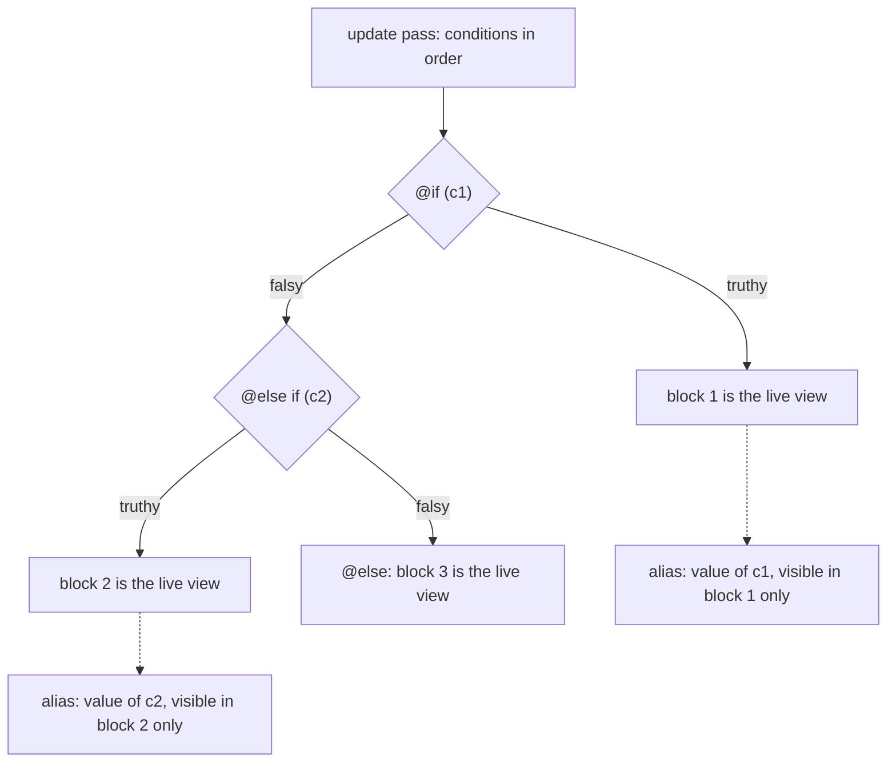
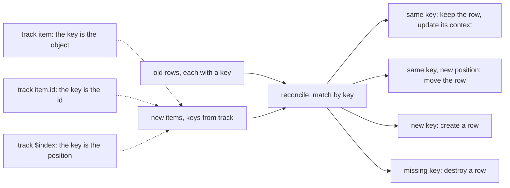
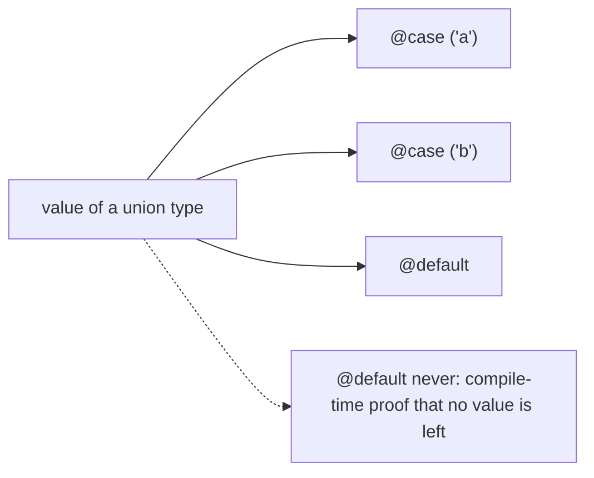
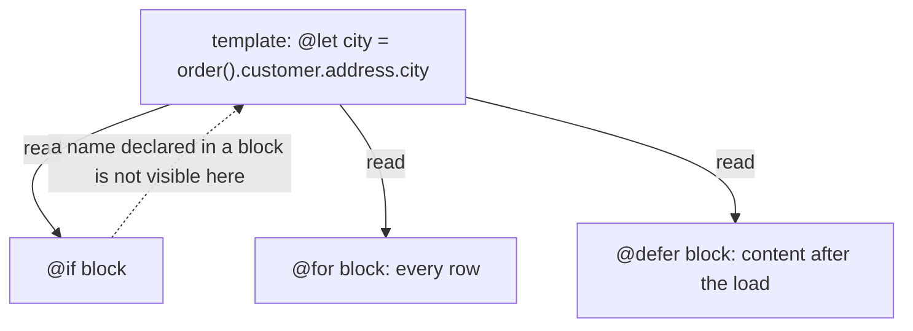
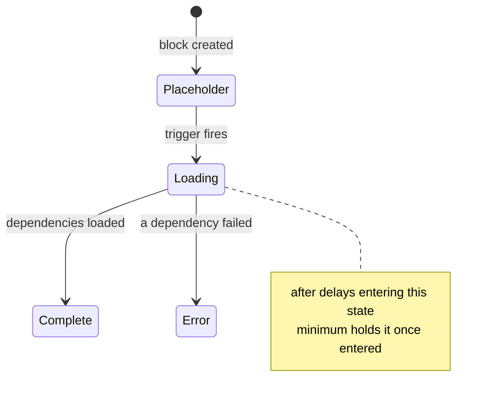
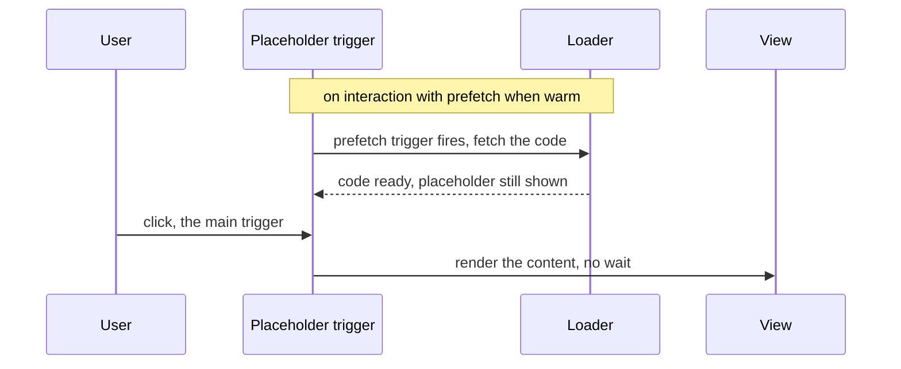
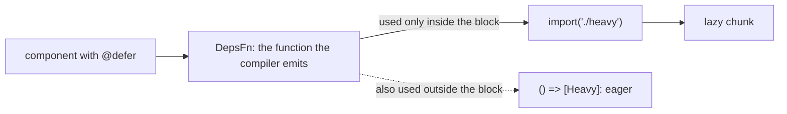
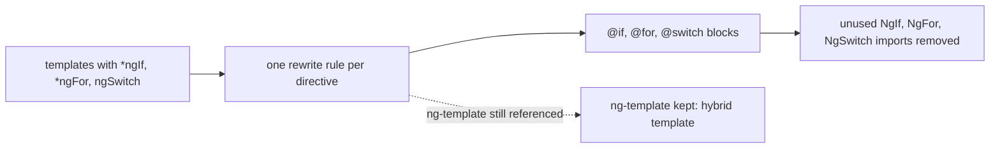
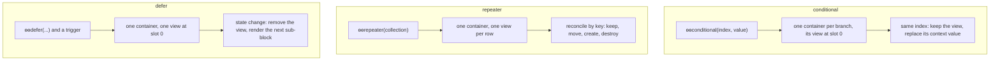

# 18. Control flow and `@defer`: `@if`, `@for`, `@switch`, `@let`, deferrable views, triggers and migration

> **What this covers:** the built-in control flow blocks (`@if` with `as`, `@for` with mandatory `track`, `@switch` with exhaustive checking), `@let` inside blocks, deferrable views (`@defer` with placeholder, loading and error blocks, `minimum` and `after`, the triggers and `prefetch`), how dependencies become lazy chunks and how to test them, one pointer to the server side, the `control-flow` migration schematic, and what the compiler and runtime do underneath (the `@for` reconcile and the defer state machine).
> **Prerequisites:** [13. Components and templates](13-components-and-templates.md#6-template-reference-variables-and-let) (templates, `@let`) and [17. Signals](17-signals.md#1-why-signals-exist) (signals read in templates)
> **Leads to:** [19. Component communication and projection](19-component-communication-and-projection.md), [29. Testing Angular](29-testing-angular.md), [32. SSR, SSG and hydration](32-ssr-ssg-hydration.md), [39. Version history and migrations](39-version-history-and-migrations.md)
> **Applies to:** Angular 22.2 (`@angular/core`, `@angular/compiler-cli`, `@angular/cli` 22.2.1), TypeScript 6.0, Node 24
> **Study time:** ~6 hours reading + ~6 hours exercises
> **Short on time:** read [1. Built-in blocks and the `@if` family](#1-built-in-blocks-versus-directives-and-the-if-family-with-as), [2. `@for` and `track`](#2-for-track-context-variables-empty-and-what-angular-can-iterate), [5. `@defer` states](#5-defer-blocks-and-states-placeholder-loading-error-minimum-and-after) and [6. Triggers and prefetching](#6-triggers-and-prefetching), then drill [Q18.03](#q18-03), [Q18.05](#q18-05), [Q18.11](#q18-11), [Q18.13](#q18-13), [Q18.17](#q18-17) and [Q18.21](#q18-21), try [Exercise 18.1](#ex18-1), and finish with the [Summary](#summary).
> **Labs:** [`labs/angular/src/app/modules/18-control-flow-and-defer/`](../labs/angular/src/app/modules/18-control-flow-and-defer/) (section specs, fixtures, Exercises 18.1-18.3, *Output* questions) and [`labs/ts-js/src/modules/18-control-flow-and-defer/`](../labs/ts-js/src/modules/18-control-flow-and-defer/) (Exercise 18.4). Run (Node 24): from `labs/angular`, `npx ng test --watch=false --include='src/app/modules/18-control-flow-and-defer/**/*.spec.ts'`; from `labs/ts-js`, `npx vitest run src/modules/18-control-flow-and-defer`

## Contents

1. [Built-in blocks versus directives, and the `@if` family with `as`](#1-built-in-blocks-versus-directives-and-the-if-family-with-as)
2. [`@for`: `track`, context variables, `@empty` and what Angular can iterate](#2-for-track-context-variables-empty-and-what-angular-can-iterate)
3. [`@switch` and exhaustive checking with `@default never`](#3-switch-and-exhaustive-checking-with-default-never)
4. [`@let` inside blocks: scope, reactivity and when it helps](#4-let-inside-blocks-scope-reactivity-and-when-it-helps)
5. [`@defer` blocks and states: placeholder, loading, error, `minimum` and `after`](#5-defer-blocks-and-states-placeholder-loading-error-minimum-and-after)
6. [Triggers and prefetching](#6-triggers-and-prefetching)
7. [What lands in a chunk, testing deferred blocks, and the SSR pointer](#7-what-lands-in-a-chunk-testing-deferred-blocks-and-the-ssr-pointer)
8. [Migrating with `ng generate @angular/core:control-flow`](#8-migrating-with-ng-generate-angularcorecontrol-flow)
9. [Under the hood: what the blocks compile to, how `@for` reconciles and how `@defer` moves between states](#9-under-the-hood-what-the-blocks-compile-to-how-for-reconciles-and-how-defer-moves-between-states)
- [Summary](#summary)
- [Question bank](#question-bank)
- [Hands-on exercises](#hands-on-exercises)
- [Check your understanding](#check-your-understanding)
- [Connections](#connections)

Claims in this module rest on evidence of a kind the text names. A spec named `Section N: …`, `Q18.NN …` or `E18.N …` runs under `ng test` (an AOT build, [ahead-of-time compiled](12-angular-how-it-works.md#q12-19), in jsdom, a simulated browser) and asserts the behavior. A `labs/ts-js` test checks one pure model in Exercise 18.4. Compiler and schematic output is observed by running `ngc`, the schematic or `ng build` on a throwaway project on a stated date and quoted. Typings, package sources, docs and the CHANGELOG are read and cited with their version. Server behavior, hot module replacement, performance and the Angular team's rationale are documented only: cited and never presented as observed.

## 1. Built-in blocks versus directives, and the `@if` family with `as`

### The problem it solves

A profile page shows a panel only when `user()` (a [signal](17-signals.md#1-why-signals-exist)) has loaded, with a fallback otherwise, and reads fields inside the panel. With `*ngIf` [Deprecated since v20.0 — use @if] you import `NgIf`, park the fallback in an `<ng-template #guest>` and wire it with `else guest`. Without the import the compiler only warns:

```text
c.ts:5:18 - warning NG8103: NG8103: The `*ngIf` directive was used in the template, but neither the `NgIf` directive nor the `CommonModule` was imported. Use Angular's built-in control flow @if or make sure that either the `NgIf` directive or the `CommonModule` is included in the `@Component.imports` array of this component. Find more at https://v22.angular.dev/extended-diagnostics/NG8103
```

Observed by compiling a throwaway component (`c.ts`: `<p *ngIf="on()">on</p>`, no import) with `ngc` 22.2.1, the Angular compiler's command line, on 2026-10-08. Then someone writes `@if (user()) { {{ user().name }} }` with `user: Signal<User | null>` and gets `TS2531`; an interviewer asks what is truthy. The built-in control flow blocks [Stable since v18.0] answer all three: no import, an alias that keeps the value [narrowed](06-ts-type-system-essentials.md#3-narrowing-and-control-flow-analysis) (proved not `null`), and JavaScript's truthiness. The marker rests on a docs diff (the `control-flow.md` page at tag `17.3.12` carries a "developer preview" note and the page at tag `18.0.0` does not, read 2026-10-08) and on [VERSIONS.md](../VERSIONS.md); the CHANGELOG has no line for it.

### Mental model

A railway switch sends the train down one track and leaves the others empty. `@if`, `@else if` and `@else` are template syntax the compiler understands, not directives. Each branch is an **embedded view**: a piece of template with its own DOM nodes and bindings, created and destroyed as a unit ([14 §2](14-directives-and-pipes.md#2-structural-directives-ng-template-templateref-viewcontainerref-and-the-microsyntax) builds the same thing with directives). The conditions run in order on each update, and the first truthy one owns the only live view.



What to notice: one branch is alive at a time, and an alias exists only inside the branch whose condition produced it.

### How it actually works

**Truthiness is JavaScript's.** `[]`, `'0'` and `{}` render the block; `0`, `''`, `null`, `NaN` and `undefined` do not (`Section 1: empty array, "0" and an empty object are truthy`; the language rule is [Q01.17](01-js-values-types-coercion.md#q01-17)).

**One branch, one embedded view.** Observed by compiling `e.ts` (`@if (user(); as u) { <p>{{ u.name }}</p> } @else { <p>none</p> }`) with `ngc` 22.2.1 on 2026-10-08 (branch functions and metadata omitted; `ɵ` names are internal: read them to understand, never call them, [12 §8](12-angular-how-it-works.md#8-under-the-hood-what-the-compiler-emits-and-what-the-runtime-does-with-it)):

```text
i0.ɵɵconditionalCreate(0, E_Conditional_0_Template, 2, 1, "p")(1, E_Conditional_1_Template, 2, 0, "p");
i0.ɵɵconditional((tmp_0_0 = ctx.user()) ? 0 : 1, tmp_0_0);
```

The condition is evaluated once per update into a branch index plus a context value. Read from the 22.2.1 source (`@angular/core`, `fesm2022/_debug_node-chunk.mjs`, `ɵɵconditional`): the instruction stores the branch index in a binding slot and compares only that index. If it changed, the old branch's view is removed and the new one is created and rendered with the context value. If it did not, the instruction keeps the view and assigns the new context value to it. So an alias change from one user to another keeps the view, and a change to `null` destroys it (`Section 1: an alias change keeps the branch view and null destroys it`), and only the matching branch is in the DOM (`Section 1: only the matching branch is rendered`); [section 9](#9-under-the-hood-what-the-blocks-compile-to-how-for-reconciles-and-how-defer-moves-between-states) goes deeper.

**`as` names the condition's value.** It is the value of the expression, not a copy: `@if (n() > 1; as big)` gives `true`, and `@if (label(); as text)` gives the string (`Section 1: an @else if alias holds the condition result`). The alias is typed as the narrowed expression, so `@if (user(); as u) { u.name }` compiles. On `@else if` it is [Added in v20.2] (CHANGELOG 20.2.0). It is not visible in `@else`. Probe file names (`a.ts`, `h1`) are per answer, so positions are not comparable across answers. Observed by compiling `a.ts` (the repeated `user()` call) and `b.ts` (`u` read in `@else`) with `ngc` 22.2.1 on 2026-10-08:

```text
a.ts:6:42 - error TS2531: Object is possibly 'null'.
b.ts:5:71 - error TS2339: Property 'u' does not exist on type 'B'.
```

`NgSwitch` is [Deprecated since v20.0 — use @switch] like `NgIf` and `NgForOf`: all three carry `@deprecated 20.0` in the 22.2.1 typings (`@angular/common`, `types/_common_module-chunk.d.ts`, read 2026-10-08). Why the blocks replaced them: [Q14.16](14-directives-and-pipes.md#q14-16).

### Code

The approach is one chain that names each value it reads.

1. Write the first condition with `as` so its block reads a narrowed value.
2. Chain `@else if` and name its result when the block needs it.
3. End with a branch that needs no value.

```ts
// Excerpt of labs/angular/src/app/modules/18-control-flow-and-defer/concepts/section-1-if-family.spec.ts
@Component({
  selector: 'lab-m18-s1-else-if-alias',
  template: `
    @if (user(); as u) {
      <p id="user">{{ u.name }}</p>
    } @else if (n() > 1; as big) {
      <p id="big">{{ big }}</p>
    } @else if (label(); as text) {
      <p id="label">{{ text }}</p>
    }
  `,
})
class ElseIfAlias {
  readonly user = signal<User | null>(null);
  readonly n = signal(2);
  readonly label = signal('tag');
}
```

> [!NOTE]
> **Framework vs platform.** `if` and `switch` in JavaScript are statements that run when reached. The blocks are Angular template syntax that the compiler turns into the instructions above; the choice stays live on the page. Truthiness is the platform's.

#### Legacy

Code written before v17 uses the directive, and the fallback lives in a separate template.

```ts
// Partial: legacy NgIf form; the component class and its NgIf import are omitted
template: `
  <p *ngIf="user() as u; else guest">{{ u.name }}</p>
  <ng-template #guest><p>none</p></ng-template>
`
```

The migration is `ng generate @angular/core:control-flow`, run in [section 8](#8-migrating-with-ng-generate-angularcorecontrol-flow).

### Best practices and anti-patterns

- **Do use `@if` in new code**, because it needs no import, so the `NG8103` warning cannot happen, and the compiler type-checks the block.
- **Do alias a signal read with `as`**, because a repeated call is a new expression that TypeScript does not narrow (`TS2531` above).
- **Do put the fallback in `@else`** instead of a second `@if` with the negated condition, because the instruction evaluates the condition once and the two branches cannot disagree.

### Misconceptions and traps

- *"`@if` is just `*ngIf` with new syntax."* The job is the same, but the branches are compiler blocks with no import, compiled to `ɵɵconditional`. The myth exists because both hide an element.
- *"`as` makes a copy."* It names the condition's value, so a comparison gives `true`. The myth exists because the alias reads like a variable declaration.
- *"`@else` can use the alias."* It cannot (`TS2339`). The myth exists because other languages scope a pattern variable to the whole statement.

Drilled in [Q18.01](#q18-01), [Q18.02](#q18-02) and [Q18.03](#q18-03); practised in [Exercise 18.1](#ex18-1).

## 2. `@for`: `track`, context variables, `@empty` and what Angular can iterate

### The problem it solves

A sortable table loses the text typed into a row after a sort. A refresh from the server returns new objects, and every row is rebuilt. And the compiler refuses a `@for` without `track`, which `*ngFor`'s optional `trackBy` never did. Observed by compiling a throwaway component (`f1.ts`) with `ngc` 22.2.1 on 2026-10-08:

```text
f1.ts:2:45 - error NG5002: @for loop must have a "track" expression
```

All three come from one decision, which `track` makes: which new item is which old row.

### Mental model

Name tags at a conference: after a reshuffle the same tag keeps its seat, a new tag gets one and a missing tag loses it. The **key** is the tag, a **row** is one embedded view ([section 1](#1-built-in-blocks-versus-directives-and-the-if-family-with-as)) and `track` computes the key from the item and its index.



What to notice: the key decides what "the same row" means; `track $index` makes a row a position, not an item.

### How it actually works

**What `track` may use.** The item, `$index` and component members. Observed by compiling `f2.ts` (a reference variable in `track`), `f3.ts` (`track byName`, uninvoked) and `f4.ts` (`@for (x of 3; …)`) with `ngc` 22.2.1 on 2026-10-08:

```text
f2.ts:2:103 - error NG8009: Cannot access 'ref' inside of a track expression. Only 'x', '$index' and properties on the containing component are available to this expression.
f3.ts:2:45 - warning NG8115: NG8115: The track function in the @for block should be invoked: byName(/* arguments */). Find more at https://v22.angular.dev/extended-diagnostics/NG8115
f4.ts:2:56 - error TS2488: Type '3' must have a '[Symbol.iterator]()' method that returns an iterator.
```

Observed by compiling four templates (`g1.ts` to `g4.ts`, with the same `ngc`; the `ɵɵ` names are internal; lines joined, `_forTrack0` is the compiler's helper):

```text
track $index    …, i0.ɵɵrepeaterTrackByIndex);
track r         …, i0.ɵɵrepeaterTrackByIdentity);
track r.id      const _forTrack0 = ($index, $item) => $item.id;
track keyOf(r)  function _forTrack0($index, $item) { /* @ts-ignore */ return this.keyOf($item); }  …, _forTrack0, true);
```

The `true` binds the function to the component, so `track keyOf(r)` and `track this.keyOf(r)` both run with the component as `this` (`Section 2: a track method runs with the component instance as this`). An uninvoked `track byName` would make the function every row's key, hence `NG8115`.

**Why a new object under `track item` loses its row.** Read from the 22.2.1 source (`@angular/core`, `fesm2022/_debug_node-chunk.mjs`, `reconcile` and `valuesMatching`): a live row matches a new item if both hold the same value at the same index, or if their keys are equal by `Object.is`. A match keeps the row and updates its value; a row whose key never matches is destroyed. With `track item` the key is the object, so replacement objects never match and every row is destroyed and created (`Section 2: track by identity recreates every node for new objects and NG0956 warns`). `track r.id` matches by id and keeps the nodes (`Section 2: track by id keeps DOM nodes when objects are replaced`). [Section 9](#9-under-the-hood-what-the-blocks-compile-to-how-for-reconciles-and-how-defer-moves-between-states) covers the algorithm.

**The two warnings, read from the same source.** `NG0956` goes to `console.warn` in development only, when the key is the identity function, every row was created and destroyed in the update and the row view is not trivially small (read, not run). In the lab it opens `NG0956: The configured tracking expression (track by identity) caused re-creation of the entire collection of size 3. …`. `NG0955` records keys only inside the matching loop, which a first render never enters, so a duplicate is reported on the next update (`Section 2: NG0955 is warned on update for duplicate keys`). It opens `NG0955: The provided track expression resulted in duplicated keys for a given collection. …` and names `key "1" at index "0" and "2"`; Angular's text continues after each `…`.

**Context variables, `@empty` and iterables.** A **context variable** is a name every row gets: `$index`, `$count`, `$first`, `$last`, `$even` and `$odd` exist in every row, and `let i = $index` aliases them, which is how an inner loop reads the outer index (`Section 2: context variables and nested aliases`). `@empty` renders when the collection has no items (`Section 2: @empty renders for an empty collection`). In the lab `@for` renders any **iterable** (an object with a `[Symbol.iterator]()` method): a `Set`, a `Map` as `[key, value]` pairs, a string by code point and a generator, and nothing for `null` or `undefined` (`Section 2: @for renders Set, Map, string and generator values, and nothing for null`).

### Code

The approach is to key rows by an id that survives a refresh.

1. Give the data a stable id.
2. Write `track r.id`.
3. Leave unbound DOM state (state no binding sets, such as a typed value) in the row: it travels with the id.

```ts
// Excerpt of labs/angular/src/app/modules/18-control-flow-and-defer/concepts/section-2-for.spec.ts
@Component({
  selector: 'lab-m18-s2-by-id',
  template: `
    <ul>
      @for (r of rows(); track r.id) {
        <li [attr.data-id]="r.id"><input [attr.aria-label]="r.label" />{{ r.label }}</li>
      }
    </ul>
  `,
})
class ById {
  readonly rows = signal<Row[]>(rowsOf(1, 2, 3));
}
```

In the lab a typed value follows its row under `track r.id` and stays at its position under `track $index` (`Section 2: track by $index keeps nodes at their position`).

> [!TIP]
> **Coming from the backend.** `track` is a primary key: it says which new item is which old row. **Where the analogy breaks:** a primary key is unique and enforced, while a `track` key is advisory per list and a duplicate only warns (`NG0955`).

#### Legacy

`*ngFor` [Deprecated since v20.0 — use @for] takes an optional `trackBy`; without one it uses the item's object identity as the key (`@angular/common` 22.2.1 typings, read 2026-10-08). The migration is [section 8](#8-migrating-with-ng-generate-angularcorecontrol-flow).

```ts
// Partial: legacy NgFor form; the NgFor import and the component class are omitted
template: `<li *ngFor="let r of rows(); trackBy: byId; let i = index">{{ i }} {{ r.label }}</li>`
```

### Best practices and anti-patterns

- **Do track by a stable id from the data**, because the key survives a refresh, a sort and a removal.
- **Avoid `track item` on objects a refresh replaces**, because each replacement is a new key and every row is rebuilt.
- **Avoid `track $index` on editable or reorderable lists**, because the row stays with the position and its typed text ends up beside another item; the docs offer `$index` for static collections.
- **Do invoke a track method** (`track byName(x)`), because the bare name makes the function the key.
- **Do keep keys unique**, because a duplicate may match the wrong row (the NG0955 docs say so).

### Misconceptions and traps

- *"`track $index` is the safe default."* It never warns and always compiles, but unbound DOM state sticks to the position. The myth exists because it is the one key that is always available.
- *"`track` is an optimization you can skip."* The compiler enforces it. The myth exists because `trackBy` was optional in `*ngFor`.
- *"`@for` only takes arrays."* It takes any iterable, as the docs say. The myth exists because their examples are arrays.

Drilled in [Q18.04](#q18-04), [Q18.05](#q18-05), [Q18.06](#q18-06) and [Q18.07](#q18-07); practised in [Exercise 18.1](#ex18-1) and [Exercise 18.2](#ex18-2).

## 3. `@switch` and exhaustive checking with `@default never`

### The problem it solves

A status badge handles five states. Someone adds a sixth to the union, no `@case` covers it and the badge renders nothing, with no error (`Section 3: with no match and no @default nothing renders`). A `@default never;` [Added in v21.2] turns that into a build failure. Then a developer switches on a signal, and the check fails on a template that covers every case.

### Mental model

A sorting machine with a chute per label and a reject chute. The value falls into the first chute whose label matches exactly. `@default never;` is not a chute: it asks the type checker to prove nothing reaches the reject chute.



What to notice: the `never` check runs at compile time against the expression's type, not when the template runs.

### How it actually works

**Runtime.** `@switch` compares the expression with each `@case` by `===`, the first match renders, and no case falls through. With no match and no `@default`, nothing renders. In the lab `1` and `'1'` pick different cases, two cases matching `2` render only the first, and `99` renders nothing (`Section 3: @switch uses strict equality, the first match wins and nothing falls through`).

**Compile time.** `@default never;` has no body and must be last (read from the 22.2.1 parser in `@angular/compiler`, `fesm2022/compiler.mjs`). Read from the same package, `TcbSwitchOp.execute` writes the type-check block (the TypeScript the compiler generates to check a template) as a `switch` with a clause `default: const tcbExhaustive0: never = <value>;`. The value is the switch expression, or the argument of `@default never(expr)` [Added in v22.0]. Angular only writes the assignment, so TypeScript's narrowing decides.

Observed by compiling five throwaway components with `ngc` 22.2.1 on 2026-10-08 (`Status` is `'a' | 'b' | 'c'`):

```text
h1.ts:4:54 - error TS2322: Type '"c"' is not assignable to type 'never'.
h3.ts:4:54 - error TS2322: Type 'Status' is not assignable to type 'never'.
h4.ts:4:131 - error TS2322: Type 'Status' is not assignable to type 'never'.
h6.ts:4:69 - error TS2322: Type '"c"' is not assignable to type 'never'.
h8.ts:4:117 - error TS2322: Type '{ kind: "c"; }' is not assignable to type 'never'.
```

`h1` switches on a property and lacks `'c'`, which the error names. `h3` is the false positive: `@switch (st())` on a signal with all three cases. `h4` repeats it with `@default never(st())`. `h6` reads the signal into `@let s = st();` [Stable since v19.0] (core CHANGELOG 19.0.0, "stabilize `@let` syntax") first and lacks `'c'`: the check works again. `h8` lacks `'c'` under `@switch (obj.kind)` with `@default never(obj)`. With every case present (`h2`, `h5`, `h7`) all three compiled with no diagnostic.

The docs NOTE agrees: the check "relies on TypeScript's type narrowing, which only works on variables", so a call or a signal fails and a `@let` is the workaround (`control-flow.md` at `v22.2.1`, read 2026-10-08). Observed with plain `tsc` 6.0.3 on a hand-written `switch`, only the call form fails:

```text
ts1.ts(9,22): error TS2322: Type 'Status' is not assignable to type 'never'.
  Type '"a"' is not assignable to type 'never'.
```

The limit is TypeScript's ([Q06.10](06-ts-type-system-essentials.md#q06-10) covers `never`).

### Code

The approach is to give the check a variable it can narrow.

1. Read the signal into a `@let` ([13 §6](13-components-and-templates.md#6-template-reference-variables-and-let) owns `@let`).
2. Switch on the variable.
3. End with `@default never;` and cover every member.

```ts
// Partial: imports omitted; compiled with ngc 22.2.1 on 2026-10-08 as h5.ts (all cases) and h6.ts (without 'c')
@Component({
  selector: 'lab-h5',
  template: `
    @let s = status();
    @switch (s) {
      @case ('a') { A }
      @case ('b') { B }
      @case ('c') { C }
      @default never;
    }
  `,
})
class H5 {
  readonly status = signal<'a' | 'b' | 'c'>('a');
}
```

> [!NOTE]
> **Framework vs platform.** The exhaustiveness check is TypeScript's: assigning to `never` fails unless narrowing removed every member. Angular generates the assignment.

#### Legacy

`NgSwitch` with `*ngSwitchCase` and `*ngSwitchDefault` needs imports. The migration is [section 8](#8-migrating-with-ng-generate-angularcorecontrol-flow).

```ts
// Partial: legacy NgSwitch form; the NgSwitch imports and the component class are omitted
template: `
  <ng-container [ngSwitch]="status()">
    <b *ngSwitchCase="'a'">A</b>
    <i *ngSwitchDefault>other</i>
  </ng-container>
`
```

### Best practices and anti-patterns

- **Do end a growing union with `@default never;`**, because a new member then fails the build instead of rendering nothing.
- **Do read a signal into `@let` before switching**, because the check narrows only variables.
- **Do use `@default never(obj)` when switching on `obj.kind`**, because narrowing the property does not narrow the object; the docs say to name the expression.
- **Avoid `@default never;` alone for server values**, because the check is compile-time and an unexpected value still renders nothing; write a real `@default`.

### Misconceptions and traps

- *"`@switch` falls through like `switch`."* No case falls through. The myth exists because the keyword is the same.
- *"`@default never` always checks."* Not with a signal or a call (`h3`). The myth exists because the docs' first example switches on a property.
- *"`@switch` compares loosely."* It uses `===`, so `1` and `'1'` differ. The myth exists because JavaScript habits suggest `==`.

Drilled in [Q18.08](#q18-08) and [Q18.09](#q18-09); practised in [Exercise 18.1](#ex18-1).

## 4. `@let` inside blocks: scope, reactivity and when it helps

### The problem it solves

A page reads `order().customer.address.city` in a panel, in every row of a list and in a deferred summary, and a rename touches four places. A `@let` above the blocks names it once. Can a block, a deferred one included, read it?

### Mental model

A sticky note on the desk that every drawer can read. The note is a `@let`; the drawers are blocks, embedded views declared inside the template that holds the note, so they read what that template declared.



What to notice: blocks read down, never up, and the deferred block is one more reader.

### How it actually works

The mechanics of `@let`, its scope rules and its diagnostics are [13 §6](13-components-and-templates.md#6-template-reference-variables-and-let)'s.

In the lab, `@if`, each `@for` row and the `@defer` content all print the value (`Section 4: a @let is readable inside @if, @for and @defer blocks`). Observed by compiling `let1.ts` with `ngc` 22.2.1 on 2026-10-08 (the template function stores the value and each block function reads it back; the `ɵɵ` names are internal):

```text
LetBlocks_Template            ɵɵdeclareLet(0); …  const city_r3 = ɵɵstoreLet(ctx.order().customer.address.city);
LetBlocks_Conditional_3_Template   ɵɵnextContext();  const city_r1 = ɵɵreadContextLet(0);
LetBlocks_For_5_Template           ɵɵnextContext();  const city_r1 = ɵɵreadContextLet(0);
LetBlocks_Defer_6_Template         ɵɵnextContext();  const city_r1 = ɵɵreadContextLet(0);
```

Why a deferred block can read it: read from the 22.2.1 source (`@angular/core`, `fesm2022/_pending_tasks-chunk.mjs`, `nextContextImpl` and `walkUpViews`; `_debug_node-chunk.mjs`, `ɵɵreadContextLet`), read and not run. `ɵɵnextContext()` moves the current context to the block's declaration view (the view that declared it), and `ɵɵreadContextLet(0)` loads slot 0 of that view. A deferred block is declared in the same template as an `@if`, so the load decides when its view exists, not which slot it reads.

The stored value is the last pass's value, not the signal: `city` is a string and is never called. When `order` changes, every reader shows the new value (`Section 4: a @let of a signal call re-evaluates when the signal changes`).

### Code

The approach is to name the value once and read it by name in each block.

1. Declare the `@let` before the blocks that share it.
2. Read it in the `@if`, the `@for` and the `@defer` by its name.

```ts
// Excerpt of labs/angular/src/app/modules/18-control-flow-and-defer/concepts/section-4-let.spec.ts
@Component({
  selector: 'lab-m18-s4-blocks',
  template: `
    @let city = order().customer.address.city;
    <p id="top">{{ city }}</p>
    @if (open()) {
      <p id="in-if">{{ city }}</p>
    }
    @for (n of numbers(); track n) {
      <p class="in-for">{{ city }}-{{ n }}</p>
    }
    @defer (on immediate) {
      <p id="in-defer">{{ city }}</p>
    }
  `,
})
class LetBlocks {
  readonly order = signal<Order>({ customer: { address: { city: 'Quito' } } });
  readonly open = signal(true);
  readonly numbers = signal([1, 2]);
}
```

### Best practices and anti-patterns

- **Do declare a `@let` above the blocks that share a long path**, because every block then reads one stored value instead of repeating the chain.
- **Do read a signal into a `@let` before a `@switch`**, because the exhaustiveness check narrows only variables ([section 3](#3-switch-and-exhaustive-checking-with-default-never)).
- **Avoid a `@let` for a value the class needs**, because it ends with its view; use `computed()` ([Q13.19](13-components-and-templates.md#q13-19)).

### Misconceptions and traps

- *"A `@let` is a signal."* It is the plain value of the last pass, so `city` is a string. The myth exists because the usual initializer is a signal call.
- *"A block hides the outer `@let`."* Blocks read it, a deferred one included. The myth exists because a name declared inside a block really is hidden outside it.

Drilled in [Q18.10](#q18-10).

## 5. `@defer` blocks and states: placeholder, loading, error, `minimum` and `after`

### The problem it solves

A chart panel is not needed for the first view, so it becomes a **deferrable view**: a template part, wrapped in `@defer`, whose code loads later. Then three things go wrong. The user sees an empty gap where the panel will appear. A spinner flashes for a few milliseconds when the load is fast. The chunk fails to load and the console shows an error while the page shows nothing. The sub-blocks of `@defer` and its two timers answer each one.

### Mental model

A restaurant order: the menu card (placeholder), the "being prepared" light (loading), the dish (complete), the "kitchen is out" sign (error). A `@defer` block is a small state machine over those four sub-blocks, and a trigger ([section 6](#6-triggers-and-prefetching): an event or condition) starts the load. Deferred code is a separate **chunk**, a file the bundler splits out and the browser fetches on demand ([Q09.08](09-web-networking-storage-security.md#q09-08)).



What to notice: states only move forward, and the timers delay the move instead of changing the order.

### How it actually works

**States.** `DeferBlockState` is public: Placeholder 0, Loading 1, Complete 2, Error 3 (`@angular/core` typings). The block body is Complete; `@placeholder`, `@loading` and `@error` are optional. `@defer` is present since 17.0.0 (its viewport, hover and interaction triggers are in the 17.0.0 CHANGELOG). Read from the 22.2.1 source (`_debug_node-chunk.mjs`, `renderDeferBlockState`): a change applies only when the current state is lower than the new one, and a state with no sub-block changes nothing: `applyDeferBlockState` finds no template for it and returns, so the previous view stays. With `on immediate` and a `@loading` block, the placeholder is never rendered (`Section 5: with on immediate and a @loading block the placeholder is never rendered`).

**Loading.** Read from the same file (`triggerResourceLoading`): the dependencies load with `Promise.allSettled`, so the block waits for all of them, and one rejection makes the load fail. Success renders Complete, which replaces the placeholder (`Section 5: the content replaces the placeholder once the trigger fires`), and failure renders Error. The load also registers a `PendingTasks` [Stable since v20.0] task, Angular's counter of unfinished work that tests and the server wait for (typings; read, not run).

**Timers.** Read from `applyDeferBlockStateWithScheduling`: `after`, on `@loading`, schedules the move to Loading, and a Complete that arrives first cancels it. `minimum`, on `@placeholder` or `@loading`, freezes the state until `now + minimum`, set once the state is applied. A request during the freeze is stored if it outranks the pending one, so the highest-ranked request waiting applies when the freeze ends. `defer.md` at `v22.2.1` says "the timers for both parameters begin immediately after the loading has been triggered"; observed against it, the runtime sets the `minimum` freeze after the state is applied, so with `after 40ms; minimum 100ms` and a 120 ms load the content comes no earlier than about 140 ms ([Q18.12](#q18-12)). Observed by compiling a block with `@placeholder (minimum 80ms)` and `@loading (after 40ms; minimum 100ms)` with `ngc` 22.2.1 on 2026-10-08 (`ɵ` names are internal; `ɵɵdefer` receives the config indexes 0 and 1, for `@loading` and `@placeholder`):

```text
consts: [[100, 40], [80]]
ɵɵdefer(4, 0, D1_Defer_4_DepsFn, 1, 2, 3, 0, 1, ɵɵdeferEnableTimerScheduling);
```

The `@loading` pair is `[minimum, after]` and the `@placeholder` entry is `[minimum]` (`MINIMUM_SLOT` 0 and `LOADING_AFTER_SLOT` 1 in the source). In the lab, real timers, order and lower bounds only, never exact milliseconds: a slow load shows nothing, then `@loading`, then the content, and a fast load with `after` never shows `@loading` (`Section 5: @loading after delays the loading block and a fast load never shows it`); `@loading (minimum)` and `@placeholder (minimum)` keep the content back (`Section 5: @loading minimum holds the loading block`, `Section 5: @placeholder minimum holds the placeholder`).

**Errors.** A failed load renders `@error` (`Section 5: a failed load renders the @error block`). Without it the page keeps the previous view (the placeholder, if there is one; `Section 5: a failed load with a @placeholder and no @error leaves the placeholder on the page`), and `ErrorHandler`, Angular's error-reporting service ([14 §8](14-directives-and-pipes.md#8-the-async-pipe-under-the-hood)), receives one error whose message contains these three fragments, quoted from the assertions (`Section 5: a failed load without @error reports NG0750 to the ErrorHandler`):

```text
NG0750: Loading dependencies for `@defer` block failed
no `@error` block was configured
Consider using the `@error` block to render an error state.
```

`@boundary` [Developer preview since v22.2] is a separate block, owned by [37](37-elements-pwa-errors-ecosystem.md#9-error-boundaries-boundary-error-reset-onviewerror-and-onerror).

**Tests.** Every test above fires its trigger with no configuration, the runtime default ([section 7](#7-what-lands-in-a-chunk-testing-deferred-blocks-and-the-ssr-pointer) also covers the stale typings comment).

### Code

The approach is to wait out a slow load without flashing and to handle failure.

1. Put the heavy component in the block body.
2. Add `@loading (after …)` so a fast load never shows it.
3. Add `@error` so a failure has a place on the page.

```ts
// Excerpt of labs/angular/src/app/modules/18-control-flow-and-defer/concepts/section-5-defer-states.spec.ts
@Component({
  selector: 'lab-m18-s5-after-slow',
  imports: [LabM18Slow],
  template: `
    @defer (on immediate) {
      <lab-m18-slow />
    } @loading (after 40ms) {
      <p id="loading">loading</p>
    }
  `,
})
class AfterSlowHost {}

@Component({
  selector: 'lab-m18-s5-error',
  imports: [LabM18Failing],
  template: `
    @defer (on immediate) {
      <lab-m18-failing />
    } @error {
      <p id="error">error</p>
    }
  `,
})
class ErrorHost {}
```

The fixtures are real modules: `lab-m18-slow.ts` has a top-level `await` and `lab-m18-failing.ts` a top-level `throw` (`concepts/fixtures/`).

> [!NOTE]
> **Framework vs platform.** The chunk comes from the bundler's dynamic `import()` ([05 §2](05-js-modules-memory-modern-features.md#2-commonjs-interop-and-dynamic-import)). The states, the timers and `NG0750` are Angular's.

### Best practices and anti-patterns

- **Do add `@error`**, because without it the user keeps seeing the placeholder (or an empty gap) and the failure is only an `ErrorHandler` report.
- **Do set `after` above a typical load**, because a load that finishes first never shows `@loading`.
- **Do set `minimum` on a block that may appear briefly**, because the state is then held instead of flashing past.
- **Avoid `@placeholder (minimum …)` with `on immediate` and a `@loading` block**, because the placeholder is never rendered.

### Misconceptions and traps

- *"The placeholder always shows first."* Not with `on immediate` and a `@loading` block. The myth exists because the usual picture draws Placeholder, then Loading.
- *"`minimum` and `after` are timeouts."* `after` delays entering Loading and `minimum` holds a state once entered; neither cancels the load. The myth exists because both names read as durations.
- *"No `@error` means a silent failure."* `NG0750` reaches the `ErrorHandler`. The myth exists because a missing optional block usually means nothing happens.

Drilled in [Q18.11](#q18-11) and [Q18.12](#q18-12); practised in [Exercise 18.3](#ex18-3) and [Exercise 18.4](#ex18-4).

## 6. Triggers and prefetching

### The problem it solves

A chart, a modal and a comments section each need their own moment to load: when scrolled to, when clicked, when the browser is free. The wrong trigger loads nothing or loads late. A `@defer (on viewport)` with no placeholder has nothing to watch and fails to compile, and a `prefetch` fetches the code but changes nothing on the page.

### Mental model

Ordering the dish versus carrying it to the table. The main trigger decides **when the block renders**; a `prefetch` trigger decides **when the code is fetched** and never changes what the page shows. Triggers are separated by `;`, and the docs say several of them are OR conditions (`defer.md` at `v22.2.1`, read 2026-10-08).



What to notice: prefetch moves the network time earlier, and the render still waits for the main trigger.

### How it actually works

| Main trigger | Fires when |
|---|---|
| `idle` (the default) | the browser is idle, by `requestIdleCallback` (the browser call that runs work when the page is idle); `idle(500)` adds a timeout [Added in v22.0] |
| `viewport` | the placeholder, or a referenced element ([13 §6](13-components-and-templates.md#6-template-reference-variables-and-let)), enters the viewport, seen by `IntersectionObserver` ([Q08.07](08-browser-rendering-dom-events.md#q08-07), the browser's visibility observer); its options [Added in v21.0] |
| `interaction` | `click` or `keydown` on the placeholder or a reference |
| `hover` | `mouseenter`, `mouseover` or `focusin` on it |
| `immediate` | the non-deferred content has rendered |
| `timer(100ms)` | the delay has passed |
| `when expr` | the expression is truthy, once |

The two versions come from the core CHANGELOG (22.0.0 "Support optional timeout for idle deferred triggers"; 21.0.0 "support IntersectionObserver options in viewport triggers", read 2026-10-08).

**Default.** Observed by compiling three templates with `ngc` 22.2.1 on 2026-10-08 (`ɵ` names are internal):

```text
@defer { … } @placeholder { … }                  ɵɵdeferOnIdle();
@defer (when go()) { … } @placeholder { … }      ɵɵdeferWhen(ctx.go());
@defer (prefetch on immediate) { … }             ɵɵdeferPrefetchOnImmediate(); ɵɵdeferOnIdle();
```

With no main trigger the compiler adds `idle`, and a `when` counts as a main trigger.

**Events.** Read from the 22.2.1 source (`_debug_node-chunk.mjs`, `interactionEventNames` and `hoverEventNames`, read 2026-10-08): interaction listens to `click` and `keydown`, hover to `mouseenter`, `mouseover` and `focusin`, all registered `passive` and `capture`. The docs name only `mouseover` and `focusin` for hover; the source has a third. The lab asserts only `click` and `mouseover` (`Section 6: on interaction waits for a click on the placeholder`, `Section 6: on hover waits for mouseover`). `viewport` observes the placeholder through `IntersectionObserver`; jsdom has none, so the lab installs a stand-in that records `observe` and fires on demand (`Section 6: on viewport waits for the observer callback`). The lab's jsdom also has no `requestIdleCallback`, so the idle service used its `setTimeout` fallback (`Section 6: on idle renders the content without user input`). `on timer(100ms)` keeps the placeholder until about 100 ms, asserted as at least 90 (`Section 6: on timer holds the placeholder until the delay`). Idle goes through `IdleScheduler`, a root service that groups callbacks by timeout and hands them to an `IdleService`; `provideIdleServiceWith` [Added in v22.0] replaces that service (typings and CHANGELOG 22.0.0 "support customization of @defer's on idle behavior").

**`when` and `prefetch`.** Read from the same file: `ɵɵdeferWhen` triggers only while the block is in its first state or Placeholder, so a later `false` changes nothing (`Section 6: when fires once and stays rendered`). `prefetch` calls only `triggerResourceLoading`, no state change; when the main trigger comes, `triggerDeferBlock` finds the load complete and renders at once (`Section 6: prefetch when loads the module while the placeholder stays`).

**Diagnostics.** Observed by compiling nine templates with `ngc` 22.2.1 on 2026-10-08 (file positions and the `Find more at` link are left out):

```text
error NG8019: Trigger with no target can only be placed on an @defer that has a @placeholder block
error NG8020: Trigger with no target can only be placed on an @defer that has a @placeholder block with exactly one root element node
error NG8010: Trigger cannot find reference "missing".
warning NG8021: The 'immediate' trigger makes additional triggers redundant.
warning NG8021: Prefetch triggers have no effect because 'immediate' executes earlier.
warning NG8021: The Prefetch 'timer(200ms)' is not scheduled before the main 'timer(100ms)', so it won't run prior to rendering. Lower the prefetch timing or remove it.
warning NG8021: Define a main trigger when using 'prefetch' triggers. Without an explicit main trigger, @defer defaults to 'idle' and prefetch may have no effect.
warning NG8021: Prefetch 'bound' matches the main trigger and provides no benefit. Remove the prefetch modifier.
```

The last line came from `@defer (when show(); prefetch when warm())`, two different expressions. The NG8021 page at `v22.2.1` lists identical `viewport` and `interaction` targets, not `when`. Read from `@angular/compiler-cli` 22.2.1 (`bundles/chunk-VMCGORHB.js`, `DeferTriggerMisconfiguration`): for `when` and `immediate` the check compares only the trigger kinds, so any pair of `when` triggers warns. `@defer (on interaction; prefetch when warm())` gave no diagnostic.

### Code

The approach is to let the placeholder be the trigger and to fetch the code ahead.

1. Make the placeholder one root element, so it can be the interaction target.
2. Name the main trigger, `on interaction`.
3. Add `prefetch when warm()` for the early fetch.

```ts
// Excerpt of labs/angular/src/app/modules/18-control-flow-and-defer/concepts/section-6-triggers.spec.ts
@Component({
  selector: 'lab-m18-s6-prefetch',
  imports: [LabM18SideEffect],
  template: `
    @defer (on interaction; prefetch when warm()) {
      <lab-m18-side-effect />
    } @placeholder {
      <button id="placeholder" type="button">open</button>
    }
  `,
})
class PrefetchHost {
  readonly warm = signal(false);
}
```

The fixture `lab-m18-side-effect.ts` records a line when its module is evaluated, so the test sees the fetch before any render.

> [!NOTE]
> **Framework vs platform.** `viewport` uses the platform's `IntersectionObserver` and `idle` uses `requestIdleCallback` where it exists. Angular decides which one to attach and when to render.

### Best practices and anti-patterns

- **Do give a `viewport`, `interaction` or `hover` block a one-element placeholder**, because the placeholder is what it watches (`NG8019`, `NG8020`).
- **Do name a main trigger when you add `prefetch`**, because otherwise `idle` becomes the main trigger and may load the code first.
- **Do use `prefetch` for code the user is likely to need**, because the fetch can finish before the main trigger and the render then waits for nothing.
- **Avoid `when` for a toggle**, because it fires once.
- **Avoid `on immediate` with other triggers**, because they cannot change anything (`NG8021`).

### Misconceptions and traps

- *"Prefetch renders the block earlier."* It only fetches; the block still waits for its main trigger. The myth exists because loading ahead sounds like showing ahead.
- *"`on viewport` watches the block."* It watches the placeholder or a reference, and without either the build fails (`NG8019`). The myth exists because the block is the thing you see on the page.
- *"`when` toggles the block."* It fires once and the block stays rendered. The myth exists because `when (cond)` reads like the condition of an `@if`.
- *"NG8021 only flags identical targets."* Observed to flag two different `when` expressions too. The myth exists because the docs list only identical `viewport` and `interaction` targets.

Drilled in [Q18.13](#q18-13), [Q18.14](#q18-14), [Q18.15](#q18-15) and [Q18.16](#q18-16); practised in [Exercise 18.3](#ex18-3).

## 7. What lands in a chunk, testing deferred blocks, and the SSR pointer

### The problem it solves

A team adds `@defer` around a chart and the build still lists no lazy chunk. A test of the same component never leaves the placeholder. A reviewer asks what happens on the server. The first comes from the compiler's handling of the block's dependencies, the others from how the test bed and the server handle its triggers.

### Mental model

Packing moving boxes: a box goes on the later truck only if nothing in the first room needs what is in it. The compiler looks at every dependency of the `@defer` content and puts it on the later truck, a dynamic `import()`, only when the block is its sole user.



What to notice: one reference outside the block turns the whole dependency eager, and the build output is the only place that shows which path was taken.

### How it actually works

**The deferral rule.** The docs say a dependency must be standalone ([15 §2](15-standalone-and-ngmodules.md#2-standalone-components-and-the-imports-array)) and must not be referenced outside `@defer` blocks of the same file or in a `viewChild` query (a lookup of a child in the template; `defer.md` at `v22.2.1`, read 2026-10-08). The compiler's `DepsFn` is the arrow function in the `ɵɵdefer` call that returns the dependencies. Observed by compiling four components with `ngc` 22.2.1 on 2026-10-08, each with `@defer { <lab-heavy /> }` (`ɵ` names are internal; a `/* @ts-ignore */` comment is omitted):

```text
a.ts  imports: [Heavy]                    () => [import("./heavy").then(m => m.Heavy)]   import statement removed
b.ts  <lab-heavy /> also outside @defer   () => [Heavy]                                  import kept
c.ts  viewChild(Heavy) in the class       () => [Heavy]                                  import kept
d.ts  imports: [OldModule]                () => [i1.Old]                                 import kept
```

`Old` is declared in an `NgModule`, the container that standalone replaced ([15 §1](15-standalone-and-ngmodules.md#1-what-ngmodules-did-compilation-scope-injector-and-lazy-loading-unit)), which the docs list as not deferrable. Only `a.ts` also emitted `ɵsetClassMetadataAsync`, guarded by `ngDevMode`, the development-only flag ([12 §8](12-angular-how-it-works.md#8-under-the-hood-what-the-compiler-emits-and-what-the-runtime-does-with-it)).

**What the bundler made of it.** Observed by a production `ng build` of a scratch workspace (lab config copied) on 2026-10-08, searching the output for a unique string from each file; no sizes recorded:

```text
heavy.ts imported directly      lazy chunk "heavy": Heavy and the helper it imports; OtherComponent absent
index.ts barrel, only Heavy used  lazy chunk "index": Heavy, the helper and OtherComponent; nothing in main
barrel, Other also used, one import statement   ngc emitted () => [Heavy]; no lazy chunk; all in main
barrel, Other also used, two import statements  a lazy chunk "index" listed, all three in an initial shared chunk
```

The docs say a barrel (an `index.ts` that re-exports other files) leaves the component "in the main bundle regardless of `@defer`". Observed against that sentence: the barrel alone still gave a lazy chunk, which carried the sibling too, and the effect appeared only when a sibling was used eagerly, not always in `main`. Observed, not explained ([12 §3](12-angular-how-it-works.md#3-building-the-application-builder-output-layout-and-budgets) owns the build).

**Hot module replacement.** The docs say that with HMR active "all `@defer` block chunks are fetched eagerly, overriding any configured triggers", and that `--no-hmr` restores them (`defer.md` at `v22.2.1`; documented, not run; HMR itself: [12 §5](12-angular-how-it-works.md#5-the-dev-loop-ng-serve-hot-module-replacement-and-angular-devtools)).

**Testing.** `TestBed` ([29](29-testing-angular.md#4-testbed-the-testing-module-inject-runininjectioncontext-overrides-and-teardown)), Angular's test harness, takes `deferBlockBehavior`. Read from the 22.2.1 source (`_debug_node-chunk.mjs`, `shouldTriggerDeferBlock`): in `Manual` it returns false, and `triggerDeferBlock` and the timer and DOM registrations check it first, so every block stays in its first state (`Section 7: manual mode keeps every block in its first state`). `getDeferBlocks()` returns one `DeferBlockFixture` per block, and `render(state)` moves one to a state you choose (`Section 7: render moves a block to a chosen state`). Read, not run (`testing.mjs`, `DeferBlockFixture.render`): rendering Complete loads the dependencies first, `after` and `minimum` are skipped, and a state without a sub-block throws. Playthrough, which plays the states as a browser would, is the runtime default (`DEFER_BLOCK_DEFAULT_BEHAVIOR` in `testing.mjs`; `Section 7: playthrough is the default`). The `deferBlockBehavior` typings comment says "Defaults to `manual`", while the enum's own comment calls Playthrough "the default behavior in test environments": the comment is stale against the runtime. [Changed in v17.1: the fixture default became Playthrough] (CHANGELOG 17.1.0 and 17.1.2, "change defer block fixture default behavior to playthrough").

**On the server.** Documented, not run. The docs say defer blocks on the server "always render their `@placeholder` (or nothing if a placeholder is not specified) and triggers are not invoked", and the client then hydrates the placeholder (hydration: the browser reusing the server's DOM, [32](32-ssr-ssg-hydration.md#6-incremental-hydration-defer-blocks-with-hydrate-triggers)). Read from the source, `shouldTriggerDeferBlock(0, lView)` returns false when `ngServerMode`, the global Angular checks to know it renders on a server, is true. Content on the server needs `hydrate on` triggers and incremental hydration, owned by 32: `provideClientHydration()` enables it [Changed in v22.0: incremental hydration is the default] (CHANGELOG 22.0.0).

### Code

The approach is to pause the block and step it by hand.

1. Configure `DeferBlockBehavior.Manual` before creating the component.
2. Ask the fixture for its defer blocks.
3. Render Loading, then Complete, and assert the DOM each time.

```ts
// Excerpt of labs/angular/src/app/modules/18-control-flow-and-defer/concepts/section-7-chunks-and-tests.spec.ts
  it('Section 7: render moves a block to a chosen state', async () => {
    TestBed.configureTestingModule({ deferBlockBehavior: DeferBlockBehavior.Manual });
    const fixture = TestBed.createComponent(SingleHost);
    fixture.detectChanges();
    const root: HTMLElement = fixture.nativeElement;
    const [block] = await fixture.getDeferBlocks();
    expect(root.querySelector('#placeholder')).not.toBeNull();

    await block.render(DeferBlockState.Loading);
    expect(root.querySelector('#loading')).not.toBeNull();
    expect(root.querySelector('#placeholder')).toBeNull();

    await block.render(DeferBlockState.Complete);
    expect(root.querySelector('#content')).not.toBeNull();
    expect(root.querySelector('#loading')).toBeNull();
  });
```

> [!WARNING]
> A `viewChild`, a second use of the component outside the block, or an `NgModule` that declares it makes the dependency eager (the four `DepsFn` lines above). Only the build output shows it.

### Best practices and anti-patterns

- **Do import a deferred component from its own file**, because the barrel runs observed here either carried the sibling into the lazy chunk or lost the chunk.
- **Do read the build's lazy chunk list after adding a `@defer`**, because the template does not say whether a chunk was made.
- **Do use `Manual` to assert each state and Playthrough for the final page**, because `Manual` fires no trigger.
- **Avoid a `viewChild` on a deferred component**, because the query names the class, so the import stays static.

### Misconceptions and traps

- *"`@defer` always splits the bundle."* The compiler decides per dependency, and the `b.ts`, `c.ts` and `d.ts` lines stay eager. The myth exists because the name promises deferral for whatever sits inside the block.
- *"The placeholder is only for the browser."* The docs say the server renders it and the client hydrates it. The myth exists because in the browser it is on screen only for a moment.
- *"A test must wait for the chunk."* In `Manual` mode `render` returns once the load is done, and nothing fires on its own. The myth exists because the real dynamic `import()` is asynchronous.

Drilled in [Q18.17](#q18-17), [Q18.18](#q18-18), [Q18.19](#q18-19) and [Q18.20](#q18-20); practised in [Exercise 18.3](#ex18-3).

## 8. Migrating with `ng generate @angular/core:control-flow`

### The problem it solves

A codebase has hundreds of templates with `*ngIf`, `*ngFor` and `ngSwitch`, and nobody wants to convert them by hand. One command converts them all. The questions are what it changes, what it leaves for you, and what can change without a compile error: a row that is no longer recreated, a `track` it chose for you, and a different layout.

### Mental model

A codemod is a program that rewrites source code, like a translator who converts every sentence and leaves the footnotes. A **schematic** is a codemod the CLI runs ([12 §2](12-angular-how-it-works.md#2-the-cli-and-the-workspace-angularjson-projects-schematics-and-ng-update)). Each structural directive has a rewrite rule, and a template that something else still references is a footnote and stays.



What to notice: one reference to an `ng-template` keeps it alive, so only unreferenced `else` templates vanish, and what remains is a **hybrid template**, directives and blocks side by side.

### How it actually works

**The command.** Read from `@angular/core` 22.2.1: `schematics/collection.json` registers `control-flow-migration` with the alias `control-flow`, and its `schema.json` has two options, `--path` (a directory under the project root, default `./`) and `--format` (a boolean). `migrations.json` has no control-flow entry, so `ng update` never runs it. The docs page names only the command (`reference/migrations/control-flow.md` at `v22.2.1`).

**What it rewrote.** Observed by running the schematic on a scratch workspace on 2026-10-08 (lab config files copied, `node_modules` symlinked, snapshots compared with `diff -ru`; timestamps trimmed; the template of `legacy-orders.ts`, then its TS file):

```diff
--- before/app/legacy-orders.html
+++ after/app/legacy-orders.html
@@ -1,21 +1,39 @@
-<p id="greeting" *ngIf="user(); else guest">Hello {{ user() }}</p>
+@if (user()) {
+  <p id="greeting">Hello {{ user() }}</p>
+} @else {
+  <p id="guest">Hello guest</p>
+}
 <ng-template #guest><p id="guest">Hello guest</p></ng-template>
 <ng-container *ngTemplateOutlet="guest"></ng-container>
-<ng-container *ngIf="state$ | async as s; then ready; else waiting"></ng-container>
-<ng-template #ready><p id="ready">ready</p></ng-template>
-<ng-template #waiting><p id="waiting">waiting</p></ng-template>
-<ng-container *ngIf="orders().length">
+@if (state$ | async; as s) {
+  <p id="ready">ready</p>
+} @else {
+  <p id="waiting">waiting</p>
+}
+@if (orders().length) {
   <ul>
-    <li *ngFor="let order of orders(); trackBy: byId; let i = index">
-      {{ i }}: {{ order.label }}
-      <span [ngSwitch]="order.status">
-        <b *ngSwitchCase="'new'">new</b>
-        <b *ngSwitchCase="'shipped'">shipped</b>
-        <b *ngSwitchDefault>lost</b>
-      </span>
-    </li>
+    @for (order of orders(); track byId(i, order); let i = $index) {
+      <li>
+        {{ i }}: {{ order.label }}
+        <span>
+          @switch (order.status) {
+            @case ('new') {
+              <b>new</b>
+            }
+            @case ('shipped') {
+              <b>shipped</b>
+            }
+            @default {
+              <b>lost</b>
+            }
+          }
+        </span>
+      </li>
+    }
   </ul>
-</ng-container>
+}
 <ul>
-  <li *ngFor="let tag of tags()">{{ tag }}</li>
+  @for (tag of tags(); track tag) {
+    <li>{{ tag }}</li>
+  }
 </ul>
--- before/app/legacy-orders.ts
+++ after/app/legacy-orders.ts
@@ -1,12 +1,4 @@
-import {
-  AsyncPipe,
-  NgFor,
-  NgIf,
-  NgSwitch,
-  NgSwitchCase,
-  NgSwitchDefault,
-  NgTemplateOutlet,
-} from '@angular/common';
+import { AsyncPipe, NgTemplateOutlet } from '@angular/common';
 import { Component, signal } from '@angular/core';
 import { of } from 'rxjs';
 
@@ -19,7 +11,7 @@
 // Legacy: structural directives and explicit NgIf, NgFor and NgSwitch imports. SEC-M18-08 runs the schematic on it.
 @Component({
   selector: 'lab-m18-legacy-orders',
-  imports: [AsyncPipe, NgFor, NgIf, NgSwitch, NgSwitchCase, NgSwitchDefault, NgTemplateOutlet],
+  imports: [AsyncPipe, NgTemplateOutlet],
   templateUrl: './legacy-orders.html',
 })
 export class LegacyOrders {
```

The `else` template was inlined, and `#guest` stayed because `ngTemplateOutlet` (a directive that renders an `ng-template` by name, [19](19-component-communication-and-projection.md)) still names it. `then` and `else` became branches and both templates went. The `<ng-container>` wrappers went. `trackBy: byId` became `track byId(i, order)` with `let i = $index`, and the `*ngFor` with no `trackBy` became `track tag`, the identity form of [section 2](#2-for-track-context-variables-empty-and-what-angular-can-iterate). Only the unused imports left: `AsyncPipe` and `NgTemplateOutlet` stayed. A second run printed `Nothing to be done.` Both samples build, and the migrated one renders the same text up to whitespace (`Section 8: the migrated templates render the same text as the legacy ones, up to whitespace`).

**Formatting.** Read from the schematic (`control-flow-migration.cjs`, `migrateTemplate`): `format && changed` calls `formatTemplate`. Read from `@angular/cli` 22.2.1 (`schematics-command-module.js`, `utilities/prettier.js`): when the workspace can resolve `prettier` (the code formatter), the CLI runs `prettier --write` on every file the schematic changed. Observed on 2026-10-08 on two probe files, not kept: `messy2.html` (`<div><span *ngIf="show">Content</span>` and a `*ngFor` list on one line) and `messy.ts` (double quotes, four-space indent, an inline template). With Prettier in the workspace, `--format=false` and `--format=true` gave the same two files, `messy.ts` reformatted entirely, and the sample's `legacy-orders.html` differed by one blank line. Without Prettier, `--format=false` gave this `messy2.html`, and `--format=true` indented the block contents:

```text
<div>@if (show) {
<span>Content</span>
}
   <ul>@for (x of xs; track x) {
<li>{{x}}</li>
}</ul></div>
```

```text
<div>@if (show) {
  <span>Content</span>
}
<ul>@for (x of xs; track x) {
  <li>{{x}}</li>
}</ul></div>
```

**The one behavior change.** The docs say a `@for` whose tracked property changes on the same object updates the row's bindings, where `*ngFor` recreates the element (`control-flow.md` NOTE and the migration page, `v22.2.1`); code that relied on the reset stops getting it. Read from the 22.2.1 source: `NgForOf` builds its differ with `trackBy` (`_common_module-chunk.mjs`) and `DefaultIterableDiffer.check` (`core.mjs`) compares the key stored in each record with the key computed now, so a changed key recreates the row; `valuesMatching` (`_debug_node-chunk.mjs`) returns a match for the same object at the same index before it evaluates `track` ([section 9](#9-under-the-hood-what-the-blocks-compile-to-how-for-reconciles-and-how-defer-moves-between-states), [Q18.22](#q18-22)). The lab asserts the constructor counts (`Section 8: a keyed in-place change keeps the row under @for and recreates it under *ngFor with trackBy`).

### Code

The approach is to migrate one folder, then review what no compiler flags.

1. Start from a clean working tree, so the diff is only the migration.
2. Run the schematic on one folder.
3. Read the diff for kept `ng-template`s, `track` identity fallbacks and in-place edited rows.
4. Build and run the tests.

```bash
ng generate @angular/core:control-flow --path=./src/app --no-interactive
```

```ts
// Excerpt of labs/angular/src/app/modules/18-control-flow-and-defer/concepts/section-8-migration.spec.ts
    expect(legacyRowStats.constructed).toBe(3);
    expect(migratedRowStats.constructed).toBe(2);
```

The migrated samples are the schematic's output with the class names, selectors and file names changed (`concepts/migrated/`).

#### Legacy

The sample is `legacy/migration-sample/`: structural directives and explicit imports instead of `CommonModule`. The directives are deprecated since v20, as [section 1](#1-built-in-blocks-versus-directives-and-the-if-family-with-as) showed, and `CommonModule` ([15](15-standalone-and-ngmodules.md#1-what-ngmodules-did-compilation-scope-injector-and-lazy-loading-unit)) is the NgModule that bundles them.

```ts
// Excerpt of labs/angular/src/app/modules/18-control-flow-and-defer/legacy/migration-sample/legacy-orders.ts
@Component({
  selector: 'lab-m18-legacy-orders',
  imports: [AsyncPipe, NgFor, NgIf, NgSwitch, NgSwitchCase, NgSwitchDefault, NgTemplateOutlet],
  templateUrl: './legacy-orders.html',
})
```

The migration path is the command above. Planning it across a whole codebase belongs to [39](39-version-history-and-migrations.md#10-a-migration-program-for-an-old-angular-codebase-order-dependencies-and-checkpoints).

> [!WARNING]
> A `*ngFor` with no `trackBy` becomes `track item`, and a list of new objects then recreates every row ([section 2](#2-for-track-context-variables-empty-and-what-angular-can-iterate)). The schematic also rewrites layout, and the CLI's Prettier pass can reformat whole files.

### Best practices and anti-patterns

- **Do migrate one folder at a time with `--path`**, because each diff then stays small enough to read.
- **Do review every generated `track item`**, because identity tracking is the fallback, not a choice.
- **Do review rows that code edits in place**, because the row is now kept.
- **Do build and test after the run**, because the schematic edits text and the compiler is the only check.

### Misconceptions and traps

- *"The migration only changes syntax."* Row reuse and layout change too. The myth exists because the output reads like the input.
- *"It needs `ng update`."* There is no entry in `migrations.json`; you run `ng generate`. The myth exists because most upgrade migrations run during `ng update`.
- *"It removes `CommonModule` and every import."* It removed only the unused ones, and `AsyncPipe` and `NgTemplateOutlet` stayed. The myth exists because blocks need no import.
- *"`--format=false` leaves my files untouched."* Observed with Prettier installed: no difference beyond one blank line. The myth exists because the flag's description says it reformats templates.

Drilled in [Q18.21](#q18-21), [Q18.22](#q18-22) and [Q18.23](#q18-23); practised in [Exercise 18.1](#ex18-1).

## 9. Under the hood: what the blocks compile to, how `@for` reconciles and how `@defer` moves between states

### The problem it solves

Three questions stay open. When the user changes from Ann to Bob, why is the `@if` branch not rebuilt? When a list is reordered, how does Angular know a row moved and did not change? When a `@defer` block goes from placeholder to content, why does `@loading` sometimes never appear? Each answer is a small piece of runtime that the compiler's output points to.

### Mental model

A stage manager with a cast list. The compiler lowers each block family to a few instructions that keep a **container** of views, the seats on a stage. On every update the manager asks one question of the family: who is already on stage, by that family's own rule?



What to notice: each family keeps its views in a container and has one rule for a view to survive: the same branch index, the same key, the same state.

### How it actually works

**What the compiler emits.** Observed by compiling one template (`@if (user(); as u)`, `@for (item of items(); track item.id)` and `@defer (on idle)` with a placeholder) with `ngc` 22.2.1 on 2026-10-08, with other lines omitted. Every `ɵ` name is internal: read it to understand, never call it ([12 §8](12-angular-how-it-works.md#8-under-the-hood-what-the-compiler-emits-and-what-the-runtime-does-with-it)).

```text
const _forTrack0 = ($index, $item) => $item.id;
i0.ɵɵconditionalCreate(0, F_Conditional_0_Template, 2, 1, "p");
i0.ɵɵrepeaterCreate(1, F_For_2_Template, 2, 1, "li", null, _forTrack0);
i0.ɵɵdomTemplate(3, F_Defer_3_Template, 1, 0)(4, F_DeferPlaceholder_4_Template, 2, 0);
i0.ɵɵdefer(5, 3, F_Defer_5_DepsFn, null, 4);
i0.ɵɵdeferOnIdle();
i0.ɵɵconditional((tmp_0_0 = ctx.user()) ? 0 : -1, tmp_0_0);
i0.ɵɵrepeater(ctx.items());
```

The creation block runs once and declares the containers. The last two lines run on every update, with the branch index (`-1` for none) and the context value, or the collection. An **LView** is the array that holds one view's nodes and binding values, and an **LContainer** is the array in one of its slots that holds the embedded views of a block (a few header entries, then the views).

**`@if`.** Read from the 22.2.1 source (`ɵɵconditional`): a new branch index swaps the view, the same index only assigns the new context value, so Ann to Bob keeps it ([section 1](#1-built-in-blocks-versus-directives-and-the-if-family-with-as); `Section 9: an @if alias change keeps the branch view` asserts the DOM node and the constructor count).

**`@for`.** Read, not run (`reconcile` and `valuesMatching`, same file). For an array, `reconcile` walks from both ends. `valuesMatching` returns 1 for the same object at the same index and -1 for the same key; both keep the view, and -1 also assigns the new item to the view's context (`updateValue`). When the next new key equals the last live view's key, it moves that view to the front, or swaps the two ends. Otherwise it re-attaches a view it **detached** earlier (taken out of the container, not destroyed, and kept in a map by key), creates a view for a key no live view has, or detaches the front view into the map. Leftovers are destroyed. Other iterables are walked forward only. `updateIndexes` rewrites `$index` after a view was attached or detached away from the end. `reconcile` reads the stored items and keys, not DOM nodes. The key rule itself is [section 2](#2-for-track-context-variables-empty-and-what-angular-can-iterate); `Section 9: a keyed reorder moves nodes without recreating them` asserts three nodes reused.

**`@defer`.** Read, not run (`applyDeferBlockState`): the block has one container, and a state change removes its view at index 0, renders the sub-block's template and adds the new view at index 0. The timing lives in four slots of the block's details: `DEFER_BLOCK_STATE`, `NEXT_DEFER_BLOCK_STATE`, `STATE_IS_FROZEN_UNTIL` and `LOADING_AFTER_CLEANUP_FN`; a Complete during a pending `after` calls the cleanup function in the last slot, so Loading never renders. Order and timers: [section 5](#5-defer-blocks-and-states-placeholder-loading-error-minimum-and-after).

**Idle.** Read, not run (`IdleScheduler`, `getIdleRequestKey`): callbacks are grouped in buckets keyed by their timeout, with one idle request per bucket. A bucket runs its callbacks in turn, each followed by a tick (a change-detection pass over the application, [21](21-change-detection.md#q21-32)), stops when the deadline has no time left, and reschedules the rest. The triggers themselves are [section 6](#6-triggers-and-prefetching).

### Code

The approach is to read the compiled output first and the runtime second.

1. Compile a small template with `ngc`.
2. Match each instruction to its family in the diagram.
3. Open the runtime function of that instruction and read the rule.
4. Assert the rule with a spec, never with the internal name.

```ts
// Excerpt of labs/angular/src/app/modules/18-control-flow-and-defer/concepts/section-9-under-the-hood.spec.ts
    expect(after[0]).toBe(before[2]);
    expect(after[1]).toBe(before[0]);
    expect(after[2]).toBe(before[1]);
    expect(stats.row).toBe(3);
```

> [!WARNING]
> Every `ɵ` name here is internal and can change in any release. Calling one from a spec or an application breaks without notice.

### Best practices and anti-patterns

- **Do keep a `track` expression pure and cheap**, because `reconcile` calls it repeatedly on every update, and again for the duplicate-key check in development.
- **Do read the compiled output when a block surprises you**, because each family's rule shows in its arguments.
- **Avoid keeping state in a branch view that must outlive its condition**, because crossing falsy removes the view.
- **Avoid calling an `ɵ` instruction from application code**, because it is internal.

### Misconceptions and traps

- *"Angular diffs the DOM."* `reconcile` compares the keys of the list with the keys of the existing views and moves, creates or destroys views. The myth exists because virtual DOM libraries compare trees.
- *"Defer states can go back."* The state only moves forward, and a view is removed before the next is added. The myth exists because replaced content looks like a return to the placeholder.
- *"`@if` re-creates the branch every time its value changes."* Only a change of branch index does. The myth exists because the condition is evaluated on every update.

Drilled in [Q18.24](#q18-24), [Q18.25](#q18-25) and [Q18.26](#q18-26); practised in [Exercise 18.2](#ex18-2) and [Exercise 18.4](#ex18-4).

## Summary

A control flow block is compiler syntax, not a directive: no import, and an `as` alias that is narrowed. A branch is one embedded view, so an alias change keeps it and `null` destroys it; the alias is invisible in `@else`, and `NgIf`, `NgForOf` and `NgSwitch` are deprecated since v20.0 ([1](#1-built-in-blocks-versus-directives-and-the-if-family-with-as)). `@for` needs `track` (`NG5002`), and the key decides which new item is which row: `track item` rebuilds every row when a refresh replaces the objects, `track $index` leaves typed text beside the wrong item, and a duplicate key only warns, one update late (`NG0955`) ([2](#2-for-track-context-variables-empty-and-what-angular-can-iterate)). `@switch` uses `===` with no fallthrough, and `@default never;` catches a missing case only where TypeScript can narrow, so a signal needs a `@let` first ([3](#3-switch-and-exhaustive-checking-with-default-never)). A `@let` is the last pass's plain value, readable in every block, a deferred one included ([4](#4-let-inside-blocks-scope-reactivity-and-when-it-helps)).

A `@defer` block moves forward only, Placeholder to Loading to Complete or Error: `after` delays entering Loading, `minimum` holds a state once entered, and a failed load without `@error` leaves the previous view and sends `NG0750` to the `ErrorHandler` ([5](#5-defer-blocks-and-states-placeholder-loading-error-minimum-and-after)). The main trigger decides when the block renders and `prefetch` only when the code loads; with no main trigger the compiler adds `idle`, and `when` fires once ([6](#6-triggers-and-prefetching)). Only a dependency used inside the block alone becomes a lazy chunk, tests step a block with `DeferBlockBehavior.Manual` and `render`, and the server renders the placeholder ([7](#7-what-lands-in-a-chunk-testing-deferred-blocks-and-the-ssr-pointer)).

The control-flow schematic keeps an `ng-template` that something still references, turns a missing `trackBy` into `track item` and keeps a row edited in place ([8](#8-migrating-with-ng-generate-angularcorecontrol-flow)). Underneath, `reconcile` matches `@for` rows by key without diffing the DOM, and a defer state change swaps the view for the next sub-block ([9](#9-under-the-hood-what-the-blocks-compile-to-how-for-reconciles-and-how-defer-moves-between-states)).

## Question bank

Every answer links its section. An Output answer is asserted exactly by its `Q18.NN` test in [`q18-outputs.spec.ts`](../labs/angular/src/app/modules/18-control-flow-and-defer/outputs/q18-outputs.spec.ts); compile-time answers quote dated `ngc` 22.2.1 runs and are not tagged Output.

<a id="q18-01"></a>
### Q18.01 · Concept · What are the built-in control flow blocks, and what do they change compared with `*ngIf`, `*ngFor` and `*ngSwitch`?

<details>
<summary>Answer</summary>

**Short answer (30 seconds).** `@if`, `@for` and `@switch` (with `@else`, `@empty`, `@case` and `@default`) are template syntax the compiler understands, not directives. Nothing is imported, `@for` needs `track`, `@if` can name a narrowed value, and a row whose data changes in place is updated, not rebuilt. The three directives carry `@deprecated 20.0` in the 22.2.1 typings and still compile.

**Full explanation.** The job is the same: each branch or row is an embedded view ([section 1](#1-built-in-blocks-versus-directives-and-the-if-family-with-as)). What changes is who owns the syntax. No import is needed, so the `NG8103` warning cannot happen. The compiler demands `track` (`NG5002`, [section 2](#2-for-track-context-variables-empty-and-what-angular-can-iterate)), where `trackBy` was optional and an omitted one meant object identity. It narrows an alias ([Q18.03](#q18-03)), checks `@switch` for exhaustiveness ([Q18.09](#q18-09)) and keeps a row whose key is unchanged where `*ngFor` rebuilt it ([Q18.22](#q18-22)).

**Code.**

```html
<!-- Partial: the same list in both forms, classes omitted; the first needs imports: [NgFor, NgIf]; both compiled with ngc 22.2.1 on 2026-10-08 -->
<li *ngFor="let r of rows(); trackBy: byId">{{ r.label }}</li>
<li *ngIf="rows().length === 0">none</li>

@for (r of rows(); track r.id) {
  <li>{{ r.label }}</li>
} @empty {
  <li>none</li>
}
```

**Follow-ups an interviewer will ask.**
- *Why did Angular replace the directives?* [Q14.16](14-directives-and-pipes.md#q14-16) answers it.
- *Can one template use both?* Yes: `*ngIf` beside an `@if` compiled with no diagnostic (`ngc` 22.2.1, 2026-10-08), as in a half-migrated component ([section 8](#8-migrating-with-ng-generate-angularcorecontrol-flow)).
- *Is the migration only syntax?* No: a `*ngFor` without `trackBy` becomes `track item`, which rebuilds every row on a refresh ([section 8](#8-migrating-with-ng-generate-angularcorecontrol-flow)).

**Trap to avoid.** Treating the blocks as renamed directives: identity or `$index` tracking changes behavior with no compile error ([Q18.05](#q18-05)).

</details>

<a id="q18-02"></a>
### Q18.02 · Output · Which of these `@if` conditions render: `[]`, `'0'`, `{}`, `0`, `''`, `NaN`?

```ts
// Partial: imports from '@angular/core' omitted; the test collects the six lines instead of logging them
@Component({
  selector: 'lab-m18-q02-truthiness',
  template: `
    @for (c of cases; track c.label) {
      @if (c.value) {
        <p>{{ c.label }} renders</p>
      } @else {
        <p>{{ c.label }} is skipped</p>
      }
    }
  `,
})
class Truthiness {
  protected readonly cases: { label: string; value: unknown }[] = [
    { label: '[]', value: [] },
    { label: `'0'`, value: '0' },
    { label: '{}', value: {} },
    { label: '0', value: 0 },
    { label: `''`, value: '' },
    { label: 'NaN', value: NaN },
  ];
}
```

<details>
<summary>Answer</summary>

**Short answer (30 seconds).** The empty array, `'0'` and the empty object render; `0`, `''` and `NaN` do not. `@if` applies JavaScript truthiness: an object and a non-empty string are truthy.

```text
[] renders
'0' renders
{} renders
0 is skipped
'' is skipped
NaN is skipped
```

**Full explanation.** The condition is not compared with `true`: the compiler emits a JavaScript conditional expression that picks a branch index (`(tmp_0_0 = ctx.user()) ? 0 : 1`, observed in [section 1](#1-built-in-blocks-versus-directives-and-the-if-family-with-as)), so the language rule is the whole rule ([Q01.17](01-js-values-types-coercion.md#q01-17) lists the falsy values). It matters for outside data: a query parameter `'0'` or an empty list from an API both render. Verified: `Q18.02` in [`q18-outputs.spec.ts`](../labs/angular/src/app/modules/18-control-flow-and-defer/outputs/q18-outputs.spec.ts).

**Follow-ups an interviewer will ask.**
- *Which other values skip the block?* `null` and `undefined` (`Section 1: empty array, "0" and an empty object are truthy`).
- *How do I show a block only for a non-empty list?* Compare the length, or render `@empty` ([section 2](#2-for-track-context-variables-empty-and-what-angular-can-iterate)).

**Trap to avoid.** `@if (total())` to mean "has a total": a real `0` hides the block, and `@if (rows())` shows an empty list. Compare explicitly.

</details>

<a id="q18-03"></a>
### Q18.03 · Concept · What does `as` do on `@if`, why does `@if (user(); as u)` narrow when `@if (user()) { user().name }` does not, and where is `u` visible?

<details>
<summary>Answer</summary>

**Short answer (30 seconds).** `as` names the condition's value inside its own branch. It narrows because the alias is a variable tested once; `user().name` is a second call, which TypeScript does not narrow. `u` is visible in its block and the blocks nested in it, not in `@else`, a later `@else if` or after the block.

**Full explanation.** Read, not run, from the 22.2.1 compiler (`@angular/compiler`, `fesm2022/compiler.mjs`, `TcbIfBlockOp`): the type-check block declares the alias as a variable initialized with the condition and tests `(condition) && alias`. It lives in its own branch's scope, so an `@else` body falls back to the component. Observed by compiling six throwaway components with `ngc` 22.2.1 on 2026-10-08 (`a.ts` repeats the call; `b.ts`, `c.ts`, `d.ts` read `u` in `@else`, in a later `@else if` and after the block):

```text
a.ts:3:70 - error TS2531: Object is possibly 'null'.
b.ts:3:99 - error TS2339: Property 'u' does not exist on type 'C'.
c.ts:3:112 - error TS2339: Property 'u' does not exist on type 'C'.
d.ts:3:91 - error TS2339: Property 'u' does not exist on type 'C'.
```

`ok.ts` (a nested `@for` over `u.tags`) and `g.ts` (`@else if (label(); as u)` reusing the name) gave no diagnostic. Plain `tsc` 6.0.3 gave the same `TS2531` for `if (user()) { user().name }`: the limit is [TypeScript's](06-ts-type-system-essentials.md#3-narrowing-and-control-flow-analysis). ([Section 1](#1-built-in-blocks-versus-directives-and-the-if-family-with-as).)

**Code.**

```html
<!-- Partial: user is a Signal<User | null>; the first block of ok.ts, compiled with ngc 22.2.1 on 2026-10-08 -->
@if (user(); as u) {
  <p>{{ u.name }}</p>
}
```

**Follow-ups an interviewer will ask.**
- *Is the alias a copy?* It is the condition's value: `@if (n() > 1; as big)` gives `true` (`Section 1: an @else if alias holds the condition result`).
- *Does a changed alias rebuild the branch?* Not between non-null values; `null` destroys it (`Section 1: an alias change keeps the branch view and null destroys it`).

**Trap to avoid.** Reading the alias in `@else`: nothing is named there, and the build fails with `TS2339`.

</details>

<a id="q18-04"></a>
### Q18.04 · Concept · Why is `track` mandatory in `@for`, what may the expression use, and what can `@for` iterate?

<details>
<summary>Answer</summary>

**Short answer (30 seconds).** `track` says which new item is which existing row; without a key no row can be kept, so `@for` with no `track` is `NG5002`. The expression may use the item, `$index` and component members, methods included, but not `$count`, `$first` or a `@let`. `@for` iterates any iterable: arrays, `Set`, `Map` (as `[key, value]`), strings and generators. `null` and `undefined` render nothing; a number is `TS2488`.

**Full explanation.** The runtime matches old rows to new items by key on every update ([section 2](#2-for-track-context-variables-empty-and-what-angular-can-iterate), read from `reconcile`). `*ngFor` defaulted to object identity, which `track item` writes out ([Q18.05](#q18-05)); the docs prefer an id. Observed by compiling three templates (`t3` tracks a `@let`) with `ngc` 22.2.1 on 2026-10-08:

```text
t1.ts:3:68 - error NG8009: Cannot access '$count' inside of a track expression. Only 'x', '$index' and properties on the containing component are available to this expression.
t2.ts:3:68 - error NG8009: Cannot access '$first' inside of …
t3.ts:3:80 - error NG8009: Cannot access 'k' inside of …
```

`track x.id + $index`, `track x.id + suffix()` and `track this.keyOf(x)` gave none; `NG8115` and `TS2488` are in section 2.

**Follow-ups an interviewer will ask.**
- *What if the data has no id?* The docs say to add one; `$index` suits a collection that never changes, and stable instances may be tracked by identity (the last lines of `Section 2: track by identity recreates every node for new objects and NG0956 warns`).
- *Can `track` call a method?* Yes, invoked; `this` is the component (`Section 2: a track method runs with the component instance as this`).

**Trap to avoid.** `track $index` because it never warns: unbound DOM state then stays at the position ([Q18.07](#q18-07)).

</details>

<a id="q18-05"></a>
### Q18.05 · Output · The list is replaced by new objects with the same ids: which DOM nodes survive under `track item`, `track item.id` and `track $index`?

```ts
// Partial: imports from '@angular/core' omitted; in each host `items` is signal([{ id: 1 }, { id: 2 }, { id: 3 }]) and the test collects the three lines instead of logging them
@Component({
  selector: 'lab-m18-q05-item',
  template: `<ul>@for (item of items(); track item) {<li>{{ item.id }}</li>}</ul>`,
})
class TrackItem {} // TrackId uses `track item.id`, TrackIndex uses `track $index`

// For each host: render, stamp every <li> with the id it showed, replace the items, describe the new rows
function rowsAfterReplacement(type: new () => Host): string {
  const fixture = TestBed.createComponent(type);
  fixture.detectChanges();
  const root: HTMLElement = fixture.nativeElement;
  for (const li of Array.from(root.querySelectorAll('li'))) {
    li.dataset['was'] = li.textContent ?? '';
  }
  fixture.componentInstance.items.set(items(3, 2, 1)); // new objects, ids 3, 2, 1
  fixture.detectChanges();
  return Array.from(root.querySelectorAll('li'))
    .map((li) => `${li.textContent} (${li.dataset['was'] === undefined ? 'new' : `was ${li.dataset['was']}`})`)
    .join(', ');
}
```

<details>
<summary>Answer</summary>

**Short answer (30 seconds).** Only `track item.id` keeps each node with its item. Under identity every new object is a new key, so no node survives; under `$index` every node survives but stays at its position and shows other data.

```text
track item:    3 (new), 2 (new), 1 (new)
track item.id: 3 (was 3), 2 (was 2), 1 (was 1)
track $index:  3 (was 1), 2 (was 2), 1 (was 3)
```

**Full explanation.** The stamp is unbound DOM state. Rows match by key ([section 2](#2-for-track-context-variables-empty-and-what-angular-can-iterate), read from `reconcile`). The new objects match no key, so every row is destroyed and created, and development mode warns once with `NG0956`. The ids 3, 2, 1 exist, so rows are kept and moved. The positions 0, 1, 2 exist, so rows stay put and only their bindings update. Verified: `Q18.05` in [`q18-outputs.spec.ts`](../labs/angular/src/app/modules/18-control-flow-and-defer/outputs/q18-outputs.spec.ts), which asserts the single warning too.

**Follow-ups an interviewer will ask.**
- *And the same objects, reordered, under `track item`?* The nodes are kept: identity is the key (`Section 2: track by identity recreates every node for new objects and NG0956 warns`).
- *Why does `track $index` look right on screen?* Bindings update, so the text is right; only unbound state is off, such as a typed value that stays at position 0 (`Section 2: track by $index keeps nodes at their position`).

**Trap to avoid.** Calling `track $index` safe because it never recreates rows: it keeps the wrong ones ([Q18.07](#q18-07)).

</details>

<a id="q18-06"></a>
### Q18.06 · Output · What do `$index`, `$count`, `$first`, `$last`, `$even`, `$odd` and `@empty` give, and what does a nested `@for` with aliases print?

```ts
// Partial: imports from '@angular/core' omitted; the test renders ContextVariables with rows a, b, c, then sets rows to [], then renders Grid, and collects the eight lines instead of logging them
@Component({
  selector: 'lab-m18-q06-context',
  template: `
    @for (r of rows(); track r; let i = $index, n = $count) {
      <p>{{ i }}/{{ n }} {{ r }} first={{ $first }} last={{ $last }} even={{ $even }} odd={{ $odd }}</p>
    } @empty {
      <p>nothing</p>
    }
  `,
})
class ContextVariables {
  readonly rows = signal<string[]>(['a', 'b', 'c']);
}

@Component({
  selector: 'lab-m18-q06-grid',
  template: `
    @for (row of grid; track row.name; let r = $index) {
      @for (cell of row.cells; track cell; let c = $index) {
        <p>{{ row.name }}{{ cell }}: r={{ r }} c={{ c }} $index={{ $index }}</p>
      }
    }
  `,
})
class Grid {
  protected readonly grid = [
    { name: 'x', cells: ['p', 'q'] },
    { name: 'y', cells: ['p', 'q'] },
  ];
}
```

<details>
<summary>Answer</summary>

**Short answer (30 seconds).** `$index` counts from 0, `$count` is the number of items, `$first`, `$last`, `$even` and `$odd` are booleans about the row's position (row 0 is even), and `@empty` replaces the rows when there are none. In the nested loop `$index` is the inner loop's, so the outer index needs an alias, `let r = $index`. Lines 1-3 are the first render, `nothing` is the loop after `rows` is `[]`, the last four are `Grid`.

```text
0/3 a first=true last=false even=true odd=false
1/3 b first=false last=false even=false odd=true
2/3 c first=false last=true even=true odd=false
nothing
xp: r=0 c=0 $index=0
xq: r=0 c=1 $index=1
yp: r=1 c=0 $index=0
yq: r=1 c=1 $index=1
```

**Full explanation.** Every row gets the six names, and `let` only renames them ([section 2](#2-for-track-context-variables-empty-and-what-angular-can-iterate); the docs table). An inner row's own `$index` shadows the outer one, so the alias is the only way to read the outer index: the `$index=` column shows the inner index while `r` keeps the outer. Verified: `Q18.06` in [`q18-outputs.spec.ts`](../labs/angular/src/app/modules/18-control-flow-and-defer/outputs/q18-outputs.spec.ts).

**Follow-ups an interviewer will ask.**
- *Does `@empty` render for `null`?* Yes, and for `undefined` and an empty string.
- *Does `$count` need an array?* No: a `Set` and a generator gave `2`, and `$last` was `true` on the last row (both in `Q18.06 $count and $last also work for a Set and a generator, …`).

**Trap to avoid.** Reading `$index` in an inner loop for the outer row: it is the inner index (`$index=1` on the `xq` line).

</details>

<a id="q18-07"></a>
### Q18.07 · Bug hunt · Review this `@for`: `track $index` on an editable list, an uninvoked track function and duplicate keys. What goes wrong?

```ts
// Partial: imports from '@angular/core' omitted; the three blocks of one component
@Component({
  selector: 'lab-orders',
  template: `
    <ul>
      @for (o of orders(); track $index) {
        <li><input [attr.aria-label]="'note ' + o.id" />{{ o.id }}</li>
      }
    </ul>
    <ul>
      @for (o of orders(); track trackById) {
        <li>{{ o.id }}</li>
      }
    </ul>
    <ul>
      @for (o of orders(); track o.customer) {
        <li>{{ o.id }}</li>
      }
    </ul>
  `,
})
class Orders {
  readonly orders = signal(orders([1, 'a'], [2, 'b'], [3, 'a'])); // {id, customer} rows
  protected trackById(_index: number, order: Order): number {
    return order.id;
  }
}
```

<details>
<summary>Answer</summary>

**Short answer (30 seconds).** Three bugs. `track $index` on rows with an input: after a reorder the typed text stays at position 0, beside another order. `track trackById` is not a call, so every row's key is the method itself: `NG8115` at build, `NG0955` on the first update. `track o.customer` repeats `'a'`: `NG0955` on the first update. Fix all three with `track o.id`.

**Full explanation.** Observed by compiling the second block with `ngc` 22.2.1 on 2026-10-08, a warning, and the emitted track function:

```text
review.ts:6:9 - warning NG8115: NG8115: The track function in the @for block should be invoked: trackById(/* arguments */). Find more at https://v22.angular.dev/extended-diagnostics/NG8115
function _forTrack0($index, $item) { /* @ts-ignore */
return this.trackById; }
```

`ng test` prints the `NG8115` warning for this fixture on purpose. Duplicates are recorded while old rows are matched ([section 2](#2-for-track-context-variables-empty-and-what-angular-can-iterate), read from `reconcile`), so a first render stays silent. After an update that reverses the orders, development mode logs the customer loop's warning below (`Q18.07 duplicate keys, an uninvoked track function included, …`); the function loop's reads `key "trackById" at index "0" and "1"`, then `"1" and "2"`.:

```text
NG0955: The provided track expression resulted in duplicated keys for a given collection. Adjust the tracking expression such that it uniquely identifies all the items in the collection. Duplicated keys were: 
key "a" at index "0" and "2". Find more at https://v22.angular.dev/errors/NG0955
```

The typed text: `Q18.07 track $index leaves the typed text at position 0, …`.

**Code.**

```html
<!-- Partial: the fix for all three blocks -->
@for (o of orders(); track o.id) {
  <li><input [attr.aria-label]="'note ' + o.id" />{{ o.id }}</li>
}
```

**Follow-ups an interviewer will ask.**
- *Is `NG8115` an error?* A warning: the build passes.
- *When is `track $index` fine?* For a collection that never changes (the docs, [section 2](#2-for-track-context-variables-empty-and-what-angular-can-iterate)).

**Trap to avoid.** Porting `trackBy: trackById` as `track trackById`: `track` takes an expression, so it needs a call or a property such as `o.id`.

</details>

<a id="q18-08"></a>
### Q18.08 · Output · In a `@switch`, which case renders for `1`, `'1'` and an unmatched value, and does a case fall through?

```ts
// Partial: imports from '@angular/core' omitted; the test sets `value` to 1, '1', 3 and 99 on Cases, then to 99 on WithDefault, and collects the five lines instead of logging them
@Component({
  selector: 'lab-m18-q08-cases',
  template: `
    @switch (value()) {
      @case (1) {
        <p>number 1</p>
      }
      @case ('1') {
        <p>string 1</p>
      }
      @case (2)
      @case (3) {
        <p>two or three</p>
      }
    }
  `,
})
class Cases {
  readonly value = signal<number | string>(1);
}

@Component({
  selector: 'lab-m18-q08-default',
  template: `
    @switch (value()) {
      @case (1) {
        <p>number 1</p>
      }
      @default {
        <p>other</p>
      }
    }
  `,
})
class WithDefault {
  readonly value = signal<number | string>(1);
}
```

<details>
<summary>Answer</summary>

**Short answer (30 seconds).** `1` and `'1'` pick different cases, because `@switch` compares with `===`. Only the matching case renders: `1` does not also show the body of the next case. An unmatched value renders the `@default`, or nothing without one.

```text
1 -> number 1
'1' -> string 1
3 -> two or three
99 -> nothing
99 with @default -> other
```

**Full explanation.** A JavaScript `switch` without `break` would run the next body too; the block has no fall through ([section 3](#3-switch-and-exhaustive-checking-with-default-never), `Section 3: @switch uses strict equality, the first match wins and nothing falls through`). Consecutive `@case` blocks before one body share it, which the `3` line shows and `control-flow.md` at `v22.2.1` documents. Verified: `Q18.08` in [`q18-outputs.spec.ts`](../labs/angular/src/app/modules/18-control-flow-and-defer/outputs/q18-outputs.spec.ts), which also asserts that `1`, `'1'` and `3` each render exactly one paragraph and `99` none. Both templates compiled with `ngc` 22.2.1 on 2026-10-08.

**Follow-ups an interviewer will ask.**
- *If two cases match, which renders?* The first (`Section 3`, same test).
- *Does `@default` have to exist?* No: with no match and no `@default` nothing renders (`Section 3: with no match and no @default nothing renders`).

**Trap to avoid.** Switching on a string from a route or a form while the cases are numbers: nothing matches, nothing renders, nothing reports. Convert the value or add a `@default`.

</details>

<a id="q18-09"></a>
### Q18.09 · Concept · How does `@default never` check exhaustiveness, and why does a signal in `@switch` break it?

<details>
<summary>Answer</summary>

**Short answer (30 seconds).** `@default never;` makes the type-check code assign the switched value to a `never` variable, which compiles only if the `@case`s narrowed every member away: a missing case is a type error. TypeScript narrows variables, not call results, so `@switch (st())` on a signal fails even with every case covered; a `@let` first fixes it.

**Full explanation.** Read, not run, from `@angular/compiler` 22.2.1 (`TcbSwitchOp.execute`, [section 3](#3-switch-and-exhaustive-checking-with-default-never)): the clause is `default: const tcbExhaustive0: never = <value>;`, so narrowing is TypeScript's ([Q06.10](06-ts-type-system-essentials.md#q06-10) covers `never`). The docs NOTE says: "Exhaustiveness checking relies on TypeScript's type narrowing, which only works on variables." Observed with `ngc` 22.2.1 on 2026-10-08 (`Status` is `'a' | 'b' | 'c'`): `h1` switches on a property and lacks `'c'`; `h3` on `st()` with all three cases; `h6` on a `@let` of `st()` and lacks `'c'`:

```text
h1.ts:4:52 - error TS2322: Type '"c"' is not assignable to type 'never'.
h3.ts:4:52 - error TS2322: Type 'Status' is not assignable to type 'never'.
h6.ts:4:67 - error TS2322: Type '"c"' is not assignable to type 'never'.
```

With all cases, `h2` (property) and `h5` (`@let`) compiled clean.

**Code.**

```html
<!-- Partial: st is a Signal<'a' | 'b' | 'c'>; compiled as h5.ts (all cases) and h6.ts (without 'c') -->
@let s = st();
@switch (s) {
  @case ('a') { A }
  @case ('b') { B }
  @case ('c') { C }
  @default never;
}
```

**Follow-ups an interviewer will ask.**
- *What if the union sits inside an object?* Name the object: `@default never(obj)` after `@switch (obj.kind)`. `h8`, lacking `'c'`, failed with `Type '{ kind: "c"; }' is not assignable to type 'never'`; the complete `h7` compiled.
- *Does it guard a bad value at runtime?* No: with no match nothing renders (`Section 3: with no match and no @default nothing renders`).

**Trap to avoid.** Reading a failure on a covered `@switch (st())` as a missing case: it is the call.

</details>

<a id="q18-10"></a>
### Q18.10 · Difference · What does a `@let` give inside `@if`, `@for` and `@defer`, compared with a template reference variable and a `computed`?

<details>
<summary>Answer</summary>

**Short answer (30 seconds).** Declared above the blocks, a `@let` is readable inside `@if`, every `@for` row and the `@defer` content, and holds the plain value of the last pass, not a signal. A template reference variable is a handle on a node, and a name declared inside a block is hidden outside it. A `computed()` is class state that methods, tests and other components can read. Values only this template needs are `@let`; values the class needs are `computed()`.

**Full explanation.** Observed by compiling the [section 4](#4-let-inside-blocks-scope-reactivity-and-when-it-helps) component with `ngc` 22.2.1 on 2026-10-08 (`ɵ` names are internal):

```text
LetBlocks_Template  i0.ɵɵdeclareLet(0); …  const city_r3 = i0.ɵɵstoreLet(ctx.order().customer.address.city);
LetBlocks_Defer     i0.ɵɵnextContext();    const city_r1 = i0.ɵɵreadContextLet(0);
```

The template function stores the value once and each block reads that slot back, so a deferred block reads it like any other (read, not run). Every reader shows a changed `order` (`Section 4: a @let of a signal call re-evaluates when the signal changes`). Choosing among the three, and the scope rules, are [Q13.19](13-components-and-templates.md#q13-19) and [Q13.20](13-components-and-templates.md#q13-20).

**Follow-ups an interviewer will ask.**
- *Can a deferred block read an outer `@let`?* Yes, like `@if` and `@for` (`Section 4: a @let is readable inside @if, @for and @defer blocks`).
- *Is the `@let` itself a signal?* No: `city` is a string and is never called ([section 4](#4-let-inside-blocks-scope-reactivity-and-when-it-helps)).

**Trap to avoid.** Putting a value the class needs into a `@let`: it ends with its view, so use `computed()`.

</details>

<a id="q18-11"></a>
### Q18.11 · Concept · What are the states of a `@defer` block, what happens when the load fails, and what is `NG0750`?

<details>
<summary>Answer</summary>

**Short answer (30 seconds).** Placeholder, Loading, Complete (the block body) and Error, each shown through its own sub-block; only the body is required. A block moves forward only, so Error is final. A failed load renders `@error`; without one the page keeps what it showed (the placeholder, if any) and Angular reports `NG0750` to the `ErrorHandler`.

**Full explanation.** Read, not run, from the 22.2.1 source ([section 5](#5-defer-blocks-and-states-placeholder-loading-error-minimum-and-after), `renderDeferBlockState` and `triggerResourceLoading`): a state change applies only when the current state is lower than the new one, a state with no sub-block changes nothing, and the dependencies load with `Promise.allSettled`, so one rejection fails the whole load. In the lab the dependency is a module that throws while it is evaluated; `@error` then renders (`Section 5: a failed load renders the @error block`). With no `@error`, the `ErrorHandler` receives one error (`Section 5: a failed load without @error reports NG0750 …`), quoted as the three fragments the test asserts, and a `@placeholder` stays on the page (`Section 5: a failed load with a @placeholder and no @error leaves the placeholder on the page`):

```text
NG0750: Loading dependencies for `@defer` block failed
no `@error` block was configured
Consider using the `@error` block to render an error state.
```

**Follow-ups an interviewer will ask.**
- *Does the placeholder always show first?* No: with `on immediate` and a `@loading` block it is never rendered (`Section 5: with on immediate and a @loading block the placeholder is never rendered`).
- *Can a block leave Error?* No: a change applies only to a higher state, and Error is the highest (read from `renderDeferBlockState`, not run).

**Trap to avoid.** Treating a missing `@error` as a silent failure: the user keeps the placeholder (or an empty gap) with no sign of the failure, and the only trace is the error report.

</details>

<a id="q18-12"></a>
### Q18.12 · Output · A `@defer` with `@loading (after 40ms; minimum 100ms)` and a 120 ms load: what does the user see over time, and what if the load takes 20 ms?

```ts
// Partial: imports from '@angular/core' omitted; LabM18Load120 is a fixture whose module takes about 120 ms to evaluate (top-level await) and LabM18Load20 one that takes about 20 ms; the test polls the DOM every few milliseconds, watches Load120Host and Load20Host and collects the two lines instead of logging them
@Component({
  selector: 'lab-m18-q12-load-120',
  imports: [LabM18Load120],
  template: `
    @defer (on immediate) {
      <lab-m18-load-120 />
    } @loading (after 40ms; minimum 100ms) {
      <p id="loading">loading</p>
    }
  `,
})
class Load120Host {}
// Load20Host is the same template over LabM18Load20
```

<details>
<summary>Answer</summary>

**Short answer (30 seconds).** After a 120 ms load the user sees nothing for the first 40 ms (`after`), then the loading block, held for at least 100 ms (`minimum`), so the content arrives no earlier than 140 ms although the load ended at 120. After a 20 ms load the content wins the race against `after`: loading is never shown and `minimum` never applies.

```text
120 ms load: nothing, loading, content
20 ms load: nothing, content
```

**Full explanation.** Read from the 22.2.1 source (`applyDeferBlockStateWithScheduling`, [section 5](#5-defer-blocks-and-states-placeholder-loading-error-minimum-and-after)): `after` schedules the move to Loading and a Complete that arrives first cancels it; `minimum` freezes the state once entered, and a state requested during the freeze is applied when it ends. The test uses real timers and asserts the order and lower bounds only (loading no earlier than 40 ms, content no earlier than 140 ms, each less 10 ms of slack), never exact milliseconds: a timer can run late, so a measured 150 ms is an observation, not a promise. Verified: `Q18.12` in [`q18-outputs.spec.ts`](../labs/angular/src/app/modules/18-control-flow-and-defer/outputs/q18-outputs.spec.ts).

**Follow-ups an interviewer will ask.**
- *Does `minimum` delay a block that never showed loading?* No: it holds a state once entered (`Section 5: @loading after delays the loading block and a fast load never shows it`).
- *What if the block also has a `@placeholder`?* With `on immediate` and a `@loading` block it is never rendered (`Section 5: with on immediate and a @loading block the placeholder is never rendered`).

**Trap to avoid.** Reading `minimum` as a floor on total time: it only holds a state that was actually shown.

</details>

<a id="q18-13"></a>
### Q18.13 · Difference · `idle`, `viewport`, `interaction`, `hover`, `immediate`, `timer` and `when`: what fires each, and what is the default?

<details>
<summary>Answer</summary>

**Short answer (30 seconds).** They differ by who raises the signal. `idle`, `timer(…)` and `immediate` come from the browser, the clock or the render, with no target. `viewport`, `interaction` and `hover` listen to a target, the placeholder or a named element. `when` is your own condition and fires once. The default is `idle`, added only when the block has no main trigger.

**Full explanation.** [Section 6](#6-triggers-and-prefetching) has the table; the differences that matter are these. The browser APIs and the events behind `interaction` and `hover` are in section 6. `immediate` waits for the non-deferred content, and `timer(100ms)` for the delay. Observed by compiling three templates with `ngc` 22.2.1 on 2026-10-08, the default appears only without a main trigger:

```text
@defer { … } @placeholder { … }                  ɵɵdeferOnIdle();
@defer (when go()) { … } @placeholder { … }      ɵɵdeferWhen(ctx.go());
@defer (prefetch on immediate) { … }             ɵɵdeferPrefetchOnImmediate(); ɵɵdeferOnIdle();
```

**Follow-ups an interviewer will ask.**
- *Does `when` toggle the block?* No: it fires once and the block stays rendered (`Section 6: when fires once and stays rendered`).
- *Which element does `viewport` watch without a reference?* The placeholder, which must then exist ([Q18.14](#q18-14)).

**Trap to avoid.** Assuming `idle` is always the default: a `when` is already a main trigger, so no `idle` is added.

</details>

<a id="q18-14"></a>
### Q18.14 · Bug hunt · A `@defer (on viewport)` never loads, another has a two-element placeholder, another references a missing element. Which diagnostic does each give?

```ts
// Partial: imports from '@angular/core' omitted; Heavy is a standalone component; each block is compiled in its own component
@Component({ selector: 'lab-d1', imports: [Heavy], template: `@defer (on viewport) { <lab-heavy /> }` })
class D1 {}

@Component({
  selector: 'lab-d2',
  imports: [Heavy],
  template: `
    @defer (on viewport) {
      <lab-heavy />
    } @placeholder {
      <p>a</p>
      <p>b</p>
    }
  `,
})
class D2 {}

@Component({
  selector: 'lab-d3',
  imports: [Heavy],
  template: `
    @defer (on interaction(missing)) {
      <lab-heavy />
    } @placeholder {
      <button>x</button>
    }
  `,
})
class D3 {}
```

<details>
<summary>Answer</summary>

**Short answer (30 seconds).** `D1` is `NG8019`: a `viewport` trigger with no target needs a placeholder to watch. `D2` is `NG8020`: that placeholder must have exactly one root element. `D3` is `NG8010`: no element named `missing` exists. All three are errors, so the build fails and nothing "never loads" at runtime.

**Full explanation.** The trigger needs a target, and the placeholder is the default one ([section 6](#6-triggers-and-prefetching)). Observed by compiling the three components with `ngc` 22.2.1 on 2026-10-08 (file positions left out):

```text
error NG8019: Trigger with no target can only be placed on an @defer that has a @placeholder block
error NG8020: Trigger with no target can only be placed on an @defer that has a @placeholder block with exactly one root element node
error NG8010: Trigger cannot find reference "missing".
```

Each fix compiled with no diagnostic: a placeholder `<p>x</p>` for `D1`, a placeholder with one root element (`<section>` around the two paragraphs) for `D2`, and for `D3` a `<button #open>` with `on interaction(open)`.

**Code.**

```html
<!-- Partial: the fix for D3 and D1; compiled with ngc 22.2.1 on 2026-10-08 -->
<button #open>open</button>
@defer (on interaction(open)) { <lab-heavy /> }

@defer (on viewport) { <lab-heavy /> } @placeholder { <p>x</p> }
```

**Follow-ups an interviewer will ask.**
- *Can `viewport` watch another element?* Yes: `<div #box>` with `on viewport(box)` compiled with no diagnostic ([13 §6](13-components-and-templates.md#6-template-reference-variables-and-let) owns references).
- *Are these warnings?* No, all three are errors.

**Trap to avoid.** Treating `NG8019` as a runtime symptom to debug in the browser: it is a build error that names the missing placeholder.

</details>

<a id="q18-15"></a>
### Q18.15 · Difference · `prefetch on …` versus the main trigger: what does each change, and what does `NG8021` warn about?

<details>
<summary>Answer</summary>

**Short answer (30 seconds).** The main trigger decides when the block renders; `prefetch` decides when its code is fetched and never changes what the page shows. `NG8021` warns when a trigger cannot help: `immediate` makes others redundant, a prefetch timer is not earlier than the main one, a `prefetch` has no explicit main trigger, or a prefetch matches the main trigger.

**Full explanation.** Prefetch only loads the dependencies; when the main trigger comes, the load is complete and the content renders at once ([section 6](#6-triggers-and-prefetching), `Section 6: prefetch when loads the module while the placeholder stays`). Observed by compiling one template per case with `ngc` 22.2.1 on 2026-10-08, all warnings, so the build passes:

```text
@defer (on immediate; on timer(100ms))                          The 'immediate' trigger makes additional triggers redundant.
@defer (on timer(100ms); prefetch on timer(200ms))              The Prefetch 'timer(200ms)' is not scheduled before the main 'timer(100ms)', so it won't run prior to rendering. Lower the prefetch timing or remove it.
@defer (prefetch on idle) { … } @placeholder { … }              Define a main trigger when using 'prefetch' triggers. Without an explicit main trigger, @defer defaults to 'idle' and prefetch may have no effect.
@defer (when show(); prefetch when show())                      Prefetch 'bound' matches the main trigger and provides no benefit. Remove the prefetch modifier.
```

`@defer (on immediate; prefetch on idle)` gave a fifth text, "Prefetch triggers have no effect because 'immediate' executes earlier."

**Follow-ups an interviewer will ask.**
- *Do only identical triggers warn?* No: `@defer (when show(); prefetch when warm())`, two different expressions, gave the same "matches" warning, which the docs page does not list (section 6).
- *Does `on interaction; prefetch when warm()` warn?* No diagnostic.

**Trap to avoid.** Adding `prefetch` to a default block: with no main trigger `idle` is the main one and may load the code first.

</details>

<a id="q18-16"></a>
### Q18.16 · Design · Choose triggers and prefetching for a chart, a modal and a below-the-fold comments section.

The page must not move when a block arrives, and nothing should be fetched that the user is unlikely to need.

<details>
<summary>Answer</summary>

**Short answer (30 seconds).** Render on the strongest sign that the user wants it, a position or an action, and prefetch only on an earlier, cheap sign. Chart: `on viewport`. Modal: `on interaction` on its button with `prefetch on hover` of it. Comments: `on viewport` with `prefetch on idle`.

**Full explanation.** ([Section 6](#6-triggers-and-prefetching).)
- *Chart.* `on idle` loads it even if nobody scrolls there. If it is visible on first load, the docs advise not deferring it (`defer.md` at `v22.2.1`, "Avoid layout shifts", read 2026-10-08).
- *Modal.* `on hover` as the main trigger would open it as the pointer passes, so render on the click and let hover only fetch; hover also listens to `focusin` (read from the 22.2.1 source).
- *Comments.* `viewport` alone fetches on arrival; `prefetch on idle` fetches earlier.

Prefetch only when an earlier, cheap sign predicts the render, and drop it when it matches the main trigger ([Q18.15](#q18-15)); whether it pays is a measurement ([31](31-performance.md#5-loading-the-initial-bundle-lazy-routes-defer-and-preloading-as-one-plan)). Size each placeholder like its content, so nothing moves.

**Code.**

```html
<!-- Partial: three templates of components that import Heavy; compiled with ngc 22.2.1 on 2026-10-08 with no diagnostic -->
@defer (on viewport; prefetch on idle) { <lab-heavy /> } @placeholder { <div class="chart-box">chart</div> }

<button #open type="button">Open</button>
@defer (on interaction(open); prefetch on hover(open)) { <lab-heavy /> }

@defer (on viewport; prefetch on idle) { <lab-heavy /> } @placeholder { <section class="comments-box">comments</section> }
```

**Follow-ups an interviewer will ask.**
- *Why does the modal need no placeholder?* Its trigger is a named element ([Q18.14](#q18-14); [Exercise 18.3](#ex18-3) practises the hover prefetch).
- *What if the comments hold another `@defer`?* Give it another trigger: the docs warn that nested blocks with one trigger load together.

**Trap to avoid.** Adding `prefetch` everywhere by habit: each is a fetch the user may never need.

</details>

<a id="q18-17"></a>
### Q18.17 · Concept · When is a `@defer` dependency deferrable, and how does the compiler turn it into a lazy chunk?

<details>
<summary>Answer</summary>

**Short answer (30 seconds).** A dependency is deferrable when it is standalone, the template uses it only inside `@defer` blocks, and nothing else in the file uses its import statement. The compiler then swaps the static import for a dynamic `import()` in the block's `DepsFn`, where the bundler cuts a lazy chunk. Otherwise it emits `() => [Heavy]`.

**Full explanation.** Read, not run, from `@angular/compiler-cli` 22.2.1 (`bundles/chunk-TXYIKH36.js` and `chunk-FNLXTIAY.js`, [section 7](#7-what-lands-in-a-chunk-testing-deferred-blocks-and-the-ssr-pointer)): `registerDeferrableCandidate` skips a declaration that is not standalone or that the template uses outside a block, and `DeferredSymbolTracker.canDefer` accepts an import statement only when no identifier it brings is referenced elsewhere in the file. So a `viewChild(Heavy)` counts, and so does a sibling imported in the same statement. `compileDeferResolverFunction` then emits `import().then(m => m.Heavy)` for each deferrable dependency and a plain reference for the rest. Observed by compiling four components with `ngc` 22.2.1 on 2026-10-08 (and again for this answer):

```text
imports: [Heavy], used only in @defer   () => [import("./heavy").then(m => m.Heavy)]
also used outside @defer                () => [Heavy]
viewChild(Heavy) in the class           () => [Heavy]
non-standalone, in an NgModule          () => [i1.Old]
```

**Follow-ups an interviewer will ask.**
- *What else lands in the chunk?* In the scratch build, `Heavy` and the helper it imports (section 7, observed, not explained).
- *When `@defer`, when a lazy route?* A route splits at a navigation ([Q15.10](15-standalone-and-ngmodules.md#q15-10)); how many chunks is [Q09.08](09-web-networking-storage-security.md#q09-08).

**Trap to avoid.** Reading the template to know whether a chunk exists: only the `DepsFn` or the build's chunk list says so.

</details>

<a id="q18-18"></a>
### Q18.18 · Bug hunt · `@defer` produced no lazy chunk: a `viewChild`, a use outside the block, an NgModule component and a barrel file. Which makes the dependency eager?

```ts
// Partial: each component is in its own file; Heavy is a standalone component in ./heavy.ts, OldModule declares the non-standalone OldWidget, ./index.ts re-exports Heavy and Other
@Component({ selector: 'lab-a', imports: [Heavy], template: `@defer { <lab-heavy /> }` })
class A { readonly heavy = viewChild(Heavy); }

@Component({ selector: 'lab-b', imports: [Heavy], template: `<lab-heavy /> @defer { <lab-heavy /> }` })
class B {}

@Component({ selector: 'lab-c', imports: [OldModule], template: `@defer { <lab-old-widget /> }` })
class C {}

import { Heavy } from './index'; // lab-d: the barrel, nothing else changed
@Component({ selector: 'lab-d', imports: [Heavy], template: `@defer { <lab-heavy /> }` })
class D {}
```

<details>
<summary>Answer</summary>

**Short answer (30 seconds).** The first three: each leaves a static import and emits `() => [Heavy]`. The barrel alone does not; it matters only when the same import statement also brings a sibling that something else uses.

**Full explanation.** The first three are the rule of [Q18.17](#q18-17) ([section 7](#7-what-lands-in-a-chunk-testing-deferred-blocks-and-the-ssr-pointer)). Observed by compiling with `ngc` 22.2.1 on 2026-10-08, and again for this answer:

```text
D: import { Heavy } from './index'                        () => [import("./index").then(m => m.Heavy)]
import { Heavy, Other }, <lab-other /> used eagerly       () => [Heavy]
import { Heavy } and import { Other }, two statements     () => [import("./index").then(m => m.Heavy)]
```

The second line is the `viewChild` rule again: `Other` is still referenced (read, not run: `DeferredSymbolTracker.canDefer` judges a whole import statement). The scratch production `ng build` (section 7) listed a lazy chunk `index` for the barrel alone, carrying `OtherComponent` too, against the docs' "in the main bundle regardless of `@defer`".

**Code.** The fix for `A`, compiled to a dynamic `import()` with `ngc` 22.2.1 on 2026-10-08 (`B` loses its second use, `C` becomes standalone):

```ts
// Partial: replaces component A above
import { Heavy } from './heavy'; // its own file, not the barrel
@Component({ selector: 'lab-a', imports: [Heavy], template: `@defer { <lab-heavy #box /> }` })
class A { readonly box = viewChild<ElementRef>('box'); } // a locator string, not the class
```

**Follow-ups an interviewer will ask.**
- *Is a barrel then harmless?* No: the lazy chunk carried the sibling too; import from the component's own file.
- *Why read the build too?* With two import statements the compiler emitted a dynamic import, yet all three components sat in an initial shared chunk (observed, not explained).

**Trap to avoid.** Assuming `@defer` splits the bundle because it compiled: check the `DepsFn` or the lazy chunk list.

</details>

<a id="q18-19"></a>
### Q18.19 · Concept · How do you test a component with `@defer`: `DeferBlockBehavior`, `getDeferBlocks` and `render`?

<details>
<summary>Answer</summary>

**Short answer (30 seconds).** Set a behavior in `TestBed` before creating the component. `Playthrough`, the default, plays the states as a browser would, so the test waits. `Manual` pauses every block in its first state and fires no trigger. `fixture.getDeferBlocks()` returns a `DeferBlockFixture` per block, and `render(DeferBlockState.Loading)` or `Complete` moves one.

**Full explanation.** Configure with `TestBed.configureTestingModule({ deferBlockBehavior })` ([29](29-testing-angular.md#4-testbed-the-testing-module-inject-runininjectioncontext-overrides-and-teardown) owns the rest). The source reading is in [section 7](#7-what-lands-in-a-chunk-testing-deferred-blocks-and-the-ssr-pointer): `Manual` keeps a block put (`Section 7: manual mode keeps every block in its first state`), and `render` skips the timers and returns after the load, so a `Manual` test never waits (`Section 7: render moves a block to a chosen state`). `Section 7: playthrough is the default` asserts the default; the typings comment "Defaults to `manual`" is stale.

**Follow-ups an interviewer will ask.**
- *Which mode for the final page?* `Playthrough`; `Manual` asserts each state.
- *What does `render(DeferBlockState.Error)` do with no `@error`?* It throws (read, not run).

**Trap to avoid.** Switching to `Manual` and expecting the idle trigger to fill the block: nothing fires until you call `render`.

</details>

<a id="q18-20"></a>
### Q18.20 · Concept · What does `@defer` do on the server, and what is `hydrate on`?

<details>
<summary>Answer</summary>

**Short answer (30 seconds).** Documented only; no server lab exists before module 32. On the server a `@defer` block renders its `@placeholder`, or nothing without one, and no trigger runs; the client hydrates the placeholder and then the triggers start. `hydrate on` adds triggers that make the server render the main content and keep it dehydrated until the trigger fires, which needs incremental hydration.

**Full explanation.** Sources: angular.dev at `v22.2.1`, read 2026-10-08 (`defer.md`, `incremental-hydration.md`). The hydrate triggers mirror the regular ones (`idle`, `viewport`, `interaction`, `hover`, `immediate`, `timer`), plus `hydrate when` and `hydrate never`, and apply to the initial load only. Incremental hydration is on with `provideClientHydration()`; `withNoIncrementalHydration()` opts out. Read from the source, not run ([section 7](#7-what-lands-in-a-chunk-testing-deferred-blocks-and-the-ssr-pointer)): regular triggers never fire under `ngServerMode`, and `shouldAttachRegularTrigger` skips them for a server-rendered block with hydrate triggers. The rest is [32](32-ssr-ssg-hydration.md#6-incremental-hydration-defer-blocks-with-hydrate-triggers).

**Follow-ups an interviewer will ask.**
- *Does `@defer (on viewport)` put its content in the server HTML?* No: the server renders the placeholder.
- *Does `hydrate never` stop the dependency from ever loading?* Only on the initial render: the docs say a later client-side render still fetches it.

**Trap to avoid.** Expecting the deferred content in the server's HTML without a `hydrate` trigger.

</details>

<a id="q18-21"></a>
### Q18.21 · Concept · What does `ng generate @angular/core:control-flow` rewrite, what does it leave, and what changes in the TS file?

<details>
<summary>Answer</summary>

**Short answer (30 seconds).** It rewrites `*ngIf` (with `else`, `then` and `as`), `*ngFor` (`trackBy` becomes `track`) and `ngSwitch` into blocks, drops `<ng-container>` wrappers and inlines `else` templates nothing else references. It leaves an `ng-template` that something still names, so a file can end up hybrid. In the TS file it removes only the imports that became unused.

**Full explanation.** The command and its options are in [section 8](#8-migrating-with-ng-generate-angularcorecontrol-flow). Observed by running the schematic on a scratch workspace on 2026-10-08 (excerpt, timestamps trimmed):

```diff
--- before/app/legacy-orders.html
+++ after/app/legacy-orders.html
-<p id="greeting" *ngIf="user(); else guest">Hello {{ user() }}</p>
+@if (user()) {
+  <p id="greeting">Hello {{ user() }}</p>
+} @else {
+  <p id="guest">Hello guest</p>
+}
 <ng-template #guest><p id="guest">Hello guest</p></ng-template>
 <ng-container *ngTemplateOutlet="guest"></ng-container>
-    <li *ngFor="let order of orders(); trackBy: byId; let i = index">
+    @for (order of orders(); track byId(i, order); let i = $index) {
--- before/app/legacy-orders.ts
+++ after/app/legacy-orders.ts
-  imports: [AsyncPipe, NgFor, NgIf, NgSwitch, NgSwitchCase, NgSwitchDefault, NgTemplateOutlet],
+  imports: [AsyncPipe, NgTemplateOutlet],
```

`#guest` stayed: `ngTemplateOutlet` names it. When `prettier` resolves, the CLI runs `prettier --write` on the changed files (`@angular/cli` 22.2.1, `schematics-command-module.js`); `--format=false` and `--format=true` differed by one blank line here.

**Follow-ups an interviewer will ask.**
- *What does a `*ngFor` with no `trackBy` become?* `track tag`, identity ([section 2](#2-for-track-context-variables-empty-and-what-angular-can-iterate)): new objects recreate every row.
- *Is a second run safe?* It printed `Nothing to be done.`

**Trap to avoid.** Treating `--format=false` as "leave my files alone": the CLI's Prettier pass still ran on every changed file.

</details>

<a id="q18-22"></a>
### Q18.22 · Difference · Output · An item's id changes in place: is the row kept under `*ngFor` with `trackBy` and under `@for` with `track item.id`?

```ts
// Partial: imports omitted; the legacy host is LegacyRows (`*ngFor="let row of rows(); trackBy: byId"`, byId returns row.id), the new one is KeyedRows (`@for (row of rows(); track row.id)`), each row is a <div> around a child component that counts its constructor calls
rows()[0].id = 99; // same object, same position
rows.update((all) => [...all]); // a new array holding the same objects
// then: detectChanges(), and read whether each <div> still carries the stamp set before the edit
```

<details>
<summary>Answer</summary>

**Short answer (30 seconds).** Not under `*ngFor`: the key of the first row changed, so its row is destroyed and created. Under `@for` the row is kept: the same object at the same index matches before `track` is consulted.

```text
*ngFor + trackBy:    row 0 new, row 1 kept; constructed 3
@for + track row.id: row 0 kept, row 1 kept; constructed 2
```

**Full explanation.** Read from the 22.2.1 source ([section 8](#8-migrating-with-ng-generate-angularcorecontrol-flow)): `DefaultIterableDiffer.check` sees a changed key, while `valuesMatching` matches the same object at the same index before `track` runs; the source reading is in [section 8](#8-migrating-with-ng-generate-angularcorecontrol-flow) and [section 9](#9-under-the-hood-what-the-blocks-compile-to-how-for-reconciles-and-how-defer-moves-between-states). Local state now survives the edit. Verified: `Q18.22` in [`q18-outputs.spec.ts`](../labs/angular/src/app/modules/18-control-flow-and-defer/outputs/q18-outputs.spec.ts).

**Follow-ups an interviewer will ask.**
- *What does the schematic write for `trackBy: byId`?* `track byId($index, row)`, which keeps the row too (`Section 8: a keyed in-place change keeps the row under @for and recreates it under *ngFor with trackBy`).
- *Does a green build show the difference?* No: the migrated sample renders the same text up to whitespace (`Section 8: the migrated templates render the same text as the legacy ones, up to whitespace`).

**Trap to avoid.** Calling the migration "syntax only" because the output reads like the input.

</details>

<a id="q18-23"></a>
### Q18.23 · Trade-off · Migrate a large app in one run or folder by folder with `--path`, and what do you review after each run?

<details>
<summary>Answer</summary>

**Short answer (30 seconds).** Folder by folder, unless the whole diff can be read in one sitting. The schematic is repeatable, so each run is a reviewable change, at the cost of mixing directives and blocks for a while. One run wins for a small app whose tests pin row state. Either way, review what no compiler flags.

**Full explanation.** *One run:* one style, but the diff touches every template, so reviewers skim. *Folder by folder* (`--path=./src/app/orders`): each diff is small and a surprise stops the migration early; a second run printed `Nothing to be done.` (observed)

After each run, review:
1. each generated `track item` ([section 2](#2-for-track-context-variables-empty-and-what-angular-can-iterate));
2. rows edited in place, now kept ([Q18.22](#q18-22));
3. kept `ng-template`s, whitespace and layout;
4. formatting churn: without the lab's `.prettierrc` the run came back double-quoted (observed 2026-10-08), so use the repository's Prettier config;
5. the build and the tests.

Whole-codebase planning is [39](39-version-history-and-migrations.md#10-a-migration-program-for-an-old-angular-codebase-order-dependencies-and-checkpoints).

**Follow-ups an interviewer will ask.**
- *Why start from a clean working tree?* The diff is then only the migration.
- *Which folders first?* Leaf feature folders with tests (a recommendation).

**Trap to avoid.** Reviewing only whether it compiles.

</details>

<a id="q18-24"></a>
### Q18.24 · Concept · Output · What do `@if` and `@else` compile to, and why does an alias change not recreate the branch?

```ts
// Partial: imports omitted; AliasBranch is a standalone component that counts its constructor calls; the test sets `user` to 'Ann', 'Bob', null and 'Cy' in turn, runs change detection after each and collects the four lines instead of logging them
@Component({
  selector: 'lab-m18-q24-alias',
  imports: [AliasBranch],
  template: `
    @if (user(); as u) {
      <lab-m18-q24-branch [name]="u" />
    } @else {
      <p id="guest">guest</p>
    }
  `,
})
class AliasHost {
  readonly user = signal<string | null>('Ann');
}
```

<details>
<summary>Answer</summary>

**Short answer (30 seconds).** The whole chain becomes one `ɵɵconditional(index, value)` call per update, where the index names the branch (`-1` for none). A new index removes the old view and creates the new one; the same index only assigns the new value to the live view. Ann to Bob keeps the branch, and only null changes the index.

```text
user Ann:  branch shows Ann, constructed 1
user Bob:  branch shows Bob, constructed 1, same node
user null: guest shown, constructed 1
user Cy:   branch shows Cy, constructed 2, new node
```

**Full explanation.** Observed by compiling the chain with an `@else if (other())` added, with `ngc` 22.2.1 on 2026-10-08 (`ɵ` names are internal, [Q12.25](12-angular-how-it-works.md#q12-25)):

```text
i0.ɵɵconditionalCreate(0, …)(1, …)(2, …);
i0.ɵɵconditional((tmp_0_0 = ctx.user()) ? 0 : ctx.other() ? 1 : 2, tmp_0_0);
```

Read from the 22.2.1 source (`ɵɵconditional`, [section 9](#9-under-the-hood-what-the-blocks-compile-to-how-for-reconciles-and-how-defer-moves-between-states)): `bindingUpdated` compares the new index with the stored one. If it changed, the old view is removed and the new branch's view is created at slot 0; if not, the live view's `CONTEXT` takes the new alias value. Verified: `Q18.24` in [`q18-outputs.spec.ts`](../labs/angular/src/app/modules/18-control-flow-and-defer/outputs/q18-outputs.spec.ts).

**Follow-ups an interviewer will ask.**
- *Why does `Cy` get a new node?* null moved the index to `@else`, destroying the first view.
- *Is the alias visible in `@else`?* No ([Q18.03](#q18-03)).

**Trap to avoid.** Expecting a new value to rebuild the branch: only a different branch index does.

</details>

<a id="q18-25"></a>
### Q18.25 · Concept · How does `@for` decide which rows to keep, move, create or destroy?

<details>
<summary>Answer</summary>

**Short answer (30 seconds).** By key, from both ends. A row whose key matches at the front or the back stays; otherwise a view moves or swaps, is re-attached from a key detached earlier, or is created, and leftovers are destroyed.

**Full explanation.** Read from the 22.2.1 source (`reconcile` and `valuesMatching` in `_debug_node-chunk.mjs`, acting through `LiveCollectionLContainerImpl`). Traced for live views `1 2 3`, asserted only for the first:

| New keys | What `reconcile` does |
|---|---|
| `3 1 2` | `move` 3 to the front; 1 and 2 match |
| `3 2 1` | `swap` 3 and 1; 2 matches |
| `1 4 3` | `create` 4; the old 2 is destroyed |

The first row is asserted: `Section 9: a keyed reorder moves nodes without recreating them`. The walk is [section 9](#9-under-the-hood-what-the-blocks-compile-to-how-for-reconciles-and-how-defer-moves-between-states).

**Follow-ups an interviewer will ask.**
- *Same key, new object?* `valuesMatching` returns -1: the view stays and takes the new `$implicit` ([Q18.05](#q18-05)).
- *Where does `NG0955` come from?* In development, `reconcile` records the keys it visits and warns after the pass ([Q18.07](#q18-07)).

**Trap to avoid.** Picturing a DOM diff: `reconcile` compares keys, never nodes.

</details>

<a id="q18-26"></a>
### Q18.26 · Concept · How does a `@defer` block move between states, and how do `minimum` and `after` fit in?

<details>
<summary>Answer</summary>

**Short answer (30 seconds).** Forward only, by requests: a trigger asks for Loading, starts the load, then asks for Complete or Error. `renderDeferBlockState` accepts a request only if its state is higher than the current and the pending one; a state with no sub-block changes nothing. `after` delays Loading; `minimum` freezes a state.

**Full explanation.** Read from the 22.2.1 source (`_debug_node-chunk.mjs`): `triggerDeferBlock` branches on the load: not started asks for Loading, then loads; complete (after a prefetch, say) asks for Complete at once; failed asks for Error. `applyDeferBlockStateWithScheduling` has four branches:
1. frozen: store the request;
2. Loading with `after`: store it and start the timer;
3. a higher state while that timer runs: cancel it, then apply;
4. otherwise apply, and for a `minimum` freeze until `now + minimum` and schedule a callback that renders the stored request.

A stored request must outrank the one it replaces. The test fixture's `render` skips all of this ([Q18.19](#q18-19)); real numbers are in [Q18.12](#q18-12), the walk in [section 9](#9-under-the-hood-what-the-blocks-compile-to-how-for-reconciles-and-how-defer-moves-between-states).

**Follow-ups an interviewer will ask.**
- *Why can `@loading` never appear?* A Complete before `after` cancels it (`Section 5: @loading after delays the loading block and a fast load never shows it`).
- *Does `prefetch` change the state?* No, it only loads (`Section 6: prefetch when loads the module while the placeholder stays`).

**Trap to avoid.** Expecting `@loading` on every load: `after` can cancel it, and a prefetch skips it.

</details>

## Hands-on exercises

Try each exercise before opening the hints. Every solution lives in the labs and passes its tests, on Node 24 (see [`labs/.nvmrc`](../labs/.nvmrc)); the run commands are in the header.

<a id="ex18-1"></a>
### Exercise 18.1 · Convert an order list from structural directives to control flow

**Problem.** `LegacyOrderList` (under `legacy/`) shows orders with `*ngIf … else`, `*ngFor` with `trackBy` and `ngSwitch` on the order status. A `null` input means loading and an empty array means no orders. Write `OrderList` with the same input and the same text, using only the built-in blocks.

```ts
// Excerpt of labs/angular/src/app/modules/18-control-flow-and-defer/exercise-1-convert-order-list/legacy/legacy-order-list.ts
<ng-container *ngIf="orders() as list; else loading">
<li *ngFor="let order of list; trackBy: byId" [attr.data-id]="order.id">
<ng-container [ngSwitch]="order.status">
<b *ngSwitchCase="'new'" class="badge">New</b>
```

**Constraints.** No `CommonModule` or directive import ([Q14.16](14-directives-and-pipes.md#q14-16)). `as` names the loaded list, `@empty` covers no orders, `track` is the id, and the `@switch` ends with `@default never;`. The legacy file stays unchanged and compiling. Not covered: the schematic ([section 8](#8-migrating-with-ng-generate-angularcorecontrol-flow)), `@defer`, and a signal in `@switch` (read it into `@let` first, [section 3](#3-switch-and-exhaustive-checking-with-default-never)).

**Acceptance criteria.**
- [ ] the converted list renders the same text as the legacy list for the same data (up to whitespace)
- [ ] the component imports no structural directive
- [ ] an empty list renders the @empty text
- [ ] each status renders its badge
- [ ] reordering the orders keeps the DOM node of each id

One more requirement is a build failure, not a test: a missing `@case` must not compile.

<details><summary>Hint 1</summary>

An empty array is truthy, so `@if (…; as list)` still enters the block ([Q18.02](#q18-02), [section 1](#1-built-in-blocks-versus-directives-and-the-if-family-with-as)).

</details>

<details><summary>Hint 2</summary>

The id keeps a node with its order across a refresh ([section 2](#2-for-track-context-variables-empty-and-what-angular-can-iterate)).

</details>

<details><summary>Worked solution</summary>

The approach: give each directive the block with the same job, then add the compile-time check the directives could not give.

1. `order.ts` holds the `OrderStatus` union and `Order`.
2. `*ngIf … else` becomes `@if (orders(); as list) { … } @else { … }`, and the `else` template is inlined.
3. `*ngFor … trackBy` becomes `@for (… track order.id)`, and the separate `*ngIf` on `list.length` becomes `@empty`.
4. `ngSwitch` becomes `@switch`, with one `@case` per status and `@default never;`.

```ts
export type OrderStatus = 'new' | 'paid' | 'shipped' | 'lost';

export interface Order {
  readonly id: number;
  readonly label: string;
  readonly status: OrderStatus;
}
```
<sub>Source: [labs/angular/src/app/modules/18-control-flow-and-defer/exercise-1-convert-order-list/order.ts](../labs/angular/src/app/modules/18-control-flow-and-defer/exercise-1-convert-order-list/order.ts)</sub>

```ts
import { Component, input } from '@angular/core';
import { Order } from './order';

@Component({
  selector: 'lab-m18-order-list',
  templateUrl: './order-list.html',
})
export class OrderList {
  readonly orders = input<readonly Order[] | null>(null);
}
```
<sub>Source: [labs/angular/src/app/modules/18-control-flow-and-defer/exercise-1-convert-order-list/order-list.ts](../labs/angular/src/app/modules/18-control-flow-and-defer/exercise-1-convert-order-list/order-list.ts)</sub>

```html
@if (orders(); as list) {
  <ul>
    @for (order of list; track order.id) {
      <li [attr.data-id]="order.id">
        {{ order.label }}
        @switch (order.status) {
          @case ('new') { <b class="badge">New</b> }
          @case ('paid') { <b class="badge">Paid</b> }
          @case ('shipped') { <b class="badge">Shipped</b> }
          @case ('lost') { <b class="badge">Lost</b> }
          @default never;
        }
      </li>
    } @empty {
      <li class="empty">No orders yet</li>
    }
  </ul>
} @else {
  <p>Loading orders</p>
}
```
<sub>Source: [labs/angular/src/app/modules/18-control-flow-and-defer/exercise-1-convert-order-list/order-list.html](../labs/angular/src/app/modules/18-control-flow-and-defer/exercise-1-convert-order-list/order-list.html)</sub>

The exhaustiveness check, observed by compiling `OrderList` with `ngc` 22.2.1 on 2026-10-08 in a throwaway project, once complete (no diagnostic) and once with the `'lost'` case deleted:

```text
src/order-list.html:6:18 - error TS2322: Type '"lost"' is not assignable to type 'never'.
```

`order.status` is a property, so TypeScript narrows it; a signal would not ([section 3](#3-switch-and-exhaustive-checking-with-default-never)).

**How each criterion is met.** Each criterion is the title of one test in `describe('E18.1 …')`.
- Same text: `null`, `[]` and four orders give both components the same normalised text.
- No directive: the dependency list holds no structural directive or `CommonModule`; the legacy component's list holds `NgIf`, `NgFor` and `NgSwitch`, so the check can fail.
- `@empty`: `[]` renders one `li` with the text, and one order removes it.
- Badges: one order per status renders exactly its badge.
- Reorder: reversed copies with the same ids keep each `li` node.

**Alternative approach:** run `ng generate @angular/core:control-flow --path=<folder>` on the legacy file ([section 8](#8-migrating-with-ng-generate-angularcorecontrol-flow)). **Trade-offs:** observed on a scratch copy on 2026-10-08, it converts all three and empties `imports`, but writes `track byId($index, order)`, an `@if` instead of `@empty` and no `@default never;`, and reprints the TS file.

**Interviewer follow-ups.**
- *"Why `@default never;` and not a plain `@default`?"* A plain default hides a new status; `never` fails the build ([section 3](#3-switch-and-exhaustive-checking-with-default-never)).
- *"The status arrives as a signal."* Read it into `@let` and switch on that ([Q18.09](#q18-09)).
- *"Why not `track $index`?"* Nodes would stay at positions, not with orders ([Exercise 18.2](#ex18-2)).

**Tests:** [`convert-order-list.spec.ts`](../labs/angular/src/app/modules/18-control-flow-and-defer/exercise-1-convert-order-list/convert-order-list.spec.ts)

</details>

<a id="ex18-2"></a>
### Exercise 18.2 · A sortable list that keeps row state

**Problem.** Build a list whose rows each hold an `<input>`. The list sorts by title in either direction, adds and removes items, and takes a server refresh (new objects, mostly the same ids). Text typed into a row must stay with that row through all of it.

**Constraints.** No `track $index`, and no `track item` on objects a refresh replaces ([section 2](#2-for-track-context-variables-empty-and-what-angular-can-iterate)). No injected dependencies. There is no custom duplicate-id guard: Angular's own development warning `NG0955` is the guard, and it appears on an update. Not covered: server calls, `NG0956` ([Q18.07](#q18-07)) and large lists.

**Acceptance criteria.**
- [ ] sorting keeps each row's typed text with its id
- [ ] a refresh with new objects and the same ids recreates no row
- [ ] removing a row removes only its node
- [ ] track $index is shown to lose the text (a second component in the spec, labelled the anti-pattern)
- [ ] duplicate ids warn NG0955 on update
- [ ] the row view count equals the item count after any sequence of operations

<details><summary>Hint 1</summary>

Typed text is DOM state that no binding sets, so it lives in the row's view; key on the id to keep the view with its item ([section 2](#2-for-track-context-variables-empty-and-what-angular-can-iterate)).

</details>

<details><summary>Hint 2</summary>

Sort a copy in a `computed`, because `Array.prototype.sort` mutates the array it is called on.

</details>

<details><summary>Worked solution</summary>

The approach: state decides what is shown and `track` decides which row is which, so the list derives a sorted copy and keys every row by `id`.

1. `Row` takes one signal input and renders an unbound `<input>`.
2. `SortableList` keeps `items` and `descending` as signals and derives `sorted` with `computed`.
3. `@for … track item.id` renders one `li` and one `Row` per item.
4. `add`, `remove` and `refresh` only replace the `items` signal.

```ts
import { Component, input } from '@angular/core';

export interface Item {
  readonly id: string;
  readonly title: string;
}

@Component({
  selector: 'lab-m18-e2-row',
  // The input has no binding: what the user types is DOM state that only the row view keeps.
  template: `<input [attr.aria-label]="item().title" /> <span>{{ item().title }}</span>`,
})
export class Row {
  readonly item = input.required<Item>();
}
```
<sub>Source: [labs/angular/src/app/modules/18-control-flow-and-defer/exercise-2-sortable-list/row.ts](../labs/angular/src/app/modules/18-control-flow-and-defer/exercise-2-sortable-list/row.ts)</sub>

```ts
import { Component, computed, signal } from '@angular/core';
import { Item, Row } from './row';

@Component({
  selector: 'lab-m18-e2-sortable-list',
  imports: [Row],
  template: `
    <ul>
      @for (item of sorted(); track item.id) {
        <li [attr.data-id]="item.id"><lab-m18-e2-row [item]="item" /></li>
      }
    </ul>
  `,
})
export class SortableList {
  readonly items = signal<readonly Item[]>([]);
  readonly descending = signal(false);

  protected readonly sorted = computed(() => {
    const direction = this.descending() ? -1 : 1;
    return [...this.items()].sort((a, b) => direction * a.title.localeCompare(b.title));
  });

  add(item: Item): void {
    this.items.update((items) => [...items, item]);
  }

  remove(id: string): void {
    this.items.update((items) => items.filter((item) => item.id !== id));
  }

  // A server refresh: new objects, usually with the same ids.
  refresh(items: readonly Item[]): void {
    this.items.set(items);
  }
}
```
<sub>Source: [labs/angular/src/app/modules/18-control-flow-and-defer/exercise-2-sortable-list/sortable-list.ts](../labs/angular/src/app/modules/18-control-flow-and-defer/exercise-2-sortable-list/sortable-list.ts)</sub>

The anti-pattern lives only in the spec, next to the test that shows its cost:

```ts
// Excerpt of labs/angular/src/app/modules/18-control-flow-and-defer/exercise-2-sortable-list/sortable-list.spec.ts
// Anti-pattern: the same list keyed by position. It exists only to show what `track $index` costs.
@for (item of sorted(); track $index) {
```

**How each criterion is met.** Each criterion is the title of one test in `describe('E18.2 …')`.
- Sorting: after `descending.set(true)` the ids read `a`, `c`, `b` and every input still holds `typed-<id>`.
- Refresh: new objects (one title changed) keep the `li` nodes and `Row` instances, show the new title and keep the typed text.
- Removal: removing `c` leaves the other two nodes and disconnects its own.
- Anti-pattern: under `track $index` the same sort leaves the text at its position, `typed-b` beside row `a`.
- `NG0955`: appending a duplicate warns nothing, since the new row is not compared; the next update warns once.
- Count: after each of forty seeded operations, `Row` instances and `li` nodes both equal the item count.

**Alternative approach:** a `Map` of draft text by id in the list, bound to each input. **Trade-offs:** the text survives a destroyed row and can be saved, but the list owns more state.

**Interviewer follow-ups.**
- *"Why not keep rows alive with `track item`?"* New objects miss every key, so every row is rebuilt ([Q18.05](#q18-05)).
- *"How does `@for` find the moved rows?"* By key, in a two-ended walk with a map fallback ([section 9](#9-under-the-hood-what-the-blocks-compile-to-how-for-reconciles-and-how-defer-moves-between-states)).
- *"The id is not unique."* Fix the data; a duplicate may match the wrong row ([section 2](#2-for-track-context-variables-empty-and-what-angular-can-iterate)).

**Tests:** [`sortable-list.spec.ts`](../labs/angular/src/app/modules/18-control-flow-and-defer/exercise-2-sortable-list/sortable-list.spec.ts)

</details>

<a id="ex18-3"></a>
### Exercise 18.3 · A lazy panel with placeholder, loading and error

**Problem.** Write `LazyPanelHost`: a button is the placeholder, a click loads and shows a heavy panel, and hovering warms the module without showing it. A slow load shows a loading message after a delay and holds it; a failed load shows an error message. Three fixtures are given: `lab-m18-panel.ts` (fast, records a line when evaluated), `lab-m18-slow-panel.ts` (about 120 ms) and `lab-m18-failing-panel.ts` (throws).

**Constraints.** Nothing of Angular is mocked, no `@boundary`, at most two timers (`after`, `minimum`). One test group uses real timers with wide margins, the other manual mode. Not covered: other triggers ([section 6](#6-triggers-and-prefetching)), the server and bundle chunks ([section 7](#7-what-lands-in-a-chunk-testing-deferred-blocks-and-the-ssr-pointer)).

**Acceptance criteria.**
- [ ] hover prefetches the module without rendering it (the fixture's side effect is observed, the placeholder stays)
- [ ] the placeholder shows first and a click renders the content
- [ ] a slow load shows the loading block after the after delay and holds it for minimum
- [ ] a fast load never shows the loading block
- [ ] a failing module renders the error block
- [ ] manual mode renders each state with getDeferBlocks and render

<details><summary>Hint 1</summary>

A `@defer` body names its component statically, so each fixture needs its own host. The placeholder is one root element, which the triggers listen on ([section 6](#6-triggers-and-prefetching)).

</details>

<details><summary>Hint 2</summary>

Assert order and lower bounds, not milliseconds ([section 5](#5-defer-blocks-and-states-placeholder-loading-error-minimum-and-after)). A module evaluates once per test file, so the hover test runs first and checks the log is empty.

</details>

<details><summary>Worked solution</summary>

The approach: the template outlines the state machine, one sub-block per state, and the tests watch which sub-block is in the DOM over time.

1. The placeholder is a single `<button>`.
2. `on interaction` loads; `prefetch on hover` warms.
3. `@loading (after 40ms; minimum 100ms)` hides a fast load and holds a slow one.
4. `@error` gives a failure a place.
5. The slow and failing fixtures get hosts of the same shape.

```ts
// Excerpt of labs/angular/src/app/modules/18-control-flow-and-defer/exercise-3-lazy-panel/lazy-panel-host.ts
@Component({
  selector: 'lab-m18-e3-panel-host',
  imports: [LabM18Panel],
  template: `
    @defer (on interaction; prefetch on hover) {
      <lab-m18-panel />
    } @placeholder {
      <button id="placeholder" type="button">Open panel</button>
    } @loading (after 40ms; minimum 100ms) {
      <p id="loading">Loading panel</p>
    } @error {
      <p id="error">The panel failed to load</p>
    }
  `,
})
export class LazyPanelHost {}
```

The fast fixture leaves a trace when evaluated, so the spec can see a prefetch:

```ts
// Excerpt of labs/angular/src/app/modules/18-control-flow-and-defer/exercise-3-lazy-panel/fixtures/lab-m18-panel.ts
const loaded = ((globalThis as { labM18PanelLoaded?: string[] }).labM18PanelLoaded ??= []);
loaded.push('lab-m18-panel evaluated');
```

**How each criterion is met.** Each criterion is the title of one test in `describe('E18.3 …')`.
- Hover: the log starts empty, a `mouseover` leaves one line, and the content is absent.
- Click: the placeholder shows within 20 ms; `click()` brings the content.
- Slow: `@loading` appears no earlier than 30 ms after the click (40 minus a 10 ms slack), the content no earlier than 130 ms (40 plus 100, minus the slack).
- Fast: the content appears and `@loading` is never seen in 250 ms.
- Failing: `@error` appears and the content never does.
- Manual: `render(Loading)` then `render(Complete)` swap the sub-blocks; a second fixture rendered to `Error` shows `@error` ([section 7](#7-what-lands-in-a-chunk-testing-deferred-blocks-and-the-ssr-pointer)).

Each real-timer test watches longer than its timers run.

**Alternative approach:** manual mode only, no real timers. **Trade-offs:** fast and exact, but nothing proves `after` and `minimum`; [Exercise 18.4](#ex18-4) models them.

**Interviewer follow-ups.**
- *"Why no exact milliseconds?"* A timer can fire a few milliseconds early, so only order and lower bounds hold ([Q18.12](#q18-12)).
- *"What does `prefetch on hover` change?"* Only loading ([Q18.15](#q18-15)).
- *"How do you test the error block?"* A throwing module proves the load path, `render(Error)` only the template ([Q18.19](#q18-19)).

**Tests:** [`lazy-panel.spec.ts`](../labs/angular/src/app/modules/18-control-flow-and-defer/exercise-3-lazy-panel/lazy-panel.spec.ts)

</details>

<a id="ex18-4"></a>
### Exercise 18.4 · A model of the defer state machine

**Problem.** Write `createDeferMachine(config, clock)`, returning `state()`, `trigger()`, `loaded()` and `failed()`. The config holds `afterMs`, `loadingMinimumMs` and `placeholderMinimumMs`; the clock offers `now()` and a cancellable `setTimeout`. It is **a model of the documented rules read in the 22.2.1 source (`renderDeferBlockState` and `applyDeferBlockStateWithScheduling`), not Angular's runtime** ([section 5](#5-defer-blocks-and-states-placeholder-loading-error-minimum-and-after), [section 9](#9-under-the-hood-what-the-blocks-compile-to-how-for-reconciles-and-how-defer-moves-between-states)).

**Constraints.** No Angular import and no real timer: the test's fake clock moves only when told. A value of 0 means the option is absent. Not modeled: triggers (the caller calls `trigger()`), prefetch, hydration, dependency loading (the caller calls `loaded()` or `failed()`, ignored before `trigger()`) and the server.

**Acceptance criteria.**
- [ ] states only move forward (Placeholder, Loading, Complete, Error)
- [ ] after delays Loading and a load that completes first never enters Loading
- [ ] loadingMinimumMs holds Loading and the completion is applied at its end
- [ ] the highest-ranked request waiting during a freeze applies
- [ ] a failure goes to Error
- [ ] placeholderMinimumMs holds the placeholder before Loading

<details><summary>Hint 1</summary>

A request counts only if its state ranks above the current one and above any request already waiting ([section 5](#5-defer-blocks-and-states-placeholder-loading-error-minimum-and-after)).

</details>

<details><summary>Hint 2</summary>

Three variables carry the timing: when a freeze ends, the waiting request, and the `after` timer's cancel handle. The placeholder freezes from creation.

</details>

<details><summary>Worked solution</summary>

The approach: `request` applies a change, holds it or starts a timer, and `release` replays the one request that waited.

1. Reject a request unless it ranks above the current state and above the waiting one.
2. During a freeze, store the request and return.
3. A Loading request with `afterMs` stores itself and starts the `after` timer.
4. Complete or Error cancels that timer, then the state changes.
5. A state with a minimum starts its freeze; the placeholder does so at creation.

```ts
// Exercise 18.4: a MODEL of the @defer state rules read in the Angular 22.2.1 source (module 18 sections 5 and 9),
// not Angular's runtime. Not modeled: triggers, prefetch, hydration, dependency loading and the server. The caller
// plays the part of the trigger (`trigger`) and of the dependency load (`loaded`, `failed`).

export type DeferState = "placeholder" | "loading" | "complete" | "error";

/** A minimum or delay of 0 means "not configured", as an absent `@loading` or `@placeholder` option does. */
export interface DeferConfig {
  readonly afterMs: number;
  readonly loadingMinimumMs: number;
  readonly placeholderMinimumMs: number;
}

export interface Clock {
  now(): number;
  /** Runs the callback once after `ms`; the returned function cancels it. */
  setTimeout(callback: () => void, ms: number): () => void;
}

export interface DeferMachine {
  state(): DeferState;
  trigger(): void;
  loaded(): void;
  failed(): void;
}

const rank: Readonly<Record<DeferState, number>> = {
  placeholder: 0,
  loading: 1,
  complete: 2,
  error: 3,
};

export function createDeferMachine(config: DeferConfig, clock: Clock): DeferMachine {
  let current: DeferState = "placeholder";
  let pending: DeferState | null = null;
  let frozenUntil: number | null = null;
  let cancelAfter: (() => void) | null = null;
  let triggered = false;

  const minimumFor = (state: DeferState): number =>
    state === "placeholder"
      ? config.placeholderMinimumMs
      : state === "loading"
        ? config.loadingMinimumMs
        : 0;

  function freeze(state: DeferState): void {
    const minimum = minimumFor(state);
    if (minimum > 0) {
      frozenUntil = clock.now() + minimum;
      clock.setTimeout(release, minimum);
    }
  }

  // A freeze or the `after` delay ends: apply the one request that waited.
  function release(): void {
    const next = pending;
    frozenUntil = null;
    pending = null;
    if (next !== null) {
      request(next);
    }
  }

  function request(next: DeferState): void {
    const forward = rank[current] < rank[next] && (pending === null || rank[pending] < rank[next]);
    if (!forward) {
      return;
    }
    if (frozenUntil !== null && clock.now() < frozenUntil) {
      pending = next;
      return;
    }
    frozenUntil = null;
    if (next === "loading" && config.afterMs > 0 && cancelAfter === null) {
      pending = next;
      cancelAfter = clock.setTimeout(release, config.afterMs);
      return;
    }
    if (rank[next] > rank.loading && cancelAfter !== null) {
      cancelAfter();
      cancelAfter = null;
      pending = null;
    }
    current = next;
    freeze(next);
  }

  freeze("placeholder");

  return {
    state: () => current,
    trigger() {
      triggered = true;
      request("loading");
    },
    loaded() {
      if (triggered) {
        request("complete");
      }
    },
    failed() {
      if (triggered) {
        request("error");
      }
    },
  };
}
```
<sub>Source: [labs/ts-js/src/modules/18-control-flow-and-defer/defer-machine.ts](../labs/ts-js/src/modules/18-control-flow-and-defer/defer-machine.ts)</sub>

The fake clock lives in the test and runs each due timer at its own instant:

```ts
// Excerpt of labs/ts-js/src/modules/18-control-flow-and-defer/defer-machine.test.ts
class FakeClock implements Clock {
  advance(ms: number, afterEachMs?: () => void): void {
    for (let step = 0; step < ms; step++) {
      this.time += 1;
```

**How each criterion is met.** Each criterion is the title of one test in `describe('E18.4 …')`.
- Forward: four call scripts, sampled every millisecond, give ranks that never decrease.
- `after`: at 49 ms the state is still Placeholder and at 50 ms Loading; a load at 20 ms goes to Complete and no sample shows Loading.
- Loading minimum: a load at 30 ms waits; Loading at 99 ms, Complete at 100 ms.
- Highest waiting request: in a placeholder freeze, `trigger`, `loaded`, `trigger` end in Complete, never Loading; in a Loading freeze, `loaded` then `failed` ends in Error.
- Failure: a failure at 10 ms is Error with no Loading seen.
- Placeholder minimum: a trigger at 10 ms waits until 80 ms; one at 100 ms enters Loading at once.

**Alternative approach:** no timers; record each request with its time and replay them in `state()`. **Trade-offs:** nothing to cancel, but the replay grows and drifts from the runtime, which uses timers.

**Interviewer follow-ups.**
- *"Why does the block skip Loading in the highest-request case?"* The stored Complete outranks the later Loading request, which `isValidStateChange` rejects ([Q18.26](#q18-26)).
- *"Why a model?"* It is fast and pins the rules, but it can drift, so [Exercise 18.3](#ex18-3) runs the real block.
- *"Does a fast load cancel `after`?"* Yes, Complete cancels it ([Q18.26](#q18-26)).

**Tests:** [`defer-machine.test.ts`](../labs/ts-js/src/modules/18-control-flow-and-defer/defer-machine.test.ts)

</details>

## Check your understanding

**Explain it back.**
1. Explain to a teammate why `track $index` lost the text typed into a row after a sort.
2. Explain to a backend developer how a `@defer` block moves between its states, and what `after` and `minimum` do to the move.
3. Explain to a reviewer why a `@defer` around a component did not split the bundle.
4. Explain to a lead what to review after `ng generate @angular/core:control-flow`, beyond a green build.
5. Explain to a colleague why `@default never;` accepts a template that misses a case when it switches on a signal.

**Flashcards.**

<details><summary>What does a `@for` without `track` give?</summary>

A compile error, `NG5002`.

</details>

<details><summary>Which `track` key rebuilds every row when a refresh replaces the objects?</summary>

`track item`, the identity; `track item.id` keeps the rows.

</details>

<details><summary>Can `@else` read the `as` alias of its `@if`?</summary>

No (`TS2339`); the alias lives only in the branch whose condition made it.

</details>

<details><summary>What do `after` and `minimum` do?</summary>

`after` delays entering Loading; `minimum` holds a state once entered.

</details>

<details><summary>What does a failed load do with no `@error`?</summary>

The previous view stays and `NG0750` goes to the `ErrorHandler`.

</details>

<details><summary>What does `prefetch on …` change?</summary>

When the code loads, never when the block renders.

</details>

<details><summary>Which dependency stays eager inside `@defer`?</summary>

One also used outside the block, named in a `viewChild`, or declared in an NgModule.

</details>

## Connections

- **Builds on:** [13 §6](13-components-and-templates.md#6-template-reference-variables-and-let) (`@let` mechanics), [14 Q14.16](14-directives-and-pipes.md#q14-16) (why blocks replaced the directives), [17 §3](17-signals.md#3-computed-signals) (signals the blocks read), [15 §4](15-standalone-and-ngmodules.md#4-lazy-loading-without-modules-loadcomponent-and-loadchildren-with-route-arrays) (lazy routes) and [12 §8](12-angular-how-it-works.md#8-under-the-hood-what-the-compiler-emits-and-what-the-runtime-does-with-it) (emitted template code; [section 9](#9-under-the-hood-what-the-blocks-compile-to-how-for-reconciles-and-how-defer-moves-between-states) here).
- **Read next:** [19. Component communication and projection](19-component-communication-and-projection.md) (`ng-template`), [21. Change detection](21-change-detection.md) (ticks), [29. Testing Angular](29-testing-angular.md) (`TestBed` beyond [section 7](#7-what-lands-in-a-chunk-testing-deferred-blocks-and-the-ssr-pointer)) and [39. Version history and migrations](39-version-history-and-migrations.md#10-a-migration-program-for-an-old-angular-codebase-order-dependencies-and-checkpoints) (planning the [section 8](#8-migrating-with-ng-generate-angularcorecontrol-flow) migration).
- **Uses these ideas later:** [31](31-performance.md) (measuring `@defer`), [32](32-ssr-ssg-hydration.md) (`hydrate on`), [35](35-animations.md#7-animating-lists-for-enter-leave-reorder-and-stagger) (animating `@if` and `@for`) and [37](37-elements-pwa-errors-ecosystem.md#9-error-boundaries-boundary-error-reset-onviewerror-and-onerror) (`@boundary`).
