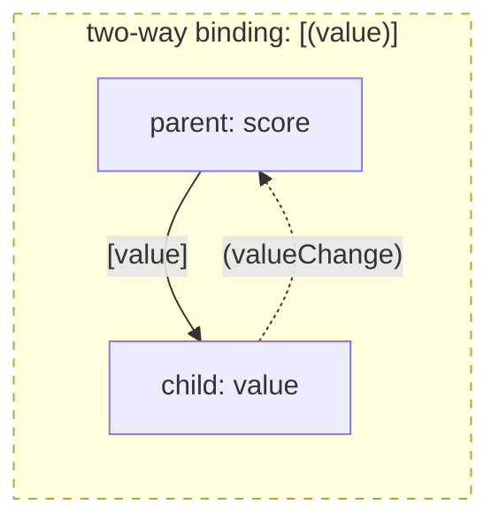
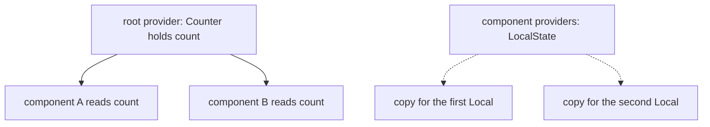
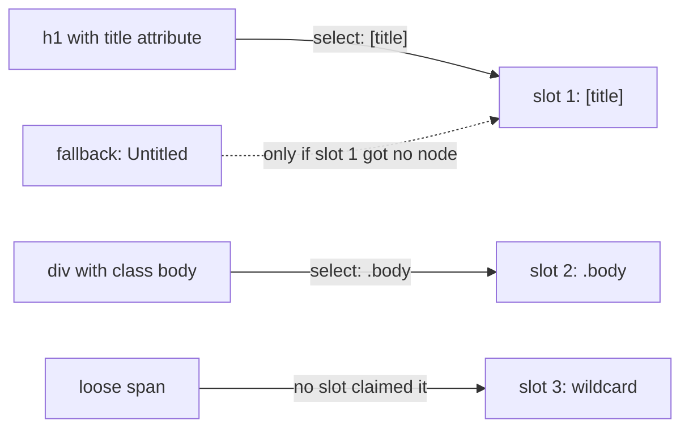
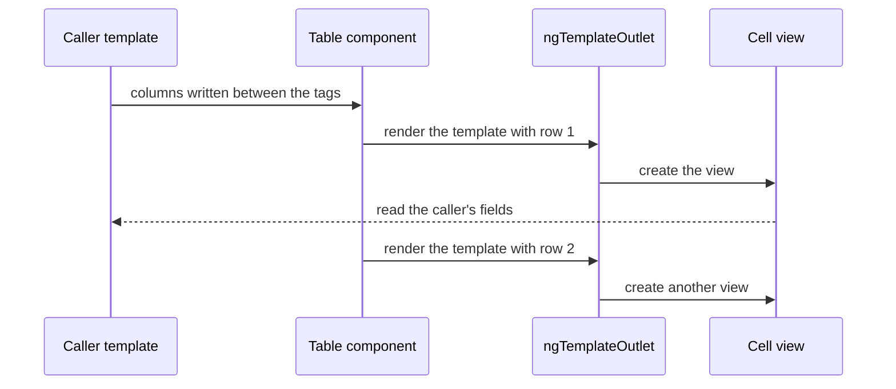
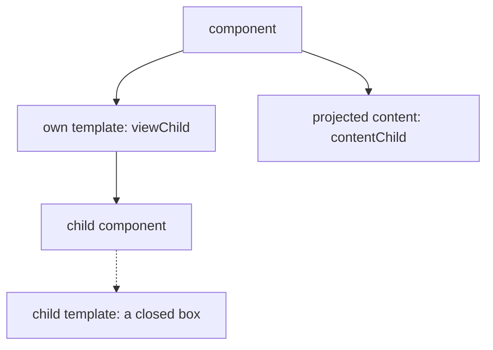
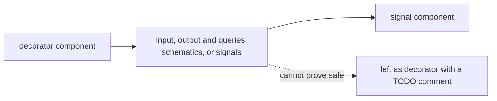
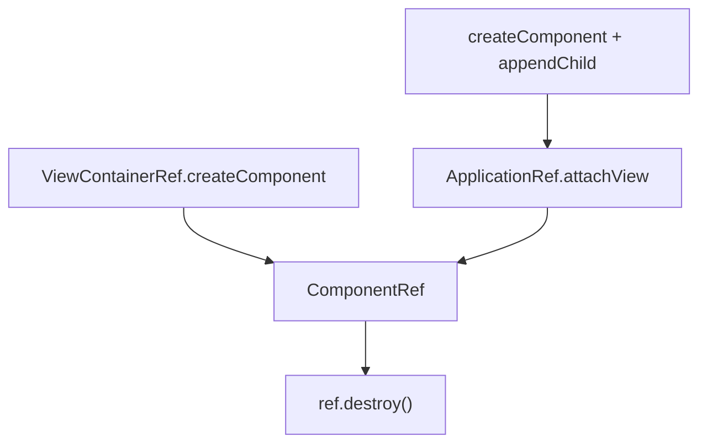
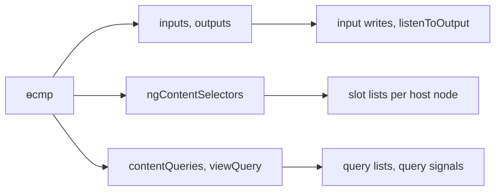

# 19. Component communication and projection: inputs, outputs, `ng-content`, `ng-template`, queries and dynamic components

> **What this covers:** the parent and child contract (`input()`, `output()`, `model()`), sharing state through services, content projection (`ng-content`, slots, `ngProjectAs`, fallback content, the lifecycle trap and `NG8011`), template-driven APIs (`ng-template`, `ngTemplateOutlet`, typed context), view and content queries, the decorator forms and the migration schematics, dynamic components (`ViewContainerRef.createComponent`, `createComponent`, `inputBinding`, `outputBinding`, `twoWayBinding`) and how the compiler and runtime implement slots and queries
> **Prerequisites:** [14. Directives and pipes](14-directives-and-pipes.md#2-structural-directives-ng-template-templateref-viewcontainerref-and-the-microsyntax) (`ng-template`, `TemplateRef`, `ViewContainerRef`) and [17. Signals](17-signals.md#7-signal-based-component-apis) (signal inputs, outputs and queries as APIs)
> **Leads to:** [20. Lifecycle and render hooks](20-lifecycle-and-render-hooks.md), [21. Change detection](21-change-detection.md), [24. Routing](24-routing.md), [25. Forms](25-forms-reactive-and-template-driven.md), [28. State management](28-state-management.md), [29. Testing Angular](29-testing-angular.md), [36. Material and CDK](36-material-and-cdk.md)
> **Applies to:** Angular 22.2 (`@angular/core`, `@angular/compiler-cli`, `@angular/cli` 22.2.1), TypeScript 6.0, Node 24
> **Study time:** ~6 hours reading + ~6 hours exercises
> **Short on time:** read [1. Inputs, outputs and two-way binding](#1-inputs-outputs-and-two-way-binding-the-parent-and-child-contract), [3. Content projection](#3-content-projection-ng-content-slots-ngprojectas-fallback-content-and-the-lifecycle-trap), [5. Queries](#5-queries-view-and-content-queries-with-signal-queries) and [6. Decorators and the migration schematics](#6-decorator-based-inputs-outputs-and-queries-and-the-migration-schematics), then drill [Q19.03](#q19-03), [Q19.09](#q19-09), [Q19.10](#q19-10), [Q19.17](#q19-17), [Q19.21](#q19-21) and [Q19.25](#q19-25), try [Exercise 19.2](#ex19-2), and finish with the [Summary](#summary).
> **Labs:** [`labs/angular/src/app/modules/19-component-communication-and-projection/`](../labs/angular/src/app/modules/19-component-communication-and-projection/) (section specs, fixtures, Exercises 19.1-19.5, *Output* questions); no `labs/ts-js` folder, since nothing here is a pure model. Run (Node 24): from `labs/angular`, `npx ng test --watch=false --include='src/app/modules/19-component-communication-and-projection/**/*.spec.ts'`

## Contents

1. [Inputs, outputs and two-way binding: the parent and child contract](#1-inputs-outputs-and-two-way-binding-the-parent-and-child-contract)
2. [Sharing state beyond the tree: services with signals and DI-scoped state](#2-sharing-state-beyond-the-tree-services-with-signals-and-di-scoped-state)
3. [Content projection: `ng-content`, slots, `ngProjectAs`, fallback content and the lifecycle trap](#3-content-projection-ng-content-slots-ngprojectas-fallback-content-and-the-lifecycle-trap)
4. [Template-driven APIs: `ng-template`, `ngTemplateOutlet` and typed context](#4-template-driven-apis-ng-template-ngtemplateoutlet-and-typed-context)
5. [Queries: view and content queries with signal queries](#5-queries-view-and-content-queries-with-signal-queries)
6. [Decorator-based inputs, outputs and queries, and the migration schematics](#6-decorator-based-inputs-outputs-and-queries-and-the-migration-schematics)
7. [Dynamic components: `ViewContainerRef.createComponent`, `createComponent` and bindings](#7-dynamic-components-viewcontainerrefcreatecomponent-createcomponent-and-bindings)
8. [Under the hood: the compiled definition, projection slots and query refresh](#8-under-the-hood-the-compiled-definition-projection-slots-and-query-refresh)
- [Summary](#summary)
- [Question bank](#question-bank)
- [Hands-on exercises](#hands-on-exercises)
- [Check your understanding](#check-your-understanding)
- [Connections](#connections)

**How the claims here are verified.** Runtime claims are asserted by specs that run under `ng test` (an ahead-of-time test build, [Q12.19](12-angular-how-it-works.md#q12-19), with jsdom, a simulated browser), named `Section N: …` after their section. Compiler diagnostics and emitted code are "observed by compiling" a throwaway file with `ngc` 22.2.1, dated and quoted. Schematic results are "observed by running the schematic" on a scratch workspace. Anything else is "read from" a named file of the 22.2.1 packages, or cited to the docs or the CHANGELOG. Server and hydration behavior, animations, performance and the Angular team's rationale are documented only, never observed.

## 1. Inputs, outputs and two-way binding: the parent and child contract

### The problem it solves

A rating widget takes its value from the parent, tells it when the user picks a star, and a form wants `[(value)]`. Around that contract, one template fails to compile for three different reasons ([Q19.02](#q19-02)), an event emitted in the child's constructor never arrives ([Q19.03](#q19-03)), and a child that edits an object it received leaves its sibling showing the old text ([Q19.05](#q19-05)).

A **contract** is the inputs and outputs a component declares. An **input** is a property the parent binds with `[x]`, an **output** is an event the child announces and the parent handles with `(x)`, and a **model** is an input plus an output named `xChange` behind one `[(x)]`.

### Mental model

A wall socket and a doorbell: the socket receives, the bell announces. Data goes **down** through inputs, events go **up** through outputs, and the side the arrow starts from owns the value ([Q19.01](#q19-01)).



What to notice: the arrow direction says who owns the state, and a model bundles two arrows, not a third kind.

### How it actually works

The signal forms are `input()` [Stable since v19.0] (with `input.required`; `transform`, which converts the bound value before it is stored; and `alias`, which renames the binding), `output()` [Stable since v19.0] and `model()` [Stable since v19.0] (core CHANGELOG 19.0.0). [17 §7](17-signals.md#7-signal-based-component-apis) owns how they work.

**The compiler enforces the contract.** With `strictTemplates` (type-checks template bindings against the declared types; [Q12.20](12-angular-how-it-works.md#q12-20)) a parent that breaks it fails the build. Observed by compiling three throwaway components with `ngc` 22.2.1, the Angular compiler's command line, on 2026-10-08. The child had `name = input.required<string>()` and `age = input(0)`; `a.ts` bound nothing, `b.ts` bound `[nme]="'x'"` and `c.ts` bound `[age]="'7'"` (the NG8002 help text is omitted):

```text
a.ts:9:62 - error NG8008: Required input 'name' from component User must be specified.
b.ts:9:83 - error NG8002: Can't bind to 'nme' since it isn't a known property of 'lab-user-b'.
c.ts:9:84 - error TS2322: Type 'string' is not assignable to type 'number'.
```

**Why an early emit is lost.** A signal input holds its default in the constructor and the bound value in `ngOnInit` (a lifecycle hook, [Module 20](20-lifecycle-and-render-hooks.md#2-constructor-ngoninit-and-inputs-what-exists-when)) (`Section 1: a signal input holds its default in the constructor and the bound value in ngOnInit`), and an output emitted in the constructor is lost while one emitted in `ngOnInit` is delivered (`Section 1: an output emitted in the constructor is lost and one emitted in ngOnInit is delivered`). Read from the 22.2.1 source (`@angular/core`, `fesm2022/_debug_node-chunk.mjs`, `listenToOutput`; `fesm2022/_resource-chunk.mjs`, `OutputEmitterRef`): `listenToOutput` subscribes to the output of an existing instance, and an `OutputEmitterRef` keeps listeners and no buffer, so an earlier `emit` returns at once.

**`ngOnChanges` still runs for signal inputs** (`Section 1: ngOnChanges reports signal inputs and decorator inputs`). Same file: for a class with an `ngOnChanges` method (the hook that reports changed inputs), `NgOnChangesFeatureImpl` sets the definition's `setInput` to `ngOnChangesSetInput`, which `writeToDirectiveInput` calls for every input write; it records a `SimpleChange` and then writes the value, signal or not.

**An output is not a DOM event.** `emit` reached the `(ping)` on the child but not one on a wrapping `<div>`, while a bubbling DOM `CustomEvent('ping')` from the child's host element reached both (`Section 1: an output is not a DOM event and a DOM event of the same name reaches the listener`).

**A model is an input plus an output.** Observed by compiling `d.ts` (`value = model(0)`, `size = input(1)`, `done = output<number>()`) with `ngc` 22.2.1 on 2026-10-08, abridged:

```text
inputs: { value: [1, "value"], size: [1, "size"] }, outputs: { value: "valueChange", done: "done" }
```

The `1` is `InputFlags.SignalBased` (`_debug_node-chunk.mjs`). So `[value]` and `(valueChange)` bind separately (`Section 1: a model accepts [value] and (valueChange) bound separately`); [Q13.16](13-components-and-templates.md#q13-16) owns the `[(x)]` desugaring.

**Shared objects stay stale.** One child's handler appended `!` to `user().name`; that child then showed `x!` and its sibling still `x` (`Section 1: mutating a shared input object refreshes only the view that handled the event`). The sibling is OnPush [Changed in v22.0: the default] (a component with no `changeDetection` property, per [VERSIONS.md](../VERSIONS.md)): Angular refreshes it only when something marks it dirty (an input signal, an event inside it or a signal it reads changing), which an event in the other component does not ([Module 21](21-change-detection.md#2-onpush-and-eager-strategies-and-what-marks-a-view-dirty) owns it). A service signal refreshes every reader ([section 2](#2-sharing-state-beyond-the-tree-services-with-signals-and-di-scoped-state)).

### Code

The approach is a rating whose parent owns the value and lets the child propose changes.

1. Declare `value = model(0)` in the child and call `value.set(3)` on a click.
2. Bind it with `[(value)]` to a parent signal, which Angular writes inside `set` (`Section 1: a model with [(value)] writes the parent signal`).
3. When the parent must be able to refuse, use `input()` and `output()` and bind `[value]` and `(valueChange)` ([Q19.04](#q19-04)).

```ts
// Excerpt of labs/angular/src/app/modules/19-component-communication-and-projection/concepts/section-1-inputs-outputs.spec.ts
@Component({
  selector: 'lab-m19-s1-rating',
  template: `<button (click)="value.set(3)">three</button>{{ value() }}`,
})
class Rating {
  readonly value = model(0);
}

@Component({
  selector: 'lab-m19-s1-rating-host',
  imports: [Rating],
  template: `<lab-m19-s1-rating [(value)]="score" />`,
})
class RatingHost {
  readonly score = signal(1);
}
```

> [!NOTE]
> **Framework vs platform.** `(ping)` looks like a DOM listener, but an output is an Angular emitter: it does not bubble, and a DOM event of the same name still reaches the listener.

#### Legacy

Before the functions, fields carried `@Input()` and `@Output()` with an `EventEmitter` (an RxJS `Subject` subclass in the typings). The docs say they "remain fully supported" (`inputs.md` at `v22.2.1`, read 2026-10-08); [section 6](#6-decorator-based-inputs-outputs-and-queries-and-the-migration-schematics) has the schematics.

```ts
// Partial: legacy decorator pair; the class, imports and template are omitted
@Input() value = 0;
@Output() valueChange = new EventEmitter<number>();
```

### Best practices and anti-patterns

- **Do mark an input `required` when it has no default**, because the compiler then reports `NG8008` at the parent.
- **Do emit from a handler or hook**, because the parent subscribes after the constructor has run.
- **Avoid mutating an object received through an input**, because OnPush siblings are not told.
- **Use `model()` only when the child may change the value freely**, because `[(value)]` gives the parent no chance to refuse.

### Misconceptions and traps

- *"An output bubbles like a DOM event."* It does not. The myth exists because `(ping)` is written like `(click)`.
- *"`model()` is a third kind of binding."* It compiles to an input plus an output `xChange`. The myth exists because `[(value)]` looks like new syntax.
- *"Signal inputs replace `ngOnChanges`, which no longer runs."* It still runs. The myth exists because the docs steer you to `computed`.

Drilled in [Q19.01](#q19-01), [Q19.02](#q19-02), [Q19.03](#q19-03), [Q19.04](#q19-04) and [Q19.05](#q19-05); practised in [Exercise 19.1](#ex19-1) and [Exercise 19.4](#ex19-4).

## 2. Sharing state beyond the tree: services with signals and DI-scoped state

### The problem it solves

A header badge and a deep widget must show the same cart count. Moving it to the nearest common parent (**lifting state up**) still runs it through every component between, so teams reach for an **event bus** (a `Subject` any component can emit on and subscribe to) or call a child's methods through `viewChild` [Stable since v19.0]. Then a shared **service** (a class Angular injects) is listed in a component's `providers` and the sibling never sees the change, or it is provided in root and leaks state between screens ([Q19.07](#q19-07)).

### Mental model

A notice board in the hallway versus passing notes through the manager. Three channels: **through the tree** (inputs and outputs, [section 1](#1-inputs-outputs-and-two-way-binding-the-parent-and-child-contract)), **through DI** (a service holding signals) and **through a parent reference** (`inject(Parent)`). A **provider scope** is the injector where a class is registered, and a class is one instance per injector, not per application ([Q16.35](16-dependency-injection.md#q16-35)).



What to notice: where the provider is declared decides who shares the instance ([Q19.06](#q19-06)).

### How it actually works

**A root service with signals.** The service keeps a private writable signal, exposes `asReadonly()` ([Q17.05](17-signals.md#q17-05) owns the pattern) and changes it through methods. Two components reading it both showed `1` after one clicked (`Section 2: two components read one root service signal`). `asReadonly` returns a `Signal`, which has no `set`: the `// @ts-expect-error` line in `Section 2: asReadonly exposes no set` proves the type hides it, the same test finds no `set` property at run time, and the owner's method still changes the value. It proves encapsulation of the API, not that the value is frozen.

**One instance per component.** A class in a component's `providers` is built per component: two components held different `LocalState` objects, a write to one left the other at `0`, and the root had none (`Section 2: a component-level provider gives each component its own instance`). [Q16.21](16-dependency-injection.md#q16-21) owns per-instance state.

**A parent reference follows the declaring template.** A projected `Inner` got the `Wrap` it was written inside, and `null` with `optional` outside one (`Section 2: a projected child injects the wrapper component that declares it`). Read from the 22.2.1 source (`@angular/core`, `fesm2022/_debug_node-chunk.mjs`, read, not run): `lookupTokenUsingNodeInjector` starts at the node's injector and follows each parent location up; `getParentInjectorLocation` takes it from `tNode.parent`, the parent in the template that declares the node, or climbs to the view's declaration point when none in the view has an injector. So the walk follows where a node is written, not where `<ng-content>` renders it: a `Deep` written between `<lab-m19-s2-shell>` tags and rendered inside the shell's own `Frame` got the shell and `null` for the frame (`Section 2: a projected child resolves tokens along the template that declares it, not where it renders`). Element injector: [Q16.15](16-dependency-injection.md#q16-15).

**Costs.** A bus has no current value and delivers until someone unsubscribes: a late subscriber missed the earlier value (`Section 2: a Subject has no current value and keeps delivering until unsubscribed`; [Module 22](22-rxjs-foundations.md#4-subjects-subject-behaviorsubject-replaysubject-and-asyncsubject) owns `Subject`). Application-scale state is [Module 28](28-state-management.md#2-the-service-with-signals-store-state-shape-derived-selectors-methods-and-async-loads).

### Code

The approach is a counter service that one component writes and another reads.

1. Keep the writable signal private, expose `asReadonly()` and a method.
2. Inject the service in both components and read `count()` in each template.
3. Do not list the service in `providers`: root registers one instance for both.

```ts
// Excerpt of labs/angular/src/app/modules/19-component-communication-and-projection/concepts/section-2-shared-state.spec.ts
@Injectable({ providedIn: 'root' })
class Counter {
  readonly #count = signal(0);
  readonly count = this.#count.asReadonly();

  increment(): void {
    this.#count.update((n) => n + 1);
  }
}

@Component({
  selector: 'lab-m19-s2-writer',
  template: `<button (click)="counter.increment()">add</button><b id="writer">{{ counter.count() }}</b>`,
})
class Writer {
  protected readonly counter = inject(Counter);
}
```

> [!TIP]
> **Coming from the backend.** A root service is a Spring singleton bean holding mutable state. **Where the analogy breaks:** an Angular provider's scope follows the component tree, so one class can be one instance or many, with no scoped proxy ([Q16.35](16-dependency-injection.md#q16-35)).

### Best practices and anti-patterns

- **Do share state through a service with signals**, because every reader has a current value and no subscription to manage.
- **Do keep the writable signal private**, because readers then go through the service's methods.
- **Avoid listing a shared service in `providers`**, because each component then gets its own copy and the sibling never sees the change.
- **Avoid `inject(Parent)` in a reusable child**, because it ties the child to one parent type.

### Misconceptions and traps

- *"A service is always a singleton."* One instance per injector, so a component's `providers` entry makes one per component. The myth exists because `providedIn: 'root'` is the first example everyone sees.
- *"An event bus is the Angular way to talk across the tree."* A signal in a service does it with a current value. The myth exists because Subject-based services were the recipe before signals.
- *"`inject(Parent)` is just another input."* It reads like one, but it resolves along the declaring templates and gives `null` outside the parent. The myth exists because both are written as a dependency of the child.

Drilled in [Q19.06](#q19-06) and [Q19.07](#q19-07); practised in [Exercise 19.4](#ex19-4) and [Exercise 19.5](#ex19-5).

## 3. Content projection: `ng-content`, slots, `ngProjectAs`, fallback content and the lifecycle trap

### The problem it solves

A card or dialog needs the caller's markup in named places, and a title slot should read "Untitled" when the caller gives none. Then a heavy panel is hidden with `@if` around its `<ng-content>` and its constructor still runs ([Q19.10](#q19-10)), and an `@if` holding two elements lands in the wrong slot with an `NG8011` warning ([Q19.11](#q19-11)).

**Content projection** is the markup a caller writes between a component's tags, shown where the component places `<ng-content>`. A **slot** is one `<ng-content>` placeholder, `select` is the selector (element, attribute or class) a node must match to enter it, and a slot without `select` is the **wildcard** slot. The caller's template is the **declaring** one.

### Mental model

A picture frame with openings: a label on each picture picks the opening, and the picture was printed before it was framed. The caller writes the content in its own template; the frame only says where it goes ([Q19.08](#q19-08)).



What to notice: matching happens per node, in slot order, and the wildcard only catches what no slot claimed.

### How it actually works

**Slots and fallback.** In the lab a frame with slots `[title]`, `.body`, `lab-m19-s3-foot`, a wildcard and a second `.body` put `h1[title]` in the first, the `div.body` in the second, an `h3` with `ngProjectAs="lab-m19-s3-foot"` in the third and a loose `span` in the wildcard (`Section 3: select, the default slot and ngProjectAs choose the slot`). `ngProjectAs` takes a static value only (docs, `content-projection.md` at `v22.2.1`, read 2026-10-08). Fallback content, the text inside an `<ng-content>` tag, is [Added in v18.0] (core CHANGELOG 18.0.0, "add support for fallback content in ng-content"). The second `.body` slot showed its fallback (`Section 3: the first matching slot gets the node and a later slot with the same select shows its fallback`).

**Why the first slot wins.** Read from the 22.2.1 source (`@angular/core`, `fesm2022/_debug_node-chunk.mjs`, read, not run; the `ɵ` names are internal, to read and never call, [12 §8](12-angular-how-it-works.md#8-under-the-hood-what-the-compiler-emits-and-what-the-runtime-does-with-it)): `matchingProjectionSlotIndex` walks the slot selectors in order, remembers where `*` is without matching it, returns the first slot that matches (or contains the `ngProjectAs` value), then the wildcard, then `null`, and a node with `null` is not projected. `ɵɵprojectionDef` runs once per host node and chains the host's children into one list per slot. `ɵɵprojection` computes `isEmpty` as "that slot's list is empty" and inserts the fallback. So empty means no node matched, not nothing visible: a host with only a comment showed every fallback, while an `@if` that matched and was false left its slot empty with no fallback (`Section 3: fallback content shows for no match, whitespace and comments but not for an @if that is false`).

**Projection is not instantiation.** A `<lab-m19-s3-probe>` projected into a gate that wraps `<ng-content>` in `@if (open())` was constructed once, ran `ngOnInit` and was absent from the DOM while closed; opening attached the same instance and closing detached it (`Section 3: a projected component is constructed once even when its ng-content is hidden`). The declaring template creates its nodes whatever the slot does, as the docs say ("always instantiates and creates DOM nodes"). The cure is a template rendered on demand ([section 4](#4-template-driven-apis-ng-template-ngtemplateoutlet-and-typed-context)).

**`NG8011`.** Observed by compiling a throwaway `e.ts` (slots `[title]` and `[body]`, content `@if (ok()) { <h1 title>a</h1> <p body>b</p> }`) with `ngc` 22.2.1 on 2026-10-08, the first of two warnings, abridged:

```text
e.ts:12:37 - warning NG8011: Node matches the "[title]" slot of the "Card" component, but will not be projected into the specific slot because the surrounding @if has more than one node at its root.
```

It is an extended diagnostic ([Q12.21](12-angular-how-it-works.md#q12-21)) and a warning, and `ng test` prints it for the multi-root fixture, so a green run with `NG8011` warnings is expected. The multi-root block went whole into the wildcard slot; wrapping it in `<ng-container ngProjectAs="[a]">` sent it to the `[a]` slot, and two `@if` blocks with one root each filled their own slots (`Section 3: an @if with two roots is projected into the default slot as a whole and ng-container with ngProjectAs fixes it`, `Section 3: two @if blocks with one root each project into their own slots`).

**`ngProjectAs` keeps its attribute.** The docs' rendered DOM shows `<h3>Hello</h3>` with no attribute; in the lab the element kept `ngprojectas="lab-m19-s3-foot"` (`Section 3: ngProjectAs leaves the attribute on the element`).

**Whose view.** The docs say the parent's change detection checks projected content. In the lab a host signal change updated a projected `<b>` while the OnPush card's own text stayed stale (`Section 3: projected content is checked with the declaring view`); [Module 21](21-change-detection.md#q21-16) owns the rest.

### Code

The approach is one frame with named slots, a fallback and a wildcard.

1. Give each slot a `select`, and a fallback where an empty slot needs one.
2. Mark the loose or renamed nodes with attributes, classes or `ngProjectAs`.
3. Leave `<ng-content />` last as the wildcard.

```ts
// Excerpt of labs/angular/src/app/modules/19-component-communication-and-projection/concepts/section-3-projection.spec.ts
@Component({
  selector: 'lab-m19-s3-frame',
  template: `
    <header><ng-content select="[title]">Default title</ng-content></header>
    <main><ng-content select=".body" /></main>
    <footer><ng-content select="lab-m19-s3-foot">Default foot</ng-content></footer>
    <section><ng-content /></section>
    <aside><ng-content select=".body">second body slot</ng-content></aside>
  `,
})
class Frame {}
```

Anti-pattern:

```ts
// Excerpt of labs/angular/src/app/modules/19-component-communication-and-projection/concepts/section-3-projection.spec.ts
@Component({
  selector: 'lab-m19-s3-gate',
  template: `@if (open()) { <ng-content /> }`,
})
class Gate {
  readonly open = signal(false);
}
```

> [!WARNING]
> **Anti-pattern.** `@if` around `<ng-content>` hides the content; it is still created.

> [!NOTE]
> **Framework vs platform.** `ng-content` is Angular's compile-time slot, resolved by its compiler; the native `<slot>` belongs to Shadow DOM (the browser's encapsulated DOM subtree) and works at run time. With `ViewEncapsulation.ShadowDom` the two meet ([Q13.30](13-components-and-templates.md#q13-30)).

### Best practices and anti-patterns

- **Do give each slot a `select` and end with a wildcard**, because the first matching slot wins and the wildcard only takes what is left.
- **Do put a fallback on a slot the caller may omit**, because an empty slot then shows it.
- **Avoid `@if` around `<ng-content>`**, because the content is created anyway; pass a template instead.
- **Do wrap a multi-element `@if` in `<ng-container ngProjectAs="…">`**, because the block is projected as one node.

### Misconceptions and traps

- *"An `@if` around `<ng-content>` renders the content only when true."* It only hides it. The myth exists because `@if` skips creation for the component's own nodes.
- *"Fallback shows whenever nothing is visible."* It shows when no node matched, and an `@if (false)` that matched leaves the slot empty. The myth exists because the docs say "doesn't have any matching child content", which reads as "nothing shown".
- *"A multi-element `@if` projects each element into its slot."* The block is one node and goes whole to one slot. The myth exists because it works for plain sibling elements.
- *"`ngProjectAs` removes itself from the DOM."* The attribute stays. The myth exists because the docs' rendered example shows none.

Drilled in [Q19.08](#q19-08), [Q19.09](#q19-09), [Q19.10](#q19-10), [Q19.11](#q19-11), [Q19.12](#q19-12) and [Q19.15](#q19-15); practised in [Exercise 19.2](#ex19-2).

## 4. Template-driven APIs: `ng-template`, `ngTemplateOutlet` and typed context

### The problem it solves

A table should let the caller say how a cell is drawn, and a list should take one template per row and another for "no results". `<ng-content>` cannot do it: the caller's markup is created once, with no data ([section 3](#3-content-projection-ng-content-slots-ngprojectas-fallback-content-and-the-lifecycle-trap)). And an untyped template compiles `row.nme` and prints nothing ([Q19.13](#q19-13)).

A **template fragment** is markup inside `<ng-template>` that Angular creates only when something renders it; `TemplateRef` is the handle on it and an **embedded view** is one rendering ([14 §2](14-directives-and-pipes.md#2-structural-directives-ng-template-templateref-viewcontainerref-and-the-microsyntax)). The **context** is the object the renderer supplies: a bare `let-row` gets its `$implicit` property and `let-i="index"` any other.

### Mental model

A form letter: the sender wrote the text and the printer fills in each name. The caller hands over a **recipe** (a template) and the component supplies the **data** (a context) at each rendering. The nearest React idiom is a **render prop**, a function a component calls to draw part of itself; here the typing comes from a directive, not a function type.



What to notice: the template is declared in the caller and rendered in the table, so it reads the caller's fields ([Q19.14](#q19-14)).

### How it actually works

**Three ways to receive a template.** A `TemplateRef` input, `contentChild(TemplateRef)` [Stable since v19.0], or a **marker directive** on `<ng-template>` (a directive that exists to be found and to carry options) collected by `contentChildren` [Stable since v19.0]. The last two are content queries, lookups of what the caller wrote between the tags ([section 5](#5-queries-view-and-content-queries-with-signal-queries)). In the lab all three work (`Section 4: a template passed as an input renders with ngTemplateOutlet and its context`, `Section 4: contentChild of TemplateRef finds the ng-template written between the tags`, `Section 4: contentChildren of a template directive lists the columns in declaration order`). `ngTemplateOutlet` renders the template with `context: { $implicit: row }`; its mechanics are [Q14.14](14-directives-and-pipes.md#q14-14).

**Whose fields.** A column template read `row.name` from the context and `hostField()` from the caller, never a table field, and a change to the caller's signal updated the cell (`Section 4: a template declared by the caller reads the caller's fields and the outlet's context`). Read from the 22.2.1 source (`@angular/core`, `fesm2022/_debug_node-chunk.mjs`, read, not run; `ɵ` names are internal, to read and never call): a `TemplateRef` keeps `_declarationLView`, the view where the `<ng-template>` was written. `createEmbeddedViewImpl` passes it to `createAndRenderEmbeddedLView`, which calls `createLView(declarationLView, …)`, and `createLView` makes it the `PARENT` and the `DECLARATION_VIEW` of the new view. `walkUpViews` (in `_pending_tasks-chunk.mjs`) climbs by `DECLARATION_VIEW`, and the compiled template calls `ɵɵnextContext()` for a field. Observed by compiling `e.ts` (`<ng-template let-n>{{ n }}|{{ field() }}</ng-template>`) with `ngc` 22.2.1 on 2026-10-08, lines abridged:

```text
const n_r1 = ctx.$implicit;
const ctx_r1 = i0.ɵɵnextContext();
i0.ɵɵtextInterpolate2("", n_r1, "|", ctx_r1.field());
```

So the context comes from the renderer and everything else from the declaring component.

**Typed context.** Observed by compiling `col.ts` with `ngc` 22.2.1 on 2026-10-08. An `ngTemplateContextGuard` ([Q14.08](14-directives-and-pipes.md#q14-08) owns it) typed `let-row` as `Row` and `let-i="index"` as `number`, so `row.nme` and `i.nope` failed; on a directive without the guard `row.whatever` compiled, because `row` was `any`:

```text
col.ts:20:72 - error TS2551: Property 'nme' does not exist on type 'Row'. Did you mean 'name'?
col.ts:20:84 - error TS2339: Property 'nope' does not exist on type 'number'.
```

A `TemplateRef<{ $implicit: number }>` input checks the outlet's context (`out.ts`, same run), while a `#t` reference is `TemplateRef<any>`, so `context: 5` compiled:

```text
out.ts:9:58 - error TS2322: Type 'string' is not assignable to type 'number'.
out.ts:10:58 - error TS2353: Object literal may only specify known properties, and '"nope"' does not exist in type '{ $implicit: number; }'.
```

One pitfall (`pit.ts`, same run): when the selector attribute and the input share a name (`<ng-template labPit [labPit]="rows">`), the bare `labPit` is also bound, as a string:

```text
pit.ts:5:75 - error TS2322: Type 'string' is not assignable to type 'Row[]'.
```

Name the input differently (`labCol`, `labColOf`).

**`ng-content` in a template.** Rendered by two outlets, the template's `<b>` appeared twice and the projected `X` only in the last (`Section 4: ng-content inside an ng-template rendered twice projects into the last instance only`). Pass the content as a template too.

### Code

The approach is a table whose columns are templates the caller writes.

1. Declare a marker directive on `ng-template` with a header, the `TemplateRef` and a context guard.
2. Collect the columns with `contentChildren` and render each one with `ngTemplateOutlet` and the row as `$implicit`.
3. Write the columns between the table's tags in the caller.

```ts
// Excerpt of labs/angular/src/app/modules/19-component-communication-and-projection/concepts/section-4-templates.spec.ts
@Directive({ selector: 'ng-template[labM19S4Col]' })
class Col {
  readonly header = input.required<string>();
  readonly tpl = inject(TemplateRef);

  static ngTemplateContextGuard(_directive: Col, _context: unknown): _context is { $implicit: Row } {
    return true;
  }
}
```

```ts
// Excerpt of labs/angular/src/app/modules/19-component-communication-and-projection/concepts/section-4-templates.spec.ts
@Component({
  selector: 'lab-m19-s4-table-host',
  imports: [Table, Col],
  template: `
    <lab-m19-s4-table [rows]="rows">
      <ng-template labM19S4Col header="Name" let-row>
        [{{ row.name }}|{{ hostField() }}|{{ $any(this).tableField ?? 'n/a' }}]
      </ng-template>
      <ng-template labM19S4Col header="Id" let-row>{{ row.id }}</ng-template>
      <ng-template labM19S4Col header="Last" let-row>{{ row.name.length }}</ng-template>
    </lab-m19-s4-table>
  `,
})
class TableHost {
  readonly rows: readonly Row[] = [{ id: 1, name: 'Ann' }];
  readonly hostField = signal('host-field');
}
```

> [!TIP]
> **Coming from the backend.** A Thymeleaf fragment with parameters is the same idea: named markup a renderer fills with data. **Where the analogy breaks:** a fragment is rendered once per request on the server, while an embedded view stays live and re-evaluates its bindings (`hostField` changed).

### Best practices and anti-patterns

- **Do pass a template for anything drawn per item**, because `<ng-content>` is created once and has no data.
- **Do give the marker directive an `ngTemplateContextGuard`**, because otherwise `let-row` is `any`.
- **Do name the directive's input differently from its selector**, because the bare attribute is also bound.
- **Avoid `<ng-content>` inside a template rendered more than once**, because only the last instance receives the content.

### Misconceptions and traps

- *"A template runs in the component that renders it."* It reads the declaring component's fields; only the context comes from the renderer. The myth exists because it is drawn inside the table.
- *"`let-row` is typed because I wrote `let-row`."* Without a guard it is `any`. The myth exists because it compiles with or without a guard, so nothing prompts you to add one.
- *"`ng-content` can be reused in several places."* The first copy stays empty. The myth exists because the template's own elements render in every instance.

Drilled in [Q19.13](#q19-13), [Q19.14](#q19-14), [Q19.15](#q19-15) and [Q19.16](#q19-16); practised in [Exercise 19.2](#ex19-2) and [Exercise 19.3](#ex19-3).

## 5. Queries: view and content queries with signal queries

### The problem it solves

A tab set must know its tabs, a form wants its first invalid field, and a component sometimes calls a child's method or reads an element. A **query** is a lookup Angular keeps up to date, and its **locator** says what to find: a class, a template reference name or a token. Two things go wrong: a read in the constructor gives `undefined`, and `viewChild.required` throws when its element sits behind an `@if` ([Q19.20](#q19-20)).

### Mental model

A librarian searching the shelves of one room, or the boxes someone left at the door: a **view query** looks into the component's own template, a **content query** into what the caller projected between its tags, and neither looks into another component's template.



What to notice: the closed box. Queries never pierce another component's template ([Q19.17](#q19-17)).

### How it actually works

**The four functions.** `viewChild`, `viewChildren` [Stable since v19.0], `contentChild` and `contentChildren` return signals ([17 §7](17-signals.md#7-signal-based-component-apis) and [Q17.31](17-signals.md#q17-31) own the API; stability: core CHANGELOG 19.0.0, "mark signal-based query APIs as stable"). Read inside a reactive context such as `computed`, they become dependencies ([17 §1](17-signals.md#1-why-signals-exist)).

**Boundaries and `descendants`.** In the lab `viewChild(Leaf)` found the child component but `viewChild('inside')` for a `<span #inside>` in the child's template was `undefined`, though the span is in the DOM (`Section 5: viewChild sees the component's own template and not a child's template`). `descendants` says whether a content query looks beyond the host's direct children. The docs say `contentChildren` finds only direct children by default and `contentChild` traverses; view queries have no option and always traverse. For `<div labM19S5Item><span labM19S5Item></span></div>` the default gave one match and `descendants: true` two; for a nested-only `<div><span labM19S5Item></span></div>` `contentChild` found it, `contentChildren` found none and `descendants: true` found one (`Section 5: contentChild and contentChildren differ in the default of descendants`, [Q19.18](#q19-18)). The compiler records the option as a bit flag. Observed by compiling `q.ts` (five queries) with `ngc` 22.2.1 on 2026-10-08, the flags last (`ɵ` names are internal, to read and never call):

```text
ɵɵcontentQuerySignal(dirIndex, ctx.one, _c0, 5)(dirIndex, ctx.many, _c0, 4)(dirIndex, ctx.deep, _c0, 5);
ɵɵviewQuerySignal(ctx.head, _c1, 5)(ctx.all, _c1, 5);
```

The typings (`@angular/core` 22.2.1, `types/_debug_node-chunk.d.ts`, `QueryFlags`) name `1` `descendants`, `2` `isStatic` and `4` `emitDistinctChangesOnly`, so `5` is descendants plus distinct and `4` is distinct without descendants.

**`read`.** It picks what to take from the matched element ([Q19.19](#q19-19)). The lab read an `ElementRef` (the wrapper around a DOM element), a `TemplateRef` and a `ViewContainerRef` from `#a` and `#tpl` (`Section 5: read returns ElementRef, TemplateRef and ViewContainerRef`). `Injector` is [Added in v22.2] (core CHANGELOG 22.2.0, "allow reading `Injector` from a view or content query"): the node injector of the element, as seen from its position in the tree (docs). The probe passed: `get(ElementRef)` on it returned the queried element (`Section 5: read Injector returns the node injector of the element`).

**Required and timing.** With the `@if` false, `viewChild.required('b')` read in `ngOnInit` threw `NG0951: Child query result is required but no value is available.` (followed by a link to the error page), and returned the element once the `@if` was true (`Section 5: a required query throws NG0951 until the element exists`). A query signal was `undefined` in the constructor, and in `ngOnInit` the span outside the `@if` was found and the one inside was not (`Section 5: a query signal is empty in the constructor and filled in ngOnInit for a static element`). Read from the 22.2.1 source (`@angular/core`, `fesm2022/_debug_node-chunk.mjs`, read, not run): `createQuerySignalFn` builds a `computed` that reads a dirty counter, calls `refreshSignalQuery` and, for a required query with no value, throws `RuntimeError(-951, …)`. `bindQueryToSignal`, called by `ɵɵviewQuerySignal` and `ɵɵcontentQuerySignal` in the creation pass, stores the view and the query index and registers `queryList.onDirty` to bump the counter. Until then `refreshSignalQuery` finds no view and returns `undefined` or an empty array, which explains the constructor. After it, it resets the list and returns `first` or the cached array, so a `computed` over `viewChildren` follows an `@if` (`Section 5: a computed over viewChildren follows an @if`). [Module 20](20-lifecycle-and-render-hooks.md#1-the-lifecycle-map-phases-and-the-order-of-the-hooks) owns the hook order.

### Code

The approach is one component that reads its own element, a child component and the elements behind an `@if`.

1. Declare queries as fields, with `read` where you need another value.
2. Never read them in the constructor; derive with `computed`.
3. Use `.required` only for what is always rendered.

```ts
// Excerpt of labs/angular/src/app/modules/19-component-communication-and-projection/concepts/section-5-queries.spec.ts
class Q implements OnInit {
  readonly show = signal(false);

  readonly a = viewChild<ElementRef<HTMLElement>>('a');
  readonly b = viewChild<ElementRef<HTMLElement>>('b');
  readonly requiredB = viewChild.required<ElementRef<HTMLElement>>('b');
  readonly aInjector = viewChild('a', { read: Injector });
  readonly bAll = viewChildren<ElementRef<HTMLElement>>('b');
  readonly bCount = computed(() => this.bAll().length);

  readonly item = contentChild(Item);
  readonly items = contentChildren(Item);
  readonly deepItems = contentChildren(Item, { descendants: true });
}
```

The decorator forms, `@ViewChild` and `@ContentChildren`, are told with their migration in [section 6](#6-decorator-based-inputs-outputs-and-queries-and-the-migration-schematics).

### Best practices and anti-patterns

- **Do read a query in a `computed` or after the view exists**, because in the constructor it is `undefined`.
- **Do use `viewChild.required` only for an element that is always rendered**, because behind an `@if` it throws `NG0951`.
- **Do pass `descendants: true` when the match may sit in a wrapper**, because `contentChildren` finds only direct children.
- **Avoid writing state into a child or an ancestor from a query result**, because the docs warn that it makes brittle code prone to `ExpressionChangedAfterItHasBeenChecked` errors.

### Misconceptions and traps

- *"A query can reach into a child component's template."* It cannot. The myth exists because the child's elements are in the DOM, but a view query reads only the component's own template.
- *"`contentChildren` finds every nested match like `viewChildren`."* Its default finds direct children only: one match against two, and none for a nested-only element. The myth exists because view queries always traverse.
- *"A query signal is available in the constructor."* It is `undefined` there. The myth exists because it is declared like `input()`, which does hold its default in the constructor ([section 1](#1-inputs-outputs-and-two-way-binding-the-parent-and-child-contract)).

Drilled in [Q19.17](#q19-17), [Q19.18](#q19-18), [Q19.19](#q19-19) and [Q19.20](#q19-20); practised in [Exercise 19.3](#ex19-3) and [Exercise 19.4](#ex19-4).

## 6. Decorator-based inputs, outputs and queries, and the migration schematics

### The problem it solves

A codebase has hundreds of `@Input`, `@Output`, `@ViewChild` and `@ContentChildren` declarations, and the team asks whether to move, what the schematics do, what they skip and what `static` meant. A **decorator** is a function applied to a class member with `@` ([07 §7](07-ts-advanced-types-and-decorators.md#7-decorators-tc39-standard-versus-experimentaldecorators-and-what-angular-does-with-them)); a **`static` query** is a decorator query that resolves early; a **`QueryList`** is the live collection a plural decorator query gives you.

### Mental model

A mailbox you check at set times versus a live feed. Angular writes into a decorator field after construction, at fixed moments; a function form is a value Angular owns and you only read. A **schematic** ([Q12.05](12-angular-how-it-works.md#q12-05)) is a codemod, a program that rewrites source ([18 §8](18-control-flow-and-defer.md#8-migrating-with-ng-generate-angularcorecontrol-flow)).



What to notice: the schematic migrates what it can prove safe and leaves a comment on the rest ([Q19.23](#q19-23)).

### How it actually works

**Not deprecated.** The 22.2.1 typings carry no `@deprecated` tag on `Input` and `Output` (`types/_debug_node-chunk.d.ts`) or on the query decorators (`types/core.d.ts`), and the docs say the decorator forms "remain fully supported" while recommending the functions for new code (`inputs.md`, `outputs.md`, `queries.md` at `v22.2.1`, read 2026-10-08).

**Timing.** A fixture with `@ViewChild('a', { static: true })` found its element in `ngOnInit`, while the dynamic `@ViewChild('a')` was empty there and found in `ngAfterViewInit`; a static query on an element inside an `@if` stayed empty even after the block rendered (`Section 6: @ViewChild static true resolves in ngOnInit and a dynamic one after the view is created`). `@ContentChild` was empty in `ngOnInit` and set when `ngAfterContentInit` ran (`Section 6: @ContentChild is empty in ngOnInit and set when ngAfterContentInit runs`; [Q19.21](#q19-21) compares the forms). `QueryList` has `changes`, `first`, `last`, `length`, `get` and `toArray` (typings), and `changes` emitted lengths `1` then `0` as an `@if` added and removed an item (`Section 6: QueryList changes emits when an @if adds an item`). A decorator input setter ran after the constructor and before `ngOnInit` (`Section 6: a decorator input setter runs before ngOnInit`, [Q19.22](#q19-22)); the schematic skipped it ("Accessor inputs cannot be migrated as they are too complex."), so replace it by hand with `transform` or `computed` ([17 §7](17-signals.md#7-signal-based-component-apis)).

**The schematics.** Read from `@angular/core` 22.2.1: `collection.json` registers `signal-input-migration` (aliases `signal-inputs`, `signal-input`), `output-migration` (`outputs`), `signal-queries-migration` (`signal-queries`, `signal-query`, `signal-query-migration`) and `signals`, which runs all three (its `migrations` option defaults to `['inputs', 'outputs', 'queries']`). The schemas give `path` and `analysisDir`, plus `bestEffortMode` and `insertTodos` for inputs, queries and `signals`. `migrations.json` has eight entries, none of them these, so `ng update` does not run them. Each docs page calls its migration "production ready as of v19". Observed by running each schematic alone on a scratch workspace on 2026-10-08 (lab config files copied, `node_modules` symlinked, `diff -ru`, timestamps trimmed) on `legacy-widget.ts`. Inputs with `--insert-todos` migrated 4 of 6:

```diff
--- before/legacy-widget.ts
+++ after/legacy-widget.ts
@@ -11,6 +11,7 @@
   ViewChild,
   booleanAttribute,
   numberAttribute,
+  input,
 } from '@angular/core';
 import { map } from 'rxjs';
 
@@ -21,21 +22,25 @@
 @Component({
   selector: 'lab-m19-s6-legacy-widget',
   template: `
-    <h4 #heading>{{ label }}</h4>
-    <p>max={{ max }} readonly={{ readonly }}</p>
-    <p>value={{ value }} tone={{ toneClass }} step={{ stepSeen }}</p>
+    <h4 #heading>{{ label() }}</h4>
+    <p>max={{ max() }} readonly={{ readonly() }}</p>
+    <p>value={{ value }} tone={{ toneClass() }} step={{ stepSeen }}</p>
     <p>tag={{ headingTag }} slots={{ slotCount }} first={{ firstText }} doubled={{ doubled }}</p>
-    <button type="button" (click)="pick(max)">pick</button>
+    <button type="button" (click)="pick(max())">pick</button>
     <button type="button" (click)="closed.emit()">close</button>
     <ng-content />
   `,
 })
 export class LegacyWidget implements OnInit {
-  @Input({ required: true }) label!: string;
-  @Input({ transform: numberAttribute }) max = 5;
-  @Input({ transform: booleanAttribute }) readonly = false;
+  readonly label = input.required<string>();
+  readonly max = input(5, { transform: numberAttribute });
+  readonly readonly = input(false, { transform: booleanAttribute });
+  // TODO: Skipped for migration because:
+  //  Your application code writes to the input. This prevents migration.
   @Input() value = 0;
-  @Input('tone') toneClass = '';
+  readonly toneClass = input('', { alias: 'tone' });
+  // TODO: Skipped for migration because:
+  //  Accessor inputs cannot be migrated as they are too complex.
   @Input() set step(next: number) {
     this.stepSeen = next;
   }
```

Outputs migrated 2 of 3; the one the class pipes stayed a decorator, with no comment (`output-migration` has no `--insert-todos`):

```diff
--- before/legacy-widget.ts
+++ after/legacy-widget.ts
@@ -11,6 +11,7 @@
   ViewChild,
   booleanAttribute,
   numberAttribute,
+  output,
 } from '@angular/core';
 import { map } from 'rxjs';
 
@@ -40,8 +41,8 @@
     this.stepSeen = next;
   }
 
-  @Output() valueChange = new EventEmitter<number>();
-  @Output() closed = new EventEmitter<void>();
+  readonly valueChange = output<number>();
+  readonly closed = output<void>();
   @Output() picked = new EventEmitter<number>();
 
   @ViewChild('heading', { static: true }) heading!: ElementRef<HTMLElement>;
```

Queries migrated 2 of 2: the `static` option was dropped and the query became required, and `.first` became `.at(0)!`:

```diff
--- before/legacy-widget.ts
+++ after/legacy-widget.ts
@@ -1,16 +1,15 @@
 import {
   Component,
-  ContentChildren,
   Directive,
   ElementRef,
   EventEmitter,
   Input,
   OnInit,
   Output,
-  QueryList,
-  ViewChild,
   booleanAttribute,
   numberAttribute,
+  viewChild,
+  contentChildren,
 } from '@angular/core';
 import { map } from 'rxjs';
 
@@ -44,19 +43,19 @@
   @Output() closed = new EventEmitter<void>();
   @Output() picked = new EventEmitter<number>();
 
-  @ViewChild('heading', { static: true }) heading!: ElementRef<HTMLElement>;
-  @ContentChildren(LegacySlot, { read: ElementRef }) slots!: QueryList<ElementRef<HTMLElement>>;
+  readonly heading = viewChild.required<ElementRef<HTMLElement>>('heading');
+  readonly slots = contentChildren(LegacySlot, { read: ElementRef });
 
   stepSeen = 0;
   headingTag = '';
   doubled = 0;
 
   get slotCount(): number {
-    return this.slots?.length ?? 0;
+    return this.slots()?.length ?? 0;
   }
 
   get firstText(): string {
-    return this.slots?.first?.nativeElement.textContent ?? '';
+    return this.slots()?.at(0)!?.nativeElement.textContent ?? '';
   }
 
   constructor() {
@@ -64,7 +63,7 @@
   }
 
   ngOnInit(): void {
-    this.headingTag = this.heading.nativeElement.tagName;
+    this.headingTag = this.heading().nativeElement.tagName;
   }
 
   pick(next: number): void {
```

Running the three in turn left the same files as `signals` (`diff -r` printed nothing), the parent template was untouched, and no `model()` appeared, since `value` stayed `@Input`. Without `--insert-todos` only the comments were missing. The docs say `--best-effort-mode` migrates "even if it could break your build"; on the same sample it migrated 5 of 6 inputs, including `value`, and `ngc` 22.2.1 on 2026-10-08 reported:

```text
src/app/sample/legacy-widget.ts:72:10 - error TS2540: Cannot assign to 'value' because it is a read-only property.
```

`--analysis-dir` limits the analysis, and references outside it are skipped silently (docs).

### Code

The approach is to migrate with the combined schematic and finish the rest by hand.

1. Run `signals` with `--insert-todos` on one folder.
2. Read each `TODO` and migrate that declaration by hand: here a written input and an accessor.
3. Build and run the tests; the lab's `migrated/` folder is this run's output.

```bash
ng generate @angular/core:signals --path=src/app/sample --insert-todos
```

```ts
// Excerpt of labs/angular/src/app/modules/19-component-communication-and-projection/migrated/migrated-widget.ts
  readonly label = input.required<string>();
  readonly max = input(5, { transform: numberAttribute });
  readonly readonly = input(false, { transform: booleanAttribute });
  // TODO: Skipped for migration because:
  //  Your application code writes to the input. This prevents migration.
  @Input() value = 0;
  readonly toneClass = input('', { alias: 'tone' });
```

The migrated widget rendered the same text as the legacy one before and after a click, and `reflectComponentType` (the public API that reports a component's inputs and outputs) listed `label`, `max`, `readonly` and `toneClass` as signals and `value` and `step` as decorators (`Section 6: the migrated sample renders the same text as the legacy sample`, `Section 6: reflectComponentType marks migrated inputs as signals and skipped inputs as decorators`).

#### Legacy

The decorator forms still compile and run. Migrate with the steps above.

```ts
// Excerpt of labs/angular/src/app/modules/19-component-communication-and-projection/legacy/migration-sample/legacy-widget.ts
  @Input({ required: true }) label!: string;
  @Input({ transform: numberAttribute }) max = 5;
  @Output() closed = new EventEmitter<void>();
  @ViewChild('heading', { static: true }) heading!: ElementRef<HTMLElement>;
  @ContentChildren(LegacySlot, { read: ElementRef }) slots!: QueryList<ElementRef<HTMLElement>>;
```

> [!WARNING]
> A migrated input that the class still writes stays a decorator, so `[(value)]` keeps working; a migrated input read as a field elsewhere needs the call parentheses, and the schematic edits only references it can see in the analyzed files.

### Best practices and anti-patterns

- **Do run `--insert-todos` first**, because the comments list what needs hand work.
- **Do build and run the tests after each run**, because the schematic edits only the references it can see.
- **Avoid `--best-effort-mode` on code that writes to its inputs**, because the migrated field is read-only.

### Misconceptions and traps

- *"The decorators are deprecated."* The typings carry no tag and the docs say they remain supported. The myth exists because the docs recommend the functions.
- *"The schematic produces `model()`."* It left `value` an `@Input` (the class writes it) and turned `valueChange` into a plain `output<number>()`, so no `model()` appeared. The myth exists because `[(value)]` looks like one thing, though it is an input plus an output.
- *"`static: true` is needed to read an element in `ngOnInit`."* It is for a decorator query, but a signal query found a static element there anyway (`Section 5: a query signal is empty in the constructor and filled in ngOnInit for a static element`). The myth exists because the decorator form needs the option.

Drilled in [Q19.21](#q19-21), [Q19.22](#q19-22), [Q19.23](#q19-23) and [Q19.24](#q19-24); practised in [Exercise 19.1](#ex19-1).

## 7. Dynamic components: `ViewContainerRef.createComponent`, `createComponent` and bindings

### The problem it solves

A toast, a dialog or a widget chosen by a setting cannot be written in a template, which is fixed at compile time. A **dynamic component** is one that code creates at run time. Three things go wrong. Older code imports `ComponentFactoryResolver` [Removed in v22.0] and no longer compiles (Legacy below). A component created with binding functions (below) rejects `setInput` ([Q19.26](#q19-26)). A component nobody destroys keeps its DOM and subscriptions ([Q19.25](#q19-25)).

### Mental model

Hiring a temp: you pick the desk, give the brief, send the temp home. The desk is a **view container**, a place in a template that holds views ([14 §2](14-directives-and-pipes.md#2-structural-directives-ng-template-templateref-viewcontainerref-and-the-microsyntax)), or an element you place and register with `ApplicationRef`, the object that runs change detection for the application ([Q16.29](16-dependency-injection.md#q16-29)). Creating returns a `ComponentRef`: the instance, its host element and its **host view**, the view that wraps it.



What to notice: the container path follows its host; the second path is checked only after `attachView` and cleaned only by `destroy` ([Q19.25](#q19-25)).

### How it actually works

**Two entry points.** `ViewContainerRef.createComponent(Type, options)` takes `projectableNodes` (the nodes to project, one array per slot) [Changed in v19.0: an empty array for a slot now renders that slot's fallback content], `bindings` and more, and inserts the host view beside the injecting element (docs). In the lab it rendered next to the anchor and `destroy()` removed it (`Section 7: ViewContainerRef.createComponent renders into the container and destroy removes it`). The standalone `createComponent(Type, options)` adds `hostElement`, requires `environmentInjector` in the typings and returns a ref attached to nothing. Read from the 22.2.1 source (`@angular/core`, `fesm2022/_debug_node-chunk.mjs`, `R3ViewContainerRef.createComponent`; `fesm2022/core.mjs`, `createComponent`; not run): both build an internal factory from the class and call its `create`, and the container version then calls `insertImpl`. Without one the container asks its parent injector for the `EnvironmentInjector`, the application-level injector.

**Bindings.** The three **binding functions** are `inputBinding(name, value)` [Added in v20.0] reads a signal or a getter, `outputBinding(name, listener)` [Added in v20.0] listens and `twoWayBinding(name, signal)` [Added in v20.0] writes the child's `model` into your signal (core CHANGELOG 20.0.0; `types/_debug_node-chunk.d.ts`). The typings and the docs page carry no status tag for them, so none is stated. In the lab `label.set('L2')` re-rendered `L2|3|M0`, `emit(9)` reached the listener and a child `v.set('T2')` wrote the parent signal (`Section 7: inputBinding follows a signal and outputBinding receives emissions`, `Section 7: twoWayBinding writes the child's model to the parent signal`).

**`setInput` and bindings do not mix.** `setInput` threw `NG0317` on a ref with an input binding and worked without one, also with only an `outputBinding` (`Section 7: setInput throws NG0317 on a component created with an input binding and works without one`). Read from `ComponentRef.setInput` in `_debug_node-chunk.mjs`: a development build throws `RuntimeError(317, …)` when `_hasInputBindings` is true, a flag only input and two-way bindings set.

**Content.** `[[b], [i]]` filled both slots, `[[], []]` showed the first fallback and an empty text node suppressed it (`Section 7: projectableNodes fill the slots of a dynamic component`). The 19.0.0 CHANGELOG lists the empty-array rule as breaking; [section 3](#3-content-projection-ng-content-slots-ngprojectas-fallback-content-and-the-lifecycle-trap) owns fallbacks.

**Attach and destroy.** A standalone ref is in no view tree: after `appendChild` and `appRef.tick()` (`tick` runs one change-detection pass) its text was empty, and after `attachView(ref.hostView)` the next `tick()` rendered `app|0|M0` and `viewCount` rose by one. One `destroy()` then removed the host from `document.body` and restored `viewCount` (`Section 7: createComponent needs attachView to render and detachView with destroy to clean up`). Read from `_debug_node-chunk.mjs`: `ViewRef.destroy` calls `appRef.detachView(this)` first when the view is attached, and `detachFromAppRef` detaches its nodes from the DOM. The container-hosted ref was destroyed with its host and the attached one was not (`Section 7: a component in a container is destroyed with its host and an application-attached one is not`); `ApplicationRef.ngOnDestroy` destroys the views it still holds (read). In a template, `NgComponentOutlet` does this for you ([Q14.15](14-directives-and-pipes.md#q14-15)).

### Code

The approach is a widget in a container with bindings, then one on your own element.

1. Call `createComponent` on the container with `bindings`.
2. Change the bound signal, never `setInput`.
3. For your own element: create, append, `attachView`, `tick`.
4. Call `destroy()`.

```ts
// Excerpt of labs/angular/src/app/modules/19-component-communication-and-projection/concepts/section-7-dynamic-components.spec.ts
    const label = signal('L1');
    const heard: number[] = [];
    const ref = host.slot().createComponent(Dyn, {
      bindings: [
        inputBinding('label', label),
        inputBinding('n', () => 3),
        outputBinding<number>('done', (value) => heard.push(value)),
      ],
    });
    label.set('L2');
    ref.instance.done.emit(9);
```

```ts
// Excerpt of labs/angular/src/app/modules/19-component-communication-and-projection/concepts/section-7-dynamic-components.spec.ts
    const ref = createComponent(Dyn, { environmentInjector, bindings });
    document.body.appendChild(ref.location.nativeElement);
    appRef.attachView(ref.hostView);
    appRef.tick();
    ref.destroy();
```

> [!NOTE]
> **Framework vs platform.** The platform's `document.createElement` makes an element. A `ComponentRef` also makes an injector, a view and change detection, which is why it needs `attachView` and `destroy`. CDK overlays build on these calls ([36](36-material-and-cdk.md#5-portals-and-overlays-where-floating-ui-renders-how-it-is-positioned-and-how-it-closes)).

#### Legacy

Before v13 a factory was required: `resolveComponentFactory(Dyn)` on an injected `ComponentFactoryResolver`, then `createComponent(factory)`. It carries `@deprecated` in the 21.2.16 typings (`types/core.d.ts`, read 2026-10-08), since v13 ([VERSIONS.md](../VERSIONS.md)), and the 22.0.0 CHANGELOG calls it "no longer available". Observed by compiling `legacy.ts` with `ngc` 22.2.1 on 2026-10-08:

```text
legacy.ts:1:10 - error TS2305: Module '"@angular/core"' has no exported member 'ComponentFactoryResolver'.
```

```ts
// Partial: removed API, does not compile in 22.2.1; the injected resolver and container are omitted
const factory = resolver.resolveComponentFactory(Dyn);
container.createComponent(factory);
```

Migrate by passing the class, `container.createComponent(Dyn)`.

### Best practices and anti-patterns

- **Do bind a signal and never call `setInput` after `inputBinding`**, because the signal re-renders and `setInput` throws.
- **Do call `destroy()` on every ref you create**, because nothing else destroys an attached view before the application ends.
- **Do prefer `NgComponentOutlet` or `@if` when a template can express the choice**, because Angular then destroys it.
- **Avoid an unattached standalone ref**, because no change detection reaches it.

### Misconceptions and traps

- *"`ComponentFactoryResolver` is deprecated."* Once true: it was deprecated from v13 to v21. Now it is gone and the import fails with `TS2305`. The myth lives on because answers written before v22 repeat "deprecated".
- *"`setInput` is how you pass data to a dynamic component."* It was the only way before 20.0.0 and still works without input bindings; with them it throws, because the bindings own the inputs. The myth lives on because answers written before 20.0.0 show only `setInput`.
- *"A created component is destroyed with its host."* Only a container-hosted one is. An attached ref lives in `ApplicationRef`'s view list, cleared only when the application is destroyed. The myth exists because a component created by a template is destroyed with its parent view and `createComponent()` looks the same.

Drilled in [Q19.25](#q19-25), [Q19.26](#q19-26) and [Q19.27](#q19-27); practised in [Exercise 19.5](#ex19-5).

## 8. Under the hood: the compiled definition, projection slots and query refresh

### The problem it solves

Four questions have one answer. Why does an `emit` in a constructor reach nobody ([Q19.03](#q19-03))? Why does the first matching slot win ([Q19.09](#q19-09))? Why does a signal query need no `ngAfterViewInit` ([Q19.29](#q19-29))? What does the compiler store about a component's inputs ([Q19.28](#q19-28))? Each is data the compiler wrote plus a runtime function that reads it.

### Mental model

A building plan with numbered openings and a list of what to count in each room. The compiler turns the class into a **definition**, a static table of inputs, outputs, slot selectors and query declarations (`ɵcmp`, internal; [Q12.24](12-angular-how-it-works.md#q12-24)), and the template into **instructions**, the functions the runtime calls to create and update a view ([12 §8](12-angular-how-it-works.md#8-under-the-hood-what-the-compiler-emits-and-what-the-runtime-does-with-it)). The runtime follows the table, not the class.



What to notice: every lane is data the compiler wrote ([Q19.28](#q19-28)).

### How it actually works

**The definition.** Observed by compiling `def.ts` with `ngc` 22.2.1 on 2026-10-08, abridged. The class had `label = input.required<string>()`, `n = input(0, { alias: 'count' })`, `v = model(0)`, `done = output<number>()`, `@Input() legacy`, `@Input({ transform: numberAttribute }) len`, `@Output() legacyOut`, `viewChild`, `contentChildren`, `@ContentChild` and two `<ng-content>` slots, `select="[title]"` with fallback `T` and a wildcard. The calls `ɵɵprojectionDef`, `ɵɵprojection`, `ɵɵcontentQuerySignal`, `ɵɵcontentQuery`, `ɵɵviewQuerySignal`, `ɵɵqueryAdvance`, `ɵɵqueryRefresh` and `ɵɵloadQuery` are internal, to read and never call:

```text
inputs: { label: [1, "label"], n: [1, "count", "n"], v: [1, "v"], legacy: "legacy", len: [2, "len", "len", numberAttribute] }
outputs: { v: "vChange", done: "done", legacyOut: "legacyOut" }
ngContentSelectors: ["[title]", "*"]
ɵɵprojectionDef([[["", "title", ""]], "*"]);
ɵɵprojection(0, 0, null, Def_ProjectionFallback_0_Template, 1, 0);
ɵɵprojection(2, 1);
ɵɵcontentQuerySignal(dirIndex, ctx.items, _c0, 4);
ɵɵcontentQuery(dirIndex, _c1, 5);
ɵɵqueryAdvance();
ɵɵqueryRefresh(_t = ɵɵloadQuery()) && (ctx.y = _t.first);
ɵɵviewQuerySignal(ctx.head, _c2, 5);
```

A signal input is `[flags, publicName, className?, transform?]`, where `1` is `InputFlags.SignalBased` and `2` is `HasDecoratorInputTransform`; a plain decorator input is its bare name (`parseAndConvertInputsForDefinition` in `fesm2022/_debug_node-chunk.mjs`, read). A `model` is an input plus the output `vChange` ([section 1](#1-inputs-outputs-and-two-way-binding-the-parent-and-child-contract)), and the fallback is a template function, the fourth argument of `ɵɵprojection`. [Section 5](#5-queries-view-and-content-queries-with-signal-queries) owns the query flags.

**The public mirror.** `reflectComponentType` (`fesm2022/core.mjs`, read) returns a **`ComponentMirror`**, the same data without `ɵ`: `selector`, `inputs` (`propName`, `templateName`, `isSignal`, no `required` flag), `outputs`, `ngContentSelectors` and `isStandalone`. It reported `label`, `n` as `count` and `v` as signals, the outputs `vChange` and `done`, and a decorator input with `isSignal: false` (`Section 8: reflectComponentType reports inputs, outputs and ngContentSelectors`).

**What the runtime does with it.** Read from the 22.2.1 source (`@angular/core`, `fesm2022/_debug_node-chunk.mjs`, not run unless a test is named), each told in its own section:

- **Outputs and inputs.** `listenToOutput` and `ngOnChangesSetInput`, told in [section 1](#1-inputs-outputs-and-two-way-binding-the-parent-and-child-contract).
- **Slots.** `matchingProjectionSlotIndex`, `ɵɵprojectionDef` and `ɵɵprojection` keep one list of host child nodes per slot ([section 3](#3-content-projection-ng-content-slots-ngprojectas-fallback-content-and-the-lifecycle-trap)). The loop remembers `*` and keeps going, so a wildcard declared first still took only the loose node (`Section 8: the wildcard slot only receives nodes that no other slot matches`), and with no wildcard the loose node appeared nowhere (`Section 8: a node that matches no slot is not projected when there is no wildcard`).
- **Queries.** In the update block `ɵɵqueryRefresh` resets a decorator query's `QueryList` when dirty, while `ɵɵqueryAdvance` only moves the query index. A signal query is a `computed` over a **dirty counter** (a signal the runtime bumps), so no hook is needed ([section 5](#5-queries-view-and-content-queries-with-signal-queries)). A `computed` over `viewChild('b')` ran once for two reads and again when an `@if` added the element (`Section 8: a query signal re-evaluates when its element appears`).

### Code

The approach is to ask the public mirror what the compiler stored.

1. Reflect the component class.
2. Read `ngContentSelectors`, then the inputs.

```ts
// Excerpt of labs/angular/src/app/modules/19-component-communication-and-projection/concepts/section-8-under-the-hood.spec.ts
    const mirror = reflectComponentType(Def)!;
    expect(mirror.ngContentSelectors).toEqual(['[title]', '*']);
    expect(mirror.inputs.map((i) => [i.propName, i.templateName, i.isSignal])).toEqual([
      ['label', 'label', true],
      ['n', 'count', true],
      ['v', 'v', true],
    ]);
```

> [!WARNING]
> Every `ɵ` name is internal and can change in any release. The public views are `reflectComponentType` and the API ([Q12.25](12-angular-how-it-works.md#q12-25)).

### Best practices and anti-patterns

- **Do use `reflectComponentType` for tooling that needs a component's inputs**, because the definition is not public API.
- **Avoid depending on flag numbers or `ɵ` calls**, because the compiler may change them in any release.
- **Do read a query signal inside `computed` or `effect`**, because the dirty counter invalidates them.

### Misconceptions and traps

- *"A projected node is moved into its slot by a query at run time."* The runtime links the host's child nodes into per-slot lists once, and `ɵɵprojection` calls `applyProjection` to insert a list at its `<ng-content>` (read). The myth exists because the DOM shows the node moved.
- *"Signal queries poll the DOM."* The `QueryList` calls `onDirty`, the counter changes and the `computed` pulls when read (read). The myth exists because they update with no hook.
- *"Inputs are plain fields Angular assigns."* Decorator inputs are; a signal input is a signal whose entry carries flag `1`. The myth exists because both look like fields.

Drilled in [Q19.28](#q19-28) and [Q19.29](#q19-29).

## Summary

A component's contract is its inputs and outputs: data goes down through inputs, events go up through outputs, and a `model()` is an input plus an output `xChange`, not a third kind of binding. The compiler enforces it with `NG8008`, `NG8002` and `TS2322`, an output emitted in the constructor is lost because the parent subscribes later, and `ngOnChanges` still runs for signal inputs ([1](#1-inputs-outputs-and-two-way-binding-the-parent-and-child-contract)). Beyond the tree, a service holding signals gives every reader a current value, but where the provider is declared decides who shares it, and `inject(Parent)` follows the declaring template ([2](#2-sharing-state-beyond-the-tree-services-with-signals-and-di-scoped-state)).

Content projection places the caller's nodes in slots: the first matching `select` wins, the wildcard takes what is left, and a fallback shows only when no node matched, so an `@if (false)` that matched leaves its slot empty. Projection is not instantiation: an `@if` around `<ng-content>` hides content that is already constructed, and a multi-root `@if` is one node that goes whole to one slot, which is what `NG8011` warns about ([3](#3-content-projection-ng-content-slots-ngprojectas-fallback-content-and-the-lifecycle-trap)). When content needs data or must be created on demand, the caller passes a template: it reads the declaring component's fields, only the context comes from the renderer, a context guard types `let-row`, and `<ng-content>` inside a template fills only the last instance ([4](#4-template-driven-apis-ng-template-ngtemplateoutlet-and-typed-context)). A view query reads the component's own template and a content query what the caller projected, neither reaches into a child's template, `contentChildren` finds direct children unless `descendants` is set, and a required query throws `NG0951` until its element exists ([5](#5-queries-view-and-content-queries-with-signal-queries)).

The decorator forms are not deprecated: `static` and `QueryList` belong to them, and the schematics migrate what is safe, leave `@Input` fields the class writes and accessors with a `TODO`, and never produce `model()` ([6](#6-decorator-based-inputs-outputs-and-queries-and-the-migration-schematics)). A dynamic component needs `destroy()`, and one on your own element also needs `attachView`; `ComponentFactoryResolver` is gone, and `setInput` throws `NG0317` once `inputBinding` or `twoWayBinding` is used ([7](#7-dynamic-components-viewcontainerrefcreatecomponent-createcomponent-and-bindings)). Underneath, the compiler stores inputs, outputs and slot selectors in a definition, and the runtime follows it: `listenToOutput` subscribes late, the first slot wins, and a signal query is a `computed` over a dirty counter that needs no hook ([8](#8-under-the-hood-the-compiled-definition-projection-slots-and-query-refresh)).

## Question bank

Every answer links its section. An *Output* answer is asserted exactly by its `Q19.NN` test in [`q19-outputs.spec.ts`](../labs/angular/src/app/modules/19-component-communication-and-projection/outputs/q19-outputs.spec.ts); compile-time answers quote dated `ngc` 22.2.1 runs and are not tagged *Output*.

<a id="q19-01"></a>
### Q19.01 · Concept · How does data flow between a parent and a child component, and who owns the state with `input()`, `output()` and `model()`?

<details>
<summary>Answer</summary>

**Short answer (30 seconds).** Data goes down through inputs and events go up through outputs, and the side that holds the value owns it. An `input()` is read-only for the child, an `output()` only announces, and a `model()` is an input plus an output named `xChange`, so the child may propose a value and `[(x)]` writes it into the parent's signal.

**Full explanation.** The parent owns what it binds. A child cannot write its own input: an `InputSignal` has no `set` (`Q19.01 an input has no set for its owner, an output has emit and a model has set`), so a child that wants a change emits it. A model is the exception: its `set` changes the child's value and the bound parent signal in one step (`Section 1: a model with [(value)] writes the parent signal`). The compiler fails the build for a missing, misspelled or mistyped input ([Q19.02](#q19-02)), and an output reaches the parent only once the parent has subscribed ([Q19.03](#q19-03)). State siblings share belongs in a service ([section 2](#2-sharing-state-beyond-the-tree-services-with-signals-and-di-scoped-state)); the contract is [section 1](#1-inputs-outputs-and-two-way-binding-the-parent-and-child-contract).

**Code.**

```ts
// Excerpt of labs/angular/src/app/modules/19-component-communication-and-projection/outputs/q19-outputs.spec.ts
  readonly n = input(0);
  readonly v = model(0);
  readonly done = output<number>();
```

**Follow-ups an interviewer will ask.**
- *Where are the signal APIs explained?* [Q17.27](17-signals.md#q17-27) to [Q17.31](17-signals.md#q17-31) own `input()`, `output()`, `model()` and the signal queries.
- *What does the child read in its constructor?* Only the default ([Q19.03](#q19-03)).

**Trap to avoid.** Reaching for `model()` first: a parent that must validate then holds a value the child already changed ([Q19.04](#q19-04)). Practise in [Exercise 19.1](#ex19-1) and [19.4](#ex19-4).

</details>

<a id="q19-02"></a>
### Q19.02 · Bug hunt · Review this parent template: a missing required input, a misspelled input and a wrongly typed binding. What does the compiler say about each?

```ts
// Partial: the imports from '@angular/core' are omitted; this is the file compiled below
@Component({ selector: 'lab-user', template: `{{ name() }} {{ age() }}` })
export class User {
  readonly name = input.required<string>();
  readonly age = input(0);
}

@Component({
  selector: 'lab-review',
  imports: [User],
  template: `
    <lab-user />
    <lab-user name="Ann" [nme]="'x'" />
    <lab-user name="Ann" [age]="'7'" />
  `,
})
export class Review {}
```

<details>
<summary>Answer</summary>

**Short answer (30 seconds).** The build fails three times, each with its own code: `NG8008` for the first element, `NG8002` for the second and `TS2322` for the third. Observed by compiling this file with `ngc` 22.2.1, `strictTemplates` on, on 2026-10-08 (lines reordered by position, the `NG8002` help text and the code frames omitted):

```text
q02.ts:13:6 - error NG8008: Required input 'name' from component User must be specified.
q02.ts:14:26 - error NG8002: Can't bind to 'nme' since it isn't a known property of 'lab-user'.
q02.ts:15:27 - error TS2322: Type 'string' is not assignable to type 'number'.
```

**Full explanation.** The compiler knows each component's declared inputs and their types, so it checks every element against them: a required input must appear, a bound name must exist, and a bound expression must fit the input's type ([section 1](#1-inputs-outputs-and-two-way-binding-the-parent-and-child-contract)). The fix is `name="Ann"` on the first, `[name]` on the second and `[age]="7"` on the third.

**Follow-ups an interviewer will ask.**
- *Does `@Input({ required: true })` report the same?* Yes: compiling a decorator input the same way on 2026-10-08 gave `NG8008`.
- *What if `strictTemplates` is off?* The same file then reported only `NG8008` and `NG8002`; the `TS2322` disappeared, because binding types are no longer checked ([Q12.20](12-angular-how-it-works.md#q12-20)).

**Trap to avoid.** Silencing `NG8002` with `NO_ERRORS_SCHEMA`, which the message itself offers: the typo then compiles, and the compiler stops reporting every unknown property.

</details>

<a id="q19-03"></a>
### Q19.03 · Output · A child emits an output in its constructor and again in `ngOnInit`, and reads an input in both. Which emissions does the parent receive, and what does the child read?

```ts
// Partial: imports from '@angular/core' omitted; the test collects the lines instead of logging them
@Component({ selector: 'lab-m19-q03-child', template: `` })
class EmittingChild implements OnInit {
  readonly n = input(0);
  readonly ping = output<string>();
  @Output() readonly legacy = new EventEmitter<string>(); // legacy decorator form

  constructor() {
    console.log(`ctor n=${this.n()}`);
    this.ping.emit('ping from ctor');
    this.legacy.emit('legacy from ctor');
  }

  ngOnInit(): void {
    console.log(`init n=${this.n()}`);
    this.ping.emit('ping from init');
    this.legacy.emit('legacy from init');
  }
}

@Component({
  selector: 'lab-m19-q03-host',
  imports: [EmittingChild],
  template: `<lab-m19-q03-child [n]="5" (ping)="log($event)" (legacy)="log($event)" />`,
})
class EmittingHost {
  protected readonly log = console.log;
}
```

<details>
<summary>Answer</summary>

**Short answer (30 seconds).** The parent receives only the `ngOnInit` emissions, and the child reads `0` in the constructor and `5` in `ngOnInit`. The constructor emissions find no listener yet, and the bound input is written after construction.

```text
ctor n=0
init n=5
ping from init
legacy from init
```

**Full explanation.** The parent subscribes to an output after the child instance exists. Read from the 22.2.1 source (`listenToOutput`, `OutputEmitterRef`), an emitter keeps its listeners and no buffer, so an `emit` before the subscription delivers nothing and throws nothing ([section 1](#1-inputs-outputs-and-two-way-binding-the-parent-and-child-contract); `Q19.03` asserts all four lines). The decorator `EventEmitter` behaves the same.

**Follow-ups an interviewer will ask.**
- *Where should the first emission go?* In a handler or `ngOnInit`; better still, do not announce what the parent already knows.
- *Does `ngOnChanges` see signal inputs?* Yes, together with decorator inputs, on the first pass and on later changes.

**Trap to avoid.** Expecting a replay: nothing is queued, so a lost event stays lost.

</details>

<a id="q19-04"></a>
### Q19.04 · Trade-off · `model()` or `input()` plus `output()`: who owns the state, and when does each win?

<details>
<summary>Answer</summary>

**Short answer (30 seconds).** With `input()` plus `output()` the parent owns the state and the child only proposes changes; with `model()` the value is shared, and the child may change it at once. Use `model()` for a control the parent merely follows, and input plus output when the parent must validate, transform or save before the value counts.

**Full explanation.** A parent that ignored every proposal left the model child showing `3` while the parent's signal stayed `1`, and the input child still showing `1` (`Q19.04 when the parent ignores the proposal a model child shows 3 and an input child still shows 1`). A model keeps what its own `set` wrote, so `[(value)]` is the way to keep both sides equal and a split `[value]` plus `(valueChange)` can drift apart. Input plus output costs a handler in every parent and gives one place to refuse ([section 1](#1-inputs-outputs-and-two-way-binding-the-parent-and-child-contract); `[(x)]` is [Q13.16](13-components-and-templates.md#q13-16)).

**Follow-ups an interviewer will ask.**
- *Where is the `model()` API itself covered?* [Q17.29](17-signals.md#q17-29), with the other signal APIs in [Q17.27](17-signals.md#q17-27) to [Q17.31](17-signals.md#q17-31).
- *Can I bind a model with `[value]` and `(valueChange)` instead?* Yes (`Section 1: a model accepts [value] and (valueChange) bound separately`), but then the parent refusing does not stop the child's display.

**Trap to avoid.** Using `model()` for a field the server may reject: the child shows a value nobody accepted.

</details>

<a id="q19-05"></a>
### Q19.05 · Bug hunt · Output · Two sibling components receive the same object and one mutates it. What does each show, and what are the fixes?

```ts
// Partial: imports from '@angular/core' omitted; the test clicks the button, runs change detection and collects the text
@Component({
  selector: 'lab-m19-q05-editor',
  template: `<button (click)="shout()">A:{{ user().name }}</button>`,
})
class Editor {
  readonly user = input.required<User>();

  shout(): void {
    this.user().name += '!'; // mutates the object the parent also holds
  }
}

@Component({
  selector: 'lab-m19-q05-viewer',
  template: `<p>B:{{ user().name }}</p>`,
})
class Viewer {
  readonly user = input.required<User>();
}

// host: <lab-m19-q05-editor [user]="user" /> <lab-m19-q05-viewer [user]="user" />   with user = { name: 'x' }
```

<details>
<summary>Answer</summary>

**Short answer (30 seconds).** The editor shows `x!` and the viewer still shows `x`: the object changed, its reference did not, and a component not marked dirty is not checked again. Replacing the object or sharing a signal refreshes both.

```text
A:x! B:x        (mutation)
A:x! B:x!       (fix 1: the parent replaces the object)
A:x! B:x!       (fix 2: a service signal)
```

**Full explanation.** An event marks the editor dirty; the viewer is OnPush like every component without a `changeDetection` property, so its unchanged input reference gives Angular no reason to check it ([section 1](#1-inputs-outputs-and-two-way-binding-the-parent-and-child-contract), [Module 21](21-change-detection.md#2-onpush-and-eager-strategies-and-what-marks-a-view-dirty)). The fixes: the editor emits the new name and the parent sets a new object, or both read one signal of a root service ([section 2](#2-sharing-state-beyond-the-tree-services-with-signals-and-di-scoped-state)).

**Code.**

```ts
// Excerpt of labs/angular/src/app/modules/19-component-communication-and-projection/outputs/q19-outputs.spec.ts
class ReplacingHost {
  readonly user = signal<User>({ name: 'x' });

  rename(name: string): void {
    this.user.update((u) => ({ ...u, name }));
  }
}
```

**Follow-ups an interviewer will ask.**
- *Is opting the viewer out of OnPush a fix?* It shows `x!` with `ChangeDetectionStrategy.Eager` [Added in v21.2] (`Q19.05 a sibling that opts out of OnPush with Eager shows the mutation too`), but a `computed` over the object still returns the old name (`Q19.05 a computed over a mutated object keeps its old value, because signals track writes to the signal`).
- *Which fix when the components are far apart?* The service signal; replacing the object in a common parent suits siblings ([Exercise 19.4](#ex19-4)).

**Trap to avoid.** Running change detection again: a second pass left the viewer at `x`.

</details>

<a id="q19-06"></a>
### Q19.06 · Trade-off · Two siblings must stay in sync: lift the state to the parent, share a service with signals, or use a `Subject` as an event bus?

<details>
<summary>Answer</summary>

**Short answer (30 seconds).** Lift the state when the readers are close neighbours, share a service with signals when they are far apart or many, and keep a `Subject` for events that are not state. The service is the default, because every reader has a current value and nothing to unsubscribe.

**Full explanation.** Lifting keeps one owner, but every component in between must pass inputs down and outputs up ([section 1](#1-inputs-outputs-and-two-way-binding-the-parent-and-child-contract)). A root service signal needs no path: a writer and a reader showed the same count (`Section 2: two components read one root service signal`). A `Subject` holds no value, so a subscriber that arrived after `1` never saw it, and every subscriber keeps receiving until it unsubscribes (`Section 2: a Subject has no current value and keeps delivering until unsubscribed`). That suits "the user asked for a toast", not "the cart count" ([section 2](#2-sharing-state-beyond-the-tree-services-with-signals-and-di-scoped-state)).

**Follow-ups an interviewer will ask.**
- *How do I stop a root service leaking state between screens?* List it in the screen component's `providers`: each screen then gets its own instance (scopes are [Q16.21](16-dependency-injection.md#q16-21) and [Q16.35](16-dependency-injection.md#q16-35)).
- *And a `BehaviorSubject`?* It adds a current value; [Q17.40](17-signals.md#q17-40) moves it to signals.

**Trap to avoid.** Storing state in a `Subject`: a late reader starts empty.

</details>

<a id="q19-07"></a>
### Q19.07 · Bug hunt · A shared service is listed in a component's `providers`, so the sibling never sees the change; elsewhere a child reaches its parent with `inject(Parent)`. What goes wrong, and when is each fine?

```ts
// Partial: Cart is an @Injectable() class with count = signal(0); Tabs is the parent component; imports omitted
@Component({ selector: 'lab-badge', providers: [Cart], template: `{{ cart.count() }}` })
class Badge {
  protected readonly cart = inject(Cart);
}

@Component({ selector: 'lab-add', providers: [Cart], template: `<button (click)="cart.count.update((n) => n + 1)">add</button>` })
class Add {
  protected readonly cart = inject(Cart);
}

@Component({ selector: 'lab-tab', template: `<ng-content />` })
class Tab {
  protected readonly tabs = inject(Tabs);
}
```

<details>
<summary>Answer</summary>

**Short answer (30 seconds).** Each component that lists `Cart` in `providers` builds its own copy, so `Add` writes a count that `Badge` never reads. Delete both entries and provide it in root, or list it once in a common ancestor. `inject(Parent)` suits a pair that cannot exist apart, not a reusable child.

**Full explanation.** A provider is one instance per injector, so two entries mean two instances (`Section 2: a component-level provider gives each component its own instance`). Listed once in a parent component, it serves the children written in that parent's template and nobody else (`Q19.07 a parent component that lists the service in providers gives its children one instance and an outsider none`); scopes are [Q16.20](16-dependency-injection.md#q16-20), [Q16.21](16-dependency-injection.md#q16-21) and [Q16.35](16-dependency-injection.md#q16-35). `inject(Tabs)` gives the enclosing `Tabs` and, with `optional`, `null` outside one (`Section 2: a projected child injects the wrapper component that declares it`). Without `optional` a tab fails loudly outside `Tabs` ([Exercise 19.4](#ex19-4)), which suits a pair; a reusable child takes an input or a service.

**Follow-ups an interviewer will ask.**
- *Which scope for one screen's own state?* The screen component's `providers`.
- *Which parent does a projected child get?* The one it is written inside, not the one that renders it (`Section 2: a projected child resolves tokens along the template that declares it, not where it renders`).

**Trap to avoid.** Debugging the write: it works, on a copy nobody reads.

</details>

<a id="q19-08"></a>
### Q19.08 · Concept · What does `ng-content` do, and how do `select`, the default slot and fallback content decide where nodes go?

<details>
<summary>Answer</summary>

**Short answer (30 seconds).** `<ng-content>` marks where the markup a caller writes between a component's tags is shown. Each node goes to the first slot, in the component's order, whose `select` matches; a slot without `select` is the wildcard for the rest; text inside the tag is fallback, shown when no node matched.

**Full explanation.** In the lab a frame with `[title]`, `.body`, an element, a wildcard and a second `.body` slot filled each one, and the second `.body` showed its fallback because the first had taken the node (`Section 3: the first matching slot gets the node and a later slot with the same select shows its fallback`). Each node tries the slots in order, and one that matches nothing and finds no wildcard is not projected ([section 3](#3-content-projection-ng-content-slots-ngprojectas-fallback-content-and-the-lifecycle-trap)). The caller's template creates the content whatever a slot shows ([Q19.10](#q19-10)).

**Follow-ups an interviewer will ask.**
- *How does a node pose as another selector?* With `ngProjectAs`, a static value; its attribute stays in the DOM (`Section 3: ngProjectAs leaves the attribute on the element`).
- *Is that the native `<slot>`?* No: `ng-content` is resolved by the compiler, `<slot>` belongs to Shadow DOM ([Q13.30](13-components-and-templates.md#q13-30)).

**Trap to avoid.** Expecting the caller's order to matter: the slot order decides.

</details>

<a id="q19-09"></a>
### Q19.09 · Output · Which element lands in which slot when two slots share a `select`, a node is loose, `ngProjectAs` is used, nothing is projected and an `@if` is false?

```ts
// Partial: imports from '@angular/core' omitted; the test writes each usage as one line (slot name, then its elements and text) instead of logging
@Component({
  selector: 'lab-m19-q09-frame',
  template: `
    <header><ng-content select="[title]">Default title</ng-content></header>
    <main><ng-content select=".body" /></main>
    <footer><ng-content select="lab-m19-q09-foot">Default foot</ng-content></footer>
    <section><ng-content /></section>
    <aside><ng-content select=".body">second body slot</ng-content></aside>
  `,
})
class SlotFrame {}

// four usages of <lab-m19-q09-frame>, ids full, empty, comment and if-false:
//   full:     <h1 title>T</h1> <div class="body">B</div> <span>loose</span> <h3 ngProjectAs="lab-m19-q09-foot">F</h3>
//   empty:    no children
//   comment:  <!-- a comment is not content -->
//   if-false: @if (false) { <h1 title>hidden</h1> }
```

<details>
<summary>Answer</summary>

**Short answer (30 seconds).** Each node lands in the first slot that matches it, the loose `span` in the wildcard, and a slot that got no node shows its fallback; the `@if (false)` matched `[title]`, so that slot is empty.

```text
full     header[<h1 title="">T</h1>] main[<div class="body">B</div>] footer[<h3 ngprojectas="lab-m19-q09-foot">F</h3>] section[<span>loose</span>] aside[second body slot]
empty    header[Default title] main[] footer[Default foot] section[] aside[second body slot]
comment  header[Default title] main[] footer[Default foot] section[] aside[second body slot]
if-false header[] main[] footer[Default foot] section[] aside[second body slot]
```

**Full explanation.** The `div` takes the first `.body` slot, so `aside` falls back; `h3` poses as the foot element and keeps its attribute. A comment is not content. The `@if` matched `[title]` even while false. Read from `ɵɵprojection` (internal, read, not run): a slot counts as empty when no node matched it, not when nothing is visible ([section 3](#3-content-projection-ng-content-slots-ngprojectas-fallback-content-and-the-lifecycle-trap); `Q19.09` asserts the four lines).

**Follow-ups an interviewer will ask.**
- *What happens when the `@if` turns true?* The `h1` appears in `header` (`Section 3: fallback content shows for no match, whitespace and comments but not for an @if that is false`).
- *And an `@if` with two roots?* It goes whole to the wildcard, with `NG8011` ([Q19.11](#q19-11)).

**Trap to avoid.** Expecting the fallback whenever a slot looks empty.

</details>

<a id="q19-10"></a>
### Q19.10 · Output · A projected component sits behind an `<ng-content>` that an `@if` hides. How many times is it constructed, and what does toggling do?

```ts
// Partial: imports from '@angular/core' omitted; probe counts its constructor, ngOnInit and ngOnDestroy, and the test collects the lines instead of logging them
@Component({ selector: 'lab-m19-q10-gate', template: `@if (open()) { <ng-content /> }` })
class ProjectedGate {
  readonly open = signal(false);
}

@Component({
  selector: 'lab-m19-q10-host',
  imports: [ProjectedGate, ProjectedProbe],
  template: `<lab-m19-q10-gate><lab-m19-q10-probe /></lab-m19-q10-gate>`,
})
class GateHost {}

// render closed, open the gate, close it again; each step logs: probe.constructed, probe.inits, probe.destroyed and whether <lab-m19-q10-probe> is in the DOM
```

<details>
<summary>Answer</summary>

**Short answer (30 seconds).** Once, at the first render, while the gate is closed. Opening attaches that instance and closing detaches it; it is never destroyed or rebuilt, and its `ngOnInit` has already run.

```text
closed constructed=1 inits=1 destroyed=0 inDom=false
opened constructed=1 inits=1 destroyed=0 inDom=true
closed constructed=1 inits=1 destroyed=0 inDom=false
```

**Full explanation.** The caller's template creates the projected component; `<ng-content>` decides only where it is attached, so the `@if` is a visibility switch and not a lazy load ([section 3](#3-content-projection-ng-content-slots-ngprojectas-fallback-content-and-the-lifecycle-trap); `Q19.10` asserts the three lines). The docs say the same: Angular "always instantiates and creates DOM nodes" for content rendered to a hidden `<ng-content>` (`content-projection.md` at `v22.2.1`, read 2026-10-08). A heavy child therefore pays its construction and `ngOnInit` even when never opened. The cure is to pass a template that the panel renders on demand ([section 4](#4-template-driven-apis-ng-template-ngtemplateoutlet-and-typed-context)).

**Follow-ups an interviewer will ask.**
- *Is the lazy version testable?* Yes: [Exercise 19.2](#ex19-2) asserts a body not constructed while closed, and the anti-pattern constructed at the first render.
- *Does `ngOnInit` wait until the gate opens?* No: `inits=1` at the closed render.

**Trap to avoid.** Assuming `@if` around `<ng-content>` skips creation, as it does for the component's own nodes.

</details>

<a id="q19-11"></a>
### Q19.11 · Bug hunt · An `@if` with two projectable elements lands in the wrong slot and `NG8011` warns. Why, and what are the three fixes?

```ts
// Partial: imports from '@angular/core' omitted; this is the file compiled below
@Component({
  selector: 'lab-card',
  template: `
    <header><ng-content select="[title]" /></header>
    <section><ng-content select="[body]" /></section>
    <main><ng-content /></main>
  `,
})
export class Card {}

// caller: <lab-card>@if (ok()) { <h1 title>a</h1> <p body>b</p> }</lab-card>
```

<details>
<summary>Answer</summary>

**Short answer (30 seconds).** A block with two roots is projected as one node, so the `h1` and the `p` travel together and here land in the wildcard `main`. The compiler warns once per node. The fixes: wrap them in an `<ng-container>` with `ngProjectAs`, which sends both to one slot; split the block into one `@if` per node, which fills two slots; or leave one node in the block. Observed by compiling this file with `ngc` 22.2.1 on 2026-10-08, the first of two warnings:

```text
q11.ts:16:37 - warning NG8011: Node matches the "[title]" slot of the "Card" component, but will not be projected into the specific slot because the surrounding @if has more than one node at its root. To project the node in the right slot, you can:

1. Wrap the content of the @if block in an <ng-container/> that matches the "[title]" selector.
2. Split the content of the @if block across multiple @if blocks such that each one only has a single projectable node at its root.
3. Remove all content from the @if block, except for the node being projected.

This check can be disabled using the `extendedDiagnostics.checks.controlFlowPreventingContentProjection = "suppress" compiler option.`. (link omitted)
```

**Full explanation.** In the lab the two-root block went whole to the default slot, the `ngProjectAs` wrapper put both elements in one slot, and two single-root blocks filled two slots ([section 3](#3-content-projection-ng-content-slots-ngprojectas-fallback-content-and-the-lifecycle-trap); `Section 3: an @if with two roots is projected into the default slot as a whole and ng-container with ngProjectAs fixes it`, `Section 3: two @if blocks with one root each project into their own slots`). A one-root `@if` and a one-root `@for` compiled without a warning in the same run.

**Follow-ups an interviewer will ask.**
- *Is it an error?* No: an extended diagnostic ([Q12.21](12-angular-how-it-works.md#q12-21)), so the build passes with misplaced content.
- *Can I silence it?* The message names the `suppress` option, which hides the warning and not the misplacement.

**Trap to avoid.** Treating the fixes as equal: only the split fills two slots.

</details>

<a id="q19-12"></a>
### Q19.12 · Difference · Projected content versus content in the component's own template: who owns its injector, its change detection and its checks?

<details>
<summary>Answer</summary>

**Short answer (30 seconds).** The caller owns projected content in every respect; the receiving component only decides where it is attached.

| | Projected content | Own template |
|---|---|---|
| Created by | the declaring template, even if the slot hides it ([Q19.10](#q19-10)) | the component |
| Injector | the template where it is written | the component's template |
| Change detection | the declaring view | the component |
| Type checks | the declaring class | the component's class |

**Full explanation.** A projected `Inner` got the `Wrap` it was written inside, and a `Deep` written between the shell's tags was not given the frame it renders in ([section 2](#2-sharing-state-beyond-the-tree-services-with-signals-and-di-scoped-state)). A host signal change updated a projected `<b>` while the OnPush card's own text stayed stale (`Section 3: projected content is checked with the declaring view`; [Module 21](21-change-detection.md#q21-16)). Observed by compiling `q12.ts` with `ngc` 22.2.1 on 2026-10-08, a host template that read the card's `own` and its own `mine`:

```text
q12.ts:11:29 - error TS2339: Property 'own' does not exist on type 'Host12'.
```

**Follow-ups an interviewer will ask.**
- *Can projected content read the card's fields?* No, as above; pass data in a template context ([section 4](#4-template-driven-apis-ng-template-ngtemplateoutlet-and-typed-context)).
- *Which provider list does a projected child see?* [Q16.20](16-dependency-injection.md#q16-20) owns `providers` against `viewProviders` ([section 3](#3-content-projection-ng-content-slots-ngprojectas-fallback-content-and-the-lifecycle-trap)).

**Trap to avoid.** Believing the card runs the content: it only attaches nodes the caller built.

</details>

<a id="q19-13"></a>
### Q19.13 · Design · Design a table component whose callers supply a cell template per column, with a typed row.

<details>
<summary>Answer</summary>

**Short answer (30 seconds).** Give each column a marker directive on `<ng-template>` carrying a header, the `TemplateRef` and an `ngTemplateContextGuard`; collect the columns with `contentChildren`; render each cell with `ngTemplateOutlet` and a context of `$implicit` (the row) and `index`. The caller writes one `<ng-template>` per column.

**Full explanation.** `<ng-content>` is created once and has no data, so per-row cells need templates ([section 4](#4-template-driven-apis-ng-template-ngtemplateoutlet-and-typed-context)). Typing is the weak point. `let-row` is `any` without the guard ([Q14.08](14-directives-and-pipes.md#q14-08)); a generic guard also needs an input bound on the template from which the compiler infers `Row` (a typo compiled without it and failed with `TS2551` with it, `ngc` 22.2.1, 2026-10-08; [Exercise 19.3](#ex19-3)), and the selector attribute must differ from every input name, or the bare attribute is bound too. An `@if` around a column adds or removes it. The alternative is a template input per column, which a `#t` reference types as `TemplateRef<any>` ([Q19.16](#q19-16)).

**Code.**

```ts
// Excerpt of labs/angular/src/app/modules/19-component-communication-and-projection/exercise-3-data-table/data-table.ts
  readonly rows = input.required<readonly Row[]>();
  protected readonly columns = contentChildren<Column<Row>>(Column);
```

**Follow-ups an interviewer will ask.**
- *How does a plain field column differ?* It sits on an `<ng-container>`, so it has no template and the table shows the field value (the `E19.3` tests assert it).
- *Whose fields does a cell read?* The declaring host's ([Q19.14](#q19-14)).

**Trap to avoid.** Shipping the directive without the guard: a typo in a cell then compiles and prints nothing.

</details>

<a id="q19-14"></a>
### Q19.14 · Output · A template is declared in the parent and rendered inside the table: which component's fields do its expressions read, and what does `context` add?

```ts
// Partial: imports and the `Row` type ({ id, name }) omitted; the test collects the lines instead of logging them
@Directive({ selector: 'ng-template[labM19Q14Col]' })
class CellColumn {
  readonly tpl = inject(TemplateRef);
}

@Component({
  selector: 'lab-m19-q14-table',
  imports: [NgTemplateOutlet],
  template: `
    @for (r of rows(); track r.id; let i = $index) {
      @for (c of cols(); track c) {
        <ng-container *ngTemplateOutlet="c.tpl; context: { $implicit: r, index: i }" />
      }
    }
  `,
})
class CellTable {
  readonly rows = input.required<readonly Row[]>();
  readonly cols = contentChildren(CellColumn);
  readonly tableField = 'table-field';
}

@Component({
  selector: 'lab-m19-q14-host',
  imports: [CellTable, CellColumn],
  template: `
    <lab-m19-q14-table [rows]="rows">
      <ng-template labM19Q14Col let-row>[{{ row.name }}|{{ hostField() }}|{{ $any(this).tableField ?? 'n/a' }}]</ng-template>
      <ng-template labM19Q14Col let-r let-i="index">(#{{ i }} {{ r.name }})</ng-template>
    </lab-m19-q14-table>
  `,
})
class CellHost {
  readonly rows: readonly Row[] = [{ id: 1, name: 'Ann' }];
  readonly hostField = signal('host-field');
}
// render, log both cells, run hostField.set('changed'), log the first cell again
```

<details>
<summary>Answer</summary>

**Short answer (30 seconds).** The expressions read the declaring component, here `CellHost`, never the table: `tableField` is `n/a` even though the table has it. The context adds only what the table passes, the row as `$implicit` and the `index`.

```text
[Ann|host-field|n/a]
(#0 Ann)
[Ann|changed|n/a]
```

**Full explanation.** A `TemplateRef` remembers the view where its `<ng-template>` was written, and each rendering is an embedded view whose parent is that view, so `this` and every field are the host's (read from `_declarationLView`, `createEmbeddedViewImpl` and `createAndRenderEmbeddedLView`, [section 4](#4-template-driven-apis-ng-template-ngtemplateoutlet-and-typed-context); `Q19.14` asserts the three lines). The embedded view stays live: the host signal change reached the first cell. The context is the table's only channel, so only the second cell reads `index`.

**Follow-ups an interviewer will ask.**
- *How does the table give a cell its own value?* Through the context object, the one thing it controls.
- *Is `row` typed?* Only with a context guard ([Q14.08](14-directives-and-pipes.md#q14-08), [Q19.13](#q19-13)).

**Trap to avoid.** Assuming a template runs in the component that renders it.

</details>

<a id="q19-15"></a>
### Q19.15 · Output · Bug hunt · `<ng-content />` sits inside an `<ng-template>` that is rendered twice. Where does the projected content go?

```ts
// Partial: imports from '@angular/core' and '@angular/common' omitted; the test logs the markup of the component, comments removed
@Component({
  selector: 'lab-m19-q15-twice',
  imports: [NgTemplateOutlet],
  template: `
    <ng-template #t><b><ng-content /></b></ng-template>
    <i><ng-container *ngTemplateOutlet="t" /></i>
    <u><ng-container *ngTemplateOutlet="t" /></u>
  `,
})
class RenderedTwice {}

// host: <lab-m19-q15-twice>X</lab-m19-q15-twice>
```

<details>
<summary>Answer</summary>

**Short answer (30 seconds).** Only the second copy receives `X`; the first `<b>` is empty. The template renders twice and its elements repeat, but the projected node exists once.

```text
<i><b></b></i><u><b>X</b></u>
```

**Full explanation.** Both renderings contain the same `<ng-content>`, and the caller's `X` is one DOM node. A DOM node has one parent: appending it to a second element moves it (`Q19.15 the platform keeps a DOM node in one place: appending it to a second element moves it`), which fits the result; the runtime path was not read. The fix is to pass the content as a template the component renders in each copy ([section 4](#4-template-driven-apis-ng-template-ngtemplateoutlet-and-typed-context); `Q19.15 ng-content inside a template rendered twice stays in the last copy, and a content template fills both` asserts both lines).

**Code.**

```ts
// Excerpt of labs/angular/src/app/modules/19-component-communication-and-projection/outputs/q19-outputs.spec.ts
  template: `
    <ng-template #t><b><ng-container *ngTemplateOutlet="body()" /></b></ng-template>
    <i><ng-container *ngTemplateOutlet="t" /></i>
    <u><ng-container *ngTemplateOutlet="t" /></u>
  `,
```

With the host `<lab-m19-q15-fixed><ng-template>X</ng-template></lab-m19-q15-fixed>` the log is `<i><b>X</b></i><u><b>X</b></u>`.

**Follow-ups an interviewer will ask.**
- *Does the compiler warn?* No: `ngc` 22.2.1 exited 0 with no diagnostic on 2026-10-08.
- *Which copy wins?* The last rendered, here `<u>` (`Section 4: ng-content inside an ng-template rendered twice projects into the last instance only`).

**Trap to avoid.** Expecting `<ng-content>` to be copied with the template around it.

</details>

<a id="q19-16"></a>
### Q19.16 · Trade-off · `ng-content`, a template input or a component input: which API for a customizable part of a component?

<details>
<summary>Answer</summary>

**Short answer (30 seconds).** Use `ng-content` for markup the caller writes once, a template for markup the component draws per item or on demand, and an input for a value the component draws itself.

**Full explanation.** Pick the slot when the content is static and the component only places it: a title or a body, with fallback content when it is missing. The caller's nodes are built even while the slot is closed ([Q19.10](#q19-10)). Pick a template when the component owns the data (each row, as `$implicit`) or when creation must wait: [Exercise 19.2](#ex19-2) built its body at the first open, the `@if` around `<ng-content>` at the first render. The price is a contract: the caller must learn the context names, and a `#t` reference is `TemplateRef<any>` unless a guard or a typed input says otherwise ([section 4](#4-template-driven-apis-ng-template-ngtemplateoutlet-and-typed-context)). An input keeps the markup in the component, the cheapest to read and test, but each variation is a new input and the structure is fixed. They combine: the lab's panel takes its title by slot and its body by template.

**Follow-ups an interviewer will ask.**
- *When does a slot turn fragile?* When the content sits in a multi-root `@if` ([Q19.11](#q19-11)).
- *Whose fields does a template read?* The declaring component's ([Q19.14](#q19-14)).

**Trap to avoid.** A template for static markup: a context contract with nothing to pass.

</details>

<a id="q19-17"></a>
### Q19.17 · Difference · View queries versus content queries: what does each see, and what stays out of reach?

<details>
<summary>Answer</summary>

**Short answer (30 seconds).** A view query (`viewChild`, `viewChildren`) reads the component's own template; a content query (`contentChild`, `contentChildren`) reads the nodes the caller wrote between its tags. Neither enters another component's template, and each misses what the other sees.

**Full explanation.** A box had `<b #own>`, a leaf component with `<i #inside>` in its template, and a projected `<u #given>` plus a projected leaf. The view queries found `own` only and the content queries `given` only, though the `<u>` and both `<i>` elements are in the DOM (`Q19.17 a view query finds the own template, a content query the projected nodes, and neither reads a child template`). The DOM is not the question: a query reads the template where the node was written. The options differ too: a content query has `descendants`, a view query always traverses ([section 5](#5-queries-view-and-content-queries-with-signal-queries)). When each result is ready is [Q19.21](#q19-21).

**Follow-ups an interviewer will ask.**
- *Which one does a tab set use?* A content query, because the caller writes the tabs ([Exercise 19.4](#ex19-4) uses `contentChildren`).
- *How do I reach an element in a child?* The child queries it and exposes a method or a signal.

**Trap to avoid.** Expecting a query to find an element because the browser shows it.

</details>

<a id="q19-18"></a>
### Q19.18 · Output · How many results do `contentChild`, `contentChildren` and `contentChildren` with `descendants: true` find?

```ts
// Partial: imports omitted; the test collects the lines instead of logging them
@Directive({ selector: '[labM19Q18Item]' })
class CountedItem {}

@Component({ selector: 'lab-m19-q18-box', template: `<ng-content />` })
class CountingBox {
  readonly first = contentChild(CountedItem);
  readonly direct = contentChildren(CountedItem);
  readonly deep = contentChildren(CountedItem, { descendants: true });

  summary(): string {
    return `contentChild=${this.first() ? 'found' : 'undefined'} contentChildren=${this.direct().length} descendants=${this.deep().length}`;
  }
}

// host template, read after the first change detection:
// <lab-m19-q18-box id="both"><div labM19Q18Item><span labM19Q18Item></span></div></lab-m19-q18-box>
// <lab-m19-q18-box id="nested"><div><span labM19Q18Item></span></div></lab-m19-q18-box>
// <lab-m19-q18-box id="none"></lab-m19-q18-box>
// for each box: console.log(`${box.id}: ${box.summary()}`)
```

<details>
<summary>Answer</summary>

**Short answer (30 seconds).** `contentChild` searches the whole projected subtree, the default `contentChildren` only the host's direct children, and `descendants: true` the whole subtree.

```text
both: contentChild=found contentChildren=1 descendants=2
nested: contentChild=found contentChildren=0 descendants=1
none: contentChild=undefined contentChildren=0 descendants=0
```

**Full explanation.** In `both` the default finds the outer `div` and stops there, while `descendants: true` adds the `span` inside it. In `nested` the matching `span` sits inside a `div` that does not match, so the default sees nothing. `contentChild` returned the outer element's instance, the single direct match (`Q19.18` asserts the three lines and that identity). The docs state the defaults ([section 5](#5-queries-view-and-content-queries-with-signal-queries)). No match is not an error: `undefined` for the singular, length 0 for the plural.

**Follow-ups an interviewer will ask.**
- *Does `viewChildren` need the option?* No: view queries have none and always traverse.
- *Which default is the surprise?* The plural one: a wrapper `div` hides the match.

**Trap to avoid.** Assuming the plural query behaves like the singular.

</details>

<a id="q19-19"></a>
### Q19.19 · Concept · What does the `read` option return from a query: `ElementRef`, `TemplateRef`, `ViewContainerRef` and `Injector`?

<details>
<summary>Answer</summary>

**Short answer (30 seconds).** The locator picks the node and `read` picks what to take from it. Without `read` a plain element gives an `ElementRef`, an `<ng-template>` a `TemplateRef` and a component its instance.

| `read` | Returns |
|---|---|
| `ElementRef` | the wrapper of the DOM element, also a component's host |
| `TemplateRef` | the template of an `<ng-template>` |
| `ViewContainerRef` | a container anchored at the element |
| `Injector` | the node injector of the element |

**Full explanation.** In the lab `#a` on a `<span>` read as `ElementRef`, `#tpl` as `TemplateRef`, `#leaf` on a component as its instance, and `read: ElementRef` on that `#leaf` as its element (`Q19.19 a plain element reads as ElementRef, a template as TemplateRef and a component as its instance, and read changes it`). So `read` matters for a component's host element and for `ViewContainerRef`: a container read from `#a` rendered a `createEmbeddedView` right after the `<span>` (same test; views through a container are [Q14.06](14-directives-and-pipes.md#q14-06)). The `Injector` read returned one whose `get(ElementRef)` was the queried element ([section 5](#5-queries-view-and-content-queries-with-signal-queries)).

**Code.**

```ts
// Excerpt of labs/angular/src/app/modules/19-component-communication-and-projection/outputs/q19-outputs.spec.ts
  readonly componentDefault = viewChild('leaf');
  readonly componentElement = viewChild('leaf', { read: ElementRef });
  readonly containerAtElement = viewChild('a', { read: ViewContainerRef });
  readonly injectorAtElement = viewChild('a', { read: Injector });
```

**Follow-ups an interviewer will ask.**
- *How do I get a component's element?* `read: ElementRef` on the same locator.
- *Is it only for `viewChild`?* No, the content queries take it too.

**Trap to avoid.** Calling `.nativeElement` on a query that matched a component: without `read` it is the instance.

</details>

<a id="q19-20"></a>
### Q19.20 · Bug hunt · Three query mistakes: reading in the constructor, `viewChild.required` behind an `@if`, and a query that finds nothing. What does each do?

```ts
// Partial: imports and the template omitted; the template has <span #a>, @if (show()) { <span #b> } and <lab-m19-leaf />, whose own template holds <i #inside>
class Panel implements OnInit {
  readonly show = signal(false);
  readonly a = viewChild<ElementRef<HTMLElement>>('a');
  readonly b = viewChild.required<ElementRef<HTMLElement>>('b');
  readonly inside = viewChild<ElementRef<HTMLElement>>('inside');

  readonly width = this.a()?.nativeElement.offsetWidth; // mistake 1

  ngOnInit(): void {
    this.b().nativeElement.focus(); // mistake 2
    this.inside()?.nativeElement.focus(); // mistake 3
  }
}
```

<details>
<summary>Answer</summary>

**Short answer (30 seconds).** Mistake 1 reads `undefined`, with no error. Mistake 2 throws when `b` is read while the `@if` is false. Mistake 3 does nothing: `inside` is in another component's template, so the query is `undefined` and `?.` hides it.

```text
NG0951: Child query result is required but no value is available.
```

**Full explanation.** Two are timing, one is reach. In the constructor the query has no view yet (`refreshSignalQuery`, [section 5](#5-queries-view-and-content-queries-with-signal-queries)). `.required` swaps `undefined` for a throw on the read, and the message starts `NG0951:` and ends with a link to the error page ([section 5](#5-queries-view-and-content-queries-with-signal-queries)). The third is the boundary of [Q19.17](#q19-17): the span is in the DOM, but a view query reads only the component's own template (`Section 5: viewChild sees the component's own template and not a child's template`). The fix: read in a `computed`, use a plain `viewChild` behind a block, query inside the leaf.

**Code.**

```ts
// Excerpt of labs/angular/src/app/modules/19-component-communication-and-projection/concepts/section-5-queries.spec.ts
  readonly b = viewChild<ElementRef<HTMLElement>>('b');
  readonly bAll = viewChildren<ElementRef<HTMLElement>>('b');
  readonly bCount = computed(() => this.bAll().length);
```

**Follow-ups an interviewer will ask.**
- *Is `ngOnInit` safe for an element outside any `@if`?* Yes, the signal held it there; [Q19.21](#q19-21) compares the hooks.
- *How does the parent reach `inside`?* The leaf exposes it.

**Trap to avoid.** Adding `.required` to quiet the `undefined` type: it becomes a run-time throw.

</details>

<a id="q19-21"></a>
### Q19.21 · Output · In which hook is each query result available: a signal query, `@ViewChild` with and without `static`, and `@ContentChild`?

```ts
// Partial: imports and the decorator-free parts omitted; `show` is a signal(false), and the host is <lab-m19-q21-probe><span labM19Q21Item></span></lab-m19-q21-probe>
@Component({
  selector: 'lab-m19-q21-probe',
  template: `
    <span #a>a</span>
    @if (show()) {
      <span #b>b</span>
    }
    <ng-content />
  `,
})
class TimedProbe implements OnInit, AfterContentInit, AfterViewInit {
  readonly signalA = viewChild('a');
  readonly signalB = viewChild('b');
  readonly signalItem = contentChild(TimedItem);
  // Legacy decorator forms, for the comparison.
  @ViewChild('a', { static: true }) staticA?: ElementRef;
  @ViewChild('a') dynamicA?: ElementRef;
  @ViewChild('b') dynamicB?: ElementRef;
  @ViewChild('b', { static: true }) staticB?: ElementRef;
  @ContentChild(TimedItem) legacyItem?: TimedItem;

  constructor() { this.stage('constructor'); }
  ngOnInit(): void { this.stage('ngOnInit'); }
  ngAfterContentInit(): void { this.stage('ngAfterContentInit'); }
  ngAfterViewInit(): void { this.stage('ngAfterViewInit'); }

  stage(name: string): void {
    const found = Object.entries({
      'viewChild(a)': this.signalA(),
      'viewChild(b)': this.signalB(),
      'contentChild': this.signalItem(),
      '@ViewChild(a, static)': this.staticA,
      '@ViewChild(a)': this.dynamicA,
      '@ViewChild(b)': this.dynamicB,
      '@ViewChild(b, static)': this.staticB,
      '@ContentChild': this.legacyItem,
    })
      .filter(([, value]) => value !== undefined)
      .map(([label]) => label);
    console.log(`${name}: ${found.join(', ') || 'nothing'}`);
  }
}
// then show.set(true), change detection, and stage('after the @if turned true')
```

<details>
<summary>Answer</summary>

**Short answer (30 seconds).** A signal query holds its result as soon as its view exists, so in `ngOnInit` it already has the element outside the `@if` and the projected item. Decorator fields arrive at fixed moments: `static` in `ngOnInit`, `@ContentChild` in `ngAfterContentInit`, the dynamic `@ViewChild` in `ngAfterViewInit`.

```text
constructor: nothing
ngOnInit: viewChild(a), contentChild, @ViewChild(a, static)
ngAfterContentInit: viewChild(a), contentChild, @ViewChild(a, static), @ContentChild
ngAfterViewInit: viewChild(a), contentChild, @ViewChild(a, static), @ViewChild(a), @ContentChild
after the @if turned true: viewChild(a), viewChild(b), contentChild, @ViewChild(a, static), @ViewChild(a), @ViewChild(b), @ContentChild
```

**Full explanation.** Nothing is found in the constructor ([Q19.20](#q19-20)). A decorator field is assigned by Angular, so it is empty until its moment; a signal is read when called, so it needs no hook ([section 8](#8-under-the-hood-the-compiled-definition-projection-slots-and-query-refresh) and [Q19.29](#q19-29) give the mechanism). `static: true` marks a query that does not depend on the template state, and it never found `b` behind the `@if`, even after the block rendered, while the dynamic query did (`Q19.21` asserts the five lines; [section 6](#6-decorator-based-inputs-outputs-and-queries-and-the-migration-schematics) tests the same timing with `QueryList`). Hook order itself is [Module 20](20-lifecycle-and-render-hooks.md#q20-02).

**Follow-ups an interviewer will ask.**
- *Does a signal query need `static: true`?* No: it held `a` in `ngOnInit` without the option.
- *Is the signal always ahead?* Only for what exists: `viewChild(b)` stays empty until the `@if` renders.

**Trap to avoid.** Treating a found signal query in `ngOnInit` as proof that every element exists.

</details>

<a id="q19-22"></a>
### Q19.22 · Difference · `@Input` setters and `ngOnChanges` versus `input()`: what does a signal input keep, and what does it replace?

<details>
<summary>Answer</summary>

**Short answer (30 seconds).** It keeps the binding syntax, `required`, `alias`, `transform` and the `ngOnChanges` report. It replaces the setter and the field you filled in it with a signal you derive from, which runs when read and not when written.

**Full explanation.** A setter ran after the constructor and before `ngOnInit` (`Section 6: a decorator input setter runs before ngOnInit`), and it ran at every binding: twice for two parent values, leaving a `doubled` field at 8. A `computed(() => this.n() * 2)` over a signal input was not evaluated at all until read, then once for the value 8, and not again for the second read (`Q19.22 a setter runs at every binding and a computed over a signal input runs when it is read, once per value`). `ngOnChanges` still receives signal inputs, beside decorator ones, with `previousValue`, `currentValue` and `firstChange` (`Section 1: ngOnChanges reports signal inputs and decorator inputs`), so an old hook survives a migration. Coercion that lived in a setter moves to `transform` ([Exercise 19.1](#ex19-1)); the schematic skips accessor inputs ([Q19.23](#q19-23)). The API itself is [Q17.27](17-signals.md#q17-27) to [Q17.31](17-signals.md#q17-31).

**Code.**

```ts
// Excerpt of labs/angular/src/app/modules/19-component-communication-and-projection/outputs/q19-outputs.spec.ts: setter version
  @Input() set n(next: number) {
    this.calls++;
    this.doubled = next * 2;
  }
```

```ts
// Excerpt of labs/angular/src/app/modules/19-component-communication-and-projection/outputs/q19-outputs.spec.ts: signal version
  readonly n = input(0);
  readonly doubled = computed(() => {
    this.evaluations++;
    return this.n() * 2;
  });
```

**Follow-ups an interviewer will ask.**
- *Can both kinds share one component?* Yes: one `ngOnChanges` report listed both.
- *What replaces a setter by hand?* A `transform` or a `computed` ([section 6](#6-decorator-based-inputs-outputs-and-queries-and-the-migration-schematics)).

**Trap to avoid.** Putting a log or a request in a `computed` as if it were a setter: it did not run until something read it.

</details>

<a id="q19-23"></a>
### Q19.23 · Concept · What do the input, output, queries and `signals` schematics change, which declarations do they skip, and what do `--insert-todos` and `--best-effort-mode` do?

<details>
<summary>Answer</summary>

**Short answer (30 seconds).** A schematic is a codemod ([Q12.05](12-angular-how-it-works.md#q12-05)). Three migrate one kind each and `signals` runs all three. They rewrite `@Input`, `@Output` and the query decorators and their references, and skip what they cannot prove safe: an input the class writes, an accessor input and an output the class pipes. `--insert-todos` explains each skip in a comment; `--best-effort-mode` migrates them anyway.

**Full explanation.** Observed by running each schematic on a scratch workspace on 2026-10-08 (the runs of [section 6](#6-decorator-based-inputs-outputs-and-queries-and-the-migration-schematics), lines abridged). Inputs became signal inputs with `transform` and `alias` kept, and the two skips got their reason:

```diff
+  readonly readonly = input(false, { transform: booleanAttribute });
+  // TODO: Skipped for migration because:
+  //  Your application code writes to the input. This prevents migration.
   @Input() value = 0;
-  @Input('tone') toneClass = '';
+  readonly toneClass = input('', { alias: 'tone' });
+  // TODO: Skipped for migration because:
+  //  Accessor inputs cannot be migrated as they are too complex.
   @Input() set step(next: number) {
```

Queries changed their references: the `static` option disappeared, the query became required and `.first` became `.at(0)!`:

```diff
-  @ViewChild('heading', { static: true }) heading!: ElementRef<HTMLElement>;
+  readonly heading = viewChild.required<ElementRef<HTMLElement>>('heading');
-    return this.slots?.first?.nativeElement.textContent ?? '';
+    return this.slots()?.at(0)!?.nativeElement.textContent ?? '';
```

The piped output stayed a decorator with no comment, because `output-migration` has no `--insert-todos`. With `--best-effort-mode` the sample migrated `value` too and `ngc` 22.2.1 then reported `error TS2540: Cannot assign to 'value' because it is a read-only property.`

**Follow-ups an interviewer will ask.**
- *Does `ng update` run them?* No: `migrations.json` has no such entry ([section 6](#6-decorator-based-inputs-outputs-and-queries-and-the-migration-schematics)).
- *What next?* Read each comment and migrate by hand ([Q19.24](#q19-24)).

**Trap to avoid.** Trusting a green run: the skipped declarations still compile.

</details>

<a id="q19-24"></a>
### Q19.24 · Bug hunt · After the migration, which parts of the component are still decorator-based, why, and what do you do by hand?

```ts
// Excerpt of labs/angular/src/app/modules/19-component-communication-and-projection/migrated/migrated-widget.ts
  readonly label = input.required<string>();
  // TODO: Skipped for migration because:
  //  Your application code writes to the input. This prevents migration.
  @Input() value = 0;
  // TODO: Skipped for migration because:
  //  Accessor inputs cannot be migrated as they are too complex.
  @Input() set step(next: number) {
    this.stepSeen = next;
  }

  readonly valueChange = output<number>();
  @Output() picked = new EventEmitter<number>();
```

<details>
<summary>Answer</summary>

**Short answer (30 seconds).** Three declarations stayed: `value`, because `pick()` assigns it; `step`, an accessor; and `picked`, which the constructor pipes. The schematic leaves what it cannot prove safe. By hand: `value` and `valueChange` become one `model()`, `step` becomes an input read where it is used, and `picked` becomes an `output()` read through `outputToObservable`.

**Full explanation.** An input the class writes cannot be a read-only signal, but the pair `value` and `valueChange` is what a `model()` is: an input plus an output named `valueChange` ([section 1](#1-inputs-outputs-and-two-way-binding-the-parent-and-child-contract); `E19.1` asserts that `[(value)]` writes the parent signal and a parent write shows in the child, [Exercise 19.1](#ex19-1)). The setter's work moves to `transform` or a `computed` ([Q19.22](#q19-22)). `.pipe()` is an RxJS method, and the 22.2.1 typings give an `OutputEmitterRef` only `subscribe` and `emit`; `outputToObservable` ([Module 23](23-rxjs-in-depth.md#7-rxjs-and-signals-decision-rules-tosignal-toobservable-and-rxresource)) gives an observable, and the piped value reached the subscriber in the lab (`Q19.24 an output() read through outputToObservable can be piped like the EventEmitter was`). Forcing it with `--best-effort-mode` would not help: it migrated `value` to a read-only field and `ngc` reported `TS2540` ([Q19.23](#q19-23)).

**Code.**

```ts
// Excerpt of labs/angular/src/app/modules/19-component-communication-and-projection/outputs/q19-outputs.spec.ts
  readonly picked = output<number>();
  constructor() {
    outputToObservable(this.picked)
      .pipe(map((n) => n * 2))
      .subscribe((n) => (this.doubled = n));
  }
```

**Follow-ups an interviewer will ask.**
- *Why no comment on `picked`?* `output-migration` has no `--insert-todos` option, so only the diff shows it.
- *How do I find what is left?* Search for `@Input`, `@Output` and `TODO: Skipped`.

**Trap to avoid.** Calling the migration finished because the build is green.

</details>

<a id="q19-25"></a>
### Q19.25 · Concept · How do you create a component at run time with `ViewContainerRef.createComponent`, `createComponent()` and `NgComponentOutlet`, and who destroys it?

<details>
<summary>Answer</summary>

**Short answer (30 seconds).** Three ways. A `ViewContainerRef` inserts the component into a view, so its host owns it. `createComponent()` builds one attached to nothing: you place it, attach it and destroy it. `NgComponentOutlet` does that inside a template.

| | Attached to | Destroyed by |
|---|---|---|
| `ViewContainerRef.createComponent` | the container's host view, after its anchor | the host's destruction, or `ref.destroy()` |
| `createComponent()` | nothing until `appendChild` and `ApplicationRef.attachView` | `ref.destroy()`, or the application ending |
| `NgComponentOutlet` | where the outlet sits | the outlet ([Q14.15](14-directives-and-pipes.md#q14-15)) |

**Full explanation.** A container-hosted component was destroyed with its host; an attached one survived it until its own `destroy()` (`Section 7: a component in a container is destroyed with its host and an application-attached one is not`). A standalone ref stayed empty after `appendChild` and a tick, rendered after `attachView`, and `destroy()` then detached it and removed the host (`Section 7: createComponent needs attachView to render and detachView with destroy to clean up`). `createComponent()` also needs an `environmentInjector` ([Q16.29](16-dependency-injection.md#q16-29)). "The application ending" is read, not run: `ApplicationRef.ngOnDestroy` destroys the views it holds ([section 7](#7-dynamic-components-viewcontainerrefcreatecomponent-createcomponent-and-bindings)).

**Follow-ups an interviewer will ask.**
- *Which one for a toast?* `createComponent()` on your own element ([Q19.27](#q19-27)).
- *What does a container add?* Position: next to the injecting element (docs).

**Trap to avoid.** Assuming a created component cleans up after itself.

</details>

<a id="q19-26"></a>
### Q19.26 · Output · What do `inputBinding`, `outputBinding` and `twoWayBinding` do, and what does `setInput` do afterwards?

```ts
// Partial: imports, `appRef`, `environmentInjector` and BoundDyn are omitted; BoundDyn renders `{{ label() }}|{{ n() }}|{{ v() }}` and has label = input.required<string>(), n = input(0), v = model('M0') and done = output<number>(); the test collects the lines instead of logging them
const label = signal('L1');
const two = signal('T1');
const bound = createComponent(BoundDyn, {
  environmentInjector,
  bindings: [
    inputBinding('label', label),
    inputBinding('n', () => 3),
    twoWayBinding('v', two),
    outputBinding<number>('done', (value) => console.log(`done ${value}`)),
  ],
});
appRef.attachView(bound.hostView);
const text = (): string => bound.location.nativeElement.textContent ?? '';
bound.changeDetectorRef.detectChanges();
console.log(text());
label.set('L2');
bound.changeDetectorRef.detectChanges();
console.log(text());
bound.instance.v.set('T2');
console.log(`two=${two()}`);
bound.instance.done.emit(9);

const labelOnly = createComponent(BoundDyn, { environmentInjector, bindings: [inputBinding('label', () => 'x')] });
for (const attempt of [() => bound.setInput('n', 4), () => labelOnly.setInput('n', 4)]) {
  try {
    attempt();
  } catch (error) {
    console.log((error as Error).message.split(' Find more')[0]);
  }
}

const plain = createComponent(BoundDyn, { environmentInjector });
plain.setInput('label', 'S');
plain.changeDetectorRef.detectChanges();
console.log(plain.location.nativeElement.textContent);
```

<details>
<summary>Answer</summary>

**Short answer (30 seconds).** `inputBinding` feeds an input from a signal or a getter, `outputBinding` listens to an output and `twoWayBinding` links a `model` to your signal. Once a ref has an input or two-way binding, `setInput` throws, even for an input nobody bound; without bindings it works.

```text
L1|3|T1
L2|3|T1
two=T2
done 9
NG0317: Cannot call `setInput` on a component that is using the `inputBinding` or `twoWayBinding` functions.
NG0317: Cannot call `setInput` on a component that is using the `inputBinding` or `twoWayBinding` functions.
S|0|M0
```

**Full explanation.** The signal change reached the view, the child's `v.set('T2')` wrote the parent signal at once, and the emitted `9` reached the listener. The second `NG0317` comes from `n`, which `labelOnly` never bound, because the guard is per ref: read from `ComponentRef.setInput` in `_debug_node-chunk.mjs`, it throws `RuntimeError(317, …)` when `_hasInputBindings` is true, a flag only input and two-way bindings set (an output binding alone left `setInput` working, `Section 7: setInput throws NG0317 on a component created with an input binding and works without one`; `Q19.26` asserts the seven lines). The throw is in development builds (read, not run; [section 7](#7-dynamic-components-viewcontainerrefcreatecomponent-createcomponent-and-bindings)).

**Follow-ups an interviewer will ask.**
- *How do I change an input afterwards?* Change the bound signal.
- *Is `setInput` still needed?* Only without input bindings.

**Trap to avoid.** Mixing both styles on one ref: the bindings own the inputs.

</details>

<a id="q19-27"></a>
### Q19.27 · Design · Design a toast service: where do the components attach, how do they get inputs and content, and how are they cleaned up?

<details>
<summary>Answer</summary>

**Short answer (30 seconds).** A root service creates each toast with `createComponent()` on a new element in `document.body`, passes the message with `inputBinding`, the close click with `outputBinding` and the caller's nodes as `projectableNodes`, attaches the view to `ApplicationRef` and keeps every ref in a signal list so it can destroy them.

**Full explanation.** *Where:* a toast should not live inside the component that showed it, so it attaches to the application; the cost is that nothing renders until `attachView` and only you free it ([Q19.25](#q19-25)). *Inputs and content:* bindings, never `setInput` ([Q19.26](#q19-26)), and the caller's markup as `projectableNodes`. *Cleanup:* the list of refs is the single source of truth: `dismiss` removes a ref and destroys it, and `dismissAll` calls it for each ([Exercise 19.5](#ex19-5) has the steps and tests; [section 7](#7-dynamic-components-viewcontainerrefcreatecomponent-createcomponent-and-bindings) the calls). Overlays belong to the CDK ([Module 36](36-material-and-cdk.md#5-portals-and-overlays-where-floating-ui-renders-how-it-is-positioned-and-how-it-closes); not run here). The alternative is an `@for` over a signal list in one container component: Angular destroys the toasts, but the container needs a template.

**Code.**

```ts
// Excerpt of labs/angular/src/app/modules/19-component-communication-and-projection/exercise-5-toasts/toast-service.ts
  private dismiss(ref: ComponentRef<Toast>): void {
    if (!this.live().includes(ref)) return;
    this.live.update((refs) => refs.filter((r) => r !== ref));
    ref.destroy();
  }
```

**Follow-ups an interviewer will ask.**
- *Why the `includes` guard?* A second dismissal would destroy the ref twice; the exercise checks each `ngOnDestroy` ran once.
- *Why a signal list?* `count()` derives from it ([section 2](#2-sharing-state-beyond-the-tree-services-with-signals-and-di-scoped-state)).

**Trap to avoid.** Forgetting the ref: nothing can destroy the toast later.

</details>

<a id="q19-28"></a>
### Q19.28 · Concept · Output · What does the compiler store for inputs, outputs and content slots, and what does `reflectComponentType` report?

```ts
// Partial: imports omitted; the test collects the lines instead of logging them
@Component({
  selector: 'lab-m19-q28-c',
  template: `<ng-content select="[title]">T</ng-content><ng-content />`,
})
class Mirrored {
  readonly label = input.required<string>();
  readonly n = input(0, { alias: 'count' });
  readonly v = model(0);
  readonly done = output<number>();
  @Input() legacy = '';
  @Input({ transform: numberAttribute }) len = 0;
  @Output() legacyOut = new EventEmitter<void>();
}

const mirror = reflectComponentType(Mirrored)!;
console.log(`selector ${mirror.selector}, standalone ${mirror.isStandalone}`);
console.log(`inputs ${mirror.inputs.map((i) => `${i.propName}>${i.templateName} ${i.isSignal ? 'signal' : 'decorator'}${i.transform ? '+transform' : ''}`).join(', ')}`);
console.log(`outputs ${mirror.outputs.map((o) => `${o.propName}>${o.templateName}`).join(', ')}`);
console.log(`slots ${JSON.stringify(mirror.ngContentSelectors)}`);
```

<details>
<summary>Answer</summary>

**Short answer (30 seconds).** The compiler writes a table into the class: inputs with flags, outputs under their template names and the slot selectors. `reflectComponentType` is the public view of it: the same names, a boolean for signal inputs and no flag numbers.

```text
selector lab-m19-q28-c, standalone true
inputs label>label signal, n>count signal, v>v signal, legacy>legacy decorator, len>len decorator+transform
outputs v>vChange, done>done, legacyOut>legacyOut
slots ["[title]","*"]
```

**Full explanation.** Observed by compiling this class with `ngc` 22.2.1 on 2026-10-08 (the `ɵ` names are internal: read them, never call them; the object literals are one line in the output):

```text
inputs: { label: [1, "label"], n: [1, "count", "n"], v: [1, "v"], legacy: "legacy", len: [2, "len", "len", numberAttribute] }
outputs: { v: "vChange", done: "done", legacyOut: "legacyOut" }
```

A signal input carries a flag (`1`; `2` marks a decorator input with `transform`), a plain decorator input is its bare name, and a `model` is an input plus the output `vChange`. The mirror turns the flag into `isSignal` and keeps `transform`, but has no `required` flag: the `ComponentMirror` typings list `propName`, `templateName`, `transform` and `isSignal` only, and `Q19.28` asserts the keys. Instructions and slot lists are [section 8](#8-under-the-hood-the-compiled-definition-projection-slots-and-query-refresh).

**Follow-ups an interviewer will ask.**
- *Why does the output list say `vChange`?* A `model` is also an output with that name ([section 1](#1-inputs-outputs-and-two-way-binding-the-parent-and-child-contract)).
- *Can I depend on `ɵcmp`?* No: it is internal ([Q12.25](12-angular-how-it-works.md#q12-25)).

**Trap to avoid.** Treating the flag numbers as API: only the mirror is public.

</details>

<a id="q19-29"></a>
### Q19.29 · Concept · How does the runtime choose a projection slot and refresh a query, and why does a signal query never need `ngAfterViewInit`?

<details>
<summary>Answer</summary>

**Short answer (30 seconds).** The first slot whose selector matches a host child node wins, the wildcard takes the rest, and a node that matches nothing is not projected. A decorator query is refreshed and assigned to a field at a fixed moment; a signal query is a `computed` that pulls its result when read, so it needs no hook.

**Full explanation.** Read from the 22.2.1 source (`fesm2022/_debug_node-chunk.mjs`; `ɵ` names are internal). The slot walk remembers `*`, so a wildcard declared first took only the loose node (`Section 8: the wildcard slot only receives nodes that no other slot matches`, `Section 8: a node that matches no slot is not projected when there is no wildcard`; the rule is [section 3](#3-content-projection-ng-content-slots-ngprojectas-fallback-content-and-the-lifecycle-trap)). A signal query is a `computed` over a dirty counter, so there is no assignment to wait for (`Section 8: a query signal re-evaluates when its element appears`; timing is [section 5](#5-queries-view-and-content-queries-with-signal-queries)).

**Follow-ups an interviewer will ask.**
- *Does an `@if (false)` slot show its fallback?* No: only an unmatched slot is empty ([Q19.09](#q19-09)).
- *Ready in the constructor?* No: its view does not exist yet ([Q19.20](#q19-20)).

**Trap to avoid.** Reading "no hook" as "always available".

</details>

## Hands-on exercises

Try each exercise before opening the hints. Every solution lives in the labs and passes its tests on Node 24 ([`labs/.nvmrc`](../labs/.nvmrc)); the header has the run commands.

<a id="ex19-1"></a>
### Exercise 19.1 · Move a decorator rating component to signal APIs

**Problem.** `LegacyRating` (under `legacy/`) has a required `label`, converted `max` and `readonly` attributes, a `tone` binding, a `value` with `valueChange`, a `closed` output, a static `@ViewChild` heading and `@ContentChildren` of `#slot`. Write `Rating` with the same template and bindings, using only signal APIs.

```ts
// Excerpt of labs/angular/src/app/modules/19-component-communication-and-projection/exercise-1-signal-migration/legacy/legacy-rating.ts
@Input({ required: true }) label!: string;
@Input({ transform: numberAttribute }) max = 5;
@Input('tone') toneClass = '';
@ViewChild('heading', { static: true }) heading!: ElementRef<HTMLElement>;
@ContentChildren('slot') slots!: QueryList<ElementRef<HTMLElement>>;
```

**Constraints.** No decorator inputs, outputs or queries and no `ngOnChanges`; `value` is a `model()`; the legacy file is unchanged. Not covered: input setters and schematic options ([section 6](#6-decorator-based-inputs-outputs-and-queries-and-the-migration-schematics)).

**Acceptance criteria.**
- [ ] the migrated component renders the same text as the legacy one for the same bindings (up to whitespace)
- [ ] max and readonly written as plain attributes arrive as a number and a boolean
- [ ] [(value)] writes the parent signal when the user rates, and a parent write shows in the child
- [ ] closed is emitted once per click and not at construction
- [ ] the heading query is found in ngOnInit
- [ ] reflectComponentType(Rating).inputs are all signal inputs

One more requirement is a build failure: a missing `label` must not compile.

<details><summary>Hint 1</summary>

`value` plus `valueChange` is one `model()`, and `alias` keeps the name `tone` ([section 1](#1-inputs-outputs-and-two-way-binding-the-parent-and-child-contract)).

</details>

<details><summary>Hint 2</summary>

A signal query is read by calling it, also in `ngOnInit` for an element outside any block ([section 5](#5-queries-view-and-content-queries-with-signal-queries)).

</details>

<details><summary>Worked solution</summary>

The approach: move each declaration to the function with the same job, then call each signal in the template.

1. `label` becomes `input.required<string>()`; `max` and `readonly` keep their `transform` in the options; `tone` becomes an `alias`.
2. `value` and `valueChange` become `model(0)`, written with `set`.
3. `closed` becomes `output<void>()`.
4. The queries become `viewChild.required` and `contentChildren('slot')`; the heading tag goes into a signal set in `ngOnInit`.

```ts
// Excerpt of labs/angular/src/app/modules/19-component-communication-and-projection/exercise-1-signal-migration/rating.ts
export class Rating implements OnInit {
  readonly label = input.required<string>();
  readonly max = input(5, { transform: numberAttribute });
  readonly readonly = input(false, { transform: booleanAttribute });
  readonly toneClass = input('', { alias: 'tone' });
  readonly value = model(0);
  readonly closed = output<void>();
  private readonly heading = viewChild.required<ElementRef<HTMLElement>>('heading');
  protected readonly slots = contentChildren('slot');
  protected readonly headingTag = signal('');

  ngOnInit(): void {
    this.headingTag.set(this.heading().nativeElement.tagName);
  }

  protected rateTop(): void {
    this.value.set(this.max());
  }
}
```
<sub>Source: [labs/angular/src/app/modules/19-component-communication-and-projection/exercise-1-signal-migration/rating.ts](../labs/angular/src/app/modules/19-component-communication-and-projection/exercise-1-signal-migration/rating.ts)</sub>

Observed by compiling `<lab-m19-rating max="10" />` with `ngc` 22.2.1 on 2026-10-08 in a throwaway project:

```text
src/bad.ts:4:70 - error NG8008: Required input 'label' from component Rating must be specified.
```

**How each criterion is met.** Each criterion titles one test in `describe('E19.1 …')`.
- Same text: two hosts with the same bindings give the same text, holding `Quality` and `slots=2`.
- Attributes: `max()` is `10`, `readonly()` is `true`.
- `[(value)]`: a click sets the parent signal to `10`; a parent write of `7` shows as `value=7`.
- `closed`: the parent counts `0`, `1`, `2` over two clicks.
- Heading: the text holds `tag=H4`, which only `ngOnInit` sets.
- Signal inputs: the five template names are all `isSignal`; the legacy component has none.

**Alternative approach:** `ng generate @angular/core:signals --path=<folder> --insert-todos`. **Trade-offs:** observed on a scratch copy on 2026-10-08, it migrated four of five inputs, both outputs and both queries, but left `@Input() value` with a TODO ("Your application code writes to the input") and kept `valueChange` as an `output()`; the `model()` is by hand ([Q19.24](#q19-24)).

**Interviewer follow-ups.**
- *"Why no `static: true`?"* A signal query found a static element in `ngOnInit` ([Q19.21](#q19-21)).
- *"Why `model()` and not `input()` plus `output()`?"* The child writes its own value ([Q19.04](#q19-04)).
- *"What if `max` needs a setter?"* Use `transform` or a `computed`.

**Tests:** [`signal-migration.spec.ts`](../labs/angular/src/app/modules/19-component-communication-and-projection/exercise-1-signal-migration/signal-migration.spec.ts)

</details>

<a id="ex19-2"></a>
### Exercise 19.2 · A panel whose body is not created until it is opened

**Problem.** Build `lab-m19-panel`. Its title goes in a `[panelTitle]` slot with the fallback "Untitled". Its body is an `<ng-template labPanelBody>` that the panel finds with `contentChild` and renders with `ngTemplateOutlet` only while `open`, a `model(false)`, is true. A toggle button flips `open`.

**Constraints.** No `ng-content` for the body, no `NG8011` warning, at most two injected dependencies. Not covered: animations, server rendering and a body with its own inputs ([section 4](#4-template-driven-apis-ng-template-ngtemplateoutlet-and-typed-context)).

**Acceptance criteria.**
- [ ] the fallback title shows when no title is projected and the projected title replaces it
- [ ] the body component is not constructed while the panel is closed
- [ ] opening constructs it once and closing destroys it, and reopening constructs a new one
- [ ] the same body placed behind an @if around `<ng-content>` is constructed at the first render (the anti-pattern)
- [ ] [(open)] writes the parent signal
- [ ] the body's expressions read the declaring host's fields

<details><summary>Hint 1</summary>

Projected content is created by the declaring template whatever the slot does ([section 3](#3-content-projection-ng-content-slots-ngprojectas-fallback-content-and-the-lifecycle-trap)); only a template is created on demand.

</details>

<details><summary>Hint 2</summary>

A marker directive on the `ng-template` can inject its `TemplateRef`, and the panel reads that directive with `contentChild` ([section 4](#4-template-driven-apis-ng-template-ngtemplateoutlet-and-typed-context)).

</details>

<details><summary>Worked solution</summary>

The approach: let the host declare the body but not render it, and let the panel render it when asked.

1. `PanelBody` is a directive on `ng-template` that exposes its `TemplateRef`; it is the one injected dependency.
2. `Panel` reads it with `contentChild(PanelBody)`.
3. An `@if (open())` renders `ngTemplateOutlet` with that template.
4. The title uses `<ng-content select="[panelTitle]">Untitled</ng-content>`.

```ts
// Excerpt of labs/angular/src/app/modules/19-component-communication-and-projection/exercise-2-lazy-panel/panel.ts
export class Panel {
  readonly open = model(false);
  protected readonly body = contentChild(PanelBody);
}
```
```html
<ng-content select="[panelTitle]">Untitled</ng-content>
@if (open()) {
  <section><ng-container [ngTemplateOutlet]="body()?.template" /></section>
}
```
<sub>Source: [labs/angular/src/app/modules/19-component-communication-and-projection/exercise-2-lazy-panel/panel.ts](../labs/angular/src/app/modules/19-component-communication-and-projection/exercise-2-lazy-panel/panel.ts)</sub>

**How each criterion is met.** Each criterion titles one test in `describe('E19.2 …')`; a counter in the body's constructor and `ngOnDestroy` backs the construction claims.
- Fallback: a host without a title shows `Untitled`; one with `<h3 panelTitle>` shows `Details` only.
- Closed: the counter is `0` and no body element exists.
- Cycle: `{ created: 1, destroyed: 0 }`, then `{ 1, 1 }` after closing, then `{ 2, 1 }` after reopening.
- Anti-pattern: `GatedPanel` wraps `<ng-content>` in `@if`; its host counted `1` construction with the body absent from the DOM.
- `[(open)]`: a click sets the parent signal to `true`; a parent write of `false` removes the body.
- Host fields: the body shows `host-field` and follows a change, since the host declares the template ([section 4](#4-template-driven-apis-ng-template-ngtemplateoutlet-and-typed-context)).

**Alternative approach:** `@defer (when open())` ([Exercise 18.3](18-control-flow-and-defer.md#ex18-3)). **Trade-offs:** it also defers the child's code, but the body is written inside the panel, not declared by the caller.

**Interviewer follow-ups.**
- *"Why does the `@if` around `<ng-content>` fail?"* The declaring template already constructed the child ([Q19.10](#q19-10)).
- *"Why no `NG8011`?"* The `@if` is inside the panel, not around projectable content ([Q19.11](#q19-11)).
- *"Who reads `owner`, panel or host?"* The host ([Q19.14](#q19-14)).

**Tests:** [`lazy-panel.spec.ts`](../labs/angular/src/app/modules/19-component-communication-and-projection/exercise-2-lazy-panel/lazy-panel.spec.ts)

</details>

<a id="ex19-3"></a>
### Exercise 19.3 · A data table with a template-driven column API

**Problem.** Build `lab-m19-data-table` for a row type. Callers declare columns inside it: `<ng-template labColumn header="Name" [rows]="people" let-row let-i="index">` for a custom cell, or `<ng-container labColumn header="Age" field="age" …>` for a column that shows the field named by `field`. The table collects them with `contentChildren(Column)`.

**Constraints.** Generic over the row type, at most two injected dependencies, no `any`, and a selector attribute that differs from every input name ([section 4](#4-template-driven-apis-ng-template-ngtemplateoutlet-and-typed-context)). Not covered: sorting and paging.

**Acceptance criteria.**
- [ ] one header per column, in declaration order
- [ ] each cell renders its column template with $implicit and index
- [ ] a column without a template renders its field value
- [ ] adding or removing a column with an @if updates the headers
- [ ] the cell templates read the declaring host's fields

One more requirement is a build failure: a typo such as `row.nme` must not compile.

<details><summary>Hint 1</summary>

A column on an `ng-container` has no `TemplateRef`, so `inject(TemplateRef, { optional: true })` is `null` there; the table branches on it.

</details>

<details><summary>Hint 2</summary>

`let-row` is typed only if the directive declares `ngTemplateContextGuard` and binds an input from which `Row` is inferred ([section 4](#4-template-driven-apis-ng-template-ngtemplateoutlet-and-typed-context)); queries are in [section 5](#5-queries-view-and-content-queries-with-signal-queries).

</details>

<details><summary>Worked solution</summary>

The approach: a column is data (a header, a field, maybe a template) and the table draws each cell.

1. `Column<Row>` has the inputs `header`, `field` and `rows`, injects the optional `TemplateRef`, and declares the context guard.
2. `DataTable<Row>` reads `contentChildren<Column<Row>>(Column)`, so an `@if` around a column adds or removes it.
3. Each header comes from `header()`; each cell renders `ngTemplateOutlet` with `{ $implicit: row, index: i }` when a template exists, else the field value.

```ts
// Excerpt of labs/angular/src/app/modules/19-component-communication-and-projection/exercise-3-data-table/column.ts
export class Column<Row> {
  readonly header = input.required<string>();
  readonly field = input<keyof Row & string>();
  readonly rows = input.required<readonly Row[]>();
  readonly template = inject<TemplateRef<CellContext<Row>>>(TemplateRef, { optional: true });

  static ngTemplateContextGuard<Row>(_dir: Column<Row>, _ctx: unknown): _ctx is CellContext<Row> {
    return true;
  }
}
```
<sub>Source: [labs/angular/src/app/modules/19-component-communication-and-projection/exercise-3-data-table/column.ts](../labs/angular/src/app/modules/19-component-communication-and-projection/exercise-3-data-table/column.ts)</sub>

`rows` exists only so the compiler can infer `Row`; the table never reads it. Observed by compiling the host with `ngc` 22.2.1 on 2026-10-08 in a throwaway project, once as written (no diagnostic) and once with `{{ row.name }}` changed to `{{ row.nme }}`:

```text
src/data-table-host.ts:15:97 - error TS2551: Property 'nme' does not exist on type 'Person'. Did you mean 'name'?
```

**How each criterion is met.** Each criterion titles one test in `describe('E19.3 …')`.
- Headers: `Name`, `Age`, `Plain`.
- Templates: the first cell of each row is `0:Ada!` and `1:Lin!`, so `$implicit` and `index` arrive.
- Plain fields: the `Age` and `Plain` cells read `36` and `Ada`.
- `@if`: hiding the `Age` column leaves `Name`, `Plain`; showing it restores three.
- Host fields: a host signal change to `?` shows as `0:Ada?`, because the host declared the template.

**Alternative approach:** a `cell` input taking a template reference per column. **Trade-offs:** a `#t` reference is a `TemplateRef<any>`, so its context is unchecked ([section 4](#4-template-driven-apis-ng-template-ngtemplateoutlet-and-typed-context), [Q19.16](#q19-16)).

**Interviewer follow-ups.**
- *"Why bind `rows` on every column?"* The guard infers `Row` from it; without the guard `let-row` is `any` and a typo compiles ([Q14.08](14-directives-and-pipes.md#q14-08)).
- *"Which fields does the cell read?"* The declaring host's ([Q19.14](#q19-14)).

**Tests:** [`data-table.spec.ts`](../labs/angular/src/app/modules/19-component-communication-and-projection/exercise-3-data-table/data-table.spec.ts)

</details>

<a id="ex19-4"></a>
### Exercise 19.4 · Tabs with content queries and `model()`

**Problem.** Build `lab-m19-tabs` and `lab-m19-tab`. The tabs component finds its `lab-m19-tab` children with `contentChildren`, draws one button per tab and holds `selected = model(0)`, the index of the active tab. Each tab has a `label` input and a `disabled` flag, and decides whether it is visible by injecting `Tabs`.

**Constraints.** `inject(Tabs)` without `optional`, so a tab outside `lab-m19-tabs` fails with a clear message; disabled tabs cannot be selected; at most three injected dependencies in any class. Not covered: keyboard navigation and removing the selected tab ([section 5](#5-queries-view-and-content-queries-with-signal-queries)).

**Acceptance criteria.**
- [ ] one button per tab, labelled by its label input
- [ ] [(selected)] writes the parent signal when a button is clicked and a parent write changes the active tab
- [ ] a disabled tab ignores clicks
- [ ] only the active tab's content is visible, and every tab component is constructed once
- [ ] adding a tab with an @if adds a button and keeps the selection
- [ ] a tab created outside lab-m19-tabs throws the injection error

<details><summary>Hint 1</summary>

Projected tabs all exist from the first render, so visibility is a host binding ([section 3](#3-content-projection-ng-content-slots-ngprojectas-fallback-content-and-the-lifecycle-trap)).

</details>

<details><summary>Hint 2</summary>

`Tabs` can expose a `computed` that picks `tabs()[selected()]`, and each `Tab` compares it with itself ([section 2](#2-sharing-state-beyond-the-tree-services-with-signals-and-di-scoped-state)).

</details>

<details><summary>Worked solution</summary>

The approach: the parent owns the list and the index, and each child asks the parent who is active.

1. `Tabs` reads `contentChildren(Tab)` and renders one `<button>` per tab with `@for`.
2. `selected` is a `model(0)`, so `[(selected)]` works with no extra output ([section 1](#1-inputs-outputs-and-two-way-binding-the-parent-and-child-contract)).
3. `activeTab` is a `computed` over the query and the index.
4. `Tab` injects `Tabs` and binds `[hidden]` to "I am not the active tab".

```ts
// Excerpt of labs/angular/src/app/modules/19-component-communication-and-projection/exercise-4-tabs/tabs.ts
export class Tabs {
  readonly selected = model(0);
  protected readonly tabs = contentChildren(Tab);
  readonly activeTab = computed(() => this.tabs()[this.selected()]);
}
```
```ts
// Excerpt of labs/angular/src/app/modules/19-component-communication-and-projection/exercise-4-tabs/tab.ts
export class Tab {
  readonly label = input.required<string>();
  readonly disabled = input(false, { transform: booleanAttribute });
  private readonly tabs = inject(Tabs);
  protected readonly active = computed(() => this.tabs.activeTab() === this);
}
```
<sub>Source: [labs/angular/src/app/modules/19-component-communication-and-projection/exercise-4-tabs/tabs.ts](../labs/angular/src/app/modules/19-component-communication-and-projection/exercise-4-tabs/tabs.ts) and [tab.ts](../labs/angular/src/app/modules/19-component-communication-and-projection/exercise-4-tabs/tab.ts)</sub>

**How each criterion is met.** Each criterion titles one test in `describe('E19.4 …')`, and a counter in a projected `lab-m19-probe` backs the construction claim.
- Buttons: `Overview`, `Details`, `Archived`.
- `[(selected)]`: a click on the second button set the parent signal to `1` and made only that tab visible; a parent write of `0` showed the first again.
- Disabled: the third button is `disabled`, a click left `selected` at `0`.
- Content: three probes were constructed at the first render and still three after switching tabs, with only one tab visible ([Q19.10](#q19-10)).
- `@if`: showing a fourth tab gave four buttons and kept `selected` at `1`.
- Injection: under `ng test` on 2026-10-08 the error was the text below; the test build names the class `_Tabs`.

```text
NG0201: No provider found for `_Tabs`. Source: DynamicTestModule. Find more at https://v22.angular.dev/errors/NG0201
```

**Alternative approach:** each tab registers itself with `Tabs`. **Trade-offs:** no query, but `Tabs` must be told when a tab goes away; `contentChildren` followed removal in [Exercise 19.3](#ex19-3).

**Interviewer follow-ups.**
- *"Why is a hidden tab still constructed?"* Projected content is created by the declaring template ([Q19.10](#q19-10)).
- *"Why `model()` and not `input()` plus `output()`?"* The state has one owner and the child writes it ([Q19.04](#q19-04)).
- *"What is wrong with `inject(Tabs)` in a reusable tab?"* It ties the tab to one parent ([Q19.07](#q19-07)).

**Tests:** [`tabs.spec.ts`](../labs/angular/src/app/modules/19-component-communication-and-projection/exercise-4-tabs/tabs.spec.ts)

</details>

<a id="ex19-5"></a>
### Exercise 19.5 · A toast service with dynamic components

**Problem.** Build a root `ToastService` with `show(message, { content? })`, `dismissAll()` and a `count()` signal. `show` creates a `lab-m19-toast` component with `createComponent` on a new element in `document.body`. The toast has a `message` input, a `dismissed` output behind a close button and one slot for the extra nodes the caller passes.

**Constraints.** No `setInput` and no `ComponentFactoryResolver`; attach each view to `ApplicationRef`; at most three injected dependencies; no real timers. Not covered: auto-dismiss, stacking and server rendering ([section 7](#7-dynamic-components-viewcontainerrefcreatecomponent-createcomponent-and-bindings)).

**Acceptance criteria.**
- [ ] show renders one toast with its message in the document
- [ ] the toast's dismissed output removes it from the DOM and from count()
- [ ] count() equals the number of live toast components after any sequence of show and dismiss calls
- [ ] dismissAll destroys every component (each ngOnDestroy runs once) and detaches its view
- [ ] custom content passed as projectable nodes appears in the toast body
- [ ] the message input follows a signal

<details><summary>Hint 1</summary>

Nothing destroys a component you attach yourself, so keep every `ComponentRef` ([Q19.25](#q19-25)).

</details>

<details><summary>Hint 2</summary>

`inputBinding('message', () => …)` reads a signal inside the getter; the `dismissed` listener needs its own ref ([Q19.26](#q19-26)).

</details>

<details><summary>Worked solution</summary>

The approach: the service owns a list of refs, and the list is the single source of truth for both `count()` and cleanup.

1. Create the host element in `document.body` and `createComponent` on it with the three options.
2. `attachView(ref.hostView)` so change detection reaches it.
3. Keep the ref in a signal that holds an array; `count` is a `computed` of its length ([section 2](#2-sharing-state-beyond-the-tree-services-with-signals-and-di-scoped-state)).
4. `dismiss` removes the ref from the list and calls `destroy()`, which detaches the view and removes the element; `dismissAll` calls it for every ref.

```ts
// Excerpt of labs/angular/src/app/modules/19-component-communication-and-projection/exercise-5-toasts/toast-service.ts
const ref: ComponentRef<Toast> = createComponent(Toast, {
  environmentInjector: this.injector,
  hostElement: host,
  bindings: [
    inputBinding('message', () => (isSignal(message) ? message() : message)),
    outputBinding('dismissed', () => this.dismiss(ref)),
  ],
  projectableNodes: options.content ? [[...options.content]] : undefined,
});
this.appRef.attachView(ref.hostView);
```
<sub>Source: [labs/angular/src/app/modules/19-component-communication-and-projection/exercise-5-toasts/toast-service.ts](../labs/angular/src/app/modules/19-component-communication-and-projection/exercise-5-toasts/toast-service.ts)</sub>

The `ref` needs its type written out: its listener refers to it, and the test build reports `TS7022` otherwise.

**How each criterion is met.** Each criterion titles one test in `describe('E19.5 …')`; `afterEach` removes the hosts, which live outside the fixture, and `Toast` counts `created` and `destroyed`.
- `show`: one `lab-m19-toast` with `Saved` and `count()` of `1`.
- Output: a click on the close button left no host and a count of `0`.
- Count: after `show`, `show`, a dismissal and `show`, `count()`, the DOM and `created - destroyed` agreed at every step and ended at `2`.
- `dismissAll`: called twice with three toasts, `{ created: 3, destroyed: 3 }`, and `viewCount` was back to its starting value.
- Content: a passed `<b>Undo</b>` sat inside `.content`.
- Signal: `first` became `second` after `message.set` and a `tick()`.

**Alternative approach:** an `@for` over a signal list in one toast container component. **Trade-offs:** Angular destroys the toasts, but the container must sit in a template.

**Interviewer follow-ups.**
- *"Why `attachView`?"* A standalone ref is in no view tree and is never checked ([Q19.25](#q19-25)).
- *"Why not `setInput`?"* It throws once input bindings exist ([Q19.26](#q19-26)).
- *"Where would a dialog attach?"* That is the design question ([Q19.27](#q19-27)).

**Tests:** [`toast.spec.ts`](../labs/angular/src/app/modules/19-component-communication-and-projection/exercise-5-toasts/toast.spec.ts)

</details>

## Check your understanding

**Explain it back.**
1. Explain to a React developer why an `<ng-content>` behind an `@if` still constructs the projected child.
2. Explain to a teammate why an output emitted in the constructor reaches nobody.
3. Explain to a backend developer how the place where a provider is declared decides who shares a service.
4. Explain to a reviewer why `viewChild.required` threw `NG0951`.
5. Explain to a lead what the signals schematics skip, and what you finish by hand.

**Flashcards.**

<details><summary>What is `model()` made of?</summary>

An input plus an output named `xChange`, behind one `[(x)]`.

</details>

<details><summary>Which slot gets a node that two slots could take?</summary>

The first matching one; the wildcard only takes what no slot claimed.

</details>

<details><summary>When does a slot show its fallback content?</summary>

When no node matched it; an `@if (false)` that matched leaves the slot empty.

</details>

<details><summary>Whose fields does a template passed to `ngTemplateOutlet` read?</summary>

The declaring component's; only the context comes from the outlet.

</details>

<details><summary>Can a view query find an element in a child component's template?</summary>

No; a view query reads the component's own template only.

</details>

<details><summary>What does `contentChildren` find by default?</summary>

Direct children only; pass `descendants: true` for nested matches.

</details>

<details><summary>What do the signals schematics leave as decorators?</summary>

Inputs the class writes, accessor inputs and outputs used with `.pipe()`, with a `TODO` when `--insert-todos` is on.

</details>

<details><summary>What does `setInput` do after `inputBinding`?</summary>

It throws `NG0317`; change the bound signal instead.

</details>

## Connections

- **Builds on:** [13 §5](13-components-and-templates.md#5-event-binding-and-two-way-binding) (event binding and the `[(x)]` desugaring), [14 §2](14-directives-and-pipes.md#2-structural-directives-ng-template-templateref-viewcontainerref-and-the-microsyntax) and [§4](14-directives-and-pipes.md#4-built-in-directives-ngclass-ngstyle-the-outlets-and-what-control-flow-replaced) (`TemplateRef` and the outlets), [16 §5](16-dependency-injection.md#5-the-injector-tree-platform-root-route-and-element-injectors-and-the-modifiers) and [§6](16-dependency-injection.md#6-providers-versus-viewproviders-and-per-instance-state) (the injector tree behind [section 2](#2-sharing-state-beyond-the-tree-services-with-signals-and-di-scoped-state)), [17 §7](17-signals.md#7-signal-based-component-apis) (the signal APIs), [18 §1](18-control-flow-and-defer.md#1-built-in-blocks-versus-directives-and-the-if-family-with-as) (the `@if` around projected content) and [12 §8](12-angular-how-it-works.md#8-under-the-hood-what-the-compiler-emits-and-what-the-runtime-does-with-it) ([section 8](#8-under-the-hood-the-compiled-definition-projection-slots-and-query-refresh) here).
- **Read next:** [20. Lifecycle and render hooks](20-lifecycle-and-render-hooks.md) (the hook order behind the query timing of [section 5](#5-queries-view-and-content-queries-with-signal-queries)), [21. Change detection](21-change-detection.md) (why the OnPush sibling stayed stale) and [25. Forms](25-forms-reactive-and-template-driven.md) (inputs and outputs of form controls).
- **Uses these ideas later:** [24](24-routing.md) (router input binding), [28](28-state-management.md) (state beyond one service), [29](29-testing-angular.md) (`TestBed` for the specs here), [35](35-animations.md#6-function-callbacks-and-the-v22-leave-semantics-animationcallbackevent-animationcomplete-and-nested-leaves) (animating projected and dynamic content), [36](36-material-and-cdk.md#5-portals-and-overlays-where-floating-ui-renders-how-it-is-positioned-and-how-it-closes) (CDK overlays built on [section 7](#7-dynamic-components-viewcontainerrefcreatecomponent-createcomponent-and-bindings)) and [39](39-version-history-and-migrations.md#10-a-migration-program-for-an-old-angular-codebase-order-dependencies-and-checkpoints) (planning the [section 6](#6-decorator-based-inputs-outputs-and-queries-and-the-migration-schematics) migration).
