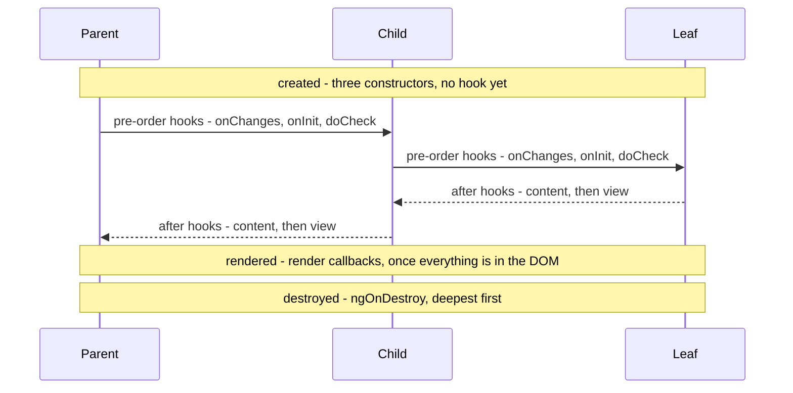
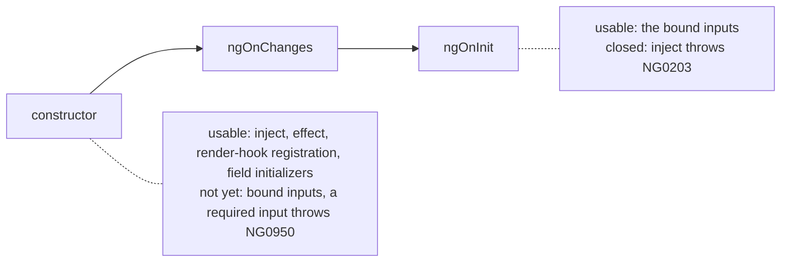
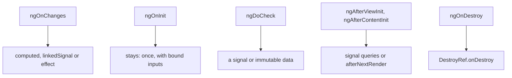
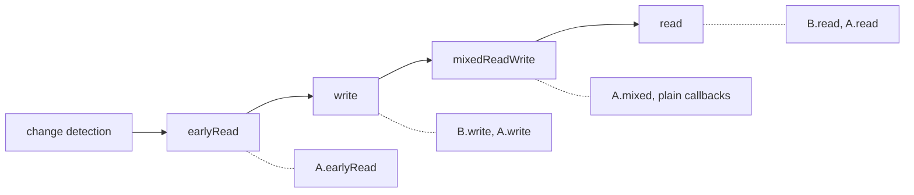
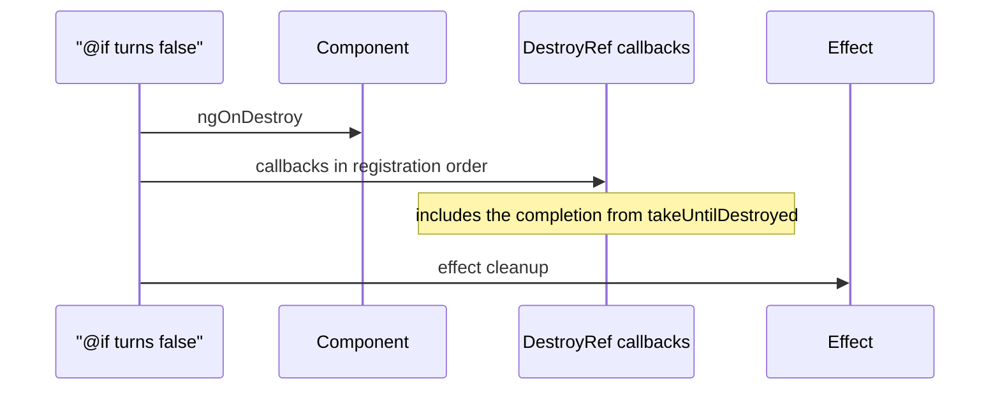
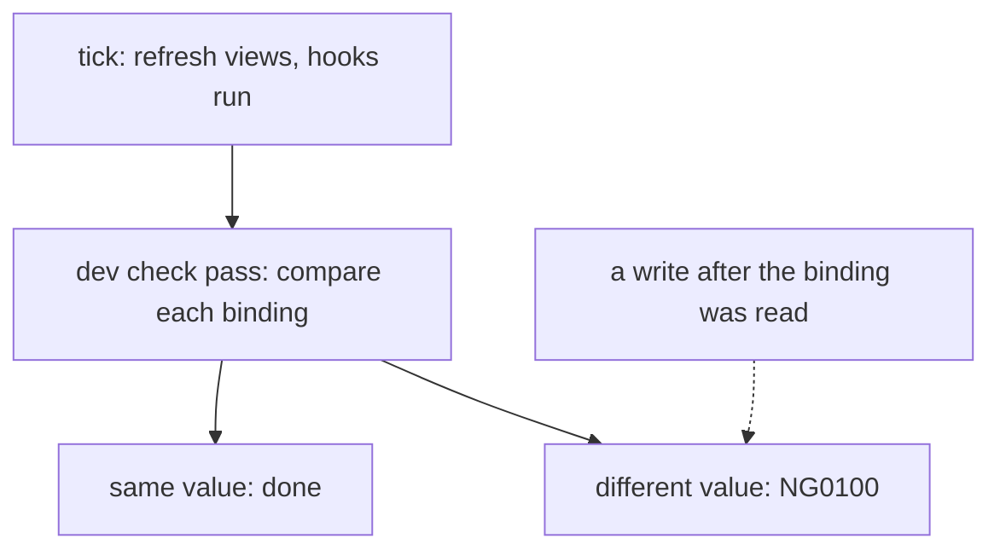
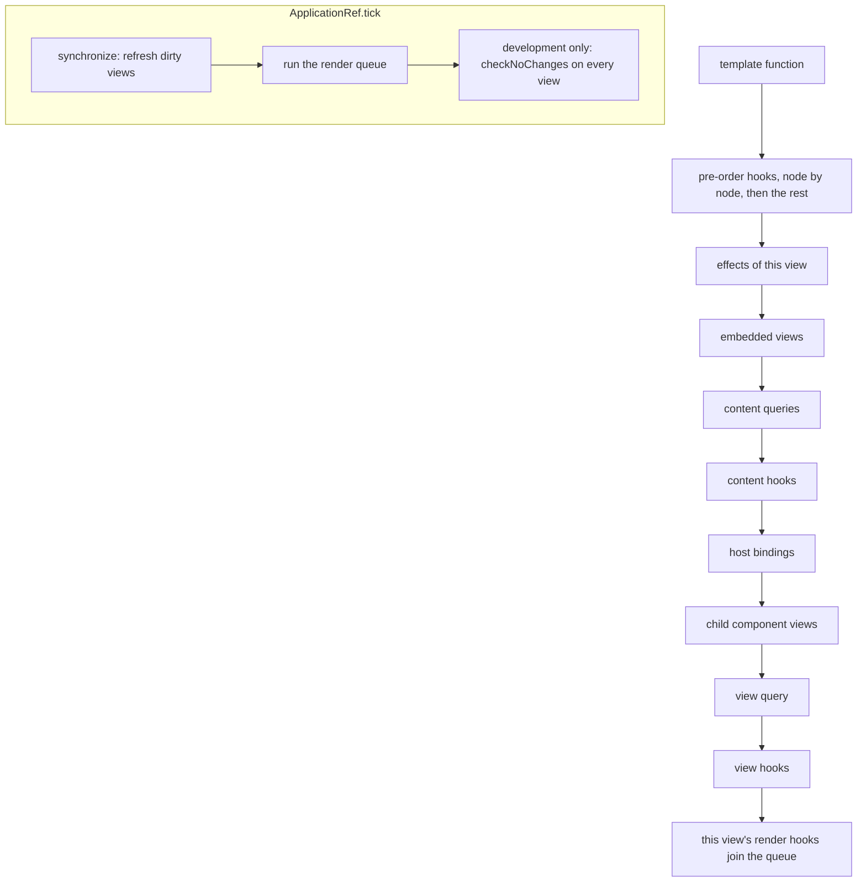

# 20. Lifecycle and render hooks: constructor, `ngOnInit`, the check hooks, `afterNextRender`, `DestroyRef` and `ExpressionChangedAfterItHasBeenCheckedError`

> **What this covers:** the order of the hooks for one component and for a tree (constructor, `ngOnChanges`, `ngOnInit`, `ngDoCheck`, the content and view hooks, `ngOnDestroy`), what exists in the constructor versus `ngOnInit`, which hooks still matter once state lives in signals, the render hooks `afterNextRender` and `afterEveryRender` with their four phases, teardown with `DestroyRef` and `takeUntilDestroyed`, `ExpressionChangedAfterItHasBeenCheckedError` (cause and fixes), and how the runtime stores and runs the hooks
> **Prerequisites:** [19. Component communication and projection](19-component-communication-and-projection.md#5-queries-view-and-content-queries-with-signal-queries) (query timing, projected content) and [17. Signals](17-signals.md#4-effects) (`effect`, `computed`)
> **Leads to:** [21. Change detection](21-change-detection.md), [22. RxJS foundations](22-rxjs-foundations.md), [23. RxJS in depth](23-rxjs-in-depth.md), [29. Testing Angular](29-testing-angular.md)
> **Applies to:** Angular 22.2 (`@angular/core`, `@angular/compiler-cli`, `@angular/cli` 22.2.1), TypeScript 6.0, RxJS 7.8, Node 24
> **Study time:** ~5 hours reading + ~4 hours exercises
> **Short on time:** read [1. The lifecycle map](#1-the-lifecycle-map-phases-and-the-order-of-the-hooks), the table in [3. Which hooks still matter with signals](#3-which-hooks-still-matter-with-signals), [4. Render hooks](#4-render-hooks-afternextrender-aftereveryrender-and-their-phases) and [6. `ExpressionChangedAfterItHasBeenCheckedError`](#6-expressionchangedafterithasbeencheckederror-cause-and-fixes), then drill [Q20.02](#q20-02), [Q20.07](#q20-07), [Q20.11](#q20-11), [Q20.14](#q20-14) and [Q20.20](#q20-20), try [Exercise 20.2](#ex20-2), and finish with the [Summary](#summary).
> **Labs:** [`labs/angular/src/app/modules/20-lifecycle-and-render-hooks/`](../labs/angular/src/app/modules/20-lifecycle-and-render-hooks/) (section specs, fixtures, Exercises 20.1-20.4, *Output* questions); no `labs/ts-js` folder, since nothing here is a pure model. Run (Node 24): from `labs/angular`, `npx ng test --watch=false --include='src/app/modules/20-lifecycle-and-render-hooks/**/*.spec.ts'`

## Contents

1. [The lifecycle map: phases and the order of the hooks](#1-the-lifecycle-map-phases-and-the-order-of-the-hooks)
2. [Constructor, `ngOnInit` and inputs: what exists when](#2-constructor-ngoninit-and-inputs-what-exists-when)
3. [Which hooks still matter with signals](#3-which-hooks-still-matter-with-signals)
4. [Render hooks: `afterNextRender`, `afterEveryRender` and their phases](#4-render-hooks-afternextrender-aftereveryrender-and-their-phases)
5. [Teardown: `ngOnDestroy`, `DestroyRef` and `takeUntilDestroyed`](#5-teardown-ngondestroy-destroyref-and-takeuntildestroyed)
6. [`ExpressionChangedAfterItHasBeenCheckedError`: cause and fixes](#6-expressionchangedafterithasbeencheckederror-cause-and-fixes)
7. [Under the hood: hook lists, the view refresh and the render-hook queue](#7-under-the-hood-hook-lists-the-view-refresh-and-the-render-hook-queue)
- [Summary](#summary)
- [Question bank](#question-bank)
- [Hands-on exercises](#hands-on-exercises)
- [Check your understanding](#check-your-understanding)
- [Connections](#connections)

**How the claims here are verified.** Runtime claims (hook order, render hooks, `DestroyRef`, `takeUntilDestroyed`, `NG0100`) are asserted by specs under `ng test` (an ahead-of-time test build, [Q12.19](12-angular-how-it-works.md#q12-19), with jsdom, a simulated browser, and [zoneless change detection](21-change-detection.md#5-zoneless-change-detection-the-scheduler-its-triggers-and-pendingtasks)), named `Section N: …` after their section. Compiler diagnostics are "observed by compiling" a throwaway file with `ngc` 22.2.1, dated and quoted. Mechanisms are "read from" a named file of the 22.2.1 packages, or cited to the docs or the CHANGELOG. Server behavior, zone-based hook frequency, production mode, performance and the Angular team's rationale are documented only, never observed.

## 1. The lifecycle map: phases and the order of the hooks

### The problem it solves

A measurement sits in the constructor, a subscription in `ngAfterViewInit` and an input read in the wrong hook ([Q20.05](#q20-05)). A child's hook "runs before the parent's" and breaks an assumption. A parent's signal changes and its child's `ngDoCheck` fires while the parent's own does not.

A **lifecycle hook** is a method Angular calls on a component at a fixed point of **change detection**, the walk that checks every template binding for changes ([Module 21](21-change-detection.md#1-the-synchronization-problem-dirty-checking-and-fine-grained-reactivity)).

### Mental model

A stage production. The cast is hired first (constructors). Each scene is walked through from the director down to the extras, and the extras sign off first. The curtain call (render hooks) follows the whole scene, and the strike (`ngOnDestroy`) clears the extras first.



What to notice: the pre-order hooks go down the tree and the "after" hooks come back up, so a child's `ngAfterViewInit` precedes its parent's. **Pre-order** means a node before its children, **post-order** a node after them.

### How it actually works

Angular defines eight hook interfaces, all `@publicApi` in the 22.2.1 typings (`types/core.d.ts`, read 2026-10-08): `OnChanges`, `OnInit`, `DoCheck`, `AfterContentInit`, `AfterContentChecked`, `AfterViewInit`, `AfterViewChecked` and `OnDestroy`, in the order one component runs them. The `Init` hooks run once, the `Checked` ones on every pass.

**The tree.** `Parent` holds `Child`, which holds `Leaf`, and `Parent` projects a `Sib` into `Child` ([19 §3](19-component-communication-and-projection.md#3-content-projection-ng-content-slots-ngprojectas-fallback-content-and-the-lifecycle-trap)). Every component is OnPush (refreshed only when something marks it dirty), the v22 default [Changed in v22.0: the default] ([Module 21](21-change-detection.md#2-onpush-and-eager-strategies-and-what-marks-a-view-dirty)). `Section 1: constructors run before any hook and the hooks run in the documented groups` asserts the first render (abridged):

```text
constructors      parent, child, sib, leaf
pre-order         parent.onInit, parent.doCheck
content, parent   parent.afterContentInit, parent.afterContentChecked
pre-order         child.onChanges, child.onInit, child.doCheck, sib.onInit, sib.doCheck
...               (sib and child content hooks, then leaf: onChanges, onInit, doCheck, content, view)
view, upwards     leaf, sib, child, parent: afterViewInit, then afterViewChecked
render            child.afterNextRender, child.afterEveryRender
```

`Section 1: the pre-order hooks go down the tree and the after hooks come back up` asserts the rest: `onInit` and `ngDoCheck` go parent, child, leaf; `Sib` follows `Child` because it is the next node of the parent's template; `afterViewInit` and `afterViewChecked` go leaf, child, parent; and the render callbacks (`afterNextRender` and `afterEveryRender` [Stable since v20.0]) come after every view hook ([section 4](#4-render-hooks-afternextrender-aftereveryrender-and-their-phases)). Query timing per hook is [Q19.21](19-component-communication-and-projection.md#q19-21).

**`ngOnChanges` first.** The docs' summary table (`guide/components/lifecycle.md` at `v22.2.1`, read 2026-10-08) lists `ngOnInit` before `ngOnChanges`. The run disagrees with the table and agrees with the docs' own text ("During initialization, the first `ngOnChanges` runs before `ngOnInit`"), for `Child`, `Leaf` and a bound `n` (`Section 1: ngOnChanges runs before ngOnInit`). `Parent` has no bound input and never got `ngOnChanges`.

**Updates run in the declaring view.** The **declaring view** is the template that contains a component's tag, not the component's own template ([Q19.12](19-component-communication-and-projection.md#q19-12)). A component's hooks run when its declaring view is checked.

- `Parent.w`, read only by `Parent`'s template: the check hooks of `child` and `sib` ran, and `child.afterEveryRender`. `Parent`'s own check hooks did not, and neither did any hook of `Leaf` (`Section 1: a signal read only by the parent's template runs the child's check hooks and not the parent's own`).
- `Root.r`, read only by the template that declares `Parent`: `parent.doCheck`, `parent.afterContentChecked` and `parent.afterViewChecked` ran, and of `Child` only `child.afterEveryRender` (`Section 1: a signal read only by the root template runs the parent's check hooks and not its children's`).
- `Parent.v`, the bound input: `child.onChanges`, then the check hooks of `child`, `sib` and `leaf` (`Section 1: a bound input change runs onChanges and the check hooks down the tree`).

The `DoCheck` typings say the hook "is invoked even when the directive's own change detection is skipped (e.g., with the `OnPush` change detection strategy)". The docs' table says `ngDoCheck` "runs every time this component is checked"; the observation is that it runs when the declaring view is checked.

**Destroy.** Removing `Parent` with an `@if` ran `leaf`, `sib`, `child`, `parent` `ngOnDestroy`, deepest first (`Section 1: destroy runs deepest first`; teardown is [section 5](#5-teardown-ngondestroy-destroyref-and-takeuntildestroyed)).

**Why two orders.** Read from the 22.2.1 source (`@angular/core`, `fesm2022/_debug_node-chunk.mjs`, read, not run; `TView` and the `ɵ` names are internal, to read and never call, [12 §8](12-angular-how-it-works.md#8-under-the-hood-what-the-compiler-emits-and-what-the-runtime-does-with-it)): `getNodeInjectable` calls `registerPreOrderHooks` as soon as a directive is constructed, and `registerPostOrderHooks` runs from `directiveHostEndFirstCreatePass`, called by `ɵɵelementEnd`, once the element's children exist. Both write into the `TView` of the template that holds the node and read the hooks from `directiveDef.type.prototype`. Construction gives pre-order, element end gives post-order, and the holding template gives "declaring view" ([section 7](#7-under-the-hood-hook-lists-the-view-refresh-and-the-render-hook-queue) has the rest).

> [!TIP]
> **Coming from the backend.** Spring's `@PostConstruct` and `@PreDestroy` bracket a bean's life. **Where the analogy breaks:** a bean is built once and has no per-update callbacks; a component is created and destroyed many times and its check hooks rerun on every refresh.

### Code

The approach is to log every hook of a small tree into one array and assert the array.

1. Give every component one base class (`Recorded` in the spec) that pushes `name.hook` for each hook.
2. Give `Child` a constructor log and two render callbacks.
3. Put the tree under a host, because a root fixture component's own hooks are not re-run by a second `detectChanges`.
4. Render it in a `TestBed` ([Module 29](29-testing-angular.md)) and assert the array.

```ts
// Excerpt of labs/angular/src/app/modules/20-lifecycle-and-render-hooks/concepts/section-1-lifecycle-map.spec.ts
@Component({
  selector: 'lab-m20-s1-child',
  imports: [Leaf],
  template: `<ng-content /><lab-m20-s1-leaf [v]="v()" />`,
})
class Child extends Recorded {
  protected readonly name = 'child';
  readonly v = input(0);
  constructor() {
    super();
    log.push('child.ctor');
    afterNextRender(() => log.push('child.afterNextRender'));
    afterEveryRender(() => log.push('child.afterEveryRender'));
  }
}

@Component({
  selector: 'lab-m20-s1-parent',
  imports: [Child, Sib],
  template: `<lab-m20-s1-child [v]="v()"><lab-m20-s1-sib /></lab-m20-s1-child>{{ w() }}`,
})
class Parent extends Recorded {
  protected readonly name = 'parent';
  readonly v = signal(1);
  readonly w = signal(0);
}
```

### Best practices and anti-patterns

- **Do not write state in a check or "after" hook**, because the docs say the traversal "visits each component exactly once" and a later write can leave the DOM stale or throw ([section 6](#6-expressionchangedafterithasbeencheckederror-cause-and-fixes)).
- **Avoid `ngDoCheck`, `ngAfterContentChecked` and `ngAfterViewChecked` unless nothing else fits**, because the docs say each "runs very frequently". How often that is in a zone-based app is documented only; the lab is zoneless ([Module 21](21-change-detection.md#3-zonejs-and-ngzone-how-changes-used-to-be-detected-and-why-zone-left-the-default)).
- **Do not depend on hook order between a component and a directive on the same element**, because the docs say the framework does not guarantee it ([Q14.10](14-directives-and-pipes.md#q14-10)).

### Misconceptions and traps

- *"`ngOnInit` runs before `ngOnChanges`."* `ngOnChanges` runs first. The myth exists because the docs' summary table lists `ngOnInit` first.
- *"`ngDoCheck` runs when its own template is checked."* It runs with the declaring view, so it fires when only the parent changes and stays silent when only its own signal changes. The myth exists because of the name and the table's "this component is checked".
- *"A parent's `ngAfterViewInit` runs before its child's."* The child's runs first. The myth exists because the init hooks go top-down and "after" seems to follow suit.

Drilled in [Q20.01](#q20-01), [Q20.02](#q20-02), [Q20.22](#q20-22) and [Q20.23](#q20-23); practised in [Exercise 20.1](#ex20-1).

## 2. Constructor, `ngOnInit` and inputs: what exists when

### The problem it solves

A constructor reads an input and sees its default, or throws for a required input. A constructor calls a service with a bound id and sends the wrong request. `inject()` in `ngOnInit` throws. The same logic is copied into both places "to be safe".

The **constructor** is plain class construction, and the **injection context** is the moment `inject()` is allowed ([Q16.11](16-dependency-injection.md#q16-11)). A **field initializer** is a class field's `= expression`, run during construction. A **required input** is `input.required()`, with no default ([Q17.28](17-signals.md#q17-28)).

### Mental model

Arriving at a hotel. The constructor is the booking: you can still choose services, and no room number exists. `ngOnInit` is check-in: the room number is now yours, and choosing services is over.



What to notice: each stage has exactly one thing the other lacks.

### How it actually works

**The constructor holds the injection context.** `inject()`, `effect()` (a side effect re-run when its signals change, [17 §4](17-signals.md#4-effects)), `afterNextRender()` and field initializers work there, and nowhere else in a component ([§4 of module 16](16-dependency-injection.md#4-the-injection-context-inject-runininjectioncontext-and-injectasync), [Q16.12](16-dependency-injection.md#q16-12)). `Section 2: inject works in the constructor and throws NG0203 in ngOnInit` asserts both sides. Observed by running it under `ng test` on 2026-10-08:

```text
init inject threw NG0203: The `Injector` token injection failed. `inject()` function must be called from an injection context such as a constructor, a factory function, a field initializer, or a function used with `runInInjectionContext`. Find more at https://v22.angular.dev/errors/NG0203
```

**Inputs.** A signal input holds its default in the constructor and its bound value in `ngOnInit` (`Section 2: a signal input holds its default in the constructor and its bound value in ngOnInit`: `0`, then `5`). A required input read in the constructor throws, observed by the same spec:

```text
ctor r threw NG0950: Input "r" is required but no value is available yet. Find more at https://v22.angular.dev/errors/NG0950
```

The compiler already rejects that read with `NG8118` ([Q17.28](17-signals.md#q17-28)), so the spec reaches the signal through a cast: it hides the read from the compiler, not from the runtime (`Section 2: a required input read in the constructor throws NG0950`). The docs agree: "Inputs are guaranteed to be available in the `ngOnInit` lifecycle hook and afterwards"; read them in the template, a `computed` (a cached derived signal, [17 §3](17-signals.md#3-computed-signals)) or an `effect` (`reference/errors/NG0950.md` at `v22.2.1`, read 2026-10-08). An output emitted in the constructor and a query read there are [Q19.03](19-component-communication-and-projection.md#q19-03) and [Q19.20](19-component-communication-and-projection.md#q19-20).

**`ngOnChanges`.** It receives a **`SimpleChanges`** record of **`SimpleChange`** objects (`previousValue`, `currentValue`, `firstChange`). The generic form `SimpleChanges<T>` [Added in v21.0] (CHANGELOG 21.0.0, "make SimpleChanges generic") types the keys and unwraps signal inputs, so `changes.nn` fails to compile and `changes.n?.currentValue` is a `number` (a `// @ts-expect-error` in the spec). The record uses the property name even for an **alias**, a different public binding name (docs, `guide/components/lifecycle.md`; `Section 2: the SimpleChanges record is keyed by the property name`: `count` bound, `n` reported).

`Section 2: ngOnChanges reports first and later changes and is skipped for an unbound input` asserts that the first call reports a bound input and a static attribute, each `undefined -> value` with `firstChange` true; a later change reports `n 1 -> 2 first=false`; an instance with nothing bound got `ngOnInit` and never `ngOnChanges`.

**Why the context is closed.** Read from the 22.2.1 source (`fesm2022/_debug_node-chunk.mjs`, read, not run): `getNodeInjectable` sets the injection implementation, calls the factory (the constructor) and restores the previous implementation in a `finally`. `callHook` runs later, from the view's hook lists, with no such setup ([section 7](#7-under-the-hood-hook-lists-the-view-refresh-and-the-render-hook-queue) has the rest).

> [!TIP]
> **Coming from the backend.** Spring injects every dependency through the constructor and runs `@PostConstruct` once after. **Where the analogy breaks:** in Angular `inject()` is legal only during construction, and the "after" step, `ngOnInit`, receives bound inputs, which Spring beans do not have.

### Code

The approach is to wire in the constructor and use bound values from `ngOnInit` on.

1. Declare inputs and `inject()` in fields.
2. Read the default in the constructor to see it.
3. Read the bound values in `ngOnInit`.
4. Capture anything `ngOnInit` needs from `inject()` in a field.

```ts
// Excerpt of labs/angular/src/app/modules/20-lifecycle-and-render-hooks/concepts/section-2-constructor-and-init.spec.ts
@Component({ selector: 'lab-m20-s2-probe', template: `probe` })
class Probe implements OnInit {
  readonly n = input(0);
  readonly r = input.required<string>();
  readonly fromField = inject(Injector);

  constructor() {
    attempt('ctor n', () => this.n());
    // The compiler already rejects `this.r()` here with NG8118 (Q17.28). The cast hides the read from
    // the compiler and not from the runtime, which is what this test needs to observe.
    const requiredRead = (this as unknown as { r: () => string }).r;
    attempt('ctor r', requiredRead);
    attempt('ctor field', () => typeof this.fromField.get === 'function');
    attempt('ctor inject', () => typeof inject(Injector).get === 'function');
  }

  ngOnInit(): void {
    attempt('init n', () => this.n());
    attempt('init r', () => this.r());
    attempt('init inject', () => inject(Injector));
  }
}
```

#### Legacy

Constructor parameter injection and `@Input()` properties still work; 16 and 19 own both ([§4](16-dependency-injection.md#4-the-injection-context-inject-runininjectioncontext-and-injectasync), [19 §6](19-component-communication-and-projection.md#6-decorator-based-inputs-outputs-and-queries-and-the-migration-schematics)).

```ts
// Partial: the legacy form of the same wiring
@Component({ selector: 'lab-legacy', template: `{{ id }}` })
class Legacy implements OnInit {
  @Input() id = 0;
  constructor(private readonly http: HttpClient) {}
  ngOnInit(): void {
    this.http.get(`/items/${this.id}`).subscribe();
  }
}
```

### Best practices and anti-patterns

- **Keep constructors to wiring** (fields, `inject()`, `effect`, render-hook registration), because it is the only place with an injection context.
- **Do put work that needs a bound value in `ngOnInit`, or better in a `computed` or `effect` ([section 3](#3-which-hooks-still-matter-with-signals))**, because inputs are guaranteed only from `ngOnInit`.
- **Do not copy logic into both**, because the constructor copy runs on defaults.
- **Do not read a required input in the constructor or a field initializer**, because it throws `NG0950` (and the compiler reports `NG8118`).
- **Avoid `inject()` inside `ngOnInit`**, because the context is closed.

### Misconceptions and traps

- *"Do everything in `ngOnInit`."* The constructor is the only place with an injection context. The myth exists because inputs are bound in `ngOnInit`, which makes it feel like the safe place.
- *"The constructor can read the input values."* It reads defaults, and a required input throws. The myth exists because `input()` looks like a field that already holds a value.
- *"`ngOnChanges` runs once per component."* It runs per change of a bound input or static attribute, and never for an instance with none. The myth exists because `ngOnInit` does run once.

Drilled in [Q20.03](#q20-03), [Q20.04](#q20-04) and [Q20.05](#q20-05); practised in [Exercise 20.4](#ex20-4).

## 3. Which hooks still matter with signals

### The problem it solves

A team migrates to signal inputs and asks which hooks to delete. An `ngOnChanges` that recomputes derived state duplicates a `computed`, and an `ngDoCheck` written to spot in-place edits never fires in a zoneless app.

**Derived state** is a value computed from other state: a **`computed`** is a cached derived signal and a **`linkedSignal`** a writable one ([17 §3](17-signals.md#3-computed-signals), [17 §5](17-signals.md#5-linkedsignal-writable-derived-state)). An **`effect`** runs a side effect when the signals it reads change ([17 §4](17-signals.md#4-effects)).

### Mental model

Sorting a toolbox: some tools give way to a power tool, the signal graph, and some stay because the job is manual. Signals take over "derive a value from inputs" and "react to a change", and leave "run once" and "touch the real DOM".



What to notice: nothing is deleted from the framework; the reasons move.

### How it actually works

**`ngOnChanges` still runs for signal inputs.** The typings say: "While you should prefer `computed` and `effect` when working with signal-based inputs, the `ngOnChanges` method does include value changes for signal-based inputs" (`types/core.d.ts`, read 2026-10-08). `Section 3: ngOnChanges still runs for a signal input and a computed derives the same value` asserts `onChanges 1 -> 20` and a `computed(() => n() * 2)` rendering `40`, with no hook. Setters are [Q19.22](19-component-communication-and-projection.md#q19-22).

**The order of an update.** `Section 3: a bound-input update runs onChanges, doCheck, the effect and then the template` logs a component whose `effect` and template read one input: the first render is `onChanges`, `onInit`, `doCheck`, `effect`, `template`, and a later change is `onChanges`, `doCheck`, `effect`, `template`. The effect runs once per change (`Section 3: an effect over an input runs after ngDoCheck and again on each change`; scheduling is [17 §4](17-signals.md#4-effects)).

**`ngDoCheck` is custom change detection.** The typings say it "is invoked even when the directive's own change detection is skipped". It runs only when its declaring view is checked ([section 1](#1-the-lifecycle-map-phases-and-the-order-of-the-hooks)). A child diffing an object its host mutates in place ran once at first render and not after `o.b = 2`, for an `Eager` host (`ChangeDetectionStrategy.Eager` [Added in v21.2], the opt-out from OnPush) and an OnPush one (`Section 3: a plain mutation with no signal write does not run ngDoCheck`). Nothing told Angular, so no view was dirty. Replacing the object reached the child, as did an unrelated signal write that refreshed the host view (`Section 3: replacing the object or writing a signal reaches the child`). The fix is an immutable update or a signal; a zone-based app's check per event is documented only ([Module 21](21-change-detection.md#3-zonejs-and-ngzone-how-changes-used-to-be-detected-and-why-zone-left-the-default)).

**Hooks run untracked.** Read from the 22.2.1 source (`fesm2022/_debug_node-chunk.mjs`, read, not run): `callHookInternal` wraps each hook in `setActiveConsumer(null)`, so a signal read inside a hook is a one-time read, not a dependency. A signal read in `ngOnInit` did not re-run the host's template when it changed, while the same signal read in a template did (`Section 3: a signal read in ngOnInit is not tracked`).

**Views.** Query reads move to signal queries ([19 §5](19-component-communication-and-projection.md#5-queries-view-and-content-queries-with-signal-queries)), DOM work to `afterNextRender` ([section 4](#4-render-hooks-afternextrender-aftereveryrender-and-their-phases)).

| Hook | Still needed? | Replacement |
|---|---|---|
| `ngOnChanges` | rarely | `computed`, `linkedSignal` or `effect` |
| `ngOnInit` | yes | none: it runs once, with bound inputs |
| `ngDoCheck` | rarely | a signal, or an immutable update |
| `ngAfterContentInit`, `ngAfterViewInit` | rarely | signal queries, `afterNextRender` |
| `ngOnDestroy` | yes | `DestroyRef.onDestroy` [Added in v16.0] ([section 5](#5-teardown-ngondestroy-destroyref-and-takeuntildestroyed)) |

> [!WARNING]
> The docs call `ngDoCheck` very frequent: zone-based behavior, documented only. The zoneless lab ran hooks only after a notification.

### Code

The approach is to let signals carry the derived value and the reaction.

1. Read the input in a `computed` for the derived value.
2. Read it in an `effect`, in the constructor, for the side effect.
3. Use `ngOnChanges` only for previous values.

```ts
// Excerpt of labs/angular/src/app/modules/20-lifecycle-and-render-hooks/concepts/section-3-hooks-and-signals.spec.ts
@Component({ selector: 'lab-m20-s3-reactive', template: `{{ doubled() }}{{ mark() }}` })
class Reactive implements OnChanges, OnInit, DoCheck {
  readonly n = input(1);
  readonly doubled = computed(() => this.n() * 2);

  constructor() {
    effect(() => {
      log.push(`effect n=${this.n()}`);
    });
  }

  ngOnChanges(changes: SimpleChanges<Reactive>): void {
    log.push(`onChanges ${changes.n?.previousValue} -> ${changes.n?.currentValue}`);
  }
  ngOnInit(): void {
    log.push('onInit');
  }
  ngDoCheck(): void {
    log.push('doCheck');
  }
  mark(): string {
    log.push('template');
    return '';
  }
}
```

The diffing `ngDoCheck` form is the one to avoid:

```ts
// Excerpt of labs/angular/src/app/modules/20-lifecycle-and-render-hooks/concepts/section-3-hooks-and-signals.spec.ts
@Component({ selector: 'lab-m20-s3-diff', template: `{{ o()['b'] }}` })
class Diff implements DoCheck {
  readonly o = input.required<Record<string, number>>();
  private readonly differ = inject(KeyValueDiffers).find({}).create<string, number>();

  ngDoCheck(): void {
    log.push('doCheck');
    if (this.differ.diff(this.o())) {
      log.push('diff saw a change');
    }
  }
}
```

### Best practices and anti-patterns

- **Do derive state with `computed` instead of copying it in `ngOnChanges`**, because one declaration stays right for every change.
- **Do keep `ngOnInit` for one-time work on bound inputs**, because it runs once, after binding ([section 2](#2-constructor-ngoninit-and-inputs-what-exists-when)).
- **Do replace objects instead of mutating them**, because an in-place edit reaches no hook unless the declaring view is refreshed anyway.
- **Avoid expecting a reaction from a signal read in a hook**, because hook reads are untracked.
- **Avoid writing a plain field after the view was checked in an OnPush component**, because the DOM stayed stale and a signal updated it (`Section 3: a plain field written after the view was checked stays stale in an OnPush component and a signal updates it`).

### Misconceptions and traps

- *"Signal inputs make `ngOnChanges` obsolete: it no longer runs."* It runs. The myth exists because the docs steer you to `computed`.
- *"`ngDoCheck` runs on every event."* True only in zone-based apps (documented, not observed), where a check follows each event; the myth exists because they were the default before v21 [Changed in v21.0: zoneless is the default for new apps] (VERSIONS.md). In the zoneless lab nothing ran unannounced.
- *"A plain field written in a hook updates the view."* In an OnPush component it stays stale; use a signal. The myth exists because a zone-based Default component is re-checked after every event (documented, [Module 21](21-change-detection.md#3-zonejs-and-ngzone-how-changes-used-to-be-detected-and-why-zone-left-the-default)).

Drilled in [Q20.06](#q20-06), [Q20.07](#q20-07), [Q20.08](#q20-08) and [Q20.09](#q20-09); practised in [Exercise 20.2](#ex20-2).

## 4. Render hooks: `afterNextRender`, `afterEveryRender` and their phases

### The problem it solves

A chart library needs a real element and its size. The docs say never to touch the DOM in other lifecycle hooks (`guide/components/dom-apis.md` at `v22.2.1`, read 2026-10-08). Code that reads layout and writes styles in one callback makes the browser recompute layout repeatedly (**layout thrashing**, [Module 08](08-browser-rendering-dom-events.md#q08-04)). A hook registered in `ngOnInit` throws `NG0203`, and one that writes state on every render loops.

A **render callback** is a function Angular calls after it has finished rendering the whole application. A **phase** is one of four slots in that pass.

### Mental model

A stage crew's walk-through after all scenery is set. Nobody walks through while scenery moves, reads happen in one sweep and writes in another.



What to notice: the phases run across all components, one phase at a time.

### How it actually works

`afterNextRender` runs once, after the next application render, and `afterEveryRender` after each render. Both are [Stable since v20.0] ([section 1](#1-the-lifecycle-map-phases-and-the-order-of-the-hooks)). Each takes a plain callback, which runs in the `mixedReadWrite` phase, or a spec object with `earlyRead`, `write`, `mixedReadWrite` and `read`. The typings say to prefer `read` and `write` over `earlyRead` and `mixedReadWrite` (`types/core.d.ts`, read 2026-10-08).

**Phase by phase, across components.** `Section 4: callbacks run phase by phase across components and in registration order within a phase` asserts one render of `B` (created first, `write` and `read` registered separately) and `A` (all four phases, plus two `afterNextRender`s):

```text
A.earlyRead, B.write, A.write, A.mixed, A.nextRender plain, B.read, A.read, A.nextRender read
```

`B` ran before `A` inside a phase because it registered first, and `A`'s plain `afterNextRender` ran in `mixedReadWrite`.

**Return values flow along a spec.** Each phase receives the value its predecessor in the same spec returned (`Section 4: each phase receives the previous phase's return value`: `A-E`, `A-W`, `A-M`). A skipped phase passes the value on: a spec with only `earlyRead` and `read` gave `read` the `earlyRead` value. `earlyRead` received one argument, `undefined`.

**Why that order.** Read from the 22.2.1 source (`@angular/core`, `fesm2022/_debug_node-chunk.mjs`, read, not run): `getHooks` puts a plain callback in the third slot, `[undefined, undefined, callback, undefined]`. `AfterRenderImpl.execute` loops `for (const phase of AFTER_RENDER_PHASES)` and, inside it, over every registered sequence, calling that sequence's hook for the phase with its `pipelinedValue`, through `ngZone.runOutsideAngular`. Phase is the outer loop, registration order the inner one, and an omitted phase is skipped, so its value passes through.

**When they run.** Not after every tick. `Section 4: a tick with nothing dirty runs no render hook` asserts that `ApplicationRef.tick()` (`ApplicationRef` is the running application's handle, [12 §6](12-angular-how-it-works.md#6-bootstrapping-bootstrapapplication-the-platform-and-initializers)) on a settled app logged nothing and that after a signal change it logged once. `ApplicationRef.synchronizeOnce` runs the queue on an "after render" flag that dirty passes and new registrations set (read; [section 7](#7-under-the-hood-hook-lists-the-view-refresh-and-the-render-hook-queue)).

**Registration and cleanup.** The functions need an injection context ([Q16.11](16-dependency-injection.md#q16-11)) or `{ injector }`. Registered in `ngOnInit` without one, `Section 4: a render hook registered in ngOnInit needs an injector` observed on 2026-10-08:

```text
NG0203: afterNextRender() can only be used within an injection context such as a constructor, a factory function, a field initializer, or a function used with `runInInjectionContext`. Find more at https://v22.angular.dev/errors/NG0203
```

With `{ injector }` it ran after `ngAfterViewInit`. A hook is removed with its owner's `DestroyRef`, unless `manualCleanup: true`, and `AfterRenderRef.destroy()` removes it by hand (`Section 4: a hook is cleaned up with its component unless manualCleanup is set`: the owned hook stopped when the component left, the manual one kept running until `destroy()`).

**Writing state.** A signal write in a hook renders again. A hook writing while `s() < 2` logged `hook s=0`, `hook s=1`, `hook s=2` and rendered `2`. One that wrote every time threw, after 10 runs (`Section 4: a hook that writes a signal causes another render and an unconditional write throws NG0103`):

```text
NG0103: Infinite change detection while refreshing application views. Ensure views are not calling `markForCheck` on every template execution or that afterRender hooks always mark views for check.
```

The limit is `MAXIMUM_REFRESH_RERUNS = 10` in `ApplicationRef.synchronize` (read).

**Server.** Both functions return a no-op ref when `ngServerMode`, the internal flag server rendering sets, is true (read), and the typings say callbacks "run on browser platforms only". Documented only: no test claims it ([Module 32](32-ssr-ssg-hydration.md)). `afterRenderEffect` is [17](17-signals.md#q17-39)'s.

> [!NOTE]
> **Framework vs platform.** `requestAnimationFrame`, `ResizeObserver`, `IntersectionObserver` and `MutationObserver` are platform APIs that may replace a render hook. A render hook is Angular's "after the framework has written" point, which platform timers know nothing about.

> [!WARNING]
> Browser-only code in a render hook is skipped on the server, and in `ngAfterViewInit` it is not: `refreshView` has no `ngServerMode` check (read, not run).

### Code

The approach is to register in the constructor, split reading from writing, and let each phase hand its result on.

1. Register in the constructor, where the injection context is open.
2. Put the measurement in `earlyRead` or `read` and the DOM change in `write`.
3. Return what the next phase needs.
4. Use `afterNextRender` for one-time setup such as creating a widget ([Q20.13](#q20-13), [Exercise 20.3](#ex20-3)).

```ts
// Excerpt of labs/angular/src/app/modules/20-lifecycle-and-render-hooks/concepts/section-4-render-hooks.spec.ts
@Component({ selector: 'lab-m20-s4-a', template: `a` })
class A {
  constructor() {
    afterEveryRender({
      earlyRead: (...args: unknown[]) => {
        log.push(`A.earlyRead args=${args.length} first=${String(args[0])}`);
        return 'A-E';
      },
      write: (fromEarly: string) => {
        log.push(`A.write got ${fromEarly}`);
        return 'A-W';
      },
      mixedReadWrite: (fromWrite: string) => {
        log.push(`A.mixed got ${fromWrite}`);
        return 'A-M';
      },
      read: (fromMixed: string) => {
        log.push(`A.read got ${fromMixed}`);
      },
    });
    afterNextRender(() => log.push('A.nextRender plain'));
    afterNextRender({ read: () => log.push('A.nextRender read') });
  }
}
```

Registering later needs the injector:

```ts
// Excerpt of labs/angular/src/app/modules/20-lifecycle-and-render-hooks/concepts/section-4-render-hooks.spec.ts
  ngOnInit(): void {
    try {
      afterNextRender(() => log.push('no injector'));
    } catch (error) {
      log.push(`threw ${(error as Error).message}`);
    }
    afterNextRender(() => log.push('with injector'), { injector: this.injector });
  }
```

#### Legacy

`afterRender` was added in 16.2.0, its phases API redesigned in 18.1.0 (the `phase` flag kept as a deprecated option, with a schematic to migrate it), and in 20.0.0 it was renamed `afterEveryRender` and stabilized (CHANGELOG headings, read 2026-10-08; VERSIONS.md: "Renamed to `afterEveryRender` in v20"). The old form, removed text that no longer compiles:

```ts
// Partial: removed form, shown as text; neither name is exported by the 22.2.1 typings
afterRender(() => measure(), { phase: AfterRenderPhase.Write });
// today: afterEveryRender({ write: () => measure() });
```

A search of the installed package on 2026-10-08 found neither name in `types/core.d.ts` and no `afterRender` entry in `schematics/migrations.json`: "not found in the installed file", not "no migration exists".

### Best practices and anti-patterns

- **Do register in the constructor**, because that is where the injection context is open; elsewhere pass `{ injector }`.
- **Do split reads and writes across `read` and `write`**, because the phases keep each kind together.
- **Avoid writing state unconditionally in a hook**, because every write renders again and the loop stops at `NG0103`.
- **Avoid DOM work in `ngAfterViewInit`**, because the docs send it to render callbacks ([Q14.02](14-directives-and-pipes.md#q14-02)).

### Misconceptions and traps

- *"`ngAfterViewInit` is the place for DOM work."* The docs now send it to render callbacks. The myth exists because older tutorials did exactly that.
- *"`afterEveryRender` runs on every change detection tick."* It runs after a render, and an idle tick ran nothing. The myth exists because of the name.
- *"`afterNextRender` waits for the next component to render."* It waits for the next application render, which covers all components (docs, `lifecycle.md`). The myth exists because of the name.
- *"Render hooks run on the server too."* They are a no-op there (documented, read). The myth exists because the registration call itself runs on the server.

Drilled in [Q20.10](#q20-10), [Q20.11](#q20-11), [Q20.12](#q20-12), [Q20.13](#q20-13) and [Q20.24](#q20-24); practised in [Exercise 20.3](#ex20-3).

## 5. Teardown: `ngOnDestroy`, `DestroyRef` and `takeUntilDestroyed`

### The problem it solves

An interval keeps ticking after its component is gone. A `subscribe` in `ngOnInit` keeps the component reachable, and a `window` listener adds one copy per instance. Late async work touches a destroyed view and throws `NG0911`.

**Teardown** is what runs when a component is destroyed. A **leak** is memory that stays reachable after its owner is gone ([Module 05](05-js-modules-memory-modern-features.md#4-garbage-collection-and-memory-leaks)). A `Subscription` is an RxJS handle that `unsubscribe()` ends ([Module 22](22-rxjs-foundations.md#2-anatomy-observable-observer-subscription-and-teardown)).

### Mental model

Checking out of a hotel. You hand back the key (the method), the porter runs your errands in the order you booked them (the callbacks), and the cleaning crew resets the room (effect cleanups).



What to notice: the registered callbacks run in registration order, after the method.

### How it actually works

`ngOnDestroy` is the classic hook: the typings say it is "called when a directive, pipe, or service is destroyed". A **`DestroyRef`** lets any code register teardown with `onDestroy(callback)`, which returns an **unregister function**; its scopes are [Q16.27](16-dependency-injection.md#q16-27) and service teardown [Q16.28](16-dependency-injection.md#q16-28). `DestroyRef.destroyed` [Added in v20.1] reports whether the owner is already gone.

**The order.** `Section 5: ngOnDestroy, DestroyRef callbacks and effect cleanups run in a fixed order` removed a component holding all four routes with an `@if`:

```text
ngOnDestroy, onDestroy cb1, completed by takeUntilDestroyed, onDestroy cb2, effect cleanup
```

Read from the 22.2.1 source (`fesm2022/_debug_node-chunk.mjs`, read, not run; internals, never to call): `cleanUpView` calls `executeOnDestroys`, which calls each `ngOnDestroy`, then `processCleanups`, which runs the view's listener cleanups, then its `DestroyRef` callbacks in registration order, then destroys its effects. The completion sits between `cb1` and `cb2` because `takeUntilDestroyed` registered at subscribe time, between them ([section 7](#7-under-the-hood-hook-lists-the-view-refresh-and-the-render-hook-queue)).

**`takeUntilDestroyed`** [Stable since v19.0] completes a stream when its owner is destroyed. This module owns the mechanism; the strategies compared are [Module 23](23-rxjs-in-depth.md#6-unsubscription-strategies-in-angular-and-finding-leaks)'s. Read from `fesm2022/rxjs-interop.mjs`: it builds a `destroyed$` observable that emits when `destroyRef.onDestroy` fires, and returns `source.pipe(takeUntil(destroyed$))`. With no argument it injects the `DestroyRef` when the operator is created, so it needs an injection context ([Q16.11](16-dependency-injection.md#q16-11)); with an explicit ref it works anywhere.

- Not before: a stream delivered `next 1`, completed at destroy and had no observer afterwards, so `next 2` was ignored (`Section 5: takeUntilDestroyed completes the stream at destroy and not before`).
- Outside a context it throws (`Section 5: takeUntilDestroyed outside an injection context throws NG0203`), observed 2026-10-08: `NG0203: takeUntilDestroyed() can only be used within an injection context such as a constructor, a factory function, a field initializer, or a function used with `runInInjectionContext`. Find more at https://v22.angular.dev/errors/NG0203`.
- With a destroyed ref it completes at once, a fix of 20.0.1 (CHANGELOG: "`takeUntilDestroyed` completes immediately if DestroyRef already destroyed"; `Section 5: takeUntilDestroyed with a destroyed DestroyRef completes at once`).

**Late work.** `onDestroy` on a destroyed component's ref threw `NG0911: View has already been destroyed.`, `destroyed` was `true` for it and `false` for the root ref (`Section 5: onDestroy on a destroyed component reference throws NG0911 and destroyed is true`). Q16.27 saw `NG0205` for an environment injector: the scope differs, the two do not contradict. Guard late work with `if (!ref.destroyed)`. A function returned by `onDestroy` removes the callback (`Section 5: a callback removed with its unregister function never runs`).

> [!NOTE]
> **Framework vs platform.** `AbortController` is the platform's cancellation handle; `ref.onDestroy(() => controller.abort())` bridges it to a `DestroyRef` ([MDN](https://developer.mozilla.org/en-US/docs/Web/API/AbortController)). The platform has no notion of a component's destruction.

### Code

The approach is to register every outliving resource where it is created.

1. Inject the `DestroyRef` in a field.
2. Register plain callbacks with `onDestroy`.
3. Pipe streams through `takeUntilDestroyed()` in the constructor.
4. Keep `ngOnDestroy` only for work that already lives in the class.

```ts
// Excerpt of labs/angular/src/app/modules/20-lifecycle-and-render-hooks/concepts/section-5-teardown.spec.ts
  constructor() {
    this.ref.onDestroy(() => log.push('onDestroy cb1'));
    source.pipe(takeUntilDestroyed()).subscribe({
      next: (value) => log.push(`next ${value}`),
      complete: () => log.push('completed by takeUntilDestroyed'),
    });
    this.ref.onDestroy(() => log.push('onDestroy cb2'));
    effect((onCleanup) => {
      this.tick();
      onCleanup(() => log.push('effect cleanup'));
    });
  }
```

#### Legacy

Before `takeUntilDestroyed`, a component kept a `Subject` that fired in `ngOnDestroy` and put `takeUntil(this.destroy$)` on every stream. It still works (`Section 5: the legacy Subject pattern unsubscribes at destroy`) and is only longer.

```ts
import { Component, OnDestroy, OnInit, input } from '@angular/core';
import { Observable, Subject, takeUntil } from 'rxjs';

/**
 * Legacy teardown: a `Subject` that signals the end of the component, `takeUntil` on every stream,
 * and `ngOnDestroy` to fire it. `takeUntilDestroyed` replaces all three pieces.
 */
@Component({ selector: 'lab-m20-legacy-destroy-subject', template: `{{ received.length }}` })
export class LegacyDestroySubject implements OnInit, OnDestroy {
  readonly source = input.required<Observable<number>>();
  readonly received: number[] = [];
  private readonly destroy$ = new Subject<void>();

  ngOnInit(): void {
    this.source()
      .pipe(takeUntil(this.destroy$))
      .subscribe((value) => this.received.push(value));
  }

  ngOnDestroy(): void {
    this.destroy$.next();
    this.destroy$.complete();
  }
}
```
<sub>Source: [labs/angular/src/app/modules/20-lifecycle-and-render-hooks/legacy/destroy-subject/legacy-destroy-subject.ts](../labs/angular/src/app/modules/20-lifecycle-and-render-hooks/legacy/destroy-subject/legacy-destroy-subject.ts)</sub>

Migration is manual: a search of the installed `schematics` folder found no `takeUntilDestroyed` migration. Move the subscription to the constructor with `takeUntilDestroyed()`, then delete the `Subject` and `ngOnDestroy`. The docs page (`ecosystem/rxjs-interop/take-until-destroyed.md`) describes the operator as working "similarly to the RxJS `takeUntil` operator but without the need for a separate Subject".

### Best practices and anti-patterns

- **Do register teardown next to the resource**, because a separate `ngOnDestroy` is easy to forget.
- **Do pass an explicit `DestroyRef` outside a constructor**, because the injected form needs an injection context.
- **Do clean timers and listeners too**, because only streams end with `takeUntilDestroyed` ([Q20.16](#q20-16)).
- **Avoid registering on a destroyed component's ref**, because it throws `NG0911`; check `destroyed` first ([Q20.17](#q20-17)).

### Misconceptions and traps

- *"`ngOnDestroy` is the only teardown hook."* `DestroyRef` callbacks and effect cleanups run too. The myth exists because `ngOnDestroy` is the classic one.
- *"`takeUntilDestroyed` works anywhere."* It needs an injection context or an explicit ref. The myth exists because it reads like any other operator.
- *"A callback can still register cleanup after destruction."* A component's ref throws `NG0911`. The myth exists because other scopes behave differently.
- *"The `Subject` pattern is wrong."* It works and is longer. The myth exists because `takeUntilDestroyed` replaced it in the docs.

Drilled in [Q20.14](#q20-14), [Q20.15](#q20-15), [Q20.16](#q20-16), [Q20.17](#q20-17) and [Q20.18](#q20-18); practised in [Exercise 20.3](#ex20-3) and [Exercise 20.4](#ex20-4).

## 6. `ExpressionChangedAfterItHasBeenCheckedError`: cause and fixes

### The problem it solves

A loading flag set in `ngAfterViewInit` throws in development and not in production. A child that edits its parent's title throws in an `Eager` parent and shows stale text in the v22 default.

**Development mode** is a build where `ngDevMode` is true, as in `ng test` ([Module 12](12-angular-how-it-works.md#3-building-the-application-builder-output-layout-and-budgets)). A **binding** is a template expression tied to a value on screen, and **stale** means the screen shows an older value than the state.

### Mental model

A proofreader who re-reads the printed page: if a word changed after printing, they stop the press.



What to notice: the error is about order, a value written after the binding that shows it was already evaluated.

### How it actually works

`ExpressionChangedAfterItHasBeenCheckedError` (NG0100) comes from a second, read-only pass after each tick that compares every binding with the value it showed; "Angular only throws this error in development mode" (docs, `reference/errors/NG0100.md` at `v22.2.1`, read 2026-10-08).

**Where the pass lives.** Read from the 22.2.1 source (`fesm2022/_debug_node-chunk.mjs`, read, not run; internals, never to call): `ApplicationRef.tick` runs `synchronize()` and then, inside `if (typeof ngDevMode === 'undefined' || ngDevMode)`, calls `view.checkNoChanges()` on every attached view. `throwErrorIfNoChangesMode` builds the message from the previous and current values and the declaring component, appends a hint ("Has it been created in a change detection hook?") when the view was created late, and throws `RuntimeError(-100, …)`. A production build sets `ngDevMode` false, so the pass is dropped (read; the CHANGELOG 14.0.0 entry "allow `checkNoChanges` mode to be tree-shaken in production"). Production was not run.

**The matrix.** A child injected its parent and wrote in `ngOnInit`, observed under `ng test` on 2026-10-09:

| Parent and write | Result |
|---|---|
| plain field, `Eager` parent | throws NG0100, `Previous value: 'initial'. Current value: 'changed'.` |
| the same plain field, default (OnPush) parent | no error, the DOM kept `initial` |
| signal, written in `ngOnInit` and in `ngAfterViewInit` | no error, the DOM showed `changed` |
| template method with a side effect, `Eager` | throws NG0100, `Previous value: '1'. Current value: '2'.` |

The tests are `Section 6: a child writing a plain field into an Eager parent throws NG0100 with the previous and current values`, `Section 6: the same write into a default OnPush parent shows stale text and throws nothing`, `Section 6: a signal written in ngOnInit or ngAfterViewInit is rendered without an error` and `Section 6: a template method with a side effect throws NG0100`. The first row's message (the underscore is in the class name printed under `ng test`):

```text
NG0100: ExpressionChangedAfterItHasBeenCheckedError: Expression has changed after it was checked. Previous value: 'initial'. Current value: 'changed'. Expression location: _EagerPar component. Find more at https://v22.angular.dev/errors/NG0100
```

**Observed against the docs.** `guide/components/lifecycle.md` says that "attempting to change any state" in `ngAfterViewInit` results in this error. A signal written there did not throw in the lab, and the view showed the new value. The 18.0.0 breaking note on views "guaranteed to be refreshed in that same change detection cycle" may be related; no test shows it.

**Fixes, in the order a reviewer prefers.**

1. Derive the value in a `computed` or the template instead of writing it.
2. Write earlier: the docs say to use a constructor or `ngOnInit` for initial values and `ngAfterContentInit` for other value bindings.
3. Write a signal.
4. Defer a DOM-dependent write to a render hook ([section 4](#4-render-hooks-afternextrender-aftereveryrender-and-their-phases)): a signal set from `afterNextRender` rendered `after-render` without an error (`Section 6: a signal written from afterNextRender is rendered without an error`).
5. As a last resort call `detectChanges` on the declaring view ([Module 21](21-change-detection.md#7-changedetectorref-markforcheck-detectchanges-detach-and-reattach)): `Section 6: detectChanges after a plain-field write in ngAfterViewInit avoids the error in an Eager parent`.

No timer fix is taught: none was tested here, and the 18.0.0 note recommends `afterNextRender` over `setTimeout` for code that must run after change detection.

`ChangeDetectorRef.checkNoChanges` [Removed in v22.0] was the manual form of the pass. `provideCheckNoChangesConfig` [Developer preview since v20.0] configures it; its behavior is [Module 21](21-change-detection.md#8-debugging-the-profiler-providechecknochangesconfig-and-stability)'s and not claimed here.

> [!WARNING]
> The v22 default hides the plain-field case. "No error" does not mean "correct": the DOM stayed `initial` while the field said `changed`.

### Code

The approach is to move the write out of the pass, into a signal the parent reads.

1. Make the parent's value a signal.
2. Let the child write it.
3. Read it in the parent's template.

```ts
// Excerpt of labs/angular/src/app/modules/20-lifecycle-and-render-hooks/concepts/section-6-expression-changed.spec.ts
@Component({ selector: 'lab-m20-s6-signal-child', template: `child` })
class SignalChild implements OnInit, AfterViewInit {
  private readonly parent = inject(SignalPar);
  ngOnInit(): void {
    this.parent.fromInit.set('changed');
  }
  ngAfterViewInit(): void {
    this.parent.fromView.set('changed');
  }
}
```

#### Legacy

`ChangeDetectorRef.checkNoChanges()` was deprecated in 17.0.0 and removed in 22.0.0 ("In tests use `fixture.detectChanges()` instead", CHANGELOG). The experimental provider `provideExperimentalCheckNoChangesForDebug` was renamed `provideCheckNoChangesConfig` in 20.0.0.

```ts
// Partial: removed form, shown as text; not exported by the 22.2.1 typings
cdr.checkNoChanges();
// today, in tests: fixture.detectChanges();
```

### Best practices and anti-patterns

- **Do derive instead of writing**, because a derived value cannot disagree with its source.
- **Avoid side effects in template methods**, because the dev pass calls them again and sees a new value.
- **Avoid treating silence as success in an OnPush parent**, because the DOM stayed stale.

### Misconceptions and traps

- *"The error means production breaks too."* The check is dropped from production builds (read), but the state and the screen can still disagree there. The myth exists because the message sounds fatal.
- *"OnPush by default means NG0100 is gone."* The default parent showed stale text instead. The myth exists because the error vanished from those components.
- *"Wrapping the write in `setTimeout` fixes it."* This module tested no timer fix, and the docs recommend moving the write. The myth exists because deferring a write looks like moving it out of the pass.
- *"Changing a signal in `ngAfterViewInit` throws."* It did not in the lab. The myth exists because the docs still say state changes there throw.

Drilled in [Q20.19](#q20-19), [Q20.20](#q20-20), [Q20.21](#q20-21) and [Q20.25](#q20-25); practised in [Exercise 20.2](#ex20-2).

## 7. Under the hood: hook lists, the view refresh and the render-hook queue

### The problem it solves

Four earlier answers stopped at "Angular does it": a child's `ngAfterViewInit` precedes its parent's and its `ngDoCheck` runs when only the parent changed ([section 1](#1-the-lifecycle-map-phases-and-the-order-of-the-hooks)), a render hook skips an idle tick ([section 4](#4-render-hooks-afternextrender-aftereveryrender-and-their-phases)), and `NG0100` is a development-only error ([section 6](#6-expressionchangedafterithasbeencheckederror-cause-and-fixes)). This section reads the source behind each.

A **view** is the runtime record of a template instance: a `TView` (internal) holds a template's static data, an `LView` (internal) one instance's live state ([12 §8](12-angular-how-it-works.md#8-under-the-hood-what-the-compiler-emits-and-what-the-runtime-does-with-it)).

### Mental model

A checklist per room and an inspector walking the rooms: do these before entering, these after the contents, these after the room. A sweep of the building, once every room is done, stands for the render hooks.



What to notice: the order of the boxes is the order of the hooks, and a view's child components are refreshed before its own view hooks.

### How it actually works

Read from the 22.2.1 source (`@angular/core`, `fesm2022/_debug_node-chunk.mjs`, not run unless a test is named; each name found by `grep`, `createViewEffect` in `_pending_tasks-chunk.mjs`).

**Hook lists.** `registerPreOrderHooks` appends `ngOnChanges`, `ngOnInit` and `ngDoCheck` to flat arrays of index and function pairs on the `TView`, and `registerPostOrderHooks` does the same for the content, view and destroy hooks. The "checked" hooks also go into separate check lists. The tree only decides when a hook is registered: `Section 7: the content and view hooks are registered after the node's subtree` ran `onInit` as `a`, `b`, `c` and `afterContentInit` as `b`, `a`, `c` for `<a><b /></a><c />`. [Section 1](#1-the-lifecycle-map-phases-and-the-order-of-the-hooks)'s order is list order.

**Init phases.** The low bits of the `LView` flags count an **init phase** from 0 to 3. `executeInitAndCheckHooks` runs the full list while the phase matches, `incrementInitPhaseFlags` advances it, and at 3 `refreshView` runs only the check lists, so `Init` hooks run once and `Checked` hooks on every refresh.

**Calling a hook.** `callHooks` asserts in development that it never runs during the dev check, so that pass cannot re-run hooks; `callHookInternal` is [section 3](#3-which-hooks-still-matter-with-signals)'s untracked read.

**One refresh.** `refreshView` follows the diagram. `callHook` takes the instance from `currentView[directiveIndex]`, the view holding the tag, so a component's hooks belong to its **declaring view**. A component's own template is another view, refreshed by `detectChangesInChildComponents` only when flagged. `Section 7: hooks of a child are called from the declaring view's pass even when the child's own view is not refreshed` logged only `child.doCheck` for a parent-only change. A child's view hooks sit in its parent's lists, which end the child pass; the parent's own lists run later, in the view above ([section 1](#1-the-lifecycle-map-phases-and-the-order-of-the-hooks)).

**Effects.** `effect()` in a constructor calls `createViewEffect` with its node injector's view, and `runEffectsInView` runs it after the pre-order hooks and before content hooks and child views. `Section 7: an effect runs between ngDoCheck and ngAfterContentInit of its view` logged `fx.doCheck`, `fx.effect n=1`, `fx.afterContentInit`, `inner.onInit`, the order behind [section 3](#3-which-hooks-still-matter-with-signals).

**The render queue.** `AfterRenderImpl.register` parks a sequence made inside a view on that view until `refreshView` ends and `addAfterRenderSequencesForView` calls `addSequence`, which joins the application-wide set. So a constructor registration cannot run before its view's first render: `Section 7: a render hook registered in a constructor first runs after the first render` logged `late.ctor` alone after creation, then the view hooks, then `late.afterNextRender` ([section 4](#4-render-hooks-afternextrender-aftereveryrender-and-their-phases) has the phase loop).

**The tick.** `ApplicationRef` runs `tick`, which calls `tickImpl`: `synchronize` repeats `synchronizeOnce` while a **dirty flag** (a bit meaning a pass is owed) remains, up to `MAXIMUM_REFRESH_RERUNS` ([section 4](#4-render-hooks-afternextrender-aftereveryrender-and-their-phases) has the `NG0103`). `synchronizeOnce` refreshes the views that need it and calls `afterRenderManager.execute()` when an "after render" flag is set. Any dirty pass sets it, even with no view refreshed, and so does a new registration (`addSequence` calls `scheduler.notify(7)`; `Section 7: a render hook registered outside a view makes the next tick run the whole queue`). An idle tick skips the block, and a pass that refreshed only `QueueA` ran `queue-a.render` and `queue-b.render`, since the queue holds every sequence (`Section 7: the render queue runs only after a render`).

Then `tickImpl`, behind `if (typeof ngDevMode === 'undefined' || ngDevMode)`, calls `view.checkNoChanges()` on every view; `ngDevMode` is false in production builds ([section 6](#6-expressionchangedafterithasbeencheckederror-cause-and-fixes)). There `detectChangesInView` derives `shouldRefreshView` from the dirty marks, and only `isExhaustiveCheckNoChanges` adds every view, so an unmarked OnPush view is not compared, as in section 6's silent case ([Module 21](21-change-detection.md#8-debugging-the-profiler-providechecknochangesconfig-and-stability) owns the configuration).

> [!WARNING]
> Every `ɵ`, `LView` and `TView` name is internal, not API. The public surface is the hooks, `DestroyRef` and the render functions.

### Code

The approach is to separate registration order from tree order by logging two hooks of three components.

1. Give each component two hooks that log its name.
2. Project `b` into `a` and put `c` beside `a`.
3. Render and compare the two filtered logs.

```ts
// Excerpt of labs/angular/src/app/modules/20-lifecycle-and-render-hooks/concepts/section-7-under-the-hood.spec.ts
@Component({ selector: 'lab-m20-s7-a', template: `<ng-content />` })
class A implements OnInit, AfterContentInit {
  ngOnInit(): void {
    log.push('a.onInit');
  }
  ngAfterContentInit(): void {
    log.push('a.afterContentInit');
  }
}
```

### Best practices and anti-patterns

- **Explain order as "which template holds the tag"**, because the hooks are lists of that view and the tree only fixes registration.
- **Do not emulate the queue with `setTimeout`**, because a timer is tied to neither the dirty flags nor the views.

### Misconceptions and traps

- *"Angular calls the hooks by walking the component tree."* It walks lists on the declaring view. The myth exists because diagrams of the hooks are trees.
- *"The dev check runs your hooks again."* `callHooks` asserts it never runs there; the pass compares bindings. The myth exists because it is a second traversal of the same views.
- *"Render hooks are a `setTimeout` after change detection."* They are a queue `ApplicationRef` runs inside the tick. The myth exists because they run after rendering, as a timer would.

Drilled in [Q20.22](#q20-22), [Q20.23](#q20-23), [Q20.24](#q20-24) and [Q20.25](#q20-25); practised in [Exercise 20.1](#ex20-1).

## Summary

A component's hooks run in a fixed order: the constructors first, then `ngOnChanges`, `ngOnInit` and `ngDoCheck` going down the tree, the "after" hooks coming back up so that a child's `ngAfterViewInit` precedes its parent's, and `ngOnDestroy` deepest first. `ngOnChanges` runs before `ngOnInit`, whatever the docs' table lists, and a component's hooks belong to its declaring view, so `ngDoCheck` fires when only the parent changed ([1](#1-the-lifecycle-map-phases-and-the-order-of-the-hooks)). The constructor is the only place with an injection context and sees only input defaults: a required input read there throws `NG0950` and `inject()` in `ngOnInit` throws `NG0203` ([2](#2-constructor-ngoninit-and-inputs-what-exists-when)). With signals, `computed` and `effect` take over deriving and reacting, yet `ngOnChanges` still runs for signal inputs, hooks read signals untracked and an in-place mutation reaches no hook ([3](#3-which-hooks-still-matter-with-signals)).

`afterNextRender` and `afterEveryRender` run after the application render, phase by phase across components (`earlyRead`, `write`, `mixedReadWrite`, `read`), each phase receiving the previous one's value; they are registered in the constructor or with an injector, DOM work belongs in them and not in `ngAfterViewInit`, and an unconditional signal write in one ends in `NG0103` ([4](#4-render-hooks-afternextrender-aftereveryrender-and-their-phases)). Teardown runs `ngOnDestroy`, then the `DestroyRef` callbacks and effect cleanups in a fixed order; `takeUntilDestroyed` ends streams only and needs an injection context or an explicit ref, timers and listeners need their own cleanup, and `onDestroy` on a destroyed component's ref throws `NG0911` ([5](#5-teardown-ngondestroy-destroyref-and-takeuntildestroyed)).

`ExpressionChangedAfterItHasBeenCheckedError` (`NG0100`) comes from a second, development-only pass: a child's plain-field write into an `Eager` parent throws, while the same write into a default OnPush parent shows stale text, so silence is not success. Derive the value, write earlier, write a signal, defer to a render hook, and call `detectChanges` last ([6](#6-expressionchangedafterithasbeencheckederror-cause-and-fixes)). Underneath, hooks are flat lists on the declaring view, registered in pre-order at construction and in post-order at element end; an effect runs between `ngDoCheck` and the content hooks, the render queue runs inside the tick only after a render, and the development pass compares bindings and never re-runs a hook ([7](#7-under-the-hood-hook-lists-the-view-refresh-and-the-render-hook-queue)).

## Question bank

Every answer links its section. An *Output* answer is asserted exactly by its `Q20.NN` test in [`q20-outputs.spec.ts`](../labs/angular/src/app/modules/20-lifecycle-and-render-hooks/outputs/q20-outputs.spec.ts); any other runtime claim names the `Section N:` or `Q20.NN` test that asserts it.

<a id="q20-01"></a>
### Q20.01 · Concept · What are the lifecycle hooks of a component, and in what order do they run from construction to destruction?

<details>
<summary>Answer</summary>

**Short answer (30 seconds).** The constructor runs first. Then, for each component, `ngOnChanges` (only when a bound input changed), `ngOnInit` (once), `ngDoCheck`, `ngAfterContentInit` (once), `ngAfterContentChecked`, `ngAfterViewInit` (once) and `ngAfterViewChecked`. `ngOnDestroy` runs at removal, and the render callbacks run after the whole render.

**Full explanation.** The eight hooks fall into three groups. `ngOnChanges`, `ngOnInit` and `ngDoCheck` are **pre-order**: a parent before its children. The content and view hooks are **post-order**: a child's `ngAfterViewInit` precedes its parent's, and `ngOnDestroy` also goes deepest first. The `Init` hooks run once, the `Checked` ones on every pass that checks the component's declaring view, so a parent's signal change can run a child's `ngDoCheck` and not the parent's own ([section 1](#1-the-lifecycle-map-phases-and-the-order-of-the-hooks)).

`ngOnChanges` comes before `ngOnInit`. The docs' summary table lists them the other way round; the docs' text and the run agree with each other (`Section 1: ngOnChanges runs before ngOnInit`). The full order for a tree is [Q20.02](#q20-02), the reason for the two directions [Q20.22](#q20-22), and [Exercise 20.1](#ex20-1) traces it.

**Follow-ups an interviewer will ask.**
- *Which hooks matter once state lives in signals?* `ngOnInit` and `ngOnDestroy` stay; the rest have signal replacements ([Q20.06](#q20-06)).
- *Where do the render callbacks sit?* After the view hooks of every component, in a separate queue ([Q20.10](#q20-10)).

**Trap to avoid.** Expecting a parent's `ngAfterViewInit` before its child's: the "after" hooks climb the tree.

</details>

<a id="q20-02"></a>
### Q20.02 · Output · In what order do the constructors and hooks of a parent, a child, a component projected into the child and the child's view component run on the first render?

`Parent` holds `Child` and projects `Sib` into it, and `Child` has `Leaf` as its view component. Every class logs `name.hook` (the `Recorded` base class) and the child registers two render callbacks.

```ts
// Excerpt of labs/angular/src/app/modules/20-lifecycle-and-render-hooks/outputs/q20-outputs.spec.ts
@Component({
  selector: 'lab-m20-q02-child',
  imports: [Q02Leaf],
  template: `<ng-content /><lab-m20-q02-leaf [v]="v()" />`,
})
class Q02Child extends Recorded {
  constructor() {
    super();
    log('child.ctor');
    afterNextRender(() => log('child.afterNextRender'));
    afterEveryRender(() => log('child.afterEveryRender'));
  }
}
@Component({
  selector: 'lab-m20-q02-parent',
  imports: [Q02Child, Q02Sib],
  template: `<lab-m20-q02-child [v]="1"><lab-m20-q02-sib /></lab-m20-q02-child>`,
})
```

<details>
<summary>Answer</summary>

**Short answer (30 seconds).** All four constructors run first, then the pre-order hooks go down the tree, the "after" hooks come back up, and the render callbacks come last:

```text
parent.ctor
child.ctor
sib.ctor
leaf.ctor
parent.onInit
parent.doCheck
parent.afterContentInit
parent.afterContentChecked
child.onChanges
child.onInit
child.doCheck
sib.onInit
sib.doCheck
sib.afterContentInit
sib.afterContentChecked
child.afterContentInit
child.afterContentChecked
leaf.onChanges
leaf.onInit
leaf.doCheck
leaf.afterContentInit
leaf.afterContentChecked
leaf.afterViewInit
leaf.afterViewChecked
sib.afterViewInit
sib.afterViewChecked
child.afterViewInit
child.afterViewChecked
parent.afterViewInit
parent.afterViewChecked
child.afterNextRender
child.afterEveryRender
```

**Full explanation.** In this tree all four components are created before any hook runs, so no constructor is interleaved with a hook. `Parent` has no bound input and never gets `ngOnChanges`; `Child` and `Leaf` do, because `[v]` is bound. `Sib` is a node of `Parent`'s template after the `Child` tag, so its pre-order hooks follow `Child`'s. On the way back up, content hooks come before view hooks, and `Leaf`, `Sib`, `Child`, `Parent` is deepest first. The render callbacks wait for every view hook ([section 4](#4-render-hooks-afternextrender-aftereveryrender-and-their-phases)). `Q20.02` asserts every line, and `Section 1: constructors run before any hook and the hooks run in the documented groups` asserts the same tree. The mechanism is [Q20.22](#q20-22).

**Follow-ups an interviewer will ask.**
- *Which hooks run when only the parent's signal changes?* [Q20.23](#q20-23).
- *Why does `sib.afterViewInit` precede `child.afterViewInit`?* Post-order: `Sib` is inside `Child`'s content ([Q20.22](#q20-22)).

**Trap to avoid.** Predicting `parent.ctor, parent.onInit, child.ctor, …`: that interleaving never happens, and the constructors come first.

</details>

<a id="q20-03"></a>
### Q20.03 · Difference · Constructor versus `ngOnInit`: what exists in each, and what belongs where?

<details>
<summary>Answer</summary>

**Short answer (30 seconds).** The constructor runs at creation: the injection context is open and inputs hold only their defaults. `ngOnInit` runs once after the first inputs are bound: the bound values exist and `inject()` no longer works. Wiring goes in the constructor, work on bound values in `ngOnInit`.

**Full explanation.** The two stages each have exactly one thing the other lacks ([section 2](#2-constructor-ngoninit-and-inputs-what-exists-when)):

| | Constructor | `ngOnInit` |
|---|---|---|
| `inject()` | works (also in field initializers) | throws `NG0203` |
| a signal input with a default | the default (`0`) | the bound value (`5`) |
| a required input | throws `NG0950` (the compiler says `NG8118`, [Q17.28](17-signals.md#q17-28)) | the value |
| an output emitted there | no listener yet, lost ([Q19.03](19-component-communication-and-projection.md#q19-03)) | delivered |

`Section 2: inject works in the constructor and throws NG0203 in ngOnInit` and `Section 2: a signal input holds its default in the constructor and its bound value in ngOnInit` assert the first two rows. Wiring (`inject()`, effects, render-hook registration) belongs in the constructor or a field, one-time work on a bound value in `ngOnInit`, and anything that must follow later changes in a `computed` or an `effect` ([Q20.08](#q20-08)).

**Follow-ups an interviewer will ask.**
- *Can `ngOnInit` use a service?* Yes, if it was injected in a field.
- *Why is the context closed there?* The hook runs later from the view's hook lists ([Q16.12](16-dependency-injection.md#q16-12), [section 7](#7-under-the-hood-hook-lists-the-view-refresh-and-the-render-hook-queue)).

**Trap to avoid.** Copying the logic into both "to be safe": the constructor copy runs on defaults. Practise in [Exercise 20.4](#ex20-4).

</details>

<a id="q20-04"></a>
### Q20.04 · Output · What does `ngOnChanges` report for a bound, a static-attribute and an unbound input, and what does a required input do when read in the constructor?

```ts
// Excerpt of labs/angular/src/app/modules/20-lifecycle-and-render-hooks/outputs/q20-outputs.spec.ts
@Component({ selector: 'lab-m20-q04-item', template: `item` })
class Q04Item implements OnChanges, OnInit {
  readonly n = input(0);
  readonly label = input('none');
  readonly id = ++instances;

  ngOnChanges(changes: SimpleChanges<Q04Item>): void {
    const part = (key: 'n' | 'label') => {
      const c = changes[key];
      return c ? `${key} ${c.previousValue} -> ${c.currentValue} first=${c.firstChange}` : null;
    };
    log(`#${this.id} onChanges ${[part('label'), part('n')].filter(Boolean).join('; ')}`);
  }

  ngOnInit(): void {
    log(`#${this.id} onInit`);
  }
}

@Component({ selector: 'lab-m20-q04-strict', template: `strict` })
class Q04Strict implements OnInit {
  readonly r = input.required<string>();

  constructor() {
    // The compiler rejects `this.r()` here with NG8118 (Q17.28); the cast hides the read from the
    // compiler and not from the runtime.
    const read = (this as unknown as { r: () => string }).r;
    try {
      log(`ctor r ${read()}`);
    } catch (error) {
      log(`ctor r threw ${(error as Error).message}`);
    }
  }

  ngOnInit(): void {
    log(`init r ${this.r()}`);
  }
}

@Component({
  selector: 'lab-m20-q04-host',
  imports: [Q04Item, Q04Strict],
  template: `
    <lab-m20-q04-item [n]="5" label="static" />
    <lab-m20-q04-item />
    <lab-m20-q04-strict r="static" />
  `,
})
class Q04Host {}
```

<details>
<summary>Answer</summary>

**Short answer (30 seconds).** The bound and the static input both appear in the first `ngOnChanges`, as `undefined -> value` with `first=true`. The unbound instance never gets `ngOnChanges` and still gets `ngOnInit`. The constructor read of the required input throws `NG0950`, and `ngOnInit` reads `static`:

```text
ctor r threw NG0950: Input "r" is required but no value is available yet. Find more at https://v22.angular.dev/errors/NG0950
#1 onChanges label undefined -> static first=true; n undefined -> 5 first=true
#1 onInit
#2 onInit
init r static
```

**Full explanation.** `ngOnChanges` receives a `SimpleChanges` record with one entry per input Angular set from the parent, whether the binding is `[n]` or a plain attribute, so an instance with nothing set gets no call (`Section 2: ngOnChanges reports first and later changes and is skipped for an unbound input`). A later change reports `n 1 -> 2 first=false`. The constructor line comes first because the constructors of the creation pass run before any hook ([Q20.02](#q20-02)). The docs say inputs are guaranteed "in the `ngOnInit` lifecycle hook and afterwards" (`reference/errors/NG0950.md`). The test reads the required input through a cast, which hides it from the compiler and not from the runtime ([section 2](#2-constructor-ngoninit-and-inputs-what-exists-when)).

**Follow-ups an interviewer will ask.**
- *What key does an aliased input use?* The property name: `count` was bound and `n` was reported (`Section 2: the SimpleChanges record is keyed by the property name`).
- *Do signal inputs still call `ngOnChanges`?* Yes ([Q20.06](#q20-06)).

**Trap to avoid.** Assuming `ngOnChanges` always precedes `ngOnInit`: for an unbound instance only `ngOnInit` runs.

</details>

<a id="q20-05"></a>
### Q20.05 · Bug hunt · Review this component: it reads an input in the constructor, calls `inject()` in `ngOnInit` and subscribes in `ngAfterViewInit` without cleanup. What breaks, and where does each belong?

```ts
// Excerpt of labs/angular/src/app/modules/20-lifecycle-and-render-hooks/outputs/q20-outputs.spec.ts
class Q05Review implements OnInit, AfterViewInit {
  readonly id = input(0);
  protected readonly label = `item ${this.id()}`;

  ngOnInit(): void {
    inject(Injector);
  }

  ngAfterViewInit(): void {
    ticks.subscribe((value) => log(`tick ${value}`));
  }
}
```

<details>
<summary>Answer</summary>

**Short answer (30 seconds).** Three faults. The constructor-time `label` reads the default `0` and never the bound `7`. `inject()` in `ngOnInit` throws `NG0203`. The subscription is never ended, so it outlives the component.

**Full explanation.** With `[id]="7"`, `Q20.05` rendered `item 0`: the field initializer runs at construction, before binding, and stays stale. A required input would throw `NG0950` and fail to compile ([Q20.04](#q20-04)). `inject()` is legal only while the component is constructed, so `ngOnInit` threw `NG0203` ([Q16.12](16-dependency-injection.md#q16-12)). After the `@if` removed the component, `ticks` still had the subscription and a later `tick 2` reached the destroyed instance, while the `takeUntilDestroyed` one had left ([section 5](#5-teardown-ngondestroy-destroyref-and-takeuntildestroyed)). The fixes: derive `label` in a `computed` ([section 3](#3-which-hooks-still-matter-with-signals)), capture `inject()` in a field, and subscribe through `takeUntilDestroyed()`, which also removes any need for `ngAfterViewInit` here.

**Code.**

```ts
// Excerpt of labs/angular/src/app/modules/20-lifecycle-and-render-hooks/outputs/q20-outputs.spec.ts
class Q05Fixed {
  constructor() {
    ticks.pipe(takeUntilDestroyed()).subscribe((value) => log(`fixed tick ${value}`));
  }
}
```

**Follow-ups an interviewer will ask.**
- *Could the subscription stay in `ngAfterViewInit`?* Yes, with an explicit `DestroyRef` passed to `takeUntilDestroyed(ref)` ([Q20.15](#q20-15)).
- *Which other leaks look like this?* Timers and listeners ([Q20.16](#q20-16)).

**Trap to avoid.** Treating "it works in the demo" as correct: the leak shows only after the component is removed.

</details>

<a id="q20-06"></a>
### Q20.06 · Concept · Which lifecycle hooks still matter with signals, and what replaces the others?

<details>
<summary>Answer</summary>

**Short answer (30 seconds).** `ngOnInit` stays, because it runs once with bound inputs, and `ngOnDestroy` stays or becomes `DestroyRef.onDestroy`. `ngOnChanges` still runs for signal inputs but a `computed`, `linkedSignal` or `effect` usually replaces it, `ngDoCheck` gives way to a signal or an immutable update, and the content and view hooks give way to signal queries and `afterNextRender`.

**Full explanation.** Nothing is removed from the framework; the reasons move ([section 3](#3-which-hooks-still-matter-with-signals)). The typings say that, while you should prefer `computed` and `effect`, `ngOnChanges` "does include value changes for signal-based inputs", and `Section 3: ngOnChanges still runs for a signal input and a computed derives the same value` saw `onChanges 1 -> 20` beside a `computed` rendering `40`. `ngDoCheck` is custom change detection, and an in-place edit stays unseen unless a signal or a new object announces it ([Q20.09](#q20-09)). Query reads move to [signal queries](19-component-communication-and-projection.md#5-queries-view-and-content-queries-with-signal-queries) and DOM work to render callbacks ([Q20.10](#q20-10)).

**Follow-ups an interviewer will ask.**
- *Is `ngOnChanges` deprecated?* No: the typings keep it and say it reports signal inputs.
- *Where does an `effect` run among the hooks?* After `ngDoCheck` ([Q20.07](#q20-07)).

**Trap to avoid.** Reading a signal in a hook and expecting a re-run: hooks run untracked, so the read is not a dependency (`Section 3: a signal read in ngOnInit is not tracked`). Practise in [Exercise 20.2](#ex20-2).

</details>

<a id="q20-07"></a>
### Q20.07 · Output · A signal input changes: in what order do `ngOnChanges`, `ngDoCheck`, an `effect` and the template update run?

```ts
// Excerpt of labs/angular/src/app/modules/20-lifecycle-and-render-hooks/outputs/q20-outputs.spec.ts
@Component({ selector: 'lab-m20-q07-reactive', template: `{{ doubled() }}{{ mark() }}` })
class Q07Reactive implements OnChanges, DoCheck {
  readonly n = input(1);
  readonly doubled = computed(() => this.n() * 2);

  constructor() {
    effect(() => {
      log(`effect n=${this.n()}`);
    });
  }

  ngOnChanges(changes: SimpleChanges<Q07Reactive>): void {
    log(`onChanges ${changes.n?.previousValue} -> ${changes.n?.currentValue}`);
  }
  ngDoCheck(): void {
    log('doCheck');
  }
  mark(): string {
    log('template');
    return '';
  }
}
```

The host binds `[n]="n()"`, renders once, then sets `n` to `2`.

<details>
<summary>Answer</summary>

**Short answer (30 seconds).** `ngOnChanges`, then `ngDoCheck`, then the effect, then the template. The two hooks belong to the declaring view's pass, the effect follows them, and the template expression runs last.

```text
onChanges 1 -> 2
doCheck
effect n=2
template
```

**Full explanation.** The hooks come first because Angular calls them from the pass over the template that declares the component (`Section 7: hooks of a child are called from the declaring view's pass even when the child's own view is not refreshed`). A component's effect runs after that view's `ngDoCheck` and before its `ngAfterContentInit` (`Section 7: an effect runs between ngDoCheck and ngAfterContentInit of its view`), and here the template's `mark()` call came after the effect, in the same pass ([section 3](#3-which-hooks-still-matter-with-signals)). `Q20.07` asserts the four lines. The first render adds `onInit` after `onChanges` (`Section 3: a bound-input update runs onChanges, doCheck, the effect and then the template`). Effect scheduling is [Q17.14](17-signals.md#q17-14)'s.

**Follow-ups an interviewer will ask.**
- *Does the effect run once per change?* Yes: one `effect` line for the first render and one per `set` (`Section 3: an effect over an input runs after ngDoCheck and again on each change`).
- *Where do render callbacks come in?* After all of this, once the render ends ([Q20.10](#q20-10)).

**Trap to avoid.** Treating the effect as "after render": it runs before the template update, and only render callbacks run after the DOM is written.

</details>

<a id="q20-08"></a>
### Q20.08 · Trade-off · `ngOnChanges`, `computed` or `linkedSignal`, or `effect` to react to an input change: which wins when?

<details>
<summary>Answer</summary>

**Short answer (30 seconds).** Default to `computed` for a value derived from an input. Use `linkedSignal` when the derived value must also be writable. Use `effect` for a side effect outside the signal graph. Keep `ngOnChanges` when you need the previous value or `firstChange`.

**Full explanation.** A `computed` needs no hook, and the template rendered `40` after the bound input went to `20` (`Section 3: ngOnChanges still runs for a signal input and a computed derives the same value`). It cannot be written, which is why `linkedSignal` exists ([17 §5](17-signals.md#5-linkedsignal-writable-derived-state)). An `effect` ran once per change, after `ngDoCheck` ([Q20.07](#q20-07)), and suits what Angular cannot render for you: logging, storage, a third-party widget ([Q17.12](17-signals.md#q17-12)). `ngOnChanges` wins when you need the previous value, which only its `SimpleChange` objects carry, and it also covers decorator inputs ([Q19.22](19-component-communication-and-projection.md#q19-22)). Its cost is a second place where derived state can drift.

**Code.**

```ts
// Excerpt of labs/angular/src/app/modules/20-lifecycle-and-render-hooks/outputs/q20-outputs.spec.ts
  readonly n = input(1);
  readonly doubled = computed(() => this.n() * 2);
  constructor() {
    effect(() => {
      log(`effect n=${this.n()}`);
    });
  }
```

**Follow-ups an interviewer will ask.**
- *Can an `effect` replace `ngOnInit`?* It ran at first render after `ngOnInit` and again on each change, so it is not a once-only hook (`Section 3: an effect over an input runs after ngDoCheck and again on each change`).
- *Is `ngOnChanges` still called for a signal input?* Yes: it logged `onChanges 1 -> 20` while the `computed` rendered `40` (`Section 3: ngOnChanges still runs for a signal input and a computed derives the same value`).

**Trap to avoid.** An `effect` that copies an input into another signal: that is a `computed` that runs later ([Q17.12](17-signals.md#q17-12)).

</details>

<a id="q20-09"></a>
### Q20.09 · Bug hunt · A child uses `ngDoCheck` to spot in-place edits of an object its parent mutates, and the text never updates. Why, and what are the fixes?

```ts
// Excerpt of labs/angular/src/app/modules/20-lifecycle-and-render-hooks/outputs/q20-outputs.spec.ts
@Component({ selector: 'lab-m20-q09-child', template: `{{ o()['b'] }}` })
class Q09Child implements DoCheck {
  readonly o = input.required<Record<string, number>>();
  private readonly differ = inject(KeyValueDiffers).find({}).create<string, number>();

  ngDoCheck(): void {
    log('doCheck');
    if (this.differ.diff(this.o())) {
      log('diff saw a change');
    }
  }
}
```

<details>
<summary>Answer</summary>

**Short answer (30 seconds).** Nothing told Angular about the edit, so no view was dirty and `ngDoCheck` did not even run. When something else refreshed the host, the hook ran, but the OnPush child's template still saw the same object. Replace the object instead of mutating it.

**Full explanation.** In `Q20.09` (zoneless lab) `o()['b'] = 2` followed by a refresh logged nothing and the text stayed `1`. Writing an unrelated signal that the host's template read then ran `doCheck` and `diff saw a change`, and the text still said `1`: the child's input had not changed. A second child that called `markForCheck()` on a diff showed `2`, but only because something else refreshed the host: luck, not a fix. `Section 3: a plain mutation with no signal write does not run ngDoCheck` asserts the first case for an `Eager` and an OnPush host. Setting `o` to a new object changed the input, ran the hook and showed `3`. A zone-based app checks after each event, documented only ([Module 21](21-change-detection.md#3-zonejs-and-ngzone-how-changes-used-to-be-detected-and-why-zone-left-the-default); [section 3](#3-which-hooks-still-matter-with-signals)).

**Follow-ups an interviewer will ask.**
- *Is the differ at fault?* No: it saw the edit as soon as the host was refreshed. What it lacks is a trigger of its own.
- *Which hook replaces it?* None: a signal or an immutable update ([Q20.06](#q20-06)). Practise in [Exercise 20.2](#ex20-2).

**Trap to avoid.** Writing a signal "to wake the view": it works only because the declaring view refreshes anyway.

</details>

<a id="q20-10"></a>
### Q20.10 · Concept · What do `afterNextRender` and `afterEveryRender` do, when do they run and where can you call them?

<details>
<summary>Answer</summary>

**Short answer (30 seconds).** Both register a callback that runs after Angular has rendered the whole application: `afterNextRender` once, `afterEveryRender` after each render. They run in the browser, and you call them in an injection context (typically a constructor) or pass `{ injector }`.

**Full explanation.** A component that registered both logged `next`, `every` on the first render and then only `every` after a signal change (`Section 4: afterNextRender runs once and afterEveryRender after each render`). "After a render" is not "after every tick": a tick with nothing dirty ran nothing (`Section 4: a tick with nothing dirty runs no render hook`). Called in `ngOnInit` without an injector, `afterNextRender()` threw `NG0203`; with `{ injector }` it ran after `ngAfterViewInit` (`Section 4: a render hook registered in ngOnInit needs an injector`). A hook is removed with its owner unless `manualCleanup: true` is set (`Section 4: a hook is cleaned up with its component unless manualCleanup is set`). Each can take a spec with four phases ([Q20.11](#q20-11)), and the docs send DOM work here ([section 4](#4-render-hooks-afternextrender-aftereveryrender-and-their-phases)). That they do not run on the server is read from `ngServerMode`, never observed.

**Follow-ups an interviewer will ask.**
- *And `afterRenderEffect`?* It is the signal-aware form ([Q17.39](17-signals.md#q17-39)).
- *What does the queue look like inside?* [Q20.24](#q20-24).

**Trap to avoid.** Reading "next" as the next component: it is the next application render, and its callback runs at most once.

</details>

<a id="q20-11"></a>
### Q20.11 · Output · Three components register phase callbacks and plain callbacks: in what order do they run, and what does each phase receive?

`B` is created first and registers `read` and `write` callbacks separately. `A` registers one spec with all four phases and two `afterNextRender` callbacks. `C` registers one plain `afterEveryRender` callback.

```ts
// Excerpt of labs/angular/src/app/modules/20-lifecycle-and-render-hooks/outputs/q20-outputs.spec.ts
class Q11A {
  constructor() {
    afterEveryRender({
      earlyRead: () => {
        log('A.earlyRead');
        return 'A-E';
      },
      write: (fromEarly: string) => {
        log(`A.write got ${fromEarly}`);
        return 'A-W';
      },
      mixedReadWrite: (fromWrite: string) => {
        log(`A.mixed got ${fromWrite}`);
        return 'A-M';
      },
      read: (fromMixed: string) => {
        log(`A.read got ${fromMixed}`);
      },
    });
    afterNextRender(() => log('A.nextRender plain'));
    afterNextRender({ read: () => log('A.nextRender read') });
  }
}
```

<details>
<summary>Answer</summary>

**Short answer (30 seconds).** One phase at a time across all components (`earlyRead`, `write`, `mixedReadWrite`, `read`), and in registration order inside a phase. A plain callback is a `mixedReadWrite` one, and each phase receives what the previous phase of its own spec returned.

```text
A.earlyRead
B.write
A.write got A-E
A.mixed got A-W
A.nextRender plain
C.plain
B.read
A.read got A-M
A.nextRender read
```

**Full explanation.** The phase is the outer loop: `B.read` registered before `B.write` and still ran after every write. Inside `mixedReadWrite`, `A`'s callbacks came first because `A` registered before `C`. The values flow along one spec (`A-E`, `A-W`, `A-M`), and a skipped phase passes its predecessor's value on (`Section 4: each phase receives the previous phase's return value`). Read from the 22.2.1 source: `getHooks` puts a plain callback in the third slot and `AfterRenderImpl.execute` loops over the phases, then over the registered sequences ([section 4](#4-render-hooks-afternextrender-aftereveryrender-and-their-phases), `Section 4: callbacks run phase by phase across components and in registration order within a phase`). `Q20.11` asserts the nine lines.

**Follow-ups an interviewer will ask.**
- *Which phases should you prefer?* `read` and `write`; the typings say `earlyRead` and `mixedReadWrite` risk performance degradation ([Q20.12](#q20-12)).
- *Why do the phases exist?* [Q20.24](#q20-24).

**Trap to avoid.** Predicting by registration order across components: `B.read` registered first and ran late.

</details>

<a id="q20-12"></a>
### Q20.12 · Bug hunt · Three render-hook mistakes: registering in `ngOnInit`, reading and writing in one callback, and writing state on every render. What does each cause?

```ts
// Partial: three mistakes in one component; `chart`, `host` and `count` are fields not shown
ngOnInit(): void {
  afterNextRender(() => this.chart.init());
}

constructor() {
  afterEveryRender(() => {
    const width = this.host.nativeElement.offsetWidth;
    this.host.nativeElement.style.height = `${width}px`;
    this.count.update((n) => n + 1);
  });
}
```

<details>
<summary>Answer</summary>

**Short answer (30 seconds).** The first throws `NG0203`, because `ngOnInit` has no injection context. The second compiles and runs, but a plain callback is a `mixedReadWrite` one, so reads and writes are not separated. The third renders again after every write and ends in `NG0103` after 10 runs.

**Full explanation.** In `ngOnInit`, `afterNextRender()` threw `NG0203: afterNextRender() can only be used within an injection context …`; with `{ injector }` it ran after `ngAfterViewInit` (`Section 4: a render hook registered in ngOnInit needs an injector`). The typings say Angular "is unable to verify or enforce" correct phase use, so nothing fails in the second case; they warn of performance degradation when `mixedReadWrite` is used where `read` and `write` fit, which this module does not measure. A write each render threw `NG0103: Infinite change detection while refreshing application views.` (the full text is in [section 4](#4-render-hooks-afternextrender-aftereveryrender-and-their-phases)), while a write guarded by `s() < 2` rendered `2` (`Section 4: a hook that writes a signal causes another render and an unconditional write throws NG0103`). The fixes: register in the constructor, split the callback into `read` and `write`, and guard or drop the write.

**Code.**

```ts
// Excerpt of labs/angular/src/app/modules/20-lifecycle-and-render-hooks/exercise-3-widget/chart.ts
    afterEveryRender({
      read: () => {
        this.size.set(Math.round(this.host.nativeElement.getBoundingClientRect().width));
      },
    });
    afterNextRender({
      write: () => {
        this.chart = new FakeChart(this.host.nativeElement, this.data());
      },
    });
```

**Follow-ups an interviewer will ask.**
- *Is the `size` write above a loop?* It rendered once more and then settled, because an unchanged value changes nothing ([Exercise 20.3](#ex20-3)).
- *Why a limit of 10?* `MAXIMUM_REFRESH_RERUNS` in `ApplicationRef.synchronize` (read).

**Trap to avoid.** `count.update((n) => n + 1)` in a callback that runs after every render: each write schedules another render.

</details>

<a id="q20-13"></a>
### Q20.13 · Trade-off · Where should a third-party widget be created: the constructor, `ngOnInit`, `ngAfterViewInit` or `afterNextRender`?

<details>
<summary>Answer</summary>

**Short answer (30 seconds).** In `afterNextRender`, in a `write` phase. The constructor and `ngOnInit` are too early, `ngAfterViewInit` is the runner-up, and `afterNextRender` runs once, only in the browser, and goes away with the component.

**Full explanation.** `Q20.13` logged what each place saw of the component's own template: the constructor found no `span`, `ngOnInit` found the `span` empty (its binding was not written yet), and `ngAfterViewInit` and `afterNextRender` both read `ready`. So the contest is the last two. `ngAfterViewInit` works in the browser, runs inside change detection and also runs on the server (read: `refreshView` has no `ngServerMode` check), where render callbacks do not (never observed; [Module 32](32-ssr-ssg-hydration.md)). The docs say never to touch the DOM in other lifecycle hooks (`dom-apis.md`), and a render hook can split reads from writes ([Q20.12](#q20-12)). `ngAfterViewInit` wins when the work is not DOM work, or must also run on the server. [Exercise 20.3](#ex20-3) builds the widget: one chart after the first render, destroyed through `DestroyRef` ([section 4](#4-render-hooks-afternextrender-aftereveryrender-and-their-phases)).

**Follow-ups an interviewer will ask.**
- *Can the callback write state?* A signal written from `afterNextRender` rendered without an error (`Section 6: a signal written from afterNextRender is rendered without an error`).
- *What if the component dies before the first render?* The hook goes with it and no chart exists (`E20.3`).

**Trap to avoid.** Creating the widget in `ngOnInit` "because the inputs are ready": its template is not written there.

</details>

<a id="q20-14"></a>
### Q20.14 · Output · A component with `ngOnDestroy`, two `DestroyRef` callbacks, a `takeUntilDestroyed` subscription and an effect cleanup is removed by an `@if`: in what order does each run?

```ts
// Excerpt of labs/angular/src/app/modules/20-lifecycle-and-render-hooks/outputs/q20-outputs.spec.ts
  constructor() {
    this.ref.onDestroy(() => log('onDestroy cb1'));
    q14Source.pipe(takeUntilDestroyed()).subscribe({
      next: (value) => log(`next ${value}`),
      complete: () => log('completed by takeUntilDestroyed'),
    });
    this.ref.onDestroy(() => log('onDestroy cb2'));
    effect((onCleanup) => {
      this.tick();
      onCleanup(() => log('effect cleanup'));
    });
  }
```

<details>
<summary>Answer</summary>

**Short answer (30 seconds).** `ngOnDestroy` first, then the `DestroyRef` callbacks in registration order, with the stream's completion between the two because it registered between them, and the effect cleanup last.

```text
ngOnDestroy
onDestroy cb1
completed by takeUntilDestroyed
onDestroy cb2
effect cleanup
```

**Full explanation.** The order is `cleanUpView`'s and the completion's place is the subscribe-time registration, both read in [section 5](#5-teardown-ngondestroy-destroyref-and-takeuntildestroyed). `Q20.14` asserts the five lines, that `next 1` arrived before the removal, and that `next 2` after it was ignored (`Section 5: ngOnDestroy, DestroyRef callbacks and effect cleanups run in a fixed order`).

**Follow-ups an interviewer will ask.**
- *Can a callback be withdrawn?* Yes: `onDestroy` returns an unregister function, and the removed callback never ran (`Section 5: a callback removed with its unregister function never runs`).
- *Where do service and injector teardown fit?* [Q16.28](16-dependency-injection.md#q16-28).

**Trap to avoid.** Relying in a `DestroyRef` callback on state that `ngOnDestroy` has already torn down: the method runs first.

</details>

<a id="q20-15"></a>
### Q20.15 · Concept · How does `takeUntilDestroyed` work, where can it be called, and what happens if the owner is already destroyed?

<details>
<summary>Answer</summary>

**Short answer (30 seconds).** It is an operator that completes the source when the owner's `DestroyRef` fires. With no argument it injects the current `DestroyRef`, so it needs an injection context; with an explicit ref it works anywhere. If that ref is already destroyed, the stream completes at once.

**Full explanation.** [Section 5](#5-teardown-ngondestroy-destroyref-and-takeuntildestroyed) reads the operator in `fesm2022/rxjs-interop.mjs`. Two details add to it: `destroyed$` emits at once when `destroyRef.destroyed` (the 20.0.1 fix), and otherwise registers `onDestroy` at subscribe time with the unregister function as its teardown; ending in `takeUntil`, it gives observers `complete`, not an error. The edges are asserted by `Section 5: takeUntilDestroyed outside an injection context throws NG0203`, `… with a destroyed DestroyRef completes at once` and `… completes the stream at destroy and not before`.

**Code.**

```ts
// Excerpt of labs/angular/src/app/modules/20-lifecycle-and-render-hooks/concepts/section-5-teardown.spec.ts
    new Subject<number>().pipe(takeUntilDestroyed(ref)).subscribe({ complete: () => (completed = true) });
```

**Follow-ups an interviewer will ask.**
- *Whose lifetime does the injected ref mean?* The owner of the context ([Q16.27](16-dependency-injection.md#q16-27)).
- *Does it replace the `Subject` and `takeUntil` pattern?* Yes, and the old form still works (`Section 5: the legacy Subject pattern unsubscribes at destroy`).

**Trap to avoid.** Calling it in a click handler or `ngOnInit` without a ref: that is `NG0203`.

</details>

<a id="q20-16"></a>
### Q20.16 · Bug hunt · Find the three leaks: a `setInterval`, a `subscribe` in `ngOnInit` and a `window` listener. How is each cleaned up?

```ts
// Partial: a component class; `PriceApi.prices()` returns an `Observable<number>` and `refresh` is not shown
constructor() {
  setInterval(() => this.refresh(), 1000);
  window.addEventListener('online', () => this.refresh());
}

ngOnInit(): void {
  this.api.prices().subscribe((price) => (this.price = price));
}
```

<details>
<summary>Answer</summary>

**Short answer (30 seconds).** Nothing ends any of them when the component goes: the timer keeps firing, the listener stays on `window` and the observer stays on its source. Clean each where it is created: `clearInterval` and `removeEventListener` in `DestroyRef` callbacks, `takeUntilDestroyed()` on the stream.

**Full explanation.** The legacy ticker of [Exercise 20.4](#ex20-4) holds the first two. After destruction a timer was still pending and `removeEventListener('online', …)` was never called, so one timer tick and one `online` event requested two more quotes (`E20.4`: the legacy ticker leaves timers and a listener behind after destruction). The third matches [Q20.05](#q20-05): after the `@if` removed the component, the source still had its observer, and only the `takeUntilDestroyed` one had left. Listeners the template creates are cleaned for you: `listenerInternal` stores a cleanup on the view and `processCleanups` calls it (read, not run; [section 5](#5-teardown-ngondestroy-destroyref-and-takeuntildestroyed)); a `window.addEventListener` call is yours to undo. Why a forgotten timer keeps memory reachable is [Q05.12](05-js-modules-memory-modern-features.md#q05-12), and the strategies compared are [Module 23](23-rxjs-in-depth.md#6-unsubscription-strategies-in-angular-and-finding-leaks)'s.

**Code.**

```ts
// Excerpt of labs/angular/src/app/modules/20-lifecycle-and-render-hooks/exercise-4-ticker/live-ticker.ts
    const ticks = injectInterval(1000, this.active);
    const onOnline = () => this.refresh();
    window.addEventListener('online', onOnline);
    this.destroyRef.onDestroy(() => window.removeEventListener('online', onOnline));
```

**Follow-ups an interviewer will ask.**
- *Does `takeUntilDestroyed` stop the timer too?* No: it ends streams ([Q20.15](#q20-15)). The fixed ticker clears its interval through an effect cleanup ([Q17.14](17-signals.md#q17-14)) and left no pending timer (`E20.4`: destroying the component stops the interval and removes the window listener).
- *And the subscription?* `ticks.pipe(takeUntilDestroyed()).subscribe(…)` in a constructor, as in `Q20.05`.

**Trap to avoid.** An inline arrow in `removeEventListener`: it is a new function, so nothing is removed. Keep it in a `const`.

</details>

<a id="q20-17"></a>
### Q20.17 · Output · What happens when late async work registers a cleanup on a destroyed component, and how does `destroyed` help?

```ts
// Excerpt of labs/angular/src/app/modules/20-lifecycle-and-render-hooks/outputs/q20-outputs.spec.ts
  async work(guarded: boolean): Promise<void> {
    await Promise.resolve();
    if (guarded && this.ref.destroyed) {
      log(`guarded: skipped, destroyed=${this.ref.destroyed}`);
      return;
    }
    try {
      this.ref.onDestroy(() => log('cleanup ran'));
      log('registered');
    } catch (error) {
      log(`unguarded: ${(error as Error).message}`);
    }
  }
```

Two components are destroyed while `work(false)` and `work(true)` are pending; a third is destroyed after `work(true)` finished.

<details>
<summary>Answer</summary>

**Short answer (30 seconds).** The unguarded call throws `NG0911`, the guarded one sees `destroyed` is `true` and skips, and a live component registers and runs the callback at destroy. A destroyed component's `DestroyRef` refuses new callbacks, and `destroyed` lets late work notice first.

```text
unguarded: NG0911: View has already been destroyed.
guarded: skipped, destroyed=true
registered
cleanup ran
```

**Full explanation.** `Q20.17` asserts the four lines. The work started while the component was alive and resumed after `destroy()`, so the check must sit after the `await`. Scopes differ: a root `DestroyRef`'s `destroyed` stayed `false` when the component's was `true` (`Section 5: onDestroy on a destroyed component reference throws NG0911 and destroyed is true`), and an environment injector threw `NG0205` ([Q16.27](16-dependency-injection.md#q16-27)). For a stream no check is needed: `takeUntilDestroyed(ref)` on a destroyed ref completes at once ([Q20.15](#q20-15)). The teardown order is [section 5](#5-teardown-ngondestroy-destroyref-and-takeuntildestroyed)'s.

**Follow-ups an interviewer will ask.**
- *Why not catch the error and go on?* The throw says the work outlived its owner; skipping before the call states that intent.
- *Does the live component's callback run?* Yes, at its destroy: the last line.

**Trap to avoid.** Checking `destroyed` before the `await`: the component can be destroyed while the promise is pending.

</details>

<a id="q20-18"></a>
### Q20.18 · Design · Design a lifecycle-aware helper function (an element-size signal) instead of a base class with hooks.

<details>
<summary>Answer</summary>

**Short answer (30 seconds).** Write `injectElementSize()`, called in a field initializer: it injects the host element and a `DestroyRef`, creates a `ResizeObserver` in an `afterNextRender` `read` callback, writes a signal from it and disconnects through `onDestroy`. The component implements no hook.

**Full explanation.** The function owns its lifetime with three pieces from this module. `inject()` works because a field initializer is an injection context ([Q16.11](16-dependency-injection.md#q16-11)). The observer starts after the first render, which the typings say is browser-only ("Callbacks run on browser platforms only"; [Q20.13](#q20-13)). The `DestroyRef` callback ends it, in the order [Q20.14](#q20-14) logged, and a render hook goes with its component, so one destroyed before its first render never creates the observer (`Section 4: a hook is cleaned up with its component unless manualCleanup is set`). A base class takes the one inheritance slot and defines a method a subclass can replace without calling `super`; two helpers compose, each registering its own teardown. A method Angular must call, such as `ngOnChanges`, still belongs to the component. The helper compiled with `ngc` 22.2.1 on 2026-10-09 and was not run.

**Code.**

```ts
// Partial: a helper in its own file; call it in an injection context, such as a field initializer
import { DestroyRef, ElementRef, Signal, afterNextRender, inject, signal } from '@angular/core';

export interface ElementSize {
  readonly width: number;
  readonly height: number;
}

export function injectElementSize(): Signal<ElementSize | undefined> {
  const element = inject<ElementRef<Element>>(ElementRef).nativeElement;
  const destroyRef = inject(DestroyRef);
  const size = signal<ElementSize | undefined>(undefined);

  afterNextRender({
    read: () => {
      const observer = new ResizeObserver(([entry]) => {
        size.set({ width: entry.contentRect.width, height: entry.contentRect.height });
      });
      observer.observe(element);
      destroyRef.onDestroy(() => observer.disconnect());
    },
  });
  return size.asReadonly();
}
```

**Follow-ups an interviewer will ask.**
- *Why `read`?* The observer reads layout and the callback writes no DOM; the typings prefer `read` and `write` over `mixedReadWrite` ([section 4](#4-render-hooks-afternextrender-aftereveryrender-and-their-phases)).
- *Why not start it in the constructor?* The template is not written there ([Q20.13](#q20-13)).

**Trap to avoid.** Calling the helper from `ngOnInit`: `inject()` and `afterNextRender()` both need the context, and the result is `NG0203` ([Q20.12](#q20-12)).

</details>

<a id="q20-19"></a>
### Q20.19 · Concept · What is `ExpressionChangedAfterItHasBeenCheckedError`, when does Angular throw it, and why only in development?

<details>
<summary>Answer</summary>

**Short answer (30 seconds).** `NG0100` means a binding showed one value and, when Angular compared again, the value was different. In development each tick ends with a second, read-only pass over the views that compares every binding with what it displayed. A production build drops that pass.

**Full explanation.** Where the pass lives, `view.checkNoChanges()` behind `ngDevMode` in `ApplicationRef.tick`, is read in [section 6](#6-expressionchangedafterithasbeencheckederror-cause-and-fixes). Production was not run; the docs say "Angular only throws this error in development mode" (`NG0100.md`). The source gives no reason for the split, and this guide claims none. The message names the previous value, the current value and the component (`Section 6: a child writing a plain field into an Eager parent throws NG0100 with the previous and current values`). Which writes throw is [Q20.20](#q20-20), the fixes [section 6](#6-expressionchangedafterithasbeencheckederror-cause-and-fixes).

**Code.**

```ts
// Excerpt of labs/angular/src/app/modules/20-lifecycle-and-render-hooks/concepts/section-6-expression-changed.spec.ts
class Counter {
  private n = 0;
  now(): number {
    return ++this.n;
  }
}
```

**Follow-ups an interviewer will ask.**
- *Does `Counter` throw?* Yes, in an `Eager` component: the second read returned `2` against `1` (`Section 6: a template method with a side effect throws NG0100`).
- *Does a signal write in `ngAfterViewInit` throw?* Not in the lab, which differs from the docs ([section 6](#6-expressionchangedafterithasbeencheckederror-cause-and-fixes)).

**Trap to avoid.** Reading "development only" as "harmless": a screen that disagrees with its state is wrong in production too.

</details>

<a id="q20-20"></a>
### Q20.20 · Output · A child writes to its parent in `ngOnInit`: a plain field of an `Eager` parent, the same field of a default-OnPush parent, and a signal. Which throw, and what does each show?

```ts
// Excerpt of labs/angular/src/app/modules/20-lifecycle-and-render-hooks/outputs/q20-outputs.spec.ts
@Component({ selector: 'lab-m20-q20-child', template: `child` })
class Q20Child implements OnInit {
  private readonly parent = inject(Q20Parent);

  ngOnInit(): void {
    this.parent.write();
  }
}

@Component({
  selector: 'lab-m20-q20-eager',
  imports: [Q20Child],
  changeDetection: ChangeDetectionStrategy.Eager,
  providers: [{ provide: Q20Parent, useExisting: forwardRef(() => Q20Eager) }],
  template: `<h1>{{ title }}</h1><lab-m20-q20-child />`,
})
class Q20Eager extends Q20Parent {
  title = 'initial';
  write(): void {
    this.title = 'changed';
  }
}
```

The other parents drop the `changeDetection` line; the third holds `title` as `signal('initial')`. Each case runs on a fresh `TestBed`.

<details>
<summary>Answer</summary>

**Short answer (30 seconds).** Only the `Eager` parent throws. The default parent shows no error and keeps showing `initial` while its field says `changed`, and the signal parent shows `changed`.

```text
eager: NG0100: ExpressionChangedAfterItHasBeenCheckedError: Expression has changed after it was checked. Previous value: 'initial'. Current value: 'changed'. Expression location: _Q20Eager component. Find more at https://v22.angular.dev/errors/NG0100
default: no error, the screen shows initial
signal: no error, the screen shows changed
```

**Full explanation.** `Q20.20` asserts the three lines (the underscore is in the class name printed under `ng test`). The first is the plain-field row of [section 6](#6-expressionchangedafterithasbeencheckederror-cause-and-fixes). The second is the dangerous one: nothing marks the OnPush parent for check, and why the dev pass then skips it is read, not run, in `detectChangesInView` ([section 7](#7-under-the-hood-hook-lists-the-view-refresh-and-the-render-hook-queue); [Module 21](21-change-detection.md#8-debugging-the-profiler-providechecknochangesconfig-and-stability) owns the configuration). For the signal, the 18.0.0 CHANGELOG note on views refreshed in the same cycle may be related; no test shows it.

**Follow-ups an interviewer will ask.**
- *Is silence a pass?* No: the field and the screen disagree and nothing says so.
- *How is each case fixed?* Derive the value or write a signal ([Q20.21](#q20-21)).

**Trap to avoid.** Taking the missing error in a default component as proof that the write is fine.

</details>

<a id="q20-21"></a>
### Q20.21 · Trade-off · How do you fix `ExpressionChangedAfterItHasBeenCheckedError`: move the write, derive the value, write a signal, defer to a render hook or call `detectChanges`?

<details>
<summary>Answer</summary>

**Short answer (30 seconds).** Derive the value so nothing is written, else write a signal, move the write before the binding is read, defer DOM-dependent work to a render hook, and call `detectChanges` last. Each wins in its own case.

**Full explanation.** Deriving (`computed` or a template expression) wins when the value is a function of other state: it cannot disagree with its source. A signal write rendered `changed` without an error (`Section 6: a signal written in ngOnInit or ngAfterViewInit is rendered without an error`), which suits state a child sets. Moving the write is the docs' advice for a component's own initial values; a child's `ngOnInit` write into its parent's plain field still threw ([Q20.20](#q20-20)), because the parent's template had already read it. A render hook wins when the value needs the written DOM: a signal set from `afterNextRender` rendered `after-render` without an error (`Section 6: a signal written from afterNextRender is rendered without an error`), at the price of another render ([Q20.12](#q20-12)). `detectChanges` on the declaring view avoided the error in an `Eager` parent (`Section 6: detectChanges after a plain-field write in ngAfterViewInit avoids the error in an Eager parent`) but couples the child to the parent's view ([Module 21](21-change-detection.md#7-changedetectorref-markforcheck-detectchanges-detach-and-reattach); [section 6](#6-expressionchangedafterithasbeencheckederror-cause-and-fixes)).

**Code.**

```ts
// Excerpt of labs/angular/src/app/modules/20-lifecycle-and-render-hooks/concepts/section-6-expression-changed.spec.ts
class RenderChild {
  private readonly parent = inject(RenderPar);
  constructor() {
    afterNextRender(() => this.parent.text.set('after-render'));
  }
}
```

**Follow-ups an interviewer will ask.**
- *Is `setTimeout` a fix?* None was tested here, and the docs advise moving the write.
- *Which fix for a measured width?* The render hook with a signal ([Q20.18](#q20-18)).

**Trap to avoid.** Reaching for `detectChanges` first: it silences the symptom and leaves the order wrong.

</details>

<a id="q20-22"></a>
### Q20.22 · Concept · How does Angular store and run the hooks of a view, and why are the "after" hooks of a child run before its parent's?

<details>
<summary>Answer</summary>

**Short answer (30 seconds).** The hooks of each directive sit in lists on the view whose template declares it, and `refreshView` calls the lists at fixed points of that view's pass. A child's "after" hooks come first because the parent's own hooks sit in the view above, which reaches them only after the parent's view, with the child inside, is refreshed.

**Full explanation.** The lists and the `refreshView` order are read in [section 7](#7-under-the-hood-hook-lists-the-view-refresh-and-the-render-hook-queue) (`TView` is internal). The content and view hooks register after the node's subtree: for `<a><b /></a><c />`, `onInit` ran `a`, `b`, `c` and `afterContentInit` `b`, `a`, `c` (`Section 7: the content and view hooks are registered after the node's subtree`). A child's `afterViewInit` runs once its declaring view has refreshed the child, the parent's in the next view up (the logged tree is [Q20.02](#q20-02)).

**Code.**

```ts
// Excerpt of labs/angular/src/app/modules/20-lifecycle-and-render-hooks/concepts/section-7-under-the-hood.spec.ts
@Component({
  selector: 'lab-m20-s7-order-host',
  imports: [A, B, C],
  template: `<lab-m20-s7-a><lab-m20-s7-b /></lab-m20-s7-a><lab-m20-s7-c />`,
})
class OrderHost {}
```

**Follow-ups an interviewer will ask.**
- *Is it a tree walk?* No: lists on the declaring view; the tree only fixes registration order ([section 1](#1-the-lifecycle-map-phases-and-the-order-of-the-hooks)).
- *Do hooks of a base class count?* Yes: the `Recorded` base class of `Q20.02` carries them.

**Trap to avoid.** Explaining the order as "children are deeper": the order comes from which view holds the list.

</details>

<a id="q20-23"></a>
### Q20.23 · Output · Only the parent's signal changes: which hooks of the parent, the child and the projected child run?

```ts
// Excerpt of labs/angular/src/app/modules/20-lifecycle-and-render-hooks/outputs/q20-outputs.spec.ts
@Component({
  selector: 'lab-m20-q23-parent',
  imports: [Q02Child, Q02Sib],
  template: `<lab-m20-q02-child [v]="1"><lab-m20-q02-sib /></lab-m20-q02-child>{{ w() }}`,
})
class Q23Parent extends Recorded {
  protected readonly name = 'parent';
  readonly w = signal(0);
}
```

The tree is [Q20.02](#q20-02)'s. After the first render the log is cleared and `w` is set to `1`.

<details>
<summary>Answer</summary>

**Short answer (30 seconds).** Only the check hooks of the child and the projected child run, plus the child's render callback. No hook of the parent and none of the leaf: the parent's view is the one refreshed, and the hooks of the components in its template are called from that pass.

```text
child.doCheck
sib.doCheck
sib.afterContentChecked
child.afterContentChecked
sib.afterViewChecked
child.afterViewChecked
child.afterEveryRender
```

**Full explanation.** `Q20.23` asserts the seven lines. The parent's template reads `w`, so its view refreshes, and the child and `sib` are declared there ([Q20.22](#q20-22)). The parent's own hooks are in the view above, and the leaf's in the child's view; neither was refreshed. [Section 1](#1-the-lifecycle-map-phases-and-the-order-of-the-hooks) logged the same (`Section 1: a signal read only by the parent's template runs the child's check hooks and not the parent's own`). The last line follows the render ([Q20.24](#q20-24)).

**Follow-ups an interviewer will ask.**
- *What reaches the leaf?* A bound input change (`Section 1: a bound input change runs onChanges and the check hooks down the tree`).
- *A signal read only by the root template?* The parent's check hooks run, not its children's (`Section 1: a signal read only by the root template runs the parent's check hooks and not its children's`).

**Trap to avoid.** Expecting the parent's `ngDoCheck` when the parent's own template changed: it is called from the view above.

</details>

<a id="q20-24"></a>
### Q20.24 · Concept · How does the render-hook queue run: why after every component, phase by phase, and why not on an idle tick or on the server?

<details>
<summary>Answer</summary>

**Short answer (30 seconds).** The callbacks wait in one application-wide queue that `ApplicationRef` runs after the views are refreshed, looping phase by phase over all sequences. It runs after a refresh or a new registration, and on the server the functions return a no-op (read).

**Full explanation.** [Section 7](#7-under-the-hood-hook-lists-the-view-refresh-and-the-render-hook-queue) reads the queue and has the diagram: a constructor registration first runs after the first render (`Section 7: a render hook registered in a constructor first runs after the first render`). `synchronizeOnce` runs it on the "after render" flag and returns early while views are still dirty, so it follows the last refresh. Phases interleave components ([section 4](#4-render-hooks-afternextrender-aftereveryrender-and-their-phases), `Section 4: callbacks run phase by phase across components and in registration order within a phase`). On the server both functions return a no-op ref: documented, never observed ([Module 32](32-ssr-ssg-hydration.md)).

**Code.**

```ts
// Excerpt of labs/angular/src/app/modules/20-lifecycle-and-render-hooks/concepts/section-7-under-the-hood.spec.ts
    TestBed.inject(ApplicationRef).tick();
    expect(log).toEqual([]);

    a.n.set(1);
    fixture.detectChanges();
    expect(log).toEqual(['queue-a.render', 'queue-b.render']);
```

**Follow-ups an interviewer will ask.**
- *Does a settled tick run it?* No: the first `expect` above logged nothing (`Section 4: a tick with nothing dirty runs no render hook`).
- *Does `queue-b` run when only `queue-a` changed?* Yes: the queue holds every sequence.

**Trap to avoid.** Treating a render hook as a `setTimeout` after change detection: no timer is involved.

</details>

<a id="q20-25"></a>
### Q20.25 · Concept · What does Angular check after each tick in development, and how do the OnPush default and the removal of `checkNoChanges` change what you see?

<details>
<summary>Answer</summary>

**Short answer (30 seconds).** It re-evaluates the bindings of the views it checks, calls no hook, and throws `NG0100` on a difference. By default it visits only views marked for check, so the v22 OnPush default hides plain-field writes. `checkNoChanges` is gone from `ChangeDetectorRef`: a test meets the pass through `fixture.detectChanges()`.

**Full explanation.** Where the pass lives is [section 6](#6-expressionchangedafterithasbeencheckederror-cause-and-fixes)'s, and which views it compares [section 7](#7-under-the-hood-hook-lists-the-view-refresh-and-the-render-hook-queue)'s (read, not run). Also read from `_debug_node-chunk.mjs`: `refreshView` runs its hook lists only `if (!isInCheckNoChangesPass)`, and `UseExhaustiveCheckNoChanges` defaults to `false`. The typings of `provideCheckNoChangesConfig` say unmarked OnPush components "will not be checked", the default: the silent line of [Q20.20](#q20-20); the provider's behavior is [Module 21](21-change-detection.md#8-debugging-the-profiler-providechecknochangesconfig-and-stability)'s. The removal is in CHANGELOG 22.0.0 ("In tests use `fixture.detectChanges()` instead"), the call that produced the `Section 6` NG0100s.

**Code.**

```ts
// Excerpt of labs/angular/src/app/modules/20-lifecycle-and-render-hooks/concepts/section-6-expression-changed.spec.ts
    const fixture = TestBed.createComponent(Counter);
    let message = '';
    try {
      fixture.detectChanges();
    } catch (error) {
      message = (error as Error).message;
    }
```

**Follow-ups an interviewer will ask.**
- *Does the pass re-run `ngDoCheck`?* No: it skips the hook lists (read, not run).
- *Is production checked?* The pass sits behind `ngDevMode` (read, not run; [Q20.19](#q20-19)).

**Trap to avoid.** Calling `cdr.checkNoChanges()` in a test: it is removed in v22; use `fixture.detectChanges()`.

</details>

## Hands-on exercises

Try each exercise before opening the hints. Every solution lives in the labs and passes its tests on Node 24 ([`labs/.nvmrc`](../labs/.nvmrc)); the header has the run command.

<a id="ex20-1"></a>
### Exercise 20.1 · Trace the lifecycle of a component tree

**Problem.** Build a hook tracer. `HookLog` is a root service with a signal of entries and `record(text)`. `TracedNode` and `TracedLeaf` log `ctor` from the constructor and `name.hook` from each of the eight hooks; `TracedNode` also shows a `count` signal, a `<ng-content />` and a `TracedLeaf` named `leaf`. Render this host, and before running anything write down the order you expect ([section 1](#1-the-lifecycle-map-phases-and-the-order-of-the-hooks), [section 7](#7-under-the-hood-hook-lists-the-view-refresh-and-the-render-hook-queue)).

```ts
// Excerpt of labs/angular/src/app/modules/20-lifecycle-and-render-hooks/exercise-1-hook-tracer/tracer-host.ts
@Component({
  selector: 'lab-m20-tracer-host',
  imports: [TracedLeaf, TracedNode],
  template: `
    @if (shown()) {
      <lab-m20-traced-node name="parent">
        <lab-m20-traced-leaf name="sib" />
      </lab-m20-traced-node>
    }
  `,
})
export class TracerHost {
  readonly shown = signal(true);
}
```

**Constraints.** No `console.log`; at most two injected dependencies per class; no component clears the log. The constructor runs before inputs are bound ([section 2](#2-constructor-ngoninit-and-inputs-what-exists-when)), so it logs a bare `ctor`. Not covered: host directives ([Q14.10](14-directives-and-pipes.md#q14-10)) and zone-based apps ([Module 21](21-change-detection.md#3-zonejs-and-ngzone-how-changes-used-to-be-detected-and-why-zone-left-the-default)).

**Acceptance criteria.**
- [ ] on the first render the constructors come first and the hooks follow the order of the documented groups
- [ ] the "after" hooks run deepest first (a leaf before its parent)
- [ ] a projected node's pre-order hooks run after its host's and before its host's own child's
- [ ] a change read only by a parent's template runs the child's check hooks and not the parent's own
- [ ] removing the tree runs ngOnDestroy deepest first
- [ ] the recorded log of the whole story equals a literal expected array

<details><summary>Hint 1</summary>

Put the eight hooks in one abstract base class, so the two components differ only in their templates.

</details>

<details><summary>Hint 2</summary>

A component's hooks run in the view that holds its tag, not in its own template: ask which template declares `sib` and which declares `leaf`.

</details>

<details><summary>Worked solution</summary>

The approach: record every call in one growing list and read the list as the answer.

1. `HookLog.record` appends to a signal of entries.
2. An abstract `Traced` directive injects `HookLog`, logs `ctor`, and logs `${name()}.${hook}` from each hook.
3. `TracedLeaf` and `TracedNode` extend it; `TracedNode` adds `count` and a template.
4. The spec renders `TracerHost` and compares slices of the log.

```ts
// Excerpt of labs/angular/src/app/modules/20-lifecycle-and-render-hooks/exercise-1-hook-tracer/traced-node.ts
@Component({ selector: 'lab-m20-traced-leaf', template: `leaf` })
export class TracedLeaf extends Traced {}

@Component({
  selector: 'lab-m20-traced-node',
  imports: [TracedLeaf],
  template: `{{ count() }}<ng-content /><lab-m20-traced-leaf name="leaf" />`,
})
export class TracedNode extends Traced {
  readonly count = signal(0);
}
```
<sub>Full files: [hook-log.ts](../labs/angular/src/app/modules/20-lifecycle-and-render-hooks/exercise-1-hook-tracer/hook-log.ts), [traced-node.ts](../labs/angular/src/app/modules/20-lifecycle-and-render-hooks/exercise-1-hook-tracer/traced-node.ts)</sub>

The first render, as the last test records it (`parent` and `sib` are declared by the host, `leaf` by `parent`):

```text
ctor, ctor, ctor
parent: onChanges, onInit, doCheck
sib: onChanges, onInit, doCheck, afterContentInit, afterContentChecked
parent: afterContentInit, afterContentChecked
leaf: onChanges, onInit, doCheck, afterContentInit, afterContentChecked, afterViewInit, afterViewChecked
sib: afterViewInit, afterViewChecked
parent: afterViewInit, afterViewChecked
```

**How each criterion is met.** Each criterion titles one test in `describe('E20.1 …')`.
- Constructors: the first three entries are `ctor`, no later one is, and each node's seven hooks follow the documented order.
- Deepest first: `leaf` precedes `parent` for `afterViewInit` and `afterViewChecked`.
- Projection: `sib.onChanges` follows `parent.doCheck` and precedes `leaf.onChanges`.
- Update: `parent.count.set(1)` logs only `leaf.doCheck`, `leaf.afterContentChecked`, `leaf.afterViewChecked`.
- Removal: `leaf`, `sib`, `parent` `onDestroy`, in that order.
- Whole story: the literal array holds all of it.

**Alternative approach:** a directive on each element that logs the hooks, through `hostDirectives`. **Trade-offs:** one copy of the hooks, but the docs say the order between a component and its directives on one element is not guaranteed, which a tracer must not blur.

**Interviewer follow-ups.**
- *"Declare `sib` inside `parent`'s template instead: what changes?"* Its declaring view becomes `parent`'s, so its check hooks run on a `count` change ([section 1](#1-the-lifecycle-map-phases-and-the-order-of-the-hooks)).
- *"Where would an `afterNextRender` per constructor land?"* After every view hook, in registration order ([section 4](#4-render-hooks-afternextrender-aftereveryrender-and-their-phases)).
- *"Why does `leaf.afterViewInit` precede `parent.afterViewInit`?"* `leaf`'s hooks sit in the lists of the view that ends first ([section 7](#7-under-the-hood-hook-lists-the-view-refresh-and-the-render-hook-queue)).

**Tests:** [hook-tracer.spec.ts](../labs/angular/src/app/modules/20-lifecycle-and-render-hooks/exercise-1-hook-tracer/hook-tracer.spec.ts).

</details>

<a id="ex20-2"></a>
### Exercise 20.2 · Remove the `ExpressionChangedAfterItHasBeenCheckedError` from a dashboard

**Problem.** The legacy file holds three dashboards, one bug each: `BrokenTitleDashboard`, whose child writes the parent's plain `title` in `ngOnInit`; `BrokenTotalDashboard`, whose template method counts its own calls; `BrokenListDashboard`, whose `ngDoCheck` should notice an in-place `push`. Write a `Dashboard` and a `TitleSlot` that show a title chosen by the child, the total and the item count, without an error.

```ts
// Excerpt of labs/angular/src/app/modules/20-lifecycle-and-render-hooks/exercise-2-dashboard/legacy/broken-dashboard.ts
  ngOnInit(): void {
    this.dashboard.title = 'Sales';
  }
```

**Constraints.** No `setTimeout`, no `detectChanges()` in a component, no `ChangeDetectorRef`; at most two injected dependencies per class; the legacy file stays unchanged. Not covered: `afterNextRender` fixes ([section 4](#4-render-hooks-afternextrender-aftereveryrender-and-their-phases)) and the OnPush matrix.

**Acceptance criteria.**
- [ ] each of the broken dashboard's two NG0100 sources throws NG0100 in the spec
- [ ] the fixed dashboard renders the child-provided title through a service signal without an error
- [ ] the derived total is a read-only signal and renders the same value on every pass
- [ ] a replaced list reaches the child, while an in-place edit is not announced and shows nothing
- [ ] the fixed dashboard shows the child title in the same detectChanges pass
- [ ] the fixed components hold no state outside signals

<details><summary>Hint 1</summary>

The child may write, but to a signal the parent reads, in a service the dashboard provides ([section 6](#6-expressionchangedafterithasbeencheckederror-cause-and-fixes)).

</details>

<details><summary>Hint 2</summary>

Anything derived from other state is a `computed`, and a list changes by being replaced ([section 3](#3-which-hooks-still-matter-with-signals)).

</details>

<details><summary>Worked solution</summary>

The approach: keep every changing value in a signal, so that a write is announced to the views that read it.

1. `DashboardTitle` holds `text = signal('Untitled')`; the `Dashboard` provides it, so the slot finds it.
2. `TitleSlot` copies its `label` input into it in `ngOnInit`, the first hook with inputs bound.
3. `Dashboard` reads `title.text()` and a `computed` total, and `add()` replaces the list.

```ts
// Excerpt of labs/angular/src/app/modules/20-lifecycle-and-render-hooks/exercise-2-dashboard/dashboard.ts
  protected readonly title = inject(DashboardTitle);
  readonly items = signal<readonly number[]>([10, 20]);
  readonly total = computed(() => this.items().reduce((sum, price) => sum + price, 0));

  add(): void {
    this.items.update((items) => [...items, 5]);
  }
```
<sub>Full files: [title-slot.ts](../labs/angular/src/app/modules/20-lifecycle-and-render-hooks/exercise-2-dashboard/title-slot.ts), [dashboard.ts](../labs/angular/src/app/modules/20-lifecycle-and-render-hooks/exercise-2-dashboard/dashboard.ts)</sub>

Observed under `ng test` on 2026-10-09, the broken dashboards threw (abridged to the asserted parts):

```text
NG0100: ExpressionChangedAfterItHasBeenCheckedError: Expression has changed after it was checked. Previous value: 'Untitled'. Current value: 'Sales'.
Previous value: 'Total 30 (read 1)'. Current value: 'Total 30 (read 2)'.
```

**How each criterion is met.** Each criterion titles one test in `describe('E20.2 …')`.
- Broken: both messages above; the spec destroys the first fixture before the second, whose check would otherwise throw the first's error again.
- Service signal: `DashboardTitle.text()` is `Sales`, no throw.
- Total: the signal has no `set`, and three passes all show `Total 30`.
- Lists: an in-place `push` leaves `2 items`; `add()` shows `4 items` and `Total 36`. The broken list dashboard stays at `2 items` and `count` stays `2`.
- Same pass: the `h2` reads `Sales` after one `detectChanges()`.
- No plain state: every own field of both components is a signal or the service, except Angular's `__ngContext__`.

**Alternative approach:** the dashboard owns the title and passes it down as an input, so nothing is written back. **Trade-offs:** simplest (deriving comes first in [section 6](#6-expressionchangedafterithasbeencheckederror-cause-and-fixes)), but it fails when only the child knows the title.

**Interviewer follow-ups.**
- *"Why does the signal write not throw?"* Unknown: the 18.0.0 note may be related; no test shows it ([section 6](#6-expressionchangedafterithasbeencheckederror-cause-and-fixes)).
- *"And in a default OnPush dashboard?"* Nothing throws and the screen stays stale ([section 6](#6-expressionchangedafterithasbeencheckederror-cause-and-fixes)).
- *"Can `ngDoCheck` detect the `push`?"* Only if something runs it, and nothing was announced ([section 3](#3-which-hooks-still-matter-with-signals)).

**Tests:** [dashboard.spec.ts](../labs/angular/src/app/modules/20-lifecycle-and-render-hooks/exercise-2-dashboard/dashboard.spec.ts).

</details>

<a id="ex20-3"></a>
### Exercise 20.3 · Wrap a non-Angular widget with render hooks

**Problem.** `FakeChart` stands in for a third-party chart: a plain class that counts its `update`, `resize` and `destroy` calls. Write `Chart` with a `data` input and a `size` signal. It creates the chart after the first render, measures its host, forwards `data` changes and destroys the chart with the component ([section 4](#4-render-hooks-afternextrender-aftereveryrender-and-their-phases), [section 5](#5-teardown-ngondestroy-destroyref-and-takeuntildestroyed)).

```ts
// Excerpt of labs/angular/src/app/modules/20-lifecycle-and-render-hooks/exercise-3-widget/fake-chart.ts
export class FakeChart {
  readonly calls = { update: 0, resize: 0, destroy: 0 };

  constructor(
    readonly host: HTMLElement,
    public data: readonly number[],
  ) {}
```

**Constraints.** No `ngAfterViewInit` and no `ngOnDestroy`; the host is read only inside render hooks; at most three injected dependencies; the spec stubs `getBoundingClientRect`, because jsdom has no layout. Not covered: the server (documented in section 4, not tested).

**Acceptance criteria.**
- [ ] nothing is created before the first render and the chart is created once after it
- [ ] the write phase runs before the read phase in one render (recorded order)
- [ ] a changed data updates the chart without creating a second one
- [ ] the measured size is exposed as a signal and updates after a later render
- [ ] destroying the component destroys the chart once and stops further updates
- [ ] a component destroyed before its first render never creates a chart

<details><summary>Hint 1</summary>

Register `write` and `read` in the constructor. The phase decides who runs first, not the registration order ([section 4](#4-render-hooks-afternextrender-aftereveryrender-and-their-phases)).

</details>

<details><summary>Hint 2</summary>

The chart is not a signal: an effect forwards `data` to it and the `DestroyRef` destroys it ([section 5](#5-teardown-ngondestroy-destroyref-and-takeuntildestroyed)).

</details>

<details><summary>Worked solution</summary>

The approach: do the DOM work in the phase that owns it and hand the rest to signals and the `DestroyRef`.

1. `afterNextRender({ write })` creates the `FakeChart` once.
2. `afterEveryRender({ read })` measures the host and sets `size`.
3. Effects forward `data` and `size` to the chart once it exists.
4. `DestroyRef.onDestroy` destroys it.

```ts
// Excerpt of labs/angular/src/app/modules/20-lifecycle-and-render-hooks/exercise-3-widget/chart.ts
    afterEveryRender({
      read: () => {
        this.size.set(Math.round(this.host.nativeElement.getBoundingClientRect().width));
      },
    });
    afterNextRender({
      write: () => {
        this.chart = new FakeChart(this.host.nativeElement, this.data());
      },
    });
    effect(() => {
      const data = this.data();
      this.chart?.update(data);
    });
    inject(DestroyRef).onDestroy(() => this.chart?.destroy());
```
<sub>Full files: [chart.ts](../labs/angular/src/app/modules/20-lifecycle-and-render-hooks/exercise-3-widget/chart.ts), [fake-chart.ts](../labs/angular/src/app/modules/20-lifecycle-and-render-hooks/exercise-3-widget/fake-chart.ts)</sub>

`data` is read before the optional call on purpose: `this.chart?.update(this.data())` skips the read while the chart is missing, and the effect would never track `data`. The first render, with a stubbed width of 300:

```text
write, read, read
```

`read` registered first and still ran after `write`. The third entry is the `size` write rendering again ([section 4](#4-render-hooks-afternextrender-aftereveryrender-and-their-phases)); a zero width changes nothing and logs `write, read`.

**How each criterion is met.** Each criterion titles one test of `E20.3`.
- First render: a component attached but not yet rendered has created nothing; one `tick()` creates one chart, a second none.
- Order: the log above.
- Updates: `data.set([4, 5])` gives one `update` and one chart.
- Size: `300` after the first render, `500` after the stub changes and a `data` change forces a render; `resize` received both.
- Destroy: `@if` removal gives one `destroy`, and a later `data` change no `update`.
- Early destroy: after `destroy()` before the first `tick()`, no chart and no log entry exist.

**Alternative approach:** a `ResizeObserver` for the size. **Trade-offs:** a platform tool ([section 4](#4-render-hooks-afternextrender-aftereveryrender-and-their-phases)) that needs a disconnect in the same `DestroyRef`; not run.

**Interviewer follow-ups.**
- *"Why not create the chart in `ngOnInit`?"* A render hook there needs an `{ injector }` and the page has not rendered yet ([Q20.13](#q20-13)).
- *"Why not read and write in one callback?"* The phases keep reads together and writes together ([section 4](#4-render-hooks-afternextrender-aftereveryrender-and-their-phases)).
- *"What if the component leaves before the first render?"* Its hook is removed with it ([section 5](#5-teardown-ngondestroy-destroyref-and-takeuntildestroyed)).

**Tests:** [widget.spec.ts](../labs/angular/src/app/modules/20-lifecycle-and-render-hooks/exercise-3-widget/widget.spec.ts).

</details>

<a id="ex20-4"></a>
### Exercise 20.4 · A leak-free live ticker

**Problem.** The legacy `LeakyTicker` polls a fake `QuoteSource`: it starts an interval in the constructor, adds an `online` listener it never removes and writes late quotes into a destroyed component. Write `LiveTicker` with an `active` input and a `price` signal. It polls only while `active` is true, asks for the first quote after the first render and leaves nothing behind ([section 2](#2-constructor-ngoninit-and-inputs-what-exists-when), [section 3](#3-which-hooks-still-matter-with-signals), [section 4](#4-render-hooks-afternextrender-aftereveryrender-and-their-phases), [section 5](#5-teardown-ngondestroy-destroyref-and-takeuntildestroyed)).

```ts
// Excerpt of labs/angular/src/app/modules/20-lifecycle-and-render-hooks/exercise-4-ticker/legacy/leaky-ticker.ts
  constructor() {
    setInterval(() => this.refresh(), 1000);
    window.addEventListener('online', () => this.refresh());
  }
```

**Constraints.** No `ngOnDestroy` and no manual `unsubscribe`; timers only through `vi.useFakeTimers`; at most three injected dependencies per class; the legacy file stays unchanged. Not covered: RxJS streams and the strategies compared ([Module 23](23-rxjs-in-depth.md#6-unsubscription-strategies-in-angular-and-finding-leaks)).

**Acceptance criteria.**
- [ ] polling starts only when the bound active input is true (not in the constructor)
- [ ] the first quote is requested after the first render
- [ ] destroying the component stops the interval (no pending fake timers) and removes the window listener
- [ ] a quote that resolves after destruction does not write to the component
- [ ] an inactive-to-active toggle starts a single interval, not two
- [ ] the legacy ticker leaves timers and a listener behind after destruction

<details><summary>Hint 1</summary>

An input is bound before the first effect run, so an effect that reads `active` can start and stop the interval; its `onCleanup` also runs at destroy ([section 3](#3-which-hooks-still-matter-with-signals), [section 5](#5-teardown-ngondestroy-destroyref-and-takeuntildestroyed)).

</details>

<details><summary>Hint 2</summary>

Register the listener removal next to `addEventListener`, and check `destroyed` before writing late work ([section 5](#5-teardown-ngondestroy-destroyref-and-takeuntildestroyed)).

</details>

<details><summary>Worked solution</summary>

The approach: register every resource where it is created, with the cleanup beside it.

1. `injectInterval(ms, active)` runs one interval per `true` stretch of `active`, inside an effect whose `onCleanup` clears it.
2. `LiveTicker` refreshes when the tick count passes 0, and in `afterNextRender` when active.
3. It adds the `online` listener and registers its removal with the `DestroyRef`.
4. A late quote is written only if `destroyed` is false.

```ts
// Excerpt of labs/angular/src/app/modules/20-lifecycle-and-render-hooks/exercise-4-ticker/inject-interval.ts
  effect((onCleanup) => {
    if (!active()) {
      return;
    }
    const id = setInterval(() => ticks.update((count) => count + 1), ms);
    onCleanup(() => clearInterval(id));
  });
```
<sub>Full files: [inject-interval.ts](../labs/angular/src/app/modules/20-lifecycle-and-render-hooks/exercise-4-ticker/inject-interval.ts), [live-ticker.ts](../labs/angular/src/app/modules/20-lifecycle-and-render-hooks/exercise-4-ticker/live-ticker.ts), [quote-source.ts](../labs/angular/src/app/modules/20-lifecycle-and-render-hooks/exercise-4-ticker/quote-source.ts)</sub>

The spec fakes only `setInterval` and `clearInterval`, so `vi.getTimerCount()` counts nothing else.

**How each criterion is met.** Each criterion titles one test of `E20.4`.
- Start: zero timers while inactive, one after the toggle, and one request after a tick.
- First quote: a component attached but not rendered has made no request; one `tick()` makes one.
- Destroy: zero timers, `removeEventListener` called with the same handler, and an `online` event requests nothing.
- Late quote: the answer to the first request shows `7`; after removal the second answer leaves `7`.
- Toggle: `true`, `false`, `true` leaves one timer and one request per tick.
- Legacy: after `destroy()` one timer remains, nothing was removed, and a tick plus an `online` event add two requests.

**Alternative approach:** an `AbortController` aborted from `onDestroy`, passed as `{ signal }` to `addEventListener` ([section 5](#5-teardown-ngondestroy-destroyref-and-takeuntildestroyed)). **Trade-offs:** one handle for several listeners, but it does not stop the interval; not run here.

**Interviewer follow-ups.**
- *"Why start polling in an effect and not in the constructor?"* The input is not bound there ([section 2](#2-constructor-ngoninit-and-inputs-what-exists-when)).
- *"Why `destroyed` and not just an unsubscribe?"* A promise cannot be unsubscribed, so the late write is guarded ([Q20.17](#q20-17)).
- *"What would `takeUntilDestroyed` add?"* Nothing here: there is no stream ([Module 23](23-rxjs-in-depth.md#6-unsubscription-strategies-in-angular-and-finding-leaks)).

**Tests:** [live-ticker.spec.ts](../labs/angular/src/app/modules/20-lifecycle-and-render-hooks/exercise-4-ticker/live-ticker.spec.ts).

</details>

## Check your understanding

**Explain it back.**
1. Explain to a React developer why a child's `ngAfterViewInit` runs before its parent's.
2. Explain to a teammate why `ngAfterViewInit` is the wrong place for DOM work.
3. Explain to a lead why the `NG0100` error vanished in a default OnPush parent while the bug did not.
4. Explain to a backend developer how a bean's `@PostConstruct` and `@PreDestroy` compare with a component's hooks and where the comparison breaks.
5. Explain to a reviewer why `takeUntilDestroyed` does not fix a leaking `setInterval`.

**Flashcards.**

<details><summary>Which runs first for a bound input, `ngOnInit` or `ngOnChanges`?</summary>

`ngOnChanges`; an instance with nothing bound never gets it.

</details>

<details><summary>Whose `ngAfterViewInit` runs first, a child's or its parent's?</summary>

The child's: the pre-order hooks go down the tree and the "after" hooks come back up.

</details>

<details><summary>What can the constructor do that `ngOnInit` cannot?</summary>

Call `inject()`, `effect()` and render-hook registration, because only it has an injection context; it sees input defaults only.

</details>

<details><summary>Name the four render phases in order.</summary>

`earlyRead`, `write`, `mixedReadWrite`, `read`; each receives the previous phase's return value.

</details>

<details><summary>What does `takeUntilDestroyed` not clean up?</summary>

Timers and listeners: it only completes a stream, and needs an injection context or an explicit `DestroyRef`.

</details>

<details><summary>Why does a plain-field write into a default OnPush parent throw no `NG0100`?</summary>

The parent's view is not compared in that pass, so the DOM stays stale and nothing reports it.

</details>

<details><summary>When is `NG0100` thrown?</summary>

In development only, from the second pass after each tick that compares every binding with the value it showed.

</details>

## Connections

- **Builds on:** [19 §5](19-component-communication-and-projection.md#5-queries-view-and-content-queries-with-signal-queries) (query timing per hook), [17 §4](17-signals.md#4-effects) (effects and `afterRenderEffect`), [16 §4](16-dependency-injection.md#4-the-injection-context-inject-runininjectioncontext-and-injectasync) and [§8](16-dependency-injection.md#8-lifetime-and-dynamic-injectors-destroyref-environmentinjector-injectorcreate-forward-references-and-cycles) (the injection context and `DestroyRef`), [12 §8](12-angular-how-it-works.md#8-under-the-hood-what-the-compiler-emits-and-what-the-runtime-does-with-it) (what the compiler emits, behind [section 7](#7-under-the-hood-hook-lists-the-view-refresh-and-the-render-hook-queue)) and [14 §1](14-directives-and-pipes.md#1-directives-and-attribute-directives-host-inputs-elementref-and-renderer2) (DOM access).
- **Read next:** [21. Change detection](21-change-detection.md) (what marks the views the hooks run in), [22. RxJS foundations](22-rxjs-foundations.md) and [23. RxJS in depth](23-rxjs-in-depth.md) (the streams `takeUntilDestroyed` completes, and unsubscription strategies compared), [29. Testing Angular](29-testing-angular.md) (testing hooks) and [32. SSR, SSG and hydration](32-ssr-ssg-hydration.md) (render hooks on the server).
- **Uses these ideas later:** [24](24-routing.md) (router events are not component hooks), [31](31-performance.md) (the cost of `ngDoCheck`-heavy code), [35](35-animations.md) (animating around render hooks) and [37](37-elements-pwa-errors-ecosystem.md) (the lifecycle of Angular Elements).
