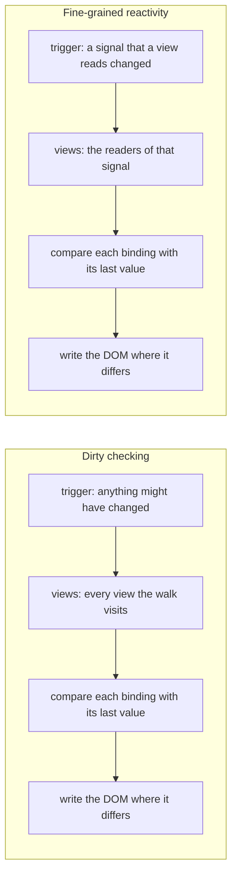
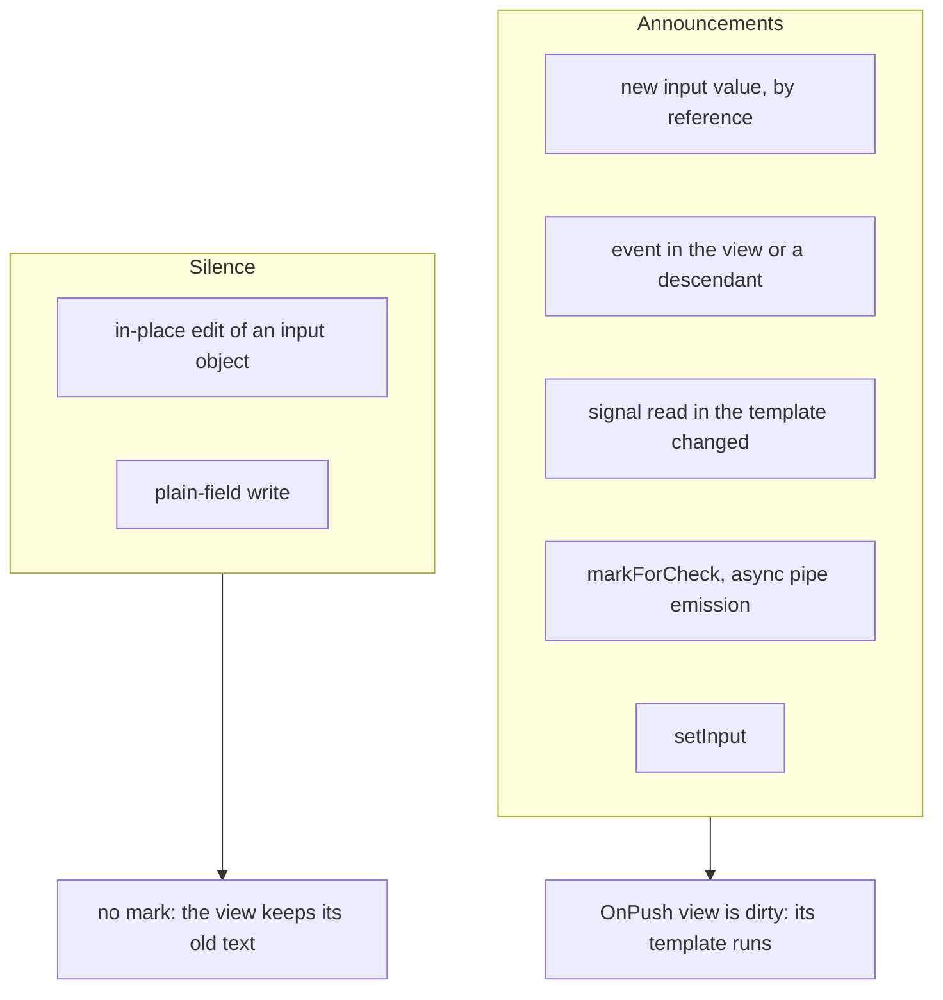
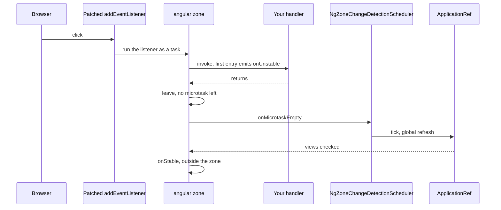
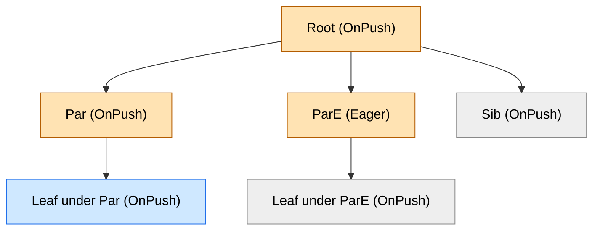
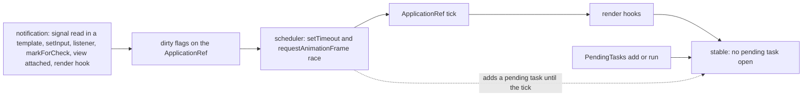
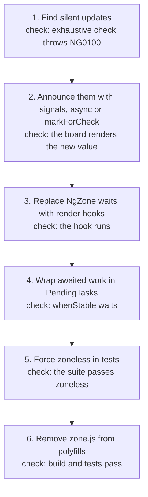
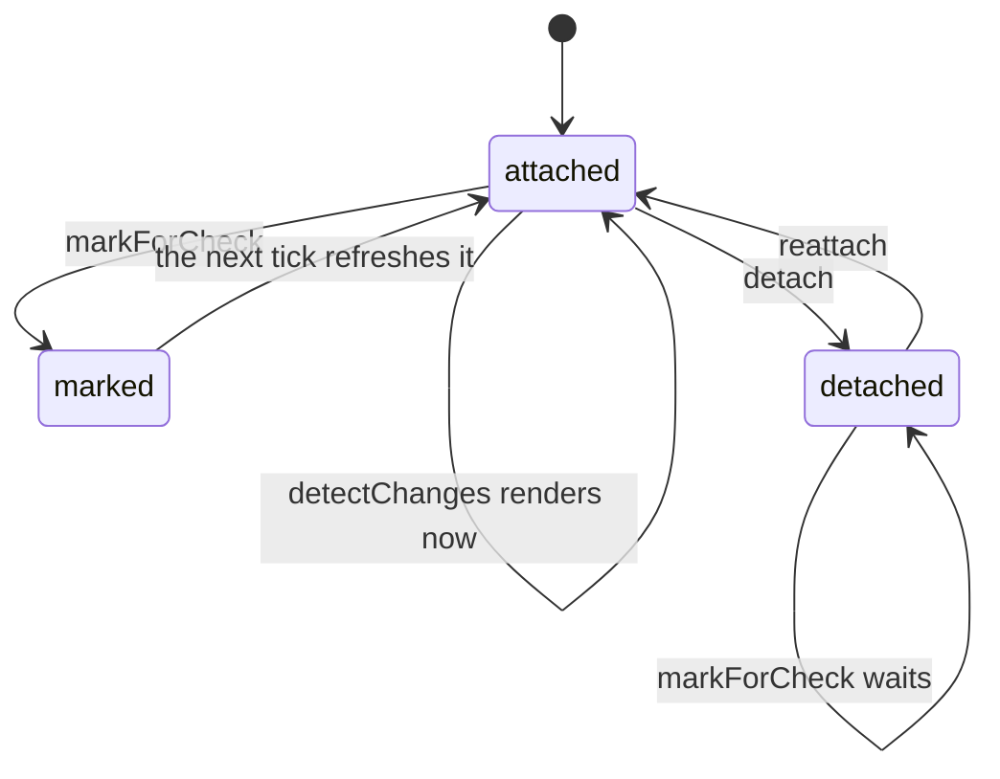
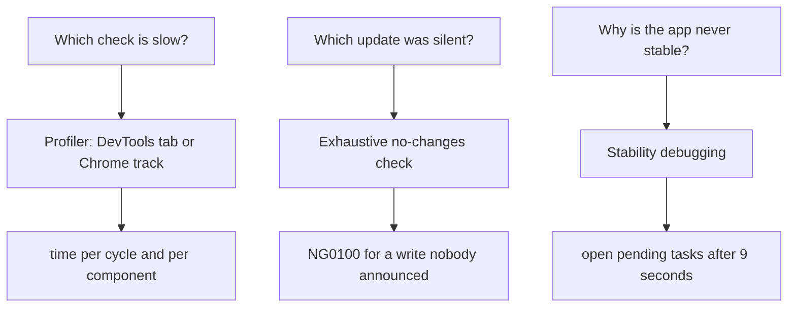
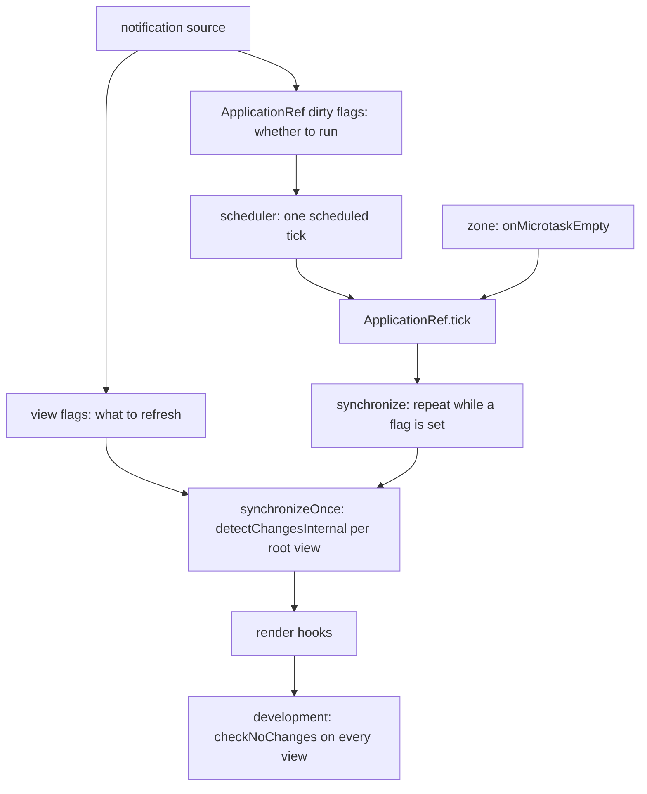

# 21. Change detection: `OnPush`, zone.js, zoneless scheduling and `ChangeDetectorRef`

> **What this covers:** the problem change detection solves, `OnPush` and `Eager` and what marks a view dirty, zone.js and `NgZone` and why zone left the default, the tree walk in global and targeted mode, zoneless scheduling with `PendingTasks`, migrating a zone-based app, `ChangeDetectorRef`, debugging with the profiler and `provideCheckNoChangesConfig`, and the runtime that ties them together.
> **Prerequisites:** [04. JavaScript async and the event loop](04-js-async-event-loop.md#1-the-event-loop-tasks-microtasks-and-rendering) (tasks and microtasks, what zone.js patches), [17. Signals](17-signals.md#9-under-the-hood-the-reactive-graph) (the reactive graph) and [20. Lifecycle and render hooks](20-lifecycle-and-render-hooks.md#7-under-the-hood-hook-lists-the-view-refresh-and-the-render-hook-queue) (hooks run inside the refresh)
> **Leads to:** [22. RxJS foundations](22-rxjs-foundations.md), [29. Testing Angular](29-testing-angular.md), [31. Performance](31-performance.md), [32. SSR, SSG and hydration](32-ssr-ssg-hydration.md), [39. Version history and migrations](39-version-history-and-migrations.md), [40. Framework comparisons](40-framework-comparisons.md)
> **Applies to:** Angular 22.2 (`@angular/core` 22.2.1), zone.js 0.16.3 (only where a section says so), TypeScript 6.0, RxJS 7.8, Node 24
> **Study time:** ~6 hours reading + ~5 hours exercises
> **Short on time:** read [2. `OnPush` and `Eager`](#2-onpush-and-eager-strategies-and-what-marks-a-view-dirty), [4. The tree walk](#4-the-tree-walk-global-and-targeted-refreshes) and [5. Zoneless change detection](#5-zoneless-change-detection-the-scheduler-its-triggers-and-pendingtasks), plus [3. zone.js and `NgZone`](#3-zonejs-and-ngzone-how-changes-used-to-be-detected-and-why-zone-left-the-default) for the old trigger, then drill [Q21.04](#q21-04), [Q21.14](#q21-14), [Q21.15](#q21-15), [Q21.18](#q21-18) and [Q21.30](#q21-30), try [Exercise 21.1](#ex21-1), and finish with the [Summary](#summary).
> **Labs:** [`labs/angular/src/app/modules/21-change-detection/`](../labs/angular/src/app/modules/21-change-detection/) and [`labs/ts-js/src/modules/21-change-detection/`](../labs/ts-js/src/modules/21-change-detection/) (section specs, fixtures, Exercises 21.1-21.6, *Output* questions). Run (Node 24): from `labs/angular`, `npx ng test --watch=false --include='src/app/modules/21-change-detection/**/*.spec.ts'`; from `labs/ts-js`, `npx vitest run src/modules/21-change-detection`.

## Contents

1. [The synchronization problem: dirty checking and fine-grained reactivity](#1-the-synchronization-problem-dirty-checking-and-fine-grained-reactivity)
2. [`OnPush` and `Eager`: strategies and what marks a view dirty](#2-onpush-and-eager-strategies-and-what-marks-a-view-dirty)
3. [zone.js and `NgZone`: how changes used to be detected, and why zone left the default](#3-zonejs-and-ngzone-how-changes-used-to-be-detected-and-why-zone-left-the-default)
4. [The tree walk: global and targeted refreshes](#4-the-tree-walk-global-and-targeted-refreshes)
5. [Zoneless change detection: the scheduler, its triggers and `PendingTasks`](#5-zoneless-change-detection-the-scheduler-its-triggers-and-pendingtasks)
6. [Migrating a zone-based app to zoneless](#6-migrating-a-zone-based-app-to-zoneless)
7. [`ChangeDetectorRef`: `markForCheck`, `detectChanges`, `detach` and `reattach`](#7-changedetectorref-markforcheck-detectchanges-detach-and-reattach)
8. [Debugging: the profiler, `provideCheckNoChangesConfig` and stability](#8-debugging-the-profiler-providechecknochangesconfig-and-stability)
9. [Under the hood: the notification, the dirty flags and the refresh](#9-under-the-hood-the-notification-the-dirty-flags-and-the-refresh)
- [Summary](#summary)
- [Question bank](#question-bank)
- [Hands-on exercises](#hands-on-exercises)
- [Check your understanding](#check-your-understanding)
- [Connections](#connections)

**How the claims here are verified.** Runtime behavior is asserted by Angular specs under `ng test` (jsdom, a zoneless `TestBed`), and each such sentence names its test. A template run is recorded as "ran" or "did not run", never counted, because the development check pass evaluates some views twice. Internals are read from `@angular/core` 22.2.1 and the `v22.2.1` tag, whose sources carry the flag and enum names that the shipped files inline as numbers. Zone behavior runs only where a section names a zone spec. The DevTools profiler, the Chrome performance track, production mode, performance, the Angular team's reasons and Hibernate are documented, never called observed.

## 1. The synchronization problem: dirty checking and fine-grained reactivity

### The problem it solves

A counter changes and the screen must follow. Three designs exist: re-check everything after anything might have changed, be told what changed, or rebuild the screen's description and compare it with the last. A team lead asks why a footer click makes Angular look elsewhere ([Q21.01](#q21-01)); a backend developer asks if it is a Hibernate flush ([Q21.02](#q21-02)).

**Change detection** is the step that makes the DOM match the state. A **binding** is a template expression tied to a value on screen ([20 §6](20-lifecycle-and-render-hooks.md#6-expressionchangedafterithasbeencheckederror-cause-and-fixes)), and a **view** is the runtime record of one template instance ([20 §7](20-lifecycle-and-render-hooks.md#7-under-the-hood-hook-lists-the-view-refresh-and-the-render-hook-queue)). **Dirty checking** compares each binding with its last value after anything might have changed. **Fine-grained reactivity** lets state announce who reads it, so only those views refresh ([17 §1](17-signals.md#1-why-signals-exist) tells the cost story).

### Mental model

A night-shift inspector walks every room after any alarm and reads every meter. In the other building the meters call the desk when a reading moves. Either way the board changes only where a reading differs.



What to notice: both rows end with the same compare-and-write step and differ in how a view is chosen. The module answers two questions: what tells Angular to look (the **trigger**) and which views it refreshes (the **selection**).

### How it actually works

**A check evaluates and compares.** `Section 1: refreshing an unchanged view evaluates its template and writes nothing` calls `detectChanges` three times on an unchanged view: the template method ran each time and the observer saw no mutation record. `Section 1: a changed binding is the only DOM write` changes one of two bindings: the other binding's method ran again and the observer saw one `characterData` record, on the changed node.

Read from the 22.2.1 source (`@angular/core`, `fesm2022/_debug_node-chunk.mjs`, not run; `LView` and the `ɵ` names are internal, [12 §8](12-angular-how-it-works.md#8-under-the-hood-what-the-compiler-emits-and-what-the-runtime-does-with-it)): `ɵɵtextInterpolate1` receives the evaluated value and calls `interpolation1`, which calls `bindingUpdated`. That returns `false` when `Object.is` holds between the stored value and the new one. Otherwise it stores the new value, and only then does `textBindingInternal` call `updateTextNode`. The expression runs before the comparison, and the write follows.

**The v22 defaults.** Zoneless is the default and needs no provider [Changed in v21.0: zone-based detection needs `provideZoneChangeDetection`]; `provideZonelessChangeDetection` [Stable since v20.2] is the explicit form. zone.js no longer says something might have changed ([section 3](#3-zonejs-and-ngzone-how-changes-used-to-be-detected-and-why-zone-left-the-default), [section 5](#5-zoneless-change-detection-the-scheduler-its-triggers-and-pendingtasks)). A component without a `changeDetection` property is OnPush [Changed in v22.0: "Component with undefined `changeDetection` property are now `OnPush` by default"], which skips a view until marked ([section 2](#2-onpush-and-eager-strategies-and-what-marks-a-view-dirty)). The docs say zone.js "does not have any insight into whether application state actually changed" (`guide/zoneless.md`).

> [!TIP]
> **Coming from the backend.** A Hibernate **flush** (queued changes written as SQL; [backend guide](../../Backend%20Study%20Guide%20-%20Security%2C%20JPA%2C%20Design%20Patterns%20%26%20Spring.md)) is dirty checking. The 7.4 user guide (read 2026-10-09) calls the persistence context "a transactional write-behind cache" whose flush "translates [each entity state change] to an INSERT, UPDATE or DELETE statement", and an `@Immutable` entity can "skip the dirty checking process", as an OnPush view is skipped until marked. **Where the analogy breaks:** Hibernate flushes at defined points, by default "prior to committing a Transaction", before an overlapping HQL query and before some native queries. Angular checks when a notification arrives ([section 5](#5-zoneless-change-detection-the-scheduler-its-triggers-and-pendingtasks)) and compares template bindings, not your objects: a mutated object that no binding reads is never "persisted".

> [!NOTE]
> **Framework vs platform.** Change detection is Angular's; zone.js "works by patching browser APIs" (`guide/zoneless.md`).

### Code

The approach is to watch the DOM while one of two bindings changes.

1. Record each template run through a method that pushes its name.
2. Collect every record of a `MutationObserver` (the DOM API that reports DOM changes, [08 §3](08-browser-rendering-dom-events.md#3-dom-apis-and-observers)) on the fixture.
3. Write the signal, wait with `whenStable` ([section 5](#5-zoneless-change-detection-the-scheduler-its-triggers-and-pendingtasks)) and read the records.

```ts
// Excerpt of labs/angular/src/app/modules/21-change-detection/concepts/section-1-synchronization-problem.spec.ts
function watch(root: Node): { records: () => MutationRecord[]; stop: () => void } {
  const seen: MutationRecord[] = [];
  const observer = new MutationObserver((batch) => seen.push(...batch));
  observer.observe(root, { attributes: true, characterData: true, childList: true, subtree: true });
  return {
    records: () => [...seen, ...observer.takeRecords()],
    stop: () => observer.disconnect(),
  };
}

@Component({
  selector: 'lab-m21-s1-pair',
  template: `<p class="count">{{ count() }}</p>
    <p class="label">{{ label() }}</p>`,
})
class Pair {
  readonly count = signal(0);

  protected label(): string {
    runs.push('label');
    return 'a';
  }
}

    fixture.componentInstance.count.set(1);
    await fixture.whenStable();

    const records = watcher.records();
    expect(records).toHaveLength(1);
    expect(records[0].type).toBe('characterData');
    expect(runs).toContain('label');
```

### Best practices and anti-patterns

- **Ask the two questions when a view is stale**, because the trigger ([section 5](#5-zoneless-change-detection-the-scheduler-its-triggers-and-pendingtasks)) and the selection ([section 4](#4-the-tree-walk-global-and-targeted-refreshes)) fail separately.
- **Keep expensive work out of a template method**, because a refreshed view evaluates every binding ([Q14.25](14-directives-and-pipes.md#q14-25)).

### Misconceptions and traps

- *"Change detection re-renders the template."* It evaluates every binding of a refreshed view and writes only the ones that differ. The myth exists because "render" names the whole pass.
- *"Angular is slow because it checks everything."* What a notification costs depends on how many views it refreshes ([section 4](#4-the-tree-walk-global-and-targeted-refreshes)). The myth exists because in the zone-era story every event ran a global pass ([17 §1](17-signals.md#1-why-signals-exist)).
- *"It is the same as React's virtual DOM diff."* Angular compares each binding with the value stored in its view, and the code read here builds no second tree. The myth exists because both compare, then update ([Module 40](40-framework-comparisons.md#9-under-the-hood-one-state-change-traced-through-angular-react-vue-and-solid)).

Drilled in [Q21.01](#q21-01) and [Q21.02](#q21-02); modelled in [Exercise 21.6](#ex21-6).

## 2. `OnPush` and `Eager`: strategies and what marks a view dirty

### The problem it solves

A developer edits an object in place and the child keeps the old value ([Q21.05](#q21-05)). A click on one button refreshes a sibling nobody touched. A team that moves to v22 finds `ChangeDetectionStrategy.Eager` [Added in v21.2] added to its components by a migration ([Q21.03](#q21-03), [Q21.06](#q21-06), [Q21.07](#q21-07)).

### Mental model

A **strategy** is a component setting that says when its view is checked. An `Eager` component is checked whenever the walk reaches it. An OnPush component is checked only when something marked its view **dirty**, meaning flagged for a check. An Eager office has its meters read on every round; an OnPush office is read only when it rang the desk.



What to notice: every mark is an announcement, and a mutation announces nothing.

### How it actually works

**The enum.** The typings (`@angular/core` 22.2.1, `types/_debug_node-chunk.d.ts`, read 2026-10-09) define `OnPush = 0` and `Eager = 1`: the component "is checked eagerly when the change detection traversal reaches it". `Default = 1` is "equivalent to setting `Eager` and is due to be removed", `@deprecated`. The default is OnPush ([section 1](#1-the-synchronization-problem-dirty-checking-and-fine-grained-reactivity)); CHANGELOG 22.0.0 says to specify `Eager` "to keep the previous behavior". The installed `schematics/migrations.json` lists `change-detection-eager` at version 22.0.0, "Adds `ChangeDetectionStrategy.Eager` to all components" (read, not run).

**The marks**, each asserted by a test:

- **Inputs by reference.** `Section 2: a new object reference refreshes the child and an in-place edit does not`: after `o.n = 2` and a signal write the owner refreshed, the child's template did not run and its text stayed `n=1`; after `o = { n: 3 }` the child ran and showed `n=3`. The docs say an input is compared "with `==`"; the source says `Object.is`. Read from the 22.2.1 source (`fesm2022/_debug_node-chunk.mjs`, not run; `Dirty`, `RefreshView` and `CheckAlways` are internal flag names from `view.ts` of the `v22.2.1` tag, the shipped file has numbers): `ɵɵproperty` calls `bindingUpdated`, and only a changed value reaches `setPropertyAndInputs`, which calls `markDirtyIfOnPush`. That sets `Dirty` on the child unless it is `CheckAlways`. An in-place edit leaves the reference, so nothing is set.
- **Events.** `Section 2: an event refreshes the view, its ancestors and Eager siblings and skips OnPush siblings`: a click ran the button component's, its parent's and its grandparent's templates and the Eager sibling's, which showed its changed field; the OnPush sibling stayed stale. Read: `wrapListener` calls `markViewDirty`, which flags the view and each ancestor up to the root ([section 4](#4-the-tree-walk-global-and-targeted-refreshes) has the flags). The docs describe an event as running change detection in "the entire component tree" and ignoring OnPush subtrees outside the handler's; the observed set agrees, and the mechanism is the source's.
- **The `async` pipe.** `Section 2: the async pipe marks the view on emission`; the pipe calls `markForCheck` on each emission ([14 §8](14-directives-and-pipes.md#8-the-async-pipe-under-the-hood)).
- **`markForCheck`.** `Section 2: a plain-field write renders only after markForCheck`: no template ran and the text stayed `a`; after `markForCheck` it showed `b` ([section 7](#7-changedetectorref-markforcheck-detectchanges-detach-and-reattach)).
- **`setInput`** (`ComponentRef.setInput`, which sets an input from code). `Section 2: setInput marks the view and the render follows the next stable point`: the text was `init` right after the call and `new` after `whenStable`.
- **A signal.** `Section 2: a signal read in the template marks that view`: writing a leaf's signal ran the leaf's template and not its parent's. Read: the reactive consumer's `consumerMarkedDirty` calls `markAncestorsForTraversal`, which flags ancestors `HasChildViewsToRefresh` without refreshing them. An event flags ancestors for a refresh, a signal only for traversal ([section 4](#4-the-tree-walk-global-and-targeted-refreshes), [section 9](#9-under-the-hood-the-notification-the-dirty-flags-and-the-refresh); [signals](17-signals.md#1-why-signals-exist)).

> [!WARNING]
> The migration adds `Eager` to every component. An app that keeps it keeps checks on every traversal of those views (typings). Remove it component by component once the state a view shows is announced ([section 5](#5-zoneless-change-detection-the-scheduler-its-triggers-and-pendingtasks)).

### Code

The approach is to bind a plain object to an OnPush child, edit it in place, then replace it.

1. Give the child a required input and a template method that records its runs.
2. Bind the owner's plain object to it, and read a signal in the owner so that the owner refreshes.
3. Edit the object, write the signal and assert that the child did not run; then replace the object and assert that it did.

```ts
// Excerpt of labs/angular/src/app/modules/21-change-detection/concepts/section-2-strategies-and-marks.spec.ts
@Component({ selector: 'lab-m21-s2-box', template: `{{ tpl() }}n={{ o().n }}` })
class Box {
  readonly o = input.required<{ n: number }>();

  protected tpl(): string {
    ran.push('box');
    return '';
  }
}

    owner.o.n = 2;
    owner.s.update((n) => n + 1);
    await fixture.whenStable();

    expect(ran).toContain('owner');
    expect(ran).not.toContain('box');
    expect(fixture.nativeElement.textContent).toBe('s1n=1');
```

#### Legacy

Before v22 a component with no `changeDetection` property was checked eagerly, and `ChangeDetectionStrategy.Default` spelled it out (the CHANGELOG's "previous behavior"; `Default` is deprecated, above).

```ts
// Partial: legacy; imports and the class body are omitted
@Component({
  selector: 'lab-legacy-badge',
  changeDetection: ChangeDetectionStrategy.Default,
  template: `{{ label }}`,
})
export class LegacyBadge {}
```

The migration path is the `change-detection-eager` schematic, then removing `Eager` as state moves to signals.

### Best practices and anti-patterns

- **Keep displayed state in signals or replace objects by new references**, because both announce the change and an in-place edit does not (`Section 2: a new object reference refreshes the child and an in-place edit does not`).
- **Do not set a child's input through a `@ViewChild` reference and expect a render**, because the docs say Angular "will not automatically run change detection for OnPush components" then (`skipping-subtrees.md`, edge cases; [Q21.06](#q21-06)).

### Misconceptions and traps

- *"OnPush skips a component until its inputs change deeply."* It compares the reference only. The myth exists because "changed input" sounds like a deep compare.
- *"An event inside a child only refreshes the child."* Its ancestors and Eager siblings refresh too. The myth exists because a component looks self-contained, and `markViewDirty` walks up the parents.
- *"OnPush needs an immutable-data library."* A new reference or a signal both announce. The myth exists because references were the only announcement before signals ([17 §1](17-signals.md#1-why-signals-exist)).
- *"`Default` and `Eager` are different."* Both equal `1`. The myth exists because the alias arrived in 21.2 under a second name.

Drilled in [Q21.03](#q21-03), [Q21.04](#q21-04), [Q21.05](#q21-05), [Q21.06](#q21-06) and [Q21.07](#q21-07); practised in [Exercise 21.1](#ex21-1) and [Exercise 21.2](#ex21-2).

## 3. zone.js and `NgZone`: how changes used to be detected, and why zone left the default

### The problem it solves

A chart library schedules a timer on every animation frame and the page checks its views each time ([Q21.10](#q21-10)). A WebSocket callback writes a field and the screen stays stale ([Q21.09](#q21-09)). A tutorial says "`NgZone` triggers change detection" in a v21 project without zone.js ([Q21.08](#q21-08), [Q21.11](#q21-11), [Q21.12](#q21-12)).

A **monkey patch** replaces another object's function at run time. **zone.js** patches the browser's async APIs so each callback runs in a **zone**, a context that sees its tasks start and end ([04 §1](04-js-async-event-loop.md#1-the-event-loop-tasks-microtasks-and-rendering)). **`NgZone`** is the zone Angular forks from it, and a **tick** is one change detection run over the views of the `ApplicationRef` ([12 §6](12-angular-how-it-works.md#6-bootstrapping-bootstrapapplication-the-platform-and-initializers)).

### Mental model

Every door has a counter. When the last person leaves the lobby, the inspector walks the whole building, whether or not a chair moved.



What to notice: the tick follows "something ran", not "something changed". `runOutsideAngular` runs in the zone that was current when `NgZone` was built, so its tasks end silently; `run` re-enters.

### How it actually works

**The patches.** Read from zone.js 0.16.3 (`fesm2015/zone.js`, not run): `Zone.__load_patch` registers patches named `timers`, `requestAnimationFrame`, `EventTarget`, `XHR` and `ZoneAwarePromise`. `patchMethod` keeps the original under the `__zone_symbol__` prefix plus its name and installs a wrapper. `Section 3: zone.js patches setTimeout`: the original sat under `__zone_symbol__setTimeout`, the global differed from it, and a callback scheduled in a forked zone ran in that zone.

**The zone.** Read from the 22.2.1 source (`_pending_tasks-chunk.mjs`, not run; names internal): the `NgZone` constructor throws `NG0908` ("In this configuration Angular requires Zone.js") without `Zone`. `forkInnerZoneWithAngularBehavior` forks a zone named `angular`; `onInvokeTask` calls `onEnter` (the first entry emits `onUnstable`) and `onLeave`, which calls `checkStable`. With no entry open and no microtask pending, `checkStable` emits **`onMicrotaskEmpty`**, then **`onStable`** outside the zone. `NgZoneChangeDetectionScheduler` (`core.mjs`) subscribes to `onMicrotaskEmpty`, sets the global-refresh flag and ticks. `Section 3: onMicrotaskEmpty and onStable fire once per turn`: a click reaching one listener emitted `onUnstable`, `onMicrotaskEmpty` and `onStable` once each, in that order.

**What a tick covers.** Each test mounts a component created in the zone and attached to the `ApplicationRef`. The host is `Eager` because an OnPush host gates its children ([section 4](#4-the-tree-walk-global-and-targeted-refreshes)).

- `Section 3: a timer inside the zone renders an Eager component and not an OnPush one`: after a zone timer wrote a plain field of each child, the Eager child showed `b` and the OnPush child `a`.
- `Section 3: an idle zone timer still runs ngDoCheck of an Eager component`: an empty timer ran the Eager child's `ngDoCheck` (the hook called on each check of its view, [20 §3](20-lifecycle-and-render-hooks.md#3-which-hooks-still-matter-with-signals)) and template, not the OnPush child's.
- `Section 3: a write outside the zone renders on the next zone task or signal write`: a field written outside stayed `a`, an empty zone timer made it `b`, and a later signal write outside rendered the signal and the field beside it. The signal notified the scheduler of [section 5](#5-zoneless-change-detection-the-scheduler-its-triggers-and-pendingtasks) (CHANGELOG 18.0.0 says change detection runs "even when the state update originates from outside the zone").
- `Section 3: nested listeners tick twice and once with eventCoalescing`: a click on a button inside a listening `div` emitted `onMicrotaskEmpty` and ran `ngDoCheck` twice, and once with `provideZoneChangeDetection({ eventCoalescing: true })`. **Event coalescing** merges the ticks of one event's listeners; read: `delayChangeDetectionForEvents` defers through `scheduleCallbackWithRafRace`.

**Why zone left the default.** CHANGELOG 21.0.0 (breaking): "Angular no longer provides a change detection scheduler for ZoneJS-based change detection by default. Add `provideZoneChangeDetection` to the providers of your `bootstrapApplication`". The docs' "Why use Zoneless?" lists performance, Core Web Vitals, debugging and ecosystem reasons; the docs' claims, none measured here.

**Keeping zone.js.** The installed `@angular/core` 22.2.1 `package.json` marks `zone.js` (`~0.15.0 || ~0.16.0`) `optional: true` in `peerDependenciesMeta`. Read, not run: in development `provideZonelessChangeDetection` logs `NG0914` when `Zone` is defined, and it provides `NoopNgZone` ([section 5](#5-zoneless-change-detection-the-scheduler-its-triggers-and-pendingtasks)).

> [!NOTE]
> **Framework vs platform.** zone.js is a library that replaces browser functions with wrappers; the docs say `async`/`await` "cannot be patched effectively".

> [!WARNING]
> The lab's `import 'zone.js';` is per spec file: other specs still see no `Zone` (`Section 5: NgZone is a no-op in a zoneless app`). A zoneless app drops zone.js from its **`polyfills`**, the scripts `angular.json` loads before the app (docs).

### Code

The approach is to run a component under the real zone and write from outside.

1. Configure `TestBed` with `provideZoneChangeDetection`.
2. Create the component inside `zone.run` and attach its host view.
3. Wait on a root-zone timer and read the DOM.

The spec starts with `import 'zone.js';` and needs no `angular.json` change (run 2026-10-09).

```ts
// Excerpt of labs/angular/src/app/modules/21-change-detection/concepts/section-3-zone.spec.ts
async function mount<T>(
  type: Type<T>,
  options?: ZoneOptions,
): Promise<{ instance: T; element: HTMLElement; zone: NgZone }> {
  TestBed.configureTestingModule({ providers: [provideZoneChangeDetection(options)] });
  const zone = TestBed.inject(NgZone);
  const app = TestBed.inject(ApplicationRef);
  const injector = TestBed.inject(EnvironmentInjector);
  const ref = zone.run(() => {
    const created = createComponent(type, { environmentInjector: injector });
    document.body.appendChild(created.location.nativeElement);
    app.attachView(created.hostView);
    return created;
  });
  await settle();
  return { instance: ref.instance, element: ref.location.nativeElement as HTMLElement, zone };
}

    zone.runOutsideAngular(() =>
      setTimeout(() => {
        eager.field = 'b';
      }, 0),
    );
    await settle();
    expect(text()).toBe('a');
```

#### Legacy

A zone-based app loads zone.js through `polyfills` (docs), asks for the zone provider and runs widgets outside the zone.

```ts
// Partial: legacy zone-based app; the component, the widget and the imports are omitted
bootstrapApplication(App, {
  providers: [provideZoneChangeDetection({ eventCoalescing: true })],
});

this.ngZone.runOutsideAngular(() => this.widget.start());
```

Gone: `ignoreChangesOutsideZone` [Removed in v21.0] and `useNgZoneOnStable` [Removed in v20.0], an option of the debug check of [section 8](#8-debugging-the-profiler-providechecknochangesconfig-and-stability). CHANGELOG 21.0.0 lists "Add migration for zoneless by default"; the installed `schematics/migrations.json` has eight entries, all version 22.0.0, so it is not found there (read).

### Best practices and anti-patterns

- **Start third-party widgets with `runOutsideAngular`**, because each task they schedule in the zone ends in a tick (`Section 3: an idle zone timer still runs ngDoCheck of an Eager component`); `run` re-enters for a handler that must show something (docs).
- **Keep displayed state in signals in a zone app too**, because a signal written outside the zone notified the scheduler while a plain field waited for the next zone task (`Section 3: a write outside the zone renders on the next zone task or signal write`).

### Misconceptions and traps

- *"zone.js is Angular."* It is a separate, optional package. The myth exists because projects listed it in `polyfills`.
- *"zone.js knows what changed."* It knows a task ran: the empty timer ticked. The myth exists because a tick usually follows a change.
- *"`runOutsideAngular` stops all rendering."* It stops the zone's tick for that code; a signal written there rendered. The myth exists because the docs say it skips change detection.
- *"`NgZone` no longer exists in v21."* The class stays injectable, with a no-op implementation when zoneless (read). The myth exists because no zone is provided by default.

Drilled in [Q21.08](#q21-08), [Q21.09](#q21-09), [Q21.10](#q21-10), [Q21.11](#q21-11) and [Q21.12](#q21-12); practised in [Exercise 21.3](#ex21-3).

## 4. The tree walk: global and targeted refreshes

### The problem it solves

Two components change and Angular refreshes different amounts of the tree ([Q21.13](#q21-13), [Q21.14](#q21-14)). An `Eager` widget under an OnPush page stays stale ([Q21.16](#q21-16)). A `markForCheck` in a leaf refreshes its parents and a signal write does not ([Q21.15](#q21-15), [Q21.34](#q21-34)).

A **refresh** is a view's template running. The **walk** goes top-down from each **root view**, the view that hosts a root component. Every flag and function below is internal, not API ([12 §8](12-angular-how-it-works.md#8-under-the-hood-what-the-compiler-emits-and-what-the-runtime-does-with-it)).

### Mental model

A fire inspector enters by the lobby; a sign says "floors above need a visit" and only flagged rooms are opened. In **global** mode the walk refreshes every `Eager` (`CheckAlways`) view and every flagged view. In **targeted** mode it refreshes only views flagged `RefreshView` or whose signal reader is dirty; their ancestors carry `HasChildViewsToRefresh`, so the walk passes through them unrefreshed. A refreshed view checks its child components in global mode.



What to notice: blue is refreshed by a signal written in the leaf under `Par`, by an event there and by `markForCheck` there. Orange is refreshed by the last two only. Grey is refreshed by none.

### How it actually works

**Observed**, with a recorder in each template method (`ran` or `did not run`, never counted):

- `Section 4: a signal written in a leaf refreshes only that leaf, under an OnPush or an Eager parent`: the leaf ran; its parent, `Root` and `ParE` did not, and the same held for the leaf under `ParE`.
- `Section 4: markForCheck in a leaf refreshes its ancestors and not an OnPush sibling` and `Section 4: an event in an OnPush leaf refreshes the path and the Eager siblings`: `Root`, `Par`, the leaf and the Eager `ParE` ran. `Sib` and the OnPush leaf under `ParE` did not.
- `Section 4: an Eager child of an OnPush parent is refreshed when the parent is refreshed and not before`: after a plain-field write in the Eager child, a tick from an unrelated signal did not run it and its text stayed `a`; the parent's own signal ran both and the text became `b`.
- `Section 4: an embedded view is refreshed with its declaring component`: a signal read only inside an `@if` block ran the component's template and the block's.

**Why.** Read from the 22.2.1 source (`_debug_node-chunk.mjs` and `_pending_tasks-chunk.mjs`, not run; names from `view.ts` and `change_detection.ts` at the `v22.2.1` tag, the shipped files hold numbers):

- `detectChangesInView` refreshes a view when the mode is global and the view is `CheckAlways`, or global and `Dirty` (outside the development check), or `RefreshView` is set, or its reactive consumer is dirty and polls a change. It clears `RefreshView` and `HasChildViewsToRefresh` first. A view not refreshed that has `HasChildViewsToRefresh` goes on to its embedded views and child components in targeted mode.
- `refreshView` runs the template, then refreshes embedded views and child components in global mode ([20 §7](20-lifecycle-and-render-hooks.md#7-under-the-hood-hook-lists-the-view-refresh-and-the-render-hook-queue) has the order). So a refreshed OnPush parent reaches an Eager child and an unrefreshed one does not.
- `markViewDirty` sets `RefreshView` and `Dirty` on the view and every ancestor (only `Dirty` while a refresh runs). This is the path of the event and `markForCheck`.
- The reactive consumer's `consumerMarkedDirty` calls `markAncestorsForTraversal`, which sets `HasChildViewsToRefresh` on parents, stopping at one already flagged or after a detached one. This is the signal path.
- `ApplicationRef`'s `synchronizeOnce` picks `mode = useGlobalCheck && !zonelessEnabled ? 0 : 1` per root view: global only in a zone app after a zone tick ([section 3](#3-zonejs-and-ngzone-how-changes-used-to-be-detected-and-why-zone-left-the-default)), targeted in a zoneless one.
- `viewShouldHaveReactiveConsumer` returns false for embedded views (`TViewType.Embedded`), so their signal reads are tracked by the declaring component.
- `markTransplantedViewsForRefresh` calls `markViewForRefresh` on views declared in one template and inserted in another, so they refresh with their declaration ([Q19.12](19-component-communication-and-projection.md#q19-12)).

> [!NOTE]
> The docs' diagrams (`skipping-subtrees.md`) show the global walk, "the entire component tree" minus OnPush subtrees. The zoneless runs agree and add the targeted one.

### Code

The approach is to build the six-view tree, write through each channel and read which templates ran.

1. Record each template run in `ran` through a method.
2. Give the leaf a signal, a `ChangeDetectorRef` and a button.
3. Write, wait with `whenStable`, assert.

```ts
// Excerpt of labs/angular/src/app/modules/21-change-detection/concepts/section-4-tree-walk.spec.ts
@Component({
  selector: 'lab-m21-s4-leaf',
  template: `<button type="button" (click)="clicks = clicks + 1">{{ tpl() }}</button>{{ n() }}`,
})
class Leaf {
  readonly label = input.required<string>();
  readonly n = signal(0);
  readonly cdr = inject(ChangeDetectorRef);
  clicks = 0;

    ran.length = 0;
    instance(fixture, Leaf, 0).n.set(1);
    await fixture.whenStable();
    expect(ran).toContain('par-leaf');
    expect(ran).not.toContain('par');
    expect(ran).not.toContain('root');
    expect(ran).not.toContain('par-eager');
```

### Best practices and anti-patterns

- **Announce a change with a signal in the view that shows it**, because it refreshes that view alone, while `markForCheck` and an event refresh the path to the root and the Eager siblings (`Section 4: a signal written in a leaf refreshes only that leaf, under an OnPush or an Eager parent` against `Section 4: markForCheck in a leaf refreshes its ancestors and not an OnPush sibling`).
- **Do not keep plain-field state in an `Eager` component under an OnPush parent**, because the parent gates it (`Section 4: an Eager child of an OnPush parent is refreshed when the parent is refreshed and not before`).

### Misconceptions and traps

- *"OnPush stops the walk at the component."* The walk passes through an unrefreshed OnPush view to a flagged descendant: `Par` did not run and its leaf did. The myth exists because the name suggests a stop.
- *"A signal refreshes the whole component tree below it."* Only the views that read it. The myth exists because in the zone era every event ran a global pass (OnPush subtrees were skipped).
- *"`Eager` children of an OnPush parent are always checked."* The parent gates them. The myth exists because `Eager` reads as "always".

Drilled in [Q21.13](#q21-13), [Q21.14](#q21-14), [Q21.15](#q21-15), [Q21.16](#q21-16) and [Q21.34](#q21-34); practised in [Exercise 21.1](#ex21-1) and [Exercise 21.6](#ex21-6).

## 5. Zoneless change detection: the scheduler, its triggers and `PendingTasks`

### The problem it solves

A plain field written in a callback never renders ([Q21.17](#q21-17)). How many renders follow three signal writes in one turn ([Q21.18](#q21-18))? A test or the server must know when the app is done ([Q21.19](#q21-19), [Q21.20](#q21-20)), and code that waited for `NgZone.onStable` never continues ([Q21.21](#q21-21), [Q21.33](#q21-33)).

A **notification** is a call to the **scheduler**, the service that turns notifications into one tick ([section 3](#3-zonejs-and-ngzone-how-changes-used-to-be-detected-and-why-zone-left-the-default)). **Stability** means no **pending task** is open, a pending task being a unit in the app's counter of unfinished work, `PendingTasks` [Stable since v20.0].

### Mental model

A switchboard has a ring button per room and a board of open jobs. Nothing watches the clock: the desk reacts to a press, and the building is done when the board is empty.



What to notice: nothing here looks at time or events, only at notifications, and the scheduled tick is itself a pending task, so stability waits for the render.

### How it actually works

**Observed** (zoneless `TestBed`, `afterEveryRender` counting renders):

- `Section 5: three signal writes in one turn render once after the stable point`: right after the writes the DOM and the render count were unchanged, and so after a microtask; after `whenStable` the DOM showed the third value and one render had run.
- `Section 5: a tick with nothing dirty renders nothing`: `ApplicationRef.tick()` ran no render hook.
- `Section 5: a plain-field write is not rendered until a notification`: the field stayed `a` after `whenStable` and a 20 ms wait; a later signal write rendered both.
- `Section 5: setInput and an event notify the scheduler`: `setInput` left the DOM unchanged until `whenStable`, and a click that wrote a plain field rendered it.

**The triggers** are the typings' list for `provideZonelessChangeDetection`: `markForCheck`, `setInput`, a signal read in a template, bound listeners, attaching a dirty view, removing a view and registering a render hook. **The scheduler**, read from `ChangeDetectionSchedulerImpl` (22.2.1, `_debug_node-chunk.mjs`, not run; `NotificationSource` and `ApplicationRefDirtyFlags` names from the `v22.2.1` tag, all internal): `notify(source)` sets a dirty flag on the `ApplicationRef`: traversal for `MarkAncestorsForTraversal`, `DeferBlockStateUpdate`, `CustomElement` and `ViewEffect`, check for `SetInput`, `DebugApplyChanges`, `MarkForCheck` and `Listener`, root effects for `RootEffect`, render hooks for the rest, and none for `PendingTaskRemoved`. If no tick is pending or running, `shouldScheduleTick` lets it add a pending task and schedule the tick with `scheduleCallbackWithRafRace`: a `setTimeout` and a `requestAnimationFrame` ([08 §2](08-browser-rendering-dom-events.md#2-layout-paint-and-composite-what-each-change-costs)) race, the first to fire cancels the other. That task is why `whenStable` resolves after the render. After a tick `scheduleCallbackWithMicrotask` serves for one microtask, and in development 100 consecutive notifications throw NG0103, "Angular could not stabilize because there were endless change notifications within the browser event loop". In a zone app `notify` ignores `Listener` and `shouldScheduleTick` is false inside the Angular zone, because the zone ticks.

**Stability.** `PendingTasks` has `add()`, which returns a cleanup function, and `run(fn)` [Developer preview since v19.0], which keeps the app unstable until an async function settles. `pendingUntilEvent` [Developer preview since v20.0] (`rxjs-interop`) does the same until an observable "emits, completes, errors, or is unsubscribed". Read: `ApplicationRef.isStable` is the pending-task state inverted and `whenStable()` resolves on its first `true`.

- `Section 5: an open pending task keeps isStable false and whenStable pending`: after `add()` `isStable` was `false` and `whenStable` stayed pending over a 20 ms wait; after the cleanup call it resolved and `isStable` was `true`.
- `Section 5: PendingTasks.run keeps the app unstable until the promise settles`.

**`NgZone`.** `Section 5: NgZone is a no-op in a zoneless app`: it was a `NoopNgZone` (internal, no events) with `isStable` `true`, emitted nothing across a signal-driven render, returned the results of `run` and `runOutsideAngular`, and `NgZone.isInAngularZone()` and `Zone` were `false` and `undefined`, so the zone spec of [section 3](#3-zonejs-and-ngzone-how-changes-used-to-be-detected-and-why-zone-left-the-default) leaks nothing. The docs name `afterNextRender` and `afterEveryRender` ([20 §4](20-lifecycle-and-render-hooks.md#4-render-hooks-afternextrender-aftereveryrender-and-their-phases)) as the replacement for waits.

> [!NOTE]
> **Framework vs platform.** `setTimeout` and `requestAnimationFrame` are platform timers the scheduler races; `PendingTasks` is Angular's counter, and the platform has none.

> [!WARNING]
> Reactive forms model updates "do not automatically schedule component change detection" (docs, documented only; [Module 25](25-forms-reactive-and-template-driven.md#7-status-updateon-valuechanges-and-the-unified-events-stream)).

### Code

The approach is to put a plain field and a signal side by side and watch which write renders.

1. Count renders with `afterEveryRender` in the component.
2. Write the signal three times, then check the DOM at three moments.
3. Wait with `whenStable` and read the count.

```ts
// Excerpt of labs/angular/src/app/modules/21-change-detection/concepts/section-5-zoneless.spec.ts
@Component({ selector: 'lab-m21-s5-counter', template: `{{ count() }}|{{ plain }}` })
class Counter {
  readonly count = signal(0);
  plain = 'a';
  renders = 0;

    counter.count.set(1);
    counter.count.set(2);
    counter.count.set(3);
    expect(fixture.nativeElement.textContent).toBe('0|a');
    expect(counter.renders).toBe(0);
    await fixture.whenStable();
    expect(fixture.nativeElement.textContent).toBe('3|a');
    expect(counter.renders).toBe(1);
```

#### Legacy

`ExperimentalPendingTasks` was renamed `PendingTasks` in 19.0.0 and `provideExperimentalZonelessChangeDetection` became `provideZonelessChangeDetection` in 20.0.0 (CHANGELOG; neither is in the 22.2.1 typings). Zone-era code waited with `NgZone.onStable`, which never emits zoneless; the replacement is a render hook.

```ts
// Partial: inside a component; imports and the injected zone and injector are omitted
this.ngZone.onStable.pipe(first()).subscribe(() => this.focusFirstError());
afterNextRender(() => this.focusFirstError(), { injector: this.injector });
```

### Best practices and anti-patterns

- **Keep displayed state in signals**, because a plain-field write notifies nothing (`Section 5: a plain-field write is not rendered until a notification`).
- **Wrap awaited work that must be rendered in `PendingTasks.run`**, because it keeps the app unstable until the promise settles (`Section 5: PendingTasks.run keeps the app unstable until the promise settles`). A cleanup that is never called leaves the app unstable (`Section 5: an open pending task keeps isStable false and whenStable pending`).
- **Wait for a render with `afterNextRender`, not `NgZone.onStable`**, because that observable never emits (`Section 5: NgZone is a no-op in a zoneless app`).

### Misconceptions and traps

- *"Zoneless apps poll."* They wait for notifications: an idle tick rendered nothing. The myth exists because no zone says when to look.
- *"A `setTimeout` in a component re-renders it."* Only if it writes a signal or marks the view, because a plain-field write rendered nothing. The myth exists because in the zone era every timer ticked.
- *"Stability is about the zone."* It is the pending-task counter, and `NgZone.isStable` is always `true` zoneless. The myth exists because `isStable` was `NgZone`'s first.
- *"`runOutsideAngular` must be removed."* Both it and `run` still return their results, and the docs say they need not be removed. The myth exists because the observables never emit.

Drilled in [Q21.17](#q21-17), [Q21.18](#q21-18), [Q21.19](#q21-19), [Q21.20](#q21-20), [Q21.21](#q21-21) and [Q21.33](#q21-33); practised in [Exercise 21.2](#ex21-2) and [Exercise 21.4](#ex21-4).

## 6. Migrating a zone-based app to zoneless

### The problem it solves

A hundred components rely on zone.js and widgets write fields from callbacks. A callback leaves the screen stale and an `NgZone.onStable` wait never ends ([Q21.22](#q21-22), [Q21.23](#q21-23)).

A **silent update** is a state change that no notification announces ([section 5](#5-zoneless-change-detection-the-scheduler-its-triggers-and-pendingtasks)). **OnPush-compatible** code announces every change its template shows. A **hybrid app** keeps `provideZoneChangeDetection` beside the notification scheduler ([section 3](#3-zonejs-and-ngzone-how-changes-used-to-be-detected-and-why-zone-left-the-default)).

### Mental model

Before a building drops its patrol guard, every room gets an alarm button and each is tested. Migrating means making every change announce itself, then removing the zone.



What to notice: each step ends in a check, and the check that finds silent updates comes before the zone is removed.

### How it actually works

**Why the order.** The zone is a second path to a tick ([section 3](#3-zonejs-and-ngzone-how-changes-used-to-be-detected-and-why-zone-left-the-default)): a silent update renders on the next zone task. Read from the 22.2.1 source (`core.mjs`, `_debug_node-chunk.mjs`, not run; names internal): the zone providers' initializer calls `NgZoneChangeDetectionScheduler.initialize`, which ticks on `onMicrotaskEmpty`; `provideZonelessChangeDetectionInternal` provides `NoopNgZone`. Removal drops that path.

**The steps**, each with its run:

1. `provideCheckNoChangesConfig` [Developer preview since v20.0] with `exhaustive: true` checks every view as if it were `Eager` (typings). `Section 6: an exhaustive check reports a plain-field write that no notification announced`: a plain write to an OnPush board made `tick()` throw `NG0100`, `Previous value: '0'. Current value: '3'` ([section 8](#8-debugging-the-profiler-providechecknochangesconfig-and-stability)).
2. `Section 6: the same component rendered after switching the field to a signal`: after one emission the legacy board's field held `3` and its text `0`; the signal board showed `3`.
3. The docs ask to remove uses of `onMicrotaskEmpty`, `onUnstable`, `onStable` and `NgZone.isStable`, which is always `true`. `Section 6: code waiting on NgZone.onStable never continues`: after a render and a 20 ms wait the status stayed `loading`. `Section 6: afterNextRender runs after the render where onStable never fires`: the hook set `ready`, `onStable` emitted nothing.
4. `PendingTasks.run` keeps server rendering waiting for async work no zone sees (docs; [section 5](#5-zoneless-change-detection-the-scheduler-its-triggers-and-pendingtasks), [Module 32](32-ssr-ssg-hydration.md#7-platform-safe-code-browser-apis-afternextrender-document-request-and-response_init)).
5. The docs say `TestBed` is zone-based while zone.js is in `polyfills`, `provideZonelessChangeDetection()` forces zoneless, and rewriting `fixture.detectChanges()` suites "is likely not worth the effort" (not run; [Module 29](29-testing-angular.md#5-zoneless-fixtures-whenstable-testbedtick-detectchanges-and-automatic-change-detection)).
6. The docs remove `zone.js` and `zone.js/testing` from `polyfills`.

Reactive forms updates schedule no detection (docs, not run; [Module 25](25-forms-reactive-and-template-driven.md#7-status-updateon-valuechanges-and-the-unified-events-stream)). A real large app is reasoning from the docs, not observed. The installed `migrations.json` has no 21.0.0 zoneless entry ([section 3](#3-zonejs-and-ngzone-how-changes-used-to-be-detected-and-why-zone-left-the-default)).

### Code

The approach is to move the board's state into signals and its wait into a render hook.

1. Replace each displayed field with a signal written in the subscription, which `takeUntilDestroyed` ends through the component's `DestroyRef` ([20 §5](20-lifecycle-and-render-hooks.md#5-teardown-ngondestroy-destroyref-and-takeuntildestroyed)).
2. Replace the wait with `afterNextRender`.
3. Emit once, wait, read the text.

```ts
// Excerpt of labs/angular/src/app/modules/21-change-detection/concepts/section-6-migration.spec.ts
class SignalBoard {
  private readonly destroyRef = inject(DestroyRef);
  readonly open = signal(0);
  readonly status = signal('loading');

  constructor() {
    afterNextRender(() => this.status.set('ready'));
  }

  watch(tickets: Observable<number>): void {
    tickets.pipe(takeUntilDestroyed(this.destroyRef)).subscribe((count) => this.open.set(count));
  }
}

    after.next(3);
    await migrated.whenStable();
    expect(migrated.nativeElement.querySelector('.open').textContent).toBe('3');
```

#### Legacy

The starting point is a zone-era component: `Eager` (what the v22 migration adds), plain fields and an `onStable` wait.

```ts
// Excerpt of labs/angular/src/app/modules/21-change-detection/legacy/zone-era-board/zone-era-board.ts
  watch(tickets: Observable<number>): void {
    this.zone.onStable.pipe(first()).subscribe(() => {
      this.status = 'ready';
    });
    tickets.subscribe((count) => {
      this.open = count;
    });
  }
```

Migration path: the six steps.

| Legacy pattern | Why it fails zoneless | Replacement |
|---|---|---|
| Plain field written in a callback | No notification (step 2) | Signal, `async` pipe, `markForCheck` |
| Wait on `onStable` | Never emits (step 3) | `afterNextRender` |
| Tests that force `fixture.detectChanges()` | Forces a check Angular might not schedule (docs) | `whenStable` |

### Best practices and anti-patterns

- **Run the exhaustive check before removing zone.js**, because a plain write looks fine while a zone task still ticks (`Section 6: an exhaustive check reports a plain-field write that no notification announced`).
- **Wait for a render with `afterNextRender`**, because `onStable` never emits (`Section 6: code waiting on NgZone.onStable never continues`).
- **Convert one component at a time**, because a signal written in a hybrid app still notified the scheduler (`Section 3: a write outside the zone renders on the next zone task or signal write`).
- **Keep `NgZone.run` and `runOutsideAngular` in shared libraries**, because the docs say removing them can regress zone-based apps.

### Misconceptions and traps

- *"Zoneless needs OnPush everywhere."* The docs call it recommended: an `Eager` component works if it announces its changes. The myth exists because OnPush is the docs' first step.
- *"Removing zone.js is a one-line change."* The provider is one line, since zoneless is the default; the silent updates are the work. The myth exists because the provider is all the code the switch shows.
- *"The tests need no change."* The docs say the `TestBed` default depends on whether zone.js is loaded. The myth exists because tests rarely mention the zone.

Drilled in [Q21.22](#q21-22) and [Q21.23](#q21-23); practised in [Exercise 21.2](#ex21-2).

## 7. `ChangeDetectorRef`: `markForCheck`, `detectChanges`, `detach` and `reattach`

### The problem it solves

A developer sprinkles `detectChanges()` until a stale view looks right ([Q21.24](#q21-24)). A live list refreshes forty times a second and must be frozen ([Q21.27](#q21-27)). A `markForCheck` in a deep leaf refreshes its ancestors ([Q21.15](#q21-15)). A directive's injected `ChangeDetectorRef` refreshes a component that is not the directive ([Q21.26](#q21-26)).

A **view reference** is a handle on one view; `ChangeDetectorRef` is its public type, and `ViewRef` and `EmbeddedViewRef` are the classes behind it ([19 §7](19-component-communication-and-projection.md#7-dynamic-components-viewcontainerrefcreatecomponent-createcomponent-and-bindings)). A view is **attached** while the walk may visit it and **detached** when it may not. The **ancestor path** is the view's parents up to the root.

### Mental model

A room has four buttons: "call me at the next round" (`markForCheck`), "come now" (`detectChanges`), "do not disturb" (`detach`) and "back in service" (`reattach`).



What to notice: `detach` removes the view from the tree walk but `detectChanges` still renders it, and a mark set while detached waits for `reattach`.

### How it actually works

**The four verbs**, read from the 22.2.1 source (`ViewRef` in `_debug_node-chunk.mjs`, not run; `markViewDirty`, `Attached` and `RefreshView` are internal names, the last two from the `v22.2.1` tag):

- `markForCheck` calls `markViewDirty(view, 4)`, which notifies the scheduler and flags the view and every ancestor ([section 4](#4-the-tree-walk-global-and-targeted-refreshes)). `Section 7: markForCheck flags the view and its ancestors and a signal flags only the view`: right after the call no template had run; after `whenStable` the root, parent and leaf had, not the OnPush sibling. A signal written in the leaf ran the leaf alone.
- `detach` clears `Attached`, and `detectChangesInViewIfAttached` skips a view without it. `Section 7: a detached view ignores a signal write and detectChanges still renders it`: the text stayed `0|a`, and `detectChanges()` showed `1|a`. The typings say detached views are not checked "even if they are marked as dirty": `Section 7: markForCheck on a detached view renders only after reattach` (`0|a` until `reattach`, then `0|y`).
- `reattach` calls `updateAncestorTraversalFlagsOnAttach`, which notifies the scheduler, turns `Dirty` into `RefreshView` and flags the ancestors when the view needs a refresh, then sets `Attached`. `Section 7: reattach renders the latest state`: a signal and a plain field written while detached showed `2|z`. `Section 7: reattach alone does not render a plain-field change`: with nothing marked the text stayed `0|a`.
- `detectChanges` sets `RefreshView` and runs the check on the view and its children now. `Section 7: detectChanges on a clean OnPush view renders a plain-field change`: the text was stale until the call.

`ChangeDetectorRef.checkNoChanges` [Removed in v22.0] is gone from the four-method class (CHANGELOG 22.0.0; [20 §6](20-lifecycle-and-render-hooks.md#6-expressionchangedafterithasbeencheckederror-cause-and-fixes)).

**Which view a reference owns.** Read from `createViewRef` (`core.mjs`): a component host gets its own view; any other node (element, container, ICU, `@let`) gets `new ViewRef(declaring component's view, the node's view)`. `markForCheck` uses the node's view, the other verbs the component's. `Section 7: a directive's ChangeDetectorRef refreshes the declaring component's view`: `markForCheck` from a directive on a `<span>` ran the host's template. `Section 7: a directive inside an @if block acts on the declaring component's view`: from inside the block it ran the host's template too, and `detach` froze the host's signal write.

### Code

The approach is to freeze a view and render it by hand.

1. Inject the view's own `ChangeDetectorRef`.
2. Detach it and write a signal; wait and read the text.
3. Call `detectChanges` and read it again.

```ts
// Excerpt of labs/angular/src/app/modules/21-change-detection/concepts/section-7-change-detector-ref.spec.ts
class Panel {
  readonly count = signal(0);
  plain = 'a';
  readonly cdr = inject(ChangeDetectorRef);
}

    panel.cdr.detach();
    panel.count.set(1);
    await fixture.whenStable();
    expect(text(fixture)).toBe('0|a');

    panel.cdr.detectChanges();
    expect(text(fixture)).toBe('1|a');
```

### Best practices and anti-patterns

- **Announce a change with a signal before reaching for `markForCheck`**, because the signal refreshed only its reader and `markForCheck` the path to the root (`Section 7: markForCheck flags the view and its ancestors and a signal flags only the view`).
- **Use `detectChanges` for a deliberate local check, such as a detached view**, because it renders at once and a plain-field write stayed stale until the call (`Section 7: detectChanges on a clean OnPush view renders a plain-field change`).
- **Pair every `detach` with a path to `reattach`**, because a detached view ignored the signal write (`Section 7: reattach renders the latest state`).

### Misconceptions and traps

- *"`detach` stops the component from ever rendering."* `detectChanges` and a later `reattach` render it. The myth exists because the name reads as removal.
- *"`detectChanges()` is the fix for stale views."* It renders at once and the notification stays missing: a plain-field write was stale until the call. The myth exists because the result appears instantly.
- *"`markForCheck` refreshes the view immediately."* It flags, and the render follows the next tick: no template had run right after the call. The myth exists because the verb sounds like an action.
- *"A directive's `ChangeDetectorRef` refreshes the directive."* A directive has no view, so the reference belongs to the declaring component. The myth exists because injecting it looks the same as in a component.

Drilled in [Q21.24](#q21-24), [Q21.25](#q21-25), [Q21.26](#q21-26), [Q21.27](#q21-27) and [Q21.28](#q21-28); practised in [Exercise 21.5](#ex21-5).

## 8. Debugging: the profiler, `provideCheckNoChangesConfig` and stability

### The problem it solves

A page janks and nobody knows which component's check is slow ([Q21.29](#q21-29)). A zoneless app has silent updates that only some users hit ([Q21.30](#q21-30)). An app never becomes stable and server rendering times out ([Q21.31](#q21-31)).

The **profiler** records when the framework's check events start and end. The **exhaustive check** re-checks views the default check skips, and its **interval** repeats it on a timer. **Task tracking** is a zone.js plugin that records scheduled macrotasks ([section 3](#3-zonejs-and-ngzone-how-changes-used-to-be-detected-and-why-zone-left-the-default)).

### Mental model

A stopwatch, a smoke test and a list of open jobs: three tools, three questions.



What to notice: each tool reads the same runtime but answers a different question.

### How it actually works

**The profiler** is documented, not run ([12 §5](12-angular-how-it-works.md#5-the-dev-loop-ng-serve-hot-module-replacement-and-angular-devtools) says DevTools needs a development build). The docs describe a bar per change detection cycle, a bar chart of time per component, and a **flame graph** (tiles are elements, width is time) whose **Change detection** checkbox grays what a cycle skipped. `enableProfiling` [Stable since v21.0] routes events to an Angular track in Chrome's performance panel, in development only (typings, docs). No API is called "ngZone profiling": its zone side is the docs' zone-pollution workflow (consecutive bars sourced from `setTimeout`, `setInterval` or `requestAnimationFrame`, then `runOutsideAngular`; [section 3](#3-zonejs-and-ngzone-how-changes-used-to-be-detected-and-why-zone-left-the-default)) and the stability debugging below. For a slow bar the docs list the algorithm, pure pipes and memoization ([Module 31](31-performance.md#3-runtime-cost-of-a-change-onpush-zoneless-signals-and-per-check-template-work)).

**What the hook reports.** `ɵsetProfiler` is internal: development builds publish it on the `ng` global. `Section 8: the profiler hook reports the events of one signal-driven refresh`: one signal write reported `ChangeDetectionStart`, `ChangeDetectionSyncStart`, `ComponentStart`, `TemplateUpdateStart`, `TemplateUpdateEnd`, `ComponentEnd`, `ChangeDetectionSyncEnd`, `ChangeDetectionEnd`, in that order (names from `ɵProfilerEvent`, internal). Read: `enableProfiling` (`_debug_node-chunk.mjs`) registers its own hook through the same `setProfiler`. That the DevTools tab consumes the hook is not read.

**The exhaustive check.** `provideCheckNoChangesConfig` takes `exhaustive` and an `interval`; the default is `{ exhaustive: false }`, which skips views not marked (typings). `Section 8: exhaustive check reports a plain-field write in an OnPush component`: `tick()` and `fixture.detectChanges()` each threw `NG0100` with `Previous value: 'a'`. `Section 8: the default check stays silent for it`: neither threw and the text stayed `a|0`. Read from `core.mjs`: with an `interval` a `setTimeout` loop outside the zone skips while a render is pending or running, otherwise calls `checkNoChangesInternal` on every view of `allViews` and reports to the `ErrorHandler` (the service that receives uncaught errors). `Section 8: the interval check reports without a tick`: with `interval: 20` the handler received an `NG0100` within 120 ms and no tick had been requested.

**Stability.** `provideStabilityDebugging` [Added in v21.1] is read, not run, because it waits 9 seconds. Its app initializer starts a timer outside the zone; if `whenStable` has not resolved by then it logs the stack captured when each open `PendingTasks` task was added, and the zone's macrotasks when the `task-tracking` plugin is imported (`core.mjs`, typings). [Section 5](#5-zoneless-change-detection-the-scheduler-its-triggers-and-pendingtasks) shows an open task keeping `isStable` false; [Module 32](32-ssr-ssg-hydration.md#7-platform-safe-code-browser-apis-afternextrender-document-request-and-response_init) owns the server side.

> [!WARNING]
> The interval check re-evaluates the bindings of every view each period, the docs call it a "debug-mode check", and the provider list is empty unless `ngDevMode`, the global that is false in production builds ([20 §7](20-lifecycle-and-render-hooks.md#7-under-the-hood-hook-lists-the-view-refresh-and-the-render-hook-queue); read, not run). Keep it in development.

### Code

The approach is to let the interval check find a silent update with no tick.

1. Provide the exhaustive check with an `interval`, and an `ErrorHandler` stub that collects reports.
2. Write a plain field of an OnPush component.
3. Wait past a few intervals and read the reports.

```ts
// Excerpt of labs/angular/src/app/modules/21-change-detection/concepts/section-8-debugging.spec.ts
    const reported: unknown[] = [];
    TestBed.configureTestingModule({
      providers: [
        provideCheckNoChangesConfig({ exhaustive: true, interval: 20 }),
        { provide: ErrorHandler, useValue: { handleError: (e: unknown) => reported.push(e) } },
      ],
    });

    fixture.componentInstance.open = 'x';
    await settle(120);

    expect(reported.length).toBeGreaterThan(0);
    expect(String(reported[0])).toMatch(/NG0100.*Previous value: 'a'/s);
```

#### Legacy

CHANGELOG 20.0.0 renamed `provideExperimentalCheckNoChangesForDebug` to `provideCheckNoChangesConfig`, applied its behavior to all `checkNoChanges` runs and removed its `useNgZoneOnStable` option. The old name is absent from the 22.2.1 typings; the migration is the rename.

### Best practices and anti-patterns

- **Turn on `exhaustive: true` in tests and development before removing zone.js**, because the default check skips unmarked OnPush views (`Section 8: the default check stays silent for it`).
- **Name the slow component with the profiler before changing code**, because the docs' fixes apply to the component its bar chart shows.
- **Provide `provideStabilityDebugging` temporarily**, because the typings say the utility is not removed from production bundles.

### Misconceptions and traps

- *"The exhaustive check is just NG0100 as before."* It is the same error over more views: it also checks the OnPush views the default skips. The myth exists because the code is the same `NG0100`.
- *"The profiler works on a production build."* The Chrome integration is a no-op there (typings) and DevTools needs a development build. The myth exists because both look like plain browser tools.
- *"Stability is a test-only idea."* Server rendering waits for the pending-task counter too (docs; [section 5](#5-zoneless-change-detection-the-scheduler-its-triggers-and-pendingtasks)). The myth exists because tests are where code first calls `whenStable`.

Drilled in [Q21.29](#q21-29), [Q21.30](#q21-30) and [Q21.31](#q21-31); practised in [Exercise 21.4](#ex21-4).

## 9. Under the hood: the notification, the dirty flags and the refresh

### The problem it solves

`markForCheck` refreshes the path to the root and a signal write does not ([Q21.34](#q21-34)). A zoneless `tick()` with nothing dirty does nothing, yet the idle development check throws for an `Eager` component ([Q21.32](#q21-32)). The scheduler picks the moment ([Q21.33](#q21-33)); a zone reaches the same tick another way ([Q21.35](#q21-35)).

A **view flag** is a bit on a view (an internal `LView`, built from a shared `TView`; [12 §8](12-angular-how-it-works.md#8-under-the-hood-what-the-compiler-emits-and-what-the-runtime-does-with-it)) saying it needs a refresh. A **dirty flag** is a bit on the `ApplicationRef` saying a pass is owed ([20 §7](20-lifecycle-and-render-hooks.md#7-under-the-hood-hook-lists-the-view-refresh-and-the-render-hook-queue)). A **live consumer** is a reactive node that always listens, as each template's does ([17 §9](17-signals.md#9-under-the-hood-the-reactive-graph)). `allViews` is the list of views attached to the `ApplicationRef`.

### Mental model

A mailroom: slips mark pigeonholes, and a clipboard tells the courier whether to go at all.



What to notice: two flag sets exist, on views (what to refresh) and on the application (whether to run at all).

### How it actually works

Everything here is read from the 22.2.1 source (`_debug_node-chunk.mjs`, `_pending_tasks-chunk.mjs`, `core.mjs`) unless a test is named. Flag and enum names come from the `v22.2.1` tag; the shipped chunks hold numbers.

> [!WARNING]
> Every `ɵ`, `LView`, `TView`, flag and enum name below is internal, not API. The public surface is the strategies, `ChangeDetectorRef`, `ApplicationRef.tick`, `isStable`, `whenStable`, `PendingTasks`, the providers and `NgZone`.

**Two flag sets.** A view carries `Dirty`, `RefreshView` and `HasChildViewsToRefresh`; `requiresRefreshOrTraversal` is true when either of the last two is set or the template's consumer is dirty. `markViewDirty` sets `RefreshView | Dirty` on a view and its ancestors, and `markAncestorsForTraversal` sets `HasChildViewsToRefresh`. The application carries `ViewTreeGlobal`, `ViewTreeTraversal`, `ViewTreeCheck`, `AfterRender` and `RootEffects`, set by `ChangeDetectionSchedulerImpl.notify` ([section 5](#5-zoneless-change-detection-the-scheduler-its-triggers-and-pendingtasks)). `Section 9: a signal write sets the traversal flag on the application and markForCheck sets the check flag`: after a signal write the application's flags were `2` and no template had run, after `markForCheck` they were `4`, and each returned to `0` once settled. The spec reads `dirtyFlags`, which the tag marks `@internal`.

**The template is a live consumer.** `getOrBorrowReactiveLViewConsumer` gives a view a `REACTIVE_LVIEW_CONSUMER_NODE`, whose `consumerMarkedDirty` calls `markAncestorsForTraversal`; `detectChangesInView` refreshes the view when its consumer is dirty and its producers changed. `Section 9: a view's flags make the walk find a refreshed descendant without refreshing the ancestors`: in a four-level chain a leaf signal ran the leaf's template and none of its three ancestors'. [Section 4](#4-the-tree-walk-global-and-targeted-refreshes) shows the walk.

**One tick.** `tick()` sets `ViewTreeGlobal` only when the app is not zoneless. `Section 9: tick with nothing dirty refreshes nothing in a zoneless app`: the flags were `0` before and after, and no template or render hook ran. `tickImpl` calls `synchronize`, which runs `synchronizeOnce` while a flag is set, at most 10 times; in development the tenth throws `NG0103` ("Infinite change detection while refreshing application views", measured in [20 §4](20-lifecycle-and-render-hooks.md#4-render-hooks-afternextrender-aftereveryrender-and-their-phases)). `synchronizeOnce` flushes root effects, clears the view-tree flags, sets `AfterRender` and calls `detectChangesInternal` on each root view that is global or `requiresRefreshOrTraversal`, in global mode only for a global tick in a zone app. `syncDirtyFlagsWithViews` sets `ViewTreeTraversal` again if a view still needs a pass; render hooks run once no view-tree flag is left. A render hook registered outside a view sets `AfterRender` alone (`addSequence` calls `notify`), so the next tick runs the whole queue with no view refreshed ([20 §7](20-lifecycle-and-render-hooks.md#7-under-the-hood-hook-lists-the-view-refresh-and-the-render-hook-queue)). `detectChangesInViewWhileDirty` is a second loop: it repeats the targeted pass while the root view still `requiresRefreshOrTraversal`, at most 100 times, then throws `NG0103` ("Infinite change detection while trying to refresh views"). One code, two limits ([section 5](#5-zoneless-change-detection-the-scheduler-its-triggers-and-pendingtasks) shows when a tick is scheduled).

**The development pass.** After `synchronize`, `tickImpl` calls `checkNoChanges` on every view of `allViews`: `checkNoChangesInternal`, the same `detectChangesInView` in a check mode. There a `CheckAlways` view is refreshed and a `Dirty` view is not, so an `Eager` view is compared and an unmarked OnPush view is skipped; `exhaustive` refreshes every view ([section 8](#8-debugging-the-profiler-providechecknochangesconfig-and-stability)). `Section 9: the development check visits an Eager root after an idle tick`: after a plain-field write `tick()` threw nothing for an OnPush root and `NG0100` with `Previous value: 'a'` for an `Eager` root ([20 §6](20-lifecycle-and-render-hooks.md#6-expressionchangedafterithasbeencheckederror-cause-and-fixes)). The docs say `TestBed` throws `ExpressionChangedAfterItHasBeenCheckedError` for any unannounced update; observed, only the `Eager` root threw ([Q21.23](#q21-23)).

**The stages.** `_tick` emits `ChangeDetectionStart`, each pass sits between `ChangeDetectionSyncStart` and `ChangeDetectionSyncEnd`, and `tickImpl` ends with `ChangeDetectionEnd`. `Section 9: the profiler stages of one tick appear in order`: the leaf write produced those four, four `ComponentStart` and `ComponentEnd` pairs around one `TemplateUpdateStart` and `TemplateUpdateEnd`, and `AfterRenderHooksStart` and `AfterRenderHooksEnd` before the sync end: four components entered, one template run ([section 8](#8-debugging-the-profiler-providechecknochangesconfig-and-stability)).

**The zone path.** In a zone app `onMicrotaskEmpty` and the scheduler's own `tick` both set `ViewTreeGlobal`: a global path to the same walk ([Q21.35](#q21-35)).

### Code

The approach is to read the application's flags around two notifications.

1. Mount the chain and confirm the flags are `0`.
2. Write the leaf's signal and read the flags before waiting.
3. Call `markForCheck` and read them again.

```ts
// Excerpt of labs/angular/src/app/modules/21-change-detection/concepts/section-9-under-the-hood.spec.ts
const flags = () =>
  (TestBed.inject(ApplicationRef) as unknown as { dirtyFlags: number }).dirtyFlags;

    leaf.n.set(1);
    expect(flags()).toBe(2);
    expect(ran).toEqual([]);
    await fixture.whenStable();
    expect(flags()).toBe(0);

    leaf.cdr.markForCheck();
    expect(flags()).toBe(4);
```

### Best practices and anti-patterns

- **Never read or set `dirtyFlags` in application code**, because it is internal and its numbers belong to the shipped chunk.
- **Do not call `ApplicationRef.tick()` to refresh a view**, because it refreshes only what is flagged (`Section 9: tick with nothing dirty refreshes nothing in a zoneless app`).

### Misconceptions and traps

- *"`ApplicationRef.tick()` is how you refresh a view."* It refreshes what is flagged and does nothing for an idle zoneless app. The myth exists because the name says "tick".
- *"A signal write calls `detectChanges`."* It sets flags and notifies the scheduler: no template had run right after the write. The myth exists because the text changes soon after.
- *"Zone and zoneless are two engines."* CHANGELOG 21.0.0 says all applications "consistently use the same scheduler", and the zone adds a global tick path. The myth exists because the docs and providers present two modes.

Drilled in [Q21.32](#q21-32), [Q21.33](#q21-33), [Q21.34](#q21-34) and [Q21.35](#q21-35); modelled in [Exercise 21.6](#ex21-6).

## Summary

Change detection keeps the DOM in step with state, and Angular answers in two parts: a notification says that something may have changed, and a walk over the views re-evaluates the bindings of the ones it refreshes and writes only those that differ. Dirty checking compares every binding of a refreshed view; fine-grained reactivity marks only the views that read a changed signal, so a refresh costs what it reaches, not the size of the app, and a Hibernate flush is the nearest backend picture until it breaks ([1](#1-the-synchronization-problem-dirty-checking-and-fine-grained-reactivity)). In v22 `OnPush` is the default and `Eager` is the old behavior: an in-place edit marks nothing, a new reference, a template event, a signal read or `markForCheck` do, and a plain-field write is silent ([2](#2-onpush-and-eager-strategies-and-what-marks-a-view-dirty)). zone.js patched the platform so that every finished task ended in a tick, which is why a timer that changed nothing still ran `ngDoCheck`; it left the default because it knows a task ran, not what changed ([3](#3-zonejs-and-ngzone-how-changes-used-to-be-detected-and-why-zone-left-the-default)).

The walk is top-down: a signal write refreshes only the view that reads it, while an event or `markForCheck` flags the path to the root, so the ancestors and `Eager` siblings refresh too and an `Eager` child of an unrefreshed OnPush parent waits for it ([4](#4-the-tree-walk-global-and-targeted-refreshes)). Zoneless, a scheduler listens for notifications (a signal read in a template, `markForCheck`, listeners, `ComponentRef.setInput`), coalesces them into one tick, and `PendingTasks` keeps the app unstable until work you must wait for has finished ([5](#5-zoneless-change-detection-the-scheduler-its-triggers-and-pendingtasks)). Migrating is therefore a hunt for silent updates: run the exhaustive check, move state to signals, replace `NgZone.onStable` waits with `afterNextRender`, and keep `run` and `runOutsideAngular` in shared code ([6](#6-migrating-a-zone-based-app-to-zoneless)).

`markForCheck` flags and the render follows the next tick, `detectChanges` renders one view now and leaves the missing notification missing, and `detach` skips a view until `reattach`; an injected `ChangeDetectorRef` belongs to the declaring component's view, not to a directive ([7](#7-changedetectorref-markforcheck-detectchanges-detach-and-reattach)). `provideCheckNoChangesConfig({ exhaustive: true })` reports a plain write in an OnPush view that the default pass skips, the profiler names the component to fix, and a never-stable app has an open pending task ([8](#8-debugging-the-profiler-providechecknochangesconfig-and-stability)). Underneath, every notification sets flags on the view and the scheduler turns it into one `ApplicationRef.tick`, which refreshes only what is flagged and then runs the development pass; the zone reaches the same tick when it becomes stable ([9](#9-under-the-hood-the-notification-the-dirty-flags-and-the-refresh)).

## Question bank

Every answer links its section. An *Output* answer is asserted by its `Q21.NN` test in [`q21-outputs.spec.ts`](../labs/angular/src/app/modules/21-change-detection/outputs/q21-outputs.spec.ts) (Q21.09 in a zone.js spec); other runtime claims name their `Section N:` test.

<a id="q21-01"></a>
### Q21.01 · Concept · What is change detection, what problem does it solve, and how do dirty checking and fine-grained reactivity answer it differently?

<details>
<summary>Answer</summary>

**Short answer (30 seconds).** Change detection makes the DOM match the state. **Dirty checking** compares every binding with its last value whenever anything might have changed. **Fine-grained reactivity** lets a signal announce who reads it, so only those views refresh. Angular 22 combines them.

**Full explanation.** [Section 1](#1-the-synchronization-problem-dirty-checking-and-fine-grained-reactivity) separates the designs by trigger and selection. Zone.js reported that something might have changed ([section 3](#3-zonejs-and-ngzone-how-changes-used-to-be-detected-and-why-zone-left-the-default)); in v22 a notification and a mark choose ([section 2](#2-onpush-and-eager-strategies-and-what-marks-a-view-dirty)). Both end the same way: a refreshed view evaluates every binding and writes only the differences (`Section 1: a changed binding is the only DOM write`).

**Follow-ups an interviewer will ask.**
- *Is it a virtual DOM diff?* No: `bindingUpdated` compares a binding with the value stored in its view (read; [section 1](#1-the-synchronization-problem-dirty-checking-and-fine-grained-reactivity)).
- *Why does an unchanged view still run its template methods?* The expression runs before the comparison ([Q14.25](14-directives-and-pipes.md#q14-25)).

**Trap to avoid.** Saying change detection "re-renders the template": it evaluates every binding of a refreshed view and writes the ones that differ.

</details>

<a id="q21-02"></a>
### Q21.02 · Difference · How does Angular's change detection compare with a Hibernate flush, and where does the comparison break?

<details>
<summary>Answer</summary>

**Short answer (30 seconds).** Both are dirty checking over state that is written out later: a flush turns entity changes into SQL, Angular turns binding changes into DOM writes. The comparison breaks on timing and on what is compared.

**Full explanation.** The [section 1](#1-the-synchronization-problem-dirty-checking-and-fine-grained-reactivity) callout quotes the Hibernate 7.4 guide; the closest match is an `@Immutable` entity, which can "skip the dirty checking process", as an OnPush view is skipped until marked ([section 2](#2-onpush-and-eager-strategies-and-what-marks-a-view-dirty)). The JPA side: [backend guide](../../Backend%20Study%20Guide%20-%20Security%2C%20JPA%2C%20Design%20Patterns%20%26%20Spring.md).

**Where the analogy breaks.** Hibernate flushes at defined points ([section 1](#1-the-synchronization-problem-dirty-checking-and-fine-grained-reactivity)); Angular checks when a notification arrives ([section 5](#5-zoneless-change-detection-the-scheduler-its-triggers-and-pendingtasks)). And Angular compares bindings, not your objects: a mutated object that no binding reads is never "persisted".

**Follow-ups an interviewer will ask.**
- *Which call is like `flush()`?* `detectChanges` refreshes at once; `markForCheck` only marks ([Q21.24](#q21-24)).
- *Is there a twin of `readOnly = true`, which gives manual flush mode?* A detached view is not checked until `reattach`, and `detectChanges` renders it on demand (`Section 7: a detached view ignores a signal write and detectChanges still renders it`).

**Trap to avoid.** Reading "dirty" as "saved": the check writes the DOM, not your data.

</details>

<a id="q21-03"></a>
### Q21.03 · Concept · What are `OnPush` and `Eager`, which one is the default in v22, and what changed for existing code?

<details>
<summary>Answer</summary>

**Short answer (30 seconds).** `Eager` views are checked whenever the walk reaches them; `OnPush` views only when something marked them dirty. In v22 a component without a `changeDetection` property is OnPush, and a migration adds `Eager` to existing components.

**Full explanation.** The typings define `OnPush = 0` and `Eager = 1`, with `Default = 1` a deprecated alias; CHANGELOG 22.0.0 made OnPush the default, and the `change-detection-eager` migration adds `Eager` to all components ([section 2](#2-onpush-and-eager-strategies-and-what-marks-a-view-dirty) quotes both). A migrated app keeps checking those views on every traversal until `Eager` is removed component by component.

**Follow-ups an interviewer will ask.**
- *Does `Eager` make a component refresh by itself?* No. Under an OnPush ancestor it is refreshed when the ancestor is, and not before (`Section 4: an Eager child of an OnPush parent is refreshed when the parent is refreshed and not before`).
- *When should I pick one?* [Q21.07](#q21-07).

**Trap to avoid.** Writing `OnPush` or `Default` in new code: the first is the default now, the second is deprecated.

</details>

<a id="q21-04"></a>
### Q21.04 · Concept · What marks an OnPush view dirty, and what does not?

<details>
<summary>Answer</summary>

**Short answer (30 seconds).** Six announcements: a new input reference, an event in the view or a descendant, a changed signal its template reads, `markForCheck`, an `async` pipe emission and `ComponentRef.setInput`. An in-place edit of an input object and a plain-field write mark nothing.

**Full explanation.** A mutation announces nothing ([section 2](#2-onpush-and-eager-strategies-and-what-marks-a-view-dirty)). An input is compared as a reference, so editing the object it holds leaves the view clean (`Section 2: a new object reference refreshes the child and an in-place edit does not`). A plain field renders only after `markForCheck` (`Section 2: a plain-field write renders only after markForCheck`). A signal and `markForCheck` differ in how far up the tree they flag: [Q21.15](#q21-15).

**Follow-ups an interviewer will ask.**
- *Does an event refresh only its own component?* No: ancestors and Eager siblings refresh, OnPush siblings do not (`Section 2: an event refreshes the view, its ancestors and Eager siblings and skips OnPush siblings`).
- *Does a plain field ever render alone?* Only when another mark refreshes the view ([Q17.02](17-signals.md#q17-02)).

**Trap to avoid.** Expecting a timer callback or an `await` to mark the view: only the announcements do.

</details>

<a id="q21-05"></a>
### Q21.05 · Output · A parent mutates an object in place and then passes a new one: which child templates re-run, and what does each show?

`Q05Owner` reads a signal in its template and binds one plain object to an OnPush child and an `Eager` child. The test records which templates ran, never how many times.

```ts
// Excerpt of labs/angular/src/app/modules/21-change-detection/outputs/q21-outputs.spec.ts
@Component({ selector: 'lab-m21-q05-push', template: `{{ tpl() }}n={{ o().n }}` })
class Q05Push {
  readonly o = input.required<{ n: number }>();

  protected tpl(): string {
    ran.add('push');
    return '';
  }
}

@Component({
  selector: 'lab-m21-q05-eager',
  changeDetection: ChangeDetectionStrategy.Eager,
  template: `{{ tpl() }}n={{ o().n }}`,
})
class Q05Eager {
  readonly o = input.required<{ n: number }>();

  protected tpl(): string {
    ran.add('eager');
    return '';
  }
}

@Component({
  selector: 'lab-m21-q05-owner',
  imports: [Q05Push, Q05Eager],
  template: `{{ tpl() }}<lab-m21-q05-push [o]="o" /><lab-m21-q05-eager [o]="o" />`,
})
class Q05Owner {
  readonly s = signal(0);
  o = { n: 1 };

  protected tpl(): string {
    ran.add('owner');
    return `s${this.s()}`;
  }
}

    owner.o.n = 2;
    owner.s.update((n) => n + 1);
    await fixture.whenStable();

    owner.o = { n: 3 };
    owner.s.update((n) => n + 1);
    await fixture.whenStable();
```

<details>
<summary>Answer</summary>

**Short answer (30 seconds).** After the in-place edit the OnPush child does not run and keeps `n=1`, while the `Eager` child runs and shows `n=2`. After the new object both run and show `n=3`: the first time nothing marked the OnPush child.

```text
in-place edit: ran owner, eager; push n=1, eager n=2
new object: ran owner, push, eager; push n=3, eager n=3
```

**Full explanation.** The signal write marks the owner, which refreshes both times ([section 2](#2-onpush-and-eager-strategies-and-what-marks-a-view-dirty)). `o` kept its reference after `o.n = 2`, so the OnPush child was not marked; the `Eager` child is checked whenever the owner's refresh reaches it, so it read the edited object, and the screen disagrees about one object. A new reference marks the OnPush child.

**Follow-ups an interviewer will ask.**
- *How do I show `n=2`?* Replace the object (`{ ...o, n: 2 }`) or hold `n` in a signal ([Q21.06](#q21-06)).
- *What refreshes the child if the owner reads no signal?* A mark: an event, `markForCheck` or `setInput` ([Q21.04](#q21-04)).

**Trap to avoid.** Trusting an `Eager` child as proof the mutation works: it hides the bug an OnPush child shows.

</details>

<a id="q21-06"></a>
### Q21.06 · Bug hunt · An OnPush component never updates: an observable subscription, a service mutating an object and a `@ViewChild` setting an input. What is wrong in each, and what is the fix?

Three OnPush views stay stale; the code shows each bug.

```ts
// Excerpt of labs/angular/src/app/modules/21-change-detection/outputs/q21-outputs.spec.ts
@Component({ selector: 'lab-m21-q06-subscribed', template: `{{ value }}` })
class Q06Subscribed {
  value = 'none';

  constructor() {
    feed.pipe(takeUntilDestroyed()).subscribe((next) => (this.value = next));
  }
}

@Injectable({ providedIn: 'root' })
class Q06MutatingUsers {
  readonly current = { name: 'Ann' };

  rename(name: string): void {
    this.current.name = name;
  }
}

@Component({ selector: 'lab-m21-q06-mutated', template: `{{ users.current.name }}` })
class Q06Mutated {
  readonly users = inject(Q06MutatingUsers);
}

// The decorator form, because the question names `@ViewChild`.
@Component({ selector: 'lab-m21-q06-badge', template: `{{ label }}` })
class Q06Badge {
  @Input() label = 'a';
}

@Component({
  selector: 'lab-m21-q06-owner-bug',
  imports: [Q06Badge],
  template: `<button type="button" (click)="rename()">go</button><lab-m21-q06-badge />`,
})
class Q06OwnerBug {
  @ViewChild(Q06Badge) badge!: Q06Badge;

  protected rename(): void {
    this.badge.label = 'b';
  }
}
```

<details>
<summary>Answer</summary>

**Short answer (30 seconds).** None of the three writes announces itself, and an OnPush view is checked only after a mark ([Q21.04](#q21-04)). The fixes: the `async` pipe, a signal holding a new value per change, and a template binding.

**Full explanation.** A plain-field write renders only after a mark, and the `async` pipe marks on each emission (`Section 2: a plain-field write renders only after markForCheck`, `Section 2: the async pipe marks the view on emission`). An in-place edit keeps the reference; a signal marks its view ([section 2](#2-onpush-and-eager-strategies-and-what-marks-a-view-dirty)). The docs' edge case: changing an `@Input` through `@ViewChild` does not run change detection for an OnPush component (`skipping-subtrees.md`); a binding passes the value in. `Q21.06` asserts the stale and the fresh text.

**Code.** The fixes:

```ts
// Excerpt of labs/angular/src/app/modules/21-change-detection/outputs/q21-outputs.spec.ts
@Component({
  selector: 'lab-m21-q06-piped',
  imports: [AsyncPipe],
  template: `{{ feed$ | async }}`,
})
class Q06Piped {
  protected readonly feed$ = feed;
}

@Injectable({ providedIn: 'root' })
class Q06SignalUsers {
  readonly current = signal({ name: 'Ann' });

  rename(name: string): void {
    this.current.update((user) => ({ ...user, name }));
  }
}

@Component({
  selector: 'lab-m21-q06-owner-fix',
  imports: [Q06Badge],
  template: `<button type="button" (click)="label.set('b')">go</button
    ><lab-m21-q06-badge [label]="label()" />`,
})
class Q06OwnerFix {
  readonly label = signal('a');
}
```

**Follow-ups an interviewer will ask.**
- *Why does the click not refresh the badge?* An event marks the owner and its ancestors, not OnPush children (`Section 2: an event refreshes the view, its ancestors and Eager siblings and skips OnPush siblings`).
- *Would `markForCheck` fix the first two?* Yes, at every writer ([Q21.28](#q21-28)).

**Trap to avoid.** Switching to `Eager`: it shows the write only if another notification starts a walk ([Q21.05](#q21-05)).

</details>

<a id="q21-07"></a>
### Q21.07 · Trade-off · Keep OnPush everywhere, or opt a component into `Eager`: when does each win in v22?

<details>
<summary>Answer</summary>

**Short answer (30 seconds).** OnPush wins wherever the displayed state is announced: signals, new references, the `async` pipe. `Eager` wins only while code you cannot change writes plain fields; treat it as a stopgap.

**Full explanation.** An OnPush view's template does not run until a mark ([section 2](#2-onpush-and-eager-strategies-and-what-marks-a-view-dirty)); no saving is claimed here ([Module 31](31-performance.md#3-runtime-cost-of-a-change-onpush-zoneless-signals-and-per-check-template-work)). The price is a stale view when a write is not announced ([Q21.06](#q21-06)). An `Eager` view is checked whenever the walk reaches it, so an in-place edit showed ([Q21.05](#q21-05)) and a zone timer rendered it (`Section 3: a timer inside the zone renders an Eager component and not an OnPush one`). But it needs something else to start a walk, and under an OnPush ancestor it waits for that ancestor (`Section 4: an Eager child of an OnPush parent is refreshed when the parent is refreshed and not before`). The exhaustive check finds silent writes ([Q21.30](#q21-30)).

**Follow-ups an interviewer will ask.**
- *Which wins for a leaf showing only signals?* OnPush: a signal marks that view (`Section 2: a signal read in the template marks that view`).
- *What does the migration's `Eager` do?* It keeps the old checking ([Q21.03](#q21-03)).

**Trap to avoid.** Reading `Eager` as "always up to date": it is checked only when a walk reaches it.

</details>

<a id="q21-08"></a>
### Q21.08 · Concept · How does zone.js let Angular detect changes, and what do `NgZone`, `onMicrotaskEmpty` and `onStable` add?

<details>
<summary>Answer</summary>

**Short answer (30 seconds).** zone.js patches browser APIs, so each timer, listener, XHR and promise callback runs as a task in a zone that sees it start and end. `NgZone` is the zone Angular forks from it: it emits `onUnstable` on entry, `onMicrotaskEmpty` when the last task leaves with no microtask pending, then `onStable`, and `onMicrotaskEmpty` triggers a tick.

**Full explanation.** zone.js keeps each original API under a `__zone_symbol__` name and installs a wrapper (`Section 3: zone.js patches setTimeout`; the patch list is read in [section 3](#3-zonejs-and-ngzone-how-changes-used-to-be-detected-and-why-zone-left-the-default)), and `NgZoneChangeDetectionScheduler` subscribes to `onMicrotaskEmpty` and ticks (read). A click reaching one listener emitted the three events once each, in that order (`Section 3: onMicrotaskEmpty and onStable fire once per turn`). The stability logic is [Q21.35](#q21-35).

**Follow-ups an interviewer will ask.**
- *Does zone.js know what changed?* It knows a task ran: an empty timer still ticked (`Section 3: an idle zone timer still runs ngDoCheck of an Eager component`).
- *Do they emit in a zoneless app?* No ([Q21.21](#q21-21)).

**Trap to avoid.** Saying "`NgZone` triggers change detection" of a v22 app without zone.js: the zone is a no-op ([Q21.21](#q21-21)).

</details>

<a id="q21-09"></a>
### Q21.09 · Output · In a zone-based app a timer writes a plain field of an `Eager` and of an OnPush component, once inside and once outside the zone: what renders?

An `Eager` host holds both components. A timer in `zone.run` writes `'b'` to both fields; another run uses `runOutsideAngular`, then an empty timer in the zone.

```ts
// Excerpt of labs/angular/src/app/modules/21-change-detection/outputs/q21-zone-outputs.spec.ts
@Component({
  selector: 'lab-m21-q09-eager',
  changeDetection: ChangeDetectionStrategy.Eager,
  template: `{{ field }}`,
})
class Q09Eager {
  field = 'a';
}

@Component({ selector: 'lab-m21-q09-push', template: `{{ field }}` })
class Q09Push {
  field = 'a';
}

@Component({
  selector: 'lab-m21-q09-host',
  changeDetection: ChangeDetectionStrategy.Eager,
  imports: [Q09Eager, Q09Push],
  template: `<lab-m21-q09-eager /><lab-m21-q09-push />`,
})
class Q09Host {
  readonly eager = viewChild.required(Q09Eager);
  readonly push = viewChild.required(Q09Push);
}

    const write = (host: Q09Host): void => {
      host.eager().field = 'b';
      host.push().field = 'b';
    };

    inside.zone.run(() => setTimeout(() => write(inside.host), 0));
    outside.zone.runOutsideAngular(() => setTimeout(() => write(outside.host), 0));
    outside.zone.run(() => setTimeout(() => undefined, 0));
```

<details>
<summary>Answer</summary>

**Short answer (30 seconds).** Inside the zone only the Eager field renders; outside the zone nothing does until a later zone task, and the OnPush field never does:

```text
inside the zone: eager b, push a
outside the zone: eager a, push a
after an empty zone timer: eager b, push a
```

**Full explanation.** A timer created in the zone is a zone task, so its end emits `onMicrotaskEmpty` and ticks ([section 3](#3-zonejs-and-ngzone-how-changes-used-to-be-detected-and-why-zone-left-the-default)). The tick reaches the Eager view and skips the unmarked OnPush view. From `runOutsideAngular` the task ends without a notification, so both stay `a`; an empty timer in the zone then ticks and the Eager field shows `b`. `Q21.09` asserts the three lines.

**Follow-ups an interviewer will ask.**
- *And a signal written outside the zone?* It renders: the signal notifies the scheduler of [section 5](#5-zoneless-change-detection-the-scheduler-its-triggers-and-pendingtasks) (`Section 3: a write outside the zone renders on the next zone task or signal write`).
- *Would the OnPush field ever render?* After a mark ([Q21.04](#q21-04)).

**Trap to avoid.** Expecting an outside write to render: no zone task ended, so nothing ticked.

</details>

<a id="q21-10"></a>
### Q21.10 · Bug hunt · A chart library and a WebSocket client make a zone-based page tick constantly while another widget never refreshes. What is going on, and how do you fix both?

```ts
// Partial: zone-based app; the chart, the socket, the injected zone and the imports are omitted
start(): void {
  this.chart.start();
  this.socket.onmessage = (event) => (this.price = Number(event.data));
}
```

<details>
<summary>Answer</summary>

**Short answer (30 seconds).** Two faults. Whatever the chart and the socket client schedule inside the zone ends in a tick. The widget never refreshes because it is OnPush with a plain field, which no tick marks. Start the chart outside the zone and hold the price in a signal.

**Full explanation.** An empty zone timer still ran an Eager child's template (`Section 3: an idle zone timer still runs ngDoCheck of an Eager component`), and a tick renders Eager views and not OnPush ones (`Section 3: a timer inside the zone renders an Eager component and not an OnPush one`), so more ticks cannot fix the widget. `runOutsideAngular` takes the library's tasks out of the zone ([section 3](#3-zonejs-and-ngzone-how-changes-used-to-be-detected-and-why-zone-left-the-default)). A signal needs no re-entry: written outside the zone it rendered (`Section 3: a write outside the zone renders on the next zone task or signal write`).

**Code.** The fix:

```ts
// Partial: zone-based app; the chart, the socket, the zone injection and the imports are omitted
protected readonly price = signal(0);

start(): void {
  this.zone.runOutsideAngular(() => this.chart.start());
  this.socket.onmessage = (event) => this.price.set(Number(event.data));
}
```

**Follow-ups an interviewer will ask.**
- *How do you see the ticks?* With the profiler ([Q21.29](#q21-29)).
- *Which cure fits when?* [Q21.11](#q21-11).

**Trap to avoid.** Treating the constant ticks as the widget's fix: they mark no OnPush view.

</details>

<a id="q21-11"></a>
### Q21.11 · Trade-off · Event coalescing, `runOutsideAngular` or going zoneless: which cure for zone overhead wins when?

<details>
<summary>Answer</summary>

**Short answer (30 seconds).** Event coalescing keeps zone.js and merges the ticks of one event's listeners. `runOutsideAngular` takes noisy tasks out of the zone. Zoneless replaces the zone's trigger with notifications. Coalescing wins for nested listeners, `runOutsideAngular` for a few noisy sources, zoneless once the state is announced. No saving is measured here: the workflow is [Module 31](31-performance.md#3-runtime-cost-of-a-change-onpush-zoneless-signals-and-per-check-template-work).

**Full explanation.** Each cure changes who triggers a tick ([section 3](#3-zonejs-and-ngzone-how-changes-used-to-be-detected-and-why-zone-left-the-default)).
- **Coalescing**: a click through two nested listeners ticked twice by default and once with it (`Section 3: nested listeners tick twice and once with eventCoalescing`).
- **`runOutsideAngular`**: a plain-field write from there waits for the next zone task while a signal renders (`Section 3: a write outside the zone renders on the next zone task or signal write`).
- **Zoneless**: ticks follow notifications ([section 5](#5-zoneless-change-detection-the-scheduler-its-triggers-and-pendingtasks)), `NgZone` becomes a no-op (`Section 5: NgZone is a no-op in a zoneless app`) and every write must be announced ([Q21.22](#q21-22)).

**Follow-ups an interviewer will ask.**
- *How do you find the noisy source?* DevTools shows each cycle with its source, the docs say (`zone-pollution.md`; [Q21.29](#q21-29)).
- *Can a zone-based app use signals?* Yes: a signal written outside the zone rendered (same test).

**Trap to avoid.** Choosing by assumption: only a profile of your app says which trigger matters.

</details>

<a id="q21-12"></a>
### Q21.12 · Concept · Why was zone.js removed from the default in v21, and what still works if you keep it?

<details>
<summary>Answer</summary>

**Short answer (30 seconds).** v21 stopped providing a zone-based scheduler by default: zoneless is the default, and an app that wants zone-based detection adds `provideZoneChangeDetection` and keeps zone.js. The docs list reasons, none measured here.

**Full explanation.** [Section 3](#3-zonejs-and-ngzone-how-changes-used-to-be-detected-and-why-zone-left-the-default) quotes the CHANGELOG 21.0.0 breaking change. The docs say zone.js has no "insight into whether application state actually changed", so synchronization runs "more frequently than necessary" (`guide/zoneless.md`; no team rationale was read). With zone.js kept, the `onMicrotaskEmpty` tick, `NgZone` and `eventCoalescing` behave as in section 3. CHANGELOG 21.0.0 also says all applications now "use the same scheduler", so a signal written outside the zone renders there too.

**Follow-ups an interviewer will ask.**
- *Is there a schematic for the 21 change?* CHANGELOG lists "Add migration for zoneless by default", but the installed `migrations.json` has only 22.0.0 entries, so it is not found there ([section 3](#3-zonejs-and-ngzone-how-changes-used-to-be-detected-and-why-zone-left-the-default)).
- *Do I still need `NgZone`?* Only if you keep zone.js; otherwise it is a no-op ([Q21.21](#q21-21)).

**Trap to avoid.** Saying v21 "removed zone.js": the package is optional and nothing forbids keeping it.

</details>

<a id="q21-13"></a>
### Q21.13 · Concept · How does Angular walk the view tree, and what makes one view refresh while its sibling is skipped?

<details>
<summary>Answer</summary>

**Short answer (30 seconds).** The walk goes top-down from each root view. In **global** mode it refreshes every `Eager` view and every flagged view; in **targeted** mode only views flagged for refresh or whose signal reader is dirty, passing through their ancestors. A refreshed view checks its children in global mode.

**Full explanation.** Per [section 4](#4-the-tree-walk-global-and-targeted-refreshes) (read, internal), an event or `markForCheck` flags the path for a refresh, a signal only for traversal, and only a zone tick starts a root in global mode. So a sibling is skipped when it is OnPush, unflagged and reached from a refreshed parent (`Section 4: an event in an OnPush leaf refreshes the path and the Eager siblings`). The mechanism is [Q21.34](#q21-34).

**Follow-ups an interviewer will ask.**
- *Does OnPush stop the walk at the component?* No: a signal written in a leaf ran the leaf and not its OnPush parent (`Section 4: a signal written in a leaf refreshes only that leaf, under an OnPush or an Eager parent`).
- *Is an `Eager` child always checked?* Not under an OnPush parent that is not refreshed ([Q21.03](#q21-03)).

**Trap to avoid.** Picturing a signal refreshing everything below its component: only the views that read it.

</details>

<a id="q21-14"></a>
### Q21.14 · Output · A click inside an OnPush component: which templates re-run among the ancestors, an `Eager` sibling and an OnPush sibling?

`Q14Btn` handles the click; `Q14Mid` and `Q14Root` are its ancestors; its siblings are an `Eager` and an OnPush component whose plain fields were changed before the click. The test records which templates ran.

```ts
// Excerpt of labs/angular/src/app/modules/21-change-detection/outputs/q21-outputs.spec.ts
@Component({
  selector: 'lab-m21-q14-btn',
  template: `<button type="button" (click)="clicks = clicks + 1">{{ tpl() }}</button>`,
})
class Q14Btn {
  clicks = 0;

  protected tpl(): string {
    ran.add('btn');
    return `clicks${this.clicks}`;
  }
}

@Component({
  selector: 'lab-m21-q14-eager-sib',
  changeDetection: ChangeDetectionStrategy.Eager,
  template: `{{ tpl() }}{{ field }}`,
})
class Q14EagerSib {
  field = 'a';

  protected tpl(): string {
    ran.add('eager-sib');
    return '';
  }
}

    fixture.debugElement.query(By.css('button')).nativeElement.click();
    await fixture.whenStable();
```

<details>
<summary>Answer</summary>

**Short answer (30 seconds).** The two ancestors, the button component and the Eager sibling ran; the OnPush sibling did not and kept `a`. The click marked the button's view and every ancestor, and each refreshed view checks its child components, which an Eager one always accepts:

```text
ran: root, mid, btn, eager-sib
did not run: push-sib
eager-sib b, push-sib a
```

**Full explanation.** A listener marks its view and all its ancestors for refresh, so `Q14Mid` and `Q14Root` run ([section 4](#4-the-tree-walk-global-and-targeted-refreshes), `markViewDirty`, internal). `Q14Mid`'s refresh then checks its children in global mode: the Eager sibling is checked and shows its changed field, the unmarked OnPush sibling is skipped. `Q21.14` asserts the three lines, and `Section 2: an event refreshes the view, its ancestors and Eager siblings and skips OnPush siblings` the same set one level up.

**Follow-ups an interviewer will ask.**
- *Would a signal read by `Q14Btn` do the same?* No: only that view runs ([Q21.15](#q21-15)).
- *Why do the ancestors run?* The event path flags them for a refresh ([Q21.34](#q21-34)).

**Trap to avoid.** Believing an event stays inside its component: the path to the root runs, and Eager siblings with it.

</details>

<a id="q21-15"></a>
### Q21.15 · Output · A leaf signal changes, then the leaf calls `markForCheck`: which templates re-run each time?

`Q15Root` holds `Q15Par`, which holds `Q15Leaf`, and an OnPush `Q15Sib`. The leaf's template reads its signal `n`.

```ts
// Excerpt of labs/angular/src/app/modules/21-change-detection/outputs/q21-outputs.spec.ts
@Component({
  selector: 'lab-m21-q15-leaf',
  template: `{{ tpl() }}{{ n() }}`,
})
class Q15Leaf {
  readonly n = signal(0);
  readonly cdr = inject(ChangeDetectorRef);

  protected tpl(): string {
    ran.add('leaf');
    return '';
  }
}

    leaf.n.set(1);
    await fixture.whenStable();

    leaf.cdr.markForCheck();
    await fixture.whenStable();
```

<details>
<summary>Answer</summary>

**Short answer (30 seconds).** The signal write re-runs only the leaf. `markForCheck` re-runs the leaf, its parent and the root. The sibling never runs, because it is OnPush and nothing marked it:

```text
signal write: ran leaf
markForCheck: ran root, par, leaf
```

**Full explanation.** A signal read in a template marks that view and only flags its ancestors to be passed through, so the parents are not refreshed. `markForCheck` is `markViewDirty` (internal): it flags the view and every ancestor for a refresh ([section 4](#4-the-tree-walk-global-and-targeted-refreshes), [section 9](#9-under-the-hood-the-notification-the-dirty-flags-and-the-refresh)). `Q21.15` asserts both lines; `Section 4: a signal written in a leaf refreshes only that leaf, under an OnPush or an Eager parent` and `Section 4: markForCheck in a leaf refreshes its ancestors and not an OnPush sibling` assert the same sets in the section's tree.

**Follow-ups an interviewer will ask.**
- *Which should I prefer for a view that shows a signal?* The signal: it needs no call and refreshes less ([Q21.28](#q21-28)).
- *Does `markForCheck` refresh an Eager sibling?* The path's refresh checks it, as an event does ([Q21.14](#q21-14)).

**Trap to avoid.** Treating `markForCheck` as "refresh this component": it flags the whole path to the root.

</details>

<a id="q21-16"></a>
### Q21.16 · Concept · Who is checked together with whom: embedded views (`@if`, `@for`), projected content and an `Eager` descendant of an OnPush ancestor?

<details>
<summary>Answer</summary>

**Short answer (30 seconds).** Each follows another view's refresh. An `@if` or `@for` block is refreshed with its declaring component: a signal read only inside the blocks re-ran the component's template and both blocks. Projected content is checked with the view that declares it ([Q19.12](19-component-communication-and-projection.md#q19-12)). An `Eager` descendant is checked only when its OnPush ancestor is refreshed.

**Full explanation.** Embedded views have no reactive consumer of their own, so the declaring component's consumer tracks their signal reads (read, internal; [section 4](#4-the-tree-walk-global-and-targeted-refreshes)). `Q21.16` asserts the blocks: `declaring`, `if-block` and `for-block` all ran. The descendant's run is `Section 4: an Eager child of an OnPush parent is refreshed when the parent is refreshed and not before`.

**Code.** The fixture:

```ts
// Excerpt of labs/angular/src/app/modules/21-change-detection/outputs/q21-outputs.spec.ts
@Component({
  selector: 'lab-m21-q16-blocks',
  template: `{{ outer() }}
    @if (visible) {
      <p>{{ ifBlock() }}{{ n() }}</p>
    }
    @for (row of rows; track row) {
      <i>{{ forBlock() }}{{ n() }}</i>
    }`,
})
class Q16Blocks {
  readonly n = signal(0);
  readonly visible = true;
  readonly rows = ['a'];

  protected outer(): string {
    ran.add('declaring');
    return '';
  }

  protected ifBlock(): string {
    ran.add('if-block');
    return '';
  }

  protected forBlock(): string {
    ran.add('for-block');
    return '';
  }
}
```

**Follow-ups an interviewer will ask.**
- *Which `ChangeDetectorRef` does a directive inside a block get?* The declaring component's (`Section 7: a directive inside an @if block acts on the declaring component's view`, [Q21.26](#q21-26)).
- *Does an OnPush parent's skip hide an Eager child?* Yes: the parent gates it ([Q21.03](#q21-03)).

**Trap to avoid.** Treating a block as a component of its own: it is refreshed with the component that declares it.

</details>

<a id="q21-17"></a>
### Q21.17 · Concept · What triggers change detection in a zoneless app, and what does not?

<details>
<summary>Answer</summary>

**Short answer (30 seconds).** A notification does: `markForCheck` (which the `async` pipe calls), `ComponentRef.setInput`, a signal read in a template changing, a bound host or template listener, attaching a dirty view, removing a view and registering a render hook. A plain-field write, a timer or a bare `tick()` does not.

**Full explanation.** The list is the typings' (read), and the runs of [section 5](#5-zoneless-change-detection-the-scheduler-its-triggers-and-pendingtasks) agree. A plain field stayed `a` until a signal write rendered both (`Section 5: a plain-field write is not rendered until a notification`). A click that wrote a plain field rendered it, because the listener notified (`Section 5: setInput and an event notify the scheduler`). An idle `tick()` ran no render hook (`Section 5: a tick with nothing dirty renders nothing`). The scheduler turns a notification into one tick ([Q21.33](#q21-33)).

**Follow-ups an interviewer will ask.**
- *Does a `setTimeout` re-render a component?* Only if its callback writes a signal or marks the view.
- *Does the `async` pipe count?* Yes, it marks the view on each emission (`Section 2: the async pipe marks the view on emission`).

**Trap to avoid.** Treating a timer, an `await` or a promise as a trigger: only the notifications above are.

</details>

<a id="q21-18"></a>
### Q21.18 · Output · Three signal writes in one turn: how many renders run, and when does the DOM change?

The component reads `count()` and counts renders with `afterEveryRender`. Three `set` calls run in one turn and the DOM is read synchronously, after a microtask and after `whenStable`.

```ts
// Excerpt of labs/angular/src/app/modules/21-change-detection/outputs/q21-outputs.spec.ts
@Component({ selector: 'lab-m21-q18-counter', template: `{{ count() }}` })
class Q18Counter {
  readonly count = signal(0);
  renders = 0;

  constructor() {
    afterEveryRender(() => {
      this.renders += 1;
    });
  }
}

    counter.count.set(1);
    counter.count.set(2);
    counter.count.set(3);
    await Promise.resolve();
    await fixture.whenStable();
```

<details>
<summary>Answer</summary>

**Short answer (30 seconds).** One render, and the DOM changes only after the stable point. The writes notify the scheduler, which schedules a single tick for later, so neither the synchronous read nor the one after a microtask sees a change:

```text
synchronously: 0, renders 0
after a microtask: 0, renders 0
after whenStable: 3, renders 1
```

**Full explanation.** The first write flags the application and, because no tick is pending, schedules one; the next two find it pending. The scheduler races a `setTimeout` against a `requestAnimationFrame` (read, internal; [Q21.33](#q21-33)), so here the tick is a later task, not a microtask, and it holds a pending task, so `whenStable` resolves after the render ([section 5](#5-zoneless-change-detection-the-scheduler-its-triggers-and-pendingtasks)). `Q21.18` asserts the three lines, and `Section 5: three signal writes in one turn render once after the stable point` the same with a plain field beside the signal.

**Follow-ups an interviewer will ask.**
- *Why does `whenStable` resolve after the render?* The scheduled tick holds a pending task ([Q21.19](#q21-19)).
- *Which value does the DOM show?* The last one, `3`.

**Trap to avoid.** Reading the DOM right after `set`: it is stale until a stable wait, or a `detectChanges` ([Module 29](29-testing-angular.md#5-zoneless-fixtures-whenstable-testbedtick-detectchanges-and-automatic-change-detection)).

</details>

<a id="q21-19"></a>
### Q21.19 · Concept · What is `PendingTasks`, how does it relate to stability, and when must you use it?

<details>
<summary>Answer</summary>

**Short answer (30 seconds).** `PendingTasks` is Angular's counter of unfinished work. The app is **stable** when no task is open, and `ApplicationRef.isStable` and `whenStable()` report exactly that. Use it for async work that must finish before a test or the server treats the app as done.

**Full explanation.** [Section 5](#5-zoneless-change-detection-the-scheduler-its-triggers-and-pendingtasks) lists the API (`add()`, `run(fn)`, `pendingUntilEvent`) and how `isStable` and `whenStable()` read the counter. The scheduler's own tick is a pending task too ([Q21.18](#q21-18)). A cleanup never called leaves the app unstable (`Section 5: an open pending task keeps isStable false and whenStable pending`). [Module 32](32-ssr-ssg-hydration.md#7-platform-safe-code-browser-apis-afternextrender-document-request-and-response_init) covers server rendering's wait for stability.

**Code.** Close the task on every path:

```ts
// Partial: inside a component; the injected PendingTasks, the result signal and load() are omitted
async refresh(): Promise<void> {
  const done = this.pendingTasks.add();
  try {
    this.result.set(await this.load());
  } finally {
    done();
  }
}
```

**Follow-ups an interviewer will ask.**
- *Is there a shorter form?* `this.pendingTasks.run(async () => …)` closes the task when the promise settles (`Section 5: PendingTasks.run keeps the app unstable until the promise settles`).
- *What is the observable form?* `pendingUntilEvent`, until the observable "emits, completes, errors, or is unsubscribed".

**Trap to avoid.** Calling `done()` only on success: an error path then leaves `whenStable` pending for good.

</details>

<a id="q21-20"></a>
### Q21.20 · Output · A pending task is open: what do `isStable`, `whenStable` and `PendingTasks.run` report?

The test reads `isStable` through `firstValueFrom`, opens a task with `add()`, waits 20 ms, closes it, then opens a `run` task and releases it.

```ts
// Excerpt of labs/angular/src/app/modules/21-change-detection/outputs/q21-outputs.spec.ts
    const done = tasks.add();
    void app.whenStable().then(() => {
      resolved = true;
    });
    await settleTimers();

    done();
    await app.whenStable();

    tasks.run(() => new Promise<void>((resolve) => (release = resolve)));
    release();
    await app.whenStable();
```

<details>
<summary>Answer</summary>

**Short answer (30 seconds).** While a task is open `isStable` is `false` and `whenStable` stays pending; closing it makes both settle, and `run` behaves the same until its promise settles:

```text
start: true
task open: false, whenStable pending
task closed: true, whenStable resolved
run open: false
run settled: true
```

**Full explanation.** `isStable` is the pending-task state inverted and `whenStable()` resolves on its first `true` (read; [section 5](#5-zoneless-change-detection-the-scheduler-its-triggers-and-pendingtasks)). The 20 ms wait gives `whenStable` time to resolve if it were going to. `PendingTasks.run` takes the promise's settling as the cleanup. `Q21.20` asserts the five lines; `Section 5: an open pending task keeps isStable false and whenStable pending` and `Section 5: PendingTasks.run keeps the app unstable until the promise settles` assert the same pieces.

**Follow-ups an interviewer will ask.**
- *Does `NgZone.isStable` report this too?* No: zoneless it is always `true` ([Q21.21](#q21-21)).
- *How do you find the task that never closes?* [Q21.31](#q21-31).

**Trap to avoid.** Waiting on a fixed delay instead of `whenStable`: the delay proves nothing about open tasks.

</details>

<a id="q21-21"></a>
### Q21.21 · Output · What do `NgZone` and its observables do in a zoneless app?

The test injects `NgZone` in a zoneless `TestBed`, subscribes to its observables, renders from a signal write, then calls its members.

```ts
// Excerpt of labs/angular/src/app/modules/21-change-detection/outputs/q21-outputs.spec.ts
@Component({ selector: 'lab-m21-q21-counter', template: `{{ count() }}` })
class Q21Counter {
  readonly count = signal(0);
}

    const zone = TestBed.inject(NgZone);
    let events = 0;
    zone.onMicrotaskEmpty.subscribe(() => (events += 1));
    zone.onStable.subscribe(() => (events += 1));
    zone.onUnstable.subscribe(() => (events += 1));

    fixture.componentInstance.count.set(1);
    await fixture.whenStable();

    log(`class: ${zone.constructor.name}`);
    log(`isStable: ${zone.isStable}, hasPendingMacrotasks: ${zone.hasPendingMacrotasks}`);
    log(`events after a signal-driven render: ${events}`);
    log(`run: ${zone.run(() => 42)}, runOutsideAngular: ${zone.runOutsideAngular(() => 43)}`);
    log(`isInAngularZone: ${NgZone.isInAngularZone()}`);
```

<details>
<summary>Answer</summary>

**Short answer (30 seconds).** `NgZone` is still injectable but inert, because nothing wraps a callback without zone.js: it reports stable, its observables never emit and `run` and `runOutsideAngular` only call the function:

```text
class: NoopNgZone
isStable: true, hasPendingMacrotasks: false
events after a signal-driven render: 0
run: 42, runOutsideAngular: 43
isInAngularZone: false
```

**Full explanation.** Without zone.js the app gets `NoopNgZone` (internal, read; [section 5](#5-zoneless-change-detection-the-scheduler-its-triggers-and-pendingtasks)); the component still rendered, because the scheduler, not the zone, ticks. The docs say the observables "will never emit" and `run` and `runOutsideAngular` "do not need to be removed". Code waiting on `onStable` never continues ([Q21.23](#q21-23)): use `afterNextRender`, or `ApplicationRef.isStable` ([Q21.20](#q21-20)). `Q21.21` asserts the five lines; `Section 5: NgZone is a no-op in a zoneless app` adds that `Zone` is `undefined`.

**Follow-ups an interviewer will ask.**
- *Should libraries drop `runOutsideAngular`?* No: the docs say they need not, and a library may still run in a zone-based app.
- *What did `onMicrotaskEmpty` mean in a zone app?* The zone had gone idle, and Angular ticked on it ([Q21.35](#q21-35)).

**Trap to avoid.** Using `NgZone.isStable` or `onStable` as "Angular is done": zoneless one is constant and the other silent.

</details>

<a id="q21-22"></a>
### Q21.22 · Design · Plan the migration of a zone-based application to zoneless, in order, with a check for each step.

<details>
<summary>Answer</summary>

**Short answer (30 seconds).** Make every change announce itself before the zone goes: find silent updates, convert them, replace zone waits, track awaited work, test zoneless, then remove `zone.js`, each step ending in a check.

**Full explanation.** A silent update still renders on the next zone task, so it hides until zone.js is gone.

1. **Find silent updates** with `provideCheckNoChangesConfig({ exhaustive: true })`. Check: a plain-field write makes `tick()` throw `NG0100`.
2. **Announce them** with a signal, `async` or `markForCheck`. Check: the value renders after `whenStable`.
3. **Replace `onStable` waits** with `afterNextRender`. Check: the hook runs.
4. **Wrap awaited work** in `PendingTasks.run`. Check: `whenStable` waits.
5. **Force zoneless in tests** with `provideZonelessChangeDetection()`. Check: the suite passes.
6. **Remove `zone.js`** from `polyfills`. Check: build and tests pass.

Steps 1 to 4 run in [sections 6](#6-migrating-a-zone-based-app-to-zoneless) and [5](#5-zoneless-change-detection-the-scheduler-its-triggers-and-pendingtasks); steps 5 and 6 are the docs', and a real large app is reasoning from them, not observed.

**Code.** Step 1 as a provider:

```ts
// Partial: the providers of the development configuration; the application's other providers are omitted
import { ApplicationConfig, provideCheckNoChangesConfig } from '@angular/core';

export const devConfig: ApplicationConfig = {
  providers: [provideCheckNoChangesConfig({ exhaustive: true })],
};
```

**Follow-ups an interviewer will ask.**
- *Must every component be OnPush first?* No: the docs call it recommended, and an `Eager` component works if it announces changes.
- *Reactive forms?* The docs say model updates schedule no detection (documented only; [Module 25](25-forms-reactive-and-template-driven.md#7-status-updateon-valuechanges-and-the-unified-events-stream)).

**Trap to avoid.** Removing the polyfill first: every silent update then shows as a stale screen.

</details>

<a id="q21-23"></a>
### Q21.23 · Bug hunt · After going zoneless a plain field set in a callback never renders, code waiting on `NgZone.onStable` never continues and an `ngDoCheck` diff never fires. Find the three causes.

```ts
// Partial: imports, the template, the injected zone and differ and the tickets$ and rows members are omitted
export class TicketBoard implements DoCheck {
  open = 0;
  status = 'loading';

  constructor() {
    this.zone.onStable.pipe(first()).subscribe(() => (this.status = 'ready'));
    this.tickets$.subscribe((count) => (this.open = count));
  }

  ngDoCheck(): void {
    if (this.differ.diff(this.rows)) {
      this.refreshTotals();
    }
  }
}
```

<details>
<summary>Answer</summary>

**Short answer (30 seconds).** One cause per symptom: `open` is a plain field, so nothing announces the write; `onStable` never emits zoneless; `ngDoCheck` runs only when its host is refreshed, which every zone task used to cause.

**Full explanation.** The plain field is [Q17.02](17-signals.md#q17-02)'s case ([section 6](#6-migrating-a-zone-based-app-to-zoneless)): it held `3` and the text `0` (`Section 6: the same component rendered after switching the field to a signal`). The wait stayed `loading` (`Section 6: code waiting on NgZone.onStable never continues`). Under a zone an idle timer ran an `Eager` child's hook (`Section 3: an idle zone timer still runs ngDoCheck of an Eager component`); without a refresh a plain mutation never reached it (`Section 3: a plain mutation with no signal write does not run ngDoCheck` in [module 20](20-lifecycle-and-render-hooks.md#3-which-hooks-still-matter-with-signals)). The docs say `TestBed` throws `ExpressionChangedAfterItHasBeenCheckedError` (`NG0100`) for an unannounced update; here it threw for an `Eager` root, not an OnPush one (`Section 9: the development check visits an Eager root after an idle tick`), so use the exhaustive check ([Q21.30](#q21-30)). The fix: signals for displayed state, `afterNextRender` for the wait, a `computed` ([17 §3](17-signals.md#3-computed-signals)) for the diff.

**Code.**

```ts
// Partial: imports, the template and the tickets$ stream are omitted
export class TicketBoard {
  readonly open = signal(0);
  readonly status = signal('loading');
  readonly rows = signal<readonly string[]>([]);
  readonly totals = computed(() => this.rows().length);

  constructor() {
    afterNextRender(() => this.status.set('ready'));
    this.tickets$.pipe(takeUntilDestroyed()).subscribe((count) => this.open.set(count));
  }
}
```

**Follow-ups an interviewer will ask.**
- *Is `Eager` the cause?* No: the `Eager` zone-era board stayed stale too.
- *Would `markForCheck` fix the diff?* Only by luck ([Q20.09](20-lifecycle-and-render-hooks.md#q20-09)).

**Trap to avoid.** Fixing one symptom with `markForCheck` in the callback: the wait and the diff stay broken.

</details>

<a id="q21-24"></a>
### Q21.24 · Difference · `markForCheck`, `detectChanges`, `detach` and `reattach`: what does each do, and what does each cost?

<details>
<summary>Answer</summary>

**Short answer (30 seconds).** `markForCheck` flags the view and its ancestors for the next tick, `detectChanges` renders it and its children now, `detach` takes it out of the tree walk and `reattach` puts it back. The costs the lab shows are scope and bookkeeping; time is not measured here.

**Full explanation.** Run in [section 7](#7-changedetectorref-markforcheck-detectchanges-detach-and-reattach):

| Call | What it cost |
|---|---|
| `markForCheck` | Root, parent and leaf ran next tick, the OnPush sibling did not (`Section 7: markForCheck flags the view and its ancestors and a signal flags only the view`). |
| `detectChanges` | A plain-field write stayed stale until the call (`Section 7: detectChanges on a clean OnPush view renders a plain-field change`). |
| `detach` | A signal write waited; only `detectChanges` rendered (`Section 7: a detached view ignores a signal write and detectChanges still renders it`). |
| `reattach` | A plain-field change alone stayed stale (`Section 7: reattach alone does not render a plain-field change`). |

The run in order is [Q21.25](#q21-25), the choice [Q21.28](#q21-28).

**Follow-ups an interviewer will ask.**
- *Which does the `async` pipe use?* It marks on each emission (`Section 2: the async pipe marks the view on emission`; [14 §8](14-directives-and-pipes.md#8-the-async-pipe-under-the-hood)).
- *Can a detached view render?* Yes, with `detectChanges`.

**Trap to avoid.** `detectChanges()` after every plain-field write: the notification is still missing, so the next unannounced write is stale again.

</details>

<a id="q21-25"></a>
### Q21.25 · Output · A detached component's signal changes, then `detectChanges` runs, then `reattach`: what shows after each step?

The component shows `{{ count() }}|{{ plain }}` with its own `ChangeDetectorRef`. The test detaches it, writes the signal, calls `detectChanges`, writes both fields while detached, then reattaches.

```ts
// Excerpt of labs/angular/src/app/modules/21-change-detection/outputs/q21-outputs.spec.ts
@Component({ selector: 'lab-m21-q25-panel', template: `{{ count() }}|{{ plain }}` })
class Q25Panel {
  readonly count = signal(0);
  plain = 'a';
  readonly cdr = inject(ChangeDetectorRef);
}

    panel.cdr.detach();
    panel.count.set(1);
    await fixture.whenStable();
    report('detached, signal 1');

    panel.cdr.detectChanges();
    report('detectChanges');

    panel.count.set(2);
    panel.plain = 'z';
    await fixture.whenStable();
    report('detached, signal 2 and plain z');

    panel.cdr.reattach();
    await fixture.whenStable();
    report('reattach');
```

<details>
<summary>Answer</summary>

**Short answer (30 seconds).** A detached view shows nothing new until rendered by hand or reattached: `detectChanges` renders it on demand, and `reattach` renders the latest of both:

```text
detached, signal 1: 0|a
detectChanges: 1|a
detached, signal 2 and plain z: 1|a
reattach: 2|z
```

**Full explanation.** The tree walk skips a view without the `Attached` flag (internal), and `detectChanges` does not need the walk; `reattach` notifies the scheduler and flags the view when it needs a refresh, so the next tick evaluates the whole template: the plain field appeared beside the signal ([section 7](#7-changedetectorref-markforcheck-detectchanges-detach-and-reattach) reads both). With no signal or mark, `reattach` alone rendered no plain-field change (`Section 7: reattach alone does not render a plain-field change`). `Q21.25` asserts the lines.

**Follow-ups an interviewer will ask.**
- *What would `markForCheck` do while detached?* Wait: it rendered only after `reattach` (`Section 7: markForCheck on a detached view renders only after reattach`).
- *Why `whenStable` after `reattach`?* The render is scheduled: a DOM read right after the call is stale.

**Trap to avoid.** Detaching and forgetting the way back ([Exercise 21.5](#ex21-5)): signal writes then never render.

</details>

<a id="q21-26"></a>
### Q21.26 · Concept · Which view does an injected `ChangeDetectorRef` belong to in a component, a directive and an embedded view?

<details>
<summary>Answer</summary>

**Short answer (30 seconds).** A `ChangeDetectorRef` is built from the node that injects it. In a component it is the component's own view; in a directive, or on any element inside an `@if` block, it is a reference over the view of the component that declares the node.

**Full explanation.** [Section 7](#7-changedetectorref-markforcheck-detectchanges-detach-and-reattach) reads `createViewRef` (internal). The runs: `Section 7: a directive's ChangeDetectorRef refreshes the declaring component's view` and `Section 7: a directive inside an @if block acts on the declaring component's view` (a `detach` froze the host's signal write). On a component's host element a directive injects that component's own view, as [Exercise 21.5](#ex21-5) does.

**Follow-ups an interviewer will ask.**
- *Is a directive's `detach` local to it?* No: everything its host renders waited.
- *Is an `@if` block a unit of its own?* It refreshes with its declaring component (`Section 4: an embedded view is refreshed with its declaring component`).

**Trap to avoid.** Assuming a directive's reference is scoped to the directive: its `detach` freezes the declaring component.

</details>

<a id="q21-27"></a>
### Q21.27 · Design · Design a component that freezes its view while it is off screen and refreshes on demand.

<details>
<summary>Answer</summary>

**Short answer (30 seconds).** Put a directive on the host element that injects the component's own `ChangeDetectorRef`: `detach()` when hidden, `reattach()` when shown, and a `refresh()` that calls `detectChanges()`. The component freezes with its children and catches up on show with no extra call.

**Full explanation.** Four decisions, all built and tested in [Exercise 21.5](#ex21-5) (`describe('E21.5 …')`):

1. **A signal input** carries the flag; an `effect` ([17 §4](17-signals.md#4-effects)) acts only when it changes. The host decides what "off screen" means.
2. **`detach()` freezes** the view and its children ([section 7](#7-changedetectorref-markforcheck-detectchanges-detach-and-reattach)).
3. **`detectChanges()` renders on demand**: `markForCheck` on a detached view waited for `reattach` (`Section 7: markForCheck on a detached view renders only after reattach`).
4. **`reattach()` shows**: the next tick renders the latest state ([Q21.25](#q21-25)).

A structural `@if` is the alternative: it destroys the state (not run here).

**Code.** The contract; the effect is in the exercise:

```ts
// Partial: the contract only; the effect that calls detach and reattach is in Exercise 21.5
@Directive({ selector: '[freezeWhenHidden]' })
export class FreezeWhenHidden {
  readonly frozen = input(false, { alias: 'freezeWhenHidden' });
  private readonly cdr = inject(ChangeDetectorRef);

  refresh(): void {
    this.cdr.detectChanges();
  }
}
```

**Follow-ups an interviewer will ask.**
- *Would `OnPush` alone freeze it?* No: a signal write refreshes an OnPush reader (`Section 4: a signal written in a leaf refreshes only that leaf, under an OnPush or an Eager parent`).
- *Why do the children freeze too?* The walk skips a detached view and its subtree ([section 4](#4-the-tree-walk-global-and-targeted-refreshes)).

**Trap to avoid.** Forgetting `reattach`: the panel stays frozen once shown.

</details>

<a id="q21-28"></a>
### Q21.28 · Trade-off · To update an OnPush view from outside: a signal, `markForCheck` or `detectChanges`: which wins when?

<details>
<summary>Answer</summary>

**Short answer (30 seconds).** A signal wins by default, `markForCheck` when the state cannot be a signal, and `detectChanges` when the view must render now or is detached. Each trades scope against announcing the change.

**Full explanation.** The runs are in [Q21.24](#q21-24), [Q21.15](#q21-15) and [section 7](#7-changedetectorref-markforcheck-detectchanges-detach-and-reattach):

- **Signal.** It announces itself wherever it is written and refreshed only the leaf that read it. Cost: the state must be a signal, which a third-party callback or legacy object cannot.
- **`markForCheck`.** It works for a plain field you cannot convert. Cost: the whole path, root, parent and leaf, at the next tick.
- **`detectChanges`.** It renders at once and is the only render for a detached view. Cost: nothing is announced, so a later plain write is stale again.

**Follow-ups an interviewer will ask.**
- *How do you read the DOM after a change without `detectChanges`?* Wait: `afterNextRender` ([20 §4](20-lifecycle-and-render-hooks.md#4-render-hooks-afternextrender-aftereveryrender-and-their-phases)) or `whenStable` in a test ([Q21.18](#q21-18)).
- *Does `markForCheck` render at once?* No: no template ran right after the call (`Section 7: markForCheck flags the view and its ancestors and a signal flags only the view`).

**Trap to avoid.** Choosing by how the result looks: `detectChanges` shows the value at once and hides the missing notification.

</details>

<a id="q21-29"></a>
### Q21.29 · Concept · How do you find a change-detection bottleneck with the Angular DevTools profiler and the Chrome performance track?

<details>
<summary>Answer</summary>

**Short answer (30 seconds).** Record, find the slow cycle and its component, then read what started it. The DevTools profiler shows time per cycle and component, the Chrome track the same work beside the browser's. All documented, none run.

**Full explanation.** [Section 8](#8-debugging-the-profiler-providechecknochangesconfig-and-stability) describes the profiler's bars, bar chart and flame graph from the docs. The Chrome track needs `enableProfiling()` before bootstrap or `ng.enableProfiling()` in the console, in development only; more than one synchronization pass in a cycle "suggest that state is updated during change detection" (docs). Then act on the bar:

- Consecutive bars from timers or an event handler: unneeded ticks, so use `runOutsideAngular` ([section 3](#3-zonejs-and-ngzone-how-changes-used-to-be-detected-and-why-zone-left-the-default)).
- One slow template or hook: a better algorithm, a pure pipe or memoization (docs; [Module 31](31-performance.md#3-runtime-cost-of-a-change-onpush-zoneless-signals-and-per-check-template-work)).

Only the hook underneath ran: `Section 8: the profiler hook reports the events of one signal-driven refresh` (internal; that the tab uses it is not read).

**Follow-ups an interviewer will ask.**
- *On a production build?* No: the docs say profiling works only in development ([Q12.13](12-angular-how-it-works.md#q12-13)).
- *What does a second pass mean?* State changed during the check ([section 9](#9-under-the-hood-the-notification-the-dirty-flags-and-the-refresh)).

**Trap to avoid.** Optimizing before reading the bar chart: the docs' fixes target the component whose bar is long.

</details>

<a id="q21-30"></a>
### Q21.30 · Output · What does `provideCheckNoChangesConfig({ exhaustive: true })` report for a plain-field write in an OnPush component, and what does `interval` add?

The test writes a plain field of an OnPush component, then calls `tick()` and `detectChanges()` under three configurations (the third only waits).

```ts
// Excerpt of labs/angular/src/app/modules/21-change-detection/outputs/q21-outputs.spec.ts
@Component({ selector: 'lab-m21-q30-board', template: `{{ open }}|{{ count() }}` })
class Q30Board {
  open = 'a';
  readonly count = signal(0);
}

    const plain = await mountBoard([]);
    const defaultTick = outcome(() => TestBed.inject(ApplicationRef).tick());
    const defaultDetect = outcome(() => plain.detectChanges());

    const exhaustive = await mountBoard([provideCheckNoChangesConfig({ exhaustive: true })]);
    log(`exhaustive: tick ${outcome(() => TestBed.inject(ApplicationRef).tick())}`);
    log(`exhaustive: detectChanges ${outcome(() => exhaustive.detectChanges())}`);

    const timed = await mountBoard([
      provideCheckNoChangesConfig({ exhaustive: true, interval: 20 }),
      { provide: ErrorHandler, useValue: { handleError: (error: unknown) => reported.push(error) } },
    ]);
    await new Promise<void>((resolve) => setTimeout(resolve, 120));
```

<details>
<summary>Answer</summary>

**Short answer (30 seconds).** The default check stays silent: it skips an OnPush view nobody marked. `exhaustive: true` checks every view as if it were `Eager`, so both calls throw `NG0100`. An `interval` repeats that check on a timer and reports through the `ErrorHandler`, with no tick requested:

```text
default: tick threw nothing, detectChanges threw nothing, text a|0
exhaustive: tick threw NG0100, Previous value: 'a'
exhaustive: detectChanges threw NG0100, Previous value: 'a'
exhaustive with interval 20 and no tick: reported NG0100, Previous value: 'a', text a|0
```

**Full explanation.** [Section 8](#8-debugging-the-profiler-providechecknochangesconfig-and-stability) reads the typings and the interval loop in `core.mjs`: the loop hands each error to the `ErrorHandler` because a timer has no caller to throw to. The check reports a silent update and never renders it: the text stayed `a|0`. `Q21.30` asserts the four lines, and the `Section 8` tests the same pieces.

**Follow-ups an interviewer will ask.**
- *Should the interval run in production?* No: the docs call it a debug-mode check, and the provider is empty outside development.
- *Why is the default silent here but not for an `Eager` root?* The default check compares an `Eager` view and skips an unmarked OnPush one ([Q21.23](#q21-23)).

**Trap to avoid.** Reading a silent default check as proof the app is zoneless-ready: it skips unmarked OnPush views.

</details>

<a id="q21-31"></a>
### Q21.31 · Bug hunt · An app never becomes stable, so `whenStable` hangs and server rendering times out. How do you find the task that blocks it?

```ts
// Partial: inside a component; the injected PendingTasks, the socket and the latest signal are omitted
constructor() {
  this.pendingTasks.run(async () => {
    await this.socket.nextMessage();
    this.latest.set(this.socket.read());
  });
}
```

<details>
<summary>Answer</summary>

**Short answer (30 seconds).** Provide `provideStabilityDebugging()` temporarily. If the app is not stable after 9 seconds it logs the stack from where each open pending task was added. The bug here is a tracked promise that waits for an event that may never come.

**Full explanation.** The hang is the pending-task counter: `isStable` stays `false` while any task is open (`Section 5: an open pending task keeps isStable false and whenStable pending`; [Q21.20](#q21-20)), and server rendering waits for stability before it serializes (typings, docs; [Module 32](32-ssr-ssg-hydration.md#10-under-the-hood-a-request-through-the-engine-the-serialized-page-and-the-clients-hydration-pass)). Read from `core.mjs`, not run: each `add()` records an `Error` stack, which the utility logs ([section 8](#8-debugging-the-profiler-providechecknochangesconfig-and-stability) has the timer and the task-tracking plugin). The stack here includes this constructor. The fix: track only work that ends.

**Code.**

```ts
// Partial: inside a component; the injected PendingTasks, the socket and the latest signal are omitted
constructor() {
  this.pendingTasks.run(async () => this.latest.set(await this.socket.snapshot()));
  this.socket.messages().pipe(takeUntilDestroyed()).subscribe((message) => this.latest.set(message));
}
```

**Follow-ups an interviewer will ask.**
- *Can a test see the hang without waiting 9 seconds?* Yes: `isStable` stays `false` ([Q21.20](#q21-20)).
- *Does it find zone timers?* Only with the task-tracking plugin imported (typings).

**Trap to avoid.** Leaving the utility in: the typings say neither it nor the plugin is removed from production bundles.

</details>

<a id="q21-32"></a>
### Q21.32 · Concept · What does `ApplicationRef.tick` do, from the dirty flags to the render hooks and the development check?

<details>
<summary>Answer</summary>

**Short answer (30 seconds).** `tick()` sets the global flag unless the app is zoneless, then loops: each pass flushes root effects, refreshes the flagged views and, once no view-tree flag is left, runs the render hooks. In development it then compares every view with `checkNoChanges`.

**Full explanation.** Read from `ApplicationRef` (internal names; [section 9](#9-under-the-hood-the-notification-the-dirty-flags-and-the-refresh) walks `tickImpl`, `synchronize` and `synchronizeOnce` step by step): `synchronize` repeats a pass while `dirtyFlags` is non-zero, at most 10 times, and `afterRenderManager.execute()` runs the render hooks when `AfterRender` is set, by any dirty pass or a new registration (order inside a view: [20 §7](20-lifecycle-and-render-hooks.md#7-under-the-hood-hook-lists-the-view-refresh-and-the-render-hook-queue)). The development pass compares `Eager` views and skips unmarked OnPush ones ([Q20.25](20-lifecycle-and-render-hooks.md#q20-25)). `Section 9: tick with nothing dirty refreshes nothing in a zoneless app` asserts the idle tick and `Section 9: the development check visits an Eager root after an idle tick` the compare.

**Follow-ups an interviewer will ask.**
- *Why two loop limits?* `detectChangesInViewWhileDirty` repeats the targeted pass up to 100 times with its own `NG0103`; this loop allows 10.
- *What ticks without you?* The scheduler ([Q21.33](#q21-33)) and the zone scheduler ([Q21.35](#q21-35)), through `_tick`.

**Trap to avoid.** Calling `ApplicationRef.tick()` to refresh a component: it refreshes only what is flagged.

</details>

<a id="q21-33"></a>
### Q21.33 · Concept · How does the scheduler decide when to tick: notification sources, coalescing, `requestAnimationFrame` versus `setTimeout`?

<details>
<summary>Answer</summary>

**Short answer (30 seconds).** Three checks: the flag the notification sets, whether a tick is already owed, and which timer carries it. One turn's notifications coalesce because the first schedules the tick and the rest find it pending. The timer is a `setTimeout` raced against a `requestAnimationFrame`, or a microtask right after a tick.

**Full explanation.** Read from `ChangeDetectionSchedulerImpl` (internal; [section 5](#5-zoneless-change-detection-the-scheduler-its-triggers-and-pendingtasks) maps each source to its flag):

1. `notify(source)` sets a dirty flag by source.
2. `shouldScheduleTick` refuses when a render task is pending, a tick is running, the app is destroyed, or, in a zone app, inside the Angular zone.
3. Otherwise it adds a pending task and calls `scheduleCallbackWithRafRace`, or `scheduleCallbackWithMicrotask` right after a tick.

The pending task is why `whenStable` waits for the render; `Q21.18` asserts three writes, one render.

**Follow-ups an interviewer will ask.**
- *What stops an endless loop?* In development, `NG0103` after 100 consecutive notifications ([section 5](#5-zoneless-change-detection-the-scheduler-its-triggers-and-pendingtasks)).
- *Which source marks part of the tree?* A signal read in a template ([Q21.34](#q21-34)).

**Trap to avoid.** Expecting a render in the next microtask: after idle the tick is a later task.

</details>

<a id="q21-34"></a>
### Q21.34 · Concept · How does a signal read in a template refresh only that view, and what do `RefreshView` and `HasChildViewsToRefresh` do?

<details>
<summary>Answer</summary>

**Short answer (30 seconds).** A template reads its signals through a live consumer. A change notifies the scheduler and sets `HasChildViewsToRefresh` on the ancestor views, not on the view itself. The next targeted pass goes through those ancestors unrefreshed and runs only the template whose consumer is dirty. `RefreshView`, set by `markForCheck` and events on the view and every ancestor, means "refresh this view".

**Full explanation.** [Section 4](#4-the-tree-walk-global-and-targeted-refreshes) reads `markAncestorsForTraversal` and the rules `detectChangesInView` applies to each flag, and [section 9](#9-under-the-hood-the-notification-the-dirty-flags-and-the-refresh) the two flag sets (internal; flag names from the `v22.2.1` tag). [Q21.15](#q21-15) shows the outcome (leaf alone against the path to the root), and `Section 9: a view's flags make the walk find a refreshed descendant without refreshing the ancestors` the four-level chain.

**Follow-ups an interviewer will ask.**
- *Does an embedded view have its own consumer?* No: the declaring component tracks its reads ([Q21.16](#q21-16)).
- *Does an `Eager` ancestor change this?* No: the leaf ran alone under an `Eager` parent too ([section 4](#4-the-tree-walk-global-and-targeted-refreshes)).

**Trap to avoid.** Expecting a signal write to call `detectChanges`: it sets flags, and no template ran right after.

</details>

<a id="q21-35"></a>
### Q21.35 · Concept · How does `NgZone` know when the zone is stable, and how does that become a tick?

<details>
<summary>Answer</summary>

**Short answer (30 seconds).** The Angular zone counts the tasks inside it. The first entry emits `onUnstable`; when the last leaves with no microtask pending, it emits `onMicrotaskEmpty`, then `onStable`. A scheduler on `onMicrotaskEmpty` ticks with the global flag set, so the tick follows "something ran", not "something changed".

**Full explanation.** Read from the 22.2.1 source (`_pending_tasks-chunk.mjs`, `core.mjs`; internal; [section 3](#3-zonejs-and-ngzone-how-changes-used-to-be-detected-and-why-zone-left-the-default) has the zone fork and its events): `onEnter` raises a nesting count, `onLeave` lowers it and calls `checkStable`, which acts at nesting `0` with no microtask pending. `NgZoneChangeDetectionScheduler` then sets the global flag and calls `_tick`, unless a scheduler tick is already running ([section 9](#9-under-the-hood-the-notification-the-dirty-flags-and-the-refresh)). `Section 3: onMicrotaskEmpty and onStable fire once per turn` asserts the order for one click.

**Follow-ups an interviewer will ask.**
- *Does `whenStable` see the zone too?* Read: `ZoneStablePendingTask` holds a pending task while the zone is unstable ([Q21.19](#q21-19)).
- *Why can a timer that changes nothing still render?* It ran inside the zone (`Section 3: an idle zone timer still runs ngDoCheck of an Eager component`).

**Trap to avoid.** Reading "stable" as "no timers pending": it means nothing runs in the zone and no microtask waits.

</details>

## Hands-on exercises

Try each exercise before opening the hints. Every solution lives in the labs and passes its tests on Node 24; the header has the run command.

<a id="ex21-1"></a>
### Exercise 21.1 · Meter the refreshes of a component tree

**Problem.** Build a render meter: a root service `RenderMeter` with `hit(name)`, `ranSince()` and `reset()`, called from a template method of each component. `MeterTree` renders `par` (OnPush, with a leaf), `par-eager` (Eager, with a leaf), an OnPush `sib` and an OnPush `probe` bound to a plain object. Before running anything, write down which names five triggers refresh: a signal written in `par-leaf`, `markForCheck` there, a click there, a new object for `probe` and an in-place edit of it ([section 2](#2-onpush-and-eager-strategies-and-what-marks-a-view-dirty), [section 4](#4-the-tree-walk-global-and-targeted-refreshes)).

```ts
// Excerpt of labs/angular/src/app/modules/21-change-detection/exercise-1-render-meter/meter-tree.ts
@Component({
  selector: 'lab-m21-e1-tree',
  imports: [EagerMeterNode, MeterLeaf, MeterNode],
  template: `{{ tpl() }}{{ tick() }}
    <lab-m21-e1-node name="par" />
    <lab-m21-e1-eager-node name="par-eager" />
    <lab-m21-e1-leaf name="sib" />
    <lab-m21-e1-leaf name="probe" [data]="data" />`,
})
export class MeterTree {
  readonly tick = signal(0);
  data = { n: 1 };
}
```

**Constraints.** No `console.log`; at most two injected dependencies per class; assertions say "ran" or "did not run", never a count, because the development check can evaluate a template twice ([section 1](#1-the-synchronization-problem-dirty-checking-and-fine-grained-reactivity)). Not covered: zone-based apps ([Exercise 21.3](#ex21-3)), embedded views ([Q21.16](#q21-16)).

**Acceptance criteria.**
- [ ] a signal written in a leaf refreshes only that leaf
- [ ] `markForCheck` in a leaf refreshes the leaf and its ancestors and not an OnPush sibling
- [ ] a click in an OnPush leaf refreshes the path to the root and the Eager sibling and not the OnPush sibling
- [ ] a new input reference refreshes the child and an in-place edit does not
- [ ] with no trigger nothing runs
- [ ] the table "trigger to refreshed set" equals a literal object in the spec

<details><summary>Hint 1</summary>

Keep the recorder in a base class and call it from a template method; return a sorted set, so the assertion is about which templates ran.

</details>

<details><summary>Hint 2</summary>

Only one of the signal and `markForCheck` flags the ancestors for a refresh, and a refreshed view checks its child components in global mode ([section 4](#4-the-tree-walk-global-and-targeted-refreshes)).

</details>

<details><summary>Worked solution</summary>

The approach: record every template run in one service and read the sorted list after each trigger.

1. `RenderMeter.hit` adds a name to a set, `ranSince` returns it sorted and `reset` empties it.
2. The abstract `Metered` exposes `tpl()`, which records `name()`; each template calls it.
3. `MeterLeaf` adds a signal, a `ChangeDetectorRef`, a button and a `data` input; `MeterNode` and `EagerMeterNode` differ only in strategy.
4. The spec renders `MeterTree`, resets, fires one trigger, awaits `whenStable()` and compares.

```ts
// Excerpt of labs/angular/src/app/modules/21-change-detection/exercise-1-render-meter/meter-node.ts
@Directive()
export abstract class Metered {
  private readonly meter = inject(RenderMeter);
  readonly name = input.required<string>();

  protected tpl(): string {
    this.meter.hit(this.name());
    return '';
  }
}
```

```ts
// Excerpt of labs/angular/src/app/modules/21-change-detection/exercise-1-render-meter/render-meter.spec.ts
const TABLE = {
  signalInLeaf: ['par-leaf'],
  markForCheck: ['par', 'par-eager', 'par-leaf', 'root'],
  click: ['par', 'par-eager', 'par-leaf', 'root'],
  newReference: ['par-eager', 'probe', 'root'],
  inPlaceEdit: ['par-eager', 'root'],
};
```
<sub>Full files: [render-meter.ts](../labs/angular/src/app/modules/21-change-detection/exercise-1-render-meter/render-meter.ts), [meter-node.ts](../labs/angular/src/app/modules/21-change-detection/exercise-1-render-meter/meter-node.ts), [meter-tree.ts](../labs/angular/src/app/modules/21-change-detection/exercise-1-render-meter/meter-tree.ts)</sub>

`par-eager` is in the last two rows because `root` refreshed, and a refreshed view checks its child components in global mode ([section 4](#4-the-tree-walk-global-and-targeted-refreshes)).

**How each criterion is met.** Each criterion titles one test in `describe('E21.1 …')`.
- Signal: `par-leaf` ran; `root`, `par`, `par-eager`, `sib` and `probe` did not.
- `markForCheck`: `par-leaf`, `par` and `root` ran, `sib` did not.
- Click: those and `par-eager` ran, `sib` did not.
- Reference: `probe` ran after the new object, not after the in-place edit.
- Idle: `ApplicationRef.tick()` leaves the set empty.
- Table: the five observed sets equal `TABLE`.

**Alternative approach:** read the framework's profiler events instead of recording in templates ([section 8](#8-debugging-the-profiler-providechecknochangesconfig-and-stability)). **Trade-offs:** the components stay untouched, but the hook is internal API.

**Interviewer follow-ups.**
- *"Why does `par-eager` run after a root signal and not a leaf signal?"* The root refreshes and checks its children in global mode; the leaf's signal flags only the leaf ([section 4](#4-the-tree-walk-global-and-targeted-refreshes)).
- *"Why a set and not a counter?"* A count would include a second evaluation ([section 1](#1-the-synchronization-problem-dirty-checking-and-fine-grained-reactivity)).

**Tests:** [render-meter.spec.ts](../labs/angular/src/app/modules/21-change-detection/exercise-1-render-meter/render-meter.spec.ts).

</details>

<a id="ex21-2"></a>
### Exercise 21.2 · Port a zone-era ticket board to signals

**Problem.** The legacy `StaleBoard` is an `Eager` component with plain fields, the shape the `change-detection-eager` migration leaves behind ([section 2](#2-onpush-and-eager-strategies-and-what-marks-a-view-dirty), [section 6](#6-migrating-a-zone-based-app-to-zoneless)). A subscription and a `setTimeout` write its fields and `add` pushes in place. Port it to `TicketBoard`, which shows status, open count and list under an OnPush host.

```ts
// Excerpt of labs/angular/src/app/modules/21-change-detection/exercise-2-ticket-board/legacy/stale-board.ts
  ngOnInit(): void {
    this.source.tickets$.subscribe((tickets) => {
      this.tickets = [...tickets];
      this.open = tickets.filter((ticket) => !ticket.done).length;
    });
    setTimeout(() => {
      this.status = 'ready';
    }, 0);
  }
```

**Constraints.** No `markForCheck`, no `detectChanges()` in a component and no `setTimeout` in the fixed board; at most two injected dependencies per class; the legacy file stays unchanged and compiles under `ng build`. Not covered: forms ([Module 25](25-forms-reactive-and-template-driven.md)) and the zone-based version ([Exercise 21.3](#ex21-3)).

**Acceptance criteria.**
- [ ] each of the legacy board's four symptoms is reproduced (stale text or NG0100) in the spec
- [ ] the fixed board shows a source emission after `whenStable()` with no manual refresh
- [ ] an added ticket (a replaced list) renders
- [ ] the open count is a `computed` that renders the same value on every pass
- [ ] a late response after destruction does not write (no error)
- [ ] the exhaustive check finds nothing on the fixed board

<details><summary>Hint 1</summary>

A plain-field write announces nothing: show signals. `toSignal` turns the source into one ([17 §8](17-signals.md#8-interop-with-rxjs)).

</details>

<details><summary>Hint 2</summary>

Replace a list; derive a value with `computed` ([17 §3](17-signals.md#3-computed-signals)).

</details>

<details><summary>Worked solution</summary>

The approach: make every displayed value a signal, so each write is announced.

1. `toSignal` subscribes to `tickets$` and ends the subscription with the component.
2. An `added` signal holds local tickets, and `add` replaces its array.
3. `list`, `open` and `status` are `computed`, so none is written by hand.
4. `BoardHost` renders the board inside an `@if`, so the spec can destroy it.

```ts
// Excerpt of labs/angular/src/app/modules/21-change-detection/exercise-2-ticket-board/ticket-board.ts
  private readonly fromSource = toSignal(inject(TicketSource).tickets$);
  private readonly added = signal<readonly Ticket[]>([]);
  readonly list = computed(() => [...(this.fromSource() ?? []), ...this.added()]);
  readonly open = computed(() => this.list().filter((ticket) => !ticket.done).length);
  readonly status = computed(() => (this.fromSource() ? 'ready' : 'loading'));
```
<sub>Full files: [ticket-source.ts](../labs/angular/src/app/modules/21-change-detection/exercise-2-ticket-board/ticket-source.ts), [ticket-board.ts](../labs/angular/src/app/modules/21-change-detection/exercise-2-ticket-board/ticket-board.ts), [board-host.ts](../labs/angular/src/app/modules/21-change-detection/exercise-2-ticket-board/board-host.ts)</sub>

Observed under `ng test` on 2026-10-09, `tick()` on the legacy board threw `NG0100: ExpressionChangedAfterItHasBeenCheckedError: Expression has changed after it was checked. Previous value: '0'. Current value: '1'.` (abridged). The check compares every live `Eager` view, so the spec destroys each legacy fixture first.

**How each criterion is met.** Each criterion titles one test in `describe('E21.2 …')`.
- Symptoms: after an emission the text stayed `0 open`; after `add` it stayed `0 tickets`; after the timer it stayed `loading`; `tick()` after an emission threw the NG0100 above.
- Emission: the text went from `loading` to `ready 1 open alpha beta`.
- Added ticket: `list()` returned a new array and the text ended `gamma`.
- Count: `open` is a signal without `set`, and three `detectChanges()` passes showed `1 open`.
- Late response: after the board left, `source.observed` was `false`, an emission threw nothing and `list()` kept two tickets.
- Exhaustive: with `provideCheckNoChangesConfig({ exhaustive: true })`, `tick()` and `detectChanges()` threw nothing.

**Alternative approach:** subscribe with `takeUntilDestroyed` and write a signal ([Module 23](23-rxjs-in-depth.md#6-unsubscription-strategies-in-angular-and-finding-leaks)). **Trade-offs:** explicit writes, but a subscription to manage; not run here.

**Interviewer follow-ups.**
- *"Why was the legacy emission stale and not an error?"* Nothing scheduled a check, and NG0100 needs a later tick whose development pass visits the `Eager` view ([section 9](#9-under-the-hood-the-notification-the-dirty-flags-and-the-refresh)).
- *"Would `markForCheck` fix the legacy board?"* It renders after the call (`Section 2: a plain-field write renders only after markForCheck`), but every writer must remember it ([section 7](#7-changedetectorref-markforcheck-detectchanges-detach-and-reattach)).

**Tests:** [ticket-board.spec.ts](../labs/angular/src/app/modules/21-change-detection/exercise-2-ticket-board/ticket-board.spec.ts).

</details>

<a id="ex21-3"></a>
### Exercise 21.3 · A quiet price feed in a zone-based app

**Problem.** A fake `PriceFeed` emits every 2 ms. The legacy `NoisyTicker` subscribes inside the zone and writes a signal per emission. Write `QuietTicker`: it subscribes outside the zone, keeps the latest value, publishes it to a signal every 25 ms and re-enters the zone only for a `selected` output ([section 3](#3-zonejs-and-ngzone-how-changes-used-to-be-detected-and-why-zone-left-the-default), [Q21.10](#q21-10)).

```ts
// Excerpt of labs/angular/src/app/modules/21-change-detection/exercise-3-quiet-feed/legacy/noisy-ticker.ts
  constructor() {
    const stop = inject(PriceFeed).subscribe((value) => this.price.set(value));
    inject(DestroyRef).onDestroy(stop);
  }
```

**Constraints.** No `ChangeDetectorRef`; at most three injected dependencies per class; real timers of a few milliseconds. A scratch probe on 2026-10-09 (deleted) ran a zone timer under `vi.useFakeTimers`: no `onMicrotaskEmpty` fired and nothing rendered, so no spec here uses fake timers. Not covered: server rendering ([Module 32](32-ssr-ssg-hydration.md)).

**Acceptance criteria.**
- [ ] a feed that emits inside the zone causes a render per emission
- [ ] the quiet ticker causes at most one render per publish interval
- [ ] the shown value is always the latest emission
- [ ] the `selected` output renders its consumer (re-entered zone)
- [ ] destroying the component stops the feed subscription and the interval
- [ ] the ticker keeps working with the same code when the zone is removed

<details><summary>Hint 1</summary>

A timer callback runs in the zone that was current when the timer was created (`Section 3: zone.js patches setTimeout`), so create the subscription and the interval inside `runOutsideAngular`.

</details>

<details><summary>Hint 2</summary>

A signal written outside the zone still renders and a plain field does not (`Section 3: a write outside the zone renders on the next zone task or signal write`), so only the output must go back through `run`.

</details>

<details><summary>Worked solution</summary>

The approach: do the frequent work outside the zone and cross back only where a zone tick is needed.

1. `PriceFeed.subscribe` starts its timer with the first subscriber, so it ticks in the subscriber's zone.
2. `QuietTicker` calls `runOutsideAngular(start)`: subscribe, keep `latest`, start the interval, register the cleanup.
3. `publish` writes `price` only when `latest` is new.
4. `pick` re-enters with `zone.run` to emit `selected`; `TickerHost` is `Eager` with a plain `chosen` field.

```ts
// Excerpt of labs/angular/src/app/modules/21-change-detection/exercise-3-quiet-feed/quiet-ticker.ts
  constructor() {
    this.zone.runOutsideAngular(() => this.start());
  }

  pick(): void {
    this.zone.run(() => this.selected.emit(this.price()));
  }

  private start(): void {
    const stop = this.feed.subscribe((value) => (this.latest = value));
    const id = setInterval(() => this.publish(), PUBLISH_MS);
    this.destroyRef.onDestroy(() => {
      stop();
      clearInterval(id);
    });
  }
```
<sub>Full files: [price-feed.ts](../labs/angular/src/app/modules/21-change-detection/exercise-3-quiet-feed/price-feed.ts), [quiet-ticker.ts](../labs/angular/src/app/modules/21-change-detection/exercise-3-quiet-feed/quiet-ticker.ts), [ticker-host.ts](../labs/angular/src/app/modules/21-change-detection/exercise-3-quiet-feed/ticker-host.ts)</sub>

**How each criterion is met.** Each criterion titles one test in `describe('E21.3 …')`.
- Noisy: its renders exceed the quiet host's and are at least the emissions.
- Quiet: renders stay within `1 + floor(elapsed / 25)`.
- Latest: three emissions in one task show `1002` after one render.
- Output: an emit outside the zone leaves `chosen` at `0` on screen; `pick()` renders it.
- Destroy: `clearInterval` receives the interval's id, the feed has no subscriber and no timer, and a later emission leaves `price` unchanged.
- Twin: `quiet-feed-zoneless.spec.ts` has no `Zone`, and the shown price equals the signal.

**Alternative approach:** throttle with RxJS `auditTime(25)` before `toSignal` ([Module 23](23-rxjs-in-depth.md#7-rxjs-and-signals-decision-rules-tosignal-toobservable-and-rxresource)). **Trade-offs:** shorter, but the subscription must still be made inside `runOutsideAngular`; not run here.

**Interviewer follow-ups.**
- *"Why does a signal written outside the zone render?"* The scheduler exists in zone apps too ([section 3](#3-zonejs-and-ngzone-how-changes-used-to-be-detected-and-why-zone-left-the-default)).
- *"What if `selected` were emitted without `run`?"* The consumer's plain field stays stale: emitted outside the zone, `-1` reached the field while the text still showed `0` (the first step of the `E21.3` re-entered-zone test).
- *"What changes when zone.js goes?"* Nothing in the code: `run` and `runOutsideAngular` still work ([section 5](#5-zoneless-change-detection-the-scheduler-its-triggers-and-pendingtasks)).

**Tests:** [quiet-feed.spec.ts](../labs/angular/src/app/modules/21-change-detection/exercise-3-quiet-feed/quiet-feed.spec.ts) and [quiet-feed-zoneless.spec.ts](../labs/angular/src/app/modules/21-change-detection/exercise-3-quiet-feed/quiet-feed-zoneless.spec.ts).

</details>

<a id="ex21-4"></a>
### Exercise 21.4 · A loader that keeps the app unstable until it is done

**Problem.** `StableLoader` loads one key from a `SlowSource` that the spec settles. The app must stay unstable while a load is open, whether it resolves, fails or the component is destroyed first ([section 5](#5-zoneless-change-detection-the-scheduler-its-triggers-and-pendingtasks), [section 8](#8-debugging-the-profiler-providechecknochangesconfig-and-stability), [Q21.31](#q21-31)). Write the loader and a `LoaderHost` that renders one per key and can remove them.

```ts
// Excerpt of labs/angular/src/app/modules/21-change-detection/exercise-4-stable-loader/slow-source.ts
  load(key: string): Promise<string> {
    return new Promise((resolve, reject) => this.waiting.set(key, { resolve, reject }));
  }
```

**Constraints.** No `NgZone`, at most three injected dependencies per class. Not covered: server rendering ([Module 32](32-ssr-ssg-hydration.md)) and the stability debugging log, which waits 9 seconds ([section 8](#8-debugging-the-profiler-providechecknochangesconfig-and-stability)).

**Acceptance criteria.**
- [ ] while loading, `isStable` is false and `whenStable` is pending
- [ ] after the load resolves, the text renders and `whenStable` resolves
- [ ] a failing load releases the task and shows the error state
- [ ] destroying the component mid-load releases the task
- [ ] two loads in parallel need both to finish
- [ ] `provideCheckNoChangesConfig({ exhaustive: true })` reports nothing on the loader

<details><summary>Hint 1</summary>

`PendingTasks.add()` returns the function that ends the task, and the task stays open until it is called (`Section 5: an open pending task keeps isStable false and whenStable pending`).

</details>

<details><summary>Hint 2</summary>

A promise that never settles never reaches a `finally`. Let `DestroyRef` call the same function.

</details>

<details><summary>Worked solution</summary>

The approach: open one task per load and end it on every exit.

1. `SlowSource` keeps each pending promise in a map; `settle` and `fail` end it by key.
2. `ngOnInit` calls `PendingTasks.add()` and keeps the cleanup.
3. A `try`, `catch` and `finally` writes the text or the error and always calls the cleanup.
4. A `DestroyRef` callback calls the same cleanup. A second call changes nothing, because the cleanup checks that its task is still open (read from `PendingTasks.add` in `_pending_tasks-chunk.mjs`, not run).

```ts
// Excerpt of labs/angular/src/app/modules/21-change-detection/exercise-4-stable-loader/stable-loader.ts
  constructor() {
    inject(DestroyRef).onDestroy(() => this.release());
  }

  async ngOnInit(): Promise<void> {
    this.release = this.tasks.add();
    try {
      this.text.set(await this.source.load(this.key()));
    } catch (reason) {
      this.error.set(reason instanceof Error ? reason.message : 'failed');
    } finally {
      this.release();
    }
  }
```
<sub>Full files: [slow-source.ts](../labs/angular/src/app/modules/21-change-detection/exercise-4-stable-loader/slow-source.ts), [stable-loader.ts](../labs/angular/src/app/modules/21-change-detection/exercise-4-stable-loader/stable-loader.ts), [loader-host.ts](../labs/angular/src/app/modules/21-change-detection/exercise-4-stable-loader/loader-host.ts)</sub>

Emptying the destroy callback in a scratch edit (restored) failed only the destroy test.

**How each criterion is met.** Each criterion titles one test in `describe('E21.4 …')`.
- Loading: the text was `loading`, `isStable` emitted `false` and `whenStable` stayed pending over 20 ms.
- Resolved: after `settle('a', 'done')` and `whenStable()` the text was `done` and `isStable` was `true`.
- Failing: `fail('a', 'boom')` rendered `boom` and the app became stable.
- Destroy: after `shown.set(false)` and `whenStable()` the source still listed `a` as pending, the text was empty and `isStable` was `true`: the callback released the task, not the promise.
- Parallel: after `a` alone the text was `firstloading` and `isStable` was `false`; after `b` it was `firstsecond` and the app was stable.
- Exhaustive: after the load, `tick()` and `detectChanges()` threw nothing.

**Alternative approach:** `PendingTasks.run(() => load)`. **Trade-offs:** no cleanup to keep, but `run` removes its task only in a `finally` or the synchronous `catch` (read from `_pending_tasks-chunk.mjs`), so a destroyed component would keep the app unstable; not run here.

**Interviewer follow-ups.**
- *"Why release on destroy?"* The task belongs to the application, not the component, so `whenStable` would wait for a promise nobody reads, and server rendering too (documented; [section 5](#5-zoneless-change-detection-the-scheduler-its-triggers-and-pendingtasks)).
- *"Why not `NgZone.isStable`?"* Zoneless it is always `true` (`Section 5: NgZone is a no-op in a zoneless app`).
- *"How do you find the task that never ends?"* `provideStabilityDebugging` logs the stack of each open task after 9 seconds ([section 8](#8-debugging-the-profiler-providechecknochangesconfig-and-stability), [Q21.31](#q21-31)); read, not run.

**Tests:** [stable-loader.spec.ts](../labs/angular/src/app/modules/21-change-detection/exercise-4-stable-loader/stable-loader.spec.ts).

</details>

<a id="ex21-5"></a>
### Exercise 21.5 · Freeze a live panel while it is hidden

**Problem.** `LivePanel` shows a signal fed by the spec, a `title` input and a child with its own signal. While a host flag says it is hidden, nothing in it may render; showing it again must catch up. Write `FreezeWhenHidden`, the one class that touches `ChangeDetectorRef`, with a `refresh()` that renders on demand ([section 4](#4-the-tree-walk-global-and-targeted-refreshes), [section 7](#7-changedetectorref-markforcheck-detectchanges-detach-and-reattach), [Q21.27](#q21-27)).

```ts
// Excerpt of labs/angular/src/app/modules/21-change-detection/exercise-5-freeze-panel/panel-host.ts
  template: `@if (shown()) {
    <lab-m21-e5-panel [labM21E5Freeze]="hidden()" [title]="title()" />
  }`,
```

**Constraints.** No `ngDoCheck`; at most two injected dependencies per class; `detach` and `reattach` only inside the directive. Not covered: animation.

**Acceptance criteria.**
- [ ] while hidden is true a signal change does not render
- [ ] a `refresh()` call renders the latest state once
- [ ] showing the panel again renders the latest state without an extra call
- [ ] children of the panel freeze with it
- [ ] destroying a hidden panel leaves no error
- [ ] the panel inside an OnPush parent still follows the parent's inputs after reattach

<details><summary>Hint 1</summary>

A directive on a component's host element injects that component's own view reference ([section 7](#7-changedetectorref-markforcheck-detectchanges-detach-and-reattach)). Which verb leaves the walk, and which still renders?

</details>

<details><summary>Hint 2</summary>

React to the input with an `effect`, and detach or reattach only when the state changed.

</details>

<details><summary>Worked solution</summary>

The approach: detach the panel's own view while the input is true and reattach it when it turns false.

1. `FreezeWhenHidden` has a signal input aliased to its selector and injects `ChangeDetectorRef`.
2. An `effect` compares the input with a `detached` flag, so it acts only on a change: `detach()` when it turns true, `reattach()` when it turns false.
3. `refresh()` calls `detectChanges()`, which renders a detached view.
4. `LivePanel` counts its template runs in `runs`, and `PanelHost`, an OnPush host, binds the input and `title`.

```ts
// Excerpt of labs/angular/src/app/modules/21-change-detection/exercise-5-freeze-panel/freeze-when-hidden.ts
    effect(() => {
      const frozen = this.frozen();
      if (frozen === this.detached) {
        return;
      }
      this.detached = frozen;
      if (frozen) {
        this.cdr.detach();
      } else {
        this.cdr.reattach();
      }
    });
```
<sub>Full files: [freeze-when-hidden.ts](../labs/angular/src/app/modules/21-change-detection/exercise-5-freeze-panel/freeze-when-hidden.ts), [live-panel.ts](../labs/angular/src/app/modules/21-change-detection/exercise-5-freeze-panel/live-panel.ts), [panel-host.ts](../labs/angular/src/app/modules/21-change-detection/exercise-5-freeze-panel/panel-host.ts)</sub>

**How each criterion is met.** Each criterion titles one test in `describe('E21.5 …')`.
- Hidden: after `value.set(1)` and `whenStable()` the text stayed `first:0` and `runs` was unchanged.
- Refresh: after two writes, `refresh()` showed `first:2` at once, `runs` grew, and a later `whenStable()` left it unchanged.
- Show again: the text was `first:0` while hidden and `first:5` after `hidden.set(false)` and `whenStable()`, with no `refresh()`.
- Children: the child's signal write left `0` on screen and `7` after showing.
- Destroy: with the panel hidden, `shown.set(false)`, `whenStable()` and `tick()` threw nothing and the element was gone.
- Parent inputs: `title.set('second')` left `first:0` while hidden; after showing it was `second:0`, and `third:0` after another write.

Emptying `detach` in a scratch edit (restored) failed four tests: all but refresh and destroy.

**Alternative approach:** a structural `@if`. **Trade-offs:** simpler markup, but the panel and its state are destroyed and rebuilt; not run here.

**Interviewer follow-ups.**
- *"Why does the child freeze too?"* The walk does not enter a detached view, and a signal below it stops marking ancestors at the detached one (read from `markAncestorsForTraversal`; [section 4](#4-the-tree-walk-global-and-targeted-refreshes)).
- *"Why `detectChanges()` and not `markForCheck()` in `refresh()`?"* A mark on a detached view waits for `reattach` (`Section 7: markForCheck on a detached view renders only after reattach`).
- *"Would OnPush alone freeze it?"* No: a signal write refreshes an OnPush reader (`Section 4: a signal written in a leaf refreshes only that leaf, under an OnPush or an Eager parent`).

**Tests:** [freeze.spec.ts](../labs/angular/src/app/modules/21-change-detection/exercise-5-freeze-panel/freeze.spec.ts).

</details>

<a id="ex21-6"></a>
### Exercise 21.6 · Model the tree walk and match the Angular meter

**Problem.** Write `MiniChangeDetector`, a walk model: a `View` with a strategy and flags, and the operations `markForCheck`, `event`, `signalChanged`, `detach`, `reattach` and `refreshTree(mode)`. On the tree of [Exercise 21.1](#ex21-1) it must return the sets the Angular meter measured for its five triggers ([section 4](#4-the-tree-walk-global-and-targeted-refreshes), [9](#9-under-the-hood-the-notification-the-dirty-flags-and-the-refresh)).

```ts
// Excerpt of labs/ts-js/src/modules/21-change-detection/mini-change-detector.test.ts
  v.par.add(v.parLeaf);
  v.parEager.add(v.parEagerLeaf);
  v.root.add(v.par, v.parEager, v.sib, v.probe);
```

**Constraints.** No Angular import; about 150 lines; recursion only as deep as the tree. Not covered: embedded views ([Q21.16](#q21-16)) and zone.

**Acceptance criteria.**
- [ ] global mode refreshes Eager nodes and flagged nodes and not clean OnPush nodes
- [ ] a signal change flags ancestors for traversal only and a targeted walk refreshes only the consumer
- [ ] `markForCheck` flags the path to the root and a targeted walk refreshes all of it
- [ ] an event flags like `markForCheck` and the walk below a refreshed node is global (the Eager sibling refreshes)
- [ ] a detached node and its subtree are skipped and `reattach` restores the flags
- [ ] for the five triggers of Exercise 21.1 the model returns the same refreshed sets as the literal table

<details><summary>Hint 1</summary>

Two kinds of flag: "refresh this view" and "visit below this view". A refreshed view visits children in global mode ([section 4](#4-the-tree-walk-global-and-targeted-refreshes)).

</details>

<details><summary>Hint 2</summary>

Evaluate a child's bound value when its parent refreshes; only an OnPush child with a new reference turns dirty ([section 2](#2-onpush-and-eager-strategies-and-what-marks-a-view-dirty)).

</details>

<details><summary>Worked solution</summary>

The approach: turn the rules of [section 4](#4-the-tree-walk-global-and-targeted-refreshes) and [section 9](#9-under-the-hood-the-notification-the-dirty-flags-and-the-refresh) into flags and one recursive walk. The flag names follow the internal ones of the v22.2.1 source.

1. A `View` holds the flags and an optional `bind`; a new OnPush view starts dirty (read: `getInitialLViewFlagsFromDef`).
2. `markViewDirty` sets `refresh` and `dirty` up to the root, for `markForCheck` and `event`; `signalChanged` sets `consumerDirty` and flags ancestors `hasChildToRefresh`, stopping at a flagged or detached one.
3. `visit` skips a detached view, refreshes an Eager or dirty one in global mode or one with `refresh` or `consumerDirty`, and otherwise visits a flagged view's children in targeted mode.
4. `refreshView` records the name, binds the children's inputs, visits them globally and clears `dirty`.

```ts
// Excerpt of labs/ts-js/src/modules/21-change-detection/mini-change-detector.ts
  private visit(view: View, mode: Mode, ran: string[]): void {
    if (!view.attached) {
      return;
    }
    const global = mode === 'global' && (view.strategy === 'Eager' || view.dirty);
    const shouldRefresh = global || view.refresh || view.consumerDirty;
    const traverse = view.hasChildToRefresh;
    view.refresh = false;
    view.hasChildToRefresh = false;
    view.consumerDirty = false;
    if (shouldRefresh) {
      this.refreshView(view, ran);
    } else if (traverse) {
      this.visitChildren(view, 'targeted', ran);
    }
  }

  private refreshView(view: View, ran: string[]): void {
    ran.push(view.name);
    view.children.forEach((child) => this.bindInput(child));
    this.visitChildren(view, 'global', ran);
    view.dirty = false;
  }
```
<sub>Full files: [mini-change-detector.ts](../labs/ts-js/src/modules/21-change-detection/mini-change-detector.ts)</sub>

**How each criterion is met.** Each criterion titles one test in `describe('E21.6 …')`.
- Global: with nothing flagged, `[]` (the clean OnPush root gates the Eager nodes); after `markForCheck(sib)`, `par-eager`, `root` and `sib`.
- Signal: `par` and `root` got only `hasChildToRefresh`; the targeted walk returned `par-leaf`.
- `markForCheck`: `par-leaf`, `par` and `root` got `refresh` and `dirty`, `sib` not; the walk returned those three.
- Event: flags equal to a twin tree's `markForCheck`; the walk returned `par-eager`, not `sib`.
- Detach: a signal under a detached `par` flagged `par` and not `root`, and the walk returned `[]`; `markForCheck` then gave `par-eager` and `root`, `reattach` gave `par` and `par-leaf`.
- Table: one fresh tree per trigger equalled `TABLE`, copied literally from Exercise 21.1's spec, not imported.

**Alternative approach:** only the Angular spec. **Trade-offs:** no second implementation, but the sets are measured, not derived.

**Interviewer follow-ups.**
- *"What does the match prove?"* Five triggers on one tree; embedded views, scheduler and zone are not modelled.
- *"What separates a signal write from `markForCheck`?"* The signal sets only the traversal flag above the consumer; `markViewDirty` sets `refresh` and `dirty` on the path ([section 9](#9-under-the-hood-the-notification-the-dirty-flags-and-the-refresh)).

**Tests:** [mini-change-detector.test.ts](../labs/ts-js/src/modules/21-change-detection/mini-change-detector.test.ts).

</details>

## Check your understanding

**Explain it back.**
1. Explain to a React developer why a signal write refreshes one view while `markForCheck` refreshes a whole path.
2. Explain to a backend developer how a Hibernate flush compares with change detection and where the comparison breaks.
3. Explain to a lead why zone.js left the default.
4. Explain to a teammate why a plain-field write in an OnPush component is silent, and how to find every such write.

**Flashcards.**

<details><summary>What is the default change detection strategy in v22?</summary>

`OnPush`; `Eager` is the old always-checked behavior and equals `Default`.

</details>

<details><summary>Name five things that mark an OnPush view dirty.</summary>

A new input reference, a template event, a signal read in the template, the `async` pipe and `markForCheck`; an in-place mutation marks nothing.

</details>

<details><summary>What does a signal write refresh, and what does `markForCheck` refresh?</summary>

The signal refreshes only the views that read it; `markForCheck` flags the view and its ancestors, so the path to the root refreshes at the next tick.

</details>

<details><summary>Why did a timer that changed nothing still tick under zone.js?</summary>

The zone reports that a task ran, not what changed, and every such report ended in a tick.

</details>

<details><summary>What does `PendingTasks` keep the app from doing?</summary>

Becoming stable: `isStable` stays `false` and `whenStable` stays pending until every task is removed, which also holds server rendering back.

</details>

<details><summary>What does `exhaustive: true` add to the check?</summary>

It also compares the OnPush views the default pass skips, so a plain-field write that no notification announced reports `NG0100`.

</details>

<details><summary>What does `detectChanges` fix, and what does it leave missing?</summary>

It renders the view at once; the notification stays missing, so the next plain-field write is stale again.

</details>

## Connections

- **Builds on:** [17 §9](17-signals.md#9-under-the-hood-the-reactive-graph) (the reactive graph that marks a consumer view), [20 §7](20-lifecycle-and-render-hooks.md#7-under-the-hood-hook-lists-the-view-refresh-and-the-render-hook-queue) (hooks run inside the refresh), [04 §1](04-js-async-event-loop.md#1-the-event-loop-tasks-microtasks-and-rendering) (the tasks zone.js patches) and [12 §8](12-angular-how-it-works.md#8-under-the-hood-what-the-compiler-emits-and-what-the-runtime-does-with-it) (the compiled update pass).
- **Read next:** [22. RxJS foundations](22-rxjs-foundations.md) (the streams the `async` pipe subscribes to), [29. Testing Angular](29-testing-angular.md) (zoneless `TestBed`), [31. Performance](31-performance.md) (OnPush as a lever), [32. SSR, SSG and hydration](32-ssr-ssg-hydration.md) (server stability) and [39. Version history and migrations](39-version-history-and-migrations.md#1-angularjs-scopes-watchers-and-the-digest-cycle) (the AngularJS digest, the version matrix).
- **Uses these ideas later:** [22](22-rxjs-foundations.md), [25](25-forms-reactive-and-template-driven.md), [26](26-signal-forms.md), [29](29-testing-angular.md), [31](31-performance.md), [32](32-ssr-ssg-hydration.md), [35](35-animations.md), [37](37-elements-pwa-errors-ecosystem.md), [39](39-version-history-and-migrations.md) and [40](40-framework-comparisons.md).
