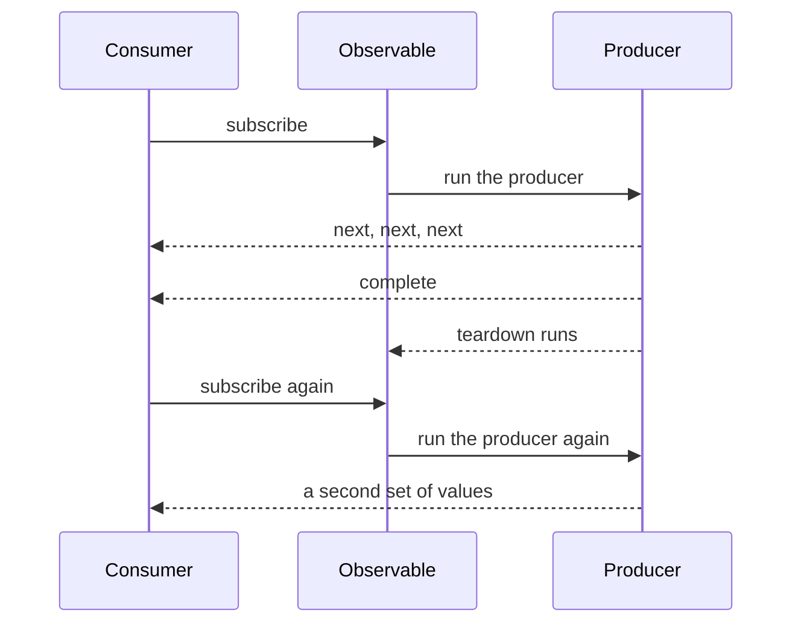
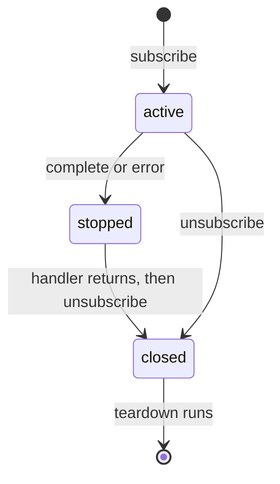
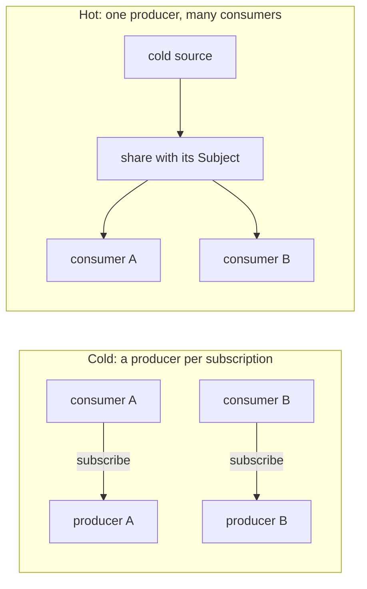
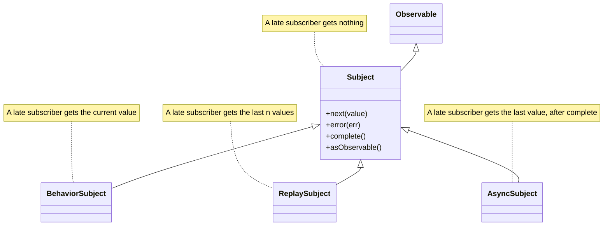
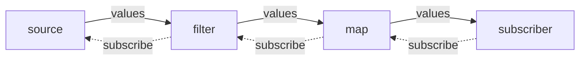
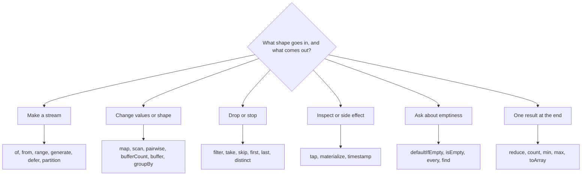
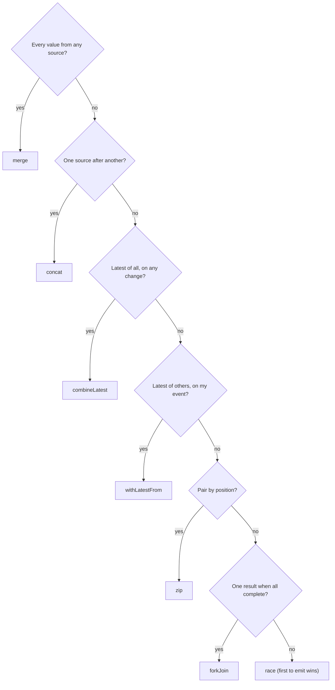
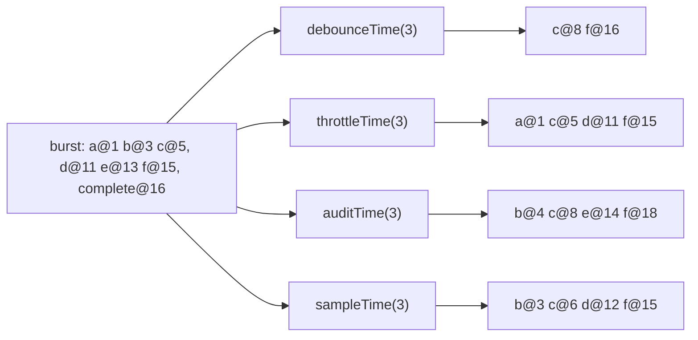
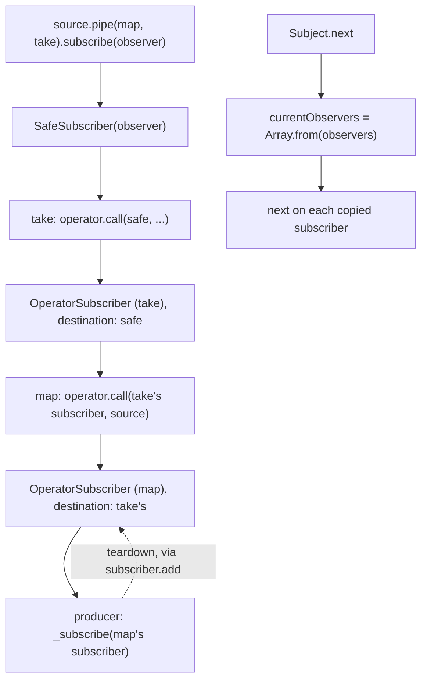

# 22. RxJS foundations: observables, subjects and operators

> **What this covers:** Observables as lazy push collections and how they differ from functions, iterators and promises; the anatomy of an observable, observer, subscription and teardown; cold and hot sources; the four subjects; pipeable operators and writing your own; the operator catalogue by purpose, combination and timing operators; and the subscriber chain underneath. Higher-order mapping, error strategies, schedulers, unsubscription strategies, marble testing and signal interop are module 23.
> **Prerequisites:** [04. JavaScript async and the event loop](04-js-async-event-loop.md#3-promises-from-callbacks-to-a-state-machine) (promises and microtasks; cancellation in [§7](04-js-async-event-loop.md#7-cancellation-with-abortcontroller)) and [07. TypeScript advanced types and decorators](07-ts-advanced-types-and-decorators.md#1-generics-constraints-defaults-inference-and-const-type-parameters) (generics, for operator signatures)
> **Leads to:** [23. RxJS in depth](23-rxjs-in-depth.md), [24. Routing](24-routing.md), [25. Forms](25-forms-reactive-and-template-driven.md), [27. HttpClient](27-http-client.md), [28. State management](28-state-management.md), [29. Testing Angular](29-testing-angular.md)
> **Applies to:** Angular 22.2 (`@angular/core` 22.2.1), RxJS 7.8 (`rxjs` 7.8.2), TypeScript 6.0, Node 24
> **Study time:** ~6 hours reading + ~4 hours exercises
> **Short on time:** read [3. Cold and hot](#3-cold-and-hot-unicast-and-multicast), [4. Subjects](#4-subjects-subject-behaviorsubject-replaysubject-and-asyncsubject), [7. Combining streams](#7-combining-streams-combinelatest-withlatestfrom-forkjoin-zip-merge-and-concat) and [8. Timing operators](#8-timing-operators-debouncetime-throttletime-audittime-and-sampletime), then drill [Q22.06](#q22-06), [Q22.12](#q22-12), [Q22.16](#q22-16), [Q22.29](#q22-29) and [Q22.31](#q22-31), try [Exercise 22.5](#ex22-5), and finish with the [Summary](#summary).
> **Labs:** [`labs/angular/src/app/modules/22-rxjs-foundations/`](../labs/angular/src/app/modules/22-rxjs-foundations/) (section specs, fixtures, Exercises 22.1-22.5, *Output* questions; RxJS specs, a few with `EventEmitter`, `HttpClient` or `TestBed`; no `labs/ts-js` files). Run (Node 24): from `labs/angular`, `npx ng test --watch=false --include='src/app/modules/22-rxjs-foundations/**/*.spec.ts'`.

## Contents

1. [Push collections: Observables, Promises, iterators and laziness](#1-push-collections-observables-promises-iterators-and-laziness)
2. [Anatomy: `Observable`, `Observer`, `Subscription` and teardown](#2-anatomy-observable-observer-subscription-and-teardown)
3. [Cold and hot, unicast and multicast](#3-cold-and-hot-unicast-and-multicast)
4. [Subjects: `Subject`, `BehaviorSubject`, `ReplaySubject` and `AsyncSubject`](#4-subjects-subject-behaviorsubject-replaysubject-and-asyncsubject)
5. [Pipeable operators and writing your own](#5-pipeable-operators-and-writing-your-own)
6. [The operator catalogue: creation, transformation, filtering, utility, conditional and aggregation](#6-the-operator-catalogue-creation-transformation-filtering-utility-conditional-and-aggregation)
7. [Combining streams: `combineLatest`, `withLatestFrom`, `forkJoin`, `zip`, `merge` and `concat`](#7-combining-streams-combinelatest-withlatestfrom-forkjoin-zip-merge-and-concat)
8. [Timing operators: `debounceTime`, `throttleTime`, `auditTime` and `sampleTime`](#8-timing-operators-debouncetime-throttletime-audittime-and-sampletime)
9. [Under the hood: `subscribe`, the subscriber chain and the subject's observer list](#9-under-the-hood-subscribe-the-subscriber-chain-and-the-subjects-observer-list)
- [Summary](#summary)
- [Question bank](#question-bank)
- [Hands-on exercises](#hands-on-exercises)
- [Check your understanding](#check-your-understanding)
- [Connections](#connections)

**How the claims here are verified.** A sentence about what a program printed or did cites a spec in `labs/angular/src/app/modules/22-rxjs-foundations/`, run by `ng test` (in jsdom, a DOM implementation for Node, with `rxjs` 7.8.2). "Read from the source" means the published `rxjs` 7.8.2 package, with file and function named. Deprecation markers come from typings `@deprecated` tags and the CHANGELOG, and documentation quotes name their file on the `7.x` branch. A marker on an `rxjs` API gives the RxJS version (`v6.4` is RxJS 6.4); a marker on an Angular API gives the Angular version. Browser support of the platform `Observable`, Project Reactor, performance and Angular application patterns are documented only: cited and dated, never run.

## 1. Push collections: Observables, Promises, iterators and laziness

### The problem it solves

A click, a socket message and a timer each produce many values; a Promise delivers one. A teammate asks why a second `subscribe` "starts everything again" ([Q22.02](#q22-02)), another expects Promise ordering ([Q22.03](#q22-03)).

An **Observable** is a lazily executed collection of zero to many values. The **producer** creates them, the **consumer** receives them. **Push**: the producer decides when a value arrives; **pull**: the consumer asks. A **subscription** is the handle that stops one run ([section 2](#2-anatomy-observable-observer-subscription-and-teardown)).

### Mental model

A library trip pulls: you ask, you get a book. A magazine pushes: nothing is printed until you subscribe, and issues come when the publisher decides. The RxJS guide (`observable.md`, `7.x`) fills the empty cell:

|  | Single | Multiple |
|---|---|---|
| **Pull** | function | iterator |
| **Push** | Promise | Observable |

Observables are **lazy**: creating one runs nothing, and each `subscribe` starts a new run. A **teardown** is the cleanup a producer may return ([section 2](#2-anatomy-observable-observer-subscription-and-teardown)).



What to notice: the producer starts at `subscribe`, not at creation, and each `subscribe` gets its own run.

### How it actually works

**Lazy, one run per subscribe.** `Section 1: subscribing runs the producer once per subscribe and not before`: creation logged nothing, each `subscribe` logged `producer`. Read from the `rxjs` 7.8.2 source (`Observable.js`): the constructor only stores `_subscribe` (internal); `Observable.subscribe` calls it.

**Synchronous when the producer is.** `Section 1: delivery from a synchronous producer finishes before subscribe returns`: `of(1, 2, 3)` reached the consumer before the next line. The guide calls "Observables are asynchronous" untrue.

**Against a Promise.** `Section 1: a promise runs its executor at creation and an observable its producer at subscribe` logs the executor first, the producer and `next` at `subscribe`, and the Promise handlers last, in a **microtask** (a job queued after the current code, [04 §1](04-js-async-event-loop.md#1-the-event-loop-tasks-microtasks-and-rendering)). A Promise settles once ([04 §3](04-js-async-event-loop.md#3-promises-from-callbacks-to-a-state-machine)); `AbortController` signals cancellation ([04 §7](04-js-async-event-loop.md#7-cancellation-with-abortcontroller)).

**To and from a Promise.** `firstValueFrom` [Added in v7.0] and `lastValueFrom` [Added in v7.0] subscribe at once and resolve with the first or last value; an empty source rejects with `EmptyError` unless `{ defaultValue }` is given (`Section 1: firstValueFrom subscribes at once and rejects with EmptyError on an empty source`). `from` takes arrays, strings, sets, maps, Promises and async iterables ([04 §6](04-js-async-event-loop.md#6-async-iteration)); a Promise's value arrives last (`Section 1: from accepts arrays, strings, sets, maps, promises and async iterables`).

**Not a Promise, not an iterable.** `Section 1: an observable is neither thenable nor iterable`: an instance has no `then` (a **thenable** is any object with one, [04 §3](04-js-async-event-loop.md#3-promises-from-callbacks-to-a-state-machine)), `Symbol.iterator` or `Symbol.asyncIterator`, so `await observable` returns it unchanged.

**Where RxJS meets Angular.** The tags are from the `@angular/core` 22.2.1 typings (read); `Section 1: the rxjs-interop module exports the functions named in the table`.

| Entry point | Taught in |
|---|---|
| `EventEmitter` (a `Subject`, an Observable you can push into, in the typings), the `async` pipe | [section 4](#4-subjects-subject-behaviorsubject-replaysubject-and-asyncsubject), [14 §8](14-directives-and-pipes.md#8-the-async-pipe-under-the-hood) |
| `toSignal`, `toObservable` (`@publicApi 20.0`), `rxResource` (`@publicApi 22.0`), `pendingUntilEvent` [Developer preview since v20.0] | [17 §8](17-signals.md#8-interop-with-rxjs), [23](23-rxjs-in-depth.md#7-rxjs-and-signals-decision-rules-tosignal-toobservable-and-rxresource) |
| `outputFromObservable`, `outputToObservable`, `takeUntilDestroyed` (`@publicApi 19.0`) | [19 §6](19-component-communication-and-projection.md#6-decorator-based-inputs-outputs-and-queries-and-the-migration-schematics), [20 §5](20-lifecycle-and-render-hooks.md#5-teardown-ngondestroy-destroyref-and-takeuntildestroyed) |
| `Router.events`, `valueChanges`, `HttpClient` | [24](24-routing.md#7-the-navigation-lifecycle-events-cancellation-and-the-transition-pipeline), [25](25-forms-reactive-and-template-driven.md#7-status-updateon-valuechanges-and-the-unified-events-stream), [27](27-http-client.md#1-httpclient-versus-fetch-what-the-framework-adds-over-the-platform) |

> [!NOTE]
> **Framework vs platform.** The platform's own `Observable` is a proposal of the WICG (Web Platform Incubator Community Group): `EventTarget.when()`, `AbortSignal` cancellation and a short list of methods (`map`, `filter`, `take`, `finally`). Status on 2026-10-09, documented, not run (`Section 1: jsdom and Node expose no global Observable`): webstatus.dev lists Chrome and Edge 135; MDN lists Firefox and Safari as not shipped; the spec is a Community Group draft off the W3C Standards Track; the position labels are Mozilla `negative` and WebKit `support`. chromestatus reads "In development" though its desktop milestone is 135.

### Code

The approach is to make the producer log every step.

1. Build an Observable whose producer logs, emits, completes and returns a teardown.
2. Create it, subscribe, then subscribe to a second one, and compare the log with the call order.

```ts
// Excerpt of labs/angular/src/app/modules/22-rxjs-foundations/concepts/section-1-push-collections.spec.ts
function loggingSource(log: string[], name: string): Observable<string> {
  return new Observable<string>((subscriber) => {
    log.push('producer');
    subscriber.next(`${name}1`);
    subscriber.complete();
    return () => log.push('teardown');
  });
}

    const log: string[] = [];
    const source = loggingSource(log, 'v');
    log.push('created');
    source.subscribe((value) => log.push(value));
    loggingSource(log, 'w').subscribe((value) => log.push(value));

    expect(log).toEqual(['created', 'producer', 'v1', 'teardown', 'producer', 'w1', 'teardown']);
```

#### Legacy

`Observable.prototype.toPromise` [Deprecated since v7.0 — use firstValueFrom or lastValueFrom] resolves with the last value and, unlike `lastValueFrom`, with `undefined` on an empty source (`Section 1: toPromise resolves with the last value, and with undefined on an empty source`); basis: `@deprecated` in the 7.8.2 typings and `7.0.0` tag.

```ts
// Excerpt of labs/angular/src/app/modules/22-rxjs-foundations/concepts/section-1-push-collections.spec.ts
    expect(await EMPTY.toPromise()).toBeUndefined();
    expect(await lastValueFrom(EMPTY, { defaultValue: undefined })).toBeUndefined();
```

### Best practices and anti-patterns

- **Subscribe only where the value is needed**, because each `subscribe` runs the producer again.
- **Pick `firstValueFrom` or `lastValueFrom` by the value you need**, because an empty source rejects with `EmptyError`.
- **Do not `await` an Observable**, because it is not thenable.

### Misconceptions and traps

- *"Observables are asynchronous."* Delivery is synchronous when the producer is; examples use timers.
- *"An Observable is a Promise for many values."* A Promise runs once, at creation; an Observable at every `subscribe`. Both push.
- *"Creating an Observable starts the work."* It starts at `subscribe`; the habit comes from the Promise executor.
- *"RxJS is part of Angular."* `@angular/core` 22.2.1 lists `rxjs ^6.5.3 || ^7.4.0` as a peer; its APIs return Observables.
- *"The browser has Observables now, so RxJS is obsolete."* The platform API is a draft shipped in Chrome and Edge 135 only (note above); the Chrome 135 post says "The Observable API is now supported".

Drilled in [Q22.01](#q22-01), [Q22.02](#q22-02), [Q22.03](#q22-03), [Q22.04](#q22-04); modelled in [Exercise 22.1](#ex22-1).

## 2. Anatomy: `Observable`, `Observer`, `Subscription` and teardown

### The problem it solves

A producer that opens an interval and a listener leaks both once the consumer leaves. A `subscribe` inside `next` throws a confusing `ReferenceError` later, not at the call ([Q22.08](#q22-08)), and an error in a handler vanishes. A team asks what `complete` guarantees ([Q22.05](#q22-05), [Q22.06](#q22-06)).

### Mental model

An **Observable** is the recipe: a function that receives a subscriber. An **observer** is the consumer's three callbacks, `next`, `error` and `complete`, each optional; one call of them is a **notification**. A **subscriber** (an internal class, [section 9](#9-under-the-hood-subscribe-the-subscriber-chain-and-the-subjects-observer-list)) is the observer plus the guarantees RxJS adds. A **subscription** is the handle (`unsubscribe`, `closed`, `add`) that owns the **teardown**, the function the producer returns. The **contract**: zero or more `next`, then at most one `error` or `complete`, then nothing ("there can only be either one of them", `observable.md`, `7.x`).

A phone call: dialing starts the producer, either side can hang up, and hanging up runs the cleanup.



What to notice: "stopped" and "closed" differ. After `complete` the subscriber drops notifications at once, and the teardown runs when it closes.

### How it actually works

**Teardown timing.** In `Section 2: teardown runs on complete, on error and on unsubscribe, once` the `complete` handler saw `closed` false, then the teardown ran, then `closed` was true; `error` ran its handler then the teardown; two `unsubscribe` calls ran it once. `Section 2: a synchronous complete runs the teardown after the producer returns` logs `n`, `c`, `producer returns`, `teardown`. Read from the `rxjs` 7.8.2 source (`Subscriber.js`): `Subscriber.complete` sets `isStopped` (internal) and calls `_complete` (internal), whose `finally` calls `unsubscribe`; `Subscription.add` runs a teardown at once when `closed` is already true.

**After the end.** `Section 2: notifications after complete or error are ignored`: a `next`, a second `complete` and a late `error` made no call. `Subscriber` hands them to `handleStoppedNotification` (internal), which calls `config.onStoppedNotification` only if set (a no-op by default, `config.d.ts`).

**Synchronous producers.** `Section 2: take closes a synchronous producer and the loop sees closed`: a `while (!subscriber.closed)` loop stopped after three values. In `Section 2: unsubscribing from inside next of a synchronous source reaches an unassigned variable`, `const sub = of(1).subscribe(() => sub.unsubscribe())` did not throw at `subscribe`; a `ReferenceError` was reported later (the **temporal dead zone**, [02 §2](02-js-scope-closures-this.md#2-hoisting-and-the-temporal-dead-zone)).

**Errors.** A throw in the **consumer's** handler is reported later; a throw in a producer or an operator (a function that turns one Observable into another, [section 5](#5-pipeable-operators-and-writing-your-own)) becomes an `error` notification. In `Section 2: an error thrown in next is reported later, not at subscribe`, neither a handler's throw nor an `error` with no handler reached the caller; after the timers ran, `config.onUnhandledError` had both. Read: `ConsumerObserver` (internal) catches and calls `reportUnhandledError`, which (internal) sets a timeout that throws (`util/reportUnhandledError.js`). `Section 2: a producer that throws delivers an error notification` covers a producer and a `map` projection. Recovery is [module 23](23-rxjs-in-depth.md#3-errors-catcherror-placement-finalize-and-error-versus-complete).

**Composition.** `Section 2: a Subscription tears down children and functions in order and reports teardown errors together`: `unsubscribe` ran the parent's teardown, then each child, then each function; `add` on a closed subscription ran at once; a child that left first was not run again; two throwing teardowns became one `UnsubscriptionError` with two `errors`. `subscribe` returns such an object (`Section 2: subscribe returns a Subscriber, which is a Subscription`).

**Forms.** `subscribe` takes nothing, an observer, a function or positional callbacks [Deprecated since v6.4 — use an observer] (`Section 2: subscribe accepts an observer, a function and positional callbacks`); the method itself is not deprecated (`deprecations/subscribe-arguments.md`).

> [!WARNING]
> `config.useDeprecatedSynchronousErrorHandling` [Deprecated since v6.0 — use the default] rethrows errors synchronously; its typings say "DO NOT USE THIS FLAG UNLESS IT'S NEEDED TO BUY TIME FOR MIGRATION REASONS". Do not enable it to "see" errors.

> [!NOTE]
> **Framework vs platform.** The platform `Observable` also registers teardown, through `addTeardown()` (explainer; the note in [section 1](#1-push-collections-observables-promises-iterators-and-laziness)).

### Code

The approach is to hold the subscriber and end the source three ways.

1. Keep the subscriber the producer receives, and log the teardown.
2. Subscribe, end the source, and log `closed` inside and after the handler.

```ts
// Excerpt of labs/angular/src/app/modules/22-rxjs-foundations/concepts/section-2-anatomy.spec.ts
function heldSource(log: string[]): { source: Observable<number>; subscriber: () => Subscriber<number> } {
  let held: Subscriber<number> | undefined;
  const source = new Observable<number>((subscriber) => {
    held = subscriber;
    return () => log.push('teardown');
  });
  return { source, subscriber: () => held as Subscriber<number> };
}

    const onComplete: string[] = [];
    const completing = heldSource(onComplete);
    const done = completing.source.subscribe({ complete: () => onComplete.push(`complete, closed ${done.closed}`) });
    completing.subscriber().complete();
    onComplete.push(`closed ${done.closed}`);

    expect(onComplete).toEqual(['complete, closed false', 'teardown', 'closed true']);
```

#### Legacy

- Positional `subscribe(next, error, complete)`: pass `{ next, error, complete }`.
- `Observable.create(fn)` [Deprecated since v6.4 — use new Observable]: `new Observable(fn)` (`Section 2: Observable.create builds an observable that behaves like the constructor`; the `@deprecated` tag is in the `6.4.0` tag source and not in `6.3.3`).
- `Subscriber.create` [Deprecated since v7.0 — no replacement]: the CHANGELOG (7.0.0-beta.7) calls it and `new Subscriber` deprecated; pass an observer to `subscribe` instead.

### Best practices and anti-patterns

- **Return the teardown from the producer**, because complete, error and unsubscribe all run it.
- **Test `subscriber.closed` in a synchronous loop**, because `take` ends the stream through it.
- **Pass an observer object to `subscribe`**, because it names each notification.
- **Give every `subscribe` an `error` handler**, because an error with none is reported later as unhandled.

### Misconceptions and traps

- *"`complete` runs the teardown."* `complete` stops notifications, then closes the subscription, and closing runs the teardown; the lifecycle reads as one event.
- *"`unsubscribe` inside `next` always works."* A synchronous source calls `next` before `subscribe` returns, so the variable is unassigned.
- *"Errors in handlers surface at the `subscribe` call."* They are reported on a later job; the try/catch habit comes from Promises.
- *"An error and a teardown are separate paths."* The teardown runs after `error` as after `complete`; there are two callbacks, one cleanup.
- *"A hand-written Observable must return a function."* The typings' `TeardownLogic` is a `Subscription`, an `Unsubscribable` (any object with an `unsubscribe()` method), a function or nothing; the docs' examples return functions.

Drilled in [Q22.05](#q22-05), [Q22.06](#q22-06), [Q22.07](#q22-07), [Q22.08](#q22-08), [Q22.09](#q22-09) and [Q22.33](#q22-33); modelled in [Exercise 22.1](#ex22-1).

## 3. Cold and hot, unicast and multicast

### The problem it solves

Two components subscribe to "the same" stream and the server is called twice ([Q22.10](#q22-10)). A late subscriber misses the value that matters ([Q22.12](#q22-12)). A `fromEvent` listener is added per consumer ([Q22.11](#q22-11)). A backend developer expects Project Reactor's `Flux` (its stream of 0 to N items) to behave the same and asks about backpressure ([Q22.14](#q22-14)).

### Mental model

A source is **cold** when each subscription creates its own producer, and **hot** when the producer exists outside the subscriptions. **Unicast** means one consumer per producer, **multicast** many. The docs (`guide/glossary-and-semantics.md`, `7.x`): cold is "_always_ unicast", unicast "doesn't necessarily mean cold", hot is "almost always multicast", and "Cold observables can be made hot but not the other way around".

A cooking class where each student cooks a meal is cold; a TV broadcast everyone joins mid-show is hot.



What to notice: where the producer is created decides cold or hot, the number of consumers per producer decides the cast, and `share` puts a Subject between one subscription and many consumers.

### How it actually works

**Four sources.** `Section 3: interval is cold, each subscriber gets its own timer`: a second subscriber, two ticks late, counted `0, 1` while the first counted `0, 1, 2, 3`. `Section 3: fromEvent adds a listener per subscription and misses earlier events` (jsdom `<button>`): a click before any subscriber reached nobody, two subscriptions made two `addEventListener` calls, and each `unsubscribe` made one `removeEventListener`. Read from the `rxjs` 7.8.2 source (`observable/fromEvent.js`): the producer calls `add(handler)` and returns `() => remove(handler)`. `Section 3: from(promise) shares one promise and defer re-runs the factory`: `from(make())` ran `make` once, at creation, for two subscribers; `defer(() => from(make()))` ran it once per subscriber. **`defer`** runs a factory at each `subscribe`.

**`share`.** Read from `operators/share.js`: the defaults are `connector: () => new Subject()` (a **Subject** is an Observable you can also push values into, [section 4](#4-subjects-subject-behaviorsubject-replaysubject-and-asyncsubject)) and `resetOnError`, `resetOnComplete` and `resetOnRefCountZero` all `true`. It keeps a **reference count** of subscribers and connects the source on the first. `Section 3: share runs one producer and resets when the last subscriber leaves`: two subscribers made one producer run, the teardown ran when both had left, and a later subscriber started run 2 ([Q22.12](#q22-12) prints the lines). `Section 3: a late subscriber of a shared stream misses earlier values`.

**`connectable`.** `Section 3: connectable runs nothing until connect`: before `connect()` the producer had not run; after it, it ran once and a later subscriber missed the synchronous values.

**No backpressure.** **Backpressure** is the consumer telling the producer how much it can take. `Section 3: a producer pushes every value without waiting for the consumer`: 1,000 values arrived before `subscribe` returned, the subscription has no `request` member, and `bufferCount(100)` made 10 batches. The typings give `Observer` only `next`, `error` and `complete`, and `Subscription` only `unsubscribe`, `add`, `remove` and `closed`.

**Neighbours.** `shareReplay` is [module 23](23-rxjs-in-depth.md#5-multicasting-in-depth-share-configuration-sharereplay-and-connect). `Section 3: HttpClient sends no request until subscribe and one per subscribe` ([27](27-http-client.md#1-httpclient-versus-fetch-what-the-framework-adds-over-the-platform)); the `async` pipe subscribes once per use ([Q14.27](14-directives-and-pipes.md#q14-27)).

> [!TIP]
> **Coming from the backend.** Reactor 3.8.7's reference says "Nothing happens until you subscribe" and that a cold sequence "starts anew for each Subscriber", like an Observable. There `share()` and `replay(…)` make a cold publisher hot, and `Sinks.Many` feeds one by hand, as `share` and a Subject do here. `Mono` ("an Asynchronous 0-1 Result") has no RxJS twin: `Observable<T>` stands for zero, one or many values. **Where the analogy breaks:** Reactor implements the Reactive Streams `request(n)` protocol, so a subscriber can signal "at most n" and demand travels upstream, "a push-pull hybrid". RxJS 7.8.2 has no demand channel, so thinning is your choice of operator (`bufferCount` above, [section 8](#8-timing-operators-debouncetime-throttletime-audittime-and-sampletime) for the rest). Documented, not run (reference read 2026-10-09).

> [!NOTE]
> **Framework vs platform.** `addEventListener` registers a listener per call; the WICG `when()` "adds a new event listener to the target when its `subscribe()` method is called" (explainer, documented).

### Code

The approach is to count producer runs while two subscribers come and go.

1. Build a source that logs a producer line and a teardown line, with a run number.
2. Share it, subscribe twice, leave one at a time, then subscribe again.

```ts
// Excerpt of labs/angular/src/app/modules/22-rxjs-foundations/concepts/section-3-cold-hot.spec.ts
    const shared = source.pipe(share());

    const a = shared.subscribe((v) => log.push(`1:${v}`));
    const b = shared.subscribe((v) => log.push(`2:${v}`));
    a.unsubscribe();

    expect(log).toEqual(['producer 1', '1:x']);

    b.unsubscribe();
    const c = shared.subscribe((v) => log.push(`3:${v}`));

    expect(log).toEqual(['producer 1', '1:x', 'teardown 1', 'producer 2', '3:x']);
```

#### Legacy

`ConnectableObservable`, `multicast`, `publish`, `publishBehavior`, `publishLast`, `publishReplay` and `refCount` [Deprecated since v7.0 — use share, connectable or connect] (`deprecations/multicasting.md`, `7.x`). Its "How to refactor": a subject with `refCount` becomes `share({ connector })`; a connectable without it becomes `connectable(source, { connector })`; the `Behavior`, `Last` and `Replay` variants pass a `BehaviorSubject`, `AsyncSubject` or `ReplaySubject` as the connector; a selector becomes `connect`. `Section 3: multicast with refCount and share each run one producer for two subscribers`. `shareReplay(1)` is in [module 23](23-rxjs-in-depth.md#5-multicasting-in-depth-share-configuration-sharereplay-and-connect).

### Best practices and anti-patterns

- **Wrap shared work in `share()`**, because a second subscription to a cold source runs the work again.
- **Create a request with `defer`**, because `from(make())` runs `make` once, at creation.
- **Choose the thinning operator on purpose**, because the producer pushes every value whatever the consumer does.

### Misconceptions and traps

- *"Hot means it emits without subscribers."* Hot means the producer lives outside the subscriptions; a Subject nobody has subscribed to is hot and silent. The TV analogy suggests the myth.
- *"A Promise is cold."* The work ran before any `then`; `from(promise)` shares it.
- *"`share()` makes a stream replay."* A late subscriber misses earlier values; the confusion is with `shareReplay`.
- *"`fromEvent` is multicast, so one listener serves all."* By the docs' definition it is hot, since the event target exists outside, yet each subscription adds its own listener; `share()` makes it one.
- *"RxJS has backpressure like Reactor."* It has no demand channel; both are called reactive.

Drilled in [Q22.10](#q22-10), [Q22.11](#q22-11), [Q22.12](#q22-12), [Q22.13](#q22-13), [Q22.14](#q22-14); modelled in [Exercise 22.5](#ex22-5).

## 4. Subjects: `Subject`, `BehaviorSubject`, `ReplaySubject` and `AsyncSubject`

### The problem it solves

A cart service must tell a badge and a list about every change, and a late component needs the current count. One `complete()` silences a bus for everyone ([Q22.18](#q22-18)), and a `BehaviorSubject` three files can `next` has no author ([Q22.19](#q22-19)).

### Mental model

A **Subject** is an Observable you can push into: an observer (`next`, `error`, `complete`) and an Observable at once, delivering each value to the observers present at that moment. As an observer it can subscribe to a source (`Section 4: a Subject is an observer, so it can subscribe to a source and multicast it`; [Q22.15](#q22-15)). The variants differ in what a **late** subscriber gets: `Subject` nothing, `BehaviorSubject` the current value (it needs an initial one), `ReplaySubject(n)` the last n values (its **buffer**), `AsyncSubject` the last value after `complete`.

A radio studio: listeners hear what is said while they listen; a whiteboard shows the score (`BehaviorSubject`), a tape holds the last n announcements (`ReplaySubject`), a results sheet is read out at the end (`AsyncSubject`).



What to notice: the hierarchy is the whole API; the classes differ in what a new subscriber receives.

### How it actually works

**Late subscribers.** `Section 4: a Subject delivers only what is emitted after the subscription`; `Section 4: BehaviorSubject replays its current value and getValue works until an error`; `Section 4: ReplaySubject replays its buffer and then completes late subscribers` (`new ReplaySubject()` kept all five values); `Section 4: AsyncSubject emits only its last value on complete and nothing on error`. After `1, 2` and the end, `Section 4: after the end a late subscriber gets the terminal notification, with the buffer for ReplaySubject` recorded:

| Late subscriber | `Subject` | `BehaviorSubject` | `ReplaySubject(2)` | `AsyncSubject` |
|---|---|---|---|---|
| `complete()` | `complete` | `complete` | `1`, `2`, `complete` | `2`, `complete` |
| `error(x)` | the error | the error | `1`, `2`, the error | the error |

**Edge cases.** In `Section 4: next after complete is ignored and after unsubscribe throws ObjectUnsubscribedError`, a `next` after `complete()` reached nobody and `closed` stayed false; after `unsubscribe()` on the subject, `next`, `subscribe` and `getValue` threw `ObjectUnsubscribedError`. `Section 4: a nested next is delivered depth first` logged `A1, A2, B2, B1`: **re-entrancy**, a `next` inside a subscriber, finishes before the outer delivery goes on. In `Section 4: a subscriber that throws does not stop the others`, the second got its value and `config.onUnhandledError` the error later ([section 2](#2-anatomy-observable-observer-subscription-and-teardown)).

**Read from the `rxjs` 7.8.2 source** (the four subject files). `Subject.next` iterates `currentObservers` (internal), a copy of `observers`; a peer that left mid-loop is still in the copy but its subscriber is stopped, so it is skipped (`Section 4: a subscriber unsubscribed by a peer during delivery is not called`). `_subscribe` (internal) calls `_checkFinalizedStatuses` (internal), which sends a finished subject's end to the newcomer, then `_innerSubscribe` (internal). `BehaviorSubject._subscribe` (internal) emits `_value` only if the subscription is still open, hence `complete` alone. `ReplaySubject` trims `_buffer` in `_trimBuffer` (internal) and `_bufferSize` is `Math.max(1, …)`.

**What to expose.** `Section 4: asObservable hides next`: the result is not a Subject and has no `next`; read from `Subject.asObservable`, its `source` (internal) is the subject.

> [!WARNING]
> A Subject handed out as is lets any consumer `next`, `error` or `complete` it; one `complete()` mutes it for all.

**`EventEmitter`.** The `@angular/core` 22.2.1 typings declare it extending `Subject<T>`; in `Section 4: EventEmitter extends Subject`, `emit(1)` and `next(2)` both reached the subscriber ([19 §6](19-component-communication-and-projection.md#6-decorator-based-inputs-outputs-and-queries-and-the-migration-schematics)).

**When a Subject is a smell.** A Subject every file can `next` has no owner ([Q19.06](19-component-communication-and-projection.md#q19-06)); state fits a signal or a `BehaviorSubject` behind `asObservable()` ([17 §8](17-signals.md#8-interop-with-rxjs), [Q17.40](17-signals.md#q17-40)); `subject.next` inside another stream's `subscribe` is a hand-written operator ([section 5](#5-pipeable-operators-and-writing-your-own)). `WebSocketSubject` (the `rxjs/webSocket` Subject over a socket; it extends `AnonymousSubject`, a Subject that forwards `next` to a given observer and subscribers to a given source; named, not run) is a legitimate hand-made source.

### Code

The approach is to keep the `BehaviorSubject` private and hand out a view.

1. Declare it `private`, with an initial value.
2. Expose `asObservable()`; change the value only in a method.
3. Subscribe: the first value is the current one.

```ts
// Excerpt of labs/angular/src/app/modules/22-rxjs-foundations/concepts/section-4-subjects.spec.ts
class LabM22Counter {
  private readonly subject = new BehaviorSubject(0);
  readonly value$: Observable<number> = this.subject.asObservable();

  increment(): void {
    this.subject.next(this.subject.getValue() + 1);
  }
}

    const counter = new LabM22Counter();
    const seen: number[] = [];
    counter.value$.subscribe((v) => seen.push(v));
    counter.increment();

    expect(seen).toEqual([0, 1]);
    expect('next' in counter.value$).toBe(false);
```

#### Legacy

- `Subject.create(destination, source)` [Deprecated since v6.4 — use new Subject]: `next` goes to the destination, subscribers to the source (`Section 4: Subject.create sends next to the destination and subscribes to the source`). Basis: the `6.4.0` tag says "use new Subject() instead" (absent in `6.3.3`); the 7.8.2 typings say "Recommended you do not use".
- A public `BehaviorSubject` store, `EventEmitter` as a bus, `@Output() EventEmitter`: `asObservable()` and a signal ([Q17.40](17-signals.md#q17-40)); `output()` ([19 §6](19-component-communication-and-projection.md#6-decorator-based-inputs-outputs-and-queries-and-the-migration-schematics)).

### Best practices and anti-patterns

- **Keep the Subject private and expose `asObservable()`**, because a holder of the Subject can `next`, `error` or `complete` it for everyone.
- **Use `BehaviorSubject` only with a real initial value**, because every subscriber gets it first.
- **Size a `ReplaySubject`'s buffer**, because the default keeps every value.
- **Never `complete()` a long-lived bus**, because later `next` calls reach nobody.

### Misconceptions and traps

- *"`BehaviorSubject` is just a `Subject` with a default."* It also replays the current value; the constructor argument is the visible part.
- *"`ReplaySubject()` remembers one value."* The default buffer is unbounded; `BehaviorSubject` causes the mix-up.
- *"A completed Subject throws on `next`."* Only `unsubscribe()` does; the error's name suggests the wrong trigger.
- *"`asObservable()` copies the stream."* It is a view of the same producer; the name suggests a conversion.
- *"Subjects are how you share an Observable."* A Subject multicasts, so it looks like the tool; [`share()`](#3-cold-and-hot-unicast-and-multicast) needs no bridge.

Drilled in [Q22.15](#q22-15), [Q22.16](#q22-16), [Q22.17](#q22-17), [Q22.18](#q22-18), [Q22.19](#q22-19) and [Q22.34](#q22-34); modelled in [Exercise 22.2](#ex22-2).

## 5. Pipeable operators and writing your own

### The problem it solves

The same `filter`, `map` and `distinctUntilChanged` sit in six pipelines. A hand-written operator keeps its source running after `unsubscribe` and shares a counter ([Q22.22](#q22-22)). `import { merge } from 'rxjs/operators'` compiles and does not mean what the author thinks ([Q22.20](#q22-20)).

### Mental model

A **creation function** makes an Observable (`of`). A **pipeable operator** is a function from Observable to Observable, an `OperatorFunction<T, R>` (`MonoTypeOperatorFunction<T>` if the type is unchanged; both generic, [07 §1](07-ts-advanced-types-and-decorators.md#1-generics-constraints-defaults-inference-and-const-type-parameters)), usually made by an **operator factory** (`map(fn)` returns the operator). `pipe` applies them left to right. The docs (`operators.md`) call an operator "a pure operation: the previous Observable stays unmodified"; subscribing to its result subscribes to the input ([Q22.21](#q22-21)).



What to notice: nothing flows until `subscribe`, which travels upstream; an `unsubscribe` travels the same way.

### How it actually works

**`pipe`.** `Section 5: pipe composes left to right and returns a new observable`: `map(v => v + 1)` then `map(v => v * 10)` turned `1` into `20`, the result was another object, nothing ran before `subscribe`, and the source still emitted `1`. Read from the `rxjs` 7.8.2 source (`util/pipe.js`): `pipeFromArray` returns `identity` for no functions, the function itself for one, else `fns.reduce((prev, fn) => fn(prev), input)`; `Observable.pipe` calls it with `this`. `Section 5: pipe with no operators returns the same observable` checks the first two.

**Reuse.** The standalone `pipe` ("analogous to, but not the same thing as, the `.pipe()` method", docs) names a sequence. In `Section 5: an operator built with pipe is reusable across observables`, the docs' `discardOddDoubleEven` gave `[4, 8]` for `of(1, 2, 3, 4)` and `[20, 24]` for `[10, 11, 12]`. `core-semantics.md` asks an operator to be referentially transparent (one operator serves many Observables), subscribe to the source and unsubscribe from it when it needs no more values (guidelines in version 7).

**From scratch.** When no combination fits, return `new Observable(subscriber => source.subscribe({ next, error, complete }))`. `Section 5: a from-scratch operator must return the upstream subscription`: without the `return`, `unsubscribe()` ran no source teardown; with `return source.subscribe(…)` it did. `Section 5: state declared in the subscribe function is per subscription`: a counter in the factory closure gave `11, 12` then `13, 14` for two subscriptions, one in the subscribe function `11, 12` twice, like `scan`'s `1, 3, 6`. A throw in a projection becomes an `error` notification (`Section 5: an error thrown in an operator projection becomes an error notification`: `N:1`, `E:projection`). Read: `map.js` is `operate(...)` with an `OperatorSubscriber` (both internal, [section 9](#9-under-the-hood-subscribe-the-subscriber-chain-and-the-subjects-observer-list)); `operate` calls `lift` (internal).

**Types.** `Section 5: the operator signatures type-check`: an `OperatorFunction<string, number>` ran on strings; two `// @ts-expect-error` lines show a wrong source and a wrong result fail to compile.

**Import paths.** Operators exported from `'rxjs'` are [Added in v7.2] (CHANGELOG 7.2.0). The docs (`importing.md`) call `'rxjs/operators'` deprecated, to be "removed in one of the next major versions"; the 7.8.2 typings put no `@deprecated` on it. `Section 5: rxjs/operators exports different functions for merge, concat, zip, combineLatest and race` found seven names whose function differs between the paths, the five below and two more ([section 6](#6-the-operator-catalogue-creation-transformation-filtering-utility-conditional-and-aggregation)); nine others it checked are the same object.

> [!WARNING]
> The import compiles, but `merge(of(1), of(2))` from the subpath returned a function, not an Observable. There they are instance operators: `merge` [Deprecated since v6.0 — use mergeWith], `concat` [Deprecated since v6.0 — use concatWith], `zip` [Deprecated since v6.0 — use zipWith], `combineLatest` [Deprecated since v6.0 — use combineLatestWith] and `race` [Deprecated since v6.2 — use raceWith].

### Code

The approach is to write one operator by composition and run it on two sources.

1. Compose `filter` and `map` with the standalone `pipe`, typed `MonoTypeOperatorFunction<number>`.
2. Apply the one operator to two different Observables.

```ts
// Excerpt of labs/angular/src/app/modules/22-rxjs-foundations/concepts/section-5-operators.spec.ts
    const discardOddDoubleEven = (): MonoTypeOperatorFunction<number> =>
      pipe(
        filter((v: number) => !(v % 2)),
        map((v: number) => v + v),
      );
    const operator = discardOddDoubleEven();

    expect(collect(of(1, 2, 3, 4).pipe(operator))).toEqual([4, 8]);
    expect(collect(from([10, 11, 12]).pipe(operator))).toEqual([20, 24]);
```

#### Legacy

- **Patch operators.** `import 'rxjs/add/operator/map'` set `Observable.prototype.map = map` (`5.5.12` tag, `src/add/operator/map.ts`); the `6.0.0` tag has no such file, and the 7.8.2 package exports no `rxjs/add`. Read, not run; use `pipe(map(…))`.
- **`rxjs-compat`** "is not published for v7 (yet)" (CHANGELOG 7.0.0-alpha.0).
- **Instance operators.** `Section 5: the instance operators from rxjs/operators give what the With operators give`; migrate to `mergeWith` and siblings, or the creation function. Basis: `@deprecated` in the `6.0.0` tag (`race`: `6.2.0`), naming `mergeWith` in `7.0.0`.

### Best practices and anti-patterns

- **Return the source's subscription from a hand-written operator**, because the consumer's `unsubscribe` reaches the source through it.
- **Keep per-subscription state in the subscribe function**, because a factory closure is shared by every subscription.
- **Forward `error` and `complete`**, because the subscriber otherwise never ends.
- **Prefer `pipe(...)` to a from-scratch operator**, because the parts already keep the contract.
- **Import operators from `'rxjs'`**, because seven `'rxjs/operators'` names are other functions.

### Misconceptions and traps

- *"An operator changes the Observable it is applied to."* It returns a new one; the array-method habit suggests otherwise.
- *"State in the factory is fine."* The closure looks like a class field, yet every subscription shares it.
- *"Returning nothing from the subscribe function is fine."* Examples that never unsubscribe hide that the source runs on.
- *"`rxjs/operators` is the standard import."* RxJS 6 tutorials say so; since 7.2 it is `'rxjs'`, and seven names differ.

Drilled in [Q22.20](#q22-20), [Q22.21](#q22-21), [Q22.22](#q22-22); modelled in [Exercise 22.3](#ex22-3).

## 6. The operator catalogue: creation, transformation, filtering, utility, conditional and aggregation

### The problem it solves

A developer fills an array inside `subscribe` where `scan` fits ([Q22.24](#q22-24)). `first()` fails in production on an empty response ([Q22.25](#q22-25)). `distinctUntilChanged` lets equal objects through ([Q22.26](#q22-26)). Nobody finds "the previous and the current value" ([Q22.23](#q22-23)).

### Mental model

Find operators by purpose, asking what shape goes in and what comes out: **creation** makes a stream, **transformation** changes values or shape, **filtering** drops or stops, **utility** inspects, **conditional** asks about emptiness, **aggregation** collapses to one value.



What to notice: many operators share a shape (`scan` is a `reduce` that emits as it goes); the empty source is where most differ.

### How it actually works

`Section 6: the catalogue names exist in rxjs 7.8.2` checks the names below. `Section 6: creation functions emit what the table says`:

| Function | Emits |
|---|---|
| `of(1, 2)`, `from([1, 2])` | `1, 2`; `of([1, 2])` emits the array |
| `range(3, 3)` | `3, 4, 5` |
| `generate({ initialState: 1, condition, iterate })` | `1, 2, 4, 8, 16` for `x < 20`, `x * 2` |
| `defer(factory)`, `iif(test, a, b)` | the Observable the factory returns, or `a` or `b`, chosen at each `subscribe` |
| `EMPTY`, `NEVER`, `throwError(fn)` | `complete`; nothing; `error` |
| `partition(source, pred)` | two Observables: matches, rest |

Transformation (`Section 6: pairwise and bufferCount`). `switchMap`, `mergeMap`, `concatMap`, `exhaustMap`, `window*`, `expand`, `mergeScan` and `switchScan` are **higher-order** mappings: [module 23](23-rxjs-in-depth.md#1-higher-order-observables-switchmap-mergemap-concatmap-and-exhaustmap).

| Operator | Emits | Empty source |
|---|---|---|
| `map(fn)` | `fn(value)` | completes |
| `scan(fn, seed?)` | the **accumulator** (running result) per value | completes, seed or not |
| `pairwise()` | `[previous, current]` from the second value | completes |
| `bufferCount(n, step?)` | arrays of `n`, the last maybe shorter | completes |
| `buffer(notifier)`, `groupBy(key)` | an array per `next` of the **notifier** (an Observable used only as a signal; the rest at `complete`); one Observable per key | `[]`; completes |

Filtering (`Section 6: filtering operators on a source and on an empty source`):

| Operator | Emits | Empty source |
|---|---|---|
| `filter`, `take(n)`, `takeLast(n)`, `skip(n)`, `ignoreElements` | matches, first `n`, last `n`, all but `n`, none | completes |
| `takeWhile(pred, inclusive?)`, `skipWhile(pred)` | up to, from the first failure (`true` keeps it) | completes |
| `takeUntil(notifier)`, `skipUntil(notifier)` | until, after the notifier's first `next` | completes |
| `distinct`, `distinctUntilChanged(cmp?)`, `distinctUntilKeyChanged(key)` | drops repeats: ever, consecutive, by key | completes |
| `first`, `last` (`pred?`, `default?`) | the first or last (matching) value | `EmptyError`, or the default |
| `single(pred?)` | the only (matching) value | `EmptyError`; two matches `SequenceError`, none `NotFoundError` |
| `elementAt(i, default?)` | the value at `i` | `ArgumentOutOfRangeError`, or the default |

`Section 6: first, take(1), last and single on empty, one-value and many-value sources`: on an empty source `take(1)` completes where `first` errors; on `1, 2, 3`, `single` errors. Read from the `rxjs` 7.8.2 source (`first.js`): `first` pipes `filter` (given a predicate), `take(1)`, then `defaultIfEmpty` or `throwIfEmpty`.

Utility. `tap` passes values through; `timestamp()` emits `{ value, timestamp }`; `delay` and `timeout` are [section 8](#8-timing-operators-debouncetime-throttletime-audittime-and-sampletime). In `Section 6: materialize turns notifications into values`, `materialize()` turned `of(1)` into `{kind: 'N', value: 1, …}` then `{kind: 'C', …}`, an empty source into the `C` one.

Conditional and aggregation (`Section 6: conditional and aggregation operators on an empty source`):

| Operator | Emits | Empty source |
|---|---|---|
| `defaultIfEmpty(v)`, `throwIfEmpty()` | the values, or `v`, or an error | `v`; `EmptyError` |
| `isEmpty()`, `every(pred)` | one boolean | `true` |
| `find(pred)`, `findIndex(pred)` | the first match, its index | `undefined`, `-1` |
| `reduce(fn, seed?)` | one value at `complete` | the seed, or completes |
| `count(pred?)` | how many | `0` |
| `min()`, `max()`, `toArray()` | one value, or the array, at `complete` | completes; `[]` |

`Section 6: scan emits every accumulation and reduce only the last`: `1, 3, 6` against `6`; `Section 6: reduce and scan on an empty source with and without a seed`: only `reduce` with a seed emitted. Read: `scan.js` and `reduce.js` call `scanInternals` (internal), which keeps `state` per subscription and emits on each `next` (`scan`) or at `complete` (`reduce`). `Section 6: distinctUntilChanged compares with === by default`: two equal objects both passed until a comparator or `distinctUntilKeyChanged('a')`.

### Code

The approach is to run three sources through four operators.

1. Put each operator in a table.
2. Compare the notifications each source produces.

```ts
// Excerpt of labs/angular/src/app/modules/22-rxjs-foundations/concepts/section-6-catalogue.spec.ts
    expect(rows).toEqual([
      ['first', ['E:EmptyError'], ['N:1', 'C'], ['N:1', 'C']],
      ['take(1)', ['C'], ['N:1', 'C'], ['N:1', 'C']],
      ['last', ['E:EmptyError'], ['N:1', 'C'], ['N:3', 'C']],
      ['single', ['E:EmptyError'], ['N:1', 'C'], ['E:SequenceError']],
    ]);
```

#### Legacy

- `pluck` [Deprecated since v7.0 — use map and ?.] (`@deprecated` in the `7.0.0` tag, absent in `6.6.7`).
- `mapTo`: the typings say "To be removed in v9"; the deprecating version was not read.
- The `partition` operator [Deprecated since v6.5 — use the partition function] (CHANGELOG 6.5.0).
- `pairs` [Deprecated since v7.0 — use from(Object.entries(obj))] (CHANGELOG 7.0.0-beta.8).
- The `onErrorResumeNext` operator [Deprecated since v7.6 — use onErrorResumeNextWith] (CHANGELOG 7.6.0).

`Section 6: the replacements for pluck, mapTo, the partition operator and pairs give the same values`:

```ts
// Excerpt of labs/angular/src/app/modules/22-rxjs-foundations/concepts/section-6-catalogue.spec.ts
    const [odd, even] = partition(of(1, 2, 3, 4), (v) => v % 2 === 1);

    expect(notifications(legacyPluck(users))).toEqual(notifications(users.pipe(map((x) => x?.user?.name))));
    expect(notifications(legacyMapTo(of(1, 2)))).toEqual(notifications(of(1, 2).pipe(map(() => 'x'))));
    expect(notifications(legacyPairs(entries))).toEqual(notifications(from(Object.entries(entries))));
```

### Best practices and anti-patterns

- **Choose `first()` or `take(1)` by the empty case**, because `first` errors and `take(1)` completes.
- **Use `scan`, not an array filled in `subscribe`**, because `scan` keeps its state per subscription.
- **Give `distinctUntilChanged` a comparator for objects**, because the default is `===`.
- **Seed `reduce` when the source can be empty**, because otherwise it completes silently.

### Misconceptions and traps

- *"`first()` and `take(1)` are the same."* Both emit one value; `first` errors on an empty source.
- *"`reduce` emits as it goes."* Array `reduce` suggests it; it emits at `complete`.
- *"`distinctUntilChanged` compares by value."* The name suggests it; the default is `===`.
- *"`of([1, 2, 3])` emits three values."* `Array.of` suggests it; `of` emits one array, `from` spreads it.

Drilled in [Q22.23](#q22-23), [Q22.24](#q22-24), [Q22.25](#q22-25), [Q22.26](#q22-26); modelled in [Exercise 22.4](#ex22-4).

## 7. Combining streams: `combineLatest`, `withLatestFrom`, `forkJoin`, `zip`, `merge` and `concat`

### The problem it solves

A screen shows the latest filter with the latest results; a click carries the current price; three loaders must finish before rendering. Then a `forkJoin` over a live stream never emits, a `combineLatest` stays silent ([Q22.29](#q22-29)), and a `zip` hoards the faster stream's values.

### Mental model

Each combination operator answers three questions: **when it subscribes** (to all sources at once, or one after another), **what it emits** (the **latest value**, the last one so far, of each; pairs by position; one final array; or every value) and **when it completes**. `merge` **interleaves** (passes every value in arrival order) like a conference call; `concat` is one queue; `combineLatest` a dashboard; `zip` pairs dancers; `forkJoin` takes the group photo once everyone has arrived ([Q22.27](#q22-27)).



What to notice: the questions are about timing and completion, not types.

### How it actually works

The runs are **marble diagrams**: one character is one **frame** (a tick of virtual time, 0 at the left). Legend: `-` an empty frame, a letter a `next`, `|` complete, `#` error, `v@n` value `v` at frame `n`. Each is a test input, run by `TestScheduler.run` through the lab's [`timeline`](../labs/angular/src/app/modules/22-rxjs-foundations/concepts/support/timeline.ts) helper; writing marble tests is [module 23](23-rxjs-in-depth.md#10-testing-with-testscheduler-marble-syntax-and-virtual-time-under-the-hood).

```text
combineLatest([a-b-c|, -x---y|])      [a,x]@1 [b,x]@2 [c,x]@4 [c,y]@5 complete@6
combineLatest([a-b|, -|])             complete@3, no value
combineLatest([a-b|, ----x| + startWith('s')])   [a,s]@0 [b,s]@2 [b,x]@4 complete@5
a-b-c-d| withLatestFrom(--x---y|)     [b,x]@2 [c,x]@4 [d,y]@6 complete@7
zip([a-b-c|, -x-y---z|])              [a,x]@1 [b,y]@3 [c,z]@7 complete@7
zip([a|, -x-y-z|])                    [a,x]@1 complete@1
merge(a---b|, -x-y-|)                 a@0 x@1 y@3 b@4 complete@5
merge(a--|, b--|, c--|, 2)            a@0 b@0 c@3 complete@6
concat(a-b|, x-y|)                    a@0 b@2 x@3 y@5 complete@6
forkJoin([a-b|, -x-y-z|])             [b,z]@6 complete@6
forkJoin([a----|, -|])                complete@1, no value
forkJoin([a----|, --#])               error@2
race(---a|, -b-c|)                    b@1 c@3 complete@4
```

**`combineLatest`** waits for one value from every source, then emits on any `next`, and completes when all complete (`Section 7: combineLatest re-emits the latest of each once every source has emitted`, with the object form; `Section 7: combineLatest with an empty source completes without a value`). Read from the `rxjs` 7.8.2 source (`observable/combineLatest.js`, `combineLatestInit`): the counter `remainingFirstValues` must reach zero before `next` is called. `startWith` supplies a value at frame 0 (`Section 7: startWith gives combineLatest an initial value`).

**`withLatestFrom`** dropped `a` (`Section 7: withLatestFrom drops source values before the other source emits`). Read from `operators/withLatestFrom.js`: a `ready` flag turns true once every other input has emitted; their `complete` is a `noop`, so only the source triggers and ends the result.

**`zip`** pairs the n-th values (`Section 7: zip pairs by position and completes when the shortest ends`). Read from `observable/zip.js`: one array per source (`buffers`), a row shifted out when each has a value, completion when a completed source's array is empty. Nothing caps the arrays (read, not measured).

**`merge` and `concat`** (`Section 7: merge interleaves and concat queues`): `merge` subscribes to every source at once, `concat` to the next when the previous completes: read from `observable/merge.js` and `concat.js`, `merge` is `mergeAll(concurrent)` and `concat` is `concatAll()`, one slot. The number argument is the **concurrency**, the most sources subscribed at a time (`Section 7: merge with a concurrency limit subscribes later sources when a slot frees`).

**`forkJoin`** (`Section 7: forkJoin emits the last values on completion, errors on any error and completes empty when a source is empty`, with the object form). Read from `observable/forkJoin.js`: each source's subscriber, from `createOperatorSubscriber` (internal), has a finalizer that emits when no completions remain and every source has a value, or completes at once when a source ended without one. Sources are `ObservableInput`s (anything `from` accepts, [section 1](#1-push-collections-observables-promises-iterators-and-laziness)). `Promise.all` ([04 §4](04-js-async-event-loop.md#4-combinators-and-helpers)) waits for every fulfilment, `forkJoin` for every completion, and both fail at the first error.

**`race`** follows the first source to emit (`Section 7: race follows the first source to emit`). Errors end every one of these: an `OperatorSubscriber` (internal, [section 9](#9-under-the-hood-subscribe-the-subscriber-chain-and-the-subjects-observer-list)) without an error callback passes `error` on (`operators/OperatorSubscriber.js`; run for `forkJoin` only).

### Code

The approach is to compare frame tables in virtual time.

1. Build each input with `cold`, one character per frame; give the slow one `startWith`.
2. Combine them and record each notification with its frame through `timeline`.

```ts
// Excerpt of labs/angular/src/app/modules/22-rxjs-foundations/concepts/section-7-combination.spec.ts
    expect(timeline(({ cold }) => combineLatest([cold('a-b|'), cold('----x|').pipe(startWith('s'))]))).toEqual([
      [0, 'N', ['a', 's']],
      [2, 'N', ['b', 's']],
      [4, 'N', ['b', 'x']],
      [5, 'C'],
    ]);
```

#### Legacy

- Rest arguments, `combineLatest(a, b)` and `forkJoin(a, b)` [Deprecated since v6.5 — use an array or an object] (`deprecations/array-argument.md`, `7.x`; the 7.8.2 typings tag a trailing result selector the same way: use the array and `map`).
- Instance operators from `'rxjs/operators'` ([section 5](#5-pipeable-operators-and-writing-your-own)): use `mergeWith` and siblings.
- The `scheduler` argument of `merge` [Deprecated since v6.5 — use scheduled and mergeAll] (`deprecations/scheduler-argument.md`).

`Section 7: the deprecated rest-argument and instance forms give what the current forms give` runs the first two.

### Best practices and anti-patterns

- **Use `forkJoin` only over sources that complete**, because it emits from the finalizer.
- **Give a slow `combineLatest` source a `startWith`**, because the result waits for every source.
- **Use `withLatestFrom` when one stream should trigger**, because the others never cause an emission.
- **Avoid `zip` over unrelated rates**, because its buffers grow with the lag.

### Misconceptions and traps

- *"`combineLatest` emits when one source emits."* The name suggests it; it waits for each source once, and an empty source keeps it silent.
- *"`forkJoin` is `Promise.all` for Observables."* HTTP examples complete after one value; a source that never completes, a live stream or a `BehaviorSubject`, keeps it silent.
- *"`zip` and `combineLatest` differ in name only."* Both return arrays; `zip` pairs by position and buffers.
- *"`merge` waits for the first source to finish."* That is `concat`, taught beside it; `merge` interleaves.
- *"`withLatestFrom` emits when the other source changes."* It reads like `combineLatest`; only the source triggers.

Drilled in [Q22.27](#q22-27), [Q22.28](#q22-28), [Q22.29](#q22-29); modelled in [Exercise 22.5](#ex22-5).

## 8. Timing operators: `debounceTime`, `throttleTime`, `auditTime` and `sampleTime`

### The problem it solves

A search box sends a request per keystroke; a scroll handler fires dozens of times a second; a save button is double-clicked; a status panel wants the current value four times a second. Each fix is a different operator, and the wrong one drops the last keystroke or scroll position ([Q22.30](#q22-30), [Q22.32](#q22-32)).

### Mental model

The four operators thin a **burst** (values arriving close together) and differ in **what they keep** and **when they emit**. `debounceTime(d)` waits for **silence** (no value for `d`) and emits the last value; `throttleTime(d)` emits the first and ignores the rest for `d`; `auditTime(d)` starts a timer on the first value and emits the last when it ends; `sampleTime(d)` emits the latest value at each tick of a fixed clock, if one arrived. The **leading edge** of a window is its start, the **trailing edge** its end. Analogies: an elevator leaving when nobody has entered for `d` (debounce), a turnstile (throttle), a camera firing `d` after the first motion (audit), a guard glancing in every `d` (sample).



What to notice: debounce emits only after a pause, so a stream that never pauses never reaches it; and the four end differently, `f` arriving at 15, 16 or 18.

### How it actually works

Marbles use the legend of [section 7](#7-combining-streams-combinelatest-withlatestfrom-forkjoin-zip-merge-and-concat); each line is a `timeline` run.

```text
source              -a-b-c-----d-e-f|
debounceTime(3)     c@8 f@16 complete@16
throttleTime(3)     a@1 c@5 d@11 f@15 complete@16
auditTime(3)        b@4 c@8 e@14 f@18 complete@18
sampleTime(3)       b@3 c@6 d@12 f@15 complete@16

throttleTime(3, undefined, { leading: false, trailing: true })   b@4 c@7 e@14 f@17 complete@17
throttleTime(3, undefined, { leading: true, trailing: true })    a@1 b@4 c@7 d@11 e@14 f@17 complete@17
throttleTime(3, undefined, { leading: false, trailing: false })  complete@16
```

`Section 8: debounceTime, throttleTime, auditTime and sampleTime on one burst` asserts the first table and `Section 8: throttleTime leading and trailing combinations` the second; the default is `{ leading: true, trailing: false }`.

**The pending value at complete.** A value received but not emitted when the source completes meets four fates (`Section 8: what each operator does with its pending value at complete`):

```text
-a-b|   debounceTime(10)   b@4 complete@4     flushed at once
-a-b|   auditTime(10)      b@11 complete@11   emitted when the timer ends
-a-b-|  sampleTime(10)     complete@5         dropped
-a-b|   throttleTime(10)   a@1 complete@4     dropped (no trailing)
```

Read from the `rxjs` 7.8.2 source: `debounceTime.js` keeps one scheduled task, and each value only updates `lastTime`; when the task fires, `emitWhenIdle` compares `scheduler.now()` with `lastTime + dueTime` and re-arms itself if the stream was not silent, which is why a steady stream starves it (read, not run). Its complete handler calls `emit()` then `complete`; it gives no error handler, so `error` passes at once (`Section 8: debounceTime forwards an error at once`: `-a#` gave the error at 2). `audit.js` sets `isComplete` and completes only from `endDuration`, after emitting, while a value is pending. `throttle.js` completes at once unless `trailing` is on with a value pending. `sampleTime` is `sample(interval(period))`, whose source subscriber has no complete handler: the pending value is lost.

**The clock.** All four default their `scheduler` parameter (the object that decides when work runs) to `asyncScheduler` (each `.js` file), which schedules with `setInterval` (`AsyncAction.js`); choosing another is [module 23](23-rxjs-in-depth.md#9-schedulers-queue-asap-async-and-animation-frame-observeon-and-subscribeon). `TestScheduler.run` replaces it with virtual time, and **fake timers** (`vi.useFakeTimers()`, a test clock you advance by hand, [module 29](29-testing-angular.md#10-async-tests-vitest-fake-timers-versus-fakeasync-and-waitforasync)) drive it too: `Section 8: fake timers drive debounceTime`.

**Other time operators**, from `Section 8: timeout fails a silent stream and delay shifts every value`, `Section 8: timer and interval emit on their schedule` and `Section 8: bufferTime collects the values of each window`:

```text
-a-----b|     timeout(3)          a@1, TimeoutError@4
-a-b|         delay(5)            a@6 b@8 complete@8
timer(3, 2).pipe(take(3))         0@3 1@5 2@7 complete@7
interval(2).pipe(take(3))         0@2 1@4 2@6 complete@6
timer(0)                          0@0 complete@0
-a-b-c-d-e|   bufferTime(4)       [a,b]@4 [c,d]@8 [e]@10 complete@10
```

### Code

The approach is to drive a debounced input with fake timers, as a component test would.

1. Push two values 100 ms apart into a `Subject` piped through `debounceTime(300)`.
2. Advance the clock to 1 ms short of 300 ms of silence, record, then advance 1 ms.

```ts
// Excerpt of labs/angular/src/app/modules/22-rxjs-foundations/concepts/section-8-timing.spec.ts
    vi.useFakeTimers();
    const input = new Subject<string>();
    const out: string[] = [];
    input.pipe(debounceTime(300)).subscribe((value) => out.push(value));

    input.next('a');
    vi.advanceTimersByTime(100);
    input.next('ab');
    vi.advanceTimersByTime(299);
    const beforeSilence = [...out];
    vi.advanceTimersByTime(1);

    expect(beforeSilence).toEqual([]);
    expect(out).toEqual(['ab']);
```

The typeahead pipeline (`debounceTime`, `distinctUntilChanged`, `switchMap`) is [module 23](23-rxjs-in-depth.md#8-angular-patterns-typeahead-polling-cache-then-network-and-racing-requests).

### Best practices and anti-patterns

- **Use `debounceTime` for input that settles** (search terms, validation), because it emits once, after the user pauses.
- **Use the default `throttleTime` (leading only) as a double-click guard**, because the first click passes and the second is ignored.
- **Use `auditTime`, or `throttleTime` with `trailing`, for scroll and resize**, because they emit during the burst and keep its last value.
- **Use `sampleTime` for a status panel**, because it emits on a fixed clock and stays silent when nothing changed.
- **Avoid `sampleTime` and default `throttleTime` when the last value matters at complete**, because both drop it.

### Misconceptions and traps

- *"`throttleTime` and `debounceTime` are interchangeable."* Both lower the rate; throttle emits the first value at once, debounce the last after silence, and never during a steady stream.
- *"`auditTime` is `throttleTime` with `trailing`."* Both end a window with the last value, but trailing throttle opens the next window as it emits (`send` calls `startThrottle` in `throttle.js`) while audit waits for the next value: in the burst throttle gave `c@7`, audit `c@8`.
- *"`sampleTime` emits every `d`."* The name suggests a fixed output rate; a tick without a new value emits nothing, and the pending value is dropped at complete.
- *"`debounceTime` loses the last value when the source completes."* The pending timer suggests it; it flushes the value at complete.
- *"`auditTime` drops the pending value at complete."* Once true: the CHANGELOG lists "audit and auditTime emit last value after source completes" under 7.0.0-beta.8, so until v7.0 it did. Now: it waits out the timer and emits [Changed in v7.0: emits the pending value after complete].

Drilled in [Q22.30](#q22-30), [Q22.31](#q22-31), [Q22.32](#q22-32); modelled in [Exercise 22.4](#ex22-4).

## 9. Under the hood: `subscribe`, the subscriber chain and the subject's observer list

### The problem it solves

Why does one `unsubscribe` at the end of a pipe stop the source three operators up? Why does a throw in `map` reach `error` while a throw in the consumer's `next` is reported later ([section 2](#2-anatomy-observable-observer-subscription-and-teardown))? Why does a subscriber added during a `next` miss that value, and how does `share` know when to reset ([Q22.33](#q22-33), [Q22.34](#q22-34))?

### Mental model

`subscribe` builds a **chain of subscribers**. The consumer's observer is wrapped in a `SafeSubscriber` (internal: **internal API** ships in the package but is not exported from `'rxjs'` or is tagged an implementation detail); each operator adds an `OperatorSubscriber` (internal) whose **destination** (the subscriber it forwards to) is the one downstream; the producer receives the innermost. Each subscriber is added to its destination as a child, so closing one closes everything upstream. A `Subject` is an **observer list**; `share` is a **reference count** (the number of current subscribers) around a `Subject` and one source subscription. Analogy: cups on one string; pull the last and every cup follows.



What to notice: every arrow between subscribers is also a parent-child link, which is why one `unsubscribe` is enough.

> [!WARNING]
> Every internal name here (`SafeSubscriber`, `OperatorSubscriber`, `operate`, `lift`, `ConsumerObserver`, `errorContext`, `timeoutProvider`, `currentObservers`) may change in the next major. Code against the public surface: `Observable`, `Observer`, `Subscription`, `Subject` and the operators.

### How it actually works

All read from the `rxjs` 7.8.2 source (`dist/esm/internal`), each name found by `grep` in the file named.

**`Observable.subscribe`** (`Observable.js`) wraps a plain observer in `SafeSubscriber` (internal), runs inside `errorContext` (internal; it acts only under the deprecated synchronous-error flag), and adds to the subscriber what comes back: `operator.call(subscriber, source)` for an operator's Observable, else `_trySubscribe` (internal), whose `catch` calls `sink.error` (the producer throw of section 2). `Section 9: subscribe returns a Subscriber that is a Subscription`, of class `SafeSubscriber`.

**`operate` and `lift`** (internal, `util/lift.js`): `lift` returns a new Observable holding `source` and `operator`; `operate` hands the operator's `init` the source and the downstream subscriber and turns a throw into `this.error`. The typings tag `lift` an "Internal implementation detail", marked for removal in the next major ([section 5](#5-pipeable-operators-and-writing-your-own)).

**`Subscriber`** (`Subscriber.js`): the constructor calls `destination.add(this)`; `unsubscribe` sets `isStopped`, runs the **finalizers** (teardowns stored in `_finalizers`, internal, `Subscription.js`) and sets `destination = null`. `Section 9: unsubscribing downstream runs the source teardown through every operator`: behind `map`, `filter` and `take`, the producer's subscriber closed and the teardown ran once.

**Two error paths.** `OperatorSubscriber` (internal, `operators/OperatorSubscriber.js`) wraps `onNext` and `onComplete` in `try`/`catch` and calls `destination.error`. The `ConsumerObserver` (internal) inside `SafeSubscriber` catches a consumer handler's throw and calls `handleUnhandledError`, then `reportUnhandledError` (both internal), which throws or calls `config.onUnhandledError` from `timeoutProvider.setTimeout` (internal). `Section 9: a throw in an operator reaches error and a throw in a consumer handler is reported later`: nothing was reported until the fake timers ran.

**The observer list** (`Subject.js`): `next` calls `_throwIfClosed` (internal), builds `currentObservers` (internal) as `Array.from(observers)` if it is `null`, and calls each; `_innerSubscribe` (internal) pushes a subscriber and resets the copy to `null`. A subscriber added during delivery waits for the next value; a peer unsubscribed during delivery stays in the copy, stopped, so its `next` is dropped. `Section 9: a subject delivers to a copy of its observers`: `A1 A2 late2`, no `B`. What a late subscriber gets is read in [section 4](#4-subjects-subject-behaviorsubject-replaysubject-and-asyncsubject).

**`share`** (`operators/share.js`) keeps `connection`, `subject`, `refCount`, `hasCompleted`, `hasErrored` and `resetConnection`. Each subscribe increments `refCount` and joins the subject; the first opens `connection`, a `SafeSubscriber` feeding the subject from the source. A finalizer decrements `refCount` and at zero calls `handleReset` (internal) with `resetOnRefCountZero`; `true` forgets connection and subject and unsubscribes the source (likewise `resetOnError`, `resetOnComplete`). `Section 9: share resets its subject when the last subscriber leaves`: the teardown ran when the second subscriber left, a third started a new run, and a completed run reset too ([section 3](#3-cold-and-hot-unicast-and-multicast)).

The `zip` buffers and the `forkJoin` finalizer are in [section 7](#7-combining-streams-combinelatest-withlatestfrom-forkjoin-zip-merge-and-concat).

### Code

The approach is to close the chain from the far end.

1. Keep the subscriber the producer receives and count teardowns.
2. Pipe through three operators, push one value, then unsubscribe at the end.

```ts
// Excerpt of labs/angular/src/app/modules/22-rxjs-foundations/concepts/section-9-under-the-hood.spec.ts
    const sub = source.pipe(map((v) => v * 10), filter((v) => v > 0), take(5)).subscribe((v) => out.push(v));
    producerSide?.next(1);
    const openBefore = producerSide?.closed;
    sub.unsubscribe();

    expect(out).toEqual([10]);
    expect(openBefore).toBe(false);
    expect(producerSide?.closed).toBe(true);
    expect(teardowns).toBe(1);
```

### Best practices and anti-patterns

- **Unsubscribe once, at the end of the chain**, because every upstream subscriber is a child of its destination.
- **Set `config.onUnhandledError` in tests that expect handler errors**, because they arrive on a later timer, outside the test's `try`.

### Misconceptions and traps

- *"An operator keeps its source and unsubscribes it later."* The pipe picture suggests a stored reference; the upstream subscriber is a child of the downstream one, so closing downstream closes it at once.
- *"`Subject.next` iterates the live list."* Array habits suggest it; it iterates a copy made lazily.
- *"`share` keeps the source running after everyone leaves."* Hot-source intuition suggests it; with the defaults it unsubscribes at a reference count of zero and resets after `error` and `complete`.
- *"RxJS schedules `next` calls."* The library feels asynchronous; delivery runs in the caller's stack unless a timer or scheduler intervenes ([section 1](#1-push-collections-observables-promises-iterators-and-laziness)).

Drilled in [Q22.33](#q22-33) and [Q22.34](#q22-34); modelled in [Exercise 22.1](#ex22-1).

## Summary

An Observable is a lazy collection of zero to many values that a producer pushes: nothing runs until `subscribe`, each `subscribe` starts its own run, and delivery is synchronous when the producer is, so it is neither a Promise (whose executor runs at creation) nor an iterator (which the consumer pulls) ([1](#1-push-collections-observables-promises-iterators-and-laziness)). An observer's callbacks keep one contract, any number of `next` and then at most one `error` or `complete`; the teardown the producer returns runs once, when the subscription closes after either, and a throw in a consumer's handler is reported later, not at `subscribe` ([2](#2-anatomy-observable-observer-subscription-and-teardown)). A source is cold when each subscription creates its own producer and hot when the producer lives outside; `share()` puts a Subject between one run and many consumers and resets when the last one leaves, a late subscriber misses earlier values, and RxJS has no backpressure channel, which is where the Project Reactor comparison breaks ([3](#3-cold-and-hot-unicast-and-multicast)).

A Subject is an observer and an Observable: a late subscriber gets nothing from `Subject`, the current value from `BehaviorSubject`, the buffer from `ReplaySubject` (unbounded by default) and only the last value after `complete` from `AsyncSubject`, so a service keeps its Subject private and hands out `asObservable()`, because one `complete()` mutes the bus for everyone ([4](#4-subjects-subject-behaviorsubject-replaysubject-and-asyncsubject)). A pipeable operator is a function from Observable to Observable and `pipe` composes them left to right without touching the source; a from-scratch operator must return the upstream subscription and keep its state per subscription, and operators are imported from `'rxjs'`, because seven names in `'rxjs/operators'` are different functions ([5](#5-pipeable-operators-and-writing-your-own)). The catalogue is chosen by purpose and by its empty-source behavior: `first()` errors where `take(1)` completes, `reduce` emits at `complete` where `scan` emits as it goes, and `distinctUntilChanged` compares with `===` ([6](#6-the-operator-catalogue-creation-transformation-filtering-utility-conditional-and-aggregation)).

Combination operators differ in when they subscribe, what they emit and when they complete: `combineLatest` stays silent until every source has emitted, `forkJoin` emits only when its sources complete, `withLatestFrom` is triggered by its source alone, `zip` pairs by position and buffers, `merge` interleaves and `concat` queues ([7](#7-combining-streams-combinelatest-withlatestfrom-forkjoin-zip-merge-and-concat)). `debounceTime` emits the last value after silence and never during a steady stream, `throttleTime` the first of a window, `auditTime` the last at its end and `sampleTime` the latest on a fixed clock, and they differ on the value pending at `complete` ([8](#8-timing-operators-debouncetime-throttletime-audittime-and-sampletime)). Underneath, `subscribe` builds a chain of subscribers in which each is a child of its destination, so one `unsubscribe` at the end closes everything upstream; a Subject iterates a copy of its observer list, and `share` is a reference count around a Subject ([9](#9-under-the-hood-subscribe-the-subscriber-chain-and-the-subjects-observer-list)). Higher-order mapping, error strategies, `shareReplay`, schedulers and unsubscription strategies are [module 23](23-rxjs-in-depth.md).

## Question bank

Each *Output* answer prints the lines of its `Q22.NN` test in [`q22-outputs.spec.ts`](../labs/angular/src/app/modules/22-rxjs-foundations/outputs/q22-outputs.spec.ts), run by `ng test`; its snippet is the code the test runs, with `console.log` where the test calls `log`.

<a id="q22-01"></a>
### Q22.01 · Concept · What is an Observable, and how does it differ from a function, an iterator and a Promise?

<details>
<summary>Answer</summary>

**Short answer (30 seconds).** An Observable is a lazy collection of zero to many values that a producer pushes to a consumer: nothing runs until `subscribe`, and each `subscribe` starts its own run. A function returns one value when called, an iterator is pulled, and a Promise pushes one value its executor started producing at creation.

**Full explanation.** [Section 1](#1-push-collections-observables-promises-iterators-and-laziness) places the four in a pull-or-push, one-or-many table. The constructor only stores the producer function; `subscribe` builds a subscriber and calls the stored function with it (read from the `rxjs` 7.8.2 source, `Observable.js`: constructor, `subscribe`, `_trySubscribe`, the last two internal). So it is not asynchronous by nature: `of(1, 2, 3)` reached the consumer before `subscribe` returned (`Section 1: delivery from a synchronous producer finishes before subscribe returns`), and it has no `then` and no `Symbol.iterator` (`Section 1: an observable is neither thenable nor iterable`).

**Follow-ups an interviewer will ask.**
- *Is `subscribe` like calling a function?* Yes, "analogous to calling a Function" (`observable.md`, `7.x`), except that one call may deliver many values, later.
- *How do I get a Promise out of one?* `firstValueFrom` or `lastValueFrom`; an empty source rejects with `EmptyError` (`Section 1: firstValueFrom subscribes at once and rejects with EmptyError on an empty source`). The order against a Promise is [Q22.03](#q22-03).

**Trap to avoid.** Calling an Observable "a Promise for many values": the Promise starts at creation and settles once, the Observable starts at every `subscribe`.

</details>

<a id="q22-02"></a>
### Q22.02 · Output · A producer logs, emits and returns a teardown: what prints for two subscriptions, and what runs before `subscribe` returns?

Two subscriptions, the first ended before the second.

```ts
const source = new Observable<number>((subscriber) => {
  console.log('producer');
  subscriber.next(1);
  return () => console.log('teardown');
});
console.log('created');
const a = source.subscribe((value) => console.log(`a:${value}`));
console.log('after a');
const b = source.subscribe((value) => console.log(`b:${value}`));
a.unsubscribe();
console.log('after unsubscribe a');
b.unsubscribe();
```

<details>
<summary>Answer</summary>

**Short answer (30 seconds).** The producer runs once per `subscribe`, and all of it, including the synchronous `next`, runs before `subscribe` returns. Creating the source prints nothing, and each `unsubscribe` runs the teardown of its own run:

```text
created
producer
a:1
after a
producer
b:1
teardown
after unsubscribe a
teardown
```

**Full explanation.** `subscribe` calls the producer function and only then returns ([section 1](#1-push-collections-observables-promises-iterators-and-laziness)), so `producer` and `a:1` come before `after a`. The source never completes, so a teardown runs only when its subscription is unsubscribed: the first `teardown` belongs to `a`, and `b` is still running when `after unsubscribe a` prints ([section 2](#2-anatomy-observable-observer-subscription-and-teardown)). `Q22.02` asserts the nine lines; `Section 1: subscribing runs the producer once per subscribe and not before` adds the version that completes.

**Follow-ups an interviewer will ask.**
- *What changes if the producer completes?* The teardown runs right after the producer returns, before `subscribe` does (`Section 2: a synchronous complete runs the teardown after the producer returns`; [Q22.06](#q22-06)).
- *What does `subscribe` return?* A subscription, which owns the teardown (`Section 2: subscribe returns a Subscriber, which is a Subscription`).

**Trap to avoid.** Expecting `created` to be followed by `producer`: a producer does not run before the first `subscribe`.

</details>

<a id="q22-03"></a>
### Q22.03 · Output · A Promise and an Observable do the same work: in what order do the lines print?

The `then` handlers are registered last.

```ts
const promise = new Promise<string>((resolve) => {
  console.log('promise executor');
  resolve('p');
});
const observable = new Observable<string>((subscriber) => {
  console.log('observable producer');
  subscriber.next('o');
  subscriber.complete();
});
console.log('both created');
observable.subscribe((value) => console.log(`${value} next`));
await promise
  .then((value) => console.log(`${value} then`))
  .then(() => console.log('p then 2'));
```

<details>
<summary>Answer</summary>

**Short answer (30 seconds).** The executor first, then `both created`, then the producer and its `next` at `subscribe`, and the `then` handlers last:

```text
promise executor
both created
observable producer
o next
p then
p then 2
```

**Full explanation.** A Promise runs its executor when it is created and runs its handlers in a microtask, a job queued after the current code ([04 §3](04-js-async-event-loop.md#3-promises-from-callbacks-to-a-state-machine)). An Observable runs its producer at `subscribe`, and a synchronous `next` reaches the consumer at once ([section 1](#1-push-collections-observables-promises-iterators-and-laziness)). The second `then` is a second microtask, so it comes after the first. `Q22.03` asserts the six lines; `Section 1: a promise runs its executor at creation and an observable its producer at subscribe` asserts the same order with two handlers on one promise.

**Follow-ups an interviewer will ask.**
- *Where would the Observable's `next` print if the producer used `setTimeout`?* After the microtasks, in a later task ([04 §1](04-js-async-event-loop.md#1-the-event-loop-tasks-microtasks-and-rendering)); the delivery is then asynchronous, but because the producer chose it.
- *What if the Observable is never subscribed?* Neither `observable producer` nor `o next` prints.

**Trap to avoid.** Putting `observable producer` before `both created` because the Observable "was created" there: creation stores a function and runs nothing.

</details>

<a id="q22-04"></a>
### Q22.04 · Difference · How does RxJS's `Observable` compare with the platform `Observable` proposal, and what ships in browsers today?

<details>
<summary>Answer</summary>

**Short answer (30 seconds).** They share the idea (a lazy push source with `subscribe`) and differ in size and status. RxJS is a library with a large operator catalogue; the platform `Observable` is a Community Group draft with a short operator list, shipped in Chrome and Edge 135 only. Documented on 2026-10-09, not run.

**Full explanation.** The explainer (WICG `Observable`) ties the API to events: `EventTarget.when(type)` returns an Observable, `subscribe(observer, { signal })` cancels through an `AbortSignal`, and `subscriber.addTeardown()` registers teardown. Its operators are `catch`, `takeUntil`, `finally`, `map`, `filter`, `take`, `drop`, `flatMap` and Promise-returning ones such as `reduce`, `every` and `find`, with no `debounceTime` or `combineLatest`; RxJS has those ([sections 6 to 8](#6-the-operator-catalogue-creation-transformation-filtering-utility-conditional-and-aggregation)).

Status on 2026-10-09, sourced in the [section 1](#1-push-collections-observables-promises-iterators-and-laziness) callout: a "Draft Community Group Report, 21 November 2025", off the W3C Standards Track; Chrome and Edge 135, baseline `limited`; Firefox and Safari not shipped; chromestatus disagrees ("In development"). `Section 1: jsdom and Node expose no global Observable`: nothing here ran in a browser, and the TC39 proposal was not read.

**Follow-ups an interviewer will ask.**
- *Can an app drop RxJS?* Not with Firefox and Safari lacking it, and Angular's APIs return RxJS Observables ([section 1](#1-push-collections-observables-promises-iterators-and-laziness)).
- *Is `when()` new?* It plays the role `fromEvent` plays in RxJS ([section 3](#3-cold-and-hot-unicast-and-multicast)); the explainer says it adds the listener when `subscribe()` is called.

**Trap to avoid.** Writing "browsers support Observables": one vendor family ships a draft, and the sources disagree on its label.

</details>

<a id="q22-05"></a>
### Q22.05 · Concept · What are `Observer`, `Subscriber`, `Subscription` and teardown, and what rules bind them?

<details>
<summary>Answer</summary>

**Short answer (30 seconds).** An **observer** is the consumer's `next`, `error` and `complete` callbacks. A **subscriber** wraps it and enforces the rules. A **subscription** is the handle `subscribe` returns (`unsubscribe`, `closed`). The **teardown** is the cleanup the producer returns. The rules: zero or more `next`, at most one `error` or `complete`, then nothing; the teardown runs once.

**Full explanation.** `subscribe` wraps the observer in a `SafeSubscriber` (internal), which is a `Subscriber`, which is a `Subscription`, so the object you get back is all three (`Section 2: subscribe returns a Subscriber, which is a Subscription`; [section 2](#2-anatomy-observable-observer-subscription-and-teardown)). The teardown runs on `complete`, `error` and `unsubscribe`, after the handler returns ([Q22.06](#q22-06)); a notification after the end is dropped (`Section 2: notifications after complete or error are ignored`); a throw in the consumer's handler is reported later, not at `subscribe` ([Q22.08](#q22-08)).

**Follow-ups an interviewer will ask.**
- *What is `closed` for in a producer?* A synchronous loop tests `subscriber.closed` to stop when the consumer leaves (`Section 2: take closes a synchronous producer and the loop sees closed`).
- *Is a second `unsubscribe` an error?* No, the teardown does not run again (`Section 2: teardown runs on complete, on error and on unsubscribe, once`).

**Trap to avoid.** Treating `complete` and `unsubscribe` as separate cleanup paths: both close the subscription, and closing runs the teardown.

</details>

<a id="q22-06"></a>
### Q22.06 · Output · A producer completes, then emits again, and is unsubscribed twice: what prints, and when does the teardown run?

```ts
const source = new Observable<string>((subscriber) => {
  subscriber.next('n1');
  subscriber.complete();
  subscriber.next('n2');
  subscriber.complete();
  console.log('producer returns');
  return () => console.log('teardown');
});
const sub = source.subscribe({
  next: (value) => console.log(value),
  complete: () => console.log('c'),
});
console.log(`closed ${sub.closed}`);
sub.unsubscribe();
sub.unsubscribe();
console.log('after unsubscribes');
```

<details>
<summary>Answer</summary>

**Short answer (30 seconds).** The first `complete` ends the stream, so `n2` and the second `complete` are dropped. The teardown runs once, when the producer returns, and the two `unsubscribe` calls add nothing:

```text
n1
c
producer returns
teardown
closed true
after unsubscribes
```

**Full explanation.** `complete` makes the subscriber stop notifications and close its subscription ([section 2](#2-anatomy-observable-observer-subscription-and-teardown)). The teardown does not exist yet at that moment: the producer returns it afterwards, and adding a teardown to a closed subscription runs it at once (read from the `rxjs` 7.8.2 source, `Subscription.js`, `add`: `if (this.closed) execFinalizer(teardown)`). So `teardown` follows `producer returns`, and `closed` is already `true` when `subscribe` returns. `Q22.06` asserts the six lines.

**Follow-ups an interviewer will ask.**
- *Does the second `unsubscribe` run the teardown again?* No: the subscription is closed, and it runs once (`Section 2: teardown runs on complete, on error and on unsubscribe, once`).
- *What happens to `n2`?* It is dropped without an error; `config.onStoppedNotification` is a no-op by default (`Section 2: notifications after complete or error are ignored`).

**Trap to avoid.** Expecting the teardown before `c`: it runs after the handler, never during it.

</details>

<a id="q22-07"></a>
### Q22.07 · Bug hunt · A hand-written `Observable` leaks an interval and a listener after `unsubscribe`: find the three mistakes.

```ts
// Partial: `button` is an HTMLElement.
const clicksAndTicks = new Observable<string>((subscriber) => {
  setInterval(() => subscriber.next('tick'), 1000);
  button.addEventListener('click', () => subscriber.next('click'));
  () => button.removeEventListener('click', () => subscriber.next('click'));
});
```

<details>
<summary>Answer</summary>

**Short answer (30 seconds).** The interval id is dropped, so nothing can clear it. The cleanup arrow is an unused expression, not a `return`, so `subscribe` has no teardown to run. And its `removeEventListener` receives a new arrow, which identifies no registered listener.

**Full explanation.** The producer's return value is the teardown; `Observable.subscribe` hands it to `subscriber.add`, which ignores `undefined` (read, `Observable.js` and `Subscription.js`). After `unsubscribe` the timer is still scheduled and `removeEventListener` was never called; with the `return` added, it would be called with a function that is not the one added, and MDN says a call that identifies no registered listener "has no effect" ([section 2](#2-anatomy-observable-observer-subscription-and-teardown)). `Q22.07` asserts each step in jsdom with fake timers.

The fix: keep the id and the handler, and return the teardown.

**Code.**

```ts
// Excerpt of labs/angular/src/app/modules/22-rxjs-foundations/outputs/q22-outputs.spec.ts
    const fixed = new Observable<string>((subscriber) => {
      const id = setInterval(() => subscriber.next('tick'), 1000);
      const onClick = () => subscriber.next('click');
      button.addEventListener('click', onClick);
      return () => {
        clearInterval(id);
        button.removeEventListener('click', onClick);
      };
    });
```

**Follow-ups an interviewer will ask.**
- *Does `fromEvent` have this bug?* No: it keeps the handler and returns the removal (`Section 3: fromEvent adds a listener per subscription and misses earlier events`).
- *Why not unsubscribe from the outside?* The producer owns what it opened; the consumer only holds the subscription.

**Trap to avoid.** Testing only the happy path: after `unsubscribe` the leak is silent, so assert the timer count and the listener removal.

</details>

<a id="q22-08"></a>
### Q22.08 · Output · An error is thrown inside a `next` handler and another observable errors with no `error` handler: where do the errors go?

```ts
// Partial: vi.useFakeTimers() is active, and `config` comes from 'rxjs'.
config.onUnhandledError = (err) => console.log((err as Error).message);

throwError(() => new Error('no error handler')).subscribe();
of(1).subscribe(() => {
  throw new Error('handler threw');
});
console.log('subscribed');
vi.runAllTimers();
console.log('timers ran');
```

<details>
<summary>Answer</summary>

**Short answer (30 seconds).** Nowhere at the call: `subscribe` returns normally, and both errors reach `config.onUnhandledError` on a later job, in the order they arose:

```text
subscribed
no error handler
handler threw
timers ran
```

**Full explanation.** The consumer's callbacks are wrapped by `ConsumerObserver` (internal), which catches a throw, and an `error` with no handler takes the same road; both call `reportUnhandledError` (internal), which sets a timeout that calls the hook, or throws if none is set (read, `Subscriber.js` and `util/reportUnhandledError.js`; [section 2](#2-anatomy-observable-observer-subscription-and-teardown)). The typings say the hook is "always" called asynchronously. `Q22.08` asserts the four lines with fake timers.

**Follow-ups an interviewer will ask.**
- *Does a throw inside `map` travel the same way?* No: an operator catches it and sends an `error` notification downstream (`Section 2: a producer that throws delivers an error notification`); recovery is [module 23](23-rxjs-in-depth.md#3-errors-catcherror-placement-finalize-and-error-versus-complete).
- *Can I make `subscribe` throw?* The deprecated `config.useDeprecatedSynchronousErrorHandling` does; the typings warn against it.

**Trap to avoid.** Wrapping `subscribe` in `try`/`catch`: it has returned before the error exists.

</details>

<a id="q22-09"></a>
### Q22.09 · Design · Write a minimal `Observable` class with `subscribe`, the notification contract and teardown.

<details>
<summary>Answer</summary>

**Short answer (30 seconds).** Five steps, each with a check from the conformance table of [Exercise 22.1](#ex22-1): store the producer and run nothing; run it inside `subscribe`; make the subscriber drop everything after the first `error` or `complete`; keep the teardown and run it once; return the subscriber, which is the subscription.

**Full explanation.** The contract is [section 2](#2-anatomy-observable-observer-subscription-and-teardown). Checks, by step:
1. The constructor only stores the function: `created` precedes `producer`, and each `subscribe` runs it again.
2. `subscribe` calls the producer synchronously: `1 2 3 complete` precede `subscribe returned`.
3. A `stopped` flag in the subscriber: late notifications leave no entry.
4. A kept teardown that `unsubscribe` runs once, at once if the subscriber closed while the producer ran: one `teardown` per end, and `closed` true.
5. `subscribe` returns the subscriber, as RxJS does.

The producer runs inside `try`, so a throw becomes `error` (read, `Observable._trySubscribe`).

**Code.**

```ts
// Excerpt of labs/angular/src/app/modules/22-rxjs-foundations/exercise-1-mini-observable/mini-observable.ts
export class MiniObservable<T> {
  constructor(private readonly producer: (subscriber: MiniSubscriber<T>) => MiniTeardown) {}

  subscribe(observerOrNext: Partial<MiniObserver<T>> | ((value: T) => void) = {}): MiniSubscriber<T> {
    const observer = typeof observerOrNext === 'function' ? { next: observerOrNext } : observerOrNext;
    const subscriber = observer instanceof MiniSubscriber ? observer : new MiniSubscriber(observer);
    try {
      subscriber.setTeardown(this.producer(subscriber));
    } catch (err) {
      subscriber.error(err);
    }
    return subscriber;
  }
```

**Follow-ups an interviewer will ask.**
- *What does this skip?* `Subscription.add` with a list of finalizers and `UnsubscriptionError` (`Section 2: a Subscription tears down children and functions in order and reports teardown errors together`).
- *Where does `pipe` fit?* An operator is a function from one Observable to another that subscribes upstream ([Q22.20](#q22-20)).

**Trap to avoid.** Running the producer in the constructor, a Promise habit, or keeping state on the Observable instead of per subscription.

</details>

<a id="q22-10"></a>
### Q22.10 · Concept · Cold or hot, unicast or multicast: how do you tell which an Observable is, and why does it matter?

<details>
<summary>Answer</summary>

**Short answer (30 seconds).** Ask where the producer is created. If each `subscribe` creates its own, the source is **cold** and therefore unicast; if the producer exists outside the subscriptions, it is **hot** and almost always multicast. Subscribe twice and count producer runs: two means unicast, one means shared (`fromEvent` is hot yet unicast). It matters because cold work repeats per subscriber and hot values are missed by late ones.

**Full explanation.** The definitions are the `7.x` docs' (`glossary-and-semantics.md`), quoted in [section 3](#3-cold-and-hot-unicast-and-multicast): cold is "always unicast", and unicast "doesn't necessarily mean cold". In the lab `interval` gave each subscriber its own counter, `from(promise)` shared one promise, and `share()` ran one producer for two subscribers (`Section 3: interval is cold, each subscriber gets its own timer`, `Section 3: from(promise) shares one promise and defer re-runs the factory`, `Section 3: share runs one producer and resets when the last subscriber leaves`). The cost shows as a repeated request or a missed event; [Q22.11](#q22-11) runs four sources.

**Follow-ups an interviewer will ask.**
- *Is `fromEvent` hot?* By the docs' definition yes, its target exists outside, yet each subscription adds a listener ([section 3](#3-cold-and-hot-unicast-and-multicast)).
- *How do I make a cold source hot?* Put `share()` after it ([Q22.12](#q22-12)).

**Trap to avoid.** Defining hot as "emits without subscribers": it means the producer lives outside the subscriptions.

</details>

<a id="q22-11"></a>
### Q22.11 · Output · `interval`, `fromEvent`, `from(promise)` and `defer`: how many producers run for two subscribers, and what does a late subscriber see?

```ts
// Partial: vi.useFakeTimers() is active; `button` is a jsdom <button>, and `add` and `remove` spy on its addEventListener and removeEventListener.
const ticks = interval(10);
const a = ticks.subscribe((n) => console.log(`tick a:${n}`));
vi.advanceTimersByTime(20);
const b = ticks.subscribe((n) => console.log(`tick b:${n}`));
vi.advanceTimersByTime(20);
a.unsubscribe();
b.unsubscribe();

const clicks = fromEvent(button, 'click');
button.click();
const s1 = clicks.subscribe(() => console.log('click s1'));
const s2 = clicks.subscribe(() => console.log('click s2'));
button.click();
s1.unsubscribe();
button.click();
s2.unsubscribe();
console.log(`listeners added ${add.mock.calls.length}, removed ${remove.mock.calls.length}`);

let runs = 0;
const make = (): Promise<number> => Promise.resolve(++runs);
const eager = from(make());
eager.subscribe((v) => console.log(`from a${v}`));
eager.subscribe((v) => console.log(`from b${v}`));
const lazy = defer(() => from(make()));
lazy.subscribe((v) => console.log(`defer c${v}`));
lazy.subscribe((v) => console.log(`defer d${v}`));
await Promise.resolve();
console.log(`runs ${runs}`);
```

<details>
<summary>Answer</summary>

**Short answer (30 seconds).** `interval` runs two timers and `fromEvent` adds two listeners, so the late subscriber starts from its own beginning (`tick b:0`) and misses the click before it subscribed. `from(make())` runs `make` once, at creation, while `defer` runs it per subscriber:

```text
tick a:0
tick a:1
tick a:2
tick b:0
tick a:3
tick b:1
click s1
click s2
click s2
listeners added 2, removed 2
from a1
from b1
defer c2
defer d3
runs 3
```

**Full explanation.** `interval` is cold and `fromEvent` hot by the docs' definition, yet each `subscribe` creates a producer for both, so both are unicast ([section 3](#3-cold-and-hot-unicast-and-multicast)); a click is not stored, so only listeners present receive it, and each `unsubscribe` removes its own listener. `make` ran before any subscriber for `eager`, and both read that one promise. `Q22.11` asserts the fifteen lines.

**Follow-ups an interviewer will ask.**
- *Three `async` pipes over one cold source?* Three subscriptions, three producers ([Q14.27](14-directives-and-pipes.md#q14-27)).
- *How do I make the two listeners one?* Put `share()` after `fromEvent`: one `addEventListener` for two subscribers (`Section 3: fromEvent adds a listener per subscription and misses earlier events`).

**Trap to avoid.** Passing `make()` where a factory belongs: the work is done at creation and every subscriber replays its result.

</details>

<a id="q22-12"></a>
### Q22.12 · Output · `share()` over a producer: what do two subscribers receive, and what happens when both leave and one returns?

```ts
let runs = 0;
const source = new Observable<string>((subscriber) => {
  runs++;
  console.log(`producer ${runs}`);
  subscriber.next('x');
  return () => console.log(`teardown ${runs}`);
});
const shared = source.pipe(share());
const a = shared.subscribe((value) => console.log(`1:${value}`));
const b = shared.subscribe((value) => console.log(`2:${value}`));
a.unsubscribe();
console.log('1 left');
b.unsubscribe();
const c = shared.subscribe((value) => console.log(`3:${value}`));
console.log(`runs=${runs}`);
c.unsubscribe();
```

<details>
<summary>Answer</summary>

**Short answer (30 seconds).** One producer serves both, but only the first subscriber receives the synchronous `x`. Nothing stops while `b` remains; when `b` leaves, the source is torn down, and the returning subscriber starts run 2:

```text
producer 1
1:x
1 left
teardown 1
producer 2
3:x
runs=2
teardown 2
```

**Full explanation.** Read from the `rxjs` 7.8.2 source (`operators/share.js`, [section 3](#3-cold-and-hot-unicast-and-multicast)): a subscriber joins the internal Subject before the source connects on the first subscriber, so the synchronous `x` was already delivered when `b` arrived. At a reference count of zero `share` unsubscribes from the source, so the next `subscribe` connects again. `Q22.12` asserts the eight lines; `shareReplay` and `ShareConfig` are [module 23](23-rxjs-in-depth.md#5-multicasting-in-depth-share-configuration-sharereplay-and-connect).

**Follow-ups an interviewer will ask.**
- *Does `b` see `x` if the source emits later?* Yes: the Subject delivers to every current subscriber (`Section 3: a late subscriber of a shared stream misses earlier values`).
- *What if the source completes?* `resetOnComplete` is `true` too, so a later subscriber starts a new run (read, `share.js`).

**Trap to avoid.** Expecting `share()` to remember `x`: it multicasts what is emitted while subscribers exist and keeps nothing.

</details>

<a id="q22-13"></a>
### Q22.13 · Difference · `share()`, `connectable` and a `Subject`: three ways to multicast, and which deprecated `multicast` APIs they replace.

<details>
<summary>Answer</summary>

**Short answer (30 seconds).** All three put a Subject between one source subscription and many consumers. They differ in who connects: `share()` connects on the first subscriber and disconnects on the last; `connectable(source)` waits for your `connect()`; a bare `Subject` that you `subscribe` to the source is the same wiring by hand.

**Full explanation.** Read from the source: `connectable` builds a Subject and, on `connect()`, runs `defer(() => source).subscribe(subject)` (`observable/connectable.js`); `Section 3: connectable runs nothing until connect` and `Section 4: a Subject is an observer, so it can subscribe to a source and multicast it` run it and the hand-wired Subject, and [Q22.12](#q22-12) runs `share`. The `7.x` guide (`deprecations/multicasting.md`) maps `multicast`, `ConnectableObservable`, `refCount` and the `publish` family onto these ([section 3](#3-cold-and-hot-unicast-and-multicast) has the map), and the typings mark them for removal in the next major.

**Follow-ups an interviewer will ask.**
- *Which one for a shared request?* `share()`: it starts and stops with its consumers ([Q22.12](#q22-12)).
- *When `connectable`?* When several consumers must be attached before anything runs.

**Trap to avoid.** Hand-wiring a Subject to a source and forgetting to unsubscribe that connection: nothing ends it.

</details>

<a id="q22-14"></a>
### Q22.14 · Difference · How does RxJS compare with Project Reactor: cold by default, `Mono` and backpressure, and where does the analogy break?

<details>
<summary>Answer</summary>

**Short answer (30 seconds).** Same on cold by default and on the `defer` fix; different on type and on demand. Reactor's `Mono` promises at most one item, RxJS has one `Observable<T>` for any count, and Reactor subscribers can request `n` items where RxJS 7.8.2 has no demand channel. Documented from the Reactor reference (3.8.7), not run.

**Full explanation.** Reactor: a cold sequence "starts anew for each `Subscriber`", and `just` captures its value at assembly time while `defer` moves the work to subscription (`reactor-hotCold.adoc`, tag `v3.8.7`). That is the pair `from(make())` and `defer(() => from(make()))` in [Q22.11](#q22-11). A `Mono<T>` "emits at most one item" (`mono.adoc`); RxJS has no such type.

**Where the analogy breaks.** The reference describes `request` as a signal propagated upstream, and a subscriber can ask for "at most `n` elements" (`reactiveProgramming.adoc`). `Observer` has `next`, `error` and `complete` only, and `Section 3: a producer pushes every value without waiting for the consumer` found no `request` member ([section 3](#3-cold-and-hot-unicast-and-multicast)).

**Follow-ups an interviewer will ask.**
- *What replaces `request(n)` in RxJS?* A thinning operator you choose ([section 8](#8-timing-operators-debouncetime-throttletime-audittime-and-sampletime)); it drops or batches, it does not slow the source.
- *Reactor's `share()`?* Its reference lists `share()` and `replay(...)` as ways to make a cold publisher hot, like [Q22.12](#q22-12).

**Trap to avoid.** Expecting a slow RxJS subscriber to slow the source: with no `request`, a synchronous producer pushes everything at once.

</details>

<a id="q22-15"></a>
### Q22.15 · Concept · What is a `Subject`, and why is it both an Observable and an Observer?

<details>
<summary>Answer</summary>

**Short answer (30 seconds).** A `Subject` is an Observable you can push into. It extends `Observable` and has `next`, `error` and `complete`, so it can be subscribed to and can itself subscribe to a source. It keeps a list of observers and gives every value to the ones present.

**Full explanation.** Read from the `rxjs` 7.8.2 source (`Subject.js`): `class Subject extends Observable`, and `next` calls each observer in its list. Because the three methods match the observer shape, `of(1, 2).subscribe(subject)` works: both subscribers got `[1, 2]` and the subject stopped (`Section 4: a Subject is an observer, so it can subscribe to a source and multicast it`; [section 4](#4-subjects-subject-behaviorsubject-replaysubject-and-asyncsubject)). That is multicasting: one source subscription, many consumers.

**Follow-ups an interviewer will ask.**
- *Is `EventEmitter` a `Subject`?* Yes, in the 22.2.1 typings, and `emit` and `next` both reached the subscriber (`Section 4: EventEmitter extends Subject`).
- *What does a late subscriber get?* Nothing from a plain `Subject`; the variants differ ([Q22.16](#q22-16)).

**Trap to avoid.** Calling a Subject "an Observable with a value": it stores none; `BehaviorSubject` does.

</details>

<a id="q22-16"></a>
### Q22.16 · Output · What does a late subscriber receive from `Subject`, `BehaviorSubject`, `ReplaySubject(2)` and `AsyncSubject`, before and after complete?

Each subject gets `1`, `2`, `3`, then a late subscriber, then `4` and `complete()`, then a second late subscriber.

```ts
function run(name: string, subject: Subject<number>): void {
  const record = (tag: string) => ({
    next: (v: number) => console.log(`${name} ${tag}:${v}`),
    complete: () => console.log(`${name} ${tag} complete`),
  });
  subject.next(1);
  subject.next(2);
  subject.next(3);
  subject.subscribe(record('late'));
  subject.next(4);
  subject.complete();
  subject.subscribe(record('after-complete'));
}
run('Subject', new Subject<number>());
run('Behavior', new BehaviorSubject(0));
run('Replay(2)', new ReplaySubject<number>(2));
run('Async', new AsyncSubject<number>());
```

<details>
<summary>Answer</summary>

**Short answer (30 seconds).** Before the end, a late subscriber gets nothing (`Subject`), the current value `3` (`Behavior`), the buffer `2, 3` (`Replay(2)`), or nothing until `complete()`, then `4` (`Async`). After the end, `Subject` and `Behavior` give only `complete`, `Replay(2)` gives `3, 4, complete` and `Async` gives `4, complete`:

```text
Subject late:4
Subject late complete
Subject after-complete complete
Behavior late:3
Behavior late:4
Behavior late complete
Behavior after-complete complete
Replay(2) late:2
Replay(2) late:3
Replay(2) late:4
Replay(2) late complete
Replay(2) after-complete:3
Replay(2) after-complete:4
Replay(2) after-complete complete
Async late:4
Async late complete
Async after-complete:4
Async after-complete complete
```

**Full explanation.** Read from the `rxjs` 7.8.2 source ([section 4](#4-subjects-subject-behaviorsubject-replaysubject-and-asyncsubject)): a finished `BehaviorSubject` hands a newcomer a closed subscription, hence `complete` alone; `ReplaySubject` replays its trimmed buffer, then the end; `AsyncSubject.next` only stores, and `complete()` emits the stored value, then completes. `Q22.16` asserts the eighteen lines.

**Follow-ups an interviewer will ask.**
- *And after `error`?* Everyone gets the error; `ReplaySubject` sends its buffer first and `AsyncSubject` drops its value (`Section 4: after the end a late subscriber gets the terminal notification, with the buffer for ReplaySubject`).
- *What if `ReplaySubject()` has no size?* The buffer is unbounded (`Section 4: ReplaySubject replays its buffer and then completes late subscribers`).

**Trap to avoid.** Expecting `Behavior` to replay its last value after `complete()`: the value stays readable with `getValue()`, but is not delivered.

</details>

<a id="q22-17"></a>
### Q22.17 · Output · Nested `next`, `next` after `complete` and after `unsubscribe()`: what does each do?

```ts
const subject = new Subject<number>();
subject.subscribe((v) => {
  console.log(`A${v}`);
  if (v === 1) {
    subject.next(2);
  }
});
subject.subscribe((v) => console.log(`B${v}`));
subject.next(1);
subject.complete();
subject.next(3);
console.log(`closed ${subject.closed}`);
subject.unsubscribe();
try {
  subject.next(4);
} catch (err) {
  console.log(`${(err as Error).name}: ${(err as Error).message}`);
}
```

<details>
<summary>Answer</summary>

**Short answer (30 seconds).** The nested `next(2)` is delivered completely before the outer `next(1)` goes on, so `B` sees `2` before `1`. `next` after `complete` does nothing, and the subject is not closed. After `unsubscribe()` the subject is closed and `next` throws:

```text
A1
A2
B2
B1
closed false
ObjectUnsubscribedError: object unsubscribed
```

**Full explanation.** `Subject.next` loops over a copy of the observers and calls each one, so a `next` inside `A` starts a second loop that finishes first: depth first (read, `Subject.js`; [section 4](#4-subjects-subject-behaviorsubject-replaysubject-and-asyncsubject)). `complete()` sets `isStopped`, and a stopped subject skips delivery without throwing; `unsubscribe()` sets `closed`, and `_throwIfClosed` raises. `Q22.17` asserts the six lines.

**Follow-ups an interviewer will ask.**
- *Can I avoid the reordering?* Do not call `next` from inside a subscriber; schedule it for later or restructure the stream (`Section 4: a nested next is delivered depth first`).
- *Does `subscribe` throw after `unsubscribe()` too?* Yes, and so does `getValue()` on a `BehaviorSubject` (`Section 4: next after complete is ignored and after unsubscribe throws ObjectUnsubscribedError`).

**Trap to avoid.** Treating `complete()` and `unsubscribe()` alike on a subject: the first stops delivery quietly, the second makes every later call throw.

</details>

<a id="q22-18"></a>
### Q22.18 · Bug hunt · A store service exposes its `BehaviorSubject`: find the ways a consumer can break it.

```ts
// Partial: a root-provided service; the consumer has injected `store`.
@Injectable({ providedIn: 'root' })
export class CartStore {
  readonly cart = new BehaviorSubject<number>(0);

  add(amount: number): void {
    this.cart.next(this.cart.getValue() + amount);
  }
}

// Each call below is tried on its own store.
store.cart.next(-5);
store.cart.complete();
store.cart.error(new Error('boom'));
store.cart.unsubscribe();
```

<details>
<summary>Answer</summary>

**Short answer (30 seconds).** Each consumer call is a different break. `next(-5)` sets state without the owner's rules. `complete()` silences every subscriber, and `add` keeps changing a value nobody receives. `error(...)` makes `getValue()` throw, so `add` throws. `unsubscribe()` makes `next`, `subscribe` and `getValue` throw for everyone.

**Full explanation.** The owner owns the invariants, and the type lets anyone bypass them ([section 4](#4-subjects-subject-behaviorsubject-replaysubject-and-asyncsubject)). The quietest is `complete()`: `BehaviorSubject.next` stores `_value` and then calls `Subject.next`, which skips a stopped subject (read, `BehaviorSubject.js`), so `getValue()` moves on while a late subscriber gets only `complete`. `Q22.18` asserts each of the four, tried on a separate store each.

The fix: keep the subject private and hand out `asObservable()`, which has no `next`.

**Code.**

```ts
// Excerpt of labs/angular/src/app/modules/22-rxjs-foundations/concepts/section-4-subjects.spec.ts
class LabM22Counter {
  private readonly subject = new BehaviorSubject(0);
  readonly value$: Observable<number> = this.subject.asObservable();

  increment(): void {
    this.subject.next(this.subject.getValue() + 1);
  }
}
```

**Follow-ups an interviewer will ask.**
- *Does `asObservable()` stop in-place mutation of an object state?* No: it hides the methods, not the object; emit new objects ([Exercise 22.2](#ex22-2) replaces such a store).
- *Is a plain `Subject` safer?* No: it has the same `next`, `complete` and `error`.

**Trap to avoid.** Trusting `readonly cart` to protect the state: it stops reassigning the field, not calling `next` on the subject it holds.

</details>

<a id="q22-19"></a>
### Q22.19 · Trade-off · A `Subject`, `asObservable()`, a signal or an operator pipeline: when is a Subject a smell?

<details>
<summary>Answer</summary>

**Short answer (30 seconds).** A Subject is right where something imperative has to push values into a stream: one owner, a private Subject, `asObservable()` outside. It is a smell when it stands in for something simpler: state that templates read (a signal), a value derived from another stream (an operator pipeline), or a bus any file can `next` (no owner).

**Full explanation.** For each side: `subject.next` inside another stream's `subscribe` is an operator written by hand, so `map`, `scan` or `combineLatest` keeps teardown and errors in the pipeline ([section 5](#5-pipeable-operators-and-writing-your-own)). State read in a template wants a signal, which has a current value and no subscription to manage; moving a `BehaviorSubject` service is [Q17.40](17-signals.md#q17-40). A Subject as a sibling event bus is [Q19.06](19-component-communication-and-projection.md#q19-06). The Subject still wins for a stream of events with several subscribers and an owner who decides what goes in: `asObservable()` gives readers a view without `next` (`Section 4: asObservable hides next`).

**Follow-ups an interviewer will ask.**
- *Is `EventEmitter` one?* It extends `Subject` (`Section 4: EventEmitter extends Subject`); `output()` is the modern way to emit from a component ([19 §6](19-component-communication-and-projection.md#6-decorator-based-inputs-outputs-and-queries-and-the-migration-schematics)).
- *Is a Subject wrong to wrap a callback API?* No, it is the bridge; keep it private ([section 4](#4-subjects-subject-behaviorsubject-replaysubject-and-asyncsubject)).

**Trap to avoid.** Choosing by habit: ask who may push, then who reads, then whether the value is derived.

</details>

<a id="q22-20"></a>
### Q22.20 · Concept · What is a pipeable operator, what does `pipe` do, and which import forms are current in RxJS 7.8?

<details>
<summary>Answer</summary>

**Short answer (30 seconds).** A pipeable operator is a function from an Observable to another Observable that leaves its input unchanged; subscribing to the result subscribes to the input. `pipe` applies operators left to right, and the standalone `pipe` builds a reusable one. In 7.8 you import creation functions and operators from `'rxjs'`.

**Full explanation.** `Observable.pipe` reduces the operators over `this`, left to right (read, `util/pipe.js`; `Section 5: pipe composes left to right and returns a new observable`). From 7.2 the operators are exported from `'rxjs'`. The `'rxjs/operators'` subpath still works, but seven names there are other functions (`Section 5: rxjs/operators exports different functions for merge, concat, zip, combineLatest and race`; [section 5](#5-pipeable-operators-and-writing-your-own) has the source read, a `merge` example and the docs' deprecation wording).

**Follow-ups an interviewer will ask.**
- *Which names differ?* `merge`, `concat`, `zip`, `combineLatest`, `race`, `partition` and `onErrorResumeNext` (the same test asserts all seven).
- *How do I write one?* Return the upstream subscription from `new Observable(...)`, or compose with `pipe` ([Q22.21](#q22-21)).

**Trap to avoid.** Copying `import { merge } from 'rxjs/operators'` from an old tutorial: it compiles and means the deprecated instance operator.

</details>

<a id="q22-21"></a>
### Q22.21 · Design · Write a `tapFirst` operator: what must it do with `error`, `complete` and teardown?

<details>
<summary>Answer</summary>

**Short answer (30 seconds).** `tapFirst(fn)` returns a function from a source to a new Observable, and the new Observable owes the consumer four things, each with a check: nothing runs before `subscribe`; the "seen" flag lives per subscription; `error` and `complete` are forwarded unchanged; and the upstream subscription is returned, so the consumer's `unsubscribe` reaches the source.

**Full explanation.** The duties come from the operator contract of [section 5](#5-pipeable-operators-and-writing-your-own). The from-scratch version is the worked solution of [Exercise 22.3](#ex22-3). Here the question is what an implementation must not forget: a flag in the factory closure is shared (`Section 5: state declared in the subscribe function is per subscription`), and a dropped return leaves the source running (`Section 5: a from-scratch operator must return the upstream subscription`). Composition is the cheaper design when it keeps the duties: `tap` forwards `error` and `complete` through a subscriber tied to its destination (read, `operators/tap.js`), and `defer` runs its factory per subscribe, so the flag is per subscription (read, `observable/defer.js`). `Q22.21` asserts that version.

**Code.**

```ts
// Excerpt of labs/angular/src/app/modules/22-rxjs-foundations/outputs/q22-outputs.spec.ts
const tapFirst =
  <T>(fn: (value: T) => void): MonoTypeOperatorFunction<T> =>
  (source) =>
    defer(() => {
      let seen = false;
      return source.pipe(
        tap((value) => {
          if (!seen) {
            seen = true;
            fn(value);
          }
        }),
      );
    });
```

**Follow-ups an interviewer will ask.**
- *Why not a flag outside the operator?* One flag serves every subscriber, so only the first subscriber ever sees `fn` run ([Q22.22](#q22-22)).
- *When write from scratch, then?* When no existing operator keeps the contract, as `takeUntilAbort` in Exercise 22.3.

**Trap to avoid.** Writing only the `next` path: an operator that forgets `complete` leaves the consumer waiting.

</details>

<a id="q22-22"></a>
### Q22.22 · Bug hunt · A custom operator keeps its source running after unsubscribe and shares a counter across subscribers: find both.

```ts
// Excerpt of labs/angular/src/app/modules/22-rxjs-foundations/outputs/q22-outputs.spec.ts
function numberedBuggy(): MonoTypeOperatorFunction<string> {
  let count = 0;
  return (source) =>
    new Observable<string>((subscriber) => {
      source.subscribe({
        next: (value) => subscriber.next(`${++count}:${value}`),
        error: (err) => subscriber.error(err),
        complete: () => subscriber.complete(),
      });
    });
}
```

<details>
<summary>Answer</summary>

**Short answer (30 seconds).** First, the subscription that `source.subscribe(...)` returns is dropped, so the consumer's `unsubscribe` has nothing to follow and the source's teardown never runs. Second, `count` is declared in the operator factory, outside the subscribe function, so every subscription increments the same counter.

**Full explanation.** The function passed to `new Observable` returns the teardown ([section 5](#5-pipeable-operators-and-writing-your-own)); without the `return` the source keeps running until it ends by itself. A closure variable lives as long as the operator value, not as long as one subscription. Run twice on a source that emits `a`, the buggy operator gave `1:a` then `2:a`, and neither unsubscribe reached the source. `Q22.22` asserts both, and `Section 5: a from-scratch operator must return the upstream subscription` isolates the first.

The fix: move `count` inside the subscribe function and return the subscription.

**Code.**

```ts
// Excerpt of labs/angular/src/app/modules/22-rxjs-foundations/outputs/q22-outputs.spec.ts
function numberedFixed(): MonoTypeOperatorFunction<string> {
  return (source) =>
    new Observable<string>((subscriber) => {
      let count = 0;
      return source.subscribe({
        next: (value) => subscriber.next(`${++count}:${value}`),
        error: (err) => subscriber.error(err),
        complete: () => subscriber.complete(),
      });
    });
}
```

**Follow-ups an interviewer will ask.**
- *Does `scan` have the second bug?* No: its state is kept per subscription (`Section 5: state declared in the subscribe function is per subscription`: `[1, 3, 6]` twice).
- *How do I catch the first in a test?* Count the source's teardowns after `unsubscribe`, as the probe source of [Exercise 22.3](#ex22-3) does.

**Trap to avoid.** Testing with a source that completes: its teardown runs anyway, and the leak shows only on an unfinished source.

</details>

<a id="q22-23"></a>
### Q22.23 · Concept · How do you choose an operator by purpose: creation, transformation, filtering, utility, conditional or aggregation?

<details>
<summary>Answer</summary>

**Short answer (30 seconds).** Ask what shape goes in and what shape should come out. Need a stream: creation (`of`, `from`, `range`, `defer`). Change each value or its shape: transformation (`map`, `scan`, `pairwise`, `bufferCount`). Drop or stop: filtering (`filter`, `take`, `first`, `distinctUntilChanged`). Look without changing: utility (`tap`). Ask about emptiness: conditional (`defaultIfEmpty`, `isEmpty`). One result at the end: aggregation (`reduce`, `count`, `toArray`).

**Full explanation.** The families and their tables are in [section 6](#6-the-operator-catalogue-creation-transformation-filtering-utility-conditional-and-aggregation); the habit is to read the table row for the empty source before choosing, because that is where look-alikes part. A running total wants `scan`, the grand total `reduce` (`Section 6: scan emits every accumulation and reduce only the last`). Previous and current wants `pairwise`. A list that may be empty and needs a fallback wants `defaultIfEmpty` or `first` with a default, not an array built in `subscribe`. Higher-order mapping (`switchMap` and its siblings) is [module 23](23-rxjs-in-depth.md#1-higher-order-observables-switchmap-mergemap-concatmap-and-exhaustmap).

**Follow-ups an interviewer will ask.**
- *Where does `distinctUntilChanged` sit?* In filtering, because it drops repeats; it compares with `===` unless given a comparator (`Section 6: distinctUntilChanged compares with === by default`).
- *Is `tap` a place for logic?* No: it is for observing, and the value goes through unchanged.

**Trap to avoid.** Collecting values into an outside array in `subscribe`: `scan` or `reduce` keeps that state per subscription.

</details>

<a id="q22-24"></a>
### Q22.24 · Output · `scan` versus `reduce`: what does each emit with and without a seed, and on an empty source?

```ts
const run = (label: string, source: Observable<number>): void => {
  const seen: string[] = [];
  source.subscribe({ next: (v) => seen.push(`${v}`), complete: () => seen.push('C') });
  console.log(`${label}: ${seen.join(' ')}`);
};
const empty = from<number[]>([]);
run('scan', of(1, 2, 3).pipe(scan((acc, v) => acc + v)));
run('scan seed 10', of(1, 2, 3).pipe(scan((acc, v) => acc + v, 10)));
run('reduce', of(1, 2, 3).pipe(reduce((acc, v) => acc + v)));
run('reduce seed 10', of(1, 2, 3).pipe(reduce((acc, v) => acc + v, 10)));
run('empty scan seed 10', empty.pipe(scan((acc, v) => acc + v, 10)));
run('empty reduce seed 10', empty.pipe(reduce((acc, v) => acc + v, 10)));
run('empty reduce', empty.pipe(reduce((acc, v) => acc + v)));
```

<details>
<summary>Answer</summary>

**Short answer (30 seconds).** `scan` emits the accumulator after every value, `reduce` only once, at `complete`. A seed becomes the starting accumulator. On an empty source `scan` emits nothing, and `reduce` emits its seed if it has one:

```text
scan: 1 3 6 C
scan seed 10: 11 13 16 C
reduce: 6 C
reduce seed 10: 16 C
empty scan seed 10: C
empty reduce seed 10: 10 C
empty reduce: C
```

**Full explanation.** Both call the internal `scanInternals`, which keeps the state per subscription: `scan` emits on each `next`, `reduce` at `complete` if it has state (read, `operators/scanInternals.js`). Without a seed the first value becomes the state, so `scan` emits `1` first and `reduce` has nothing to emit on an empty source; a seed counts as state from the start ([section 6](#6-the-operator-catalogue-creation-transformation-filtering-utility-conditional-and-aggregation)). `Q22.24` asserts the seven lines.

**Follow-ups an interviewer will ask.**
- *Is a seed of `undefined` a seed?* Yes: the check is the argument count, `arguments.length >= 2` (read, `reduce.js` and `scan.js`).
- *Which one for a running total?* `scan`; `reduce` waits for the end, which a stream may never reach.

**Trap to avoid.** Using `reduce` on a stream that never completes: it emits nothing.

</details>

<a id="q22-25"></a>
### Q22.25 · Output · `first()`, `take(1)`, `last()` and `single()` on empty, one-value and many-value sources: which complete and which error?

```ts
const note = (source: Observable<number>): string => {
  const seen: string[] = [];
  source.subscribe({
    next: (v) => seen.push(`N${v}`),
    error: (err: Error) => seen.push(`E:${err.name}`),
    complete: () => seen.push('C'),
  });
  return seen.join(' ');
};
const empty = from<number[]>([]);
const one = of(1);
const many = of(1, 2, 3);
console.log(`first: ${note(empty.pipe(first()))} | ${note(one.pipe(first()))} | ${note(many.pipe(first()))}`);
console.log(`take(1): ${note(empty.pipe(take(1)))} | ${note(one.pipe(take(1)))} | ${note(many.pipe(take(1)))}`);
console.log(`last: ${note(empty.pipe(last()))} | ${note(one.pipe(last()))} | ${note(many.pipe(last()))}`);
console.log(`single: ${note(empty.pipe(single()))} | ${note(one.pipe(single()))} | ${note(many.pipe(single()))}`);
console.log(`single(v => v === 9): ${note(many.pipe(single((v) => v === 9)))}`);
```

<details>
<summary>Answer</summary>

**Short answer (30 seconds).** Only `take(1)` completes quietly on an empty source; `first`, `last` and `single` error there. On many values `first` and `last` pick an end, and `single` errors:

```text
first: E:EmptyError | N1 C | N1 C
take(1): C | N1 C | N1 C
last: E:EmptyError | N1 C | N3 C
single: E:EmptyError | N1 C | E:SequenceError
single(v => v === 9): E:NotFoundError
```

**Full explanation.** Read from the `rxjs` 7.8.2 source: `first` is `take(1)` followed by `throwIfEmpty` (or `defaultIfEmpty` if a default was passed), and `last` is `takeLast(1)` followed by the same; `single` errors `SequenceError` at a second match, `NotFoundError` when values came but none matched, and `EmptyError` when none came ([section 6](#6-the-operator-catalogue-creation-transformation-filtering-utility-conditional-and-aggregation)). Error classes are printed by `name`, because their constructors print as `…Impl`. `Q22.25` asserts the five lines.

**Follow-ups an interviewer will ask.**
- *How do I make `first` safe on an empty response?* Pass a default, `first(undefined, fallback)` (read, `first.js`), or use `take(1)` and handle emptiness downstream.
- *Is `first()` ever the right call?* Yes, when an empty source is a bug you want reported.

**Trap to avoid.** Swapping `first()` for `take(1)` without noticing the empty case: one errors, the other completes.

</details>

<a id="q22-26"></a>
### Q22.26 · Output · `distinctUntilChanged` and `distinct` on numbers and on objects: what does each emit?

```ts
const show = (label: string, source: Observable<unknown>): void => {
  const seen: string[] = [];
  source.subscribe((v) => seen.push(JSON.stringify(v)));
  console.log(`${label}: ${seen.join(' ')}`);
};
const numbers = of(1, 1, 2, 2, 1);
const objects = of({ a: 1 }, { a: 1 });
show('distinctUntilChanged', numbers.pipe(distinctUntilChanged()));
show('distinct', numbers.pipe(distinct()));
show('objects distinctUntilChanged', objects.pipe(distinctUntilChanged()));
show('objects distinct', objects.pipe(distinct()));
show('objects comparator', objects.pipe(distinctUntilChanged((x, y) => x.a === y.a)));
show('objects key', objects.pipe(distinctUntilKeyChanged('a')));
```

<details>
<summary>Answer</summary>

**Short answer (30 seconds).** `distinctUntilChanged` drops a value equal to the previous one, so `1 1 2 2 1` gives `1 2 1`; `distinct` drops any value seen before, giving `1 2`. Both compare with `===`, so two objects with equal contents are two values until you give a comparator or a key:

```text
distinctUntilChanged: 1 2 1
distinct: 1 2
objects distinctUntilChanged: {"a":1} {"a":1}
objects distinct: {"a":1} {"a":1}
objects comparator: {"a":1}
objects key: {"a":1}
```

**Full explanation.** Read from the `rxjs` 7.8.2 source: `distinctUntilChanged` keeps only the previous key and calls `comparator(previous, current)`, whose default is `a === b`; `distinct` keeps a `Set` of every key and emits a value whose key is not in it, and an optional `flushes` Observable clears the set. The table is in [section 6](#6-the-operator-catalogue-creation-transformation-filtering-utility-conditional-and-aggregation). `Q22.26` asserts the six lines.

**Follow-ups an interviewer will ask.**
- *How do I drop repeated objects by id?* `distinctUntilKeyChanged('id')` for consecutive repeats, or a comparator (`Section 6: distinctUntilChanged compares with === by default`).
- *Does `distinct` ever forget?* Only through its `flushes` argument (read, `distinct.js`).

**Trap to avoid.** Expecting equal contents to count as equal: `{ a: 1 }` and `{ a: 1 }` are different references.

</details>

<a id="q22-27"></a>
### Q22.27 · Difference · `combineLatest`, `withLatestFrom`, `zip`, `forkJoin`, `merge`, `concat` and `race`: what does each emit, and when does it complete?

<details>
<summary>Answer</summary>

**Short answer (30 seconds).** All subscribe at once, except `concat` (one after another) and `merge` with a `concurrent` limit.

| Operator | Emits | Completes |
|---|---|---|
| `combineLatest` | the latest of each, once each has emitted, then on every `next` | when all complete |
| `withLatestFrom` | `[source value, ...latest of the others]` per source value | when the source completes |
| `zip` | arrays by position | when a completed source has no value left |
| `forkJoin` | one array or object of the last values | when all complete; at once if one ended empty |
| `merge` | every value, in arrival order | when all complete |
| `concat` | every value, in source order | when the last completes |
| `race` | the first emitter's values | with it |

**Full explanation.** The frames are [Q22.28](#q22-28) and the source reads [section 7](#7-combining-streams-combinelatest-withlatestfrom-forkjoin-zip-merge-and-concat); `race` unsubscribes the losers at the first value (`observable/race.js`). An error from any source ends `forkJoin` at once (`Section 7: forkJoin emits the last values on completion, errors on any error and completes empty when a source is empty`).

**Follow-ups an interviewer will ask.**
- *Which one for "latest filter, latest results"?* `combineLatest`; for "a click plus the current price", `withLatestFrom`.
- *`forkJoin` or `Promise.all`?* `forkJoin` waits for completion, `Promise.all` for fulfilment; both fail fast ([04 §4](04-js-async-event-loop.md#4-combinators-and-helpers)).

**Trap to avoid.** Treating `zip` and `combineLatest` as synonyms: `zip` pairs by position and buffers the faster source.

</details>

<a id="q22-28"></a>
### Q22.28 · Output · The same two sources through `combineLatest`, `withLatestFrom`, `zip`, `merge`, `concat` and `forkJoin`: what is emitted, and at which frame?

The sources are `a-b-c|` and `-x---y|`, one character per frame, run in virtual time; `timeline` is the lab's helper that records each notification with its frame.

```ts
// Partial: inside TestScheduler.run; `show` formats the entries `timeline` returns, as `value@frame` or `C@frame` (C is complete).
show('combineLatest', timeline(({ cold }) => combineLatest([cold('a-b-c|'), cold('-x---y|')])));
show('withLatestFrom', timeline(({ cold }) => cold('a-b-c|').pipe(withLatestFrom(cold('-x---y|')))));
show('zip', timeline(({ cold }) => zip(cold('a-b-c|'), cold('-x---y|'))));
show('merge', timeline(({ cold }) => merge(cold('a-b-c|'), cold('-x---y|'))));
show('concat', timeline(({ cold }) => concat(cold('a-b-c|'), cold('-x---y|'))));
show('forkJoin', timeline(({ cold }) => forkJoin([cold('a-b-c|'), cold('-x---y|')])));
```

<details>
<summary>Answer</summary>

**Short answer (30 seconds).** Six operators, six different tables from the same inputs, because each emits when its own rule is met: `combineLatest` once both sources have a value, `zip` by position, `concat` only after the first source completes:

```text
combineLatest: [a,x]@1 [b,x]@2 [c,x]@4 [c,y]@5 C@6
withLatestFrom: [b,x]@2 [c,x]@4 C@5
zip: [a,x]@1 [b,y]@5 C@6
merge: a@0 x@1 b@2 c@4 y@5 C@6
concat: a@0 b@2 c@4 x@6 y@10 C@11
forkJoin: [c,y]@6 C@6
```

**Full explanation.** `combineLatest` starts at frame 1, when `x` gives the second source its first value, and ends at 6, when both are done. `withLatestFrom` drops `a`, which came before `x`, and ends with its source at 5. `zip` pairs `a` with `x` and `b` with `y`; `c` has no partner, and it ends at 6 because the second source is done with nothing buffered. `concat` subscribes to the second source only at frame 5, so its values land 5 frames later. `forkJoin` emits the last of each at 6. The rules are [Q22.27](#q22-27), the marble legend [section 7](#7-combining-streams-combinelatest-withlatestfrom-forkjoin-zip-merge-and-concat). `Q22.28` asserts the six lines.

**Follow-ups an interviewer will ask.**
- *Where did `c` go in `zip`?* It waited in its source's buffer and was never paired; the buffers are plain arrays that nothing caps (read, `observable/zip.js`).
- *Why is `concat` late?* A cold source starts at its `subscribe`, which comes when the previous one completes.

**Trap to avoid.** Reading `C@5` of `withLatestFrom` as a bug: only its source ends it.

</details>

<a id="q22-29"></a>
### Q22.29 · Bug hunt · A `forkJoin` never emits and a `combineLatest` stays silent: find the cause of each and the fix.

```ts
// Partial: `price$` is a BehaviorSubject, and `user$` is a Subject that has not emitted yet.
forkJoin([loadCart(), price$]).subscribe(render);
combineLatest([loadCart(), user$]).subscribe(render);
```

<details>
<summary>Answer</summary>

**Short answer (30 seconds).** `forkJoin` emits only when every source has completed, and `price$` never completes, so it stays silent: take one value with `take(1)`. `combineLatest` emits only after every source has emitted once, and `user$` has not: give it `startWith`, or wait for the value.

**Full explanation.** The source reads of both are in [section 7](#7-combining-streams-combinelatest-withlatestfrom-forkjoin-zip-merge-and-concat). `Q22.29` runs both with marble sources: `forkJoin([a-b|, -x-y-])` recorded nothing, and with `take(1)` on the second source `[b,x]@3` and complete; `combineLatest([a-b|, -----])` recorded nothing, and with `startWith('s')` `[a,s]@0` and `[b,s]@2`.

**Code.**

```ts
// Excerpt of labs/angular/src/app/modules/22-rxjs-foundations/outputs/q22-outputs.spec.ts
    const fixedFork = timeline(({ cold }) => forkJoin([cold('a-b|'), cold('-x-y-').pipe(take(1))]));
    const fixedCombine = timeline(({ cold }) => combineLatest([cold('a-b|'), cold('-----').pipe(startWith('s'))]));
```

**Follow-ups an interviewer will ask.**
- *What if a `forkJoin` source completes without a value?* It completes at once with no value (`Section 7: forkJoin emits the last values on completion, errors on any error and completes empty when a source is empty`).
- *Is `startWith` always right?* No: it emits a placeholder; use a real initial value or `withLatestFrom`, whichever fits the trigger.

**Trap to avoid.** Waiting for a live stream with `forkJoin`: it is built for sources that end.

</details>

<a id="q22-30"></a>
### Q22.30 · Difference · `debounceTime`, `throttleTime`, `auditTime` and `sampleTime`: what does each keep from a burst, and what happens to the pending value at `complete`?

<details>
<summary>Answer</summary>

**Short answer (30 seconds).** All four thin a burst; they differ in what they keep, when they emit and what happens to a value still pending at `complete`.

| Operator | Keeps | Emits | Pending value at `complete` |
|---|---|---|---|
| `debounceTime(d)` | the last | after `d` of silence | flushed at once |
| `throttleTime(d)` | the first (default) | at once, then ignores for `d` | dropped, unless `trailing` is on |
| `auditTime(d)` | the last | `d` after the first value of a window | emitted when the timer ends, then complete |
| `sampleTime(d)` | the latest | at every tick, if a value arrived | dropped |

**Full explanation.** The four complete handlers are read from the `rxjs` 7.8.2 source in [section 8](#8-timing-operators-debouncetime-throttletime-audittime-and-sampletime), and the frames are [Q22.31](#q22-31); `Section 8: what each operator does with its pending value at complete` asserts the four fates.

**Follow-ups an interviewer will ask.**
- *What does `debounceTime` do with an error?* It passes it at once, so a pending value is lost (`Section 8: debounceTime forwards an error at once`).
- *Why can a steady stream starve `debounceTime`?* Its task re-arms while the source is not silent (read, `debounceTime.js`; not run).
- *And without RxJS?* The same two ideas as plain functions are [Q02.19](02-js-scope-closures-this.md#q02-19).

**Trap to avoid.** Using `sampleTime` or default `throttleTime` when the final value matters: both drop it at `complete`.

</details>

<a id="q22-31"></a>
### Q22.31 · Output · One burst through the four timing operators: which values come out, at which frame, and what happens at `complete`?

The burst is `-a-b-c-----d-e-f|` (values at frames 1, 3, 5, 11, 13, 15, complete at 16).

```ts
// Partial: inside TestScheduler.run; `show` formats the entries `timeline` returns as `value@frame` or `C@frame` (C is complete).
const burst = '-a-b-c-----d-e-f|';
show('debounceTime(3)', timeline(({ cold }) => cold(burst).pipe(debounceTime(3))));
show('throttleTime(3)', timeline(({ cold }) => cold(burst).pipe(throttleTime(3))));
show('auditTime(3)', timeline(({ cold }) => cold(burst).pipe(auditTime(3))));
show('sampleTime(3)', timeline(({ cold }) => cold(burst).pipe(sampleTime(3))));
```

<details>
<summary>Answer</summary>

**Short answer (30 seconds).** Four operators, four different tables, because debounce waits for silence, throttle opens a window on the first value, audit emits at the window's end and sample looks at a fixed clock; the last two values end differently at `complete`:

```text
debounceTime(3): c@8 f@16 C@16
throttleTime(3): a@1 c@5 d@11 f@15 C@16
auditTime(3): b@4 c@8 e@14 f@18 C@18
sampleTime(3): b@3 c@6 d@12 f@15 C@16
```

**Full explanation.** `debounceTime` emits `c` at 8, three frames after the last value of the first group, and flushes `f` at 16 instead of waiting. `throttleTime` passes `a` at 1, ignores `b` inside its window, passes `c` at 5, and completes at once. `auditTime` opens a window at the first value and emits its last value at the end: `b` at 4; `f` arrives at 15, its window ends at 18, and completion waits for it. `sampleTime` looks at ticks 3, 6, 9, 12 and 15: nothing new at 9, and `f` overwrites `e` at 15; nothing is pending at 16. The semantics are [Q22.30](#q22-30) and [section 8](#8-timing-operators-debouncetime-throttletime-audittime-and-sampletime); `Q22.31` asserts the four lines.

**Follow-ups an interviewer will ask.**
- *And `throttleTime(3, undefined, { leading: false, trailing: true })`?* `b@4 c@7 e@14 f@17`, complete at 17 (`Section 8: throttleTime leading and trailing combinations`).
- *Are frames milliseconds?* No: `TestScheduler.run` replaces the clock with virtual time.

**Trap to avoid.** Reading `C@18` as the source completing late: the source completed at 16, and `auditTime` finished its window first.

</details>

<a id="q22-32"></a>
### Q22.32 · Trade-off · Autosave, scroll position, a double-click guard and a search box: which timing operator for each?

<details>
<summary>Answer</summary>

**Short answer (30 seconds).** Autosave and the search box: `debounceTime`, because only the value after the pause matters. Scroll position: `auditTime`, because you want updates during the burst and the last position. Double-click guard: `throttleTime` with its default, because the first click should act at once and the second be ignored.

**Full explanation.** Pick by what the job must not lose and when it must react ([section 8](#8-timing-operators-debouncetime-throttletime-audittime-and-sampletime)). `debounceTime` flushes its pending value at `complete` (`Section 8: what each operator does with its pending value at complete`), but a steady stream never reaches it, so an autosave that must run every few seconds wants `auditTime` (read, not run). `auditTime` emits during a burst and keeps the last value, which default `throttleTime` would drop ([Q22.31](#q22-31)). Default `throttleTime` fires on the first event: right for a guard, wrong for a search box. The search pipeline with `switchMap` is [module 23](23-rxjs-in-depth.md#8-angular-patterns-typeahead-polling-cache-then-network-and-racing-requests).

**Follow-ups an interviewer will ask.**
- *Autosave must not lose the last edit at unmount.* `debounceTime` flushes only when the source completes, so complete the source or save on destroy.
- *Search box with `throttleTime`?* It sends the first letter and ignores those typed inside the window.

**Trap to avoid.** Picking by name: "throttle" and "debounce" both lower the rate, yet one keeps the first value and one the last.

</details>

<a id="q22-33"></a>
### Q22.33 · Concept · What does `subscribe` do, step by step, and how does unsubscribing travel up an operator chain?

<details>
<summary>Answer</summary>

**Short answer (30 seconds).** `subscribe` wraps the observer in a subscriber, then asks the Observable to run: an operator's Observable subscribes to its source with a new subscriber whose destination is the one downstream, and a plain Observable runs its producer. Each subscriber is added to its destination as a child, so closing the last one closes every one upstream, and the producer's teardown runs.

**Full explanation.** All names are internal, read from the `rxjs` 7.8.2 source and walked in [section 9](#9-under-the-hood-subscribe-the-subscriber-chain-and-the-subjects-observer-list): `Observable.subscribe` wraps the observer in a `SafeSubscriber` (`Observable.js`), each operator's `OperatorSubscriber` calls `destination.add(this)` (`util/lift.js`, `Subscriber.js`), and `unsubscribe` runs the finalizers, children included (`Subscription.js`; `Section 9: unsubscribing downstream runs the source teardown through every operator`).

**Follow-ups an interviewer will ask.**
- *Why does `take(3)` stop a synchronous source?* Completing unsubscribes its subscriber, which closes the producer's, whose `closed` the loop checks (`Section 2: take closes a synchronous producer and the loop sees closed`).
- *Why do the two error paths differ?* An operator subscriber catches its own callback's throw and calls `destination.error`; the consumer's is reported later ([Q22.08](#q22-08)).

**Trap to avoid.** Leaning on internal names such as `SafeSubscriber` in code: they may change in the next major.

</details>

<a id="q22-34"></a>
### Q22.34 · Concept · How does a `Subject` deliver to its observers, and what state machine does `share` add on top?

<details>
<summary>Answer</summary>

**Short answer (30 seconds).** A `Subject` keeps a list of observers and, on `next`, delivers to a copy of it. `share` adds a reference count and one source connection: the first subscriber connects, the last one's departure resets everything, and `error` and `complete` reset it too.

**Full explanation.** Read from the `rxjs` 7.8.2 source and walked in [section 9](#9-under-the-hood-subscribe-the-subscriber-chain-and-the-subjects-observer-list). `Subject.next` calls each observer in `currentObservers` (internal), a copy of the list, so a subscriber added mid-delivery waits for the next value (`Section 9: a subject delivers to a copy of its observers`). `share` (`operators/share.js`) resets through `handleReset` (internal) at a `refCount` of zero, after `error` and after `complete` (`Section 9: share resets its subject when the last subscriber leaves`).

**Follow-ups an interviewer will ask.**
- *Why did the second subscriber miss the first synchronous value?* It joined the subject after the source had connected and emitted ([Q22.12](#q22-12)).
- *What if a reset flag is `false`?* `handleReset` returns without resetting (read, `share.js`); [module 23](23-rxjs-in-depth.md#5-multicasting-in-depth-share-configuration-sharereplay-and-connect) covers the options.

**Trap to avoid.** Expecting `share` to keep the source open after the last subscriber leaves: with the defaults it unsubscribes.

</details>

## Hands-on exercises

Try each exercise before opening the hints. Every solution lives in `labs/angular`, runs under `ng test` on Node 24 with the header's command and passes its tests.

<a id="ex22-1"></a>
### Exercise 22.1 · Build an Observable and check it against RxJS

**Problem.** Write `MiniObservable<T>` with `subscribe` and `pipe`, and the operators `miniMap`, `miniFilter` and `miniTake`. Then prove it keeps the contract of [section 2](#2-anatomy-observable-observer-subscription-and-teardown) with one table of cases run against your class **and** RxJS's `Observable`.

**Constraints.** `mini-observable.ts` imports nothing from `rxjs`, has no `any` and no recursion, and stays near 80 lines of code. Not covered: schedulers, error recovery ([module 23](23-rxjs-in-depth.md)), Subjects, an error with no handler, a throw in a projection, `take(0)`.

**Acceptance criteria.**
- [ ] nothing runs until subscribe, and each subscribe runs the producer again
- [ ] values arrive in order and synchronously for a synchronous producer
- [ ] after complete or error no further notification reaches the observer
- [ ] the teardown the producer returns runs once on unsubscribe, on complete and on error
- [ ] unsubscribe is idempotent and closed is true afterwards
- [ ] miniMap, miniFilter and miniTake(n) forward error and complete and unsubscribe the upstream source (the source teardown ran once after miniTake completes)
- [ ] the same table passes against RxJS's Observable (the cases run for both classes)

<details><summary>Hint 1</summary>

Keep "stopped" (no more notifications) apart from "closed" (the teardown ran), as in [section 2](#2-anatomy-observable-observer-subscription-and-teardown); an **idempotent** `unsubscribe` does nothing on a second call.

</details>

<details><summary>Hint 2</summary>

One row runs `while (!sink.closed) sink.next(i++)` under `miniTake(3)`: the downstream close must reach that sink while the producer still loops ([section 9](#9-under-the-hood-subscribe-the-subscriber-chain-and-the-subjects-observer-list)).

</details>

<details><summary>Worked solution</summary>

The approach: a subscriber class carries the guarantees; each operator is a new `MiniObservable` that subscribes upstream.

1. `MiniSubscriber` drops notifications once `stopped`; `error` and `complete` share `end`, which notifies and then unsubscribes.
2. `setTeardown` keeps the producer's teardown, or runs it at once if the subscriber closed while the producer ran, as `Subscription.add` does on a closed subscription (read from the `rxjs` 7.8.2 source, `Subscription.js`).
3. `subscribe` runs the producer inside `try`, turning a throw into `error`, and reuses a `MiniSubscriber` it is given, as `Observable.subscribe` does (`isSubscriber`, `Observable.js`).
4. `createOperator` links the upstream subscriber to the downstream one **before** subscribing; `init` holds per-subscription state ([section 5](#5-pipeable-operators-and-writing-your-own)).

```ts
// Excerpt of labs/angular/src/app/modules/22-rxjs-foundations/exercise-1-mini-observable/mini-observable.ts
  /** Keeps the producer's teardown, or runs it at once when the subscriber closed while the producer ran. */
  setTeardown(teardown: MiniTeardown): void {
    if (teardown && this.closed) teardown();
    else if (teardown) this.teardown = teardown;
  }
  unsubscribe(): void {
    if (this.closed) return;
    this.closed = this.stopped = true;
    const teardown = this.teardown;
    this.teardown = undefined;
    teardown?.();
  }
  private end(notify: () => void): void {
    if (this.stopped) return;
    this.stopped = true;
    notify();
    this.unsubscribe();
  }
```

```ts
// Excerpt of labs/angular/src/app/modules/22-rxjs-foundations/exercise-1-mini-observable/mini-observable.ts
function createOperator<T, R>(init: (subscriber: MiniSubscriber<R>) => (value: T) => void): MiniOperator<T, R> {
  return (source) =>
    new MiniObservable<R>((subscriber) => {
      const onValue = init(subscriber);
      const upstream = new MiniSubscriber<T>({
        next: (value) => onValue(value),
        error: (err) => subscriber.error(err),
        complete: () => subscriber.complete(),
      });
      // Linked before the source runs, so a downstream close reaches a synchronous producer's `closed` check.
      subscriber.setTeardown(() => upstream.unsubscribe());
      source.subscribe(upstream);
    });
}

export const miniTake = <T>(count: number): MiniOperator<T, T> =>
  createOperator<T, T>((subscriber) => {
    let seen = 0;
    return (value) => {
      subscriber.next(value);
      if (++seen >= count) subscriber.complete();
    };
  });
```
<sub>Full files: [mini-observable.ts](../labs/angular/src/app/modules/22-rxjs-foundations/exercise-1-mini-observable/mini-observable.ts), [conformance.spec.ts](../labs/angular/src/app/modules/22-rxjs-foundations/exercise-1-mini-observable/conformance.spec.ts)</sub>

Step 4's order matters: the sixth row's counter loops `while (!sink.closed)`, so `miniTake(3)` must be linked before the producer runs; linked afterwards, it could never stop the loop. RxJS links in the `Subscriber` constructor (`destination.add(this)`, `Subscriber.js`); its `take` keeps the same counter (`operators/take.js`).

**How each criterion is met.** The first six criteria title the `it.each` rows of `TABLE` in `describe('E22.1 …')`, run under both classes; the seventh is its own test.
- `created` precedes `producer`, which runs per subscription.
- `1 2 3 complete` precede `subscribe returned`.
- Late notifications leave no entry.
- Three ends, each tried twice, log three teardowns.
- `closed false`, one `teardown`, `closed true`.
- `0 20 30 complete`, then `teardown counter`; an error and a `complete` pass through; unsubscribing an idle chain runs the source teardown.
- Both kits give equal logs.

**Alternative approach:** a subscriber that adds itself to its destination and keeps a finalizer list, as RxJS does. **Trade-offs:** supports `add`, with a finalizer list to keep, as `Subscription.js` does.

**Interviewer follow-ups.**
- *"Report an error that has no handler."* Rethrow it on a later job with `setTimeout`, as `reportUnhandledError` does ([section 2](#2-anatomy-observable-observer-subscription-and-teardown)).
- *"Why does `miniTake` not unsubscribe upstream itself?"* The `createOperator` link carries the downstream close upstream.
- *"Make RxJS accept it."* Give it a `Symbol.observable` method (the interop key, `'@@observable'` where the symbol is missing, read in `symbol/observable.js`) returning an object with `subscribe`: `from` checks for one (`isInteropObservable`, `innerFrom.js`; read, not run).

**Tests:** [conformance.spec.ts](../labs/angular/src/app/modules/22-rxjs-foundations/exercise-1-mini-observable/conformance.spec.ts).

</details>

<a id="ex22-2"></a>
### Exercise 22.2 · Replace a public Subject event bus with a typed store

**Problem.** In `legacy/event-bus.ts`, `LegacyEventBus` exposes a `Subject<unknown>`, `LegacyCartStore` a `BehaviorSubject` anyone can `next`, and `LegacyCheckoutWidget` completes the shared bus. Reproduce its symptoms, then replace it with `CartEvents` (typed events) and `CartState` (the cart and recent events), using [section 4](#4-subjects-subject-behaviorsubject-replaysubject-and-asyncsubject). Using a `Subject` as a sibling bus at all is [Q19.06](19-component-communication-and-projection.md#q19-06).

**Constraints.** Consumers get no `next`, `error` or `complete`; updates are immutable; at most two injected dependencies per class; the legacy file stays unchanged and compiles under `ng build`. Not covered: signals (moving such a service to signals is [Q17.40](17-signals.md#q17-40)) and effects.

**Acceptance criteria.**
- [ ] the legacy bus' four symptoms are reproduced: a late subscriber misses the last event, one consumer's complete() silences everyone, an outside next corrupts the state, an error in a subscriber is reported later and the others still run
- [ ] the new services expose no next, error or complete to consumers
- [ ] a late subscriber to state$ receives the current cart first
- [ ] recent$ replays the last three events to a late subscriber and no more
- [ ] a selector on state$ does not re-emit when an update leaves the total unchanged
- [ ] destroying the owner completes the streams (late subscribers receive complete)

<details><summary>Hint 1</summary>

"The current value" is a `BehaviorSubject`, "the last three" a `ReplaySubject(3)`, "only what comes next" a `Subject`. Keep each private and hand out `asObservable()`.

</details>

<details><summary>Hint 2</summary>

The owner is an injector. `DestroyRef` (its `onDestroy` callbacks run when the injector is destroyed, [20 §5](20-lifecycle-and-render-hooks.md#5-teardown-ngondestroy-destroyref-and-takeuntildestroyed)) is where the subjects complete.

</details>

<details><summary>Worked solution</summary>

The approach: typed events in, read-only streams out, completion tied to the injector.

1. `CartEvent` is a discriminated union (members told apart by a literal `type`, [06 §4](06-ts-type-system-essentials.md#4-unions-intersections-and-discriminated-unions)); `CartEvents.publish` is the only way in.
2. `CartState` pushes each event into a `ReplaySubject(3)` and the new cart from `applyEvent`, which never mutates, into a `BehaviorSubject`.
3. `select(project)` is `map` then `distinctUntilChanged` (`===`), so a slice re-emits only when it changes ([section 6](#6-the-operator-catalogue-creation-transformation-filtering-utility-conditional-and-aggregation)).
4. `DestroyRef.onDestroy` unsubscribes and completes both subjects; `CartEvents` completes its own.

```ts
// Excerpt of labs/angular/src/app/modules/22-rxjs-foundations/exercise-2-cart-events/cart-state.ts
@Injectable()
export class CartState {
  private readonly cart = new BehaviorSubject<Cart>(EMPTY_CART);
  private readonly recent = new ReplaySubject<CartEvent>(RECENT_EVENTS);
  readonly state$: Observable<Cart> = this.cart.asObservable();
  readonly recent$: Observable<CartEvent> = this.recent.asObservable();

  constructor() {
    const subscription = inject(CartEvents).events$.subscribe((event) => {
      this.recent.next(event);
      this.cart.next(applyEvent(this.cart.value, event));
    });
    inject(DestroyRef).onDestroy(() => {
      subscription.unsubscribe();
      this.cart.complete();
      this.recent.complete();
    });
  }

  /** A slice of the cart that emits only when the slice changes (compared with ===). */
  select<R>(project: (cart: Cart) => R): Observable<R> {
    return this.state$.pipe(map(project), distinctUntilChanged());
  }
}
```
<sub>Full files: [legacy/event-bus.ts](../labs/angular/src/app/modules/22-rxjs-foundations/exercise-2-cart-events/legacy/event-bus.ts), [cart-events.ts](../labs/angular/src/app/modules/22-rxjs-foundations/exercise-2-cart-events/cart-events.ts), [cart-state.ts](../labs/angular/src/app/modules/22-rxjs-foundations/exercise-2-cart-events/cart-state.ts)</sub>

**How each criterion is met.** Each criterion titles one test in `describe('E22.2 …')`; the services live in an injector made with `createEnvironmentInjector` ([16 §8](16-dependency-injection.md#8-lifetime-and-dynamic-injectors-destroyref-environmentinjector-injectorcreate-forward-references-and-cycles)).
- Legacy: the late subscriber missed `added pen`; after `finish()`, `added ink` reached nobody; an outside `next` left `total` at -95; the throw reached `config.onUnhandledError` only after the fake timers ran, and the other subscriber got the event.
- No writers: two `// @ts-expect-error` lines, a `TypeError`, and no stream has `next`, `error` or `complete`.
- The late subscriber's first entry is the two-item cart; four events replay as the last three.
- A free item: `totals` `[0, 3, 8]`, while `state$` emitted four carts.
- Destroy: `state$` gave only `complete`; `recent$` replayed its buffer, then `complete` (a `ReplaySubject` keeps it after completing, [section 4](#4-subjects-subject-behaviorsubject-replaysubject-and-asyncsubject)).

**Alternative approach:** a `scan` over the events instead of a `BehaviorSubject`. **Trade-offs:** no subject holds state, but `snapshot()` then needs a subscription.

**Interviewer follow-ups.**
- *"Why not `providedIn: 'root'`?"* A root instance outlives the components that use it ([16 §8](16-dependency-injection.md#8-lifetime-and-dynamic-injectors-destroyref-environmentinjector-injectorcreate-forward-references-and-cycles)), so its streams would not complete with the feature.
- *"How would you catch a subscriber's error?"* Give every `subscribe` an `error` handler; recovery operators are [module 23](23-rxjs-in-depth.md#3-errors-catcherror-placement-finalize-and-error-versus-complete).

**Tests:** [cart-store.spec.ts](../labs/angular/src/app/modules/22-rxjs-foundations/exercise-2-cart-events/cart-store.spec.ts).

</details>

<a id="ex22-3"></a>
### Exercise 22.3 · Write three custom operators

**Problem.** Write three operators from scratch ([section 5](#5-pipeable-operators-and-writing-your-own)): `tapFirst(fn)` runs a side effect on the first value only, `withPrevious()` pairs each value with the one before it, and `takeUntilAbort(signal)` ends a stream when an `AbortSignal` fires (the cancellation object of [04 §7](04-js-async-event-loop.md#7-cancellation-with-abortcontroller)). A `ProbeSource` counts subscriptions and teardowns.

**Constraints.** No state outside the subscribe function; no `any`; `takeUntilAbort` removes its `abort` listener. Not covered: schedulers, error recovery ([module 23](23-rxjs-in-depth.md)).

**Acceptance criteria.**
- [ ] tapFirst(fn) calls fn once with the first value and forwards every notification unchanged
- [ ] withPrevious() emits [previous, current] with undefined for the first value and keeps its state per subscription (two subscribers each start at undefined)
- [ ] takeUntilAbort(signal) completes when the signal aborts, completes at once for an already-aborted signal, and removes its listener on complete and on unsubscribe
- [ ] every operator forwards error and complete and unsubscribes the source when the consumer unsubscribes (probe teardown count 1)
- [ ] the operators are lazy: nothing happens until subscribe
- [ ] the signatures type-check (OperatorFunction/MonoTypeOperatorFunction, a @ts-expect-error for a wrong element type)

<details><summary>Hint 1</summary>

Return `source.subscribe(...)` from the subscribe function: that subscription is the teardown the consumer's `unsubscribe` reaches.

</details>

<details><summary>Hint 2</summary>

State declared in the factory is shared by every subscription; inside `new Observable(subscriber => …)` it is per subscription.

</details>

<details><summary>Worked solution</summary>

The approach: each operator returns `source => new Observable(subscriber => …)` and keeps its state in that function.

1. `forwardTo(subscriber, next)` passes `error` and `complete` on for every operator.
2. `tapFirst` and `withPrevious` declare `seenFirst` and `previous` inside the subscribe function and return the source subscription.
3. `takeUntilAbort` completes at once for an aborted signal, without subscribing the source; otherwise its `abort` listener completes, and its teardown, which complete, abort and `unsubscribe` all run, removes the listener and unsubscribes upstream ([section 2](#2-anatomy-observable-observer-subscription-and-teardown)).

```ts
// Excerpt of labs/angular/src/app/modules/22-rxjs-foundations/exercise-3-custom-operators/operators.ts
/** Completes when `signal` aborts (at once if it already has) and removes its listener when it ends. */
export function takeUntilAbort<T>(signal: AbortSignal): MonoTypeOperatorFunction<T> {
  return (source) =>
    new Observable<T>((subscriber) => {
      if (signal.aborted) {
        subscriber.complete();
        return undefined;
      }
      const onAbort = () => subscriber.complete();
      signal.addEventListener('abort', onAbort);
      const upstream = source.subscribe(forwardTo(subscriber, (value: T) => subscriber.next(value)));
      return () => {
        signal.removeEventListener('abort', onAbort);
        upstream.unsubscribe();
      };
    });
}
```
<sub>Full files: [operators.ts](../labs/angular/src/app/modules/22-rxjs-foundations/exercise-3-custom-operators/operators.ts), [probe-source.ts](../labs/angular/src/app/modules/22-rxjs-foundations/exercise-3-custom-operators/probe-source.ts)</sub>

**How each criterion is met.** Each criterion titles one test in `describe('E22.3 …')`; listener counts come from `vi.spyOn` on the signal.
- `tapFirst`: `fn` saw `[1]`; the consumer got `1 2 3 complete`.
- `withPrevious`: one piped Observable, two subscribers: the first got `[undefined, 1] [1, 2] [2, 3]`, the late one `[undefined, 3]`.
- `takeUntilAbort`: abort, source complete and `unsubscribe` each gave one listener added, one removed, one probe teardown; an already-aborted signal completed with no subscription and no listener.
- Per operator, an error and a complete passed and three probes each tore down once.
- After `pipe`: no subscription, call or listener until `subscribe`.
- Types: `withPrevious<string>()` is an `OperatorFunction<string, [string | undefined, string]>` (generics, [07 §1](07-ts-advanced-types-and-decorators.md#1-generics-constraints-defaults-inference-and-const-type-parameters)), and `tapFirst((v: number) => …)` on strings fails to compile.

**Alternative approach:** compose built-ins: `withPrevious` as `scan` over pairs, and `takeUntilAbort` as `takeUntil(fromEvent(signal, 'abort'))`. **Trade-offs:** the built-ins keep the contract, but `fromEvent` misses an abort that already happened (no `complete`, source still subscribed, in the criterion-3 test), so it needs a `signal.aborted` check first.

**Interviewer follow-ups.**
- *"Why not `pairwise`?"* It skips the first value: `[[1,2],[2,3],[3,4]]` for four values ([section 6](#6-the-operator-catalogue-creation-transformation-filtering-utility-conditional-and-aggregation)).
- *"What would the listener test catch?"* A teardown that only unsubscribes upstream: the removed count would be 0.

**Tests:** [custom-operators.spec.ts](../labs/angular/src/app/modules/22-rxjs-foundations/exercise-3-custom-operators/custom-operators.spec.ts).

</details>

<a id="ex22-4"></a>
### Exercise 22.4 · Time a search box, a scroll tracker, an autosave and a status panel

**Problem.** A page has a search box, a scroll tracker, an autosaving editor, a status panel and an order button users double-click. Write one pipeline per stream, choosing among the operators of [section 8](#8-timing-operators-debouncetime-throttletime-audittime-and-sampletime), and prove each choice with fake timers.

**Constraints.** Pure functions from Observable to Observable; no `Date.now` and no scheduler argument (the library's clock is used); no `switchMap` or HTTP ([module 23](23-rxjs-in-depth.md#1-higher-order-observables-switchmap-mergemap-concatmap-and-exhaustmap) owns the typeahead). Not covered: schedulers and `TestScheduler` authoring (23).

**Acceptance criteria.**
- [ ] searchTerms emits the trimmed last term after 300 ms of silence, never twice in a row for the same term, and not at all for an empty term
- [ ] scrollPosition emits the first position at once and the last position of a burst at the end of its window
- [ ] autosave saves at most once per second, never loses the last change, and saves a pending change when the source completes
- [ ] statusPanel shows the latest value every 250 ms and stays silent in a window with no new value
- [ ] a double-click guard (throttleTime leading only) ignores a second click within 500 ms
- [ ] unsubscribing cancels every pending timer (vi.getTimerCount() is 0)

<details><summary>Hint 1</summary>

Ask what each stream must keep: the value after a pause, the first and last of a burst, the latest per window, the latest on a clock, or only the first.

</details>

<details><summary>Hint 2</summary>

For the autosave, check a steady typist and the pending value at complete in [section 8](#8-timing-operators-debouncetime-throttletime-audittime-and-sampletime).

</details>

<details><summary>Worked solution</summary>

The approach: one operator per stream, chosen by what it keeps and when it emits.

1. `searchTerms`: trim, `debounceTime(300)`, drop empty terms, then `distinctUntilChanged`, so a term that only differs by spaces is a repeat.
2. `scrollPosition`: `throttleTime(100, undefined, { leading: true, trailing: true })`.
3. `autosave`: `auditTime(1000)`. `debounceTime` would starve under a steady typist (read in section 8, not run); `sampleTime` and default `throttleTime` drop the pending value at complete; `auditTime` emits it.
4. `statusPanel`: `sampleTime(250)`; `doubleClickGuard`: the default `throttleTime(500)`.

```ts
// Excerpt of labs/angular/src/app/modules/22-rxjs-foundations/exercise-4-timing/timing-pipelines.ts
/** The trimmed term once typing pauses; empty terms and repeats of the previous term are dropped. */
export function searchTerms(input$: Observable<string>): Observable<string> {
  return input$.pipe(
    map((term) => term.trim()),
    debounceTime(SEARCH_SILENCE_MS),
    filter((term) => term.length > 0),
    distinctUntilChanged(),
  );
}

/**
 * At most one save per window, always with the latest draft. auditTime, not debounceTime: a steady typist never
 * pauses, so debounce would never save; and audit emits a pending draft when its window ends after complete.
 */
export function autosave<T>(draft$: Observable<T>): Observable<T> {
  return draft$.pipe(auditTime(AUTOSAVE_WINDOW_MS));
}
```
<sub>Full file: [timing-pipelines.ts](../labs/angular/src/app/modules/22-rxjs-foundations/exercise-4-timing/timing-pipelines.ts)</sub>

**How each criterion is met.** Each criterion titles one test in `describe('E22.4 …')`, on fake timers restored in `afterEach`.
- `ab` arrived at 400 ms, not 399; `ab  ` and a blank term added nothing.
- `10` at once, `30` at 100 ms, `50` at once after a pause.
- Drafts every 150 ms saved `v6` at 1,000 ms and `v13` at 2,050 ms; a draft then `complete` saved `late` after its window.
- `ready` at 250 ms, nothing in the quiet window, then `stale`.
- `first` and `later` pass, `double` does not.
- Five pipelines left at least five timers; after `unsubscribe`, 0.

**Alternative approach:** `throttleTime` with `trailing` for the autosave. **Trade-offs:** it opens the next window as it emits, so it saves sooner in a burst (`c@7` against `c@8` in section 8).

**Interviewer follow-ups.**
- *"What if the user never pauses for 300 ms?"* Nothing is emitted until they do: `debounceTime` waits for silence ([section 8](#8-timing-operators-debouncetime-throttletime-audittime-and-sampletime)).
- *"Now send the request."* Mapping each term to a cancellable request is `switchMap`, [module 23](23-rxjs-in-depth.md#2-choosing-a-flattening-operator-races-lost-writes-cancellation-and-recursion).

**Tests:** [timing.spec.ts](../labs/angular/src/app/modules/22-rxjs-foundations/exercise-4-timing/timing.spec.ts).

</details>

<a id="ex22-5"></a>
### Exercise 22.5 · Assemble a dashboard feed from cold loaders, a shared ticker and filters

**Problem.** A dashboard needs a snapshot from three cold loaders (users, orders, alerts), a live view following an order filter and a one-second ticker, and clicks stamped with the current tick. Build `DashboardFeed` from [section 3](#3-cold-and-hot-unicast-and-multicast) and [section 7](#7-combining-streams-combinelatest-withlatestfrom-forkjoin-zip-merge-and-concat); `fake-sources.ts` counts each source's starts and teardowns.

**Constraints.** No `Subject` exposed and no `subscribe` inside the feed; at most three injected dependencies. Not covered: error recovery and retry ([module 23](23-rxjs-in-depth.md#4-retrying-and-repeating-retry-with-backoff-and-repeat)), schedulers.

**Acceptance criteria.**
- [ ] the loaders do not start until the feed is subscribed and each subscription starts each loader once (cold)
- [ ] the initial snapshot waits for all three loaders (forkJoin) and fails as a whole when one fails (the error reaches the subscriber)
- [ ] the live view combines the latest filter, the snapshot and the ticker (combineLatest), emits nothing until each has emitted, and startWith supplies the default filter
- [ ] two subscribers share one ticker run, and the ticker stops when the last subscriber leaves (share)
- [ ] a click stream stamped with the latest ticker value (withLatestFrom) emits only on a click, never on a tick
- [ ] unsubscribing tears down every loader and the ticker (every teardown counter is 1)

<details><summary>Hint 1</summary>

"All of them, once" is `forkJoin`; "the latest of each" is `combineLatest`; "this event with the latest of that" is `withLatestFrom`.

</details>

<details><summary>Hint 2</summary>

Share only the ticker, once, in a field; leave the loaders cold.

</details>

<details><summary>Worked solution</summary>

The approach: return composed Observables, so the subscriber starts and stops all work.

1. `tick$` is the ticker with `share()`: one run for all current subscribers, reset at zero.
2. `snapshot$` is `forkJoin` over the loaders, cold.
3. `live(filter$)` combines the filter with `startWith('all')`, `snapshot$` and `tick$`.
4. `stamp(click$)` is `withLatestFrom(tick$)`, which drops clicks until the ticker has emitted.

```ts
// Excerpt of labs/angular/src/app/modules/22-rxjs-foundations/exercise-5-dashboard-feed/dashboard-feed.ts
@Injectable()
export class DashboardFeed {
  private readonly sources = inject(DASHBOARD_SOURCES);
  /** One ticker run for every current subscriber; it stops when the last one leaves. */
  private readonly tick$ = this.sources.ticker$.pipe(share());

  /** Cold: each subscription starts the three loaders and gets one snapshot when all of them complete. */
  readonly snapshot$: Observable<Snapshot> = forkJoin({
    users: this.sources.users$,
    orders: this.sources.orders$,
    alerts: this.sources.alerts$,
  });

  /** The latest filter (default 'all'), the snapshot and the ticker, once each has a value. */
  live(filter$: Observable<OrderFilter>): Observable<DashboardView> {
    return combineLatest([filter$.pipe(startWith<OrderFilter>('all')), this.snapshot$, this.tick$]).pipe(
      map(([filter, snapshot, tick]) => toView(filter, snapshot, tick)),
    );
  }

  /** Each click paired with the latest tick; ticks alone emit nothing. */
  stamp<T>(click$: Observable<T>): Observable<[T, number]> {
    return click$.pipe(withLatestFrom(this.tick$));
  }
}
```
<sub>Full files: [dashboard-feed.ts](../labs/angular/src/app/modules/22-rxjs-foundations/exercise-5-dashboard-feed/dashboard-feed.ts), [fake-sources.ts](../labs/angular/src/app/modules/22-rxjs-foundations/exercise-5-dashboard-feed/fake-sources.ts)</sub>

**How each criterion is met.** Each criterion titles one test in `describe('E22.5 …')`, on fake timers; loaders answer at 100, 200 and 300 ms.
- Starts: `[0, 0, 0]`, then `[1, 1, 1]`, then `[2, 2, 2]`.
- Nothing at 299 ms, the snapshot and `complete` at 300; a failing loader gave `error alerts down`, and all three tore down.
- Nothing at 300 ms, then `all:3@0`, `open:2@0`, `open:2@1`.
- Equal views from one ticker start; its teardown came after the second left.
- An early click was dropped, ticks emitted nothing, `a` and `b` carried ticks 0 and 2.
- Unsubscribing at 150 ms: four teardowns, no pending timer.

**Alternative approach:** a component subscribing to each loader. **Trade-offs:** familiar, but it owns several subscriptions and their cleanup, which the composed stream hands to one `unsubscribe` (or the `async` pipe, [14 §8](14-directives-and-pipes.md#8-the-async-pipe-under-the-hood)).

**Interviewer follow-ups.**
- *"Two components show the live view: how many requests?"* Two per loader, because `snapshot$` is cold; sharing a finished result is `shareReplay`, [module 23](23-rxjs-in-depth.md#5-multicasting-in-depth-share-configuration-sharereplay-and-connect).
- *"What if a loader never completes?"* `forkJoin` never emits ([section 7](#7-combining-streams-combinelatest-withlatestfrom-forkjoin-zip-merge-and-concat)).

**Tests:** [dashboard-feed.spec.ts](../labs/angular/src/app/modules/22-rxjs-foundations/exercise-5-dashboard-feed/dashboard-feed.spec.ts).

</details>

## Check your understanding

**Explain it back.**
1. Explain to a backend developer who knows Project Reactor what an Observable shares with a `Flux`, and why `Mono` and backpressure have no RxJS twin.
2. Explain to a teammate whose `forkJoin` over two `BehaviorSubject`s never emits why it stays silent and how to fix it.
3. Explain to a lead why a store service exposes `asObservable()`, and when a signal replaces the Subject.
4. Explain to a colleague who learned RxJS 6 why `import { merge } from 'rxjs/operators'` compiles and what it returns.
5. Explain to a junior why one `unsubscribe` on the last subscription of a pipe stops the source three operators up.

**Flashcards.**

<details><summary>When does an Observable run its producer?</summary>

At each `subscribe`, once per subscription; creating it runs nothing.

</details>

<details><summary>When does the teardown run?</summary>

Once, when the subscription closes: after `complete`, after `error` or on `unsubscribe`.

</details>

<details><summary>What does a late subscriber get from `Subject`, `BehaviorSubject`, `ReplaySubject(2)` and `AsyncSubject`?</summary>

Nothing; the current value; the last two values; the last value, and only after `complete`.

</details>

<details><summary>Why does a late subscriber of a `share()`d stream miss values?</summary>

`share` is a Subject around one source run, and a Subject delivers only to the observers present; replaying is `shareReplay`, in module 23.

</details>

<details><summary>What do `first()` and `take(1)` do on an empty source?</summary>

`first()` errors with `EmptyError`; `take(1)` completes.

</details>

<details><summary>When does `forkJoin` emit?</summary>

Once, with the last value of each source, after every source completes; a source that never completes keeps it silent, and a source that completes empty makes it complete without a value.

</details>

<details><summary>How do `throttleTime` and `debounceTime` differ?</summary>

Throttle emits the first value of a window at once and ignores the rest; debounce emits the last value after silence, so a steady stream never reaches it.

</details>

<details><summary>Why does one `unsubscribe` at the end of a pipe stop the source?</summary>

Each subscriber in the chain is a child of its destination, so closing the last closes every one upstream, and the teardown runs once.

</details>

## Connections

- **Builds on:** [04 §3](04-js-async-event-loop.md#3-promises-from-callbacks-to-a-state-machine) (the Promise an Observable is compared with), [07 §1](07-ts-advanced-types-and-decorators.md#1-generics-constraints-defaults-inference-and-const-type-parameters) (the generics in operator signatures), [14 §8](14-directives-and-pipes.md#8-the-async-pipe-under-the-hood) (the `async` pipe that subscribes), [17 §8](17-signals.md#8-interop-with-rxjs) (`toSignal` and `toObservable`), [20 §5](20-lifecycle-and-render-hooks.md#5-teardown-ngondestroy-destroyref-and-takeuntildestroyed) (`takeUntilDestroyed`).
- **Read next:** [23. RxJS in depth](23-rxjs-in-depth.md) (higher-order mapping, errors, `shareReplay`, schedulers, marble tests), [24. Routing](24-routing.md) (`Router.events`), [25. Forms](25-forms-reactive-and-template-driven.md) (`valueChanges`), [27. HttpClient](27-http-client.md) (cold requests) and [29. Testing Angular](29-testing-angular.md) (testing async code).
- **Uses these ideas later:** [23](23-rxjs-in-depth.md), [24](24-routing.md), [25](25-forms-reactive-and-template-driven.md), [26](26-signal-forms.md) (debounced async rules), [27](27-http-client.md), [28](28-state-management.md) (the `BehaviorSubject` store) and [29](29-testing-angular.md).
