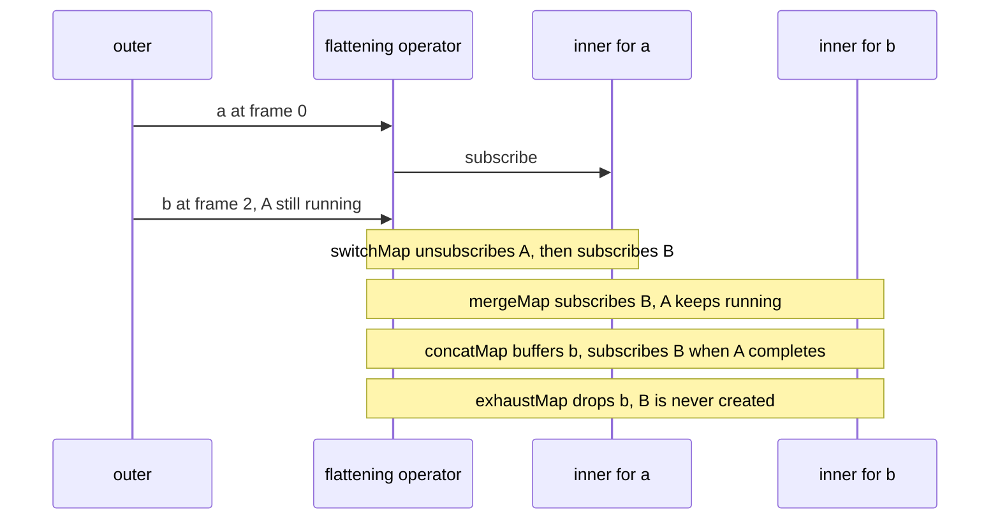
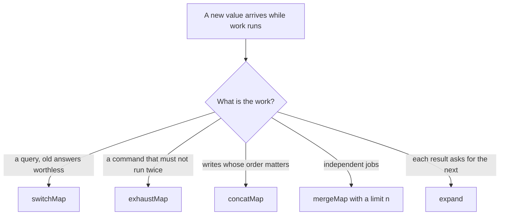
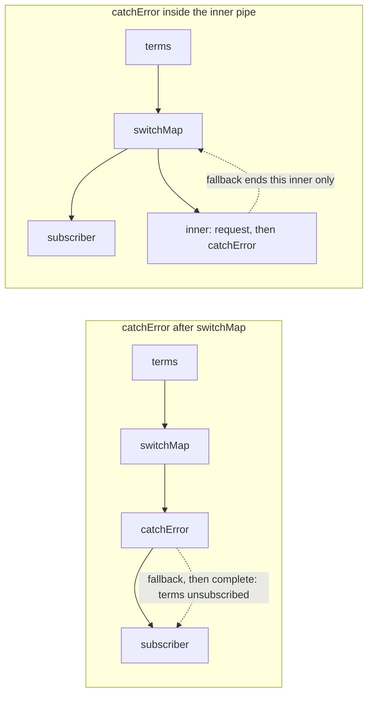
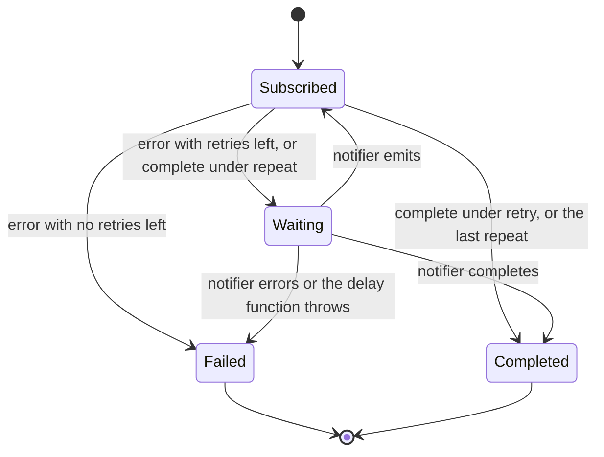
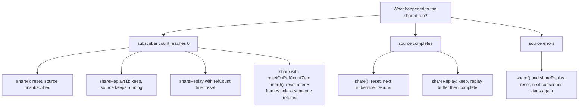
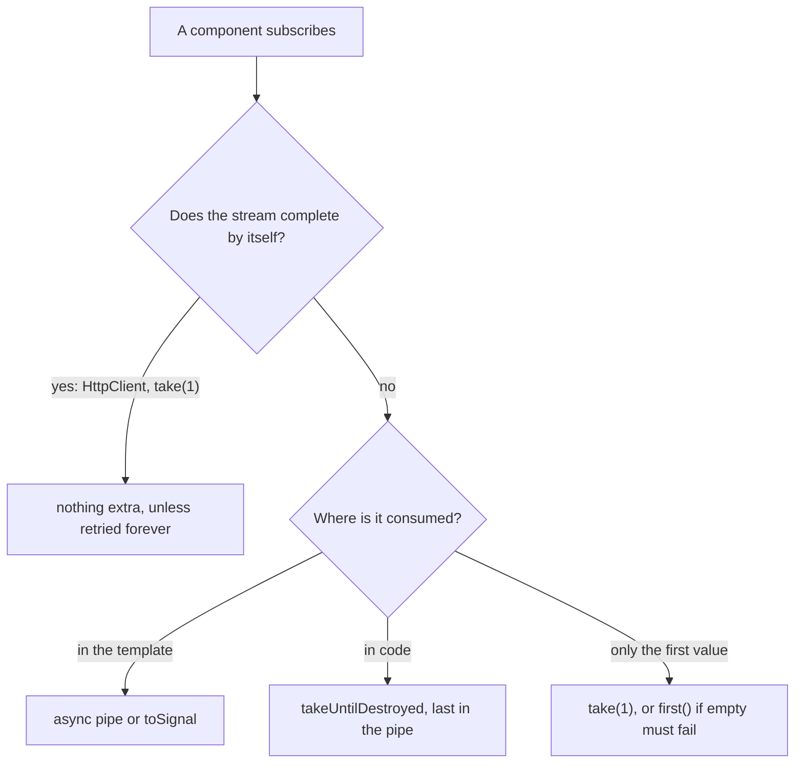
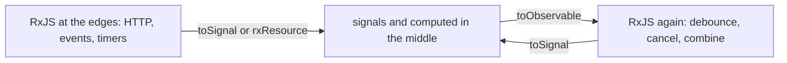
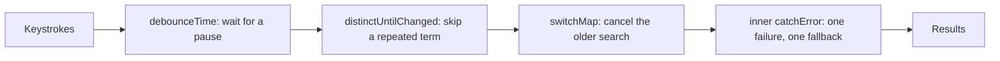
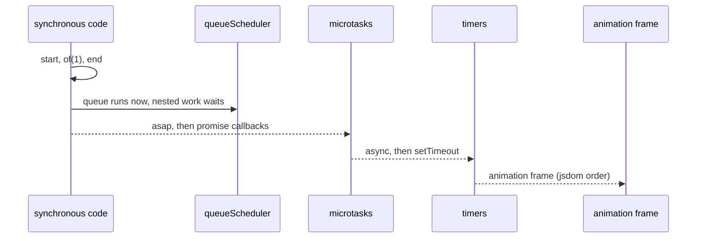
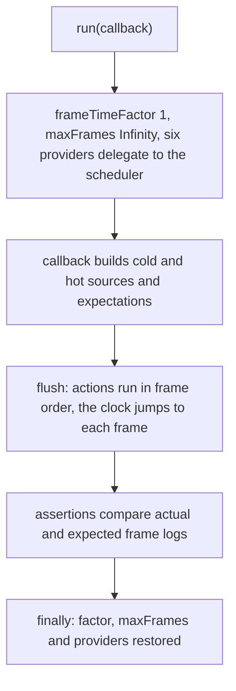

# 23. RxJS in depth: flattening, errors, multicasting, schedulers, testing and signal interop

> **What this covers:** the four flattening operators and the bugs the wrong one causes; error handling with `catchError`, `retry`, `repeat` and `finalize`; `share` configuration and `shareReplay`; the Angular unsubscription strategies and how to find leaks; when to use signals and when RxJS, with `toSignal`, `toObservable` and `rxResource` in depth; the typeahead, polling, cache-then-network and racing patterns; schedulers; and marble testing with `TestScheduler`. The basics of Observables, subjects and operators are module 22.
> **Prerequisites:** [22. RxJS foundations](22-rxjs-foundations.md#5-pipeable-operators-and-writing-your-own) (operators; cold and hot in [§3](22-rxjs-foundations.md#3-cold-and-hot-unicast-and-multicast), timing operators in [§8](22-rxjs-foundations.md#8-timing-operators-debouncetime-throttletime-audittime-and-sampletime)) and [17. Signals § 8](17-signals.md#8-interop-with-rxjs) (the interop essentials)
> **Leads to:** [24. Routing](24-routing.md), [25. Forms](25-forms-reactive-and-template-driven.md), [27. HttpClient](27-http-client.md), [28. State management](28-state-management.md), [43. Full-stack real time](43-fullstack-realtime.md)
> **Applies to:** Angular 22.2 (`@angular/core` 22.2.1), RxJS 7.8 (`rxjs` 7.8.2), TypeScript 6.0, Node 24
> **Study time:** ~7 hours reading + ~5 hours exercises
> **Short on time:** read [1. Higher-order Observables](#1-higher-order-observables-switchmap-mergemap-concatmap-and-exhaustmap), [3. Errors](#3-errors-catcherror-placement-finalize-and-error-versus-complete), [5. Multicasting](#5-multicasting-in-depth-share-configuration-sharereplay-and-connect) and [6. Unsubscription](#6-unsubscription-strategies-in-angular-and-finding-leaks), then drill [Q23.03](#q23-03), [Q23.06](#q23-06), [Q23.11](#q23-11), [Q23.17](#q23-17), [Q23.20](#q23-20) and [Q23.23](#q23-23), try [Exercise 23.1](#ex23-1), and finish with the [Summary](#summary).
> **Labs:** [`labs/angular/src/app/modules/23-rxjs-in-depth/`](../labs/angular/src/app/modules/23-rxjs-in-depth/) (section specs, *Output* questions, Exercises 23.1-23.6; RxJS specs, some with `TestBed`, `HttpClient` and `rxjs-interop`; no `labs/ts-js` files). Run (Node 24): from `labs/angular`, `npx ng test --watch=false --include='src/app/modules/23-rxjs-in-depth/**/*.spec.ts'`.

## Contents

1. [Higher-order Observables: `switchMap`, `mergeMap`, `concatMap` and `exhaustMap`](#1-higher-order-observables-switchmap-mergemap-concatmap-and-exhaustmap)
2. [Choosing a flattening operator: races, lost writes, cancellation and recursion](#2-choosing-a-flattening-operator-races-lost-writes-cancellation-and-recursion)
3. [Errors: `catchError` placement, `finalize`, and error versus complete](#3-errors-catcherror-placement-finalize-and-error-versus-complete)
4. [Retrying and repeating: `retry` with backoff and `repeat`](#4-retrying-and-repeating-retry-with-backoff-and-repeat)
5. [Multicasting in depth: `share` configuration, `shareReplay` and `connect`](#5-multicasting-in-depth-share-configuration-sharereplay-and-connect)
6. [Unsubscription strategies in Angular, and finding leaks](#6-unsubscription-strategies-in-angular-and-finding-leaks)
7. [RxJS and signals: decision rules, `toSignal`, `toObservable` and `rxResource`](#7-rxjs-and-signals-decision-rules-tosignal-toobservable-and-rxresource)
8. [Angular patterns: typeahead, polling, cache-then-network and racing requests](#8-angular-patterns-typeahead-polling-cache-then-network-and-racing-requests)
9. [Schedulers: queue, asap, async and animation frame, `observeOn` and `subscribeOn`](#9-schedulers-queue-asap-async-and-animation-frame-observeon-and-subscribeon)
10. [Testing with `TestScheduler`: marble syntax and virtual time under the hood](#10-testing-with-testscheduler-marble-syntax-and-virtual-time-under-the-hood)
- [Summary](#summary)
- [Question bank](#question-bank)
- [Hands-on exercises](#hands-on-exercises)
- [Check your understanding](#check-your-understanding)
- [Connections](#connections)

**How the claims here are verified.** An observed behavior cites a spec in `labs/angular/src/app/modules/23-rxjs-in-depth/`, run by `ng test` in jsdom (a DOM implementation for Node) with `rxjs` 7.8.2 and Angular 22.2.1. Frames are `TestScheduler` virtual time, a clock the test advances ([section 10](#10-testing-with-testscheduler-marble-syntax-and-virtual-time-under-the-hood)). "Read from the source" names the file and function in the published `rxjs` 7.8.2, `@angular/core` 22.2.1 or `@angular/common` 22.2.1 package. Status markers come from typings tags and the RxJS CHANGELOG; a marker on an `rxjs` API gives the RxJS version (`v7.3` is RxJS 7.3), one on an Angular API the Angular version. Real network cancellation, browser scheduling, memory use and DevTools are documented only: cited and dated, never run.

## 1. Higher-order Observables: `switchMap`, `mergeMap`, `concatMap` and `exhaustMap`

### The problem it solves

A search box maps each term to a request: `terms.pipe(map((t) => http.get(url + t)))` gives an `Observable<Observable<Result>>`, a stream of streams. A `subscribe` inside a `subscribe` forgets every inner subscription: `Section 1: a nested subscribe delivers stale results and outlives the outer unsubscribe` (an old term's result arrived; the inner stayed subscribed after the outer `unsubscribe`). Four operators fix this; they differ when a new term arrives mid-request ([Q23.01](#q23-01), [Q23.03](#q23-03)).

### Mental model

A **higher-order Observable** emits Observables. The emitter is the **outer** Observable; each emitted one is an **inner** Observable. A **flattening operator** maps each outer value to an inner Observable, subscribes to it, and forwards its values into one stream. They differ in what a new outer value does while an inner still runs:

- `switchMap` unsubscribes the running inner, then subscribes the new one.
- `mergeMap` runs both, interleaving their values.
- `concatMap` keeps the new value in a **buffer** (a queue of waiting values) until the running inner completes.
- `exhaustMap` ignores the new value.

A receptionist on a call when a second line rings: hang up and take it, put both on speaker, put the new caller on hold, or let it ring.



What to notice: only `switchMap` ends an inner early, only `exhaustMap` loses an outer value, `concatMap` buffers and `mergeMap` interleaves.

### How it actually works

The table is a **marble** run: one character per **frame** (a tick of virtual time), a letter a value, `|` complete, `v@n` value `v` at frame `n` ([22 §7](22-rxjs-foundations.md#7-combining-streams-combinelatest-withlatestfrom-forkjoin-zip-merge-and-concat) reads them; [section 10](#10-testing-with-testscheduler-marble-syntax-and-virtual-time-under-the-hood) writes them). Each inner is built with `defer` (a factory run at each subscribe, [22 §3](22-rxjs-foundations.md#3-cold-and-hot-unicast-and-multicast)) and `finalize` (a callback run when a subscription ends, [section 3](#3-errors-catcherror-placement-finalize-and-error-versus-complete)): `subv` and `finv` mark when the inner for `v` started and ended.

```text
outer a-b-----c---|    inner for v: --x--y| emitting v1, v2
switchMap   suba@0 fina@2 subb@2 b1@4 b2@7 finb@8 subc@8 c1@10 c2@13 C@14 finc@14
mergeMap    suba@0 subb@2 a1@2 b1@4 a2@5 fina@6 b2@7 subc@8 finb@8 c1@10 c2@13 finc@14 C@14
concatMap   suba@0 a1@2 a2@5 fina@6 subb@6 b1@8 b2@11 finb@12 subc@12 c1@14 c2@17 finc@18 C@18
exhaustMap  suba@0 a1@2 a2@5 fina@6 subc@8 c1@10 c2@13 C@14 finc@14
```

`Section 1: switchMap, mergeMap, concatMap and exhaustMap on one outer stream` asserts these rows ([Q23.02](#q23-02)). The outer completed at 12, no completion before 14: a flattened stream completes once the outer has completed **and** no inner is active (`Section 1: the result completes only after the last inner completes`). An inner error ends the whole result (`Section 1: an inner error ends the flattened stream`; catching it is [section 3](#3-errors-catcherror-placement-finalize-and-error-versus-complete)).

Read from the `rxjs` 7.8.2 source: `mergeMap(project, concurrent = Infinity)` calls `mergeInternals` (internal, `operators/mergeInternals.js`), which keeps `buffer`, `active` and `isComplete`. An outer value subscribes an inner while `active < concurrent`, else goes to `buffer`; when an inner ends, `active` drops, buffered values start, and `checkComplete` completes once `isComplete && !buffer.length && !active`. **Concurrency** is the most inners subscribed at once, and `concatMap` is `mergeMap(project, 1)` (`Section 1: mergeMap with concurrency 1 behaves as concatMap and with 2 queues the third`, [Q23.05](#q23-05)). `switchMap.js` calls `innerSubscriber?.unsubscribe()` before subscribing the next inner; `exhaustMap.js` ignores outer values while `innerSub` is set. Hence the last `C` and `finc`: `switchMap` and `exhaustMap` complete in the inner's complete callback, before its teardown (the cleanup run when a subscription ends, [22 §2](22-rxjs-foundations.md#2-anatomy-observable-observer-subscription-and-teardown)); `mergeInternals` completes in the inner's `onFinalize` callback, after it (`createOperatorSubscriber`, internal, `OperatorSubscriber.js`).

The `*All` forms flatten an existing higher-order Observable: `switchAll()` is `switchMap(identity)`, `mergeAll(n)` is `mergeMap(identity, n)` (`Section 1: the All forms flatten an Observable of Observables`). An inner can be any **`ObservableInput`**, anything `from` accepts ([22 §1](22-rxjs-foundations.md#1-push-collections-observables-promises-iterators-and-laziness)), converted by `innerFrom` (internal). `Section 1: Promise and array inners are accepted`: over `of(1, 2, 3)`, `switchMap` to a Promise gave only `30`, because the synchronous source switched before any Promise settled ([Q23.04](#q23-04)).

### Code

The approach is to log each inner subscribe, inner finalize and value with its frame, per operator, on one input.

1. Build each inner with `defer`, to log its subscribe, and `finalize`, to log its end.
2. Run the outer stream through one operator inside `TestScheduler.run`; `scheduler.now()` gives the frame.
3. Compare each log with the table.

```ts
// Excerpt of labs/angular/src/app/modules/23-rxjs-in-depth/concepts/section-1-flattening.spec.ts
function flattenLog(flatten: Flatten): string[] {
  const log: string[] = [];
  const scheduler = new TestScheduler((actual, expected) => expect(actual).toEqual(expected));
  scheduler.run(({ cold }) => {
    const at = () => scheduler.now();
    const inner = (v: string) =>
      defer(() => {
        log.push(`sub${v}@${at()}`);
        return cold('--x--y|', { x: `${v}1`, y: `${v}2` });
      }).pipe(finalize(() => log.push(`fin${v}@${at()}`)));
    cold('a-b-----c---|')
      .pipe(flatten(inner))
      .subscribe({ next: (v) => log.push(`${v}@${at()}`), complete: () => log.push(`C@${at()}`) });
  });
  return log;
}
    expect(flattenLog((p) => switchMap(p))).toEqual(
      'suba@0 fina@2 subb@2 b1@4 b2@7 finb@8 subc@8 c1@10 c2@13 C@14 finc@14'.split(' '),
    );
```

#### Legacy

- A **result selector**, the second function in `switchMap(search, (term, result) => …)` [Deprecated since v6.0 — use an inner map]; the 7.8.2 typings: "will be removed in v8".
- `flatMap`, deprecated in the 7.8.2 typings ("Renamed to mergeMap").
- `exhaust` [Deprecated since v7.0 — use exhaustAll].
- A nested `subscribe`: use the operator that fits.

All four are in [`legacy/deprecated-forms.ts`](../labs/angular/src/app/modules/23-rxjs-in-depth/legacy/deprecated-forms.ts); `Section 1: flatMap and exhaust are the same functions as mergeMap and exhaustAll` and `Section 1: the deprecated forms give what the current forms give`.

### Best practices and anti-patterns

- **Flatten with an operator, never with a nested `subscribe`**, because only the operator ties the inner subscription to the outer one.
- **Choose by what a second value means** ([section 2](#2-choosing-a-flattening-operator-races-lost-writes-cancellation-and-recursion)), because the four differ only when inners overlap.
- **Give `mergeMap` a concurrency limit for heavy work**, because the default is `Infinity`.

### Misconceptions and traps

- *"`switchMap` cancels the HTTP request on the server."* It unsubscribes, and Angular's backend aborts the client request ([section 2](#2-choosing-a-flattening-operator-races-lost-writes-cancellation-and-recursion)); the word "cancel" suggests more.
- *"`mergeMap` keeps the order of the outer values."* It emits in arrival order (`a2@5` after `b1@4`); array flattening keeps order.
- *"`concatMap` drops values while busy."* It buffers them, without limit; the myth confuses it with `exhaustMap`.
- *"`switchMap` completes when the outer completes."* It waits for the active inner (`C@14`, outer `|` at 12); the outer's `|` looks final.
- *"`flatMap` is a different operator."* It is the same function, deprecated; the name comes from other libraries.

Drilled in [Q23.01](#q23-01), [Q23.02](#q23-02), [Q23.03](#q23-03), [Q23.04](#q23-04), [Q23.05](#q23-05); modelled in [Exercise 23.1](#ex23-1).

## 2. Choosing a flattening operator: races, lost writes, cancellation and recursion

### The problem it solves

A results list flickers back to an older answer. A double-clicked "Pay" button posts twice. An autosave built with `switchMap` drops the edit that was in flight. A paginated API must be read "until there is no next page". Each is a flattening operator chosen for the wrong kind of work ([Q23.06](#q23-06)).

### Mental model

Choose by **what the work is**:

- a **query**, a read whose old answer is worthless once a new one is asked: `switchMap`;
- a **command**, a write that must not run twice at once: `exhaustMap`;
- **writes whose order matters**: `concatMap`;
- **independent jobs**, with a limit: `mergeMap(fn, n)`.

`expand` (each result may ask for the next) and `mergeScan`/`switchScan` (`switchScan` [Added in v7.0]; an **accumulator**, the running state `scan` carries, [22 §6](22-rxjs-foundations.md#6-the-operator-catalogue-creation-transformation-filtering-utility-conditional-and-aggregation)) are flattening with feedback. A kitchen: a changed order replaces the old ticket, "no second order until this one is served", tickets cooked in the order they came, or n cooks at once.



What to notice: every branch names the meaning of a second value; none is about speed.

### How it actually works

**The race.** A **race condition** is a result that depends on which async job finishes first. `Section 2: mergeMap lets a slow stale response arrive last and switchMap drops it`:

```text
terms a-b|     response for a: -----A|   for b: -B|
mergeMap    B@3 A@5 C@6      the stale A lands last
switchMap   B@3 C@4          a's request unsubscribed at 2
```

**The double submit.** `Section 2: exhaustMap ignores clicks while a submit runs and mergeMap posts each`: with clicks at frames 0, 2 and 10 and a three-frame post, `exhaustMap` posted twice (`s@3`, `s@13`; the click at 2 was dropped); `mergeMap` posted once per click. A request is **idempotent** when repeating it changes nothing more; a payment is not.

**The lost write.** `Section 2: switchMap unsubscribes an in-flight save`: with edits two frames apart and a three-frame save, `switchMap` unsubscribed save `a` at frame 2 (subscription marble `^-!`) and only `saved:b` arrived; `concatMap` saved both, in order (`saved:a@3`, `saved:b@7`).

**Cancellation.** `Section 2: switchMap over HttpClient cancels the previous request` uses `HttpTestingController`, the test-side handle on Angular's in-memory HTTP test backend ([27](27-http-client.md#11-testing-and-the-backend-seam-providehttpclienttesting-httptestingcontroller-and-what-they-replace)): two terms made two requests, `/s?q=a` and `/s?q=ab`; before the flush `cancelled` was `true` for the first and `false` for the second, and only `R-ab` arrived ([Q23.07](#q23-07)). That flag is the testing backend's report: read from `@angular/common` 22.2.1 (`fesm2022/http-testing.mjs`, `HttpClientTestingBackend.handle`), its teardown sets `_cancelled = true`. The real backends **abort** the request (stop it on the client) in their teardown, as the callout shows; whether the server stops working is not observed here. A Promise has no unsubscribe: cancelling `fetch` takes an `AbortController` ([04 §7](04-js-async-event-loop.md#7-cancellation-with-abortcontroller), [Q04.24](04-js-async-event-loop.md#q04-24)).

**Recursion and accumulation.** Read from the `rxjs` 7.8.2 source (`operators/expand.js`): `expand` is `mergeInternals` (internal) with its `expand` flag set, so every output value is also fed back into the project function. `Section 2: expand fetches pages until the last one`: page 1 at frame 1 asked for page 2, page 3 had `next: null`, mapped to `EMPTY`, and the stream completed at 4. With synchronous inners the whole recursion runs in one frame (`Section 2: expand with synchronous inners recurses within one frame`: 1, 2, 4, 8 at frame 0). `mergeScan` and `switchScan` hand the accumulator to each inner. `switchScan.js` updates it only when an inner emits, so a switched-away inner never counts: on 1 then 2, `switchScan` emitted 2, not 3 (`Section 2: mergeScan and switchScan accumulate across inner streams`, [Q23.09](#q23-09)).

### Code

The approach is to drive a `switchMap` search with Angular's testing backend and read each request's `cancelled` flag.

1. Provide `provideHttpClient()` and `provideHttpClientTesting()`.
2. Map each term to `http.get` with `switchMap`, and push two terms.
3. Read every open request before flushing the second.

```ts
// Excerpt of labs/angular/src/app/modules/23-rxjs-in-depth/concepts/section-2-choosing.spec.ts
    TestBed.configureTestingModule({ providers: [provideHttpClient(), provideHttpClientTesting()] });
    const http = TestBed.inject(HttpClient);
    const controller = TestBed.inject(HttpTestingController);
    const terms = new Subject<string>();
    const results: string[] = [];

    terms.pipe(switchMap((term) => http.get<string>(`/s?q=${term}`))).subscribe((result) => results.push(result));
    terms.next('a');
    terms.next('ab');

    const requests = controller.match(() => true);
    expect(requests.map((r) => r.request.urlWithParams)).toEqual(['/s?q=a', '/s?q=ab']);
    expect(requests.map((r) => r.cancelled)).toEqual([true, false]);
    requests[1].flush('R-ab');
    expect(results).toEqual(['R-ab']);
```

> [!NOTE]
> **Framework vs platform.** Unsubscribing is RxJS; turning it into a network abort is Angular's backend. Read from `@angular/common` 22.2.1 (`fesm2022/_module-chunk.mjs`): the teardown in `FetchBackend.handle` calls `aborter.abort()` on the `AbortController` whose `signal` it passed to `fetch`, unless the response is done; the teardown in `HttpXhrBackend.handle` calls `xhr.abort()` while `readyState !== DONE`. The platform `fetch` cancels only through an `AbortSignal` ([04 §7](04-js-async-event-loop.md#7-cancellation-with-abortcontroller)). Read, not run in a browser.

### Best practices and anti-patterns

- **Use `switchMap` for reads only**, because it unsubscribes whatever is in flight, writes included.
- **Use `exhaustMap` for submit buttons**, because clicks during the request are dropped, not queued.
- **Use `concatMap` for writes whose order matters**, because it runs them one at a time in arrival order.
- **Bound `mergeMap` for uploads and bulk requests**, because its default concurrency is `Infinity` ([section 1](#1-higher-order-observables-switchmap-mergemap-concatmap-and-exhaustmap)).
- **Give `expand` an explicit stop**, because only an inner that ends without values (`EMPTY`) ends the recursion.

### Misconceptions and traps

- *"`switchMap` is the safe default."* For writes it drops the save in flight; typeahead tutorials teach it first.
- *"`exhaustMap` queues the extra clicks."* It drops them; the name suggests a queue being worked through.
- *"`mergeMap` without a limit is fine for uploads."* It opens every request at once; small demos never have enough files to notice.
- *"Unsubscribing stops the server work."* Only the client request is aborted; client-side cancellation looks complete from the browser.

Drilled in [Q23.06](#q23-06), [Q23.07](#q23-07), [Q23.08](#q23-08), [Q23.09](#q23-09); modelled in [Exercise 23.1](#ex23-1).

## 3. Errors: `catchError` placement, `finalize`, and error versus complete

### The problem it solves

One failed search kills the typeahead for the rest of the session. A `catchError(() => EMPTY)` makes a stream end quietly and nobody notices. A loading spinner stays on after an error. A `catchError` that returns its second argument loops forever ([Q23.10](#q23-10), [Q23.13](#q23-13)).

### Mental model

An **error** is a **terminal notification**: after it, the stream sends nothing more ([22 §2](22-rxjs-foundations.md#2-anatomy-observable-observer-subscription-and-teardown) owns that contract). The error travels to the subscriber, ending each operator on the way unless one catches it, and nothing upstream runs again unless something subscribes again. `catchError(selector)` **replaces** the failed stream with the Observable its selector returns: a **fallback** value, `EMPTY` (completes at once, [22 §6](22-rxjs-foundations.md#6-the-operator-catalogue-creation-transformation-filtering-utility-conditional-and-aggregation)) or a **rethrow** (a new error). **Where** it sits decides **what** is replaced: after `switchMap` the whole stream, inside the inner pipe only the failed inner. `finalize(callback)` runs its callback once, after complete, error or unsubscribe.

A fuse on one room's circuit leaves that room dark; a fuse on the main line darkens the house.



What to notice: catching inside keeps the outer subscription alive; catching outside ends it, gracefully but for good.

### How it actually works

**Placement.** The outer stream `a-b-c|` maps each value to a request; `b`'s request fails at once, the others answer `res-a` and `res-c`:

```text
catchError after switchMap    res-a@0 fallback@2 C@2
catchError inside the inner   res-a@0 fallback@2 res-c@4 C@5
```

`Section 3: catchError after switchMap ends the stream and inside the inner keeps it alive` ([Q23.11](#q23-11)). Outside, `c` was never processed: the replacement `of('fallback')` completed, ending the result.

**Replacements.** `Section 3: catchError returning EMPTY completes silently`: `a-#` gave `a@0`, then complete at 2 and no error. `Section 3: a rethrow replaces the error with a new one`: `throwError(() => new Error('wrapped:' + err.message))` delivered `wrapped:orig` at 2. The selector's second argument, `caught`, is the source with the same `catchError` applied; returning it subscribes again from the start. `Section 3: returning caught re-subscribes the source`: on `a#` with `take(5)`, five subscriptions and five `a` values; without a bound it never ends. Read from the `rxjs` 7.8.2 source (`operators/catchError.js`): `caught` is `catchError(selector)(source)`, and the failed source subscription is unsubscribed before the replacement subscribes, through the `syncUnsub` flag when the error is synchronous.

**`finalize` order.** `Section 3: finalize runs after complete, after error and after unsubscribe, after the source teardown`: `next 1, complete, fin1, fin2`; `error, fin`; `teardown, fin`; and with a completing source that returns a teardown, `complete, src teardown, fin` ([Q23.12](#q23-12)). Read from `operators/finalize.js`: it subscribes the source first and adds the callback last, so it runs after every earlier teardown (CHANGELOG 7.0.0-beta.1: "callback will be called after the source observable is torn down").

**Error versus complete.** Completion wins when it comes first: `Section 3: take(1) completes before a later error` (`a@0 C@0`). For consumers, an error rejects `firstValueFrom` ([22 §1](22-rxjs-foundations.md#1-push-collections-observables-promises-iterators-and-laziness)) and fails a whole `forkJoin` ([22 §7](22-rxjs-foundations.md#7-combining-streams-combinelatest-withlatestfrom-forkjoin-zip-merge-and-concat)). `onErrorResumeNextWith` [Added in v7.6] moves to the next source on error or complete (`Section 3: onErrorResumeNextWith moves to the next source after an error`: `a@0 x@1 C@2`), hiding the error the way `EMPTY` does. An **error factory** builds the error at subscription: `Section 3: throwError with a factory creates the error at subscription` (no error before `subscribe`, a new one for each of two subscribers). Errors nobody handles are [22 §2](22-rxjs-foundations.md#2-anatomy-observable-observer-subscription-and-teardown)'s.

### Code

The approach is to put the same fallback outside the flattening, then inside it.

1. Build the request with `cold`: `b` fails, the others answer.
2. Put `catchError(() => of('fallback'))` after `switchMap`, then inside the inner pipe.
3. Record each notification with its frame through `timeline`.

```ts
// Excerpt of labs/angular/src/app/modules/23-rxjs-in-depth/concepts/section-3-errors.spec.ts
function request(cold: (marbles: string, values?: Record<string, string>) => Observable<string>, v: string) {
  return v === 'b' ? cold('#') : cold('x|', { x: `res-${v}` });
}
    expect(
      timeline(({ cold }) =>
        cold('a-b-c|').pipe(switchMap((v) => request(cold, v).pipe(catchError(() => of('fallback'))))),
      ),
    ).toEqual([
      [0, 'N', 'res-a'],
      [2, 'N', 'fallback'],
      [4, 'N', 'res-c'],
      [5, 'C'],
    ]);
```

#### Legacy

- `throwError(new Error('x'))` [Deprecated since v7.0 — use a factory]: the 7.8.2 typings say value support "will be removed in v8"; the CHANGELOG (7.0.0-beta.5) records "now accepts a factory". `Section 3: the deprecated throwError(value) gives every subscriber the one error built at assembly`, the moment the pipeline is built.
- `.catch()` and `.finally()` are history: `rxjs` 5.5.12's `rxjs/add/operator/catch` and `finally` patched `Observable.prototype`; 5.5.0-beta.0 added `catchError` and `finalize` as pipeable versions (CHANGELOG). The 7.8.2 package has neither old name (`grep`).

> [!WARNING]
> `catchError(() => EMPTY)` at the end of a long-lived stream turns every failure into a silent completion (`Section 3: catchError returning EMPTY completes silently`). Log or surface the error before returning `EMPTY`.

### Best practices and anti-patterns

- **Catch inside the inner pipe of a long-lived stream**, because a catch after the flattening operator ends the outer subscription.
- **Turn loading flags off in `finalize`**, because it runs on complete, error and unsubscribe alike.
- **Pass `throwError` a factory**, because the error is then built at subscription, with "a more appropriate stack trace" (7.8.2 typings).
- **Bound a `caught` re-subscription with `take`, or use `retry`** ([section 4](#4-retrying-and-repeating-retry-with-backoff-and-repeat)), because an always-failing source loops forever.

### Misconceptions and traps

- *"`catchError` keeps the stream alive."* It replaces the stream; after the flattening operator it ends it. A try/catch inside a loop, which keeps looping, suggests it.
- *"`finalize` runs before `complete` reaches the subscriber."* It runs after the complete callback and after the source teardown; the name "final" sounds like "last step before the end".
- *"An error after `take(1)` still reaches the subscriber."* `take` completed and unsubscribed first; errors feel stronger than completion.
- *"`throwError(new Error())` is fine."* It builds one error at assembly and the form is deprecated; it was the only form in RxJS 6 (the 6.6.7 typings have no factory overload).

Drilled in [Q23.10](#q23-10), [Q23.11](#q23-11), [Q23.12](#q23-12), [Q23.13](#q23-13); modelled in [Exercise 23.2](#ex23-2).

## 4. Retrying and repeating: `retry` with backoff and `repeat`

### The problem it solves

A flaky endpoint fails one request in twenty. Retrying at once hammers a server that is already struggling; retrying a `400 Bad Request` cannot succeed. A dashboard must load again after every successful load ([Q23.15](#q23-15)).

### Mental model

`retry` **re-subscribes** after an error: it subscribes to the source again, as if for the first time. `repeat` re-subscribes after a complete. A cold source ([22 §3](22-rxjs-foundations.md#3-cold-and-hot-unicast-and-multicast)) runs again, so a retried `HttpClient` call is a new request. A **backoff** is a wait before each retry; an **exponential backoff** doubles it each time. The `delay` option [Added in v7.3] takes a **notifier**, an Observable whose first value re-subscribes; its complete ends the result quietly, its error ends it with that error. A **retryable error** is one a later attempt may not meet (a 503, not a 400).

Redialing a busy number: wait longer each time, give up after a few tries, never redial a wrong number.



What to notice: both operators only subscribe again; whether work repeats is the source's business, how a wait ends the notifier's.

### How it actually works

**Counts and backoff.** `retry(n)` allows `n` re-subscriptions after the first:

```text
retry(2) on a#                         a@0 a@1 a@2 E@3    subscribed at 0, 1, 2
retry({ count: 3, delay }) on #        E@14               subscribed at 0, 2, 6, 14
                                       delay: (err, n) => timer(2 ** n)
```

`Section 4: retry(2) subscribes three times and then errors` and `Section 4: retry with an exponential delay retries at frames 2, 6 and 14` ([Q23.14](#q23-14)): the delay function gets the error and the retry number `n`. `resetOnSuccess` [Added in v7.0] zeroes the count whenever the source emits: a source failing after one value four times, then answering `b`, errored at 3 with `count: 2`, and reached `b@4 C@5` with `resetOnSuccess: true` (`Section 4: resetOnSuccess restarts the count after a value`).

**Read from the `rxjs` 7.8.2 source** (`operators/retry.js`, `retry`): `count` defaults to `Infinity`; a number `delay` becomes `timer(delay)`, a function's result goes through `innerFrom` (internal); the notifier's complete calls `subscriber.complete()` (`Section 4: a delay notifier that completes ends the stream without the error`: complete at 1, two subscriptions). The delay function runs inside the source subscriber's error callback, which `createOperatorSubscriber` (internal, `OperatorSubscriber.js`) wraps in a `try` that forwards a throw to the result: `Section 4: a delay function that throws gives up at once` (a 400 errored at 0 after one subscription, thrown or returned as `throwError(() => err)`; a 503 was retried three times).

**HTTP.** `Section 4: retry re-sends an HttpClient request`: `retry(2)` against three 500 responses made three requests, then delivered the 500 error. Retry interceptors are [27](27-http-client.md#5-errors-httperrorresponse-an-error-mapping-layer-and-retry-with-backoff-and-jitter)'s; the promise version is [Exercise 04.3](04-js-async-event-loop.md#ex04-3), whose alternative adds **jitter**, a random part in each wait so that clients do not retry in step.

**`repeat`** re-subscribes on complete and lets errors through (`Section 4: repeat with a delay re-subscribes after each complete and an error stops it`): `-a|` with `repeat(3)` gave `a@1 a@3 a@5 C@6`; with `{ count: 3, delay: 4 }` (`delay` [Added in v7.5]) `a@1 a@7 a@13 C@14`; `-a#` stopped at `E@2`.

### Code

The approach is a retry policy inside the delay function.

1. Classify the error: a status of 500 or more is retryable.
2. Throw anything else; the result errors with it.
3. Otherwise return a timer (from the second argument, for exponential backoff); `count` caps the retries.

```ts
// Excerpt of labs/angular/src/app/modules/23-rxjs-in-depth/concepts/section-4-retry.spec.ts
    const isRetryable = (err: Failure) => err.status >= 500;
    const throwing = (s: Observable<string>) =>
      s.pipe(
        retry({
          count: 3,
          delay: (err: Failure) => {
            if (!isRetryable(err)) {
              throw err;
            }
            return timer(1);
          },
        }),
      );
```

#### Legacy

`retryWhen` [Deprecated since v7.5.5 — use retry with delay] and `repeatWhen` [Deprecated since v7.5.5 — use repeat with delay] hand the notifier the stream of all errors or completions, so the count and the give-up are built by hand; a `take` there completes the result silently (read from `retryWhen.js`). The tag first appears in the 7.5.5 typings, not in 7.5.4's (`npm pack`). Migrate by moving the per-failure logic into `delay: (err, n) => …`; `Section 4: the deprecated retryWhen and repeatWhen give what retry and repeat with a delay give` runs both from [`legacy/deprecated-forms.ts`](../labs/angular/src/app/modules/23-rxjs-in-depth/legacy/deprecated-forms.ts).

### Best practices and anti-patterns

- **Retry only retryable errors**, because a 4xx fails the same way every time.
- **Give every `retry` a count or a give-up path**, because `count` defaults to `Infinity`.
- **Wait between retries, with jitter for many clients**, because immediate retries reach a server that is still failing.
- **Put `retry` on the request, inside the inner pipe**, because after `switchMap` it re-subscribes the outer stream too.
- **Use `resetOnSuccess` on long-lived streams**, because otherwise failures hours apart share one budget.

### Misconceptions and traps

- *"`retry(3)` means three attempts."* It means three re-subscriptions after the first, four attempts; "retry" is heard as "try".
- *"`retry` replays the failed value."* It re-runs the source from the start; message queues redeliver one message, which suggests it.
- *"A delay notifier that completes is a no-op."* It completes the result and the error is lost; most notifiers emit, so nobody tests the complete path.
- *"`repeat` is for errors."* It re-subscribes on complete and stops on an error; the name sounds like "try again".

Drilled in [Q23.14](#q23-14), [Q23.15](#q23-15), [Q23.16](#q23-16); modelled in [Exercise 23.2](#ex23-2).

## 5. Multicasting in depth: `share` configuration, `shareReplay` and `connect`

### The problem it solves

A config service "caches" with `shareReplay(1)`, and a ticker built the same way stays connected after every component that used it is gone. A late subscriber receives a price from an hour ago. A failed load is cached, or is not, and nobody knows which. One stream split into two branches is subscribed twice ([Q23.17](#q23-17)).

### Mental model

[22 §3](22-rxjs-foundations.md#3-cold-and-hot-unicast-and-multicast) taught `share()`: one source run fed to many subscribers through a Subject, with a **reference count** of subscribers. Here the design is three **reset** rules. When the count drops to zero, when the source completes, when it errors: does the shared stream **reset** (forget the run, so the next subscriber starts a new one) or **keep** (stay connected, or keep what it has)? `share()` resets in all three cases. `shareReplay` fixes the answers: keep on complete, reset on error, and at zero keep by default or reset with `refCount: true` [Added in v6.4]. Its **replay buffer** holds the last values for late subscribers; a value from a run nobody watches any more is **stale data**. `connect` [Added in v7.0] shares one source within a single subscription.

A shared taxi: does the meter keep running after the last passenger leaves, does the driver remember the last destination, does a breakdown end the service for the next customer?



What to notice: stale data and a running source come from one answer, "keep" at zero subscribers: `shareReplay`'s default.

### How it actually works

**Read from the `rxjs` 7.8.2 source** (`operators/shareReplay.js`, `shareReplay`): it returns `share({ connector: () => new ReplaySubject(bufferSize, windowTime, scheduler), resetOnError: true, resetOnComplete: false, resetOnRefCountZero: refCount })`, with `refCount` defaulting to `false` and `bufferSize` to `Infinity` in both the number and the config form. The **connector** is the factory for the Subject in the middle. `windowTime` drops buffered values older than that many milliseconds, timed by `dateTimestampProvider` (internal, `ReplaySubject.js`).

Over `interval(1)`, with `a` subscribed from frame 0 to 3 and `b` arriving at 10:

```text
shareReplay(1)                                 9 ticks before frame 10   b got 8 at 10 (stale)   1 subscription
shareReplay({ bufferSize: 1, refCount: true }) 2 ticks before frame 10   b got 0 at 11 (fresh)   2 subscriptions
```

`Section 5: shareReplay(1) keeps the source running and replays a stale value` and `Section 5: shareReplay with refCount stops the source and starts fresh` ([Q23.17](#q23-17)). `Section 5: shareReplay caches a completed source and retries an errored one`: over `--r|`, a subscriber at frame 5 got `r` and complete at once from one subscription, with `refCount` `false` or `true`; over a first run that errored, it started a second run and got `r` ([Q23.18](#q23-18)). `Section 5: share re-runs a synchronous source for a second subscriber`: over `of(1, 2, 3)`, `share()` gave `b` all three values again (the completed run reset), `shareReplay(2)` only `2` and `3`.

**`ShareConfig`** [Added in v7.0] sets each rule. `Section 5: share with a ReplaySubject connector and no resets replays after complete`: over `a-b-c|`, a subscriber at 8 got `c` and complete. Each rule also accepts a function returning an Observable [Added in v7.1]: read from `share.js`, `handleReset` (internal) subscribes to it and resets on its first value, and a subscriber arriving first calls the internal `cancelReset`, dropping it. That is a **grace period**: `Section 5: a reset notifier keeps the source for a grace period` (`resetOnRefCountZero: () => timer(5)`: `b` at 4 continued the run with `3`; `c` at 20, past the wait, got a fresh `0` at 21; two subscriptions).

**`connect(selector)`** subscribes the source once into a Subject and hands the selector a shared view of it. `Section 5: connect shares one subscription between two branches`: odd and even branches merged gave `odd1@0 even2@2 odd3@4 C@5` from one subscription; the same `merge` without `connect` subscribed twice.

Memory is not measured here; what stays reachable is the buffer (up to `bufferSize` values) and, while kept, the source subscription.

### Code

The approach: share a ticker with a grace period.

1. Wrap the source in `defer` to count subscriptions.
2. Pass `share` a `resetOnRefCountZero` notifier: `timer(5)`.
3. Subscribe at 0, at 4 (inside the wait) and at 20 (after it); the helper `record` logs each value with its frame.

```ts
// Excerpt of labs/angular/src/app/modules/23-rxjs-in-depth/concepts/section-5-multicasting.spec.ts
function record(shared: Observable<number | string>, name: string, log: string[], now: () => number) {
  return shared.subscribe({
    next: (v) => log.push(`${name}${v}@${now()}`),
    error: (err: unknown) => log.push(`${name}E:${String(err)}@${now()}`),
    complete: () => log.push(`${name}C@${now()}`),
  });
}
      const prices = defer(() => {
        subscriptions++;
        return interval(1);
      }).pipe(share({ resetOnRefCountZero: () => timer(5) }));
      const now = () => scheduler.now();
      scheduler.schedule(() => record(prices.pipe(take(3)), 'a', log, now), 0);
      scheduler.schedule(() => record(prices.pipe(take(1)), 'b', log, now), 4);
      scheduler.schedule(() => record(prices.pipe(take(1)), 'c', log, now), 20);
    });
    expect(log).toEqual(['a0@1', 'a1@2', 'a2@3', 'aC@3', 'b3@4', 'bC@4', 'c0@21', 'cC@21']);
    expect(subscriptions).toBe(2);
```

#### Legacy

The positional form `shareReplay(1, 60_000)` sets `bufferSize` and `windowTime` but cannot set `refCount`; it is not deprecated, and `shareReplay({ bufferSize: 1, windowTime: 60_000, refCount: true })` says every rule. `publishReplay(1)` with `refCount()` is the deprecated multicasting family of [22 §3](22-rxjs-foundations.md#3-cold-and-hot-unicast-and-multicast).

> [!WARNING]
> `shareReplay(1)` without `refCount: true`, over a source that never completes, keeps that source subscribed after every consumer is gone (`Section 5: shareReplay(1) keeps the source running and replays a stale value`).

### Best practices and anti-patterns

- **Use `shareReplay({ bufferSize: 1, refCount: true })` over endless sources**, because the default keeps them running with nobody listening.
- **Keep plain `shareReplay(1)` for one-shot loads cached for the app's life**, because a completed run is kept and no longer runs.
- **Set `bufferSize`**, because the default `Infinity` keeps every value.
- **Add a grace period for views that remount**, because a subscriber arriving within the wait reuses the run.
- **Use `connect` to branch one pipeline**, because each branch otherwise subscribes the source.

### Misconceptions and traps

- *"`shareReplay(1)` unsubscribes when nobody listens."* Its `refCount` defaults to `false`; `share()` does unsubscribe, hence the assumption.
- *"`shareReplay` caches errors."* `resetOnError` is `true`, so the next subscriber retries; it caches completion, which people notice first.
- *"`refCount: true` means no caching."* A completed source stays cached, because `resetOnComplete` is `false`; the name suggests "only while counted".
- *"`share()` replays to late subscribers."* It uses a plain Subject, so latecomers miss earlier values ([22 §3](22-rxjs-foundations.md#3-cold-and-hot-unicast-and-multicast)); the names are close.

Drilled in [Q23.17](#q23-17), [Q23.18](#q23-18), [Q23.19](#q23-19); modelled in [Exercise 23.3](#ex23-3).

## 6. Unsubscription strategies in Angular, and finding leaks

### The problem it solves

A component subscribes in its constructor and keeps receiving after it is destroyed. A team adds `takeUntil(destroy$)` and the leak stays. A test passes, and nobody knows whether anything is still subscribed. A **leak** here is a subscription, and everything it references, kept alive after its owner is gone ([05 §4](05-js-modules-memory-modern-features.md#4-garbage-collection-and-memory-leaks) owns leaks in general; [Q23.20](#q23-20)).

### Mental model

Every subscription needs an **owner**, the object whose lifetime it serves, and an **end**. The end comes from the stream, which completes (`HttpClient`, `take(1)`, `first()`), or from the owner, which is destroyed (`takeUntilDestroyed` [Stable since v19.0], the `async` pipe, `toSignal` [Stable since v20.0]). A strategy is a choice of who ends it.

A library loan: the book comes back when you finish it (completion) or when your membership ends (destroy).



What to notice: every branch names who owns the end; the raw `subscribe` appears in none.

### How it actually works

**Which strategies end at destroy.** `Section 6: toSignal, takeUntilDestroyed and the async pipe end at destroy and a raw subscribe does not`: a component held four never-ending streams, each with a `finalize` counter; after `fixture.destroy()` three were finalized, and the subscription made with a bare `subscribe()` in the constructor was still open (`closed` `false`). `toSignal` and `takeUntilDestroyed` hang off the component's **`DestroyRef`**, its teardown registry ([20 §5](20-lifecycle-and-render-hooks.md#5-teardown-ngondestroy-destroyref-and-takeuntildestroyed)): `takeUntilDestroyed` is `takeUntil` over a `DestroyRef.onDestroy` notifier ([22 §6](22-rxjs-foundations.md#6-the-operator-catalogue-creation-transformation-filtering-utility-conditional-and-aggregation)), a mechanism module 20 §5 owns with its NG0203. The `async` pipe disposes in its own `ngOnDestroy` (internals: [14 §8](14-directives-and-pipes.md#8-the-async-pipe-under-the-hood)). Read from `@angular/core` 22.2.1 (`fesm2022/rxjs-interop.mjs`, `toSignal`): it registers `sub.unsubscribe` with `onDestroy` and unregisters it on complete or error ([section 7](#7-rxjs-and-signals-decision-rules-tosignal-toobservable-and-rxresource), [17 §8](17-signals.md#8-interop-with-rxjs)).

**Placement.** `takeUntil` ends only what is upstream of it ([22 §6](22-rxjs-foundations.md#6-the-operator-catalogue-creation-transformation-filtering-utility-conditional-and-aggregation) has it as a filter):

```text
source.pipe(takeUntil(stop), switchMap(inner))   after stop: source released, inner1 still subscribed, no complete
source.pipe(switchMap(inner), takeUntil(stop))   after stop: complete, then inner1 teardown
```

`Section 6: takeUntil before switchMap leaves the inner subscription alive` and `Section 6: takeUntil after switchMap tears the inner down` ([Q23.21](#q23-21)). Read from the `rxjs` 7.8.2 source: `takeUntil.js` completes its subscriber when the notifier emits, which unsubscribes everything above it; placed first, it only completes `switchMap`'s source, and `switchMap.js`'s `checkComplete` waits for `!innerSubscriber`, an inner that never ends. `takeUntilDestroyed` is `takeUntil`, so it goes last too.

**Proving the end.** A test can assert a leak away. `Subject.observed` [Added in v7.1] is `true` while a Subject has subscribers: `Section 6: Subject.observed reports live subscribers` (`true` while a `toSignal` in a child injector lived, `false` after `child.destroy()`). For timers, fake timers count what is pending: `Section 6: unsubscribing an interval leaves no pending timer` (`interval(1000)` left 1 timer, unsubscribing it 0; a pending `delay(100)` likewise). A `finalize` counter works on any stream. In a running app the check is a heap snapshot, documented in [05 §4](05-js-modules-memory-modern-features.md#4-garbage-collection-and-memory-leaks), not run here ([Q23.22](#q23-22)).

**Finite streams.** `Section 6: HttpClient completes after one response`: `next cfg`, then `complete`, and the subscription `closed`. It needs no strategy for correctness; unsubscribing earlier cancels it ([section 2](#2-choosing-a-flattening-operator-races-lost-writes-cancellation-and-recursion)), and a `retry` without a count ([section 4](#4-retrying-and-repeating-retry-with-backoff-and-repeat)) against a failing server makes it endless.

### Code

The approach is one component with one never-ending stream per strategy, destroyed by the test.

1. `tracked(name)` builds a stream that never emits and logs `name` when finalized.
2. The component consumes one through the `async` pipe, one through `toSignal`, one through `takeUntilDestroyed()` and one through a bare `subscribe`.
3. The test destroys the fixture and reads the log and the raw subscription's `closed`.

```ts
// Excerpt of labs/angular/src/app/modules/23-rxjs-in-depth/concepts/section-6-unsubscription.spec.ts
function tracked(name: string): Observable<never> {
  return defer(() => NEVER).pipe(finalize(() => finalized.push(name)));
}
@Component({
  selector: 'lab-m23-strategies',
  imports: [AsyncPipe],
  template: `{{ viaPipe | async }}{{ viaSignal() }}`,
})
class Strategies {
  protected readonly viaPipe = tracked('async pipe');
  protected readonly viaSignal = toSignal(tracked('toSignal'));

  constructor() {
    tracked('takeUntilDestroyed').pipe(takeUntilDestroyed()).subscribe();
    rawSubscription = tracked('raw subscribe').subscribe();
  }
}
    fixture.destroy();

    expect([...finalized].sort()).toEqual(['async pipe', 'takeUntilDestroyed', 'toSignal']);
    expect(rawSubscription?.closed).toBe(false);
```

#### Legacy

The `destroy$` Subject fired in `ngOnDestroy`, with `takeUntil(this.destroy$)` on each stream, is [20 §5](20-lifecycle-and-render-hooks.md#5-teardown-ngondestroy-destroyref-and-takeuntildestroyed)'s legacy block; a `Subscription` array unsubscribed in `ngOnDestroy` is its manual sibling. What breaks in old code is placement: `takeUntil(this.destroy$)` before a `switchMap` leaves the inner subscribed (the placement tests above). Migrate stream by stream: to `toSignal` for template state, to `takeUntilDestroyed()` as the last operator otherwise; then delete the Subject and `ngOnDestroy`.

> [!NOTE]
> **Framework vs platform.** The `async` pipe, `toSignal` and `takeUntilDestroyed` are Angular; `takeUntil`, `take` and `first` are RxJS; `DestroyRef` is Angular's dependency injection.

### Best practices and anti-patterns

- **Give every long-lived subscription an owner-bound end**, because a bare `subscribe` outlives its component.
- **Put `takeUntilDestroyed()` last**, because an operator after it, such as `switchMap`, can outlive its complete.
- **Prefer the `async` pipe or `toSignal` for template data**, because the view ends them with no extra code.
- **Assert `observed` or a `finalize` count in tests**, because a leak fails no other assertion.

### Misconceptions and traps

- *"`HttpClient` subscriptions must always be unsubscribed."* They complete after one response; blanket rules from endless streams suggest otherwise (unsubscribing still cancels one in flight).
- *"`takeUntil` anywhere in the pipe works."* Before `switchMap` it leaves the inner subscribed; it reads like a filter, and filters work anywhere.
- *"`take(1)` and `first()` are the same strategy."* `first()` errors on a stream that completes empty ([22 §6](22-rxjs-foundations.md#6-the-operator-catalogue-creation-transformation-filtering-utility-conditional-and-aggregation)); both stop after one value, which hides the difference.
- *"If the tests pass there is no leak."* A leak breaks no assertion unless one checks `observed` or a finalize count; tests rarely look.

Drilled in [Q23.20](#q23-20), [Q23.21](#q23-21), [Q23.22](#q23-22); modelled in [Exercise 23.4](#ex23-4).

## 7. RxJS and signals: decision rules, `toSignal`, `toObservable` and `rxResource`

### The problem it solves

A team turns every stream into a signal and loses the debounce and the cancellation. Another keeps a `BehaviorSubject` per field. A third meets NG0601 from `toSignal(..., { requireSync: true })` in a running page. A fourth finds that `toObservable` [Stable since v20.0] "misses" values. [17 §8](17-signals.md#8-interop-with-rxjs) owns the essentials ([Q17.37](17-signals.md#q17-37)); this section owns the decision rules and timing ([Q23.23](#q23-23)).

### Mental model

**State** is a value that exists now and is read synchronously; an **event** happens at a time, so it has a when, a how often, a way to cancel and a way to combine. Signals hold state ([17 §1](17-signals.md#1-why-signals-exist)); Observables describe events. As guidance, not a documented rule set: state read by templates is a signal; events, time and async coordination are RxJS; convert **at the edge**, once, with `toSignal` (stream to state) or `toObservable` (state to stream); for params in and async data out, `rxResource` [Stable since v22.0].

A thermometer says what is now; a doorbell log, what happened and when.



What to notice: each arrow is a conversion with timing rules, and crossing twice with no operator between only adds latency ([17 §8](17-signals.md#8-interop-with-rxjs)).

### How it actually works

**`toSignal`.** Read from `@angular/core` 22.2.1 (`fesm2022/rxjs-interop.mjs`, `toSignal`): it subscribes at the call and returns a `computed` (a signal derived from others, [17 §3](17-signals.md#3-computed-signals)) over a state signal of three kinds (internal: no value yet, a value, an error). `initialValue` seeds the value kind, and an error makes every read throw it. By default it registers `unsubscribe` with the `DestroyRef` of an **injection context** ([16 §4](16-dependency-injection.md#4-the-injection-context-inject-runininjectioncontext-and-injectasync)). The tests:

- `Section 7: toSignal with requireSync throws NG0601 for a source that is not synchronous`: over `timer(10)` the message contains NG0601 and "`toSignal()` called with `requireSync` but `Observable` did not emit synchronously."; over a `BehaviorSubject(1)` the value is `1`.
- `Section 7: toSignal outside an injection context throws NG0203` (the message contains NG0203).
- `Section 7: toSignal with an injector unsubscribes when that injector is destroyed and manualCleanup keeps it`: with `{ injector: child }` the source's `observed` was `true`, then `false` after `child.destroy()`; with `manualCleanup: true` it stayed `true`, and needed no injection context.
- `Section 7: a toSignal over a failed source rethrows on every read`: `boom`, twice.

**`toObservable`.** Read from the same file: a `ReplaySubject(1)` ([22 §4](22-rxjs-foundations.md#4-subjects-subject-behaviorsubject-replaysubject-and-asyncsubject)) fed by an `effect` ([17 §4](17-signals.md#4-effects)); destruction completes it (read, not run). `Section 7: toObservable emits once after the effect runs, with the last of several writes`: after two `set` calls nothing was seen, then `TestBed.tick()` gave one emission, `3`; `set(4)` gave nothing after a microtask and `4` after the next tick. The Angular docs (`adev/src/content/ecosystem/rxjs-interop/signals-interop.md`, `main`, fetched 2026-10-10) say: "On subscription, the first value (if available) may be emitted synchronously, and all subsequent values will be asynchronous." `Section 7: a late toObservable subscriber receives the replayed value`: a subscriber after a tick received `2` at once. The sentence holds for a subscriber that arrives after the effect has run; an earlier one saw nothing until the tick ([Q23.25](#q23-25)).

**`rxResource`.** `Section 7: rxResource unsubscribes the previous stream when params change`: the statuses were `loading`, `loading`, `resolved` (`v1`), `resolved` (`v1b`, replacing `v1`), then after `id.set(2)` `loading` with `value()` `undefined`, `resolved` (`v2`), and `error` after an error; the log was `sub1 fin1 sub2`. Read from `rxResource` in the same file: it unsubscribes the stream on the `abort` event of the loader's **abort signal** ([04 §7](04-js-async-event-loop.md#7-cancellation-with-abortcontroller)), so the first stream was finalized. `Section 7: rxResource reports NG0991 when the stream completes without a value`: with `EMPTY` the status was `error` and the message contains NG0991 and "Resource completed before producing a value". In that state `value()` throws "Resource is currently in an error state" (abridged). `resource` itself is [17 §6](17-signals.md#6-resources-async-data-as-signals)'s ([Q23.26](#q23-26)).

**Outputs and pending tasks.** `outputToObservable` and `outputFromObservable` [Stable since v19.0] bridge `output()` ([19 §6](19-component-communication-and-projection.md#6-decorator-based-inputs-outputs-and-queries-and-the-migration-schematics)). `Section 7: outputToObservable completes when the component is destroyed`: `n1`, then `complete`. Read, not run: `outputFromObservable` ends with `takeUntilDestroyed`; subscribing after destruction throws NG0953 (an internal code). `pendingUntilEvent` [Developer preview since v20.0] keeps a `PendingTasks` task ([21 §5](21-change-detection.md#5-zoneless-change-detection-the-scheduler-its-triggers-and-pendingtasks)) open until the first `next`, `complete`, `error` or unsubscription (source only, not observed).

### Code

One conversion at the edge, in a field initializer:

1. A signal holds the search term (state).
2. `rxResource` turns it into async data; a new term unsubscribes the previous request.
3. A `computed` derives from the resource; the template reads only signals.

```ts
// Partial: inside a component; `api.search$(term)` returns an Observable<string[]>
protected readonly term = signal('');
protected readonly results = rxResource({
  params: () => this.term(),
  stream: ({ params }) => this.api.search$(params),
});
protected readonly total = computed(() => this.results.value()?.length ?? 0);
```

The `toObservable` timing, from the spec:

```ts
// Excerpt of labs/angular/src/app/modules/23-rxjs-in-depth/concepts/section-7-signals-interop.spec.ts
    count.set(2);
    count.set(3);
    expect(seen).toEqual([]);
    TestBed.tick();
    expect(seen).toEqual([3]);
```

#### Legacy

A `BehaviorSubject` store read by the `async` pipe, and copied into a field by a `subscribe`, is common in older code:

```ts
// Partial: legacy; `api.load$()` returns an Observable<string[]>, class members only
readonly items$ = new BehaviorSubject<string[]>([]);
items: string[] = [];

constructor() {
  this.items$.subscribe((items) => (this.items = items));
  this.api.load$().subscribe((items) => this.items$.next(items));
}
```

Both subscriptions outlive the component, and the copy is a second source of truth. Replace it with `items = toSignal(this.api.load$(), { initialValue: [] })`, or `rxResource` when parameters drive the load ([Q17.40](17-signals.md#q17-40): migrating at scale).

### Best practices and anti-patterns

- **Convert once, in a field initializer**, because every call to `toSignal` makes a new subscription.
- **Pass `initialValue` unless the source is synchronous**, because `requireSync` throws instead of waiting.
- **Handle errors in the pipe before `toSignal`**, because an errored signal rethrows on every read.

### Misconceptions and traps

- *"Signals replace RxJS."* They hold state; time, cancellation and event history stay RxJS's. New-feature enthusiasm suggests otherwise.
- *"`toObservable` emits every value."* It emits what the effect sees, the last of a batch; the name suggests a mirror.
- *"`requireSync` makes any Observable synchronous."* It asserts and throws NG0601; the name reads like a setting.
- *"`rxResource` keeps the old value when its params change."* `value()` was `undefined` while `loading` after a params change; caches that show the old value while reloading suggest it.
- *"`manualCleanup` means you must unsubscribe the signal."* There is no handle; the subscription ends when the source completes. The name suggests a chore.

Drilled in [Q23.23](#q23-23), [Q23.24](#q23-24), [Q23.25](#q23-25), [Q23.26](#q23-26); modelled in [Exercise 23.5](#ex23-5).

## 8. Angular patterns: typeahead, polling, cache-then-network and racing requests

### The problem it solves

Four features interviews ask to sketch: a **typeahead** (a search box that queries as the user types), **polling** (asking again on a schedule), **cache-then-network** (a stored answer, then the fresh one) and a **race** (the fastest source wins). Each breaks when one operator is wrong: a search dead after one error, polls that cancel each other, fresh data overwritten, a fallback that never fires ([Q23.27](#q23-27), [Q23.29](#q23-29), [Q23.30](#q23-30)).

### Mental model

Each pattern is a pipeline of decisions already taught. A typeahead is a rate ([`debounceTime`, 22 §8](22-rxjs-foundations.md#8-timing-operators-debouncetime-throttletime-audittime-and-sampletime)), a change filter (`distinctUntilChanged`), a query flattening (`switchMap`, [§2](#2-choosing-a-flattening-operator-races-lost-writes-cancellation-and-recursion)) and a per-request recovery (the inner `catchError` of [§3](#3-errors-catcherror-placement-finalize-and-error-versus-complete)). Polling is a trigger, a command flattening (`exhaustMap`), a pause source and a retry ([§4](#4-retrying-and-repeating-retry-with-backoff-and-repeat)).



What to notice: remove any one node and one named bug returns: a search per keystroke, a repeated search, a stale answer last, a stream that ends at the first failure.

### How it actually works

`race`, `concat` and `merge` are [22 §7](22-rxjs-foundations.md#7-combining-streams-combinelatest-withlatestfrom-forkjoin-zip-merge-and-concat)'s; debounce against throttle is [Q02.19](02-js-scope-closures-this.md#q02-19) and [Q22.30](22-rxjs-foundations.md#q22-30).

- **Typeahead.** `Section 8: the typeahead emits the debounced, distinct results and survives a failing search`: for the keystrokes `an`, `ang`, `angu`, `angu` again and a term the search rejects (3-frame debounce, 4-frame search), the output was `R:ang` at frame 9, `R:angu` at 16 and `fallback` at 31, then complete; `an` and the repeat never searched. `Section 8: without an inner catchError the first failure ends the typeahead`: with the `catchError` after the `switchMap`, a failing `angu` gave `R:ang`, `dead` at 13 and complete, and the keystroke source was unsubscribed at 13. With it inside, the same failure gave `fallback` at 13 and the stream went on to `R:err` at 33.
- **Polling.** `Section 8: polling with switchMap starves a slow request and exhaustMap does not`: four ticks 5 frames apart, 7-frame requests: `switchMap` gave only `r4` at 22, each tick cancelling the request before it (**starvation**); `exhaustMap` gave `r1` at 7 and `r3` at 17. `Section 8: repeat with a delay spaces polls after each response`: `repeat({ count: 3, delay: 5 })` answered at 7, 20 and 33 and completed at 34. Read from the `rxjs` 7.8.2 source (`repeat.js`, the internal `resubscribe`): the delay notifier starts when the source completes, so the gap follows each response.
- **Pause.** `Section 8: polling pauses while an injected visibility source is false`: a source going `false` at 6 and `true` at 16 gave answers at 2, 18 and 23; the request started at 5 was cancelled, because `switchMap` to `EMPTY` unsubscribes it. A real browser's hidden-page signal and timer throttling are documented, not run; the lab injects it.
- **Cache then network.** `Section 8: concat and startWith keep cache before network and merge can overwrite fresh data`: `concat` and `startWith` gave `cached` at 0 and `fresh` at 4; `merge` with a slow cache gave `fresh` at 2 and `cached` at 6. Serving the stored value while a fresh one loads (**stale-while-revalidate**) needs the ordered forms.
- **Race.** `Section 8: race follows the first source and timeout falls back`: `race` gave `b` at 2; an error arriving first won; `timeout({ first: 3, with })` gave `fallback` at 3, `timeout({ each: 3, with })` gave `a` at 1 and `fallback` at 4, and without `with` the error was `TimeoutError`. Read from `race.js` (internal `raceInit`): only `next` unsubscribes the other sources; an `error` goes straight on (read, not run). The config form replaces `timeoutWith` [Deprecated since v7.0 — use timeout with a config].

The typeahead trade-off is this module's. A pipeline with `toSignal` at the edge ([§7](#7-rxjs-and-signals-decision-rules-tosignal-toobservable-and-rxresource)) keeps rate, order and combination as operators. `rxResource` gives `loading` and `error` statuses and cancels the previous stream on a new term (§7 tests), but the debounce moves before the params or into the stream. §8's specs run neither; the `E23.5` tests run both ([Exercise 23.5](#ex23-5), [Q23.28](#q23-28)).

### Code

The typeahead:

1. Wait for a 3-frame pause in typing.
2. Drop a term equal to the previous one.
3. Switch to the new search; its own `catchError` turns a failure into a fallback.

```ts
// Excerpt of labs/angular/src/app/modules/23-rxjs-in-depth/concepts/section-8-patterns.spec.ts
function typeahead(terms: Observable<string>, search: (term: string) => Observable<string>): Observable<string> {
  return terms.pipe(
    debounceTime(3),
    distinctUntilChanged(),
    switchMap((term) => search(term).pipe(catchError(() => of('fallback')))),
  );
}
```

Polling that pauses:

1. While visible, tick and run each request with `exhaustMap`.
2. While hidden, switch to `EMPTY`, which unsubscribes the running request.
3. Stopping with the component is `takeUntilDestroyed` ([20 §5](20-lifecycle-and-render-hooks.md#5-teardown-ngondestroy-destroyref-and-takeuntildestroyed)).

```ts
// Excerpt of labs/angular/src/app/modules/23-rxjs-in-depth/concepts/section-8-patterns.spec.ts
function pollWhileVisible(visible$: Observable<boolean>, request: () => Observable<string>): Observable<string> {
  return visible$.pipe(
    distinctUntilChanged(),
    switchMap((visible) => (visible ? timer(0, 5).pipe(exhaustMap(request)) : EMPTY)),
  );
}
```

#### Legacy

`timeoutWith`, and a typeahead with a `subscribe` inside a `subscribe` that cancels the previous search by hand, are in [`legacy/deprecated-forms.ts`](../labs/angular/src/app/modules/23-rxjs-in-depth/legacy/deprecated-forms.ts). `Section 8: the legacy timeoutWith and nested-subscribe forms match their replacements`: same frames and results as the current forms. The nested form has no error handling.

### Best practices and anti-patterns

- **Put the `catchError` inside the `switchMap`**, because outside it the first failure ends the typeahead.
- **Poll with `exhaustMap` or `repeat` with a delay**, because with `switchMap` every tick cancels a request slower than the period.
- **Order cache and network with `concat` or `startWith`**, because `merge` lets a slow cache overwrite fresh data.
- **Inject the visibility source**, because a test cannot hide a real page.

### Misconceptions and traps

- *"`debounceTime` cancels in-flight requests."* Only `switchMap` unsubscribes; both cut traffic.
- *"`switchMap` is right for polling."* Every tick cancels a slow response; typeahead habits suggest it.
- *"`merge(cache, network)` is cache-then-network."* A slow cache arrived last and overwrote `fresh`; both forms emit both values.
- *"`race` returns the first successful response."* The first notification wins, an error included ([Q04.16](04-js-async-event-loop.md#q04-16) is the Promise version); `Promise.any` suggests otherwise.

Drilled in [Q23.27](#q23-27), [Q23.28](#q23-28), [Q23.29](#q23-29), [Q23.30](#q23-30); modelled in [Exercise 23.5](#ex23-5) and [Exercise 23.6](#ex23-6).

## 9. Schedulers: queue, asap, async and animation frame, `observeOn` and `subscribeOn`

### The problem it solves

A library delivers values during a component's constructor, an animation wants one update per frame, a test needs a clock it controls, and somebody reaches for `observeOn` without knowing what it moves. A **scheduler** answers *when*; the wrong one gives lines in an order nobody predicted ([Q23.31](#q23-31), [Q23.32](#q23-32), [Q23.33](#q23-33)).

### Mental model

A **scheduler** decides when a piece of work runs and supplies the **clock** (`now()`). Without one, delivery is synchronous ([22 §1](22-rxjs-foundations.md#1-push-collections-observables-promises-iterators-and-laziness)). RxJS has four:

- `queueScheduler` runs work now, but **trampolined**: work scheduled from inside running work waits until the current work ends.
- `asapScheduler` runs it in a **microtask** ([04 §1](04-js-async-event-loop.md#1-the-event-loop-tasks-microtasks-and-rendering)).
- `asyncScheduler` runs it from a timer, a **macrotask** (a task of the event loop).
- `animationFrameScheduler` runs it before the next repaint ([08](08-browser-rendering-dom-events.md#2-layout-paint-and-composite-what-each-change-costs)).

`observeOn` moves the **delivery** of notifications onto a scheduler; `subscribeOn` moves the **subscription**, the start of the producer.



What to notice: `asapScheduler` shares the microtask queue with promises, and `asyncScheduler` is a timer even with delay 0, so every microtask runs before it.

### How it actually works

Read from the `rxjs` 7.8.2 source (`dist/esm/internal/scheduler`; `AsyncAction`, `AsapAction`, `QueueAction`, `Immediate`, `intervalProvider`, `immediateProvider`, `AnimationFrameAction`, `animationFrameProvider` and `executeSchedule` are internal and may change in any release):

- `AsyncAction.requestAsyncId` calls `intervalProvider.setInterval` even for delay 0. `Section 9: asyncScheduler uses a timer even with delay 0`: under fake timers nothing ran at `schedule`, `vi.getTimerCount()` was 1, and after `advanceTimersByTime(1)` the work had run and the count was 0. `asapScheduler` left the count at 0; `of(1).pipe(delay(100))` made it 1, because `delay` and the other timing operators import `scheduler/async` (`debounceTime`, `auditTime`, `throttleTime`, `timeout`, `timer`, `interval` among them).
- `AsapAction` pushes onto `scheduler.actions` and asks for one `immediateProvider.setImmediate` per flush; `util/Immediate.js` implements it as `Promise.resolve().then(...)`. `Section 9: asap actions queued around a promise run in one microtask`: `asap1`, `asap2`, `promise1`, so one flush ran both actions.
- `QueueAction.schedule` with delay 0 calls `scheduler.flush(this)`; `AsyncScheduler.flush` queues the action when a flush is already active. `Section 9: queueScheduler trampolines nested work`: `outer`, `outer-after-schedule`, `inner`, `after`, where a plain nested call gave `outer`, `inner`, `outer-after-call`, `after`.
- `AnimationFrameAction` uses `animationFrameProvider.requestAnimationFrame`. `Section 9: animationFrameScheduler runs on requestAnimationFrame`: one call to the global, and in jsdom `async` ran before `frame`. Paint timing and tab throttling are not run, and that order is not generalized to a browser.
- `observeOn` re-schedules `next`, `error` and `complete` with `executeSchedule`; `subscribeOn` schedules `source.subscribe(subscriber)`. `Section 9: observeOn delays delivery and subscribeOn delays the producer`: with `observeOn(asyncScheduler)` the log was `producer`, `producer after next`, `subscribe returned`, `next 1`; with `subscribeOn(asyncScheduler)` it was `subscribe returned`, `producer`, `next 1`, `producer after next`.
- `Section 9: schedulers run in the order sync, queue, asap, async`: registered as async, asap, sync, queue, the log was `start`, `sync`, `queue`, `end`, `asap`, `async`. `queue` differs from plain code only when nested.

A grep of `dist/esm/internal` finds no module that imports `scheduler/queue`; no operator defaults to `queueScheduler`. The 7.x docs say otherwise for operators returning many messages; this source reads the other way (read, not run). [§10](#10-testing-with-testscheduler-marble-syntax-and-virtual-time-under-the-hood) virtualizes time by swapping the providers these classes call (internal objects wrapping the platform timers and clocks).

> [!NOTE]
> **Framework vs platform.** RxJS schedulers wrap platform queues: a resolved promise, `setInterval` and `requestAnimationFrame`. Angular's zoneless scheduler decides when change detection runs, a different scheduler ([21 §5](21-change-detection.md#5-zoneless-change-detection-the-scheduler-its-triggers-and-pendingtasks)).

### Code

Where each side runs:

1. `observeOn(asyncScheduler)` delivers in a later task; the producer still starts now.
2. `subscribeOn(asyncScheduler)` starts the producer in a later task.
3. `scheduled` [Added in v6.5] emits on a scheduler, and `observeOn` after `of` gives the same result.

```ts
// Excerpt of labs/angular/src/app/modules/23-rxjs-in-depth/concepts/section-9-schedulers.spec.ts
/** A producer that logs its start, emits `1` and logs the line after `next`, then completes. */
function producer(log: string[]): Observable<number> {
  return new Observable<number>((subscriber) => {
    log.push('producer');
    subscriber.next(1);
    log.push('producer after next');
    subscriber.complete();
  });
}

/** Subscribes, logs what is delivered and resolves when the stream completes. */
function run(log: string[], source: Observable<unknown>): Promise<void> {
  return new Promise<void>((resolve) => {
    source.subscribe({ next: (value) => log.push(`next ${value}`), complete: () => resolve() });
    log.push('subscribe returned');
  });
}

const delivery: string[] = [];
await run(delivery, producer(delivery).pipe(observeOn(asyncScheduler)));
expect(delivery).toEqual(['producer', 'producer after next', 'subscribe returned', 'next 1']);

const start: string[] = [];
await run(start, producer(start).pipe(subscribeOn(asyncScheduler)));
expect(start).toEqual(['subscribe returned', 'producer', 'next 1', 'producer after next']);
```

#### Legacy

`of(1, 2, asapScheduler)`, `from(values, scheduler)` and `merge(a, b, scheduler)` take a scheduler argument [Deprecated since v6.5 — use scheduled]; `scheduled` (CHANGELOG 6.5.0), and the 7.8.2 typings add "will be removed in v8". They are in [`legacy/deprecated-forms.ts`](../labs/angular/src/app/modules/23-rxjs-in-depth/legacy/deprecated-forms.ts). `Section 9: scheduled replaces the scheduler argument`: `legacyOfWithScheduler`, `scheduled([1, 2], asapScheduler)` and `of(1, 2).pipe(observeOn(asapScheduler))` each logged `subscribe returned`, `next 1`, `next 2`; `Section 9: the legacy scheduler arguments match scheduled and observeOn` covers `from` and `merge`.

### Best practices and anti-patterns

- **Reach for `observeOn` only for a named reason**, because it moves every notification, errors and completion included.
- **Use `subscribeOn` to delay the start**, because values still arrive wherever the producer emits them.
- **Prefer `scheduled` to the scheduler argument**, because the argument is deprecated.

### Misconceptions and traps

- *"`asyncScheduler` with delay 0 is synchronous."* It is a timer; the zero suggests no waiting.
- *"`asapScheduler` is `setTimeout(0)`."* It is a microtask and ran before the timer; both read as "soon".
- *"RxJS uses the queue scheduler for large sources."* No 7.8.2 operator imports it; the 7.x docs say it does.
- *"`subscribeOn` changes where values are delivered."* It delays the subscription; `observeOn` moves delivery, and the names read alike.

Drilled in [Q23.31](#q23-31), [Q23.32](#q23-32), [Q23.33](#q23-33).

## 10. Testing with `TestScheduler`: marble syntax and virtual time under the hood

### The problem it solves

A test for a 300 ms `debounceTime` either waits 300 ms or uses fake timers and still cannot say at which frame a value arrived. A marble test fails because `'10ms a|'` is off by one, and a test that wraps a Promise asserts nothing. `TestScheduler` turns time into a value you control ([Q23.34](#q23-34), [Q23.35](#q23-35), [Q23.36](#q23-36)).

### Mental model

`TestScheduler.run` executes a callback in **virtual time**: every scheduled action goes into a queue ordered by **frame** (one tick of virtual time, here one millisecond) and runs at once, in order, so a minute of polling takes microseconds. A **marble diagram** ([22 §7](22-rxjs-foundations.md#7-combining-streams-combinelatest-withlatestfrom-forkjoin-zip-merge-and-concat)) is a text timeline with one character per frame: the first character is frame 0, and `cold` and `hot` build test sources (a cold one starts per subscriber, a hot one is already running, [22 §3](22-rxjs-foundations.md#3-cold-and-hot-unicast-and-multicast)). Like a film edited frame by frame, any frame can be reached without waiting for it to play. The symbols, each with a run asserted by a test:

- `-` is one empty frame and a letter is a `next` that also takes one frame: `cold('-a-b|')` mapped to upper case gave `'-A-B|'`, and `'a|'` emitted at frame 0 and completed at 1.
- `|` completes and `#` errors (`'-a-#'` with an `Error` argument).
- `( )` puts events in one frame, the frame of the opening parenthesis, and the group is as wide as its characters: `'(ab)-c|'` gave `a` and `b` at 0, `c` at 5 and the completion at 6.
- `10ms` is a **time progression**: `'10ms (a|)'` is the value and the completion at frame 10. `'10ms a|'` failed: the letter takes a frame, so it expects the completion at 11 while the run completes at 10 (the docs say to subtract one millisecond).
- `^` is the **subscription point** of a hot source: `hot('-a-^b-c|')` gave `'-b-c|'`. `!` is the unsubscription point.



What to notice: nothing is passed to `debounceTime`; the timers it uses are swapped for the duration of the callback.

### How it actually works

Read from the `rxjs` 7.8.2 source (`dist/esm/internal/testing/TestScheduler.js`, `scheduler/VirtualTimeScheduler.js`):

- `TestScheduler.run` sets `frameTimeFactor = 1`, `maxFrames = Infinity` and `runMode`, sets an internal `delegate` (an object each provider calls instead of the platform) on six providers (all internal) (`animationFrameProvider`, `dateTimestampProvider`, `immediateProvider`, `intervalProvider`, `timeoutProvider`, `performanceTimestampProvider`), calls the callback, calls `flush` and restores all of it in `finally`. The schedulers of [§9](#9-schedulers-queue-asap-async-and-animation-frame-observeon-and-subscribeon) call these providers, so `debounceTime` is virtual without a scheduler argument. `Section 10: debounceTime runs on virtual time without a scheduler argument`: with fake timers a pending debounce left `vi.getTimerCount()` at 1 outside `run` and 0 inside, and `cold('a-b----c|')` debounced by 3 gave `'-----b--(c|)'`.
- `VirtualTimeScheduler.flush` loops `while ((action = actions[0]) && action.delay <= maxFrames)`, sets `frame` to the action's delay and executes it: the clock jumps. `TestScheduler.flush` first sets up the hot sources, then compares each finished test.
- `Section 10: frames are ten times longer outside run`: `TestScheduler.frameTimeFactor` was 10, and `createColdObservable('-a|')` delivered at 10 and completed at 20; inside `run` they were 1 and 2, and 10 again afterwards.
- A Promise is not virtual: no provider schedules its callbacks. `Section 10: a Promise inside run is not virtual`: `from(Promise.resolve(1))` recorded nothing, and the value reached the subscriber only after a real timer. The docs list it as a known issue and say to test such code with the framework's ordinary async tests ([29](29-testing-angular.md#10-async-tests-vitest-fake-timers-versus-fakeasync-and-waitforasync)).
- Since `maxFrames` is `Infinity`, `flush` ends only when the actions run out, so an unbounded source needs an end inside `run` (read, not run). `Section 10: an unbounded source is ended by an unsubscription marble`: `expectObservable(interval(2), '-----!')` gave `'--a-b-'`.
- `expectSubscriptions` records when a source was subscribed. `Section 10: expectSubscriptions shows switchMap unsubscribing its inner`: the first inner `'^-!'`, the second `'--^--!'`, so `switchMap` unsubscribed at frame 2. A cold source cut with `'---!'` gave `'-a-'` and subscriptions `'^--!'`.
- `animate('---x---x')` makes `animationFrames()` fire at 3 and 7: `'---a---(b|)'` with `elapsed` 3 and 7. `animate` and `expectObservable(...).toEqual` are [Added in v7.0] (CHANGELOG 7.0.0-beta.4 and beta.10); `animate` throws outside `run` (`createAnimator`).

> [!WARNING]
> `delegate`, the providers, `VirtualTimeScheduler.flush` and `runMode` are internal and may change in any release. The public API is `run` and its helpers.

### Code

Where the instants appear:

1. A debounced or delayed source is asserted at its frame, not awaited.
2. The two inner subscriptions of `switchMap` are asserted as subscription marbles.
3. An endless source is closed by the second argument of `expectObservable`.

```ts
// Excerpt of labs/angular/src/app/modules/23-rxjs-in-depth/concepts/section-10-testing.spec.ts
expectObservable(cold('a|').pipe(delay(10))).toBe('10ms (a|)');
expectSubscriptions(first.subscriptions).toBe('^-!');
expectSubscriptions(second.subscriptions).toBe('--^--!');
expectObservable(interval(2), '-----!').toBe('--a-b-', { a: 0, b: 1 });
```

### Best practices and anti-patterns

- **Assert frames, not durations**, because virtual time is exact and a wall-clock check is flaky.
- **Add `expectSubscriptions` when cancellation matters**, because the values alone cannot show an unsubscribed inner.
- **Use fake timers or ordinary async tests for code outside RxJS schedulers**, because `run` virtualizes RxJS schedulers only.

### Misconceptions and traps

- *"`TestScheduler` works with any async code."* It virtualizes RxJS schedulers only; "virtual time" sounds universal.
- *"`'a|'` emits and completes on the same frame."* The letter takes a frame, so the completion is at 1; the string reads like events.
- *"You must pass the test scheduler to `debounceTime`."* `run` swaps the providers; older tests passed it by hand.
- *"Fake timers and `TestScheduler` are interchangeable."* Fake timers replace the global timers and run any code that uses them; `TestScheduler` gives frame-exact assertions for RxJS schedulers ([22 §8](22-rxjs-foundations.md#8-timing-operators-debouncetime-throttletime-audittime-and-sampletime)).

Drilled in [Q23.34](#q23-34), [Q23.35](#q23-35), [Q23.36](#q23-36); modelled in [Exercise 23.1](#ex23-1) and [Exercise 23.5](#ex23-5).

## Summary

A flattening operator subscribes to each inner Observable and ties it to the outer, which a nested `subscribe` does not; the four differ only when inners overlap: `switchMap` unsubscribes the old one, `mergeMap` runs all in arrival order (concurrency `Infinity` by default), `concatMap` buffers and `exhaustMap` drops ([1](#1-higher-order-observables-switchmap-mergemap-concatmap-and-exhaustmap)). Choose by what a second value means: `switchMap` for reads, `exhaustMap` for submits, `concatMap` for ordered writes and a bounded `mergeMap` for bulk work, because `switchMap` drops the save in flight, and unsubscribing aborts the client request, not the server's work ([2](#2-choosing-a-flattening-operator-races-lost-writes-cancellation-and-recursion)). `catchError` replaces the stream, so after the flattening operator it ends the outer one and inside the inner pipe it keeps it alive; `finalize` runs on complete, error and unsubscribe ([3](#3-errors-catcherror-placement-finalize-and-error-versus-complete)).

`retry(3)` is four attempts, its `count` defaults to `Infinity`, a delay function gives backoff, and `repeat` re-subscribes on complete, never on error ([4](#4-retrying-and-repeating-retry-with-backoff-and-repeat)). `shareReplay(1)` has `refCount` `false`, so it keeps an endless source running and replays a stale value; `{ bufferSize: 1, refCount: true }` stops it, and a completion is cached while an error is retried ([5](#5-multicasting-in-depth-share-configuration-sharereplay-and-connect)). `toSignal`, `takeUntilDestroyed` and the `async` pipe end at destroy and a bare `subscribe` does not; `takeUntil` ends only what is upstream, so it goes last ([6](#6-unsubscription-strategies-in-angular-and-finding-leaks)).

Signals hold state, while time, cancellation and event history stay RxJS's: `toSignal` needs `initialValue` unless the source is synchronous, `toObservable` emits the last of a batch after the effect runs, and `rxResource` cancels the previous stream and has no value while it loads new params (`reload()` keeps the old one, [17 §6](17-signals.md#6-resources-async-data-as-signals)) ([7](#7-rxjs-and-signals-decision-rules-tosignal-toobservable-and-rxresource)). The patterns put `catchError` inside the `switchMap` of a typeahead, poll with `exhaustMap` or `repeat` and a delay, order cache then network with `concat`, and `race` follows the first notification, an error included ([8](#8-angular-patterns-typeahead-polling-cache-then-network-and-racing-requests)). `asyncScheduler` is a timer even at delay 0, `asapScheduler` a microtask, `observeOn` moves delivery and `subscribeOn` the subscription ([9](#9-schedulers-queue-asap-async-and-animation-frame-observeon-and-subscribeon)). `TestScheduler.run` swaps the timer providers so RxJS schedulers run on virtual frames, which it asserts, and it does not virtualize a Promise ([10](#10-testing-with-testscheduler-marble-syntax-and-virtual-time-under-the-hood)).

## Question bank

Each *Output* answer gives the lines or frames of its `Q23.NN` test in [`q23-outputs.spec.ts`](../labs/angular/src/app/modules/23-rxjs-in-depth/outputs/q23-outputs.spec.ts), run by `ng test`; its snippet is the code the test runs, with `console.log` where the test asserts.

<a id="q23-01"></a>
### Q23.01 · Concept · What is a higher-order Observable, and what does a flattening operator do with each inner subscription?

<details>
<summary>Answer</summary>

**Short answer (30 seconds).** A higher-order Observable emits Observables: `map((term) => http.get(url + term))` produces one. A flattening operator (`switchMap`, `mergeMap`, `concatMap`, `exhaustMap`) maps each outer value to an inner Observable, subscribes to it and forwards its values into one stream. The four differ only in what a new outer value does while an inner still runs.

**Full explanation.** Flattening keeps the inner subscriptions inside the result: an inner error becomes the result's error (`Section 1: an inner error ends the flattened stream`), and the result completes after the last inner (`Section 1: the result completes only after the last inner completes`). A `subscribe` inside a `subscribe` gives neither (`Section 1: a nested subscribe delivers stale results and outlives the outer unsubscribe`). An inner can be anything `from` accepts, a Promise or an array included (`Section 1: Promise and array inners are accepted`, [22 §1](22-rxjs-foundations.md#1-push-collections-observables-promises-iterators-and-laziness)). The model is [section 1](#1-higher-order-observables-switchmap-mergemap-concatmap-and-exhaustmap).

**Follow-ups an interviewer will ask.**
- *What do `switchAll` and `mergeAll` do?* They flatten an Observable of Observables you already have, with the switch or merge rule (`Section 1: the All forms flatten an Observable of Observables`).
- *Why not nest the `subscribe` calls?* Nothing ties the inner to the outer, so a stale result still arrives and the inner outlives the outer `unsubscribe`.

**Trap to avoid.** Hearing "flatten" as "one inner after another": only `concatMap` queues ([Q23.03](#q23-03)).

</details>

<a id="q23-02"></a>
### Q23.02 · Output · One outer stream through `switchMap`, `mergeMap`, `concatMap` and `exhaustMap`: which inner values come out, at which frame, and when does each inner subscription end?

The outer stream is `a-b-----c---|`; each value `v` maps to an inner `--x--y|` emitting `v1` at +2, `v2` at +5 and completing at +6. A frame is one marble character of virtual time.

```ts
import { Observable, OperatorFunction, concatMap, defer, exhaustMap, finalize, mergeMap, switchMap } from 'rxjs';
import { TestScheduler } from 'rxjs/testing';

type Flatten = (project: (value: string) => Observable<string>) => OperatorFunction<string, string>;

function flattenLog(flatten: Flatten): string[] {
  const log: string[] = [];
  const scheduler = new TestScheduler((actual, expected) => expect(actual).toEqual(expected));
  scheduler.run(({ cold }) => {
    const at = () => scheduler.now();
    const inner = (v: string) =>
      defer(() => {
        log.push(`sub${v}@${at()}`);
        return cold('--x--y|', { x: `${v}1`, y: `${v}2` });
      }).pipe(finalize(() => log.push(`fin${v}@${at()}`)));
    cold('a-b-----c---|')
      .pipe(flatten(inner))
      .subscribe({ next: (v) => log.push(`${v}@${at()}`), complete: () => log.push(`C@${at()}`) });
  });
  return log;
}

console.log(flattenLog((p) => switchMap(p)).join(' '));
console.log(flattenLog((p) => mergeMap(p)).join(' '));
console.log(flattenLog((p) => concatMap(p)).join(' '));
console.log(flattenLog((p) => exhaustMap(p)).join(' '));
```

<details>
<summary>Answer</summary>

**Short answer (30 seconds).** Four different lines:

```text
suba@0 fina@2 subb@2 b1@4 b2@7 finb@8 subc@8 c1@10 c2@13 C@14 finc@14
suba@0 subb@2 a1@2 b1@4 a2@5 fina@6 b2@7 subc@8 finb@8 c1@10 c2@13 finc@14 C@14
suba@0 a1@2 a2@5 fina@6 subb@6 b1@8 b2@11 finb@12 subc@12 c1@14 c2@17 finc@18 C@18
suba@0 a1@2 a2@5 fina@6 subc@8 c1@10 c2@13 C@14 finc@14
```

`b` arrives at frame 2 while `a` runs until 6. `switchMap` ends `a` at 2, so `a1` and `a2` never come out; `mergeMap` runs both, so values interleave; `concatMap` holds `b` until 6; `exhaustMap` drops `b`, so it has no `subb`. The outer completes at 12, yet each result waits for its last inner.

**Full explanation.** `finalize` runs on complete, error and unsubscribe alike ([section 3](#3-errors-catcherror-placement-finalize-and-error-versus-complete)), so `fina@2` in the first line is a cancellation and `fina@6` in the others a completion: the same entry, a different cause. Read the lines as decisions: `subb@2` right after `fina@2` is a switch, `subb@6` after `fina@6` a queue, `subb@2` beside a live `a` a merge, and a missing `subb` a drop. Why `C` and `finc` swap places is the source read of [section 1](#1-higher-order-observables-switchmap-mergemap-concatmap-and-exhaustmap). `Q23.02` asserts the four lines.

**Follow-ups an interviewer will ask.**
- *What does `mergeMap(fn, 1)` print?* The `concatMap` values: `a1@2 a2@5 b1@8 b2@11 c1@14 c2@17 C@18`.
- *A limit of 2 on `abc|` with an inner `---x|`?* `a@3 b@4 c@7 C@8`: `c` waits for the slot `a` frees at frame 4.

**Trap to avoid.** Reading `C@14` as the outer's completion: the result waits for the active inner.

</details>

<a id="q23-03"></a>
### Q23.03 · Difference · `switchMap`, `mergeMap`, `concatMap` and `exhaustMap`: what does each do with a new outer value while an inner Observable is still running?

<details>
<summary>Answer</summary>

**Short answer (30 seconds).** `switchMap` unsubscribes the running inner and starts the new one. `mergeMap` starts the new one and keeps the old, so both run. `concatMap` queues the new value until the running inner completes. `exhaustMap` ignores it. With no inner running, all four just subscribe.

**Full explanation.** Pick by what a second value means: it replaces the first (search), it is independent (a thumbnail per row), it must follow in order (a save) or it is a duplicate (a submit). [Section 2](#2-choosing-a-flattening-operator-races-lost-writes-cancellation-and-recursion) shows each rule failing in the wrong place, and [Q23.06](#q23-06) finds the wrong operator. The shared rules and the frames of a run are in [Q23.02](#q23-02).

**Follow-ups an interviewer will ask.**
- *Do results come out in request order?* Only for `concatMap`; `mergeMap` forwards in arrival order, so a slow stale response can land last (`Section 2: mergeMap lets a slow stale response arrive last and switchMap drops it`).
- *Which operator loses data?* `exhaustMap` loses outer values and `switchMap` the old inner's pending results; `concatMap` loses none, but its buffer has no size limit (`mergeInternals.js`, 7.8.2, read).

**Trap to avoid.** Believing `concatMap` drops values while busy: that is `exhaustMap`.

</details>

<a id="q23-04"></a>
### Q23.04 · Output · `switchMap` and `mergeMap` over a synchronous source with Promise inners: why does `switchMap` deliver only the last result?

```ts
import { lastValueFrom, mergeMap, of, switchMap, toArray } from 'rxjs';

const tenTimes = (value: number) => Promise.resolve(value * 10);

console.log(await lastValueFrom(of(1, 2, 3).pipe(switchMap(tenTimes), toArray())));
console.log(await lastValueFrom(of(1, 2, 3).pipe(mergeMap(tenTimes), toArray())));
```

<details>
<summary>Answer</summary>

**Short answer (30 seconds).** It prints `[ 30 ]`, then `[ 10, 20, 30 ]`. `of(1, 2, 3)` emits all three values before any Promise calls its `then` callback. `switchMap` unsubscribes the inner for `1` and the one for `2` when the next value arrives, so only the inner for `3` is open when the Promises settle; `mergeMap` keeps all three open.

**Full explanation.** Read from the `rxjs` 7.8.2 source: `fromPromise` (internal) in `observable/innerFrom.js` forwards inside `promise.then((value) => { if (!subscriber.closed) { … } })`. An inner that `switchMap` has unsubscribed is closed, so its result is dropped. The Promise is not cancelled; the subscriber only stops listening ([Q04.24](04-js-async-event-loop.md#q04-24)). Whether a result survives depends on whether it settles before the next outer value. `Q23.04` asserts both arrays; the one-open-inner rule is [section 1](#1-higher-order-observables-switchmap-mergemap-concatmap-and-exhaustmap).

**Follow-ups an interviewer will ask.**
- *What do `concatMap` and `exhaustMap` give?* `[ 10, 20, 30 ]` and `[ 10 ]` (asserted by `Q23.04`): `concatMap` queues the Promises, `exhaustMap` ignores `2` and `3` while the first inner is open.
- *Is `[ 30 ]` a bug?* No, it is the operator's rule applied to a source that never waits.

**Trap to avoid.** Using `switchMap` over a synchronous list of ids with Promise work and expecting every result.

</details>

<a id="q23-05"></a>
### Q23.05 · Concept · How do `mergeMap`, `concatMap` and `switchMap` keep track of their inner subscriptions, and what does the concurrency limit change?

<details>
<summary>Answer</summary>

**Short answer (30 seconds).** `mergeMap` runs inners up to a limit and buffers the rest; `concatMap` is the same with a limit of 1, and `switchMap` unsubscribes its one inner before the next. The limit sets how many overlap: unlimited by default, 1 queues everything, 2 lets two run.

**Full explanation.** Read from the `rxjs` 7.8.2 source (`mergeInternals.js`, `switchMap.js`, `exhaustMap.js`; internal names, read, not run): the buffer holds outer **values**, and `project` runs when a value leaves it, so a queued value builds no inner until a slot frees. Each inner subscriber takes the result's subscriber as its destination, and a `Subscriber` adds itself to its destination (`Subscriber.js`), so unsubscribing the result ends every active inner ([Q22.33](22-rxjs-foundations.md#q22-33)). `Section 1: mergeMap with concurrency 1 behaves as concatMap and with 2 queues the third` asserts the limits; [section 1](#1-higher-order-observables-switchmap-mergemap-concatmap-and-exhaustmap) tells the counters.

**Follow-ups an interviewer will ask.**
- *Why does `exhaustMap` take no concurrency argument?* It keeps one reference, `innerSub`, and ignores outer values while it is set: nothing to queue (read, `exhaustMap.js`).
- *What if `project` throws?* The operator subscriber catches it and calls `error` on the result (read, `OperatorSubscriber.js`).

**Trap to avoid.** Reading `mergeMap(fn, 2)` as "run two and drop the rest": the rest wait in the buffer.

</details>

<a id="q23-06"></a>
### Q23.06 · Bug hunt · A search shows stale results, a submit button posts twice and an autosave drops edits: find the wrong flattening operator in each.

```ts
// Partial: `terms$`, `payClicks$` and `edits$` are Observables of user input; `http` is an `HttpClient`.
terms$.pipe(mergeMap((term) => http.get<string[]>(`/search?q=${term}`))).subscribe(showResults);
payClicks$.pipe(mergeMap(() => http.post('/pay', order))).subscribe(showReceipt);
edits$.pipe(switchMap((edit) => http.put('/doc', edit))).subscribe(showSaved);
```

<details>
<summary>Answer</summary>

**Short answer (30 seconds).** All three. The search is a query on `mergeMap`, so a slow stale response can arrive last. The submit is a command on `mergeMap`, so every click posts. The autosave is an ordered write on `switchMap`, so the next edit unsubscribes the save in flight. The fixes: `switchMap`, `exhaustMap`, `concatMap`.

**Full explanation.** Each bug is a rule meeting the wrong kind of work ([section 2](#2-choosing-a-flattening-operator-races-lost-writes-cancellation-and-recursion)). `Section 2: mergeMap lets a slow stale response arrive last and switchMap drops it`: `mergeMap` gave `B@3 A@5`, so the list ends on the stale `A`; `switchMap` gave `B@3`. `Section 2: exhaustMap ignores clicks while a submit runs and mergeMap posts each`: three clicks gave three posts (`s@3 s@5 s@7`); with clicks at 0, 2 and 10, `exhaustMap` posted at 3 and 13. `Section 2: switchMap unsubscribes an in-flight save`: only `saved:b` arrived, while `concatMap` gave `saved:a@3` and `saved:b@7`.

**Code.** The fixes:

```ts
// Partial: the same fields as above.
terms$.pipe(switchMap((term) => http.get<string[]>(`/search?q=${term}`))).subscribe(showResults);
payClicks$.pipe(exhaustMap(() => http.post('/pay', order))).subscribe(showReceipt);
edits$.pipe(concatMap((edit) => http.put('/doc', edit))).subscribe(showSaved);
```

**Follow-ups an interviewer will ask.**
- *Is `switchMap` ever right for a save?* Only when each save carries the whole state, so an older one is worthless; the aborted request may still have reached the server (not observed here).
- *Does `exhaustMap` make a payment safe?* It guards one subscription; a second tab or a retry still posts, so the server must tolerate repeats.

**Trap to avoid.** Using `switchMap` everywhere because the typeahead tutorial did.

</details>

<a id="q23-07"></a>
### Q23.07 · Output · Two searches through `switchMap` over `HttpClient`: what happens to the first request, and what does `HttpTestingController` report?

The test pushes two terms and reads the open requests before answering the second.

```ts
import { HttpClient, provideHttpClient } from '@angular/common/http';
import { HttpTestingController, provideHttpClientTesting } from '@angular/common/http/testing';
import { TestBed } from '@angular/core/testing';
import { Subject, switchMap } from 'rxjs';

TestBed.configureTestingModule({ providers: [provideHttpClient(), provideHttpClientTesting()] });
const http = TestBed.inject(HttpClient);
const controller = TestBed.inject(HttpTestingController);
const terms = new Subject<string>();
const results: string[] = [];

terms.pipe(switchMap((term) => http.get<string>(`/s?q=${term}`))).subscribe((result) => results.push(result));
terms.next('a');
terms.next('ab');

const requests = controller.match(() => true);
console.log(requests.map((r) => r.request.urlWithParams));
console.log(requests.map((r) => r.cancelled));
requests[1].flush('R-ab');
console.log(results);
```

<details>
<summary>Answer</summary>

**Short answer (30 seconds).** It prints `[ '/s?q=a', '/s?q=ab' ]`, `[ true, false ]` and `[ 'R-ab' ]`. Both terms made a request. When `ab` arrived, `switchMap` unsubscribed the first inner, and the testing backend's teardown marks that request `cancelled`. Only the second response reaches the subscriber. `cancelled` is the testing backend's report, not a network observation.

**Full explanation.** Read from `@angular/common` 22.2.1: `HttpClientTestingBackend.handle` returns a teardown that sets `_cancelled = true` (`fesm2022/http-testing.mjs`). The real backends turn the same unsubscription into an abort: `FetchBackend` calls `aborter.abort()` and `HttpXhrBackend` calls `xhr.abort()` (read, not run in a browser; the callout in [section 2](#2-choosing-a-flattening-operator-races-lost-writes-cancellation-and-recursion)). Whether the server stopped is not observed. `Q23.07` asserts the three lines; `HttpClient` itself is [27](27-http-client.md#6-cancellation-and-caching-unsubscribing-aborts-cache-interceptors-sharereplay-and-the-ssr-transfer-cache)'s.

**Follow-ups an interviewer will ask.**
- *Can the test still answer the cancelled request?* No: `flush` throws `Cannot flush a cancelled request.` (asserted by `Q23.07`).
- *Does a Promise inner cancel the same way?* No. A Promise has no unsubscribe, so the result is only ignored ([Q23.04](#q23-04), [04 §7](04-js-async-event-loop.md#7-cancellation-with-abortcontroller)).

**Trap to avoid.** Reading `cancelled: true` as proof that the server stopped the work.

</details>

<a id="q23-08"></a>
### Q23.08 · Design · Design an upload queue that runs at most two uploads at a time and reports when all are done.

<details>
<summary>Answer</summary>

**Short answer (30 seconds).** Map the files with `mergeMap(upload, 2)` and collect with `toArray()`. Two uploads start and the rest wait for a slot. The result completes only when the outer has and no upload is active, so `toArray()` emits once, when the last upload ends. Catch each failure inside the inner pipe so one bad file does not end the queue.

**Full explanation.** These are independent jobs with a limit: `mergeMap(fn, n)` ([section 2](#2-choosing-a-flattening-operator-races-lost-writes-cancellation-and-recursion)). `Q23.02` asserts the slot rule: on `abc|` with a limit of 2, `c` waits until `a` frees its slot. `Section 1: the result completes only after the last inner completes` asserts the completion rule, and `Section 3: catchError after switchMap ends the stream and inside the inner keeps it alive` the placement ([section 3](#3-errors-catcherror-placement-finalize-and-error-versus-complete)). Results come in finishing order, not file order.

**Code.**

```ts
// Partial: `UploadResult` is `{ file: File; ok: boolean }`; `upload(file)` is an Observable that emits once and completes.
function uploadAll(files: File[], upload: (file: File) => Observable<UploadResult>): Observable<UploadResult[]> {
  return from(files).pipe(
    mergeMap((file) => upload(file).pipe(catchError(() => of({ file, ok: false }))), 2),
    toArray(),
  );
}
```

**Follow-ups an interviewer will ask.**
- *How does the user cancel the queue?* Unsubscribe the result: it ends every active upload, and files still in the buffer never start, because the buffer holds values and `project` runs when one leaves it ([Q23.05](#q23-05)).
- *Why not `concatMap`?* A limit of 1 is `concatMap`: one upload at a time, which fits only when order matters.

**Trap to avoid.** `mergeMap` without a limit: its default is `Infinity`, so every upload starts at once.

</details>

<a id="q23-09"></a>
### Q23.09 · Concept · What do `expand`, `mergeScan` and `switchScan` add to the flattening operators, and when does recursion with `expand` fit?

<details>
<summary>Answer</summary>

**Short answer (30 seconds).** Feedback. `expand` emits each value and feeds it back into its project function, so a page can ask for the next page. `mergeScan` and `switchScan` are `scan` with an accumulator step that returns an Observable: `mergeScan` runs steps like `mergeMap`, `switchScan` unsubscribes the running step like `switchMap`. `expand` fits "fetch until there is none": the next request depends on the last response, and an inner that ends without values stops it.

**Full explanation.** Read from the `rxjs` 7.8.2 source (`operators/expand.js`): `expand` is `mergeInternals` with its `expand` flag set; its concurrency is unlimited by default. `Section 2: expand fetches pages until the last one`: pages 1, 2 and 3 came at frames 1, 2 and 3, and the stream completed at 4 when page 3 (`next: null`) mapped to `EMPTY`. `Section 2: mergeScan and switchScan accumulate across inner streams`: on 1 then 2, `mergeScan` gave `1@1 3@3 C@4`; `switchScan` gave `2@5 C@6`, because the step for 1 was unsubscribed before it emitted ([section 2](#2-choosing-a-flattening-operator-races-lost-writes-cancellation-and-recursion)).

**Follow-ups an interviewer will ask.**
- *What if the inners are synchronous?* The recursion runs in one frame: doubling from 1 to 8 gives `1 2 4 8` at frame 0 (`Section 2: expand with synchronous inners recurses within one frame`).
- *What ends the recursion?* Only the project function: every inner value is fed back (read, `mergeInternals.js`).

**Trap to avoid.** Expecting `expand` to emit only the last page: it emits the seed and every inner value.

</details>

<a id="q23-10"></a>
### Q23.10 · Concept · Error versus complete: what does an error end in an operator chain, and why does one failed inner request stop the outer stream?

<details>
<summary>Answer</summary>

**Short answer (30 seconds).** An error is a terminal notification: the subscriber gets it once, nothing follows, and each operator it passes unsubscribes its upstream. Completion is terminal too, and only one of the two happens. A flattening operator forwards an inner error to the result, which ends the outer subscription and every other inner. `Section 1: an inner error ends the flattened stream`: all four operators, an inner `-#`, the error at frame 1 and nothing after it.

**Full explanation.** Read from the `rxjs` 7.8.2 source (`mergeInternals.js`, `switchMap.js`, `exhaustMap.js`, `OperatorSubscriber.js`, `Subscriber.js`; read, not run): the inner subscriber has no error handler, so the default `Subscriber._error` (internal) calls `destination.error(err)` and then unsubscribes. The outer subscriber is added to the result's subscriber, so ending the result ends the outer too. The contract is [22 §2](22-rxjs-foundations.md#2-anatomy-observable-observer-subscription-and-teardown)'s; [section 3](#3-errors-catcherror-placement-finalize-and-error-versus-complete) shows where `catchError` stops the error ([Q23.11](#q23-11)).

**Follow-ups an interviewer will ask.**
- *Which wins, an error or a complete?* The first to arrive: `take(1)` completes at frame 0, so a later error never reaches the subscriber (`Section 3: take(1) completes before a later error`).
- *Does cleanup still run?* Yes: `finalize` ran after `error` (`Section 3: finalize runs after complete, after error and after unsubscribe, after the source teardown`, [Q23.12](#q23-12)).

**Trap to avoid.** Treating an inner error as "only that request failed": without a `catchError` inside the inner pipe it ends the whole stream.

</details>

<a id="q23-11"></a>
### Q23.11 · Output · `catchError` outside `switchMap` versus inside it: what does each pipeline emit after one inner request fails?

Each value of `a-b-c|` maps to a request that answers `res-<value>` at once, except `b`, which fails. `timeline` is [module 22](22-rxjs-foundations.md#7-combining-streams-combinelatest-withlatestfrom-forkjoin-zip-merge-and-concat)'s frame recorder.

```ts
import { Observable, catchError, of, switchMap } from 'rxjs';
import { TimelineEntry, timeline } from '../../22-rxjs-foundations/concepts/support/timeline';

function catchPlacement(place: 'outside' | 'inside', fallback: () => Observable<string>) {
  const requested: string[] = [];
  const notifications = timeline(({ cold }) => {
    const request = (v: string) => {
      requested.push(v);
      return v === 'b' ? cold('#') : cold('x|', { x: `res-${v}` });
    };
    const outer = cold('a-b-c|');
    return place === 'outside'
      ? outer.pipe(switchMap(request), catchError(fallback))
      : outer.pipe(switchMap((v) => request(v).pipe(catchError(fallback))));
  });
  return { notifications, requested };
}

function show(entries: TimelineEntry[]): string {
  return entries.map(([frame, kind, value]) => (kind === 'N' ? `${value}@${frame}` : `${kind}@${frame}`)).join(' ');
}

for (const place of ['outside', 'inside'] as const) {
  const run = catchPlacement(place, () => of('fallback'));
  console.log(show(run.notifications), run.requested);
}
```

<details>
<summary>Answer</summary>

**Short answer (30 seconds).** Outside prints `res-a@0 fallback@2 C@2` with requests `[ 'a', 'b' ]`; inside prints `res-a@0 fallback@2 res-c@4 C@5` with `[ 'a', 'b', 'c' ]`. The fallback replaces what the `catchError` wraps. Outside that is the whole stream: the fallback completes, the outer subscription ends and `c` is never requested. Inside it is one request.

**Full explanation.** The error passes through `switchMap` to the result ([Q23.10](#q23-10)) and meets the first `catchError`; that one decides what ends. Outside, completing the replacement unsubscribes the outer, so `c` (due at frame 4) is never mapped. The source read is in [section 3](#3-errors-catcherror-placement-finalize-and-error-versus-complete); `Q23.11` asserts both lines and request lists.

**Follow-ups an interviewer will ask.**
- *With `EMPTY` as the fallback?* Outside gives `res-a@0 C@2`, inside `res-a@0 res-c@4 C@5` (asserted by `Q23.11`).
- *Where does `retry` go?* On the request, inside the inner pipe, for the same reason ([section 4](#4-retrying-and-repeating-retry-with-backoff-and-repeat)).

**Trap to avoid.** Putting `catchError` last because it "catches everything": the stream is then over.

</details>

<a id="q23-12"></a>
### Q23.12 · Output · Two `finalize` operators, a `complete` handler and a source teardown: in what order do they run on complete, on error and on unsubscribe?

Four cases write into one `log`; a teardown is what the source's subscribe function returns.

```ts
import { Observable, finalize, of, throwError } from 'rxjs';

const log: string[] = [];
of(1)
  .pipe(
    finalize(() => log.push('fin1')),
    finalize(() => log.push('fin2')),
  )
  .subscribe({ next: (v) => log.push(`next ${v}`), complete: () => log.push('complete') });
console.log(log.join(', '));

log.length = 0;
throwError(() => new Error('x'))
  .pipe(finalize(() => log.push('fin')))
  .subscribe({ error: () => log.push('error') });
console.log(log.join(', '));

log.length = 0;
new Observable<number>(() => () => log.push('teardown'))
  .pipe(finalize(() => log.push('fin')))
  .subscribe()
  .unsubscribe();
console.log(log.join(', '));

log.length = 0;
new Observable<number>((subscriber) => {
  subscriber.complete();
  return () => log.push('src teardown');
})
  .pipe(finalize(() => log.push('fin')))
  .subscribe({ complete: () => log.push('complete') });
console.log(log.join(', '));
```

<details>
<summary>Answer</summary>

**Short answer (30 seconds).** Four lines: `next 1, complete, fin1, fin2`; `error, fin`; `teardown, fin`; `complete, src teardown, fin`. `finalize` adds its callback after it has subscribed the source, so the subscriber's handler and the source's teardown run first, and two `finalize` operators run in pipe order.

**Full explanation.** An unsubscribe has only teardowns, the source's before `finalize`'s. One callback therefore covers every ending, so a loading flag belongs in `finalize`: cleared only in `complete` and `error` handlers, it stays on after an unsubscribe. The `finalize.js` read is in [section 3](#3-errors-catcherror-placement-finalize-and-error-versus-complete); `Q23.12` asserts the four lines.

**Follow-ups an interviewer will ask.**
- *Does it run twice if you unsubscribe after the complete?* No: `fin` appears once (asserted by `Q23.12`).
- *Does `finalize` see the error?* No: its callback is `() => void` (read, `finalize.d.ts`), and the error already went to the subscriber.

**Trap to avoid.** Reading `finalize` as "before the stream ends": it is the last teardown, after the subscriber's own handler.

</details>

<a id="q23-13"></a>
### Q23.13 · Bug hunt · A long-lived stream ends in `catchError(() => EMPTY)`, another in `catchError((err, caught) => caught)`: what goes wrong with each?

```ts
// Partial: `prices$` is a long-lived Observable (a price feed that can fail); `show` renders one price.
prices$.pipe(catchError(() => EMPTY)).subscribe(show);
prices$.pipe(catchError((err, caught) => caught)).subscribe(show);
```

<details>
<summary>Answer</summary>

**Short answer (30 seconds).** The first turns the first failure into a silent completion: the feed is over, nobody is told and the screen keeps the last price. The second never ends: `caught` is the source with the same `catchError` applied, so every failure re-subscribes it at once, with no wait and no cap. Report before `EMPTY`; use `retry({ count, delay })` instead of `caught`.

**Full explanation.** `Section 3: catchError returning EMPTY completes silently`: `a-#` gave `a@0`, then complete at 2 and no error. `Section 3: returning caught re-subscribes the source`: on `a#`, bounded by `take(5)`, there were five subscriptions and `a` at frames 0 to 4. `retry` re-subscribes with a count and a wait ([section 4](#4-retrying-and-repeating-retry-with-backoff-and-repeat)); the warning of [section 3](#3-errors-catcherror-placement-finalize-and-error-versus-complete) covers the first bug.

**Code.**

```ts
// Partial: `prices$` and `show` as above; `report` sends the error to the monitoring service.
prices$.pipe(catchError((err) => { report(err); return EMPTY; })).subscribe(show);
prices$.pipe(retry({ count: 3, delay: (_err, n) => timer(1000 * 2 ** n) })).subscribe(show);
```

**Follow-ups an interviewer will ask.**
- *When is `EMPTY` right?* When the stream is optional and the failure is reported elsewhere.
- *Where does the error go after the last retry?* To the subscriber, after four subscriptions for `count: 3` (`Section 4: retry with an exponential delay retries at frames 2, 6 and 14`).

**Trap to avoid.** Calling a stream "handled" because it is quiet: a completed feed looks like a feed with no news.

</details>

<a id="q23-14"></a>
### Q23.14 · Output · `retry(2)`, `retry({ count: 3, delay })` with exponential backoff, and `resetOnSuccess`: how many subscriptions run, and when does the error arrive?

The source fails with `boom` after one value (`a#`) or at once (`#`); `retryRun` records each subscription's frame, and `show` is [Q23.11](#q23-11)'s.

```ts
import { Observable, defer, retry, timer } from 'rxjs';
import { TestScheduler } from 'rxjs/testing';
import { TimelineEntry } from '../../22-rxjs-foundations/concepts/support/timeline';

function retryRun(marblesFor: (subscription: number) => string, pipeline: (source: Observable<string>) => Observable<string>) {
  const subscribedAt: number[] = [];
  const notifications: TimelineEntry[] = [];
  const scheduler = new TestScheduler((actual, expected) => expect(actual).toEqual(expected));
  scheduler.run(({ cold }) => {
    const source = defer(() => {
      subscribedAt.push(scheduler.now());
      return cold(marblesFor(subscribedAt.length), undefined, 'boom');
    });
    pipeline(source).subscribe({
      next: (value) => notifications.push([scheduler.now(), 'N', value]),
      error: () => notifications.push([scheduler.now(), 'E']),
      complete: () => notifications.push([scheduler.now(), 'C']),
    });
  });
  return { subscribedAt, notifications };
}

const plain = retryRun(() => 'a#', (s) => s.pipe(retry(2)));
console.log(plain.subscribedAt, show(plain.notifications));
const backoff = retryRun(() => '#', (s) => s.pipe(retry({ count: 3, delay: (_err, n) => timer(2 ** n) })));
console.log(backoff.subscribedAt, show(backoff.notifications));
const failFourTimes = (n: number) => (n <= 4 ? 'a#' : 'b|');
const budget = retryRun(failFourTimes, (s) => s.pipe(retry({ count: 2 })));
console.log(budget.subscribedAt.length, show(budget.notifications));
const reset = retryRun(failFourTimes, (s) => s.pipe(retry({ count: 2, resetOnSuccess: true })));
console.log(reset.subscribedAt.length, show(reset.notifications));
```

<details>
<summary>Answer</summary>

**Short answer (30 seconds).** `retry(2)`: three subscriptions at frames 0, 1 and 2, then `a@0 a@1 a@2 E@3`. The exponential delay: four subscriptions at 0, 2, 6 and 14, and `E@14`. `count: 2` over a source that fails four times: three subscriptions and `E@3`; with `resetOnSuccess` five subscriptions and `a@0 a@1 a@2 a@3 b@4 C@5`. The count is re-subscriptions after the first; `resetOnSuccess` zeroes it whenever the source emits.

**Full explanation.** The delay function gets the retry number `n`, 1 to 3, so `timer(2 ** n)` waits 2, 4 and 8 frames after failures at 0, 2 and 6; the fourth failure, at 14, finds the count spent. Each of the four failures followed a value, so with the reset none spent the budget, while the plain run spent it at the third. The source read of `retry.js` is in [section 4](#4-retrying-and-repeating-retry-with-backoff-and-repeat); `Q23.14` asserts the runs.

**Follow-ups an interviewer will ask.**
- *And a fixed delay?* `retry({ count: 2, delay: 5 })` subscribes at 0, 5 and 10 and errors at 10 (asserted by `Q23.14`).
- *What if the notifier completes instead of emitting?* The result completes at once without the error (`Section 4: a delay notifier that completes ends the stream without the error`).

**Trap to avoid.** Reading `retry(3)` as three attempts: it is four subscriptions.

</details>

<a id="q23-15"></a>
### Q23.15 · Design · Design an HTTP retry policy: exponential backoff, only for retryable failures, and a cap on attempts.

<details>
<summary>Answer</summary>

**Short answer (30 seconds).** Put `retry({ count, delay })` on the request, inside the inner pipe. `count` caps the attempts; the delay function decides: for a non-retryable error it throws or returns `throwError(() => err)` and the result fails at once; for a retryable one it returns `timer(base * 2 ** n)`. Which statuses are retryable is a design choice: usually network failures, 429 and 5xx, not other 4xx.

**Full explanation.** Three decisions, each a tested rule of [section 4](#4-retrying-and-repeating-retry-with-backoff-and-repeat). The cap: `count` defaults to `Infinity` (read, `retry.js`). The filter: `Section 4: a delay function that throws gives up at once` (a 400 errored at frame 0 after one subscription; a 503 was retried three times). The backoff: `Section 4: retry with an exponential delay retries at frames 2, 6 and 14`. A retry re-sends the request (`Section 4: retry re-sends an HttpClient request`: three requests for `retry(2)`), so retry only calls that are safe to repeat; a payment needs an idempotency key.

**Code.**

```ts
// Partial: `http` is an `HttpClient`, `Failure` has a numeric `status` and `isRetryable` is your status rule.
const policy = {
  count: 3,
  delay: (err: Failure, n: number) => (isRetryable(err) ? timer(500 * 2 ** n) : throwError(() => err)),
};
http.get<Quote[]>('/quotes').pipe(retry(policy));
```

**Follow-ups an interviewer will ask.**
- *How do you add jitter?* Multiply the wait by a random factor in the delay function (advice, not asserted), so clients do not retry in step.
- *Interceptor or call site?* An interceptor applies one policy to every request ([27](27-http-client.md#q27-18)); a call site fits a call that is safe to repeat.

**Trap to avoid.** `retry()` without a count: it never gives up.

</details>

<a id="q23-16"></a>
### Q23.16 · Difference · `retry` versus `repeat`, and the deprecated `retryWhen` and `repeatWhen`: what triggers each resubscription, and what happens when a delay notifier completes?

<details>
<summary>Answer</summary>

**Short answer (30 seconds).** `retry` re-subscribes on an error and lets a complete through; `repeat` re-subscribes on a complete and lets an error through. The counts differ by one: `retry(n)` allows `n` re-subscriptions after the first, `repeat(n)` makes `n` subscriptions in all. A notifier that completes without emitting completes the result in `retry`, `retryWhen` and `repeat`.

**Full explanation.** Read from `retry.js` and `repeat.js` (`rxjs` 7.8.2): `soFar++ < count` against `++soFar < count`, and `delay(err, soFar)` against `delay(soFar)`, so a `repeat` delay function gets the completes so far. `Section 4: repeat with a delay re-subscribes after each complete and an error stops it` has `repeat(3)` over `-a|` giving three values; the retry numbers are [Q23.14](#q23-14)'s ([section 4](#4-retrying-and-repeating-retry-with-backoff-and-repeat)). `retryWhen` and `repeatWhen` give the notifier a stream of errors or completes, and each value it emits re-subscribes. Read, not run: `retryWhen.js` and `repeat.js` pass the notifier's complete to the result; `repeatWhen.js` completes only when notifier and source have both completed.

**Follow-ups an interviewer will ask.**
- *How are the deprecated forms rewritten?* With `delay` (`Section 4: the deprecated retryWhen and repeatWhen give what retry and repeat with a delay give`).
- *Does `repeat` survive an error?* No: `-a#` stopped at `E@2` (the `repeat` test above), so a poll needs `catchError` inside the request.

**Trap to avoid.** Carrying `retry(3)` over to `repeat(3)`: one is four subscriptions, the other three.

</details>

<a id="q23-17"></a>
### Q23.17 · Output · `shareReplay(1)` versus `shareReplay({ bufferSize: 1, refCount: true })` over an interval: what happens when the last subscriber leaves and a new one arrives?

Subscriber `a` joins at frame 0 and leaves at 3; `b` arrives at 10 and takes one value; `take(40)` ends the source.

```ts
import { Observable, defer, interval, shareReplay, take, tap } from 'rxjs';
import { TestScheduler } from 'rxjs/testing';

function leaverRun(operator: (source: Observable<number>) => Observable<number>, lateFrame = 10) {
  const ticks: number[] = [];
  const late: string[] = [];
  let subscriptions = 0;
  const scheduler = new TestScheduler((actual, expected) => expect(actual).toEqual(expected));
  scheduler.run(() => {
    const shared = operator(
      defer(() => {
        subscriptions++;
        return interval(1).pipe(
          take(40),
          tap(() => ticks.push(scheduler.now())),
        );
      }),
    );
    scheduler.schedule(() => {
      const a = shared.subscribe();
      scheduler.schedule(() => a.unsubscribe(), 3);
    }, 0);
    scheduler.schedule(() => shared.pipe(take(1)).subscribe((v) => late.push(`${v}@${scheduler.now()}`)), lateFrame);
  });
  return { ticksBefore10: ticks.filter((frame) => frame < 10).length, late, subscriptions };
}

console.log(leaverRun((s) => s.pipe(shareReplay(1))));
console.log(leaverRun((s) => s.pipe(shareReplay({ bufferSize: 1, refCount: true }))));
```

<details>
<summary>Answer</summary>

**Short answer (30 seconds).** `{ ticksBefore10: 9, late: ['8@10'], subscriptions: 1 }`, then `{ ticksBefore10: 2, late: ['0@11'], subscriptions: 2 }`. `refCount` defaults to `false`, so after `a` left the source kept ticking and `b` got the last buffered value; with `refCount: true` the source stopped at zero and `b` started a new run.

**Full explanation.** The counts show what stayed alive: nine ticks by frame 10 against two (frames 1 and 2, before `a` left at 3). The `8` is the tick at frame 9; the `0@11` is a new run's first tick. The reset rules are [Q23.19](#q23-19)'s and the source read is in [section 5](#5-multicasting-in-depth-share-configuration-sharereplay-and-connect); `Q23.17` asserts both objects.

**Follow-ups an interviewer will ask.**
- *Does `share()` match `refCount: true`?* At zero subscribers, yes: `{ ticksBefore10: 2, late: ['0@11'], subscriptions: 2 }`, with no buffer (asserted by `Q23.17`).
- *Can a returning subscriber keep the run?* With a `ReplaySubject(1)` connector and `resetOnRefCountZero: () => timer(5)`, `b` at 6 got `4@6` from one subscription, `b` at 10 got `0@11` from two (asserted by `Q23.17`).

**Trap to avoid.** Reading the replayed `8` as a healthy cache: it is the sign of a source still running with nobody listening.

</details>

<a id="q23-18"></a>
### Q23.18 · Output · `shareReplay` over a source that completes and over one that errors: what does a late subscriber receive, and how many times does the source run?

Subscriber `a` joins at frame 0 and `b` at 5; each source subscription plays the next marble string.

```ts
import { Observable, defer, share, shareReplay } from 'rxjs';
import { TestScheduler } from 'rxjs/testing';

function lateSubscriberRuns(runs: string[], operator: (source: Observable<string>) => Observable<string>) {
  const log: string[] = [];
  let subscriptions = 0;
  const scheduler = new TestScheduler((actual, expected) => expect(actual).toEqual(expected));
  scheduler.run(({ cold }) => {
    const shared = operator(
      defer(() => {
        subscriptions++;
        return cold(runs[Math.min(subscriptions, runs.length) - 1], { a: 'a', r: 'r' }, 'error');
      }),
    );
    const watch = (name: string) =>
      shared.subscribe({
        next: (v) => log.push(`${name}${v}@${scheduler.now()}`),
        error: (err: unknown) => log.push(`${name}E:${String(err)}@${scheduler.now()}`),
        complete: () => log.push(`${name}C@${scheduler.now()}`),
      });
    scheduler.schedule(() => watch('a'), 0);
    scheduler.schedule(() => watch('b'), 5);
  });
  return { log, subscriptions };
}

console.log(lateSubscriberRuns(['--r|'], (s) => s.pipe(shareReplay(1))));
console.log(lateSubscriberRuns(['--#', '--r|'], (s) => s.pipe(shareReplay(1))));
```

<details>
<summary>Answer</summary>

**Short answer (30 seconds).** `{ log: ['ar@2', 'aC@3', 'br@5', 'bC@5'], subscriptions: 1 }`, then `{ log: ['aE:error@2', 'br@7', 'bC@8'], subscriptions: 2 }`. `shareReplay` keeps a completed run, so `b` gets the buffered `r` and the complete at once; it resets after an error, so `b` starts a second run and never sees the error.

**Full explanation.** The run ended at frame 3, so `b` at 5 is answered from the buffer. `refCount: true` gives the same log, because the zero rule is armed only while the run is neither completed nor errored (read from `share.js`: `refCount === 0 && !hasErrored && !hasCompleted`). After the error at 2 the state was reset, so `b` plays `--r|` from frame 5. Both come from `shareReplay`'s fixed `resetOnComplete: false` and `resetOnError: true` ([section 5](#5-multicasting-in-depth-share-configuration-sharereplay-and-connect)); `Q23.18` asserts them.

**Follow-ups an interviewer will ask.**
- *And `share()` over the completed source?* It resets on complete: `['ar@2', 'aC@3', 'br@7', 'bC@8']` from two subscriptions (asserted by `Q23.18`).
- *Does the failed run's buffer survive?* No: a first run `a-#` gave `['aa@0', 'aE:error@2', 'br@7', 'bC@8']`, with no `a` for `b` (asserted by `Q23.18`).

**Trap to avoid.** Saying `shareReplay` caches errors: it caches completion and retries after a failure.

</details>

<a id="q23-19"></a>
### Q23.19 · Difference · `share` with a `ShareConfig`, `shareReplay` and `connect`: which reset rules differ, and how do you keep a cache warm for a grace period?

<details>
<summary>Answer</summary>

**Short answer (30 seconds).** Three rules differ: what happens when the last subscriber leaves, when the source completes and when it errors. `share()` resets on all three; `shareReplay` keeps on complete, resets on error and resets at zero only with `refCount: true`; a `ShareConfig` sets each rule yourself. `connect` has none. For a grace period, make `resetOnRefCountZero` return a timer.

**Full explanation.** Read from `share.js` and `shareReplay.js`; the default for each of the three events (zero subscribers, complete, error) is in [section 5](#5-multicasting-in-depth-share-configuration-sharereplay-and-connect). An omitted `ShareConfig` rule keeps `share`'s default, reset. `connect` creates its subject inside the subscribe callback (read, `connect.js`), so it belongs to one subscription. The runs: [Q23.17](#q23-17), [Q23.18](#q23-18).

**Code.**

```ts
// Partial: `loadPrices` is a source that never completes.
const prices = loadPrices().pipe(
  share({ connector: () => new ReplaySubject(1), resetOnRefCountZero: () => timer(60_000) }),
);
```

**Follow-ups an interviewer will ask.**
- *What does the grace period buy?* A view that remounts within the wait reuses the run and its buffer (`Q23.17` runs this shape with `timer(5)`).
- *Why not `connect` for a cache?* It shares inside one subscription (`Section 5: connect shares one subscription between two branches`), so a second subscriber starts a second run.

**Trap to avoid.** Expecting a config object to keep `shareReplay`'s rules: the ones you omit reset.

</details>

<a id="q23-20"></a>
### Q23.20 · Trade-off · `takeUntilDestroyed`, the `async` pipe, `toSignal` or `take(1)`: which unsubscription strategy fits which stream?

<details>
<summary>Answer</summary>

**Short answer (30 seconds).** Pick by who ends the stream. Template data: the `async` pipe or `toSignal`, which end with the view. A side effect in code: `takeUntilDestroyed()`, last in the pipe. A stream that ends itself, or one value: nothing, or `take(1)`. This is design guidance on the tested facts below, not a documented rule set.

**Full explanation.** After `fixture.destroy()`, `toSignal`, `takeUntilDestroyed` and the `async` pipe were finalized, a bare `subscribe` was not (`Section 6: toSignal, takeUntilDestroyed and the async pipe end at destroy and a raw subscribe does not`). Each has a price. The `async` pipe serves only the template, and each use is its own subscription ([Q14.27](14-directives-and-pipes.md#q14-27)). `toSignal` reads anywhere, but needs an injection context (NG0203 otherwise) and rethrows a stored error on every read ([section 7](#7-rxjs-and-signals-decision-rules-tosignal-toobservable-and-rxresource)). `takeUntilDestroyed` runs side effects, but misplaced leaves an inner stream alive ([Q23.21](#q23-21)); its mechanism is [Q20.15](20-lifecycle-and-render-hooks.md#q20-15)'s. `take(1)` ends on a value, not on the owner: over a stream that may never emit it ends nothing (from its definition, not run).

**Follow-ups an interviewer will ask.**
- *And in a click handler?* Pass a `DestroyRef`: `takeUntilDestroyed(ref)`; without one it throws NG0203 there.
- *Does a request need a strategy?* Not for correctness: `HttpClient` completes after one response (`Section 6: HttpClient completes after one response`), and `toSignal` there only changes how it is read ([17 §8](17-signals.md#8-interop-with-rxjs)).

**Trap to avoid.** Using `take(1)` as the leak fix for a stream that might never emit.

</details>

<a id="q23-21"></a>
### Q23.21 · Output · `takeUntil` before `switchMap` versus after it: what keeps running after the notifier fires?

Each inner stream never ends by itself. `stop` fires after the first value, then the run ends the inner by hand.

```ts
import { Observable, Subject, Subscriber, switchMap, takeUntil } from 'rxjs';

function stopRun(order: 'before' | 'after') {
  const log: string[] = [];
  const source = new Subject<number>();
  const stop = new Subject<void>();
  const inners: Subscriber<string>[] = [];
  const inner = (value: number) =>
    new Observable<string>((subscriber) => {
      inners.push(subscriber);
      log.push(`inner${value} subscribed`);
      return () => log.push(`inner${value} teardown`);
    });
  const pipeline =
    order === 'before' ? source.pipe(takeUntil(stop), switchMap(inner)) : source.pipe(switchMap(inner), takeUntil(stop));
  pipeline.subscribe({ next: (v) => log.push(v), complete: () => log.push('complete') });
  source.next(1);
  stop.next();
  const afterStop = [...log];
  inners[0].next('late');
  inners[0].complete();
  return { afterStop, sourceObserved: source.observed, afterInnerEnds: log.slice(afterStop.length) };
}

console.log(stopRun('before'));
console.log(stopRun('after'));
```

<details>
<summary>Answer</summary>

**Short answer (30 seconds).** `{ afterStop: ['inner1 subscribed'], sourceObserved: false, afterInnerEnds: ['late', 'complete', 'inner1 teardown'] }`, then `{ afterStop: ['inner1 subscribed', 'complete', 'inner1 teardown'], sourceObserved: false, afterInnerEnds: [] }`. `takeUntil` ends only what is upstream of it: first in the pipe it detaches the source and nothing else, last it completes the result and the unsubscription runs down through the inner.

**Full explanation.** With `takeUntil` first, no new value can start an inner stream, but the one already running is not upstream, so it stays subscribed, nothing completes, and when it ends it still delivers `late` before the complete. With `takeUntil` last, `late` never arrives: the inner was torn down together with the complete. So the first order is a graceful stop, and a leak only when the inner never ends. The source read behind this is in [section 6](#6-unsubscription-strategies-in-angular-and-finding-leaks); `Q23.21` asserts both objects.

**Follow-ups an interviewer will ask.**
- *Is `takeUntil` before `switchMap` ever right?* Yes, when work in flight must finish after the stop: `afterInnerEnds` shows its value still delivered (asserted by `Q23.21`).
- *Does `takeUntilDestroyed()` follow the same rule?* It is `takeUntil` over a destroy notifier, so it goes last too ([Q20.15](20-lifecycle-and-render-hooks.md#q20-15) owns the mechanism).

**Trap to avoid.** Treating `takeUntil` as a filter that works anywhere in the chain.

</details>

<a id="q23-22"></a>
### Q23.22 · Design · How do you prove a component leaves no live subscription behind, in a unit test and in a running app?

<details>
<summary>Answer</summary>

**Short answer (30 seconds).** In a unit test, drive the component until every stream has subscribed, destroy it, and assert instruments: a `finalize` counter of 1 per stream, `Subject.observed` `false` on each source you hold, `vi.getTimerCount()` 0 for timers. In a running app the proof is a heap snapshot before and after leaving the page. This is design guidance on the tested facts.

**Full explanation.** Three steps: wrap each source the component uses in a counting source, drive it so each stream has really subscribed, destroy, assert. Then run the same test against the leaky version: a check that cannot fail proves nothing, and the first `E23.4` test does that for the three legacy leaks. The instruments are asserted in `Section 6: Subject.observed reports live subscribers` and `Section 6: unsubscribing an interval leaves no pending timer` ([section 6](#6-unsubscription-strategies-in-angular-and-finding-leaks)). The heap snapshot is documented in [05 §4](05-js-modules-memory-modern-features.md#4-garbage-collection-and-memory-leaks), not run here.

**Code.**

```ts
// Excerpt of labs/angular/src/app/modules/23-rxjs-in-depth/exercise-4-leak-proof/leak.spec.ts
      run.fixture.destroy();
      expect(run.price.observed).toBe(false);
      expect(run.counts.price).toEqual({ subscriptions: 1, teardowns: 1 });
```

**Follow-ups an interviewer will ask.**
- *What does a passing test not show?* That memory was freed. A finalize count proves teardown ran; whether something else still references the component needs the snapshot.
- *Why drive the component first?* A stream nobody subscribed has nothing to leak, so a destroy-only test passes by default.

**Trap to avoid.** Trusting a green destroy test that never checked a counter, `observed` or a timer count.

</details>

<a id="q23-23"></a>
### Q23.23 · Trade-off · Signals or RxJS: what are the decision rules, and where do the conversions belong?

<details>
<summary>Answer</summary>

**Short answer (30 seconds).** Ask whether the value has a *when*. State the template reads now is a signal; events, time, cancellation and coordination of async sources stay RxJS; convert once at the edge, with `toSignal` or `rxResource`. This is design guidance on the tested facts of [section 7](#7-rxjs-and-signals-decision-rules-tosignal-toobservable-and-rxresource), not a documented rule set.

**Full explanation.** Signals win where the read is synchronous: no subscription to end. RxJS wins where the problem has time: a debounce, a request to cancel, two sources to combine. Each conversion has a price the lab asserts. `toObservable` hands over the last of a batch ([Q23.25](#q23-25)). `toSignal` needs an injection context, and an errored source makes every read throw ([Q23.24](#q23-24)). `rxResource` shows `value()` `undefined` while it loads new params; `reload()` keeps the old value ([17 §6](17-signals.md#6-resources-async-data-as-signals)). Hence a search box: term as a signal, the timing in RxJS, the answer back as a signal.

**Follow-ups an interviewer will ask.**
- *Should a service keep a `BehaviorSubject` per field?* No: a field read synchronously fits a signal; migrating at scale is [Q17.40](17-signals.md#q17-40).
- *Where do errors go?* In the pipe, before `toSignal`: the signal rethrows the stored error on every read (`Section 7: a toSignal over a failed source rethrows on every read`).

**Trap to avoid.** Converting a stream to a signal and straight back to feel modern.

</details>

<a id="q23-24"></a>
### Q23.24 · Output · `toSignal` with `requireSync` over a `BehaviorSubject` and over a `timer`, outside an injection context, and with `manualCleanup`: what does each do?

[Q17.37](17-signals.md#q17-37) covers the basics; this goes deeper. `codeOf` keeps the `NGxxxx` code of an error.

```ts
// Partial: runs inside a TestBed test, with fake timers installed by `vi.useFakeTimers()`.
import { EnvironmentInjector, createEnvironmentInjector } from '@angular/core';
import { toSignal } from '@angular/core/rxjs-interop';
import { TestBed } from '@angular/core/testing';
import { BehaviorSubject, Subject, timer } from 'rxjs';

function codeOf(run: () => unknown): string {
  try {
    run();
    return 'no error';
  } catch (error) {
    return /NG\d{4}/.exec((error as Error).message)?.[0] ?? 'other';
  }
}

function toSignalCases() {
  vi.useFakeTimers();
  const sync = TestBed.runInInjectionContext(() => toSignal(new BehaviorSubject(1), { requireSync: true }))();
  const timerCode = codeOf(() => TestBed.runInInjectionContext(() => toSignal(timer(10), { requireSync: true })));
  const outsideCode = codeOf(() => toSignal(new BehaviorSubject(1)));

  const bound = new Subject<number>();
  const manual = new Subject<number>();
  const child = createEnvironmentInjector([], TestBed.inject(EnvironmentInjector));
  toSignal(bound, { injector: child });
  toSignal(manual, { injector: child, manualCleanup: true });
  child.destroy();
  const result = { sync, timerCode, outsideCode, boundObserved: bound.observed, manualObserved: manual.observed };
  manual.complete();
  return result;
}

console.log(toSignalCases());
```

<details>
<summary>Answer</summary>

**Short answer (30 seconds).** `{ sync: 1, timerCode: 'NG0601', outsideCode: 'NG0203', boundObserved: false, manualObserved: true }`. A `BehaviorSubject` holds a value when `toSignal` subscribes, so `requireSync` reads `1`; a `timer` emits later, so the call throws NG0601; outside an injection context there is no `DestroyRef` to register with, so NG0203; and with `manualCleanup` the subscription outlives the destroyed injector.

**Full explanation.** The NG0601 message is "`toSignal()` called with `requireSync` but `Observable` did not emit synchronously." and the NG0203 one starts "toSignal() can only be used within an injection context such as a constr…" (abridged); the `Section 7` tests assert both texts and `Q23.24` the codes. `injector` supplies the `DestroyRef` of an injector you pass, which is why `boundObserved` is `false`. `manualCleanup` leaves no handle: the subscription ends when the source completes, as the last line does. The read of the three state kinds is in [section 7](#7-rxjs-and-signals-decision-rules-tosignal-toobservable-and-rxresource).

**Follow-ups an interviewer will ask.**
- *When is `requireSync` the right option?* For a source that emits during subscription, such as the `BehaviorSubject` here; otherwise pass `initialValue`.
- *What does a read do after the source errors?* It rethrows the stored error every time (`Section 7: a toSignal over a failed source rethrows on every read`: `boom`, twice).

**Trap to avoid.** Believing `requireSync` makes a source synchronous: it only asserts that it is.

</details>

<a id="q23-25"></a>
### Q23.25 · Output · A signal is set twice before `toObservable`'s effect runs: what does a subscriber receive, and when?

The subscriber joins right after `toObservable`; the signal starts at `1`.

```ts
// Partial: runs inside a TestBed test.
import { signal } from '@angular/core';
import { toObservable } from '@angular/core/rxjs-interop';
import { TestBed } from '@angular/core/testing';

async function toObservableRun() {
  const count = signal(1);
  const seen: number[] = [];
  const stream = TestBed.runInInjectionContext(() => toObservable(count));
  stream.subscribe((value) => seen.push(value));

  count.set(2);
  count.set(3);
  const beforeTick = [...seen];
  TestBed.tick();
  const afterTick = [...seen];
  count.set(4);
  await Promise.resolve();
  const afterMicrotask = [...seen];
  TestBed.tick();
  const afterSecondTick = [...seen];
  const late: number[] = [];
  stream.subscribe((value) => late.push(value));
  return { beforeTick, afterTick, afterMicrotask, afterSecondTick, late };
}

console.log(await toObservableRun());
```

<details>
<summary>Answer</summary>

**Short answer (30 seconds).** `{ beforeTick: [], afterTick: [3], afterMicrotask: [3], afterSecondTick: [3, 4], late: [4] }`. `toObservable` copies the signal from an `effect`, and an effect runs at the next flush, not at `set`; it reads the current value, so the first emission is `3` and neither `1` nor `2` is ever seen. A microtask is not a flush, so `4` waits for the second tick.

**Full explanation.** Read from `@angular/core` 22.2.1 in [section 7](#7-rxjs-and-signals-decision-rules-tosignal-toobservable-and-rxresource): a `ReplaySubject(1)` fed by the effect. Hence the batch collapses to its last value, and a subscriber that arrives after the effect has run receives the buffered `4` at once (`late`). That is the case where the docs sentence "the first value (if available) may be emitted synchronously" holds; the earlier subscriber saw nothing until the tick. Effect timing in an app is [17 §4](17-signals.md#4-effects)'s.

**Follow-ups an interviewer will ask.**
- *Does `await` replace the tick?* No: after `set(4)` and a microtask the subscriber still had `[3]` (asserted by `Q23.25`).
- *What if every write must reach the stream?* `toObservable` cannot give that; as design guidance, push the writes through a `Subject` instead.

**Trap to avoid.** Expecting `toObservable` to mirror every `set`, the initial value included.

</details>

<a id="q23-26"></a>
### Q23.26 · Output · `rxResource` when its params change mid-stream, when the stream errors and when it completes empty: what are `status`, `value` and `error`?

A step is one tick plus one microtask.

```ts
// Partial: runs inside a TestBed test.
import { signal } from '@angular/core';
import { rxResource } from '@angular/core/rxjs-interop';
import { TestBed } from '@angular/core/testing';
import { EMPTY, Observable, Subject } from 'rxjs';

async function resourceRun() {
  const id = signal(1);
  const log: string[] = [];
  const trace: string[] = [];
  const sources = new Map<number, Subject<string>>();
  const resource = TestBed.runInInjectionContext(() =>
    rxResource({
      params: () => id(),
      stream: ({ params }) => {
        const source = new Subject<string>();
        sources.set(params, source);
        return new Observable<string>((subscriber) => {
          log.push(`sub${params}`);
          const inner = source.subscribe(subscriber);
          return () => {
            inner.unsubscribe();
            log.push(`fin${params}`);
          };
        });
      },
    }),
  );
  const step = async () => {
    TestBed.tick();
    await Promise.resolve();
    trace.push(`${resource.status()}:${String(resource.value())}`);
  };

  await step();
  sources.get(1)?.next('v1');
  await step();
  sources.get(1)?.next('v1b');
  await step();
  id.set(2);
  await step();
  sources.get(2)?.next('v2');
  await step();
  sources.get(2)?.error(new Error('bad'));
  await Promise.resolve();
  return { trace, log, status: resource.status(), error: (resource.error() as Error).message };
}

async function emptyResourceRun() {
  const resource = TestBed.runInInjectionContext(() => rxResource({ params: () => 1, stream: () => EMPTY }));
  TestBed.tick();
  await Promise.resolve();
  return { status: resource.status(), code: /NG\d{4}/.exec(String(resource.error()))?.[0] };
}

console.log(await resourceRun());
console.log(await emptyResourceRun());
```

<details>
<summary>Answer</summary>

**Short answer (30 seconds).** `{ trace: ['loading:undefined', 'resolved:v1', 'resolved:v1b', 'loading:undefined', 'resolved:v2'], log: ['sub1', 'fin1', 'sub2', 'fin2'], status: 'error', error: 'bad' }`, then `{ status: 'error', code: 'NG0991' }`. A params change unsubscribes the first stream and drops the value to `undefined` while the second loads; a stream that completes without a value has nothing to resolve to, so the resource stores an error.

**Full explanation.** Read from `@angular/core` 22.2.1 ([section 7](#7-rxjs-and-signals-decision-rules-tosignal-toobservable-and-rxresource)): the abort signal fires on a new `params` and `rxResource` unsubscribes the stream on it, hence `fin1` before `sub2`; `fin2` is the teardown after the error. The empty case is `Section 7: rxResource reports NG0991 when the stream completes without a value`; the resource types are [Q17.26](17-signals.md#q17-26)'s.

**Follow-ups an interviewer will ask.**
- *Does a loading resource keep the app unstable?* Not observed here. `pendingUntilEvent` adds a `PendingTasks` task on subscribe and removes it on the first `next`, `complete`, `error` or unsubscription (read from `rxjs-interop.mjs`, not run; [Q21.20](21-change-detection.md#q21-20) runs pending tasks).
- *What does `value()` do in the error state?* It throws ("Resource is currently in an error state", abridged), so read `error()` (`Section 7: rxResource unsubscribes the previous stream when params change`).

**Trap to avoid.** Expecting the old value to stay on screen while a resource reloads after a params change.

</details>

<a id="q23-27"></a>
### Q23.27 · Output · Keystrokes, a repeated term and a failing search through a typeahead pipeline: what does it emit, and at which frame?

The keystrokes are `an`, `ang`, `angu`, `angu` again and `err`, which the search rejects; `timeline` is [22 §7](22-rxjs-foundations.md#7-combining-streams-combinelatest-withlatestfrom-forkjoin-zip-merge-and-concat)'s.

```ts
// Partial: runs under TestScheduler in a spec; `timeline` is imported from module 22's concepts/support/timeline.
import { TimelineEntry, timeline } from '../../22-rxjs-foundations/concepts/support/timeline';
import { catchError, debounceTime, distinctUntilChanged, of, switchMap } from 'rxjs';

function show(entries: TimelineEntry[]): string {
  return entries.map(([frame, kind, value]) => (kind === 'N' ? `${value}@${frame}` : `${kind}@${frame}`)).join(' ');
}

function typeaheadRun(recover: 'inside' | 'after') {
  return show(
    timeline(({ hot, cold }) => {
      const search = (term: string) =>
        term === 'err' ? cold('--#') : cold('----(r|)', { r: `R:${term}` });
      const terms = hot('a-b------c--------c-------x---|', { a: 'an', b: 'ang', c: 'angu', x: 'err' });
      const searched = terms.pipe(debounceTime(3), distinctUntilChanged());
      return recover === 'inside'
        ? searched.pipe(switchMap((term) => search(term).pipe(catchError(() => of('fallback')))))
        : searched.pipe(
            switchMap(search),
            catchError(() => of('dead')),
          );
    }),
  );
}

console.log(typeaheadRun('inside'));
console.log(typeaheadRun('after'));
```

<details>
<summary>Answer</summary>

**Short answer (30 seconds).** `R:ang@9 R:angu@16 fallback@31 C@31`, then `R:ang@9 R:angu@16 dead@31 C@31`. `ang` arrived inside the 3-frame debounce of `an`, and `distinctUntilChanged` drops the repeated `angu`. With `catchError` inside the `switchMap` the failure becomes `fallback`; after it, the error reaches the outer `catchError`, which ends the stream.

**Full explanation.** The frames are arithmetic: `ang` at 2 plus the debounce 3 searches at 5 and answers at 9; `angu` at 9 answers at 16; `err` at 26 searches at 29 and fails at 31. Both runs end there because `err` is the last keystroke; after a later one only the inner form would still answer ([section 8](#8-angular-patterns-typeahead-polling-cache-then-network-and-racing-requests) shows the outer form unsubscribing the keystrokes at the failure).

**Follow-ups an interviewer will ask.**
- *Which operator drops the second `angu`?* `distinctUntilChanged`, after the debounce (`Section 8: the typeahead emits the debounced, distinct results and survives a failing search`).
- *Does `debounceTime` cancel a search in flight?* No: only `switchMap` unsubscribes it ([Q02.19](02-js-scope-closures-this.md#q02-19) and [Q22.30](22-rxjs-foundations.md#q22-30) cover debounce against throttle).

**Trap to avoid.** Calling the typeahead resilient with `catchError` after `switchMap`.

</details>

<a id="q23-28"></a>
### Q23.28 · Trade-off · A typeahead as an RxJS pipeline or as signals with `rxResource`: which, and when does each win?

<details>
<summary>Answer</summary>

**Short answer (30 seconds).** Pick by what the template needs. A pipeline wins when rate, order and combination are the problem. `rxResource` wins when the screen wants `status`, `value` and `error` for "term in, results out", with cancellation built in. This is design guidance on tested facts, not a documented rule set.

**Full explanation.** Both forms return the same results for the same keystrokes (the `E23.5` test "both versions return the same results for the same keystroke script"), so the choice is about cost. The pipeline keeps every rule in one chain ([Q23.27](#q23-27)) with no loading state. The resource has the states, and a new term unsubscribes the previous stream (the `E23.5` test "the rxResource version reports loading then resolved with the results, and a new query unsubscribes the previous stream"); but the debounce moves into the stream and `value()` is `undefined` while a new term loads ([Q23.26](#q23-26)). The comparison is [section 8](#8-angular-patterns-typeahead-polling-cache-then-network-and-racing-requests)'s; [Exercise 23.5](#ex23-5) builds both.

**Follow-ups an interviewer will ask.**
- *Where does the debounce go with `rxResource`?* Into the `stream`, as a `timer` before the search, as the exercise does.
- *Which keeps the previous results on screen?* Neither by itself: the resource clears `value()`; a pipeline holds no state.

**Trap to avoid.** Choosing by novelty, not by the states the template reads.

</details>

<a id="q23-29"></a>
### Q23.29 · Design · Design polling that never overlaps requests, pauses while the page is hidden and stops when the component is destroyed.

<details>
<summary>Answer</summary>

**Short answer (30 seconds).** A visibility stream feeds a `switchMap`: visible maps to a timer with `exhaustMap` over the request, hidden to `EMPTY`; share it with `shareReplay({ bufferSize: 1, refCount: true })` so the last reader leaving stops it, or end it with `takeUntilDestroyed`. Design guidance on tested facts.

**Full explanation.** Each requirement picks one operator. No overlap: `exhaustMap` ignores a tick while a request runs; `switchMap` would cancel it every time ([section 8](#8-angular-patterns-typeahead-polling-cache-then-network-and-racing-requests)). Pause: `EMPTY` unsubscribes the request in flight; the page's visibility signal is documented, not run, so the lab injects it. Stop: with `refCount: true` the poller stops when its last reader goes (the `E23.6` test "two widgets share one poller (one request per poll), and the poller stops when both widgets are gone"); a component's own pipeline uses `takeUntilDestroyed` ([20 §5](20-lifecycle-and-render-hooks.md#5-teardown-ngondestroy-destroyref-and-takeuntildestroyed)).

**Code.**

```ts
// Excerpt of labs/angular/src/app/modules/23-rxjs-in-depth/exercise-6-polling-dashboard/status-poller.ts
  readonly status$: Observable<string> = this.#visible$.pipe(
    distinctUntilChanged(),
    switchMap((visible) => (visible ? this.poll(() => this.attempt()) : EMPTY)),
    shareReplay({ bufferSize: 1, refCount: true }),
  );
    return timer(0, this.config.intervalMs).pipe(exhaustMap(attempt));
```

**Follow-ups an interviewer will ask.**
- *What if the gap should follow each response?* `repeat({ delay })`: answers at 7, 20 and 33 (`Section 8: repeat with a delay spaces polls after each response`).
- *And a failed poll?* Retry it with backoff inside the poll (the `E23.6` test "a failed poll is retried with backoff and the polling continues after a success").

**Trap to avoid.** Checking visibility inside the request callback: the timer keeps ticking.

</details>

<a id="q23-30"></a>
### Q23.30 · Difference · Cache-then-network with `concat`, `merge` or `startWith`, and racing requests with `race` or `timeout({ first, with })`: what does each emit when the network beats the cache?

<details>
<summary>Answer</summary>

**Short answer (30 seconds).** `concat` and `startWith` fix the order: the cached value, then the fresh one, so fresh data always replaces stale. `merge` emits in arrival order, so a network that beats the cache is overwritten by the stale value. `race` keeps only the first source to notify and drops the other. `timeout({ first, with })` switches to a fallback when the first value is late.

**Full explanation.** Stale-while-revalidate needs both values in order, so `concat` or `startWith`; `race` gives one value, so it fits "the fastest source". With a fast network and a slow cache, `merge` gave `fresh` at 2 and `cached` at 6; `race` gave `b` from the faster source at 2 and completed at 3; `timeout({ first: 3, with })` gave `fallback` at 3 (`Section 8: concat and startWith keep cache before network and merge can overwrite fresh data` and `Section 8: race follows the first source and timeout falls back`). The operator rules are [22 §7](22-rxjs-foundations.md#7-combining-streams-combinelatest-withlatestfrom-forkjoin-zip-merge-and-concat)'s; [section 8](#8-angular-patterns-typeahead-polling-cache-then-network-and-racing-requests) has the runs.

**Follow-ups an interviewer will ask.**
- *Does `race` ignore a failure of the faster source?* No: an error that arrives first wins the race too (the `race` test above); only a `next` unsubscribes the others (`race.js`, 7.8.2, read, not run).
- *What does `timeout` do without `with`?* It errors with `TimeoutError` at 3 (the same test).

**Trap to avoid.** Writing `merge(cache$, network$)` as cache-then-network.

</details>

<a id="q23-31"></a>
### Q23.31 · Concept · What is a scheduler, and what do `queueScheduler`, `asapScheduler`, `asyncScheduler` and `animationFrameScheduler` run on?

<details>
<summary>Answer</summary>

**Short answer (30 seconds).** A scheduler decides when work runs and supplies the clock: the typings give `SchedulerLike` a `schedule(work, delay, state)` and a `now()`. `queueScheduler` runs work at once, but work scheduled from inside it waits; `asapScheduler` runs on the microtask queue; `asyncScheduler` on a timer; `animationFrameScheduler` on `requestAnimationFrame`.

**Full explanation.** Each wraps a platform queue ([section 9](#9-schedulers-queue-asap-async-and-animation-frame-observeon-and-subscribeon)); `animationFrameScheduler` was run in jsdom only, so paint timing is not claimed. Timing operators build on `asyncScheduler`, which is how [section 10](#10-testing-with-testscheduler-marble-syntax-and-virtual-time-under-the-hood) swaps a virtual clock under them.

**Follow-ups an interviewer will ask.**
- *Does `queueScheduler` ever defer work?* With a delay, yes: `QueueAction` then behaves as an async action (`QueueAction.js`, 7.8.2, read, not run).
- *Do large sources go through the queue scheduler?* The 7.x docs say so, but no 7.8.2 module imports `scheduler/queue` (grep, read; [section 9](#9-schedulers-queue-asap-async-and-animation-frame-observeon-and-subscribeon)).

**Trap to avoid.** Reading `asapScheduler` as `setTimeout(0)`: it runs before every timer.

</details>

<a id="q23-32"></a>
### Q23.32 · Output · Plain `of`, `queueScheduler`, `asapScheduler`, a promise, `asyncScheduler`, `setTimeout`, `observeOn` and `subscribeOn`: in what order do the lines print?

The sources are registered in the order shown.

```ts
// Partial: the helper of the Q23.32 test; the imports are those of the file.
import { Observable, asapScheduler, asyncScheduler, observeOn, of, queueScheduler, scheduled, subscribeOn } from 'rxjs';

async function schedulerOrder(): Promise<string[]> {
  const log: string[] = [];
  const track = (source: Observable<unknown>, line: string) =>
    new Promise<void>((resolve) => source.subscribe({ next: () => log.push(line), complete: () => resolve() }));
  const producer = new Observable<number>((subscriber) => {
    log.push('subscribeOn producer');
    subscriber.next(1);
    subscriber.complete();
  });
  log.push('start');
  const pending = [track(scheduled([1], asyncScheduler), 'async')];
  pending.push(track(scheduled([1], asapScheduler), 'asap'));
  pending.push(track(scheduled([1], queueScheduler), 'queue'));
  pending.push(track(of(1), 'sync'));
  pending.push(Promise.resolve().then(() => void log.push('promise')));
  pending.push(new Promise<void>((resolve) => setTimeout(() => resolve(void log.push('setTimeout0')), 0)));
  pending.push(track(of(1).pipe(observeOn(asyncScheduler)), 'observeOn async'));
  pending.push(track(producer.pipe(subscribeOn(asyncScheduler)), 'subscribeOn next'));
  log.push('end');
  await Promise.all(pending);
  return log;
}

console.log(await schedulerOrder());
```

<details>
<summary>Answer</summary>

**Short answer (30 seconds).** `start`, `queue`, `sync`, `end`, `asap`, `promise`, `async`, `setTimeout0`, `observeOn async`, `subscribeOn producer`, `subscribeOn next`. Synchronous code and the queue scheduler run first; the microtasks (`asap` and the promise) run next because both use the microtask queue; the timers run last. Within a phase, registration order decides.

**Full explanation.** `queue` and `sync` print before `end` because both run at once, `queue` first by registration. `asap` printed before `promise` because it was registered first, and a promise between two `asap` actions did not split them: `asap1`, `asap2`, `promise1` (`Section 9: asap actions queued around a promise run in one microtask`). `async` printed before `setTimeout0` because it was registered first; the test does not swap them, so read that as registration order among zero-delay timers, not a rule between the two APIs. `observeOn` delivers in a later timer task and `subscribeOn` starts the producer in one, so its two lines are adjacent ([section 9](#9-schedulers-queue-asap-async-and-animation-frame-observeon-and-subscribeon)).

**Follow-ups an interviewer will ask.**
- *Why is `subscribeOn producer` last?* It was registered last, and its producer starts inside its own timer task.
- *Does `animationFrameScheduler` join this order?* In jsdom `async` ran before the frame (`Section 9: animationFrameScheduler runs on requestAnimationFrame`); browser paint timing is not run.

**Trap to avoid.** Reading the order as a ranking of the APIs: it is the phase first, then registration order.

</details>

<a id="q23-33"></a>
### Q23.33 · Difference · `observeOn` versus `subscribeOn`: what does each move onto the scheduler, and why is the scheduler argument of `of` and `from` deprecated?

<details>
<summary>Answer</summary>

**Short answer (30 seconds).** `observeOn(scheduler)` moves the delivery of each notification, `next`, `error` and `complete`; the producer still starts when you subscribe. `subscribeOn(scheduler)` moves the subscription: the producer starts later, and a synchronous producer then emits inside that task. Neither the typings nor the CHANGELOG say why the scheduler argument was deprecated; they say what replaces it, `scheduled`.

**Full explanation.** Both take an optional `delay` (typings). The run is [Q23.32](#q23-32)'s and [section 9](#9-schedulers-queue-asap-async-and-animation-frame-observeon-and-subscribeon) tells the two logs apart: after `observeOn` the producer lines come first and `next` last, after `subscribeOn` they come after `subscribe returned`. The deprecation is dated by the CHANGELOG (6.5.0: "Deprecate scheduled versions of `from`, `range`, et al."), and the 7.8.2 typings of `of` say "Use `scheduled`". `Section 9: scheduled replaces the scheduler argument` shows `scheduled` and `of(1, 2).pipe(observeOn(asapScheduler))` logging what the old form logged.

**Follow-ups an interviewer will ask.**
- *Which one delays an error?* `observeOn`, which re-schedules `error` and `complete` too (`observeOn.js`, 7.8.2, read).
- *Which one lets `subscribe` return before the producer runs?* `subscribeOn`: `subscribe returned`, `producer`, `next 1`, `producer after next` (`Section 9: observeOn delays delivery and subscribeOn delays the producer`).

**Trap to avoid.** Using `subscribeOn` to change where values are delivered: that is `observeOn`.

</details>

<a id="q23-34"></a>
### Q23.34 · Concept · How does `TestScheduler.run` put `debounceTime` and `delay` on virtual time, and what can it not virtualize?

<details>
<summary>Answer</summary>

**Short answer (30 seconds).** For the callback, `run` points six time providers at the test scheduler, so `debounceTime` and `delay` need no scheduler argument, and `flush` runs the actions in frame order. It cannot virtualize what never goes through those providers: a Promise, or any code that does not use RxJS schedulers.

**Full explanation.** The mechanism, read from `TestScheduler.js` and `VirtualTimeScheduler.js`, is in [section 10](#10-testing-with-testscheduler-marble-syntax-and-virtual-time-under-the-hood). The limit is where a callback is scheduled: `Section 10: debounceTime runs on virtual time without a scheduler argument` (one fake timer outside `run`, none inside) against `Section 10: a Promise inside run is not virtual` (`from(Promise.resolve(1))` recorded nothing). The docs: "the TestScheduler can only be used to test code that uses RxJS schedulers" (`marble-testing.md`, 7.x, 2026-10-10).

**Follow-ups an interviewer will ask.**
- *Do I pass the scheduler to `debounceTime` inside `run`?* No: `cold('a-b----c|')` debounced by 3 gave `'-----b--(c|)'` without one.
- *How is the Promise case tested?* With an ordinary async test ([29](29-testing-angular.md#10-async-tests-vitest-fake-timers-versus-fakeasync-and-waitforasync) owns it).

**Trap to avoid.** Reading "virtual time" as all time: `run` swaps RxJS's timers only.

</details>

<a id="q23-35"></a>
### Q23.35 · Output · Hot and cold marbles, a sync group, time progression and subscription marbles: what does each assertion check, and at which frames?

Which of the two calls throws?

```ts
// Partial: the helper of the Q23.35 test; the imports are those of the file.
import { delay, of, switchMap } from 'rxjs';
import { TestScheduler } from 'rxjs/testing';

function marbleChecks(delayed = '10ms (a|)'): void {
  const scheduler = new TestScheduler((actual, expected) => expect(actual).toEqual(expected));
  scheduler.run(({ hot, cold, expectObservable, expectSubscriptions }) => {
    const source = hot('-a-^b-c|');
    expectObservable(source).toBe('-b-c|');
    expectSubscriptions(source.subscriptions).toBe('^---!');
    expectObservable(of(1, 2)).toBe('(ab|)', { a: 1, b: 2 });
    expectObservable(cold('a|').pipe(delay(10))).toBe(delayed);
    const first = cold('--x|');
    const second = cold('--x|');
    const inners = [first, second];
    expectObservable(hot('a-b----|').pipe(switchMap((_, index) => inners[index]))).toBe('----x--|');
    expectSubscriptions(first.subscriptions).toBe('^-!');
    expectSubscriptions(second.subscriptions).toBe('--^--!');
  });
}

marbleChecks();
marbleChecks('10ms a|');
```

<details>
<summary>Answer</summary>

**Short answer (30 seconds).** The first returns, so all assertions pass; the second throws. The delayed source delivers `a` and completes together at frame 10, and `'10ms a|'` expects the completion at 11 because the letter takes a frame. The expectations are compared when the callback ends, so the wrong marble throws out of `run`.

**Full explanation.** The hot source drops `a`, which came before the `^`: `b` is frame 1, `c` frame 3, completion 4, subscription `'^---!'`. `of(1, 2)` is one group at frame 0. In the `switchMap` run the outer values come at 0 and 2: the first inner is subscribed `'^-!'`, cut at 2; the second runs from 2 to 5, so `x` lands at 4 and the outer completes at 7 (`Section 10: expectSubscriptions shows switchMap unsubscribing its inner`). Frame rules: [section 10](#10-testing-with-testscheduler-marble-syntax-and-virtual-time-under-the-hood).

**Follow-ups an interviewer will ask.**
- *What does a group cost in width?* Its characters count: `'(ab)-c|'` gave `c` at 5 (`Section 10: a sync group takes the frame of its opening parenthesis`).
- *Does `expectSubscriptions` check values?* No, only subscription frames.

**Trap to avoid.** Counting frames from the start of the hot string: `^` is frame 0 and `b` is frame 1.

</details>

<a id="q23-36"></a>
### Q23.36 · Bug hunt · A marble test fails: a time progression is off by one, a Promise sits inside the pipeline and the test runs outside `run()`. Find each cause.

The three suspect lines, as the tests run them.

```ts
// Excerpt of labs/angular/src/app/modules/23-rxjs-in-depth/concepts/section-10-testing.spec.ts
/** Every spec builds its own scheduler: the callback compares the actual and expected frame logs. */
function newScheduler(): TestScheduler {
  return new TestScheduler((actual, expected) => expect(actual).toEqual(expected));
}

expectObservable(cold('a|').pipe(delay(10))).toBe('10ms a|');
const source = from(Promise.resolve(1));
const outside = newScheduler();
outside.flush();
```

<details>
<summary>Answer</summary>

**Short answer (30 seconds).** Three causes. `'10ms a|'` expects the completion at frame 11, the delay completes at 10: write `'10ms (a|)'`. The Promise is not virtual: it recorded nothing inside `run`, so use a marble source. Outside `run` a frame is ten units: move the test inside `run`.

**Full explanation.** The off-by-one throws because the letter takes a frame (`Section 10: time progression with delay needs a group for the completion`). The Promise gives an empty log: `expectObservable(source).toBe('')` passed ([Q23.34](#q23-34); `Section 10: a Promise inside run is not virtual`). Outside `run`, `createColdObservable('-a|')` delivered at 10 and completed at 20, so marbles written for `run` are off by ten (`Section 10: frames are ten times longer outside run`).

**Follow-ups an interviewer will ask.**
- *How do you spot the third cause from the failure?* Actual frames come in multiples of 10 where the marble has single steps.
- *Does an endless source add a fourth?* It needs an end: `expectObservable(interval(2), '-----!')` gave `'--a-b-'` (`Section 10: an unbounded source is ended by an unsubscription marble`).

**Trap to avoid.** Lengthening the marble for the Promise: no frame count makes it virtual.

</details>

## Hands-on exercises

Try each exercise before opening the hints. Every solution lives in `labs/angular` and passes its tests under `ng test` on Node 24, with the header's command.

<a id="ex23-1"></a>
### Exercise 23.1 · Choose the flattening operator for search, save, submit and thumbnails

**Problem.** Four screens turn an outer stream into requests. Write `searchFlow`, `saveFlow`, `submitFlow` and `thumbnailFlow` in `flows.ts`, each a function from an outer Observable and a request function to one Observable, choosing the operator that fits the work ([section 2](#2-choosing-a-flattening-operator-races-lost-writes-cancellation-and-recursion)).

**Constraints.** No `subscribe` in `flows.ts`, no `any`, the request function is a parameter. Not covered: errors and retry ([Exercise 23.2](#ex23-2)), HTTP. Every assertion is a marble expectation inside `run()` ([section 10](#10-testing-with-testscheduler-marble-syntax-and-virtual-time-under-the-hood)), with no fake timers.

**Acceptance criteria.**
- [ ] the search emits only the response for the latest term and unsubscribes the previous request
- [ ] every save runs, one at a time, in the order the edits arrived
- [ ] a submit while one is running is ignored and the next one after it completes runs
- [ ] thumbnails run at most two at a time and all of them complete
- [ ] each flow completes only after its last inner request completes

<details><summary>Hint 1</summary>

Ask what a second value should do while a request runs: replace the first, wait for it, be ignored, or run beside it ([section 1](#1-higher-order-observables-switchmap-mergemap-concatmap-and-exhaustmap)). Only one of the four needs a number.

</details>

<details><summary>Hint 2</summary>

In a subscription marble `!` is an unsubscribe and `[]` means never subscribed; those two show which operator ran.

</details>

<details><summary>Worked solution</summary>

The approach: each flow is one flattening operator, chosen by what a second value means.

1. `searchFlow` is a query, so `switchMap` drops the old request.
2. `saveFlow` is writes in order, so `concatMap` queues them.
3. `submitFlow` is a command, so `exhaustMap` ignores clicks while it runs.
4. `thumbnailFlow` is independent jobs, so `mergeMap` takes the limit from a constant, not a magic number.
5. Completion needs no code: each operator completes once the outer and every active inner have completed ([section 1](#1-higher-order-observables-switchmap-mergemap-concatmap-and-exhaustmap)).

```ts
// Excerpt of labs/angular/src/app/modules/23-rxjs-in-depth/exercise-1-flattening-choice/flows.ts
export const THUMBNAIL_CONCURRENCY = 2;
export const searchFlow: Flow = (outer, request) => outer.pipe(switchMap(request));
export const saveFlow: Flow = (outer, request) => outer.pipe(concatMap(request));
export const submitFlow: Flow = (outer, request) => outer.pipe(exhaustMap(request));
export const thumbnailFlow: Flow = (outer, request) => outer.pipe(mergeMap(request, THUMBNAIL_CONCURRENCY));
```

```ts
// Excerpt of labs/angular/src/app/modules/23-rxjs-in-depth/exercise-1-flattening-choice/flows.spec.ts
        const jobs = { a: cold('---a|'), b: cold('---b|'), c: cold('---c|'), d: cold('---d|') };
        const result = flows.thumbnail(hot<keyof typeof jobs>('abcd|'), (image) => jobs[image]);
        expectObservable(result).toBe('---ab--cd|');
        expectSubscriptions(jobs.a.subscriptions).toBe('^---!');
        expectSubscriptions(jobs.c.subscriptions).toBe('----^---!');
```

**How each criterion is met.** Each criterion titles one `it` in `describe('E23.1 …')`.
- Search: the slow response for `a` is unsubscribed (`^-!`), `b` runs from 2, and the result is `---B|`.
- Save: `---a---b|`; the second save starts at 4 (`----^---!`), when the first ends.
- Submit: clicks at 0, 2 and 6 give `---a-----c|`; the click at 2 never subscribes (`[]`).
- Thumbnails: four jobs at 0 to 3 give `---ab--cd|`; the third starts at 4 and the fourth at 5, so no more than two overlap.
- Completion: the outer completes at 1, the inner at 5, and all four flows give `----x|`.

**Alternative approach:** `map(request)` followed by the matching `All` form (`switchAll()`, `concatAll()`, `exhaustAll()`, `mergeAll(2)`). **Trade-offs:** `allFormFlows` passes the same five tests, since `switchAll()` is `switchMap(identity)` ([section 1](#1-higher-order-observables-switchmap-mergemap-concatmap-and-exhaustmap)); it adds a `map` step, and the `*Map` name states the choice in one word.

**Interviewer follow-ups.**
- *"Why not `switchMap` for the save?"* It unsubscribes the save in flight, so only the last edit would be written ([section 2](#2-choosing-a-flattening-operator-races-lost-writes-cancellation-and-recursion)).
- *"A thumbnail job fails. What happens?"* The error ends the whole result; catching it per job is [section 3](#3-errors-catcherror-placement-finalize-and-error-versus-complete) and [Exercise 23.2](#ex23-2).
- *"Raise the limit to four."* Change the constant and the expected marbles together; the test is the specification of the limit.

**Tests:** [flows.spec.ts](../labs/angular/src/app/modules/23-rxjs-in-depth/exercise-1-flattening-choice/flows.spec.ts); the code is [flows.ts](../labs/angular/src/app/modules/23-rxjs-in-depth/exercise-1-flattening-choice/flows.ts).

</details>

<a id="ex23-2"></a>
### Exercise 23.2 · Build a resilient loader with backoff, a fallback and a loading flag

**Problem.** Write `ResilientLoader` in `resilient-loader.ts`: `load(id, fallback)` retries fixable failures with a growing wait, then gives the fallback, and a `loading` signal drives the spinner ([section 3](#3-errors-catcherror-placement-finalize-and-error-versus-complete), [section 4](#4-retrying-and-repeating-retry-with-backoff-and-repeat)).

**Constraints.** `retry({ count, delay })` only, no `retryWhen`; at most 3 injected dependencies; waits and count from constants. Not covered: interceptors ([module 27](27-http-client.md#5-errors-httperrorresponse-an-error-mapping-layer-and-retry-with-backoff-and-jitter)).

**Acceptance criteria.**
- [ ] a 500 or a status 0 failure is retried with delays of 1, 2 and 4 seconds, then the error is replaced by the fallback
- [ ] a 404 is not retried (one request) and gives the fallback at once
- [ ] a success after one failure emits the value and makes no further request
- [ ] the loading flag is true while the request or a retry wait is pending and false after success, fallback or unsubscribe
- [ ] unsubscribing during a retry wait cancels the wait and leaves no pending timer
- [ ] the fallback is created per failure (a factory), not shared between calls

<details><summary>Hint 1</summary>

Which errors can waiting fix? A delay function that throws ends the retries at once ([section 4](#4-retrying-and-repeating-retry-with-backoff-and-repeat)).

</details>

<details><summary>Hint 2</summary>

The fallback belongs after the retries, the flag off however the stream ends ([section 3](#3-errors-catcherror-placement-finalize-and-error-versus-complete)).

</details>

<details><summary>Worked solution</summary>

The approach: one pipe, `retry`, `catchError`, `finalize`, with the flag counted around it.

1. Retry only what waiting can fix: status 0 or 500 and above; the delay function throws any other error.
2. Wait `RETRY_BASE_MS * 2 ** (retryNumber - 1)`; the retry number counts from 1, giving 1, 2 and 4 seconds.
3. `catchError` follows `retry`, so it sees only the last error, and returns `of(fallback())`, built per failure.
4. `defer` adds one to the active count at subscription and `finalize` removes it; `loading` is true while the count is above 0.

```ts
// Excerpt of labs/angular/src/app/modules/23-rxjs-in-depth/exercise-2-resilient-loader/resilient-loader.ts
        retry({
          count: MAX_RETRIES,
          delay: (error: HttpErrorResponse, retryNumber) => this.#wait(error, retryNumber),
        }),
        catchError(() => of(fallback())),
        finalize(() => this.#active.update((n) => n - 1)),
```

```ts
// Excerpt of labs/angular/src/app/modules/23-rxjs-in-depth/exercise-2-resilient-loader/resilient-loader.ts
  #wait(error: HttpErrorResponse, retryNumber: number): Observable<number> {
    if (!isRetryable(error)) {
      throw error;
    }
    return timer(this.backoff(retryNumber));
  }
```

**How each criterion is met.** Each criterion titles one `it` in `describe('E23.2 …')`, under fake timers.
- Backoff: after each failure no request exists 1 ms before 1,000, 2,000 and 4,000 ms, and one exists at the wait; the fourth failure gives the fallback and the completion, for 500 and 0.
- 404: one request, the fallback at once, no timer.
- Success: a 503, 1,000 ms, a 200; then 10,000 ms with no request, and one value.
- Flag: true after `subscribe` and during the wait; false after success, a 404 fallback, and unsubscribing a request in flight, which the testing backend reports as `cancelled` (its report, not a network fact).
- Cancelled wait: one timer during the wait, 0 after unsubscribe, no request later.
- Fallback: two failing loads give `fallback-1` and `fallback-2`, different objects.

**Alternative approach:** a table of waits (`RETRY_DELAYS_MS`) in a subclass that overrides `backoff`. **Trade-offs:** `TableBackoffLoader` passes the same six tests; the table allows uneven waits, but `MAX_RETRIES` and its length must agree by hand.

**Interviewer follow-ups.**
- *"Why `catchError` after `retry`?"* Before it, the first error would become the fallback and `retry` would see none ([section 3](#3-errors-catcherror-placement-finalize-and-error-versus-complete)).
- *"Why `finalize` for the flag?"* It also runs on unsubscribe; a flag cleared in `tap` stays on after a cancel.
- *"Add jitter."* The spec must then pin the random part; the promise version is [Exercise 04.3](04-js-async-event-loop.md#ex04-3).

**Tests:** [resilient-loader.spec.ts](../labs/angular/src/app/modules/23-rxjs-in-depth/exercise-2-resilient-loader/resilient-loader.spec.ts); the code is [resilient-loader.ts](../labs/angular/src/app/modules/23-rxjs-in-depth/exercise-2-resilient-loader/resilient-loader.ts).

</details>

<a id="ex23-3"></a>
### Exercise 23.3 · Write a cache service with `shareReplay`, `share` and a refresh

**Problem.** Write `ConfigCache` (`config$`, `refresh()`): one load for all subscribers, replayed to later ones, forgotten when it fails, reloadable. Write `LivePrices` (`prices$`): a shared ticker that keeps running for a grace period after its last subscriber leaves ([section 5](#5-multicasting-in-depth-share-configuration-sharereplay-and-connect)).

**Constraints.** No `Subject` exposed; no `subscribe` inside the services; the loader and the price source are injected. Not covered: HTTP caching headers, persistence.

**Acceptance criteria.**
- [ ] two subscribers to `config$` cause one load, and a late subscriber gets the cached value without a load
- [ ] a failed load is not cached: the next subscriber loads again
- [ ] `refresh()` makes the next subscriber (and current ones) receive a newly loaded value
- [ ] LivePrices stops its source when the last subscriber leaves after the grace period and keeps it when a subscriber returns within it (`resetOnRefCountZero: () => timer(n)`)
- [ ] a subscriber arriving after the source stopped receives a fresh value, never a stale one
- [ ] the counting source's teardown count proves no source stays subscribed at the end of each test

<details><summary>Hint 1</summary>

Put the refresh trigger before the operator that shares.

</details>

<details><summary>Hint 2</summary>

A grace period is a reset notifier ([section 5](#5-multicasting-in-depth-share-configuration-sharereplay-and-connect)).

</details>

<details><summary>Worked solution</summary>

The approach: share after a private trigger; share an endless source with a notifier.

1. A private `BehaviorSubject` starts the first load when the first subscriber arrives; `refresh()` pushes into it.
2. `switchMap` loads on each push and cancels a load still running.
3. `shareReplay(1)` follows: one load, the last config for latecomers, and no cached failure, because `resetOnError` is `true`.
4. `LivePrices` uses `share` with the notifier; its plain Subject replays nothing, so a latecomer waits for the next tick ([22 §3](22-rxjs-foundations.md#3-cold-and-hot-unicast-and-multicast)).

```ts
// Excerpt of labs/angular/src/app/modules/23-rxjs-in-depth/exercise-3-cache-service/config-cache.ts
  readonly config$: Observable<AppConfig> = this.#reload.pipe(
    switchMap(() => this.#load$),
    this.keep(),
  );
```

```ts
// Excerpt of labs/angular/src/app/modules/23-rxjs-in-depth/exercise-3-cache-service/live-prices.ts
  readonly prices$: Observable<number> = inject(PRICE_SOURCE).pipe(
    share({ resetOnRefCountZero: () => timer(GRACE_MS) }),
  );
```

**How each criterion is met.** Each criterion titles one `it` in `describe('E23.3 …')`, under fake timers; `counting-source.ts` counts subscriptions and teardowns.
- One load: two subscribers before the 10 ms load and a third after it all hold `{ version: 1 }`, from one subscription.
- Failed load: the next subscriber starts a second load and gets `{ version: 2 }`.
- Refresh: both current subscribers hold versions 1 and 2, a new one gets 2, two loads in all.
- Grace period: `a` leaves at 2,500 ms holding 0 and 1; `b` joins at 3,500 and gets 3 at 4,000 from the same run. After `b` leaves, no teardown 1,999 ms later, one a millisecond after.
- Fresh value: after five ticks and the grace period, a new subscriber gets 0 after 1,000 ms, not 4.
- Teardown: `afterEach` asserts equal counts in every test; the last test shows 0 teardowns while subscribed.

**Alternative approach:** `ShareConfigCache` overrides `keep()` with `share`, a `ReplaySubject(1)` connector, `resetOnError: true` and both other resets `false`. **Trade-offs:** it passes the same three cache tests; each rule is visible and changeable alone, at the cost of a longer `keep()` (eight lines against three).

**Interviewer follow-ups.**
- *"Why not `refCount: true` for the config?"* It resets at zero subscribers, losing the cache ([section 5](#5-multicasting-in-depth-share-configuration-sharereplay-and-connect)).
- *"How do you test that a source stopped?"* Count teardowns; silence proves nothing, because a stopped and a quiet source look alike.

**Tests:** [cache.spec.ts](../labs/angular/src/app/modules/23-rxjs-in-depth/exercise-3-cache-service/cache.spec.ts); the code is [config-cache.ts](../labs/angular/src/app/modules/23-rxjs-in-depth/exercise-3-cache-service/config-cache.ts), [live-prices.ts](../labs/angular/src/app/modules/23-rxjs-in-depth/exercise-3-cache-service/live-prices.ts) and [counting-source.ts](../labs/angular/src/app/modules/23-rxjs-in-depth/exercise-3-cache-service/counting-source.ts).

</details>

<a id="ex23-4"></a>
### Exercise 23.4 · Make a leaky component leak-proof and prove it

**Problem.** `LeakyWidget` (given, in `legacy/leaky-widget.ts`) shows a price, a detail and a clock, and leaks three ways ([section 6](#6-unsubscription-strategies-in-angular-and-finding-leaks)): a bare `subscribe`, `takeUntil` before `switchMap`, and `shareReplay(1)` over an interval. Write `Widget` (`lab-m23-widget`) with the same output and no leak, and a spec that proves both halves.

**Constraints.** The legacy file stays unchanged and compiles under `ng build`. No `ngOnDestroy`, at most 3 injected dependencies, template values through `toSignal` or the `async` pipe, `takeUntilDestroyed` after the flattening operator; a review reads these, no test asserts them. Not covered: DevTools heap snapshots.

**Acceptance criteria.**
- [ ] the spec reproduces each of the three legacy leaks (a finalize counter stays 0 or `observed` stays true after destroy)
- [ ] after the fixed component is destroyed, every source it subscribed reports `observed` false and every finalize counter is 1
- [ ] no interval timer is pending after destroy (`vi.getTimerCount()` is 0)
- [ ] the fixed component renders the same values as the legacy one before destroy

<details><summary>Hint 1</summary>

Name the owner and the end of each of the three subscriptions ([section 6](#6-unsubscription-strategies-in-angular-and-finding-leaks)).

</details>

<details><summary>Hint 2</summary>

A Subject reports `observed`, a counting source its teardowns, fake timers what is pending ("Proving the end" in section 6).

</details>

<details><summary>Worked solution</summary>

The approach: give each subscription a strategy that makes the component its owner, then count what is left.

1. The price and the clock are template data, so `toSignal` reads them and ends with the component ([section 6](#6-unsubscription-strategies-in-angular-and-finding-leaks)). One reader needs no `shareReplay`.
2. The detail pipe is code-side, so `takeUntilDestroyed()` goes last: the inner stream is downstream of any earlier `takeUntil`.
3. The spec injects counting sources and reads `observed`, the teardown counts and `vi.getTimerCount()` after destroy.

```ts
// Excerpt of labs/angular/src/app/modules/23-rxjs-in-depth/exercise-4-leak-proof/widget.ts
  protected readonly price = toSignal(this.sources.price$);
  protected readonly detail = signal('');
  protected readonly clock = toSignal(this.clockSource());
```

```ts
// Excerpt of labs/angular/src/app/modules/23-rxjs-in-depth/exercise-4-leak-proof/widget.ts
    this.#selected
      .pipe(
        switchMap((id) => this.sources.detail$(id)),
        takeUntilDestroyed(),
      )
      .subscribe((detail) => this.detail.set(detail));
```

**How each criterion is met.** Each criterion titles one `it` in `describe('E23.4 …')`, under fake timers.
- Leaks: after destroy, `LeakyWidget` still has the price and detail Subjects observed, and the detail source and the clock have 0 teardowns.
- Destroy: for `Widget` and `RefCountWidget`, after `select(1)` and `select(2)`, neither Subject is observed; subscriptions and teardowns are 1 and 1 for the price, 2 and 2 for the detail, 1 and 1 for the clock.
- Timers: the legacy widget leaves 1 pending timer; each fixed widget has 1 before destroy and 0 after.
- Same values: all three render `7`, `1:a` and `1` after a price 7, a detail `a` for id 1 and 2,000 ms.

A restored throwaway mutation: `takeUntilDestroyed()` before `switchMap` failed the destroy test (1 of 4).

**Alternative approach:** `RefCountWidget` keeps the clock shared with `shareReplay({ bufferSize: 1, refCount: true })`. **Trade-offs:** it passes the same four tests and serves a second reader; a dropped flag brings the leak back, and `shareReplay(1)` there failed the destroy and timer tests (2 of 4).

**Interviewer follow-ups.**
- *"Why did `takeUntil(destroy$)` not fix the detail?"* It ended the outer stream only; the open inner is not upstream of it.
- *"Why did the price stay subscribed?"* A bare `subscribe` has no owner, so destroy reaches nothing.
- *"How do you find this in a running app?"* A heap snapshot ([05 §4](05-js-modules-memory-modern-features.md#4-garbage-collection-and-memory-leaks)); the lab shows counts, not memory.

**Tests:** [leak.spec.ts](../labs/angular/src/app/modules/23-rxjs-in-depth/exercise-4-leak-proof/leak.spec.ts); the code is [widget.ts](../labs/angular/src/app/modules/23-rxjs-in-depth/exercise-4-leak-proof/widget.ts) and the given [leaky-widget.ts](../labs/angular/src/app/modules/23-rxjs-in-depth/exercise-4-leak-proof/legacy/leaky-widget.ts).

</details>

<a id="ex23-5"></a>
### Exercise 23.5 · Build a typeahead twice: an RxJS pipeline and signals with `rxResource`

**Problem.** Build the typeahead of [section 8](#8-angular-patterns-typeahead-polling-cache-then-network-and-racing-requests) twice over one fake `SearchApi` that rejects `err`: `typeahead(terms$, search)`, an RxJS pipeline, and `TypeaheadResource`, a service with a `query` signal and an `rxResource` ([section 7](#7-rxjs-and-signals-decision-rules-tosignal-toobservable-and-rxresource)). Both trim, wait 300 ms, skip a repeat, drop an older search and fall back on failure.

**Constraints.** No `subscribe` in the pipeline; the resource's debounce in its `stream`. A term shorter than 2 characters never searches (asserted in the first, fifth and sixth tests). Not covered: the UI.

**Acceptance criteria.**
- [ ] the pipeline searches the trimmed term 300 ms after the last keystroke and never twice in a row for the same term
- [ ] a newer term unsubscribes the previous search
- [ ] a failing search emits a fallback and the typeahead keeps working for the next term
- [ ] the rxResource version reports loading then resolved with the results, and a new query unsubscribes the previous stream
- [ ] the rxResource version waits 300 ms after the last query before it searches, driven with fake timers and TestBed.tick()
- [ ] both versions return the same results for the same keystroke script

<details><summary>Hint 1</summary>

Which of section 8's four decisions does a resource already make?

</details>

<details><summary>Hint 2</summary>

A resource restarts whenever `params` re-runs. What should `params` read?

</details>

<details><summary>Worked solution</summary>

The approach: write the four decisions as operators, then give the resource what it lacks.

1. The pipeline debounces first, so trimming sees settled text, then drops a repeat, switches and recovers inside the switch.
2. A new term aborts the resource's stream ([section 7](#7-rxjs-and-signals-decision-rules-tosignal-toobservable-and-rxresource)), so a `timer` at its head is a debounce.
3. The repeat filter is a `computed` term, because `params` re-runs on any change of `query` and the resource restarts even for an equal value (read from `ResourceImpl`, internal, in `@angular/core` 22.2.1 `fesm2022/_resource-chunk.mjs`: `extRequest` wraps each run in a new object). `undefined` gives `idle`.

```ts
// Excerpt of labs/angular/src/app/modules/23-rxjs-in-depth/exercise-5-typeahead/typeahead-pipeline.ts
  return terms$.pipe(
    debounceTime(DEBOUNCE_MS),
    map(normalizeTerm),
    filter((term): term is string => term !== undefined),
    distinctUntilChanged(),
    switchMap((term) => search(term).pipe(catchError(() => of(FALLBACK)))),
  );
```

```ts
// Excerpt of labs/angular/src/app/modules/23-rxjs-in-depth/exercise-5-typeahead/typeahead-resource.ts
  readonly #term = computed(() => normalizeTerm(this.query()));
  readonly results = rxResource({
    params: () => this.#term(),
    stream: ({ params }) =>
      timer(DEBOUNCE_MS).pipe(
        switchMap(() => this.#api.search$(params)),
        catchError(() => of(FALLBACK)),
      ),
  });
```

**How each criterion is met.** Each criterion titles one `it` in `describe('E23.5 …')`; the pipeline tests are marble tests ([section 10](#10-testing-with-testscheduler-marble-syntax-and-virtual-time-under-the-hood)).
- Debounce: with `a` at 0, `an` at 100, ` ang ` at 200, `ang` at 1000 and `angu` at 2000 ms, results arrive for `ang` at 550 and `angu` at 2350; only those were searched.
- Switch: the slow search runs from 300 to 800.
- Fallback: `err` gives it at 350; `angu` at 1000 resolves at 1350.
- Resource: `loading` after `ang`; after `angu` the first source has 1 subscription and 1 teardown and `value()` is `undefined`.
- Wait: `an` and `ang`, each followed by 299 ms, start no search; 1 ms more starts one.
- Same results: both give `ang`, the fallback and `angu`.

Restored mutations failed: no `distinctUntilChanged` 2 of 6; `mergeMap` 1; `catchError` outside 2; no `computed` 1; no `timer` 2.

**Alternative approach:** `typeaheadFilterFirst` trims and filters before the debounce. **Trade-offs:** it passes the same tests; a short term then never reaches the debounce, so it cannot replace a pending longer one (read from the order).

**Interviewer follow-ups.**
- *"Why is the debounce in the stream?"* A new term aborts it, cancelling the timer.
- *"Where does the `catchError` go?"* Inside the `switchMap`; outside it the first failure ends the typeahead ([section 8](#8-angular-patterns-typeahead-polling-cache-then-network-and-racing-requests)).

**Tests:** [typeahead.spec.ts](../labs/angular/src/app/modules/23-rxjs-in-depth/exercise-5-typeahead/typeahead.spec.ts); the code is [typeahead-pipeline.ts](../labs/angular/src/app/modules/23-rxjs-in-depth/exercise-5-typeahead/typeahead-pipeline.ts) and [typeahead-resource.ts](../labs/angular/src/app/modules/23-rxjs-in-depth/exercise-5-typeahead/typeahead-resource.ts).

</details>

<a id="ex23-6"></a>
### Exercise 23.6 · Assemble a polling dashboard that pauses, retries, shares and stops

**Problem.** Build `StatusPoller` and a `lab-m23-dashboard` with two widgets showing its `status$` ([section 8](#8-angular-patterns-typeahead-polling-cache-then-network-and-racing-requests)): it polls while the page is visible, retries with doubling waits, shares one request per poll and stops when the widgets go.

**Constraints.** No `setInterval`; at most 3 injected dependencies; visibility, the request and a `POLL_CONFIG` of interval, backoff and retries are injected. The polling operator is `exhaustMap` ([section 2](#2-choosing-a-flattening-operator-races-lost-writes-cancellation-and-recursion)). Not covered: `document.visibilityState` in a real browser, a poll whose retries all fail (skipped), WebSockets ([43](43-fullstack-realtime.md#6-the-angular-websocket-client-rxjs-websocket-stomprx-stomp-and-reconnecting-without-losing-subscriptions)).

**Acceptance criteria.**
- [ ] a new poll never starts while a request is in flight
- [ ] polling stops while the visibility source is false and restarts at once when it becomes true
- [ ] a failed poll is retried with backoff and the polling continues after a success
- [ ] two widgets share one poller (one request per poll), and the poller stops when both widgets are gone
- [ ] destroying the dashboard leaves no live subscription and no pending timer
- [ ] the polling interval and backoff come from constants that the spec overrides

<details><summary>Hint 1</summary>

Which operator makes a tick wait for the previous request?

</details>

<details><summary>Hint 2</summary>

What ends a poll when visibility turns false, and starts one at once when it turns true?

</details>

<details><summary>Worked solution</summary>

The approach: one pipeline, one operator per decision, shared at the end.

1. Switch on visibility: `true` starts a poll, which ticks at once; `EMPTY` ends it and cancels its request.
2. Tick with `timer(0, interval)` and `exhaustMap`, which ignores ticks during a request.
3. Retry inside each poll with a doubling wait ([section 4](#4-retrying-and-repeating-retry-with-backoff-and-repeat)).
4. Share with `shareReplay({ bufferSize: 1, refCount: true })` ([section 5](#5-multicasting-in-depth-share-configuration-sharereplay-and-connect)): the last reader stops the source.
5. The widgets read it with `toSignal`, which unsubscribes on destroy ([section 6](#6-unsubscription-strategies-in-angular-and-finding-leaks)).

```ts
// Excerpt of labs/angular/src/app/modules/23-rxjs-in-depth/exercise-6-polling-dashboard/status-poller.ts
  readonly status$: Observable<string> = this.#visible$.pipe(
    distinctUntilChanged(),
    switchMap((visible) => (visible ? this.poll(() => this.attempt()) : EMPTY)),
    shareReplay({ bufferSize: 1, refCount: true }),
  );
```

```ts
// Excerpt of labs/angular/src/app/modules/23-rxjs-in-depth/exercise-6-polling-dashboard/status-poller.ts
    return timer(0, this.config.intervalMs).pipe(exhaustMap(attempt));
```

```ts
// Excerpt of labs/angular/src/app/modules/23-rxjs-in-depth/exercise-6-polling-dashboard/status-poller.ts
      retry({
        count: retries,
        delay: (_error, retryNumber) => timer(backoffMs * 2 ** (retryNumber - 1)),
      }),
```

**How each criterion is met.** Each criterion titles one `it` in `describe('E23.6 …')`, under fake timers.
- In flight: 250 ms answers, a 100 ms interval, 1,000 ms: 3 answers, never 2 requests at once.
- Pause: hidden at 5 ms, the request is cancelled; 1,000 ms later 1 start and 0 timers; visible again, a second start at once.
- Retry: runs 1 and 2 fail; starts at 0, 15 and 40 ms; both widgets show `s3` at 45 ms and `s4` at 200 ms.
- Share: two widgets, 250 ms: 3 starts; with both removed, 1,000 ms add none, and no observer or timer remains.
- Destroy: a request in flight at 5 ms; after destroy 0 in flight, no observer, 0 timers.
- Constants: interval 400, backoff 50, 1 retry: starts at 0 and 60 ms, 4 by 1,000 ms.

Restored mutations failed: `switchMap` 1 of 6; `mergeMap` 1; no pause 1; a constant wait 1; `shareReplay(1)` 3.

**Alternative approach:** `RepeatStatusPoller` polls with `defer(attempt).pipe(repeat({ delay }))`. **Trade-offs:** it passes the same six tests; the interval counts from each response, not a clock ([section 8](#8-angular-patterns-typeahead-polling-cache-then-network-and-racing-requests)), so a slow request delays every later poll.

**Interviewer follow-ups.**
- *"Why not `switchMap` for the poll?"* Each tick cancels a request slower than the interval; the first test failed with it.
- *"Why `refCount: true`?"* Without it the source outlives its last reader ([section 5](#5-multicasting-in-depth-share-configuration-sharereplay-and-connect)); 3 tests failed.

**Tests:** [polling.spec.ts](../labs/angular/src/app/modules/23-rxjs-in-depth/exercise-6-polling-dashboard/polling.spec.ts); the code is [visibility.ts](../labs/angular/src/app/modules/23-rxjs-in-depth/exercise-6-polling-dashboard/visibility.ts), [status-poller.ts](../labs/angular/src/app/modules/23-rxjs-in-depth/exercise-6-polling-dashboard/status-poller.ts) and [dashboard.ts](../labs/angular/src/app/modules/23-rxjs-in-depth/exercise-6-polling-dashboard/dashboard.ts).

</details>

## Check your understanding

**Explain it back.**
1. Explain to a teammate why `switchMap` is wrong for an autosave, and which operator replaces it.
2. Explain to a lead why `shareReplay(1)` keeps a websocket open after the last component leaves, and the fix.
3. Explain to a reviewer where `takeUntilDestroyed` goes in a pipe, and why.
4. Explain to a signals enthusiast when RxJS is still the right tool.

**Flashcards.**

<details><summary>What does `exhaustMap` do with a click while a request runs?</summary>

It drops it; `concatMap` queues it and `mergeMap` starts another request.

</details>

<details><summary>Why does `catchError` after `switchMap` kill a typeahead?</summary>

Its replacement completes, which ends the outer stream; inside the inner pipe the outer keeps going.

</details>

<details><summary>How many attempts is `retry(3)`?</summary>

Four: the first, then three re-subscriptions.

</details>

<details><summary>What does `refCount: true` change in `shareReplay`?</summary>

The source unsubscribes when the last subscriber leaves, and a later subscriber starts a fresh run.

</details>

<details><summary>Why is `takeUntil` placed last in a pipe?</summary>

It ends only what is upstream, so before `switchMap` it leaves the inner subscribed.

</details>

<details><summary>Why does `asapScheduler` run before `asyncScheduler`?</summary>

`asap` is a microtask and `async` is a timer, even at delay 0.

</details>

<details><summary>What does `toSignal` do with `requireSync` over a `timer`?</summary>

It throws NG0601, because the source did not emit synchronously; otherwise pass `initialValue`.

</details>

<details><summary>What does `value()` hold while an `rxResource` reloads after a params change?</summary>

`undefined`, with `loading` set, and the previous stream is unsubscribed.

</details>

## Connections

- **Builds on:** [22 §3](22-rxjs-foundations.md#3-cold-and-hot-unicast-and-multicast), [22 §7](22-rxjs-foundations.md#7-combining-streams-combinelatest-withlatestfrom-forkjoin-zip-merge-and-concat) and [22 §8](22-rxjs-foundations.md#8-timing-operators-debouncetime-throttletime-audittime-and-sampletime) (cold and hot, combination, timing), [04 §7](04-js-async-event-loop.md#7-cancellation-with-abortcontroller) (cancellation), [14 §8](14-directives-and-pipes.md#8-the-async-pipe-under-the-hood) (the `async` pipe), [17 §6](17-signals.md#6-resources-async-data-as-signals) and [17 §8](17-signals.md#8-interop-with-rxjs) (resources, interop), [20 §5](20-lifecycle-and-render-hooks.md#5-teardown-ngondestroy-destroyref-and-takeuntildestroyed) (`takeUntilDestroyed`) and [21 §5](21-change-detection.md#5-zoneless-change-detection-the-scheduler-its-triggers-and-pendingtasks) (zoneless).
- **Read next:** [24. Routing](24-routing.md) (`Router.events`, resolvers), [25. Forms](25-forms-reactive-and-template-driven.md) (`valueChanges` typeahead), [27. HttpClient](27-http-client.md) (retry interceptors), [28. State management](28-state-management.md) (state libraries) and [43. Full-stack real time](43-fullstack-realtime.md#6-the-angular-websocket-client-rxjs-websocket-stomprx-stomp-and-reconnecting-without-losing-subscriptions) (WebSockets, reconnection).
- **Uses these ideas later:** [24](24-routing.md) (navigation events), [25](25-forms-reactive-and-template-driven.md) (`valueChanges`), [27](27-http-client.md) (cancellation, `shareReplay` caching), [28](28-state-management.md) (`BehaviorSubject` stores, Effects), [29](29-testing-angular.md) (marble tests), [31](31-performance.md) (signals, zoneless), [32](32-ssr-ssg-hydration.md) (transfer cache) and [43](43-fullstack-realtime.md) (SSE, WebSocket streams).
