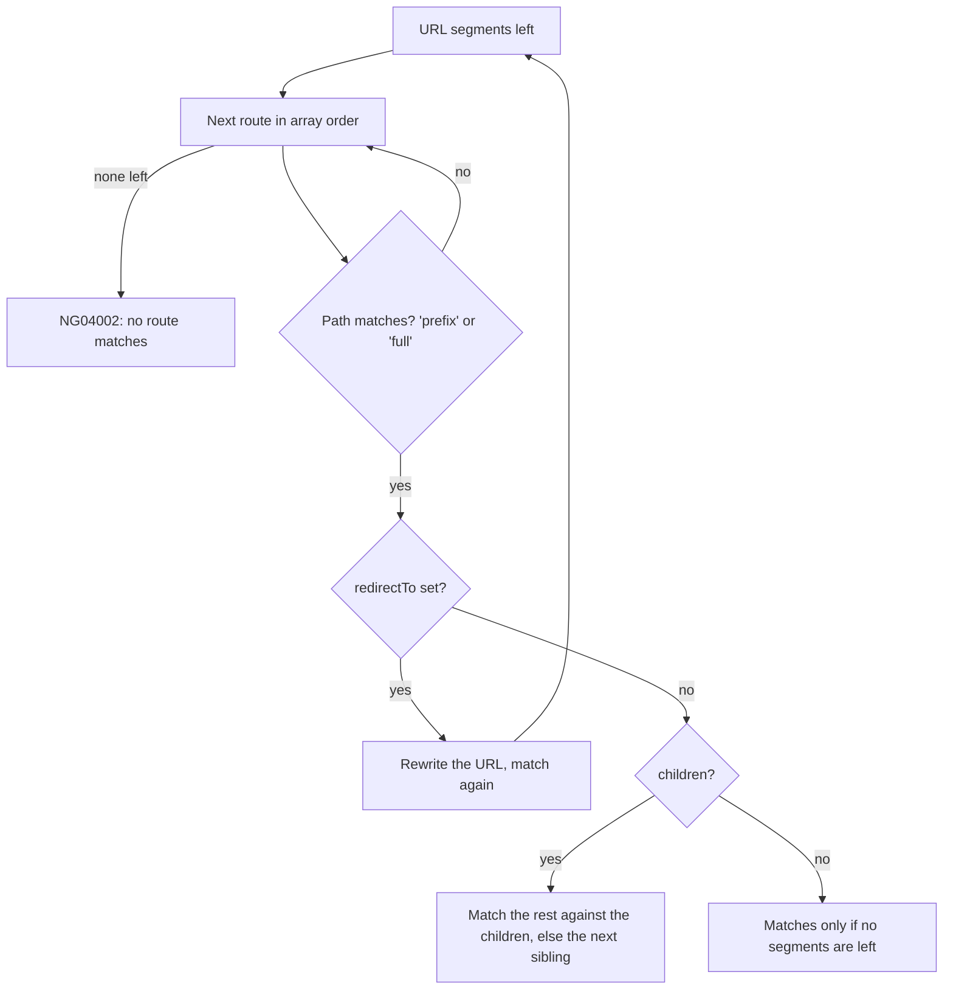
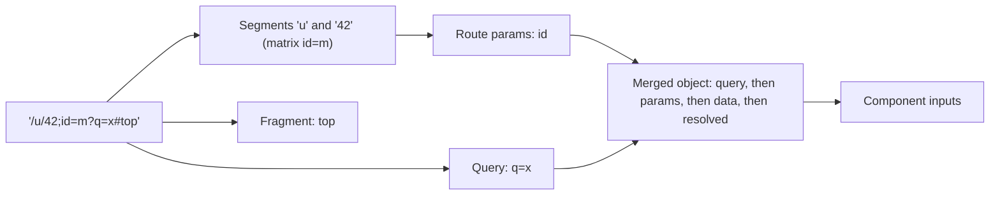
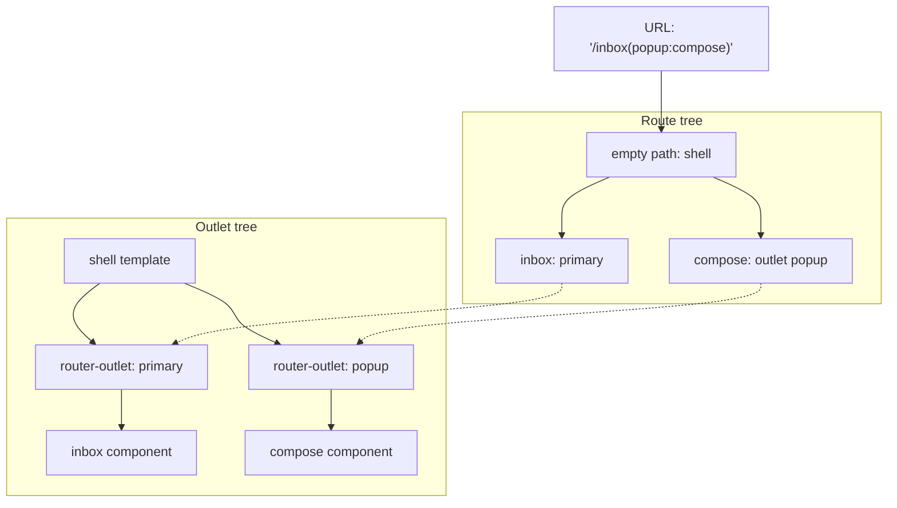
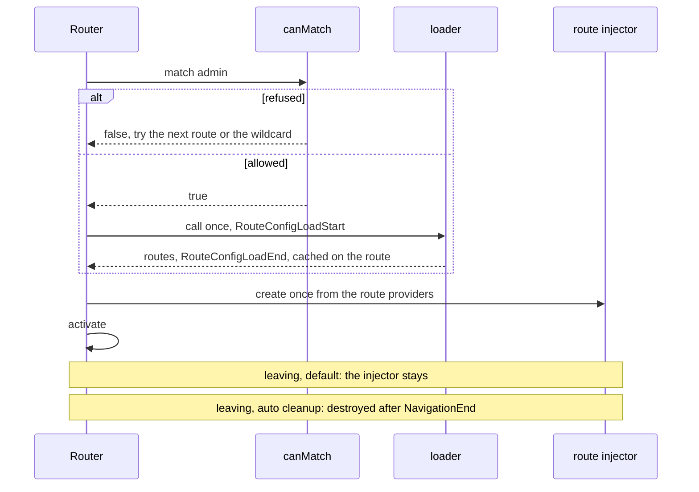
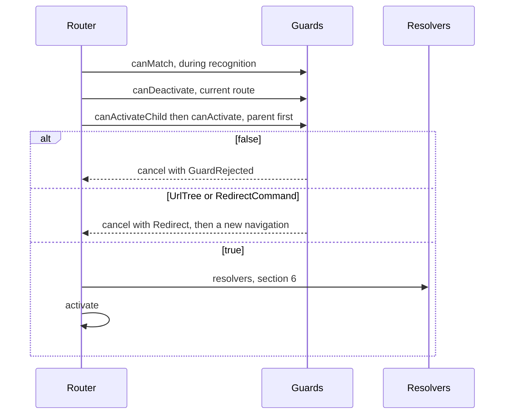
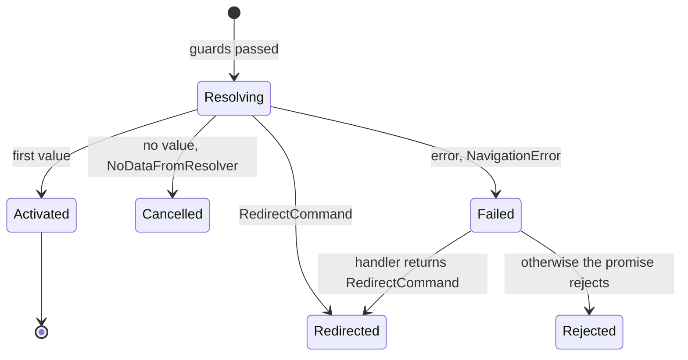
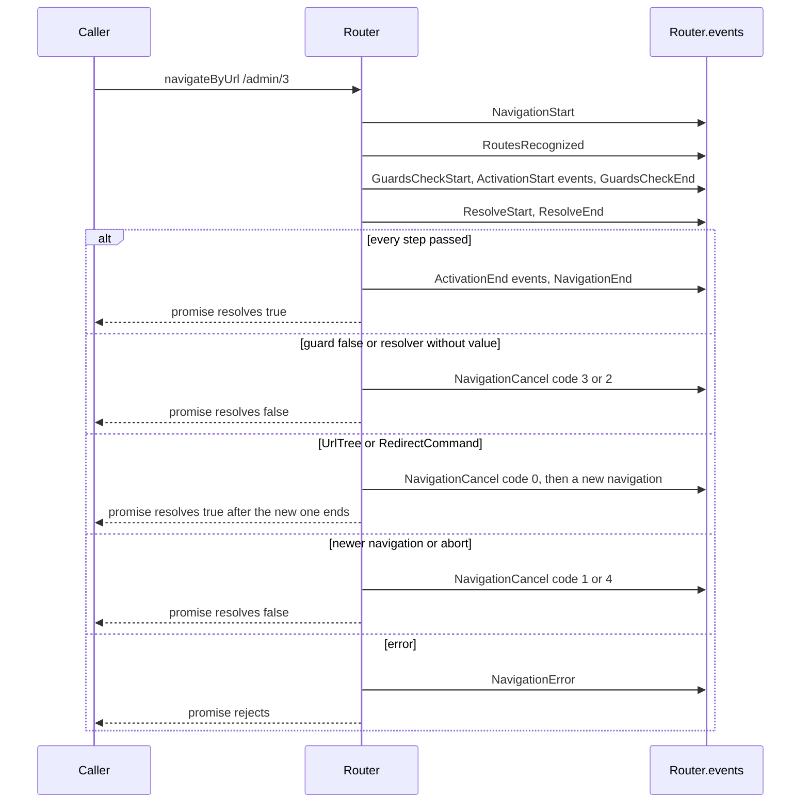
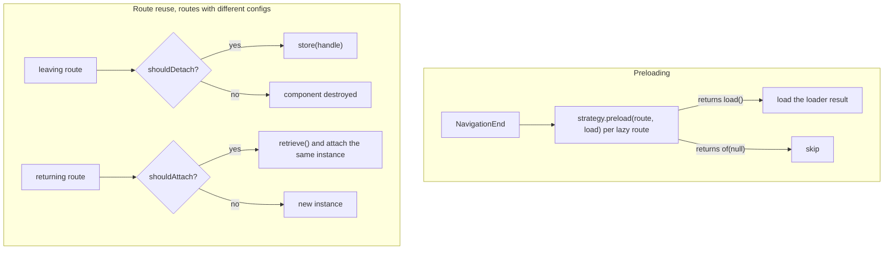
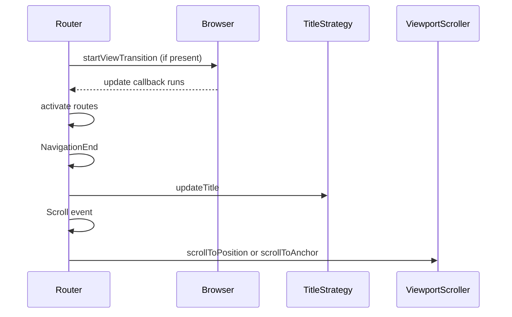
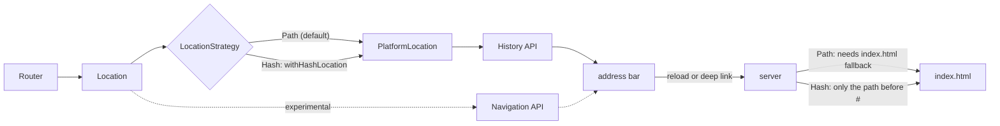

# 24. Routing: configuration, parameters, guards, lazy loading and the navigation lifecycle

> **What this covers:** how the Angular Router turns a URL into a tree of routed components: `provideRouter`, route matching, redirects and the wildcard; path, matrix and query parameters, parameter inheritance and component input binding; nested and named outlets; lazy loading with `canMatch` and route injectors; functional guards, `RedirectCommand` and why guards are not security; resolvers and router resources; the navigation events, cancellation and the transition pipeline; preloading and route reuse; view transitions, scroll restoration and titles; and how the Router sits on the History API and the location strategies. Lazy loading without NgModules is module 15; the injector tree is module 16.
> **Prerequisites:** [16. The injector tree](16-dependency-injection.md#5-the-injector-tree-platform-root-route-and-element-injectors-and-the-modifiers) (route injectors), [19. Inputs and outputs](19-component-communication-and-projection.md#1-inputs-outputs-and-two-way-binding-the-parent-and-child-contract) (signal inputs, which component input binding sets) and [23. Higher-order Observables](23-rxjs-in-depth.md#1-higher-order-observables-switchmap-mergemap-concatmap-and-exhaustmap) (`switchMap`, which the navigation pipeline uses); [15. Lazy loading without modules](15-standalone-and-ngmodules.md#4-lazy-loading-without-modules-loadcomponent-and-loadchildren-with-route-arrays) for `loadComponent` and `loadChildren`
> **Leads to:** [31. Performance](31-performance.md), [32. SSR, SSG and hydration](32-ssr-ssg-hydration.md), [33. Security](33-security.md), [34. i18n](34-i18n.md), [42. Full-stack authentication](42-fullstack-authentication.md)
> **Applies to:** Angular 22.2 (`@angular/router` 22.2.1), RxJS 7.8 (`rxjs` 7.8.2), TypeScript 6.0, Node 24
> **Study time:** ~7 hours reading + ~5 hours exercises
> **Short on time:** read [1. Router configuration](#1-router-configuration-providerouter-route-matching-redirects-and-the-wildcard), [4. Lazy loading in depth](#4-lazy-loading-in-depth-loaders-canmatch-and-route-injectors), [5. Functional guards](#5-functional-guards-canmatch-canactivate-candeactivate-and-redirectcommand) and [7. The navigation lifecycle](#7-the-navigation-lifecycle-events-cancellation-and-the-transition-pipeline), then drill [Q24.02](#q24-02), [Q24.12](#q24-12), [Q24.16](#q24-16), [Q24.19](#q24-19), [Q24.24](#q24-24) and [Q24.25](#q24-25), try [Exercise 24.3](#ex24-3), and finish with the [Summary](#summary).
> **Labs:** [`labs/angular/src/app/modules/24-routing/`](../labs/angular/src/app/modules/24-routing/) (section specs, *Output* questions, Exercises 24.1-24.6; `RouterTestingHarness` and `TestBed` specs in jsdom; no `labs/ts-js` files). Run (Node 24): from `labs/angular`, `npx ng test --watch=false --include='src/app/modules/24-routing/**/*.spec.ts'`.

## Contents

1. [Router configuration: `provideRouter`, route matching, redirects and the wildcard](#1-router-configuration-providerouter-route-matching-redirects-and-the-wildcard)
2. [Route parameters: path, matrix, query and fragment, inheritance and component input binding](#2-route-parameters-path-matrix-query-and-fragment-inheritance-and-component-input-binding)
3. [Nested and named outlets](#3-nested-and-named-outlets)
4. [Lazy loading in depth: loaders, `canMatch` and route injectors](#4-lazy-loading-in-depth-loaders-canmatch-and-route-injectors)
5. [Functional guards: `canMatch`, `canActivate`, `canDeactivate` and `RedirectCommand`](#5-functional-guards-canmatch-canactivate-candeactivate-and-redirectcommand)
6. [Resolvers and route data: `ResolveFn`, failures and router resources](#6-resolvers-and-route-data-resolvefn-failures-and-router-resources)
7. [The navigation lifecycle: events, cancellation and the transition pipeline](#7-the-navigation-lifecycle-events-cancellation-and-the-transition-pipeline)
8. [Preloading strategies and route reuse](#8-preloading-strategies-and-route-reuse)
9. [View transitions, scroll restoration and titles](#9-view-transitions-scroll-restoration-and-titles)
10. [The Router and the platform: History API, Navigation API and location strategies](#10-the-router-and-the-platform-history-api-navigation-api-and-location-strategies)
- [Summary](#summary)
- [Question bank](#question-bank)
- [Hands-on exercises](#hands-on-exercises)
- [Check your understanding](#check-your-understanding)
- [Connections](#connections)

**How the claims here are verified.** An observed behavior cites a spec in `labs/angular/src/app/modules/24-routing/`, run by `ng test` in jsdom (a DOM implementation for Node) with Angular 22.2.1 and `@angular/router` 22.2.1; routes are driven through `RouterTestingHarness` and, for preloading and scrolling, a real `ApplicationRef.bootstrap`. "Read from the source" names the file and function in the published `@angular/router` 22.2.1 or `@angular/common` 22.2.1 package; internal names are marked. Status markers come from typings tags and the Angular CHANGELOG. Browser history and back/forward, the View Transitions animation, the Navigation API integration and server configuration are documented only: cited and dated, never run.

## 1. Router configuration: `provideRouter`, route matching, redirects and the wildcard

### The problem it solves

A single-page app turns a URL into components without asking the server, and a wrong route table can look right. A `'**'` route listed first answered `/home`, and `users/:id` before `users/new` answered `/users/new` (`Section 1: routes match in array order`); `/home/extra` fell to not-found because `home` has no children (`Section 1: a route without children does not match a longer URL`). A renamed URL needs a redirect ([Q24.01](#q24-01), [Q24.02](#q24-02), [Q24.03](#q24-03), [Q24.04](#q24-04)).

### Mental model

A **route** is an entry `{ path, component | children | loadChildren | redirectTo, … }`; the array of them is the **route table** (`Routes`). `provideRouter(routes, ...features)` registers the router and the table ([15 §3](15-standalone-and-ngmodules.md#3-bootstrapping-and-providers-without-modules-bootstrapapplication-provide-functions-and-importprovidersfrom) teaches `provide*` functions); a **router feature** is an optional `with…` function after the table, such as `withDebugTracing()`. The router splits the URL into **segments** and matches them **in array order**: the first route that matches wins. `pathMatch: 'prefix'` (the default) matches when the path is a prefix of the remaining segments; `'full'` only when it consumes all of them. A **redirect** rewrites the URL and matching continues; it is **absolute** when it starts with `/` or is a `UrlTree` ([section 2](#2-route-parameters-path-matrix-query-and-fragment-inheritance-and-component-input-binding)), else **relative**. The **wildcard route** `'**'` matches any remaining URL.

A mail room sorts a letter by the first rule that fits, from the top.



What to notice: order decides, a failed child falls back to the next sibling, and `'full'` exists for the empty path.

### How it actually works

Three lab tests assert this table (`Section 1: an empty-path full redirect sends / to /home`, `Section 1: a redirect function reads params and query params`, `Section 1: the wildcard renders for an unknown URL and keeps the URL`):

```text
/            ends at /home            (empty path, pathMatch 'full', redirectTo 'home')
/old/7?x=1   ends at /team/7?from=1   (redirect function)
/old/7       ends at /team/7?from=none
/nope/deep   renders not-found, URL stays /nope/deep
/home/extra  renders not-found        (home has no children, so it must consume the whole URL)
```

Read from the `@angular/router` 22.2.1 source (`_router-chunk.mjs`, internal names): `Recognizer.processSegment` loops over the routes in array order and, on a `NoMatch`, continues with the next (the diagram's sibling fallback). `defaultUrlMatcher` (public) lets a `**` part consume the remaining segments. `validateConfig` (internal) rejects `{ path: '', redirectTo: 'home' }` with `NG04014` when the router is created, in development mode only, because its calls sit behind `ngDevMode` ([12 §3](12-angular-how-it-works.md#3-building-the-application-builder-output-layout-and-budgets)); `Section 1: an empty-path prefix redirect throws NG04014`. The typings give the reason: an empty path is a prefix of any URL, so the redirect would apply again at its destination.

A function `redirectTo` [Added in v18.0] receives a `PartialMatchRouteSnapshot` (`params`, `queryParams`, `fragment` and more) and returns a `string | UrlTree` or an Observable or Promise of one. `getRedirectResult` (internal) calls it with `runInInjectionContext`, so it can `inject()` ([16 §4](16-dependency-injection.md#4-the-injection-context-inject-runininjectioncontext-and-injectasync)), on every navigation that matches its route (`Section 1: a redirect function runs in an injection context and on every matching navigation`).

An absolute redirect throws an internal `AbsoluteRedirect` that restarts matching from the root; after 31 restarts (`MAX_ALLOWED_REDIRECTS`, internal) development mode throws `NG04016`, and a production build stops following redirects (read, not run). A relative one calls `processSegment` with redirects off, so a second relative redirect is not followed: `NG04002`. Both reject the navigation (`Section 1: absolute redirects that loop reject with NG04016 and relative ones with NG04002`).

### Code

Every spec of this module drives a `RouterTestingHarness` from `@angular/router/testing` ([module 29](29-testing-angular.md#9-testing-guards-interceptors-forms-effects-resources-and-stores) owns testing). The approach: run a table through `open`, which returns the final URL and routed text.

1. Define the table: empty-path redirect first, wildcard last.
2. Configure `TestBed` with `provideRouter(routes)` and create the harness.
3. Navigate, render, and read `router.url` and the element text.

```ts
// Excerpt of labs/angular/src/app/modules/24-routing/concepts/section-1-configuration.spec.ts
const tableRoutes: Routes = [
  { path: '', pathMatch: 'full', redirectTo: 'home' },
  { path: 'home', component: LabM24Home },
  {
    path: 'old/:id',
    redirectTo: ({ params, queryParams }) =>
      `/team/${params['id']}?from=${queryParams['x'] ?? 'none'}`,
  },
  { path: 'team/:id', component: LabM24Team },
  { path: '**', component: LabM24NotFound },
];

async function open(routes: Routes, url: string): Promise<{ url: string; text: string }> {
  TestBed.configureTestingModule({ providers: [provideRouter(routes)] });
  const harness = await RouterTestingHarness.create();
  await harness.navigateByUrl(url);
  harness.detectChanges();
  return {
    url: TestBed.inject(Router).url,
    text: harness.routeNativeElement?.textContent ?? '',
  };
}
```

#### Legacy

`RouterModule.forRoot(routes, { … })` registered the router from an NgModule import ([Q15.09](15-standalone-and-ngmodules.md#q15-09) compares it with `provideRouter`). `provideRoutes(routes)` [Removed in v22.0] added routes; the 22.0.0 CHANGELOG says "`provideRoutes()` has been removed. Use `provideRouter()` or `ROUTES` as multi token if necessary." It is absent from the 22.2.1 typings (`grep -c provideRoutes types/router.d.ts` gives 0; `Section 1: provideRoutes is not exported by @angular/router 22.2.1`), so it is shown as text:

```text
// removed in 22.0.0
providers: [provideRoutes(routes)]
```

### Best practices and anti-patterns

- **Put `pathMatch: 'full'` on every empty-path redirect**, because an empty path is a prefix of any URL.
- **List specific routes before parameterized ones and the wildcard last**, because the first match wins and no ranking happens.
- **Redirect with an absolute `/…` target when leaving the current branch**, because a second relative redirect is not followed.
- **Keep a redirect function cheap**, because it runs on every navigation that matches its route.

### Misconceptions and traps

- *"`pathMatch: 'full'` is needed on every route."* It matters for an empty path and redirects; the habit comes from copying the empty-path redirect.
- *"The router picks the most specific route."* It takes the first match in array order (`Section 1: routes match in array order`); server routers that rank routes taught the opposite.
- *"The wildcard changes the URL to a not-found URL."* It keeps the URL (`/nope/deep`); server 404 pages suggest otherwise, but the wildcard only renders a component.
- *"A redirect function runs once at startup."* It runs on every matching navigation; the table looks static, but the function is called per navigation.

Drilled in [Q24.01](#q24-01), [Q24.02](#q24-02), [Q24.03](#q24-03), [Q24.04](#q24-04); modelled in [Exercise 24.1](#ex24-1).

## 2. Route parameters: path, matrix, query and fragment, inheritance and component input binding

### The problem it solves

A component that reads `snapshot.params` once keeps showing product 1 after a link to product 2, because the router reused the instance (`Section 2: a reused component keeps one instance across param changes`, `Section 2: a snapshot read in a constructor goes stale, a subscription stays current`). A child route sees its parent's `:id` since v22 and did not before (`Section 2: with the v22 default a child sees its parent's params and data`, `Section 2: emptyOnly hides a component parent's params`).

### Mental model

The router parses a URL into a **`UrlTree`**: **segment groups** holding **segments**, each with a path and **matrix parameters** (`;key=value`), plus one **query** (`?`) and one **fragment** (`#`) for the whole tree. The docs say matrix parameters "belong to a specific URL segment" (`adev/src/content/guide/routing/read-route-state.md`, branch `main`, read 2026-10-10). A **path parameter** (`:id`) is captured by the route whose path declares it. Each activated route is an **`ActivatedRoute`** with observables (`params`, `paramMap` (`params` as a `ParamMap`, read with `get`), `queryParams`, `fragment`, `data`) and a **snapshot**, which "will not reflect future changes" (same docs).

**Parameter inheritance** decides what a child route receives from its parents. `paramsInheritanceStrategy` [Changed in v22: default 'always'], an option of `RouterConfigOptions` (set with `withRouterConfig`), merges every ancestor's params and data under `'always'`, and only through empty-path or componentless parents (routes with no `component`, [§3](#3-nested-and-named-outlets)) under `'emptyOnly'`. **Component input binding**, `withComponentInputBinding` [Added in v16.0], writes the merged values into the routed component's inputs ([19 §1](19-component-communication-and-projection.md#1-inputs-outputs-and-two-way-binding-the-parent-and-child-contract) teaches signal inputs).

A postal address: the apartment note belongs to one line, the delivery note to the whole letter.



What to notice: later sources overwrite earlier ones, and a missing key becomes `undefined`.

### How it actually works

`Section 2: path, matrix, query and fragment land in their places` asserts that `/list;sort=asc;page=2?q=x#top` gives `params` `{ sort: 'asc', page: '2' }`, `queryParams` `{ q: 'x' }` and `fragment` `'top'`. For `/team;t=1/member;m=2` the child has `{ m: '2' }` under `'emptyOnly'` and `{ t: '1', m: '2' }` under `'always'` (`Section 2: a matrix parameter belongs to the route of its segment`). `Section 2: parseUrl splits a URL into segment groups, matrix parameters, query and fragment` asserts the tree of the diagram.

Why does the component stay? Read from the `@angular/router` 22.2.1 source (`_router-chunk.mjs`): `BaseRouteReuseStrategy.shouldReuseRoute` returns `future.routeConfig === curr.routeConfig`, so `/c/1` to `/c/2` keeps the instance and a detour through `/x` builds a new one ([§8](#8-preloading-strategies-and-route-reuse) owns reuse).

Why does a child inherit? Same file: `Recognizer.createSnapshot` calls `getInherited` (both internal) for every route, which merges the parent's params and data when the strategy is `'always'`, the route's path is `''`, or the parent has no `component` and no `loadComponent`. A componentless parent passes everything under both strategies (`Section 2: a componentless parent passes params under both strategies`). CHANGELOG 22.0.0 (`main`, read 2026-10-10): "paramsInheritanceStrategy now defaults to 'always'".

Why does a missing key bind `undefined`? Same file: `RouterOutlet.activateWith` calls `RoutedComponentInputBinder.bindActivatedRouteToOutletComponent` (internal), which merges `{ ...queryParams, ...params, ...data, ...activatedRoute.resources }` and calls `setInput(name, data[name])` for every input of the component. Path and matrix parameters share `params`: a matrix `id` overwrote the path `id`, and static data both (`Section 2: input binding merges query, params, data and resolved data in that order`). An absent key overwrites the input's default (`Section 2: a key that disappears binds undefined, over the input default`).

The options [Added in v22.0] of `ComponentInputBindingOptions`: `queryParams: false` (default `true`) removes the query from the merge, and `unmatchedInputBehavior: 'undefinedIfStale'` (default `'alwaysUndefined'`) binds `undefined` only to a key the outlet has already seen, so a never-seen input keeps its default (`Section 2: queryParams false and undefinedIfStale change what binds`). `Data` values are typed `any` (typings); the input carries the type ([07 §9](07-ts-advanced-types-and-decorators.md#9-typing-patterns-in-angular-code)).

### Code

The approach: name inputs after the keys, enable the feature.

1. Declare one signal input per key; `withDefault` shows the default the router overrides.
2. Give the route a path parameter, static `data` and a resolver (a function whose result becomes route data, [§6](#6-resolvers-and-route-data-resolvefn-failures-and-router-resources)).
3. Pass `withComponentInputBinding()` to `provideRouter`, then navigate.

```ts
// Excerpt of labs/angular/src/app/modules/24-routing/concepts/section-2-parameters.spec.ts
@Component({ selector: 'lab-m24-inputs', template: 'inputs' })
class LabM24Inputs {
  readonly id = input<string>();
  readonly q = input<string>();
  readonly kind = input<string>();
  readonly user = input<string>();
  readonly withDefault = input<string>('default');
}

const withData: Routes = [
  {
    path: 'u/:id',
    component: LabM24Inputs,
    data: { kind: 'static', id: 'fromData' },
    resolve: { user: () => 'resolved-user' },
  },
];
const [all] = await bindAcross(withData, ['/u/42;id=matrix?q=hello&id=query'], withComponentInputBinding());
expect(all).toMatchObject({ id: 'fromData', q: 'hello', kind: 'static', user: 'resolved-user' });
```

A link with a matrix parameter, a query and a fragment is a `createUrlTree` call:

```ts
// Excerpt of labs/angular/src/app/modules/24-routing/concepts/section-2-parameters.spec.ts
const tree = TestBed.inject(Router).createUrlTree(['/list', { sort: 'desc' }], {
  queryParams: { q: 'y' },
  fragment: 'f',
});
expect(tree.toString()).toBe('/list;sort=desc?q=y#f');
```

#### Legacy

A snapshot read in the constructor is the stale-snapshot bug: the first component below kept `'1'` after `/stale/2`, and the subscribed one followed to `'2'`. A subscription needs its own teardown ([23 §6](23-rxjs-in-depth.md#6-unsubscription-strategies-in-angular-and-finding-leaks)); the migration is an input plus `withComponentInputBinding()`. `withRouterConfig({ paramsInheritanceStrategy: 'emptyOnly' })` restores the pre-v22 inheritance.

```ts
// Excerpt of labs/angular/src/app/modules/24-routing/legacy/deprecated-forms.ts
@Component({ selector: 'lab-m24-legacy-stale-product', template: '{{ id }}' })
export class LabM24LegacyStaleProduct {
  readonly id = inject(ActivatedRoute).snapshot.paramMap.get('id');
}

@Component({ selector: 'lab-m24-legacy-param-map-product', template: '{{ id }}' })
export class LabM24LegacyParamMapProduct implements OnInit {
  private readonly route = inject(ActivatedRoute);
  id: string | null = null;

  ngOnInit(): void {
    this.route.paramMap.subscribe((params) => {
      this.id = params.get('id');
    });
  }
}

export const legacyEmptyOnlyInheritance = withRouterConfig({ paramsInheritanceStrategy: 'emptyOnly' });
```

### Best practices and anti-patterns

- **Bind parameters to inputs in new code**, because the component then needs no `ActivatedRoute` and no teardown.
- **Allow `undefined` in an optional input's type**, because a missing key binds `undefined` (docs, `common-router-tasks.md` on `main`, 2026-10-10).
- **Give a default through a resolver or an input transform, not the initializer**, because the router overwrites the initializer with `undefined`.
- **Keep state several routes read in the query string**, because the query belongs to the whole tree.
- **Set `'emptyOnly'` only to keep an old app working while migrating**, because the default changed in v22.

### Misconceptions and traps

- *"The snapshot is enough because the component is recreated."* The router reuses the instance for the same route config; full page loads recreate components and hide the bug.
- *"Matrix parameters are just another query syntax."* A matrix parameter belongs to one segment and the query to the whole URL; the shared key-value shape hides that.
- *"A child never sees its parent's `:id`."* Once true: until v22, under `'emptyOnly'` with a component parent. Now: `'always'` merges it; the belief survives in older code.
- *"Input binding keeps the input's default when the key is absent."* The router binds `undefined` unless `'undefinedIfStale'` applies and the key was never seen; `input('x')` keeps its default everywhere else, which sets the wrong expectation.

Drilled in [Q24.05](#q24-05), [Q24.06](#q24-06), [Q24.07](#q24-07), [Q24.08](#q24-08); modelled in [Exercise 24.2](#ex24-2).

## 3. Nested and named outlets

### The problem it solves

A settings page has a sidebar and a content pane that follows the URL. A mail page keeps a compose panel open while the inbox changes, and the panel must survive a shared link. One outlet cannot do either: a child route needs an outlet in its parent's component (`Section 3: children render into the parent's outlet`), and a second panel needs a second outlet whose route the URL records (`Section 3: a named outlet appears in the URL in parentheses`).

### Mental model

A **router outlet** (`<router-outlet />`, the `RouterOutlet` directive) is the placeholder where the router inserts a route's component; the docs say Angular inserts it "just after the outlet element as a sibling" (`adev/src/content/guide/routing/show-routes-with-outlets.md`, branch `main`, read 2026-10-10), which `Section 3: children render into the parent's outlet` asserts. The **router state** is the tree of activated routes. Each level of `children` renders into its parent component's outlet, so the **outlet tree** mirrors the route tree; the unnamed outlet is the **primary outlet**. A **named (auxiliary) outlet** (`<router-outlet name="popup" />`) holds a parallel branch of routes marked `outlet: 'popup'`, written in parentheses in the URL and navigated on its own. A **componentless route** has no `component`: it groups children under a shared path prefix and data without a view.

Picture frames inside picture frames, plus a second frame on the same wall with its own picture.



What to notice: the URL holds every outlet's branch, so opening it rebuilds both panels.

### How it actually works

**Navigating one outlet.** An `outlets` command (an object in the `navigate` array) addresses outlets by name. From `/inbox`, `router.navigate([{ outlets: { popup: ['compose'] } }])` gave `/inbox(popup:compose)` (`Section 3: an outlets command reopens the named outlet`). `{ popup: null }` removed only that branch (`Section 3: outlets popup null closes the named outlet`). `{ outlets: { primary: ['sent'] } }` kept the popup (`Section 3: the primary outlet navigates without touching the named outlet`).

**Outlet data.** `routerOutletData` [Added in v19.0] is an input of the outlet (CHANGELOG 19.0.0, `main`, read 2026-10-10: "Add `routerOutletData` input to `RouterOutlet` directive"). The routed component reads it with `inject(ROUTER_OUTLET_DATA)`, an `InjectionToken<Signal<unknown>>` (typings). With `[routerOutletData]="theme"` on the parent's outlet the child rendered `dark` (`Section 3: routerOutletData reaches the routed component through ROUTER_OUTLET_DATA`). With the input unset the signal held `undefined` (`Section 3: an outlet without routerOutletData provides undefined`) (the docs agree; the token's typings comment says `null`).

**Why the outlet's injector is not inherited.** Read from the `@angular/router` 22.2.1 source (`_router-chunk.mjs`; internal names; read, not run): `RouterOutlet.activateWith` calls `location.createComponent` with the route's environment injector (`OutletContext.injector`) and an `OutletInjector`, which answers `ActivatedRoute`, `ChildrenOutletContexts` and `ROUTER_OUTLET_DATA` itself and hands every other token to the outlet's own injector. That matches the CHANGELOG 18.0.0 fix "Routed components never inherit `RouterOutlet` `EnvironmentInjector`"; instance identities are [Q16.16](16-dependency-injection.md#q16-16)'s.

**Why a componentless route adds no view.** Same file: `ActivateRoutes.activateRoutes` (internal) calls `activateChildRoutes` with the same parent contexts when the route has no `component`, so its children bind to the parent's outlet. The child rendered in the root outlet and inherited the parent's data (`Section 3: a componentless route groups children without a view`; inheritance is [§2](#2-route-parameters-path-matrix-query-and-fragment-inheritance-and-component-input-binding)).

### Code

The approach: one shell component owns both outlets.

1. Give the shell a primary and a named outlet.
2. Put the routes under an empty-path shell route, with `outlet: 'popup'` on the panel's.
3. Open the panel with an `outlets` command.

```ts
// Excerpt of labs/angular/src/app/modules/24-routing/concepts/section-3-outlets.spec.ts
@Component({
  selector: 'lab-m24-mail-shell',
  imports: [RouterOutlet],
  template: '<main><router-outlet /></main><aside><router-outlet name="popup" /></aside>',
})
class LabM24MailShell {}

const mailRoutes: Routes = [
  {
    path: '',
    component: LabM24MailShell,
    children: [
      { path: 'inbox', component: LabM24Inbox },
      { path: 'sent', component: LabM24Sent },
      { path: 'compose', component: LabM24Compose, outlet: 'popup' },
    ],
  },
];
```

```ts
// Excerpt of labs/angular/src/app/modules/24-routing/concepts/section-3-outlets.spec.ts
await harness.navigateByUrl('/inbox');
expect(await router.navigate([{ outlets: { popup: ['compose'] } }])).toBe(true);
expect(router.url).toBe('/inbox(popup:compose)');
```

The parent's outlet passes data down:

```ts
// Excerpt of labs/angular/src/app/modules/24-routing/concepts/section-3-outlets.spec.ts
@Component({ selector: 'lab-m24-themed', template: '{{ theme() }}' })
class LabM24Themed {
  protected readonly theme = inject(ROUTER_OUTLET_DATA) as Signal<string>;
}

@Component({
  selector: 'lab-m24-themed-shell',
  imports: [RouterOutlet],
  template: '<router-outlet [routerOutletData]="theme" />',
})
class LabM24ThemedShell {
  protected readonly theme = 'dark';
}
```

### Best practices and anti-patterns

- **Give a panel that deserves a link a named outlet, and a transient overlay a dialog service**, because only the named outlet is in the URL.
- **Change one outlet with an `outlets` command**, because it names the branch it touches and leaves the others in place.
- **Share a path prefix or data through a componentless parent**, because it needs no extra component.

### Misconceptions and traps

- *"A named outlet is just a second primary outlet."* It has its own branch in the URL and navigates on its own; the same tag hides that.
- *"Componentless routes are a hack."* A route without `component` looks unfinished, yet it is how children share a path prefix and data without a view.
- *"Closing a popup needs `navigate(['/inbox'])`."* Thinking in primary URLs hides that `outlets: { popup: null }` removes only that branch.

Drilled in [Q24.09](#q24-09), [Q24.10](#q24-10), [Q24.11](#q24-11); modelled in [Exercise 24.2](#ex24-2).

## 4. Lazy loading in depth: loaders, `canMatch` and route injectors

### The problem it solves

An `admin` route with `canActivate: [() => false]` and a `loadChildren` loader still called the loader once: the refused user had fetched the code, and the URL stayed `/` (`Section 4: a failing canActivate does not stop a loadChildren loader`). A route-provided service was built once, not destroyed on leaving, and reused on return (`Section 4: a route injector outlives the route by default`). Both follow from when the router calls a loader and frees an injector ([Q24.12](#q24-12), [Q24.13](#q24-13)).

### Mental model

A **loader** is a route's `loadChildren` or `loadComponent` function ([15 §4](15-standalone-and-ngmodules.md#4-lazy-loading-without-modules-loadcomponent-and-loadchildren-with-route-arrays) teaches both); it returns routes or a component, usually via a dynamic `import()` of a **chunk** ([12 §3](12-angular-how-it-works.md#3-building-the-application-builder-output-layout-and-budgets)). `loadChildren` runs during **recognition**, where the router matches the URL to routes ([section 7](#7-the-navigation-lifecycle-events-cancellation-and-the-transition-pipeline)), and its result is cached on the route. `canMatch` [Added in v14.1] runs before it, so a refused user never fetches that chunk. A route with `providers` gets a **route injector**, an **environment injector** ([16 §5](16-dependency-injection.md#5-the-injector-tree-platform-root-route-and-element-injectors-and-the-modifiers)) created once and kept; **auto cleanup**, `withAutoCleanupInjectors` [Stable since v22.2], destroys it once the route is inactive.

A warehouse ships a crate on the first order and keeps it; with cleanup on, it takes the crate back.



What to notice: a guard that must stop a `loadChildren` download has to be `canMatch`, the only guard that runs before the loader.

### How it actually works

**Loader and guards.** Read from the `@angular/router` 22.2.1 source (`_router-chunk.mjs`; internal names may change in any release): the recognizer's `matchWithChecks` runs the `canMatch` guards (`runCanMatchGuards`) and only then `getChildConfig`, which calls `RouterConfigLoader.loadChildren` and caches the routes on `route._loadedRoutes`. With `canMatch` returning `false` the loader ran 0 times, the wildcard rendered and no `RouteConfigLoadStart` fired; with `true` it ran once (`Section 4: a rejecting canMatch prevents the load and falls through`). Visiting `/lazy`, `/`, `/lazy` ran it once (`Section 4: the loader runs once, on the first navigation that needs it`). `RouteConfigLoadStart` and `RouteConfigLoadEnd` fired before `RoutesRecognized` on the first visit and not on the second (`Section 4: a lazy navigation emits RouteConfigLoadStart and RouteConfigLoadEnd`).

**`loadComponent` runs later.** Same file: components load after the resolvers, so a failing `canActivate` stopped a `loadComponent` loader (`Section 4: a failing canActivate stops a loadComponent loader`), and `RouteConfigLoadStart` followed `ResolveEnd` (`Section 4: a loadComponent loader runs after the guards and the resolvers`). Loaders run in the route's injection context [Changed in v20.1: `loadComponent` and `loadChildren` run in the route's injection context] (Angular CHANGELOG 20.1.0, branch `main`, read 2026-10-10), which [15 §4](15-standalone-and-ngmodules.md#4-lazy-loading-without-modules-loadcomponent-and-loadchildren-with-route-arrays) owns.

**Why the injector lives on.** `getOrCreateRouteInjectorIfNeeded` (internal) creates an environment injector from the route's `providers` once and caches it on `route._injector` (internal), so a second visit reuses it. With the feature on, `Router` runs a cleanup on every `NavigationEnd`; it destroys the injector of a route that is no longer active when `RouteReuseStrategy.shouldDestroyInjector` says so, and `BaseRouteReuseStrategy.shouldDestroyInjector` returns `true` for every route (read, not run). Leaving destroyed the service once and returning built it again (`Section 4: withAutoCleanupInjectors destroys the route injector after leaving`). Stored handles are [section 8](#8-preloading-strategies-and-route-reuse)'s. Injector identity is [Q16.16](16-dependency-injection.md#q16-16)'s; `@defer` splits parts of a template instead ([18 §7](18-control-flow-and-defer.md#7-what-lands-in-a-chunk-testing-deferred-blocks-and-the-ssr-pointer)).

> [!NOTE]
> **Framework vs platform.** The chunk is the platform's dynamic `import()` ([05 §2](05-js-modules-memory-modern-features.md#2-commonjs-interop-and-dynamic-import), [15 §4](15-standalone-and-ngmodules.md#4-lazy-loading-without-modules-loadcomponent-and-loadchildren-with-route-arrays)); the router only decides when to call the loader.

### Code

The approach: refuse before the download, then decide whether a route's service outlives the route.

1. Put `canMatch` on the lazy route and a wildcard after it.
2. Count loader calls to see the cache.
3. List the service in `providers` and add `withAutoCleanupInjectors()`.

```ts
// Excerpt of labs/angular/src/app/modules/24-routing/concepts/section-4-lazy-loading.spec.ts
const deny: CanMatchFn = () => false;

function countingChildren(counter: { calls: number }): () => Promise<Routes> {
  return async () => {
    counter.calls++;
    return [{ path: '', component: LabM24LazyPage }];
  };
}
```

```ts
// Excerpt of labs/angular/src/app/modules/24-routing/concepts/section-4-lazy-loading.spec.ts
const routes: Routes = [
  { path: '', component: LabM24Home },
  { path: 'admin', canMatch: [deny], loadChildren: countingChildren(counter) },
  { path: '**', component: LabM24NotFound },
];
```

```ts
// Excerpt of labs/angular/src/app/modules/24-routing/concepts/section-4-lazy-loading.spec.ts
@Injectable()
class LabM24RouteService implements OnDestroy {
  static built = 0;
  static destroyed = 0;

  constructor() {
    LabM24RouteService.built++;
  }

  ngOnDestroy(): void {
    LabM24RouteService.destroyed++;
  }
}
```

```ts
// Excerpt of labs/angular/src/app/modules/24-routing/concepts/section-4-lazy-loading.spec.ts
{ path: 'f', providers: [LabM24RouteService], component: LabM24UsesService },
```

```ts
// Excerpt of labs/angular/src/app/modules/24-routing/concepts/section-4-lazy-loading.spec.ts
const { harness } = await create(routes, withAutoCleanupInjectors());
```

#### Legacy

`withExperimentalAutoCleanupInjectors()` is deprecated in the 22.2.1 typings ("Use `withAutoCleanupInjectors` instead"), without a version; its body returns `withAutoCleanupInjectors()` (read, not run), so migrating is a rename. `canLoad` [Deprecated since v15.1 — use canMatch] is [section 5](#5-functional-guards-canmatch-canactivate-candeactivate-and-redirectcommand)'s.

### Best practices and anti-patterns

- **Put `canMatch` on a `loadChildren` route whose chunk a refused user should not download**, because it runs before the loader.
- **Keep per-visit state out of a route's `providers` and the loader**, because the loader runs once and the injector stays.
- **Enable auto cleanup when a route's service must release something in `ngOnDestroy`**, because by default that hook did not run after the user left.

### Misconceptions and traps

- *"`canActivate` keeps the admin chunk from downloading."* A `loadChildren` loader already ran during recognition; `canActivate` does stop a `loadComponent` loader, hiding the difference.
- *"The loader runs on every visit."* The result is cached on the route (`Section 4: the loader runs once, on the first navigation that needs it`); a function in a route table reads as code that re-runs.
- *"Route providers are destroyed when you leave the route."* The injector lives on unless auto cleanup is enabled; component lifetimes suggest the opposite.
- *"Lazy services are fresh on every visit."* One injector serves the route config ([Q16.16](16-dependency-injection.md#q16-16)); "lazy" suggests creation on each use.

Drilled in [Q24.12](#q24-12) and [Q24.13](#q24-13); modelled in [Exercise 24.3](#ex24-3) and [Exercise 24.6](#ex24-6).

## 5. Functional guards: `canMatch`, `canActivate`, `canDeactivate` and `RedirectCommand`

### The problem it solves

A slow guard that returned `false`, listed before a fast guard that redirected, won: the navigation resolved `false` and the URL stayed `/` (`Section 5: in one array the first non-true result in array order wins`). A `UrlTree` result made `navigateByUrl` resolve `true` at `/login?r=tree` (`Section 5: a UrlTree and a RedirectCommand cancel with Redirect and navigate again`).

### Mental model

A **guard** is a function the router calls at one step of a navigation to decide whether it goes on: `canMatch` (consider this route at all?), `canActivate` (may it activate?), `canActivateChild` (may a child?) and `canDeactivate` (may the component be left?). Their function types are `CanMatchFn`, `CanActivateFn`, `CanActivateChildFn` and `CanDeactivateFn`; each returns a **`GuardResult`**, `boolean | UrlTree | RedirectCommand`, directly or as **`MaybeAsync`** (a value, Observable or Promise); the router keeps the first value (`Section 5: only the first value of an Observable guard counts`).

`false` cancels. A `UrlTree` ([section 2](#2-route-parameters-path-matrix-query-and-fragment-inheritance-and-component-input-binding)) or a **`RedirectCommand`** [Added in v18.0], a `UrlTree` plus navigation options, cancels and starts a new navigation; throwing a `RedirectCommand` [Added in v22.2] does the same. A `canMatch` returning `false` only drops its route and the next match is tried (`Section 5: a canMatch that returns false lets the next route with the same path match`). Guards run in the route's injection context, so `inject()` works; a **guard factory** returns a guard.

An usher checks tickets at each door; the vault keeps its own lock.



What to notice: `canDeactivate` runs before any `canActivate`, and a redirect is a cancel plus a new navigation.

### How it actually works

**Order.** Read from the `@angular/router` 22.2.1 source (`_router-chunk.mjs`; names internal, may change): `runCanMatchGuards` runs during recognition; `checkGuards` then runs `runCanDeactivateChecks` and, only when it gave `true`, `runCanActivateChecks`, parent route first. For `/admin/3` the log was both `canMatch` guards (the first refused), `canActivate` of the parent, `canActivateChild`, `canActivate` of the child, then the resolvers ([section 6](#6-resolvers-and-route-data-resolvefn-failures-and-router-resources)); leaving `/edit` logged `canDeactivate` first (`Section 5: canMatch, canActivate, canActivateChild and resolvers run in this order`, `Section 5: canDeactivate of the current route runs before canActivate of the next`).

**One array.** `prioritizedGuardValue` (internal) subscribes to every guard at once and returns the first non-`true` result in array order, waiting for earlier guards, so a slow `false` beats a fast redirect.

**Results.** A refused navigation was cancelled with code `GuardRejected` (`Section 5: a false guard cancels with GuardRejected`). A redirect was a cancel with `Redirect`, then a second navigation ending in `NavigationEnd`, and the promise resolved `true`, also for a thrown `RedirectCommand` (`Section 5: a thrown RedirectCommand redirects`); see [section 7](#7-the-navigation-lifecycle-events-cancellation-and-the-transition-pipeline).

**Arguments.** `canMatch` gets `(route, segments, currentSnapshot)`, where `currentSnapshot` [Added in v21.2] · [Changed in v22: currentSnapshot is required] is a `PartialMatchRouteSnapshot` ([section 1](#1-router-configuration-providerouter-route-matching-redirects-and-the-wildcard); Angular CHANGELOG 21.2.0 and 22.0.0, `main`, read 2026-10-10). For `/org/acme/p/7` it held `org` and `pid` (`Section 5: canMatch receives the segments and a partial snapshot with inherited params`). `canDeactivate` gets the component and the next state, and its `false` kept the URL (`Section 5: a false canDeactivate keeps the current URL`, `Section 5: canDeactivate receives the component instance and the next URL`).

**Closing the tab.** Guards run in the navigation pipeline (read, not run), so none is asked when the tab closes; that is the browser's `beforeunload` event, whose dialog text is generic (MDN, read 2026-10-10; documented, not run).

> [!WARNING]
> **Guards are not access control.** "CRITICAL: Never rely on client-side guards as the sole source of access control. All JavaScript that runs in a web browser can be modified by the user running the browser. Always enforce user authorization server-side, in addition to any client-side guards." (`adev/src/content/guide/routing/route-guards.md`, branch `main`, read 2026-10-10.) See [33](33-security.md#10-route-guards-are-ux-authorization-belongs-on-the-server) and [42](42-fullstack-authentication.md).

### Code

The approach: a role factory, a typed unsaved-changes guard and a thrown redirect.

1. Write a factory that reads a service with `inject()`.
2. Type the unsaved-changes guard with the component class.
3. Throw a `RedirectCommand` where a helper cannot return.

```ts
// Excerpt of labs/angular/src/app/modules/24-routing/concepts/section-5-guards.spec.ts
class LabM24Roles {
  readonly granted = new Set(['editor']);
  has(role: string): boolean {
    return this.granted.has(role);
  }
}

const requireRole =
  (role: string): CanActivateFn =>
  () =>
    inject(LabM24Roles).has(role) || inject(Router).parseUrl(`/login?need=${role}`);
```

`requireRole('admin')` sent `/users` to `/login?need=admin`, `requireRole('editor')` let `/posts` through (`Section 5: a guard factory closes over its argument and runs in the injection context`).

```ts
// Excerpt of labs/angular/src/app/modules/24-routing/concepts/section-5-guards.spec.ts
@Component({ selector: 'lab-m24-editor', template: 'editor' })
class LabM24Editor {
  readonly dirty = signal(true);
}

const unsaved: CanDeactivateFn<LabM24Editor> = (editor) => !editor.dirty();
{ path: 'edit', canDeactivate: [unsaved], component: LabM24Editor },
```

```ts
// Excerpt of labs/angular/src/app/modules/24-routing/concepts/section-5-guards.spec.ts
const throwing: CanActivateFn = () => {
  throw new RedirectCommand(inject(Router).parseUrl('/login?r=thrown'));
};
```

#### Legacy

A class implementing `CanActivate` preceded functions. `mapToCanActivate` [Added in v16.0] converts it (`Section 5: a class guard works through mapToCanActivate`); the class listed directly in the array, the token form, also ran (`Section 5: a class listed directly in the guard array is injected and called`) and is `@deprecated` in the 22.2.1 typings. `canLoad` guarded `loadChildren`: `false` cancelled and the loader did not run (`Section 5: a false canLoad cancels with GuardRejected and the loader does not run`). Migrate to functions or `canMatch`.

```ts
// Excerpt of labs/angular/src/app/modules/24-routing/legacy/deprecated-forms.ts
@Injectable({ providedIn: 'root' })
export class LabM24LegacyAuthGuard implements CanActivate {
  private readonly router = inject(Router);

  canActivate(): UrlTree {
    return this.router.parseUrl('/login?legacy=class');
  }
}

export const legacyMappedGuards = mapToCanActivate([LabM24LegacyAuthGuard]);

export const legacyTokenGuards: Route['canActivate'] = [LabM24LegacyAuthGuard];

export const legacyLoaderCalls = { count: 0 };

export const legacyCanLoadRoute: Route = {
  path: 'reports',
  canLoad: [() => false],
  loadChildren: () => {
    legacyLoaderCalls.count++;
    return [];
  },
};
```

### Best practices and anti-patterns

- **Return a `UrlTree` or `RedirectCommand` to send the user elsewhere**, because `false` leaves the user on the old page unexplained.
- **Put the decisive guard first in an array**, because the first non-`true` result in array order wins.
- **Use `canMatch` to choose between two routes with one path**, because `false` lets the next route match.

### Misconceptions and traps

- *"A guard protects the data."* It only hides the page, as the docs line says; a hidden page feels protected.
- *"Guards in one array run one after the other."* They are subscribed together and only the result is ordered; an array reads like a sequence.
- *"Returning a `UrlTree` is an error path."* It is a redirect and the promise resolves `true`; the cancel event looks like a failure.
- *"Class guards are deprecated."* `CanActivate` and `mapToCanActivate` are public; only the token form is deprecated, though functions became the default.
- *"`canActivate` runs for the route you are leaving."* That is `canDeactivate`; both names say "can".

Drilled in [Q24.14](#q24-14), [Q24.15](#q24-15), [Q24.16](#q24-16), [Q24.17](#q24-17), [Q24.18](#q24-18), [Q24.19](#q24-19) and [Q24.20](#q24-20); modelled in [Exercise 24.3](#ex24-3).

## 6. Resolvers and route data: `ResolveFn`, failures and router resources

### The problem it solves

A product page that renders empty and then jumps wastes the first look. A resolver that completed without a value cancelled the navigation: the promise resolved `false` and the URL stayed (`Section 6: a resolver that completes empty cancels with NoDataFromResolver`). One that threw rejected the promise and kept the old page (`Section 6: a resolver error rejects the navigation with NavigationError`). See [Q24.21](#q24-21) to [Q24.23](#q24-23).

### Mental model

A **resolver** ([section 2](#2-route-parameters-path-matrix-query-and-fragment-inheritance-and-component-input-binding)) is a **`ResolveFn<T>`**: a function `(route, state)` returning `T | RedirectCommand`, directly or as a Promise or Observable ([07 §9](07-ts-advanced-types-and-decorators.md#9-typing-patterns-in-angular-code) types it). It runs after every guard passed ([section 5](#5-functional-guards-canmatch-canactivate-candeactivate-and-redirectcommand)) and before activation. The router keeps the **first value** as **resolved data** under the key of `resolve` (`of(1, 2, 3)` gave `{ x: 1 }`: `Section 6: a resolver's first value lands in route data`).

A value activates the route. No value cancels with `NoDataFromResolver`. An error ends in a **`NavigationError`**, unless a **navigation error handler**, `withNavigationErrorHandler` [Added in v15.2], returns a `RedirectCommand`: the run showed a `Redirect` cancel, then a navigation ending at `/error` (`Section 6: withNavigationErrorHandler turns the error into a redirect`). A resolver may also return a `RedirectCommand` (`Section 6: a resolver can redirect with RedirectCommand`).

The route's **`runGuardsAndResolvers`** and the router-wide **`onSameUrlNavigation`** (what a navigation to the current URL does) decide when an unchanged route runs guards and resolvers again.

**Router resources** replace a resolver with signals. A route's `resources` property [Developer preview since v22.2] returns `resource`s by key ([17 §6](17-signals.md#6-resources-async-data-as-signals), [Q17.26](17-signals.md#q17-26)) once `withRouterResources()` [Developer preview since v22.2] is provided. A resource is **blocking** by default; `nonBlocking()` [Developer preview since v22.2] lets the route activate first.

A waiter brings the dish before seating you, or after.



What to notice: every exit except the value leaves the old page on screen; only an error rejects.

### How it actually works

**Outcomes.** Read from the `@angular/router` 22.2.1 source (`_router-chunk.mjs`; names internal, may change in any release): `resolveNode` takes `first()` of each resolver, throws a redirect for a `RedirectCommand` value and maps `EmptyError` to `EMPTY`; `resolveData` then ends without a `ResolveEnd` and the transition cancels. A never-completing Observable needs no `take(1)`: the router unsubscribed after the first value (same test; flattening is [23 §1](23-rxjs-in-depth.md#1-higher-order-observables-switchmap-mergemap-concatmap-and-exhaustmap)'s). The handler runs in an injection context and only a `RedirectCommand` result changes anything (typings, read).

**Reruns.** For the same route config, `shouldRunGuardsAndResolvers` (internal, called by `getRouteGuards`) switches on the mode; its `default` branch, shared with `'paramsChange'`, returns `!equalParamsAndUrlSegments`. An unset mode therefore compares path parameters and URL segments, and the `Route` typings say of `'paramsChange'`: "This option is the default". `/p?x=1` to `/p?x=2` ran guard and resolver once; a path-parameter change ran them again (`Section 6: a query-only change does not rerun guards by default`). With `'always'` and `onSameUrlNavigation: 'reload'`, a second navigation to `/r` ran both twice and resolved `true` (`Section 6: runGuardsAndResolvers always with onSameUrlNavigation reload reruns the guard`). Under the default `'ignore'` (typings) it resolved `false` with a `NavigationSkipped` [Added in v15.1] event (`Section 6: a same-URL navigation is skipped by default`; [section 7](#7-the-navigation-lifecycle-events-cancellation-and-the-transition-pipeline) lists events).

**Resources.** Read: `withRouterResources()` installs a step (`setupAndRunResources`, internal, `_router_module-chunk.mjs`) that runs after `createRouterState` and before activation, so after the resolvers. A blocking resource: the loader ran once, `snapshot.resources` held `user` `'resolved'` with `'user-3'`, and the input held that value (`Section 6: a blocking router resource is resolved when the navigation ends`). A `nonBlocking` one: the navigation ended while the input held the whole `Resource`, loading with no value, then `'done'` (`Section 6: a nonBlocking resource activates the route before it resolves`). A failing blocking resource rejected the promise and kept the URL; a failing `nonBlocking` one ended the navigation with status `'error'` (`Section 6: a failing blocking router resource fails the navigation and a nonBlocking one does not`).

> [!WARNING]
> **Developer preview.** `withRouterResources`, `resources` and `nonBlocking` are [Developer preview since v22.2]: such APIs "can change at any time, even in new patch versions" ([12 §1](12-angular-how-it-works.md#1-what-a-framework-does-and-angulars-philosophy)).

### Code

The approach: one error handler, a redirecting resolver, a non-blocking resource.

1. Register the error handler once, in `provideRouter`.
2. Return a `RedirectCommand` from a resolver that calls `inject()`.
3. Move the load to a `nonBlocking` resource when a skeleton is acceptable, with `withComponentInputBinding()` ([section 2](#2-route-parameters-path-matrix-query-and-fragment-inheritance-and-component-input-binding)).

```ts
// Excerpt of labs/angular/src/app/modules/24-routing/concepts/section-6-resolvers.spec.ts
withNavigationErrorHandler(() => new RedirectCommand(inject(Router).parseUrl('/error'))),
```

```ts
// Excerpt of labs/angular/src/app/modules/24-routing/concepts/section-6-resolvers.spec.ts
const toLogin: ResolveFn<string> = () => new RedirectCommand(inject(Router).parseUrl('/login'));
{ path: 'needs-login', resolve: { x: toLogin }, component: LabM24ResolverPage },
```

```ts
// Excerpt of labs/angular/src/app/modules/24-routing/concepts/section-6-resolvers.spec.ts
@Component({ selector: 'lab-m24-resolver-report', template: 'report' })
class LabM24ResolverReport {
  readonly report = input.required<Resource<string>>();
}

function deferred<T>() {
  let resolve!: (value: T) => void;
  const promise = new Promise<T>((r) => (resolve = r));
  return { promise, resolve };
}

const gate = deferred<string>();
const { harness, router, events } = await create(
  [
    {
      path: 'slow',
      component: LabM24ResolverReport,
      resources: () => ({ report: nonBlocking(resource({ loader: () => gate.promise })) }),
    },
  ],
  withComponentInputBinding(),
  withRouterResources(),
);
```

#### Legacy

A class implementing `Resolve<T>` preceded functions; `mapToResolve` [Added in v16.0] converts it, with the data of the function form (`Section 6: a class resolver works through mapToResolve`).

```ts
// Excerpt of labs/angular/src/app/modules/24-routing/legacy/deprecated-forms.ts
@Injectable({ providedIn: 'root' })
export class LabM24LegacyProductResolver implements Resolve<string> {
  resolve(route: ActivatedRouteSnapshot): string {
    return `product-${route.paramMap.get('id')}`;
  }
}

export const legacyMappedResolver = mapToResolve(LabM24LegacyProductResolver);
```

### Best practices and anti-patterns

- **Return a `RedirectCommand` for a missing item**, because `EMPTY` cancels silently and the user stays on the old page.
- **Register one `withNavigationErrorHandler`**, because an unhandled error leaves the screen unchanged.
- **Resolve only what the first paint needs**, because navigation waits for each blocking load.
- **Use `nonBlocking` when a skeleton is acceptable**, because the route activates first and a failure shows in `error()` ([Q24.23](#q24-23)).

### Misconceptions and traps

- *"A resolver that emits nothing renders without data."* The navigation is cancelled; optional component data looks harmless.
- *"Resolvers run in parallel with guards."* They start after every guard passed; both are async, so they look concurrent.
- *"A resolver error shows the error page."* The promise rejects and the old page stays unless a handler redirects; server frameworks do.
- *"Resolvers rerun on every URL change."* By default only a path-parameter or URL-segment change reruns them, because the `default` branch above ignores queries; they feel reactive.

Drilled in [Q24.21](#q24-21), [Q24.22](#q24-22) and [Q24.23](#q24-23); modelled in [Exercise 24.4](#ex24-4).

## 7. The navigation lifecycle: events, cancellation and the transition pipeline

### The problem it solves

A progress bar that shows on `NavigationStart` and hides on `NavigationEnd` stays on after a rejected guard, because a cancelled navigation ends with `NavigationCancel` (`Section 7: each navigation id ends with exactly one terminal event`). A redirect cancels one navigation and starts another, so counting `NavigationStart` counts it twice (`Section 7: a rejecting guard, a UrlTree guard and an empty resolver cancel with their codes and resolve`). Two quick clicks leave one navigation running. See [Q24.24](#q24-24) to [Q24.27](#q24-27).

### Mental model

A **navigation** is one attempt to reach a URL. The router runs it as a **transition** with a **navigation id** that grows by one per attempt, and reports each step as a **router event** on `Router.events`. Every navigation ends with one **terminal event**: `NavigationEnd`, `NavigationCancel` with a **`NavigationCancellationCode`**, `NavigationError`, or `NavigationSkipped` when the URL equals the current one. A newer navigation **supersedes** the running one, which ends with code `1`.

While a navigation runs, the `currentNavigation` signal [Added in v20.2] holds its **`Navigation` object** (`extractedUrl`, `trigger`, `abort`) and is `null` otherwise. `abort()` [Added in v20.0] cancels it. The `lastSuccessfulNavigation` signal [Changed in v21: now a signal] holds the last navigation that ended with `NavigationEnd`. `isActive(url, router)` [Added in v21.1] is a `Signal<boolean>` that follows the router state. Tests: `Section 7: currentNavigation is the running navigation and null afterwards`, `Section 7: lastSuccessfulNavigation holds the last completed URL`, `Section 7: isActive is a signal that follows the URL`.

A departure board: each flight passes check-in, boarding and departure, and a newer flight to the same gate cancels the older one.



What to notice: exactly one terminal event per navigation id, and only an error rejects the promise (`Section 7: a cancelled navigation resolves false and only an error rejects`).

### How it actually works

**Events.** The order for `/admin/3` (parent `admin`, child `:id`) is asserted by `Section 7: a successful navigation emits the events in this order`; the lazy-load pairs by `Section 7: a loadChildren route adds RouteConfigLoadStart and RouteConfigLoadEnd before RoutesRecognized` and `Section 7: a loadComponent route emits RouteConfigLoadStart and RouteConfigLoadEnd after ResolveEnd`:

```text
NavigationStart
RouteConfigLoadStart, RouteConfigLoadEnd    only for a loadChildren route
RoutesRecognized
GuardsCheckStart
ChildActivationStart, ActivationStart       twice for /admin/3
GuardsCheckEnd
ResolveStart, ResolveEnd
RouteConfigLoadStart, RouteConfigLoadEnd    only for a loadComponent route
ActivationEnd, ChildActivationEnd           twice for /admin/3
NavigationEnd
```

**Codes.** The values are the `NavigationCancellationCode` and `NavigationSkippedCode` typings (`Section 7: the cancellation codes have the values of the table`); the causes are asserted by the tests of this section and of [section 5](#5-functional-guards-canmatch-canactivate-candeactivate-and-redirectcommand) and [section 6](#6-resolvers-and-route-data-resolvefn-failures-and-router-resources):

```text
Redirect                    0   a guard or resolver returned a UrlTree or RedirectCommand
SupersededByNewNavigation   1   a newer navigation started
NoDataFromResolver          2   a resolver completed without a value
GuardRejected               3   a guard returned false
Aborted                     4   abort() was called
skipped: IgnoredSameUrlNavigation 0, IgnoredByUrlHandlingStrategy 1 (typings)
```

A same-URL navigation emits only `NavigationSkipped` and resolves `false` (`Section 7: a same-URL navigation is skipped with IgnoredSameUrlNavigation`).

**The pipeline.** Read from the `@angular/router` 22.2.1 source (`_router-chunk.mjs`; every name below is internal): `NavigationTransitions.setupNavigations` pipes its `transitions` subject through `switchMap`, so a new transition unsubscribes the previous one; its `finalize` then calls `cancelNavigationTransition` with `SupersededByNewNavigation` ([23 §1](23-rxjs-in-depth.md#1-higher-order-observables-switchmap-mergemap-concatmap-and-exhaustmap), [Q23.03](23-rxjs-in-depth.md#q23-03)). Inside it run, in order: `recognize` (redirects and `canMatch`), `checkGuards`, `resolveData`, the `loadComponent` loaders, `createRouterState`, the router-resources step, `take(1)`, then `ActivateRoutes`. `abortable` becomes `false` right after `take(1)`, so `abort()` is a no-op once routes are being activated, as the `Navigation.abort` typings say. `RouterConfigOptions.urlUpdateStrategy` decides when the address bar changes: "By default ('deferred'), update after successful navigation" (typings). Router events are not component hooks ([20 §5](20-lifecycle-and-render-hooks.md#5-teardown-ngondestroy-destroyref-and-takeuntildestroyed) covers teardown).

### Code

The approach: classify the events once, then trigger the two exits.

1. Treat the four terminal classes as the ends of a navigation.
2. Start two navigations back to back; the first resolves `false`.
3. Abort a running one with `currentNavigation()?.abort()`.

```ts
// Excerpt of labs/angular/src/app/modules/24-routing/concepts/section-7-lifecycle.spec.ts
function terminals(events: Event[]): { id: number; kind: string }[] {
  return events.flatMap((e) => {
    if (e instanceof NavigationEnd) return [{ id: e.id, kind: 'end' }];
    if (e instanceof NavigationError) return [{ id: e.id, kind: 'error' }];
    if (e instanceof NavigationSkipped) return [{ id: e.id, kind: `skipped:${e.code}` }];
    if (e instanceof NavigationCancel) return [{ id: e.id, kind: `cancel:${e.code}` }];
    return [];
  });
}
```

```ts
// Excerpt of labs/angular/src/app/modules/24-routing/concepts/section-7-lifecycle.spec.ts
const slowGuard: CanActivateFn = () => timer(50).pipe(map(() => true));
const results = await Promise.all([router.navigateByUrl('/slow'), router.navigateByUrl('/fast')]);
expect(results).toEqual([false, true]);
```

```ts
// Excerpt of labs/angular/src/app/modules/24-routing/concepts/section-7-lifecycle.spec.ts
const result = router.navigateByUrl('/slow');
router.currentNavigation()?.abort();
expect(await result).toBe(false);
```

The first two navigations ended `cancel:1` then `end`; the abort ended with code `4` and the events `NavigationStart, NavigationCancel` (`Section 7: a second navigation supersedes the first with code SupersededByNewNavigation`, `Section 7: abort cancels the current navigation with code Aborted`).

#### Legacy

`router.getCurrentNavigation()` [Deprecated since v20.2 — use currentNavigation] returns the same object without a signal; `Router.isActive(url, matchOptions)` [Deprecated since v21.1 — use isActive] returns a boolean read once, which stays `true` after the URL changes (`Section 7: getCurrentNavigation still returns the running navigation`, `Section 7: Router.isActive with match options returns a boolean that does not follow the URL`).

```ts
// Excerpt of labs/angular/src/app/modules/24-routing/legacy/deprecated-forms.ts
export function legacyCurrentNavigationUrl(router: Router): string | null {
  return router.getCurrentNavigation()?.extractedUrl.toString() ?? null;
}
export function legacyIsActiveSnapshot(router: Router, url: string): boolean {
  return router.isActive(url, { paths: 'exact', queryParams: 'ignored', fragment: 'ignored', matrixParams: 'ignored' });
}
```

Before v21, `router.lastSuccessfulNavigation?.finalUrl` read a property; the 21.0.0 changelog lists "`lastSuccessfulNavigation` is now a signal and needs to be invoked". The old read now fails to type-check and gives `undefined` at run time (`Section 7: reading lastSuccessfulNavigation without calling it gives undefined, not a Navigation`). Call it: `router.lastSuccessfulNavigation()?.finalUrl`.

### Best practices and anti-patterns

- **Hide a loading bar on all four terminal events**, because cancels, errors and skips end without `NavigationEnd`.
- **Count page views on `NavigationEnd`**, because a redirect or a superseded navigation cancels first and the real arrival ends later.
- **Read `currentNavigation` in a template or a `computed` to show "navigating"**, because it needs no subscription and is `null` when idle.
- **Call `abort()` only on a navigation you saw running**, because after activation starts it does nothing.
- **Avoid reading `lastSuccessfulNavigation` as a property**, because since v21 that is a type error.

### Misconceptions and traps

- *"`NavigationEnd` fires for every navigation."* Cancels, errors and skips end without it; tutorials filter on `NavigationEnd` alone because the demo is the happy path.
- *"The second click waits for the first."* The newest navigation supersedes the running one (code `1`); HTTP and job queues run in order, which suggests the same here.
- *"`lastSuccessfulNavigation` is a property."* Once true: until v21. Now: a signal you call, [Changed in v21: now a signal].
- *"A cancelled navigation rejects its promise."* It resolves `false`; only an error rejects, which is why a `catch` seems the place to handle both.

Drilled in [Q24.24](#q24-24), [Q24.25](#q24-25), [Q24.26](#q24-26) and [Q24.27](#q24-27); modelled in [Exercise 24.5](#ex24-5).

## 8. Preloading strategies and route reuse

### The problem it solves

A lazy route costs nothing until the first click, and then the click waits for the download. With `PreloadAllModules`, which loads every lazy route in the background, the same route had loaded once while the URL was still `/` (`Section 8: PreloadAllModules loads a lazy route after bootstrap without visiting it`). On a list page the cost is the opposite: with default reuse, `/c/1` to `/x` and back built a second component and destroyed the first (`Section 8: the default reuse strategy keeps the instance for the same route config`), so its filter state died with it ([Q24.28](#q24-28), [Q24.29](#q24-29), [Q24.30](#q24-30)).

### Mental model

**Preloading** loads a lazy route's configuration or chunk in the background before the user asks ([15 §4](15-standalone-and-ngmodules.md#4-lazy-loading-without-modules-loadcomponent-and-loadchildren-with-route-arrays), [section 4](#4-lazy-loading-in-depth-loaders-canmatch-and-route-injectors)). A **preloading strategy** is a class whose `preload(route, load)` runs once per lazy route and returns `load()` to load now or `of(null)` to skip. `NoPreloading` is the default (typings); `PreloadAllModules` loads everything. The router's **bootstrap listener**, a callback Angular runs after the root component is created, starts it; it then runs after every `NavigationEnd`.

A **route reuse strategy** answers, while the next router state is built: does a route keep its component (`shouldReuseRoute`), is a leaving route **detached**, kept alive but out of the page, and stored (`shouldDetach`, `store`), and is a returning route **attached** again from its **stored handle**, an opaque `DetachedRouteHandle` holding the component (`shouldAttach`, `retrieve`).

A librarian fetches likely books (preloading); a bookmark keeps your page (reuse).



What to notice: both are app-wide policies that read per-route flags (`data: { preload: true }`, `data: { keep: true }`).

### How it actually works

**Why preloading waits.** Read from the `@angular/router` 22.2.1 source (`_router_module-chunk.mjs`; internal names may change in any release): for the first bootstrapped component, `getBootstrapListener` (internal) calls `router.initialNavigation()` and `ROUTER_PRELOADER.setUpPreloading()` (token internal), and `RouterPreloader.setUpPreloading` runs `preload()` after each `NavigationEnd`. Under the harness nothing loaded (`Section 8: the harness alone does not start preloading`). A strategy reading `data.preload` loaded `a` once and `b` never (`Section 8: a custom strategy preloads only flagged routes`). `withPreloading` maps `PreloadingStrategy` to the class with `useExisting` (read), so provide the class.

**Preloading skips `canMatch`.** `RouterPreloader.processRoutes` never checks it (read). A `canMatch: [deny]` route's loader ran once before any visit; visiting it still fell through to the wildcard (`Section 8: preloading does not run canMatch guards`).

**Why the instance stays or goes.** Read from `_router-chunk.mjs`: the public `BaseRouteReuseStrategy` compares `routeConfig` in `shouldReuseRoute` and never detaches; `createNode` asks `shouldReuseRoute(future, curr)` first and only when it is `false`, `shouldAttach` and `retrieve`; on leaving, `ActivateRoutes` (internal) asks `shouldDetach`. A detaching strategy got the same instance back, never destroyed, and the router called `store(…, null)` on reattaching, which the typings define as erasing the stored value (`Section 8: a detaching strategy reattaches the same instance`).

**Stored means alive.** After `/c/1` to `/x` the stored component's `ngOnDestroy` had not run; `destroyDetachedRouteHandle(handle)` [Added in v22.2] ran it (`Section 8: a stored handle keeps the component alive until destroyDetachedRouteHandle`); read: it destroys the component reference and the route's local injector. What stays reachable is the component and what it subscribed to; with `withAutoCleanupInjectors` ([section 4](#4-lazy-loading-in-depth-loaders-canmatch-and-route-injectors)) the typings say such a strategy should implement `retrieveStoredRouteHandles`. Memory was not measured.

**Network-aware preloading** is design guidance, not run: MDN's Network Information API overview checks that `navigator.connection` exists before reading it, and jsdom has none (`Section 8: jsdom has no navigator.connection to base a preloading decision on`), so inject a wrapper service ([Exercise 24.6](#ex24-6)).

### Code

The approach: flag routes to preload; prove it with a real bootstrap.

1. Write a counting loader and a strategy that loads flagged routes.
2. Flag `a`, leave `b`, and register the strategy.
3. Bootstrap a root component; the harness does not start preloading.

```ts
// Excerpt of labs/angular/src/app/modules/24-routing/concepts/section-8-preloading-and-reuse.spec.ts
function countingChildren(counter: { calls: number }): () => Promise<Routes> {
  return async () => {
    counter.calls++;
    return [{ path: '', component: LabM24LazyPage }];
  };
}
```

```ts
// Excerpt of labs/angular/src/app/modules/24-routing/concepts/section-8-preloading-and-reuse.spec.ts
@Injectable({ providedIn: 'root' })
class LabM24FlaggedPreloading implements PreloadingStrategy {
  preload(route: Route, load: () => Observable<unknown>): Observable<unknown> {
    return route.data?.['preload'] ? load() : of(null);
  }
}
```

```ts
// Excerpt of labs/angular/src/app/modules/24-routing/concepts/section-8-preloading-and-reuse.spec.ts
const routes: Routes = [
  { path: 'a', data: { preload: true }, loadChildren: countingChildren(flagged) },
  { path: 'b', loadChildren: countingChildren(unflagged) },
];
```

```ts
// Excerpt of labs/angular/src/app/modules/24-routing/concepts/section-8-preloading-and-reuse.spec.ts
TestBed.configureTestingModule({ providers: [provideRouter(routes, withPreloading(LabM24FlaggedPreloading))] });
```

```ts
// Excerpt of labs/angular/src/app/modules/24-routing/concepts/section-8-preloading-and-reuse.spec.ts
async function withBootstrappedApp(
  providers: Parameters<typeof TestBed.configureTestingModule>[0]['providers'],
  body: (router: Router, host: HTMLElement) => Promise<void>,
): Promise<void> {
  TestBed.resetTestingModule();
  TestBed.configureTestingModule({ providers });
  const host = document.createElement('div');
  document.body.appendChild(host);
  const appRef = TestBed.inject(ApplicationRef);
  const ref = appRef.bootstrap(LabM24PreloadRoot, host);
  try {
    await appRef.whenStable();
    await body(TestBed.inject(Router), host);
  } finally {
    ref.destroy();
    host.remove();
  }
}
```

Then a keep-alive strategy: detach routes flagged `keep`, store the handle by route config, and leave `shouldReuseRoute` to the base class.

1. Extend `BaseRouteReuseStrategy` and override four methods.
2. Delete the map entry when the router stores `null`.
3. Provide it with `{ provide: RouteReuseStrategy, useClass: … }`.

```ts
// Excerpt of labs/angular/src/app/modules/24-routing/concepts/section-8-preloading-and-reuse.spec.ts
@Injectable()
class LabM24KeepAlive extends BaseRouteReuseStrategy {
  readonly stored = new Map<Route, DetachedRouteHandle>();
  readonly storeCalls: (DetachedRouteHandle | null)[] = [];

  override shouldDetach(route: ActivatedRouteSnapshot): boolean {
    return route.data['keep'] === true;
  }

  override store(route: ActivatedRouteSnapshot, handle: DetachedRouteHandle | null): void {
    this.storeCalls.push(handle);
    if (!route.routeConfig) {
      return;
    }
    if (handle) {
      this.stored.set(route.routeConfig, handle);
    } else {
      this.stored.delete(route.routeConfig);
    }
  }

  override shouldAttach(route: ActivatedRouteSnapshot): boolean {
    return !!route.routeConfig && this.stored.has(route.routeConfig);
  }

  override retrieve(route: ActivatedRouteSnapshot): DetachedRouteHandle | null {
    return (route.routeConfig && this.stored.get(route.routeConfig)) || null;
  }
}
```

```ts
// Excerpt of labs/angular/src/app/modules/24-routing/concepts/section-8-preloading-and-reuse.spec.ts
provideRouter([
  { path: 'c/:id', data: { keep: true }, component: LabM24Counted },
  { path: 'x', component: LabM24Other },
]),
{ provide: RouteReuseStrategy, useClass: LabM24KeepAlive },
```

#### Legacy

`RouterModule.forRoot(routes, { preloadingStrategy: PreloadAllModules })` passes the option to `withPreloading` (read), ([Q15.09](15-standalone-and-ngmodules.md#q15-09)). Assigning `router.routeReuseStrategy` is deprecated in the 22.2.1 typings ("Configure using `providers` instead") and still took effect (`Section 8: assigning router.routeReuseStrategy still takes effect`); the replacement is the provider above.

```ts
// Excerpt of labs/angular/src/app/modules/24-routing/legacy/deprecated-forms.ts
export function legacyAssignReuseStrategy(router: Router, strategy: RouteReuseStrategy): void {
  router.routeReuseStrategy = strategy;
}
```

### Best practices and anti-patterns

- **Preload by a route flag**, because `PreloadAllModules` downloads every lazy chunk.
- **Never rely on `canMatch` to stop a chunk preloading**, because the preloader skips it.
- **Drop a handle from your map when the router stores `null`**, because otherwise `shouldAttach` stays `true`.
- **Call `destroyDetachedRouteHandle` on evicted handles**, because a stored component is alive until destroyed.

### Misconceptions and traps

- *"`PreloadAllModules` loads everything at startup."* It waits for the bootstrap and a `NavigationEnd`; "all" names what, not when.
- *"Preloading activates the routes."* It only loads; the URL stayed `/`. Loading and activating blur together.
- *"The router destroys and recreates the component on every param change."* The default keeps it while the route config is the same ([section 2](#2-route-parameters-path-matrix-query-and-fragment-inheritance-and-component-input-binding)); full page reloads suggest otherwise.
- *"A custom reuse strategy is free."* It looks like a cache, but a stored component stays alive until destroyed.

Drilled in [Q24.28](#q24-28), [Q24.29](#q24-29) and [Q24.30](#q24-30); modelled in [Exercise 24.6](#ex24-6).

## 9. View transitions, scroll restoration and titles

### The problem it solves

A tab that says "My App" on every page helps nobody with bookmarks or a screen reader. With a `title` per route, the title after `/home`, `/p/c` and `/p/n` was `Home`, `Child` and `Parent` (`Section 9: route titles set document.title, deepest primary route first`). Scrolling has the opposite default: without `withInMemoryScrolling` no scroll call happened (`Section 9: without withInMemoryScrolling no scroll call happened`), so `#reviews` goes nowhere ([Q24.31](#q24-31), [Q24.32](#q24-32)).

### Mental model

Three features run around activation. The **`TitleStrategy`** turns the route state into the tab title; `Route.title` [Added in v14.0] takes a string or a resolver function (CHANGELOG 14.0.0), and the `Title` service writes `document.title`. **In-memory scrolling** (`withInMemoryScrolling`): after a navigation the router emits a **`Scroll` event** and asks the **`ViewportScroller`**, Angular's wrapper over the browser's scroll calls, to restore a stored position, go to the top, or do **anchor scrolling**, scrolling to the element a URL fragment names. **View transitions** (`withViewTransitions` [Developer preview since v19.0]) call `document.startViewTransition`, the **View Transitions API**, so the browser can animate old page to new. Focus after navigation is [11 §5](11-accessibility.md#5-focus-management-in-spas-and-live-regions)'s.

A stage crew changes the programme title, seats the audience and dims the lights.



What to notice: only titles work by default; the other two are `provideRouter` features.

### How it actually works

**Titles.** Read from the `@angular/router` 22.2.1 source (`_router-chunk.mjs`): `buildTitle` walks the primary children from the root and keeps the last title found; `NavigationTransitions` (internal) calls `updateTitle` right after `NavigationEnd`. A title function sits in the route's resolve map, so it runs like a resolver (`Section 9: a title function reads the route snapshot`). `DefaultTitleStrategy.updateTitle` calls `setTitle` only when `buildTitle` returned a value, so `/plain`, with no title, left `Home` (`Section 9: a route without a title keeps the previous title with the default strategy`).

**Scrolling.** `RouterScroller` (internal, `_router_module-chunk.mjs`) is started by the bootstrap listener ([section 8](#8-preloading-strategies-and-route-reuse)), so the tests bootstrap a real root. After `NavigationEnd` it emits `Scroll`, carrying the stored position only for `popstate` (back or forward) navigations, and `consumeScrollEvents` scrolls to that position (`'enabled'`), to `[0, 0]` (`'top'`) or to the anchor. The run recorded `setHistoryScrollRestoration('manual')`, two scrolls to the top (initial navigation, `/a`) and `scrollToAnchor('sec')` for `/b#sec` (`Section 9: in-memory scrolling scrolls to the top and to the anchor after bootstrap`), with `Scroll` events carrying `position: null` and the anchor (`Section 9: the router emits Scroll events after navigation`). A real back or forward restore was not run; MDN defines `history.scrollRestoration` `'manual'` as "The location on the page is not restored".

**View transitions.** `createViewTransition` (internal) runs after resolvers, before activation. Without `document.startViewTransition` it only yields to a timer, so the navigation ended normally (`Section 9: without startViewTransition the navigation still completes`). With a recording stub, two navigations called it, and `onViewTransitionCreated` (run in an injection context, per the typings), twice each (`Section 9: withViewTransitions calls startViewTransition once per navigation`). The animation was not observed (jsdom has no such API).

> [!NOTE]
> **Framework vs platform.** The View Transitions API and `history.scrollRestoration` are the browser's; Angular only calls `document.startViewTransition` and `ViewportScroller`. The animation is CSS on `::view-transition-old()` (MDN: "a static snapshot of the old view") and `::view-transition-new()` ("a live representation of the new view").

### Code

The approach: format titles in one strategy, and add scrolling as a feature.

1. Give routes a `title` or a function.
2. Extend `TitleStrategy` and override `updateTitle`.
3. Provide it and pass the feature.

```ts
// Excerpt of labs/angular/src/app/modules/24-routing/concepts/section-9-transitions-scrolling-titles.spec.ts
const titleRoutes: Routes = [
  { path: 'home', title: 'Home', component: LabM24Page },
  { path: 'u/:id', title: (route: ActivatedRouteSnapshot) => `User ${route.params['id']}`, component: LabM24Page },
];
```

```ts
// Excerpt of labs/angular/src/app/modules/24-routing/concepts/section-9-transitions-scrolling-titles.spec.ts
@Injectable({ providedIn: 'root' })
class LabM24ShopTitleStrategy extends TitleStrategy {
  private readonly title = inject(Title);

  override updateTitle(snapshot: RouterStateSnapshot): void {
    const built = this.buildTitle(snapshot);
    this.title.setTitle(built ? `Shop | ${built}` : 'Shop');
  }
}
```

Provided by `useExisting`, it gave `Shop | Home` for `/home` and `Shop` for `/plain` (`Section 9: a custom TitleStrategy formats every title`).

```ts
// Excerpt of labs/angular/src/app/modules/24-routing/concepts/section-9-transitions-scrolling-titles.spec.ts
withInMemoryScrolling({ scrollPositionRestoration: 'enabled', anchorScrolling: 'enabled' }),
```

#### Legacy

`RouterModule.forRoot(routes, { scrollPositionRestoration: 'enabled', anchorScrolling: 'enabled' })` feeds the same options to the scroller (read, `provideRouterScroller`); `ExtraOptions.enableViewTransitions` [Experimental since v17.0] makes `forRoot` add `withViewTransitions()` (read; CHANGELOG 17.0.0 "Add feature to support the View Transitions API"). Both give way to the `with…` features. Before `Route.title`, components set the title by hand:

```ts
// Excerpt of labs/angular/src/app/modules/24-routing/legacy/deprecated-forms.ts
export const legacyScrollingExtraOptions: ExtraOptions = {
  scrollPositionRestoration: 'enabled',
  anchorScrolling: 'enabled',
};
```

```ts
// Partial: a component that injects Title; replaced by Route.title
ngOnInit(): void {
  this.title.setTitle('Orders');
}
```

### Best practices and anti-patterns

- **Give every leaf route a `title`**, because a route without one leaves the previous title.
- **Enable `withInMemoryScrolling` for content pages**, because otherwise the router never scrolls.
- **Treat `withViewTransitions` as an enhancement**, because it is developer preview and skipped without the API.

### Misconceptions and traps

- *"The router restores scroll position by default."* Browsers do after a full load; the router did nothing without `withInMemoryScrolling`.
- *"A named outlet's title shows in the tab."* It is a route too, but the default strategy follows only the primary branch (typings: "the `title` from the named outlet is never used").
- *"A route without a title clears the tab title."* People expect a reset; the default strategy leaves the old title.
- *"View transitions break in browsers without the API."* The name suggests a hard dependency; per the typings the router skips it and continues.

Drilled in [Q24.31](#q24-31) and [Q24.32](#q24-32); the titles are modelled in [Exercise 24.1](#ex24-1).

## 10. The Router and the platform: History API, Navigation API and location strategies

### The problem it solves

A deep link such as `/products/7` works when clicked and returns 404 on reload, because the browser then asks the server for that path, not the Router. A host that cannot rewrite paths pushes the team toward `#/products/7`. The strategy picks the form: the lab test shows `href="/b?q=1"` by default and `href="#/b?q=1"` with `withHashLocation()` (`Section 10: the default strategy renders path hrefs`, `Section 10: withHashLocation renders hash hrefs`). The Router is also more than `history.pushState` ([Q24.33](#q24-33), [Q24.34](#q24-34)).

### Mental model

The Router computes the next state and asks **`Location`** to write the URL; `Location` delegates to a **`LocationStrategy`**: `PathLocationStrategy` (the default) writes real paths under the **base href**, the URL prefix of the app, and needs the server to answer every app path with `index.html`; `HashLocationStrategy` (`withHashLocation()`) writes the route after `#`. **`PlatformLocation`** reaches the History API ([08 §7](08-browser-rendering-dom-events.md#7-history-api-versus-navigation-api)). The Router is the travel agent; the History API, the ticket printer.



What to notice: the strategy changes only how the URL is written and what the server receives; the Router and `PlatformLocation` stay the same.

### How it actually works

**Writing the URL.** Read from the `@angular/router` 22.2.1 source (`_router-chunk.mjs`), `HistoryStateManager` (internal) calls `location.go` or `location.replaceState`; `Location` hands the path to the strategy. Read from the `@angular/common` 22.2.1 source: `PathLocationStrategy.pushState` forwards to `PlatformLocation` (`_platform_location-chunk.mjs`), and `PathLocationStrategy.prepareExternalUrl` (`_location-chunk.mjs`) joins the base href and the URL, with the base from `APP_BASE_HREF`, else the document's `<base href>`, else the origin; `HashLocationStrategy.prepareExternalUrl` (`_common_module-chunk.mjs`) does the same join and prefixes `#`. `withHashLocation` (`_router_module-chunk.mjs`) only provides `HashLocationStrategy` as the `LocationStrategy`; the default is `PathLocationStrategy`. Under both, `Location.path()` returned `/b?q=1`, and `path(true)` added the fragment (`Section 10: Location reports the router URL`, `Section 10: Location reports the route without the hash prefix under withHashLocation`).

**What the server sees.** Angular's deployment guide (`adev/src/content/tools/cli/deployment.md`, branch `main`, 2026-10-10) says: "you must configure the server to return the application's host page (`index.html`) when asked for a file that it does not have", and that a reload on a deep link is "handled by the browser itself, _outside_ the running application". No server was run. Under the hash strategy the route is the fragment, and RFC 3986 §3.5 says the fragment "is separated from the rest of the URI prior to a dereference": the request carries only the path before `#`, so no rule is needed.

**Showing one URL, routing another.** `RouterLink` `browserUrl` [Added in v22.0] (CHANGELOG 22.0.0) and `RedirectCommand`'s `browserUrl` write a different address-bar URL. The router state keeps the routed URL: the link kept `href="/b"`, `router.url` was `/b` and `Location.path()` `/shown` (`Section 10: a RouterLink browserUrl changes the address bar, not the route`, `Section 10: a RedirectCommand browserUrl shows one URL and routes another`). The initial navigation on the server is [32](32-ssr-ssg-hydration.md#10-under-the-hood-a-request-through-the-engine-the-serialized-page-and-the-clients-hydration-pass)'s.

> [!NOTE]
> **Framework vs platform.** The History API gives `pushState`, `replaceState` and `popstate` and knows nothing of routes ([08 §7](08-browser-rendering-dom-events.md#7-history-api-versus-navigation-api), [Q08.18](08-browser-rendering-dom-events.md#q08-18)). The Router adds matching, guards, resolvers, lazy loading, cancellation and the state tree ([sections 1 to 7](#1-router-configuration-providerouter-route-matching-redirects-and-the-wildcard)). `withExperimentalPlatformNavigation` [Experimental since v21.1] swaps in the browser's Navigation API; its doc comment says "CRITICAL: This feature is _highly_ experimental and should not be used in production". Not run here.

### Code

The approach: keep the route table, change only the feature, and read the written URL from `Location`.

1. Pass `withHashLocation()` after the table.
2. Render a `routerLink` with a query parameter.
3. Read its `href`.

```ts
// Excerpt of labs/angular/src/app/modules/24-routing/concepts/section-10-platform.spec.ts
it('Section 10: withHashLocation renders hash hrefs', () => {
  TestBed.configureTestingModule({ providers: [provideRouter(routes, withHashLocation())] });
  expect(hrefs().plain).toBe('#/b?q=1');
});
```

```ts
// Excerpt of labs/angular/src/app/modules/24-routing/concepts/section-10-platform.spec.ts
@Component({
  selector: 'lab-m24-links',
  imports: [RouterLink],
  template: `
    <a id="plain" routerLink="/b" [queryParams]="{ q: 1 }">b</a>
    <a id="shown" routerLink="/b" browserUrl="/shown">shown</a>
  `,
})
class LabM24Links {}
```

#### Legacy

`RouterModule.forRoot(routes, { useHash: true })` chose the hash strategy (read: `forRoot` calls `provideHashLocationStrategy()`; [Q15.09](15-standalone-and-ngmodules.md#q15-09) for `forRoot`). `withHashLocation()` replaces it (CHANGELOG 15.1.0 "Add feature provider for enabling hash navigation").

```ts
// Excerpt of labs/angular/src/app/modules/24-routing/legacy/deprecated-forms.ts
export const legacyHashExtraOptions: ExtraOptions = { useHash: true };
```

### Best practices and anti-patterns

- **Use the path strategy with a server fallback**, because one rule gives clean URLs.
- **Choose `withHashLocation()` only when the host cannot rewrite**, because the route then never reaches the server.
- **Set the base href under a sub-path**, because the strategy prefixes every URL with it.
- **Treat `withExperimentalPlatformNavigation` as an experiment**, because its own documentation forbids production use.

### Misconceptions and traps

- *"Hash URLs are obsolete and break the router."* Search-engine advice suggests it; the lab test shows them working, with no server rule.
- *"The Router is a wrapper around `pushState`."* The visible effect suggests it; matching, guards, resolvers and cancellation are the Router's ([sections 5 to 7](#5-functional-guards-canmatch-canactivate-candeactivate-and-redirectcommand)).
- *"`PathLocationStrategy` needs no server change."* Dev servers often rewrite for you; the docs require the fallback.
- *"The Router already uses the Navigation API."* The name suggests it; only the experimental feature swaps it in.

Drilled in [Q24.33](#q24-33) and [Q24.34](#q24-34).

## Summary

The Router matches a URL against the route table in array order and takes the first route that fits, so a wildcard or `users/:id` listed too early swallows later routes; an empty-path redirect needs `pathMatch: 'full'`, and the wildcard keeps the URL ([1](#1-router-configuration-providerouter-route-matching-redirects-and-the-wildcard)). Path, matrix, query and fragment live in different places of the URL; the router reuses a component instance when only parameters change, so a snapshot goes stale while an observable or a bound input stays current, a key that disappears binds `undefined` even over an input default, and since v22 a child sees its parent's params under the default `'always'` ([2](#2-route-parameters-path-matrix-query-and-fragment-inheritance-and-component-input-binding)). A named outlet is its own branch of the URL, changed with `outlets` and removed with `null`, and a componentless route shares a prefix or data without a view ([3](#3-nested-and-named-outlets)). A `loadChildren` loader runs once and, unlike a `loadComponent` loader, has run before `canActivate`, so only `canMatch` can keep the chunk from a refused user; a route's injector stays alive unless auto cleanup is on ([4](#4-lazy-loading-in-depth-loaders-canmatch-and-route-injectors)).

A guard returning `false` cancels and resolves `false`, a `UrlTree` or `RedirectCommand` redirects and resolves `true`, and the first non-`true` result in array order wins; guards hide pages and are never access control, so the server enforces it ([5](#5-functional-guards-canmatch-canactivate-candeactivate-and-redirectcommand)). Resolvers start after every guard passes, an `EMPTY` resolver cancels silently while a `RedirectCommand` redirects, an error rejects and keeps the old page, and by default only a path or matrix parameter change reruns them ([6](#6-resolvers-and-route-data-resolvefn-failures-and-router-resources)). Every navigation ends in one terminal event, so a loading bar must handle `NavigationEnd`, `NavigationCancel`, `NavigationError` and `NavigationSkipped`; a newer navigation supersedes the running one, a cancel resolves `false` and only an error rejects ([7](#7-the-navigation-lifecycle-events-cancellation-and-the-transition-pipeline)).

Preloading only loads and starts after a `NavigationEnd`, `canMatch` does not stop it, and `PreloadAllModules` loads every lazy chunk, so a custom strategy picks by a route flag; a reuse strategy that keeps components alive must destroy evicted handles ([8](#8-preloading-strategies-and-route-reuse)). The router does not scroll or animate unless `withInMemoryScrolling` and `withViewTransitions` are set, a route without a `title` keeps the previous one, and view transitions are skipped where the browser lacks the API ([9](#9-view-transitions-scroll-restoration-and-titles)). The Router builds matching, guards, cancellation and the state tree on the History API, the path strategy needs a server fallback for deep links and the hash strategy does not, and the Navigation API is used only with an experimental feature ([10](#10-the-router-and-the-platform-history-api-navigation-api-and-location-strategies)).

## Question bank

Every *Output* answer is asserted by a test named `Q24.NN …` in `labs/angular/src/app/modules/24-routing/outputs/q24-outputs.spec.ts`, so its result comes from a run. Others cite section tests.

<a id="q24-01"></a>
### Q24.01 · Concept · What does `provideRouter` register, and how does the router choose the route for a URL?

<details>
<summary>Answer</summary>

**Short answer (30 seconds).** `provideRouter(routes, ...features)` returns `EnvironmentProviders` that register the route table (a multi `ROUTES` provider), a root `ActivatedRoute`, a listener that starts the first navigation after bootstrap, and the providers of each feature. To pick a route the router tries the table in array order and the first match wins; a route with children matches only if its children consume the rest of the URL, otherwise the next sibling is tried.

**Full explanation.** Read from the `@angular/router` 22.2.1 source (`_router_module-chunk.mjs`, `provideRouter`): the provider list is `ROUTES` (`multi`, `useValue: routes`), `ActivatedRoute` (the factory `rootRoute`), `APP_BOOTSTRAP_LISTENER` (`getBootstrapListener`, internal) and `features.map(feature => feature.ɵproviders)`. The `Router` is not listed: it reads `ROUTES` when it is created (`inject(ROUTES, { optional: true })?.flat()` in `_router-chunk.mjs`), and the listener calls `router.initialNavigation()` after the root component bootstraps, when the initial-navigation setting allows it (read, not run: the harness does not bootstrap). `Recognizer.processSegment` (internal) continues with the next route on a no-match (`Section 1: routes match in array order`, `Section 1: a route without children does not match a longer URL`). See [section 1](#1-router-configuration-providerouter-route-matching-redirects-and-the-wildcard).

**Follow-ups an interviewer will ask.**
- *How does this differ from `RouterModule.forRoot`?* [Q15.09](15-standalone-and-ngmodules.md#q15-09) compares them.
- *What is a router feature?* A `with…` call after the table, such as `withDebugTracing()`; `provideRouter` spreads its providers in.

**Trap to avoid.** Expecting the most specific route to win: order is the only rule.

</details>

<a id="q24-02"></a>
### Q24.02 · Output · An empty-path redirect without `pathMatch: 'full'`, a wildcard and `/home/extra`: where does each navigation end?

Routes and helper, as the test runs them:

```ts
// Partial: runs inside a spec; LabM24Home renders 'home' and LabM24NotFound renders 'not-found'.
const routes: Routes = [
  { path: '', pathMatch: 'full', redirectTo: 'home' },
  { path: 'home', component: LabM24Home },
  { path: '**', component: LabM24NotFound },
];

async function open(routes: Routes, url: string) {
  TestBed.configureTestingModule({ providers: [provideRouter(routes)] });
  const harness = await RouterTestingHarness.create();
  await harness.navigateByUrl(url);
  harness.detectChanges();
  return { url: TestBed.inject(Router).url, text: harness.routeNativeElement?.textContent ?? '' };
}

await open(routes, '/');           // first line
await open(routes, '/home/extra'); // second line
// The variant: [{ path: '', redirectTo: 'home' }, ...] then TestBed.inject(Router).
```

<details>
<summary>Answer</summary>

**Short answer (30 seconds).** `/` ends at `/home` showing `home`, and `/home/extra` renders `not-found` with the URL kept as `/home/extra`: the `home` route has no children, so it matches only a URL it consumes whole, and the wildcard takes the rest. Without `pathMatch: 'full'` the empty-path redirect does not run at all: creating the router throws `NG04014`, because an empty path is a prefix of every URL.

**Full explanation.** The `NG04014` message, abridged: `NG04014: Invalid configuration of route '{path: "", redirectTo: "home"}': please provide 'pathMatch'. The default value of 'pathMatch' is 'prefix', but often the intent is to use 'full'.` Read from the `@angular/router` 22.2.1 source: `validateConfig` (internal) runs when the `Router` is created, in development mode only (`ngDevMode`), so the first `inject(Router)` fails, before any navigation. The wildcard never rewrites the URL. See [section 1](#1-router-configuration-providerouter-route-matching-redirects-and-the-wildcard) and [Q24.03](#q24-03).

**Follow-ups an interviewer will ask.**
- *What if the table has no wildcard?* `/nope` rejects with `NG04002: Cannot match any routes` (`Q24.02 without a wildcard an unknown URL rejects with NG04002`).
- *Why at `inject(Router)`, not `provideRouter`?* `validateConfig` runs in the `Router` constructor (`Q24.02 an empty-path redirect without pathMatch throws NG04014 when the router is created`).

**Trap to avoid.** Treating `NG04014` as a runtime bug: it is a table error.

</details>

<a id="q24-03"></a>
### Q24.03 · Difference · `pathMatch: 'prefix'` versus `'full'`, and a string `redirectTo` versus a redirect function: what does each match, and what can the function read?

```ts
// Partial: inside a spec; `open` is the helper of Q24.02 and Router is injectable in the redirect function.
const asString: Routes = [{ path: 'old', redirectTo: 'team' }, { path: 'team', component: LabM24Team }];
const asFunction: Routes = [{ path: 'old', redirectTo: () => '/team' }, /* team route */];
const asTree: Routes = [
  { path: 'old', redirectTo: ({ queryParams }) => inject(Router).createUrlTree(['/team'], { queryParams }) },
  /* team route */
];
// open(asString, '/old?x=1#top').url   -> '/team?x=1#top'
// open(asFunction, '/old?x=1#top').url -> '/team'
// open(asTree, '/old?x=1#top').url     -> '/team?x=1'
```

<details>
<summary>Answer</summary>

**Short answer (30 seconds).** `'prefix'` (the default) matches when the route path is the start of the remaining segments and hands the rest on; `'full'` matches only when the path consumes every remaining segment. A string `redirectTo` is a template (`'products/:id'` reuses the matched parameters) and keeps the query and fragment; a function `redirectTo` [Added in v18.0] receives a `PartialMatchRouteSnapshot`, runs in an injection context and returns the whole target, so what it does not return is dropped.

**Full explanation.** Asserted by `Q24.03 …`: with `{ path: 'docs', redirectTo: 'manual' }`, `/docs/intro` ends at `/manual/intro` (the prefix carries the rest), and with `pathMatch: 'full'` it stays `/docs/intro` and falls to the wildcard; `/docs` still ends at `/manual`. Read from the source: `defaultUrlMatcher` refuses a `'full'` route when `parts.length < segments.length`. The typings give `PartialMatchRouteSnapshot` the fields `routeConfig`, `url`, `params`, `queryParams`, `fragment`, `data`, `outlet`, `title`, `paramMap` and `queryParamMap`. The query and fragment survive the string redirect; the function that returned a plain string lost both, and one returning a `UrlTree` built with `queryParams` kept only the query. See [section 1](#1-router-configuration-providerouter-route-matching-redirects-and-the-wildcard).

**Follow-ups an interviewer will ask.**
- *Absolute or relative target?* A leading `/` restarts matching from the root; a relative target continues among the siblings, and a second relative redirect is not followed (`Section 1: absolute redirects that loop reject with NG04016 and relative ones with NG04002`).
- *Can a redirect function inject a service?* Yes, in an injection context, on every matching navigation (`Section 1: a redirect function runs in an injection context and on every matching navigation`).

**Trap to avoid.** Rewriting a string redirect as a function and losing the query string without noticing.

</details>

<a id="q24-04"></a>
### Q24.04 · Bug hunt · A wildcard listed first, a parameter route before a static one and two redirects that point at each other: find the route-table bugs.

```ts
// Partial: component classes are omitted; each route's `component` names a page.
const routes: Routes = [
  { path: '**', component: NotFound },
  { path: 'users/:id', component: User },
  { path: 'users/new', component: NewUser },
  { path: 'a', redirectTo: 'b' },
  { path: 'b', redirectTo: 'a' },
];
```

<details>
<summary>Answer</summary>

**Short answer (30 seconds).** Three bugs, one rule: the first match in array order wins. The wildcard listed first answers every URL, so `/home` rendered not-found. `users/:id` before `users/new` sends `/users/new` to the id page. `a` and `b` redirect to each other: relative redirects reject the navigation with `NG04002`, absolute ones with `NG04016`. The fixes: wildcard last, literal before parameter, and a redirect chain that ends at a component.

**Full explanation.** `Section 1: routes match in array order` shows the first two: wildcard-first rendered `not-found` for `/home`, and parameter-first rendered `user-by-id` for `/users/new`. `Section 1: absolute redirects that loop reject with NG04016 and relative ones with NG04002` shows the loop: a rejected `navigateByUrl`, not an error at startup. Read from the source: an absolute redirect restarts matching and development mode gives up after 31 restarts (`MAX_ALLOWED_REDIRECTS`, internal); a relative one is not followed twice. See [section 1](#1-router-configuration-providerouter-route-matching-redirects-and-the-wildcard).

**Code.** The fixed table:

```ts
// Partial: component classes are omitted.
const fixed: Routes = [
  { path: 'users/new', component: NewUser },
  { path: 'users/:id', component: User },
  { path: 'a', redirectTo: 'b' },
  { path: 'b', component: B },
  { path: '**', component: NotFound },
];
```

**Follow-ups an interviewer will ask.**
- *How do you catch these in CI?* Navigate to each URL in a spec and assert the final URL and text, as `open` in [Q24.02](#q24-02) does.
- *Does the wildcard rewrite the URL?* No: `/nope/deep` rendered `not-found` and stayed `/nope/deep` (`Section 1: the wildcard renders for an unknown URL and keeps the URL`).

**Trap to avoid.** Adding routes to fix a wrong page instead of reordering.

</details>

<a id="q24-05"></a>
### Q24.05 · Difference · Path, matrix and query parameters and the fragment: where does each live in the URL, and which route sees it?

```text
/list;sort=asc;page=2?q=x#top
      matrix (segment "list")   query    fragment
```

<details>
<summary>Answer</summary>

**Short answer (30 seconds).** A path parameter (`:id`) is a segment captured by the route that declares it. A matrix parameter (`;sort=asc`) is attached to one segment and belongs to its route. The query (`?q=x`) and the fragment (`#top`) belong to the whole URL, so every route sees the same ones. Path and matrix parameters share `params`.

**Full explanation.** `Section 2: path, matrix, query and fragment land in their places`: for the URL above the route snapshot has `params` `{ sort: 'asc', page: '2' }`, `queryParams` `{ q: 'x' }` and `fragment` `'top'`. For `/team;t=1/member;m=2` the child's `params` depend on the inheritance mode (`Section 2: a matrix parameter belongs to the route of its segment`). Read from the `@angular/router` 22.2.1 source: `Recognizer.createSnapshot` (internal) passes the same `this.queryParams` and `this.urlTree.fragment` to every snapshot, so the query is shared and the matrix is not. `createUrlTree(['/list', { sort: 'desc' }], { queryParams: { q: 'y' }, fragment: 'f' })` gives `/list;sort=desc?q=y#f` (`Section 2: createUrlTree builds matrix, query and fragment`). See [section 2](#2-route-parameters-path-matrix-query-and-fragment-inheritance-and-component-input-binding).

**Follow-ups an interviewer will ask.**
- *Does a child route see the query?* Yes, the same one as its parent.
- *Can a path and a matrix parameter share a name?* Yes, and they collide in `params`: the matrix value overwrote the path value in the input-binding run ([Q24.06](#q24-06)).

**Trap to avoid.** Reading `snapshot.params` once in a component the router reuses: it keeps showing the first URL (`Section 2: a snapshot read in a constructor goes stale, a subscription stays current`).

</details>

<a id="q24-06"></a>
### Q24.06 · Output · `withComponentInputBinding` with one key in the path, the matrix, the query, static data and a resolver: which value does each input get, and what happens when the key disappears?

The component, route table and helper, as `Q24.06 …` runs them (`navigateByUrl` is the harness's):

```ts
// Partial: runs inside a spec; `harness` is a RouterTestingHarness created after provideRouter(routes, ...features).
@Component({ selector: 'lab-m24-inputs', template: 'inputs' })
class LabM24Inputs {
  readonly id = input<string>();
  readonly q = input<string>();
  readonly kind = input<string>();
  readonly user = input<string>();
  readonly withDefault = input<string>('default');
}

const withData: Routes = [
  {
    path: 'u/:id',
    component: LabM24Inputs,
    data: { kind: 'static', id: 'fromData' },
    resolve: { user: () => 'resolved-user' },
  },
];
const plain: Routes = [{ path: 'u/:id', component: LabM24Inputs }];

async function inputsAt(harness: RouterTestingHarness, url: string) {
  const c = await harness.navigateByUrl(url, LabM24Inputs);
  await harness.fixture.whenStable();
  return { id: c.id(), q: c.q(), kind: c.kind(), user: c.user(), withDefault: c.withDefault() };
}

// withData, withComponentInputBinding(): '/u/42;id=matrix?q=hello&id=query'
// plain, withComponentInputBinding():    '/u/42;id=matrix?id=query&q=hello'  then  '/u/42?q=hello' -> '/u/43'
```

<details>
<summary>Answer</summary>

**Short answer (30 seconds).** With `withData`, `id` is `'fromData'`, `q` is `'hello'`, `kind` is `'static'` and `user` is `'resolved-user'`: the router merges query, then path and matrix parameters, then data (resolved data included), and later sources overwrite earlier ones, so the data `id` beats the matrix and path `id`. With no data, `id` is `'matrix'`, because path and matrix parameters share `params` and the matrix one wins. After `/u/42?q=hello` to `/u/43` on the same instance, `id` is `'43'` and `q` is `undefined`: a vanished key binds `undefined`.

**Full explanation.** The merge is `{ ...queryParams, ...params, ...data, ...activatedRoute.resources }`, read from `RoutedComponentInputBinder` (internal) in [section 2](#2-route-parameters-path-matrix-query-and-fragment-inheritance-and-component-input-binding), which also tells why the component stays and why a missing key is bound. The run adds one detail: `withDefault`, which no key names, is `undefined` as well, even on the first navigation, so the router overwrites an input's initializer (`Q24.06 …`).

**Follow-ups an interviewer will ask.**
- *Can the default survive?* `withComponentInputBinding({ unmatchedInputBehavior: 'undefinedIfStale' })` [Added in v22.0] keeps it for a key the outlet never saw, and `queryParams: false` leaves the query out: `/u/1?q=hello` gave `id` `'1'`, `q` `undefined`, `withDefault` `'default'`.
- *Where should a default live, then?* Where the value is read, such as `computed(() => this.q() ?? 'none')`, or in the route's `data`.

**Trap to avoid.** Writing `input('x')` and expecting `'x'` when the URL lacks the key: the router sets `undefined`.

</details>

<a id="q24-07"></a>
### Q24.07 · Output · A child route under a parent with a component, with `paramsInheritanceStrategy` `'always'` (the v22 default) and `'emptyOnly'`: which params and data does the child see?

```ts
// Partial: runs inside a spec; LabM24Shell is `{ imports: [RouterOutlet], template: '<router-outlet />' }`, LabM24Page renders 'page'.
const team = (parentComponent: boolean): Routes => [
  {
    path: 'team/:id',
    ...(parentComponent ? { component: LabM24Shell } : {}),
    data: { d: 'parent' },
    children: [{ path: 'member/:mid', component: LabM24Page }],
  },
];

async function leafAt(routes: Routes, url: string, ...features: Parameters<typeof provideRouter>[1][]) {
  TestBed.configureTestingModule({ providers: [provideRouter(routes, ...features)] });
  const harness = await RouterTestingHarness.create();
  await harness.navigateByUrl(url);
  let snapshot = TestBed.inject(Router).routerState.snapshot.root;
  while (snapshot.firstChild) snapshot = snapshot.firstChild;
  return { params: snapshot.params, data: snapshot.data };
}

// leafAt(team(true), '/team/5/member/9')
// leafAt(team(true), '/team/5/member/9', withRouterConfig({ paramsInheritanceStrategy: 'emptyOnly' }))
```

<details>
<summary>Answer</summary>

**Short answer (30 seconds).** With the v22 default `'always'` the child sees `params` `{ id: '5', mid: '9' }` and `data` `{ d: 'parent' }`. With `'emptyOnly'` it sees `{ mid: '9' }` and `{}`: the parent has a component, and that strategy passes values down only through componentless or empty-path parents.

**Full explanation.** The run is the snapshot of the deepest route (`Q24.07 …`), because the harness returns only the top-level component. The rule is `getInherited` (internal), read in [section 2](#2-route-parameters-path-matrix-query-and-fragment-inheritance-and-component-input-binding): the child inherits when the strategy is `'always'`, when the path is empty, or when the parent has no `component` and no `loadComponent`. The default changed in 22.0.0 (CHANGELOG).

**Follow-ups an interviewer will ask.**
- *And with a componentless parent?* Both strategies gave `{ id: '5', mid: '9' }` and `{ d: 'parent' }` (`Q24.07 …`): inheritance through such a parent never depended on the option. Componentless routes: [Q24.09](#q24-09).
- *How do I keep the old behavior while migrating?* `withRouterConfig({ paramsInheritanceStrategy: 'emptyOnly' })`, an option of `RouterConfigOptions`, as in section 2's legacy sample.

**Trap to avoid.** Assuming a child never sees its parent's `:id`: that held under `'emptyOnly'` with a component parent, which was the default until v22.

</details>

<a id="q24-08"></a>
### Q24.08 · Trade-off · `ActivatedRoute` observables, the snapshot or component input binding: which should a reused component read its parameters from?

<details>
<summary>Answer</summary>

**Short answer (30 seconds).** Component input binding in new code, an observable (`paramMap`) where the feature is off, and the snapshot only for a component the router never reuses. The router keeps one instance when the route config stays the same (`/c/1` to `/c/2`), so a snapshot read once shows the first URL for good.

**Full explanation.** Three options, one cost each. The snapshot is the shortest to read and the only one that goes stale: the constructor-read component kept `'1'` after `/stale/2` while the subscribed one followed (`Section 2: a snapshot read in a constructor goes stale, a subscription stays current`). The observable stays current but costs a subscription with its own teardown ([23 §6](23-rxjs-in-depth.md#6-unsubscription-strategies-in-angular-and-finding-leaks)) and a component that knows `ActivatedRoute`. An input needs `withComponentInputBinding()` once in `provideRouter` and brings the merge rules of [Q24.06](#q24-06): `undefined` for an absent key and the data-over-path order. See [section 2](#2-route-parameters-path-matrix-query-and-fragment-inheritance-and-component-input-binding).

**Follow-ups an interviewer will ask.**
- *When is the snapshot fine?* When the router never reuses the component. That guarantee belongs to the route table, not the component, so it breaks silently when someone links `/c/1` to `/c/2`.
- *How do I react to a change in an input?* Read it in a `computed` or an `effect`; the component stays and the signal changes.

**Trap to avoid.** Choosing by the first URL tested: a full page load recreates the component and hides the stale snapshot.

</details>

<a id="q24-09"></a>
### Q24.09 · Concept · How do child routes and `<router-outlet>` build the view tree, and what is a componentless route for?

```ts
// Partial: component classes are omitted; Settings holds a <router-outlet />.
const routes: Routes = [
  { path: 'settings', component: Settings, children: [{ path: 'profile', component: Profile }] },
  { path: 'team/:id', data: { d: 'parent' }, children: [{ path: 'member/:mid', component: Member }] },
];
```

<details>
<summary>Answer</summary>

**Short answer (30 seconds).** Each level of `children` renders into the outlet of its parent's component, so the outlet tree mirrors the route tree: the root outlet shows `Settings`, and `Settings`' own `<router-outlet />` shows `Profile`. A componentless route (no `component`) adds no view: its children render into the parent's outlet, and it exists to share a path prefix, params and data, which the children inherit.

**Full explanation.** The router state is a tree of activated routes, and an outlet is where one level's component is inserted. Read from the `@angular/router` 22.2.1 source (`_router-chunk.mjs`): `ActivateRoutes.activateRoutes` (internal) activates a componentless route's children with the same parent contexts, so `team/:id` above renders `Member` in the root outlet (`Section 3: a componentless route groups children without a view`, `Section 3: children render into the parent's outlet`). See [section 3](#3-nested-and-named-outlets) and, for what the children inherit, [Q24.07](#q24-07).

**Follow-ups an interviewer will ask.**
- *And a route with `path: ''` and a component?* A layout route: it adds its component, with the outlets in its template, around its children, as the mail shell of [Q24.10](#q24-10) does.
- *How is a named outlet different?* It holds a separate branch of the URL, not a deeper level.

**Trap to avoid.** Wrapping every group of routes in an empty component: a componentless route does the grouping without a view.

</details>

<a id="q24-10"></a>
### Q24.10 · Output · A named `popup` outlet: which URLs do opening it and closing it with `outlets: { popup: null }` produce?

```ts
// Partial: runs inside a spec; LabM24Inbox, LabM24Sent and LabM24Compose render 'inbox', 'sent' and 'compose'.
@Component({
  selector: 'lab-m24-mail-shell',
  imports: [RouterOutlet],
  template: '<main><router-outlet /></main><aside><router-outlet name="popup" /></aside>',
})
class LabM24MailShell {}

const routes: Routes = [
  {
    path: '',
    component: LabM24MailShell,
    children: [
      { path: 'inbox', component: LabM24Inbox },
      { path: 'sent', component: LabM24Sent },
      { path: 'compose', component: LabM24Compose, outlet: 'popup' },
    ],
  },
];

await harness.navigateByUrl('/inbox');
await router.navigate([{ outlets: { popup: ['compose'] } }]);  // first line
await harness.navigateByUrl('/sent(popup:compose)');           // second line
await router.navigate([{ outlets: { popup: null } }]);         // third line
```

<details>
<summary>Answer</summary>

**Short answer (30 seconds).** Opening gives `/inbox(popup:compose)`, rendering `inboxcompose`; the popup branch is written in parentheses after the primary path. Closing from `/sent(popup:compose)` gives `/sent`, rendering `sent`: `popup: null` removes only the popup branch and leaves the primary one where it was. Both `navigate` calls resolve `true`.

**Full explanation.** An `outlets` command addresses outlets by name, so the primary route did not change while the popup did (`Q24.10 …`). The URL records every outlet's branch, which is why the panel survives a reload and a shared link. The rest of the mechanism, outlet tree and the data an outlet passes down, is in [section 3](#3-nested-and-named-outlets); the asserted counterpart that a primary navigation keeps the popup is `Section 3: the primary outlet navigates without touching the named outlet`.

**Follow-ups an interviewer will ask.**
- *Does closing the popup touch the primary route?* No: `/sent(popup:compose)` became `/sent`, and the primary outlet kept `sent`.
- *Does a primary navigation close the popup?* No: `{ outlets: { primary: ['sent'] } }` kept it (`Section 3: the primary outlet navigates without touching the named outlet`).

**Trap to avoid.** Closing the popup with a primary-path navigation: the command that names only the popup is the one that leaves the rest alone.

</details>

<a id="q24-11"></a>
### Q24.11 · Design · Design a mail layout whose compose panel stays open while the primary outlet navigates.

```ts
// Partial: component classes are omitted; the shell is the one from Q24.10, and the commands run in a spec or a component with `router = inject(Router)`.
const routes: Routes = [
  {
    path: '',
    component: LabM24MailShell, // <main><router-outlet /></main><aside><router-outlet name="popup" /></aside>
    children: [
      { path: 'inbox', component: LabM24Inbox },
      { path: 'sent', component: LabM24Sent },
      { path: 'compose', component: LabM24Compose, outlet: 'popup' },
    ],
  },
];
const goTo = (folder: string) => router.navigate([{ outlets: { primary: [folder] } }]);
const closeCompose = () => router.navigate([{ outlets: { popup: null } }]);
```

<details>
<summary>Answer</summary>

**Short answer (30 seconds).** Give the panel its own outlet: a layout route renders a shell with a primary and a named `popup` outlet, and the compose route carries `outlet: 'popup'`. The URL then holds both branches, `/inbox(popup:compose)`, and a command that names only the primary outlet changes `main` and leaves the panel alone. In the lab the `compose` instance stayed the same object from `/inbox(popup:compose)` to `/sent(popup:compose)`, and the deep link rendered both panels (`Q24.11 …`).

**Full explanation.** The shell is an empty-path layout route, so both outlets exist for every mail URL. Every in-mail link is an `outlets` command naming one outlet, because a plain `navigateByUrl('/inbox')` describes the whole URL and closed the panel (`Q24.11 …`). The URL records that the panel is open, not what was typed: the draft belongs to the component or a service. The outlet tree is in [section 3](#3-nested-and-named-outlets); the URLs of opening and closing are [Q24.10](#q24-10).

**Follow-ups an interviewer will ask.**
- *Why not a boolean in a service?* The panel would not be in the URL, so a reload or a shared link loses it.
- *How does the panel learn which message it answers?* The shell passes it with `routerOutletData`, read with `inject(ROUTER_OUTLET_DATA)` (`Section 3: routerOutletData reaches the routed component through ROUTER_OUTLET_DATA`).

**Trap to avoid.** Building sidebar links as full URLs such as `['/sent']`: they name no popup, so following one closes the panel.

</details>

<a id="q24-12"></a>
### Q24.12 · Output · A `loadChildren` route visited twice, and the same route behind a `canMatch` that says no: how often does the loader run, and which events fire?

```ts
// Partial: runs inside a spec; `LabM24Home`, `LabM24LazyPage` and `LabM24NotFound` render 'home', 'lazy' and 'not-found'.
const counter = { calls: 0 };
const children = async (): Promise<Routes> => {
  counter.calls++;
  return [{ path: '', component: LabM24LazyPage }];
};
const open: Routes = [
  { path: '', component: LabM24Home },
  { path: 'lazy', loadChildren: children },
];
const refusing: Routes = [
  { path: '', component: LabM24Home },
  { path: 'admin', canMatch: [() => false], loadChildren: children },
  { path: '**', component: LabM24NotFound },
];
// open:     /lazy, /, /lazy   (counter.calls after each; events recorded from Router.events)
// refusing: /admin
```

<details>
<summary>Answer</summary>

**Short answer (30 seconds).** The loader ran **once**: `0` before any visit, `1` after `/lazy`, and still `1` after `/` and a second `/lazy`, because the router keeps the loaded routes on the route. The first visit fired `RouteConfigLoadStart` and `RouteConfigLoadEnd` between `NavigationStart` and `RoutesRecognized`; the second fired neither. Behind the refusing `canMatch` it ran **0** times: no `RouteConfigLoadStart`, the wildcard rendered `not-found`, and the URL stayed `/admin`.

**Full explanation.** `loadChildren` is called while the router matches the URL, so the loader runs before any guard but `canMatch`; a `false` from it drops that route and tries the next one, so the loader never starts (`Q24.12 …`). The cache and the load events are in [section 4](#4-lazy-loading-in-depth-loaders-canmatch-and-route-injectors); the full event list is [section 7](#7-the-navigation-lifecycle-events-cancellation-and-the-transition-pipeline).

**Follow-ups an interviewer will ask.**
- *What changes with `canActivate: [() => false]`?* The loader still ran once and the URL stayed `/`, because recognition comes first (`Section 4: a failing canActivate does not stop a loadChildren loader`); for `loadComponent` it did stop the load (`Section 4: a failing canActivate stops a loadComponent loader`).
- *How do the two loaders differ?* [Q15.10](15-standalone-and-ngmodules.md#q15-10).

**Trap to avoid.** Guarding a lazy admin area with `canActivate` and trusting that the chunk stays unfetched: only `canMatch` runs before the loader.

</details>

<a id="q24-13"></a>
### Q24.13 · Output · A service listed in a route's `providers`: is it destroyed when the user leaves, with and without `withAutoCleanupInjectors`?

```ts
// Partial: runs inside a spec; `LabM24UsesService` injects `LabM24RouteService`, and `record(routes, ...features)` is `provideRouter` plus a harness.
@Injectable()
class LabM24RouteService implements OnDestroy {
  static built = 0;
  static destroyed = 0;
  constructor() {
    LabM24RouteService.built++;
  }
  ngOnDestroy(): void {
    LabM24RouteService.destroyed++;
  }
}
const routes: Routes = [
  { path: '', component: LabM24Home },
  { path: 'f', providers: [LabM24RouteService], component: LabM24UsesService },
];
// default:                          /f, /, /f
// record(routes, withAutoCleanupInjectors()): /f, /, /f
```

<details>
<summary>Answer</summary>

**Short answer (30 seconds).** By default no: after `/f` and `/` it printed `built 1, destroyed 0`, and `/f` again stayed at `built 1, destroyed 0` with the same service instance, because the route's injector is created once and kept. With `withAutoCleanupInjectors()` leaving gave `built 1, destroyed 1` and returning `built 2, destroyed 1`: the injector was destroyed once the route was inactive, and the next visit built a new one.

**Full explanation.** Read from the `@angular/router` 22.2.1 source (`_router-chunk.mjs`; internal names): `getOrCreateRouteInjectorIfNeeded` creates the injector once and caches it on the route config, so every visit reuses it. The feature provides `routeInjectorCleanup` (`ROUTE_INJECTOR_CLEANUP`), which destroys the injector of a route that is neither active nor held by a stored handle when the reuse strategy's `shouldDestroyInjector` is `true`, as the base strategy's is (`Q24.13 …`). Lifetime is [section 4](#4-lazy-loading-in-depth-loaders-canmatch-and-route-injectors); who gets which instance is [Q16.16](16-dependency-injection.md#q16-16).

**Follow-ups an interviewer will ask.**
- *Does cleanup free a list a reuse strategy stored?* No: while a handle was stored the service survived, and it was destroyed once another list replaced it (`E24.6 with withAutoCleanupInjectors(), the route injector of a stored list survives while its handle is stored`; [section 8](#8-preloading-strategies-and-route-reuse)).
- *Which name should new code use?* `withAutoCleanupInjectors`; the experimental name is deprecated in the 22.2.1 typings.

**Trap to avoid.** Expecting a route-provided service to reset on every visit: without cleanup it is the same instance on return.

</details>

<a id="q24-14"></a>
### Q24.14 · Concept · What are the functional guards, what may they return, and which navigation step does each one control?

```ts
// Partial: the types come from @angular/router 22.2.1; `Editor` is the component class the `canDeactivate` guard protects.
const canMatch: CanMatchFn = (route, segments, currentSnapshot) => true;
const canActivate: CanActivateFn = (route, state) => true;
const canActivateChild: CanActivateChildFn = (childRoute, state) => true;
const canDeactivate: CanDeactivateFn<Editor> = (component, currentRoute, currentState, nextState) => true;
```

<details>
<summary>Answer</summary>

**Short answer (30 seconds).** Four function types, each one step: `CanMatchFn` asks whether a route may be matched at all (during recognition), `CanActivateFn` whether it may activate, `CanActivateChildFn` whether any of its children may, and `CanDeactivateFn<T>` whether the current component may be left. Each returns a `GuardResult`, `boolean | UrlTree | RedirectCommand`, directly or as an Observable or Promise; `false` cancels, and the other two cancel and redirect.

**Full explanation.** A guard runs in the route's injection context, so `inject()` works (`Section 5: a guard factory closes over its argument and runs in the injection context`). Only `canMatch` treats `false` softly, dropping its route so the next match is tried; the others cancel the navigation (`Section 5: a canMatch that returns false lets the next route with the same path match`, `Section 5: a false guard cancels with GuardRejected`). An Observable counts by its first value (`Section 5: only the first value of an Observable guard counts`). The order is [Q24.15](#q24-15), the outcomes [Q24.16](#q24-16), and the model and legacy class guards are in [section 5](#5-functional-guards-canmatch-canactivate-candeactivate-and-redirectcommand).

**Follow-ups an interviewer will ask.**
- *Where does the unsaved-changes check go?* In `canDeactivate`, which gets the component and the next URL (`Section 5: canDeactivate receives the component instance and the next URL`); closing the tab is the browser's `beforeunload`, not a guard ([Q24.20](#q24-20)).
- *May a guard be the access control?* No: the docs warn against client-side guards as the sole access control; see [33](33-security.md#10-route-guards-are-ux-authorization-belongs-on-the-server) and [42](42-fullstack-authentication.md).

**Trap to avoid.** Reading every `false` as "try the next route": only `canMatch` does that, and the rest cancel with `GuardRejected`.

</details>

<a id="q24-15"></a>
### Q24.15 · Output · `canMatch` on two routes with the same path, `canActivate` on parent and child, `canActivateChild` and two resolvers: in what order do they run?

```ts
// Partial: runs inside a spec; `LabM24Page` renders 'page', and `log` collects the names.
const log: string[] = [];
let matched: string[] = [];
const match =
  (name: string, result: boolean): CanMatchFn =>
  (_route, segments) => {
    log.push(name);
    matched = segments.map((s) => s.path);
    return result;
  };
const activate =
  (name: string): CanActivateFn =>
  () => (log.push(name), true);
const resolver =
  (name: string): ResolveFn<string> =>
  () => (log.push(name), name);
const leave: CanDeactivateFn<LabM24Page> = () => (log.push('canDeactivate:child'), true);
const routes: Routes = [
  { path: 'admin', canMatch: [match('canMatch:admin-a', false)], component: LabM24Page },
  {
    path: 'admin',
    canMatch: [match('canMatch:admin-b', true)],
    canActivate: [activate('canActivate:parent')],
    canActivateChild: [() => (log.push('canActivateChild'), true)],
    resolve: { parent: resolver('resolve:parent') },
    children: [
      {
        path: ':id',
        canActivate: [activate('canActivate:child')],
        canDeactivate: [leave],
        resolve: { child: resolver('resolve:child') },
        component: LabM24Page,
      },
    ],
  },
  { path: 'other', canActivate: [activate('canActivate:other')], component: LabM24Page },
];
// navigate to /admin/3, then clear `log` and navigate to /other
```

<details>
<summary>Answer</summary>

**Short answer (30 seconds).** `/admin/3` logged `canMatch:admin-a`, `canMatch:admin-b`, `canActivate:parent`, `canActivateChild`, `canActivate:child`, `resolve:parent`, `resolve:child`. Then `/other` logged `canDeactivate:child`, `canActivate:other`. The `canMatch` guards run while the URL is matched, the first refusing; the activation guards follow, parent first; resolvers wait for every guard; and the component being left is asked first.

**Full explanation.** Read from the `@angular/router` 22.2.1 source (`_router-chunk.mjs`; internal names): `runCanMatchGuards` runs during recognition, and `checkGuards` runs `runCanDeactivateChecks` first and `runCanActivateChecks` only when that gave `true`, walking the routes parent first (`Q24.15 …`). The second `canMatch` received `['admin', '3']`. See [section 5](#5-functional-guards-canmatch-canactivate-candeactivate-and-redirectcommand) and, for resolvers, [section 6](#6-resolvers-and-route-data-resolvefn-failures-and-router-resources).

**Follow-ups an interviewer will ask.**
- *Does the refused first `canMatch` cancel the navigation?* No: the second route with that path matched (`Section 5: a canMatch that returns false lets the next route with the same path match`).
- *Two guards in one array?* They are combined by array order, not by speed: [Q24.18](#q24-18).

**Trap to avoid.** Reading resolved data inside a guard: every resolver runs after every guard, so the data is not there yet.

</details>

<a id="q24-16"></a>
### Q24.16 · Output · A guard returns `false`, a `UrlTree` or a `RedirectCommand`, or throws a `RedirectCommand`: what does `navigateByUrl` resolve to, and which events fire?

```ts
// Partial: runs inside a spec; `record(routes)` is `provideRouter` plus a harness with `Router.events` collected, and `LabM24Home`, `LabM24Manual` and `LabM24Page` render 'home', 'manual' and 'page'.
const kinds = (events: unknown[]) =>
  events.flatMap((e) =>
    e instanceof NavigationStart ? ['start'] : e instanceof NavigationCancel ? [`cancel:${e.code}`] : e instanceof NavigationEnd ? ['end'] : [],
  );
const login = (query: string) => inject(Router).parseUrl(`/login?r=${query}`);
const routes: Routes = [
  { path: '', component: LabM24Home },
  { path: 'login', component: LabM24Manual },
  { path: 'no', canActivate: [() => false], component: LabM24Page },
  { path: 'tree', canActivate: [() => login('tree')], component: LabM24Page },
  { path: 'command', canActivate: [() => new RedirectCommand(login('cmd'), { skipLocationChange: true })], component: LabM24Page },
  {
    path: 'thrown',
    canActivate: [() => { throw new RedirectCommand(login('thrown')); }],
    component: LabM24Page,
  },
];
// from '/': await router.navigateByUrl('/no'), then '/tree', '/command', '/thrown'; each result is [resolved, router.url, kinds(events)]
```

<details>
<summary>Answer</summary>

**Short answer (30 seconds).** `/no` resolved `false`, the URL stayed `/`, and the events were `start`, `cancel:3` (`GuardRejected`). The other three each resolved `true`, ended at `/login?r=tree`, `/login?r=cmd` and `/login?r=thrown`, and fired `start`, `cancel:0` (`Redirect`), `start`, `end`. A redirect is a cancel followed by a new navigation, and the promise reports the second one; a refusal has no second one.

**Full explanation.** `Q24.16 …` asserts the four runs. The step each guard sits at and the cancel-then-navigate model are in [section 5](#5-functional-guards-canmatch-canactivate-candeactivate-and-redirectcommand); the codes are in [section 7](#7-the-navigation-lifecycle-events-cancellation-and-the-transition-pipeline). Read from the `@angular/router` 22.2.1 source: only a cancel that `isRedirectingEvent` (internal) does not count as a redirect makes the state manager restore the history entry.

**Follow-ups an interviewer will ask.**
- *Why a `RedirectCommand` rather than a `UrlTree`?* It also carries `navigationBehaviorOptions`, such as `skipLocationChange` (the typings).
- *How does a listener tell a refusal from a redirect?* By `NavigationCancel.code`, `3` against `0`; counting every cancel as a failure miscounts redirects.

**Trap to avoid.** Treating a `true` from `navigateByUrl` as "the user got the page they asked for": after a redirect it means the redirect target rendered.

</details>

<a id="q24-17"></a>
### Q24.17 · Difference · `canMatch` versus `canActivate` and the deprecated `canLoad`: what does each prevent, and what does `currentSnapshot` give `canMatch` in v22?

```ts
// Partial: the types come from @angular/router 22.2.1; `loadAdmin` is a `loadChildren` loader.
const canMatch: CanMatchFn = (route, segments, currentSnapshot) => currentSnapshot.params['org'] === 'acme';
const routes: Routes = [
  { path: 'org/:org', children: [{ path: 'admin', canMatch: [canMatch], loadChildren: loadAdmin }] },
  { path: '**', component: NotFound },
];
// Deprecated: { path: 'admin', canLoad: [() => false], loadChildren: loadAdmin }
```

<details>
<summary>Answer</summary>

**Short answer (30 seconds).** `canMatch` decides whether a route is considered at all: `false` drops it, the next route is tried, and a `loadChildren` loader behind it never runs. `canActivate` runs after the match and decides activation: `false` cancels with `GuardRejected`, and a `loadChildren` loader has already run. `canLoad` [Deprecated since v15.1 — use canMatch] gated only the loader, and its `false` cancelled instead of falling through. In v22 `canMatch` gets `currentSnapshot`, the params, query and URL of the routes matched so far.

**Full explanation.** For `/org/acme/p/7?tab=x` the guard saw the segments `['p', '7']` and `params` `{ org: 'acme', pid: '7' }` (`Section 5: canMatch receives the segments and a partial snapshot with inherited params`). The router already passed it at runtime; v22 made it required in `CanMatchFn` and class implementations (Angular CHANGELOG 22.0.0, `main`, read 2026-10-10). Runs: `Section 4: a rejecting canMatch prevents the load and falls through`, `Section 4: a failing canActivate does not stop a loadChildren loader`, `Section 5: a false canLoad cancels with GuardRejected and the loader does not run`. See [Q24.15](#q24-15), [Q24.12](#q24-12) and [section 5](#5-functional-guards-canmatch-canactivate-candeactivate-and-redirectcommand).

**Follow-ups an interviewer will ask.**
- *Does `canActivate` keep a `loadComponent` chunk away?* Yes (`Section 4: a failing canActivate stops a loadComponent loader`).
- *Which one chooses between two routes with one path?* Only `canMatch` (`Section 5: a canMatch that returns false lets the next route with the same path match`).

**Trap to avoid.** Guarding a lazy area with `canActivate` and expecting the chunk to stay unfetched.

</details>

<a id="q24-18"></a>
### Q24.18 · Output · Two guards in one `canActivate` array, a slow one that returns `false` and a fast one that redirects: which result wins, and why?

```ts
// Partial: runs inside a spec; `record(routes)` is `provideRouter` plus a harness, and the pages render 'home', 'manual' and 'page'.
const slow =
  (value: boolean): CanActivateFn =>
  () =>
    timer(30).pipe(map(() => value));
const toLogin: CanActivateFn = () => inject(Router).parseUrl('/login');
const routes: Routes = [
  { path: '', component: LabM24Home },
  { path: 'login', component: LabM24Manual },
  { path: 'slow-no-first', canActivate: [slow(false), toLogin], component: LabM24Page },
  { path: 'slow-yes-first', canActivate: [slow(true), toLogin], component: LabM24Page },
  { path: 'redirect-first', canActivate: [toLogin, slow(false)], component: LabM24Page },
];
// from '/': await router.navigateByUrl(url); each result is [resolved, router.url]
```

<details>
<summary>Answer</summary>

**Short answer (30 seconds).** `/slow-no-first` gave `[false, '/']`: the slow `false` won although the redirect answered first. `/slow-yes-first` gave `[true, '/login']`, because the slow guard said `true` and the redirect then counted. `/redirect-first` gave `[true, '/login']`: the redirect, listed first, won without waiting for the slow guard. The result is the first non-`true` one in array order, and an earlier guard that has not answered holds the result back.

**Full explanation.** `Q24.18 …` asserts the three runs, like `Section 5: in one array the first non-true result in array order wins`. Read from the `@angular/router` 22.2.1 source: `prioritizedGuardValue` (internal) subscribes to every guard at once, keeps each one's first value, and scans the results in array order: `true` is skipped, a guard with no value yet makes the scan wait, and a `false`, `UrlTree` or `RedirectCommand` is returned. The guards start together and only the verdict is ordered; `timer(30)` is the input that exposes it. See [section 5](#5-functional-guards-canmatch-canactivate-candeactivate-and-redirectcommand).

**Follow-ups an interviewer will ask.**
- *Does the second guard wait for the first?* No: it already ran, whatever an earlier guard decides.
- *What goes first?* The guard that should decide.

**Trap to avoid.** Reading `[a, b]` as "run `a`, then `b` if `a` passed": both start at once.

</details>

<a id="q24-19"></a>
### Q24.19 · Bug hunt · An admin area hides behind a role guard that reads `localStorage`, and the API trusts the guard: what is wrong?

```ts
// Partial: the route and the guard of the bug; `AdminPage` is a component class.
const isAdmin: CanActivateFn = () => localStorage.getItem('role') === 'admin';
const routes: Routes = [{ path: 'admin', canActivate: [isAdmin], component: AdminPage }];
// API side: GET /api/admin/users returns every user to any caller; "the app only shows the page to admins".
```

<details>
<summary>Answer</summary>

**Short answer (30 seconds).** Two bugs, one cause: the check runs where the user controls it. The guard trusts a value the user can write: in the lab `/admin` was refused, then admitted after `localStorage.setItem('role', 'admin')` (`Q24.19 …`). And the API trusts the guard, so anyone who skips the page, with a modified bundle or a direct HTTP call, still gets the data. The guard is UX; authorization is the server's, on every request.

**Full explanation.** The docs say it directly: "Always enforce user authorization server-side, in addition to any client-side guards." (`adev/src/content/guide/routing/route-guards.md`, branch `main`, read 2026-10-10.) Fix the API first: it checks the caller's verified identity and role on every request and answers `401` or `403`. Keep the guard as courtesy, reading the role from the signed-in session, so a user without it sees a redirect, not an empty page. The warning is in [section 5](#5-functional-guards-canmatch-canactivate-candeactivate-and-redirectcommand); sessions and tokens are [33](33-security.md#8-where-the-token-lives-memory-web-storage-httponly-cookies-and-a-backend-for-frontend) and [42](42-fullstack-authentication.md).

**Follow-ups an interviewer will ask.**
- *Does `canMatch` fix it?* It keeps the router from loading the chunk ([Q24.12](#q24-12)), but it is the same client-side check.
- *Does holding the role in a signal fix it?* No: all code that runs in the browser can be modified, as the docs line says.

**Trap to avoid.** Calling the route "secured" because the menu link and the page are hidden.

</details>

<a id="q24-20"></a>
### Q24.20 · Design · Design an unsaved-changes guard for an edit form, covering in-app links, the back button and closing the tab.

```ts
// Partial: the component, the guard and the route.
@Component({ selector: 'lab-m24-draft', template: 'draft' })
class LabM24Draft {
  readonly dirty = signal(false);

  constructor() {
    effect((onCleanup) => {
      if (this.dirty()) {
        const warn = (event: BeforeUnloadEvent) => event.preventDefault();
        window.addEventListener('beforeunload', warn);
        onCleanup(() => window.removeEventListener('beforeunload', warn));
      }
    });
  }
}
const unsaved: CanDeactivateFn<LabM24Draft> = (draft) => !draft.dirty();
const routes: Routes = [{ path: 'edit', canDeactivate: [unsaved], component: LabM24Draft }];
```

<details>
<summary>Answer</summary>

**Short answer (30 seconds).** Two mechanisms. A `canDeactivate` guard covers every exit the router sees: a link, `navigate` and the back button, since a history change is also a navigation. A `beforeunload` listener, attached only while the form is dirty, covers closing or reloading the tab. In the lab the dirty form refused a link and a history back with `GuardRejected` and kept `/edit`, and the listener prevented the default only while dirty (`Q24.20 …`, two tests).

**Full explanation.** Read from the `@angular/router` 22.2.1 source (`_router-chunk.mjs`; internal names): a `popstate` becomes `navigateToSyncWithBrowser` and `scheduleNavigation`, the pipeline of every navigation, so the guard runs; `restoreHistory` then puts the current URL back, by rewriting the entry (`canceledNavigationResolution` `'replace'`, the default) or moving the history (`'computed'`). The lab test uses a mock `Location`; a real back button is not run. `beforeunload`, from MDN (`Window: beforeunload event`, read 2026-10-10; not run): call `preventDefault()`, listen only while changes are unsaved, expect a generic dialog, shown only after a user interaction. The guard model is [section 5](#5-functional-guards-canmatch-canactivate-candeactivate-and-redirectcommand), and [Exercise 24.3](#ex24-3) builds the confirm step.

**Follow-ups an interviewer will ask.**
- *Why not leave the listener on?* MDN advises listening only when users have unsaved changes; Firefox does not place pages with the listener in its back/forward cache.
- *Can the dialog carry my message?* No: a generic string.

**Trap to avoid.** Expecting `canDeactivate` to run when the tab closes, or leaving `dirty` true after saving, which blocks the redirect that follows.

</details>

<a id="q24-21"></a>
### Q24.21 · Output · Resolvers that return `EMPTY`, throw, emit `of(1, 2, 3)` or return a `RedirectCommand`: how does each navigation end?

```ts
// Partial: runs inside a spec; `record(routes, ...features)` is `provideRouter` plus a harness with `Router.events` collected, and the components render 'home', 'manual', 'not-found' and 'page'.
const kinds = (events: unknown[]) =>
  events.flatMap((e) =>
    e instanceof NavigationStart ? ['start']
    : e instanceof NavigationCancel ? [`cancel:${e.code}`]
    : e instanceof NavigationError ? ['error']
    : e instanceof NavigationEnd ? ['end']
    : [],
  );
const routes: Routes = [
  { path: '', component: LabM24Home },
  { path: 'login', component: LabM24Manual },
  { path: 'error', component: LabM24NotFound },
  { path: 'empty', resolve: { x: () => EMPTY }, component: LabM24Page },
  { path: 'boom', resolve: { x: () => throwError(() => new Error('boom')) }, component: LabM24Page },
  { path: 'many', resolve: { x: () => of(1, 2, 3) }, component: LabM24Page },
  { path: 'redirect', resolve: { x: () => new RedirectCommand(inject(Router).parseUrl('/login')) }, component: LabM24Page },
];
// from '/': navigate to '/empty', '/boom', '/many', '/redirect'; each result is [promise outcome, router.url, kinds(events)]
// follow-up: record(routes, withNavigationErrorHandler(() => new RedirectCommand(inject(Router).parseUrl('/error')))), then '/boom'
```

<details>
<summary>Answer</summary>

**Short answer (30 seconds).** `EMPTY` resolved `false`, the URL stayed `/` and the events were `start`, `cancel:2` (`NoDataFromResolver`): no value, no page. The throwing resolver **rejected** with `boom`, the URL stayed `/` and the events were `start`, `error`. `of(1, 2, 3)` resolved `true` at `/many` with data `{ x: 1 }`: the first value is kept. The `RedirectCommand` resolved `true` at `/login` after `start`, `cancel:0`, `start`, `end`. Only an error rejects; every other exit is a resolved promise.

**Full explanation.** `Q24.21 …` asserts the runs. The mechanism is in [section 6](#6-resolvers-and-route-data-resolvefn-failures-and-router-resources): `first()` of each resolver, `EmptyError` mapped to a cancel, a redirect thrown as a command. The cancellation codes are in [section 7](#7-the-navigation-lifecycle-events-cancellation-and-the-transition-pipeline). A `RedirectCommand` is a cancel plus a second navigation, as in [Q24.16](#q24-16), so the promise reports the second.

**Follow-ups an interviewer will ask.**
- *Can an error become a redirect?* Yes: with `withNavigationErrorHandler` returning a `RedirectCommand` to `/error`, the same throwing route resolved `true` and ended at `/error` with `start`, `cancel:0`, `start`, `end`.
- *Does a resolver that never completes hang?* No: the router takes the first value, so a `BehaviorSubject` that stays open still navigates (`Section 6: a resolver's first value lands in route data`).

**Trap to avoid.** Letting a resolver complete without a value for "not found": the user stays on the old page with no message. Return a `RedirectCommand`.

</details>

<a id="q24-22"></a>
### Q24.22 · Concept · When do guards and resolvers run again: `runGuardsAndResolvers`, `onSameUrlNavigation` and a query-only change?

```ts
// Partial: the types come from @angular/router 22.2.1.
const routes: Routes = [
  { path: 'p', canActivate: [guard], resolve: { n: resolver }, component: Page },
  { path: 'r', runGuardsAndResolvers: 'always', canActivate: [guard], component: Page },
];
provideRouter(routes, withRouterConfig({ onSameUrlNavigation: 'reload' }));
```

<details>
<summary>Answer</summary>

**Short answer (30 seconds).** Guards and resolvers always run when a route is activated or deactivated. For a route that stays, **`runGuardsAndResolvers`** decides, and its default, `'paramsChange'`, reruns them when a path parameter or URL segment changes and ignores the query string. A same-URL navigation is a separate gate: **`onSameUrlNavigation`** defaults to `'ignore'`, so it is skipped. To rerun on the same URL both are needed: `'reload'` and a mode such as `'always'`.

**Full explanation.** In the lab `/p?x=1` then `/p?x=2` ran the guard and the resolver once; `/q/1` then `/q/2` ran them again (`Section 6: a query-only change does not rerun guards by default`). A second `navigateByUrl('/fast')` resolved `false` with one `NavigationSkipped` event, code `0` (`Section 6: a same-URL navigation is skipped by default`). With `'always'` and `'reload'` a second `/r` ran the guard twice and resolved `true` (`Section 6: runGuardsAndResolvers always with onSameUrlNavigation reload reruns the guard`). The typings list the other modes (`'pathParamsChange'`, `'paramsOrQueryParamsChange'`, `'pathParamsOrQueryParamsChange'`) and accept a function `(from, to) => boolean`. The source read is in [section 6](#6-resolvers-and-route-data-resolvefn-failures-and-router-resources).

**Follow-ups an interviewer will ask.**
- *How do I refresh data on a query change?* Choose `'paramsOrQueryParamsChange'`, or read the query as a signal in the component ([section 2](#2-route-parameters-path-matrix-query-and-fragment-inheritance-and-component-input-binding)).
- *Is `'reload'` enough alone?* The lab asserts only the pair; the typings name `'reload'` as what reloads routed components on same-URL navigation.

**Trap to avoid.** Expecting a resolver to refetch on `?page=2`: it does not, and the page shows stale data.

</details>

<a id="q24-23"></a>
### Q24.23 · Trade-off · A resolver, route `resources` with `nonBlocking`, or loading in the component: which, and what does the user see while data loads?

```ts
// Partial: three ways to load one report; `report` and `ReportPage` are placeholders.
{ path: 'a', resolve: { report: reportResolver }, component: ReportPage }
{ path: 'b', resources: () => ({ report: nonBlocking(resource({ loader: loadReport })) }), component: ReportPage }
{ path: 'c', component: ReportPage } // ReportPage owns `resource({ loader: loadReport })`
```

<details>
<summary>Answer</summary>

**Short answer (30 seconds).** Choose by what the user should see. A **resolver** or a blocking resource waits: the route activates only with the data, so the component renders once with a value. **`nonBlocking`** activates the route at once and the input holds the whole `Resource`, loading, so the page shows a skeleton and then the data. **Loading in the component** gives the same skeleton with the route unaware. Use a resolver when an empty page is worse than a pause, such as a not-found redirect; the others when partial paint is fine.

**Full explanation.** Run in [section 6](#6-resolvers-and-route-data-resolvefn-failures-and-router-resources): a blocking resource loaded once and the input held the value (`Section 6: a blocking router resource is resolved when the navigation ends`); a `nonBlocking` one ended the navigation with the input loading and no value, then `'done'` (`Section 6: a nonBlocking resource activates the route before it resolves`). A failure differs: a failing blocking resource rejected the promise and kept the URL, a failing `nonBlocking` one ended the navigation with status `'error'` for the component to show (`Section 6: a failing blocking router resource fails the navigation and a nonBlocking one does not`). Resources themselves are [Q17.26](17-signals.md#q17-26)'s; [Exercise 24.4](#ex24-4) builds the resolver and the blocking resource.

**Follow-ups an interviewer will ask.**
- *Where do not-found redirects go?* In a resolver or guard, which can return a `RedirectCommand`; a component cannot cancel a navigation that has finished.
- *Does a resolver make the load slower?* Not measured here; it changes when the first paint happens.

**Trap to avoid.** Resolving everything: each blocking load delays the whole navigation.

</details>

<a id="q24-24"></a>
### Q24.24 · Output · One successful navigation into a parent and a child route: which router events fire, and in what order?

```ts
// Partial: runs inside a spec; `record(routes)` is `provideRouter` plus a harness with `Router.events` collected, and `names(events)` maps each event to its class name.
const routes: Routes = [
  { path: 'admin', component: LabM24Shell, children: [{ path: ':id', component: LabM24Page }] },
];
// await router.navigateByUrl('/admin/3'); names(events)
```

<details>
<summary>Answer</summary>

**Short answer (30 seconds).** Fifteen events, in this order: `NavigationStart`, `RoutesRecognized`, `GuardsCheckStart`, `ChildActivationStart`, `ActivationStart`, `ChildActivationStart`, `ActivationStart`, `GuardsCheckEnd`, `ResolveStart`, `ResolveEnd`, `ActivationEnd`, `ChildActivationEnd`, `ActivationEnd`, `ChildActivationEnd`, `NavigationEnd`. The activation events come in pairs because there are two routes.

**Full explanation.** `Q24.24 …` asserts the list and its length. The activation start events are emitted during the guards check, before `GuardsCheckEnd`, and the end events after `ResolveEnd`, so a listener that treats `ActivationStart` as "the page is showing" is early. The lists with lazy-load events, the terminal events and the codes are in [section 7](#7-the-navigation-lifecycle-events-cancellation-and-the-transition-pipeline).

**Follow-ups an interviewer will ask.**
- *Where do `RouteConfigLoadStart` and `RouteConfigLoadEnd` go?* Before `RoutesRecognized` for a `loadChildren` route, after `ResolveEnd` for `loadComponent` ([section 7](#7-the-navigation-lifecycle-events-cancellation-and-the-transition-pipeline)).
- *Which event ends a navigation?* One of four terminal events per navigation id, not always `NavigationEnd`.

**Trap to avoid.** Hard-coding this order in application code: it is a diagnostic, and a route with no guards or resolvers still fires the same events.

</details>

<a id="q24-25"></a>
### Q24.25 · Output · Two navigations started back to back, and `currentNavigation()?.abort()`: what do the promises resolve to, and which cancellation codes appear?

```ts
// Partial: runs inside a spec; `record(routes)` is `provideRouter` plus a harness with `Router.events` collected, `kinds` maps events to 'start', 'end' and `cancel:<code>`, and `gate` is a promise the test resolves by hand.
const slowGuard: CanActivateFn = () => timer(30).pipe(map(() => true));
const routes: Routes = [
  { path: 'slow', canActivate: [slowGuard], component: LabM24Page },
  { path: 'fast', component: LabM24Home },
  { path: 'held', canActivate: [() => gate], component: LabM24Page },
];
const results = await Promise.all([router.navigateByUrl('/slow'), router.navigateByUrl('/fast')]);
const held = router.navigateByUrl('/held');
router.currentNavigation()?.abort();
// await held
```

<details>
<summary>Answer</summary>

**Short answer (30 seconds).** The two promises resolved `[false, true]`, the URL was `/fast`, and the events were `start`, `cancel:1`, `start`, `end`: the older navigation was superseded (`SupersededByNewNavigation`, reason "Navigation ID 1 is not equal to the current navigation id 2"). The aborted one resolved `false`, the URL stayed `/fast`, and the events were `start`, `cancel:4` (`Aborted`, reason "AbortError: This operation was aborted"). `currentNavigation()` was `null` afterwards. A newer navigation replaces the running one; `abort()` cancels it without a replacement.

**Full explanation.** `Q24.25 …` asserts both runs. The pipeline, a `switchMap` over transitions, is why the first navigation never reaches `NavigationEnd`: see [section 7](#7-the-navigation-lifecycle-events-cancellation-and-the-transition-pipeline). While `/held` waited on its guard, `currentNavigation()` held the navigation for `/held`, so `abort()` had something to cancel; it is a no-op once routes are being activated ([section 7](#7-the-navigation-lifecycle-events-cancellation-and-the-transition-pipeline)).

**Follow-ups an interviewer will ask.**
- *Does the superseded guard stop?* The router stopped waiting for its result; cancelling work such as HTTP is [Q23.07](23-rxjs-in-depth.md#q23-07)'s.
- *Why resolve `false` instead of rejecting?* A cancellation is not an error; only `NavigationError` rejects.

**Trap to avoid.** Treating `false` from `navigateByUrl` as "denied by a guard": code `3` means that, code `1` means a newer click won.

</details>

<a id="q24-26"></a>
### Q24.26 · Concept · `currentNavigation`, `lastSuccessfulNavigation` and `Router.events`: what does each give, and how do you drive a global loading bar?

```ts
// Excerpt of labs/angular/src/app/modules/24-routing/exercise-5-navigation-status/navigation-status.ts
  readonly busy = computed(() => this.router.currentNavigation() !== null);
  readonly lastOutcome = signal<LabM24Outcome | null>(null);
```

<details>
<summary>Answer</summary>

**Short answer (30 seconds).** `currentNavigation` is a signal holding the running `Navigation` (target URL, trigger, `abort()`), `null` when idle. `lastSuccessfulNavigation` is a signal holding the last navigation that ended with `NavigationEnd`; a cancelled one leaves it unchanged. `Router.events` streams every step, with the terminal events and their reasons. A loading bar needs only the first, as `busy` above; read events to learn how a navigation ended.

**Full explanation.** `Section 7: currentNavigation is the running navigation and null afterwards` shows `/slow` while a guard held the navigation, then `null`. `Section 7: lastSuccessfulNavigation holds the last completed URL` shows `/b` after `/a`, `/b` and a refused `/blocked`. In Exercise 24.5, `busy` was true while a guard held a navigation (`E24.5 busy is true during a navigation held by an async guard and false after it ends`). Signals say what is happening now, events what happened ([section 7](#7-the-navigation-lifecycle-events-cancellation-and-the-transition-pipeline), [Exercise 24.5](#ex24-5)).

**Follow-ups an interviewer will ask.**
- *What did `currentNavigation` replace?* `getCurrentNavigation()`, deprecated since v20.2; the legacy block of [section 7](#7-the-navigation-lifecycle-events-cancellation-and-the-transition-pipeline) shows it.
- *How does a service unsubscribe from `Router.events`?* With `takeUntilDestroyed()`, as the exercise does ([20 §5](20-lifecycle-and-render-hooks.md#5-teardown-ngondestroy-destroyref-and-takeuntildestroyed)).

**Trap to avoid.** Hiding the bar on `NavigationEnd` alone: a rejected guard, an error or a skip ends without it.

</details>

<a id="q24-27"></a>
### Q24.27 · Concept · How does the router's navigation pipeline cancel a superseded navigation, and where do redirects, guards and resolvers sit in it?

<details>
<summary>Answer</summary>

**Short answer (30 seconds).** Every navigation goes through one `switchMap`. A newer navigation unsubscribes the running one, whose clean-up emits `NavigationCancel` with code `1` and resolves its promise `false`. Inside one navigation the stages run in order: recognition (`redirectTo`, `canMatch`), guards, resolvers, router resources, activation. A `UrlTree` or `RedirectCommand` from a guard or resolver ends its navigation with code `0`, and a second one takes over.

**Full explanation.** Read from the `@angular/router` 22.2.1 source (`_router-chunk.mjs`; every name is internal and may change in any release): `NavigationTransitions.setupNavigations` runs `switchMap(overallTransitionState => …)` ([Q23.03](23-rxjs-in-depth.md#q23-03)). The inner pipe runs the stages in section 7's order. A returned `UrlTree` is thrown as a redirecting cancel error, and `catchError` emits `NavigationCancel` and a `RedirectRequest` that starts the next navigation. Code `1` is emitted in an early `navigationId` check and in the `finalize` of the inner pipe, with the same reason text; `Q24.25 …` does not say which ran ([section 7](#7-the-navigation-lifecycle-events-cancellation-and-the-transition-pipeline)).

**Follow-ups an interviewer will ask.**
- *Why can `abort()` not cancel during activation?* `abortable` becomes `false` right after `take(1)`, and the typings call `abort()` a no-op beyond that (read).
- *Do guards see the redirected route?* Recognition finishes before `checkGuards` starts (read, not run).

**Trap to avoid.** Committing side effects on `NavigationStart`: a newer navigation can drop the pipeline before activation; commit on `NavigationEnd`.

</details>

<a id="q24-28"></a>
### Q24.28 · Difference · `NoPreloading`, `PreloadAllModules` and a custom `PreloadingStrategy`: what loads, and when does preloading start?

<details>
<summary>Answer</summary>

**Short answer (30 seconds).** `NoPreloading` is the default: nothing lazy loads before a visit. `PreloadAllModules` loads every lazy route in the background. A custom strategy decides per route: `preload(route, load)` returns `load()` to load or `of(null)` to skip, for instance by a `data.preload` flag. All start after the router's bootstrap listener, then after each `NavigationEnd`. Preloading never activates: `PreloadAllModules` ran a `loadChildren` loader once while the URL was still `/`, and a flag-reading strategy loaded `a` once and `b` never.

**Full explanation.** `Section 8: PreloadAllModules loads a lazy route after bootstrap without visiting it` and `Section 8: a custom strategy preloads only flagged routes` assert those counts; the harness alone loaded nothing (`Section 8: the harness alone does not start preloading`, [section 8](#8-preloading-strategies-and-route-reuse)). `withPreloading` maps the class with `useExisting` (read), so provide the class. Preloading skips `canMatch` (`Section 8: preloading does not run canMatch guards`): a guarded chunk may download before login (guards are UX, not protection: [Q24.19](#q24-19)).

**Follow-ups an interviewer will ask.**
- *Can a strategy read the network?* jsdom has no `navigator.connection` (`Section 8: jsdom has no navigator.connection to base a preloading decision on`), so Exercise 24.6 injects a fake (`E24.6 with saveData on or a 2g connection, nothing preloads`).
- *Which strategy suits a large app?* Measured work: [31](31-performance.md#5-loading-the-initial-bundle-lazy-routes-defer-and-preloading-as-one-plan).

**Trap to avoid.** `PreloadAllModules` as a free speed-up: it downloads every lazy chunk, even ones this user never opens.

</details>

<a id="q24-29"></a>
### Q24.29 · Output · `/c/1`, `/c/2`, `/x`, then `/c/1` again, with the default `RouteReuseStrategy` and with one that detaches: which component instances render?

```ts
// Partial: runs inside a spec with `RouterTestingHarness`; each pass resets `TestBed` and zeroes the counters first.
@Component({ selector: 'lab-m24-counted', template: 'counted' })
class LabM24Counted implements OnDestroy {
  static built = 0;
  static destroyed = 0;
  readonly id = ++LabM24Counted.built;
  ngOnDestroy(): void {
    LabM24Counted.destroyed++;
  }
}

@Injectable()
class LabM24KeepAlive extends BaseRouteReuseStrategy {
  readonly stored = new Map<Route, DetachedRouteHandle>();
  override shouldDetach(route: ActivatedRouteSnapshot): boolean {
    return route.data['keep'] === true;
  }
  override store(route: ActivatedRouteSnapshot, handle: DetachedRouteHandle | null): void {
    if (!route.routeConfig) {
      return;
    }
    if (handle) {
      this.stored.set(route.routeConfig, handle);
    } else {
      this.stored.delete(route.routeConfig);
    }
  }
  override shouldAttach(route: ActivatedRouteSnapshot): boolean {
    return !!route.routeConfig && this.stored.has(route.routeConfig);
  }
  override retrieve(route: ActivatedRouteSnapshot): DetachedRouteHandle | null {
    return (route.routeConfig && this.stored.get(route.routeConfig)) || null;
  }
}

const routes: Routes = [
  { path: 'c/:id', data: { keep: true }, component: LabM24Counted },
  { path: 'x', component: LabM24Other }, // LabM24Other renders 'other'
];
// pass 1: provideRouter(routes); pass 2: provideRouter(routes) and { provide: RouteReuseStrategy, useClass: LabM24KeepAlive }
// harness.navigateByUrl('/c/1', LabM24Counted), '/c/2', '/x' (LabM24Other), '/c/1' again; read each instance's id
```

<details>
<summary>Answer</summary>

**Short answer (30 seconds).** The default strategy rendered instances `1, 1, 2` and destroyed one: `/c/1` to `/c/2` kept instance 1 (same route config), leaving for `/x` destroyed it, and the second `/c/1` built instance 2. The detaching strategy rendered `1, 1, 1`, the first instance again, and destroyed none: leaving for `/x` stored the handle and the return reattached it.

**Full explanation.** `Q24.29 …` asserts both passes (ids, identity, destroy count). The default compares route configs, so a parameter change never reaches the detach hooks ([section 8](#8-preloading-strategies-and-route-reuse)). The reused instance gets the new `:id` as new input values ([Q24.06](#q24-06)). The router calls `store(…, null)` on reattaching: drop the entry.

**Follow-ups an interviewer will ask.**
- *Does `/c/1` to `/c/2` park instance 1 and build another?* No: the router asks `shouldReuseRoute` first and reuses; one component per id needs your own `shouldReuseRoute` (read).
- *Is the stored component alive?* Yes: `ngOnDestroy` had not run until `destroyDetachedRouteHandle` (`Section 8: a stored handle keeps the component alive until destroyDetachedRouteHandle`).

**Trap to avoid.** Expecting a fresh component per URL: the default reuses it across ids, so state from `/c/1` is still there under `/c/2`.

</details>

<a id="q24-30"></a>
### Q24.30 · Trade-off · A custom `RouteReuseStrategy` that keeps a list page alive: when is it worth it, and what does it cost?

<details>
<summary>Answer</summary>

**Short answer (30 seconds).** It is worth it for a page costly to rebuild (filters, loaded pages, scroll) that users leave for a detail and return from. It costs a component alive while away, an eviction rule you must write, and care with route injectors. If the state fits in the URL or a root service, use those: they need no stored component.

**Full explanation.** A stored component is alive: `ngOnDestroy` had not run until the handle was destroyed ([Q24.29](#q24-29)). The strategy owns eviction (`E24.6 a second keep-alive route replaces the first stored handle, and the first list is destroyed`). With `withAutoCleanupInjectors()` a stored list's service survived while its handle was stored, but without `retrieveStoredRouteHandles` it was destroyed while the list stayed stored ([Q24.13](#q24-13), `E24.6 with withAutoCleanupInjectors(), the route injector of a stored list survives while its handle is stored`). Memory was not measured. URL state is [section 2](#2-route-parameters-path-matrix-query-and-fragment-inheritance-and-component-input-binding); the strategy is [section 8](#8-preloading-strategies-and-route-reuse).

**Follow-ups an interviewer will ask.**
- *Which routes opt in?* Flagged ones; the rest were recreated as by default (`E24.6 routes without keepAlive are recreated as with the default strategy`).
- *How do you free a handle?* `destroyDetachedRouteHandle` [Added in v22.2], when the strategy evicts it.

**Trap to avoid.** Treating it as a cache with no eviction rule: a stored page stays alive until you destroy it.

</details>

<a id="q24-31"></a>
### Q24.31 · Output · A static title, a title function, a parent and child title and a custom `TitleStrategy`: what is `document.title` after each navigation?

Routes, strategy and helper, as the test runs them:

```ts
// Partial: runs inside a spec; `LabM24Page` renders 'page'; `Title` is `@angular/platform-browser`'s.
const titledRoutes: Routes = [
  { path: 'home', title: 'Home', component: LabM24Page },
  { path: 'u/:id', title: (route: ActivatedRouteSnapshot) => `User ${route.params['id']}`, component: LabM24Page },
  {
    path: 'p',
    title: 'Parent',
    children: [
      { path: 'c', title: 'Child', component: LabM24Page },
      { path: 'n', component: LabM24Page },
    ],
  },
  { path: 'plain', component: LabM24Page },
];

@Injectable({ providedIn: 'root' })
class LabM24ShopTitle extends TitleStrategy {
  private readonly title = inject(Title);
  override updateTitle(snapshot: RouterStateSnapshot): void {
    const built = this.buildTitle(snapshot);
    this.title.setTitle(built ? `Shop | ${built}` : 'Shop');
  }
}

async function titlesAfter(urls: string[], ...extra: Provider[]): Promise<string[]> {
  TestBed.resetTestingModule();
  TestBed.configureTestingModule({ providers: [provideRouter(titledRoutes), ...extra] });
  const harness = await RouterTestingHarness.create();
  const seen: string[] = [];
  for (const url of urls) {
    await harness.navigateByUrl(url);
    seen.push(TestBed.inject(Title).getTitle());
  }
  return seen;
}

// default: titlesAfter(['/home', '/u/9', '/p/c', '/p/n', '/plain'])
// custom:  titlesAfter(['/home', '/plain'], { provide: TitleStrategy, useExisting: LabM24ShopTitle })
```

<details>
<summary>Answer</summary>

**Short answer (30 seconds).** The default strategy gave `Home`, `User 9`, `Child`, `Parent`, `Parent`. The deepest primary route with a title wins, so `/p/c` shows `Child`; `/p/n` has no title of its own and falls back to its parent's `Parent`. A function title reads the snapshot: `User 9`. `/plain` has no title anywhere on its branch, so nothing is written and `Parent` stays. The custom strategy gave `Shop | Home` and then `Shop`: it is called for every navigation and decides what an untitled branch shows.

**Full explanation.** `Q24.31 …` asserts both runs. `buildTitle` returned the last title found walking the primary children, and the default `updateTitle` writes only when it got one (read from the `@angular/router` 22.2.1 source, `DefaultTitleStrategy`; internal details may change). A custom strategy runs at the same point and is the one place that can reset or prefix titles ([section 9](#9-view-transitions-scroll-restoration-and-titles)).

**Follow-ups an interviewer will ask.**
- *How do you make an untitled route reset the tab title?* Give it a `title`, or write a strategy as above, where `buildTitle` returning `undefined` yields `Shop` (`Section 9: a custom TitleStrategy formats every title`).
- *Does a named outlet's title show?* No: the typings say "the `title` from the named outlet is never used".
- *Is the title enough for accessibility?* Focus and announcements after navigation are [Q11.12](11-accessibility.md#q11-12)'s.

**Trap to avoid.** Assuming a missing title clears the old one: the previous title stays, so a leaf without `title` shows the last page's.

</details>

<a id="q24-32"></a>
### Q24.32 · Concept · What do `withInMemoryScrolling` and `withViewTransitions` do on each navigation, and what happens in a browser without the View Transitions API?

<details>
<summary>Answer</summary>

**Short answer (30 seconds).** `withInMemoryScrolling` makes the router, after each `NavigationEnd`, emit a `Scroll` event and call `ViewportScroller`: to the stored position on back or forward, to `[0, 0]` with `scrollPositionRestoration: 'top'` or `'enabled'`, or to the element a fragment names with `anchorScrolling: 'enabled'`. `withViewTransitions` wraps activation in `document.startViewTransition` so the browser can animate old to new. Without that API the router skips it and navigates normally.

**Full explanation.** After bootstrap the run recorded the top scrolls, the anchor scroll and the `Scroll` events that section 9 lists (`Section 9: in-memory scrolling scrolls to the top and to the anchor after bootstrap`, `Section 9: the router emits Scroll events after navigation`). Without the feature no scroll call happened (`Section 9: without withInMemoryScrolling no scroll call happened`). With a recording stub, each navigation called `startViewTransition` once; with no API, `NavigationEnd` still arrived (`Section 9: without startViewTransition the navigation still completes`). A real back-button restore and the animation were not run ([section 9](#9-view-transitions-scroll-restoration-and-titles)).

**Follow-ups an interviewer will ask.**
- *Where does focus go after navigation?* That is [Q11.12](11-accessibility.md#q11-12)'s.
- *Can you react when a transition starts?* `onViewTransitionCreated`, called once per navigation in an injection context (`Section 9: withViewTransitions calls startViewTransition once per navigation`).

**Trap to avoid.** Expecting scroll restoration without the feature: the router did nothing, and `#reviews` goes nowhere.

</details>

<a id="q24-33"></a>
### Q24.33 · Difference · `PathLocationStrategy` versus `HashLocationStrategy`: which URLs does each produce, and what must the server do for a deep link?

<details>
<summary>Answer</summary>

**Short answer (30 seconds).** `PathLocationStrategy`, the default, writes real paths under the base href: `/b?q=1`. `HashLocationStrategy`, from `withHashLocation()`, writes the route after `#`: `#/b?q=1`. A deep link or reload sends the path to the server. With paths the server must return `index.html` for app URLs it has no file for; with the hash the route is the fragment, never sent, so the server sees only `/`.

**Full explanation.** The same `routerLink` rendered `href="/b?q=1"` by default and `href="#/b?q=1"` under the hash strategy (`Section 10: the default strategy renders path hrefs`, `Section 10: withHashLocation renders hash hrefs`). `Location.path()` reported `/b?q=1` under both, so app code never sees the difference (`Section 10: Location reports the route without the hash prefix under withHashLocation`). The server rule is documented, not run. Angular's deployment guide (`adev/src/content/tools/cli/deployment.md`, branch `main`, 2026-10-10) says to configure the server to return `index.html` for a file it does not have; the fragment's exclusion is RFC 3986 §3.5 ([section 10](#10-the-router-and-the-platform-history-api-navigation-api-and-location-strategies)).

**Follow-ups an interviewer will ask.**
- *When is the hash form right?* When the host cannot rewrite paths; the cost is the clean URL.
- *What was the old option?* `RouterModule.forRoot(routes, { useHash: true })` ([Q15.09](15-standalone-and-ngmodules.md#q15-09)).

**Trap to avoid.** Trusting the dev server: it rewrites paths for you, so the 404 appears only after deployment.

</details>

<a id="q24-34"></a>
### Q24.34 · Concept · What does the Router add on top of the History API, and what changes with `withExperimentalPlatformNavigation`?

<details>
<summary>Answer</summary>

**Short answer (30 seconds).** The History API gives `pushState`, `replaceState` and `popstate`; it knows nothing of routes. The Router adds route matching, guards, resolvers, lazy loading, cancellation and a router state tree, and writes the URL through `Location`. `withExperimentalPlatformNavigation` [Experimental since v21.1] routes through the browser's Navigation API instead; its own doc comment says not to use it in production.

**Full explanation.** The History API is [Q08.18](08-browser-rendering-dom-events.md#q08-18)'s. The Router's additions: matching and redirects ([section 1](#1-router-configuration-providerouter-route-matching-redirects-and-the-wildcard)), guards ([section 5](#5-functional-guards-canmatch-canactivate-candeactivate-and-redirectcommand)), resolvers ([section 6](#6-resolvers-and-route-data-resolvefn-failures-and-router-resources)), cancellation and events ([section 7](#7-the-navigation-lifecycle-events-cancellation-and-the-transition-pipeline)). The Router can even show a URL other than the one it routes: a `RedirectCommand` with `browserUrl` left `router.url` at `/b` and `Location.path()` at `/shown` (`Section 10: a RedirectCommand browserUrl shows one URL and routes another`). The Navigation API feature was read from its typings, not run ([section 10](#10-the-router-and-the-platform-history-api-navigation-api-and-location-strategies)).

**Follow-ups an interviewer will ask.**
- *Is the Router just `pushState`?* No: `pushState` writes a URL; deciding what it means is the Router's.
- *Does the hash strategy change what app code reads?* No: `Location.path()` gave `/b?q=1` under both strategies (`Section 10: Location reports the route without the hash prefix under withHashLocation`).

**Trap to avoid.** Assuming the Router already uses the Navigation API: only the experimental feature swaps it in.

</details>

## Hands-on exercises

Try each exercise before opening the hints. Every solution lives in `labs/angular` and passes its tests under `ng test` on Node 24, with the header's command.

<a id="ex24-1"></a>
### Exercise 24.1 · Build a shop's route table: matching, redirects, a wildcard and titles

**Problem.** A shop has a home page, a catalog, a new-product page, a product page and a not-found page. Write `SHOP_ROUTES` and one `TitleStrategy` in `shop.routes.ts` so each URL below ends on the right page and title ([section 1](#1-router-configuration-providerouter-route-matching-redirects-and-the-wildcard), [section 9](#9-view-transitions-scroll-restoration-and-titles)).

**Constraints.** No `RouterModule`; no component logic beyond a template (`pages.ts` holds the five pages); specs drive the router with `RouterTestingHarness`. Not covered: guards ([Exercise 24.3](#ex24-3)) and lazy loading ([section 4](#4-lazy-loading-in-depth-loaders-canmatch-and-route-injectors)).

**Acceptance criteria.**
- [ ] `/` redirects to `/home` with a full-match empty-path redirect
- [ ] the legacy URL `/item/:id` redirects to `/products/:id` with a redirect function that keeps the query string
- [ ] `/products/new` renders the new-product page and `/products/7` the product page
- [ ] an unknown URL renders the not-found page and keeps the URL
- [ ] every page sets `document.title` to `Shop | <page>` through one custom `TitleStrategy`, and the product page title includes its id
- [ ] the route table passes dev-mode validation (creating the router does not throw)

<details><summary>Hint 1</summary>

The first matching route wins. Ask which of `products/new` and `products/:id` goes first, where the wildcard goes, and what the empty path needs to redirect only `/` ([section 1](#1-router-configuration-providerouter-route-matching-redirects-and-the-wildcard)).

</details>

<details><summary>Hint 2</summary>

A redirect function returns the whole new URL. In section 1, `/old/7?x=1` ended at `/team/7?from=1`, without `x=1` (`Section 1: a redirect function reads params and query params`), so a function that should keep the query must pass it on.

</details>

<details><summary>Worked solution</summary>

The approach: order the table from the most specific route to the wildcard, and take titles from the routes plus one strategy.

1. `pages.ts` holds five template-only components.
2. The table starts with a full-match empty-path redirect, so only `/` redirects.
3. `products/new` sits before `products/:id`, and the wildcard sits last.
4. The legacy redirect is a function: the router calls it in an injection context (read from the `@angular/router` 22.2.1 source, `getRedirectResult` in `_router-chunk.mjs`), so it can `inject(Router)` and return `createUrlTree` with the incoming `queryParams`.
5. Each route has a `title`, a string or a function of the snapshot; one `TitleStrategy` adds the prefix, and `provideShopRouter` registers both.

```ts
// Excerpt of labs/angular/src/app/modules/24-routing/exercise-1-shop-routes/shop.routes.ts
@Injectable()
export class LabM24ShopTitleStrategy extends TitleStrategy {
  private readonly title = inject(Title);

  override updateTitle(snapshot: RouterStateSnapshot): void {
    const page = this.buildTitle(snapshot);
    this.title.setTitle(page ? `Shop | ${page}` : 'Shop');
  }
}
```

```ts
// Excerpt of labs/angular/src/app/modules/24-routing/exercise-1-shop-routes/shop.routes.ts
export const SHOP_ROUTES: Routes = [
  { path: '', pathMatch: 'full', redirectTo: 'home' },
  { path: 'home', title: 'Home', component: LabM24ShopHome },
  { path: 'products', title: 'Catalog', component: LabM24ShopCatalog },
  { path: 'products/new', title: 'New product', component: LabM24ShopNewProduct },
  {
    path: 'products/:id',
    title: (route) => `Product ${route.params['id']}`,
    component: LabM24ShopProduct,
  },
  {
    path: 'item/:id',
    redirectTo: ({ params, queryParams }) =>
      inject(Router).createUrlTree(['/products', params['id']], { queryParams }),
  },
  { path: '**', title: 'Not found', component: LabM24ShopNotFound },
];
```

**How each criterion is met.** Each criterion titles one `it` in `describe('E24.1 …')`.
- Redirect: `/` ends at `/home` with the title `Shop | Home`.
- Legacy URL: `/item/7?ref=mail` ends at `/products/7?ref=mail`, and the spec checks that `redirectTo` is a function.
- Order: with `products/:id` listed first, two tests fail, because `/products/new` matches the parameter ([Q24.04](#q24-04)).
- Not found: `/nope/deep` and `/home/extra` keep their URLs.
- Titles: `/products/7` gives `Shop | Product 7`, the unknown URL `Shop | Not found`.
- Validation: without `pathMatch: 'full'`, creating the router throws and all six tests fail ([Q24.02](#q24-02)).

**Alternative approach:** a string redirect, `redirectTo: 'products/:id'`. **Trade-offs:** the spec runs both tables and both pass, so the string form keeps the query too. It is shorter; the function is for a computed target, as in section 1's `/old/:id`.

**Interviewer follow-ups.**
- *"Why a strategy instead of `Shop | ` in every `title`?"* One class owns the format, so a change is one edit ([section 9](#9-view-transitions-scroll-restoration-and-titles)).
- *"What if a page has no `title`?"* This strategy writes `Shop` (`Section 9: a custom TitleStrategy formats every title`), where the default strategy keeps the previous title ([Q24.31](#q24-31)).

**Tests:** [shop-routes.spec.ts](../labs/angular/src/app/modules/24-routing/exercise-1-shop-routes/shop-routes.spec.ts); the code is [shop.routes.ts](../labs/angular/src/app/modules/24-routing/exercise-1-shop-routes/shop.routes.ts) and [pages.ts](../labs/angular/src/app/modules/24-routing/exercise-1-shop-routes/pages.ts).

</details>

<a id="ex24-2"></a>
### Exercise 24.2 · Drive a product page from the URL with component input binding

**Problem.** A product page has a shell, with the heading, around a tab. The URL `/products/2/reviews;sort=desc?ref=email#top` must fill the tab's inputs `id`, `tab` and `sort` without the tab reading the router ([section 2](#2-route-parameters-path-matrix-query-and-fragment-inheritance-and-component-input-binding), [section 3](#3-nested-and-named-outlets)). Write the routes and a function that builds that URL.

**Constraints.** The tab never injects `ActivatedRoute` and nothing subscribes; only `withComponentInputBinding()` feeds the inputs; `links.ts` takes the `Router` as an argument. Not covered: loading the product ([Exercise 24.4](#ex24-4)).

**Acceptance criteria.**
- [ ] the tab component receives `id` from the parent's path, `tab` from its own path and `sort` from the matrix
- [ ] navigating from product 1 to product 2 reuses the tab component and updates `id`
- [ ] removing `sort` from the URL sets the input to `undefined`, and the template shows the default sort label
- [ ] `links.ts` builds `/products/2/reviews;sort=desc?ref=email#top` from parameters
- [ ] the parent's `id` reaches the tab with the v22 default inheritance, and not under `'emptyOnly'`
- [ ] no query parameter binds when `withComponentInputBinding({ queryParams: false })` is configured

<details><summary>Hint 1</summary>

Each input is named after a key, and the router merges query, path and matrix parameters into one object. Which route owns each key, and which segment carries the matrix?

</details>

<details><summary>Hint 2</summary>

A key missing from the URL binds `undefined`, over any default in the input (`Section 2: a key that disappears binds undefined, over the input default`), so the default belongs in the template.

</details>

<details><summary>Worked solution</summary>

The approach: nest the tab under a shell, name the inputs after the keys, and build links with `createUrlTree`.

1. `product.routes.ts` declares `products/:id` with `LabM24ProductShell` and the child `:tab` with `LabM24ProductTab`; `provideProductRouter` adds `withComponentInputBinding()`.
2. The shell has an `id` input and a `<router-outlet />`; the tab has `id`, `tab` and `sort` inputs.
3. `sort` is a matrix parameter of the `reviews` segment, so `links.ts` puts `{ sort }` after the tab in the commands.

```ts
// Excerpt of labs/angular/src/app/modules/24-routing/exercise-2-url-driven-product/links.ts
const matrix = sort ? [{ sort }] : [];
return router.createUrlTree(['/products', String(id), tab, ...matrix], {
  queryParams: ref ? { ref } : undefined,
  fragment,
});
```

**How each criterion is met.** Each criterion titles one `it` in `describe('E24.2 …')`.
- Inputs: `/products/1/reviews;sort=desc` gives `'1'`, `'reviews'` and `'desc'`, and the shell's `id` is `'1'`.
- Reuse: after `/products/2/reviews` the tab and shell are the same instances, with `id` `'2'` ([Q24.06](#q24-06)).
- Missing `sort`: the input is `undefined` and the template prints `newest`.
- Links: the tree prints the exact URL, and navigating to it binds `sort` `'desc'`.
- Inheritance: under `'emptyOnly'` the tab's `id` is `undefined`, because its parent has a component ([Q24.07](#q24-07)).
- Query: `?sort=asc` binds `'asc'` by default and `undefined` with `queryParams: false`, while a matrix `sort` still binds.
- Mutations: without the binding feature all six tests fail; with `'emptyOnly'` as the default four fail.

**Alternative approach:** compute the label in the class, `computed(() => this.sort() ?? 'newest')`. **Trade-offs:** the spec runs both tabs and both pass. The template form is shorter; the computed form is for a label several members share.

**Interviewer follow-ups.**
- *"Why no `ActivatedRoute` in the tab?"* A reused component needs a subscription and its teardown; the input updates by itself ([Q24.08](#q24-08)).
- *"What belongs in the query, not in a matrix parameter?"* State other routes read, since the query belongs to the whole URL ([section 2](#2-route-parameters-path-matrix-query-and-fragment-inheritance-and-component-input-binding)).

**Tests:** [product.spec.ts](../labs/angular/src/app/modules/24-routing/exercise-2-url-driven-product/product.spec.ts); the code is [product.routes.ts](../labs/angular/src/app/modules/24-routing/exercise-2-url-driven-product/product.routes.ts), [product-shell.ts](../labs/angular/src/app/modules/24-routing/exercise-2-url-driven-product/product-shell.ts), [product-tab.ts](../labs/angular/src/app/modules/24-routing/exercise-2-url-driven-product/product-tab.ts) and [links.ts](../labs/angular/src/app/modules/24-routing/exercise-2-url-driven-product/links.ts).

</details>

<a id="ex24-3"></a>
### Exercise 24.3 · Guard an admin area and an editor: `canMatch`, a login redirect and unsaved changes

**Problem.** An app has a login page, a checkout page, an editor and a lazy admin area. Only admins may reach `/admin`, a logged-out user must log in before `/checkout`, and the editor must not lose work silently ([section 4](#4-lazy-loading-in-depth-loaders-canmatch-and-route-injectors), [section 5](#5-functional-guards-canmatch-canactivate-candeactivate-and-redirectcommand)). Write the guards, editor and routes.

**Constraints.** Functional guards only; at most three injected dependencies per guard; the session and the confirm function are injected, so tests replace them; `legacy/class-guard.ts` compiles and stays unchanged. Not covered: real authentication, tokens and server checks, because guards are not access control ([section 5](#5-functional-guards-canmatch-canactivate-candeactivate-and-redirectcommand), [33](33-security.md#10-route-guards-are-ux-authorization-belongs-on-the-server), [42](42-fullstack-authentication.md)).

**Acceptance criteria.**
- [ ] a non-admin navigating to `/admin` never runs the admin loader and lands on the not-found page
- [ ] an admin loads the admin area once, however many times it is visited
- [ ] a logged-out user opening `/checkout` is redirected to `/login?returnUrl=%2Fcheckout` with a `RedirectCommand`
- [ ] leaving the editor with unsaved changes asks the injected confirm function and stays when it answers no
- [ ] leaving the editor without changes does not ask
- [ ] the legacy class guard and the functional `requireLogin` give the same results for the same session states

<details><summary>Hint 1</summary>

Which guard runs before a `loadChildren` loader? In section 4 only `canMatch` did ([Q24.12](#q24-12)).

</details>

<details><summary>Hint 2</summary>

A guard receives the target state, so the wanted URL is `state.url`; `canDeactivate` receives the component instance, so it can ask the component.

</details>

<details><summary>Worked solution</summary>

The approach: `canMatch` keeps the chunk away, `canActivate` redirects with the wanted URL, and a typed `canDeactivate` asks the component.

1. `session.ts` holds a `role` signal, `loggedIn` and the `LAB_M24_CONFIRM` token around `window.confirm`.
2. `hasRole(role)` returns a `CanMatchFn`, placed before a counting `loadChildren`.
3. `requireLogin` returns `true` or a `RedirectCommand` to `/login` with `returnUrl: state.url`.
4. `confirmLeave` asks the token only when the component's `dirty()` is true.

```ts
// Excerpt of labs/angular/src/app/modules/24-routing/exercise-3-guards/guards.ts
export const hasRole =
  (role: LabM24Role): CanMatchFn =>
  () =>
    inject(LabM24Session).role() === role;

export const requireLogin: CanActivateFn = (_route, state) => {
  if (inject(LabM24Session).loggedIn()) {
    return true;
  }
  const login = inject(Router).createUrlTree(['/login'], { queryParams: { returnUrl: state.url } });
  return new RedirectCommand(login);
};

export const confirmLeave: CanDeactivateFn<LabM24HasUnsavedChanges> = (component) =>
  !component.dirty() || inject(LAB_M24_CONFIRM)('Discard unsaved changes?');
```

```ts
// Excerpt of labs/angular/src/app/modules/24-routing/exercise-3-guards/app.routes.ts
{ path: 'checkout', canActivate: [requireLogin], component: LabM24GuardsCheckout },
{ path: 'editor', canDeactivate: [confirmLeave], component: LabM24Editor },
{
  path: 'admin',
  canMatch: [hasRole('admin')],
  loadChildren: async () => {
    counter.calls++;
    return [{ path: '', component: LabM24GuardsAdmin }];
  },
},
{ path: '**', component: LabM24GuardsNotFound },
```

**How each criterion is met.** Each criterion titles one `it` in `describe('E24.3 …')`.
- Non-admin: for `guest` and `user` the loader count stays 0, the URL stays `/admin` and the page reads `not-found`.
- Admin: three visits give one loader call.
- Login: `/checkout` ends at `/login?returnUrl=%2Fcheckout`, the promise resolves `true`, and the guard returns a `RedirectCommand` ([Q24.16](#q24-16)).
- Unsaved: the confirm function is called once; `false` keeps `/editor` and resolves `false`, `true` leaves.
- Clean: untouched or saved, nothing is asked.
- Legacy: for `guest`, `user` and `admin` the class and the function give the same result and URL.
- Mutations: `canActivate` for `canMatch` fails one test; an always-passing `requireLogin` two; a `confirmLeave` that never asks one.

**Alternative approach:** one `hasRoleFromData` guard reading `route.data['role']`. **Trade-offs:** the spec runs both tables for the first two criteria and both pass. The data form shares one guard, and the role sits where other code can read it.

**Interviewer follow-ups.**
- *"Why not `canActivate` for the admin area?"* The `loadChildren` loader runs before it, so a refused user still downloads the chunk ([Q24.17](#q24-17)).
- *"Is the admin area now secure?"* No: the guard hides a page, and the API must authorize ([Q24.19](#q24-19)).
- *"What about closing the tab?"* `canDeactivate` runs only in a navigation; the tab needs `beforeunload` ([Q24.20](#q24-20)).

**Tests:** [guards.spec.ts](../labs/angular/src/app/modules/24-routing/exercise-3-guards/guards.spec.ts); the code is in [exercise-3-guards](../labs/angular/src/app/modules/24-routing/exercise-3-guards/) and the legacy guard is [class-guard.ts](../labs/angular/src/app/modules/24-routing/exercise-3-guards/legacy/class-guard.ts).

</details>

<a id="ex24-4"></a>
### Exercise 24.4 · Load a product before activation: a resolver with not-found redirects, then router resources

**Problem.** A product page needs its product before it renders. Write a resolver that loads it, sends an unknown id to the not-found page while the address bar keeps the requested URL, and sends an API failure to an error page. Then serve the same page from a router resource ([section 6](#6-resolvers-and-route-data-resolvefn-failures-and-router-resources)). The router resource variant is [Developer preview since v22.2].

**Constraints.** No `subscribe` in the resolver or the page; the API is injected and returns Observables; the page takes the product as a signal input. Not covered: `HttpClient` ([27](27-http-client.md#3-making-requests-typed-responses-observe-responsetype-immutable-params-and-headers-and-httpcontext)).

**Acceptance criteria.**
- [ ] the product page renders with the resolved product as its input on first paint
- [ ] an unknown id redirects to `/not-found` while the browser URL shows the requested product URL
- [ ] an API error ends at `/error` through `withNavigationErrorHandler`, and the navigation promise resolves `true`
- [ ] an API that completes without a value cancels the navigation with `NoDataFromResolver` and the previous page stays
- [ ] the `resources` route renders the same product with a blocking resource
- [ ] the resolver runs again when the product id changes and not when only the query string changes

<details><summary>Hint 1</summary>

A resolver may return a `RedirectCommand`, and its second argument holds navigation options ([section 6](#6-resolvers-and-route-data-resolvefn-failures-and-router-resources), [section 10](#10-the-router-and-the-platform-history-api-navigation-api-and-location-strategies)).

</details>

<details><summary>Hint 2</summary>

A thrown error rejects unless a handler redirects; an empty Observable is neither ([Q24.21](#q24-21)).

</details>

<details><summary>Worked solution</summary>

The approach: the resolver turns every outcome into data or a redirect, and the component only reads its input.

1. `product-api.ts` returns `of(product)`, `of(null)` for an unknown id, `throwError` for a failing id and `EMPTY` for a silent one.
2. `productResolver` maps `null` to a `RedirectCommand` to `/not-found` with `browserUrl` set to `state.url`.
3. `provideProductLoading()` adds `withComponentInputBinding()`, `withRouterResources()` and a handler redirecting to `/error`.
4. The `resources` route builds an `rxResource` from the `id` parameter; a blocking resource binds its value.

```ts
// Excerpt of labs/angular/src/app/modules/24-routing/exercise-4-product-loading/product.resolver.ts
export const productResolver: ResolveFn<LabM24Product> = (route, state) => {
  const router = inject(Router);
  return inject(LabM24ProductApi)
    .load(route.paramMap.get('id') ?? '')
    .pipe(
      map(
        (product) =>
          product ??
          new RedirectCommand(router.parseUrl('/not-found'), { browserUrl: router.parseUrl(state.url) }),
      ),
    );
};
```

```ts
// Excerpt of labs/angular/src/app/modules/24-routing/exercise-4-product-loading/product.routes.ts
{ path: 'products/:id', resolve: { product: productResolver }, component: LabM24ProductPage },
{
  path: 'resource-products/:id',
  component: LabM24ProductPage,
  resources: ({ params }) => {
    const api = inject(LabM24ProductApi);
    return {
      product: rxResource({
        params: () => params()['id'],
        stream: ({ params: id }) =>
          api
            .load(id)
            .pipe(switchMap((product) => (product ? of(product) : throwError(() => new Error('unknown product'))))),
      }),
    };
  },
},
```

**How each criterion is met.** Each criterion titles one `it` in `describe('E24.4 …')`.
- First paint: `input.required` would throw if unset, and the text holds `Keyboard` right after the navigation.
- Unknown id: `router.url` is `/not-found` and `Location.path()` is `/products/99`.
- Error: the promise resolves `true` at `/error`.
- Empty: the promise resolves `false`, the event is `NavigationCancel` with code 2 and `/products/1` stays on screen.
- Resource: the page reads `Monitor` and the input holds the value, not a `Resource`.
- Rerun: `?tab=a` to `?tab=b` leaves the call log at `['1']`; `/products/2` adds `'2'`.
- Mutations: dropping `browserUrl`, dropping the error handler and `runGuardsAndResolvers: 'always'` each failed one test.

**Alternative approach (not run):** load in the component with `resource`. **Trade-offs:** it gives up the first criterion: the page renders first and needs a loading state; the resolver keeps the old page meanwhile ([Q24.23](#q24-23)).

**Interviewer follow-ups.**
- *"Why not `catchError` in the resolver?"* It can, but one handler covers every resolver ([Q24.21](#q24-21)).
- *"When does the resolver run again?"* On path or matrix parameter changes by default ([Q24.22](#q24-22)).
- *"Which parts are stable?"* `resources` and `withRouterResources()` are developer preview; the resolver is not.

**Tests:** [loading.spec.ts](../labs/angular/src/app/modules/24-routing/exercise-4-product-loading/loading.spec.ts); the code is in [exercise-4-product-loading](../labs/angular/src/app/modules/24-routing/exercise-4-product-loading/).

</details>

<a id="ex24-5"></a>
### Exercise 24.5 · Build a navigation status service: progress, cancellation codes and abort

**Problem.** A shell needs to know when a navigation runs and how the last one ended. Write a service with a `busy` signal, a `lastOutcome` signal (`'end'`, `'error'`, `'skipped'` or `'cancel:<code>'`), a `history` of arrived URLs and an `abort()`. Then write a progress bar that shows only while `busy` is true ([section 7](#7-the-navigation-lifecycle-events-cancellation-and-the-transition-pipeline)).

**Constraints.** At most two injected dependencies per class; no `ngOnDestroy` (teardown through `takeUntilDestroyed`, [20 §5](20-lifecycle-and-render-hooks.md#5-teardown-ngondestroy-destroyref-and-takeuntildestroyed)); no `getCurrentNavigation`. Not covered: analytics backends.

**Acceptance criteria.**
- [ ] `busy` is true during a navigation held by an async guard and false after it ends
- [ ] a superseded navigation records `cancel:1` and the next one `end`
- [ ] `abort()` during a slow navigation records `cancel:4` and keeps the URL
- [ ] a guard that returns `false` records `cancel:3`, and a resolver error records `error`
- [ ] `history` lists only URLs that ended with `NavigationEnd`, in order
- [ ] the progress bar renders while `busy` is true and disappears after every outcome

<details><summary>Hint 1</summary>

`currentNavigation()` is a signal, so a `computed` over it needs no subscription; it is `null` when idle ([section 7](#7-the-navigation-lifecycle-events-cancellation-and-the-transition-pipeline)).

</details>

<details><summary>Hint 2</summary>

Each navigation ends with exactly one of four event classes, and a cancel carries its `code` ([Q24.25](#q24-25)).

</details>

<details><summary>Worked solution</summary>

The approach: derive `busy`, and map each terminal event to one outcome.

1. `busy` is a `computed` that tests `router.currentNavigation()` for `null`.
2. The constructor subscribes to `router.events` with `takeUntilDestroyed()` and sets `lastOutcome` per terminal class; `NavigationEnd` also appends `urlAfterRedirects` to `history`.
3. `abort()` calls `currentNavigation()?.abort()`.
4. The bar renders `@if (status.busy())` and injects only the service.

```ts
// Excerpt of labs/angular/src/app/modules/24-routing/exercise-5-navigation-status/navigation-status.ts
readonly busy = computed(() => this.router.currentNavigation() !== null);
readonly lastOutcome = signal<LabM24Outcome | null>(null);
readonly history = signal<readonly string[]>([]);

constructor() {
  this.router.events.pipe(takeUntilDestroyed()).subscribe((event) => {
    if (event instanceof NavigationEnd) {
      this.lastOutcome.set('end');
      this.history.update((urls) => [...urls, event.urlAfterRedirects]);
    } else if (event instanceof NavigationCancel) {
      this.lastOutcome.set(`cancel:${event.code}`);
    } else if (event instanceof NavigationError) {
      this.lastOutcome.set('error');
    } else if (event instanceof NavigationSkipped) {
      this.lastOutcome.set('skipped');
    }
  });
}
```

```ts
// Excerpt of labs/angular/src/app/modules/24-routing/exercise-5-navigation-status/progress-bar.ts
@Component({
  selector: 'lab-m24-progress-bar',
  template: `@if (status.busy()) {
    <div class="bar" role="progressbar" aria-label="Loading page"></div>
  }`,
})
export class LabM24ProgressBar {
  protected readonly status = inject(LabM24NavigationStatus);
}
```

**How each criterion is met.** Each criterion titles one `it` in `describe('E24.5 …')`.
- Busy: `busy` is `true` right after `navigateByUrl('/slow')` and `false` once the guard's promise settles.
- Superseded: the outcomes read at each terminal event are `['cancel:1', 'end']`.
- Abort: the promise resolves `false`, `lastOutcome` is `cancel:4` and `router.url` stays `/a`.
- Guard and resolver: `cancel:3`; a throwing resolver rejects the promise and records `error`.
- History: `/a`, a refused `/denied`, `/b` and a repeated `/b` (outcome `skipped`) give `['/a', '/b']`.
- Bar: absent when idle, present while `/slow` is held, absent after an end, a cancel, a skip and an error.
- Mutations: ignoring `NavigationError` and an empty `abort()` each failed one test.

**Alternative approach:** a `busy` signal set on `NavigationStart` and cleared on the four terminal events. **Trade-offs:** both services pass the six tests. It needs the same four-way classification and can stay `true` if one class is missed, while the `computed` follows the router itself ([Q24.26](#q24-26)).

**Interviewer follow-ups.**
- *"Why not clear on `NavigationEnd` alone?"* Cancels, errors and skips end without it ([Q24.26](#q24-26)).
- *"Does `abort()` always work?"* Not once activation has begun ([section 7](#7-the-navigation-lifecycle-events-cancellation-and-the-transition-pipeline)).
- *"Would a redirect add to `history`?"* Only the navigation that ends with `NavigationEnd`: the redirected one cancels with code 0 and the new one starts ([Q24.27](#q24-27)).

**Tests:** [status.spec.ts](../labs/angular/src/app/modules/24-routing/exercise-5-navigation-status/status.spec.ts); the code is in [exercise-5-navigation-status](../labs/angular/src/app/modules/24-routing/exercise-5-navigation-status/).

</details>

<a id="ex24-6"></a>
### Exercise 24.6 · Write a preloading strategy and a keep-alive route reuse strategy

**Problem.** A reports area is worth downloading early, but not for a user who saves data, and a list page loses its state when the user opens a detail. Write a preloading strategy that loads flagged lazy routes, and a reuse strategy that keeps one flagged list alive while the user is away ([section 8](#8-preloading-strategies-and-route-reuse)).

**Constraints.** At most two injected dependencies per class; register them with `withPreloading` and `{ provide: RouteReuseStrategy, useClass }`; the connection is an injected service that a test replaces, because jsdom has no `navigator.connection`. Not covered: real network detection, memory measurement.

**Acceptance criteria.**
- [ ] after bootstrap, flagged lazy routes load without a visit and unflagged ones do not
- [ ] with `saveData` on or a `2g` connection, nothing preloads
- [ ] opening a detail and returning reattaches the same list instance
- [ ] a second keep-alive route replaces the first stored handle, and the first list is destroyed
- [ ] routes without `keepAlive` are recreated as with the default strategy
- [ ] with `withAutoCleanupInjectors()`, the route injector of a stored list survives while its handle is stored

<details><summary>Hint 1</summary>

The harness never starts preloading, so bootstrap a root component for real and remove it afterwards ([section 8](#8-preloading-strategies-and-route-reuse)).

</details>

<details><summary>Hint 2</summary>

A stored component stays alive until someone destroys it, and `withAutoCleanupInjectors()` asks the strategy which handles it still holds ([section 4](#4-lazy-loading-in-depth-loaders-canmatch-and-route-injectors)).

</details>

<details><summary>Worked solution</summary>

The approach: decide from route flags and the connection, and keep one slot for the stored page.

1. `LabM24FlagPreloading` returns `load()` for `data.preload` unless constrained, else `of(null)`.
2. `LabM24KeepAliveReuse` extends `BaseRouteReuseStrategy` and detaches `data.keepAlive` routes.
3. `store` keeps one `{ config, handle }` and destroys the older handle when another route's arrives.
4. `retrieveStoredRouteHandles` returns that handle.

```ts
// Excerpt of labs/angular/src/app/modules/24-routing/exercise-6-preload-and-reuse/flag-preloading.ts
preload(route: Route, load: () => Observable<unknown>): Observable<unknown> {
  const constrained = this.connection.saveData() || this.connection.effectiveType() === '2g';
  return route.data?.['preload'] === true && !constrained ? load() : of(null);
}
```

```ts
// Excerpt of labs/angular/src/app/modules/24-routing/exercise-6-preload-and-reuse/keep-alive-reuse.ts
override store(route: ActivatedRouteSnapshot, handle: DetachedRouteHandle | null): void {
  if (!route.routeConfig) {
    return;
  }
  if (!handle) {
    // The router stores `null` when it reattaches a handle.
    if (this.stored?.config === route.routeConfig) {
      this.stored = null;
    }
    return;
  }
  if (this.stored && this.stored.config !== route.routeConfig) {
    destroyDetachedRouteHandle(this.stored.handle);
  }
  this.stored = { config: route.routeConfig, handle };
}
```

**How each criterion is met.** Each criterion titles one `it` in `describe('E24.6 …')`.
- Preload: after a real bootstrap `reports` loaded once, `settings` never, and the URL stayed `/`.
- Constrained: both settings left the counts at zero; relaxing the fake and calling `RouterPreloader.preload()` then loaded only `reports`.
- Reattach: `/list`, `/detail/1`, `/list` built once and destroyed nothing.
- Replace: `/list`, `/archive`, `/detail/1` built two lists and destroyed one, with one handle left.
- Plain route: both strategies built two and destroyed one.
- Injector (probe first): the route's service had `destroyed` 0 after leaving and returning, and 1 once `/archive` replaced the list. Without `retrieveStoredRouteHandles` it was destroyed while the list was still stored; without the feature it was never destroyed.
- Mutations: dropping the `saveData` test, `destroyDetachedRouteHandle`, `retrieveStoredRouteHandles` and the flag test failed 1, 1, 2 and 3 tests.

**Alternative approach (not run):** `PreloadAllModules` for every lazy route. **Trade-offs:** it is one line, but it gives up the second criterion: it downloads `settings` on `2g` too ([Q24.28](#q24-28)); more handles keep more pages alive, a cost not measured here ([Q24.30](#q24-30)).

**Interviewer follow-ups.**
- *"Would `canMatch` stop a chunk from preloading?"* No: the preloader never runs it ([section 8](#8-preloading-strategies-and-route-reuse)).
- *"When does the strategy run again?"* After each `NavigationEnd` ([section 7](#7-the-navigation-lifecycle-events-cancellation-and-the-transition-pipeline)).
- *"What if `store(…, null)` is ignored?"* A stale handle stays and `shouldAttach` stays `true` ([Q24.29](#q24-29)).

**Tests:** [preload-reuse.spec.ts](../labs/angular/src/app/modules/24-routing/exercise-6-preload-and-reuse/preload-reuse.spec.ts); the code is in [exercise-6-preload-and-reuse](../labs/angular/src/app/modules/24-routing/exercise-6-preload-and-reuse/).

</details>

## Check your understanding

**Explain it back.**
1. Explain to a backend developer why `users/:id` listed before `users/new` answers `/users/new`.
2. Explain to a teammate why `canActivate` does not keep an admin chunk from downloading, and which guard does.
3. Explain to a reviewer why a loading bar hidden on `NavigationEnd` alone stays on after a rejected guard.
4. Explain to a security engineer why a role guard is not access control, and what protects the data.
5. Explain to a colleague why a product page shows the old product after a click on another product, and the fix.

**Flashcards.**

<details><summary>Which route does the router pick when two match a URL?</summary>

The first in array order; it does not rank by specificity.

</details>

<details><summary>What does a missing key bind to a component input?</summary>

`undefined`, even over the input's default.

</details>

<details><summary>What does `outlets: { popup: null }` do?</summary>

It removes only the `popup` branch of the URL and leaves the primary one.

</details>

<details><summary>How often does a `loadChildren` loader run?</summary>

Once; the result is cached on the route, and `canMatch` runs before it.

</details>

<details><summary>What does `navigateByUrl` resolve to when a guard returns `false`, a `UrlTree`, or when a resolver throws?</summary>

`false`, `true` after a second `NavigationStart`, and a rejection.

</details>

<details><summary>Which cancellation code does a superseded navigation carry?</summary>

`1` (`SupersededByNewNavigation`); a guard `false` carries `GuardRejected`.

</details>

<details><summary>What does `PreloadAllModules` start on?</summary>

A `NavigationEnd` after the bootstrap, loading every lazy chunk and activating none.

</details>

<details><summary>What does the default title strategy do for a route without a title?</summary>

It keeps the previous title.

</details>


## Connections

- **Builds on:** [15 §4](15-standalone-and-ngmodules.md#4-lazy-loading-without-modules-loadcomponent-and-loadchildren-with-route-arrays) (`loadComponent` and `loadChildren`), [16 §5](16-dependency-injection.md#5-the-injector-tree-platform-root-route-and-element-injectors-and-the-modifiers) (route injectors), [19 §1](19-component-communication-and-projection.md#1-inputs-outputs-and-two-way-binding-the-parent-and-child-contract) (signal inputs), [23 §1](23-rxjs-in-depth.md#1-higher-order-observables-switchmap-mergemap-concatmap-and-exhaustmap) (`switchMap`), [08 §7](08-browser-rendering-dom-events.md#7-history-api-versus-navigation-api) (History API), [11 §5](11-accessibility.md#5-focus-management-in-spas-and-live-regions) (focus after navigation) and [17 §6](17-signals.md#6-resources-async-data-as-signals) (resources).
- **Read next:** [25. Forms](25-forms-reactive-and-template-driven.md), [27. HttpClient](27-http-client.md), [31. Performance](31-performance.md) (preloading and chunks), [32. SSR, SSG and hydration](32-ssr-ssg-hydration.md), [33. Security](33-security.md) (guards are not access control) and [42. Full-stack authentication](42-fullstack-authentication.md).
- **Uses these ideas later:** [25](25-forms-reactive-and-template-driven.md) (unsaved-changes guards), [29](29-testing-angular.md) (testing routed components), [31](31-performance.md), [32](32-ssr-ssg-hydration.md), [33](33-security.md), [34](34-i18n.md) (localized routes), [38](38-architecture-and-production-structure.md) (routing a large app) and [42](42-fullstack-authentication.md), all file-level and not yet written.

