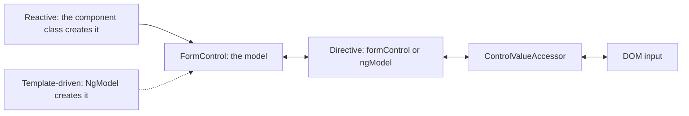
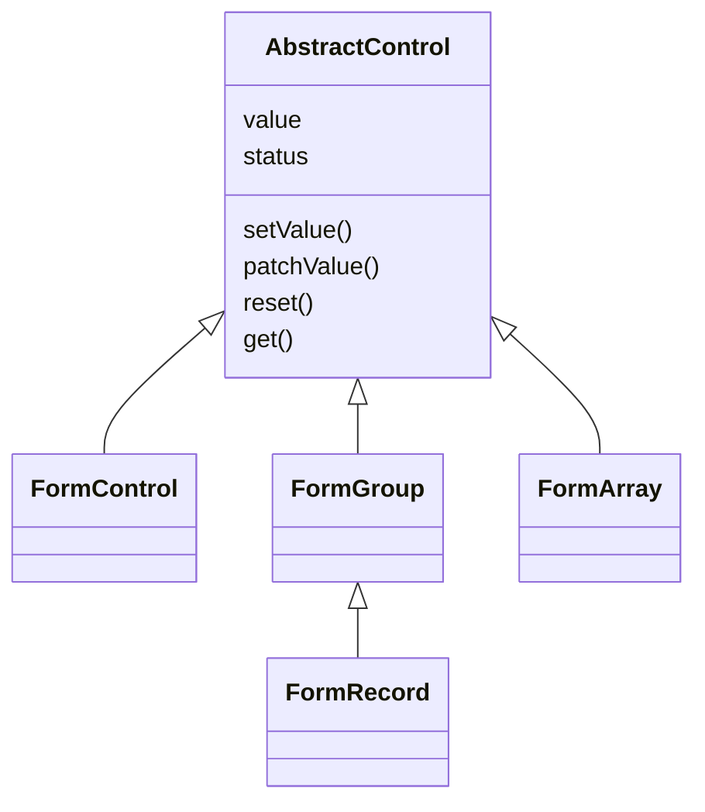
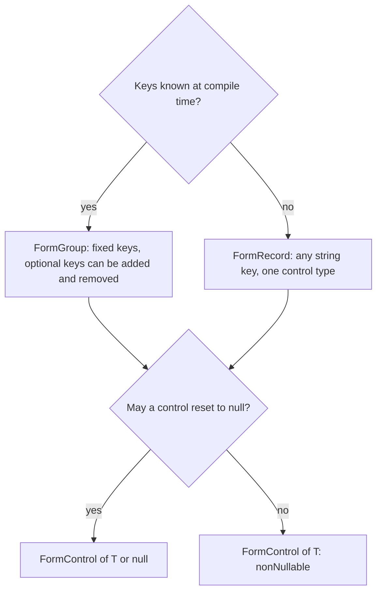
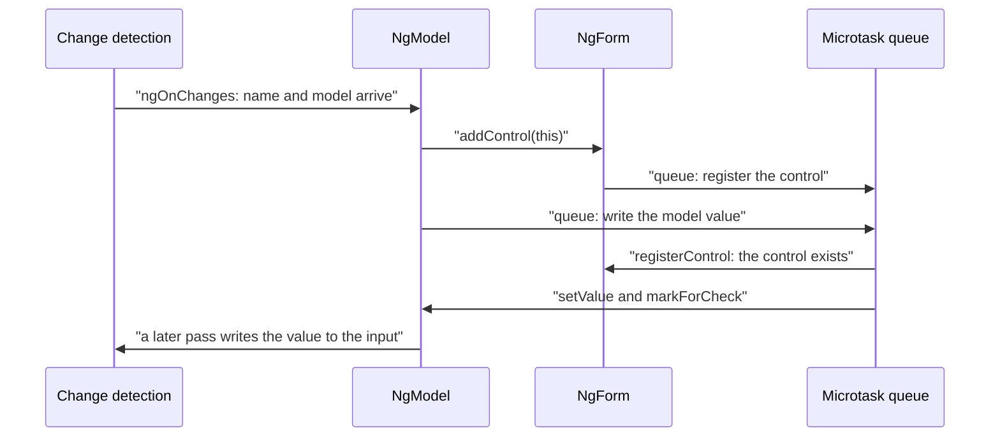
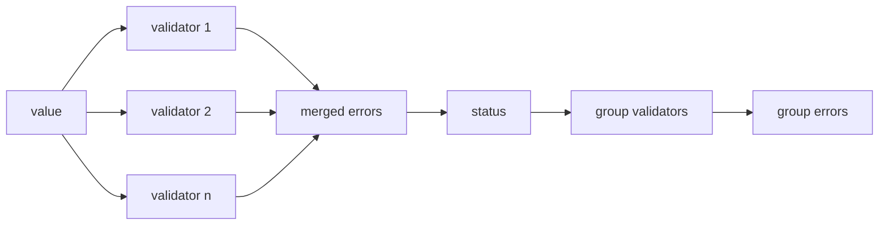
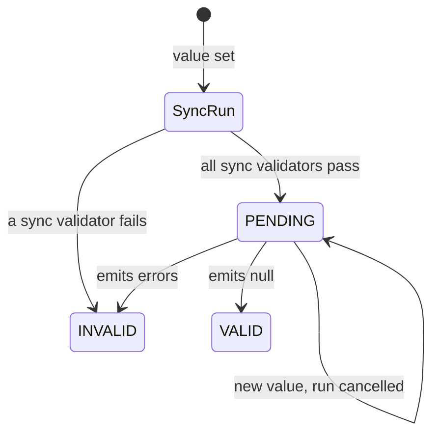
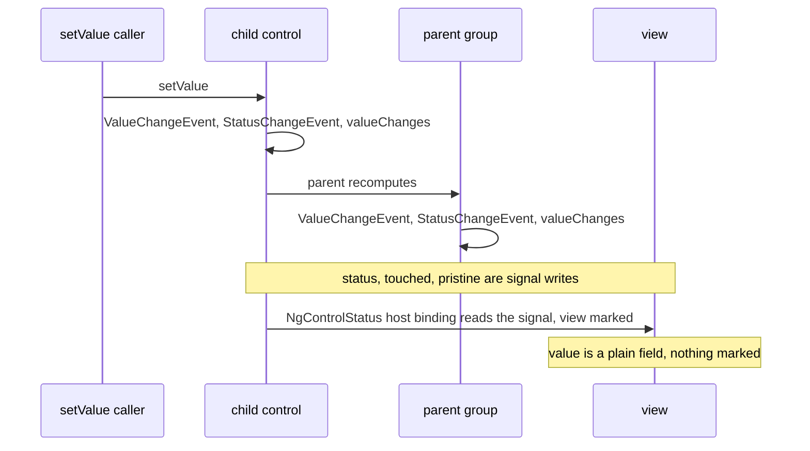
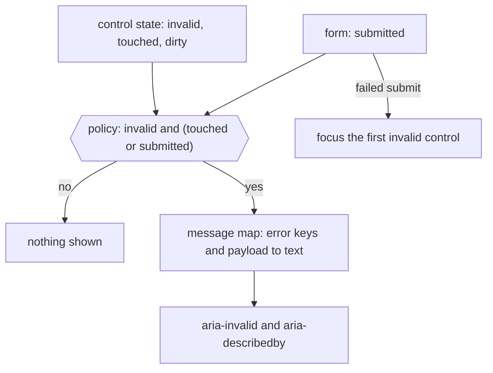
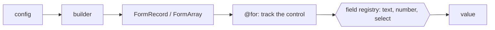
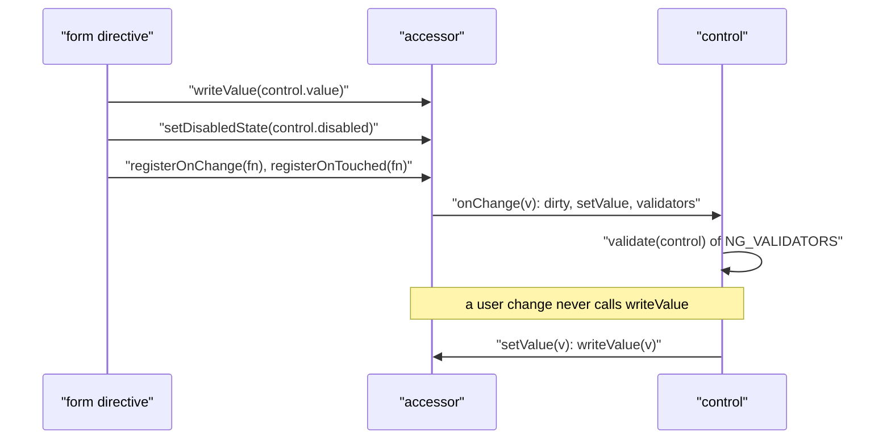

# 25. Forms: reactive and template-driven

> **What this covers:** Angular's two established forms APIs, template-driven (`ngModel`, `NgForm`) and reactive (`FormControl`, `FormGroup`, `FormArray`, `FormRecord`, `FormBuilder`): how each builds its model and connects it to the DOM, typed forms, built-in, custom, cross-field and async validators, status flags, `updateOn` and the `events` stream, what a zoneless view repaints, error display that reaches assistive technology, dynamic and config-driven forms, and custom controls with `ControlValueAccessor`. Signal Forms, the third API, is [module 26](26-signal-forms.md).
> **Prerequisites:** [19. Inputs, outputs and two-way binding](19-component-communication-and-projection.md#1-inputs-outputs-and-two-way-binding-the-parent-and-child-contract), [23. Higher-order Observables](23-rxjs-in-depth.md#1-higher-order-observables-switchmap-mergemap-concatmap-and-exhaustmap) (cancellation, which async validators rely on), [16. Multi providers](16-dependency-injection.md#7-injectiontoken-multi-providers-environment-providers-and-initializers) (`NG_VALUE_ACCESSOR`), [07. Typing patterns in Angular code](07-ts-advanced-types-and-decorators.md#9-typing-patterns-in-angular-code) (typed forms) and [11. Accessible names, descriptions and forms](11-accessibility.md#6-accessible-names-descriptions-and-forms)
> **Leads to:** [26. Signal Forms](26-signal-forms.md), [27. HttpClient](27-http-client.md), [29. Testing Angular](29-testing-angular.md), [36. Material and CDK](36-material-and-cdk.md)
> **Applies to:** Angular 22.2 (`@angular/forms` 22.2.1), RxJS 7.8 (`rxjs` 7.8.2), TypeScript 6.0, Node 24
> **Study time:** ~7 hours reading + ~5 hours exercises
> **Short on time:** read [1. Two forms APIs](#1-two-forms-apis-template-driven-and-reactive-and-the-control-directive-and-accessor-triangle), [5. Validators](#5-validators-built-in-custom-and-cross-field), [6. Async validators](#6-async-validators-pending-status-cancellation-and-debouncing) and [7. Status, `updateOn` and `events`](#7-status-updateon-valuechanges-and-the-unified-events-stream), then drill [Q25.02](#q25-02), [Q25.09](#q25-09), [Q25.17](#q25-17), [Q25.21](#q25-21) and [Q25.23](#q25-23), try [Exercise 25.3](#ex25-3), and finish with the [Summary](#summary).
> **Labs:** [`labs/angular/src/app/modules/25-forms-reactive-and-template-driven/`](../labs/angular/src/app/modules/25-forms-reactive-and-template-driven/) (section specs, *Output* questions, Exercises 25.1-25.6; `TestBed` specs in jsdom; no `labs/ts-js` files). Run (Node 24): from `labs/angular`, `npx ng test --watch=false --include='src/app/modules/25-forms-reactive-and-template-driven/**/*.spec.ts'`.

## Contents

1. [Two forms APIs: template-driven and reactive, and the control, directive and accessor triangle](#1-two-forms-apis-template-driven-and-reactive-and-the-control-directive-and-accessor-triangle)
2. [The reactive model: `FormControl`, `FormGroup`, `FormArray` and `FormRecord`](#2-the-reactive-model-formcontrol-formgroup-formarray-and-formrecord)
3. [Typed forms, `FormBuilder` and `NonNullableFormBuilder`](#3-typed-forms-formbuilder-and-nonnullableformbuilder)
4. [Template-driven forms in depth: `ngModel`, `NgForm` and asynchronous registration](#4-template-driven-forms-in-depth-ngmodel-ngform-and-asynchronous-registration)
5. [Validators: built-in, custom and cross-field](#5-validators-built-in-custom-and-cross-field)
6. [Async validators: pending status, cancellation and debouncing](#6-async-validators-pending-status-cancellation-and-debouncing)
7. [Status, `updateOn`, `valueChanges` and the unified `events` stream](#7-status-updateon-valuechanges-and-the-unified-events-stream)
8. [Error display strategies and accessible errors](#8-error-display-strategies-and-accessible-errors)
9. [Dynamic forms: `FormArray` patterns and config-driven forms](#9-dynamic-forms-formarray-patterns-and-config-driven-forms)
10. [`ControlValueAccessor` and the `Validator` interface: custom controls under the hood](#10-controlvalueaccessor-and-the-validator-interface-custom-controls-under-the-hood)
- [Summary](#summary)
- [Question bank](#question-bank)
- [Hands-on exercises](#hands-on-exercises)
- [Check your understanding](#check-your-understanding)
- [Connections](#connections)

**How the claims here are verified.** An observed behavior cites a spec in `labs/angular/src/app/modules/25-forms-reactive-and-template-driven/`, run by `ng test` in jsdom with Angular 22.2.1 and `@angular/forms` 22.2.1: zoneless `TestBed`, `input` and `blur` events on real inputs, fake timers for async validators, `// @ts-expect-error` lines for compile-time claims. "Read from the source" names the file and function in the published package; internal names are marked. Markers come from typings tags and the CHANGELOG. Screen-reader output, IME composition, autofill, the native validation bubble and Signal Forms are documented only: cited and dated, never run.

## 1. Two forms APIs: template-driven and reactive, and the control, directive and accessor triangle

### The problem it solves

A signup form written with `ngModel` grows conditional fields and a cross-field rule, and soon only a rendered DOM can test it, because its model does not exist before the template runs (`Section 1: a template-driven form has no controls right after the first change detection`). A teammate adds `[formControl]` to an input that already has `[(ngModel)]` (`ngModel` on a reactive directive [Deprecated since v6.0 — use the form model]). A new hire asks which of three APIs to use ([Q25.02](#q25-02)).

### Mental model

A **form model** is the tree of objects holding a form's values and states: a `FormControl` per value, a `FormGroup` for named children ([section 2](#2-the-reactive-model-formcontrol-formgroup-formarray-and-formrecord)). Both APIs build the same classes; they differ in **who creates the model**. A **reactive form** (`ReactiveFormsModule`: `[formControl]`, `[formGroup]`, `formControlName`) is created in the component class before any template runs. A **template-driven form** (`FormsModule`: `ngModel`, `NgForm`, `ngModelGroup`) is created by directives as the template renders. A **directive** ([14 §1](14-directives-and-pipes.md#1-directives-and-attribute-directives-host-inputs-elementref-and-renderer2)) attaches a control to an element, a **value accessor** (`ControlValueAccessor`, the adapter between a control and an element; [section 10](#10-controlvalueaccessor-and-the-validator-interface-custom-controls-under-the-hood)) does the DOM side. Signal Forms, the third API, is [module 26](26-signal-forms.md#1-why-a-third-forms-api-model-first-signals-end-to-end).

An electrical installation: the control is the meter, the accessor the socket adapter, the directive the wiring; reactive forms draw the circuit first, template-driven ones wire as they go.



What to notice: the right half is shared and only the entry differs, so both hosts fed `Ann` hold `{ first: 'Ann' }` (`Section 1: the same input renders the same model value in both APIs`).

### How it actually works

**The docs' comparison.** The Angular docs (`adev/src/content/guide/forms/overview.md`, branch `main`, read 2026-10-10) give four differences, quoted verbatim:

| | Reactive | Template-driven |
|---|---|---|
| Setup of form model | Explicit, created in component class | Implicit, created by directives |
| Data model | Structured and immutable | Unstructured and mutable |
| Data flow | Synchronous | Asynchronous |
| Form validation | Functions | Directives |

The lab observes three rows: a reactive model exists in the constructor (`Section 1: a reactive form's model exists before the first render`), a reactive `setValue` reaches the input at once while a template-driven write reaches the control after `whenStable()` (`Section 1: a reactive setValue reaches the input synchronously and a template-driven write waits for whenStable()`), and a value change replaces the group's value object (`Section 1: a value change replaces the group's value object`). The docs' advice (documented, not measured): reactive forms "are more robust: they're more scalable, reusable, and testable"; template-driven forms "are useful for adding a simple form to an app, such as an email list signup form".

**Why the template-driven model is late.** Read from the `@angular/forms` 22.2.1 source (`fesm2022/forms.mjs`; internal names): `NgForm.addControl` registers each `ngModel` control inside `resolvedPromise$1.then(...)`, a microtask, while `FormGroupDirective.addControl` looks it up in the group at once. After `whenStable()` the control exists (`Section 1: a template-driven form has its controls after whenStable()`) ([section 4](#4-template-driven-forms-in-depth-ngmodel-ngform-and-asynchronous-registration) follows up).

**Why the two APIs do not mix.** In the same file `NgModel` matches `[ngModel]:not([formControlName]):not([formControl])`, and `NgForm` matches `form:not([ngNoForm]):not([formGroup]):not([formArray]),ng-form,[ngForm]`. So `<form [formGroup]>` is no `NgForm` and a `formControlName` input is no `NgModel`. `FormsModule` declares `NgModel`, `NgModelGroup` and `NgForm`; `ReactiveFormsModule` declares `FormControlDirective`, `FormGroupDirective`, `FormArrayDirective` [Added in v21.0], `FormControlName`, `FormGroupName` and `FormArrayName` (`types/forms.d.ts`; read, not run). Both re-export `ɵInternalFormsSharedModule` (internal), which holds the accessors, so both inputs use `DefaultValueAccessor` (`Section 1: the directive selectors keep the two APIs apart and both inputs use the same accessor`). Testing forms is [module 29](29-testing-angular.md)'s.

### Code

The approach: write one field in both APIs and compare when the model exists.

1. Reactive: create the group in the class and bind it with `[formGroup]` and `formControlName`.
2. Template-driven: bind `[(ngModel)]` (the `[(x)]` pair of [13 §5](13-components-and-templates.md#5-event-binding-and-two-way-binding) on `NgModel`) with a `name`, and export `NgForm` as `#f="ngForm"`.
3. Read the template-driven form right after `detectChanges()`, then after `whenStable()`.

```ts
// Excerpt of labs/angular/src/app/modules/25-forms-reactive-and-template-driven/concepts/section-1-two-apis.spec.ts
@Component({
  selector: 'lab-m25-reactive-host',
  imports: [ReactiveFormsModule],
  template: '<form [formGroup]="form"><input formControlName="first" /></form>',
})
class LabM25ReactiveHost {
  readonly form = new FormGroup({ first: new FormControl('Ann', { nonNullable: true }) });
}
```

```ts
// Excerpt of labs/angular/src/app/modules/25-forms-reactive-and-template-driven/concepts/section-1-two-apis.spec.ts
@Component({
  selector: 'lab-m25-template-host',
  imports: [FormsModule],
  template: '<form #f="ngForm"><input name="first" [(ngModel)]="first" /></form>',
})
class LabM25TemplateHost {
  first = 'Ann';
  readonly ngForm = viewChild.required<NgForm>('f');
}
```

```ts
// Excerpt of labs/angular/src/app/modules/25-forms-reactive-and-template-driven/concepts/section-1-two-apis.spec.ts
const fixture = TestBed.createComponent(LabM25TemplateHost);
fixture.detectChanges();
const ngForm = fixture.componentInstance.ngForm();
expect(Object.keys(ngForm.controls)).toEqual([]);
expect(ngForm.value).toEqual({});
await fixture.whenStable();
```

#### Legacy

The `ngModel` input and `ngModelChange` output of `FormControlDirective` and `FormControlName` are tagged `@deprecated as of v6` in the typings; in dev mode the source warns when the input changes (`ngModelWarning`, read, not run). In the lab the legacy field and the control stay in step (`Section 1: a legacy ngModel on a formControl input mirrors the control into a second field, and the migrated control keeps one copy`); migrate to the control alone.

```ts
// Excerpt of labs/angular/src/app/modules/25-forms-reactive-and-template-driven/legacy/legacy-apis.ts
@Component({
  selector: 'lab-m25-legacy-model-on-form-control',
  imports: [ReactiveFormsModule, FormsModule],
  template: '<input [formControl]="control" [(ngModel)]="text" />',
})
export class LabM25LegacyModelOnFormControl {
  readonly control = new FormControl('', { nonNullable: true });
  text = 'legacy';
}

@Component({
  selector: 'lab-m25-model-on-form-control-migrated',
  imports: [ReactiveFormsModule],
  template: '<input [formControl]="control" />',
})
export class LabM25ModelOnFormControlMigrated {
  readonly control = new FormControl('legacy', { nonNullable: true });
}
```

### Best practices and anti-patterns

- **Pick one API per form**, because `ngModel` on a `[formControl]` input is deprecated, and `await fixture.whenStable()` before reading a template-driven form, because its controls register in a microtask.
- **Create the model in the class when a rule spans fields or the form needs a DOM-free test**, because the reactive model exists in the constructor.

### Misconceptions and traps

- *"Template-driven forms have no `FormControl`."* `NgModel` creates one, present after `whenStable()`; the myth comes from there being no model in the class.
- *"Reactive forms are reactive because they use RxJS everywhere."* The model is synchronous objects, with Observables only for changes ([section 7](#7-status-updateon-valuechanges-and-the-unified-events-stream)); the name suggests more.
- *"Reactive forms are always the right answer."* The docs' template-driven example is a short signup form; "more scalable" reads as "better everywhere".
- *"You can mix `ngModel` and `formControl` on one input."* Once true: supported until v6. Now: it works but is deprecated since v6, as the typings say.

Drilled in [Q25.01](#q25-01) and [Q25.02](#q25-02); modelled in [Exercise 25.1](#ex25-1).

## 2. The reactive model: `FormControl`, `FormGroup`, `FormArray` and `FormRecord`

### The problem it solves

A profile page loads a saved user with `setValue`, the API response leaves one field out, and the page throws `NG01002` (`Section 2: setValue requires every key and rejects unknown keys`). The fix, `patchValue`, skips a renamed field silently. A disabled field vanishes from the submitted payload (`Section 2: a disabled control leaves the group's value`), and a fully disabled form is neither valid nor invalid (`Section 2: a fully disabled group is neither valid nor invalid`). All follow from how the tree writes down and reads up ([Q25.03](#q25-03), [Q25.04](#q25-04), [Q25.05](#q25-05)).

### Mental model

The form model is a tree of **`AbstractControl`s**, the base class of every node. A **`FormControl`** holds one value, a **`FormGroup`** named children of a fixed shape, a **`FormRecord`** [Added in v14.0] named children of one type under run-time keys, and a **`FormArray`** indexed children ([section 9](#9-dynamic-forms-formarray-patterns-and-config-driven-forms)). A parent's `value` is **derived** from its enabled children: writes go down (`setValue`, `patchValue`, `reset`), value and validity roll up. A **disabled control** has [status](#7-status-updateon-valuechanges-and-the-unified-events-stream) `DISABLED` and leaves its parent's `value` and validation.

A company's org chart: each department's total is recomputed from its teams, and a team on leave is left out.



What to notice: `FormRecord` extends `FormGroup` (typings: `FormGroup<{ [key: string]: TControl }>`), a group with a looser key type, not a separate kind (`Section 2: a FormRecord is a FormGroup with dynamic keys, and get() reads paths and indexes`).

### How it actually works

**Writes are strict or lenient.** Read from the `@angular/forms` 22.2.1 source (`fesm2022/forms.mjs`; helper names are internal): `FormGroup.setValue` calls `assertAllValuesPresent`, which throws when a child has no value in the argument, then loops over the argument's keys, calling `assertControlPresent` and writing each child with `{ onlySelf: true }`. `FormGroup.patchValue` skips a key with no control (`_find`). The run agrees: a missing key gives `NG01002` (abridged: `Must supply a value for form control with name: 'b'.`), an extra key `NG01001`, and `patchValue` ignores the unknown key (`Section 2: patchValue ignores unknown keys`).

**Why a failed `setValue` leaves half a write.** The presence check covers the group's children, not extra keys, so the throw for `c` comes inside the loop, after `a` and `b` are written and before `updateValueAndValidity` runs. The children hold the new values and `group.value` the old ones; `getRawValue()` ([Q07.19](07-ts-advanced-types-and-decorators.md#q07-19) owns its typing) reads the children (`Section 2: a setValue that throws on an extra key leaves the group's value stale`).

**Value is derived.** A child change gives each ancestor a new `value` object; an unchanged sibling keeps its own (`Section 2: a child change recomputes the parent's value and keeps untouched siblings' objects`).

**Disabled controls.** In the same file `_reduceValue` copies a child when `control.enabled || this.disabled`, and `_allControlsDisabled` is true when no child is enabled and the group has controls, or the group is itself disabled. A disabled child stays in `getRawValue()`. A group with every child disabled has status `DISABLED`: neither `valid` nor `invalid`, its `value` includes every child, and it leaves its parent's value (`Section 2: a group whose controls are all disabled leaves its parent's value too`). A disabled control's `errors` is `null`, so it cannot invalidate its group (`Section 2: a disabled control is skipped by validators and by its parent's status`).

**`reset()` and `get()`.** `reset()` writes `null`, or the creation value for a `nonNullable` control (`Section 2: reset returns null, or the initial value for a non-nullable control`). `get('user.name')` and `get(['items', 0])` walk the tree and give `null` for a missing path.

### Code

The approach: break a small group and read what the tree holds.

1. Create the group and a helper that returns a thrown message.
2. Call `setValue` with an extra key, then read the children, `value` and `getRawValue()`.
3. Disable one child, then all, and compare values and flags.

```ts
// Excerpt of labs/angular/src/app/modules/25-forms-reactive-and-template-driven/concepts/section-2-model.spec.ts
function pair(): FormGroup<{ a: FormControl<string | null>; b: FormControl<string | null> }> {
  return new FormGroup({ a: new FormControl('x'), b: new FormControl('y') });
}

function messageOf(action: () => void): string {
  try {
    action();
  } catch (error) {
    return (error as Error).message;
  }
  return 'no error';
}
  it("Section 2: a setValue that throws on an extra key leaves the group's value stale", () => {
    const group = pair();
    expect(messageOf(() => group.setValue({ a: '1', b: '2', c: '3' } as never))).toContain('NG01001');
    expect(group.get('a')?.value).toBe('1');
    expect(group.get('b')?.value).toBe('2');
    expect(group.value).toEqual({ a: 'x', b: 'y' });
    expect(group.getRawValue()).toEqual({ a: '1', b: '2' });
  });
```

```ts
// Excerpt of labs/angular/src/app/modules/25-forms-reactive-and-template-driven/concepts/section-2-model.spec.ts
  it("Section 2: a disabled control leaves the group's value", () => {
    const group = new FormGroup({ a: new FormControl('A'), b: new FormControl({ value: 'B', disabled: true }) });
    expect(group.value).toEqual({ a: 'A' });
    expect(group.getRawValue()).toEqual({ a: 'A', b: 'B' });
    expect(group.status).toBe('VALID');
    group.controls.b.enable();
    expect(group.value).toEqual({ a: 'A', b: 'B' });
  });
  it('Section 2: a fully disabled group is neither valid nor invalid', () => {
    const group = new FormGroup({ a: new FormControl('A'), b: new FormControl({ value: 'B', disabled: true }) });
    group.disable();
    expect(group.status).toBe('DISABLED');
    expect(group.valid).toBe(false);
    expect(group.invalid).toBe(false);
    expect(group.value).toEqual({ a: 'A', b: 'B' });
  });
```

#### Legacy

`initialValueIsDefault: true` [Deprecated since v14.0 — use nonNullable] makes a `FormControl` reset to its creation value. The 14.0.0 CHANGELOG (`main`, read 2026-10-10) says it "has been deprecated and replaced with the otherwise-identical `nonNullable` option". Rename it; the control resets the same way under both names (`Section 2: the legacy initialValueIsDefault option behaves like nonNullable on reset`).

```ts
// Excerpt of labs/angular/src/app/modules/25-forms-reactive-and-template-driven/legacy/legacy-apis.ts
/** Legacy: `initialValueIsDefault: true`, deprecated since v14.0. Replacement: `labM25NonNullableControl`. */
export function labM25LegacyInitialValueIsDefault(): FormControl<string> {
  return new FormControl('start', { initialValueIsDefault: true });
}

/** Replacement for `labM25LegacyInitialValueIsDefault`: the same reset behavior, spelled `nonNullable`. */
export function labM25NonNullableControl(): FormControl<string> {
  return new FormControl('start', { nonNullable: true });
}
```

### Best practices and anti-patterns

- **Map an API response to the form's shape before `setValue`, and use `patchValue` for a partial load**, because `setValue` throws on a missing key and has already written earlier keys when it throws on an extra one.
- **Read `getRawValue()` when the payload must include disabled controls**, because `value` holds enabled children only.
- **Check `disabled` before treating `valid` and `invalid` as opposites**, because a disabled group is neither.

### Misconceptions and traps

- *"`setValue` and `patchValue` differ only in name."* `setValue` is strict both ways and `patchValue` skips unknown keys; both write values, which hides that only one checks the shape.
- *"A disabled field is just read-only."* The control leaves `value` and validation; the HTML `disabled` attribute suggests a visual state only.
- *"`invalid` is `!valid`."* A `DISABLED` group is both `false`; the two booleans hide the other statuses ([section 6](#6-async-validators-pending-status-cancellation-and-debouncing) adds `PENDING`).
- *"`reset()` restores the initial value."* It gives `null` unless the control is `nonNullable`; "reset" suggests a rewind.

## 3. Typed forms, `FormBuilder` and `NonNullableFormBuilder`

### The problem it solves

An `UntypedFormGroup` lets `form.value.emial` compile and return `undefined` (`Section 3: a typed group rejects an unknown key that an UntypedFormGroup accepts`). A `FormBuilder` group types every field `T | null`, so `const n: number = group.value.n` fails. A permissions form with server-sent keys fits no fixed shape, and migrated apps carry `Untyped*` classes ([Q25.06](#q25-06), [Q25.07](#q25-07), [Q25.08](#q25-08)).

### Mental model

**Typed forms** [Added in v14.0] make the model classes generic. A **generic control**, `FormControl<T>`, infers `T` from its initial value. A **nullable control** is typed `T | null`, because `reset()` writes `null`; `nonNullable: true` makes `reset()` restore the creation value ([Q07.19](07-ts-advanced-types-and-decorators.md#q07-19) owns the typing). A `FormGroup<{…}>` fixes its keys; an **optional control key** (`nickname?`) can be added and removed. A `FormRecord` ([section 2](#2-the-reactive-model-formcontrol-formgroup-formarray-and-formrecord)) takes any string key with one control type. **`FormBuilder`** is shorthand for the same classes with nullable controls; its `record` method [Added in v14.2] builds a `FormRecord`. **`NonNullableFormBuilder`** [Added in v14.0], from `inject(NonNullableFormBuilder)` or `fb.nonNullable`, builds non-nullable controls. [Exercise 07.3](07-ts-advanced-types-and-decorators.md#ex07-3) derives a group's type from an interface.

A typed form is a questionnaire with fixed boxes; a `FormRecord` is a guest book with any name and one kind of entry.



What to notice: nullability comes from `reset()`, not from the initial value; `new FormControl('init')` is still `string | null` (`Section 3: NonNullableFormBuilder controls reset to their initial values`).

### How it actually works

**Inference.** `value` is `Partial` ([Q07.19](07-ts-advanced-types-and-decorators.md#q07-19)), so `fb.group({ n: 1 }).value.n` is `number | null | undefined`. `tsc -p tsconfig.spec.json` checks the refusals: `TS2769` for `addControl` of an undeclared key and `removeControl` of a required key, `TS2345` for a wrong control type in a `FormRecord`, `TS2322` for the builder value (`Section 3: FormBuilder controls are nullable and the group value is Partial`), `TS2551` for a misspelled key. They are compile-time only: the two refused calls still ran (`Section 3: a required key and an unknown key are rejected by the compiler, not at run time`).

**Why `UntypedFormGroup` opts out.** Read from the `@angular/forms` 22.2.1 typings (`types/forms.d.ts`): it is `FormGroup<any>`. The internal `ɵTypedOrUntyped<T, Typed, Untyped>` is `ɵIsAny<T, Untyped, Typed>`, and the internal `ɵIsAny<T, Y, N>` is `0 extends 1 & T ? Y : N`, true only for `any`. `value`, `controls` and `getRawValue()` select through it, so an `any` group gets `any` members. Both names may change in any release.

**Where the builder's `nonNullable` comes from.** Read from `fesm2022/forms.mjs`: the `FormBuilder.nonNullable` getter returns a new `FormBuilder` whose internal `useNonNullable` flag makes `control()` pass `nonNullable: true`, and `NonNullableFormBuilder` is provided by the factory `inject(FormBuilder).nonNullable`, so the two routes behave alike. The internal `_createControl` returns an existing `FormControl` unchanged, so `new FormControl('Alex')` passed to it stays nullable (`Section 3: a control built explicitly inside a non-nullable builder stays nullable`).

### Code

The approach: build three shapes.

1. Add and remove an optional key on a group.
2. Fill a `FormRecord` from keys known only at run time.
3. Inject `NonNullableFormBuilder`, change a value and reset.

```ts
// Excerpt of labs/angular/src/app/modules/25-forms-reactive-and-template-driven/concepts/section-3-typed-forms.spec.ts
  it('Section 3: optional keys can be added and removed at run time', () => {
    const group = new FormGroup<{ name: FormControl<string>; nickname?: FormControl<string> }>({
      name: new FormControl('Ann', { nonNullable: true }),
    });
    group.addControl('nickname', new FormControl('Annie', { nonNullable: true }));
    expect(group.value).toEqual({ name: 'Ann', nickname: 'Annie' });
    group.removeControl('nickname');
    expect(group.value).toEqual({ name: 'Ann' });
    expect(group.contains('nickname')).toBe(false);
  });
  it('Section 3: a FormRecord accepts keys known only at run time', () => {
    const record = new FormRecord<FormControl<boolean>>({});
    const keysFromServer = ['read', 'write'];
    for (const key of keysFromServer) {
      record.addControl(key, new FormControl(key === 'read', { nonNullable: true }));
    }
    expect(record.value).toEqual({ read: true, write: false });
    record.removeControl('read');
    expect(record.value).toEqual({ write: false });
  });
  it('Section 3: NonNullableFormBuilder controls reset to their initial values', () => {
    for (const builder of [TestBed.inject(NonNullableFormBuilder), TestBed.inject(FormBuilder).nonNullable]) {
      const group = builder.group({ x: 'init' });
      group.setValue({ x: 'z' });
      group.reset();
      expect(group.value).toEqual({ x: 'init' });
    }
  });
```

#### Legacy

The 14.0.0 CHANGELOG (`main`, read 2026-10-10) lists "Add untyped versions of the model classes for use in migration."; the alias carries no `@deprecated` tag. Migrate one field at a time: type the group, delete `Untyped`, fix each compile error. The `{ validator }` option of `FormBuilder.group` is marked `@deprecated` in the typings ("This API is not typesafe and can result in issues with Closure Compiler renaming.") without a version; `{ validators }` gives the same validation (`Section 3: the legacy { validator } option and { validators } build the same group validation`).

```ts
// Excerpt of labs/angular/src/app/modules/25-forms-reactive-and-template-driven/legacy/legacy-apis.ts
export function labM25LegacyUntypedProfile(): UntypedFormGroup {
  return new UntypedFormGroup({ name: new FormControl('Ann'), email: new FormControl('ann@example.com') });
}
export function labM25TypedProfile(): FormGroup<{ name: FormControl<string>; email: FormControl<string> }> {
  return new FormGroup({
    name: new FormControl('Ann', { nonNullable: true }),
    email: new FormControl('ann@example.com', { nonNullable: true }),
  });
}
export function labM25NameRequired(group: AbstractControl): ValidationErrors | null {
  return group.get('name')?.value ? null : { nameRequired: true };
}
export function labM25LegacyGroupWithValidator(): FormGroup<{ name: FormControl<string | null> }> {
  return new FormBuilder().group({ name: 'Ann' }, { validator: labM25NameRequired });
}
export function labM25GroupWithValidators(): FormGroup<{ name: FormControl<string | null> }> {
  return new FormBuilder().group({ name: 'Ann' }, { validators: [labM25NameRequired] });
}
```

[Exercise 25.2](#ex25-2) builds a typed profile.

### Best practices and anti-patterns

- **Build a form that maps to a domain object with `NonNullableFormBuilder`**, because `reset()` then restores typed values instead of `null`.
- **Use `FormRecord` only for run-time keys**, because a `FormGroup` makes the compiler reject a misspelled key.
- **Pass `{ validators }`, not `{ validator }`**, because the old spelling is untyped and deprecated.
- **Avoid `UntypedFormGroup` in new code**, because it turns the checks off.

### Misconceptions and traps

- *"Typed forms make `value` the full model type."* It is `Partial`, because a disabled control may leave the value ([Q07.19](07-ts-advanced-types-and-decorators.md#q07-19)); generics suggest a total type.
- *"`FormBuilder` controls are non-nullable."* They are nullable unless `NonNullableFormBuilder` builds them, because the shorthand `{ n: 1 }` looks like a plain value.
- *"A `FormRecord` is untyped."* Its control type is checked (`TS2345`), because dynamic keys suggest no types at all.
- *"`UntypedFormGroup` is deprecated."* It is `FormGroup<any>` with no `@deprecated` tag; migration leftovers look like legacy code.

## 4. Template-driven forms in depth: `ngModel`, `NgForm` and asynchronous registration

### The problem it solves

A test reads `form.value` right after `detectChanges()` and gets `{}` (`Section 4: controls register after a microtask`). A component sets its field and the control keeps the old value (`Section 4: a component field reaches the control only after whenStable`). A reusable address component with `ngModel` inputs silently drops out of the parent form (`Section 4: ngModel inside a child component does not register with the parent form`). Drilled in [Q25.09](#q25-09), [Q25.10](#q25-10) and [Q25.11](#q25-11).

### Mental model

**`NgForm`** attaches itself to every `<form>` without `ngNoForm` and owns a `FormGroup`. **`NgModel`** is the directive behind `ngModel`: given a **`name` attribute**, which becomes the control's key, it creates a `FormControl` and registers it with the nearest `NgForm` or **`ngModelGroup`** (a directive that nests a group), in a **microtask** (a callback the engine runs after the current script and before rendering; [04 §1](04-js-async-event-loop.md#1-the-event-loop-tasks-microtasks-and-rendering)). `[(ngModel)]` is the `[(x)]` pair of [13 §5](13-components-and-templates.md#5-event-binding-and-two-way-binding) on the `NgModel` directive ([Q13.16](13-components-and-templates.md#q13-16)); `([ngModel])` is [Q12.21](12-angular-how-it-works.md#q12-21)'s diagnostic. `required`, `minlength`, `email` and `min` on a number input are **template validator directives**: validators attached by selector instead of passed as functions. **`ControlContainer`** is the parent token `NgForm` and `NgModelGroup` provide; `NgModel` injects it with **`@Host()`** ([16 §5](16-dependency-injection.md#5-the-injector-tree-platform-root-route-and-element-injectors-and-the-modifiers)), which stops at the component boundary.

Guests sign the register after they sit down: at the door it is empty.



What to notice: a component field reaches the control one microtask after change detection, while typing reaches the field at once (`Section 4: typing updates the component field synchronously`).

### How it actually works

**Registration is queued.** Read from the `@angular/forms` 22.2.1 source (`fesm2022/forms.mjs`): `NgForm.addControl` runs its work inside `resolvedPromise$1.then(...)` (internal), so the control joins `controls` after the first pass; `NgModel` writes a changed `model` input inside its own `resolvedPromise.then(...)` (internal). In the lab, `controls` holds `first` and `age` only after one `await Promise.resolve()` (`Section 4: controls register after a microtask`). The docs add "`NgModel` triggers a second change detection to avoid `ExpressionChangedAfterItHasBeenChecked` errors, because the value change originates in an input binding." (`overview.md`, branch `main`, read 2026-10-10; documented, not run).

**Names.** Inside a `<form>`, an `ngModel` with no `name` and no **`ngModelOptions`** `{ standalone: true }` (which keeps the control out of the form) throws `NG01352` in dev mode (read from `NgModel._checkName` and `missingNameException`; read, not run).

**Number inputs.** Read from the typings (`types/forms.d.ts`): `NumberValueAccessor` matches `input[type=number]` with `ngModel`, and `MinValidator` matches `input[type=number][min][ngModel]`. In the lab, typing `12` gives the number `12` with `{ min: { min: 18, actual: 12 } }`, and clearing gives `null` (`Section 4: a number input gives a number and null when empty`).

**Across a component boundary.** The parent comes from `@Host()` (`host: true` in the factory deps). A child component's `ngModel` therefore leaves `controls` empty, and `console.warn` receives `NG01354: ngModel on a form control inside a child component cannot register with the NgForm in the parent component because @Host() stops injection at the component boundary.` (abridged). The warning came with the 22.1.3 CHANGELOG line "warn in dev mode when ngModel cannot reach parent NgForm across component boundary" (history). The fix is `viewProviders: [{ provide: ControlContainer, useExisting: NgForm }]` on the child ([16 §6](16-dependency-injection.md#6-providers-versus-viewproviders-and-per-instance-state), [16 §2](16-dependency-injection.md#2-providers-and-tokens-useclass-usevalue-usefactory-and-useexisting)); then `inner` appears in `controls`.

### Code

The approach: read one form at three moments, then let a child field join it.

1. Bind `first` with `[(ngModel)]` and `age` with `ngModel`; read `controls` after `detectChanges()`, a microtask and `whenStable()`.
2. Give the child `viewProviders` aliasing `ControlContainer` to `NgForm`.

```ts
// Excerpt of labs/angular/src/app/modules/25-forms-reactive-and-template-driven/concepts/section-4-template-driven.spec.ts
@Component({
  selector: 'lab-m25-register-host',
  imports: [FormsModule],
  template: `<form #f="ngForm">
    <input name="first" [(ngModel)]="first" required />
    <input name="age" type="number" ngModel min="18" />
  </form>`,
})
class LabM25RegisterHost {
  first = 'Ann';
  readonly ngForm = viewChild.required<NgForm>('f');
}
  it('Section 4: controls register after a microtask', async () => {
    const fixture = TestBed.createComponent(LabM25RegisterHost);
    fixture.detectChanges();
    const ngForm = fixture.componentInstance.ngForm();
    expect(Object.keys(ngForm.controls)).toEqual([]);
    expect(ngForm.value).toEqual({});
    await Promise.resolve();
    expect(Object.keys(ngForm.controls)).toEqual(['first', 'age']);
    expect(ngForm.value['first']).toBe('Ann');
    await fixture.whenStable();
    expect(ngForm.status).toBe('VALID');
  });
```

```ts
// Excerpt of labs/angular/src/app/modules/25-forms-reactive-and-template-driven/concepts/section-4-template-driven.spec.ts
@Component({
  selector: 'lab-m25-child-field-shared',
  imports: [FormsModule],
  viewProviders: [{ provide: ControlContainer, useExisting: NgForm }],
  template: '<input name="inner" ngModel />',
})
class LabM25ChildFieldShared {}
  it("Section 4: viewProviders with ControlContainer registers the child's ngModel", async () => {
    const fixture = TestBed.createComponent(LabM25SharedHost);
    fixture.detectChanges();
    await fixture.whenStable();
    expect(Object.keys(fixture.componentInstance.ngForm().controls)).toEqual(['inner']);
  });
```

#### Legacy

NgModule-era components import `FormsModule` in an `@NgModule` ([15 §5](15-standalone-and-ngmodules.md#5-legacy-ngmodule-patterns-declarations-exports-forrootforchild-sharedmodule-and-coremodule)). `[ngModel]` with `(ngModelChange)` is the pair `[(ngModel)]` expands to, still valid when a handler must run on each change. [Exercise 25.1](#ex25-1) builds a sign-up form this way, then reactively.

### Best practices and anti-patterns

- **Await `fixture.whenStable()` before reading a template-driven form in a test**, because registration and the model write are microtasks.
- **Give every `ngModel` in a form a `name`**, because the name is the control's key and a missing one throws `NG01352` in dev mode.
- **Add `viewProviders` with `ControlContainer` to a reusable field component**, because `@Host()` stops at its boundary and the control otherwise never joins the parent.
- **Use `standalone: true` for a control that must stay out of the form**, because every named `ngModel` in a `<form>` registers.

### Misconceptions and traps

- *"`ngModel` updates the model immediately."* Typing reaches the component field at once; a field change reaches the control after `whenStable()`, because two-way binding looks synchronous in both directions.
- *"Template-driven forms cannot be tested."* They can after `whenStable()`; the first read finds an empty form because registration is asynchronous.
- *"A sub-component's `ngModel` joins the parent form."* It does not, because its input sits inside the `<form>` in the DOM while `NgModel` finds its parent through DI with `@Host()`.
- *"`type="number"` gives a number in any forms API."* It is the `NumberValueAccessor` that gives the number, because the HTML attribute suggests the type travels with the input.

## 5. Validators: built-in, custom and cross-field

### The problem it solves

`required` accepts a field of spaces (`Section 5: required treats spaces, 0 and false as present`). `minLength(3)` lets an empty optional field pass (`Section 5: minLength, pattern and email leave an empty value to required`). A password-confirmation error sits on the group, so the confirmation control stays valid. A server error set with `setErrors` vanishes on the next keystroke, and `removeValidators(Validators.minLength(3))` removes nothing (`Section 5: setErrors lasts until the next validation run`, `Section 5: removeValidators needs the same function reference`). Drilled in [Q25.12](#q25-12), [Q25.13](#q25-13), [Q25.14](#q25-14), [Q25.15](#q25-15), [Q25.16](#q25-16) and [Exercise 25.2](#ex25-2).

### Mental model

A **validator** is a function `(control) => ValidationErrors | null`: `ValidationErrors` is the **error map**, an object keyed by rule name, and `null` means valid. A built-in is a plain function (`Validators.required`) or a **validator factory**, which returns a new validator closed over its arguments (`Validators.minLength(3)`). Every validator of a control runs on each validation, and their maps merge into `errors`. A **cross-field validator** sits on the parent group, sees every child and puts its error on the group.

Inspectors write on one shared sheet; a new inspection starts a clean one.



What to notice: a group validator's error lands on the group, not on any child (`Section 5: a group validator puts its error on the group`).

### How it actually works

**Merging.** Read from the `@angular/forms` 22.2.1 source (`fesm2022/forms.mjs`): `compose` runs every present validator through `executeValidators` and hands the results to `mergeErrors`, which spreads each non-null map into one object and returns `null` when it is empty (both internal). In the lab, three maps merge, a passing validator adds nothing, and for a shared key the later validator wins (`Section 5: the error maps of several validators merge`).

**Emptiness.** `required` tests the internal `isEmptyInputValue`: `null`, or a string, array or `Set` of length 0, is empty. So `' '`, `0` and `false` are present. `minLength` skips a value whose internal `lengthOrSize` is `null` or 0, as its typings doc states: "The `minLength` validator logic is also not invoked for values when their `length` or `size` property is 0 (for example in case of an empty string or an empty array), to support optional controls." (`types/forms.d.ts`). The `Validators.pattern` typings add that for a string "the `^` character is prepended and the `$` character is appended", while a `RegExp` is "used as is":

```text
required                 '' null []   -> { required: true }       ' ' 0 false -> null
requiredTrue             false        -> { required: true }
minLength(3)             ''           -> null                     'ab' -> { minlength: { requiredLength: 3, actualLength: 2 } }
pattern('[a-z]+')        'abc1'       -> { pattern: { requiredPattern: '^[a-z]+$', actualValue: 'abc1' } }
pattern(/[a-z]+/)        'abc1'       -> null
email                    '' 'a@b'     -> null                     'ab' -> { email: true }
```

Asserted by `Section 5: required treats spaces, 0 and false as present`, `Section 5: minLength, pattern and email leave an empty value to required` and `Section 5: a string pattern is anchored and a RegExp is not`.

**`min` and `max`.** `minValidator` returns `null` for a `null` value and otherwise compares `parseFloat(control.value)`, so `Validators.min(3)` on the string `'2'` returns `{ min: { min: 3, actual: '2' } }` and on `'abc'` returns `null` (`Section 5: Validators.min parses a numeric string`). The `min` attribute becomes a validator only through `MinValidator`, selector `input[type=number][min][formControlName],input[type=number][min][formControl],input[type=number][min][ngModel]`: a text input with `min="5"` has no error, and a number input does, with the typed `7` reaching the control as the number `7` (`Section 5: the min attribute validates only number inputs`). The `required`, `minlength`, `pattern` and `email` attributes attach directives by the same kind of selector (read from `forms.mjs`).

**The v22 change.** The 22.0.0 CHANGELOG lists under Breaking Changes, `forms`: "`min` and `max` validation rules no longer support string values. Bound values must be numbers or null." (`CHANGELOG.md`, branch `main`, read 2026-10-10). It names no API. Signal Forms' `min` is declared `min<TValue extends number | null, …>(path, minValue: number | LogicFn<…>, …)` `@publicApi 22.0` (`types/signals.d.ts`), while `minValidator` and the `MinValidator` selector are identical in 21.2.25 and 22.2.1 (`npm pack` of both, compared 2026-10-10; read, not run). The guide reads the change as Signal Forms' numeric-only rule, which [module 26](26-signal-forms.md#4-schema-rules-and-validation-built-in-rules-validate-and-reusable-schemas) teaches.

**Errors are recomputed.** `setErrors` writes `errors` with no validator behind it; the next run replaces it (`Section 5: setErrors lasts until the next validation run`). the public `hasValidator` calls an internal `includes` helper, and `Validators.minLength(3)` returns a new function on every call. `removeValidators` only reassigns the validators, so `errors` keeps the old entry until `updateValueAndValidity()` runs (`Section 5: removeValidators needs the same function reference`).

### Code

The approach: write a validator, a factory and a group validator, then read the maps they produce.

1. Write `labM25NoSpaces`, a `ValidatorFn`, and `labM25StartsWith(prefix)`, a factory closing over its argument.
2. Write `labM25PasswordsMatch`, which reads two children and returns `{ mismatch: true }`.
3. Put the first two on a control and the third on a group, then read `errors`, `status` and `hasError`.

```ts
// Excerpt of labs/angular/src/app/modules/25-forms-reactive-and-template-driven/concepts/section-5-validators.spec.ts
const labM25NoSpaces: ValidatorFn = (control) => (/\s/.test(String(control.value)) ? { noSpaces: true } : null);

function labM25StartsWith(prefix: string): ValidatorFn {
  return (control) =>
    String(control.value).startsWith(prefix) ? null : { startsWith: { required: prefix, actual: control.value } };
}

function labM25PasswordsMatch(group: AbstractControl): ValidationErrors | null {
  return group.get('pw')?.value === group.get('confirm')?.value ? null : { mismatch: true };
}
  it('Section 5: the error maps of several validators merge', () => {
    const control = new FormControl('a b', [Validators.minLength(5), labM25NoSpaces, labM25StartsWith('A')]);
    expect(control.errors).toEqual({
      minlength: { requiredLength: 5, actualLength: 3 },
      noSpaces: true,
      startsWith: { required: 'A', actual: 'a b' },
    });
    control.setValue('Abcde');
    expect(control.errors).toBeNull();
    expect(new FormControl('a', [Validators.required, Validators.minLength(3)]).errors).toEqual({
      minlength: { requiredLength: 3, actualLength: 1 },
    });
    const sameKey = new FormControl('x', [() => ({ clash: 1 }), () => ({ clash: 2 })]);
    expect(sameKey.errors).toEqual({ clash: 2 });
  });

  it('Section 5: a group validator puts its error on the group', () => {
    const group = new FormGroup(
      { pw: new FormControl('a'), confirm: new FormControl('b') },
      { validators: labM25PasswordsMatch },
    );
    expect(group.errors).toEqual({ mismatch: true });
    expect(group.status).toBe('INVALID');
    expect(group.controls.confirm.errors).toBeNull();
    expect(group.controls.confirm.status).toBe('VALID');
    expect(group.hasError('mismatch')).toBe(true);
    expect(group.hasError('mismatch', 'confirm')).toBe(false);
    group.controls.confirm.setValue('a');
    expect(group.errors).toBeNull();
  });
```

The second excerpt stores the factory result, so `removeValidators` can find it ([Exercise 25.2](#ex25-2) adds a cross-field rule to a typed form). A validator directive on `NG_VALIDATORS` is [section 10](#10-controlvalueaccessor-and-the-validator-interface-custom-controls-under-the-hood)'s.

```ts
// Excerpt of labs/angular/src/app/modules/25-forms-reactive-and-template-driven/concepts/section-5-validators.spec.ts
  it('Section 5: removeValidators needs the same function reference', () => {
    const fresh = new FormControl('ab', [Validators.required, Validators.minLength(3)]);
    fresh.removeValidators(Validators.minLength(3));
    fresh.updateValueAndValidity();
    expect(fresh.errors).toEqual({ minlength: { requiredLength: 3, actualLength: 2 } });
    expect(fresh.hasValidator(Validators.minLength(3))).toBe(false);

    const min3 = Validators.minLength(3);
    const stored = new FormControl('ab', [Validators.required, min3]);
    expect(stored.hasValidator(min3)).toBe(true);
    stored.removeValidators(min3);
    expect(stored.errors).toEqual({ minlength: { requiredLength: 3, actualLength: 2 } });
    stored.updateValueAndValidity();
    expect(stored.errors).toBeNull();

    stored.removeValidators(Validators.required);
    expect(stored.hasValidator(Validators.required)).toBe(false);
  });
```

### Best practices and anti-patterns

- **Add a trim rule when blanks must fail**, because `required` counts `' '` as present.
- **Pair `minLength` with `required` on a mandatory field**, because `minLength` skips empty values.
- **Read a cross-field error from the group**, because the validator puts it there and the confirmation control stays valid.
- **Keep the result of `Validators.minLength(3)` in a constant you may remove later**, because `hasValidator` and `removeValidators` compare by reference; then call `updateValueAndValidity()`.

### Misconceptions and traps

- *"`Validators.required` rejects whitespace."* It accepts `' '`, `0` and `false`, because only `null` and length 0 count as empty and "required" suggests a trim.
- *"`minLength` makes a field required."* An empty value passes on purpose, to support optional controls; length 0 looks shorter than 3.
- *"In v22 `Validators.min` rejects strings."* It still parses them, because the 22.0.0 line names "validation rules" without naming the API and the numeric-only rule is Signal Forms' ([26](26-signal-forms.md#4-schema-rules-and-validation-built-in-rules-validate-and-reusable-schemas)).
- *"A cross-field error appears on the second field."* It lives on the group, because the template draws the message beside a field.
- *"`setErrors` makes a server error stick."* The next run replaces it, because `setErrors` writes `errors` directly with no validator behind it.

## 6. Async validators: pending status, cancellation and debouncing

### The problem it solves

A username check that fires on every keystroke runs for an empty field, and a form waiting on it is neither valid nor invalid. In the lab, the check is skipped while `required` fails (`Section 6: async validators wait for the sync validators to pass`). Drilled in [Q25.17](#q25-17), [Q25.18](#q25-18), [Q25.19](#q25-19) and [Exercise 25.3](#ex25-3).

### Mental model

An **async validator** is an `AsyncValidatorFn`: `(control) => Promise | Observable` of `ValidationErrors | null`, passed as the `asyncValidators` option. It runs only after every sync validator passes, and until it emits the status is **`PENDING`**. A new value **cancels** it: Angular unsubscribes the running Observable, the cancellation `switchMap` gives ([23 §1](23-rxjs-in-depth.md#1-higher-order-observables-switchmap-mergemap-concatmap-and-exhaustmap)). A **debounce inside the validator** is a `timer(ms)` before the request, so a cancelled timer never reaches the server ([22 §8](22-rxjs-foundations.md#8-timing-operators-debouncetime-throttletime-audittime-and-sampletime), [Q22.30](22-rxjs-foundations.md#q22-30)).

A fact-checker drops the article you replaced and phones the source only after you stop typing.



What to notice: a sync failure skips the async step (`Section 6: async validators wait for the sync validators to pass`).

### How it actually works

**Order.** Read from the `@angular/forms` 22.2.1 source (`fesm2022/forms.mjs`; internal names): `updateValueAndValidity` calls `_cancelExistingSubscription()`, which unsubscribes the previous run, runs the sync validators, and calls `_runAsyncValidator` only when the status is `VALID` or `PENDING`; it sets `PENDING`, subscribes and calls `setErrors`. In the lab, three values in a row call the validator for `a`, `an` and `ann`, the first two runs are cancelled, and the last gives `INVALID` with `{ taken: true }` (`Section 6: a new value cancels the running async validator`). One pass emits `PENDING`, then `VALID`; while `PENDING`, `valid` and `invalid` are both `false` (`Section 6: the control is PENDING while the async validator runs`).

**Debounce.** The validator runs on every value change, so `debounceTime` on `valueChanges` does not reduce its calls; a `timer(300)` before a `switchMap` inside it does: with `x`, `xy` and `xyz` 100 ms apart, the fake server ran once, with `xyz`, 300 ms after the last value (`Section 6: a timer inside the validator sends one request per pause`). The docs name the other cost cut: "You can delay updating the form validity by changing the `updateOn` property from `change` (default) to `submit` or `blur`." ([section 7](#7-status-updateon-valuechanges-and-the-unified-events-stream)); the same file says "For performance reasons, Angular only runs async validators if all sync validators pass." (`adev/src/content/guide/forms/form-validation.md`, `main`, read 2026-10-10).

**Completion: the docs against the run.** The same file, line 282: "At this point the control is marked as `pending` and remains in this state until the observable chain returned from the `validate()` method completes." A single validator passed as a function settled on its first emission although it never completed (`Section 6: one async validator settles on its first emission`), because `coerceToAsyncValidator` (internal) returns a function unchanged and composes only an array. `composeAsync` (internal) wraps the results in `forkJoin` ([22 §7](22-rxjs-foundations.md#7-combining-streams-combinelatest-withlatestfrom-forkjoin-zip-merge-and-concat)), which emits when every Observable has completed, and merges the maps with `mergeErrors`. So a second validator that emits and stays open leaves the control `PENDING`, and its last emission counts at completion (`Section 6: two async validators wait for both to complete`). An array of one waits too (`Section 6: an array of one async validator also waits for completion`). The docs sentence is no rule for one bare function; make every validator complete.

A directive implements `AsyncValidator` and registers on `NG_ASYNC_VALIDATORS` (typings). The fake server stands in for `HttpClient`, [module 27](27-http-client.md#3-making-requests-typed-responses-observe-responsetype-immutable-params-and-headers-and-httpcontext)'s.

### Code

The approach: a fake server logs calls and cancellations, and a second validator debounces with a timer.

1. `labM25Taken` logs each call and logs a cancellation only if unsubscribed before answering.
2. `labM25Debounced` puts `timer(pauseMs)` and a `switchMap` before the server call.
3. Put each on a `FormControl` under fake timers, set values in a row and read `status` and the logs.

```ts
// Excerpt of labs/angular/src/app/modules/25-forms-reactive-and-template-driven/concepts/section-6-async-validators.spec.ts
interface LabM25TakenLog {
  readonly calls: string[];
  readonly cancelled: string[];
}

function labM25Taken(log: LabM25TakenLog, answerAfterMs = 100): AsyncValidatorFn {
  return (control) =>
    new Observable<ValidationErrors | null>((subscriber) => {
      const value = String(control.value);
      let answered = false;
      log.calls.push(value);
      const timerId = setTimeout(() => {
        answered = true;
        subscriber.next(value === 'ann' ? { taken: true } : null);
        subscriber.complete();
      }, answerAfterMs);
      return () => {
        clearTimeout(timerId);
        if (!answered) log.cancelled.push(value);
      };
    });
}

function labM25Log(): LabM25TakenLog {
  return { calls: [], cancelled: [] };
}

function labM25Debounced(serverCalls: string[], pauseMs: number): AsyncValidatorFn {
  return (control) =>
    timer(pauseMs).pipe(
      switchMap(() => {
        serverCalls.push(String(control.value));
        return of(null);
      }),
    );
}
```

```ts
// Excerpt of labs/angular/src/app/modules/25-forms-reactive-and-template-driven/concepts/section-6-async-validators.spec.ts
  it('Section 6: a new value cancels the running async validator', () => {
    vi.useFakeTimers();
    try {
      const log = labM25Log();
      const control = new FormControl('', { validators: Validators.required, asyncValidators: labM25Taken(log) });
      control.setValue('a');
      control.setValue('an');
      control.setValue('ann');
      expect(log.calls).toEqual(['a', 'an', 'ann']);
      expect(log.cancelled).toEqual(['a', 'an']);
      vi.advanceTimersByTime(150);
      expect(control.status).toBe('INVALID');
      expect(control.errors).toEqual({ taken: true });
      expect(log.cancelled).toEqual(['a', 'an']);
    } finally {
      vi.useRealTimers();
    }
  });

  it('Section 6: a timer inside the validator sends one request per pause', () => {
    vi.useFakeTimers();
    try {
      const serverCalls: string[] = [];
      const control = new FormControl('', { asyncValidators: labM25Debounced(serverCalls, 300) });
      control.setValue('x');
      vi.advanceTimersByTime(100);
      control.setValue('xy');
      vi.advanceTimersByTime(100);
      control.setValue('xyz');
      vi.advanceTimersByTime(299);
      expect(control.status).toBe('PENDING');
      expect(serverCalls).toEqual([]);
      vi.advanceTimersByTime(1);
      expect(serverCalls).toEqual(['xyz']);
      expect(control.status).toBe('VALID');
    } finally {
      vi.useRealTimers();
    }
  });
```

[Exercise 25.3](#ex25-3) builds this with an injected fake API.

### Best practices and anti-patterns

- **Put the debounce inside the validator**, because it runs on every value change and a cancelled `timer` never reaches the server.
- **Keep `required` and `minLength` in front of the check**, because the async step runs only when they pass.
- **Make every async validator complete** (`first()`, an HTTP call), because `forkJoin` waits for completion.
- **Show "Checking…" from `pending`, not from `invalid`**, because a `PENDING` control is neither valid nor invalid.

### Misconceptions and traps

- *"`debounceTime` on `valueChanges` debounces the async validator."* The control calls the validator itself on every value change, and the habit comes from typeahead code that subscribes; debounce inside it or use `updateOn`.
- *"Out-of-order responses can overwrite each other."* The previous run is unsubscribed on the next value, because the control cancels it, unlike the raw HTTP race the habit comes from.
- *"A `PENDING` form is invalid."* It is neither, because the status has a third state and "not valid yet" sounds like "invalid".
- *"An async validator that never completes leaves the control pending."* One bare function settles on its first emission, because only an array goes through `forkJoin`; the docs line sounds unconditional.

## 7. Status, `updateOn`, `valueChanges` and the unified `events` stream

### The problem it solves

A summary panel reading `parent.value` in a child's `valueChanges` subscriber shows the previous totals. A "save" indicator built from `valueChanges` never hears `markAsDirty`. A zoneless page shows the old text after a service calls `setValue`, while the input shows the new one. Drilled in [Q25.20](#q25-20), [Q25.21](#q25-21), [Q25.22](#q25-22), [Q25.23](#q25-23), [Q25.24](#q25-24), [Exercise 25.3](#ex25-3) and [Exercise 25.4](#ex25-4).

### Mental model

Every control has a **status** (`VALID`, `INVALID`, `PENDING` while an async validator runs ([section 6](#6-async-validators-pending-status-cancellation-and-debouncing)), or `DISABLED`) and two flags: **pristine/dirty** (the user changed the value) and **touched/untouched** (the user left the field). **`updateOn`** (`'change'`, `'blur'` or `'submit'`) picks when the view writes its value to the model; `'change'` is the default (typings of `AbstractControl.updateOn`). A change is announced by `valueChanges`, `statusChanges` and one **`events`** stream [Added in v18.0] of `ControlEvent` objects: `ValueChangeEvent`, `StatusChangeEvent`, `PristineChangeEvent`, `TouchedChangeEvent`, `FormSubmittedEvent` and `FormResetEvent` [Added in v18.0], each with a **`source`**, the control that started the change. `emitEvent: false` silences a call; `onlySelf: true` skips the parent. Status, pristine and touched sit on **internal signals**; `value` is a plain field, so in a **zoneless** app ([21 §5](21-change-detection.md#5-zoneless-change-detection-the-scheduler-its-triggers-and-pendingtasks)) only the first three mark a view, the one that hosts the bound input, through the `NgControlStatus` host bindings ([section 8](#8-error-display-strategies-and-accessible-errors), "Repaint").

A relay race: the child shouts its time before the parent's stopwatch has moved.



What to notice: the child's subscribers run before the parent's value changes, and only signal-backed state repaints a zoneless view.

### How it actually works

**Order.** Read from the `@angular/forms` 22.2.1 source (`fesm2022/forms.mjs`, internal names): `updateValueAndValidity` pushes a `ValueChangeEvent` and a `StatusChangeEvent`, emits `valueChanges` and `statusChanges`, and only then calls its parent unless `onlySelf` is set. A child's subscribers run first and see the old `parent.value` (`Section 7: a child's events fire before its parent's`, `Section 7: a valueChanges subscriber on the child sees the parent's old value`). `markAsTouched` and `markAsDirty` call the parent first, so it announces first (`Section 7: markAsTouched announces the parent first`, `Section 7: markAsDirty announces the parent first`). `emitEvent: false` emitted nothing and `onlySelf: true` left the group's value stale (`Section 7: emitEvent false emits nothing and onlySelf leaves the parent stale`). A group `reset()` emitted six events for the child, then six for the group (`Section 7: reset emits pristine, touched, value, status and reset events`).

**Flags and `updateOn`.** Read from `setUpViewChangePipeline` and `updateControl` (internal): an `input` event calls `markAsDirty()` and then `setValue`; a programmatic `setValue` never calls it (`Section 7: a programmatic setValue does not mark the control dirty`), and blur marks touched (`Section 7: typing marks the control dirty and blurring marks it touched`). Under `updateOn: 'blur'` typed text reached the model on `blur`, a programmatic `setValue` at once, because `updateOn` gates only view-to-model (`Section 7: updateOn blur writes the model on blur only`). `markAllAsDirty` [Added in v20.0] dirties descendants, not `touched` (`Section 7: markAllAsDirty marks nested controls dirty and leaves them untouched`).

**Subscribing.** `valueChanges` emitted nothing on subscribe (`Section 7: valueChanges does not emit on subscribe`); `toSignal(control.valueChanges, { initialValue: control.value })` ([23 §7](23-rxjs-in-depth.md#7-rxjs-and-signals-decision-rules-tosignal-toobservable-and-rxresource)) repaints (`Section 7: toSignal of valueChanges repaints the zoneless view`).

**What a zoneless view repaints.** Read from the source: `status`, `pristine` and `touched` wrap signals (`statusReactive`, `pristineReactive`, `touchedReactive`, internal) that `AbstractControlStatus` (internal) reads behind `NgControlStatus`'s `[class.ng-valid]`-style host bindings; `value` has no signal. After `setValue('b')` the input showed `b` and `{{ c.value }}` still showed `a` until typing (`Section 7: in a zoneless view a value-only setValue does not repaint the template`); a flip to `INVALID` repainted (`Section 7: a status change repaints the zoneless view`). The docs: "In zoneless applications, mutating a reactive forms model (for example calling `FormArray.push()`) does not automatically schedule component change detection." (`adev/src/content/guide/forms/reactive-forms.md`, line 384, `main`, read 2026-10-10). The run adds a nuance: a `push` that kept a form-bound array `VALID` rendered one input, one that made it `INVALID` rendered two (`Section 7: a push that keeps the array status does not repaint, a push that changes it does`), because the form's `ng-invalid` binding reads the status (read, not run). Do not rely on it: use `toSignal` or a DOM event ([21 §5](21-change-detection.md#5-zoneless-change-detection-the-scheduler-its-triggers-and-pendingtasks)). An unsaved-changes guard reads `dirty` ([Q24.20](24-routing.md#q24-20)).

### Code

The approach: subscribe at both levels, call `setValue`, read the log and the DOM.

1. `setUp` subscribes to `events` and `valueChanges` on child and group.
2. The first test sets `''` on the child and compares the log.
3. The second renders a host and calls `setValue` after `autoDetectChanges()`.

```ts
// Excerpt of labs/angular/src/app/modules/25-forms-reactive-and-template-driven/concepts/section-7-status-and-events.spec.ts
function kind(event: ControlEvent): string {
  if (event instanceof ValueChangeEvent) return 'value';
  if (event instanceof StatusChangeEvent) return 'status';
  if (event instanceof PristineChangeEvent) return 'pristine';
  if (event instanceof TouchedChangeEvent) return 'touched';
  if (event instanceof FormSubmittedEvent) return 'submitted';
  if (event instanceof FormResetEvent) return 'reset';
  return 'unknown';
}

function setUp() {
  const c = new FormControl('a', { nonNullable: true, validators: Validators.required });
  const g = new FormGroup({ c });
  const log: string[] = [];
  const parentValueSeenByChild: unknown[] = [];
  c.events.subscribe((event) => log.push(`c:${kind(event)}`));
  g.events.subscribe((event) => log.push(`g:${kind(event)}`));
  c.valueChanges.subscribe(() => {
    log.push('c:valueChanges');
    parentValueSeenByChild.push(g.value);
  });
  g.valueChanges.subscribe(() => log.push('g:valueChanges'));
  return { c, g, log, parentValueSeenByChild };
}
```

```ts
// Excerpt of labs/angular/src/app/modules/25-forms-reactive-and-template-driven/concepts/section-7-status-and-events.spec.ts
@Component({
  selector: 'lab-m25-value-host',
  imports: [ReactiveFormsModule],
  template: '<input id="i" [formControl]="c" /><p>{{ c.value }}</p>',
})
class LabM25ValueHost {
  readonly c = new FormControl('a', { nonNullable: true });
}

  it("Section 7: a child's events fire before its parent's", () => {
    const { c, log } = setUp();
    c.setValue('');
    expect(log).toEqual(['c:value', 'c:status', 'c:valueChanges', 'g:value', 'g:status', 'g:valueChanges']);
  });

  it('Section 7: in a zoneless view a value-only setValue does not repaint the template', async () => {
    const fixture = TestBed.createComponent(LabM25ValueHost);
    fixture.autoDetectChanges();
    await fixture.whenStable();
    const root = fixture.nativeElement as HTMLElement;
    const input = root.querySelector('input') as HTMLInputElement;
    const text = root.querySelector('p') as HTMLParagraphElement;
    fixture.componentInstance.c.setValue('b');
    await fixture.whenStable();
    expect(input.value).toBe('b');
    expect(text.textContent).toBe('a');
    input.value = 'typed';
    input.dispatchEvent(new Event('input'));
    await fixture.whenStable();
    expect(text.textContent).toBe('typed');
  });
```

#### Legacy

Before `events`, a save indicator merged `valueChanges` and `statusChanges`, and `markAsDirty` emits on neither (`Section 7: the events stream sees a dirty change that valueChanges and statusChanges miss`); one `events` subscription replaces both. In zone.js apps `setValue` also seemed to repaint, because its task ended with a change detection run ([21 §3](21-change-detection.md#3-zonejs-and-ngzone-how-changes-used-to-be-detected-and-why-zone-left-the-default)).

```ts
// Excerpt of labs/angular/src/app/modules/25-forms-reactive-and-template-driven/legacy/legacy-apis.ts
function labM25SaveState(control: AbstractControl): 'saved' | 'unsaved' | 'invalid' {
  if (control.invalid) return 'invalid';
  return control.dirty ? 'unsaved' : 'saved';
}

export function labM25LegacySaveIndicator(control: AbstractControl): Observable<'saved' | 'unsaved' | 'invalid'> {
  return merge(control.valueChanges, control.statusChanges).pipe(
    startWith(null),
    map(() => labM25SaveState(control)),
  );
}

export function labM25EventsSaveIndicator(control: AbstractControl): Observable<'saved' | 'unsaved' | 'invalid'> {
  return control.events.pipe(
    startWith(null),
    map(() => labM25SaveState(control)),
  );
}
```

### Best practices and anti-patterns

- **Read the control, not its parent, in a child's subscriber**, because the parent recomputes after the child emits.
- **Use `events` for dirty and touched**, because the other two streams carry neither.
- **Bring a value into a zoneless template with `toSignal`**, because a signal read marks the view.
- **Use `updateOn: 'blur'` for a costly rule**, because validators then run on blur, not per `input` event.

### Misconceptions and traps

- *"`valueChanges` emits the current value on subscribe."* It emits only on a change, because `BehaviorSubject` habits suggest otherwise.
- *"In a child's `valueChanges`, `parent.value` is current."* The parent recomputes after the child, because a change travels bottom-up.
- *"`setValue` always repaints."* Once true: in a zone.js app its task ended with a change detection run, until v21.0 made zoneless the default ([21 §3](21-change-detection.md#3-zonejs-and-ngzone-how-changes-used-to-be-detected-and-why-zone-left-the-default)). Now only status, touched and pristine mark a view, and only the one hosting the bound input, since `value` has no signal.
- *"`updateOn: 'blur'` delays `setValue`."* It gates only view-to-model, because the name reads like a delay of every write.
- *"`touched` means changed."* It means left; `dirty` means changed, because blur and `input` handlers set them separately.

## 8. Error display strategies and accessible errors

### The problem it solves

A required field turns red before the user has typed a letter. After a failed submit, an untouched required field shows nothing, because the page reacts only to `touched`. Every field repeats the same `@if (c.hasError(...))` ladder with its own wording. The red text is not tied to its input, so a screen reader announces the field with no explanation. Drilled in [Q25.25](#q25-25), [Q25.26](#q25-26), [Q25.27](#q25-27) and [Exercise 25.4](#ex25-4).

### Mental model

Three decisions, kept apart. **When** an error shows is an **error display policy**: show it if the control is `invalid` and either `touched` or the form was **submitted**. **What** shows comes from one **error message map**: a function from error keys, and their payload such as `requiredLength`, to text. **How** it reaches assistive technology is markup the control's state drives: `aria-invalid`, `aria-describedby` (an attribute pointing at the element that describes the field) and focus on the first invalid control after a failed submit. Module 11 owns the reasons ([11 §6](11-accessibility.md#6-accessible-names-descriptions-and-forms), [Q11.16](11-accessibility.md#q11-16), [Q11.17](11-accessibility.md#q11-17)) and focus management ([11 §5](11-accessibility.md#5-focus-management-in-spas-and-live-regions)). Angular supplies the inputs: the flags of [section 7](#7-status-updateon-valuechanges-and-the-unified-events-stream), `submitted` on `NgForm` and `FormGroupDirective`, `FormSubmittedEvent` and the `ng-*` classes of `NgControlStatus`.

A referee who whistles after the play (touched) or at the final whistle (submit), and always names the rule.



What to notice: one policy and one map serve every field, and only the last step needs the DOM.

### How it actually works

**The policy.** An untouched invalid control showed nothing and a blur showed its message (`Section 8: an untouched invalid control shows no error`, `Section 8: blurring an invalid control shows its message`). Submitting showed every invalid control's message and touched none (`Section 8: submitting shows every invalid control's message`, `Section 8: submitting leaves the controls untouched`); `markAllAsTouched()` reached the same display without reading `submitted` (`Section 8: markAllAsTouched shows the messages without reading submitted`).

**Submit.** Read from the `@angular/forms` 22.2.1 source (`fesm2022/forms.mjs`, internal names): `FormGroupDirective.onSubmit` sets `submittedReactive`, emits `ngSubmit`, then pushes a `FormSubmittedEvent`, with no validity check. An invalid form ran its handler once and emitted that one event (`Section 8: submitting an invalid form still emits ngSubmit and FormSubmittedEvent`). `NgControlStatusGroup` binds `ng-submitted` on the `<form>` (`Section 8: the form gets ng-submitted after submit`). The native validation bubble is blocked because `ɵNgNoValidate` (internal) puts `novalidate` on the form (`Section 8: Angular puts novalidate on the form`); the bubble itself is not run.

**Repaint.** A field-errors component does not repaint on every flag change. A component reading `control().touched` in its own template missed the blur (`Section 8: a component that reads touched in its own template misses the blur`). Read from the source: the public getters `status` and `touched` wrap `untracked`; only the internal `_status` and `_touched` computeds are read, by `NgControlStatus` host bindings in the view that owns the input. So the component hears the control through `events` and `toSignal`, and a blur and a status flip update it with no `detectChanges()` (`Section 8: a status flip changes the message without detectChanges`).

**Markup and focus.** `aria-invalid` and `aria-describedby` appeared and disappeared with the same rule (`Section 8: aria-invalid and aria-describedby follow the control state`). The submit handler focuses the first `input.ng-invalid`, and jsdom's `document.activeElement` was that input (`Section 8: submit focuses the first invalid control`); real focus movement and screen reader output are documented, not run. `ErrorStateMatcher` of Angular Material is [module 36](36-material-and-cdk.md)'s.

### Code

The approach: a rule, a map and one component read by every field.

1. `labM25ShowErrors` and `labM25Messages` are the policy and the map.
2. `LabM25FieldErrors` recomputes when the control's `events` emit or its inputs change.
3. The host binds the attributes with the same rule and focuses on submit.

```ts
// Excerpt of labs/angular/src/app/modules/25-forms-reactive-and-template-driven/concepts/section-8-error-display.spec.ts
function labM25Messages(errors: ValidationErrors | null): string[] {
  const messages: string[] = [];
  if (errors?.['required']) messages.push('Required');
  if (errors?.['minlength']) messages.push(`At least ${errors['minlength'].requiredLength} characters`);
  return messages;
}

function labM25ShowErrors(control: AbstractControl, submitted: boolean): boolean {
  return control.invalid && (control.touched || submitted);
}

@Component({
  selector: 'lab-m25-field-errors',
  template: `@if (messages().length > 0) {
    <ul [id]="errorId()">
      @for (message of messages(); track message) {
        <li>{{ message }}</li>
      }
    </ul>
  }`,
})
class LabM25FieldErrors {
  readonly control = input.required<AbstractControl>();
  readonly submitted = input(false);
  readonly errorId = input.required<string>();
  private readonly lastEvent = toSignal(
    toObservable(this.control).pipe(switchMap((control) => control.events.pipe(startWith(null)))),
  );
  protected readonly messages = computed(() => {
    this.lastEvent();
    const control = this.control();
    return labM25ShowErrors(control, this.submitted()) ? labM25Messages(control.errors) : [];
  });
}
```

```ts
// Excerpt of labs/angular/src/app/modules/25-forms-reactive-and-template-driven/concepts/section-8-error-display.spec.ts
@Component({
  selector: 'lab-m25-checkout-host',
  imports: [ReactiveFormsModule, LabM25FieldErrors],
  template: `<form [formGroup]="g" #form="ngForm" (ngSubmit)="submit()">
    <input
      id="name"
      formControlName="name"
      [attr.aria-invalid]="shown(g.controls.name, form.submitted) ? 'true' : null"
      [attr.aria-describedby]="shown(g.controls.name, form.submitted) ? 'name-errors' : null"
    />
    <lab-m25-field-errors [control]="g.controls.name" [submitted]="form.submitted" errorId="name-errors" />
    <input id="email" formControlName="email" />
    <lab-m25-field-errors [control]="g.controls.email" [submitted]="form.submitted" errorId="email-errors" />
    <button type="submit">Send</button>
  </form>`,
})
class LabM25CheckoutHost {
  private readonly host = inject<ElementRef<HTMLElement>>(ElementRef);
  readonly g = new FormGroup({
    name: new FormControl('', { nonNullable: true, validators: Validators.required }),
    email: new FormControl('', { nonNullable: true, validators: Validators.required }),
  });
  readonly submits = signal(0);
  readonly events: ControlEvent[] = [];
  protected readonly shown = labM25ShowErrors;

  constructor() {
    this.g.events.subscribe((event) => this.events.push(event));
  }

  protected submit(): void {
    this.submits.update((n) => n + 1);
    this.host.nativeElement.querySelector<HTMLElement>('input.ng-invalid')?.focus();
  }
}
```

```ts
// Excerpt of labs/angular/src/app/modules/25-forms-reactive-and-template-driven/concepts/section-8-error-display.spec.ts
async function render<T>(type: new () => T) {
  const fixture = TestBed.createComponent(type);
  fixture.autoDetectChanges();
  await fixture.whenStable();
  const root = fixture.nativeElement as HTMLElement;
  return { fixture, root };
}

function messages(root: HTMLElement): string[] {
  return Array.from(root.querySelectorAll('li')).map((li) => li.textContent ?? '');
}

  it('Section 8: blurring an invalid control shows its message', async () => {
    const { fixture, root } = await render(LabM25ErrorsHost);
    root.querySelector('input')?.dispatchEvent(new Event('blur'));
    await fixture.whenStable();
    expect(messages(root)).toEqual(['Required']);
  });

  it('Section 8: submit focuses the first invalid control', async () => {
    const { fixture, root } = await render(LabM25CheckoutHost);
    fixture.componentInstance.g.controls.name.setValue('Ada');
    await fixture.whenStable();
    root.querySelector('button')?.click();
    await fixture.whenStable();
    expect(document.activeElement).toBe(root.querySelector('#email'));
  });
```

> [!NOTE]
> **Framework vs platform.** Angular's side is state and timing; the markup and focus side is [11 §6's callout](11-accessibility.md#6-accessible-names-descriptions-and-forms).

### Best practices and anti-patterns

- **Write the policy and the map once**, because every field then shares one rule and one wording.
- **Point `aria-describedby` at the message**, because a red message alone is not tied to its input.
- **Listen to `events` in a component that does not own the input**, because the public getters are not tracked there.
- **Focus the first invalid control on a failed submit**, because the user otherwise hunts for the problem.

### Misconceptions and traps

- *"`ngSubmit` does not fire for an invalid form."* It fires; the browser's own check is off, because Angular adds `novalidate`.
- *"`ng-invalid` styling is enough."* Colour alone reaches no assistive technology, because the class only changes paint ([11 §6](11-accessibility.md#6-accessible-names-descriptions-and-forms)).
- *"Show errors on `dirty`."* A user who tabs through never sees required errors, because tabbing sets `touched` and not `dirty`.
- *"Messages belong in each template."* One map keeps wording and payload use consistent, because copies drift.

## 9. Dynamic forms: `FormArray` patterns and config-driven forms

### The problem it solves

Invoice line items live in a `FormArray`; a settings screen comes from a JSON config. Deleting the first of three rows leaves the surviving inputs showing the wrong values (`Section 9: tracking rows by index leaves a surviving input bound to the removed control`). A config-built number field submits the string `'30'` (`Section 9: a bound type attribute does not select the number accessor`). In a zoneless app a pushed row stays invisible (`Section 9: in a zoneless view a push that keeps the array valid does not render the new row`). Drilled in [Q25.28](#q25-28), [Q25.29](#q25-29), [Q25.30](#q25-30) and [Exercise 25.5](#ex25-5).

### Mental model

A **`FormArray`** ([section 2](#2-the-reactive-model-formcontrol-formgroup-formarray-and-formrecord)) holds controls in order, addressed by index. The template iterates `array.controls` with `@for` `track` ([18 §2](18-control-flow-and-defer.md#2-for-track-context-variables-empty-and-what-angular-can-iterate)) and binds each row inside **`formArrayName`**, which links a nested `FormArray` by name, or the **`[formArray]`** directive, which binds a root array. `push` accepts an array of controls [Added in v20.2], and `[formGroupName]="i"` binds a group row. A **dynamic form** has a run-time shape; a **config-driven form** builds its controls from data, and a **field registry**, a strategy per field type, maps each type to what renders it.

A spreadsheet: rows come and go, each keeping its own cells.



What to notice: the control object, not its index, is what the DOM should follow.

### How it actually works

**Operations.** `push`, `insert` and `removeAt` kept the order, pushing two controls emitted one `valueChanges`, and `[formArray]` bound inputs by index (`Section 9: push, insert and removeAt keep the array's order`, `Section 9: push of several controls emits one valueChanges`, `Section 9: the formArray directive binds inputs by index`). The `CHANGELOG.md` (`main`, 2026-10-10) dates array `push` to 20.2.0 and the directive to 21.0.0, whose breaking note reads "This new directive will conflict with existing FormArray directives or formArray inputs on the same element."

**Which row survives.** The hosts read a `rows` signal. Removing the first of three rows under `track row` kept the old second and third inputs, showing `b` and `c`, and typing into the first changed the array's first element (`Section 9: tracking rows by control keeps values in place when a row is removed`). Under `track $index` the inputs showed `a` and `b` while the array held `b` and `c`, and typing went to the removed control. Read from the `@angular/forms` 22.2.1 source (`fesm2022/forms.mjs`, internal names): `FormControlName.ngOnChanges` calls `_setUpControl` only while `_added` is false, so a new index never rebinds it.

**Number fields.** Read from the typings (`types/forms.d.ts`): `NumberValueAccessor` matches `input[type=number]:not([ngNoCva])[formControlName]`, a static attribute. An input with `[type]="field.type"` got none, while a static `type="number"` in a `@switch` branch got one and gave `30` (`Section 9: a static type number in the field template gives numbers`).

**Zoneless rows.** The repaint rule is [section 7](#7-status-updateon-valuechanges-and-the-unified-events-stream)'s. A push that made the array `INVALID` rendered the row, because `NgControlStatusGroup` matches `[formArray]` (`Section 9: a push that makes the array invalid renders the new row`). A valid push rendered with a signal of the rows or `markForCheck` from `events` (`Section 9: a signal of the rows renders a pushed control`, `Section 9: markForCheck from the events stream renders a pushed control`; [21 §7](21-change-detection.md#7-changedetectorref-markforcheck-detectchanges-detach-and-reattach)).

**Rules and config.** An array validator made an emptied array `INVALID` (`Section 9: a FormArray validator makes an empty array invalid`); group rules: [section 5](#5-validators-built-in-custom-and-cross-field). A config built a `FormRecord` whose `name` entry kept `Validators.required` (`Section 9: a config builds a FormRecord with its validators`).

### Code

The approach: track rows by control; build fields from config with a static-type template per type.

1. `LabM25RowList` holds the array and its `rows` signal.
2. The host tracks `row` and binds the index.
3. `labM25BuildRecord` makes a control per config entry; the host switches on `type`.

```ts
// Excerpt of labs/angular/src/app/modules/25-forms-reactive-and-template-driven/concepts/section-9-dynamic-forms.spec.ts
class LabM25RowList {
  readonly array = new FormArray([new FormControl('a'), new FormControl('b'), new FormControl('c')]);
  readonly rows = signal(this.array.controls.slice());

  remove(index: number): void {
    this.array.removeAt(index);
    this.rows.set([...this.array.controls]);
  }
}

@Component({
  selector: 'lab-m25-rows-by-control-host',
  imports: [ReactiveFormsModule],
  template: `<div [formArray]="list.array">
    @for (row of list.rows(); track row; let i = $index) {
      <input [formControlName]="i" />
    }
  </div>`,
})
class LabM25RowsByControlHost {
  readonly list = new LabM25RowList();
}
```

```ts
// Excerpt of labs/angular/src/app/modules/25-forms-reactive-and-template-driven/concepts/section-9-dynamic-forms.spec.ts
async function render<T>(type: new () => T) {
  const fixture = TestBed.createComponent(type);
  fixture.autoDetectChanges();
  await fixture.whenStable();
  const root = fixture.nativeElement as HTMLElement;
  return { fixture, root, host: fixture.componentInstance };
}

function inputs(root: HTMLElement): HTMLInputElement[] {
  return Array.from(root.querySelectorAll('input'));
}

function type(input: HTMLInputElement, text: string): void {
  input.value = text;
  input.dispatchEvent(new Event('input'));
}

describe('Section 9: dynamic forms', () => {
  it('Section 9: tracking rows by control keeps values in place when a row is removed', async () => {
    const { fixture, host, root } = await render(LabM25RowsByControlHost);
    const before = inputs(root);
    host.list.remove(0);
    await fixture.whenStable();
    const after = inputs(root);
    expect(after).toEqual([before[1], before[2]]);
    expect(after.map((input) => input.value)).toEqual(['b', 'c']);
    type(after[0], 'X');
    expect(host.list.array.value).toEqual(['X', 'c']);
  });
});
```

```ts
// Excerpt of labs/angular/src/app/modules/25-forms-reactive-and-template-driven/concepts/section-9-dynamic-forms.spec.ts
type LabM25FieldConfig = { key: string; type: 'text' | 'number'; required: boolean };
type LabM25FieldControl = FormControl<string | number | null>;

const labM25Fields: LabM25FieldConfig[] = [
  { key: 'name', type: 'text', required: true },
  { key: 'age', type: 'number', required: false },
];

function labM25BuildRecord(fields: LabM25FieldConfig[]): FormRecord<LabM25FieldControl> {
  const record = new FormRecord<LabM25FieldControl>({});
  for (const field of fields) {
    record.addControl(field.key, new FormControl(null, field.required ? Validators.required : []));
  }
  return record;
}

@Component({
  selector: 'lab-m25-static-type-host',
  imports: [ReactiveFormsModule],
  template: `<form [formGroup]="form">
    @for (field of fields; track field.key) {
      @switch (field.type) {
        @case ('number') {
          <input type="number" [formControlName]="field.key" />
        }
        @default {
          <input type="text" [formControlName]="field.key" />
        }
      }
    }
  </form>`,
})
class LabM25StaticTypeHost {
  readonly fields = labM25Fields;
  readonly form = labM25BuildRecord(labM25Fields);
}
```

#### Legacy

`*ngFor` [Deprecated since v20.0 — use @for] keys rows by object identity unless `trackBy` says otherwise ([18 §2](18-control-flow-and-defer.md#2-for-track-context-variables-empty-and-what-angular-can-iterate)).

```html
<!-- Legacy: *ngFor over the rows -->
<div [formArray]="list.array">
  <input *ngFor="let row of list.rows(); let i = index" [formControlName]="i" />
</div>

<!-- Current: @for tracked by the control -->
<div [formArray]="list.array">
  @for (row of list.rows(); track row; let i = $index) {
    <input [formControlName]="i" />
  }
</div>
```

### Best practices and anti-patterns

- **Track rows by the control**, because an index stops identifying a row once another is removed.
- **Keep a signal of the rows, or `markForCheck` from `events`**, because a push that keeps the status marks no view.
- **Give each field type a template with a static `type`**, because the number accessor needs a static attribute.
- **Hold run-time keys in a `FormRecord`**, because it keeps the control type where `UntypedFormGroup` loses it.

### Misconceptions and traps

- *"`track $index` is fine for form rows."* It works until a row is removed, because `formControlName` does not rebind when its index changes.
- *"Binding `[type]` gives a number input its number."* No number accessor attaches, because its selector needs the static attribute.
- *"A `FormArray` change always re-renders."* Once true: in a zone.js app the pushing task ended with a change detection run, until v21.0 made zoneless the default ([21 §3](21-change-detection.md#3-zonejs-and-ngzone-how-changes-used-to-be-detected-and-why-zone-left-the-default)). Now only a signal marks the view, or a status change in the view that hosts the array's bound element.
- *"A config-driven form needs `UntypedFormGroup`."* A `FormRecord` keeps the control type under run-time keys, because it is a `FormGroup` with a looser key type ([section 2](#2-the-reactive-model-formcontrol-formgroup-formarray-and-formrecord)).

## 10. `ControlValueAccessor` and the `Validator` interface: custom controls under the hood

### The problem it solves

A star-rating component reacts to its own clicks but not to `formControlName`: bound without an adapter it throws `NG01203` (`Section 10: a control without an accessor throws NG01203`), and provided without `multi` it throws `NG01200` (`Section 10: an accessor provided without multi throws NG01200`). Once registered it never becomes `touched` unless it says so (`Section 10: calling the touched callback on blur marks the control touched`). Drilled in [Q25.31](#q25-31), [Q25.32](#q25-32), [Q25.33](#q25-33), [Q25.34](#q25-34) and [Exercise 25.6](#ex25-6).

### Mental model

A **`ControlValueAccessor`** (CVA) is the adapter between a control and a view. Angular calls `writeValue` (model to view), hands over two callbacks through `registerOnChange` (view to model) and `registerOnTouched`, and calls `setDisabledState` [Changed in v15: setDisabledState is called on attach even when the control is enabled]. A component becomes one by providing itself under **`NG_VALUE_ACCESSOR`**, a multi provider ([16 §7](16-dependency-injection.md#7-injectiontoken-multi-providers-environment-providers-and-initializers)) that reuses the instance with `useExisting` ([16 §2](16-dependency-injection.md#2-providers-and-tokens-useclass-usevalue-usefactory-and-useexisting)) and `forwardRef` ([16 §8](16-dependency-injection.md#8-lifetime-and-dynamic-injectors-destroyref-environmentinjector-injectorcreate-forward-references-and-cycles)). It validates itself by also providing **`NG_VALIDATORS`** and implementing **`Validator`**, whose `validate` returns an error map or `null`. A **built-in accessor** is the same contract matched by a selector on a native element.

A power adapter: a standard plug on one side, your device's socket on the other.



What to notice: a user change never calls `writeValue`; a code change always does.

### How it actually works

**Call order.** Attaching an enabled control with the value 2 called `writeValue:2`, `setDisabledState:false`, `registerOnChange` and `registerOnTouched`; a disabled one called `setDisabledState:true` in the same place (`Section 10: attaching an enabled control calls writeValue, setDisabledState(false), registerOnChange and registerOnTouched`, `Section 10: attaching a disabled control calls setDisabledState(true)`). Read from the `@angular/forms` 22.2.1 source (`fesm2022/forms.mjs`, internal name, may change in any release): `setUpControlValueAccessor` runs `setUpValidators`, then `writeValue(control.value)`, then `setDisabledState?.(control.disabled)` when `control.disabled || callSetDisabledState === 'always'`, then four pipelines. The `CHANGELOG.md` (`main`, 2026-10-10) 15.0.0 breaking note reads "setDisabledState will always be called when a `ControlValueAccessor` is attached. You can opt-out with `FormsModule.withConfig` or `ReactiveFormsModule.withConfig`."

**Both directions.** A click that called the registered `onChange(3)` made the value `3` and the control `dirty`, with no `writeValue` and `touched` still `false`; `setValue(9)` called `writeValue:9`, and `disable()` called `setDisabledState:true` (`Section 10: a view change does not call writeValue and marks the control dirty`, `Section 10: setValue calls writeValue`, `Section 10: disable() calls setDisabledState(true) on an attached control`). The control became `touched` only when the accessor called the `registerOnTouched` callback, here on blur ([section 7](#7-status-updateon-valuechanges-and-the-unified-events-stream)).

**Validation.** The rating's `validate` ran on `setValue(9)` and left `{ tooHigh: true }` on the control (`Section 10: a component providing NG_VALIDATORS validates its own control`). Read, not run: `setUpValidators` hands each validator's optional `registerOnValidatorChange` a callback that calls `control.updateValueAndValidity()`.

**Choosing an accessor.** Read, not run: `selectValueAccessor` (internal) returns the custom accessor, else the built-in one, else `DefaultValueAccessor`, and in dev mode throws on two custom or two built-in matches. The typings name the built-ins, among them `NumberValueAccessor`, `CheckboxControlValueAccessor` and `SelectControlValueAccessor`.

**Without an accessor.** A component whose only `model()` is called `count` threw `NG01203`. A component with `value = model(0)` bound to `[formControl]` threw nothing, took the control's value and wrote its changes back, marking the control dirty (`Section 10: a component with a value model binds to a formControl without an accessor`). Read from `NgControl.ngControlCreate` (internal): with no accessor, a host that has a custom control gets its model wired instead. That contract is Signal Forms', taught in [26](26-signal-forms.md#8-custom-controls-formvaluecontrol-formcheckboxcontrol-and-how-formfield-picks-a-control); `model()` is [17 §7](17-signals.md#7-signal-based-component-apis), [19 §1](19-component-communication-and-projection.md#1-inputs-outputs-and-two-way-binding-the-parent-and-child-contract) and [Q19.04](19-component-communication-and-projection.md#q19-04).

### Code

The approach: one component that is accessor and validator, logging every call.

1. It provides both tokens with `multi` and `useExisting: forwardRef(...)`.
2. The accessor methods store the callbacks and log.
3. `validate` flags values above 5; a click calls `onChange`, a blur `onTouched`.

```ts
// Excerpt of labs/angular/src/app/modules/25-forms-reactive-and-template-driven/concepts/section-10-control-value-accessor.spec.ts
let calls: string[] = [];
let onChange: (value: number) => void = () => undefined;
let onTouched: () => void = () => undefined;

@Component({
  selector: 'lab-m25-rating',
  template: '<button type="button" (click)="pick(3)" (blur)="touch()">rate</button>',
  providers: [
    { provide: NG_VALUE_ACCESSOR, useExisting: forwardRef(() => LabM25Rating), multi: true },
    { provide: NG_VALIDATORS, useExisting: forwardRef(() => LabM25Rating), multi: true },
  ],
})
class LabM25Rating implements ControlValueAccessor, Validator {
  writeValue(value: number | null): void {
    calls.push(`writeValue:${value}`);
  }

  registerOnChange(fn: (value: number) => void): void {
    calls.push('registerOnChange');
    onChange = fn;
  }

  registerOnTouched(fn: () => void): void {
    calls.push('registerOnTouched');
    onTouched = fn;
  }

  setDisabledState(isDisabled: boolean): void {
    calls.push(`setDisabledState:${isDisabled}`);
  }

  validate(control: AbstractControl): ValidationErrors | null {
    calls.push(`validate:${control.value}`);
    return control.value > 5 ? { tooHigh: true } : null;
  }

  protected pick(value: number): void {
    onChange(value);
  }

  protected touch(): void {
    onTouched();
  }
}
```

The host binds it like any native input, and the test reads the log.

```ts
// Excerpt of labs/angular/src/app/modules/25-forms-reactive-and-template-driven/concepts/section-10-control-value-accessor.spec.ts
@Component({
  selector: 'lab-m25-rating-host',
  imports: [ReactiveFormsModule, LabM25Rating],
  template: '<lab-m25-rating [formControl]="c" />',
})
class LabM25RatingHost {
  readonly c = hostControl;
}

function attach(control: FormControl<number | null>) {
  calls = [];
  hostControl = control;
  const fixture = TestBed.createComponent(LabM25RatingHost);
  fixture.detectChanges();
  const button: HTMLButtonElement = fixture.debugElement.query(By.css('button')).nativeElement;
  return { fixture, button };
}

describe('Section 10: ControlValueAccessor and Validator', () => {
  it('Section 10: setValue calls writeValue', () => {
    const control = new FormControl<number | null>(2);
    attach(control);
    calls = [];
    control.setValue(9);
    expect(calls).toContain('writeValue:9');
  });
```

#### Legacy

`ReactiveFormsModule.withConfig({ callSetDisabledState: 'whenDisabledForLegacyCode' })` restores the pre-v15 call: an enabled control got no `setDisabledState` (`Section 10: withConfig whenDisabledForLegacyCode skips setDisabledState for an enabled control`). The current form is the default, `'always'`. `warnOnNgModelWithFormControl` [Deprecated since v6.0 — use the form model] only tunes the warning of [section 1](#1-two-forms-apis-template-driven-and-reactive-and-the-control-directive-and-accessor-triangle)'s `ngModel` on a `formControl`; the migration is to drop the `ngModel`.

```ts
// Excerpt of labs/angular/src/app/modules/25-forms-reactive-and-template-driven/legacy/legacy-apis.ts
export const labM25LegacyCallSetDisabledState = {
  callSetDisabledState: 'whenDisabledForLegacyCode',
} satisfies Parameters<typeof ReactiveFormsModule.withConfig>[0];

export const labM25CurrentCallSetDisabledState = {
  callSetDisabledState: 'always',
} satisfies Parameters<typeof ReactiveFormsModule.withConfig>[0];
```

### Best practices and anti-patterns

- **Call the `registerOnTouched` callback on blur**, because the control otherwise stays `untouched` and error display ([section 8](#8-error-display-strategies-and-accessible-errors)) never shows.
- **Treat `setDisabledState` as called on every attach**, because since v15 it also gets `false`.
- **Put a component's own range rule in `NG_VALIDATORS`**, because the control then reports it in every form that binds the component.

### Misconceptions and traps

- *"`writeValue` runs when the user types."* Only model-to-view changes call it, because a view change goes out through the `registerOnChange` callback.
- *"`setDisabledState` is called only when disabling."* Once true: until v15. Now it also runs with `false` on attach, because the config default is `'always'`.
- *"`multi: true` is a convention."* Without it `NG01200` is thrown, because the directive reads the token as an array.
- *"A `model()` component never works with `formControlName`."* One named `value` does in 22.2.1 and one named `count` throws `NG01203`, because the directive wires a custom control only by that contract ([26](26-signal-forms.md#8-custom-controls-formvaluecontrol-formcheckboxcontrol-and-how-formfield-picks-a-control)).
- *"The control validates the component's inner state."* Only what `validate` reports through `NG_VALIDATORS` counts, because the control cannot see inside the component.

## Summary

Both forms APIs build the same model classes and differ in who creates them: reactive forms in the class, synchronously, template-driven forms through directives, so their controls exist only after `whenStable()` and a sub-component's `ngModel` does not join the parent form ([1](#1-two-forms-apis-template-driven-and-reactive-and-the-control-directive-and-accessor-triangle), [4](#4-template-driven-forms-in-depth-ngmodel-ngform-and-asynchronous-registration)). `setValue` is strict, `patchValue` skips unknown keys, `reset()` gives `null` unless the control is non-nullable, and a disabled control leaves `value` ([2](#2-the-reactive-model-formcontrol-formgroup-formarray-and-formrecord)); typed `value` is a `Partial` and `FormBuilder` controls are nullable unless `NonNullableFormBuilder` builds them ([3](#3-typed-forms-formbuilder-and-nonnullableformbuilder)).

`Validators.required` accepts `' '`, `0` and `false`, `minLength` passes an empty value, a cross-field error lives on the group, a `setErrors` error does not survive the next run, and `Validators.min` still parses strings because the numeric-only rule is Signal Forms' ([26](26-signal-forms.md#4-schema-rules-and-validation-built-in-rules-validate-and-reusable-schemas); [5](#5-validators-built-in-custom-and-cross-field)). The control cancels the previous async run on the next value, one validator settles on its first emission while two wait for completion, and a `PENDING` control is neither valid nor invalid ([6](#6-async-validators-pending-status-cancellation-and-debouncing)). `touched` means left and `dirty` changed; under zoneless a status flip repaints and a value-only `setValue` does not, and `events` also reports pristine, touched, reset and submit ([7](#7-status-updateon-valuechanges-and-the-unified-events-stream)).

An invalid form still fires `ngSubmit`, and errors show on `touched` or after submit with one message map and an `aria-describedby` link ([8](#8-error-display-strategies-and-accessible-errors)). A `FormArray` row tracked by `$index` keeps the wrong input after a removal, and a `FormRecord` keeps types under run-time keys ([9](#9-dynamic-forms-formarray-patterns-and-config-driven-forms)). A custom control needs `NG_VALUE_ACCESSOR` with `multi: true`, calls `writeValue` only for model changes, gets `setDisabledState` on attach, and reports validity only through `NG_VALIDATORS` ([10](#10-controlvalueaccessor-and-the-validator-interface-custom-controls-under-the-hood)).

## Question bank

Every *Output* answer is asserted by a test named `Q25.NN …` in `labs/angular/src/app/modules/25-forms-reactive-and-template-driven/outputs/q25-outputs.spec.ts`, so its result comes from a run. Other answers cite section tests.

<a id="q25-01"></a>
### Q25.01 · Concept · What are the two forms APIs, and what do the `FormControl`, the directive and the value accessor each do?

<details>
<summary>Answer</summary>

**Short answer (30 seconds).** The APIs differ only in who creates the model: a reactive form builds the `FormControl` and `FormGroup` in the class and binds them with `[formControl]`, `[formGroup]` and `formControlName`; a template-driven form lets `ngModel` and `NgForm` create them as the template renders. Under both, the control holds value, status and errors and knows no DOM; the directive attaches a control to an element; the value accessor reads and writes the element.

**Full explanation.** Each host holds its own directives and both inputs share one `DefaultValueAccessor` (`Section 1: the directive selectors keep the two APIs apart and both inputs use the same accessor`). Read from the `@angular/forms` 22.2.1 source (`fesm2022/forms.mjs`): `DefaultValueAccessor.writeValue` sets the element's `value` property, showing `null` as `''`, and its input handler calls the `onChange` the directive registered. The visible difference is creation time: a template-driven form is empty after the first change detection (`Section 1: a template-driven form has no controls right after the first change detection`). See [section 1](#1-two-forms-apis-template-driven-and-reactive-and-the-control-directive-and-accessor-triangle) and, for the accessor, [section 10](#10-controlvalueaccessor-and-the-validator-interface-custom-controls-under-the-hood).

**Follow-ups an interviewer will ask.**
- *What is "immutable" about the data model?* Each change gives the group a new `value` object (`Section 1: a value change replaces the group's value object`).
- *Can one input use `[(ngModel)]` and `[formControl]`?* It runs but is `@deprecated as of v6` in the typings and keeps a second copy of the value (`Section 1: a legacy ngModel on a formControl input mirrors the control into a second field, and the migrated control keeps one copy`).

**Trap to avoid.** Saying template-driven forms have no `FormControl`: `NgModel` creates one, a microtask late.

</details>

<a id="q25-02"></a>
### Q25.02 · Trade-off · Template-driven or reactive forms, and where does Signal Forms fit: which do you choose for which form?

<details>
<summary>Answer</summary>

**Short answer (30 seconds).** Choose reactive for a rule across fields, async validation, run-time fields or logic to test without a DOM; choose template-driven for a short, fixed form the built-in directives validate, such as an email signup. Use one API per form.

**Full explanation.** Reactive wins on testing: the model exists in the constructor, so a spec asserts values with no render (`Section 1: a reactive form's model exists before the first render`). Template-driven wins on size, a few `name` and `ngModel` attributes, and costs a microtask: code that reads the form before controls register sees `{}` (`Section 1: a template-driven form has its controls after whenStable()`). The docs call reactive forms "more robust" and template-driven ones "useful for adding a simple form" ([section 1](#1-two-forms-apis-template-driven-and-reactive-and-the-control-directive-and-accessor-triangle) quotes both).

**Follow-ups an interviewer will ask.**
- *Where does Signal Forms fit?* It is the third API, taught in [module 26](26-signal-forms.md#1-why-a-third-forms-api-model-first-signals-end-to-end); VERSIONS.md lists it as stable public API, experimental in v21. The two older APIs remain.
- *Can one form use both?* No: `<form [formGroup]>` is not an `NgForm` and a `formControlName` input is not an `NgModel` (`Section 1: the directive selectors keep the two APIs apart and both inputs use the same accessor`).

**Trap to avoid.** Calling reactive "always right": the docs' own template-driven example is a short signup form.

</details>

<a id="q25-03"></a>
### Q25.03 · Difference · `setValue`, `patchValue` and `reset`: what does each require, and what happens to a missing or an extra key?

<details>
<summary>Answer</summary>

**Short answer (30 seconds).** `setValue` requires a value for every control and rejects a key with no control: a missing key throws `NG01002`, an extra one `NG01001`. `patchValue` takes any subset and skips a key with no control. `reset` takes an optional value and sets each control to it, else to its default (`null`, or the creation value of a `nonNullable` control), and marks it pristine and untouched.

**Full explanation.** Asserted by `Section 2: setValue requires every key and rejects unknown keys`, `Section 2: patchValue ignores unknown keys` and `Section 2: reset returns null, or the initial value for a non-nullable control`. Read, not run, from the `@angular/forms` 22.2.1 source: `FormGroup.reset(value = {})` hands each child `value[name]`, so a key left out resets that child to its default. The typings agree: `setValue` takes the full raw-value type, `patchValue` and `reset` a `Partial`. [Q25.05](#q25-05) runs what a throwing `setValue` leaves behind. See [section 2](#2-the-reactive-model-formcontrol-formgroup-formarray-and-formrecord).

**Follow-ups an interviewer will ask.**
- *Which one loads an API response?* `setValue` after mapping to the form's shape, so a forgotten field fails loudly; `patchValue` for an intended partial load.
- *Does `patchValue` throw on shape?* Not on a group: a renamed API field goes unnoticed.

**Trap to avoid.** Using `patchValue` to be safe: it hides the mismatch `setValue` reports.

</details>

<a id="q25-04"></a>
### Q25.04 · Output · A group with one disabled control, the same group fully disabled, and `reset()` on a nullable and a non-nullable control: what are `status`, `valid`, `invalid` and the values?

The helper and the group, as the test runs them:

```ts
// Partial: runs inside a spec; the imports are FormControl and FormGroup from '@angular/forms'.
function summary(group: FormGroup): string {
  return `${group.status} valid=${group.valid} invalid=${group.invalid} value=${JSON.stringify(group.value)}`;
}

const group = new FormGroup({ a: new FormControl('A'), b: new FormControl({ value: 'B', disabled: true }) });
summary(group); // first line
group.disable();
summary(group); // second line

const nullable = new FormControl('x');
nullable.setValue('y');
nullable.reset();
const nonNullable = new FormControl('x', { nonNullable: true });
nonNullable.setValue('y');
nonNullable.reset();
// nullable.value and nonNullable.value: third and fourth lines
```

<details>
<summary>Answer</summary>

**Short answer (30 seconds).** `VALID valid=true invalid=false value={"a":"A"}`, then `DISABLED valid=false invalid=false value={"a":"A","b":"B"}`, then `null`, then `'x'`. A disabled child is left out of the group's value and validity; once every child is disabled the group is `DISABLED`, neither valid nor invalid, and its value holds them all. `reset()` restores a control's default, `null` unless the control is `nonNullable`.

**Full explanation.** Asserted by `Q25.04 a group with one disabled control, the same group fully disabled, and reset() on both control kinds`. Read from the `@angular/forms` 22.2.1 source: `_reduceValue` copies a child when `control.enabled || this.disabled`, and `_allControlsDisabled` is true when no child is enabled and the group has controls, so a disabled group keeps every child. `reset()` calls `FormControl.reset(formState = this.defaultValue)`. See [section 2](#2-the-reactive-model-formcontrol-formgroup-formarray-and-formrecord).

**Follow-ups an interviewer will ask.**
- *Where did `b` go in the first line?* It is still in `getRawValue()`, `{ a: 'A', b: 'B' }`; [Q07.19](07-ts-advanced-types-and-decorators.md#q07-19) owns that and its typing.
- *Is a group with one disabled child valid?* Yes: the first line is `VALID`, because a disabled child is skipped, not failed.

**Trap to avoid.** Reading `invalid` as `!valid`: a `DISABLED` group is both `false`.

</details>

<a id="q25-05"></a>
### Q25.05 · Bug hunt · Loading an API response with `setValue` throws on an extra key: what has already changed, and why is the group's `value` now wrong?

```ts
// Partial: runs inside a spec; `messageOf` returns the message of a thrown error, as in Section 2's spec.
const group = new FormGroup({ a: new FormControl('x'), b: new FormControl('y') });
const response = { a: '1', b: '2', c: '3' }; // the API added `c`
messageOf(() => group.setValue(response as never)); // contains 'NG01001'
// group.get('a')?.value, group.get('b')?.value and group.value are read after the throw.
```

<details>
<summary>Answer</summary>

**Short answer (30 seconds).** `setValue` throws `NG01001` for `c`, but only after writing the children: `a` is `'1'` and `b` is `'2'`, while `group.value` is still `{ a: 'x', b: 'y' }` and only `getRawValue()` shows `{ a: '1', b: '2' }`. The group's `value` is derived, and the step that recomputes it never ran. Map the response to the form's shape first.

**Full explanation.** Asserted by `Section 2: a setValue that throws on an extra key leaves the group's value stale`. Read from the source: `FormGroup.setValue` checks that every control has a value, then writes each key's child with `{ onlySelf: true }`, which skips the parent, and calls `updateValueAndValidity` last. The presence check misses extra keys, so the throw for `c` comes mid-loop. See [section 2](#2-the-reactive-model-formcontrol-formgroup-formarray-and-formrecord).

**Code.** The fix:

```ts
// Partial: `group` and `response` as above.
const { a, b } = response;
group.setValue({ a, b });
```

**Follow-ups an interviewer will ask.**
- *Does a `try`/`catch` recover?* No: the children are written, and the group's value stays stale until a later update recomputes it (read, not run).
- *Would `patchValue` avoid the throw?* Yes: it writes `a` and `b` and ignores `c` (`Section 2: patchValue ignores unknown keys`), but it also hides a renamed key.

**Trap to avoid.** Catching `NG01001` and carrying on: the half write is invisible in `value`.

</details>

<a id="q25-06"></a>
### Q25.06 · Concept · How do typed forms infer control types from `FormControl`, `FormGroup` and `FormBuilder`, and what does `NonNullableFormBuilder` change?

<details>
<summary>Answer</summary>

**Short answer (30 seconds).** `new FormControl('Ann')` is `FormControl<string | null>`: the type comes from the initial value and gains `| null`, because `reset()` writes `null`. A `FormGroup` takes its keys and control types from the object you pass, and `FormBuilder.group({ n: 1 })` wraps plain values in the same nullable controls, so `group.value.n` is `number | null | undefined`. `NonNullableFormBuilder` builds the controls with `nonNullable: true`: `FormControl<string>`, and `reset()` restores the creation value.

**Full explanation.** Asserted by `Section 3: FormBuilder controls are nullable and the group value is Partial` (`@ts-expect-error TS2322`; the `undefined` is the `Partial` of [Q07.19](07-ts-advanced-types-and-decorators.md#q07-19), which owns `value` versus `getRawValue()`) and `Section 3: NonNullableFormBuilder controls reset to their initial values`. Read from the `@angular/forms` 22.2.1 source (`fesm2022/forms.mjs`): `NonNullableFormBuilder` is provided by the factory `inject(FormBuilder).nonNullable`, so both routes give the same controls. The builder's internal `_createControl` returns a ready-made `FormControl` unchanged. See [section 3](#3-typed-forms-formbuilder-and-nonnullableformbuilder).

**Follow-ups an interviewer will ask.**
- *Which two routes give non-nullable controls?* `inject(NonNullableFormBuilder)` and `inject(FormBuilder).nonNullable`; the test loops over both and each group resets to `{ x: 'init' }`.
- *Does it fix a control you built yourself?* No: `group({ who: new FormControl('Alex') })` still resets to `null` (`Section 3: a control built explicitly inside a non-nullable builder stays nullable`).

**Trap to avoid.** Reading an initial value as a promise of non-null: only `nonNullable` changes what `reset()` writes, and the type follows it.

</details>

<a id="q25-07"></a>
### Q25.07 · Difference · A `FormGroup` with optional keys or a `FormRecord`: which for a fixed and which for a dynamic set of keys, and what does the compiler reject in each?

<details>
<summary>Answer</summary>

**Short answer (30 seconds).** A fixed set of known keys is a `FormGroup`; mark a key optional (`nickname?`) only when it comes and goes. A set known only at run time, with one control type, is a `FormRecord<FormControl<T>>`. On a group the compiler rejects `addControl` of an undeclared key and `removeControl` of a required key (`TS2769`); on a record it rejects a control of another type (`TS2345`) and accepts any key name.

**Full explanation.** Observed by compiling and running four `Section 3` tests: `optional keys can be added and removed at run time` (both calls compile), `a required key and an unknown key are rejected by the compiler, not at run time` (both calls still ran), `a FormRecord accepts keys known only at run time` and `a FormRecord checks its control type at compile time and a FormRecord is a FormGroup` (`TS2345`; `record instanceof FormGroup` is `true`). See [section 3](#3-typed-forms-formbuilder-and-nonnullableformbuilder).

**Follow-ups an interviewer will ask.**
- *What does a record give up?* The misspelling check: on a typed group `value.emial` is `TS2551` (`Section 3: a typed group rejects an unknown key that an UntypedFormGroup accepts`), while a record accepts every string key by design.
- *Can a builder make a record?* Yes: `NonNullableFormBuilder`'s `record({ a: 1, b: 2 })` is a `FormRecord` with that value (`Section 3: FormBuilder.record builds a FormRecord from plain values`).

**Trap to avoid.** Choosing a `FormRecord` for a form whose keys you know, or optional keys for server-sent ones: each trades the check the other kind exists to give.

</details>

<a id="q25-08"></a>
### Q25.08 · Concept · What did the typed-forms migration leave behind (`UntypedFormGroup` and friends), and how do you remove it safely?

<details>
<summary>Answer</summary>

**Short answer (30 seconds).** 14.0.0 added `UntypedFormControl`, `UntypedFormGroup`, `UntypedFormArray` and `UntypedFormBuilder` ("Add untyped versions of the model classes for use in migration.", CHANGELOG, `main`, read 2026-10-10). `UntypedFormGroup` is `FormGroup<any>` and its typings carry no `@deprecated` tag. Remove them one form at a time: type the group, delete `Untyped`, fix each compile error the form now reports.

**Full explanation.** An `any` group compiles everywhere, so the app stays green meanwhile; each typed form turns a silent `undefined` into an error: `untyped.value.emial` compiles and is `undefined`, `typed.value.emial` is `TS2551` (`Section 3: a typed group rejects an unknown key that an UntypedFormGroup accepts`). Two options from the same release are the other leftovers: `initialValueIsDefault` (deprecated for `nonNullable`) and the undated `{ validator }` group option, replaced by `{ validators }`. [Section 3](#3-typed-forms-formbuilder-and-nonnullableformbuilder) and [section 2](#2-the-reactive-model-formcontrol-formgroup-formarray-and-formrecord) hold the samples.

**Follow-ups an interviewer will ask.**
- *Do the replacements change behavior?* No: the legacy `initialValueIsDefault` control resets like `nonNullable` (`Section 2: the legacy initialValueIsDefault option behaves like nonNullable on reset`), and `{ validator }` and `{ validators }` build the same group validation (`Section 3: the legacy { validator } option and { validators } build the same group validation`).
- *And `UntypedFormBuilder`?* Its `group()` returns a plain `FormGroup` (`Section 3: a typed group rejects an unknown key that an UntypedFormGroup accepts`), so `FormBuilder` replaces it without a class change; switching to `NonNullableFormBuilder` also changes `reset()`, which then restores the initial values (`Section 3: NonNullableFormBuilder controls reset to their initial values`).

**Trap to avoid.** Treating `Untyped*` as deprecated and replacing them project-wide in one pass: the typed form then reports every old mistake at once.

</details>

<a id="q25-09"></a>
### Q25.09 · Output · An `NgForm` right after the first change detection, after one microtask and after `whenStable()`: what are its `controls` and `value`, and when does a component field reach the control?

The host, the helper and the checks, as the test runs them:

```ts
// Partial: runs inside a spec; the imports are Component and viewChild from '@angular/core', TestBed, and FormsModule and NgForm from '@angular/forms'.
@Component({
  selector: 'lab-m25-q09-host',
  imports: [FormsModule],
  template: `<form #f="ngForm">
    <input name="first" [(ngModel)]="first" required />
    <input name="age" type="number" ngModel min="18" />
  </form>`,
})
class LabM25Q09Host {
  first = 'Ann';
  readonly ngForm = viewChild.required<NgForm>('f');
}

function snapshot(form: NgForm): string {
  return `controls=[${Object.keys(form.controls).join(',')}] value=${JSON.stringify(form.value)}`;
}

const fixture = TestBed.createComponent(LabM25Q09Host);
fixture.detectChanges();
snapshot(fixture.componentInstance.ngForm()); // first line
await Promise.resolve();
snapshot(fixture.componentInstance.ngForm()); // second line
await fixture.whenStable();
// then, on a fresh fixture: first = 'Bob'; detectChanges(); read the control; await whenStable(); read it again
```

<details>
<summary>Answer</summary>

**Short answer (30 seconds).** `controls=[] value={}`, then `controls=[first,age] value={"first":"Ann","age":""}`; after `whenStable()` the input shows `Ann` and the form is `VALID`. A field set to `'Bob'` and checked after `detectChanges()` still leaves `'Ann'` in the control and reaches it only after `whenStable()`. `NgForm` registers each control, and `NgModel` writes its model, inside promise callbacks, so nothing exists on the first pass.

**Full explanation.** Asserted by `Q25.09 an NgForm right after the first change detection, after one microtask and after whenStable(), and when a component field reaches the control`. Read from the `@angular/forms` 22.2.1 source: `NgForm.addControl` does its work inside `resolvedPromise$1.then(...)` and `NgModel._updateValue` calls `control.setValue` inside `resolvedPromise.then(...)`, then `markForCheck()`. See [section 4](#4-template-driven-forms-in-depth-ngmodel-ngform-and-asynchronous-registration).

**Follow-ups an interviewer will ask.**
- *Does typing wait too?* No: typing reaches the component field synchronously (`Section 4: typing updates the component field synchronously`); only field to control waits.
- *Does a reactive form behave this way?* No: its model exists before the first render (`Section 1: a reactive form's model exists before the first render`).

**Trap to avoid.** Asserting on `form.value` right after `detectChanges()` and calling the form empty: await `whenStable()` first.

</details>

<a id="q25-10"></a>
### Q25.10 · Bug hunt · An address sub-component with `ngModel` inputs does not join the parent `NgForm`, and the console shows `NG01354`: why, and what are the fixes?

```ts
// Partial: as in Section 4's spec; the host imports FormsModule and the child.
@Component({
  selector: 'lab-m25-child-field',
  imports: [FormsModule],
  template: '<input name="inner" ngModel />',
})
class LabM25ChildField {}

@Component({
  selector: 'lab-m25-child-host',
  imports: [FormsModule, LabM25ChildField],
  template: '<form #f="ngForm"><lab-m25-child-field /></form>',
})
class LabM25ChildHost {
  readonly ngForm = viewChild.required<NgForm>('f');
}
```

<details>
<summary>Answer</summary>

**Short answer (30 seconds).** `NgModel` finds its parent form through `ControlContainer` injected with `@Host()`, which stops at the child's component boundary, so the child's `ngModel` has no parent and `controls` stays empty; the input sitting inside the `<form>` in the DOM does not matter. Fix it by adding `viewProviders: [{ provide: ControlContainer, useExisting: NgForm }]` to the child, or opt out on purpose with `[ngModelOptions]="{ standalone: true }"`.

**Full explanation.** Asserted by `Section 4: ngModel inside a child component does not register with the parent form` (`controls` is `[]` and a `console.warn` message includes `NG01354`) and `Section 4: viewProviders with ControlContainer registers the child's ngModel` (`['inner']`). Read from the `@angular/forms` 22.2.1 source: `NgModel.ngOnChanges` warns only in dev mode, when `_parent` is `null`, the control is not standalone and its own injector still reaches a `ControlContainer`; the message names both fixes (abridged). The standalone fix is read, not run. See [section 4](#4-template-driven-forms-in-depth-ngmodel-ngform-and-asynchronous-registration), and [16 §2](16-dependency-injection.md#2-providers-and-tokens-useclass-usevalue-usefactory-and-useexisting) and [16 §6](16-dependency-injection.md#6-providers-versus-viewproviders-and-per-instance-state) for `useExisting` and `viewProviders`.

**Follow-ups an interviewer will ask.**
- *Why does the DOM position not decide?* Injection follows the injector tree built from components and elements, not the rendered DOM ([16 §5](16-dependency-injection.md#5-the-injector-tree-platform-root-route-and-element-injectors-and-the-modifiers)).
- *Would production logs show it?* No: the `NgModel.ngOnChanges` read above warns only in dev mode, so a production build shows only the symptom, a parent whose `controls` lack the field (`Section 4: ngModel inside a child component does not register with the parent form`).

**Trap to avoid.** Adding `standalone: true` to silence the warning: the control then lives outside the form and its value is missing from `form.value`.

</details>

<a id="q25-11"></a>
### Q25.11 · Concept · How does a template-driven form build its model: `NgForm`, `ngModel` with `name`, `ngModelGroup` and `ngModelOptions`?

<details>
<summary>Answer</summary>

**Short answer (30 seconds).** `NgForm` attaches itself to every `<form>` and owns a `FormGroup`. Each `ngModel` with a `name` creates a `FormControl` and registers it under that name, so the name is the key in `form.value`. `ngModelGroup="address"` registers a nested group, so its controls sit under `value.address`. `ngModelOptions` configures one control: `name`, `standalone` and `updateOn`. All of it happens in microtasks, after the first render. `[(ngModel)]` is [Q13.16](13-components-and-templates.md#q13-16)'s `[(x)]` pair on `NgModel`.

**Full explanation.** The timing is asserted by `Section 4: controls register after a microtask` and `Q25.09 an NgForm right after the first change detection, after one microtask and after whenStable(), and when a component field reaches the control`. Read from the `@angular/forms` 22.2.1 source (`fesm2022/forms.mjs`), not run: `NgForm.addControl` registers the control under `dir.name` in the container its path names; `NgModelGroup.ngOnInit` calls `addFormGroup`; `NgModel._checkName` prefers `options.name` and throws in dev mode when a control that is not standalone has no name; `NgModel._setUpdateStrategy` writes `options.updateOn` to that control only, while `ngFormOptions` on the `<form>` sets the form's. See [section 4](#4-template-driven-forms-in-depth-ngmodel-ngform-and-asynchronous-registration).

**Follow-ups an interviewer will ask.**
- *Why can the control lag the component field?* The write is a microtask (`Section 4: a component field reaches the control only after whenStable`).
- *What does `([ngModel])` do?* It is the backwards pair, which [Q12.21](12-angular-how-it-works.md#q12-21) covers as a diagnostic.
- *Can `ngModelGroup` sit under a reactive `[formGroup]`?* No: the source throws `NG01353` ("ngModelGroup cannot be used with a parent formGroup directive.", read, not run).

**Trap to avoid.** Setting `ngModelOptions` `{ updateOn: 'blur' }` on one input and expecting the whole form to follow: it changes that control only.

</details>

<a id="q25-12"></a>
### Q25.12 · Output · `required`, `requiredTrue`, `minLength`, `pattern` and `email` on `''`, `' '`, `0`, `false` and short values: which errors does each return?

The helper and the calls, as the test runs them:

```ts
// Partial: runs inside a spec; the imports are FormControl, ValidatorFn and Validators from '@angular/forms'.
function errorsOf(validator: ValidatorFn, value: unknown): string {
  return JSON.stringify(validator(new FormControl(value)));
}

errorsOf(Validators.required, ''); // and ' ', 0, false
errorsOf(Validators.requiredTrue, false);
errorsOf(Validators.minLength(3), ''); // and 'ab'
errorsOf(Validators.pattern('[a-z]+'), 'abc1'); // and Validators.pattern(/[a-z]+/)
errorsOf(Validators.email, 'ab'); // and 'a@b', ''
```

<details>
<summary>Answer</summary>

**Short answer (30 seconds).** Only an empty value fails `required`; the other validators leave an empty value to it:

```text
required        ''  -> {"required":true}   ' ' -> null   0 -> null   false -> null
requiredTrue    false -> {"required":true}
minLength(3)    ''  -> null                'ab' -> {"minlength":{"requiredLength":3,"actualLength":2}}
pattern('[a-z]+')  'abc1' -> {"pattern":{"requiredPattern":"^[a-z]+$","actualValue":"abc1"}}
pattern(/[a-z]+/)  'abc1' -> null
email           'ab' -> {"email":true}     'a@b' -> null   '' -> null
```

A string pattern is anchored with `^` and `$`, so `abc1` fails; a `RegExp` is used as is, and `abc1` contains a match.

**Full explanation.** Asserted by `Q25.12 required, requiredTrue, minLength, pattern and email on empty, blank, zero, false and short values`. Read from the `@angular/forms` 22.2.1 source: `required` fails when the internal `isEmptyInputValue` is true, that is `null` or a string, array or `Set` of length 0, so `' '`, `0` and `false` are present. [Section 5](#5-validators-built-in-custom-and-cross-field) gives the table, the typings quotes and the reason.

**Follow-ups an interviewer will ask.**
- *Why does a mandatory field need both `required` and `minLength`?* `minLength` passes `''`; with both, `'a'` gives only `minlength` (`Section 5: the error maps of several validators merge`).
- *How do you reject a blank?* With a custom validator ([Q25.13](#q25-13)), because `required` accepts `' '`.

**Trap to avoid.** Expecting `pattern('[a-z]+')` to match anywhere in the string, as the `RegExp` does: the string form is anchored.

</details>

<a id="q25-13"></a>
### Q25.13 · Concept · How do you write a custom validator and a validator factory, and how are the errors of several validators combined?

<details>
<summary>Answer</summary>

**Short answer (30 seconds).** A validator is a function `(control) => ValidationErrors | null`: `null` means valid and an object keyed by rule name is the error. A validator factory is a function that returns one, closing over its arguments (`labM25StartsWith('A')`), because a validator receives only the control. On a control, every validator runs and the maps merge into `errors`; a passing validator adds nothing, and for a shared key the later validator wins. A rule that spans fields goes on the group and reads the children with `group.get(name)`; a validator for `ngModel` is a directive provided on `NG_VALIDATORS`.

**Full explanation.** Asserted by `Section 5: the error maps of several validators merge`: `minLength(5)`, `labM25NoSpaces` and `labM25StartsWith('A')` on `'a b'` give three entries, `'Abcde'` gives `null`, and two validators returning `{ clash: 1 }` and `{ clash: 2 }` give `{ clash: 2 }`. Read from the `@angular/forms` 22.2.1 source: `compose` runs `executeValidators`, and `mergeErrors` (internal) spreads each non-null map into one object. The code is in [section 5](#5-validators-built-in-custom-and-cross-field), the directive form in [section 10](#10-controlvalueaccessor-and-the-validator-interface-custom-controls-under-the-hood).

**Follow-ups an interviewer will ask.**
- *What does the template read?* `control.hasError('startsWith')` or the payload, `{ required: 'A', actual: 'a b' }`, for the message ([section 8](#8-error-display-strategies-and-accessible-errors)).
- *Where does a rule about two fields go?* On the group: `Section 5: a group validator puts its error on the group` ([Q25.14](#q25-14)).

**Trap to avoid.** Reusing one error key in two validators: the later map overwrites the earlier, so give each rule its own key.

</details>

<a id="q25-14"></a>
### Q25.14 · Output · A password-confirmation validator on the group: where does the `mismatch` error live, and what do `hasError('mismatch')` and `hasError('mismatch', 'confirm')` return?

The validator, the group and the checks, as the test runs them:

```ts
// Partial: runs inside a spec; the imports are AbstractControl, FormControl, FormGroup and ValidationErrors from '@angular/forms'.
function passwordsMatch(group: AbstractControl): ValidationErrors | null {
  return group.get('pw')?.value === group.get('confirm')?.value ? null : { mismatch: true };
}

const group = new FormGroup(
  { pw: new FormControl('a'), confirm: new FormControl('b') },
  { validators: passwordsMatch },
);
group.errors; // first line
group.controls.confirm.errors; // second line
group.hasError('mismatch'); // third line
group.hasError('mismatch', 'confirm'); // fourth line
```

<details>
<summary>Answer</summary>

**Short answer (30 seconds).** `{ mismatch: true }` with the group `INVALID`; `null` with `confirm` `VALID`; then `true`, then `false`. The validator runs on the group, so its result is the group's `errors`, and `hasError(code, path)` looks at the control at `path`, which is `confirm` and has no errors. The form is invalid while both fields are valid.

**Full explanation.** Asserted by `Q25.14 a password-confirmation validator on the group: where the mismatch error lives and what hasError returns` and `Section 5: a group validator puts its error on the group`, which also sets `confirm` to `'a'` and gets `null`. Read from the `@angular/forms` 22.2.1 source: `getError(code, path)` reads the errors of the control at `path`. A child change reruns the group's validation because `updateValueAndValidity` calls the parent unless `onlySelf` is set. See [section 5](#5-validators-built-in-custom-and-cross-field).

**Follow-ups an interviewer will ask.**
- *How do you show the message beside the confirmation field?* Read `form.hasError('mismatch')` in that field's template, since the error is not on the field ([section 8](#8-error-display-strategies-and-accessible-errors)).
- *Why check `group.status` and not the fields?* Both fields are `VALID`; only the group is `INVALID`, and it is the group's status that blocks submit.

**Trap to avoid.** Reading `confirm.errors` to decide the form is fine: it is `null` while the group fails.

</details>

<a id="q25-15"></a>
### Q25.15 · Bug hunt · A server "email taken" error set with `setErrors` disappears on the next keystroke, and `removeValidators(Validators.minLength(3))` removes nothing: find both bugs.

```ts
// Partial: runs inside a spec; the imports are FormControl and Validators from '@angular/forms'.
const email = new FormControl('x', Validators.required);
email.setErrors({ server: 'taken' }); // the server said so
email.setValue('y'); // the next keystroke

const name = new FormControl('ab', [Validators.required, Validators.minLength(3)]);
name.removeValidators(Validators.minLength(3)); // the rule is still there
```

<details>
<summary>Answer</summary>

**Short answer (30 seconds).** First bug: `setErrors` writes `errors` with no validator behind it, so the next validation run replaces it with what the validators return, `null` and `VALID`. Second bug: `Validators.minLength(3)` returns a new function on every call, and `removeValidators` and `hasValidator` compare by reference, so the new function matches nothing. Store it in a constant, pass that constant to both calls, then call `updateValueAndValidity()`, because removing alone leaves the old `errors` in place.

**Full explanation.** Asserted by `Section 5: setErrors lasts until the next validation run` (`{ server: 'taken' }` and `INVALID`, then `null` and `VALID`) and `Section 5: removeValidators needs the same function reference`. In the second test the fresh call leaves `minlength` and `hasValidator` is `false`; the stored function is removed and `errors` keeps `minlength` until `updateValueAndValidity()`; `removeValidators(Validators.required)` works because `required` is one static function. To make a server rejection survive, give the control a validator that reads the rejected values, then revalidate (a design, not run). See [section 5](#5-validators-built-in-custom-and-cross-field).

**Follow-ups an interviewer will ask.**
- *Does `setErrors` change the status at once?* Yes: the test reads `INVALID` straight after the call.
- *Does `removeValidators(Validators.required)` work?* Yes: `hasValidator(Validators.required)` is `false` afterwards, because the reference is the same.

**Trap to avoid.** Reading `errors` right after `removeValidators` and finding the rule still reported: it clears on the next run.

</details>

<a id="q25-16"></a>
### Q25.16 · Output · `Validators.min(3)` on the string `'2'`, and a `min` attribute on a text and on a number input: which get a `min` error, and what did v22 really change?

The call and the host, as the test runs them:

```ts
// Partial: runs inside a spec; the imports are Component, TestBed, FormControl, ReactiveFormsModule and Validators.
@Component({
  selector: 'lab-m25-q16-host',
  imports: [ReactiveFormsModule],
  template: `<input type="text" min="5" [formControl]="textControl" />
    <input type="number" min="5" [formControl]="numberControl" />`,
})
class LabM25Q16Host {
  readonly textControl = new FormControl('1');
  readonly numberControl = new FormControl(1);
}

Validators.min(3)(new FormControl('2')); // first line
const host = TestBed.createComponent(LabM25Q16Host);
host.detectChanges();
host.componentInstance.textControl.errors; // second line
host.componentInstance.numberControl.errors; // third line
```

<details>
<summary>Answer</summary>

**Short answer (30 seconds).** `{ min: { min: 3, actual: '2' } }`, then `null`, then `{ min: { min: 5, actual: 1 } }`. The function parses the value, so a numeric string is compared; the `min` attribute becomes a validator only on `type="number"`, so the text input has none. v22 changed neither: the numeric-only rule is Signal Forms'.

**Full explanation.** Asserted by `Q25.16 Validators.min on a string, and a min attribute on a text and on a number input`. Read from the `@angular/forms` 22.2.1 source: `minValidator` uses `parseFloat`, and the `MinValidator` selector requires `input[type=number]`; both match 21.2.25. The 22.0.0 CHANGELOG (`CHANGELOG.md`, branch `main`, read 2026-10-10) says "`min` and `max` validation rules no longer support string values. Bound values must be numbers or null." and names no API; the Signal Forms `min` is typed `number | null`, so the change is [module 26's](26-signal-forms.md#4-schema-rules-and-validation-built-in-rules-validate-and-reusable-schemas). See [section 5](#5-validators-built-in-custom-and-cross-field).

**Follow-ups an interviewer will ask.**
- *Does `min="5"` on a text input protect the form?* No: nothing validates it; add `Validators.min(5)` to the control.
- *What reaches the control from a number input?* A number: typing `7` gave `7`.

**Trap to avoid.** Telling a team that `Validators.min` stopped accepting strings in v22: the run above still compares `'2'`.

</details>

<a id="q25-17"></a>
### Q25.17 · Output · Three quick values through a username async validator behind `required`: how many calls, which are cancelled, and what is the status after each step?

The validator and the steps, as the test runs them (fake timers, restored in `finally`):

```ts
// Partial: runs inside a spec; the imports are AsyncValidatorFn, FormControl, ValidationErrors and Validators from '@angular/forms' and Observable from 'rxjs'.
function usernameTaken(log: { calls: string[]; cancelled: string[] }): AsyncValidatorFn {
  return (control) =>
    new Observable<ValidationErrors | null>((subscriber) => {
      const value = String(control.value);
      let answered = false;
      log.calls.push(value);
      const timerId = setTimeout(() => {
        answered = true;
        subscriber.next(value === 'ann' ? { taken: true } : null);
        subscriber.complete();
      }, 100);
      return () => {
        clearTimeout(timerId);
        if (!answered) log.cancelled.push(value);
      };
    });
}

vi.useFakeTimers();
const log = { calls: [], cancelled: [] };
const control = new FormControl('', { validators: Validators.required, asyncValidators: usernameTaken(log) });
control.status; // before any value
control.setValue('a');
control.setValue('an');
control.setValue('ann');
control.status; // after three values
vi.advanceTimersByTime(150);
control.status; // after 150 ms
```

<details>
<summary>Answer</summary>

**Short answer (30 seconds).** `INVALID` before any value: `required` fails, so the async validator is not called. Then three calls, `a`, `an` and `ann`, with the status `PENDING`; the teardowns of `a` and `an` ran when the next value arrived, so those two were cancelled. After 150 ms the status is `INVALID` with `{ taken: true }`, the answer for `ann`. All three were started: nothing waits for a pause.

**Full explanation.** Asserted by `Q25.17 three quick values through a username async validator behind required: calls, cancellations and statuses` and by `Section 6: a new value cancels the running async validator`. Read from the `@angular/forms` 22.2.1 source: `updateValueAndValidity` calls `_cancelExistingSubscription` (internal), runs the sync validators, and calls `_runAsyncValidator` only when the status is `VALID` or `PENDING`. The cancellation is the `switchMap` behaviour of [23 §1](23-rxjs-in-depth.md#1-higher-order-observables-switchmap-mergemap-concatmap-and-exhaustmap); [section 6](#6-async-validators-pending-status-cancellation-and-debouncing) covers the rest.

**Follow-ups an interviewer will ask.**
- *Why did the empty field cost no call?* The sync status was `INVALID`, so the async step was skipped (`Section 6: async validators wait for the sync validators to pass`).
- *Does cancelling save a request?* Here it stops the timer; aborting a real request depends on the Observable, [27's](27-http-client.md#6-cancellation-and-caching-unsubscribing-aborts-cache-interceptors-sharereplay-and-the-ssr-transfer-cache) topic for HTTP.

**Trap to avoid.** Calling this a debounce: a cancelled run still started, so a real server saw `a` and `an` ([Q25.18](#q25-18)).

</details>

<a id="q25-18"></a>
### Q25.18 · Design · Design a "username taken" check that calls the server at most once per typing pause, never for invalid input, and never leaves the form stuck in `PENDING`.

```ts
// Partial: the factory and the control; `check` is the server call and must complete.
function usernameFree(check: (name: string) => Observable<boolean>): AsyncValidatorFn {
  return (control) =>
    timer(300).pipe(
      switchMap(() => check(String(control.value))),
      map((free) => (free ? null : { taken: true })),
    );
}

const username = new FormControl('', {
  validators: [Validators.required, Validators.minLength(3)],
  asyncValidators: usernameFree(check),
});
// Template: the submit button is disabled while `!form.valid`.
```

<details>
<summary>Answer</summary>

**Short answer (30 seconds).** Put the pause inside the validator: `timer(300)` before a `switchMap` to the request, so a new value cancels the timer and only the last value of a burst reaches `check`. Put the sync rules in `validators`: while they fail the async validator is not called, so invalid input costs nothing. Keep `check` completing, since validators in an array wait for each other. Disable submit on `!form.valid`: a `PENDING` form is not invalid.

**Full explanation.** In the lab, `x`, `xy` and `xyz` 100 ms apart reached the fake server once, with `xyz` (`Section 6: a timer inside the validator sends one request per pause`); a `PENDING` control has `valid` and `invalid` both `false` (`Section 6: the control is PENDING while the async validator runs`). Timing operators: [Q22.30](22-rxjs-foundations.md#q22-30); cancellation: [23 §1](23-rxjs-in-depth.md#1-higher-order-observables-switchmap-mergemap-concatmap-and-exhaustmap). See [section 6](#6-async-validators-pending-status-cancellation-and-debouncing); [Exercise 25.3](#ex25-3) builds it.

**Follow-ups an interviewer will ask.**
- *What if the request fails?* Map the failure to a result inside the validator, for example with `catchError`, so the stream still ends (a design, not run).
- *A cheaper option?* `updateOn: 'blur'` validates once per visit, with later feedback ([Q25.24](#q25-24)).

**Trap to avoid.** Debouncing `valueChanges` and expecting fewer validator calls: validation runs on each `setValue` regardless.

</details>

<a id="q25-19"></a>
### Q25.19 · Output · An async validator that emits and never completes, alone and next to a second async validator: what is the status after `setValue`?

The validators and the controls, as the test runs them:

```ts
// Partial: runs inside a spec; the imports are AsyncValidatorFn and FormControl from '@angular/forms', and NEVER, of and startWith from 'rxjs'.
const neverCompletes: AsyncValidatorFn = () => NEVER.pipe(startWith(null));

const alone = new FormControl('', { asyncValidators: neverCompletes });
alone.setValue('m');
alone.status; // first line

const withSecond = new FormControl('', { asyncValidators: [() => of(null), neverCompletes] });
withSecond.setValue('m');
withSecond.status; // second line
```

<details>
<summary>Answer</summary>

**Short answer (30 seconds).** `VALID`, then `PENDING`. A single function is used as it is, so its first emission sets the status although it never completes. An array is composed with `forkJoin`, which waits for every Observable to complete, so the open one keeps the control `PENDING`.

**Full explanation.** Asserted by `Q25.19 an async validator that emits and never completes, alone and next to a second async validator`. The docs say: "At this point the control is marked as `pending` and remains in this state until the observable chain returned from the `validate()` method completes." (`adev/src/content/guide/forms/form-validation.md`, line 282, branch `main`, read 2026-10-10). The run shows that holds for the composed case, not for the bare function, and the run wins. Read from the `@angular/forms` 22.2.1 source: `coerceToAsyncValidator` returns one function unchanged and composes an array with `composeAsync` (internal); see [section 6](#6-async-validators-pending-status-cancellation-and-debouncing).

**Follow-ups an interviewer will ask.**
- *Does an array of one wait?* Yes: `Section 6: an array of one async validator also waits for completion` gives `PENDING`, while the bare function gives `VALID`.
- *What is the safe rule?* Make every async validator complete, for example with `first()`, whatever the form of the option (a design, not run).

**Trap to avoid.** Trusting the docs sentence for one bare function: the same validator behaves differently once it sits in an array.

</details>

<a id="q25-20"></a>
### Q25.20 · Concept · What are the four statuses and the pristine, dirty, touched and untouched flags, and why can a control be neither valid nor invalid?

<details>
<summary>Answer</summary>

**Short answer (30 seconds).** The status is one of `VALID`, `INVALID`, `PENDING` (an async validator is running) and `DISABLED`, and exactly one of the four getters is `true`; `PENDING` and `DISABLED` are neither `valid` nor `invalid`. The flags are separate: **pristine/dirty** says the user changed the value, **touched/untouched** says the user left the field. Typing sets `dirty`, blurring sets `touched`, and `setValue` from code sets neither.

**Full explanation.** Asserted by `Section 7: the four statuses and their booleans`, `Section 7: a programmatic setValue does not mark the control dirty` and `Section 7: typing marks the control dirty and blurring marks it touched`. Read from the `@angular/forms` 22.2.1 source: each getter compares `status` with one constant, so at most one holds; a group's `_calculateStatus` (internal) returns `DISABLED` when every child is disabled, `INVALID` when it has own errors, `PENDING` when a child is pending, then `INVALID` when a child is invalid. See [section 7](#7-status-updateon-valuechanges-and-the-unified-events-stream).

**Follow-ups an interviewer will ask.**
- *Which flag does an unsaved-changes guard read?* `dirty`, which a loaded value does not set; the guard of [Q24.20](24-routing.md#q24-20) reads a component signal that the form's `dirty` can feed. `markAsPristine()` after a save clears it (read from `forms.mjs`, not run).
- *Does `markAllAsDirty()` mark a field touched?* No (`Section 7: markAllAsDirty marks nested controls dirty and leaves them untouched`).

**Trap to avoid.** Disabling submit on `form.invalid`: a `PENDING` form is not invalid, so the click goes through before the server has answered.

</details>

<a id="q25-21"></a>
### Q25.21 · Output · A child control changes inside a group: in what order do the `events` and `valueChanges` subscribers run, and what does the child's subscriber see in `parent.value`?

The subscribers and the call, as the test runs them:

```ts
// Partial: runs inside a spec; the imports are ControlEvent, FormControl, FormGroup, StatusChangeEvent, ValueChangeEvent and Validators from '@angular/forms'.
const kind = (event: ControlEvent): string =>
  event instanceof ValueChangeEvent ? 'value' : event instanceof StatusChangeEvent ? 'status' : 'other';

const c = new FormControl('a', { nonNullable: true, validators: Validators.required });
const g = new FormGroup({ c });
const log: string[] = [];
const seen: unknown[] = [];
const sources: boolean[] = [];
c.events.subscribe((event) => log.push(`c:${kind(event)}`));
g.events.subscribe((event) => {
  log.push(`g:${kind(event)}`);
  sources.push(event.source === c);
});
c.valueChanges.subscribe(() => {
  log.push('c:valueChanges');
  seen.push(g.value);
});
g.valueChanges.subscribe(() => log.push('g:valueChanges'));

c.setValue('');
log; // first line
seen; // second line
sources; // third line
```

<details>
<summary>Answer</summary>

**Short answer (30 seconds).** `['c:value', 'c:status', 'c:valueChanges', 'g:value', 'g:status', 'g:valueChanges']`, then `[{ c: 'a' }]`, then `[true, true]`. The child finishes its own emissions before it tells the group, so the group has not recomputed when the child's subscriber reads `g.value`; the group's events name the child as `source`.

**Full explanation.** Asserted by `Q25.21 a child control changes inside a group: the order of the events and valueChanges subscribers, and the parent's value seen by the child's subscriber`; [section 7](#7-status-updateon-valuechanges-and-the-unified-events-stream) holds the mechanism, read from the source, and the same order in `Section 7: a child's events fire before its parent's`. Inside each control the `events` entries come first (value, then status) and `valueChanges` follows; the group repeats the pattern. The new text was never missing (`c.value`); only the group's snapshot lags.

**Follow-ups an interviewer will ask.**
- *Where does a summary panel read the new totals?* In a subscriber on `g.valueChanges` or `g.events`, which run after the group recomputed.
- *Does `markAsTouched()` follow the same order?* No: the group announces first (`Section 7: markAsTouched announces the parent first`).

**Trap to avoid.** Reading `g.value` inside the child's `valueChanges` subscriber to compute a total: it is always one change behind.

</details>

<a id="q25-22"></a>
### Q25.22 · Difference · `valueChanges` and `statusChanges` versus the unified `events` stream: what does `events` add, and what do `emitEvent: false` and `onlySelf` suppress?

<details>
<summary>Answer</summary>

**Short answer (30 seconds).** `valueChanges` carries the new value and `statusChanges` the new status, each only after a value or validity update. `events` is one stream of typed events with a `source` (value, status, pristine, touched, reset, form submitted), told apart by `instanceof`. `emitEvent: false` silences all of these streams for that call; `onlySelf: true` keeps the parent from being told, so its value goes stale.

**Full explanation.** The rule is [section 7's](#7-status-updateon-valuechanges-and-the-unified-events-stream); the run is [Q25.21](#q25-21). The difference is coverage: a save indicator built on `valueChanges` stayed `'saved'` after `markAsDirty()`, and the same indicator built on `events` read `'unsaved'` (`Section 7: the events stream sees a dirty change that valueChanges and statusChanges miss`). With `emitEvent: false` nothing was logged, yet the group's value became `{ c: 'q' }`; with `onlySelf: true` the control logged its own entries and the group stayed at `{ c: 'q' }` while the control held `'r'` (`Section 7: emitEvent false emits nothing and onlySelf leaves the parent stale`).

**Follow-ups an interviewer will ask.**
- *Does `events` replace `valueChanges` for a typeahead?* No: that pipeline keeps `valueChanges` with timing operators and `switchMap` ([Q23.27](23-rxjs-in-depth.md#q23-27)); signals with `rxResource` are the alternative ([Q23.28](23-rxjs-in-depth.md#q23-28)).
- *How do you listen to one kind?* Filter by class, `filter((e) => e instanceof TouchedChangeEvent)` (a design, not run in this form).

**Trap to avoid.** Passing `onlySelf: true` to quieten a child: the group's value goes stale.

</details>

<a id="q25-23"></a>
### Q25.23 · Output · In a zoneless OnPush component, `setValue` from code, typing, and a `setValue` that flips the status: what do the input and `{{ c.value }}` show after each?

The host and the steps, as the test runs them:

```ts
// Partial: runs inside a spec; the imports are Component, TestBed, FormControl, ReactiveFormsModule and Validators.
@Component({
  selector: 'lab-m25-q23-host',
  imports: [ReactiveFormsModule],
  template: '<input [formControl]="c" /><p>{{ c.value }}|{{ c.status }}</p>',
})
class LabM25Q23Host {
  readonly c = new FormControl('a', { nonNullable: true, validators: Validators.required });
}

const fixture = TestBed.createComponent(LabM25Q23Host);
fixture.autoDetectChanges();
await fixture.whenStable();
const root = fixture.nativeElement as HTMLElement;
const input = root.querySelector('input') as HTMLInputElement;
const text = root.querySelector('p') as HTMLParagraphElement;
const read = () => [input.value, text.textContent];

fixture.componentInstance.c.setValue('b');
await fixture.whenStable();
read(); // first line
input.value = 'typed';
input.dispatchEvent(new Event('input'));
await fixture.whenStable();
read(); // second line
fixture.componentInstance.c.setValue('');
await fixture.whenStable();
read(); // third line
fixture.componentInstance.c.setValue('z');
await fixture.whenStable();
read(); // fourth line
```

<details>
<summary>Answer</summary>

**Short answer (30 seconds).** `['b', 'a|VALID']`, then `['typed', 'typed|VALID']`, then `['', '|INVALID']`, then `['z', 'z|VALID']`. The accessor writes the input's DOM property itself, so the input always follows `setValue`; the paragraph is a plain field read in a view that renders only when something it depends on marks it, and a value-only `setValue` marks nothing.

**Full explanation.** Asserted by `Q25.23 in a zoneless OnPush component, setValue from code, typing, and a setValue that flips the status`. Three things marked the view: the `input` event and the two status flips. The mechanism is [section 7's](#7-status-updateon-valuechanges-and-the-unified-events-stream) (status and flags are signal-backed, `value` is not, read from the source); the scheduler is [21 §5's](21-change-detection.md#5-zoneless-change-detection-the-scheduler-its-triggers-and-pendingtasks).

**Follow-ups an interviewer will ask.**
- *How do you show the value without relying on a flip?* Read it through a signal: `toSignal(c.valueChanges, { initialValue: c.value })` repainted (`Section 7: toSignal of valueChanges repaints the zoneless view`).
- *Is a `FormArray.push` the same?* Yes, and [Q25.30](#q25-30) runs it.

**Trap to avoid.** Writing the test with `fixture.detectChanges()`: it refreshes the view by hand and the missing repaint disappears from the test, though not from the page.

</details>

<a id="q25-24"></a>
### Q25.24 · Trade-off · `updateOn: 'change'`, `'blur'` or `'submit'`: what does each cost the user, the validators and the server?

<details>
<summary>Answer</summary>

**Short answer (30 seconds).** `'change'` (the default) writes the model and runs validators on every `input` event: instant feedback, the most validator runs, an async validator called per value. `'blur'` writes when the user leaves the field: one run per visit, nothing shown while typing. `'submit'` writes at submit: quietest for user and server, no feedback before it. Use `'change'` for cheap rules, `'blur'` for costly ones, `'submit'` for short forms.

**Full explanation.** Read from the `@angular/forms` 22.2.1 source (`fesm2022/forms.mjs`, internal names), not run for `'submit'`: `setUpViewChangePipeline` calls `updateControl` per `input` event only under `'change'`, `setUpBlurPipeline` on blur under `'blur'`, and under `'submit'` `syncPendingControls` writes the pending values before `ngSubmit` is emitted. The blur case is asserted: typed text left the control at `''` until `blur`, then `'typed'` and `touched`, and a `setValue` applied at once (`Section 7: updateOn blur writes the model on blur only`). See [section 7](#7-status-updateon-valuechanges-and-the-unified-events-stream).

**Follow-ups an interviewer will ask.**
- *What does `'submit'` do to error display?* Blur marks a control touched only when `updateOn` is not `'submit'`, so a touched-based policy ([section 8](#8-error-display-strategies-and-accessible-errors)) stays silent until submit (read, not run).
- *Can one control differ from its form?* Yes: it reads its parent's option unless it has its own (the `updateOn` getter, read, not run).

**Trap to avoid.** Using `'blur'` to throttle a live search: the request waits for the user to leave. [Q25.18](#q25-18) keeps instant feedback by pausing inside the validator.

</details>

<a id="q25-25"></a>
### Q25.25 · Design · Design error display for a sign-up form: when an error shows, where its message comes from, and how the control's state reaches the markup and focus.

```ts
// Partial: the policy as one function, a design not run as written; the specs below assert its pieces.
const showError = (control: AbstractControl, submitted: boolean): boolean =>
  control.invalid && (control.touched || submitted);
```

<details>
<summary>Answer</summary>

**Short answer (30 seconds).** Three decisions, kept apart. When: show an error while the control is `invalid` and either `touched` or the form was submitted, so nothing is red before the first blur and a failed submit reveals untouched fields. What: one reusable field-errors component turns the error map and its payload into text. How: the same condition drives `aria-invalid` and `aria-describedby`, and a failed submit focuses the first `input.ng-invalid`.

**Full explanation.** In the lab: an untouched invalid control showed nothing and a blur showed its message (`Section 8: blurring an invalid control shows its message`); submit showed every invalid control's message (`Section 8: submitting shows every invalid control's message`); the attributes followed the control (`Section 8: aria-invalid and aria-describedby follow the control state`); jsdom's `document.activeElement` was the first invalid input (`Section 8: submit focuses the first invalid control`). Real focus and screen reader output are documented, not run. Wording, summary and live regions are [11's](11-accessibility.md#6-accessible-names-descriptions-and-forms) ([Q11.16](11-accessibility.md#q11-16), [Q11.17](11-accessibility.md#q11-17)); the Angular side is [section 8](#8-error-display-strategies-and-accessible-errors).

**Follow-ups an interviewer will ask.**
- *Why not style `ng-invalid` and stop?* The class only paints; the message and its link are markup.
- *Where does a "passwords differ" message come from?* The error lives on the group ([Q25.14](#q25-14)), so the component reads the group.

**Trap to avoid.** A field-errors component reading `control.touched` in its own template: it missed the blur (`Section 8: a component that reads touched in its own template misses the blur`); it must hear the control through `events`.

</details>

<a id="q25-26"></a>
### Q25.26 · Output · Submitting an invalid reactive form: does `ngSubmit` fire, which events does the group emit, and which classes does the `<form>` get?

The host and the steps, as the test runs them:

```ts
// Partial: runs inside a spec; the imports are Component, TestBed, FormControl, FormGroup, FormSubmittedEvent, ReactiveFormsModule and Validators.
@Component({
  selector: 'lab-m25-q26-host',
  imports: [ReactiveFormsModule],
  template: `<form [formGroup]="form" (ngSubmit)="submits = submits + 1">
    <input formControlName="name" />
    <button type="submit">Send</button>
  </form>`,
})
class LabM25Q26Host {
  readonly form = new FormGroup({ name: new FormControl('', { nonNullable: true, validators: Validators.required }) });
  submits = 0;
}

const fixture = TestBed.createComponent(LabM25Q26Host);
fixture.autoDetectChanges();
await fixture.whenStable();
const root = fixture.nativeElement as HTMLElement;
const host = fixture.componentInstance;
const events: unknown[] = [];
host.form.events.subscribe((event) => events.push(event));

root.querySelector('button')?.click();
await fixture.whenStable();
host.submits; // first line
events.map((event) => event instanceof FormSubmittedEvent); // second line
root.querySelector('form')?.className; // third line (only the ng-* classes)
```

<details>
<summary>Answer</summary>

**Short answer (30 seconds).** `ngSubmit` fires once, although the form is `INVALID`. The group emits exactly one event, a `FormSubmittedEvent`. The `<form>` ends with `ng-untouched ng-pristine ng-invalid ng-submitted`; the input keeps `ng-untouched ng-pristine ng-invalid`. Submit records the attempt; it neither validates nor touches the controls.

**Full explanation.** Asserted by `Q25.26 an invalid reactive form submitted by a click: the handler, the events of the group and the classes of the input and the form`. Only the form carries `ng-submitted`, bound by `NgControlStatusGroup`, after the next render. Why no validity check runs before `ngSubmit` is read in [section 8's](#8-error-display-strategies-and-accessible-errors) "Submit" paragraph.

**Follow-ups an interviewer will ask.**
- *Why is the input still `ng-untouched`?* Submit touches nothing (`Section 8: submitting leaves the controls untouched`), so a touched-only policy stays silent unless the handler calls `markAllAsTouched()`.
- *Where does the guard go?* In the handler: `if (this.form.invalid) return;`.

**Trap to avoid.** Calling `save()` in the handler on the belief that an invalid form never submits: the handler ran once here, so invalid data goes out.

</details>

<a id="q25-27"></a>
### Q25.27 · Trade-off · Show errors when touched, when dirty or after submit: which policy for which field, and how do you implement it once for every field?

<details>
<summary>Answer</summary>

**Short answer (30 seconds).** Default to `touched` or submitted: quiet while typing, a message once the field is left, every invalid field after a failed submit. Use `dirty` only where feedback during typing helps (a password rule list). Use submit alone for a short form. Implement it once: one `showErrors(control, submitted)` function and one field-errors component.

**Full explanation.** `touched` shows nothing before the first blur (`Section 8: an untouched invalid control shows no error`, `Section 8: blurring an invalid control shows its message`). `dirty` is set by typing, not by blur (`Section 7: typing marks the control dirty and blurring marks it touched`) and not by `setValue` (`Section 7: a programmatic setValue does not mark the control dirty`), so a user who tabs through a required field sees nothing and a prefilled invalid value stays quiet (read from those tests, not run). Submit shows every message at the end (`Section 8: submitting shows every invalid control's message`), with `updateOn: 'submit'` as [Q25.24](#q25-24) warns. The code is [section 8's](#8-error-display-strategies-and-accessible-errors) policy and [Exercise 25.4](#ex25-4).

**Follow-ups an interviewer will ask.**
- *How does one field get another policy?* The component takes the predicate as an input, defaulting to the shared function (a design, not run).
- *Does the policy choose the wording?* No: the message map does, and accessible wiring is [11's](11-accessibility.md#q11-16).

**Trap to avoid.** Copying `@if (c.touched && c.invalid)` into each template: when the policy changes, some fields keep the old rule.

</details>

<a id="q25-28"></a>
### Q25.28 · Concept · How do you build a form from a server-side configuration: `FormRecord` or `FormArray`, a field registry, and what must `@for` track?

<details>
<summary>Answer</summary>

**Short answer (30 seconds).** Build the controls once from the config. A `FormRecord` fits keys that come from data with one value shape, a `FormArray` a repeatable section, a typed `FormGroup` fixed keys. A field registry maps each type to its template branch and initial value, so a new type is one entry. `@for` over fields tracks `field.key`; over array rows it tracks the control, never `$index`.

**Full explanation.** A config built a `FormRecord` whose `name` kept `Validators.required` (`Section 9: a config builds a FormRecord with its validators`). Two traps sit between config and DOM. Rows tracked by `$index` left a surviving input bound to the removed control, because `FormControlName` binds once (`Section 9: tracking rows by index leaves a surviving input bound to the removed control`). A number field written `[type]="field.type"` gave the string `'30'`, because the number accessor matches a static `type`; a static `type="number"` in a `@switch` branch gave `30` (`Section 9: a bound type attribute does not select the number accessor`, `Section 9: a static type number in the field template gives numbers`). So the registry keeps one branch per type, as [Exercise 25.5](#ex25-5) does. The mechanisms are [section 9's](#9-dynamic-forms-formarray-patterns-and-config-driven-forms).

**Follow-ups an interviewer will ask.**
- *Where do the validators come from?* From the config flags, mapped to `Validators` when each control is built.
- *What if the config changes on screen?* Call `addControl` and `removeControl` on the same record; rebuilding loses the user's input (a design, not run).

**Trap to avoid.** One generic `<input [type]="field.type">`: every field shows, and numbers submit as strings.

</details>

<a id="q25-29"></a>
### Q25.29 · Output · `push`, `insert`, `removeAt`, `push` with an array and `clear()` on a `FormArray`: what is the value after each, and how many `valueChanges` emissions does each cause?

The steps, as the test runs them:

```ts
// Partial: runs inside a spec; the imports are FormArray and FormControl.
const array = new FormArray([new FormControl('a'), new FormControl('b')]);
let emissions = 0;
array.valueChanges.subscribe(() => (emissions += 1));
const step = (run: () => void): string => {
  emissions = 0;
  run();
  return `${JSON.stringify(array.value)} emissions=${emissions}`;
};

step(() => array.push(new FormControl('c'))); // first line
step(() => array.insert(0, new FormControl('z'))); // second line
step(() => array.removeAt(1)); // third line
step(() => array.push([new FormControl('d'), new FormControl('e')])); // fourth line
step(() => array.clear()); // fifth line
```

<details>
<summary>Answer</summary>

**Short answer (30 seconds).** `["a","b","c"] emissions=1`, `["z","a","b","c"] emissions=1`, `["z","b","c"] emissions=1`, `["z","b","c","d","e"] emissions=1`, `[] emissions=1`. Every call emits exactly once, including the `push` of two controls: each method changes the controls first and calls `updateValueAndValidity` once at the end.

**Full explanation.** Asserted by `Q25.29 a FormArray through push, insert, removeAt, push with an array and clear(): the value and the valueChanges emissions after each`. Read from the `@angular/forms` 22.2.1 source (`fesm2022/forms.mjs`, `FormArray.push`): the array form registers each control in a loop, then runs one `updateValueAndValidity`, so the count does not grow with the controls. [Section 9](#9-dynamic-forms-formarray-patterns-and-config-driven-forms) asserts it with other values (`Section 9: push of several controls emits one valueChanges`).

**Follow-ups an interviewer will ask.**
- *Does `clear()` on an empty array emit?* No: it returns early (`FormArray.clear`, read, not run).
- *How do you add controls silently?* Pass `{ emitEvent: false }`, forwarded to the same call (read, not run); subscribers then miss the change, as in [Q25.22](#q25-22).

**Trap to avoid.** Looping `push` per control to fill a form: each call emits and validates, so 50 rows cost 50 emissions instead of one.

</details>

<a id="q25-30"></a>
### Q25.30 · Output · In a zoneless component, `FormArray.push` of a valid control and of an invalid one: how many rows render after each?

The host and the steps, as the test runs them:

```ts
// Partial: runs inside a spec; the imports are Component, TestBed, FormArray, FormControl, ReactiveFormsModule and Validators.
@Component({
  selector: 'lab-m25-q30-host',
  imports: [ReactiveFormsModule],
  template: `<div [formArray]="array">
    @for (row of array.controls; track row) {
      <input [formControl]="row" />
    }
  </div>`,
})
class LabM25Q30Host {
  readonly array = new FormArray([new FormControl('a', Validators.required)]);
}

const rowsAfter = async (pushed: FormControl<string | null>): Promise<number> => {
  const fixture = TestBed.createComponent(LabM25Q30Host); // a fresh host per step
  fixture.autoDetectChanges();
  await fixture.whenStable();
  fixture.componentInstance.array.push(pushed);
  await fixture.whenStable();
  return fixture.nativeElement.querySelectorAll('input').length;
};

await rowsAfter(new FormControl('b', Validators.required)); // first line
await rowsAfter(new FormControl('', Validators.required)); // second line
```

<details>
<summary>Answer</summary>

**Short answer (30 seconds).** `1`, then `2`. The valid push left the array `VALID`, so nothing the view reads changed and the second row never rendered, though `array.length` was 2. The invalid push flipped the status to `INVALID`, which marked the view, and both rows rendered.

**Full explanation.** Asserted by `Q25.30 in a zoneless component, the rows rendered after a push of a valid control and after a push of an invalid one`. The `controls` list is a plain field, so a push repaints only when something else marks the view; here the status flip did ([section 9](#9-dynamic-forms-formarray-patterns-and-config-driven-forms), "Zoneless rows"). The rule, and the docs' zoneless NOTE with the nuance this run shows, are [section 7's](#7-status-updateon-valuechanges-and-the-unified-events-stream). Two repairs repainted: a signal of the rows, and `markForCheck` from `events` (`Section 9: a signal of the rows renders a pushed control`, `Section 9: markForCheck from the events stream renders a pushed control`).

**Follow-ups an interviewer will ask.**
- *Which repair?* The signal: the template reads what it depends on, with no subscription; `markForCheck` suits a template you cannot change.
- *Does `removeAt` behave the same?* Likely, since it also edits the plain list, but only `push` is asserted: test it first.

**Trap to avoid.** Trusting the demo: a row pushed empty and required shows up because it flips the status; the bug appears only when the new row is valid.

</details>

<a id="q25-31"></a>
### Q25.31 · Concept · What is the `ControlValueAccessor` contract, and how does a component register as one with `NG_VALUE_ACCESSOR`, `multi` and `forwardRef`?

<details>
<summary>Answer</summary>

**Short answer (30 seconds).** A `ControlValueAccessor` adapts a control to a view: `writeValue` (model to view), `registerOnChange` and `registerOnTouched` (callbacks the component stores and calls on a change and on blur) and the optional `setDisabledState`. A component registers by providing itself under `NG_VALUE_ACCESSOR` with `multi: true` and `useExisting: forwardRef(() => Self)`.

**Full explanation.** The provider is the registration: the directive reads the token from the injector, so implementing the interface alone registers nothing (`Section 10: a control without an accessor throws NG01203`). `multi` because the directive reads an array; without it `NG01200` (`Section 10: an accessor provided without multi throws NG01200`). `useExisting` hands over the instance and `forwardRef` lets the decorator name its own class; [Q16.24](16-dependency-injection.md#q16-24) and [Q16.30](16-dependency-injection.md#q16-30) own both. The rest is the stored callbacks: `onChange` sets the value and `dirty`, and only `onTouched` marks `touched` (`Section 10: a view change does not call writeValue and marks the control dirty`, `Section 10: calling the touched callback on blur marks the control touched`). The call order is [Q25.32](#q25-32)'s.

**Follow-ups an interviewer will ask.**
- *Is the accessor also the validator?* No: also provide `NG_VALIDATORS` and implement `Validator` (`Section 10: a component providing NG_VALIDATORS validates its own control`).
- *Which accessor serves a native `<input>`?* A built-in one matched by selector, else `DefaultValueAccessor` (`selectValueAccessor`, read, not run).

**Trap to avoid.** `implements ControlValueAccessor` without the provider: it compiles, then fails at runtime with `NG01203`.

</details>

<a id="q25-32"></a>
### Q25.32 · Output · A custom control attached to an enabled and to a disabled `FormControl`: in which order are its methods called, and what happens on a user change, `setValue` and `disable()`?

The component, the host and the steps, as the test runs them:

```ts
// Partial: runs inside a spec; the imports are Component, forwardRef, TestBed, AbstractControl, ControlValueAccessor, FormControl, NG_VALIDATORS, NG_VALUE_ACCESSOR, ReactiveFormsModule, ValidationErrors and Validator.
const log: string[] = [];
let onChange: (value: number) => void = () => undefined;

@Component({
  selector: 'lab-m25-q32-rating',
  template: '<button type="button" (click)="pick()">rate</button>',
  providers: [
    { provide: NG_VALUE_ACCESSOR, useExisting: forwardRef(() => LabM25Q32Rating), multi: true },
    { provide: NG_VALIDATORS, useExisting: forwardRef(() => LabM25Q32Rating), multi: true },
  ],
})
class LabM25Q32Rating implements ControlValueAccessor, Validator {
  writeValue(value: number | null): void {
    log.push(`writeValue:${value}`);
  }

  registerOnChange(fn: (value: number) => void): void {
    log.push('registerOnChange');
    onChange = fn;
  }

  registerOnTouched(): void {
    log.push('registerOnTouched');
  }

  setDisabledState(isDisabled: boolean): void {
    log.push(`setDisabledState:${isDisabled}`);
  }

  validate(control: AbstractControl): ValidationErrors | null {
    log.push(`validate:${control.value}`);
    return control.value > 5 ? { tooHigh: true } : null;
  }

  protected pick(): void {
    onChange(3);
  }
}

@Component({
  selector: 'lab-m25-q32-host',
  imports: [ReactiveFormsModule, LabM25Q32Rating],
  template: '<lab-m25-q32-rating [formControl]="c" />',
})
class LabM25Q32Host {
  c = new FormControl<number | null>(2);
}

const take = (): string => log.splice(0).join(' ');
const attach = (control: FormControl<number | null>) => {
  const fixture = TestBed.createComponent(LabM25Q32Host);
  fixture.componentInstance.c = control;
  fixture.detectChanges();
  return fixture;
};

const enabled = new FormControl<number | null>(2);
const fixture = attach(enabled);
take(); // first line
fixture.nativeElement.querySelector('button').click();
take(); // second line
enabled.setValue(9);
take(); // third line
enabled.disable();
take(); // fourth line
attach(new FormControl<number | null>({ value: 1, disabled: true }));
take(); // fifth line
```

<details>
<summary>Answer</summary>

**Short answer (30 seconds).** `writeValue:2 setDisabledState:false registerOnChange registerOnTouched validate:2`; then the click gives `validate:3` (value `3`, `dirty`, not `touched`); `setValue(9)` gives `writeValue:9 validate:9` and `{ tooHigh: true }`; `disable()` gives `setDisabledState:true`; the disabled control with `1` gives `writeValue:1 setDisabledState:true registerOnChange registerOnTouched`, with no `validate`. A user change goes out through the callback and never returns as `writeValue`; code changes always come in.

**Full explanation.** Asserted by `Q25.32 a custom control on an enabled and on a disabled control: the attach calls, then a user change, setValue and disable()`. The order is `setUpControlValueAccessor`'s, read in [section 10](#10-controlvalueaccessor-and-the-validator-interface-custom-controls-under-the-hood) with its v15 change: `setDisabledState` runs on attach even for an enabled control. The disabled control logged no `validate` (observed; the source path was not read).

**Follow-ups an interviewer will ask.**
- *What does a pre-v15 config change?* `withConfig({ callSetDisabledState: 'whenDisabledForLegacyCode' })` drops `setDisabledState:false` for the enabled control (`Section 10: withConfig whenDisabledForLegacyCode skips setDisabledState for an enabled control`).
- *Is the log the same under `ngModel`?* Not recorded; [Exercise 25.6](#ex25-6) asserts the same readout, value, flags and errors on both hosts.

**Trap to avoid.** Calling the stored `onChange` from `writeValue`: it reports a view change, so a `setValue` would mark the control `dirty` (derived, not run).

</details>

<a id="q25-33"></a>
### Q25.33 · Bug hunt · A custom control throws `NG01203`, another throws `NG01200`, and a third never becomes `touched`: find the three bugs.

```ts
// Partial: three components bound as <lab-m25-a [formControl]="c" />, <lab-m25-b ... /> and <lab-m25-c ... />; the imports are Component, forwardRef, model, NG_VALUE_ACCESSOR and ControlValueAccessor.
@Component({ selector: 'lab-m25-a', template: '<span>{{ count() }}</span>' })
class LabM25A {
  readonly count = model(0);
}

@Component({
  selector: 'lab-m25-b',
  template: '<button type="button">b</button>',
  providers: [{ provide: NG_VALUE_ACCESSOR, useExisting: forwardRef(() => LabM25B) }],
})
class LabM25B implements ControlValueAccessor {
  writeValue(): void {}
  registerOnChange(): void {}
  registerOnTouched(): void {}
}

@Component({
  selector: 'lab-m25-c',
  template: '<button type="button" (click)="pick()">c</button>',
  providers: [{ provide: NG_VALUE_ACCESSOR, useExisting: forwardRef(() => LabM25C), multi: true }],
})
class LabM25C implements ControlValueAccessor {
  private onChange: (value: number) => void = () => undefined;

  writeValue(): void {}
  registerOnChange(fn: (value: number) => void): void {
    this.onChange = fn;
  }

  registerOnTouched(): void {}
  protected pick(): void {
    this.onChange(1);
  }
}
```

<details>
<summary>Answer</summary>

**Short answer (30 seconds).** `LabM25A` provides no accessor and its only model is `count`, so the directive finds nothing: `NG01203`. `LabM25B` provides one without `multi: true`: `NG01200`. `LabM25C` is registered, but `registerOnTouched` drops the callback and nothing calls it on blur, so the control stays `untouched` and a `touched`-gated error ([section 8](#8-error-display-strategies-and-accessible-errors)) never shows. Fixes: provide the token, add `multi: true`, store and call the touched callback on blur.

**Full explanation.** Asserted by `Section 10: a control without an accessor throws NG01203`, `Section 10: an accessor provided without multi throws NG01200` and `Section 10: calling the touched callback on blur marks the control touched`; the codes come from the run. `LabM25C` is the quiet one: no error, a missing event. A model named `value` binds with no accessor, though only its value and `dirty` were observed (`Section 10: a component with a value model binds to a formControl without an accessor`); that contract is Signal Forms', in [26](26-signal-forms.md#8-custom-controls-formvaluecontrol-formcheckboxcontrol-and-how-formfield-picks-a-control). Registration is [Q25.31](#q25-31)'s.

**Follow-ups an interviewer will ask.**
- *Why not just rename `count` to `value`?* It relies on an observed 22.2.1 behavior that belongs to Signal Forms, with no accessor to fall back on.
- *How do you catch the third bug early?* Dispatch `blur` and read `touched`, as the section's test does.

**Trap to avoid.** Testing only the click path: `dirty` becomes `true`, the demo works, and `touched` stays `false`.

</details>

<a id="q25-34"></a>
### Q25.34 · Design · Design a reusable quantity stepper that works with `formControlName` and `ngModel`, validates its own range, and supports `disable()`; when would Signal Forms' contract replace it?

<details>
<summary>Answer</summary>

**Short answer (30 seconds).** One component that is accessor and validator: it provides `NG_VALUE_ACCESSOR` and `NG_VALIDATORS` (`multi`, `useExisting`, `forwardRef`), keeps value and disabled flag in signals, calls `onChange` on a button and `onTouched` on blur, and returns `{ range: { min, max, actual } }` from `validate`. `min` and `max` are inputs, and a change to either triggers revalidation. One class serves `formControlName` and `ngModel`. Signal Forms' contract replaces it when the surrounding form is a Signal Form ([26](26-signal-forms.md#8-custom-controls-formvaluecontrol-formcheckboxcontrol-and-how-formfield-picks-a-control)).

**Full explanation.** [Exercise 25.6](#ex25-6) builds it and its tests assert the design: the readout follows `setValue`, a click makes the control `dirty`, a blur `touched`, `disable()` disables both buttons, `setValue(11)` gives the range error and both hosts trace the same. The range rule belongs in `validate`: the control reports only what `NG_VALIDATORS` gives it ([section 10](#10-controlvalueaccessor-and-the-validator-interface-custom-controls-under-the-hood)). `model()` against input plus output is [Q19.04](19-component-communication-and-projection.md#q19-04)'s trade; here the directive owns the value.

**Follow-ups an interviewer will ask.**
- *How does the rule follow `max`?* `registerOnValidatorChange` hands back a revalidate function and an effect over `min()` and `max()` calls it (the exercise's range test failed without it).
- *Where do the accessible name and the error text come from?* The name is [11 §6](11-accessibility.md#6-accessible-names-descriptions-and-forms)'s; the error follows [section 8](#8-error-display-strategies-and-accessible-errors)'s policy once blur makes `touched` possible.

**Trap to avoid.** Disabling the plus button at `max` and writing no `validate`: `setValue(11)` from code leaves the control valid, because the template rule never reaches it.

</details>

## Hands-on exercises

Try each exercise before opening the hints. Every solution lives in `labs/angular` and passes its tests under `ng test` on Node 24, with the header's command.

<a id="ex25-1"></a>
### Exercise 25.1 · Build a sign-up form twice: template-driven, then reactive

**Problem.** A sign-up page asks for an email, a password and a newsletter checkbox. Build the form once with `ngModel` in `signup-template.ts` and once with `FormGroup` in `signup-reactive.ts`, both sending a `SignupValue` to the fake API in `signup-model.ts` ([section 1](#1-two-forms-apis-template-driven-and-reactive-and-the-control-directive-and-accessor-triangle), [section 4](#4-template-driven-forms-in-depth-ngmodel-ngform-and-asynchronous-registration), [section 5](#5-validators-built-in-custom-and-cross-field)).

**Constraints.** Same fields in both: email (required and `email`), password (required and `minLength(8)`), newsletter. No `ngModel` in the reactive version. Not covered: async checks ([Exercise 25.3](#ex25-3)), error display ([Exercise 25.4](#ex25-4)).

**Acceptance criteria.**
- [ ] both forms produce the same value object for the same typed input
- [ ] both forms are invalid until the email and the password pass their validators
- [ ] submitting a valid form calls the API once with the value, in both versions
- [ ] submitting an invalid form does not call the API, in both versions
- [ ] the reactive form's value is available in the constructor and the template-driven form's only after the first stable render
- [ ] the reactive spec runs the validation tests without rendering the component

<details><summary>Hint 1</summary>

Ask who creates each model, and when. One has no controls right after the first change detection ([section 4](#4-template-driven-forms-in-depth-ngmodel-ngform-and-asynchronous-registration)), so a test must wait.

</details>

<details><summary>Hint 2</summary>

The template-driven validators are attributes (`required`, `email`, `minlength`), the reactive ones functions. Give every field an initial value, so both start from the same object, and check `invalid` in the submit handler ([Q07.19](07-ts-advanced-types-and-decorators.md#q07-19) covers `getRawValue()`).

</details>

<details><summary>Worked solution</summary>

The approach: one model file, two components that differ in who builds the form, and a spec that reads each form where its version keeps it.

1. `signup-model.ts` holds `SignupValue` and `LabM25SignupApi`, which logs every call in `calls`.
2. The template-driven component gives each `ngModel` a `name` and an initial value, and submits `form.value` after an `invalid` guard.
3. The reactive component creates its `FormGroup` in a field, so the model exists when the constructor ends.
4. The spec reads the template-driven form after `whenStable()` and builds the reactive component without rendering it.

```ts
// Excerpt of labs/angular/src/app/modules/25-forms-reactive-and-template-driven/exercise-1-signup/signup-template.ts
<form #f="ngForm" (ngSubmit)="submit(f)">
  <input name="email" type="email" [ngModel]="''" required email />
  <input name="password" type="password" [ngModel]="''" required minlength="8" />
  <input name="newsletter" type="checkbox" [ngModel]="false" />
</form>
```

```ts
// Excerpt of labs/angular/src/app/modules/25-forms-reactive-and-template-driven/exercise-1-signup/signup-reactive.ts
readonly form = new FormGroup({
  email: new FormControl('', { nonNullable: true, validators: [Validators.required, Validators.email] }),
  password: new FormControl('', { nonNullable: true, validators: [Validators.required, Validators.minLength(8)] }),
  newsletter: new FormControl(false, { nonNullable: true }),
});
```

**How each criterion is met.** Each criterion titles one `it` in `describe('E25.1 …')`.
- Same value: typed text and a checked box give `{ email, password, newsletter }` in all three components.
- Invalid until valid: a short password leaves each form invalid; a valid email and eight characters make it valid.
- Submit: a valid form leaves one value in `api.calls`, equal to the typed one; an invalid one leaves it empty.
- Timing: the reactive value is complete after `new`; the template-driven value is `{}` after the first `detectChanges()` and complete after `whenStable()` ([section 1](#1-two-forms-apis-template-driven-and-reactive-and-the-control-directive-and-accessor-triangle)).
- No rendering: the reactive errors (`required`, `email`, `minlength`) come from an instance built in an injection context, with no `form` element in the document.

**Alternative approach:** build the reactive group with `NonNullableFormBuilder` instead of `nonNullable` on each control. **Trade-offs:** the spec runs both reactive components through every test and both pass. The builder is shorter for many fields ([section 2](#2-the-reactive-model-formcontrol-formgroup-formarray-and-formrecord)).

**Interviewer follow-ups.**
- *"Which version for a 30-field admin form?"* The reactive one: validation, conditional fields and tests live in the class ([Q25.02](#q25-02)).
- *"Show the errors under each field."* Both read control state, as in [Exercise 25.4](#ex25-4).
- *"Reject a taken email."* An async validator whose call the next keystroke cancels ([Exercise 25.3](#ex25-3)).

**Tests:** [signup.spec.ts](../labs/angular/src/app/modules/25-forms-reactive-and-template-driven/exercise-1-signup/signup.spec.ts); the code is [signup-model.ts](../labs/angular/src/app/modules/25-forms-reactive-and-template-driven/exercise-1-signup/signup-model.ts), [signup-template.ts](../labs/angular/src/app/modules/25-forms-reactive-and-template-driven/exercise-1-signup/signup-template.ts) and [signup-reactive.ts](../labs/angular/src/app/modules/25-forms-reactive-and-template-driven/exercise-1-signup/signup-reactive.ts).

</details>

<a id="ex25-2"></a>
### Exercise 25.2 · A typed profile form with `NonNullableFormBuilder` and a cross-field rule

**Problem.** A profile page edits a name, an email and a date range (`start`, `end`). Build `LabM25ProfileForm` in `profile-form.ts` with `inject(NonNullableFormBuilder)`, typed by the `Profile` interface in `profile.ts`, and add a `dateRange(startKey, endKey)` group validator in `date-range.validator.ts` ([section 2](#2-the-reactive-model-formcontrol-formgroup-formarray-and-formrecord), [section 3](#3-typed-forms-formbuilder-and-nonnullableformbuilder), [section 5](#5-validators-built-in-custom-and-cross-field)).

**Constraints.** No `Untyped*` class, no `any`, no `as`. `dateRange` is a validator factory. Not covered: async checks ([Exercise 25.3](#ex25-3)).

**Acceptance criteria.**
- [ ] `getRawValue()` is typed `Profile` and a wrong field name does not compile
- [ ] `reset()` restores the initial profile, not nulls
- [ ] an end date before the start date puts `dateRange` on the group, not on the end control
- [ ] equal or ordered dates are valid
- [ ] loading a profile with an unknown extra key reports the error code and leaves `value` unchanged
- [ ] disabling the email control removes it from `value` but keeps it in `getRawValue()`

<details><summary>Hint 1</summary>

Give each control its initial value and let the builder infer the types. Mind that a group's `value` is a `Partial` ([Q07.19](07-ts-advanced-types-and-decorators.md#q07-19)).

</details>

<details><summary>Hint 2</summary>

A group validator receives the group and reads the two controls with `get(key)`. Decide which object carries its error, and which of `setValue` and `patchValue` rejects an extra key ([Q25.03](#q25-03)).

</details>

<details><summary>Worked solution</summary>

The approach: one interface, one validator factory, one builder call, and a spec that never renders.

1. `profile.ts` holds `Profile` and `INITIAL_PROFILE`, the object the tests compare with.
2. `dateRange` returns a `ValidatorFn` that reads both controls by key and returns `{ dateRange: { start, end } }` when the end text sorts before the start text; ISO dates sort as text.
3. `profile-form.ts` gives the builder the initial values and passes the validator in the group options.
4. The spec builds each host in an injection context and runs every test on the alternative too.

```ts
// Excerpt of labs/angular/src/app/modules/25-forms-reactive-and-template-driven/exercise-2-profile/date-range.validator.ts
export function dateRange(startKey: string, endKey: string): ValidatorFn {
  return (group: AbstractControl): ValidationErrors | null => {
    const start = textOf(group, startKey);
    const end = textOf(group, endKey);
    return start && end && end < start ? { dateRange: { start, end } } : null;
  };
}
```

```ts
// Excerpt of labs/angular/src/app/modules/25-forms-reactive-and-template-driven/exercise-2-profile/profile-form.ts
readonly form = inject(NonNullableFormBuilder).group(
  {
    name: [INITIAL_PROFILE.name, Validators.required],
    email: [INITIAL_PROFILE.email, [Validators.required, Validators.email]],
    start: INITIAL_PROFILE.start,
    end: INITIAL_PROFILE.end,
  },
  { validators: dateRange('start', 'end') },
);
```

**How each criterion is met.** Each criterion titles one `it` in `describe('E25.2 …')`.
- Typed: `getRawValue()` is assignable to `Profile`. Compiling shows `raw.emial` and `form.controls.emial` as `TS2551` and `const email: string = form.value.email` as `TS2322`, because `value` is a partial.
- Reset: the controls are non-nullable, so `reset()` gives `INITIAL_PROFILE`.
- Group error: `form.errors` is `{ dateRange: { start, end } }`, and the end control's `errors` is `null` ([section 5](#5-validators-built-in-custom-and-cross-field)).
- Ordered: the comparison is strict, so equal dates give no error.
- Extra key: `setValue` throws `NG01001` and `value` is the same object as before, because `updateValueAndValidity` never ran. The name control already holds `'Bob'`, which `getRawValue()` shows ([Q25.05](#q25-05)).
- Disabled: `value` omits `email` and `getRawValue()` keeps it.

**Alternative approach:** build the group with `inject(FormBuilder).nonNullable.group(…)` (`LabM25ProfileFormNonNullable`). **Trade-offs:** both hosts pass every test; inject `NonNullableFormBuilder` when no control is nullable ([section 3](#3-typed-forms-formbuilder-and-nonnullableformbuilder)).

**Interviewer follow-ups.**
- *"Make loading all-or-nothing."* `patchValue` ignores the extra key but accepts a missing one too, so compare the keys with `Object.keys(form.controls)` first ([Q25.03](#q25-03)).
- *"Show the range error beside the end field."* It lives on the group, so the template reads `form.hasError('dateRange')` ([Q25.14](#q25-14); display rules in [Exercise 25.4](#ex25-4)).
- *"Dates in another format."* Parse both texts before comparing; text order matches date order only for ISO strings.

**Tests:** [profile.spec.ts](../labs/angular/src/app/modules/25-forms-reactive-and-template-driven/exercise-2-profile/profile.spec.ts); the code is [profile.ts](../labs/angular/src/app/modules/25-forms-reactive-and-template-driven/exercise-2-profile/profile.ts), [profile-form.ts](../labs/angular/src/app/modules/25-forms-reactive-and-template-driven/exercise-2-profile/profile-form.ts) and [date-range.validator.ts](../labs/angular/src/app/modules/25-forms-reactive-and-template-driven/exercise-2-profile/date-range.validator.ts).

</details>

<a id="ex25-3"></a>
### Exercise 25.3 · A username-availability async validator with debounce and cancellation

**Problem.** A registration form checks that a username is free while the user types. Build `usernameTaken(api, debounceMs)` in `username-taken.validator.ts` over the fake `LabM25UserApi` in `user-api.ts`, and `LabM25RegisterForm` in `register-form.ts`, which shows "Checking…" while pending ([section 6](#6-async-validators-pending-status-cancellation-and-debouncing)).

**Constraints.** No `HttpClient` ([module 27](27-http-client.md#3-making-requests-typed-responses-observe-responsetype-immutable-params-and-headers-and-httpcontext)). The validator completes. At most two injected dependencies. Not covered: a real network.

**Acceptance criteria.**
- [ ] typing three characters quickly calls the API once, with the last value
- [ ] an empty or too-short username never calls the API
- [ ] the control is PENDING during the check and the form shows "Checking…"
- [ ] a taken name sets the taken error and a free name clears it
- [ ] a new value while a check is running cancels the old request
- [ ] the control never stays PENDING after the API answers

<details><summary>Hint 1</summary>

Keep `required` and `minLength` as sync validators: the async step runs only when they pass. A `timer` before the request is the debounce, and Angular unsubscribes the running chain on every new value.

</details>

<details><summary>Worked solution</summary>

The approach: a logging fake API, a validator that waits and asks once, a form that reads `pending`.

1. `isTaken` answers after `delayMs`, logs each name in `calls`, and logs it in `cancelled` if unsubscribed first.
2. `usernameTaken` waits `timer(debounceMs)`, switches to `isTaken`, maps the answer to `{ taken: true }` or `null`, and ends with `take(1)`.
3. The form puts `required`, `minLength(2)` and the validator on one control and shows "Checking…" under `@if (username.pending)`.
4. The spec runs every test on the alternative too, under fake timers.

```ts
// Excerpt of labs/angular/src/app/modules/25-forms-reactive-and-template-driven/exercise-3-username/username-taken.validator.ts
export function usernameTaken(api: LabM25UserApi, debounceMs: number): AsyncValidatorFn {
  return (control): Observable<ValidationErrors | null> =>
    timer(debounceMs).pipe(
      switchMap(() => api.isTaken(String(control.value))),
      map((taken) => (taken ? { taken: true } : null)),
      take(1),
    );
}
```

```ts
// Excerpt of labs/angular/src/app/modules/25-forms-reactive-and-template-driven/exercise-3-username/register-form.ts
function usernameControl(asyncValidator: AsyncValidatorFn): FormControl<string> {
  return new FormControl('', {
    nonNullable: true,
    validators: [Validators.required, Validators.minLength(USERNAME_MIN_LENGTH)],
    asyncValidators: asyncValidator,
  });
}
```

**How each criterion is met.** Each criterion titles one `it` in `describe('E25.3 …')`.
- Debounce: `a`, `ab`, `abc` 50 ms apart leave `calls` empty until 300 ms after the last value, then `['abc']`; `cancelled` stays empty, because a cancelled timer never reaches the API.
- Short: `''` and `'a'` fail a sync validator, so the async step never runs.
- Pending: the status is `PENDING` from the first valid value through the wait and the request, and the text appears after the repaint a status flip schedules ([section 7](#7-status-updateon-valuechanges-and-the-unified-events-stream)); the spec advances the fake clock 50 ms for it, because `whenStable()` timed out under fake timers.
- Taken: `ann` gives `{ taken: true }` and its message, then `bob` gives `null`.
- Cancel: a new value 50 ms into a request puts `abc` in `cancelled`, and the final log is `['abc', 'abcd']`.
- Settled: both answers leave `pending` false, and the validator's Observable completes ([section 6](#6-async-validators-pending-status-cancellation-and-debouncing)).

**Alternative approach:** an injectable `LabM25UsernameTakenValidator implements AsyncValidator` whose `validate` is the same function, used by `LabM25RegisterFormClass`. **Trade-offs:** both pass every test; the class suits a shared provider or an `NG_ASYNC_VALIDATORS` directive, the function takes the debounce as an argument.

**Interviewer follow-ups.**
- *"Check on blur instead."* `updateOn: 'blur'` runs the validators once on leaving the field, so the `timer` can go ([section 7](#7-status-updateon-valuechanges-and-the-unified-events-stream)).
- *"Use the real endpoint."* Swap in an `HttpClient` call, which completes by itself ([module 27](27-http-client.md#3-making-requests-typed-responses-observe-responsetype-immutable-params-and-headers-and-httpcontext)).
- *"Is the check enough?"* No: it is a hint, so the server still rejects a duplicate at submit.

**Tests:** [username.spec.ts](../labs/angular/src/app/modules/25-forms-reactive-and-template-driven/exercise-3-username/username.spec.ts); the code is [register-form.ts](../labs/angular/src/app/modules/25-forms-reactive-and-template-driven/exercise-3-username/register-form.ts) and its neighbours.

</details>

<a id="ex25-4"></a>
### Exercise 25.4 · Accessible field errors: one error component, one show-errors rule, focus on submit

**Problem.** A checkout form has a name and a password field. Write the policy `shouldShowErrors(control, submitted)` in `show-errors.ts`, the message map `LAB_M25_ERROR_MESSAGES` in `error-messages.ts`, `LabM25FieldErrors` in `field-errors.ts` (renders one field's messages under an id) and `LabM25CheckoutForm` in `checkout-form.ts`, which wires `aria-invalid`, `aria-describedby` and focus ([section 8](#8-error-display-strategies-and-accessible-errors)). The reasons for the markup are [11 §6](11-accessibility.md#6-accessible-names-descriptions-and-forms), [Q11.16](11-accessibility.md#q11-16) and [Q11.17](11-accessibility.md#q11-17).

**Constraints.** No message text in the checkout template. At most two injected dependencies per class. Zoneless: tests use `autoDetectChanges()` and `whenStable()`, never `detectChanges()`. Not covered: screen-reader output (documented, never run), translations ([module 34](34-i18n.md)).

**Acceptance criteria.**
- [ ] no error shows before the user leaves the field or submits
- [ ] leaving an invalid field shows its message
- [ ] submitting shows every invalid field's message
- [ ] each invalid input has aria-invalid true and aria-describedby pointing at its message
- [ ] submitting an invalid form focuses the first invalid input
- [ ] the minlength message includes the required length from the error payload

<details><summary>Hint 1</summary>

The policy needs only the control and a `submitted` flag, so it is a plain function. The map is a token, so a test can replace it.

</details>

<details><summary>Hint 2</summary>

A child component that reads `control().touched` in its own template misses the blur. Read the control's `events` through `toSignal` ([section 8](#8-error-display-strategies-and-accessible-errors), "Repaint").

</details>

<details><summary>Worked solution</summary>

The approach: a pure policy, a map in a token, a component that listens to `events`, a form that applies the policy to attributes.

1. `shouldShowErrors` is `invalid && (touched || submitted)`.
2. The map turns `required` and `minlength` into text, and `minlength` reads `requiredLength` from the payload.
3. `LabM25FieldErrors` recomputes on every `events` emission and renders a `<ul [id]>`.
4. The form passes `form.submitted` to the policy and the component, and `submit()` focuses the first `input.ng-invalid`.

```ts
// Excerpt of labs/angular/src/app/modules/25-forms-reactive-and-template-driven/exercise-4-field-errors/show-errors.ts
export function shouldShowErrors(control: AbstractControl, submitted: boolean): boolean {
  return control.invalid && (control.touched || submitted);
}
```

```ts
// Excerpt of labs/angular/src/app/modules/25-forms-reactive-and-template-driven/exercise-4-field-errors/field-errors.ts
  protected readonly messages = computed(() => {
    this.lastEvent();
    const control = this.control();
    if (!shouldShowErrors(control, this.submitted())) return [];
    return Object.entries(control.errors ?? {}).map(([key, payload]) => this.texts[key]?.(payload) ?? 'Invalid value');
  });
```

```ts
// Excerpt of labs/angular/src/app/modules/25-forms-reactive-and-template-driven/exercise-4-field-errors/checkout-form.ts
    <input
      id="name"
      formControlName="name"
      [attr.aria-invalid]="shown(form.controls.name, f.submitted) ? 'true' : null"
      [attr.aria-describedby]="shown(form.controls.name, f.submitted) ? 'name-errors' : null"
    />
    <lab-m25-field-errors [control]="form.controls.name" [submitted]="f.submitted" errorId="name-errors" />
```

**How each criterion is met.** Each criterion titles one `it` in `describe('E25.4 …')`, run on both variants.
- Silent: typing and clearing leaves the control dirty, invalid and untouched, so no `li` and no `aria-invalid` appear.
- Blur: a `blur` on the name gives `['Required']` and the password stays empty.
- Submit: one click gives `Required` under both fields, because `submitted` reaches the policy ([section 8](#8-error-display-strategies-and-accessible-errors)).
- ARIA: each input has `aria-invalid="true"` and an `aria-describedby` that is the id of the `ul` whose text is `Required`.
- Focus: jsdom's `document.activeElement` is the name, then the password once the name is valid; real focus is documented, not run.
- Minlength: `abc` then a blur shows "At least 8 characters", read from `requiredLength`.

**Alternative approach:** `LabM25CheckoutFormTouched` calls `markAllAsTouched()` on submit, so `touched` alone decides what shows. **Trade-offs:** it passes the same six tests; the form then marks controls touched that the user never visited, which every reader of `touched` sees, while `submitted` leaves the flags alone ([section 8](#8-error-display-strategies-and-accessible-errors)).

**Interviewer follow-ups.**
- *"Add an error summary at the top."* Build it from the same map over every invalid control and move focus to it on a failed submit; the pattern is [Q11.17](11-accessibility.md#q11-17).
- *"Show errors while typing too."* Change `shouldShowErrors` only, but a user who tabs through never sees required errors under a `dirty` rule ([Q25.27](#q25-27)).
- *"Translate the messages."* Provide another map through the token; locale files are [module 34](34-i18n.md)'s.

**Tests:** [field-errors.spec.ts](../labs/angular/src/app/modules/25-forms-reactive-and-template-driven/exercise-4-field-errors/field-errors.spec.ts); the code is [checkout-form.ts](../labs/angular/src/app/modules/25-forms-reactive-and-template-driven/exercise-4-field-errors/checkout-form.ts) and its neighbours.

</details>

<a id="ex25-5"></a>
### Exercise 25.5 · A config-driven form with a repeatable `FormArray` section

**Problem.** A profile form is data: three fields (text, number with a minimum, select) and a repeatable "contacts" section. Write the config in `field-config.ts`, the type registry in `field-registry.ts`, `LabM25FormBuilder` in `form-builder.service.ts` and `LabM25DynamicForm` in `dynamic-form.ts` with add, remove and save ([section 9](#9-dynamic-forms-formarray-patterns-and-config-driven-forms); the rules are [section 5](#5-validators-built-in-custom-and-cross-field)'s).

**Constraints.** No `Untyped*`. Field templates chosen with `@switch` and static `type` attributes. Rows tracked by the control. Zoneless: tests use `autoDetectChanges()` and `whenStable()`, never `detectChanges()`. Not covered: server-driven validation messages.

**Acceptance criteria.**
- [ ] every configured field renders with its label and validators
- [ ] a number field yields a number value
- [ ] adding a contact renders a new row, and the form's value includes it
- [ ] removing the first contact keeps the other rows' values in their inputs
- [ ] the contacts section requires at least one row
- [ ] the submitted value matches the configuration's keys

<details><summary>Hint 1</summary>

The registry maps each type to its template branch and initial value, and the builder reads it, so a new type touches the registry and one `@case`.

</details>

<details><summary>Hint 2</summary>

A field component sees its parent group only if it re-provides `ControlContainer` ([section 4](#4-template-driven-forms-in-depth-ngmodel-ngform-and-asynchronous-registration), [16 §6](16-dependency-injection.md#6-providers-versus-viewproviders-and-per-instance-state)). A push that keeps the array valid marks no view.

</details>

<details><summary>Worked solution</summary>

The approach: data in, controls out; one field component for every position; rows tracked by control and mirrored in a signal.

1. `build` makes a `FormRecord` of the fields and a `FormArray` of `minRows` rows with an array validator.
2. `LabM25DynamicField` switches on the registry's template, so `type="number"` is static.
3. The form loops over `rows()` with `track row` and binds each group by `[formGroupName]="i"`.
4. `add` and `remove` change the array, then refresh the signal.

```ts
// Excerpt of labs/angular/src/app/modules/25-forms-reactive-and-template-driven/exercise-5-dynamic-form/form-builder.service.ts
  build(config: LabM25FormConfig): LabM25DynamicGroup {
    const rows = Array.from({ length: config.section.minRows }, () => this.buildRow(config.section));
    return new FormGroup({
      fields: this.buildRecord(config.fields),
      section: new FormArray(rows, atLeastRows(config.section.minRows)),
    });
  }
```

```ts
// Excerpt of labs/angular/src/app/modules/25-forms-reactive-and-template-driven/exercise-5-dynamic-form/dynamic-form.ts
      @for (row of rows(); track row; let i = $index) {
        <div [formGroupName]="i">
```

```ts
// Excerpt of labs/angular/src/app/modules/25-forms-reactive-and-template-driven/exercise-5-dynamic-form/dynamic-form.ts
  protected override rowsChanged(): void {
    this.rowList.set([...this.form.controls.section.controls]);
  }
```

**How each criterion is met.** Each criterion titles one `it` in `describe('E25.5 …')`, run on both variants.
- Fields: labels in config order, the five options, `required` on `name` and `country`; typing `17` gives `{ min: { min: 18, actual: 17 } }`.
- Number: typing `30` gives the number `30`, not `'30'`.
- Add: one click makes two email inputs, and the second's text reaches `getRawValue().section`.
- Remove: of three rows the first goes; the surviving inputs are the same elements, showing `b` and `c`, and typing changes the array's first row. With `track $index` in a scratch edit this test failed.
- At least one row: removing the only row gives `{ minRows: { required: 1, actual: 0 } }`, and saving leaves `submitted()` empty.
- Keys: the submitted value's keys equal the config's field keys plus the section key, and each contact's keys equal the section's.

**Alternative approach:** `LabM25DynamicFormEvents` iterates `section.controls` and calls `markForCheck` from the array's `events`. **Trade-offs:** it passes the same six tests and keeps no second copy of the rows, but its view now depends on the `events` stream ([section 7](#7-status-updateon-valuechanges-and-the-unified-events-stream)).

**Interviewer follow-ups.**
- *"Swap in `track $index`."* The removal test fails; [section 9](#9-dynamic-forms-formarray-patterns-and-config-driven-forms) reads why a surviving `formControlName` keeps its first control.
- *"Save one row alone."* A row is a `FormRecord`, so `row.valid` and `row.markAllAsTouched()` work on it ([section 2](#2-the-reactive-model-formcontrol-formgroup-formarray-and-formrecord)).

**Tests:** [dynamic-form.spec.ts](../labs/angular/src/app/modules/25-forms-reactive-and-template-driven/exercise-5-dynamic-form/dynamic-form.spec.ts); the code is [dynamic-form.ts](../labs/angular/src/app/modules/25-forms-reactive-and-template-driven/exercise-5-dynamic-form/dynamic-form.ts) and its neighbours.

</details>

<a id="ex25-6"></a>
### Exercise 25.6 · A custom quantity stepper: `ControlValueAccessor` plus `Validator`

**Problem.** An order form needs a quantity stepper: `-` and `+` buttons around a readout, with `min` and `max` inputs, bound with `formControlName` or `ngModel`. Write `LabM25QuantityStepper` and a reactive and a template-driven host ([section 10](#10-controlvalueaccessor-and-the-validator-interface-custom-controls-under-the-hood)).

**Constraints.** One class provides `NG_VALUE_ACCESSOR` and `NG_VALIDATORS`, both with `multi: true` and `forwardRef`. At most one injected dependency; no `any`. `legacy/stepper-without-cva.ts` stays unchanged and compiling. Not covered: arrow-key handling beyond the buttons ([11 §4](11-accessibility.md#4-keyboard-focus-order-roving-tabindex-and-focus-traps)).

**Acceptance criteria.**
- [ ] the stepper shows the control's initial value and setValue updates it
- [ ] clicking plus updates the control and marks it dirty
- [ ] leaving the stepper marks the control touched
- [ ] disabling the control disables both buttons
- [ ] a value above max puts a range error on the control
- [ ] the stepper works the same with formControlName and with ngModel

<details><summary>Hint 1</summary>

The control learns only what the callbacks tell it: a click calls the `registerOnChange` function, a blur the `registerOnTouched` one.

</details>

<details><summary>Hint 2</summary>

A validator that reads inputs must say when they change: `registerOnValidatorChange` hands you the revalidate function.

</details>

<details><summary>Worked solution</summary>

The approach: an accessor base class, one component that adds the validator, and two thin hosts.

1. `LabM25StepperAccessor` keeps value and disabled flag in signals, so a zoneless view repaints; a button calls `onChange`, a blur `onTouched`.
2. The component provides both tokens and `validate` returns `{ range: { min, max, actual } }`.
3. An effect over `min()` and `max()` calls the revalidate function.
4. The template-driven spec awaits `whenStable()` twice because `ngModel` writes its first value a microtask late ([section 4](#4-template-driven-forms-in-depth-ngmodel-ngform-and-asynchronous-registration)).

```ts
// Excerpt of labs/angular/src/app/modules/25-forms-reactive-and-template-driven/exercise-6-quantity-stepper/quantity-stepper.ts
  providers: [
    { provide: NG_VALUE_ACCESSOR, useExisting: forwardRef(() => LabM25QuantityStepper), multi: true },
    { provide: NG_VALIDATORS, useExisting: forwardRef(() => LabM25QuantityStepper), multi: true },
  ],
```

```ts
// Excerpt of labs/angular/src/app/modules/25-forms-reactive-and-template-driven/exercise-6-quantity-stepper/quantity-stepper.ts
  protected step(delta: number): void {
    this.value.update((current) => current + delta);
    this.onChange(this.value());
  }
```

```ts
// Excerpt of labs/angular/src/app/modules/25-forms-reactive-and-template-driven/exercise-6-quantity-stepper/quantity-stepper.ts
    effect(() => {
      this.min();
      this.max();
      untracked(() => this.onValidatorChange());
    });
```

**How each criterion is met.** Each criterion titles one `it` in `describe('E25.6 …')`, run on four hosts.
- Initial value: the readout shows `3`, then `7` after `setValue(7)`.
- Plus: one click gives the value `4`, `dirty` and readout `4`.
- Touched: a `blur` flips `touched` to `true`; without the `(blur)` calls this test failed.
- Disabled: `disable()` disables both buttons, `enable()` neither.
- Range: `setValue(11)` gives `{ range: { min: 1, max: 10, actual: 11 } }`; with value `3` and `max` set to `2` it gives `{ range: { min: 1, max: 2, actual: 3 } }`, and without the effect this test failed.
- Same behavior: one trace of readout, value, flags, errors and button state is equal on both hosts.

The legacy `LabM25StepperWithoutCva` has a `model()` named `count`, the shape that threw `NG01203` ([section 10](#10-controlvalueaccessor-and-the-validator-interface-custom-controls-under-the-hood)); no test binds it. A model named `value` binds on 22.2.1, but only its value and `dirty` were observed.

**Alternative approach:** `LabM25QuantityStepperSplit` is only an accessor; the directive `LabM25StepperRange` on the same element provides `NG_VALIDATORS`. **Trade-offs:** it passes the same six tests and the rule can serve other controls, but every template must import both classes to get the rule.

**Interviewer follow-ups.**
- *"Why `forwardRef`?"* The provider names the class inside its own decorator, before the class exists; see [16 §8](16-dependency-injection.md#8-lifetime-and-dynamic-injectors-destroyref-environmentinjector-injectorcreate-forward-references-and-cycles)'s.
- *"Show its error under the field."* It is an ordinary control, so [section 8](#8-error-display-strategies-and-accessible-errors)'s policy applies, once the blur call makes `touched` possible.
- *"Why not a `model()` stepper?"* `count` throws and `value` is Signal Forms' contract ([26](26-signal-forms.md#8-custom-controls-formvaluecontrol-formcheckboxcontrol-and-how-formfield-picks-a-control)); the accessor is what this module teaches and tests.

**Tests:** [stepper.spec.ts](../labs/angular/src/app/modules/25-forms-reactive-and-template-driven/exercise-6-quantity-stepper/stepper.spec.ts); the code is [quantity-stepper.ts](../labs/angular/src/app/modules/25-forms-reactive-and-template-driven/exercise-6-quantity-stepper/quantity-stepper.ts) and neighbours.

</details>

## Check your understanding

**Explain it back.**
1. Explain to a backend developer why a template-driven form has no controls right after the first render, and when it does.
2. Explain to a teammate why `setValue` threw on an API response and `patchValue` did not.
3. Explain to a reviewer why a "passwords match" error is on the group and not on the confirm field.
4. Explain to a tester why a `setValue` in a zoneless OnPush component may not repaint the view.

**Flashcards.**

<details><summary>Does `Validators.required` reject `' '`?</summary>

No; it rejects only `null` and length 0.

</details>

<details><summary>What does `reset()` give a control without `nonNullable`?</summary>

`null`.

</details>

<details><summary>What happens to a running async validator when the next value arrives?</summary>

The control unsubscribes from it and starts a new run.

</details>

<details><summary>What does `touched` mean, and `dirty`?</summary>

`touched` means the user left the control; `dirty` means the value was changed.

</details>

<details><summary>Why `multi: true` on `NG_VALUE_ACCESSOR`?</summary>

The directive reads the token as an array; without it `NG01200` is thrown.

</details>

<details><summary>Does `track $index` suit form rows?</summary>

No; after a removal a surviving input stays bound to the removed control.

</details>

## Connections

- **Builds on:** [19 §1](19-component-communication-and-projection.md#1-inputs-outputs-and-two-way-binding-the-parent-and-child-contract) (two-way binding), [23 §1](23-rxjs-in-depth.md#1-higher-order-observables-switchmap-mergemap-concatmap-and-exhaustmap) (cancellation), [16 §7](16-dependency-injection.md#7-injectiontoken-multi-providers-environment-providers-and-initializers) (`NG_VALUE_ACCESSOR`), [07 §9](07-ts-advanced-types-and-decorators.md#9-typing-patterns-in-angular-code) (typed forms), [11 §6](11-accessibility.md#6-accessible-names-descriptions-and-forms) (accessible errors) and [21 §3](21-change-detection.md#5-zoneless-change-detection-the-scheduler-its-triggers-and-pendingtasks) (zoneless repaints).
- **Read next:** [26. Signal Forms](26-signal-forms.md), [27. HttpClient](27-http-client.md) (the server behind an async validator), [29. Testing Angular](29-testing-angular.md) and [36. Material and CDK](36-material-and-cdk.md).
- **Uses these ideas later:** [26](26-signal-forms.md) (the same rules in the third API), [27](27-http-client.md), [29](29-testing-angular.md) (testing forms) and [36](36-material-and-cdk.md) (form-field controls), all file-level and not yet written.
