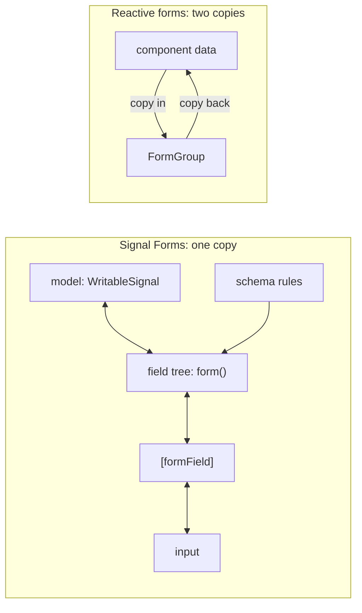
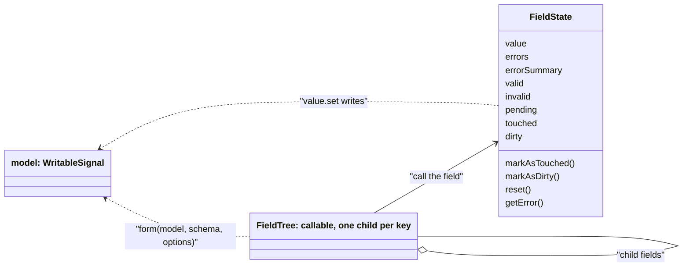
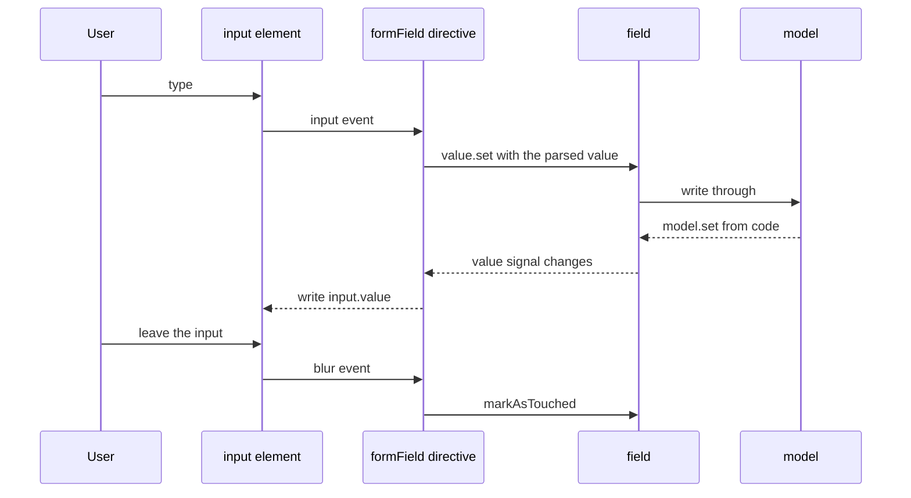
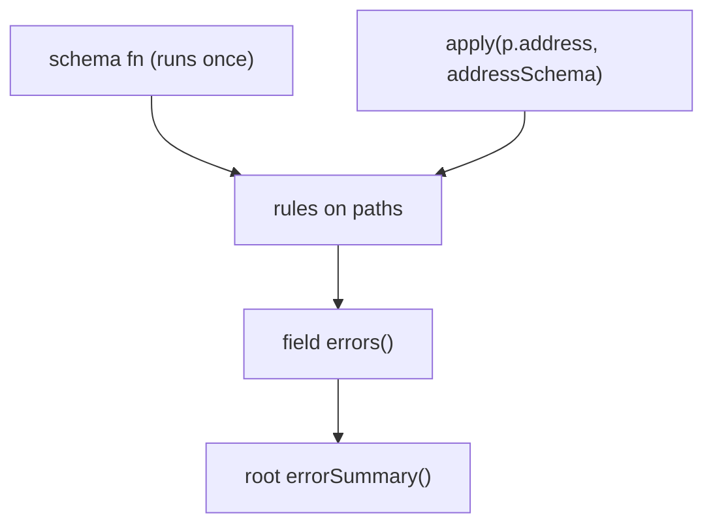
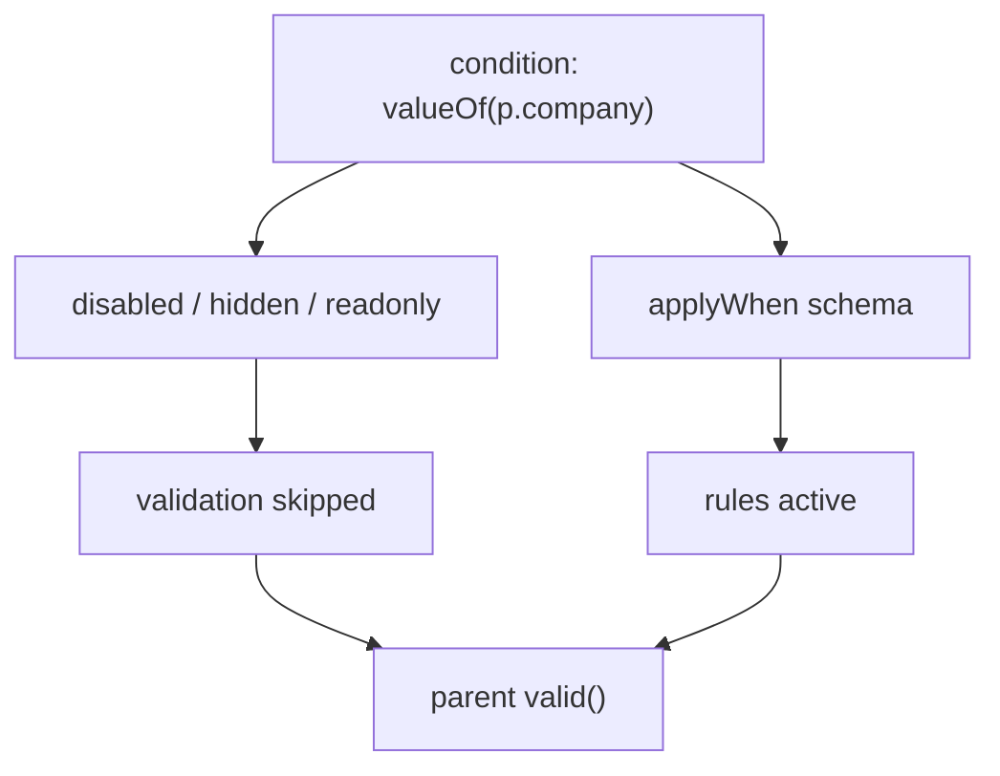
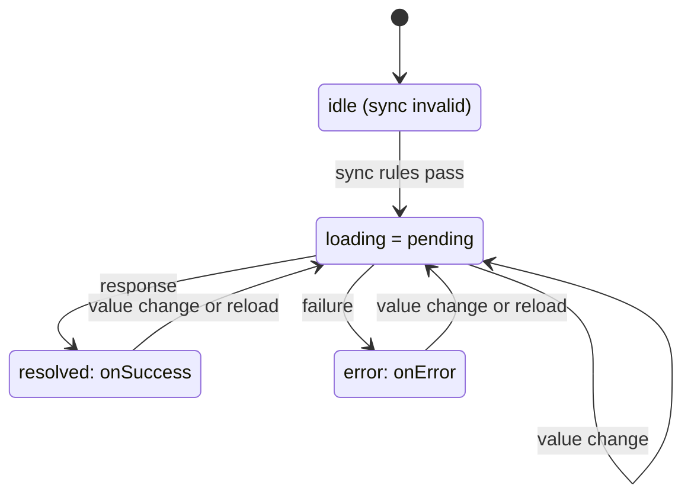
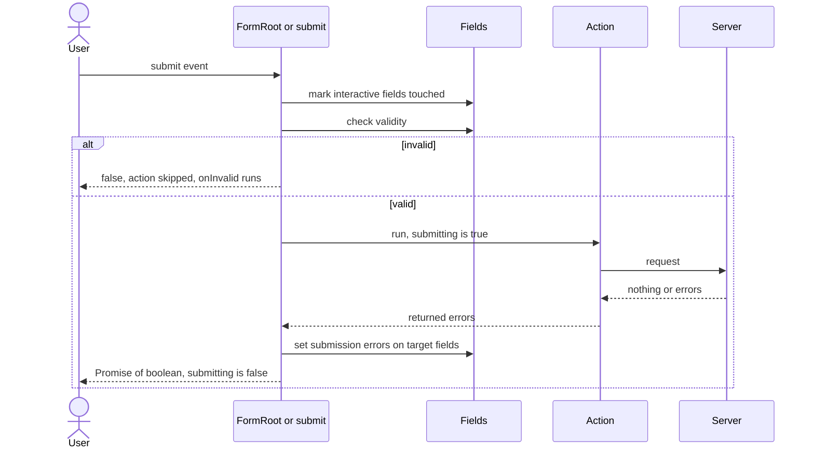
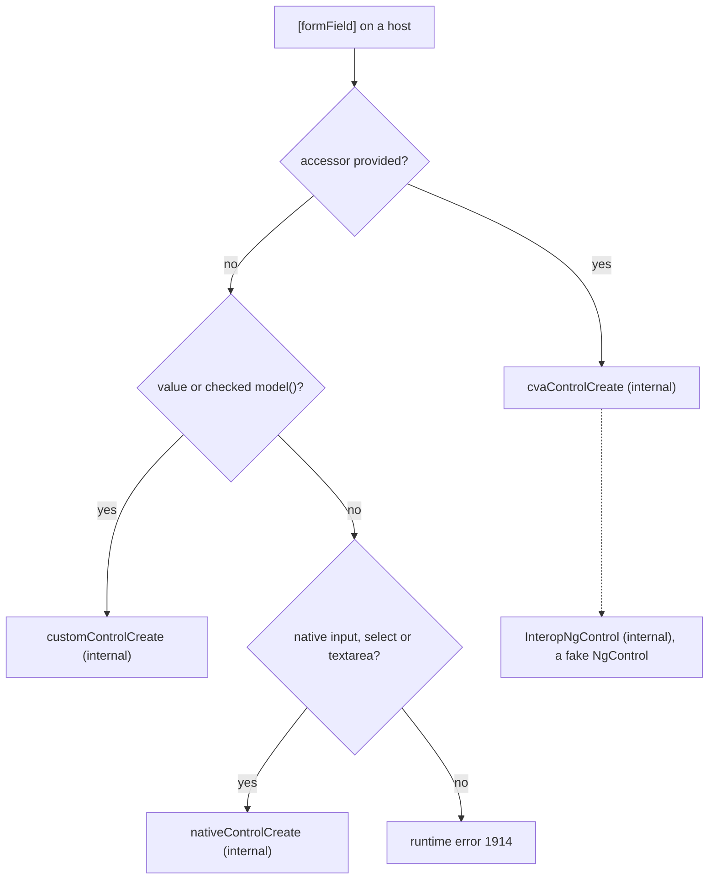
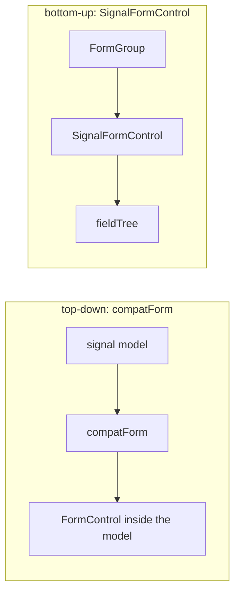

# 26. Signal Forms

> **What this covers:** Signal Forms (`@angular/forms/signals`), the third forms API: a form built from a writable model signal with `form()`, the field tree and its state signals, binding native inputs and custom controls with `[formField]`, schema rules for built-in, custom, cross-field, conditional and async validation with `debounce()`, submission with `submit()`, `FormRoot` and server errors, and interop with reactive forms through `@angular/forms/signals/compat`, with what changed from the v21 experimental API to v22.
> **Prerequisites:** [17. Writable signals](17-signals.md#2-writable-signals), [17. Resources](17-signals.md#6-resources-async-data-as-signals), [17. Signal-based component APIs](17-signals.md#7-signal-based-component-apis) (`model()`), [25. Two forms APIs](25-forms-reactive-and-template-driven.md#1-two-forms-apis-template-driven-and-reactive-and-the-control-directive-and-accessor-triangle) and [25. `ControlValueAccessor`](25-forms-reactive-and-template-driven.md#10-controlvalueaccessor-and-the-validator-interface-custom-controls-under-the-hood)
> **Leads to:** [27. HttpClient](27-http-client.md), [28. State management](28-state-management.md), [29. Testing Angular](29-testing-angular.md), [36. Material and CDK](36-material-and-cdk.md)
> **Applies to:** Angular 22.2 (`@angular/forms` 22.2.1), TypeScript 6.0, Node 24
> **Study time:** ~6 hours reading + ~4 hours exercises
> **Short on time:** read [1. Why a third forms API](#1-why-a-third-forms-api-model-first-signals-end-to-end), [2. `form()` and the field tree](#2-form-the-field-tree-and-field-state), [4. Schema rules](#4-schema-rules-and-validation-built-in-rules-validate-and-reusable-schemas) and [7. Submission](#7-submission-submit-formroot-submitting-and-server-errors), then drill [Q26.02](#q26-02), [Q26.09](#q26-09), [Q26.14](#q26-14), [Q26.17](#q26-17), [Q26.21](#q26-21) and [Q26.28](#q26-28), try [Exercise 26.1](#ex26-1), and finish with the [Summary](#summary).
> **Labs:** [`labs/angular/src/app/modules/26-signal-forms/`](../labs/angular/src/app/modules/26-signal-forms/) (section specs, *Output* questions, Exercises 26.1-26.5; `TestBed` specs in jsdom; no `labs/ts-js` files). Run (Node 24): from `labs/angular`, `npx ng test --watch=false --include='src/app/modules/26-signal-forms/**/*.spec.ts'`.

## Contents

1. [Why a third forms API: model-first, signals end to end](#1-why-a-third-forms-api-model-first-signals-end-to-end)
2. [`form()`, the field tree and field state](#2-form-the-field-tree-and-field-state)
3. [Binding with `[formField]`: native inputs, attributes, classes and rendering](#3-binding-with-formfield-native-inputs-attributes-classes-and-rendering)
4. [Schema rules and validation: built-in rules, `validate` and reusable schemas](#4-schema-rules-and-validation-built-in-rules-validate-and-reusable-schemas)
5. [Cross-field and conditional logic: `valueOf`, `validateTree`, `applyWhen`, `disabled`, `hidden` and `readonly`](#5-cross-field-and-conditional-logic-valueof-validatetree-applywhen-disabled-hidden-and-readonly)
6. [Async validation and `debounce()`: `validateAsync`, `validateHttp`, pending and cancellation](#6-async-validation-and-debounce-validateasync-validatehttp-pending-and-cancellation)
7. [Submission: `submit()`, `FormRoot`, `submitting()` and server errors](#7-submission-submit-formroot-submitting-and-server-errors)
8. [Custom controls: `FormValueControl`, `FormCheckboxControl` and how `[formField]` picks a control](#8-custom-controls-formvaluecontrol-formcheckboxcontrol-and-how-formfield-picks-a-control)
9. [Interop and migration: `compatForm`, `SignalFormControl` and what changed from v21 to v22](#9-interop-and-migration-compatform-signalformcontrol-and-what-changed-from-v21-to-v22)
- [Summary](#summary)
- [Question bank](#question-bank)
- [Hands-on exercises](#hands-on-exercises)
- [Check your understanding](#check-your-understanding)
- [Connections](#connections)

**How the claims here are verified.** An observed behavior cites a spec in `labs/angular/src/app/modules/26-signal-forms/`, run by `ng test` in jsdom with Angular 22.2.1 and `@angular/forms` 22.2.1: zoneless `TestBed`, model-only specs inside `runInInjectionContext`, `input`, `blur` and `submit` events on real inputs, fake timers only for model-only async specs, `// @ts-expect-error` lines for compile-time claims. "Read from the source" names the file and function in the published package; internal names are marked. Markers come from typings tags, the CHANGELOG and `npm pack` of 21.2.25 and 22.0.0. Screen readers, native pickers, WebMCP and testing guidance ([module 29](29-testing-angular.md)) are documented only: cited and dated, never run.

## 1. Why a third forms API: model-first, signals end to end

### The problem it solves

A profile editor keeps the user in a signal that the rest of the page reads, copies it into a `FormGroup` to edit it, and copies it back on save. The copies drift: a change to the signal does not reach the form, and a typed value does not reach the signal before submit. A new hire asks which of three forms APIs to use ([Q26.01](#q26-01), [Q26.02](#q26-02)).

### Mental model

Signal Forms (`@angular/forms/signals`) [Stable since v22.0] makes the **model signal** the form: the writable signal ([17 §2](17-signals.md#2-writable-signals)) that you own and that holds the data. `form(model)` returns a **field tree**, an object shaped like the model whose nodes expose each value and its **field state** as signals ([section 2](#2-form-the-field-tree-and-field-state)). Validation is declared once as **rules** on paths of the model, grouped in a **schema** ([section 4](#4-schema-rules-and-validation-built-in-rules-validate-and-reusable-schemas)). A **model-first form** is one whose source of truth is that signal, not a tree of controls. `@angular/forms/signals/compat` bridges to reactive forms ([section 9](#9-interop-and-migration-compatform-signalformcontrol-and-what-changed-from-v21-to-v22)).

A ledger: reactive forms keep a duplicate that you reconcile; Signal Forms annotate the original in the margin.



What to notice: the Signal Forms lane holds one copy of the data (`Section 1: the form keeps no copy of the model`); the reactive lane, as drawn, holds two.

### How it actually works

**The docs' comparison.** The Angular docs (`adev/src/content/guide/forms/signals/comparison.md`, branch `main`, read 2026-10-11) give these rows, quoted verbatim:

| Feature | Signal Forms | Reactive Forms | Template-driven Forms |
|---|---|---|---|
| Source of truth | User-defined writable signal model | `FormControl`/`FormGroup` | User model in component |
| Validation | Schema with path-based validators | List of validators passed to Controls | Directive-based |
| State management | Signal-based | Observable-based | Angular-managed |

The overview (`overview.md`, same branch and date) adds: "Signal Forms work best in new applications built with signals. If you're working with an existing application that uses reactive forms, reactive forms remain a solid choice." The comparison page's list "Use Reactive Forms if:" begins "You need production-ready stability"; this guide takes the status from the typings below and does not adjudicate. The two older APIs are [25 §1](25-forms-reactive-and-template-driven.md#1-two-forms-apis-template-driven-and-reactive-and-the-control-directive-and-accessor-triangle); [Q25.02](25-forms-reactive-and-template-driven.md#q25-02) owns the choice among the three.

**Status and history.** In `@angular/forms` 22.2.1, `form` is tagged `@publicApi 22.0` (`types/_structure-chunk.d.ts`); in 21.2.25 (`npm pack`, read 2026-10-11) the same declaration is tagged `@experimental 21.0.0`. The Angular `CHANGELOG.md` on `main` lists, under 22.0.0 (2026-06-03), the `forms` feature "graduate signal forms APIs to public API". The package `exports` map has `.`, `./signals` and `./signals/compat` (`package.json`). A component imports `FormField` (the binding directive, [section 3](#3-binding-with-formfield-native-inputs-attributes-classes-and-rendering)) from `@angular/forms/signals` and nothing else (`Section 1: a component that imports only FormField binds an input to the model`).

**Why a field write is a model write.** Read from the `@angular/forms` 22.2.1 source: the `form` typings document it as using "the given model as the source of truth" that "*does not* maintain its own copy of the data" (`types/_structure-chunk.d.ts`). `deepSignal` (internal, `fesm2022/_validation_errors-chunk.mjs`; may change in any release) builds each field's value as a `computed` reading `source()[prop()]`, whose `set` calls `source.update` with a copy of the parent value (`valueForWrite`, internal). A field write is therefore a write to your signal (`Section 1: a field write is a write to the model signal`), a write to the signal shows through the field (`Section 1: a model write is visible through the field`), and the form's value is the model's value itself (`Section 1: the form keeps no copy of the model`). [Section 2](#2-form-the-field-tree-and-field-state) follows up.

### Code

The approach: wrap a signal you own, then write in each direction and read the other side.

1. Declare the model signal.
2. Call `form(model)` inside an injection context (`TestBed.runInInjectionContext` in the spec).
3. Write through `f.name().value`, read `model()`, then write `model` and read the field.

```ts
// Excerpt of labs/angular/src/app/modules/26-signal-forms/concepts/section-1-why-signal-forms.spec.ts
TestBed.runInInjectionContext(() => {
  const model = signal<LabM26Profile>({ name: 'Ann', age: 30 });
  const f = form(model);
  f.name().value.set('Bob');
  expect(model()).toEqual({ name: 'Bob', age: 30 });
});
```

A component needs only `FormField` to bind a field to a native input.

```ts
// Excerpt of labs/angular/src/app/modules/26-signal-forms/concepts/section-1-why-signal-forms.spec.ts
@Component({
  selector: 'lab-m26-why-host',
  imports: [FormField],
  template: '<input [formField]="f.name" />',
})
class LabM26WhyHost {
  readonly model = signal<LabM26Profile>({ name: 'Ann', age: 30 });
  protected readonly f = form(this.model);
}
```

### Best practices and anti-patterns

- **Own the model signal and pass it to `form()`**, because the form keeps no copy, so every other reader of the signal sees edits with no copy-back step.
- **Keep an existing reactive codebase on it**, because the docs call reactive forms "a solid choice" there.

### Misconceptions and traps

- *"Signal Forms is reactive forms with signals instead of Observables."* The source of truth moved from a control tree to a signal you own (`Section 1: the form keeps no copy of the model`); the name suggests a port.
- *"Signal Forms is experimental."* Once true: `@experimental 21.0.0` in 21.2.25, until the 22.0.0 CHANGELOG line graduated it; the 22.2.1 typings say `@publicApi 22.0`.
- *"Signal Forms replaces reactive forms, which are deprecated."* The comparison table lists reactive forms as `Stable`; "the new API" reads as "the replacement".
- *"A component needs `FormsModule` or `ReactiveFormsModule`."* The lab host imports `FormField` alone (`Section 1: a component that imports only FormField binds an input to the model`); habit from the older APIs.

Drilled in [Q26.01](#q26-01) and [Q26.02](#q26-02); modelled in [Exercise 26.1](#ex26-1).

## 2. `form()`, the field tree and field state

### The problem it solves

A developer writes `f.name.value()` and gets a type error. Another builds the form in `ngOnInit` and gets `NG0203`. A third sets a value in code and expects an unsaved-changes banner to light up, but `dirty()` stays `false`. All three miss what `form()` returns and which signals sit behind it ([Q26.03](#q26-03), [Q26.04](#q26-04), [Q26.05](#q26-05)).

### Mental model

`form(model, schema?, options?)` returns a **field tree**: an object with one property per key of the model (and an index per array item), where each property is a **field**, a function you call to get its **`FieldState`**. The state is signals: `value` (writable), `errors`, `errorSummary`, `valid`, `invalid`, `pending`, `touched`, `dirty`, `disabled`, `hidden`, `readonly`, `required` and more, plus `markAsTouched()`, `markAsDirty()`, `reset()` and `getError(kind)`. Writes go down to the model through `value.set`. State rolls up: the root's `valid()` covers its descendants, its `errors()` holds only its own errors, and `errorSummary()` lists the descendants' (`Section 2: the root errors() is empty while errorSummary() lists the descendants`).

A building directory: each office has a plaque (a field); pressing it opens its live status board (the field state).



What to notice: a field is a function and the status board it returns is the state you read; `value.set` is the only arrow back to the model.

### How it actually works

**A field is a function with children.** Read from the `@angular/forms` 22.2.1 source: each field is a `FieldNode` (internal, `fesm2022/_validation_errors-chunk.mjs`; may change in any release) exposed as `new Proxy(() => this, FIELD_PROXY_HANDLER)` (internal). Calling the proxy returns the state; the handler's `get` trap returns the child field for a key, and its `ownKeys` trap reads the model value, so the keys of the tree are the keys of the model (`Section 2: the field tree has one key per model property`). Reading `f.a.value` without the call fails to compile with TS2339, observed by compiling the spec without its `@ts-expect-error`.

**Writes and laziness.** A field's `value` is a `deepSignal` (internal): a `computed` over the parent's value whose `set` ignores an `Object.is`-equal value and otherwise copies the parent with `valueForWrite` (internal), the copy-on-write of [section 1](#1-why-a-third-forms-api-model-first-signals-end-to-end). The 22.0.0 CHANGELOG (branch `main`, read 2026-10-11) lists the `perf` line "lazily instantiate signal form fields"; `getChild` calls `ensureChildrenMap` (internal), which materializes the children on the first read (read, not run).

**Interaction state.** A `value.set` in code leaves `dirty()` false; `markAsDirty()` sets it (`Section 2: a programmatic write does not mark the field dirty`). `markAsTouched()` marks the field and its descendants unless `{ skipDescendants: true }` (`Section 2: markAsTouched on the root marks every descendant`, `Section 2: markAsTouched with skipDescendants marks only the field itself`). `reset()` clears touched and dirty and keeps the model; `reset(value)` also writes the value (`Section 2: reset clears touched and dirty and keeps the model`, `Section 2: reset with a value writes the model`).

**Injection context.** `form()` outside an injection context throws `NG0203` (`Section 2: form outside an injection context throws NG0203`); the `injector` option of `FormOptions` supplies one (`Section 2: form with an injector option works outside an injection context`). The injection context is [16 §4](16-dependency-injection.md#4-the-injection-context-inject-runininjectioncontext-and-injectasync) and [Q16.12](16-dependency-injection.md#q16-12). `FormOptions` also carries an `experimentalWebMcpTool` option tagged `@experimental`, not taught here.

**Arrays and inputs.** Over an array the tree is indexed: `f.items[0].n()`, `f.items.length`, and `applyEach` attaches one schema to every item (`Section 2: a field tree over an array exposes items by index`). The run shows `keyInParent()` of the second item as the string `'1'`, although the typings call it the index, and one own symbol property on each object item in the model, the tracking key of its field (read: `identitySymbol`, internal). When the data arrives as a signal input, `form()` still needs a writable signal, so the model is a `linkedSignal` ([17 §5](17-signals.md#5-linkedsignal-writable-derived-state); [Q26.05](#q26-05) owns the bug).

### Code

The approach: build a nested form, change state in code, then reset it.

1. Create `form()` inside an injection context over a nested model.
2. Write a leaf, mark it dirty and touch the root.
3. Call `reset()` and read the state and the model.

```ts
// Excerpt of labs/angular/src/app/modules/26-signal-forms/concepts/section-2-field-tree.spec.ts
const model = signal(nested());
const f = form(model);
f.b.c().value.set('z');
f.b.c().markAsDirty();
f().markAsTouched();
expect(f().touched()).toBe(true);
f().reset();
expect(f().touched()).toBe(false);
expect(f.b.c().dirty()).toBe(false);
expect(f.a().touched()).toBe(false);
expect(model()).toEqual({ a: 'x', b: { c: 'z' } });
```

The array tree takes one rule for all rows.

```ts
// Excerpt of labs/angular/src/app/modules/26-signal-forms/concepts/section-2-field-tree.spec.ts
const f = form(model, (p) => {
  applyEach(p.items, (row) => required(row.n));
});
expect(f.items[1].n().errors().map((e) => e.kind)).toEqual(['required']);
```

### Best practices and anti-patterns

- **Create `form()` in a field initializer or constructor**, because they run in an injection context; elsewhere pass `{ injector }`.
- **Show a field's own `errors()` next to its input and use `errorSummary()` for the list**, because the root's `errors()` is empty while descendants fail.

### Misconceptions and traps

- *"`f.name.value()` reads the value."* Call the field first, `f.name().value()`; the property is the function, not its state, and the compiler says TS2339; the tree is shaped like the model, so `f.name` looks like the value.
- *"Setting a value marks the field dirty."* A programmatic `value.set` leaves `dirty()` false (`Section 2: a programmatic write does not mark the field dirty`); a changed value reads like a dirty one.
- *"The root's `errors()` lists every error."* It lists the root's own; `errorSummary()` lists the descendants', because errors live on the field they belong to.
- *"`form()` can be called anywhere."* It needs an injection context and throws `NG0203` otherwise; it reads like a pure function.

Drilled in [Q26.03](#q26-03), [Q26.04](#q26-04) and [Q26.05](#q26-05); modelled in [Exercise 26.1](#ex26-1).

## 3. Binding with `[formField]`: native inputs, attributes, classes and rendering

### The problem it solves

A form styled with `.ng-invalid` loses its red borders after the move to Signal Forms. Someone expects a number input to give `'42'`. A team relies on an `aria-invalid` that never shows up. Someone else is sure a value set in code will not repaint a zoneless view. The first three are about what the **`[formField]`** directive does and does not do to a native control; the fourth is wrong ([Q26.06](#q26-06), [Q26.07](#q26-07), [Q26.08](#q26-08)).

### Mental model

`[formField]="f.name"` is the one directive that connects a field to an element. It writes the field's value into the control, writes the control's value back into the field, reports blur as touched, and copies some rule state onto the element. A **native control** is an `<input>`, `<select>` or `<textarea>`. The template reads signals, so a model change repaints the views that read it. `FormField` has selector `[formField]`, `exportAs` `formField` and a required signal input aliased `formField`, read from the 22.2.1 typings.

An intercom between one office (the field) and one desk (the input): either side speaks through the same line.



What to notice: both directions pass through the same directive, and on a native control blur is the only event that marks the field touched.

### How it actually works

**Values.** Typing writes the model (`Section 3: typing updates the model through formField`); a model write repaints the input and the template text, with `autoDetectChanges()` and no `markForCheck` (`Section 3: a model update repaints the bound input`). The reason is the template reading signals, as in [21 §5](21-change-detection.md#5-zoneless-change-detection-the-scheduler-its-triggers-and-pendingtasks), not anything `[formField]` adds. A number input writes a number, and `null` when cleared (`Section 3: a number input writes a number and null when cleared`). Read from the `@angular/forms` 22.2.1 source (`fesm2022/signals.mjs`): `getNativeControlValue` (internal; may change in any release) returns `element.value === '' ? null : element.valueAsNumber` for `number`, `range` and `datetime-local` inputs, but only while the model value is a number or `null`; any other model type gets the string. The 22.0.0 CHANGELOG (branch `main`, read 2026-10-11) lists "support binding `number|null` to `<input type="text">`"; the same function parses a text input that way, and an unparsable value becomes a parse error (read, not run).

**Attributes.** Rules reach the element: `required(p.name)` gives the `required` attribute and `min(p.age, 18)` [Changed in v22: numbers or null only] gives `min="18"` (`Section 3: required and min rules become input attributes`). `nativeControlCreate` (internal) loops over the binding names, among them `required`, `min`, `max`, `disabled`, `readonly`, `pattern` and `name`, and sets each through `_setNativeDomProperty` (internal) when the element accepts that property. The same file has no `aria-` string, so no `aria-invalid` is written (`Section 3: formField sets no aria-invalid and no status classes by default`); error text and `aria-*` wiring stay yours ([25 §8](25-forms-reactive-and-template-driven.md#8-error-display-strategies-and-accessible-errors), [11 §6](11-accessibility.md#6-accessible-names-descriptions-and-forms)).

**Touched and classes.** Blur calls `markAsTouched()` (`Section 3: blur marks the field touched`), through `host.listenToDom('blur', …)` in `nativeControlCreate`. **Status classes** are the `ng-valid`-style classes of the other two APIs. With no configuration the class list is empty; the docs `migration.md` says "Signal Forms does not do that". `provideSignalFormsConfig` takes `classes`, and `NG_STATUS_CLASSES` from `@angular/forms/signals/compat` maps `ng-touched`, `ng-untouched`, `ng-dirty`, `ng-pristine`, `ng-valid`, `ng-invalid` and `ng-pending` to the state (`Section 3: NG_STATUS_CLASSES restores the ng- status classes`). Read: the private `installClassBindingEffect` returns at once when `classes` is empty, and otherwise toggles each class in an `afterRenderEffect`.

### Code

The approach: provide the preset, bind two inputs, read what reaches the element.

1. Provide `provideSignalFormsConfig({ classes: NG_STATUS_CLASSES })`.
2. Bind a text and a number input to rules.
3. Read attributes and classes, then type.

```ts
// Excerpt of labs/angular/src/app/modules/26-signal-forms/concepts/section-3-form-field.spec.ts
TestBed.configureTestingModule({
  providers: [provideSignalFormsConfig({ classes: NG_STATUS_CLASSES })],
});
const fixture = await mount();
const input = query(fixture, 'n');
expect(input.className).toBe('ng-untouched ng-pristine ng-invalid');
type(input, 'Zed');
await fixture.whenStable();
expect(input.classList.contains('ng-valid')).toBe(true);
```

### Best practices and anti-patterns

- **Provide `NG_STATUS_CLASSES` once at the app level when the stylesheet uses `.ng-invalid`**, because the directive writes no class on its own.
- **Bind a `number | null` model to `type="number"`**, because a `string` model on that input receives the string, not the number.
- **Render error text and `aria-invalid` yourself**, because the directive sets `required` and `min` but no `aria-*` attribute.

### Misconceptions and traps

- *"Signal Forms adds `ng-valid` and `ng-invalid`."* Not by default, because reactive forms did it without being asked; the preset above restores them.
- *"A number input gives a string."* The directive parses it to a number or `null`, because `input.value` is a string and the directive converts it for the model.
- *"`[formField]` makes the field accessible."* It sets `required`, not `aria-invalid` or error wiring, because accessibility is yours ([11 §6](11-accessibility.md#6-accessible-names-descriptions-and-forms)).
- *"It needs `[(ngModel)]`-style two-way syntax."* It is a one-way property binding that writes back itself, because the directive listens to the element ([13 §5](13-components-and-templates.md#5-event-binding-and-two-way-binding)).

Drilled in [Q26.06](#q26-06), [Q26.07](#q26-07) and [Q26.08](#q26-08); modelled in [Exercise 26.1](#ex26-1).

## 4. Schema rules and validation: built-in rules, `validate` and reusable schemas

### The problem it solves

The same checks get retyped for every control. A `min` rule that accepted the text `'18'` in v21 no longer compiles on a string field. A custom rule returns `true` and nothing is reported. A shared address block's rules are copied into three forms. All four are about **rules** declared on the model's paths ([Q26.09](#q26-09), [Q26.10](#q26-10), [Q26.11](#q26-11), [Q26.12](#q26-12)).

### Mental model

A **schema** is a function that runs once and attaches **rules** to paths of the model: `required(p.name)`, `min(p.age, 18)`, `validate(p.x, ctx => …)`. `p` is a **`SchemaPath`**, a handle to a place in the model, not a value. Each rule is reactive: it reruns when the signals it reads change, and its result lands in that field's `errors()` as objects with a `kind` and an optional `message`. `schema(fn)` names a reusable schema and `apply(path, schema)` mounts it on a sub-path.

Building codes attached to rooms on a floor plan, not to the furniture: the plan is read once, the inspection repeats.



What to notice: the schema runs once; the rules run every time their inputs change (`Section 4: the schema function runs once while its rules rerun`).

### How it actually works

**Built-in rules.** Each reports an error whose `kind` is the rule name, carrying its parameter (`Section 4: built-in rules report kind and parameters`).

| Rule | `kind` | Extra field |
|---|---|---|
| `required` | `required` | none |
| `min` / `max` | `min` / `max` | `min: 18` / `max: 80` |
| `minLength` / `maxLength` | `minLength` / `maxLength` | `minLength: 3` / `maxLength: 3` |
| `pattern` | `pattern` | `pattern: /^[a-z]+$/` |
| `email` | `email` | none |

The root's `errors()` stays empty while its `errorSummary()` lists the descendants' errors in that order, and `f.age().min?.()` returns `18`. `minLength` leaves an empty value to `required` (`Section 4: minLength leaves an empty value to required`); a `message` option lands on the error (`Section 4: a rule message appears on the error`). `minDate` and `maxDate` exist in the 22.2.1 typings and are not run here.

**`min` and `max` take numbers or `null`.** The 22.0.0 CHANGELOG (branch `main`, read 2026-10-11) lists, under breaking changes for `forms`: "`min` and `max` validation rules no longer support string values. Bound values must be numbers or null." The 21.2.25 typings (`npm pack`, read) declare `TValue extends number | string | null`; the 22.2.1 typings declare `TValue extends number | null`. A string field now fails to compile with TS2345 (`Section 4: min rejects a string field at compile time`). Reactive forms are unchanged ([25 §5](25-forms-reactive-and-template-driven.md#5-validators-built-in-custom-and-cross-field), [Q25.16](25-forms-reactive-and-template-driven.md#q25-16)).

**Custom rules.** `validate(path, ctx => …)` returns a `ValidationResult`: `null`, `undefined` or `void` for no error, or one error or a list (typings). An error is an object with a `kind`, not a boolean; the built-in classes (`RequiredValidationError` through `BaseNgValidationError`) and factories such as `requiredError()` build the standard ones. The rule reruns when the model changes (`Section 4: a custom validate rule reruns when the model changes`). Read from the `@angular/forms` 22.2.1 source (`fesm2022/signals.mjs`): `validate` registers a sync rule that adds the current field to a result lacking one, and `normalizeErrors` (internal; may change in any release) turns `undefined` into `[]`, an array into itself and one error into `[error]`, which is why both shapes work.

**Reusable schemas.** `schema()` is documented as taking "A **non-reactive** function" (typings); `apply` mounts it on a sub-path (`Section 4: apply mounts a reusable schema on a sub-path`).

**Reading one error and Standard Schema.** `getError(kind)` returns the first error of that kind, or `undefined` (`Section 4: getError returns the error of one kind`). `validateStandardSchema(path, schema)` takes any object with a `~standard` property; the lab uses a hand-written one, and its issues become field errors of kind `standardSchema` (`Section 4: validateStandardSchema maps issues to field errors`). The typings name a Zod validator as an example; no library is imported here.

### Code

The approach: declare the rules in a schema, mount a reusable one twice, then read the errors.

1. Define `addressSchema` with `schema<LabM26Address>()`.
2. Mount it on two sub-paths with `apply`.
3. Read each field's errors and the root summary.

```ts
// Excerpt of labs/angular/src/app/modules/26-signal-forms/concepts/section-4-rules.spec.ts
const addressSchema = schema<LabM26Address>(p => {
  required(p.street);
  minLength(p.zip, 5);
});
const f = form(
  signal({ home: { street: '', zip: '12' }, work: { street: 'Main', zip: '12345' } }),
  p => {
    apply(p.home, addressSchema);
    apply(p.work, addressSchema);
  },
);
expect(f.home.street().errors().map(e => e.kind)).toEqual(['required']);
expect(f().errorSummary().map(e => e.kind)).toEqual(['required', 'minLength']);
```

The compile-time check, recorded by compiling once without the directive (TS2345):

```ts
// Excerpt of labs/angular/src/app/modules/26-signal-forms/concepts/section-4-rules.spec.ts
// @ts-expect-error TS2345 (recorded by compiling without this directive): min takes a number or null field
min(p.s, 3);
```

### Best practices and anti-patterns

- **Declare rules in a `schema()` and `apply` it**, because a block shared by three forms then changes in one place.
- **Return an error object or nothing from `validate`**, because a boolean is not a `ValidationResult`.
- **Give `min` and `max` a `number | null` field**, because a string field no longer compiles.
- **Leave presence to `required`**, because `minLength` skips an empty value.

### Misconceptions and traps

- *"`min` and `max` accept numeric strings like reactive validators."* Once true: 21.2.25 typed `number | string | null`, until 22.0's breaking change; the habit comes from `Validators.min`, which still parses strings.
- *"A validator returns a boolean."* A rule returns error objects or nothing, because the reactive `ValidationErrors | null` habit and the predicate shape suggest otherwise.
- *"The schema function reruns on every change."* It runs once and registers reactive rules, because it reads like a template.
- *"Every rule reports on an empty value."* `minLength` leaves it to `required`, because `minLength` returns no error for an empty value (read from `minLength` in `signals.mjs`).

Drilled in [Q26.09](#q26-09), [Q26.10](#q26-10), [Q26.11](#q26-11) and [Q26.12](#q26-12); modelled in [Exercise 26.1](#ex26-1) (the `min` and `max` bounds of a rating are also in [Exercise 26.5](#ex26-5)).

## 5. Cross-field and conditional logic: `valueOf`, `validateTree`, `applyWhen`, `disabled`, `hidden` and `readonly`

### The problem it solves

A password confirmation error appears on the form, not on the field the user is looking at. A VAT number is required even for private customers. A field hidden with `@if` still blocks submission. A field disabled by a checkbox still reports `required`. All four are about one field's rules depending on another field's state ([Q26.13](#q26-13), [Q26.14](#q26-14), [Q26.15](#q26-15), [Q26.16](#q26-16)).

### Mental model

A rule receives a **context** (`FieldContext`) with `value`, `valueOf(path)`, `stateOf(path)` and `fieldTree`, so it can read any other field and rerun when that field changes. `validateTree` returns errors that carry a **target** (`fieldTree`), so one rule can place an error on another field. `applyWhen(path, condition, schema)` switches a block of rules on while the condition holds. `disabled`, `hidden` and `readonly` are rules too, each taking `{ when }`, and a field in any of those three states is **skipped by validation**.

A form clerk who checks one box against another, and skips sections marked "not applicable".



What to notice: hiding a field in the template is not the `hidden` rule; only the rule takes the field out of validation (`Section 5: a field hidden only in the template still invalidates the form`).

### How it actually works

**Where each error lands.** With a `validate` rule on `confirm` that compares `value()` with `valueOf(p.pw)`, the `mismatch` error sits on `confirm` (`Section 5: a validate rule on confirm reads pw through valueOf`). A `validateTree` on the root that returns `{ kind: 'treeMismatch', fieldTree: fieldTree.pw }` puts the error on `pw`, leaves `confirm` clean and leaves the root's `errors()` empty (`Section 5: validateTree targets its error at another field`). Read from the `@angular/forms` 22.2.1 source (`fesm2022/_validation_errors-chunk.mjs`, `FieldValidationState`, internal): each node collects its parents' tree errors and keeps those whose `fieldTree` is its own, which is why the target decides where an error shows.

**Conditional rules.** `applyWhen(p, ({ valueOf }) => valueOf(p.company), schema(q => required(q.vat)))` leaves `vat` with no errors and `required()` `false` until `company` turns `true`, then reports `required` (`Section 5: applyWhen enables required only while the condition holds`).

**The skip rule.** A required field that is disabled by `{ when }`, one hidden and one readonly all report an empty `errors()`, and the root is `valid()`; the disabled field has one entry in `disabledReasons()` (`Section 5: disabled, hidden and readonly fields report no errors`). Read from the same source: `FieldValidationState` returns `[]` for its sync, tree and async errors when `shouldSkipValidation()` (internal; may change in any release) is true, and that is `hidden() || disabled() || readonly()` (plus an orphan check). The skip follows the condition: once it turns false the field validates again and the root flips to invalid (`Section 5: a disabled field stops counting when the condition turns false`). The `hidden` typings say that a hidden field "does not contribute to the validation, touched/dirty, or other state of its parent field" and recommend guarding it with `@if`.

**`@if` is not `hidden`.** A field only left out of the template by `@if` is still a field of the tree: its `required` error stays and the form is invalid (`Section 5: a field hidden only in the template still invalidates the form`). Pair the rule with the template guard.

### Code

The approach: one cross-field rule, one conditional block, then read where the errors landed.

1. Declare `validate` on `confirm` and `applyWhen` on `vat`.
2. Change `company`.
3. Read each field's errors.

```ts
// Excerpt of labs/angular/src/app/modules/26-signal-forms/concepts/section-5-cross-field.spec.ts
const model = signal<LabM26Pair>({ pw: '', confirm: '', company: false, vat: '' });
const f = form(model, (p) => {
  applyWhen(p, ({ valueOf }) => valueOf(p.company), schema<LabM26Pair>((q) => required(q.vat)));
});
expect(f.vat().errors()).toEqual([]);
expect(f.vat().required()).toBe(false);
model.update((m) => ({ ...m, company: true }));
expect(f.vat().errors().map((e) => e.kind)).toEqual(['required']);
expect(f.vat().required()).toBe(true);
```

#### Legacy

The function overloads of `disabled`, `hidden` and `readonly` [Deprecated since v22.0 — use { when }] still work (`Section 5: the deprecated function overload still disables and the { when } form matches it`). The 22.2.1 typings mark them `@deprecated` ("Use `{ when: ... }` instead") with no version; the date rests on reading the `@angular/forms` 21.2.25 typings (function form only) and 22.0.0 typings (both forms), not on a CHANGELOG line.

```ts
// Excerpt of labs/angular/src/app/modules/26-signal-forms/legacy/legacy-apis.ts
disabled(p.vat, ({ valueOf }) => !valueOf(p.company));
disabled(p.vat, { when: ({ valueOf }) => !valueOf(p.company) });
```

Migrate by wrapping the function in `{ when }`.

### Best practices and anti-patterns

- **Put a cross-field check on the field the user sees**, with `validate` and `valueOf`, because the error then renders beside the input.
- **Use `validateTree` with a `fieldTree` target when one rule judges several fields**, because the target, not the rule's position, decides where the error lands.
- **Use `applyWhen` for a whole block of conditional rules**, because one condition replaces a `when` on every rule.
- **Pass `{ when }` to `disabled`, `hidden` and `readonly`**, because the function overloads are deprecated.

### Misconceptions and traps

- *"A cross-field error belongs on the form."* A rule can sit on the field or target one; the habit comes from reactive group validators ([25 §5](25-forms-reactive-and-template-driven.md#5-validators-built-in-custom-and-cross-field)), where only the group sees both controls.
- *"`@if` removes a field from validation."* Only the `hidden` rule does, because the tree and its rules exist whether or not the template renders the input, the opposite of the template-driven habit.
- *"`readonly` is only a display attribute."* It also skips validation, because `shouldSkipValidation()` includes `readonly()`.
- *"Disabled fields still validate, as in HTML."* Signal Forms skips them, because its rule is its own and not the browser's constraint validation.

Drilled in [Q26.13](#q26-13), [Q26.14](#q26-14), [Q26.15](#q26-15) and [Q26.16](#q26-16); modelled in [Exercise 26.2](#ex26-2).

## 6. Async validation and `debounce()`: `validateAsync`, `validateHttp`, pending and cancellation

### The problem it solves

A username check fires a request per keystroke, even for `'a'`, which `minLength(3)` rejects. The submit button accepts a click while the check is in flight; a stale response can mark the current value as taken ([Q26.17](#q26-17), [Q26.18](#q26-18), [Q26.19](#q26-19), [Q26.20](#q26-20)).

### Mental model

An **async rule** is a validation whose verdict arrives later. `validateAsync(path, options)` attaches a `resource` ([17 §6](17-signals.md#6-resources-async-data-as-signals)) to a field: `params` read the field, `factory` builds the resource from them, `onSuccess` maps its result to errors and `onError` maps a failure. While the resource loads the field is **pending**: `pending()` is `true` and both `valid()` and `invalid()` are `false`. `validateHttp` is the same rule with `httpResource` as the factory; its `request` returns a URL or a request object (`HttpClient` is [module 27](27-http-client.md)'s).

The `debounce(path, config)` rule delays **model writes from the UI**. `config` is a number of milliseconds, `'blur'` or a **`Debouncer`**, a function `(context, abortSignal)` that returns a promise to hold the write or nothing to apply it at once. The `debounce` option of `validateAsync` delays **the params** of that one validator instead.

A background check that starts once the paperwork is complete and restarts when it changes.



What to notice: pending is a third state, not "invalid" (`Section 6: a pending field is neither valid nor invalid`).

### How it actually works

**Pending.** With a loader that waits 100 ms under fake timers, `pending()` is `true` after `TestBed.tick()` (`Section 6: an async rule is pending while its resource loads`), while `valid()` and `invalid()` are `false` and `errors()` is empty (`Section 6: a pending field is neither valid nor invalid`). Afterwards the loader has run once and `errors()` holds `taken` (`Section 6: the resolved value maps to a field error`). The docs agree: "Async validation runs only after all synchronous validation passes. While the validation executes, the field's `pending()` signal returns `true`." (`adev/src/content/guide/forms/signals/async-operations.md`, branch `main`, read 2026-10-11.)

**Skipped while sync rules fail.** With `minLength(p.user, 3)` and the value `'an'`, the loader never runs, `pending()` is `false` and the one error is `minLength`; a new value `'bob'` starts it (`Section 6: an async rule does not run while a sync rule fails`). Read from the `@angular/forms` 22.2.1 source (`fesm2022/signals.mjs`, `validateAsync`): the params are `undefined` when `shouldSkipValidation()` is true, `syncValid()` is false (both internal) or `when` is false, and the async error rule maps resource status `idle` to no error, `loading` and `reloading` to `'pending'`, `resolved` and `local` to `onSuccess`, and `error` to `onError`.

**New values replace the load.** A change while the check is loading discards the stale result: after `'ann'` starts loading and the value becomes `'bob'`, the loader ran for both, no `taken` error appeared and the field ended valid (`Section 6: a value change while loading discards the stale result`). The docs also promise cancellation: the first load's abort signal fires (`Q26.17 a value change while loading runs a second load and the first one finishes with its signal aborted`); a real request stops only if the loader passes the signal on. `reloadValidation()` on a field makes it pending again and runs the loader a second time (`Section 6: reloadValidation runs the async rule again`); read from `fesm2022/_validation_errors-chunk.mjs`, `FieldNode._reloadValidation` (internal) reloads every async resource of the field and its descendants.

**The two delays.** Typing `Zed` into a field with `debounce(p.name, 50)` leaves the model `''` until a real 80 ms pass, then `'Zed'` (`Section 6: a debounced field writes the model after the delay`); typing `Zo` and blurring writes it at once (`Section 6: blur flushes a debounced value`), as the docs say: "Regardless of the debounce duration, the framework writes the field's `controlValue()` to the model immediately when the field becomes touched." The `validateAsync` option behaves otherwise: after a change the model holds the new value immediately and the loader runs only after the delay (`Section 6: the debounce option of validateAsync delays the loader`). The docs add that the rule holds back every reaction to the field, while the option throttles just that validator ("Debouncing a single async validator", read, not run). A `rxResource` over an Observable service also fits `factory` (docs, read, not run; [23 §7](23-rxjs-in-depth.md#7-rxjs-and-signals-decision-rules-tosignal-toobservable-and-rxresource)); the reactive equivalent is [25 §6](25-forms-reactive-and-template-driven.md#6-async-validators-pending-status-cancellation-and-debouncing).

**`validateHttp`.** With `provideHttpClient()` and `provideHttpClientTesting()`, a `request` returning `/api/users/ann` leaves the field pending until the testing controller flushes `{ taken: true }`, then one `taken` error (`Section 6: validateHttp maps the response to an error`).

### Code

The approach: one username rule with a call log, to count loader runs.

1. Declare `minLength` and `validateAsync` on `user`.
2. Log every loader call and wait before answering.
3. Map the answer in `onSuccess`.

```ts
// Excerpt of labs/angular/src/app/modules/26-signal-forms/concepts/section-6-async.spec.ts
const f = form(model, (p) => {
  minLength(p.user, 3);
  validateAsync(p.user, {
    params: ({ value }) => value(),
    debounce: debounceMs,
    factory: (params) =>
      resource({
        params,
        loader: async ({ params: name }) => {
          log.push(name);
          await new Promise<void>((done) => setTimeout(done, wait));
          return name === 'ann';
        },
      }),
    onSuccess: (taken) => (taken ? { kind: 'taken' } : undefined),
    onError: () => ({ kind: 'err' }),
  });
});
```

### Best practices and anti-patterns

- **Keep a sync rule in front of an async one**, because no request runs while it fails.
- **Use the `debounce` option for one expensive validator**, because the rule delays every reaction to the field.
- **Show `pending()` in the template**, because a bare `invalid()` check shows nothing while the field loads.
- **Give `onError` its own kind**, because a failed request is not "taken".

### Misconceptions and traps

- *"Pending means invalid."* Both `valid()` and `invalid()` are `false`, because the reactive `PENDING` status reads like a failure, yet the resource has no verdict yet.
- *"Async rules run on every value."* They run only when sync rules pass, because the params are `undefined` while `syncValid()` is false.
- *"`debounce()` delays validation."* It delays the model write, because validation reads the model; the option on `validateAsync` is what delays the request.
- *"`submit()` waits for pending validators."* By default the action runs anyway, because gating belongs to `ignoreValidators` ([section 7](#7-submission-submit-formroot-submitting-and-server-errors)).

Drilled in [Q26.17](#q26-17), [Q26.18](#q26-18), [Q26.19](#q26-19) and [Q26.20](#q26-20); modelled in [Exercise 26.3](#ex26-3).

## 7. Submission: `submit()`, `FormRoot`, `submitting()` and server errors

### The problem it solves

An invalid form posts anyway because the button's click handler never checked validity. Errors stay hidden after a failed submit because nothing marked the fields touched. A server "email taken" response has nowhere to go, and a double click posts twice ([Q26.21](#q26-21), [Q26.22](#q26-22), [Q26.23](#q26-23)).

### Mental model

**`submit(field, action)`** is a function exported by `@angular/forms/signals`; it runs a small protocol. It marks the interactive fields touched, checks validity as `ignoreValidators` says, runs the async **submission action** while `field().submitting()` is `true`, and attaches any errors the action returns to the fields they target. Those are **submission errors**: they stay until the user edits that field. **`FormRoot`** is the directive that calls `submit()` for a `<form>`; `onInvalid` is the callback for the blocked case.

A post office counter: it checks the form, stamps it in progress, and returns rejected slips clipped to the exact line that was wrong.



What to notice: a server error returns through the same `errors()` signal as a validation error (`Section 7: an action's error lands on the targeted field`).

### How it actually works

**The protocol.** Submitting `{ email: '' }` with `required` returns `false`, never calls the action and leaves `email().touched()` `true` (`Section 7: submit on an invalid form marks fields touched and skips the action`). The docs add: "Hidden, disabled, and readonly fields are skipped." (`adev/src/content/guide/forms/signals/form-submission.md`, branch `main`, read 2026-10-11.) With a valid value, `submitting()` is `true` inside the action and `false` after (`Section 7: submitting is true while the action runs`).

**Server errors.** An action that returns `{ kind: 'server', message: 'taken', fieldTree: field.email }` makes `submit()` resolve `false`; `email().errors()` holds `server:taken`, `email().valid()` is `false`, the root's `errors()` is empty and `errorSummary()` lists the error (`Section 7: an action's error lands on the targeted field`). Read from the `@angular/forms` 22.2.1 source (`fesm2022/_validation_errors-chunk.mjs`): `submit` resolves `true` when the action returns nothing or an empty array; `setSubmissionErrors` (internal) groups the returned errors by their `fieldTree`, defaulting through `addDefaultField` (internal) to the submitted field, and sets each field's `submissionErrors`. That signal is a `linkedSignal` of the field's value that returns `[]`, and `syncErrors` includes it, so the error counts as invalid and any write to the value resets it. The docs say "Submission errors clear automatically when the user edits the field." (same docs page); after `value.set('c@d')` `errors()` is empty and `valid()` is `true` (`Section 7: editing the field clears the submission error`).

**Gating.** `shouldRunAction` (internal) returns `true` for `'all'`, `valid` for `'none'` and `!invalid` otherwise. `FormSubmitOptions` documents `'pending'` as the default, so a pending async rule does not block the action. With a held `validateAsync` loader, `ignoreValidators: 'none'` returned `false` without running the action, and the default ran it and returned `true` (`Section 7: ignoreValidators none blocks a submit while a rule is pending`). `onInvalid` receives the field when validation blocks the action, after the touch (`Section 7: onInvalid runs when validation fails`).

**Concurrency.** The `submit` typings say: "Concurrent submissions are prohibited. If a submit is already in progress for the given field or any of its parents, subsequent calls to `submit` will return `false` immediately without running the action." The 21.2.12 CHANGELOG lists "prohibit concurrent submits in signal forms". A second call during a held action returned `false` and the action ran once (`Section 7: concurrent submits return false without running the action again`).

**`FormRoot`.** Its selector is `form[formRoot]`; the host adds `novalidate` and listens for `submit`, whose handler prevents the default and calls `submit(fieldTree)` only when the form defines `submission` options (read, not run). The lab form had `novalidate`, a cancelable event was default-prevented and an invalid form skipped the action (`Section 7: FormRoot sets novalidate and prevents the native submit`), and a valid one called the action once with `'a@b'` (`Section 7: FormRoot runs the submission action when the form is valid`). After a success, `reset()` clears touched and dirty and keeps the model (`Section 2: reset clears touched and dirty and keeps the model`).

### Code

The approach: a model-only submit whose action returns a field-targeted error.

1. Build the form from a model signal.
2. Call `submit` with an async action.
3. Return an error whose `fieldTree` is the field to blame.

```ts
// Excerpt of labs/angular/src/app/modules/26-signal-forms/concepts/section-7-submission.spec.ts
const f = form(signal<LabM26Register>({ email: 'a@b' }));
const result = await submit(f, async (field) => ({
  kind: 'server',
  message: 'taken',
  fieldTree: field.email,
}));
```

The same protocol through a template.

1. Declare the action in `form()`'s `submission` options.
2. Bind the element with `<form [formRoot]="f">`.

```ts
// Excerpt of labs/angular/src/app/modules/26-signal-forms/concepts/section-7-submission.spec.ts
protected readonly f = form(
  this.model,
  (p) => {
    required(p.email);
  },
  {
    submission: {
      action: async (field): Promise<TreeValidationResult> => {
        this.calls.push(field().value().email);
        return undefined;
      },
    },
  },
);
```

### Best practices and anti-patterns

- **Return errors with a `fieldTree`**, because without one they land on the submitted field, usually the root.
- **Disable the button with `submitting()`**, because a second submit just returns `false`.
- **Use `ignoreValidators: 'none'` when async rules must settle**, because the default runs the action while they are pending.
- **Put `submission` options on a `FormRoot` form**, because without them it only prevents the default.

### Misconceptions and traps

- *"`submit()` is a method on the form."* It is a function you import and pass the field, because reactive forms pair `ngSubmit` with a method on the group.
- *"Server errors must be pushed with a manual `setErrors`."* The action returns them, because reactive forms had no return path ([Q25.15](25-forms-reactive-and-template-driven.md#q25-15)).
- *"`FormRoot` blocks native validation only if you add `novalidate`."* It sets the attribute itself, because a plain `<form>` needs it added by hand.
- *"Server errors reappear on the next rule run."* They clear on any write to the field and return only with the next submit, because they look like validation errors but live in a signal that resets with the value.

Drilled in [Q26.21](#q26-21), [Q26.22](#q26-22) and [Q26.23](#q26-23); modelled in [Exercise 26.4](#ex26-4).

## 8. Custom controls: `FormValueControl`, `FormCheckboxControl` and how `[formField]` picks a control

### The problem it solves

A star-rating component for reactive forms needs `NG_VALUE_ACCESSOR`, `forwardRef` and four callbacks ([25 §10](25-forms-reactive-and-template-driven.md#10-controlvalueaccessor-and-the-validator-interface-custom-controls-under-the-hood)), and its disabled and error state arrive through inputs wired by hand. A v21 control may keep `touched` as a `model()`, which the v22 contract no longer lists ([Q26.24](#q26-24), [Q26.25](#q26-25), [Q26.26](#q26-26)).

### Mental model

A **custom control** is a component with one required `model()`: `value` for a **`FormValueControl<T>`**, `checked` for a **`FormCheckboxControl`**. The rest is optional: the inputs of **`FormUiControl`** (`disabled`, `errors`, `required`, `min` and more) that `[formField]` fills when declared, and a **`touch` output** [Changed in v22: touched is an input and blur is reported by a touch output] that tells the field the user left. `model()` is [17 §7](17-signals.md#7-signal-based-component-apis) and [Q19.04](19-component-communication-and-projection.md#q19-04).

A standard plug: build to the socket's shape and the wall wiring is done. `[formField]` also accepts a native input or a component that provides a `ControlValueAccessor`, kept for backwards compatibility.



What to notice: a component with both an accessor and a `value` model takes the accessor branch (`Section 8: a component with a value model and an accessor is bound as an accessor`).

### How it actually works

**The value contract.** A click on the stepper wrote `2` to the model, and a model write repainted the control (`Section 8: a value model control writes the field`). A `checked` control wrote a boolean (`Section 8: a checked model control writes a boolean field`). A blur that emitted `touch` made `touched()` `true` and left `dirty()` `false` (`Section 8: the touch output marks the field touched`); the typings say "Emit this in response to the native `blur` event … not `focus`." With `min(p.qty, 3)` on `{ qty: 1 }` its status text (disabled, error count) was `false|1` (`Section 8: formField binds disabled and errors into the control`); with `disabled(p.qty, { when: … })` active it was `true|0`, because a disabled field reports no errors ([Section 5](#5-cross-field-and-conditional-logic-valueof-validatetree-applywhen-disabled-hidden-and-readonly); `Section 8: a disabled field hands the control no errors`).

**The typings.** `FormValueControl<TValue>` requires `value: ModelSignal<TValue>` and declares `checked?: undefined`; `FormCheckboxControl` requires `checked: ModelSignal<boolean>` and declares `value?: undefined`. `FormUiControl` makes the rest optional: "If implemented, the `Field` directive will automatically bind" each. `FORM_FIELD` is the injection token the `FormField` directive provides (`@angular/forms` 22.2.1 typings).

**Why the order.** Read from the `@angular/forms` 22.2.1 source (`fesm2022/signals.mjs`): `ɵngControlCreate` (internal) tests the `controlValueAccessor` getter first, then `host.customControl`, then a native form element, and otherwise throws runtime error 1914. `customControlCreate` (internal) listens to the model to write the field's `controlValue` and to `touch` to call `markAsTouched()`. `cvaControlCreate` (internal) registers `registerOnChange` and `registerOnTouched` and calls `writeValue` and `setDisabledState`. `FormField` provides a fake `NgControl` (`InteropNgControl`, internal) from `interopNgControl` (internal). The 22.0.0 CHANGELOG (`main`, fetched 2026-10-11) lists "align FormField CVA selection priority with standard forms"; the order is read, what it replaced is not.

**The touch change.** In 21.2.25 `FormUiControl.touched` also accepted a `ModelSignal<boolean>` or an output; in 22.2.1 `touched?` is an input only and `touch?: OutputRef<void>` reports blur (`npm pack` read). The 22.0.0 fix is "split the `touched` model into an input and `touch` output" ([section 9](#9-interop-and-migration-compatform-signalformcontrol-and-what-changed-from-v21-to-v22) tabulates it).

**`ngNoCva`.** [Added in v22.0] The 22.0.0 feature line is "support ngNoCva as an opt-out for ControlValueAccessors". The built-in accessors' selectors carry `:not([ngNoCva])`, and `NgControl.ngControlCreate` (internal, `fesm2022/forms.mjs`) wires a custom control only when the host has no accessor or has the `ngNoCva` attribute (read, not run); a `value = model()` component also binds to `[formControl]` ([25 §10](25-forms-reactive-and-template-driven.md#10-controlvalueaccessor-and-the-validator-interface-custom-controls-under-the-hood)).

**Parsing.** `transformedValue(model, { parse, format })` (`@publicApi 22.0`) returns a writable raw signal with `parseErrors()`; inside a field context the typings say parse errors reach the nearest field. Typing `12` set the model to `12`; `abc` kept `12` and gave the field one `parse` error (`Section 8: transformedValue reports a parse error`).

### Code

The approach: a stepper that implements the contract and nothing else.

1. Declare `value = model(0)` and the inputs you render.
2. Emit `touch` on blur.
3. Bind it with `[formField]`.

```ts
// Excerpt of labs/angular/src/app/modules/26-signal-forms/concepts/section-8-custom-controls.spec.ts
class LabM26Stepper implements FormValueControl<number> {
  readonly value = model(0);
  readonly disabled = input(false);
  readonly errors = input<readonly ValidationError.WithOptionalFieldTree[]>([]);
  readonly touch = output<void>();
}
```

```ts
// Excerpt of labs/angular/src/app/modules/26-signal-forms/concepts/section-8-custom-controls.spec.ts
template: `<lab-m26-stepper id="s" [formField]="f.qty" />`,
```

#### Legacy

A component that provides `NG_VALUE_ACCESSOR` ([25 §10](25-forms-reactive-and-template-driven.md#10-controlvalueaccessor-and-the-validator-interface-custom-controls-under-the-hood) owns the contract) still binds with `[formField]`. It got `registerOnChange`, `registerOnTouched`, `writeValue('a')` and `setDisabledState(false)` in that order, then `writeValue('prog')` after a model write (`Section 8: a ControlValueAccessor bound with formField gets writeValue and setDisabledState`); its change callback updated the model and made the field dirty (`Section 8: a change from the accessor updates the model and marks it dirty`).

```ts
// Excerpt of labs/angular/src/app/modules/26-signal-forms/legacy/legacy-apis.ts
providers: [
  { provide: NG_VALUE_ACCESSOR, useExisting: forwardRef(() => LabM26LegacyAccessor), multi: true },
],
```

Migrate by trading the provider and four methods for a `model()`, a `disabled` input and a `touch` output (`Section 8: the value model replacement of an accessor writes and touches the same way`).

```ts
// Excerpt of labs/angular/src/app/modules/26-signal-forms/legacy/legacy-apis.ts
export class LabM26ValueControl {
  readonly value = model('');
  readonly disabled = input(false);
  readonly touch = output<void>();
```

### Best practices and anti-patterns

- **Implement the interface**, because the compiler then checks the `value` shape and the `checked` ban.
- **Declare only the inputs you render**, because `[formField]` fills what you declare.
- **Emit `touch` on `blur`**, because blur-based rules rely on it.
- **Keep an accessor only while a reactive form hosts the control**, because new code needs one `model()` and no provider.

### Misconceptions and traps

- *"Signal Forms cannot use existing accessor components."* `[formField]` binds them, because the accessor path is its compatibility branch and the API is new.
- *"A custom control must implement every `FormUiControl` input."* Only `value` or `checked` is required, because the name suggests a full contract.
- *"Emit `touch` on focus."* The typings say blur, because "touched" reads as "visited".
- *"A control can expose both `value` and `checked`."* Each contract types the other as `undefined`, because checkbox-like components carry values too ([Q26.26](#q26-26)).

Drilled in [Q26.24](#q26-24), [Q26.25](#q26-25) and [Q26.26](#q26-26); modelled in [Exercise 26.5](#ex26-5).

## 9. Interop and migration: `compatForm`, `SignalFormControl` and what changed from v21 to v22

### The problem it solves

A large reactive-forms app cannot be rewritten in one release. One screen wants Signal Forms but must keep a `FormControl` with an RxJS-heavy async validator; another keeps its `FormGroup` and wants one Signal Forms sub-form; a v21 app's experimental code meets 22 ([Q26.27](#q26-27), [Q26.28](#q26-28)).

### Mental model

Two bridges live in `@angular/forms/signals/compat`. **`compatForm(model)`** is the **top-down migration**: the signal model holds `FormControl` instances and each appears as a field. **`SignalFormControl`** is the **bottom-up migration**: an `AbstractControl` backed by a field tree, so a `FormGroup` ([25 §1](25-forms-reactive-and-template-driven.md#1-two-forms-apis-template-driven-and-reactive-and-the-control-directive-and-accessor-triangle)) can contain a Signal Forms control. Think of adapters in both directions between two plug standards: each side keeps its own model. Migration is a strategy, not a schematic: `@angular/core`'s `collection.json` and `migrations.json` list no forms migration and `@angular/forms` 22.2.1 ships no `schematics` folder (read).



What to notice: each bridge lets one side keep its own model, so either side can migrate first.

### How it actually works

**Top-down.** A required `FormControl('')` inside `compatForm` made `f.legacy().valid()` `false` with the error kind `required` and the root invalid; `setValue('ok')` on the control made both valid and the field value `'ok'` (`Section 9: compatForm exposes a FormControl's validity as a field`, `Section 9: a FormControl change inside compatForm updates the root validity`). `extractValue(f)` unwraps the controls to raw values (`Section 9: extractValue unwraps the controls of a compat form`). The docs (`migration.md`, branch `main`, read 2026-10-11) suggest it for complex asynchronous logic and RxJS operators not yet ported.

**Bottom-up.** A `SignalFormControl('', (p) => required(p))` in a `FormGroup` beside `FormControl(1, Validators.min(5))` left the group and the control `INVALID`, with control errors `{ required: { kind: 'required' } }`; after `setValue('x')` the control was `VALID`, the group still `INVALID` (the age), and `sourceValue()` and `fieldTree().value()` were `'x'` (`Section 9: a SignalFormControl reports its schema errors to the parent FormGroup`, `Section 9: setValue on a SignalFormControl updates its field tree`). It takes a raw value, not a signal: the docs say it "creates the signal internally to intercept writes and trigger the **synchronous updates** expected by Reactive Forms".

**The error mapping.** Read from the `@angular/forms` 22.2.1 source: `SignalFormControl` defines `errors` as a getter over `signalErrorsToValidationErrors` (internal, `fesm2022/_validation_errors-chunk.mjs`; may change in any release), which returns `null` for no errors and otherwise an object keyed by `kind`, so the `required` key above. Its counterpart `reactiveErrorsToSignalErrors` (internal) wraps each key of a control's `errors` in a **`CompatValidationError`** of that `kind` (`Section 9: a reactive error becomes a CompatValidationError whose kind is the error key`). `disable()` and `setValidators()` throw, pointing to a `disabled` rule and `applyWhen` (`Section 9: a SignalFormControl refuses imperative disable and validator changes`; code 1920 read, not run). Signal Forms adds no `ng-*` classes; the compat preset `NG_STATUS_CLASSES` restores them ([§3](#3-binding-with-formfield-native-inputs-attributes-classes-and-rendering)).

**The v21-to-v22 table.** Bases: `npm pack` typings of 21.2.25 and 22.0.0, the 22.2.1 typings, the CHANGELOG on `main` (read 2026-10-11).

| Change | v21.2.25 | v22 | Basis |
|---|---|---|---|
| Status | `@experimental 21.0.0` | `@publicApi 22.0` | 22.0.0 "graduate signal forms APIs to public API" |
| `min`, `max` | `number \| string \| null` | `number \| null` | 22.0.0 breaking change ([§4](#4-schema-rules-and-validation-built-in-rules-validate-and-reusable-schemas)) |
| Blur | `touched` may be a `model()` or an output | `touched?` input, `touch` output | 22.0.0 "split the `touched` model into an input and `touch` output" ([§8](#8-custom-controls-formvaluecontrol-formcheckboxcontrol-and-how-formfield-picks-a-control)) |
| Conditions | function form only | `{ when }`; function form deprecated | typings only ([§5](#5-cross-field-and-conditional-logic-valueof-validatetree-applywhen-disabled-hidden-and-readonly)) |
| Types | top-level `WithField<T>`, `WithOptionalField<T>`, `WithoutField<T>` | absent; the `ValidationError` members remain | typings |
| New | absent | `minDate`, `extractValue`, `reloadValidation`, `validateAsync` `debounce` | typings |
| `isFieldTree` [Added in v22.1] | absent | present | 22.1.0 "add utility to assert that value is a field tree" |

The rename `[field]` to `[formField]` shipped in 21.0.9, before 22. A v21 `touched = model(false)` control still compiled under 22.2.1, but its blur write never reached the field, while the `touch` output did (`Section 9: a v21 touched model compiles on 22 but its writes do not reach the field`): `customControlCreate` (internal) listens to `touch` ([§8](#8-custom-controls-formvaluecontrol-formcheckboxcontrol-and-how-formfield-picks-a-control)).

### Code

The approach: wrap a reactive control in a signal model, then place a Signal Forms control in a reactive group.

1. Create the `FormControl` and put it in the model.
2. Read it as a field.
3. Create the `SignalFormControl` with its schema and add it to the `FormGroup`; bind its `fieldTree` with `[formField]` (typings example, [§3](#3-binding-with-formfield-native-inputs-attributes-classes-and-rendering)).

```ts
// Excerpt of labs/angular/src/app/modules/26-signal-forms/concepts/section-9-interop.spec.ts
const legacy = new FormControl('', { nonNullable: true, validators: Validators.required });
const f = compatForm(signal({ title: 'T', legacy }));
```

```ts
// Excerpt of labs/angular/src/app/modules/26-signal-forms/concepts/section-9-interop.spec.ts
const name = new SignalFormControl('', (p) => {
  required(p);
});
const age = new FormControl(1, Validators.min(5));
const group = new FormGroup({ name, age });
```

#### Legacy

The v21 code below breaks on 22 in two ways. A string `min` no longer compiles (TS2345, [§4](#4-schema-rules-and-validation-built-in-rules-validate-and-reusable-schemas)); the 22 field holds a number or `null`.

```ts
// Partial: v21.2 experimental API, does not compile on 22.2.1
readonly model = signal({ age: '18' });
readonly f = form(this.model, (p) => { min(p.age, 18); });
```

```ts
// Partial: the 22.2.1 equivalent
readonly model = signal<{ age: number | null }>({ age: 18 });
readonly f = form(this.model, (p) => { min(p.age, 18); });
```

The `touched` model compiles but is ignored; the replacement reports blur through `touch`.

```ts
// Excerpt of labs/angular/src/app/modules/26-signal-forms/concepts/section-9-interop.spec.ts
readonly touched = model(false);
```

```ts
// Excerpt of labs/angular/src/app/modules/26-signal-forms/concepts/section-9-interop.spec.ts
readonly touch = output<void>();
```

### Best practices and anti-patterns

- **Migrate one control or one sub-form at a time**, because each bridge keeps both sides valid at every step.
- **Keep an unported RxJS validator in a `FormControl` under `compatForm`**, because rewriting it first blocks the screen.
- **Read `sourceValue()` or `fieldTree().value()`, never a copy**, because the bridge keeps them in step.
- **Check the table against your v21 code before upgrading**, because no schematic rewrites forms.

### Misconceptions and traps

- *"Migration means a big-bang rewrite."* Either bridge lets one side stay, because no schematic exists and the bridges run both ways.
- *"`SignalFormControl` takes a signal."* It takes a raw value and creates the signal itself, because `form(signal)` suggests otherwise.
- *"`ng update` migrates the v21 experimental API."* No forms schematic ships, because other v22 migrations do; the table is the checklist.
- *"v21 Signal Forms code runs unchanged on 22."* The names match, but a string `min` fails to compile and a `touched` model stops reaching the field, because the contracts changed ([Q26.28](#q26-28)).

Drilled in [Q26.27](#q26-27) and [Q26.28](#q26-28); modelled in [Exercise 26.5](#ex26-5).

## Summary

Signal Forms makes the model signal the form: `form(model)` returns a field tree whose nodes expose their state as signals, keeps no copy of the data, and turns a field write into a model write ([1](#1-why-a-third-forms-api-model-first-signals-end-to-end), [2](#2-form-the-field-tree-and-field-state)). Call the field before reading its state (`f.name().value()`), build the form in an injection context (`NG0203` otherwise), and expect a programmatic `value.set` to leave `dirty()` false. `[formField]` writes in both directions and reports blur as touched, but adds no `ng-*` classes unless `NG_STATUS_CLASSES` is provided and no `aria-invalid` at all ([3](#3-binding-with-formfield-native-inputs-attributes-classes-and-rendering)).

Rules are declared once on the model's paths and report error objects with a `kind`; `min` and `max` take numbers or `null`, so a string field fails with TS2345 ([4](#4-schema-rules-and-validation-built-in-rules-validate-and-reusable-schemas)). A rule reads other fields with `valueOf`, `validateTree` puts an error on a target field, `applyWhen` switches a block on, and disabled, hidden and readonly fields are skipped by validation while an `@if` alone is not ([5](#5-cross-field-and-conditional-logic-valueof-validatetree-applywhen-disabled-hidden-and-readonly)). A pending async field is neither valid nor invalid, its loader waits for the sync rules, and the `debounce()` rule delays the model write while the `validateAsync` option delays the loader ([6](#6-async-validation-and-debounce-validateasync-validatehttp-pending-and-cancellation)).

`submit()` touches the fields, checks validity, runs the action and files returned errors on the fields they target until the user edits them; the default `'pending'` lets the action run while a rule is pending ([7](#7-submission-submit-formroot-submitting-and-server-errors)). A custom control is one `model()` plus a `touch` output on blur, and `[formField]` tries an accessor first, then a custom control, then a native element ([8](#8-custom-controls-formvaluecontrol-formcheckboxcontrol-and-how-formfield-picks-a-control)). `compatForm` migrates top-down and `SignalFormControl` bottom-up; from v21 a string `min` stops compiling, a `touched` model stops reaching the field, and no schematic helps ([9](#9-interop-and-migration-compatform-signalformcontrol-and-what-changed-from-v21-to-v22)).

## Question bank

The questions follow the sections in order, from the model signal to migration. An *Output* answer cites its test in `outputs/q26-outputs.spec.ts`; the other answers cite section tests, package source or the docs.

<a id="q26-01"></a>
### Q26.01 · Concept · What problem does Signal Forms solve that the two older APIs do not, and what does "model-first" mean?

<details>
<summary>Answer</summary>

**Short answer (30 seconds).** It removes the second copy of the data. A reactive form keeps values in its `FormControl`s, so your signal and the form are two copies. `form(model)` wraps a writable signal you own, so the model is the form. **Model-first** means exactly that: the model signal is the source of truth, and the field tree, its validation and its state are signals layered on it.

**Full explanation.** Asserted by `Section 1: a field write is a write to the model signal`, `Section 1: a model write is visible through the field` and `Section 1: the form keeps no copy of the model`. Read from the `@angular/forms` 22.2.1 typings (`types/_structure-chunk.d.ts`): `form` "uses the given model as the source of truth and *does not* maintain its own copy of the data". Because the state is signals, a template reads `f.name().value()` and repaints when the model changes, with no subscription (`Section 3: a model update repaints the bound input`), and rules are declared once on paths of the model, in a schema ([section 4](#4-schema-rules-and-validation-built-in-rules-validate-and-reusable-schemas)). See [section 1](#1-why-a-third-forms-api-model-first-signals-end-to-end).

**Follow-ups an interviewer will ask.**
- *Does a component still import `FormsModule` or `ReactiveFormsModule`?* No: a host that imports only `FormField` binds an input to the model (`Section 1: a component that imports only FormField binds an input to the model`).
- *Is it still experimental?* Not in 22.2.1: the typings tag `form` `@publicApi 22.0`, where 21.2.25 (`npm pack`) tags it `@experimental 21.0.0`.

**Trap to avoid.** Describing it as reactive forms with signals instead of Observables: what moved is the source of truth, from a control tree to a signal you own.

</details>

<a id="q26-02"></a>
### Q26.02 · Difference · Where does the form's data live in Signal Forms, reactive forms and template-driven forms, and what is the source of truth in each?

<details>
<summary>Answer</summary>

**Short answer (30 seconds).** In Signal Forms the data lives in the writable model signal you pass to `form()`, and that signal is the source of truth. In reactive forms it lives in the `FormControl` and `FormGroup` tree you build. In template-driven forms the docs name your component's model, yet the controls still exist: `NgModel` creates them. To tell them apart, ask who holds the value after a write.

**Full explanation.** The docs' comparison page (`comparison.md`, branch `main`, read 2026-10-11) lists the source of truth as "User-defined writable signal model", "`FormControl`/`FormGroup`" and "User model in component"; the model-signal row is asserted by `Section 1: the form keeps no copy of the model`. For the others see [Q25.01](25-forms-reactive-and-template-driven.md#q25-01), which shows that `NgModel` creates a `FormControl` a microtask late. [Q26.03](#q26-03) runs the Signal Forms side; the table is in [section 1](#1-why-a-third-forms-api-model-first-signals-end-to-end).

**Follow-ups an interviewer will ask.**
- *Which should a new form use?* That is a trade-off with its own answer, [Q25.02](25-forms-reactive-and-template-driven.md#q25-02).
- *Is Signal Forms production-ready?* The typings tag it `@publicApi 22.0` and the same page's table says "Stable (v22+)", while its "Use Reactive Forms if:" list begins "You need production-ready stability"; this guide states the typings and does not adjudicate.

**Trap to avoid.** Treating the three as one data model with three syntaxes.

</details>

<a id="q26-03"></a>
### Q26.03 · Output · A write through a field, a `set` on the model and `f().value() === model()`: what do the model and the field read after each?

The test runs this inside an injection context, with `log` recording each line:

```ts
// Partial: runs inside TestBed.runInInjectionContext; signal comes from '@angular/core', form from '@angular/forms/signals'.
const m = signal({ name: 'Ann', age: 30 });
const f = form(m);
f.name().value.set('Bob');
console.log(JSON.stringify(m()));
m.set({ name: 'Cy', age: 1 });
console.log(f.name().value());
console.log(f().value() === m());
```

<details>
<summary>Answer</summary>

**Short answer (30 seconds).** `{"name":"Bob","age":30}`, then `Cy`, then `true`. The field write went to the model signal, a write to the model shows through the field, and the form's value is the model's own object, not a copy.

**Full explanation.** Asserted by `Q26.03 a write through a field, a set on the model and f().value() === model()`. Read from the `@angular/forms` 22.2.1 source (`fesm2022/_validation_errors-chunk.mjs`; internal, may change in any release): a field's value is a `computed` over the model, and its `set` writes the model with a copy of the parent object. So the model object is replaced, not mutated (`Q26.03 a field write replaces the model object and a computed over the model sees it`). See [section 1](#1-why-a-third-forms-api-model-first-signals-end-to-end).

**Follow-ups an interviewer will ask.**
- *Is the object `m()` held before the write changed?* No: it still reads `{ name: 'Ann', age: 30 }`, and `m()` is a new object.
- *Does a `computed` over the model see a field write?* Yes: `computed(() => m().name.toUpperCase())` moves from `ANN` to `BOB`, because the write replaces the model value.

**Trap to avoid.** Expecting a field write to update the old object in place.

</details>

<a id="q26-04"></a>
### Q26.04 · Concept · What is a field tree, what does calling a field return, and which signals does a `FieldState` expose?

<details>
<summary>Answer</summary>

**Short answer (30 seconds).** The field tree is what `form(model)` returns: an object with one property per model key, and an index per array item. Each property is a **field**, a function: calling it returns its `FieldState`, an object of signals. `value` is writable; `errors`, `errorSummary`, `valid`, `invalid`, `pending`, `touched`, `dirty`, `disabled`, `hidden`, `readonly`, `required` and `submitting` are read-only.

**Full explanation.** Asserted by `Section 2: the field tree has one key per model property`. Read from the 22.2.1 typings (`types/_structure-chunk.d.ts`): the state also has `controlValue`, `disabledReasons`, `name`, `keyInParent`, `min`, `max`, `minLength`, `maxLength` and `pattern`. Reading a property without the call is the bug: `f.a.value()` is TS2339 (observed by compiling the spec without its `@ts-expect-error`). The root's `valid()` rolls up its descendants; its `errors()` does not. See [section 2](#2-form-the-field-tree-and-field-state).

**Follow-ups an interviewer will ask.**
- *Why does `form()` throw `NG0203` in `ngOnInit`?* It needs an injection context (`Section 2: form outside an injection context throws NG0203`); the `injector` option supplies one. The context is [Q16.12](16-dependency-injection.md#q16-12)'s.
- *Where do the descendants' errors appear?* In `errorSummary()` on the root (`Section 2: the root errors() is empty while errorSummary() lists the descendants`).

**Trap to avoid.** Calling `f.name.value()`: the property is the function, so call it first, `f.name().value()`.

</details>

<a id="q26-05"></a>
### Q26.05 · Bug hunt · A profile form built from an `input()` does not compile, and one built from `signal(this.user())` never shows the next user: why, and what does `linkedSignal` fix?

The two components, with the bug in each:

```ts
// Partial: two components of a profile editor; imports and templates are omitted, and User is { name: string }.
export class ProfileA {
  readonly user = input.required<User>();
  protected readonly f = form(this.user);
}

export class ProfileB {
  readonly user = input<User>({ name: '' });
  protected readonly draft = signal(this.user());
  protected readonly f = form(this.draft);
}
```

<details>
<summary>Answer</summary>

**Short answer (30 seconds).** `form()` takes a `WritableSignal` and an `input()` is read-only, so `ProfileA` fails with TS2345. `signal(this.user())` compiles but copies once, when the field initializer runs: the lab shows the field holding the default `''`, never `Ann`, and never the next user. `linkedSignal(() => this.user())` is writable and recomputes from the input, so it fixes both.

**Full explanation.** Asserted by `Q26.05 form() does not accept an input()` (`@ts-expect-error`; TS2345, "Argument of type 'InputSignal<…>' is not assignable to parameter of type 'WritableSignal<unknown>'", abridged, recorded by compiling without the directive on 2026-10-11) and `Q26.05 a signal copied from an input keeps the default, a linkedSignal follows each user`: with a parent signal set to `Ann` then `Bea`, the copy's text stays `''` and the linked one shows `Ann`, then `Bea`. The mechanism is [17 §5](17-signals.md#5-linkedsignal-writable-derived-state) and [Q17.19](17-signals.md#q17-19). See [section 2](#2-form-the-field-tree-and-field-state). The fix:

**Code.**

```ts
// Excerpt of labs/angular/src/app/modules/26-signal-forms/outputs/q26-outputs.spec.ts
readonly user = input<LabM26User>({ name: '' });
protected readonly draft = linkedSignal(() => this.user());
protected readonly f = form(this.draft);
```

**Follow-ups an interviewer will ask.**
- *Does `input.required` fix the copy?* No: `signal(this.user())` is then a compile error, NG8118 "`user` is a required `input` and does not have a value in this context" (observed by compiling a throwaway component on 2026-10-11).
- *What happens to a half-typed edit when the next user arrives?* The linked draft is replaced: typing `Ann edited` shows it, then `Bea` replaces it. Draft design is [Q17.21](17-signals.md#q17-21)'s.

**Trap to avoid.** Copying an input into a plain `signal`: it reads once, at construction.

</details>

<a id="q26-06"></a>
### Q26.06 · Output · A `[formField]` text input with `required` and a number input with `min(18)`: which attributes appear, what do typing `42` and clearing the number write to the model, and which classes appear?

The test mounts this host:

```ts
// Partial: TestBed, the fixture and the `log` helper (it pushes String(value) onto an array) are in outputs/q26-outputs.spec.ts; Component and signal come from '@angular/core', form, FormField, min and required from '@angular/forms/signals'.
@Component({
  selector: 'lab-m26-q06-host',
  imports: [FormField],
  template: `
    <input id="n" [formField]="f.name" />
    <input id="a" type="number" [formField]="f.age" />
  `,
})
class LabM26Q06Host {
  readonly model = signal<{ name: string; age: number | null }>({ name: '', age: 20 });
  protected readonly f = form(this.model, (p) => {
    required(p.name);
    min(p.age, 18);
  });
}

// text is #n and age is #a, queried after autoDetectChanges() and whenStable().
log(text.getAttribute('required'));
log(age.getAttribute('min'));
log(text.hasAttribute('aria-invalid'));
log(JSON.stringify(text.className));
age.value = '42';
age.dispatchEvent(new Event('input'));
log(`${typeof model().age}:${model().age}`);
age.value = '';
age.dispatchEvent(new Event('input'));
log(model().age);
```

<details>
<summary>Answer</summary>

**Short answer (30 seconds).** An empty line (the `required` attribute is present, with an empty value), `18`, `false`, `""`, `number:42`, `null`. The directive copies the `required` and `min` rules onto the element and writes no `aria-invalid` and no class unless configured. A number input over a `number | null` model writes a number, and `null` once cleared.

**Full explanation.** Asserted by `Q26.06 a text input with required and a number input with min(18): attributes, values and classes`. Read from the `@angular/forms` 22.2.1 source (`fesm2022/signals.mjs`; internal names, may change in any release): `nativeControlCreate` sets `required`, `min` and the other bound names on the element, and `getNativeControlValue` returns `valueAsNumber`, or `null` for an empty string, only while the model value is a number or `null`. Nothing there writes an `aria-` attribute. See [section 3](#3-binding-with-formfield-native-inputs-attributes-classes-and-rendering).

**Follow-ups an interviewer will ask.**
- *What does it write over a `string` model?* The string: typing `42` leaves `'42'` (`Q26.06 a number input over a string model receives the string`).
- *How do I get `ng-invalid` back?* With a one-line provider, the subject of [Q26.08](#q26-08).

**Trap to avoid.** Styling against `ng-invalid` or `aria-invalid`: both are habits from the other two APIs, and neither is written here.

</details>

<a id="q26-07"></a>
### Q26.07 · Concept · How does `[formField]` keep a native input and a field in sync in both directions, and why does a zoneless view repaint without `markForCheck`?

<details>
<summary>Answer</summary>

**Short answer (30 seconds).** One directive carries both directions. Downwards, it writes the field's `controlValue` into `input.value` whenever that signal changes. Upwards, it listens to the `input` event, parses the element's value into the field, which writes the model, and calls `markAsTouched()` on `blur`. No `markForCheck` is needed because the template reads signals, and that read repaints the view ([21 §5](21-change-detection.md#5-zoneless-change-detection-the-scheduler-its-triggers-and-pendingtasks) owns the scheduler).

**Full explanation.** Asserted by `Section 3: typing updates the model through formField`, `Section 3: a model update repaints the bound input` and `Section 3: blur marks the field touched`. Read from the `@angular/forms` 22.2.1 source (`fesm2022/signals.mjs`; internal names, may change in any release): `nativeControlCreate` registers `host.listenToDom('input', …)` and `host.listenToDom('blur', …)` and returns an update function that calls `setNativeControlValue` when `controlValue` changed. Angular core (`fesm2022/_debug_node-chunk.mjs`) runs that function from its `ɵɵcontrol` instruction, in the template's update pass. See [section 3](#3-binding-with-formfield-native-inputs-attributes-classes-and-rendering).

**Follow-ups an interviewer will ask.**
- *Does a `debounce` rule delay the model write?* Yes, for typing: until the delay passes or a blur flushes it (`Section 6: a debounced field writes the model after the delay`, `Section 6: blur flushes a debounced value`).
- *Which hosts does `[formField]` accept?* A native control, a component with a `value` or `checked` model, or a `ControlValueAccessor` ([section 8](#8-custom-controls-formvaluecontrol-formcheckboxcontrol-and-how-formfield-picks-a-control)); `ɵngControlCreate` (internal) throws for any other host (read, not run).

**Trap to avoid.** Adding `markForCheck` after a programmatic write: the signals already repaint the view that reads them.

</details>

<a id="q26-08"></a>
### Q26.08 · Difference · Status classes: why does a Signal Forms input get no `ng-invalid` class, and what does `NG_STATUS_CLASSES` restore?

<details>
<summary>Answer</summary>

**Short answer (30 seconds).** Reactive and template-driven forms add the classes through host bindings on their directive ([25 §7](25-forms-reactive-and-template-driven.md#7-status-updateon-valuechanges-and-the-unified-events-stream)); `[formField]` has none, so the class list stays empty unless configured ([Q26.06](#q26-06) has the run). `provideSignalFormsConfig({ classes: NG_STATUS_CLASSES })` restores `ng-touched`, `ng-untouched`, `ng-dirty`, `ng-pristine`, `ng-valid`, `ng-invalid` and `ng-pending`, each toggled from the field's state.

**Full explanation.** Asserted by `Section 3: formField sets no aria-invalid and no status classes by default` and `Section 3: NG_STATUS_CLASSES restores the ng- status classes`. The docs `migration.md` (branch `main`, read 2026-10-11) says the other two APIs add class attributes automatically and "Signal Forms does not do that". Read from the 22.2.1 typings and source: `classes` maps a class name to a predicate of the field's binding, and the preset in `fesm2022/signals-compat.mjs` maps `ng-valid` to `state().valid()` and `ng-invalid` to `state().invalid()`. See [section 3](#3-binding-with-formfield-native-inputs-attributes-classes-and-rendering).

**Follow-ups an interviewer will ask.**
- *Is a pending field `ng-valid` or `ng-invalid`?* Neither: `valid()` and `invalid()` are both false while it is pending (`Section 6: a pending field is neither valid nor invalid`), so only `ng-pending` applies (read from the preset, not run).
- *Can I add my own classes?* The typings accept any name mapped to a predicate; only the preset is run here. The preset is imported from `@angular/forms/signals/compat`, the provider from `@angular/forms/signals`.

**Trap to avoid.** Reading `ng-invalid` as "not valid": it is `invalid()`, which a pending field is not.

</details>

<a id="q26-09"></a>
### Q26.09 · Output · `required`, `min(18)`, `email` and `minLength(3, { message })` on an empty name, an age of 10 and a bad email: what do the fields' `errors()`, the root's `errors()`, `errorSummary()` and `valid()` return?

The test runs this inside an injection context, with `log` pushing `String(value)` onto an array:

```ts
// Partial: runs inside TestBed.runInInjectionContext; signal comes from '@angular/core', and form, email, min, minLength and required from '@angular/forms/signals'.
const f = form(signal({ name: '', age: 10, mail: 'x' }), (p) => {
  required(p.name);
  min(p.age, 18);
  email(p.mail);
  minLength(p.name, 3, { message: 'short' });
});
log(f.name().errors().map((e) => e.kind).join(','));
log(f.age().errors().map((e) => e.kind).join(','));
log(f.mail().errors().map((e) => e.kind).join(','));
log(f().errors().length);
log(f().errorSummary().map((e) => e.kind).join(','));
log(f().valid());
```

<details>
<summary>Answer</summary>

**Short answer (30 seconds).** `required`, `min`, `email`, `0`, `required,min,email`, `false`. Each rule's error lands on its own field, and `minLength` adds none for the empty name. The root's `errors()` is empty because the errors belong to the descendants; `errorSummary()` collects them and `valid()` rolls up to `false`.

**Full explanation.** Asserted by `Q26.09 required, min(18), email and minLength(3, { message }): field errors, root errors, summary and valid`. The `min` error carries its parameter (`{ kind: 'min', min: 18 }`), and the rules set metadata, so `f.age().min?.()` is `18` and `f.name().required()` is `true`. `minLength` returns no error for an empty value (read from `fesm2022/signals.mjs`; `Section 4: minLength leaves an empty value to required`). See [section 4](#4-schema-rules-and-validation-built-in-rules-validate-and-reusable-schemas).

**Follow-ups an interviewer will ask.**
- *What does the name report after typing `ab`?* `[{ kind: 'minLength', minLength: 3, message: 'short' }]`: `required` passes and the `message` option lands on the error (asserted in the same test).
- *Where do I read every error of the form?* In the root's `errorSummary()`, in model order (`Section 2: the root errors() is empty while errorSummary() lists the descendants`).

**Trap to avoid.** Reading `f().errors()` to find a form's problems: it lists only errors set on the root itself.

</details>

<a id="q26-10"></a>
### Q26.10 · Concept · How do you write a custom rule with `validate`, what may it return, and how do `schema()` and `apply` make rules reusable?

<details>
<summary>Answer</summary>

**Short answer (30 seconds).** `validate(path, ctx => …)` takes a function of the field's context and returns `undefined` or `null` when the value is fine, an error object `{ kind, message? }`, or a list of them; never a boolean. `schema(fn)` wraps a function that only attaches rules, and `apply(path, schema)` mounts it on a sub-path, so rules declared once serve every place that applies them.

**Full explanation.** Asserted by `Q26.10 validate takes a function returning no error, one error or a list; a boolean is rejected at compile time`. Read from the 22.2.1 typings: the rule's result is `ValidationResult<ValidationError.WithoutFieldTree>`, and `ValidationSuccess` is `null | undefined | void`, so `validate(p.n, () => true)` fails with TS2322 (recorded by compiling without the directive) and an error aimed at another field cannot be returned (that is `validateTree`, [section 5](#5-cross-field-and-conditional-logic-valueof-validatetree-applywhen-disabled-hidden-and-readonly)). See [section 4](#4-schema-rules-and-validation-built-in-rules-validate-and-reusable-schemas).

**Code.**

```ts
// Excerpt of labs/angular/src/app/modules/26-signal-forms/outputs/q26-outputs.spec.ts
const f = form(signal({ n: 5 }), (p) => {
  validate(p.n, ({ value }) => (value() > 3 ? [{ kind: 'big' }, { kind: 'odd', message: 'odd' }] : undefined));
});
expect(f.n().errors().map((e) => e.kind)).toEqual(['big', 'odd']);
```

**Follow-ups an interviewer will ask.**
- *Does the rule run again when the model changes?* Yes, whenever a signal it reads changes; the schema function runs once (`Section 4: the schema function runs once while its rules rerun`).
- *Can a rule compare two fields?* It reads the other one through `valueOf(p.pw)` and reports on its own field (`Section 5: a validate rule on confirm reads pw through valueOf`).

**Trap to avoid.** Returning `true` or `false`: the result is error objects or nothing.

</details>

<a id="q26-11"></a>
### Q26.11 · Output · `min` on a `string` field in v22: what does the compiler report, and what did the v21 typings accept?

The spec compiles this inside `TestBed.runInInjectionContext`; the directive line is what `tsc -p tsconfig.spec.json` checks:

```ts
// Partial: form, min and signal come from '@angular/forms/signals' and '@angular/core'.
form(signal({ s: '5', n: 5 as number | null }), (p) => {
  // @ts-expect-error min takes a number or null field
  min(p.s, 3);
  min(p.n, 3);
});
```

<details>
<summary>Answer</summary>

**Short answer (30 seconds).** The string line fails with TS2345, "Argument of type 'SchemaPath<string, 1, Child>' is not assignable to parameter of type 'SchemaPath<number | null, 1, Child>'" (abridged); the `number | null` line compiles. The 21.2.25 typings declared `TValue extends number | string | null`, so the string line compiled there.

**Full explanation.** Asserted by `Q26.11 min rejects a string field at compile time and reports on a number | null field`: the directive holds only while the error exists, and the code was recorded by compiling once without it. At runtime the number field reports `{ kind: 'min', min: 3 }` for `2` and nothing for `null`. The 22.0.0 CHANGELOG (branch `main`, read 2026-10-11) says: "`min` and `max` validation rules no longer support string values. Bound values must be numbers or null." The 21.2.25 signature is read (`npm pack`), not run. See [section 4](#4-schema-rules-and-validation-built-in-rules-validate-and-reusable-schemas).

**Follow-ups an interviewer will ask.**
- *Did reactive `Validators.min` change too?* No: it still compares the string `'2'`; the change is Signal Forms' rule ([Q25.16](25-forms-reactive-and-template-driven.md#q25-16)).
- *What does a cleared number input write?* `null`, which is why the field type is `number | null` (`Q26.06 a text input with required and a number input with min(18): attributes, values and classes`).

**Trap to avoid.** Calling this a runtime error: the build finds it, not the browser.

</details>

<a id="q26-12"></a>
### Q26.12 · Trade-off · Rules in the schema, a Standard Schema validator with `validateStandardSchema`, or both: where should validation live?

<details>
<summary>Answer</summary>

**Short answer (30 seconds).** Keep rules that read other fields or form state in the schema, because they see the whole context; add `validateStandardSchema` when a library schema already describes the shape and is shared with other code. Both can run together: their errors land on the same field. The server stays the authority.

**Full explanation.** Asserted by `Q26.12 a schema rule and a Standard Schema validator both report on the same field` (a hand-written `~standard` object, no library imported): an empty name gives `['required', 'standardSchema']`, a valid one none. Read from the 22.2.1 typings and source: `validateStandardSchema(path, schema)` takes a `StandardSchemaV1` or a function returning one, and calls `~standard.validate` on the path's value. The docs `validation.md` (branch `main`, read 2026-10-11), "Integration with schema validation libraries", name Zod and Valibot; neither is imported here. The trade-off: a library schema can also serve the server, while rules that compare fields or switch on state belong to the form ([section 5](#5-cross-field-and-conditional-logic-valueof-validatetree-applywhen-disabled-hidden-and-readonly)). See [section 4](#4-schema-rules-and-validation-built-in-rules-validate-and-reusable-schemas).

**Follow-ups an interviewer will ask.**
- *Where do the issues land?* As errors of kind `standardSchema` on the field each `path` names (`Section 4: validateStandardSchema maps issues to field errors`).
- *Can the client check replace the server?* No: the server validates again and returns its errors through submission ([27](27-http-client.md), [section 7](#7-submission-submit-formroot-submitting-and-server-errors)).

**Trap to avoid.** Duplicating one rule in both places: two messages for one failure.

</details>

<a id="q26-13"></a>
### Q26.13 · Output · A password confirmation with `validate` on `confirm`, a `validateTree` that targets `pw`, and `applyWhen` for a company VAT number: which field holds each error, before and after the toggle?

The test runs this inside an injection context, with `log` pushing `String(value)` onto an array and `LabM26Pair` holding `pw`, `confirm`, `company` and `vat`:

```ts
// Partial: runs inside TestBed.runInInjectionContext; applyWhen, form, required, schema, validate and validateTree come from '@angular/forms/signals'.
const model = signal<LabM26Pair>({ pw: 'abc', confirm: 'abd', company: false, vat: '' });
const f = form(model, (p) => {
  validate(p.confirm, ({ value, valueOf }) => (value() === valueOf(p.pw) ? undefined : { kind: 'mismatch' }));
  validateTree(p, ({ value, fieldTree }) =>
    value().pw === value().confirm ? undefined : { kind: 'treeMismatch', fieldTree: fieldTree.pw },
  );
  applyWhen(p, ({ valueOf }) => valueOf(p.company), schema<LabM26Pair>((q) => required(q.vat)));
});
log(f.confirm().errors().map((e) => e.kind).join(','));
log(f.pw().errors().map((e) => e.kind).join(','));
log(f().errors().length);
log(f.vat().errors().length);
log(f.vat().required());
model.update((m) => ({ ...m, company: true }));
log(f.vat().errors().map((e) => e.kind).join(','));
log(f.vat().required());
```

<details>
<summary>Answer</summary>

**Short answer (30 seconds).** `mismatch`, `treeMismatch`, `0`, `0`, `false`, `required`, `true`. The `validate` error sits on `confirm`, the tree error on `pw` because its `fieldTree` says so, and the root's `errors()` is empty. `vat` has no error until `company` flips, then it reports `required`.

**Full explanation.** Asserted by `Q26.13 validate on confirm, validateTree targeting pw and applyWhen for the VAT number: where each error lands`. A `validate` rule reports on its own field; a `validateTree` error carries a target, and each node keeps the tree errors aimed at it (read from `FieldValidationState` (internal) in `fesm2022/_validation_errors-chunk.mjs`). `applyWhen` mounts its schema only while the condition holds. See [section 5](#5-cross-field-and-conditional-logic-valueof-validatetree-applywhen-disabled-hidden-and-readonly).

**Follow-ups an interviewer will ask.**
- *Does `confirm` change when `company` flips?* No: only the `vat` block depends on it.
- *Which error shows beside the input being edited?* The one on `confirm`; the tree rule suits a judgment over several fields (`Section 5: validateTree targets its error at another field`).

**Trap to avoid.** Looking for the cross-field error in `f().errors()`: here it is empty.

</details>

<a id="q26-14"></a>
### Q26.14 · Output · A required field that is disabled, one that is hidden and one that is readonly: what are their `errors()` and `valid()`, the root's `valid()`, and what changes when the condition turns false?

The test runs this inside an injection context, with `log` pushing `String(value)` onto an array:

```ts
// Partial: runs inside TestBed.runInInjectionContext; disabled, form, hidden, readonly and required come from '@angular/forms/signals'.
const model = signal({ a: '', b: '', c: '', on: false });
const f = form(model, (p) => {
  required(p.a);
  required(p.b);
  required(p.c);
  disabled(p.a, { when: ({ valueOf }) => !valueOf(p.on) });
  hidden(p.b, { when: ({ valueOf }) => !valueOf(p.on) });
  readonly(p.c, { when: ({ valueOf }) => !valueOf(p.on) });
});
log(f.a().errors().length);
log(f.a().valid());
log(f.b().errors().length);
log(f.b().valid());
log(f.c().errors().length);
log(f.c().valid());
log(f().valid());
log(f.a().disabledReasons().length);
model.update((m) => ({ ...m, on: true }));
log(f.a().disabled());
log(f.b().hidden());
log(f.c().readonly());
log(f().valid());
```

<details>
<summary>Answer</summary>

**Short answer (30 seconds).** `0`, `true`, `0`, `true`, `0`, `true`, `true`, `1`, then `false`, `false`, `false`, `false`. While the condition holds, all three report no errors and are valid, the root is `valid()`, and the disabled field has one reason. After `on` becomes `true`, `required` runs on all three and the root is invalid.

**Full explanation.** Asserted by `Q26.14 a required field disabled, one hidden and one readonly report no errors until the condition turns false`. Read from `FieldValidationState` (internal) in `fesm2022/_validation_errors-chunk.mjs`: its error computations return `[]` when `shouldSkipValidation()` (internal; may change in any release) is true, and that is `hidden() || disabled() || readonly()` plus an orphan check. See [section 5](#5-cross-field-and-conditional-logic-valueof-validatetree-applywhen-disabled-hidden-and-readonly).

**Follow-ups an interviewer will ask.**
- *Is the error gone or only hidden?* Gone while skipped, recomputed when the state ends.
- *Does it matter which of the three applies?* Not for validation; they differ elsewhere ([Q26.15](#q26-15)).

**Trap to avoid.** Expecting a disabled required field to block the form: the rule, not the browser's constraint validation, decides here.

</details>

<a id="q26-15"></a>
### Q26.15 · Difference · `disabled`, `hidden` and `readonly`: what does each do to validation, the parent's state, submission and the bound element?

<details>
<summary>Answer</summary>

**Short answer (30 seconds).** All three take the field out of validation and out of the parent's way ([Q26.14](#q26-14) has the run), and submission skips all three. They differ at the element. `disabled` reaches the control as a `disabled` input and the native `disabled` property, and adds a `disabledReasons()` entry; `readonly` sets `readonly`; `hidden` sets only the field's `hidden()` state and does not remove the element.

**Full explanation.** Validation: `Section 5: disabled, hidden and readonly fields report no errors`; the `hidden` typings add that a hidden field "does not contribute to the validation, touched/dirty, or other state of its parent field". Submission: the docs `form-submission.md` (branch `main`, read 2026-10-11) say "Hidden, disabled, and readonly fields are skipped." ([section 7](#7-submission-submit-formroot-submitting-and-server-errors)). Element: a custom control receives `disabled` and an empty `errors` list (`Section 8: a disabled field hands the control no errors`); on a native input, `nativeControlCreate` (internal) sets `disabled` and `readonly` ([section 3](#3-binding-with-formfield-native-inputs-attributes-classes-and-rendering); read, not run). For `hidden`, `FormField` warns in development mode "Hidden fields should be removed from the DOM using @if." (read from `signals.mjs`, not run). See [section 5](#5-cross-field-and-conditional-logic-valueof-validatetree-applywhen-disabled-hidden-and-readonly).

**Follow-ups an interviewer will ask.**
- *Is `@if` enough instead of `hidden`?* No: the field stays in the tree and invalidates the form (`Section 5: a field hidden only in the template still invalidates the form`).
- *Is `disabled(path, fn)` still fine?* It works and is deprecated; pass `{ when }` (`Section 5: the deprecated function overload still disables and the { when } form matches it`).

**Trap to avoid.** Treating `readonly` as a display flag: it also skips validation.

</details>

<a id="q26-16"></a>
### Q26.16 · Bug hunt · A field wrapped in `@if` still blocks the form, and a `disabled(p.x, () => …)` call is flagged as deprecated: find both bugs.

```ts
// Partial: a host component; FormField, disabled, form, required and signal come from '@angular/forms/signals' and '@angular/core'.
template: `
  @if (show()) {
    <input id="vat" [formField]="f.vat" />
  }
`
readonly f = form(this.model, (p) => {
  required(p.vat);
  disabled(p.x, () => true);
});
```

<details>
<summary>Answer</summary>

**Short answer (30 seconds).** Bug one: `@if` only leaves the input out of the template. `vat` is still a field of the tree, so `hidden()` is `false`, its `required` error stays and the root is invalid. Add `hidden(p.vat, { when })` and keep the `@if`. Bug two: the function form of `disabled` is deprecated; write `disabled(p.x, { when: () => true })`.

**Full explanation.** Asserted by `Q26.16 a field left out by @if keeps its error and blocks the root, the hidden rule clears both`: with `show()` false the input is absent, `hidden()` is `false`, the error is `required` and the root invalid; with `hidden(p.vat, { when: () => true })` the errors are empty and the root valid. The function form still disables `x`. The 22.2.1 typings say "Passing a function or string directly to `disabled` is deprecated. Use `{ when: ... }` instead." with no version; the 22.0 date rests on the `npm pack` reads of section 5. See [section 5](#5-cross-field-and-conditional-logic-valueof-validatetree-applywhen-disabled-hidden-and-readonly).

**Follow-ups an interviewer will ask.**
- *Does `hidden` remove the input?* No; the `@if` does ([Q26.15](#q26-15)).
- *Does the function form fail?* No, only the editor flags it (`Section 5: the deprecated function overload still disables and the { when } form matches it`).

**Trap to avoid.** Trusting the template to settle validation: the tree and its rules exist whether or not an input renders.

</details>

<a id="q26-17"></a>
### Q26.17 · Output · A `validateAsync` username check: what are `pending()`, `valid()` and `invalid()` while it loads, how many loader calls run, and what are the errors after it resolves?

The test runs this inside an injection context under fake timers, restored in a `finally` block, with `log` pushing a string onto an array and `usernameForm` building the form below:

```ts
// Partial: runs inside TestBed.runInInjectionContext; form, validateAsync, resource and signal come from '@angular/forms/signals' and '@angular/core'.
function usernameForm(log: string[], user: string) {
  const model = signal({ user });
  const f = form(model, (p) => {
    validateAsync(p.user, {
      params: ({ value }) => value(),
      factory: (params) =>
        resource({
          params,
          loader: async ({ params: name }) => {
            log.push(name);
            await new Promise<void>((done) => setTimeout(done, 100));
            return name === 'ann';
          },
        }),
      onSuccess: (taken) => (taken ? { kind: 'taken' } : undefined),
      onError: () => ({ kind: 'err' }),
    });
  });
  return { model, f };
}
const calls: string[] = [];
const { f } = usernameForm(calls, 'ann');
TestBed.tick();
log(`pending ${f.user().pending()}, valid ${f.user().valid()}, invalid ${f.user().invalid()}`);
await vi.advanceTimersByTimeAsync(150);
TestBed.tick();
log(`calls ${calls.join(',')}`);
log(`pending ${f.user().pending()}`);
log(`errors ${f.user().errors().map((e) => e.kind).join(',')}`);
log(`valid ${f.user().valid()}`);
```

<details>
<summary>Answer</summary>

**Short answer (30 seconds).** `pending true, valid false, invalid false`, then `calls ann`, `pending false`, `errors taken`, `valid false`. While the resource loads the field has no verdict: it is neither valid nor invalid. The loader ran once and `onSuccess` mapped `true` to `taken`.

**Full explanation.** Asserted by `Q26.17 a validateAsync username check: pending while loading, one loader call, then a taken error`. Fake timers make the 100 ms wait deterministic; they are restored in `finally` and never combined with `autoDetectChanges()`. The docs (`async-operations.md`, branch `main`, read 2026-10-11) agree: `pending()` is `true` while the validation executes, and `valid()` and `invalid()` are `false`. See [section 6](#6-async-validation-and-debounce-validateasync-validatehttp-pending-and-cancellation).

**Follow-ups an interviewer will ask.**
- *Is the stale request cancelled?* Its abort signal fires: after `'ann'` starts loading and the value becomes `'bob'`, both loaders ran and the `'ann'` one finished with `abortSignal.aborted` `true` (`Q26.17 a value change while loading runs a second load and the first one finishes with its signal aborted`). A real request stops only if the loader passes the signal on.
- *Does `submit()` wait?* Not by default; the action runs anyway ([Q26.23](#q26-23)).

**Trap to avoid.** Reading `invalid()` as "not valid yet": both flags are `false` while pending, so a template needs `pending()`.

</details>

<a id="q26-18"></a>
### Q26.18 · Concept · How does async validation work under the hood: one `resource` per field, skipped while sync rules fail, and replaced on every change?

<details>
<summary>Answer</summary>

**Short answer (30 seconds).** `validateAsync` builds a `resource` ([Q17.22](17-signals.md#q17-22)) for the field from your `params` and `factory`. The params are `undefined` while the field is skipped or a sync rule fails, so nothing loads. A new value gives new params, so the resource loads again and drops the stale result. An error rule maps the resource status to field errors.

**Full explanation.** Read from the `@angular/forms` 22.2.1 source, `validateAsync` in `fesm2022/signals.mjs`: the resource is created through `createManagedMetadataKey`, whose create function receives the field's state. The params return `undefined` when `shouldSkipValidation()` or `!syncValid()` (both internal; may change in any release) or `when` says no. The async error rule maps `idle` to no error, `loading` and `reloading` to `'pending'`, `resolved` and `local` to `onSuccess`, and `error` to `onError`. Asserted by `Section 6: an async rule does not run while a sync rule fails` and `Section 6: a value change while loading discards the stale result`. See [section 6](#6-async-validation-and-debounce-validateasync-validatehttp-pending-and-cancellation).

**Follow-ups an interviewer will ask.**
- *What does `reloadValidation()` do?* It runs the loader again for the same value (`Section 6: reloadValidation runs the async rule again`).
- *What is `local`?* A resource whose value was written with `set`, not loaded ([Q17.22](17-signals.md#q17-22)).

**Trap to avoid.** Expecting the loader to run for input the sync rules reject: the params, not the loader, decide that.

</details>

<a id="q26-19"></a>
### Q26.19 · Difference · The `debounce()` rule or the `debounce` option of `validateAsync`: what does each delay, and what does blur do to a pending value?

<details>
<summary>Answer</summary>

**Short answer (30 seconds).** The `debounce()` rule delays the write from the UI control to the model, so everything reading the model waits. The `debounce` option delays only the params of that one validator: the model updates at once and only the request waits. Blur flushes the rule's pending value; it does not flush the option.

**Full explanation.** Rule: `Section 6: a debounced field writes the model after the delay` (the model stays `''` until a real 80 ms pass, then `'Zed'`) and `Section 6: blur flushes a debounced value` (`'Zo'` is written on blur). Option: `Section 6: the debounce option of validateAsync delays the loader` and `Q26.19 touching a field does not flush the debounce option of validateAsync, the loader waits for its delay`: after `markAsTouched()` the field is touched and the loader has not run until the delay ends. In `signals.mjs` the option feeds `debounced(…)` on the params and never reads touched state. See [section 6](#6-async-validation-and-debounce-validateasync-validatehttp-pending-and-cancellation).

**Follow-ups an interviewer will ask.**
- *Which for a username check?* The option: the model stays current, and both variants pass the same tests ([Exercise 26.3](#ex26-3)).
- *Is this `debounceTime`?* No operator is involved; timing operators are [Q22.30](22-rxjs-foundations.md#q22-30)'s.

**Trap to avoid.** Calling `debounce()` "validation debounce": it delays the model write, and validation only follows.

</details>

<a id="q26-20"></a>
### Q26.20 · Design · Design a username-availability check with Signal Forms: one request per typing pause, none for invalid input, a visible pending state and a server failure path.

```ts
// Partial: the schema of Exercise 26.3 (username-schema.ts); `api` is the injected UsernameApi, `debounceMs` the delay.
required(p.user);
minLength(p.user, 3);
validateAsync(p.user, {
  params: ({ value }) => value(),
  debounce: debounceMs,
  factory: (params) => resource({ params, loader: ({ params: name }) => api.isTaken(name) }),
  onSuccess: (taken) => (taken ? { kind: 'taken' } : undefined),
  onError: () => ({ kind: 'unavailable' }),
});
// Template: @if (usernameForm.user().pending()) { <p>checking…</p> }, then the errors by kind.
```

<details>
<summary>Answer</summary>

**Short answer (30 seconds).** Put `required` and `minLength` first: no request runs while they fail. Add `validateAsync` with the `debounce` option for one request per pause. Show `pending()` in the template, since `invalid()` is `false` meanwhile. Give `onError` its own kind, `unavailable`, so a failed request ends pending without looking "taken".

**Full explanation.** Each part is a test of the exercise (`E26.3 …`): no request under three characters, one request for three quick changes, "checking…" while pending, `taken` and `unavailable` errors ([Exercise 26.3](#ex26-3)); the mechanism is [Q26.18](#q26-18). `validateHttp` fits a plain request: with `provideHttpClient()` and `provideHttpClientTesting()` the field stayed pending until the controller flushed `{ taken: true }`, then held one `taken` error (`Section 6: validateHttp maps the response to an error`; `HttpClient` is [module 27](27-http-client.md)'s). The reactive pause lives inside the validator ([Q25.18](25-forms-reactive-and-template-driven.md#q25-18)). By the docs (read, not run) `submit()` does not wait for a pending field, so gate the button on `pending()` or set `ignoreValidators` ([Q26.23](#q26-23)). See [section 6](#6-async-validation-and-debounce-validateasync-validatehttp-pending-and-cancellation).

**Follow-ups an interviewer will ask.**
- *Taken between check and submit?* The action returns a targeted error (`Section 7: an action's error lands on the targeted field`).
- *Can the `debounce()` rule replace the option?* Yes, delaying every reader of the model ([Q26.19](#q26-19)).

**Trap to avoid.** Mapping a failed request to "no error": the field would look free when the check never ran.

</details>

<a id="q26-21"></a>
### Q26.21 · Output · Submitting an invalid form, then a valid one whose action returns a server error, then editing the field: what do `submit()`, `touched()`, `submitting()` and `errors()` give at each step?

The test runs this inside an injection context, with `log` pushing a string onto an array:

```ts
// Partial: runs inside TestBed.runInInjectionContext; form, required, submit and signal come from '@angular/forms/signals' and '@angular/core'.
const model = signal({ email: '' });
const f = form(model, (p) => {
  required(p.email);
});
const calls: string[] = [];
log(await submit(f, async () => {
  calls.push('invalid');
  return undefined;
}));
log(`calls ${calls.length}, touched ${f.email().touched()}`);
model.set({ email: 'a@b' });
let insideAction = false;
log(await submit(f, async (field) => {
  insideAction = f().submitting();
  return { kind: 'server', message: 'taken', fieldTree: field.email };
}));
log(`submitting inside ${insideAction}, after ${f().submitting()}`);
log(`errors ${f.email().errors().map((e) => `${e.kind}:${e.message}`).join(',')}`);
model.set({ email: 'c@d' });
log(`errors after edit ${f.email().errors().length}`);
```

<details>
<summary>Answer</summary>

**Short answer (30 seconds).** `false`, `calls 0, touched true`, `false`, `submitting inside true, after false`, `errors server:taken`, `errors after edit 0`. The first submit is blocked by `required` but still touches the field. The second runs the action, and its returned error lands on the targeted field. Editing the field clears it.

**Full explanation.** Asserted by `Q26.21 an invalid submit, a valid one that returns a server error, then an edit: results, touched, submitting and errors`. `submit()` resolves `true` only when the action returns nothing or an empty array, so a returned error gives the same `false` as a blocked submit. Read from the `@angular/forms` 22.2.1 source (`submit`, `fesm2022/_validation_errors-chunk.mjs`): `markAsTouched()` runs before the validity check; the `fieldTree` on the returned error picks the field. The last step is the docs sentence "Submission errors clear automatically when the user edits the field." (branch `main`, read 2026-10-11). See [section 7](#7-submission-submit-formroot-submitting-and-server-errors).

**Follow-ups an interviewer will ask.**
- *Does the root list the server error?* `errorSummary()` does and the root's own `errors()` stays empty (`Section 7: an action's error lands on the targeted field`).
- *Is `submitting()` reset if the action throws?* The source resets it in a `finally` (read, not run).

**Trap to avoid.** Reading `false` as "the action did not run": a server error also gives `false`, so check `calls` or the field's errors.

</details>

<a id="q26-22"></a>
### Q26.22 · Concept · What does `FormRoot` do on a `<form>`, and when do you call `submit()` yourself?

<details>
<summary>Answer</summary>

**Short answer (30 seconds).** `FormRoot` (selector `form[formRoot]`) binds a field tree to a `<form>` element: it sets `novalidate`, prevents the native submit and, when the form defines `submission` options, calls `submit()` for you. Call `submit()` yourself when no `<form>` event starts the submission: a wizard step, an auto-save, a button outside the form element, or an action you pass per call.

**Full explanation.** Asserted by `Section 7: FormRoot sets novalidate and prevents the native submit` (the attribute is present, the cancelable event is default-prevented, an invalid form skips the action) and `Section 7: FormRoot runs the submission action when the form is valid` (the action ran once with `'a@b'`). Read, not run: the handler calls `submit(fieldTree)` only when `submission` options exist; without them it only prevents the default. The protocol itself is [Q26.21](#q26-21)'s and [section 7](#7-submission-submit-formroot-submitting-and-server-errors)'s; `FormRoot` adds the event wiring only.

**Follow-ups an interviewer will ask.**
- *Must I add `novalidate`?* No: the directive sets it (same test).
- *Does `submit()` check that I am not already submitting?* Yes: a second call during a held action returned `false` and the action ran once (`Section 7: concurrent submits return false without running the action again`).

**Trap to avoid.** Binding `[formRoot]` and expecting the action to run with no `submission` options: the form then only stops the browser's own submit.

</details>

<a id="q26-23"></a>
### Q26.23 · Trade-off · `ignoreValidators` set to `'pending'`, `'none'` or `'all'`: which for which form, and what can go wrong with the default?

<details>
<summary>Answer</summary>

**Short answer (30 seconds).** `'pending'` (the default) runs the action unless a rule has failed, so a rule still pending does not block it. `'none'` runs it only when the field is valid, so a pending rule blocks. `'all'` always runs it. Use the default for synchronous forms, `'none'` when an async check must settle first, `'all'` for saving drafts. With the default, a value whose check has not finished can be submitted.

**Full explanation.** Read from the `@angular/forms` 22.2.1 source: `shouldRunAction` (internal; may change in any release) returns `true` for `'all'`, the field's `valid` for `'none'` and `!invalid` for anything else, which is why `'pending'` is the default. A pending field is neither valid nor invalid ([Q26.17](#q26-17)), so the default lets it through. Asserted by `Section 7: ignoreValidators none blocks a submit while a rule is pending`: with a held `validateAsync` loader, `'none'` returned `false` and the default returned `true` and ran the action. The docs (`form-submission.md`, branch `main`, read 2026-10-11) name `'all'` for "draft-saving scenarios"; that branch is read, not run. See [section 7](#7-submission-submit-formroot-submitting-and-server-errors).

**Follow-ups an interviewer will ask.**
- *Does `'none'` give feedback when it blocks?* The source calls `onInvalid`, after the touch; the template must show `pending()` ([Q26.20](#q26-20)).
- *Does `'all'` skip touching?* No: the source marks the field touched first, so errors still show.

**Trap to avoid.** Choosing `'all'` for a real submit: invalid data reaches the server and only the server's own validation stops it.

</details>

<a id="q26-24"></a>
### Q26.24 · Concept · What is the `FormValueControl` contract: which member is required, which inputs are bound for you, and how does the control report touched?

<details>
<summary>Answer</summary>

**Short answer (30 seconds).** One member is required: `value`, a `model()` of the field's type. The rest is optional and bound only if declared: inputs such as `disabled`, `errors`, `required`, `min`, `pending` and `touched`, and the `touch` output. The control reports touched by emitting `touch` on blur, never on focus.

**Full explanation.** Asserted by `Section 8: a value model control writes the field` (a click wrote `2` to the model), `Section 8: formField binds disabled and errors into the control` (status text `false|1`) and `Section 8: the touch output marks the field touched` (blur made `touched()` `true` and left `dirty()` `false`). A disabled field hands the control no errors (`Section 8: a disabled field hands the control no errors`). The typings declare `checked?: undefined` on it, so a control cannot be both ([Q26.26](#q26-26)). They say `touch` is to be emitted "in response to the native `blur` event (when focus leaves the control), not `focus`". See [section 8](#8-custom-controls-formvaluecontrol-formcheckboxcontrol-and-how-formfield-picks-a-control).

**Follow-ups an interviewer will ask.**
- *Is the `ControlValueAccessor` contract gone?* No: an accessor still binds with `[formField]`, as the compatibility path ([Q26.25](#q26-25)); its own contract is [Q25.31](25-forms-reactive-and-template-driven.md#q25-31)'s.
- *Could this replace the reactive stepper?* Partly: `formControlName` binds a value-model control with no accessor ([Exercise 26.5](#ex26-5)'s variant, [25 §10](25-forms-reactive-and-template-driven.md#10-controlvalueaccessor-and-the-validator-interface-custom-controls-under-the-hood)), but the component provides no `NG_VALIDATORS`, unlike [Q25.34](25-forms-reactive-and-template-driven.md#q25-34)'s stepper.

**Trap to avoid.** Emitting `touch` on focus or keeping a v21 `touched = model(false)`: the first marks fields touched too early, and the second is no longer part of the contract.

</details>

<a id="q26-25"></a>
### Q26.25 · Output · A `ControlValueAccessor` component bound with `[formField]`: in what order are its methods called, and does a change from the component update the model and mark it dirty?

The test mounts this host with `autoDetectChanges()` and awaits `whenStable()`, with `log` pushing a string onto an array:

```ts
// Partial: the test body; TestBed, log, forwardRef, NG_VALUE_ACCESSOR and form come from the spec's imports.
@Component({
  selector: 'lab-m26-q25-accessor',
  providers: [{ provide: NG_VALUE_ACCESSOR, useExisting: forwardRef(() => LabM26Q25Accessor), multi: true }],
  template: '',
})
class LabM26Q25Accessor implements ControlValueAccessor {
  readonly calls: string[] = [];
  change: (value: string) => void = () => undefined;

  writeValue(value: string): void {
    this.calls.push(`writeValue('${value}')`);
  }
  registerOnChange(fn: (value: string) => void): void {
    this.calls.push('registerOnChange');
    this.change = fn;
  }
  registerOnTouched(): void {
    this.calls.push('registerOnTouched');
  }
  setDisabledState(isDisabled: boolean): void {
    this.calls.push(`setDisabledState(${isDisabled})`);
  }
}

@Component({
  selector: 'lab-m26-q25-host',
  imports: [FormField, LabM26Q25Accessor],
  template: '<lab-m26-q25-accessor [formField]="f.x" />',
})
class LabM26Q25Host {
  readonly model = signal({ x: 'a' });
  readonly f = form(this.model);
}

const accessor = fixture.debugElement.children[0].componentInstance as LabM26Q25Accessor;
log(accessor.calls.join(', '));
accessor.change('typed');
await fixture.whenStable();
log(`model ${fixture.componentInstance.model().x}, dirty ${fixture.componentInstance.f.x().dirty()}`);
fixture.componentInstance.model.set({ x: 'prog' });
await fixture.whenStable();
log(accessor.calls.at(-1));
```

<details>
<summary>Answer</summary>

**Short answer (30 seconds).** `registerOnChange, registerOnTouched, writeValue('a'), setDisabledState(false)`, then `model typed, dirty true`, then `writeValue('prog')`. `[formField]` registers both callbacks, then pushes the value and the disabled state. The change callback writes the model and dirties the field; a model write returns as `writeValue`.

**Full explanation.** Asserted by `Q26.25 a ControlValueAccessor bound with formField: call order, a change from the accessor and a model write`. Read from the `@angular/forms` 22.2.1 source (`cvaControlCreate`, internal, `fesm2022/signals.mjs`): the change callback sets the field's `controlValue`; `reset` calls `writeValue`. This is the accessor branch of [section 8](#8-custom-controls-formvaluecontrol-formcheckboxcontrol-and-how-formfield-picks-a-control); the contract itself is [25 §10](25-forms-reactive-and-template-driven.md#10-controlvalueaccessor-and-the-validator-interface-custom-controls-under-the-hood)'s.

**Follow-ups an interviewer will ask.**
- *Does the touched callback mark the field?* The source passes `markAsTouched()` to `registerOnTouched` (read, not run).
- *Which wins when a component has an accessor and a `value` model?* The accessor: `value()` stayed `''` (`Section 8: a component with a value model and an accessor is bound as an accessor`).

**Trap to avoid.** Rewriting every accessor before upgrading: it keeps binding, as the compatibility path.

</details>

<a id="q26-26"></a>
### Q26.26 · Bug hunt · A custom control declares both `value` and `checked`: what does the compiler report, and what is the fix?

The control is meant to be a checkbox that also carries a number:

```ts
// Partial: only the contract members; the decorator and template are omitted.
class LabM26Q26Both implements FormValueControl<number> {
  readonly value = model(0);
  readonly checked = model(false);
}
```

<details>
<summary>Answer</summary>

**Short answer (30 seconds).** TS2416 on `checked`: "Type 'ModelSignal<boolean>' is not assignable to type 'undefined'" (abridged). The two contracts exclude each other, so a control picks one. The fix: implement `FormCheckboxControl` and take the extra number as a plain input.

**Full explanation.** Run: compiling the class gave that error; the spec keeps the line under `// @ts-expect-error` (`Q26.26 a control that declares both value and checked fails to compile`). The mirror case, `value` on a `FormCheckboxControl`, gave TS2416 too (run once, not kept). The typings explain it: `FormValueControl` declares `checked?: undefined` and says the component "*must not* define a `checked` property"; `FormCheckboxControl` does the same to `value` (`types/signals.d.ts`, 22.2.1), because one field has one value ([section 8](#8-custom-controls-formvaluecontrol-formcheckboxcontrol-and-how-formfield-picks-a-control)).

**Code.** The fix, compiled by the spec:

```ts
// Partial: the decorator and template are omitted.
class LabM26Q26Fixed implements FormCheckboxControl {
  readonly checked = model(false);
  readonly choice = input(0);
}
```

**Follow-ups an interviewer will ask.**
- *Does the compiler flag a v21 `touched = model(false)`?* No: it compiles and blur never reaches the field (`Section 9: a v21 touched model compiles on 22 but its writes do not reach the field`, [Q26.28](#q26-28)).
- *Where does the extra number go?* A plain input, as `choice`: only `checked` is the field's value.

**Trap to avoid.** Silencing the error with `@ts-ignore`: the field would then have two candidates for its value.

</details>

<a id="q26-27"></a>
### Q26.27 · Trade-off · Migrating a reactive-forms app: top-down with `compatForm`, bottom-up with `SignalFormControl`, or not at all: which, and when?

<details>
<summary>Answer</summary>

**Short answer (30 seconds).** Top-down `compatForm` when a Signal Forms screen must keep existing `FormControl` instances, such as an RxJS-heavy async validator. Bottom-up `SignalFormControl` when a large `FormGroup` stays and one control or sub-form moves to schema rules. Not at all while the form works and no signal model would help.

**Full explanation.** Both bridges keep each side valid: a required `FormControl` inside `compatForm` made the root invalid until `setValue('ok')` (`Section 9: a FormControl change inside compatForm updates the root validity`); a `SignalFormControl` reported `required` to its `FormGroup` (`Section 9: a SignalFormControl reports its schema errors to the parent FormGroup`). The docs suggest top-down for RxJS operators not yet ported (`migration.md`, `main`, read 2026-10-11). Bottom-up costs imperative control: `disable()` and `setValidators()` throw (`Section 9: a SignalFormControl refuses imperative disable and validator changes`). "Not at all" is the docs' line, reactive forms "remain a solid choice" ([section 1](#1-why-a-third-forms-api-model-first-signals-end-to-end)); the three-way choice is [Q25.02](25-forms-reactive-and-template-driven.md#q25-02)'s, the bridges [section 9](#9-interop-and-migration-compatform-signalformcontrol-and-what-changed-from-v21-to-v22)'s.

**Follow-ups an interviewer will ask.**
- *Where do you start in a large app?* With one leaf control, bottom-up (a judgment): the parent group keeps reading validity.
- *Does a reactive error survive the bridge?* Yes, as a `CompatValidationError` of the same `kind` (`Section 9: a reactive error becomes a CompatValidationError whose kind is the error key`).

**Trap to avoid.** Moving a control that calls `disable()` or `setValidators()` at run time: it throws, so write a `disabled` or `applyWhen` rule first.

</details>

<a id="q26-28"></a>
### Q26.28 · Concept · What changed between the v21 experimental API and v22, and which changes break code on upgrade?

<details>
<summary>Answer</summary>

**Short answer (30 seconds).** Four changes matter: the status, `min` and `max` (numbers or `null`), the blur contract (`touched` input plus `touch` output) and conditions (`{ when }`, the function form deprecated). Three break upgrades: a string `min` or `max` stops compiling; a `touched = model(false)` control compiles but its blur is lost; the `WithField`, `WithOptionalField` and `WithoutField` types are no longer exported. The deprecated function form still works.

**Full explanation.** The table with each basis is [section 9](#9-interop-and-migration-compatform-signalformcontrol-and-what-changed-from-v21-to-v22)'s. Run: a blur on a v21 `touched` control left `touched()` `false` while a `touch` control made it `true` (`Section 9: a v21 touched model compiles on 22 but its writes do not reach the field`), because `customControlCreate` (internal) listens to `touch` only ([section 8](#8-custom-controls-formvaluecontrol-formcheckboxcontrol-and-how-formfield-picks-a-control)). The string rule is a 22.0.0 breaking change ([§4](#4-schema-rules-and-validation-built-in-rules-validate-and-reusable-schemas), [Q26.11](#q26-11)). The removed types are read from the typings, not run. The `[field]` rename is 21.0.9's, not v22's.

**Follow-ups an interviewer will ask.**
- *Is there a codemod?* No: `@angular/core` 22.2.1 lists no forms migration and `@angular/forms` ships no schematics (read).
- *Does the deprecated function form run?* Yes: `disabled(p.x, () => true)` made `disabled()` `true` (`Q26.16 a field left out by @if keeps its error and blocks the root, the hidden rule clears both`).

**Trap to avoid.** Reading a green compile as a finished upgrade: the `touched` model compiles and fails silently.

</details>

## Hands-on exercises

Try each exercise before opening the hints. Every solution lives in `labs/angular` and passes its tests under `ng test` on Node 24, with the header's command.

<a id="ex26-1"></a>
### Exercise 26.1 · Build a sign-up form with `form()`, built-in rules and `[formField]`

**Problem.** A sign-up page asks for an email, a password and an age. Keep the values in a `Signup` model signal in `signup-model.ts` and build `lab-m26-signup-form` in `signup-form.ts` on `form()` with `[formField]` ([section 2](#2-form-the-field-tree-and-field-state), [section 3](#3-binding-with-formfield-native-inputs-attributes-classes-and-rendering), [section 4](#4-schema-rules-and-validation-built-in-rules-validate-and-reusable-schemas)).

**Constraints.** Email: `required` and `email`. Password: `required` and `minLength(8)`. Age: a number input with `min(18)`. An error text shows only after its field is touched. No `FormsModule` or `ReactiveFormsModule`. Not covered: async checks ([Exercise 26.3](#ex26-3)), submission ([Exercise 26.4](#ex26-4)).

**Acceptance criteria.**
- [ ] typing into each input updates the model signal
- [ ] the age input writes a number to the model
- [ ] the form is invalid until every rule passes
- [ ] an error message appears only after its field is touched
- [ ] each error message comes from the error kind
- [ ] a model update from code repaints the inputs

<details><summary>Hint 1</summary>

The component owns the model signal, and the form only wraps it. Which of the two does a test read to check a typed value, and which one to check validity?

</details>

<details><summary>Hint 2</summary>

Each field exposes `touched()` and `errors()`. Map an error to text through its `kind`, with one lookup in `signup-model.ts` and no strings in the rules.

</details>

<details><summary>Worked solution</summary>

The approach: the model signal is the only state, the rules are declared once, and the template reads field state.

1. `signup-model.ts` holds `Signup`, its initial value and a message per error kind.
2. The component creates `model = signal(...)` and `signupForm = form(this.model, rules)`.
3. Each input binds `[formField]="signupForm.email"` and so on.
4. Under each input, `@if (field().touched())` guards an `@for` over `errors()` that prints the message of `e.kind`.

```ts
// Excerpt of labs/angular/src/app/modules/26-signal-forms/exercise-1-signup/signup-form.ts
readonly signupForm = form(this.model, (p) => {
  required(p.email);
  email(p.email);
  required(p.password);
  minLength(p.password, 8);
  min(p.age, 18);
});
```

```ts
// Excerpt of labs/angular/src/app/modules/26-signal-forms/exercise-1-signup/signup-form.ts
@if (signupForm.email().touched()) {
  @for (e of signupForm.email().errors(); track e.kind) {
    <p class="error email-error">{{ message(e.kind) }}</p>
  }
}
```

**How each criterion is met.** Each criterion titles one `it` in `describe('E26.1 …')`.
- Typing: three `input` events leave `{ email, password, age: 30 }` in the model.
- Number: `'42'` gives the number `42` and an empty input gives `null`, the directive's rule from [section 3](#3-binding-with-formfield-native-inputs-attributes-classes-and-rendering).
- Invalid until valid: the form is invalid at the start, with a short password and with age `17`, and valid once the email, an eight-character password and no age or age `18` are in. A `null` age passes `min`, which accepts numbers or `null` ([section 4](#4-schema-rules-and-validation-built-in-rules-validate-and-reusable-schemas)).
- Touched: a bad email shows no text after the `input` event and one message after `blur`; the untouched password shows none.
- Kind: an empty email gives the `required` text, `nope` the `email` text, `abc` the `minLength` text and `17` the `min` text.
- Repaint: `model.set` plus `whenStable()` changes the three input values.

**Alternative approach:** declare the rules once in an exported `schema()` and pass it as `form(model, signupSchema)`. **Trade-offs:** the spec runs both components through every test and both pass. The schema applies to any model of the same shape, which [Exercise 26.2](#ex26-2) uses; the inline callback keeps the rules beside the one form that needs them.

**Interviewer follow-ups.**
- *"Why show errors only after touch?"* An untouched field has not been answered yet, so its `required` error is noise; `touched()` flips on blur ([section 3](#3-binding-with-formfield-native-inputs-attributes-classes-and-rendering)).
- *"Does the input get `aria-invalid`?"* No: the directive sets `required` and `min` attributes only, so errors need their own wiring ([section 3](#3-binding-with-formfield-native-inputs-attributes-classes-and-rendering)).
- *"Where would a server error go?"* Into the same `errors()` through `submit()`, shown by the same template ([Exercise 26.4](#ex26-4)).

**Tests:** [signup.spec.ts](../labs/angular/src/app/modules/26-signal-forms/exercise-1-signup/signup.spec.ts); the code is [signup-model.ts](../labs/angular/src/app/modules/26-signal-forms/exercise-1-signup/signup-model.ts) and [signup-form.ts](../labs/angular/src/app/modules/26-signal-forms/exercise-1-signup/signup-form.ts).

</details>

<a id="ex26-2"></a>
### Exercise 26.2 · A checkout form with cross-field and conditional rules

**Problem.** A checkout page asks for a shipping address, an optional billing address, a company VAT number, and two dates. Keep the values in `Checkout` (`checkout-model.ts`), the rules in an exported `checkoutSchema` (`checkout-schema.ts`) and build `lab-m26-checkout-form` ([section 5](#5-cross-field-and-conditional-logic-valueof-validatetree-applywhen-disabled-hidden-and-readonly)).

**Constraints.** A "billing same as shipping" flag hides the billing address with the `hidden` rule and an `@if`. A "company" flag makes VAT required through `applyWhen`. The delivery date must not be before the order date: a `validate` rule on the delivery field reads the other with `valueOf`. Dates are ISO strings; no deprecated overloads. Not covered: submission ([Exercise 26.4](#ex26-4)).

**Acceptance criteria.**
- [ ] the billing address is hidden and not validated while billing equals shipping
- [ ] unchecking the flag shows the billing address and makes its rules count
- [ ] VAT is required only for a company
- [ ] a delivery date before the order date puts an error on the delivery field
- [ ] the schema is reusable: applying it to a second model gives the same errors

<details><summary>Hint 1</summary>

An `@if` removes an element, not a field from the form. Which rule changes the validation, and what does the `@if` read?

</details>

<details><summary>Hint 2</summary>

`valueOf(path)` reads another field inside a rule. On which field should the delivery error live, to print it beside that input?

</details>

<details><summary>Worked solution</summary>

The approach: one schema holds every rule; the template mirrors `hidden`.

1. `Checkout` holds `shipping` and `billing` addresses, the two flags and the dates.
2. `checkoutSchema` requires the shipping and billing fields and hides `billing` while `sameAsShipping` is true.
3. `applyWhen` requires `vat` for a company; a `validate` rule on `deliveryDate` compares it with `valueOf(p.orderDate)`.
4. The component calls `form(this.model, checkoutSchema)` and guards the billing inputs with `@if (!checkoutForm.billing().hidden())`.

```ts
// Excerpt of labs/angular/src/app/modules/26-signal-forms/exercise-2-checkout/checkout-schema.ts
hidden(p.billing, { when: ({ valueOf }) => valueOf(p.sameAsShipping) });
required(p.billing.street);
validate(p.deliveryDate, ({ value, valueOf }) => {
  const order = valueOf(p.orderDate);
  return value() !== '' && order !== '' && value() < order ? { kind: 'beforeOrder' } : undefined;
});
```

```ts
// Excerpt of labs/angular/src/app/modules/26-signal-forms/exercise-2-checkout/checkout-schema.ts
applyWhen(
  p,
  ({ valueOf }) => valueOf(p.isCompany),
  schema<Checkout>((q) => required(q.vat)),
);
```

**How each criterion is met.** Each titles one `it` in `describe('E26.2 …')`.
- Hidden: `billing().hidden()` is `true`, the billing street has no errors, no billing input exists, and the form is valid with only the shipping fields filled. The typings say a hidden field "does not contribute to the validation" of its parent.
- Unchecking: a click renders the billing inputs and invalidates the form until both billing fields are filled.
- VAT: no error until the company box is ticked, then one `required` text; a VAT or unticking clears it.
- Dates: an earlier delivery date shows the `beforeOrder` text on the delivery field; the same day passes; a later order date brings the error back.
- Reuse: two `form()` calls on two models with the same invalid values give the same errors per field ([section 4](#4-schema-rules-and-validation-built-in-rules-validate-and-reusable-schemas)).

**Alternative approach:** replace `applyWhen` with `required(p.vat, { when: ({ valueOf }) => valueOf(p.isCompany) })`. **Trade-offs:** the spec runs both schemas through every test and both pass. `when` suits one rule; `applyWhen` carries one condition for a block.

**Interviewer follow-ups.**
- *"Why not only the `@if`?"* It removes inputs, not rules, so the form would stay invalid ([section 5](#5-cross-field-and-conditional-logic-valueof-validatetree-applywhen-disabled-hidden-and-readonly)).
- *"Why `valueOf` and not the model signal?"* The rule then belongs to the schema and any model of the same shape reuses it.
- *"Where would a confirm-password error go?"* A `validate` rule on the confirm field, reading the first with `valueOf`.

**Tests:** [checkout.spec.ts](../labs/angular/src/app/modules/26-signal-forms/exercise-2-checkout/checkout.spec.ts); the code is [checkout-model.ts](../labs/angular/src/app/modules/26-signal-forms/exercise-2-checkout/checkout-model.ts), [checkout-schema.ts](../labs/angular/src/app/modules/26-signal-forms/exercise-2-checkout/checkout-schema.ts) and [checkout-form.ts](../labs/angular/src/app/modules/26-signal-forms/exercise-2-checkout/checkout-form.ts).

</details>

<a id="ex26-3"></a>
### Exercise 26.3 · A username check with `validateAsync`, debounce and a pending state

**Problem.** A sign-up page checks whether a username is free. A request per keystroke is wasteful, and it makes no sense for `'a'`. Keep the fake service in `UsernameApi` (`username-api.ts`: a call log and a promise-based `isTaken`), the rules in an exported `usernameSchema` (`username-schema.ts`) and build `lab-m26-username-form` ([section 6](#6-async-validation-and-debounce-validateasync-validatehttp-pending-and-cancellation)).

**Constraints.** `required` and `minLength(3)` come first. `validateAsync` runs a `resource` whose loader calls `UsernameApi`, with its `debounce` option. A "checking…" text shows while the field is pending. A failing API becomes a `unavailable` error. No `HttpClient` ([module 27](27-http-client.md)). Not covered: submission ([Exercise 26.4](#ex26-4)).

**Acceptance criteria.**
- [ ] no request runs while the username is shorter than 3 characters
- [ ] three quick changes produce one request for the last value
- [ ] the field is pending while the request runs and shows "checking…"
- [ ] a taken username shows a `taken` error
- [ ] an API failure shows an `unavailable` error instead of leaving the field pending

<details><summary>Hint 1</summary>

The async rule needs params. What should they be while the sync rules fail?

</details>

<details><summary>Hint 2</summary>

Two options can delay things: one delays what the form sends to the model, the other what the validator sends to the resource. Which one does a model-only test exercise?

</details>

<details><summary>Worked solution</summary>

The approach: sync rules first, then one async rule that maps the resource outcome to error kinds.

1. `UsernameApi` logs each name and resolves after `delayMs`, or rejects while `failing` is set.
2. `usernameSchema` requires the name, applies `minLength(3)` and calls `validateAsync` with `params: ({ value }) => value()`.
3. `onSuccess` returns `taken` or nothing; `onError` returns `unavailable`.
4. The template shows `checking…` under `@if (usernameForm.user().pending())` and prints `errors()`.

```ts
// Excerpt of labs/angular/src/app/modules/26-signal-forms/exercise-3-username/username-schema.ts
validateAsync(p.user, {
  params: ({ value }) => value(),
  debounce: debounceMs,
  factory: (params) => resource({ params, loader: ({ params: name }) => api.isTaken(name) }),
  onSuccess: (taken) => (taken ? { kind: 'taken' } : undefined),
  onError: () => ({ kind: 'unavailable' }),
});
```

**How each criterion is met.** Each titles one `it` in `describe('E26.3 …')`.
- Short names: under fake timers, `'ab'` leaves the call log empty and `minLength` as the only error; `'abc'` then logs one call.
- Quick changes: three input events 5 ms apart leave `['abcde']` in the log; without the debounce the same test logs `abc` and `abcd` too.
- Pending: the rendered text contains `checking…` while the call is open and no longer after it resolves, with real short delays.
- Taken: `ann` ends with one `taken` error and `pending()` `false`.
- Failure: a rejected call ends with `unavailable`, not pending.

**Alternative approach:** drop the option and add `debounce(p.user, 50)`. **Trade-offs:** the spec runs both schemas through every test and both pass. The rule delays the model write from the UI, so it also delays the other reactions to the field; a `model.set` is not delayed.

**Interviewer follow-ups.**
- *"Why is the field not invalid while pending?"* It has no verdict yet; `valid()` and `invalid()` are both `false` ([section 6](#6-async-validation-and-debounce-validateasync-validatehttp-pending-and-cancellation)).
- *"Why not fire the request from an `effect`?"* The rule owns the status, so `pending()` and the error exist without extra state.
- *"What about stale answers?"* A new value replaces the load; the lab asserts the last value's result ([section 6](#6-async-validation-and-debounce-validateasync-validatehttp-pending-and-cancellation)).

**Tests:** [username.spec.ts](../labs/angular/src/app/modules/26-signal-forms/exercise-3-username/username.spec.ts); the code is [username-api.ts](../labs/angular/src/app/modules/26-signal-forms/exercise-3-username/username-api.ts), [username-schema.ts](../labs/angular/src/app/modules/26-signal-forms/exercise-3-username/username-schema.ts) and [username-form.ts](../labs/angular/src/app/modules/26-signal-forms/exercise-3-username/username-form.ts).

</details>

<a id="ex26-4"></a>
### Exercise 26.4 · Submit with server errors: `FormRoot`, `submit()` and field-targeted errors

**Problem.** A registration form posts an email and a username. An invalid form must not reach the server, a slow request must not be sent twice, and a "username taken" answer must appear under the username field and go away when the user edits it. Keep the fake server in `RegisterApi` (`register-api.ts`: a call log, a `reply` and a `hold()` that keeps the answer pending) and build `lab-m26-register-form` ([section 7](#7-submission-submit-formroot-submitting-and-server-errors)).

**Constraints.** `<form [formRoot]>` with the action in the `submission` options. The action maps a failure to an error targeted with `fieldTree`. The button is disabled while `submitting()`. `ignoreValidators` stays at its default. Not covered: async field rules ([Exercise 26.3](#ex26-3)).

**Acceptance criteria.**
- [ ] submitting an invalid form calls no API and shows every error
- [ ] submitting a valid form calls the API once with the model value
- [ ] the submit button is disabled while the submission runs
- [ ] a server error appears on the field it names
- [ ] editing that field clears the server error
- [ ] a second submit while one is running does not call the API again

<details><summary>Hint 1</summary>

The action returns data, not a side effect. Which property of the returned error says where it belongs?

</details>

<details><summary>Hint 2</summary>

The template shows errors after a touch. Who touches the fields on an invalid submit?

</details>

<details><summary>Worked solution</summary>

The approach: let `FormRoot` run the protocol and keep only the mapping from the API answer to an error in the action.

1. `RegisterApi.register` logs the value, waits for the gate when `hold()` set one, and returns `reply`.
2. The schema applies `required` to both fields and `email` to the email.
3. The action calls the API and returns `undefined` on success, or `{ kind: 'server', message, fieldTree: field[result.field] }`.
4. The template binds `[formRoot]`, prints each field's `errors()` once it is touched, and disables the button with `registerForm().submitting()`.

```ts
// Excerpt of labs/angular/src/app/modules/26-signal-forms/exercise-4-submission/register-form.ts
action: async (field): Promise<TreeValidationResult> => {
  const result = await this.api.register(field().value());
  return 'field' in result
    ? { kind: 'server', message: result.message, fieldTree: field[result.field] }
    : undefined;
},
```

**How each criterion is met.** Each titles one `it` in `describe('E26.4 …')`, driven by cancelable `submit` events.
- Invalid: the log stays empty and both fields show `Required`, because the submit touched them ([section 7](#7-submission-submit-formroot-submitting-and-server-errors)).
- Valid: the log is `[{ email: 'a@b.co', username: 'ann' }]`.
- Disabled: with `hold()` set, `submitting()` is `true` and the button disabled; after the release both are back to `false`.
- Server error: with `reply` set to `{ field: 'username', … }`, only the username shows `Username taken`.
- Clearing: typing `bob` empties that list.
- Concurrency: a second event while the first is held leaves one log entry, and one after the release.

**Alternative approach:** spell out `ignoreValidators: 'none'` in the options. **Trade-offs:** the spec runs both forms through every test and both pass. `'none'` also blocks the action while an async rule is pending; the default lets it run, and this form has no async rule.

**Interviewer follow-ups.**
- *"What if the server error has no `fieldTree`?"* `setSubmissionErrors` (internal) defaults it to the submitted field, here the root, so no input shows it (read, not run; [section 7](#7-submission-submit-formroot-submitting-and-server-errors)).
- *"Is the disabled button the double-click guard?"* No. The spec still passes the concurrency test with `[disabled]` removed; the library returns `false` for the second `submit`.

**Tests:** [register.spec.ts](../labs/angular/src/app/modules/26-signal-forms/exercise-4-submission/register.spec.ts); the code is [register-api.ts](../labs/angular/src/app/modules/26-signal-forms/exercise-4-submission/register-api.ts) and [register-form.ts](../labs/angular/src/app/modules/26-signal-forms/exercise-4-submission/register-form.ts).

</details>

<a id="ex26-5"></a>
### Exercise 26.5 · A rating control with `FormValueControl`, reused inside a reactive `FormGroup`

**Problem.** A review form needs a star rating from 1 to 4 that works in a Signal Forms screen and, during a migration, inside an older reactive `FormGroup`. Build `lab-m26-rating` (`rating.ts`) as a custom control with no accessor ([section 8](#8-custom-controls-formvaluecontrol-formcheckboxcontrol-and-how-formfield-picks-a-control)), host it in `lab-m26-review-form` with `required`, `min(1)` and `max(4)` ([section 4](#4-schema-rules-and-validation-built-in-rules-validate-and-reusable-schemas)), and reuse the same schema in `lab-m26-legacy-review-form`, a `FormGroup` holding a `SignalFormControl` ([section 9](#9-interop-and-migration-compatform-signalformcontrol-and-what-changed-from-v21-to-v22)).

**Constraints.** `value = model(0)`, inputs `disabled`, `errors` and `max`, and a `touch` output emitted on blur. No `NG_VALUE_ACCESSOR`. The control renders `max` stars from the bound input, or five without it. One exported schema serves both hosts. Not covered: the arrow-key handling in `rating.ts`, which no criterion asserts.

**Acceptance criteria.**
- [ ] clicking a star writes its number to the model
- [ ] leaving the control marks the field touched
- [ ] a disabled field disables the stars and the control shows no errors
- [ ] a rating of 0 is invalid with a `min` error
- [ ] inside the reactive FormGroup the rating's validity reaches the group status

<details><summary>Hint 1</summary>

Which members does `[formField]` fill on a component that declares them, and which one reports blur?

</details>

<details><summary>Hint 2</summary>

`SignalFormControl` takes a raw value and a schema function. What type must that function have for `apply` and the constructor alike?

</details>

<details><summary>Worked solution</summary>

The approach: write the control to the contract once, keep the rules in one schema function, and let each host decide only how the control is bound.

1. In `rating.ts` declare the `model`, the inputs and the `touch` output, and render one button per star.
2. Export `ratingSchema: SchemaFn<number>` from `review-form.ts`; `apply` takes it in the Signal Forms host.
3. In the legacy host create `new SignalFormControl<number>(0, ratingSchema)`, put it in a `FormGroup` and bind `[formField]="rating.fieldTree"`.

```ts
// Excerpt of labs/angular/src/app/modules/26-signal-forms/exercise-5-rating/rating.ts
readonly value = model(0);
readonly disabled = input(false);
readonly errors = input<readonly ValidationError.WithOptionalFieldTree[]>([]);
readonly max = input<number | undefined>(undefined);
readonly touch = output<void>();
```

**How each criterion is met.** Each titles one `it` in `describe('E26.5 …')`.
- Click: the third star writes `3`, the field is dirty and three stars carry the `on` class; four stars exist because the schema's `max` is bound to the input.
- Touched: a blur makes `touched()` `true` and leaves `dirty()` `false`.
- Disabled: the host's `disabled` rule locks the field; every button is disabled and the `min` error shown before is gone, because a disabled field reports none.
- Zero: `invalid()` is `true` with the kinds `['min']` (`required` does not fail on `0`); one click makes it valid.
- Group: the control and the group are `INVALID` at 0 and `VALID` after the fourth star, and `group.value` is `{ rating: 4 }`.

**Alternative approach:** bind the control by name, `formControlName="rating"` with no `[formField]`. **Trade-offs:** the group spec runs both hosts and both pass. The named binding goes through the reactive directives; this spec asserts only the status.

**Interviewer follow-ups.**
- *"Could `touched = model(false)` replace the output?"* No. A v21 control with that model compiles on 22.2.1, but its blur write never reaches the field ([section 9](#9-interop-and-migration-compatform-signalformcontrol-and-what-changed-from-v21-to-v22)).
- *"Why emit `touch` on blur and not on click?"* The field is touched when the user leaves the control; a click already makes it dirty.

**Tests:** [rating.spec.ts](../labs/angular/src/app/modules/26-signal-forms/exercise-5-rating/rating.spec.ts); the code is [rating.ts](../labs/angular/src/app/modules/26-signal-forms/exercise-5-rating/rating.ts), [review-form.ts](../labs/angular/src/app/modules/26-signal-forms/exercise-5-rating/review-form.ts) and [legacy-review-form.ts](../labs/angular/src/app/modules/26-signal-forms/exercise-5-rating/legacy-review-form.ts).

</details>

## Check your understanding

**Explain it back.**
1. Explain to a teammate why a programmatic `value.set` does not mark the field dirty.
2. Explain to a reviewer why a required VAT field is not validated while the `hidden` rule applies.
3. Explain to a backend developer why a pending field is neither valid nor invalid.
4. Explain to a lead why the migration can start with one `SignalFormControl`.

**Flashcards.**

<details><summary>Does `form()` copy the model?</summary>

No; the form's value is the model's value, so a field write is a model write.

</details>

<details><summary>How do `.ng-invalid` styles come back?</summary>

Provide `provideSignalFormsConfig({ classes: NG_STATUS_CLASSES })`; the default class list is empty.

</details>

<details><summary>What do `min` and `max` accept in v22?</summary>

Numbers or `null`; a string field fails with TS2345.

</details>

<details><summary>Where does a `validateTree` error with a `fieldTree` target appear?</summary>

On the target field; the root's `errors()` stays empty.

</details>

<details><summary>Which one delays the request, the `debounce()` rule or the `validateAsync` option?</summary>

The option; the rule delays the model write.

</details>

<details><summary>When does a submission error clear?</summary>

On any write to that field.

</details>

## Connections

- **Builds on:** [17 §2](17-signals.md#2-writable-signals) (writable signals), [17 §6](17-signals.md#6-resources-async-data-as-signals) (`resource` behind `validateAsync`), [17 §7](17-signals.md#7-signal-based-component-apis) (`model()`), [25 §1](25-forms-reactive-and-template-driven.md#1-two-forms-apis-template-driven-and-reactive-and-the-control-directive-and-accessor-triangle) (the two older APIs), [25 §10](25-forms-reactive-and-template-driven.md#10-controlvalueaccessor-and-the-validator-interface-custom-controls-under-the-hood) (the accessor path) and [16 §4](16-dependency-injection.md#4-the-injection-context-inject-runininjectioncontext-and-injectasync) (the injection context).
- **Read next:** [27. HttpClient](27-http-client.md) (the server behind `validateHttp`), [28. State management](28-state-management.md) (form state among the kinds of state), [29. Testing Angular](29-testing-angular.md) (testing forms) and [36. Material and CDK](36-material-and-cdk.md) (Material form fields).
- **Uses these ideas later:** [27](27-http-client.md), [28](28-state-management.md), [29](29-testing-angular.md) and [36](36-material-and-cdk.md), all file-level and not yet written.
- **Comparisons:** [25 §1](25-forms-reactive-and-template-driven.md#1-two-forms-apis-template-driven-and-reactive-and-the-control-directive-and-accessor-triangle) sets reactive and template-driven forms beside this API.
