# 27. HTTP client

> **What this covers:** Angular's `HttpClient` (`@angular/common/http`) against the platform's `fetch`: configuring it with `provideHttpClient` and the v22 fetch backend default, typed requests and their options, functional and legacy interceptors, error handling and retry, cancellation and caching, token refresh on 401, XSRF protection, progress events, `httpResource` for signal-driven reads, and testing with `HttpTestingController`.
> **Prerequisites:** [09. `fetch`, XHR and the request lifecycle](09-web-networking-storage-security.md#2-fetch-xhr-and-the-request-lifecycle), [16. Multi providers](16-dependency-injection.md#7-injectiontoken-multi-providers-environment-providers-and-initializers), [22. Cold and hot](22-rxjs-foundations.md#3-cold-and-hot-unicast-and-multicast), [23. Choosing a flattening operator](23-rxjs-in-depth.md#2-choosing-a-flattening-operator-races-lost-writes-cancellation-and-recursion), [23. Retrying](23-rxjs-in-depth.md#4-retrying-and-repeating-retry-with-backoff-and-repeat) and [17. Resources](17-signals.md#6-resources-async-data-as-signals)
> **Leads to:** [28. State management](28-state-management.md), [29. Testing Angular](29-testing-angular.md), [32. SSR, SSG and hydration](32-ssr-ssg-hydration.md), [33. Security](33-security.md), [37. Elements, PWA, errors and the ecosystem](37-elements-pwa-errors-ecosystem.md), [41. Full-stack API contracts](41-fullstack-api-contracts.md), [42. Full-stack authentication](42-fullstack-authentication.md)
> **Applies to:** Angular 22.2 (`@angular/common` 22.2.1), RxJS 7.8 (`rxjs` 7.8.2), TypeScript 6.0, Node 24
> **Study time:** ~7 hours reading + ~5 hours exercises
> **Short on time:** read [1. `HttpClient` versus `fetch`](#1-httpclient-versus-fetch-what-the-framework-adds-over-the-platform), [4. Interceptors](#4-interceptors-the-functional-chain-order-and-next-and-class-interceptors-through-withinterceptorsfromdi), [5. Errors](#5-errors-httperrorresponse-an-error-mapping-layer-and-retry-with-backoff-and-jitter) and [7. Authentication](#7-authentication-attaching-tokens-refreshing-on-401-with-a-request-queue-and-avoiding-refresh-loops), then drill [Q27.01](#q27-01), [Q27.11](#q27-11), [Q27.17](#q27-17), [Q27.23](#q27-23), [Q27.30](#q27-30) and [Q27.33](#q27-33), try [Exercise 27.2](#ex27-2), and finish with the [Summary](#summary).
> **Labs:** [`labs/angular/src/app/modules/27-http-client/`](../labs/angular/src/app/modules/27-http-client/) (section specs, *Output* questions, Exercises 27.1-27.6; `TestBed` specs in jsdom; no `labs/ts-js` files). Run (Node 24): from `labs/angular`, `npx ng test --watch=false --include='src/app/modules/27-http-client/**/*.spec.ts'`.

## Contents

1. [`HttpClient` versus `fetch`: what the framework adds over the platform](#1-httpclient-versus-fetch-what-the-framework-adds-over-the-platform)
2. [Setting up `HttpClient`: `provideHttpClient`, its features and the fetch backend default](#2-setting-up-httpclient-providehttpclient-its-features-and-the-fetch-backend-default)
3. [Making requests: typed responses, `observe`, `responseType`, immutable params and headers, and `HttpContext`](#3-making-requests-typed-responses-observe-responsetype-immutable-params-and-headers-and-httpcontext)
4. [Interceptors: the functional chain, order and `next`, and class interceptors through `withInterceptorsFromDi`](#4-interceptors-the-functional-chain-order-and-next-and-class-interceptors-through-withinterceptorsfromdi)
5. [Errors: `HttpErrorResponse`, an error mapping layer, and retry with backoff and jitter](#5-errors-httperrorresponse-an-error-mapping-layer-and-retry-with-backoff-and-jitter)
6. [Cancellation and caching: unsubscribing aborts, cache interceptors, `shareReplay` and the SSR transfer cache](#6-cancellation-and-caching-unsubscribing-aborts-cache-interceptors-sharereplay-and-the-ssr-transfer-cache)
7. [Authentication: attaching tokens, refreshing on 401 with a request queue, and avoiding refresh loops](#7-authentication-attaching-tokens-refreshing-on-401-with-a-request-queue-and-avoiding-refresh-loops)
8. [XSRF protection: how `HttpClient` reads the cookie and sets the header, and when it does not](#8-xsrf-protection-how-httpclient-reads-the-cookie-and-sets-the-header-and-when-it-does-not)
9. [Progress events: `reportUploadProgress`, `reportDownloadProgress` and why upload progress needs XHR](#9-progress-events-reportuploadprogress-reportdownloadprogress-and-why-upload-progress-needs-xhr)
10. [`httpResource`: signal-driven requests, and when to prefer it over `HttpClient`](#10-httpresource-signal-driven-requests-and-when-to-prefer-it-over-httpclient)
11. [Testing and the backend seam: `provideHttpClientTesting`, `HttpTestingController` and what they replace](#11-testing-and-the-backend-seam-providehttpclienttesting-httptestingcontroller-and-what-they-replace)
- [Summary](#summary)
- [Question bank](#question-bank)
- [Hands-on exercises](#hands-on-exercises)
- [Check your understanding](#check-your-understanding)
- [Connections](#connections)

**How the claims here are verified.** An observed behavior cites a spec in `labs/angular/src/app/modules/27-http-client/`, run by `ng test` in jsdom with Angular 22.2.1 and `@angular/common` 22.2.1: zoneless `TestBed`, the testing backend for request and interceptor claims, a stubbed `fetch` for fetch-backend claims, fake timers for retry and `timeout`, `whenStable()` for `httpResource`. "Read from the source" names the file and function in the published package; internal names are marked. Markers come from typings tags, the CHANGELOG and `npm pack` of 21.2.25. The network, CORS, the browser HTTP cache, XHR upload events and SSR ([module 32](32-ssr-ssg-hydration.md)) are documented only: cited and dated, never run.

## 1. `HttpClient` versus `fetch`: what the framework adds over the platform

### The problem it solves

A team calls `fetch` straight from components. Every call repeats the `ok` check, parsing and the auth header; a 404 resolves instead of failing ([Q09.03](09-web-networking-storage-security.md#q09-03)); a request keeps running after the user leaves; every test file stubs `globalThis.fetch`; nobody can add one header to every request in one place. Asked in [Q27.01](#q27-01) and [Q27.02](#q27-02).

### Mental model

`HttpClient` (`@angular/common/http`) is a **pipeline in front of the platform**. A typed request passes through a chain of **interceptors** (functions that can read or replace a request and its response, [section 4](#4-interceptors-the-functional-chain-order-and-next-and-class-interceptors-through-withinterceptorsfromdi)) to a **backend**, the `HttpBackend` implementation that makes the real call ([section 2](#2-setting-up-httpclient-providehttpclient-its-features-and-the-fetch-backend-default)). The default backend is `FetchBackend` [Changed in v22.0: FetchBackend is the default HttpBackend], which calls `fetch`; `HttpXhrBackend` calls `XMLHttpRequest`. The result is a **cold Observable** of events ([22 §3](22-rxjs-foundations.md#3-cold-and-hot-unicast-and-multicast)): no request until `subscribe`. A non-2xx status arrives on the error channel as an **`HttpErrorResponse`** ([section 5](#5-errors-httperrorresponse-an-error-mapping-layer-and-retry-with-backoff-and-jitter)).

A mail room: you hand in a typed form, the room stamps and routes it (interceptors), the courier is replaceable (the backend), and a problem comes back as a complaint slip, not as a normal parcel.

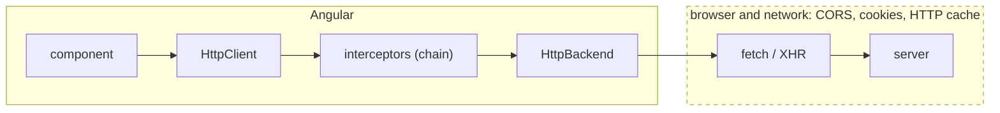

What to notice: everything left of the backend is Angular code that a spec can replace; the request on the wire is still the browser's.

### How it actually works

**The documented contract.** The Angular docs (`adev/src/content/guide/http/making-requests.md`, branch `main`, read 2026-10-11) say: "Once subscribed, unsubscribing will abort the in-progress request." They also say: "The generic type of request methods is a type **assertion** about the data returned by the server. `HttpClient` does not verify that the actual return data matches this type." In the lab a response `{ nope: true }` read as `get<LabM27User>` reaches the subscriber unchanged (`Section 1: the type argument does not check the response`).

**Errors.** Against the testing backend (the in-memory `HttpBackend` of `provideHttpClientTesting()`, answered through `HttpTestingController`; [section 11](#11-testing-and-the-backend-seam-providehttpclienttesting-httptestingcontroller-and-what-they-replace)) a 404 never reaches `next`: the subscriber gets an `HttpErrorResponse` with `status` 404, `ok` `false`, the body in `error` and the message `Http failure response for /missing: 404 Not Found` (`Section 1: a 404 reaches the error channel as an HttpErrorResponse`). A stubbed `fetch` that resolves a 404 `Response` leaves the caller with `ok` `false` and no rejection (`Section 1: a 404 from plain fetch resolves with ok false`); real `fetch` behavior is [09 §2](09-web-networking-storage-security.md#2-fetch-xhr-and-the-request-lifecycle)'s.

**Status and history.** In `@angular/common` 21.2.25 (`npm pack`, read 2026-10-11) `HttpBackend` is `providedIn: 'root'` with `useExisting: HttpXhrBackend` (`fesm2022/_module-chunk.mjs`). The Angular `CHANGELOG.md` on `main` lists, under 22.0.0 (2026-06-03), the `http` feature "Use `FetchBackend` as default for the `HttpBackend` implementation". In 22.2.1 the injected backend is a `FetchBackend` (`Section 1: the default HttpBackend is the FetchBackend`). [Section 2](#2-setting-up-httpclient-providehttpclient-its-features-and-the-fetch-backend-default) owns setup and the switch back.

**Why unsubscribing aborts.** Read from the `@angular/common` 22.2.1 source: `FetchBackend.handle` (`fesm2022/_module-chunk.mjs`) returns an `Observable` whose subscriber function creates one `AbortController` per request, starts the call with its signal and returns a teardown that calls `aborter.abort()` unless a `done` flag says the response finished. The call goes to `globalThis.fetch`, which the lab stubs. Right after `subscribe`, the stub had one call, `GET`, with an unaborted `AbortSignal` (the platform's cancellation token; [04 §7](04-js-async-event-loop.md#7-cancellation-with-abortcontroller) owns the platform API; `Section 1: the default backend calls fetch with an AbortSignal`); after `unsubscribe()` the signal was aborted (`Section 1: unsubscribing aborts the fetch signal`). [Section 6](#6-cancellation-and-caching-unsubscribing-aborts-cache-interceptors-sharereplay-and-the-ssr-transfer-cache) follows up.

> [!NOTE]
> **Framework vs platform.** Angular adds Observables (cancel by unsubscribing), interceptors, typed request options, XSRF handling ([section 8](#8-xsrf-protection-how-httpclient-reads-the-cookie-and-sets-the-header-and-when-it-does-not)), a testing seam ([section 11](#11-testing-and-the-backend-seam-providehttpclienttesting-httptestingcontroller-and-what-they-replace)) and `httpResource` [Stable since v22.0], the signal-driven read of [section 10](#10-httpresource-signal-driven-requests-and-when-to-prefer-it-over-httpclient). The platform still performs the request and applies CORS, cookies and the HTTP cache ([09 §2](09-web-networking-storage-security.md#2-fetch-xhr-and-the-request-lifecycle)). TypeScript adds a generic that asserts and never checks.

### Code

The approach: send the same failing request through `HttpClient` and through a stubbed `fetch`, then subscribe and unsubscribe against a pending stub.

1. Subscribe to `http.get('/missing')` on the testing backend and flush a 404: only `error` runs.
2. Resolve a 404 `Response` from a stubbed `fetch`: the promise fulfils with `ok` `false`.
3. Use `pendingFetch`, a fake that records its calls and rejects when its signal aborts, and unsubscribe: the signal is aborted.

```ts
// Excerpt of labs/angular/src/app/modules/27-http-client/concepts/section-1-httpclient-vs-fetch.spec.ts
http.get('/missing').subscribe({
  next: () => nextCount++,
  error: (e: HttpErrorResponse) => (failure = e),
});
controller.expectOne('/missing').flush({ code: 'NF' }, { status: 404, statusText: 'Not Found' });
expect(nextCount).toBe(0);
```

```ts
// Excerpt of labs/angular/src/app/modules/27-http-client/concepts/section-1-httpclient-vs-fetch.spec.ts
const response = await fetch('/missing');
expect(response.ok).toBe(false);
expect(response.status).toBe(404);
```

```ts
// Excerpt of labs/angular/src/app/modules/27-http-client/concepts/section-1-httpclient-vs-fetch.spec.ts
type FetchCall = { url: string; init: RequestInit };
function pendingFetch(calls: FetchCall[]): typeof fetch {
  return (input, init = {}) => {
    calls.push({ url: String(input), init });
    return new Promise<Response>((_resolve, reject) => {
      init.signal?.addEventListener('abort', () => reject(init.signal?.reason));
    });
  };
}
```

```ts
// Excerpt of labs/angular/src/app/modules/27-http-client/concepts/section-1-httpclient-vs-fetch.spec.ts
const subscription = TestBed.inject(HttpClient).get('/pending').subscribe();
const signal = calls[0].init.signal;
expect(signal?.aborted).toBe(false);
subscription.unsubscribe();
expect(signal?.aborted).toBe(true);
```

### Best practices and anti-patterns

- **Send app requests through `HttpClient`**, because one interceptor chain, one testing seam and abort-on-unsubscribe then cover every call with no per-call code.
- **Treat the type argument as an assumption and parse where data enters** ([section 3](#3-making-requests-typed-responses-observe-responsetype-immutable-params-and-headers-and-httpcontext)), because the generic checks nothing at run time.

### Misconceptions and traps

- *"`HttpClient` is a wrapper over XHR."* Once true: the default `HttpBackend` was `HttpXhrBackend` in 21.2.25, until the 22.0.0 CHANGELOG line made `FetchBackend` the default; every pre-v22 tutorial says XHR.
- *"`get<User>()` validates the response."* The generic is an assertion (`Section 1: the type argument does not check the response`); generics look like run-time types.
- *"An HTTP error status resolves, as with `fetch`."* `HttpClient` fails non-2xx on the error channel (`Section 1: a 404 reaches the error channel as an HttpErrorResponse`); the plain `fetch` habit says otherwise.
- *"`HttpClient` does CORS or caching itself."* The browser still applies CORS, cookies and its HTTP cache ([09](09-web-networking-storage-security.md#2-fetch-xhr-and-the-request-lifecycle)); the Observable hides the request, so the layer looks like Angular's.

Drilled in [Q27.01](#q27-01) and [Q27.02](#q27-02); modelled in [Exercise 27.1](#ex27-1).

## 2. Setting up `HttpClient`: `provideHttpClient`, its features and the fetch backend default

### The problem it solves

After `ng update` to v22 an upload progress bar still works in one app and throws in a new one. A lazy feature adds `provideHttpClient(withInterceptors([audit]))` and the auth header vanishes from its requests. A test lists `provideHttpClientTesting()` first and its requests go to `fetch`. All three follow from what `provideHttpClient` registers and what v22 provides ([Q27.03](#q27-03), [Q27.04](#q27-04), [Q27.05](#q27-05), [Q27.06](#q27-06)).

### Mental model

`provideHttpClient(...features)` is a **configuration recipe**: it registers the client, the interceptor handler, the **backend** (`FetchBackend` unless a feature changes it) and the XSRF interceptor, then appends the providers of each **HTTP feature** you pass (an `HttpFeature`, such as `withInterceptors`). `withXhr()` [Added in v22.0] swaps the backend for `HttpXhrBackend`, built on `XMLHttpRequest` ([09 §2](09-web-networking-storage-security.md#2-fetch-xhr-and-the-request-lifecycle)). `withFetch()` [Deprecated since v22.0 — use provideHttpClient() without it] asks for the default and `withJsonpSupport()` [Deprecated since v22.1 — use standard requests with CORS] adds JSONP. The client needs no provider [Changed in v21.0: provided in root, no provideHttpClient needed]; a call adds features or configures another injector. An **environment injector** (of the app or a lazy route, [16 §7](16-dependency-injection.md#7-injectiontoken-multi-providers-environment-providers-and-initializers)) that calls it gets its own client, not an extension of its parent's.

A phone plan: the base plan has a default carrier, add-ons change it, and a second SIM in a sub-department is a separate plan unless it forwards to the main line.

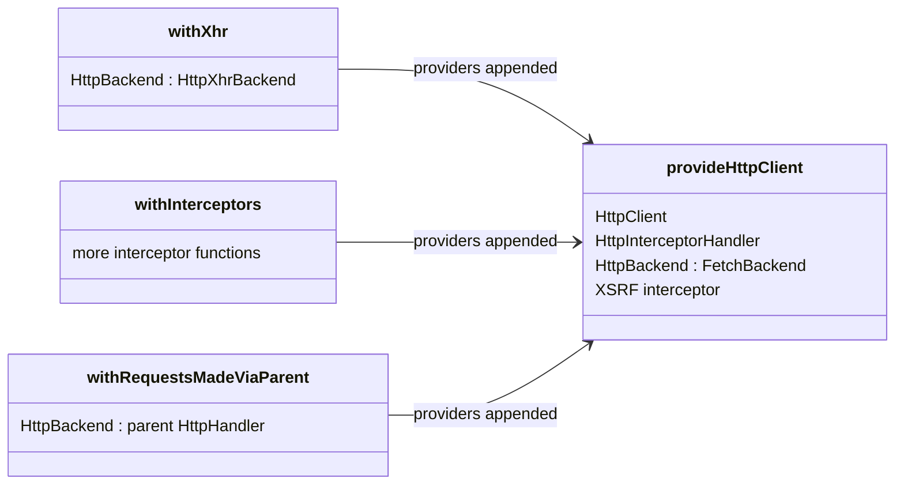

What to notice: every feature is only more providers (`HttpInterceptorHandler` is internal), and the backend is one token several features compete for.

### How it actually works

**Backends.** No provider, `provideHttpClient()` and `withFetch()` give a `FetchBackend` (`Section 2: HttpClient works with no provider and uses the fetch backend`, `Section 2: provideHttpClient uses the fetch backend`, `Section 2: withFetch still gives the fetch backend`); `withXhr()` and `importProvidersFrom(HttpClientModule)` [Deprecated since v18.0 — use provideHttpClient(withInterceptorsFromDi())] give `HttpXhrBackend` (`Section 2: withXhr switches to the XHR backend`, `Section 2: HttpClientModule gives the XHR backend`). The last provider of `HttpBackend` wins, so the testing backend replaces it only when listed after (`Section 2: provideHttpClientTesting after provideHttpClient swaps in the testing backend`; `Section 2: provideHttpClientTesting before provideHttpClient is overridden`).

**The recipe.** Read from the `@angular/common` 22.2.1 source: `provideHttpClient` (`fesm2022/_module-chunk.mjs`) returns `makeEnvironmentProviders` of the client, `FetchBackend`, the interceptor handler (with `HttpHandler` as its alias), `HttpBackend` resolved to `inject(FetchBackend)` and the XSRF interceptor, then pushes each feature's providers. In development mode it throws on contradictory features (`Section 2: contradictory features throw in dev mode`). `HttpClient`, `HttpHandler`, the handler and `HttpXhrBackend` are `providedIn: 'root'` and the root `HttpBackend` points at `FetchBackend`, so no call is needed (`CHANGELOG.md`, 21.0.0, 2025-11-19: "Provide http services in root"; `setup.md`, branch `main`, read 2026-10-11: "`HttpClient` is available for injection by default in Angular v21 and later.").

**Nested clients.** `withRequestsMadeViaParent` provides `HttpBackend` from `inject(HttpHandler, { skipSelf: true, optional: true })`: the child's chain ends in the parent's handler. In the lab a child with only `provideHttpClient` ran its own interceptor, called the stubbed `fetch` and left the root's `HttpTestingController` with none (`Section 2: a child provideHttpClient ignores the parent's interceptors`); with the feature the log was child, parent and the controller matched one (`Section 2: withRequestsMadeViaParent runs the child's then the parent's interceptors`).

**Updated apps keep XHR.** The 22.2.1 migration `http-xhr-backend` (`@angular/core` `schematics/migrations.json`, 22.0.0; `bundles/http-xhr-backend.cjs`) adds `withXhr()` to every `provideHttpClient()` call with neither `withFetch()` nor `withXhr()`, so a migrated app keeps XHR and a new one uses fetch (read, not run; [12 §2](12-angular-how-it-works.md#2-the-cli-and-the-workspace-angularjson-projects-schematics-and-ng-update) owns `ng update`). `FetchBackend.createRequestInit` (private) throws `NG02824` for the `reportUploadProgress` option [Added in v22.0] ([section 9](#9-progress-events-reportuploadprogress-reportdownloadprogress-and-why-upload-progress-needs-xhr)). Under SSR a non-fetch backend gets an `NG02801` warning (read, not run; SSR is [module 32](32-ssr-ssg-hydration.md)'s).

### Code

The approach: read the backend a configuration gives, then build a child that forwards to its parent.

1. Provide `withXhr()` and read the backend.
2. Define `logging`, an interceptor that records its name.
3. Create the child with `withRequestsMadeViaParent()` and send one request.

```ts
// Excerpt of labs/angular/src/app/modules/27-http-client/concepts/section-2-setup.spec.ts
TestBed.configureTestingModule({ providers: [provideHttpClient(withXhr())] });
expect(backendName()).toBe('HttpXhrBackend');
```

```ts
// Excerpt of labs/angular/src/app/modules/27-http-client/concepts/section-2-setup.spec.ts
function logging(log: string[], name: string): HttpInterceptorFn {
  return (req, next) => {
    log.push(name);
    return next(req);
  };
}
```

```ts
// Excerpt of labs/angular/src/app/modules/27-http-client/concepts/section-2-setup.spec.ts
const child = createEnvironmentInjector(
  [provideHttpClient(withInterceptors([logging(log, 'child')]), withRequestsMadeViaParent())],
  TestBed.inject(EnvironmentInjector),
);
child.get(HttpClient).get('/api').subscribe();
expect(log).toEqual(['child', 'parent']);
```

#### Legacy

`HttpClientModule` is the NgModule of older apps; its `providers` are `provideHttpClient(withInterceptorsFromDi(), withXhr())` (read) (so the replacement keeps `withXhr()`; [Q15.09](15-standalone-and-ngmodules.md#q15-09) owns the packaging question).

```ts
// Excerpt of labs/angular/src/app/modules/27-http-client/concepts/section-2-setup.spec.ts
TestBed.configureTestingModule({ providers: [importProvidersFrom(HttpClientModule)] });
```

```ts
// Partial: the replacement of HttpClientModule that keeps XHR and class interceptors; `appConfig` is an ApplicationConfig
providers: [provideHttpClient(withInterceptorsFromDi(), withXhr())]
```

### Best practices and anti-patterns

- **Call `provideHttpClient` once, in the root config**, because a second call builds an independent client.
- **Add `withRequestsMadeViaParent()` in a child that adds interceptors**, because the child otherwise loses the parent's. **Delete `withFetch()`**, because fetch is the default.
- **List `provideHttpClient(...)` before `provideHttpClientTesting()`**, because the later provider of `HttpBackend` wins.

### Misconceptions and traps

- *"You must call `provideHttpClient()` to inject `HttpClient`."* Once true: until 21.0, whose "Provide http services in root" made them root-provided; older tutorials show the call.
- *"`withFetch()` is needed for fetch."* Once true: until 22.0, whose CHANGELOG deprecates it ("can be safely removed"); it was the opt-in, so the habit stayed.
- *"Replacing `HttpClientModule` with `provideHttpClient(withInterceptorsFromDi())` changes nothing."* The module also added `withXhr()` (`Section 2: HttpClientModule gives the XHR backend`), so the short call switches to fetch; the tag reads like a rename ([Q15.09](15-standalone-and-ngmodules.md#q15-09)).
- *"A feature-level `provideHttpClient` adds interceptors to the global ones."* It builds an independent client unless `withRequestsMadeViaParent()` is added (`Section 2: a child provideHttpClient ignores the parent's interceptors`); providers usually inherit, so the expectation carries over.

Drilled in [Q27.03](#q27-03), [Q27.04](#q27-04), [Q27.05](#q27-05) and [Q27.06](#q27-06); modelled in [Exercise 27.2](#ex27-2) and [Exercise 27.5](#ex27-5).

## 3. Making requests: typed responses, `observe`, `responseType`, immutable params and headers, and `HttpContext`

### The problem it solves

A search sends no query because `params.set('q', term)` was never assigned. A screen needs the `ETag` header but gets only the body. A CSV download fails as JSON. A typed `User` arrives without `name`. An interceptor needs a per-request flag and someone sends a fake header, which reaches the server. All five follow from what a call builds ([Q27.07](#q27-07), [Q27.08](#q27-08), [Q27.09](#q27-09), [Q27.10](#q27-10)).

### Mental model

Every call builds an **`HttpRequest`**, an immutable description of one request, from the method, the URL and the **request options**. **`observe`** picks the emission: `'body'` (default), `'response'` (an **`HttpResponse`**: status, headers, body) or `'events'` (every event, typed by **`HttpEventType`**). **`responseType`** picks the parsing: `'json'` (default), `'text'`, `'blob'` or `'arraybuffer'`. Options also carry `params`, `headers`, `context`, `timeout` [Added in v20.1] and fetch options.

**`HttpParams`**, **`HttpHeaders`** and `HttpRequest` return a **new** instance on every change. **`HttpContext`**, keyed by **`HttpContextToken`** (a typed key with a default factory), is per-request metadata that interceptors read and nobody sends. A sealed order form: edit a new copy; a sticky note on the envelope is read by the mail room, never posted.

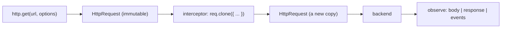

What to notice: a change is always a new object, and the original request stays as it was.

### How it actually works

**Immutable builders.** Read from the `@angular/common` 22.2.1 source (`fesm2022/_module-chunk.mjs`): `HttpParams.set` and `append` return `this.clone(...)`, a new object that records its parent and the updates to apply later; `HttpHeaders.clone` does the same, and `HttpRequest.clone` builds a new request from the old fields with the update laid over them. An unassigned `set` left the original `''` (`Section 3: HttpParams.set returns a new instance and leaves the original empty`); `tags: ['x', 'y']` went out as `/s?q=a%20b&page=2&tags=x&tags=y` (`Section 3: a params object with an array repeats the key`); a clone gained a header and a param, the original none (`Section 3: HttpRequest.clone returns a new request and leaves the original unchanged`); `keys()` kept `Content-Type` while `get('content-type')` found it (`Section 3: HttpHeaders are immutable and read case-insensitively`).

**Options choose the type.** `observe: 'response'` delivered status 200, the `ETag` header and the body (`Section 3: observe response exposes status and headers`); `'events'` delivered `Sent` then `Response` (`Section 3: observe events emits Sent then Response`); `responseType: 'text'` delivered the raw string (`Section 3: responseType text returns the raw string`). They select the overload, so the docs require "a literal type and not a `string` type". An options variable widens `observe` to `string`: `tsc` 6.0.3 reported `TS2769` (no overload matches) for `{ observe: 'events' }` and nothing for `{ observe: 'events' as const }` (a scratch compile; `Section 3: observe events from an untyped options object is a type error` pins it).

**The type is an assertion.** The docs call the generic a type **assertion** (quoted in [section 1](#1-httpclient-versus-fetch-what-the-framework-adds-over-the-platform), which runs it). A hand-written guard turned `{ nope: true }` into a `TypeError` (`Section 3: a hand-written guard at the boundary turns a wrong shape into an error`); [07 §8](07-ts-advanced-types-and-decorators.md#8-runtime-validation-with-zod-4-schema-first-types) owns schema-first parsing.

**Context.** `HttpContext` is a `Map`: `set` returns the same instance, `get` falls back to the token's default; the typings call it "Shared and mutable". An interceptor read `ctx=false` for a plain call and `ctx=true` for a flagged one, and the stubbed `fetch` received only the default `Accept` header (`Section 3: a context token reaches the interceptor and not the server`), because `FetchBackend.createRequestInit` (private) builds the init from the method, headers and fetch options, never the context.

**`timeout` and fetch options.** `timeout` rides on the request (`Section 3: the timeout option is carried on the request`; CHANGELOG 20.1.0); [section 6](#6-cancellation-and-caching-unsubscribing-aborts-cache-interceptors-sharereplay-and-the-ssr-transfer-cache) owns its behavior. `createRequestInit` copies `credentials`, `cache`, `keepalive` and six more into the `fetch` init; three arrived (`Section 3: fetch options are forwarded to fetch`), and [09 §2](09-web-networking-storage-security.md#2-fetch-xhr-and-the-request-lifecycle) owns their meaning.

### Code

The approach: keep each immutable result, choose the response shape, flag with a context and guard the body.

1. Keep what `set` returns.
2. Use `observe: 'response'` for a header.
3. Send a flag as an `HttpContext` and read it in an interceptor.
4. Guard the unknown body.

```ts
// Excerpt of labs/angular/src/app/modules/27-http-client/concepts/section-3-requests.spec.ts
const original = new HttpParams();
const changed = original.set('a', '1');
original.set('lost', '1');
expect(original.toString()).toBe('');
expect(changed.toString()).toBe('a=1');
```

```ts
// Excerpt of labs/angular/src/app/modules/27-http-client/concepts/section-3-requests.spec.ts
http.get<LabM27User>('/r', { observe: 'response' }).subscribe((response) => (seen = response));
controller.expectOne('/r').flush({ id: 1, name: 'Ada' }, { headers: { ETag: 'v1' } });
expect(seen?.headers.get('ETag')).toBe('v1');
```

```ts
// Excerpt of labs/angular/src/app/modules/27-http-client/concepts/section-3-requests.spec.ts
const SKIP_LOG = new HttpContextToken<boolean>(() => false);
const reader: HttpInterceptorFn = (req, next) => {
  seen.push(`ctx=${req.context.get(SKIP_LOG)}`);
  return next(req);
};
```

```ts
// Excerpt of labs/angular/src/app/modules/27-http-client/concepts/section-3-requests.spec.ts
http.get('/flagged', { context: new HttpContext().set(SKIP_LOG, true) }).subscribe(resolve),
```

```ts
// Excerpt of labs/angular/src/app/modules/27-http-client/concepts/section-3-requests.spec.ts
function parseUser(value: unknown): LabM27User {
  if (!isUser(value)) {
    throw new TypeError('Response is not a user');
  }
  return value;
}
```

```ts
// Partial: `http` is an injected HttpClient; `as const` keeps `observe` a literal
const options = { observe: 'events' as const };
http.get('/v', options);
```

### Best practices and anti-patterns

- **Assign or chain every `HttpParams` and `HttpHeaders` change**, because each call returns a copy and an unassigned one is discarded.
- **Add `as const` to an extracted `observe` or `responseType`**, because a widened `string` matches no overload.
- **Parse the body at the service boundary**, because the generic checks nothing at run time.
- **Flag a request with an `HttpContextToken`, not a header**, because a header goes to the server and a context does not.

### Misconceptions and traps

- *"`params.set()` changes the params."* It returns a copy; builders in mutable APIs set the habit.
- *"`get<User>()` validates `User`."* The generic is erased and only asserts; generics look like run-time types.
- *"`HttpHeaders` names are case-sensitive."* `get` is not; `keys()` keeps your spelling, which suggests exact matching.
- *"`HttpContext` is sent to the server."* It stays in the browser; it sits beside the headers, so it looks like them.

Drilled in [Q27.07](#q27-07), [Q27.08](#q27-08), [Q27.09](#q27-09) and [Q27.10](#q27-10); modelled in [Exercise 27.1](#ex27-1).

## 4. Interceptors: the functional chain, order and `next`, and class interceptors through `withInterceptorsFromDi`

### The problem it solves

Every service adds the auth header by hand, and one forgets. Nobody can say whether the logger records a request before or after the auth header is added. A migrated app silently stops running its class interceptors. A cache must answer without calling the server. Each is about the chain before the backend ([Q27.11](#q27-11), [Q27.12](#q27-12), [Q27.13](#q27-13), [Q27.14](#q27-14)).

### Mental model

An **interceptor** is a function `(req, next) => Observable<HttpEvent>`, typed **`HttpInterceptorFn`**. It can pass the request on with `next(req)` (`next` is an **`HttpHandlerFn`** that runs the rest of the chain), clone it first, transform the returning events, or **short-circuit**: return its own response and never call `next`. **`withInterceptors([a, b])`** lists functional interceptors: the request goes `a`, `b`, backend and the response returns `b`, `a`, like an onion. Each runs in an **injection context** (where `inject()` works, [16 §4](16-dependency-injection.md#4-the-injection-context-inject-runininjectioncontext-and-injectasync)).

Class interceptors (**`HttpInterceptor`** under the **`HTTP_INTERCEPTORS`** multi provider, [16 §7](16-dependency-injection.md#7-injectiontoken-multi-providers-environment-providers-and-initializers) and [Q16.06](16-dependency-injection.md#q16-06)) are the legacy form and run only when **`withInterceptorsFromDi()`** is configured. Airport security lanes in series: each can stamp you, send you back or wave you through, and you walk them in reverse on return.

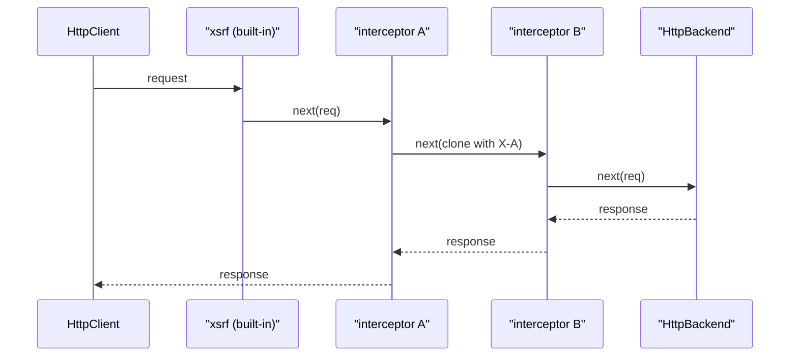

What to notice: the built-in XSRF interceptor is first, and the response crosses the chain in reverse.

### How it actually works

**Order.** Docs (`interceptors.md`, branch `main`, read 2026-10-11): "The interceptors you configure are chained together in the order that you've listed them in the providers." The log was `['A req headers=X-A', 'B req headers=X-A', 'B res', 'A res']` (`Section 4: interceptors run in list order on the way out and in reverse on the way back`; `Section 4: a later interceptor sees the header an earlier one added`).

**The chain.** Read from the `@angular/common` 22.2.1 source (`fesm2022/_module-chunk.mjs`): `HttpInterceptorHandler.handle` (internal, may change in any release) builds the chain on the first request. It folds the `HTTP_INTERCEPTOR_FNS` list (internal) with `reduceRight`, so each `next` is the already-built rest of the chain, the first listed is outermost, and the innermost step calls `backend.handle`; that nesting is why the first runs first on the way out and last on the way back. `chainedInterceptorFn` (internal) wraps each step in `runInInjectionContext`, so `inject()` worked (`Section 4: inject works inside a functional interceptor`). `provideHttpClient` lists `xsrfInterceptorFn` (internal) before the features' providers, so it runs before every functional interceptor (read, not run; [section 8](#8-xsrf-protection-how-httpclient-reads-the-cookie-and-sets-the-header-and-when-it-does-not) owns it).

**Short-circuit and cloning.** A returned `of(new HttpResponse(...))` reached the subscriber and the backend saw nothing (`Section 4: an interceptor can answer without reaching the backend`). An unassigned `req.headers.set(...)` sent the request unchanged (`Section 4: an interceptor that does not clone sends the request unchanged`; [section 3](#3-making-requests-typed-responses-observe-responsetype-immutable-params-and-headers-and-httpcontext) owns immutability).

**Class interceptors.** `withInterceptorsFromDi()` adds one function, `legacyInterceptorFnFactory()` (internal), to the same list; on the first request it folds every `HTTP_INTERCEPTORS` entry with `reduceRight` into one inner chain, so the class interceptors run as one block at that position. With `[withInterceptors([A]), withInterceptorsFromDi()]` A ran first; reversed, the class ran first and A saw its `X-Lab` header (`Section 4: class interceptors run at the position of withInterceptorsFromDi`). Without the feature the class never ran (`Section 4: class interceptors run only with withInterceptorsFromDi`). The docs: "DI-based interceptors run in the order that their providers are registered. In an app with an extensive and hierarchical DI configuration, this order can be very hard to predict."

### Code

The approach: add a header, record what a later interceptor sees, list both, and answer one URL without the backend.

1. Clone with the header and pass on.
2. Record the header names and the response.
3. List both; the first listed runs first.
4. Return an `HttpResponse` without calling `next`.

```ts
// Excerpt of labs/angular/src/app/modules/27-http-client/concepts/section-4-interceptors.spec.ts
const add: HttpInterceptorFn = (req, next) => next(req.clone({ setHeaders: { 'X-First': '1' } }));
```

```ts
// Excerpt of labs/angular/src/app/modules/27-http-client/concepts/section-4-interceptors.spec.ts
function logging(log: string[], name: string): HttpInterceptorFn {
  return (req, next) => {
    log.push(`${name} req headers=${req.headers.keys().join(',')}`);
    return next(req).pipe(
      tap((event) => {
        if (event instanceof HttpResponse) {
          log.push(`${name} res`);
        }
      }),
    );
  };
}
```

```ts
// Partial: `add` and `logging` are the functions above and `log` is a string array
providers: [provideHttpClient(withInterceptors([add, logging(log, 'second')]))]
```

```ts
// Excerpt of labs/angular/src/app/modules/27-http-client/concepts/section-4-interceptors.spec.ts
const cached: HttpInterceptorFn = (req, next) =>
  req.url === '/cached' ? of(new HttpResponse({ status: 200, body: 'from-cache' })) : next(req);
```

#### Legacy

The 22.2.1 typings (`types/http.d.ts`, `withInterceptorsFromDi`): "Prefer `withInterceptors` and functional interceptors instead, as support for DI-provided interceptors may be phased out in a later release."

```ts
// Excerpt of labs/angular/src/app/modules/27-http-client/legacy/legacy-interceptor.ts
@Injectable()
export class LabM27LegacyInterceptor implements HttpInterceptor {
  private readonly log = inject(LAB_M27_LEGACY_LOG);

  intercept(req: HttpRequest<unknown>, next: HttpHandler): Observable<HttpEvent<unknown>> {
    this.log.push('Legacy req');
    return next.handle(req.clone({ setHeaders: { 'X-Lab': 'legacy' } }));
  }
}
```

```ts
// Excerpt of labs/angular/src/app/modules/27-http-client/legacy/legacy-interceptor.ts
export const legacyHttpProviders: (Provider | EnvironmentProviders)[] = [
  provideHttpClient(withInterceptorsFromDi()),
  labM27LegacyInterceptorProvider,
];
```

The migration:

1. `intercept(req, next)` becomes `(req, next)` and `next.handle(req)` becomes `next(req)`.
2. Field injection becomes `inject()` in the body.
3. The `HTTP_INTERCEPTORS` entry becomes an element of `withInterceptors([...])`; drop `withInterceptorsFromDi()` when no class is left.

```ts
// Excerpt of labs/angular/src/app/modules/27-http-client/legacy/legacy-interceptor.ts
export const labM27HeaderInterceptor: HttpInterceptorFn = (req: HttpRequest<unknown>, next: HttpHandlerFn) => {
  inject(LAB_M27_LEGACY_LOG).push('Header req');
  return next(req.clone({ setHeaders: { 'X-Lab': 'legacy' } }));
};
```

The replacement sent the same header (`Section 4: the functional replacement does what the class interceptor did`).

> [!TIP]
> **Coming from the backend.** Spring's `WebClient.Builder` registers an `ExchangeFilterFunction` that gets the request and `next`, builds a changed copy and calls `next.exchange(...)` (Spring Framework 7.0.9 reference, read 2026-10-11), like `HttpInterceptorFn`.
>
> **Where the analogy breaks:** a Spring filter belongs to one client built by hand; Angular's interceptors are features of a `provideHttpClient` call, so they follow DI scope ([section 2](#2-setting-up-httpclient-providehttpclient-its-features-and-the-fetch-backend-default)) and can `inject()`.

```java
// Spring Boot 4.1 — illustrative, not compiled in labs
WebClient client = WebClient.builder()
    .filter((request, next) -> {
        ClientRequest filtered = ClientRequest.from(request).header("foo", "bar").build();
        return next.exchange(filtered);
    })
    .build();
```

### Best practices and anti-patterns

- **Prefer `withInterceptors` to class interceptors**, because the order is one visible list, while DI order "can be very hard to predict".
- **List a logger first**, because it then sees the request before later ones change it.

### Misconceptions and traps

- *"The last interceptor in the list runs first."* The first runs first on the way out; stacks whose last wrapper is outermost build the opposite habit.
- *"Class interceptors keep working after moving to `provideHttpClient()`."* Without `withInterceptorsFromDi()` they are ignored; their `HTTP_INTERCEPTORS` providers are still there, so nothing looks wrong.
- *"An interceptor can mutate the request."* It must clone; an object suggests in-place edits.
- *"Interceptors can't use DI."* They run in an injection context; plain functions have no constructor to inject into, which suggests they cannot.

Drilled in [Q27.11](#q27-11), [Q27.12](#q27-12), [Q27.13](#q27-13) and [Q27.14](#q27-14); modelled in [Exercise 27.2](#ex27-2), [Exercise 27.3](#ex27-3) and [Exercise 27.4](#ex27-4).

## 5. Errors: `HttpErrorResponse`, an error mapping layer, and retry with backoff and jitter

### The problem it solves

Components check `err.status === 0`, `err.error.message` and `err.statusText` [Deprecated since v21.0 — use status] in ten places, each differently. A 200 with broken JSON shows "Unknown error". Retries hit a recovering server in lockstep. A POST that timed out is retried and charges the customer twice ([Q27.15](#q27-15), [Q27.16](#q27-16), [Q27.17](#q27-17), [Q27.18](#q27-18)).

### Mental model

Every failure reaches the error channel as one **`HttpErrorResponse`**: a `status`, the parsed body (or the thrown error) in `error`, and a `message`. **Status 0** means no HTTP response was read: a network failure, a timeout or an aborted call. Docs (`making-requests.md`, branch `main`, read 2026-10-11): "Network and timeout errors have a `status` code of `0`." An **error mapping layer** converts it once, at the edge, into a small **domain error** union the UI renders. **Retry** belongs in an interceptor and applies only to a **retryable error** on an **idempotent method** ([Q09.01](09-web-networking-storage-security.md#q09-01)), with **exponential backoff** (a delay that doubles per attempt, [23 §4](23-rxjs-in-depth.md#4-retrying-and-repeating-retry-with-backoff-and-repeat)) plus **jitter** (a random share of the delay, so clients stop retrying together). A triage desk that sorts every incident into a few colour codes, and a redial policy that waits longer, and a little randomly, each time.

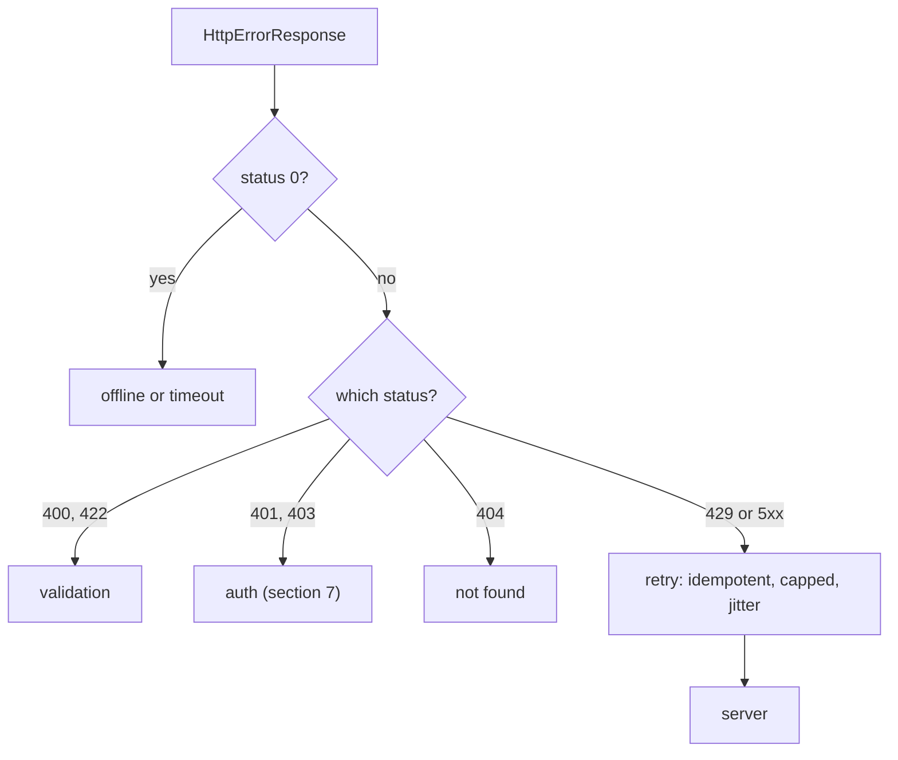

What to notice: retry is decided by status and method, not by the bare fact of failure.

### How it actually works

**Shapes.** Each row is one `Section 5` test (the first two use the testing backend, the others a stubbed `fetch`):

| Failure | `status` | `error` | `message` |
|---|---|---|---|
| 404 with JSON | 404 | the body | `Http failure response for /missing: 404 Not Found` |
| network error | 0 | a `ProgressEvent` | `Http failure response for /net: 0 ` |
| rejected `fetch` | 0 | the thrown `TypeError` | `Http failure response for /x: 0 undefined` |
| 500 with JSON | 500 | the body | `Http failure response for /x: 500 Internal Server Error` |
| invalid JSON on a 200 | 200 | the parse failure | `Http failure during parsing for /x` |

The `statusText` was `'Not Found'` and `'Unknown Error'` in the first two rows; no code here branches on it. The CHANGELOG lists it under the 21.0.0 deprecations.

**Why a 200 can be an error.** Read from the `@angular/common` 22.2.1 source (`fesm2022/_module-chunk.mjs`): the `HttpErrorResponse` constructor sets "Http failure during parsing" when `status` is 2xx and "Http failure response for" otherwise, and `ok` is always `false`. `FetchBackend.parseBody` (private) rethrows a `JSON.parse` failure only for a 2xx; a non-2xx keeps the text. A rejected `fetch` becomes an `HttpErrorResponse` with the thrown error, `status` `error.status ?? 0` and the request URL (`Section 5: invalid JSON on a 200 is a parsing failure with status 200`, `Section 5: a rejected fetch has status 0 and the thrown error`). `parseBody` also removes the XSSI (cross-site script inclusion, [33](33-security.md#9-csrf-in-single-page-apps-when-cookies-make-you-vulnerable-samesite-and-angulars-xsrf-support)) prefix (`XSSI_PREFIX`, internal, may change in any release): `)]}',` and a newline before the JSON (`Section 5: the XSSI prefix is stripped before parsing`).

**Mapping.** A pure function turned eight failures into eight domain errors (`Section 5: a mapping function turns each failure into one domain error`).

**Retry.** With a fixed random source of 0.5, a GET answered 503 four times made 4 requests and ended with status 503; the delay function returned `[100, 200, 400]` (`Section 5: the retry interceptor retries a 503 GET three times with growing delays`). A 400, a POST and an opted-out GET made one request each (`Section 5: the retry interceptor does not retry a 400, a POST or an opted-out request`). The operator is [23 §4](23-rxjs-in-depth.md#4-retrying-and-repeating-retry-with-backoff-and-repeat)'s ([Q23.15](23-rxjs-in-depth.md#q23-15)); `catchError` placement is [23 §3](23-rxjs-in-depth.md#3-errors-catcherror-placement-finalize-and-error-versus-complete)'s. Server error formats are [41](41-fullstack-api-contracts.md#5-error-contracts-with-problemdetail-rfc-9457-and-mapping-them-in-angular)'s; the `timeout` option is [section 6](#6-cancellation-and-caching-unsubscribing-aborts-cache-interceptors-sharereplay-and-the-ssr-transfer-cache)'s.

### Code

The approach: map by status, then retry only what is safe.

1. Treat status 0 as network or timeout, by the `error` it carries.
2. Map the remaining statuses through one function.
3. Compute the delay from the attempt and a random source.
4. Skip retry for a non-idempotent method or an opt-out token; throw the error again when it is not retryable.

```ts
// Excerpt of labs/angular/src/app/modules/27-http-client/concepts/section-5-errors.spec.ts
function toLabM27Failure(err: HttpErrorResponse): LabM27Failure {
  if (err.status === 0) return networkFailure(err.error);
  if (err.status >= 200 && err.status < 300) return { kind: 'invalid-response' };
  if (err.status === 400 || err.status === 422) return { kind: 'validation', fields: validationFields(err.error) };
  if (err.status >= 500) return { kind: 'server', status: err.status };
  const kind = STATUS_KINDS.get(err.status);
  return kind ? { kind } : { kind: 'unknown' };
}
```

```ts
// Excerpt of labs/angular/src/app/modules/27-http-client/concepts/section-5-errors.spec.ts
function backoffMs(attempt: number, random: number): number {
  return Math.min(2000, Math.round(100 * 2 ** (attempt - 1) * (0.5 + random)));
}
```

```ts
// Excerpt of labs/angular/src/app/modules/27-http-client/concepts/section-5-errors.spec.ts
function labM27Retry(random: () => number, delays: number[]): HttpInterceptorFn {
  return (req, next) => {
    if (!IDEMPOTENT.has(req.method) || req.context.get(LAB_M27_NO_RETRY)) return next(req);
    return next(req).pipe(
      retry({
        count: 3,
        delay: (err: unknown, attempt: number) => {
          if (!isRetryable(err)) return throwError(() => err);
          const ms = backoffMs(attempt, random());
          delays.push(ms);
          return timer(ms);
        },
      }),
    );
  };
}
```

The cap held: `backoffMs(10, 0.5)` was 2000, and `backoffMs(1, 0)` and `backoffMs(1, 1)` were 50 and 150.

### Best practices and anti-patterns

- **Map once, at the edge**, because ten components then agree on what offline looks like.
- **Key on `status`, never on `statusText` or message text**, because HTTP/2 and later keep `statusText` at `OK` (the typings' deprecation note).
- **Retry only idempotent methods**, because a repeated POST can apply twice; for a POST send an **idempotency key** (a client-chosen unique value the server uses to apply the request once).
- **Cap attempts and delay**, because an unbounded policy turns an outage into a storm.

### Misconceptions and traps

- *"Status 0 is a CORS error."* It covers network failures, timeouts and aborts alike; the console shows CORS, so it is blamed first ([Q09.14](09-web-networking-storage-security.md#q09-14)).
- *"A 200 cannot be an error."* A parse failure on a 2xx is an `HttpErrorResponse` with status 200, because a 2xx status reads as success while the body parse can fail after it.
- *"Retry everything three times."* A POST and a 400 are not retried here; a copied `retry(3)` ignores method and status.
- *"Exponential backoff is enough."* Clients that fail together retry together, because backoff alone looks like it spreads load; jitter spreads them (the delays are the function's numbers, not timing observations).

Drilled in [Q27.15](#q27-15), [Q27.16](#q27-16), [Q27.17](#q27-17) and [Q27.18](#q27-18); modelled in [Exercise 27.1](#ex27-1) and [Exercise 27.2](#ex27-2).

## 6. Cancellation and caching: unsubscribing aborts, cache interceptors, `shareReplay` and the SSR transfer cache

### The problem it solves

A user tabs through ten products and ten slow responses still download. A `timeout` is expected to cover a slow interceptor and does not. Five components fetch one reference list. A cache serves one user's data to the next. An SSR page fetches twice, on the server and on hydration ([Q27.19](#q27-19), [Q27.20](#q27-20), [Q27.21](#q27-21)).

### Mental model

A request lives as long as its subscription. **Cancellation** is stopping work nobody wants; on the fetch backend an unsubscribe **aborts** the call, and `timeout` aborts only the backend call. Docs (`making-requests.md`, branch `main`, read 2026-10-11): "The timeout will only apply to the backend HTTP request itself." Caching has layers with different owners: a **cache interceptor** (an interceptor that answers repeated GETs from memory, keyed by URL), a service with `shareReplay` ([23 §5](23-rxjs-in-depth.md#5-multicasting-in-depth-share-configuration-sharereplay-and-connect), [Q23.19](23-rxjs-in-depth.md#q23-19)), `httpResource` ([17 §6](17-signals.md#6-resources-async-data-as-signals)'s), the browser HTTP cache ([09 §4](09-web-networking-storage-security.md#4-http-caching)) and the SSR **transfer cache** (server responses serialized into the HTML for hydration to reuse; [32](32-ssr-ssg-hydration.md#8-data-across-the-boundary-the-http-transfer-cache-transferstate-and-resource-ids)'s). A café order you can cancel while it is made, and a pantry with use-by dates.

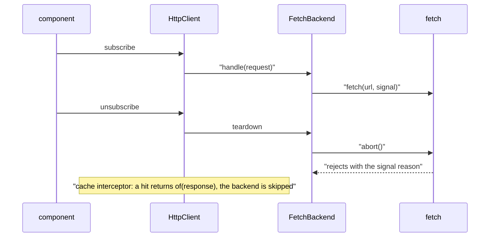

What to notice: cancellation flows from the subscriber down to the platform, and only the backend touches `AbortController`.

### How it actually works

**Abort.** [Section 1](#1-httpclient-versus-fetch-what-the-framework-adds-over-the-platform) read the teardown of `FetchBackend.handle`. After the abort the subscriber got nothing and the signal's reason was an `AbortError` (`Section 6: unsubscribing aborts the fetch request`). The teardown aborts only while a `done` flag is false, so an answered request is left alone (`Section 6: a completed request is not aborted by its teardown`). `switchMap` ([Q23.07](23-rxjs-in-depth.md#q23-07)), `takeUntilDestroyed` and the `async` pipe unsubscribe for you; the platform API is [04 §7](04-js-async-event-loop.md#7-cancellation-with-abortcontroller)'s. An abort stops the client; the server is not observed here.

**Timeout.** Read from the `@angular/common` 22.2.1 source (`FetchBackend.handle`, `fesm2022/_module-chunk.mjs`): when the request has a `timeout`, the subscriber function starts a `setTimeout` outside the zone (`NgZone.runOutsideAngular`, which matters only under zone.js, [21 §3](21-change-detection.md#3-zonejs-and-ngzone-how-changes-used-to-be-detected-and-why-zone-left-the-default)) that calls `aborter.abort(new DOMException('signal timed out', 'TimeoutError'))`, and the teardown clears it. The timer starts inside the backend, so interceptor time is not counted. With fake timers, a pending `fetch` and `{ timeout: 100 }`, 150 ms later the signal was aborted and the error had `status` 0 and `error.name` `'TimeoutError'` (`Section 6: a timeout aborts the fetch with a TimeoutError and status 0`).

**Testing backend.** An unsubscribed request has `cancelled` `true` (`Section 6: the testing backend marks an unsubscribed request cancelled`). A `timeout` is not simulated: after 500 ms of fake time the request was still open (`Section 6: the testing backend does not simulate a timeout`).

**Cache interceptor.** A GET-only interceptor with a `Map` keyed by `urlWithParams` answered the second GET to `/p` from memory (`Section 6: a cache interceptor answers the second GET without the backend`). Two GETs to `/q` issued before the first response made two backend requests (`Section 6: a naive cache sends two requests for two concurrent GETs`). A second GET to `/me` with another user's `Authorization` header received the first user's body (`Section 6: a URL-keyed cache serves one user response to another user`). A **time to live** (TTL) is how long an entry may be served; **cache invalidation** drops entries a write made stale; **in-flight sharing** gives concurrent callers one request. [Exercise 27.3](#ex27-3) adds all three.

**`shareReplay`.** `get('/countries').pipe(shareReplay(1))` in a service made one request for two subscribers and none for a third after the response (`Section 6: shareReplay in a service shares one request between subscribers`).

**Transfer cache and stability (documented, not run).** Docs (`ssr.md`, branch `main`, read 2026-10-11): "By default, `HttpClient` caches all `HEAD` and `GET` requests which don't contain `Authorization`, `Proxy-Authorization`, or `Cookie` headers and are not sent with `withCredentials` or Fetch API `credentials` modes that can send credentials." The rule models what a cache must skip; hydration is [32](32-ssr-ssg-hydration.md#8-data-across-the-boundary-the-http-transfer-cache-transferstate-and-resource-ids)'s. Read from the 22.2.1 source (`HttpInterceptorHandler.handle`, internal, may change in any release): each request adds a **`PendingTasks`** task (work the app waits on, [21 §5](21-change-detection.md#5-zoneless-change-detection-the-scheduler-its-triggers-and-pendingtasks)) removed in `finalize`.

### Code

The approach: a fake `fetch` that reports its abort, then a cache by URL.

1. Stub `fetch` with a fake that records its calls and stays pending until its signal aborts.
2. Subscribe, keep the signal of the first call, unsubscribe and read the signal.
3. In the cache, skip every method but GET, answer a hit with `of(hit.clone())` and store the `HttpResponse` on the way back.

```ts
// Excerpt of labs/angular/src/app/modules/27-http-client/concepts/section-6-cancellation-caching.spec.ts
function pendingFetch(calls: FetchCall[]): typeof fetch {
  return (input, init = {}) => {
    calls.push({ url: String(input), init });
    return new Promise<Response>((_resolve, reject) => {
      init.signal?.addEventListener('abort', () => reject(init.signal?.reason));
    });
  };
}
```

```ts
// Excerpt of labs/angular/src/app/modules/27-http-client/concepts/section-6-cancellation-caching.spec.ts
function naiveCache(store: Map<string, HttpResponse<unknown>>): HttpInterceptorFn {
  return (req, next) => {
    if (req.method !== 'GET') return next(req);
    const hit = store.get(req.urlWithParams);
    if (hit) return of(hit.clone());
    return next(req).pipe(
      tap((event) => {
        if (event instanceof HttpResponse) store.set(req.urlWithParams, event);
      }),
    );
  };
}
```

### Best practices and anti-patterns

- **Unsubscribe by construction** (`switchMap`, `takeUntilDestroyed`, `async` pipe), because a hand-held `Subscription` is forgotten.
- **Keep user-specific, `Authorization`-bearing and non-GET requests out of a URL-keyed cache**, because the key does not say who is asking.
- **Share the in-flight request** with `shareReplay` or a cache entry, because a map filled on arrival cannot see requests still on the way.
- **Test a timeout on a stubbed `fetch`**, because the testing backend does not simulate it.

### Misconceptions and traps

- *"Unsubscribing only stops listening."* On the fetch backend it aborts the call; the Promise habit says a started request cannot be stopped ([Q04.24](04-js-async-event-loop.md#q04-24)).
- *"`timeout` covers the whole call."* It applies to the backend request only, because the option sits on the call and reads as covering all of it.
- *"`HttpClient` caches GETs."* It has no cache of its own outside SSR hydration, because the browser and transfer caches get mixed up with it.
- *"A cache keyed by URL is safe."* The test served one user's body to another, because URLs look unique while the answer depends on who asks.

Drilled in [Q27.19](#q27-19), [Q27.20](#q27-20) and [Q27.21](#q27-21); modelled in [Exercise 27.3](#ex27-3) and [Exercise 27.5](#ex27-5).

## 7. Authentication: attaching tokens, refreshing on 401 with a request queue, and avoiding refresh loops

### The problem it solves

A bearer token is sent to a third-party analytics domain. Three requests fail with 401 at once and start three refresh calls that can invalidate one another. A refresh that itself returns 401 retries itself without end. After logout, queued requests still retry ([Q27.22](#q27-22), [Q27.23](#q27-23), [Q27.24](#q27-24)).

### Mental model

A **bearer token** is a credential sent as `Authorization: Bearer <token>`; a **refresh token** is a longer-lived one exchanged for a new bearer token. How they are issued and validated (OAuth/OIDC, JWT) is [42](42-fullstack-authentication.md#2-oauth-20-and-openid-connect-for-a-single-page-app-authorization-code-with-pkce-and-why-the-implicit-flow-is-gone)'s; where they are kept is [33](33-security.md#8-where-the-token-lives-memory-web-storage-httponly-cookies-and-a-backend-for-frontend)'s. An **auth interceptor** adds the header for the API's [origin](09-web-networking-storage-security.md#5-the-same-origin-policy-and-cors) only and, on a 401, asks an auth service for a fresh token. The service keeps **one refresh in flight**, the **single flight**: the first 401 starts it, later 401s wait on the same Observable (a **request queue** in effect), and each request retries **once**. The refresh request carries `SKIP_AUTH`, an `HttpContextToken` ([section 3](#3-making-requests-typed-responses-observe-responsetype-immutable-params-and-headers-and-httpcontext)), so the interceptor leaves its own refresh alone, and a failed refresh ends the session. A **refresh loop** is a failing refresh triggering another refresh. A key office: the first in line gets the new key cut, everyone else waits for it, and if the office refuses, everyone goes home.

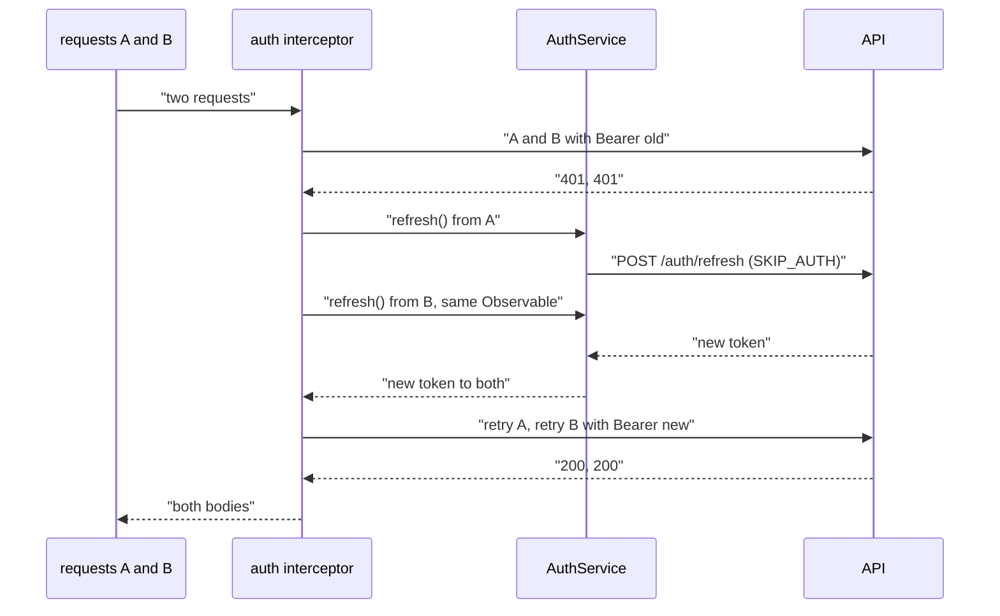

What to notice: two failures, one refresh, and the refresh call outside the interceptor's reach.

### How it actually works

**Attach.** The check resolves the URL against the API origin and compares origins: a relative URL and an API URL got `Bearer old`, while requests to the hosts `analytics.example.test` and `api.example.test.evil.test` (a look-alike) got none (`Section 7: the auth interceptor adds the bearer token to API requests only`). A `startsWith` test would accept it.

**One refresh.** Two GETs sent `Bearer old` and both got 401: one `/auth/refresh` request was open (`Section 7: two concurrent 401s trigger one refresh`). After it answered `{ token: 'new' }`, both retries carried `Bearer new` and delivered `{ ok: '/a' }` and `{ ok: '/b' }` (`Section 7: queued requests retry once with the new token`). The service stores one `shareReplay(1)` Observable, cleared in `finalize` ([23 §5](23-rxjs-in-depth.md#5-multicasting-in-depth-share-configuration-sharereplay-and-connect), [Q23.19](23-rxjs-in-depth.md#q23-19)). A `BehaviorSubject` token with waiting requests using `filter` is an alternative queue, not run here.

**Why the skip check is needed.** Read from the `@angular/common` 22.2.1 source (`chainedInterceptorFn`, `fesm2022/_module-chunk.mjs`, internal, may change in any release): each interceptor runs in `runInInjectionContext(injector, …)`, so `inject(LabM27Auth)` works. The refresh is an ordinary `HttpClient` call and enters the chain from the start: a recorder before the auth interceptor logged `/auth/refresh skip=true`, and the request had no `Authorization` header (`Section 7: the refresh request carries no bearer token`).

**Failure.** When the refresh answered 401, both waiting subscribers errored with `status` 401 and `url` `/auth/refresh`, the logout counter was 1, the token was cleared and no request stayed open (`Section 7: a failed refresh ends the session without a loop`). A retry that got 401 again failed and requested no second refresh (`Section 7: a 401 after the retry fails the request instead of refreshing again`).

**The two bugs of [Q27.24](#q27-24)** (a guard counter ends the loop). Without the skip check, each refresh flushed with 401 left another refresh pending: after five, a sixth was open and the original request had not settled (`Section 7: without the skip check a failing refresh refreshes itself until a guard stops the spec`). Without single flight, three concurrent 401s started three refreshes (`Section 7: without single flight each concurrent 401 starts its own refresh`).

**Cookies and storage (documented).** A cookie session needs the cookie sent: `withCredentials: true` makes the fetch backend set `credentials: 'include'` (read, not run: `FetchBackend.createRequestInit`, private); cookies are [09 §6](09-web-networking-storage-security.md#6-cookies)'s.

### Code

The approach: a service owns the token and the refresh; the interceptor stays small.

1. Mark the refresh request with `SKIP_AUTH`.
2. In the service, build the refresh once, share it with `shareReplay(1)`, reset it in `finalize` and end the session in `catchError`.
3. In the interceptor, skip flagged and non-API requests, send the token, and on 401 wait for `refresh()` and call `next` once more.

```ts
// Excerpt of labs/angular/src/app/modules/27-http-client/concepts/section-7-auth.spec.ts
  refresh(): Observable<string> {
    this.inFlight ??= refreshRequest(this.http).pipe(
      map((response) => response.token),
      tap((token) => this.token.set(token)),
      catchError((error: unknown) => {
        this.logouts.update((count) => count + 1);
        this.token.set('');
        return throwError(() => error);
      }),
      finalize(() => (this.inFlight = null)),
      shareReplay(1),
    );
    return this.inFlight;
  }
```

```ts
// Excerpt of labs/angular/src/app/modules/27-http-client/concepts/section-7-auth.spec.ts
const authInterceptor: HttpInterceptorFn = (req, next) => {
  const auth = inject(LabM27Auth);
  if (req.context.get(SKIP_AUTH) || !isApiUrl(req.url)) return next(req);
  return next(withBearer(req, auth.token())).pipe(
    catchError((error: unknown) => {
      if (!(error instanceof HttpErrorResponse) || error.status !== 401) return throwError(() => error);
      return auth.refresh().pipe(switchMap((token) => next(withBearer(req, token))));
    }),
  );
};
```

### Best practices and anti-patterns

- **Attach the token by origin**, because a string prefix lets a look-alike host through.
- **Keep one refresh in flight**, because concurrent refreshes race.
- **Mark the refresh request with a context token**, because the context travels with the request and a URL match does not.
- **Retry once, then fail and end the session**, because a request retried until it succeeds loops when the credential is the problem.

### Misconceptions and traps

- *"Each failed request should refresh."* One refresh serves all, because per-request thinking misses that the requests failed for the same expired token; the test started three.
- *"Excluding the refresh URL by string match is enough."* It works until the URL changes, because the match lives apart from the request.
- *"Retry the original request until it succeeds."* One retry follows a refresh, because the habit comes from network retries ([section 5](#5-errors-httperrorresponse-an-error-mapping-layer-and-retry-with-backoff-and-jitter)); a second 401 ends it.
- *"Store the token in `localStorage` for the interceptor."* Storage is [33](33-security.md#8-where-the-token-lives-memory-web-storage-httponly-cookies-and-a-backend-for-frontend)'s trade-off, because convenience hides it; the interceptor reads from a service.

Drilled in [Q27.22](#q27-22), [Q27.23](#q27-23) and [Q27.24](#q27-24); modelled in [Exercise 27.4](#ex27-4).

## 8. XSRF protection: how `HttpClient` reads the cookie and sets the header, and when it does not

### The problem it solves

A backend turns on CSRF protection and every POST fails. After the API moves to `api.example.com` the header vanishes. A team disables XSRF to make one cross-origin call work. Someone expects GET requests to carry the header ([Q27.25](#q27-25), [Q27.26](#q27-26), [Q27.27](#q27-27)).

### Mental model

**CSRF** (cross-site request forgery, also **XSRF**) is an attack in which another site makes the user's browser send a state-changing request, with the user's cookies attached automatically ([09 §6](09-web-networking-storage-security.md#6-cookies), [Q09.17](09-web-networking-storage-security.md#q09-17)). The **cookie-to-header token** pattern answers it: the server sets a script-readable cookie and the client copies its value into a header the server compares. A foreign page cannot read your origin's cookie. Depth is [33](33-security.md#9-csrf-in-single-page-apps-when-cookies-make-you-vulnerable-samesite-and-angulars-xsrf-support)'s.

`HttpClient` does the client half only: for a mutating request to the page's own [origin](09-web-networking-storage-security.md#5-the-same-origin-policy-and-cors) it copies the `XSRF-TOKEN` cookie into `X-XSRF-TOKEN`, unless the request already has that header. The `security.md` callout (branch `main`, read 2026-10-11): "Your backend service must be configured to set the cookie for your page, and to verify that the header is present on all eligible requests. Failing to do so renders Angular's default protection ineffective."

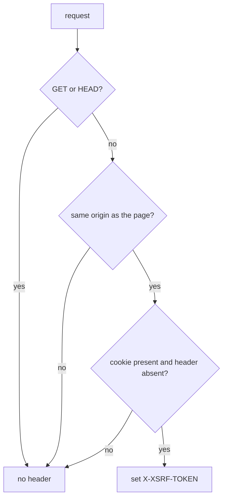

What to notice: three gates, and a cross-origin request is a gate that closes quietly, not an error.

### How it actually works

**The requests.** With the cookie `XSRF-TOKEN=abc`: a relative POST carried `abc` (`Section 8: a relative POST carries the XSRF header`); GET and HEAD carried none (`Section 8: GET and HEAD carry no XSRF header`); a PUT to the host `other.example` and a DELETE to `//other.example/api/e` carried none (`Section 8: a cross-origin or protocol-relative request carries no XSRF header`); a POST to a same-origin absolute URL carried `abc` (`Section 8: a same-origin absolute URL carries the XSRF header`); a POST with its own header `mine` kept it (`Section 8: an explicit header is not overwritten`). `withXsrfConfiguration({ cookieName: 'MY', headerName: 'X-MY' })` sent `X-MY: zzz` and no `X-XSRF-TOKEN` (`Section 8: withXsrfConfiguration renames the cookie and the header`); `withNoXsrfProtection()` sent nothing (`Section 8: withNoXsrfProtection sends no header`). The names `XSRF-TOKEN` and `X-XSRF-TOKEN` are the defaults of the internal `XSRF_COOKIE_NAME` and `XSRF_HEADER_NAME` tokens.

**Why the gates behave like that.** Read from the `@angular/common` 22.2.1 source (`xsrfInterceptorFn`, `fesm2022/_module-chunk.mjs`; internal, may change in any release): it returns `next(req)` unchanged when the internal `XSRF_ENABLED` token is false or the method is `GET` or `HEAD`. Inside a `try` it compares `new URL(PlatformLocation.href).origin` with `new URL(req.url, locationOrigin).origin` and skips on a mismatch or a URL error. It then asks `HttpXsrfTokenExtractor`, whose default, the internal `HttpXsrfCookieExtractor`, returns `null` on the server, and sets the header only when the token is not null and the header is absent. A provided extractor replaced the cookie as the token source (`Section 8: a custom token extractor supplies the token`).

**History.** `CHANGELOG.md` (branch `main`, read 2026-10-11): "enable XSRF protection for same-origin absolute URLs" under 21.0.3 (2025-12-03). The same-origin test builds its URL from `PlatformLocation.href`, whose host `TestBed` reports as `_empty_`. Read from `@angular/common@21.0.2` (`npm pack`): the function skipped every URL matching `ABSOLUTE_URL_REGEX`, `/^(?:https?:)?\/\//i`.

### Code

The approach: keep the default interceptor, and for a trusted cross-origin API add the header yourself.

1. Make the server set the cookie and verify the header.
2. Pass `withXsrfConfiguration` when the names differ.
3. For another origin you trust, read the token with `HttpXsrfTokenExtractor` and set the header for that origin only.

```ts
// Excerpt of labs/angular/src/app/modules/27-http-client/concepts/section-8-xsrf.spec.ts
/** The origin the interceptor compares against: TestBed's fake location, not `document.location`. */
function pageOrigin(): string {
  return new URL(TestBed.inject(PlatformLocation).href).origin;
}

/** A design for a trusted cross-origin API: the app adds the header itself. */
const trustedOriginXsrf: HttpInterceptorFn = (req: HttpRequest<unknown>, next: HttpHandlerFn) => {
  const token = inject(HttpXsrfTokenExtractor).getToken();
  const trusted = new URL(req.url, 'https://app.example.test').origin === 'https://api.example.test';
  return next(trusted && token !== null ? req.clone({ setHeaders: { 'X-XSRF-TOKEN': token } }) : req);
};
```

The interceptor sent `abc` to `api.example.test` and nothing to `other.example` (`Section 8: an interceptor can add the header for a trusted cross-origin API`).

### Best practices and anti-patterns

- **Make the server verify the header**, because the client half alone protects nothing.
- **Add the header for a trusted origin in an interceptor**, because the built-in one skips every other origin.

### Misconceptions and traps

- *"Angular protects against CSRF by itself."* It only sends the header and the server must check it, because the feature's name suggests a whole defense.
- *"The header goes on every request."* GET, HEAD and other origins are skipped, because interceptors usually apply to everything.
- *"An absolute URL never gets the header."* Once true: the 21.0.2 source skipped absolute URLs until the 21.0.3 entry, because the old check was a URL pattern, not an origin comparison.
- *"A token in a cookie is itself protection."* The browser sends the cookie automatically, which is the CSRF problem, because cookie sessions make the browser's automatic sending feel normal.

Drilled in [Q27.25](#q27-25), [Q27.26](#q27-26) and [Q27.27](#q27-27).

## 9. Progress events: `reportUploadProgress`, `reportDownloadProgress` and why upload progress needs XHR

### The problem it solves

A new v22 app's upload progress bar throws `NG02824`, while an upgraded app's bar works. A download indicator never moves because the subscriber only sees the body. `reportProgress` [Deprecated since v22.0 — use reportUploadProgress and reportDownloadProgress] shows a deprecation strike-through ([Q27.28](#q27-28), [Q27.29](#q27-29)).

### Mental model

A **progress event** is a request event that says how many bytes have moved. With `observe: 'events'` ([section 3](#3-making-requests-typed-responses-observe-responsetype-immutable-params-and-headers-and-httpcontext)) and the matching option, the stream emits `Sent`, then `UploadProgress` for the request body, then `ResponseHeader` and `DownloadProgress` for the response body, then `Response`. `reportUploadProgress` switches on the first, `reportDownloadProgress` [Added in v22.0] the second; their events are `HttpUploadProgressEvent` and `HttpDownloadProgressEvent`. Download progress works on both backends. Upload progress needs `withXhr()` ([section 2](#2-setting-up-httpclient-providehttpclient-its-features-and-the-fetch-backend-default)), because `FetchBackend` refuses the option. [Q09.04](09-web-networking-storage-security.md#q09-04) owns the platform comparison.

A parcel tracker: "dispatched", kilometres travelled, "delivered"; the fetch courier tracks only the return trip.

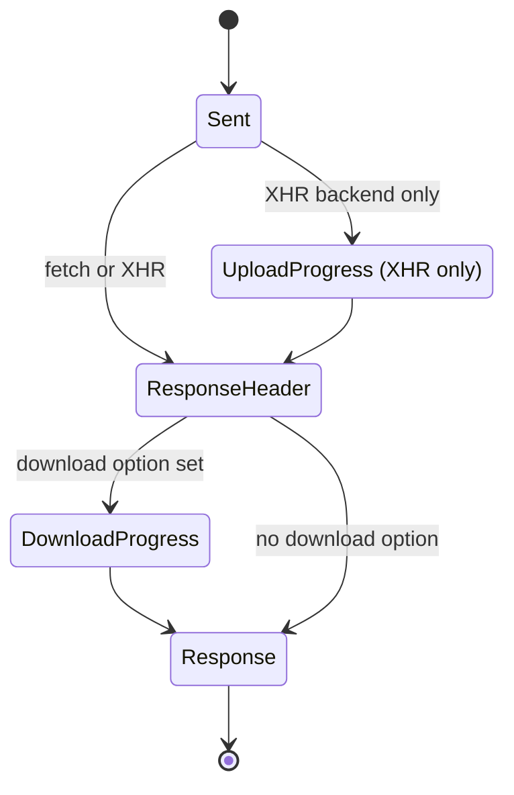

What to notice: the upload state exists only on the XHR path, and both progress states are skipped unless the matching option is set.

### How it actually works

**The runs.** On the default backend with a stubbed `fetch`, a POST with `reportUploadProgress: true` failed with an `HttpErrorResponse` of status 0 whose `error.message` starts `NG02824: The FetchBackend does not support upload progress reporting.`, and `fetch` was never called (`Section 9: reportUploadProgress on the fetch backend fails with NG02824`). A GET with `reportDownloadProgress: true` and an 11-byte body with `content-length: 11` emitted `Sent`, `ResponseHeader`, `DownloadProgress` (`loaded` 11, `total` 11) and `Response` (`Section 9: the fetch backend reports download progress`); the deprecated `reportProgress` also produced a `DownloadProgress` (`Section 9: the deprecated reportProgress still reports download progress on the fetch backend`). With `observe: 'response'` one `HttpResponse` arrived (`Section 9: observe 'response' delivers no progress events`). On the testing backend with `withXhr()`, an upload event of 5 of 10 bytes reached the subscriber between `Sent` and `Response` (`Section 9: an upload progress event reaches an events subscriber`); the test supplied that event.

**Why fetch refuses upload progress.** Read from the `@angular/common` 22.2.1 source (`FetchBackend.createRequestInit`, private, `fesm2022/_module-chunk.mjs`): it throws a runtime error with code 2824 when `req.reportUploadProgress` is true, before `fetch` is called. It tests only the new flag, so `reportProgress` does not throw there. Read, not run: `HttpXhrBackend` adds an `xhr.upload` `progress` listener when `reportProgress || reportUploadProgress` is set and the body is not null.

**`httpResource`.** `normalizeRequest` (internal, `fesm2022/http.mjs`) forwards a resource request's `reportProgress` as `reportDownloadProgress`; the `CHANGELOG.md` (branch `main`, read 2026-10-11) lists that fix under 22.2.1. On the testing backend `progress()` was `undefined` until an event of 3 of 11 bytes arrived, then equal to it (`Section 9: httpResource exposes download progress`; the resource is [section 10](#10-httpresource-signal-driven-requests-and-when-to-prefer-it-over-httpclient)).

**History.** `CHANGELOG.md` under 22.0.0, Deprecations: "The `reportProgress` option is deprecated please use `reportUploadProgress` & `reportDownloadProgress` instead."; Breaking Changes: "Use the `HttpXhrBackend` with `provideHttpClient(withXhr)` if you want to keep supporting upload progress reports."

### Code

The approach: configure `withXhr()`, ask for events with the one direction you show, and narrow on `type`.

1. Provide `provideHttpClient(withXhr())` where uploads with progress exist.
2. Call with `observe: 'events'` and `reportUploadProgress: true`.
3. Narrow on `event.type`; `total` is optional, so guard it before computing a percentage.

```ts
// Excerpt of labs/angular/src/app/modules/27-http-client/concepts/section-9-progress.spec.ts
TestBed.inject(HttpClient)
  .post('/up', new Blob(['x']), { reportUploadProgress: true, observe: 'events' })
  .subscribe((event) => events.push(event));
const progress = events[1];
expect(progress.type === HttpEventType.UploadProgress && [progress.loaded, progress.total]).toEqual([5, 10]);
```

#### Legacy

`reportProgress: true` compiles with the deprecation and still works.

```ts
// Excerpt of labs/angular/src/app/modules/27-http-client/legacy/legacy-interceptor.ts
export function labM27LegacyUpload(http: HttpClient, file: Blob): Observable<HttpEvent<unknown>> {
  return http.post('/upload', file, { observe: 'events', reportProgress: true });
}
```

The replacement splits the flag; upload progress also needs the XHR line that `ng update` adds ([section 2](#2-setting-up-httpclient-providehttpclient-its-features-and-the-fetch-backend-default)).

```ts
// Excerpt of labs/angular/src/app/modules/27-http-client/legacy/legacy-interceptor.ts
export function labM27Upload(http: HttpClient, file: Blob): Observable<HttpEvent<unknown>> {
  return http.post('/upload', file, { observe: 'events', reportUploadProgress: true, reportDownloadProgress: true });
}
```

```ts
// Partial: the provider line that keeps upload progress working under the v22 default
providers: [provideHttpClient(withXhr())]
```

### Best practices and anti-patterns

- **Request only the direction you display**, because the `HttpRequest.reportProgress` typings call progress events expensive ("change detection runs on each event"), which holds where zone.js patches XHR ([21 §3](21-change-detection.md#3-zonejs-and-ngzone-how-changes-used-to-be-detected-and-why-zone-left-the-default)).
- **Use `withXhr()` where uploads show progress**, because the fetch backend throws `NG02824`.
- **Guard `total` before dividing**, because it is optional.
- **Map events to one state value in a service**, because components then read one result.
- **Write the split options in new code**, because `reportProgress` is deprecated.

### Misconceptions and traps

- *"`reportProgress` still covers both."* It is deprecated and on fetch reports download only, because one flag once stood for two directions.
- *"Progress needs `observe: 'response'`."* Only `'events'` exposes it, because the response object is the habit and it arrives last.
- *"Upload progress is only a browser limit."* Angular's `FetchBackend` also throws on the option, because the docs' fetch note hides that the refusal is Angular's.
- *"Progress events are cheap."* Under zone.js each one runs change detection ([21 §3](21-change-detection.md#3-zonejs-and-ngzone-how-changes-used-to-be-detected-and-why-zone-left-the-default)), because they look like log lines.

Drilled in [Q27.28](#q27-28) and [Q27.29](#q27-29); modelled in [Exercise 27.5](#ex27-5).

## 10. `httpResource`: signal-driven requests, and when to prefer it over `HttpClient`

### The problem it solves

A component turns an input signal into an Observable, `switchMap`s to `HttpClient`, converts the result back with `toSignal` and tracks `loading` and `error` by hand. A save button wired through a resource fires a request on every keystroke. A test reads `value()` right after `flush()` and gets `undefined`. ([Q27.30](#q27-30), [Q27.31](#q27-31), [Q27.32](#q27-32)).

### Mental model

`httpResource(() => urlOrRequest)` is a **resource** whose loader is `HttpClient`. A resource turns signals into async state ([17 §6](17-signals.md#6-resources-async-data-as-signals), [Q17.22](17-signals.md#q17-22)); this one reads signals in the request function and requests **eagerly**: it sends as soon as the signals give a request, with no subscriber. It cancels the previous request when a signal changes and sends nothing while the function returns `undefined`. `HttpResourceRef` adds `headers`, `statusCode` and `progress` to the resource's signals. Interceptors ([section 4](#4-interceptors-the-functional-chain-order-and-next-and-class-interceptors-through-withinterceptorsfromdi)) and the testing backend ([section 11](#11-testing-and-the-backend-seam-providehttpclienttesting-httptestingcontroller-and-what-they-replace)) apply. It is for **reads**; a write stays an `HttpClient` call. The three-way choice is [Q17.26](17-signals.md#q17-26); `rxResource` is [23 §7](23-rxjs-in-depth.md#7-rxjs-and-signals-decision-rules-tosignal-toobservable-and-rxresource); `validateHttp` builds on it ([26 §6](26-signal-forms.md#6-async-validation-and-debounce-validateasync-validatehttp-pending-and-cancellation)); router resources are [24 §6](24-routing.md#6-resolvers-and-route-data-resolvefn-failures-and-router-resources).

A departure board bound to a station selector, against a ticket counter you walk up to.

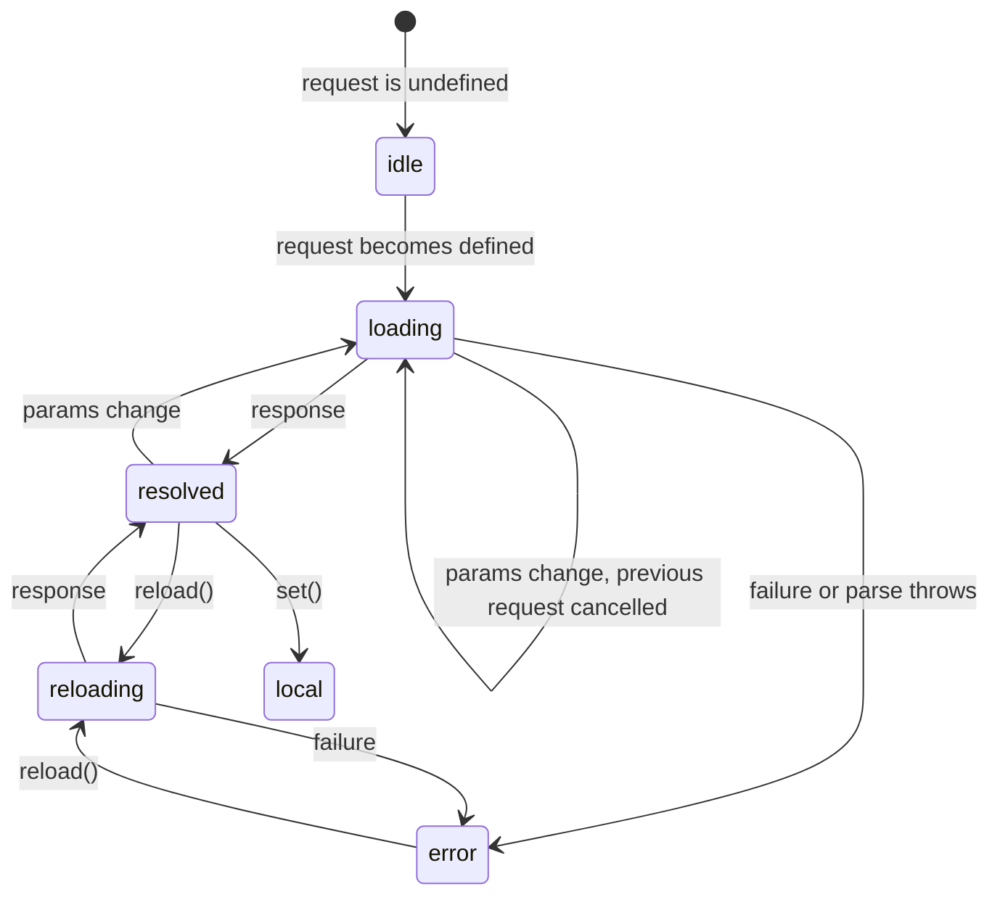

What to notice: a params change goes back to `loading` without the old value, while `reload()` goes to `reloading` and keeps it.

### How it actually works

**The runs.** A request function returning `undefined` left `status()` `'idle'` with no request (`Section 10: an undefined request leaves the resource idle with no request`). Changing `/users/1` to `/users/2` marked the first request `cancelled` and sent the second (`Section 10: a URL change cancels the previous request`). A flushed 200 with an `ETag` header gave `'resolved'`, the body, `statusCode()` 200 and that header after `whenStable()` (`Section 10: a resolved resource exposes value, statusCode and headers`); with only `TestBed.tick()` it was still `'loading'` (`Section 11: an httpResource value lands after whenStable, not after tick`). A 404 gave `'error'`, an `HttpErrorResponse` of status 404 and `hasValue()` false, and `value()` threw "Resource is currently in an error state (see Error.cause for details): Http failure response for /users/3: 404 Not Found" (`Section 10: a 404 puts the resource in error and value throws`). `reload()` then gave `'reloading'` and a new request (`Section 10: reload after an error is reloading`). From a resolved value, `reload()` kept it and a params change reset it (`Section 10: a params change resets value while reload keeps it`); `set()` gave `'local'` (`Section 10: set puts the resource in local with the written value`).

**Options.** A request object sent `GET /search?q=ab` and its header (`Section 10: a request object sends params and headers`). `defaultValue` was the value while loading (`Section 10: defaultValue is the value while loading`). A `parse` that threw put the resource in `'error'` with that message (`Section 10: a throwing parse puts the resource in error`). An interceptor saw `/me` and set the header the backend received (`Section 10: httpResource requests pass through interceptors`). Outside an injection context the call threw `NG0203` (`Section 10: httpResource outside an injection context throws NG0203`).

**Read from the source** (`@angular/common` 22.2.1, `fesm2022/http.mjs`; the helpers are internal, not exported, and may change in any release). `normalizeRequest` turns the request function's string or object into an `HttpRequest`; `HttpResourceImpl`'s loader subscribes to `HttpClient.request`. A `Response` event sets headers and status code and sends the parsed body, a thrown `parse` becomes the error, a `DownloadProgress` event sets `progress` ([section 9](#9-progress-events-reportuploadprogress-reportdownloadprogress-and-why-upload-progress-needs-xhr)), and the abort signal unsubscribes.

**Docs** (`http-resource.md`, branch `main`, read 2026-10-12): "If a request is already pending, the resource cancels the outstanding request before issuing a new one." and "`httpResource` differs from the `HttpClient` as it initiates the request _eagerly_. In contrast, the `HttpClient` only initiates requests upon subscription to the returned `Observable`." The page names Zod and Valibot for `parse` ([07 §8](07-ts-advanced-types-and-decorators.md#8-runtime-validation-with-zod-4-schema-first-types)); the lab uses a hand-written guard.

**Typings** (`types/http.d.ts`, not run): `HttpResourceOptions.equal` compares response values, and `HttpResourceRef.hasValue()` narrows the type to exclude `undefined`.

**History.** `CHANGELOG.md` (branch `main`, read 2026-10-12), 19.2.0 (2025-02-26), `common`: "introduce experimental `httpResource`". `@angular/common@21.2.25` tags `httpResource` `@experimental 19.2`; 22.2.1 tags it `@publicApi 22.0`.

### Code

The approach: a request function over signals, a `parse` guard at the boundary, and the status read in the template.

1. Return a URL or request object from a function over signals, or `undefined`.
2. Pass `parse` to check the shape.
3. Await `whenStable()` after each `flush` in tests.

```ts
// Excerpt of labs/angular/src/app/modules/27-http-client/concepts/section-10-http-resource.spec.ts
const parse = (raw: unknown): string[] => {
  if (!Array.isArray(raw)) {
    throw new Error('bad shape');
  }
  return raw.map(String);
};
const resource = TestBed.runInInjectionContext(() => httpResource(() => '/list', { parse }));
TestBed.tick();
controller.expectOne('/list').flush({ not: 'an array' });
await TestBed.inject(ApplicationRef).whenStable();
expect(resource.status()).toBe('error');
```

The status was `'error'` and `error().message` was `'bad shape'` (`Section 10: a throwing parse puts the resource in error`).

```ts
// Partial: a component reading a resource from an input signal
protected readonly userId = input.required<string>();
protected readonly user = httpResource<LabM27User>(() => `/api/user/${this.userId()}`);
```

### Best practices and anti-patterns

- **Use `httpResource` for reads that follow signals**, because it cancels and tracks status for you.
- **Return `undefined` until the inputs are complete**, because it then sends nothing.
- **Keep writes on `HttpClient`**, because a resource re-runs on every signal change.
- **Pass `parse` for a response you must trust**, because the generic type is only an assertion.
- **Await `whenStable()` after a flush in tests**, because the status settles asynchronously.

### Misconceptions and traps

- *"`httpResource` is experimental."* Once true: `@experimental 19.2` through 21.2.25, `@publicApi 22.0` since, because the tag changed with the release.
- *"`httpResource` is lazy like `HttpClient`."* It requests eagerly, because it wraps `HttpClient` but subscribes by itself.
- *"Use it for a POST on submit."* It accepts a method but re-runs on every signal change, because it is built for reads ([Q17.26](17-signals.md#q17-26)).
- *"The old value stays while the next one loads."* Only `reload()` keeps it; a params change resets `value()`, because the two look alike in a template.

Drilled in [Q27.30](#q27-30), [Q27.31](#q27-31) and [Q27.32](#q27-32); modelled in [Exercise 27.6](#ex27-6).

## 11. Testing and the backend seam: `provideHttpClientTesting`, `HttpTestingController` and what they replace

### The problem it solves

A test with an interceptor passes on one machine and calls the real network on another. A test waits for a `timeout` that never fires. A test reads `value()` of an `httpResource` right after `flush()` and gets `undefined`. A request nobody answered goes unnoticed until production ([Q27.33](#q27-33), [Q27.34](#q27-34)).

### Mental model

`provideHttpClientTesting()` swaps the **`HttpBackend` token** for an in-memory **test backend** and provides its **`HttpTestingController`**. Everything above it runs for real: the client, every interceptor ([section 4](#4-interceptors-the-functional-chain-order-and-next-and-class-interceptors-through-withinterceptorsfromdi)), XSRF and `httpResource` ([section 10](#10-httpresource-signal-driven-requests-and-when-to-prefer-it-over-httpclient)). You answer each request by hand: **`expectOne`** finds exactly one open request, a **`TestRequest`** is answered with **`flush`** (body and status), `error` or `event`, and **`verify()`** fails if any request is still open. **`match`** removes and returns the requests a URL, object or predicate selects; **`expectNone`** fails if any match; **`cancelled`** is `true` once the subscriber unsubscribed. Because only the backend is swapped, backend behavior is not simulated: `timeout`, abort signals, parsing of raw bytes and the upload-progress refusal ([section 9](#9-progress-events-reportuploadprogress-reportdownloadprogress-and-why-upload-progress-needs-xhr)) belong to the fetch backend. Testing strategy is [module 29](29-testing-angular.md#1-what-to-test-where-unit-integration-component-and-end-to-end-tests-the-pyramid-and-the-trophy)'s.

A flight simulator: the cockpit and the crew procedure are real; the sky is a screen you control.

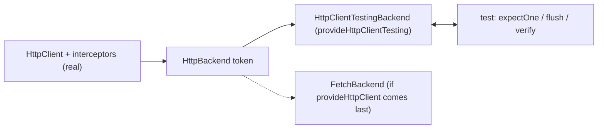

What to notice: the seam is one token (`HttpClientTestingBackend` is internal), so provider order and backend-only features are the traps.

### How it actually works

**The runs.** In the right order the backend was not a `FetchBackend`, the interceptor's header was on the held request, and `flush({ ok: 1 })` reached the subscriber (`Section 11: provideHttpClientTesting replaces the backend`). Reversed, the backend was a `FetchBackend`, the stubbed `fetch` was called once and the controller held no request (`Section 11: provideHttpClientTesting before provideHttpClient leaves the fetch backend`). `expectOne('/nothing')` threw "Expected one matching request for criteria "Match URL: /nothing", found none."; with another request open, a `method` and `url` object and a predicate function each named their criteria ("Match method: POST, URL: /nothing", "Match by function: isPost") and appended "Requests received are: GET /other." (`Section 11: expectOne with no match names the criteria`). `verify()` threw "Expected no open requests, found 1: GET /pending"; a cancelled request stayed open until matched, and `verify({ ignoreCancelled: true })` skipped it (`Section 11: verify lists the open requests`). A request left open did not stop `whenStable()` (`Section 11: test requests do not hold whenStable`). After 500 ms of fake time a request with `timeout: 100` was still open, not errored and not cancelled (`Section 11: the testing backend never fires a timeout`). An `httpResource` was still `'loading'` after a flush and `TestBed.tick()`, and `'resolved'` after `whenStable()` (`Section 11: an httpResource value lands after whenStable, not after tick`).

**Read from the `@angular/common` 22.2.1 source** (`provideHttpClientTesting`, `fesm2022/http-testing.mjs`). It returns a plain `Provider[]`: the testing backend class (not exported), `HttpBackend` and `HttpTestingController` both `useExisting` it, and the internal `REQUESTS_CONTRIBUTE_TO_STABILITY` flag set to `false`, which is why open test requests do not hold `whenStable()`. Being the later `HttpBackend` provider is what makes it win, and a later `provideHttpClient()` wins it back. The testing backend's `handle` records each request as open and marks it cancelled in its teardown; nothing there reads `timeout`. In an application each request holds a `PendingTasks` task ([21 §5](21-change-detection.md#5-zoneless-change-detection-the-scheduler-its-triggers-and-pendingtasks); read, not run).

**Docs** (`testing.md`, branch `main`, read 2026-10-12): "IMPORTANT: Keep in mind to provide `provideHttpClient()` **before** `provideHttpClientTesting()`, as `provideHttpClientTesting()` will overwrite parts of `provideHttpClient()`." Backends are [section 2](#2-setting-up-httpclient-providehttpclient-its-features-and-the-fetch-backend-default); `timeout` and abort are [section 6](#6-cancellation-and-caching-unsubscribing-aborts-cache-interceptors-sharereplay-and-the-ssr-transfer-cache).

**History.** `CHANGELOG.md` (branch `main`, read 2026-10-12), 15.0.0 (2022-11-16), `http`: "introduce `provideHttpClientTesting` provider function".

### Code

The approach: real client first, test backend second, answer, verify.

1. Put `provideHttpClient(...)` first and `provideHttpClientTesting()` second.
2. Trigger the call, then `expectOne` it and inspect `request`.
3. `flush` or `error` it, and call `verify()` in `afterEach`.

```ts
// Excerpt of labs/angular/src/app/modules/27-http-client/concepts/section-11-testing.spec.ts
TestBed.configureTestingModule({
  providers: [provideHttpClient(withInterceptors([tagInterceptor])), provideHttpClientTesting()],
});
TestBed.inject(HttpClient).get('/a').subscribe((value) => values.push(value));
const request = TestBed.inject(HttpTestingController).expectOne('/a');
expect(request.request.headers.get('x-lab-m27')).toBe('on');
request.flush({ ok: 1 });
```

#### Legacy

`HttpClientTestingModule` (typings tag `@deprecated`: "Add `provideHttpClientTesting()` to your providers instead.") appears in older specs' `imports`.

```ts
// Partial: the legacy setup and its replacement
TestBed.configureTestingModule({ imports: [HttpClientTestingModule] });
TestBed.configureTestingModule({ providers: [provideHttpClient(), provideHttpClientTesting()] });
```

### Best practices and anti-patterns

- **List `provideHttpClient(...)` before `provideHttpClientTesting()`**, because the last `HttpBackend` provider wins.
- **Call `verify()` in `afterEach`**, because an unanswered request otherwise passes silently.
- **Await `whenStable()` after a flush when testing `httpResource`**, because the value lands asynchronously.
- **Test a `timeout` or an abort against a stubbed `fetch`**, because the test backend ignores both.
- **Keep interceptors in the test setup**, because they run for real.

### Misconceptions and traps

- *"`provideHttpClientTesting()` replaces `HttpClient`."* It replaces only the backend, so interceptors run, because the name suggests the whole client.
- *"Provider order does not matter in `providers`."* The last `HttpBackend` provider wins, because DI usually merges providers.
- *"The test backend simulates timeouts and aborts."* It stands in for the network and reads no `timeout`, because those options belong to the fetch backend.
- *"`TestBed.tick()` is enough after a flush."* It runs effects, but an `httpResource` value lands after `whenStable()`, because the status settles asynchronously.

Drilled in [Q27.33](#q27-33) and [Q27.34](#q27-34); modelled in [Exercise 27.6](#ex27-6).

## Summary

`HttpClient` is a pipeline in front of the platform: a request passes the interceptors to a backend, unsubscribing aborts the call, a non-2xx status arrives on the error channel, and `get<User>()` only asserts the body's type ([1](#1-httpclient-versus-fetch-what-the-framework-adds-over-the-platform)). A v22 app injects `HttpClient` without `provideHttpClient()` and gets the fetch backend; `HttpClientModule` brings the XHR backend, and a feature-level `provideHttpClient` is an independent client unless `withRequestsMadeViaParent()` is added ([2](#2-setting-up-httpclient-providehttpclient-its-features-and-the-fetch-backend-default)). `params.set()` returns a copy, and `HttpContext` never reaches the server ([3](#3-making-requests-typed-responses-observe-responsetype-immutable-params-and-headers-and-httpcontext)).

Interceptors run first to last on the way out and must clone; class interceptors run only under `withInterceptorsFromDi()` ([4](#4-interceptors-the-functional-chain-order-and-next-and-class-interceptors-through-withinterceptorsfromdi)). Status 0 covers network failures, timeouts and aborts, a 200 can fail to parse, and a retry needs an idempotent method, a retryable status and jitter ([5](#5-errors-httperrorresponse-an-error-mapping-layer-and-retry-with-backoff-and-jitter)). Unsubscribing aborts on the fetch backend, `timeout` covers the backend request only, and a URL-keyed cache without sharing or a per-user key sends two requests and serves one user's body to another ([6](#6-cancellation-and-caching-unsubscribing-aborts-cache-interceptors-sharereplay-and-the-ssr-transfer-cache)). Concurrent 401s share one refresh, each request retries once, and the refresh request skips the interceptor ([7](#7-authentication-attaching-tokens-refreshing-on-401-with-a-request-queue-and-avoiding-refresh-loops)).

Angular only sends the XSRF header, on requests other than GET and HEAD to the page's own origin; the server must check it ([8](#8-xsrf-protection-how-httpclient-reads-the-cookie-and-sets-the-header-and-when-it-does-not)). `reportUploadProgress` on the fetch backend throws `NG02824`, and only `observe: 'events'` shows progress ([9](#9-progress-events-reportuploadprogress-reportdownloadprogress-and-why-upload-progress-needs-xhr)). `httpResource` requests eagerly and suits reads: a params change resets `value()` and only `reload()` keeps it ([10](#10-httpresource-signal-driven-requests-and-when-to-prefer-it-over-httpclient)). `provideHttpClientTesting()` replaces only the backend, so interceptors run, the last `HttpBackend` provider wins, and the test backend reads no `timeout` ([11](#11-testing-and-the-backend-seam-providehttpclienttesting-httptestingcontroller-and-what-they-replace)).

## Question bank

The questions follow the sections in order, from what `HttpClient` adds over `fetch` to the testing seam. An *Output* answer cites its test in `outputs/q27-outputs.spec.ts`; the other answers cite section tests, package source or the docs.

<a id="q27-01"></a>
### Q27.01 · Concept · What does `HttpClient` add on top of `fetch`, and what does it still leave to the browser?

<details>
<summary>Answer</summary>

**Short answer (30 seconds).** A pipeline in front of the platform: a cold Observable that aborts on unsubscribe, an interceptor chain, non-2xx statuses on the error channel as `HttpErrorResponse`, XSRF handling, a testing seam, and `httpResource`. The browser still performs the request and applies CORS, cookies and the HTTP cache; the type argument checks nothing.

**Full explanation.** Section 1 asserts each: a 404 reaches `error` (`Section 1: a 404 reaches the error channel as an HttpErrorResponse`) where plain `fetch` resolves with `ok` `false` (`Section 1: a 404 from plain fetch resolves with ok false`); unsubscribing aborts the `AbortSignal` handed to `fetch` (`Section 1: unsubscribing aborts the fetch signal`); the generic checks nothing (`Section 1: the type argument does not check the response`). `FetchBackend` is the default (`Section 1: the default HttpBackend is the FetchBackend`), so the platform still owns the wire ([09 §2](09-web-networking-storage-security.md#2-fetch-xhr-and-the-request-lifecycle)). See [section 1](#1-httpclient-versus-fetch-what-the-framework-adds-over-the-platform).

**Follow-ups an interviewer will ask.**
- *Does `HttpClient` change what `fetch` does with a 404 or a dropped connection?* No: the backend maps a non-2xx `Response` to an `HttpErrorResponse`; the rest is [Q09.04](09-web-networking-storage-security.md#q09-04)'s.
- *Why is one chain worth more than a `fetch` wrapper?* Every request passes it, `httpResource`'s included (`Section 10: httpResource requests pass through interceptors`), and a spec swaps the backend ([section 11](#11-testing-and-the-backend-seam-providehttpclienttesting-httptestingcontroller-and-what-they-replace)).

**Trap to avoid.** Saying `HttpClient` validates the typed response or caches: the generic asserts; the cache is the browser's.

</details>

<a id="q27-02"></a>
### Q27.02 · Trade-off · `HttpClient`, plain `fetch` or a `resource` over `fetch` in an Angular app: which, and what do you give up with each?

<details>
<summary>Answer</summary>

**Short answer (30 seconds).** `HttpClient` for application traffic: interceptors, XSRF, `HttpErrorResponse`, the testing backend and abort on unsubscribe come for free. Plain `fetch` wins outside the injector (a worker, a pre-bootstrap script) or for a streaming body you read yourself; you give up all of the above. A `resource` over `fetch` adds signals and cancellation through the loader's `abortSignal`, but still loses the chain, XSRF and the testing seam, which `httpResource` keeps.

**Full explanation.** Plain `fetch` costs what [section 1](#1-httpclient-versus-fetch-what-the-framework-adds-over-the-platform) opens with: the repeated `ok` check and headers, a resolving 404 and a stubbed `globalThis.fetch` in every spec. A `resource` whose loader calls `fetch` gets `status`, `value` and `error` signals and cancels through `abortSignal` ([17 §6](17-signals.md#6-resources-async-data-as-signals)), yet its loader must add headers itself, a 404 still resolves and the controller never sees it. `httpResource` is that resource with `HttpClient` as the loader ([section 10](#10-httpresource-signal-driven-requests-and-when-to-prefer-it-over-httpclient)); the choice between `resource`, `rxResource` and `httpResource` is [Q17.26](17-signals.md#q17-26)'s.

**Follow-ups an interviewer will ask.**
- *A library that must also run outside Angular?* `fetch`: `HttpClient` needs an injector and brings `@angular/common` and RxJS.
- *Can the two coexist?* Yes, but `fetch` calls bypass the interceptors, so auth, retry and logging cover part of the traffic.

**Trap to avoid.** Choosing `fetch` "to avoid RxJS": `httpResource` and `toSignal` give a signal API over `HttpClient` with no subscription in the component.

</details>

<a id="q27-03"></a>
### Q27.03 · Output · No provider, `provideHttpClient()`, `withXhr()`, `withFetch()` and `HttpClientModule`: which `HttpBackend` does each give?

The test runs this in a spec, with `log` recording each line:

```ts
// Partial: runs in a spec; HttpBackend, HttpClientModule, provideHttpClient, withFetch and withXhr come from '@angular/common/http', importProvidersFrom from '@angular/core'
const configurations = [
  [],
  [provideHttpClient()],
  [provideHttpClient(withXhr())],
  [provideHttpClient(withFetch())],
  [importProvidersFrom(HttpClientModule)],
];
for (const providers of configurations) {
  TestBed.resetTestingModule();
  TestBed.configureTestingModule({ providers });
  console.log(TestBed.inject(HttpBackend).constructor.name);
}
```

<details>
<summary>Answer</summary>

**Short answer (30 seconds).** `FetchBackend`, `FetchBackend`, `HttpXhrBackend`, `FetchBackend`, `HttpXhrBackend`. The root `HttpBackend` points at `FetchBackend` and `provideHttpClient` re-provides it the same way, so only `withXhr()`, or the module whose providers include it, swaps in `HttpXhrBackend`.

**Full explanation.** Asserted by `Q27.03 no provider, provideHttpClient, withXhr, withFetch and HttpClientModule give these backends`. Read from the `@angular/common` 22.2.1 source (`fesm2022/_module-chunk.mjs`): `HttpBackend` is `providedIn: 'root'` with `useExisting: FetchBackend`; `provideHttpClient` lists `{ provide: HttpBackend, useFactory: () => inject(FetchBackend) }`; `withXhr()` provides `HttpBackend` as `useExisting: HttpXhrBackend`; `withFetch()` names `FetchBackend` again, which is why it is deprecated; `HttpClientModule`'s `providers` are `provideHttpClient(withInterceptorsFromDi(), withXhr())`. The last provider of the token wins ([section 2](#2-setting-up-httpclient-providehttpclient-its-features-and-the-fetch-backend-default)).

**Follow-ups an interviewer will ask.**
- *A project replaced `HttpClientModule` with `provideHttpClient(withInterceptorsFromDi())`: same backend?* No: it moved from XHR to fetch, because the module carried `withXhr()`; the packaging side is [Q15.09](15-standalone-and-ngmodules.md#q15-09)'s.
- *What does `ng update` to 22 do to an existing `provideHttpClient()`?* The `http-xhr-backend` migration (`@angular/core` 22.2.1 schematics) adds `withXhr()` to calls naming neither `withFetch()` nor `withXhr()`, so an updated app keeps XHR and a new app uses fetch (read, not run).

**Trap to avoid.** Reading "`withFetch()` is deprecated" as "fetch is going away": it is deprecated because fetch is the default.

</details>

<a id="q27-04"></a>
### Q27.04 · Concept · What does `provideHttpClient` register, and why can a v22 app inject `HttpClient` without calling it?

<details>
<summary>Answer</summary>

**Short answer (30 seconds).** Environment providers for `HttpClient`, `FetchBackend`, the interceptor handler, `HttpBackend` resolved to `FetchBackend` and the built-in XSRF interceptor, then each feature's providers. Since 21.0 `HttpClient`, `HttpHandler` and the backends are `providedIn: 'root'`, so the call only adds features or configures another injector.

**Full explanation.** Read from the `@angular/common` 22.2.1 source, `provideHttpClient` in `fesm2022/_module-chunk.mjs`: it returns `makeEnvironmentProviders` of `HttpClient`, `FetchBackend`, `HttpInterceptorHandler` (also as `HttpHandler`), `HttpBackend` from `inject(FetchBackend)` and `xsrfInterceptorFn` as a multi provider of `HTTP_INTERCEPTOR_FNS`, plus each feature's providers (internal names; may change in any release). Root provision: `CHANGELOG.md` 21.0.0 "Provide http services in root", `setup.md` (branch `main`, read 2026-10-11) "`HttpClient` is available for injection by default in Angular v21 and later.", and the run with no provider (`Section 2: HttpClient works with no provider and uses the fetch backend`). The XSRF entry precedes the features', so it runs first ([section 4](#4-interceptors-the-functional-chain-order-and-next-and-class-interceptors-through-withinterceptorsfromdi)). See [section 2](#2-setting-up-httpclient-providehttpclient-its-features-and-the-fetch-backend-default).

**Follow-ups an interviewer will ask.**
- *Does a lazy route's `provideHttpClient(withInterceptors([...]))` extend the root client?* No: it builds a separate client unless `withRequestsMadeViaParent()` is added; [Q27.06](#q27-06) runs both.
- *Why is the XSRF interceptor in the recipe?* It is the client half of the cookie-to-header defense ([section 8](#8-xsrf-protection-how-httpclient-reads-the-cookie-and-sets-the-header-and-when-it-does-not)); `withNoXsrfProtection()` removes it.

**Trap to avoid.** Putting it in a component's `providers`: `makeEnvironmentProviders` exists to prevent providers "being accidentally referenced in `@Component` in a component injector" (`@angular/core` 22.2.1 `types/core.d.ts`; read, not run).

</details>

<a id="q27-05"></a>
### Q27.05 · Difference · The fetch backend versus the XHR backend: what changes for upload progress, timeouts and SSR, and what does `ng update` to v22 do to your `provideHttpClient` calls?

<details>
<summary>Answer</summary>

**Short answer (30 seconds).** Upload progress: only XHR reports it; on fetch, `reportUploadProgress: true` fails with `NG02824`. Timeouts: both honor `timeout` with a `TimeoutError`. SSR: fetch is the server backend; the `withXhr` typings call server XHR deprecated. `ng update` adds `withXhr()` to every `provideHttpClient()` call naming no backend: an updated app keeps XHR, a new one uses fetch.

**Full explanation.** Source reads are from `@angular/common` 22.2.1, `fesm2022/_module-chunk.mjs`. Progress: `FetchBackend.createRequestInit` (private) throws `NG02824` (`Section 9: reportUploadProgress on the fetch backend fails with NG02824`); `HttpXhrBackend` registers an `xhr.upload` `progress` listener (read, not run). Timeouts: `FetchBackend.handle` aborts its controller with a `DOMException` named `TimeoutError` (`Section 6: a timeout aborts the fetch with a TimeoutError and status 0`); `HttpXhrBackend.handle` sets `xhr.timeout` and errors on the `timeout` event with a `DOMException('Request timed out', 'TimeoutError')` (read, not run). SSR: the handler warns `NG02801` for a non-fetch, non-testing backend (read, not run), and the `withXhr` typings state "XHR support on the server is **deprecated**"; the server is [module 32](32-ssr-ssg-hydration.md)'s. The migration is [Q27.03](#q27-03)'s `http-xhr-backend` (read, not run); [section 2](#2-setting-up-httpclient-providehttpclient-its-features-and-the-fetch-backend-default) states the rules.

**Follow-ups an interviewer will ask.**
- *Which backend for a new v22 app?* The default; add `withXhr()` only where uploads show progress ([Exercise 27.5](#ex27-5)), in a child client that repeats the root interceptors ([Q27.29](#q27-29)).
- *Does the testing backend care?* No: `provideHttpClientTesting()` replaces whichever backend precedes it (`Section 2: provideHttpClientTesting after provideHttpClient swaps in the testing backend`) and simulates no `timeout` (`Section 6: the testing backend does not simulate a timeout`).

**Trap to avoid.** Reading `NG02824` as a bug in your service: it is the default backend asking for `withXhr()`.

</details>

<a id="q27-06"></a>
### Q27.06 · Output · A child injector with its own `provideHttpClient`, with and without `withRequestsMadeViaParent`: whose interceptors run, and which backend gets the request?

The test stubs `fetch` with a function that resolves `{}` and records its calls; `log` records each line:

```ts
// Partial: runs in a spec whose root providers are provideHttpClient(withInterceptors([logging('parent')])) and provideHttpClientTesting(); `stub` is the stubbed fetch; `parent` is TestBed.inject(EnvironmentInjector)
function logging(name: string): HttpInterceptorFn {
  return (req, next) => {
    console.log(name);
    return next(req);
  };
}
const alone = createEnvironmentInjector([provideHttpClient(withInterceptors([logging('child')]))], parent);
await new Promise((resolve) => alone.get(HttpClient).get('/alone').subscribe(resolve));
console.log(`alone: controller ${controller.match('/alone').length}, fetch ${stub.mock.calls.length}`);
const via = createEnvironmentInjector(
  [provideHttpClient(withInterceptors([logging('child')]), withRequestsMadeViaParent())],
  parent,
);
via.get(HttpClient).get('/via').subscribe();
console.log(`via: controller ${controller.match('/via').length}, fetch ${stub.mock.calls.length}`);
```

<details>
<summary>Answer</summary>

**Short answer (30 seconds).** `child`, `alone: controller 0, fetch 1`, then `child`, `parent`, `via: controller 1, fetch 1`. The first child re-provides `HttpBackend` as a real `FetchBackend`, so only its interceptor runs and the request bypasses the controller for the stubbed `fetch`; with `withRequestsMadeViaParent()` the child's chain ends in the parent's handler, so the parent's interceptor and testing backend follow.

**Full explanation.** Asserted by `Q27.06 a child provideHttpClient with and without withRequestsMadeViaParent`. Every `provideHttpClient` call registers its own `HttpClient`, handler and `HttpBackend` ([Q27.04](#q27-04)), so `alone.get(HttpClient)` is a different instance with a chain of one interceptor and a `FetchBackend`. Read from the `@angular/common` 22.2.1 source (`fesm2022/_module-chunk.mjs`): `withRequestsMadeViaParent` provides `HttpBackend` from `inject(HttpHandler, { skipSelf: true, optional: true })` and throws in development mode when no parent configures `HttpClient`; combining it with `withXhr()` or `withFetch()` throws too (`Section 2: contradictory features throw in dev mode`). See [section 2](#2-setting-up-httpclient-providehttpclient-its-features-and-the-fetch-backend-default).

**Follow-ups an interviewer will ask.**
- *Where does this bite in production?* A lazy route that adds `provideHttpClient(withInterceptors([audit]))` loses the root auth and retry interceptors for its requests; in a spec, `HttpTestingController` never sees them.
- *Can the child add interceptors without that cost?* Yes, with `withRequestsMadeViaParent()`: the child's interceptors run, then the parent's, then the parent's backend.

**Trap to avoid.** Expecting providers to merge: `provideHttpClient` in a child is a second client, not an extension of the first.

</details>

<a id="q27-07"></a>
### Q27.07 · Output · `observe: 'response'`, `observe: 'events'` and `responseType: 'text'`: what does each subscriber receive?

With `log` recording each line:

```ts
// Partial: runs in a spec with provideHttpClient() then provideHttpClientTesting(); `http` and `controller` are injected
http
  .get<{ id: number }>('/r', { observe: 'response' })
  .subscribe((response) => console.log(`${response.status} ${response.headers.get('ETag')} ${JSON.stringify(response.body)}`));
controller.expectOne('/r').flush({ id: 1 }, { headers: { ETag: 'v1' } });
http.get('/e', { observe: 'events' }).subscribe((event) => console.log(HttpEventType[event.type]));
controller.expectOne('/e').flush({ id: 1 });
http.get('/t', { responseType: 'text' }).subscribe((text) => console.log(`${typeof text} ${text}`));
controller.expectOne('/t').flush('hello');
```

<details>
<summary>Answer</summary>

**Short answer (30 seconds).** `200 v1 {"id":1}`, then `Sent` and `Response`, then `string hello`. `observe: 'response'` delivers the whole `HttpResponse` once; `observe: 'events'` delivers every event, here the `Sent` marker and the final `Response`; `responseType: 'text'` skips JSON parsing and delivers the raw string.

**Full explanation.** Asserted by `Q27.07 observe response, observe events and responseType text`. `observe` picks what the Observable emits and `responseType` how the body is parsed; both pick the overload, so a widened `string` fails with `TS2769` (`Section 3: observe events from an untyped options object is a type error`). `HttpEventType` is a numeric enum, so `HttpEventType[event.type]` prints the names of 0 and 4. The testing backend emits `Sent` on subscribe and the response on `flush`; the fetch backend adds `ResponseHeader` and `DownloadProgress` events only when progress is requested ([section 9](#9-progress-events-reportuploadprogress-reportdownloadprogress-and-why-upload-progress-needs-xhr)). See [section 3](#3-making-requests-typed-responses-observe-responsetype-immutable-params-and-headers-and-httpcontext).

**Follow-ups an interviewer will ask.**
- *When is `observe: 'response'` worth it?* When a header carries data: an `ETag`, a `Location` after a create, a pagination total.
- *What does `observe: 'events'` add on a real backend?* Progress events with `reportDownloadProgress` (and `reportUploadProgress` on XHR), the case of [Exercise 27.5](#ex27-5).

**Trap to avoid.** Reading a CSV or HTML body with the default `responseType`: the client tries to parse JSON and the request fails with status 200 ([Q27.15](#q27-15)).

</details>

<a id="q27-08"></a>
### Q27.08 · Output · `HttpParams.set` without reassignment, `append`, and a params object with an array: which URL goes out?

With `log` recording each line:

```ts
// Partial: runs in a spec with provideHttpClient() then provideHttpClientTesting(); `http` and `controller` are injected
const params = new HttpParams();
params.set('q', 'lost');
console.log(`'${params.toString()}'`);
console.log(params.set('a', '1').append('a', '2').set('b', 'x y').toString());
http.get('/s', { params: { q: 'a b', page: 2, tags: ['x', 'y'] } }).subscribe();
const request = controller.expectOne((req) => req.url === '/s');
console.log(request.request.urlWithParams);
```

<details>
<summary>Answer</summary>

**Short answer (30 seconds).** `''`, then `a=1&a=2&b=x%20y`, then `/s?q=a%20b&page=2&tags=x&tags=y`. `set` returns a new `HttpParams` and the unassigned result is dropped; a chain keeps each copy, `append` repeats a key and values are encoded; a plain object becomes params, an array a repeated key.

**Full explanation.** Asserted by `Q27.08 HttpParams.set without reassignment, append, and a params object with an array`. Read from the `@angular/common` 22.2.1 source (`fesm2022/_module-chunk.mjs`): `set`, `append` and `delete` return `this.clone(update)`, a new object that applies its pending updates lazily; the original never changes. `HttpHeaders` and `HttpRequest.clone` follow the same rule (`Section 3: HttpHeaders are immutable and read case-insensitively`, `Section 3: HttpRequest.clone returns a new request and leaves the original unchanged`). The URL is `urlWithParams`: `req.url` stays `/s`, which is why the test matches on `req.url`. See [section 3](#3-making-requests-typed-responses-observe-responsetype-immutable-params-and-headers-and-httpcontext).

**Follow-ups an interviewer will ask.**
- *Why immutable?* An interceptor can clone a request without affecting other subscribers or a retry, because every stage holds its own copy.
- *How do you encode a `+` or a `;` in a value?* Pass a custom `HttpParameterCodec` through `encoder` when the server needs them escaped; the default leaves them (typings, not run).

**Trap to avoid.** Calling `params.set(...)` in a loop without reassignment: every iteration builds a copy nobody keeps, and the request goes out with no parameters.

</details>

<a id="q27-09"></a>
### Q27.09 · Bug hunt · `get<User>()` delivers an object with no `name` and the template breaks later: why did the type not catch it, and where does the fix belong?

```ts
// Partial: `http` is an injected HttpClient; `User` has a required `name: string`
readonly user = toSignal(this.http.get<User>('/api/me'));
// template: {{ user()?.name.toUpperCase() }}
```

The server started returning `{ id: 7, displayName: 'Ada' }`. The request succeeds, and the view throws `Cannot read properties of undefined (reading 'toUpperCase')`.

<details>
<summary>Answer</summary>

**Short answer (30 seconds).** The generic is a type assertion: TypeScript erases it and `HttpClient` hands the parsed JSON through unchanged, so `name` is `undefined` while the compiler believes it is a string. The fix belongs where the data enters, in the service: parse the body with a guard or a schema and fail the call there.

**Full explanation.** The docs call the generic "a type **assertion** about the data returned by the server" (`making-requests.md`, branch `main`, read 2026-10-11). `get<LabM27User>` delivered `{ nope: true }` as is (`Section 1: the type argument does not check the response`); a hand-written guard turned the same body into a `TypeError` (`Section 3: a hand-written guard at the boundary turns a wrong shape into an error`). In the service the failure becomes an `invalid-response` domain error the UI renders ([Exercise 27.1](#ex27-1)), not a crash three components later; `httpResource` takes the same guard as `parse` ([section 10](#10-httpresource-signal-driven-requests-and-when-to-prefer-it-over-httpclient)). Schema-first parsing with Zod is [07 §8](07-ts-advanced-types-and-decorators.md#8-runtime-validation-with-zod-4-schema-first-types)'s. See [section 3](#3-making-requests-typed-responses-observe-responsetype-immutable-params-and-headers-and-httpcontext).

**Follow-ups an interviewer will ask.**
- *Guard or schema?* A guard for one or two shapes; a schema when the type derives from it and errors are reported per field ([Q07.17](07-ts-advanced-types-and-decorators.md#q07-17)).
- *Is `user()?.name?.toUpperCase()` a fix?* No: it hides the contract break, and nobody learns the API changed.

**Trap to avoid.** Treating `get<User>` as validation because it compiles: only run-time parsing checks the shape.

</details>

<a id="q27-10"></a>
### Q27.10 · Concept · What is `HttpContext`, and why switch an interceptor off with a context token rather than a custom header?

<details>
<summary>Answer</summary>

**Short answer (30 seconds).** A per-request, `Map`-backed bag of metadata keyed by `HttpContextToken`s (typed keys with a default factory); interceptors read it and nothing sends it. A token switches an interceptor off without touching the wire; a custom header reaches the server, can cost a CORS preflight, and must be stripped by the interceptor that reads it.

**Full explanation.** The run logged `ctx=false` and `ctx=true` for a plain and a flagged call while the stubbed `fetch` received only the default `Accept` header (`Section 3: a context token reaches the interceptor and not the server`): the fetch backend builds its init from method, headers and fetch options, never the context. The typings call it "Shared and mutable": `set` returns the same instance. The canonical use is [section 7](#7-authentication-attaching-tokens-refreshing-on-401-with-a-request-queue-and-avoiding-refresh-loops)'s refresh request: it carries `SKIP_AUTH`, so the auth interceptor passes it through and a 401 on it cannot start another refresh. See [section 3](#3-making-requests-typed-responses-observe-responsetype-immutable-params-and-headers-and-httpcontext).

**Follow-ups an interviewer will ask.**
- *Why not a header the interceptor deletes before `next`?* It works until one interceptor forgets, it shows in logs, and a non-safelisted header costs a CORS preflight cross-origin ([Q09.14](09-web-networking-storage-security.md#q09-14)).
- *Can a context carry data, not only flags?* Yes: a token typed `HttpContextToken<RetryConfig>` carries a per-request policy ([Exercise 27.2](#ex27-2) uses `NO_RETRY`).

**Trap to avoid.** Expecting the server to see the context: a server-side flag still needs a header or a parameter.

</details>

<a id="q27-11"></a>
### Q27.11 · Output · Two functional interceptors A and B, where A adds a header: in what order do the request and response logs print, and what does B see?

With `log` recording each line:

```ts
// Partial: runs in a spec with provideHttpClient(withInterceptors([a, b])) then provideHttpClientTesting(); `tap` comes from rxjs
const seen = (name: string, req: HttpRequest<unknown>): void => {
  console.log(`${name} req headers=${req.headers.keys().join(',')}`);
};
const onResponse = (name: string) =>
  tap<HttpEvent<unknown>>((event) => {
    if (event instanceof HttpResponse) console.log(`${name} res`);
  });
const a: HttpInterceptorFn = (req, next) => {
  seen('A', req);
  return next(req.clone({ setHeaders: { 'X-A': '1' } })).pipe(onResponse('A'));
};
const b: HttpInterceptorFn = (req, next) => {
  seen('B', req);
  return next(req).pipe(onResponse('B'));
};
TestBed.inject(HttpClient).get('/v').subscribe();
const request = TestBed.inject(HttpTestingController).expectOne('/v');
console.log(`backend X-A=${request.request.headers.get('X-A')}`);
request.flush('ok');
```

<details>
<summary>Answer</summary>

**Short answer (30 seconds).** `A req headers=`, `B req headers=X-A`, `backend X-A=1`, `B res`, `A res`. Interceptors run in list order on the way out and in reverse on the way back, and B and the backend see the header A added, because A passed a clone to `next`.

**Full explanation.** Asserted by `Q27.11 two interceptors where A adds a header: request and response log order`. Each `next` is the rest of the chain, so A wraps B, which wraps the backend, and A's `tap` sees the response after B's ([Q27.12](#q27-12) reads the source). The docs (`interceptors.md`, branch `main`, read 2026-10-11): "The interceptors you configure are chained together in the order that you've listed them in the providers." Without the clone nobody would have seen the header (`Section 4: an interceptor that does not clone sends the request unchanged`). See [section 4](#4-interceptors-the-functional-chain-order-and-next-and-class-interceptors-through-withinterceptorsfromdi).

**Follow-ups an interviewer will ask.**
- *Where would the built-in XSRF interceptor log?* Before A: `provideHttpClient` lists it ahead of the features' providers (read, not run; [section 8](#8-xsrf-protection-how-httpclient-reads-the-cookie-and-sets-the-header-and-when-it-does-not)).
- *And with `[b, a]`?* B logs `headers=` first and never sees `X-A` (`Section 4: a later interceptor sees the header an earlier one added`).

**Trap to avoid.** Expecting the last listed interceptor to run first, as in stacks where the last wrapper is outermost.

</details>

<a id="q27-12"></a>
### Q27.12 · Concept · How does Angular build the interceptor chain from `withInterceptors`, what is `next`, and where does the built-in XSRF interceptor sit?

<details>
<summary>Answer</summary>

**Short answer (30 seconds).** On the first request the handler folds the interceptor functions with `reduceRight` into nested closures; each step's `next` runs the rest of the chain and ends in `backend.handle`. The first listed is outermost, so it runs first on the way out and last on the way back. The XSRF interceptor is the first entry because `provideHttpClient` registers it before the features' providers.

**Full explanation.** Read from the `@angular/common` 22.2.1 source (`fesm2022/_module-chunk.mjs`; internal names, may change in any release): `HttpInterceptorHandler.handle` collects the `HTTP_INTERCEPTOR_FNS` multi token and folds it with `reduceRight` over `interceptorChainEndFn`, which calls `backend.handle`; `chainedInterceptorFn` wraps each step in `runInInjectionContext`, so `inject()` works (`Section 4: inject works inside a functional interceptor`). The call also holds a `PendingTasks` task until `finalize` unless the testing providers turn that off ([21 §5](21-change-detection.md#5-zoneless-change-detection-the-scheduler-its-triggers-and-pendingtasks)). Not calling `next` short-circuits (`Section 4: an interceptor can answer without reaching the backend`). See [section 4](#4-interceptors-the-functional-chain-order-and-next-and-class-interceptors-through-withinterceptorsfromdi).

**Follow-ups an interviewer will ask.**
- *Can an interceptor call `next` more than once?* Yes: each call re-runs the rest of the chain; that is how a retry interceptor re-sends (`Section 5: the retry interceptor retries a 503 GET three times with growing delays`, four requests).
- *Is the chain rebuilt per request?* No: built once and kept (read, not run).

**Trap to avoid.** Treating `next` as the backend: later interceptors still run inside it.

</details>

<a id="q27-13"></a>
### Q27.13 · Difference · Functional interceptors versus class interceptors under `withInterceptorsFromDi`: registration, order, injection and migration.

<details>
<summary>Answer</summary>

**Short answer (30 seconds).** Registration: a function listed in `withInterceptors([...])`, versus a class under the `HTTP_INTERCEPTORS` multi provider that runs only with `withInterceptorsFromDi()`. Order: the list, versus provider registration order, all classes as one block at the feature's position. Injection: `inject()` in the body, versus the constructor. Migration: `intercept(req, next)` becomes `(req, next)`, `next.handle(req)` becomes `next(req)`, the provider becomes a list element, and the feature goes when no class remains.

**Full explanation.** The runs are in [section 4](#4-interceptors-the-functional-chain-order-and-next-and-class-interceptors-through-withinterceptorsfromdi) (`Section 4: class interceptors run at the position of withInterceptorsFromDi`, `Section 4: class interceptors run only with withInterceptorsFromDi`); the order run is [Q27.11](#q27-11). The docs call DI order "very hard to predict" (`interceptors.md`, branch `main`, read 2026-10-11). Multi providers are [Q16.06](16-dependency-injection.md#q16-06)'s.

**Follow-ups an interviewer will ask.**
- *A library ships a class interceptor; can the app stay functional?* Yes: keep `withInterceptorsFromDi()` for it and list yours in `withInterceptors`; feature order decides.
- *Is `withInterceptorsFromDi` deprecated?* No tag in the 22.2.1 typings; its doc says support "may be phased out in a later release".

**Trap to avoid.** Moving to `provideHttpClient()` without the feature: the `HTTP_INTERCEPTORS` providers stay registered and silently do nothing.

</details>

<a id="q27-14"></a>
### Q27.14 · Design · Order an interceptor stack for auth, a correlation ID, retry, error mapping and logging, and justify each position.

<details>
<summary>Answer</summary>

**Short answer (30 seconds).** `withInterceptors([logging, correlationId, errorMapping, retry, auth])`. Logging outermost sees the logical request and its outcome; the correlation ID is shared by every attempt; error mapping outside retry maps the final failure once; auth innermost gives every attempt the current token.

**Full explanation.** List order is run order and a later interceptor sees what an earlier one added (`Section 4: a later interceptor sees the header an earlier one added`), so a correlation ID set before retry rides on every retry. `next` re-runs the rest of the chain, so each of a retry interceptor's four requests passes through what follows it (`Section 5: the retry interceptor retries a 503 GET three times with growing delays`): auth after retry picks up a token refreshed between attempts, and its own single retry after a 401 refresh ([section 7](#7-authentication-attaching-tokens-refreshing-on-401-with-a-request-queue-and-avoiding-refresh-loops)) stays inside the policy. Mapping in services keeps the raw status for callers; the interceptor maps once for all ([section 5](#5-errors-httperrorresponse-an-error-mapping-layer-and-retry-with-backoff-and-jitter)); both are defensible.

**Follow-ups an interviewer will ask.**
- *Where does a cache interceptor go?* Innermost, after auth, and skipping `Authorization` requests ([Exercise 27.3](#ex27-3)): a URL-keyed hit must not cross users (`Section 6: a URL-keyed cache serves one user response to another user`).
- *Logging innermost instead?* Then it logs each attempt, not the logical call; pick by purpose.

**Trap to avoid.** Listing auth before retry: the retried request keeps the token cloned on the first attempt.

</details>

<a id="q27-15"></a>
### Q27.15 · Output · A 404 with a JSON body, a network failure and invalid JSON on a 200: what are the `status`, `error` and `message` of each `HttpErrorResponse`?

With `log` recording each line:

```ts
// Partial: runs in a spec; the first two calls use provideHttpClient() then provideHttpClientTesting() with `http` and `controller` injected; the third stubs fetch and resets the TestBed with provideHttpClient() alone
const describeError = (e: HttpErrorResponse): void => {
  const error =
    e.error instanceof ProgressEvent ? 'ProgressEvent' : e.error instanceof Error ? e.error.name : JSON.stringify(e.error);
  console.log(`${e.status} | ${error} | ${e.message}`);
};
http.get('/missing').subscribe({ error: describeError });
controller.expectOne('/missing').flush({ code: 'NF' }, { status: 404, statusText: 'Not Found' });
http.get('/net').subscribe({ error: describeError });
controller.expectOne('/net').error(new ProgressEvent('error'));
vi.stubGlobal(
  'fetch',
  async () => new Response('not json', { status: 200, headers: { 'content-type': 'application/json' } }),
);
await firstValueFrom(TestBed.inject(HttpClient).get('/x')).catch(describeError);
```

<details>
<summary>Answer</summary>

**Short answer (30 seconds).** `404 | {"code":"NF"} | Http failure response for /missing: 404 Not Found`, then `0 | ProgressEvent | Http failure response for /net: 0 ` (with a trailing space), then `200 | SyntaxError | Http failure during parsing for /x`. The message is built from the status and the `statusText` given at construction, which `TestRequest.error` leaves empty; a 2xx whose body fails `JSON.parse` is a parsing failure carrying the `SyntaxError`.

**Full explanation.** Asserted by `Q27.15 a 404 with JSON, a network failure and invalid JSON on a 200: status, error and message`. Read from the `@angular/common` 22.2.1 source (`fesm2022/_module-chunk.mjs`): the `HttpErrorResponse` constructor writes "Http failure during parsing for …" for a 2xx and otherwise "Http failure response for …: ${init.status} ${init.statusText}"; `TestRequest.error` (`fesm2022/http-testing.mjs`) passes `statusText: opts.statusText || ''`. `FetchBackend.parseBody` (private) rethrows the `JSON.parse` error only for a 2xx; `handle` wraps it with the response's status. See [section 5](#5-errors-httperrorresponse-an-error-mapping-layer-and-retry-with-backoff-and-jitter).

**Follow-ups an interviewer will ask.**
- *What does a rejected `fetch` give?* Status 0 and the thrown `TypeError` in `error` (`Section 5: a rejected fetch has status 0 and the thrown error`).
- *How does a mapping layer tell a timeout from being offline?* Both are status 0; the timeout's `error` is a `DOMException` named `TimeoutError` (`Section 5: a mapping function turns each failure into one domain error`).

**Trap to avoid.** Matching on `message` or `statusText`: key on `status` and `error`; the text differs by backend and `statusText` is deprecated.

</details>

<a id="q27-16"></a>
### Q27.16 · Design · Design an error mapping layer that turns `HttpErrorResponse` into errors the UI can render.

<details>
<summary>Answer</summary>

**Short answer (30 seconds).** One pure function at the edge returning a small discriminated union: `offline` and `timeout` for status 0 (told apart by `error`), `invalid-response` for a 2xx parse failure, `validation` with fields for 400 and 422, `auth` for 401 and 403, `not-found`, `server` for 5xx, and `unknown`. Services apply it in `catchError`; components switch on `kind`.

**Full explanation.** The run maps eight failures to eight domain errors (`Section 5: a mapping function turns each failure into one domain error`); [Exercise 27.1](#ex27-1) uses the shape in a service. Key on `status` and `error`, never on `statusText` (deprecated) or message text ([Q27.15](#q27-15)). Status 0 covers network failure, timeout (a `DOMException` named `TimeoutError`) and abort, so that branch reads `error`. A 2xx with a broken body keeps its status, so check the 2xx range first. The server's error body is [41](41-fullstack-api-contracts.md#5-error-contracts-with-problemdetail-rfc-9457-and-mapping-them-in-angular)'s contract: parse `fields` with a guard ([section 3](#3-making-requests-typed-responses-observe-responsetype-immutable-params-and-headers-and-httpcontext)). See [section 5](#5-errors-httperrorresponse-an-error-mapping-layer-and-retry-with-backoff-and-jitter).

**Follow-ups an interviewer will ask.**
- *Interceptor or service?* An interceptor maps once for all but hides the raw status from the services above it, so retry must sit inside it ([Q27.14](#q27-14)); a service keeps the raw error. Pick one.
- *What does the UI do with `unknown`?* A generic message plus a log with the status; a recurring `unknown` is a missing branch.

**Trap to avoid.** Mapping 401 straight to "log out": the refresh ([section 7](#7-authentication-attaching-tokens-refreshing-on-401-with-a-request-queue-and-avoiding-refresh-loops)) runs before the mapping sees the error.

</details>

<a id="q27-17"></a>
### Q27.17 · Output · A retry interceptor with backoff and jitter: how many requests do a 503 GET, a 400 GET, a 503 POST and an opted-out GET make?

With fake timers, `random` fixed at 0.5 and `log` recording each line:

```ts
// Partial: runs in a spec with provideHttpClient(withInterceptors([retrying])) then provideHttpClientTesting(); `run` subscribes, flushes every open request with `status` and advances the fake clock until none is open
const NO_RETRY = new HttpContextToken<boolean>(() => false);
const IDEMPOTENT = new Set(['GET', 'HEAD', 'OPTIONS', 'PUT', 'DELETE']);
const random = (): number => 0.5;
const delays: number[] = [];
const backoffMs = (attempt: number): number => Math.round(100 * 2 ** (attempt - 1) * (0.5 + random()));
const isRetryable = (err: unknown): boolean =>
  err instanceof HttpErrorResponse && (err.status === 0 || err.status === 429 || err.status >= 500);
const retrying: HttpInterceptorFn = (req, next) => {
  if (!IDEMPOTENT.has(req.method) || req.context.get(NO_RETRY)) return next(req);
  return next(req).pipe(
    retry({
      count: 3,
      delay: (err: unknown, attempt: number) => {
        if (!isRetryable(err)) return throwError(() => err);
        const ms = backoffMs(attempt);
        delays.push(ms);
        return timer(ms);
      },
    }),
  );
};
await run('GET 503', http.get('/a'), '/a', 503);
await run('GET 400', http.get('/b'), '/b', 400);
await run('POST 503', http.post('/c', {}), '/c', 503);
await run('GET 503 NO_RETRY', http.get('/d', { context: new HttpContext().set(NO_RETRY, true) }), '/d', 503);
console.log(`delays=${delays.join(',')}`);
```

<details>
<summary>Answer</summary>

**Short answer (30 seconds).** `GET 503: requests=4, error=503`, `GET 400: requests=1, error=400`, `POST 503: requests=1, error=503`, `GET 503 NO_RETRY: requests=1, error=503`, `delays=100,200,400`. The GET is retried three times after the first attempt, each wait doubling from 100 ms with the jitter factor at 1; the 400 is not retryable, the POST is not idempotent and the token opts out, so each makes one request.

**Full explanation.** Asserted by `Q27.17 a retry interceptor with backoff and jitter: requests per call`. `retry({ count, delay })` re-subscribes to `next(req)`, which re-runs the rest of the chain, so each attempt is a new request ([Q27.12](#q27-12)); `delay` returning `throwError` ends the retry, and `timer(ms)` schedules the next attempt. The delays are the function's return values at `random()` 0.5, not timings. The operator is [23 §4](23-rxjs-in-depth.md#4-retrying-and-repeating-retry-with-backoff-and-repeat)'s; the policy is [Q27.18](#q27-18)'s. See [section 5](#5-errors-httperrorresponse-an-error-mapping-layer-and-retry-with-backoff-and-jitter).

**Follow-ups an interviewer will ask.**
- *What changes with `random()` at 0?* Delays of 50, 100 and 200: the factor ranges from 0.5 to 1.5 (`Section 5: the retry interceptor retries a 503 GET three times with growing delays` checks 50 and 150 for attempt 1).
- *Why does the spec drive the clock?* `timer` waits on real time; the fake clock releases each wait so the test asserts counts, not durations.

**Trap to avoid.** Reading `count: 3` as three requests: it is three retries after the first attempt, four requests.

</details>

<a id="q27-18"></a>
### Q27.18 · Trade-off · Retry in an interceptor or at the call site: which methods and statuses are safe to retry, and what do jitter and idempotency keys add?

<details>
<summary>Answer</summary>

**Short answer (30 seconds).** An interceptor gives every request one policy from the method, the status and an opt-out token; the call site knows the user's intent and can retry a POST it knows safe. Retry only idempotent methods and only status 0, 408, 429 and 5xx; cap attempts and delay. Jitter spreads clients that failed together; an idempotency key lets the server apply a retried POST once.

**Full explanation.** The run made four requests for a 503 GET and one each for a 400, a POST and an opted-out GET ([Q27.17](#q27-17)). Idempotency is the platform's rule ([Q09.01](09-web-networking-storage-security.md#q09-01)): a repeated PUT or DELETE ends in the same state, a repeated POST may not; a 4xx other than 408 and 429 is the client's fault. The backoff policy itself is [Q23.15](23-rxjs-in-depth.md#q23-15)'s. The call site wins when the policy needs context the interceptor cannot see: a confirmed submit, or a body with a client-generated key the server deduplicates ([41](41-fullstack-api-contracts.md#5-error-contracts-with-problemdetail-rfc-9457-and-mapping-them-in-angular); not run here). See [section 5](#5-errors-httperrorresponse-an-error-mapping-layer-and-retry-with-backoff-and-jitter).

**Follow-ups an interviewer will ask.**
- *Where does `Retry-After` fit?* Read the header in `delay` on a 429 or 503 ([Exercise 27.2](#ex27-2)'s follow-up; design, not run).
- *Both layers at once?* Attempts multiply: three over three retries are sixteen requests; one layer owns retry.

**Trap to avoid.** A global `retry(3)` with no method or status check re-sends a POST that charged the customer.

</details>

<a id="q27-19"></a>
### Q27.19 · Output · Unsubscribing from a request on the fetch backend, and a `timeout` that expires: what happens to the `AbortSignal`, and what error arrives?

With fake timers and `log` recording each line:

```ts
// Partial: runs in a spec with provideHttpClient() and `fetch` stubbed by a function that records each `init` in `calls` and stays pending until its signal aborts; `http` is injected
const subscription = http.get('/slow').subscribe();
console.log(`before: aborted=${calls[0].signal?.aborted}`);
subscription.unsubscribe();
console.log(`after: aborted=${calls[0].signal?.aborted}, reason=${(calls[0].signal?.reason as DOMException).name}`);
http.get('/t', { timeout: 100 }).subscribe({
  error: (e: HttpErrorResponse) =>
    console.log(`timeout: status=${e.status}, error=${(e.error as DOMException).name}, message=${e.message}`),
});
await vi.advanceTimersByTimeAsync(150);
console.log(`timeout signal: aborted=${calls[1].signal?.aborted}`);
```

<details>
<summary>Answer</summary>

**Short answer (30 seconds).** `before: aborted=false`, `after: aborted=true, reason=AbortError`, `timeout: status=0, error=TimeoutError, message=Http failure response for /t: 0 undefined`, `timeout signal: aborted=true`. Unsubscribing runs the backend's teardown, which aborts the request's controller; an expired `timeout` aborts the same controller with a `TimeoutError`, and the rejected `fetch` becomes an `HttpErrorResponse` with status 0.

**Full explanation.** Asserted by `Q27.19 unsubscribing on the fetch backend and an expiring timeout`. Read from the `@angular/common` 22.2.1 source (`FetchBackend.handle`, `fesm2022/_module-chunk.mjs`): one `AbortController` per request; the teardown calls `aborter.abort()` unless a `done` flag says the response finished (`Section 6: a completed request is not aborted by its teardown`); a `timeout` starts a `setTimeout` outside the zone that aborts with `new DOMException('signal timed out', 'TimeoutError')`. The unsubscribed call delivers nothing; the timed-out call delivers the error, with the rejection's reason in `error`. The `undefined` in the message is the missing `statusText` ([Q27.15](#q27-15)). See [section 6](#6-cancellation-and-caching-unsubscribing-aborts-cache-interceptors-sharereplay-and-the-ssr-transfer-cache).

**Follow-ups an interviewer will ask.**
- *Same test on the testing backend?* The unsubscribed request shows `cancelled` `true`, and the `timeout` never fires (`Section 6: the testing backend does not simulate a timeout`).
- *Does `timeout` cover a slow interceptor?* No: the timer starts inside the backend ("only apply to the backend HTTP request itself", the docs).

**Trap to avoid.** Expecting the server to stop: the abort ends the client's call; the server is not observed here.

</details>

<a id="q27-20"></a>
### Q27.20 · Design · Design a GET cache interceptor: the key, a time to live, invalidation on writes, sharing an in-flight request, and what must never be cached.

<details>
<summary>Answer</summary>

**Short answer (30 seconds).** Key by `urlWithParams`; store the `HttpResponse` with an expiry from an injected clock; store an in-flight request's shared Observable so concurrent callers share it; on a successful write drop the entries under its collection path; never cache non-GET, `Authorization` or credentialed requests, or an opt-out token.

**Full explanation.** [Section 6](#6-cancellation-and-caching-unsubscribing-aborts-cache-interceptors-sharereplay-and-the-ssr-transfer-cache)'s naive cache shows the gaps: two concurrent GETs made two requests (`Section 6: a naive cache sends two requests for two concurrent GETs`), and a URL key served one user's body to another (`Section 6: a URL-keyed cache serves one user response to another user`). [Exercise 27.3](#ex27-3) closes them; its tests are the criteria, among them `two concurrent GETs send one request and both receive the response` and `a successful POST to the collection invalidates its cached GETs`. The exclusions mirror the transfer cache's default (`ssr.md`, branch `main`, read 2026-10-11: no `Authorization`, `Proxy-Authorization` or `Cookie` headers). The shared entry uses `share` or `shareReplay(1)` ([23 §5](23-rxjs-in-depth.md#5-multicasting-in-depth-share-configuration-sharereplay-and-connect)).

**Follow-ups an interviewer will ask.**
- *Why not key by URL plus the `Authorization` header?* A token refresh then misses every entry; skip those requests instead.
- *Where does the browser's own cache fit?* Below it, by `Cache-Control` and `ETag` ([09 §4](09-web-networking-storage-security.md#4-http-caching)): the interceptor saves the request, the browser the download.

**Trap to avoid.** Filling the map only on arrival: overlapping callers each go to the backend.

</details>

<a id="q27-21"></a>
### Q27.21 · Trade-off · A cache interceptor, `shareReplay` in a service, `httpResource`, the browser HTTP cache or the SSR transfer cache: which for which data?

<details>
<summary>Answer</summary>

**Short answer (30 seconds).** Reference data read by many callers: `shareReplay(1)` in a service. Many GET endpoints with one freshness rule: a cache interceptor keyed by `urlWithParams` with a time to live. Data that follows a signal: `httpResource`, which is not a cache. Assets and anything the server can version: the browser cache through `Cache-Control` and `ETag`. The first render after SSR: the transfer cache, on by default.

**Full explanation.** `shareReplay` dedupes subscribers to one stream ([Q23.19](23-rxjs-in-depth.md#q23-19) has the reset rules): one value for one URL. The interceptor sees every GET, so it dedupes by URL across services, must skip `Authorization` and credentialed requests, and needs invalidation on writes ([Q27.20](#q27-20), [Exercise 27.3](#ex27-3)). `httpResource` re-requests when its params change back ([17 §6](17-signals.md#6-resources-async-data-as-signals)), so a cache sits in front of it, not inside. The browser cache needs no code and survives reloads, within what headers allow ([09 §4](09-web-networking-storage-security.md#4-http-caching)). The transfer cache skips `Authorization`, `Cookie` and credentialed requests and is [32](32-ssr-ssg-hydration.md#8-data-across-the-boundary-the-http-transfer-cache-transferstate-and-resource-ids)'s. See [section 6](#6-cancellation-and-caching-unsubscribing-aborts-cache-interceptors-sharereplay-and-the-ssr-transfer-cache).

**Follow-ups an interviewer will ask.**
- *Two layers at once?* Browser cache below, one in-memory layer above; two in-memory layers hide which one answered.
- *Where does user-specific data go?* A service's `shareReplay`, cleared on logout; never a URL-keyed interceptor.

**Trap to avoid.** A `shareReplay(1)` with no reset: the value is served until the app reloads; nothing expires it.

</details>

<a id="q27-22"></a>
### Q27.22 · Concept · How do you attach a bearer token with a functional interceptor, and why must it check the request URL first?

<details>
<summary>Answer</summary>

**Short answer (30 seconds).** `inject` the auth service inside the interceptor (it runs in an injection context), clone the request with `` setHeaders: { Authorization: `Bearer ${token}` } `` and call `next`. Check the URL first because the interceptor sees every request: a token sent to an analytics or look-alike host is a leaked credential. Compare origins, not string prefixes.

**Full explanation.** The run: a relative URL and an absolute API URL got `Bearer old`; `analytics.example.test` and `api.example.test.evil.test` got nothing (`Section 7: the auth interceptor adds the bearer token to API requests only`). `startsWith` accepts the look-alike; `new URL(url, API_ORIGIN).origin === API_ORIGIN` does not. Two more checks belong in it: a context token that marks the refresh request so it never carries the expiring token ([Q27.24](#q27-24)), and a 401 branch that waits for one shared refresh ([Q27.23](#q27-23)). Where the token lives (memory, `HttpOnly` cookie) is [33](33-security.md#8-where-the-token-lives-memory-web-storage-httponly-cookies-and-a-backend-for-frontend)'s; how it is issued is [42](42-fullstack-authentication.md#2-oauth-20-and-openid-connect-for-a-single-page-app-authorization-code-with-pkce-and-why-the-implicit-flow-is-gone)'s. See [section 7](#7-authentication-attaching-tokens-refreshing-on-401-with-a-request-queue-and-avoiding-refresh-loops) and [Exercise 27.4](#ex27-4).

**Follow-ups an interviewer will ask.**
- *Why clone instead of `req.headers.set`?* Headers are immutable; `set` returns a new object the request never sees ([Q27.08](#q27-08)).
- *Cookie session instead?* No header: `withCredentials: true` sends the cookie, and XSRF applies ([Q27.25](#q27-25)).

**Trap to avoid.** Reading the token once outside the interceptor function: it is captured at setup and never refreshes; read it per request.

</details>

<a id="q27-23"></a>
### Q27.23 · Output · Two requests fail with 401 at once behind a refresh interceptor: how many refresh calls run, and which token do the retries carry?

```ts
// Partial: runs in a spec with provideHttpClient(withInterceptors([refreshOn401])) then provideHttpClientTesting()
const SKIP_AUTH = new HttpContextToken<boolean>(() => false);

@Injectable({ providedIn: 'root' })
class Q27Auth {
  private readonly http = inject(HttpClient);
  readonly token = signal('old');
  refreshCalls = 0;
  private inFlight: Observable<string> | null = null;

  refresh(): Observable<string> {
    this.refreshCalls++;
    this.inFlight ??= this.http
      .post<{ token: string }>('/auth/refresh', null, { context: new HttpContext().set(SKIP_AUTH, true) })
      .pipe(
        map((response) => response.token),
        tap((token) => this.token.set(token)),
        finalize(() => (this.inFlight = null)),
        shareReplay(1),
      );
    return this.inFlight;
  }
}

const withBearer = (req: HttpRequest<unknown>, token: string): HttpRequest<unknown> =>
  req.clone({ setHeaders: { Authorization: `Bearer ${token}` } });

const refreshOn401: HttpInterceptorFn = (req, next) => {
  const auth = inject(Q27Auth);
  if (req.context.get(SKIP_AUTH)) return next(req);
  return next(withBearer(req, auth.token())).pipe(
    catchError((error: unknown) => {
      if (!(error instanceof HttpErrorResponse) || error.status !== 401) return throwError(() => error);
      return auth.refresh().pipe(switchMap((token) => next(withBearer(req, token))));
    }),
  );
};

const results: unknown[] = [];
http.get('/a').subscribe((body) => results.push(body));
http.get('/b').subscribe((body) => results.push(body));
for (const url of ['/a', '/b']) {
  const req = controller.expectOne(url);
  console.log(`${url}: ${req.request.headers.get('Authorization')}`);
  req.flush(null, { status: 401, statusText: 'Unauthorized' });
}
const refreshes = controller.match('/auth/refresh');
console.log(`refresh requests=${refreshes.length}, Authorization=${refreshes[0].request.headers.get('Authorization')}`);
refreshes[0].flush({ token: 'new' });
for (const url of ['/a', '/b']) {
  const retried = controller.expectOne(url);
  console.log(`${url} retry: ${retried.request.headers.get('Authorization')}`);
  retried.flush({ ok: url });
}
console.log(`results=${JSON.stringify(results)}, refresh() calls=${auth.refreshCalls}`);
```

<details>
<summary>Answer</summary>

**Short answer (30 seconds).** `/a: Bearer old`, `/b: Bearer old`, `refresh requests=1, Authorization=null`, `/a retry: Bearer new`, `/b retry: Bearer new`, `results=[{"ok":"/a"},{"ok":"/b"}], refresh() calls=2`. Both 401s call `refresh()`; `??=` keeps one Observable, so one request runs and both retries carry its token.

**Full explanation.** Asserted by `Q27.23 two concurrent 401s behind a refresh interceptor: refresh requests and retry tokens`. Each request has its own `catchError`, so `refresh()` runs twice (`calls=2`); the first builds the POST into `inFlight`, the second gets the same Observable, and `shareReplay(1)` replays the token to a late subscriber. The refresh enters the chain from the start ([Q27.12](#q27-12)); only `SKIP_AUTH` keeps it out of the bearer branch: `Authorization=null`. `finalize` clears `inFlight` for the next 401. The retry is `next` again, past this interceptor's `catchError`: a second 401 fails the request (`Section 7: a 401 after the retry fails the request instead of refreshing again`). See [section 7](#7-authentication-attaching-tokens-refreshing-on-401-with-a-request-queue-and-avoiding-refresh-loops).

**Follow-ups an interviewer will ask.**
- *Why `finalize`, not `tap`, to clear the field?* `tap` runs on success only; after a failure the field would keep an errored Observable that `shareReplay` replays to later callers.
- *Why is the single flight in the service?* Interceptor functions have no instance; a service is one per injector.

**Trap to avoid.** Retrying with `auth.token()` read before the refresh: the closure holds `old`; take the token the refresh emits.

</details>

<a id="q27-24"></a>
### Q27.24 · Bug hunt · A refresh interceptor loops when the refresh itself returns 401, and it fires one refresh per failed request: find both bugs.

```ts
// Excerpt of labs/angular/src/app/modules/27-http-client/concepts/section-7-auth.spec.ts
/** Bug 1: no skip check, so the refresh request is refreshed when it fails. */
const refreshesItself: HttpInterceptorFn = (req, next) => {
  const http = inject(HttpClient);
  return next(req).pipe(
    catchError((error: unknown) => {
      if (!(error instanceof HttpErrorResponse) || error.status !== 401) return throwError(() => error);
      return http.post<{ token: string }>('/auth/refresh', null).pipe(switchMap(() => next(req)));
    }),
  );
};
```

<details>
<summary>Answer</summary>

**Short answer (30 seconds).** Bug 1: the refresh POST goes through the same interceptor, so its own 401 triggers another refresh, without end. Bug 2: the refresh is built inside `catchError`, so every failed request starts its own. Fix: a context token the interceptor skips on the refresh request, and one shared refresh in a service.

**Full explanation.** The test (`Section 7: without the skip check a failing refresh refreshes itself until a guard stops the spec`): each `/auth/refresh` flushed with 401 left another open; after five rounds a sixth was pending and the original request had not settled. The second interceptor had the skip check and still ran three refreshes for three 401s (`Section 7: without single flight each concurrent 401 starts its own refresh`). A URL match is weaker than the context token: it lives apart from the request. With both fixes a failing refresh errored the waiting requests with `status` 401 and `url` `/auth/refresh`, logged out once and left nothing open (`Section 7: a failed refresh ends the session without a loop`). See [section 7](#7-authentication-attaching-tokens-refreshing-on-401-with-a-request-queue-and-avoiding-refresh-loops) and [Exercise 27.4](#ex27-4).

**Follow-ups an interviewer will ask.**
- *How do you prove the loop without a hanging test?* Flush the pending refresh in a bounded loop and assert the count.
- *Why not `retry(1)`?* It re-sends the same expired token ([Q27.18](#q27-18)); the refresh comes first.

**Trap to avoid.** Swallowing the refresh's 401 in the interceptor: the original request hangs, no error and no response.

</details>

<a id="q27-25"></a>
### Q27.25 · Output · With an `XSRF-TOKEN` cookie set, which of seven requests carry `X-XSRF-TOKEN`, and with which value?

```ts
// Partial: runs in a spec with provideHttpClient() then provideHttpClientTesting(); the cookie is expired in `finally`
document.cookie = 'XSRF-TOKEN=abc';
const origin = new URL(TestBed.inject(PlatformLocation).href).origin;
http.post('/api/a', {}).subscribe();
http.get('/api/b').subscribe();
http.head('/api/h').subscribe();
http.put('https://other.example/api/c', {}).subscribe();
http.post(`${origin}/api/d`, {}).subscribe();
http.delete('//other.example/api/e').subscribe();
http.post('/api/f', {}, { headers: { 'X-XSRF-TOKEN': 'mine' } }).subscribe();
const sent = ['/api/a', '/api/b', '/api/h', 'https://other.example/api/c'];
sent.push(`${origin}/api/d`, '//other.example/api/e', '/api/f');
for (const url of sent) {
  const req = controller.expectOne(url).request;
  console.log(`${req.method} ${req.url} -> ${req.headers.get('X-XSRF-TOKEN') ?? 'none'}`);
}
```

<details>
<summary>Answer</summary>

**Short answer (30 seconds).**

```text
POST /api/a -> abc
GET /api/b -> none
HEAD /api/h -> none
PUT https://other.example/api/c -> none
POST http://_empty_/api/d -> abc
DELETE //other.example/api/e -> none
POST /api/f -> mine
```

Three gates: not GET or HEAD, same origin as the page, header absent.

**Full explanation.** Asserted by `Q27.25 seven requests with an XSRF-TOKEN cookie: which carry X-XSRF-TOKEN`. The origin compared is `PlatformLocation.href`, which `TestBed` reports as `http://_empty_/` (`document.location` says `localhost:3000`), so the same-origin absolute URL is built from it; it carried the header because 21.0.3 replaced the absolute-URL skip with an origin comparison. A protocol-relative URL resolves to another origin, hence `none` (21.0.1 closed that leak). `/api/f` keeps `mine` because the interceptor sets the header only when absent. The mechanism and the source read are in [section 8](#8-xsrf-protection-how-httpclient-reads-the-cookie-and-sets-the-header-and-when-it-does-not).

**Follow-ups an interviewer will ask.**
- *Different names?* `withXsrfConfiguration({ cookieName: 'MY', headerName: 'X-MY' })` sent `X-MY: zzz` and no `X-XSRF-TOKEN` (`Section 8: withXsrfConfiguration renames the cookie and the header`).
- *No cookie?* No header: the extractor returns `null`, no error.

**Trap to avoid.** Asserting that an absolute `localhost:3000` URL carries the header in `TestBed`: it is cross-origin from `_empty_`, so it gets none.

</details>

<a id="q27-26"></a>
### Q27.26 · Concept · How does the cookie-to-header pattern stop CSRF, and which half must the server implement?

<details>
<summary>Answer</summary>

**Short answer (30 seconds).** A forged request from another site carries the user's cookies, but that site cannot read them. The server sets a script-readable `XSRF-TOKEN` cookie; the app's own script copies it into `X-XSRF-TOKEN`; the server rejects a mutating request whose header is missing or wrong. Angular does the copy. The server must set the cookie and verify the header on every eligible request.

**Full explanation.** The attack and the cookie attributes are [09 §6](09-web-networking-storage-security.md#6-cookies)'s and [Q09.17](09-web-networking-storage-security.md#q09-17)'s. The pattern works because reading `document.cookie` needs script on the page's origin, which the forging site lacks. `HttpClient`'s half is three gates ([Q27.25](#q27-25)); the cookie is read through `HttpXsrfTokenExtractor`, `null` on the server. The cookie must not be `HttpOnly`, and the header name must be the one the server checks (`withXsrfConfiguration` renames both). Without the server check the header is decoration. Deeper CSRF defences, `SameSite` and token storage are [33](33-security.md#9-csrf-in-single-page-apps-when-cookies-make-you-vulnerable-samesite-and-angulars-xsrf-support)'s. See [section 8](#8-xsrf-protection-how-httpclient-reads-the-cookie-and-sets-the-header-and-when-it-does-not).

**Follow-ups an interviewer will ask.**
- *Why a cookie, not a token in the page?* It must be per session and unguessable; the cookie travels with the session the server tracks.
- *Does a bearer token in a header need this?* No: nothing attaches it automatically, so a forged request has no credential.

**Trap to avoid.** `withNoXsrfProtection()` to fix a failing cross-origin POST: it switches the defence off everywhere ([Q27.27](#q27-27) adds the header instead).

</details>

<a id="q27-27"></a>
### Q27.27 · Bug hunt · The API moved to `api.example.com` and every POST now fails the server's CSRF check: why did Angular stop sending the header, and what are the fixes?

<details>
<summary>Answer</summary>

**Short answer (30 seconds).** The interceptor compares the request's origin with the page's and skips a mismatch, so a POST to another host carries no `X-XSRF-TOKEN` (the run: a PUT to another host got none). Fixes: put the API back on the page's origin through a reverse proxy, or add the header yourself in an interceptor limited to that trusted origin, with CORS allowing it.

**Full explanation.** Read from the source ([section 8](#8-xsrf-protection-how-httpclient-reads-the-cookie-and-sets-the-header-and-when-it-does-not)): `new URL(req.url, locationOrigin).origin` is compared with the page's origin; on a mismatch the request passes through unchanged, no error, no log, so the failure shows only at the server. A same-origin path such as `/api` proxied to the new host restores the default with no client change (design, not run). The interceptor fix ran: it read the token with `HttpXsrfTokenExtractor` and set the header for the trusted origin only (`Section 8: an interceptor can add the header for a trusted cross-origin API`). Two things move with the origin: the cookie must stay readable on the page's host, since the extractor reads `document.cookie`, and the preflight must allow the header ([09 §5](09-web-networking-storage-security.md#5-the-same-origin-policy-and-cors)).

**Follow-ups an interviewer will ask.**
- *Why the gate?* Sending the token to another origin leaks it; 21.0.1 closed the protocol-relative hole.
- *Could `withXsrfConfiguration` fix it?* No: it renames the cookie and header; the origin check stays.

**Trap to avoid.** Matching the trusted origin with `startsWith`: a look-alike host passes ([Q27.22](#q27-22)).

</details>

<a id="q27-28"></a>
### Q27.28 · Output · `reportUploadProgress: true` on the default backend, and on a testing backend that emits an upload progress event: what does each subscriber receive?

```ts
// Partial: runs in a spec; the first half stubs `fetch` with `vi.stubGlobal` (restored in afterEach)
const stub = vi.fn<typeof fetch>(async () => new Response('{}'));
vi.stubGlobal('fetch', stub);
TestBed.configureTestingModule({ providers: [provideHttpClient()] });
const upload = { reportUploadProgress: true, observe: 'events' } as const;
await firstValueFrom(TestBed.inject(HttpClient).post('/up', new Blob(['x']), upload)).catch(
  (e: HttpErrorResponse) => console.log(`fetch backend: status=${e.status}, error=${(e.error as Error).message.split(' Please')[0]}, fetch calls=${stub.mock.calls.length}`),
);
TestBed.resetTestingModule();
TestBed.configureTestingModule({ providers: [provideHttpClient(withXhr()), provideHttpClientTesting()] });
const events: string[] = [];
TestBed.inject(HttpClient)
  .post('/up', new Blob(['x']), upload)
  .subscribe((event) =>
    events.push(
      event.type === HttpEventType.UploadProgress
        ? `UploadProgress ${event.loaded}/${event.total}`
        : HttpEventType[event.type],
    ),
  );
const request = TestBed.inject(HttpTestingController).expectOne('/up');
request.event({ type: HttpEventType.UploadProgress, loaded: 5, total: 10 });
request.flush({ id: 1 });
console.log(`testing backend: ${events.join(', ')}`);
```

<details>
<summary>Answer</summary>

**Short answer (30 seconds).** `fetch backend: status=0, error=NG02824: The FetchBackend does not support upload progress reporting., fetch calls=0` and `testing backend: Sent, UploadProgress 5/10, Response`. The fetch backend refuses the option before calling `fetch`; the testing backend forwards the events the test emits.

**Full explanation.** Asserted by `Q27.28 reportUploadProgress on the fetch backend and on a testing backend with withXhr`. `FetchBackend.createRequestInit` (private) throws a runtime error with code 2824 when `reportUploadProgress` is set ([section 9](#9-progress-events-reportuploadprogress-reportdownloadprogress-and-why-upload-progress-needs-xhr)); the throw lands in the request's Observable, so the subscriber gets an `HttpErrorResponse` with `status` 0 and that error as `error` (its `message`, `Http failure response for (unknown url): undefined undefined`, is the constructor's text for a response without a URL, [Q27.15](#q27-15)). The second half proves the event pipeline, not XHR: `provideHttpClientTesting()` replaces the backend `withXhr()` chose, and `TestRequest.event` pushes the event to the subscriber. Read, not run: `HttpXhrBackend` registers `xhr.upload`'s `progress` listener when the option is set and the body is not null.

**Follow-ups an interviewer will ask.**
- *And `reportProgress: true` on fetch?* No throw: the check tests only the new flag; it reports download progress only.
- *With `observe: 'response'`?* One emission, the response; progress needs `'events'`.

**Trap to avoid.** Taking the testing-backend run as proof that uploads report progress in production: the default backend throws; the provider must say `withXhr()`.

</details>

<a id="q27-29"></a>
### Q27.29 · Difference · `reportProgress` versus `reportUploadProgress` and `reportDownloadProgress`: what does each report, and which backend supports which?

<details>
<summary>Answer</summary>

**Short answer (30 seconds).** `reportProgress` is one flag for both directions, deprecated since 22.0. `reportUploadProgress` emits `UploadProgress` events for the request body on `HttpXhrBackend` only; the fetch backend throws `NG02824`. `reportDownloadProgress` emits `DownloadProgress` events on both backends. All three need `observe: 'events'`.

**Full explanation.** The run is [Q27.28](#q27-28)'s; the mechanism and the source reads are in [section 9](#9-progress-events-reportuploadprogress-reportdownloadprogress-and-why-upload-progress-needs-xhr).

| Option | Direction | Fetch backend | XHR backend |
|---|---|---|---|
| `reportProgress` (deprecated 22.0) | both | download only | both |
| `reportUploadProgress` (22.0) | request body | throws `NG02824` | upload events |
| `reportDownloadProgress` (22.0) | response body | download events | download events |

The split came with the fetch default: one flag could no longer promise both directions, so 22.0 deprecated it and added one per direction; the breaking-changes note keeps `HttpXhrBackend` through `withXhr()` for upload progress, which the `ng update` schematic adds ([section 2](#2-setting-up-httpclient-providehttpclient-its-features-and-the-fetch-backend-default)). `reportProgress` still compiles and is forwarded. `httpResource` forwards its `reportProgress` as `reportDownloadProgress` (22.2.1 fix).

**Follow-ups an interviewer will ask.**
- *Why not emit upload progress from fetch?* The platform API has no upload progress event; the framework refuses rather than fake it.
- *Cost of asking for both?* Under zone.js each event runs change detection (the typings, [21 §3](21-change-detection.md#3-zonejs-and-ngzone-how-changes-used-to-be-detected-and-why-zone-left-the-default)); request only the direction you show.

**Trap to avoid.** Switching the whole app to `withXhr()` for one upload: give the upload route a child `provideHttpClient(withXhr(), withInterceptors([...]))` that lists the root interceptors again, because `withRequestsMadeViaParent()` cannot be combined with `withXhr()` (`Section 2: contradictory features throw in dev mode`) and a child ignores the parent's interceptors (`Section 2: a child provideHttpClient ignores the parent's interceptors`). Or accept no bar.

</details>

<a id="q27-30"></a>
### Q27.30 · Output · An `httpResource` whose URL goes from `undefined` to `/users/1` to `/users/2`, then gets a 404 and a `reload()`: which statuses, requests and cancellations appear?

```ts
// Partial: runs in a spec with provideHttpClient() then provideHttpClientTesting(); `settle` awaits ApplicationRef.whenStable()
const id = signal<number | undefined>(undefined);
const user = TestBed.runInInjectionContext(() =>
  httpResource<{ id: number; name: string }>(() => (id() === undefined ? undefined : `/users/${id()}`)),
);
TestBed.tick();
console.log(`undefined: ${user.status()}, requests=${controller.match(() => true).length}`);
id.set(1);
TestBed.tick();
const first = controller.expectOne('/users/1');
console.log(`/users/1: ${user.status()}, value=${user.value()}`);
id.set(2);
TestBed.tick();
const second = controller.expectOne('/users/2');
console.log(`/users/2: ${user.status()}, /users/1 cancelled=${first.cancelled}`);
second.flush({ id: 2, name: 'Bo' });
await settle();
console.log(`flushed: ${user.status()}, value=${JSON.stringify(user.value())}, statusCode=${user.statusCode()}`);
id.set(3);
TestBed.tick();
console.log(`/users/3: ${user.status()}, value=${user.value()}`);
controller.expectOne('/users/3').flush('missing', { status: 404, statusText: 'Not Found' });
await settle();
console.log(`404: ${user.status()}, error status=${(user.error() as HttpErrorResponse).status}, hasValue=${user.hasValue()}`);
user.reload();
TestBed.tick();
const retried = controller.match('/users/3');
console.log(`reload(): ${user.status()}, requests=${retried.length}`);
retried[0].flush({ id: 3, name: 'Cy' });
await settle();
console.log(`flushed: ${user.status()}, value=${JSON.stringify(user.value())}`);
```

<details>
<summary>Answer</summary>

**Short answer (30 seconds).** `undefined: idle, requests=0`, `/users/1: loading, value=undefined`, `/users/2: loading, /users/1 cancelled=true`, `flushed: resolved, value={"id":2,"name":"Bo"}, statusCode=200`, `/users/3: loading, value=undefined`, `404: error, error status=404, hasValue=false`, `reload(): reloading, requests=1`, `flushed: resolved, value={"id":3,"name":"Cy"}`. An undefined request sends nothing; a changed URL cancels the previous request; `reload()` re-sends the same one.

**Full explanation.** Asserted by `Q27.30 an httpResource from undefined to /users/1 to /users/2, a 404 and a reload`. The request function re-runs when `id` changes and the resource requests eagerly, so each `TestBed.tick()` after a `set` shows the next request, and the testing backend marks the abandoned one `cancelled` ([Q27.19](#q27-19)). A URL change drops the old value (`loading`, `value()` `undefined`); `reload()` goes through `reloading` instead. A 404 is an `HttpErrorResponse` in `error()`, and `value()` throws in that state (`Section 10: a 404 puts the resource in error and value throws`). The `await settle()` after each flush makes the status readable: the loader resolves asynchronously; with only a tick it was still `loading`. See [section 10](#10-httpresource-signal-driven-requests-and-when-to-prefer-it-over-httpclient) and [Exercise 27.6](#ex27-6).

**Follow-ups an interviewer will ask.**
- *Why `runInInjectionContext`?* Outside one `httpResource` throws `NG0203`; a component field is already inside.
- *Does the 404 reach an interceptor?* Yes, the resource goes through `HttpClient`; mapping it is [Q27.16](#q27-16)'s.

**Trap to avoid.** Reading `value()` right after `flush()`: `undefined` and status `loading`; await `whenStable()`.

</details>

<a id="q27-31"></a>
### Q27.31 · Concept · What does `httpResource` add to `resource`: request objects, `parse`, `defaultValue`, `headers`, `statusCode` and `progress`?

<details>
<summary>Answer</summary>

**Short answer (30 seconds).** `resource` takes a `params` signal and a loader you write; `httpResource` fixes the loader to `HttpClient` and takes a request function returning a URL, a request object or `undefined`. It adds `headers()`, `statusCode()` and `progress()` signals, a `parse` hook for the body and `defaultValue` for the loading phase; `.text`, `.blob` and `.arrayBuffer` pick the response type.

**Full explanation.** The request object mirrors the request options (`url`, `method`, `params`, `headers`, `body`, `context`, `withCredentials`, `transferCache`, `reportProgress`, `timeout` and the fetch options); the run sent `GET /search?q=ab` with its header (`Section 10: a request object sends params and headers`). `parse` runs on the body before it becomes `value()`; a throw puts the resource in `error` with that message. `defaultValue` was `[]` while loading. After a flush the `Response` event filled `statusCode()` 200 and `headers()` with the `ETag` ([Q27.30](#q27-30)). `progress()` was `undefined` until a `DownloadProgress` event arrived, then equal to it (`Section 9: httpResource exposes download progress`); upload progress stays out ([section 9](#9-progress-events-reportuploadprogress-reportdownloadprogress-and-why-upload-progress-needs-xhr)). Typings only: `equal` compares response values; `hasValue()` narrows away `undefined`. Internals: [section 10](#10-httpresource-signal-driven-requests-and-when-to-prefer-it-over-httpclient).

**Follow-ups an interviewer will ask.**
- *Is the generic type checked?* No, it is an assertion ([Q27.09](#q27-09)); `parse` is where the check goes.
- *And `rxResource`?* Same shape, a loader returning an Observable ([Q27.32](#q27-32)).

**Trap to avoid.** Expecting `httpResource` to cache by params: a change back to old params loads again ([17 §6](17-signals.md#6-resources-async-data-as-signals)); caching is [Q27.21](#q27-21)'s.

</details>

<a id="q27-32"></a>
### Q27.32 · Trade-off · `httpResource`, `HttpClient` or `rxResource` for a screen's data: which for reads, which for writes, and when does each win?

<details>
<summary>Answer</summary>

**Short answer (30 seconds).** Reads that follow signals (an id input, a search box): `httpResource`, which requests eagerly, cancels on change and tracks status. Writes (submit, delete): `HttpClient`, subscribed once on the user's action. Reads that need an Observable pipeline before the request (a merge of two sources, a per-call retry policy): `rxResource` with `HttpClient` inside. A one-off read in a guard: `HttpClient`.

**Full explanation.** The docs' contrast ([section 10](#10-httpresource-signal-driven-requests-and-when-to-prefer-it-over-httpclient)): `httpResource` initiates the request eagerly, `HttpClient` only on subscription. Eager suits a screen that mirrors its inputs and not a mutation, which runs once per intent; a resource re-runs whenever a signal it read changes ([Q17.26](17-signals.md#q17-26) compares the three). The lifecycle run ([Q27.30](#q27-30)) shows what a component gets for free: `idle` until the inputs are complete, cancellation of the stale request, `error()`, `reload()`. `rxResource` gives the same signals over an Observable loader, so operators apply before the request; its lifecycle run is [Q23.26](23-rxjs-in-depth.md#q23-26). Both pass through interceptors ([Q27.12](#q27-12)). [Exercise 27.6](#ex27-6) builds the read side.

**Follow-ups an interviewer will ask.**
- *A write whose result updates the screen?* `HttpClient` for the POST, then `reload()` or `set()` on the resource.
- *Debounce with `httpResource`?* Debounce the signal before the request function reads it.

**Trap to avoid.** A resource whose request function reads a form's value: a request per keystroke, a POST re-sent on every change.

</details>

<a id="q27-33"></a>
### Q27.33 · Bug hunt · One test lists `provideHttpClientTesting()` before `provideHttpClient(withInterceptors(...))`, another waits for a `timeout` to fire: why does each fail?

```ts
// Partial: the two setups under test
providers: [provideHttpClientTesting(), provideHttpClient(withInterceptors([auth]))]
http.get('/t', { timeout: 100 }).subscribe({ error: (e) => (failure = e) });
vi.advanceTimersByTime(500); // failure is still undefined
```

<details>
<summary>Answer</summary>

**Short answer (30 seconds).** Both provide `HttpBackend` and the later provider wins: with the testing providers first, `provideHttpClient` re-provides the fetch backend, so the request goes to `fetch` and `expectOne` finds nothing. The second test waits on the testing backend, which never reads `timeout`: the request stays open.

**Full explanation.** The runs are in [section 11](#11-testing-and-the-backend-seam-providehttpclienttesting-httptestingcontroller-and-what-they-replace). Read from the source: `provideHttpClientTesting()` is a plain `Provider[]` pointing `HttpBackend` at the testing backend, and `provideHttpClient()` provides `HttpBackend` from `FetchBackend` ([Q27.04](#q27-04)); same token, last wins, as the docs' IMPORTANT note says. The timeout: after 500 ms of fake time the request was still open, not errored, not cancelled; the aborting timer lives in `FetchBackend.handle` ([Q27.19](#q27-19)), and the testing backend's `handle` only records the request and marks it cancelled on unsubscribe. Fix: assert `request.request.timeout`, or test the timeout against a stubbed `fetch` ([section 6](#6-cancellation-and-caching-unsubscribing-aborts-cache-interceptors-sharereplay-and-the-ssr-transfer-cache)).

**Follow-ups an interviewer will ask.**
- *Does `provideHttpClientTesting()` alone work?* Yes: the client is provided in root, so the testing backend is the only `HttpBackend` provider.
- *Would `verify()` catch the first bug?* No, the controller saw no request; `expectOne` does.

**Trap to avoid.** Simulating the timeout by hand with `request.error(...)`: it tests your simulation, not the backend.

</details>

<a id="q27-34"></a>
### Q27.34 · Concept · How does `HttpTestingController` work: what does `provideHttpClientTesting` replace, how do you answer requests, and what do `verify()` and `whenStable()` add?

<details>
<summary>Answer</summary>

**Short answer (30 seconds).** It replaces one token, `HttpBackend`, with an in-memory backend that holds each request open for the controller; the client, interceptors, XSRF and `httpResource` run for real. `expectOne` (URL, `{ method, url }` or a predicate) finds a request; `flush(body, { status, headers })`, `error(ProgressEvent, { status })` or `event(...)` answers it. `verify()` throws for every request still open; `whenStable()` is what an `httpResource` test awaits after a flush.

**Full explanation.** The backend's `handle` records the request and marks it `cancelled` on unsubscribe ([section 11](#11-testing-and-the-backend-seam-providehttpclienttesting-httptestingcontroller-and-what-they-replace)). `expectOne` throws when the count is not one, naming the criteria and the requests received; `match` returns the matching requests and removes them from the open list ([Q27.30](#q27-30)); `expectNone` asserts absence (`Section 4: an interceptor can answer without reaching the backend`). `verify({ ignoreCancelled: true })` skips cancelled ones. The testing providers set the internal stability flag to `false`, so an open test request does not hold `whenStable()`; the resource still settles asynchronously, so its value lands after `whenStable()`, not after `TestBed.tick()` (`Section 11: an httpResource value lands after whenStable, not after tick`). Component tests over this seam are [29](29-testing-angular.md#9-testing-guards-interceptors-forms-effects-resources-and-stores)'s.

**Follow-ups an interviewer will ask.**
- *Where does `verify()` go?* In `afterEach`, so an unanswered request fails its test.
- *How do you test an interceptor?* Through the controller: the held `request` shows the chain's output.

**Trap to avoid.** `HttpClientTestingModule` in `imports`: deprecated; use the two provider functions in that order ([section 2](#2-setting-up-httpclient-providehttpclient-its-features-and-the-fetch-backend-default)).

</details>

## Hands-on exercises

Try each exercise before opening the hints. Every solution lives in `labs/angular` and passes its tests under `ng test` on Node 24, with the header's command.

<a id="ex27-1"></a>
### Exercise 27.1 · A typed API service: query params, a response header and errors mapped at the boundary

**Problem.** A shop UI needs a `ProductsApi` that hides `HttpClient`: `search(term, page)` lists products and `get(id)` returns one product with its `ETag`. Components must see typed data or one `ApiError`, never an `HttpErrorResponse` ([section 3](#3-making-requests-typed-responses-observe-responsetype-immutable-params-and-headers-and-httpcontext), [section 5](#5-errors-httperrorresponse-an-error-mapping-layer-and-retry-with-backoff-and-jitter)).

**Constraints.** Pass query parameters through the options object, with no string concatenation. Use `observe: 'response'` to read the `ETag`. Parse the body at the service with a hand-written guard, with no Zod ([07 §8](07-ts-advanced-types-and-decorators.md#8-runtime-validation-with-zod-4-schema-first-types) owns that). Map errors once, in the service, with `catchError`, keyed on `status`. Not covered: retry ([Exercise 27.2](#ex27-2)) and caching ([Exercise 27.3](#ex27-3)).

**Acceptance criteria.**
- [ ] search sends the term and page as query parameters
- [ ] get returns the product with its ETag header
- [ ] a response that fails the guard becomes an invalid-response error
- [ ] a 404 becomes a not-found error
- [ ] a network failure becomes an offline error
- [ ] a 422 with field errors becomes a validation error carrying those fields

<details><summary>Hint 1</summary>

Type the response as `unknown`. What is the only thing that can turn it into a `Product` safely, and where should it run?

</details>

<details><summary>Hint 2</summary>

Two kinds of failure reach `catchError`: an `HttpErrorResponse` and the error your guard throws. Which one has a `status`?

</details>

<details><summary>Worked solution</summary>

The approach: parse in `map`, translate in one function, and rethrow the translation.

1. `product.ts` holds `Product` and `isProduct`.
2. `api-error.ts` holds the `ApiError` union and `toApiError`, which branches on `status`.
3. `ProductsApi` requests `unknown`, parses in `map` and ends each pipe with `catchError`.

```ts
// Excerpt of labs/angular/src/app/modules/27-http-client/exercise-1-typed-api/products-api.ts
get(id: number): Observable<ProductWithEtag> {
  return this.http.get<unknown>(`/api/products/${id}`, { observe: 'response' }).pipe(
    map((response) => ({ product: parseProduct(response.body), etag: response.headers.get('ETag') })),
    catchError((err: unknown) => throwError(() => toApiError(err))),
  );
}
```

```ts
// Excerpt of labs/angular/src/app/modules/27-http-client/exercise-1-typed-api/api-error.ts
if (err instanceof InvalidResponseError) return { kind: 'invalid-response' };
if (!(err instanceof HttpErrorResponse)) return { kind: 'unknown', status: -1 };
if (err.status === 0) return { kind: 'offline' };
if (err.status === 404) return { kind: 'not-found' };
if (err.status === 422) return { kind: 'validation', fields: fieldsOf(err.error) };
```

**How each criterion is met.** Each criterion titles one `it` in `describe('E27.1 …')`.
- Query: `search('a b', 2)` sent `/api/products?q=a%20b&page=2`, with the space encoded by `HttpParams`.
- ETag: `observe: 'response'` gives the headers, and `ETag: v1` arrived as `etag`.
- Guard: `{ id: '7' }` fails `isProduct`, so the guard's error becomes `invalid-response`.
- 404, network, 422: `status` 404, status 0 (from `error(new ProgressEvent('error'))`) and 422 map to the three kinds; of the 422 `fields`, only the arrays of strings are kept.

**Alternative approach:** build the parameters as `new HttpParams().set('q', term).set('page', page)`. **Trade-offs:** the spec runs every criterion against both services and both pass, because the request URL is the same. The plain object is shorter; `HttpParams` is explicit about immutability, since each `set` returns a new instance ([section 3](#3-making-requests-typed-responses-observe-responsetype-immutable-params-and-headers-and-httpcontext)).

**Interviewer follow-ups.**
- *"Why `unknown` and not `get<Product>`?"* The generic is an assertion the runtime never checks, so a wrong body reaches the template ([Q27.09](#q27-09)).
- *"Why status 0 for offline?"* Network failures arrive with status 0, and a timeout does too, so this mapper cannot tell them apart ([section 5](#5-errors-httperrorresponse-an-error-mapping-layer-and-retry-with-backoff-and-jitter)).
- *"What about a 200 with broken JSON?"* `HttpClient` raises it as an `HttpErrorResponse` with status 200, which this mapper calls `unknown`; add a 2xx branch ([Q27.15](#q27-15)).

**Tests:** [products-api.spec.ts](../labs/angular/src/app/modules/27-http-client/exercise-1-typed-api/products-api.spec.ts); the code is [product.ts](../labs/angular/src/app/modules/27-http-client/exercise-1-typed-api/product.ts), [api-error.ts](../labs/angular/src/app/modules/27-http-client/exercise-1-typed-api/api-error.ts) and [products-api.ts](../labs/angular/src/app/modules/27-http-client/exercise-1-typed-api/products-api.ts).

</details>

<a id="ex27-2"></a>
### Exercise 27.2 · A retry interceptor with backoff, jitter, safe methods and an opt-out token

**Problem.** A flaky API answers 503 now and then. Write `retryInterceptor`: it retries a failed request with growing, jittered delays, never one that is unsafe to repeat ([section 4](#4-interceptors-the-functional-chain-order-and-next-and-class-interceptors-through-withinterceptorsfromdi), [section 5](#5-errors-httperrorresponse-an-error-mapping-layer-and-retry-with-backoff-and-jitter)).

**Constraints.** Retry only `GET`, `HEAD`, `PUT`, `DELETE` and `OPTIONS`, and only status 0, 408, 429 and 5xx. The delay before retry `attempt` is `baseMs × 2^(attempt − 1) × (0.5 + random())`. Use `retry({ count, delay })`, not `retryWhen`. Read `count`, `baseMs` and `random` from `RETRY_CONFIG`, so a test can fix `random`. The `NO_RETRY` context token opts one request out. Not covered: the `Retry-After` header (a follow-up below).

**Acceptance criteria.**
- [ ] a GET that keeps failing with 503 is sent count plus one times and then fails
- [ ] each retry waits longer than the previous one by the backoff factor
- [ ] a 400 is not retried
- [ ] a POST is not retried
- [ ] a request with the NO_RETRY token is not retried
- [ ] a GET that succeeds on the second attempt delivers the response

<details><summary>Hint 1</summary>

The `delay` callback of `retry` gets the error and the attempt and returns an Observable. Which one waits, and which one passes the error on?

</details>

<details><summary>Hint 2</summary>

Decide on the method and the token before you call `next`. What does a bare `next(req)` do on failure?

</details>

<details><summary>Worked solution</summary>

The approach: decide whether the request may be retried, then let `retry` decide per error.

1. `retry-config.ts` declares `RETRY_CONFIG`, defaulting to `Math.random`.
2. `backoffMs` turns the attempt and the random value into a delay.
3. An unsafe method or a `NO_RETRY` request gets `next(req)` untouched.
4. Otherwise `delay` returns `timer(ms)` for a retryable error, else `throwError`.

```ts
// Excerpt of labs/angular/src/app/modules/27-http-client/exercise-2-retry/retry.interceptor.ts
if (!SAFE_METHODS.has(req.method) || req.context.get(NO_RETRY)) return next(req);
return next(req).pipe(
  retry({
    count,
    delay: (err: unknown, attempt: number) =>
      isRetryable(err) ? timer(delayMs(attempt, baseMs, random())) : throwError(() => err),
  }),
);
```

**How each criterion is met.** Each criterion titles one `it` in `describe('E27.2 …')`, run under fake timers restored in `finally`.
- 503: four requests were flushed, then `expectNone` passed and the error had status 503.
- Backoff: with `random` at 0.5 the delays are 100, 200 and 400; after each failure no request existed at `delay − 1` fake milliseconds and one existed at `delay`. Attempt 2 waits twice attempt 1, and `random` 0 waits less than 1.
- 400, POST, `NO_RETRY`: one request each, ending with status 400, 503 and 503.
- Second attempt: the subscriber received `{ ok: 1 }`.

**Alternative approach:** equal jitter, `baseMs × 2^(attempt − 1) × (0.5 + 0.5 × random())`, as `equalJitterRetryInterceptor`. **Trade-offs:** the spec runs every criterion against both and both pass, with delays 75, 150 and 300 for the alternative. Equal jitter waits between half and all of the backoff, a narrower spread; the main formula can wait 1.5 times it.

**Interviewer follow-ups.**
- *"What about `Retry-After`?"* Use the header of the `HttpErrorResponse` as the delay when present; the lab does not test it (design, not run).
- *"Where does this sit among the interceptors?"* Outside auth, listed before it, so each attempt passes through auth again and carries the current token ([Q27.14](#q27-14)).
- *"Why is a PUT retried but not a POST?"* A repeated PUT leaves the same state; a repeated POST can create twice, unless an idempotency key guards it ([Q27.18](#q27-18)).

**Tests:** [retry.spec.ts](../labs/angular/src/app/modules/27-http-client/exercise-2-retry/retry.spec.ts); the code is [retry-config.ts](../labs/angular/src/app/modules/27-http-client/exercise-2-retry/retry-config.ts) and [retry.interceptor.ts](../labs/angular/src/app/modules/27-http-client/exercise-2-retry/retry.interceptor.ts).

</details>

<a id="ex27-3"></a>
### Exercise 27.3 · A GET cache interceptor with a time to live, in-flight sharing and invalidation on writes

**Problem.** Write `cacheInterceptor`: it serves a repeated GET from memory for a while, sends one request when callers overlap, and forgets what a write made stale ([section 4](#4-interceptors-the-functional-chain-order-and-next-and-class-interceptors-through-withinterceptorsfromdi)).

**Constraints.** Cache only `GET` responses with status 200, and never a request that carries `Authorization` (the transfer cache's default rule is the model, [section 6](#6-cancellation-and-caching-unsubscribing-aborts-cache-interceptors-sharereplay-and-the-ssr-transfer-cache)). The key is `urlWithParams`. Callers that overlap share one backend request, inside the cache entry ([23 §5](23-rxjs-in-depth.md#5-multicasting-in-depth-share-configuration-sharereplay-and-connect) owns `shareReplay`). A successful write (`POST`, `PUT`, `PATCH`, `DELETE`) drops the entries under the written collection path. Expiry reads `CACHE_CLOCK`, an injected function, so no test waits. The `CACHE_TTL_MS` token sets the time to live per request; `NO_CACHE` opts one out. Not covered: persistence and the SSR transfer cache (module 32).

**Acceptance criteria.**
- [ ] a second GET within the time to live is served without a request
- [ ] a GET after the time to live expires sends a new request
- [ ] two concurrent GETs send one request and both receive the response
- [ ] a successful POST to the collection invalidates its cached GETs
- [ ] a request with an Authorization header is never cached
- [ ] a request with the NO_CACHE token always reaches the backend

<details><summary>Hint 1</summary>

What must a second caller find before the first response arrives? Store the Observable.

</details>

<details><summary>Hint 2</summary>

An error or a status other than 200 must not leave an entry behind.

</details>

<details><summary>Worked solution</summary>

The approach: the interceptor decides what is cacheable; `HttpCache` owns the entries.

1. `lookup` returns a live entry, in flight or fresh; otherwise it stores an entry whose `response$` is `next(req)` through `shareReplay`.
2. A 200 sets `expiresAt` to the clock plus the time to live; any other status or an error drops the entry.
3. The interceptor passes non-GET, `Authorization` and `NO_CACHE` requests on, and a successful write calls `invalidate`.

```ts
// Excerpt of labs/angular/src/app/modules/27-http-client/exercise-3-cache/http-cache.ts
const live = this.entries.get(key);
if (live && this.clock() < live.expiresAt) return live.response$;
const entry: Entry = {
  expiresAt: Infinity,
  response$: load().pipe(
    shareReplay({ bufferSize: 1, refCount: false }),
  ),
};
this.entries.set(key, entry);
```

**How each criterion is met.** Each criterion titles one `it` in `describe.each` named `E27.3 …`; the test sets `CACHE_CLOCK`.
- Within the time to live: at clock 999 with a TTL of 1000 `expectNone` passed and both subscribers received `{ v: 1 }`.
- After expiry: at clock 1000 a second request existed and the bodies were `{ v: 1 }` then `{ v: 2 }`.
- Concurrent: `expectOne` found one request and both subscribers received `{ v: 1 }`.
- POST: `/items?page=1` was requested again after `POST /items`; `/other` stayed cached.
- `Authorization`: two GETs with different tokens each reached the backend.
- `NO_CACHE`: two flagged GETs each reached the backend.

**Alternative approach:** `TwoMapHttpCache` stores only responses and tracks in-flight calls in a second `Map` of pending Observables. **Trade-offs:** the spec runs every criterion against both caches; both pass. Two maps must be cleaned together on error and on invalidation, which the single entry avoids.

**Interviewer follow-ups.**
- *"What if every subscriber leaves before the response?"* With `refCount: false` the request continues and its response is cached; `refCount: true` would abort it and needs a `finalize` (design, not run).
- *"Why skip `Authorization` requests?"* Another user would receive the first user's body ([Q27.20](#q27-20)).
- *"How would you serve stale data while refetching?"* Return the expired entry and refetch behind it (design, not run).

**Tests:** [cache.spec.ts](../labs/angular/src/app/modules/27-http-client/exercise-3-cache/cache.spec.ts); the code is [http-cache.ts](../labs/angular/src/app/modules/27-http-client/exercise-3-cache/http-cache.ts) and [cache.interceptor.ts](../labs/angular/src/app/modules/27-http-client/exercise-3-cache/cache.interceptor.ts).

</details>


<a id="ex27-4"></a>
### Exercise 27.4 · Refresh on 401: one refresh for many requests and no refresh loop

**Problem.** Three requests fail with 401 at once. Write `authInterceptor` and `AuthStore`: one refresh serves all three, each request is retried once, and a failed refresh ends the session ([section 7](#7-authentication-attaching-tokens-refreshing-on-401-with-a-request-queue-and-avoiding-refresh-loops)).

**Constraints.** Add `Authorization: Bearer <token>` only to requests on `API_ORIGIN`; a relative URL counts. The refresh request carries the `SKIP_AUTH` context token, so the interceptor passes it through. A failed refresh calls `logout()` and errors every waiting request. Retry each request at most once. No class injects more than three dependencies. Not covered: token storage ([33](33-security.md#8-where-the-token-lives-memory-web-storage-httponly-cookies-and-a-backend-for-frontend)); refreshing before expiry (a follow-up).

**Acceptance criteria.**
- [ ] API requests carry the current bearer token
- [ ] requests to other origins carry no token
- [ ] three concurrent 401s trigger exactly one refresh
- [ ] every queued request is retried once with the new token
- [ ] a 401 from the refresh call logs out and fails the waiting requests
- [ ] a request that fails with 401 again after the refresh is not retried a second time

<details><summary>Hint 1</summary>

What must a second 401 find while a refresh runs? Keep that Observable in a field; clear it when the refresh ends.

</details>

<details><summary>Hint 2</summary>

Where does the retry sit relative to `catchError`? Its 401 must not reach it again.

</details>

<details><summary>Worked solution</summary>

The approach: the store owns the single flight; the interceptor owns the retry.

1. `AuthStore.refresh()` keeps one shared Observable in a field and clears it in `finalize`.
2. The refresh request carries `SKIP_AUTH`; on error `logout()` runs and the error goes on.
3. The interceptor adds the bearer, and on a 401 waits for `refresh()` and calls `next` once more.

```ts
// Excerpt of labs/angular/src/app/modules/27-http-client/exercise-4-refresh/auth.interceptor.ts
return next(withBearer(req, auth.accessToken())).pipe(
  catchError((error: unknown) => {
    if (!(error instanceof HttpErrorResponse) || error.status !== 401) return throwError(() => error);
    return auth.refresh().pipe(switchMap((token) => next(withBearer(req, token))));
  }),
);
```

**How each criterion is met.** Each criterion titles one `it` in `describe.each` named `E27.4 …`. The spec flushes every request by hand, so a wrong implementation ends on `verify()`, never on the timeout (two broken stores were run).
- Bearer: a relative and an absolute API URL were sent; after `accessToken.set('newer')` the header was `Bearer newer`.
- Other origins: no `Authorization` header.
- One refresh: three requests carried `Bearer old`; `match('/auth/refresh')` found one request, with `SKIP_AUTH` true and no `Authorization`; `refreshCalls` was 1.
- Retried once: each URL had one new request with `Bearer new`, and the bodies were `{ ok: '/api/a' }` and `{ ok: '/api/b' }`.
- Refresh fails: `logout` ran once, the token was empty, and both subscribers got status 401 with url `/auth/refresh`.
- Second 401: the error carried url `/api/a`, `refreshCalls` stayed 1 and no second refresh existed.

**Alternative approach:** `ShareAuthStore` builds the refresh once and wraps it in `share()`. **Trade-offs:** the spec runs every criterion against both stores; both pass. `share()` resets itself on completion and error, so no field is cleared; the cost is a subclass tied to the base `requestToken` hook, with the reset rules hidden in `share`'s defaults.

**Interviewer follow-ups.**
- *"A request sent with the old token gets its 401 after the refresh ended?"* It would start a second refresh; compare the token it used with `accessToken()` and retry without refreshing when they differ (design, not run).
- *"Refresh before expiry?"* Schedule a refresh shortly before the token's expiry; the lab has no clock for it (design, not run).

**Tests:** [refresh.spec.ts](../labs/angular/src/app/modules/27-http-client/exercise-4-refresh/refresh.spec.ts); the code is [auth-store.ts](../labs/angular/src/app/modules/27-http-client/exercise-4-refresh/auth-store.ts) and [auth.interceptor.ts](../labs/angular/src/app/modules/27-http-client/exercise-4-refresh/auth.interceptor.ts).

</details>

<a id="ex27-5"></a>
### Exercise 27.5 · An upload with progress and cancel on the XHR backend

**Problem.** Write `UploadService.upload(file)` and a small panel: the service turns the request's events into progress, done and failed states, and the panel shows the percentage and cancels the upload ([section 9](#9-progress-events-reportuploadprogress-reportdownloadprogress-and-why-upload-progress-needs-xhr)).

**Constraints.** The service emits `{ kind: 'progress', percent }`, `{ kind: 'done', id }` or `{ kind: 'failed', error }`. Ask for upload progress with `reportUploadProgress: true` and `observe: 'events'`; percentages round down. Cancelling is unsubscribing ([section 6](#6-cancellation-and-caching-unsubscribing-aborts-cache-interceptors-sharereplay-and-the-ssr-transfer-cache)). The spec configures `provideHttpClient(withXhr())`, then `provideHttpClientTesting()` ([section 2](#2-setting-up-httpclient-providehttpclient-its-features-and-the-fetch-backend-default)), and drives progress with `TestRequest.event(...)`. No class injects more than two dependencies. Not covered: real XHR (the spec never opens a socket), resumable uploads, a file picker.

**Acceptance criteria.**
- [ ] the request asks for upload progress events
- [ ] upload progress events become rounded percentages
- [ ] the response becomes a done state with the server id
- [ ] cancel aborts the request
- [ ] an error response becomes a failed state
- [ ] on the default fetch backend the upload fails with NG02824

<details><summary>Hint 1</summary>

Which events does `observe: 'events'` deliver besides progress? Map only the two you need and drop the rest.

</details>

<details><summary>Hint 2</summary>

Where does the failure go? An error that ends the Observable cannot become a state afterwards; catch it inside the service.

</details>

<details><summary>Worked solution</summary>

The approach: the service owns the event-to-state mapping; the panel owns the subscription.

1. `upload` posts the blob with both options and maps `UploadProgress` (with a `total`) to a percentage and `Response` to its `id`; `Sent` is dropped.
2. `catchError` turns any failure into a `failed` state, so the stream ends normally.
3. The panel keeps the `Subscription`; `cancel()` unsubscribes it, which is the abort.

```ts
// Excerpt of labs/angular/src/app/modules/27-http-client/exercise-5-upload/upload.service.ts
  protected send(file: Blob): Observable<HttpEvent<{ id: string }>> {
    return this.http.post<{ id: string }>(UPLOAD_URL, file, { reportUploadProgress: true, observe: 'events' });
  }

  private toState(event: HttpEvent<{ id: string }>): UploadState | null {
    if (event.type === HttpEventType.UploadProgress && event.total) {
      return { kind: 'progress', percent: percentOf(event.loaded, event.total) };
    }
    if (event.type === HttpEventType.Response && event.body) return { kind: 'done', id: event.body.id };
    return null;
  }
```

**How each criterion is met.** Each criterion titles one `it` in `describe.each` named `E27.5 …`. Three probes were run and restored: `Math.round` failed the percentage test, dropping `reportUploadProgress` failed the request and percentage tests, and a `cancel()` without `unsubscribe` failed the cancel test.
- Request: a `POST` to `/api/uploads` with the blob as body and `reportUploadProgress` true.
- Percentages: 1/3, 2/3 and 999/1000 gave 33, 66 and 99; rounding would give 33, 67 and 100.
- Done: after a 50% event the states were `progress 50` then `done 'file-7'`, and the stream completed.
- Cancel: clicking the panel's button left `request.cancelled` true, the text "Cancelled" and the button disabled; before the click the text was "25%".
- Error: a 413 gave one `failed` state holding an `HttpErrorResponse` with status 413, then completion.
- Fetch: with a stubbed `fetch` and `provideHttpClient()`, the one state was `failed`; its error had status 0 and a message containing `NG02824`, and the stub was never called.

**Alternative approach:** `RequestUploadService` overrides `send` to build `new HttpRequest('POST', url, file, { reportUploadProgress: true })` and call `request`. **Trade-offs:** the spec runs every criterion against both; both pass. `post` is shorter; the explicit request is the form an interceptor sees.

**Interviewer follow-ups.**
- *"The progress bar reaches 100% and then waits?"* The last event means the bytes left the browser; the server may still be working. Show "processing" until `done` (design, not run).
- *"Retry a failed upload?"* Call `start` again with the same file; resuming from the failed byte needs a server protocol (design, not run).

**Tests:** [upload.spec.ts](../labs/angular/src/app/modules/27-http-client/exercise-5-upload/upload.spec.ts); the code is [upload.service.ts](../labs/angular/src/app/modules/27-http-client/exercise-5-upload/upload.service.ts) and [upload-panel.ts](../labs/angular/src/app/modules/27-http-client/exercise-5-upload/upload-panel.ts).

</details>

<a id="ex27-6"></a>
### Exercise 27.6 · A search page with `httpResource`: loading, error and empty states, tested with `HttpTestingController`

**Problem.** Build `lab-m27-search-page`: a search box bound to a `query` signal, an `httpResource` that follows it, and one template branch per state: hint, loading, mapped error, empty, results ([section 10](#10-httpresource-signal-driven-requests-and-when-to-prefer-it-over-httpclient)). The component neither subscribes nor injects `HttpClient`.

**Constraints.** The request function returns `{ url, params: { q } }` ([section 3](#3-making-requests-typed-responses-observe-responsetype-immutable-params-and-headers-and-httpcontext)), or `undefined` while the trimmed query is under two characters; a hand-written guard is the `parse`, with `defaultValue: []`; one function maps the error to a message ([section 5](#5-errors-httperrorresponse-an-error-mapping-layer-and-retry-with-backoff-and-jitter)). The spec mounts with `autoDetectChanges()`, no fake timers ([section 11](#11-testing-and-the-backend-seam-providehttpclienttesting-httptestingcontroller-and-what-they-replace)). Not covered: debouncing, pagination.

**Acceptance criteria.**
- [ ] a query shorter than two characters sends no request and shows the hint
- [ ] typing a query sends one request with q as a parameter
- [ ] while the request runs the page shows loading
- [ ] results render as a list
- [ ] an empty result shows the empty state
- [ ] a server error shows the mapped error message
- [ ] a new query cancels the previous request

<details><summary>Hint 1</summary>

Which return value makes the resource send nothing?

</details>

<details><summary>Hint 2</summary>

`value()` throws in the error state: test `status()` before reading it.

</details>

<details><summary>Worked solution</summary>

The approach: the resource owns the request lifecycle, the template reads its signals, one function owns the error text.

1. `query` is set from the input's `(input)` event.
2. The request function returns `undefined` while `tooShort()` is true, otherwise `{ url, params }`; `parse` is the guard.
3. The template chains `@if`: hint, `isLoading()`, `status() === 'error'`, empty `value()`, then the `@for` list.
4. `searchErrorMessage` gives status 0, a 5xx, any other status and the guard's throw one sentence each.

```ts
// Excerpt of labs/angular/src/app/modules/27-http-client/exercise-6-search-page/search-page.ts
  /** Eager: every change of `query` re-runs the request function; a pending request is cancelled first. */
  readonly results = httpResource<SearchResult[]>(
    () => (this.tooShort() ? undefined : { url: SEARCH_URL, params: { q: this.query().trim() } }),
    { defaultValue: [], parse: parseSearchResults },
  );
```

```ts
// Excerpt of labs/angular/src/app/modules/27-http-client/exercise-6-search-page/search-page.ts
    @if (tooShort()) {
      <p class="hint">Type at least {{ minLength }} characters</p>
    } @else if (results.isLoading()) {
      <p class="loading">Searching…</p>
    } @else if (results.status() === 'error') {
      <p class="error">{{ errorMessage() }}</p>
    } @else if (results.value().length === 0) {
      <p class="empty">No results for "{{ query() }}"</p>
    } @else {
      <ul class="results">
        @for (result of results.value(); track result.id) {
          <li>{{ result.title }}</li>
        }
      </ul>
    }
```

**How each criterion is met.** Each criterion titles one `it` in `describe.each` named `E27.6 …`, run against both templates. After typing, the spec calls `TestBed.tick()`; it awaits `whenStable()` only after a `flush`, because a loading resource holds a `PendingTasks` task (`ResourceImpl`, internal, `fesm2022/_resource-chunk.mjs`, `@angular/core` 22.2.1; read, not run). Two probes were restored: a request function that never returns `undefined` failed every test; a template printing `error().message` failed the error test.
- Hint: before typing and after `n`, "Type at least 2 characters" and no request.
- One request: `ng` left one `GET`, `urlWithParams` `/api/search?q=ng`.
- Loading: "Searching…" while open; gone after the flush and `whenStable()`.
- List and empty: two results rendered two `li`; `[]` rendered `No results for "zz"` and no list.
- Error: a 503 rendered "Search is unavailable right now. Try again later.", no loading or empty text.
- Cancel: typing `ngx` set the open `ng` request's `cancelled` to `true`; the second carried `q=ngx`.

**Alternative approach:** `LabM27SearchPageSwitch` keeps the class and switches on `status()`: `idle` the hint, `loading` and `reloading` the searching text, `error` the message, `@default` empty or list. **Trade-offs:** the switch names every status, so a missing one shows; the `@if` chain ties the hint to the query rule.

**Interviewer follow-ups.**
- *"Every keystroke sends a request. Debounce it."* `debounced` (experimental; [17 §6](17-signals.md#6-resources-async-data-as-signals)) over the query, or `debounceTime` ([22 §8](22-rxjs-foundations.md#8-timing-operators-debouncetime-throttletime-audittime-and-sampletime)). Design, not run.
- *"Keep the old results while the next query loads?"* A params change resets `value()`; keep them in a `linkedSignal` that takes only resolved values ([17 §5](17-signals.md#5-linkedsignal-writable-derived-state)). Design, not run.

**Tests:** [search-page.spec.ts](../labs/angular/src/app/modules/27-http-client/exercise-6-search-page/search-page.spec.ts); the code is [search-page.ts](../labs/angular/src/app/modules/27-http-client/exercise-6-search-page/search-page.ts) and [search-result.ts](../labs/angular/src/app/modules/27-http-client/exercise-6-search-page/search-result.ts).

</details>

## Check your understanding

**Explain it back.**
1. Explain to a backend developer why a 404 reaches `error` in `HttpClient` but resolves in `fetch`.
2. Explain to a teammate why two simultaneous 401s should start one refresh call.
3. Explain to a security reviewer why the XSRF header is only half of the defense.
4. Explain to a tester why `provideHttpClientTesting()` does not stop interceptors from running.

**Flashcards.**

<details><summary>Which backend does a v22 app use with no provider?</summary>

`FetchBackend`; `withXhr()` or `HttpClientModule` switches to the XHR backend.

</details>

<details><summary>Which interceptor sees the response last?</summary>

The first in the list: it runs first on the way out, so it wraps the rest.

</details>

<details><summary>What does status 0 cover?</summary>

Network failures, timeouts and aborts, not only CORS.

</details>

<details><summary>What does `reportUploadProgress` do on the fetch backend?</summary>

It throws `NG02824`; upload progress needs the XHR backend.

</details>

<details><summary>When does an `httpResource` keep its old value?</summary>

Only on `reload()`; a params change resets `value()`.

</details>

## Connections

- **Builds on:** [09 §2](09-web-networking-storage-security.md#2-fetch-xhr-and-the-request-lifecycle) (`fetch`, which the browser still runs), [16 §7](16-dependency-injection.md#7-injectiontoken-multi-providers-environment-providers-and-initializers) (multi providers behind the interceptor chain), [22 §3](22-rxjs-foundations.md#3-cold-and-hot-unicast-and-multicast) (cold Observables), [23 §4](23-rxjs-in-depth.md#4-retrying-and-repeating-retry-with-backoff-and-repeat) (retry with backoff) and [17 §6](17-signals.md#6-resources-async-data-as-signals) (`resource`, behind `httpResource`).
- **Read next:** [28. State management](28-state-management.md) (response data), [29. Testing Angular](29-testing-angular.md) (the testing seam), [32. SSR, SSG and hydration](32-ssr-ssg-hydration.md) (the transfer cache), [33. Security](33-security.md) (token storage), [41. Full-stack API contracts](41-fullstack-api-contracts.md#5-error-contracts-with-problemdetail-rfc-9457-and-mapping-them-in-angular) (error bodies) and [42. Full-stack authentication](42-fullstack-authentication.md) (issuing tokens).
- **Uses these ideas later:** [28](28-state-management.md) (server data as state), [29](29-testing-angular.md) (HTTP specs), [32](32-ssr-ssg-hydration.md) (the transfer cache), [33](33-security.md) (CSRF and tokens), [37](37-elements-pwa-errors-ecosystem.md#8-errorhandler-and-global-listeners-what-reaches-the-handler-and-what-does-not) (global error handling), [41](41-fullstack-api-contracts.md) (error bodies), [42](42-fullstack-authentication.md) (issuing tokens) and [43](43-fullstack-realtime.md) (realtime beside HTTP).
- **Comparisons:** [17 §6](17-signals.md#6-resources-async-data-as-signals) sets `resource` beside `httpResource`, and [section 1](#1-httpclient-versus-fetch-what-the-framework-adds-over-the-platform) sets `HttpClient` beside `fetch`.
