# 28. State management

> **What this covers:** Where each kind of state belongs in an Angular 22 app (server cache, UI, form, URL and session state), the two hand-written stores (a service with signals and the older service with a `BehaviorSubject`), NgRx Store with actions, reducers, memoized selectors, functional effects, Entity, Router Store and DevTools, ComponentStore and NgRx SignalStore with `rxMethod`, entities, custom features and the Events plugin, the alternatives (NGXS, Elf, TanStack Query), when a store library is justified, and optimistic updates, normalization and undo.
> **Prerequisites:** [17. Writable signals](17-signals.md#2-writable-signals), [17. Resources](17-signals.md#6-resources-async-data-as-signals), [19. Sharing state through services](19-component-communication-and-projection.md#2-sharing-state-beyond-the-tree-services-with-signals-and-di-scoped-state), [22. Subjects](22-rxjs-foundations.md#4-subjects-subject-behaviorsubject-replaysubject-and-asyncsubject), [23. Choosing a flattening operator](23-rxjs-in-depth.md#2-choosing-a-flattening-operator-races-lost-writes-cancellation-and-recursion), [27. `httpResource`](27-http-client.md#10-httpresource-signal-driven-requests-and-when-to-prefer-it-over-httpclient)
> **Leads to:** [29. Testing Angular](29-testing-angular.md), [38. Architecture and production structure](38-architecture-and-production-structure.md), [45. Front-end system design method](45-frontend-system-design-method.md)
> **Applies to:** Angular 22.2 (`@angular/core` 22.2.1), NgRx 22.0.1 (`@ngrx/store`, `@ngrx/effects`, `@ngrx/entity`, `@ngrx/router-store`, `@ngrx/store-devtools`, `@ngrx/component-store`, `@ngrx/signals`, `@ngrx/operators`), RxJS 7.8 (`rxjs` 7.8.2), TypeScript 6.0, Node 24
> **Study time:** ~8 hours reading + ~5 hours exercises
> **Short on time:** read [1. Kinds of state](#1-kinds-of-state-server-cache-ui-form-url-and-session-state-and-where-each-belongs), [2. The service-with-signals store](#2-the-service-with-signals-store-state-shape-derived-selectors-methods-and-async-loads), [4. NgRx Store](#4-ngrx-store-actions-reducers-createactiongroup-createfeature-and-runtime-checks) and [8. ComponentStore and SignalStore](#8-componentstore-and-signalstore-signalstate-signalstore-withstate-withcomputed-withmethods-and-protected-state), then drill [Q28.01](#q28-01), [Q28.03](#q28-03), [Q28.08](#q28-08), [Q28.12](#q28-12), [Q28.21](#q28-21) and [Q28.32](#q28-32), try [Exercise 28.1](#ex28-1), and finish with the [Summary](#summary).
> **Labs:** [`labs/angular/src/app/modules/28-state-management/`](../labs/angular/src/app/modules/28-state-management/) (section specs, *Output* questions, Exercises 28.1-28.5; `TestBed` specs in jsdom; no `labs/ts-js` files). Run (Node 24): from `labs/angular`, `npx ng test --watch=false --include='src/app/modules/28-state-management/**/*.spec.ts'`.

## Contents

1. [Kinds of state: server cache, UI, form, URL and session state, and where each belongs](#1-kinds-of-state-server-cache-ui-form-url-and-session-state-and-where-each-belongs)
2. [The service-with-signals store: state shape, derived selectors, methods and async loads](#2-the-service-with-signals-store-state-shape-derived-selectors-methods-and-async-loads)
3. [The service-with-`BehaviorSubject` store: the legacy-but-common pattern and its migration](#3-the-service-with-behaviorsubject-store-the-legacy-but-common-pattern-and-its-migration)
4. [NgRx Store: actions, reducers, `createActionGroup`, `createFeature` and runtime checks](#4-ngrx-store-actions-reducers-createactiongroup-createfeature-and-runtime-checks)
5. [Selectors: memoization, composition and reading the store as signals](#5-selectors-memoization-composition-and-reading-the-store-as-signals)
6. [Effects: functional effects, flattening, error handling and `dispatch: false`](#6-effects-functional-effects-flattening-error-handling-and-dispatch-false)
7. [NgRx Entity, Router Store and Store DevTools](#7-ngrx-entity-router-store-and-store-devtools)
8. [ComponentStore and SignalStore: `signalState`, `signalStore`, `withState`, `withComputed`, `withMethods` and protected state](#8-componentstore-and-signalstore-signalstate-signalstore-withstate-withcomputed-withmethods-and-protected-state)
9. [SignalStore in depth: `rxMethod`, `withEntities`, custom features and the Events plugin](#9-signalstore-in-depth-rxmethod-withentities-custom-features-and-the-events-plugin)
10. [Optimistic updates, normalization and undo](#10-optimistic-updates-normalization-and-undo)
11. [Alternatives and the decision framework: NGXS, Elf, TanStack Query, and when a store library is justified](#11-alternatives-and-the-decision-framework-ngxs-elf-tanstack-query-and-when-a-store-library-is-justified)
12. [Under the hood: how NgRx Store reduces actions and how SignalStore keeps state in signals](#12-under-the-hood-how-ngrx-store-reduces-actions-and-how-signalstore-keeps-state-in-signals)
- [Summary](#summary)
- [Question bank](#question-bank)
- [Hands-on exercises](#hands-on-exercises)
- [Check your understanding](#check-your-understanding)
- [Connections](#connections)

**How the claims here are verified.** An observed behavior cites a spec in `labs/angular/src/app/modules/28-state-management/`, run by `ng test` in jsdom with Angular 22.2.1 and NgRx 22.0.1 (zoneless `TestBed`, `HttpTestingController` for HTTP). "Read from the source" names the file and function in the published `@ngrx/*` 22.0.1 or `@angular/*` 22.2.1 package; internal names are marked. Markers come from typings tags and CHANGELOGs. DevTools in a browser, NGXS, Elf and TanStack Query are documented only.

## 1. Kinds of state: server cache, UI, form, URL and session state, and where each belongs

### The problem it solves

A product list copies API results into a global service, so after an edit two screens show different prices. Its filters sit in the same service, so a reload, the back button and a shared link lose them. A half-typed form in a global store appears in the next record. The theme dies with a component on navigation. Each time, the state went where the nearest tool was, not where its owner says.

### Mental model

**State** is the data a screen depends on; its **source of truth** is the one place whose value wins when copies disagree. Classify it by who owns the truth and how long it must live. The **server cache** is a copy of data the server owns, kept until invalidated ([27 §10](27-http-client.md#10-httpresource-signal-driven-requests-and-when-to-prefer-it-over-httpclient)). **URL state** must survive a reload and be shareable: route and query parameters ([24 §2](24-routing.md#2-route-parameters-path-matrix-query-and-fragment-inheritance-and-component-input-binding)). **Form state** is a draft with validity, owned by the forms API ([25 §7](25-forms-reactive-and-template-driven.md#7-status-updateon-valuechanges-and-the-unified-events-stream), [26 §2](26-signal-forms.md#2-form-the-field-tree-and-field-state)). **UI state** (open panels, selection) is local to a component or feature. **Session state** (user, tokens, preferences) belongs to this tab or device. The rest is **client state**. **Derived state** is computed from other state, never stored ([17 §3](17-signals.md#3-computed-signals)). A **store** is a container for some of these, not a kind of state.

A shop: the warehouse ledger is the server, the till drawer is UI, the order form is the form, the receipt number is the URL, the loyalty card is the session.

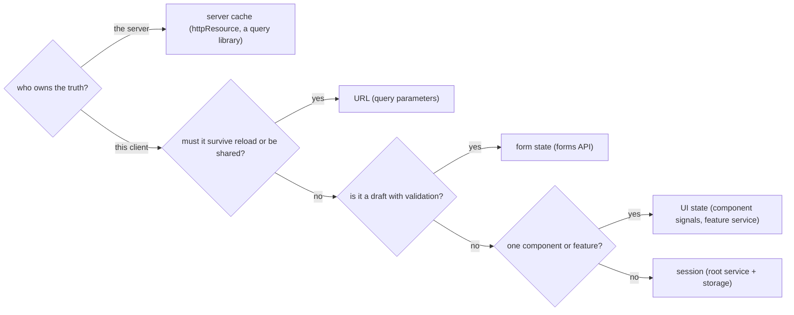

What to notice: a store library appears nowhere in the diagram; it holds some of these answers and decides none.

### How it actually works

**URL state.** `withComponentInputBinding` [Added in v16.0] writes route data into the routed component's inputs, so `?q=pen` reaches an `input<string>()` named `q`. Read from the `@angular/router` 22.2.1 source: `RoutedComponentInputBinder.subscribeToRouteData` (`fesm2022/_router-chunk.mjs`; internal, may change in any release) spreads `queryParams`, `params`, `data` and then the route's `resources` ([24](24-routing.md)) into one object in that order, so a path parameter beats a query parameter of the same name ([Q24.06](24-routing.md#q24-06) runs it), then calls `setInput` for each declared input; query parameters bind by default (`options.queryParams ??= true`). In the lab, writing the filter with `router.navigate([], { queryParams })` gives `/list?q=pen`, and a new injector and router that open that URL get the filter back (`Section 1: a query parameter restores the filter when the same URL is opened again`); the new injector stands in for a reload.

**Lifetime follows the provider.** A root service lives as long as its injector, so its state starts over when the injector is rebuilt (`Section 1: state in a root service starts over when the injector is rebuilt`). A service in a component's `providers` is created with the component and destroyed with it ([16 §6](16-dependency-injection.md#6-providers-versus-viewproviders-and-per-instance-state)): in the lab its `ngOnDestroy` ran and the next component got an empty draft (`Section 1: a draft provided by a component is gone after the component is destroyed`).

**The server cache is a cache.** A copy of server data needs a key and an invalidation rule; [27 §6](27-http-client.md#6-cancellation-and-caching-unsubscribing-aborts-cache-interceptors-sharereplay-and-the-ssr-transfer-cache) and [Q27.21](27-http-client.md#q27-21) choose the tool, and [17 §6](17-signals.md#6-resources-async-data-as-signals) shows the signal-driven read. TanStack Query for Angular, `@tanstack/angular-query-experimental` [Experimental since TanStack Query v5.12.1] (its first release; the docs call it experimental), says why (`docs/framework/angular/overview.md`, branch `main`, read 2026-10-13): server state "Implies shared ownership and can be changed by other people without your knowledge".

**Session state.** A root service holds it, and an `effect` ([17 §4](17-signals.md#4-effects)) can mirror it to storage, a mirror and not the home ([Q09.18](09-web-networking-storage-security.md#q09-18)).

### Code

The approach: keep the filter in the URL, then tie a draft to its provider.

1. Declare the filter as an input; enable `withComponentInputBinding()`.
2. Write it by navigating with a query parameter, then open that URL on a new injector.
3. Provide the draft in a component, destroy it and create another.

```ts
// Excerpt of labs/angular/src/app/modules/28-state-management/concepts/section-1-kinds-of-state.spec.ts
@Component({
  selector: 'lab-m28-filter-page',
  template: '{{ q() }}',
})
class LabM28FilterPage {
  readonly q = input<string>();
  private readonly router = inject(Router);

  setFilter(value: string): Promise<boolean> {
    return this.router.navigate([], { queryParams: { q: value } });
  }
}
```

```ts
// Excerpt of labs/angular/src/app/modules/28-state-management/concepts/section-1-kinds-of-state.spec.ts
await page.setFilter('pen');
first.detectChanges();
const url = TestBed.inject(Router).url;
expect(url).toBe('/list?q=pen');
expect(page.q()).toBe('pen');

// A reload: a new injector, a new router, and nothing but the URL carried over.
TestBed.resetTestingModule();
TestBed.configureTestingModule({ providers: [provideRouter(routes, withComponentInputBinding())] });
const second = await RouterTestingHarness.create();
const reopened = await second.navigateByUrl(url, LabM28FilterPage);
expect(reopened.q()).toBe('pen');
```

```ts
// Excerpt of labs/angular/src/app/modules/28-state-management/concepts/section-1-kinds-of-state.spec.ts
@Component({
  selector: 'lab-m28-draft-host',
  template: '{{ draft.text() }}',
  providers: [LabM28Draft],
})
class LabM28DraftHost {
  readonly draft = inject(LabM28Draft);
}
```

### Best practices and anti-patterns

- **Name the owner and the lifetime before choosing a container**, because that picks the home.
- **Put what must survive a reload or be shared in the URL**, because a reload and a pasted link carry only the address.
- **Keep server data as a cache behind one reader**, because a second copy in a store drifts when an edit lands.
- **Provide a draft in the component that edits it**, because it then dies with the form.

### Misconceptions and traps

- *"A state-management library is where all state goes."* Most state is server cache, URL or local. The TanStack docs (`docs/framework/react/guides/does-this-replace-client-state.md`, branch `main`, read 2026-10-13) call the global client state left after moving async code to a query library "usually very tiny". A store is the first tool that shares state, so everything gets poured into it.
- *"Server data is client state."* It sits in a variable, so it looks like the client's; the server owns it, so the copy goes stale ([27 §6](27-http-client.md#6-cancellation-and-caching-unsubscribing-aborts-cache-interceptors-sharereplay-and-the-ssr-transfer-cache)).
- *"URL state is the router's business, not state."* Routes are configured apart from services, so the address looks like plumbing; what must survive a reload belongs there.
- *"Session state should live in `localStorage`."* It survives a reload, so it looks like the home; storage mirrors a root service's state and has its own risks ([Q09.18](09-web-networking-storage-security.md#q09-18)).

Drilled in [Q28.01](#q28-01), [Q28.02](#q28-02) and [Q28.03](#q28-03); modelled in [Exercise 28.1](#ex28-1) and [Exercise 28.2](#ex28-2).

## 2. The service-with-signals store: state shape, derived selectors, methods and async loads

### The problem it solves

A catalog service keeps `items`, `loading` and `query` as separate signals. One write sets `loading`, a later one sets `items`, and between them the screen shows "no results". Two quick searches resolve out of order, and the older result wins. Components call `set` on the service's signals, so any of them can change the state.

### Mental model

A **feature store** is one service that owns a typed state and hides it. The state sits in a private signal; the only readers are **selectors** (a `computed` over that state) and the only writers are **action methods** named after intent (`search`). The state signal is the **single source of truth** of the feature: selectors derive from it, so no value is stored twice. An async load records a **status union** (a union of literal strings naming the phase; [Q06.11](06-ts-type-system-essentials.md#q06-11) models the stricter form) and drops a **stale response**, one that arrives after a newer request has replaced the query it answered.

A bank counter: you ask the teller (methods) and read balances derived from the ledger (selectors); nobody opens the vault.

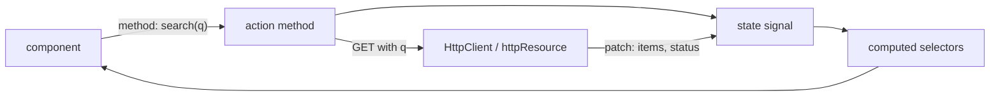

What to notice: data flows one way, from the component through a method into the state and back through the selectors; nothing outside the store holds a writable handle.

### How it actually works

**Selector granularity.** A `computed` that reads `state()` re-runs after every write to the state. In the lab, `items` and `loading` read `state()` and `count` read `items()`; after a `loading` update and a `filter` update, with reads after each, `items` ran 3 times, `loading` 3 and `count` once (`Section 2: a selector over the whole state re-runs on every update but its dependants stop when its result is unchanged`). Read from the `@angular/core` 22.2.1 source (`COMPUTED_NODE.producerRecomputeValue`, `fesm2022/_effect-chunk.mjs`; internal): it calls `node.equal(oldValue, newValue)`, `defaultEquals` is `Object.is`, and on a match it restores the old value and returns before `node.version++`. So `count` found `items` at the version it last read and did not run (read, not run; [17 §3](17-signals.md#3-computed-signals) owns the cut-off).

**Readers and writers.** A `computed` has no `set`: `'set' in store.items` is `false` and calling it is a compile error (`Section 2: the store exposes read-only signals and named methods`); [Q17.05](17-signals.md#q17-05) owns the pattern and [19 §2](19-component-communication-and-projection.md#2-sharing-state-beyond-the-tree-services-with-signals-and-di-scoped-state) the sharing. `isEmpty` combines status and items, and stayed `false` while the search was loading (`Section 2: an empty result is reported only after the load has finished`).

**Stale responses.** `search` feeds a `Subject`, and `switchMap` unsubscribes from the previous request ([23 §2](23-rxjs-in-depth.md#2-choosing-a-flattening-operator-races-lost-writes-cancellation-and-recursion), [Q23.07](23-rxjs-in-depth.md#q23-07)). In the lab the testing backend reported the first request as `cancelled`, flushing it threw `Cannot flush a cancelled request.`, and only the second response reached the state (`Section 2: a late response from an earlier search does not overwrite a newer one`). An `httpResource` keyed by the query cancels the same way ([27 §10](27-http-client.md#10-httpresource-signal-driven-requests-and-when-to-prefer-it-over-httpclient)), and for a plain read it is the better home for the data than this copy ([Exercise 28.1](#ex28-1)).

**Errors.** `catchError` sits inside the `switchMap` projection, so a failure ends one request and the pipeline keeps running. The error patch sets only `status`, so the last good list stays (`Section 2: a failed load sets the error status and keeps the previous items`); keeping it or blanking it is a design choice.

### Code

The approach: one private state signal, selectors as `computed`, one method that writes, and a pipeline that turns each query into a patch.

1. Declare the state and the status union.
2. Keep the state in a private signal and expose `computed` selectors only.
3. Let `search` patch the query and status, then push the query into a `Subject` whose `switchMap` pipeline patches the result or the error.
4. Search twice, flush the second request, then try the first.

```ts
// Excerpt of labs/angular/src/app/modules/28-state-management/concepts/section-2-signal-store.spec.ts
interface LabM28Product {
  readonly id: number;
  readonly name: string;
}

type LabM28LoadStatus = 'idle' | 'loading' | 'loaded' | 'error';

interface LabM28CatalogState {
  readonly query: string;
  readonly items: readonly LabM28Product[];
  readonly status: LabM28LoadStatus;
}
```

```ts
// Excerpt of labs/angular/src/app/modules/28-state-management/concepts/section-2-signal-store.spec.ts
@Injectable()
class LabM28CatalogStore {
  private readonly http = inject(HttpClient);
  private readonly state = signal<LabM28CatalogState>({ query: '', items: [], status: 'idle' });
  private readonly queries = new Subject<string>();

  readonly items = computed(() => this.state().items);
  readonly status = computed(() => this.state().status);
  readonly isEmpty = computed(() => this.status() === 'loaded' && this.items().length === 0);

  constructor() {
    this.queries
      .pipe(
        switchMap((q) =>
          this.http.get<LabM28Product[]>('/api/products', { params: { q } }).pipe(
            map((items): Partial<LabM28CatalogState> => ({ items, status: 'loaded' })),
            catchError(() => of<Partial<LabM28CatalogState>>({ status: 'error' })),
          ),
        ),
        takeUntilDestroyed(),
      )
      .subscribe((change) => this.patch(change));
  }

  search(query: string): void {
    this.patch({ query, status: 'loading' });
    this.queries.next(query);
  }

  private patch(change: Partial<LabM28CatalogState>): void {
    this.state.update((current) => ({ ...current, ...change }));
  }
}
```

```ts
// Excerpt of labs/angular/src/app/modules/28-state-management/concepts/section-2-signal-store.spec.ts
    store.search('pe');
    store.search('pen');
    const [first, second] = http.match((request) => request.url === '/api/products');
    expect([first.request.params.get('q'), second.request.params.get('q')]).toEqual(['pe', 'pen']);
    expect([first.cancelled, second.cancelled]).toEqual([true, false]);

    second.flush([{ id: 2, name: 'pen' }]);
    expect(() => first.flush([{ id: 1, name: 'pear' }])).toThrow('Cannot flush a cancelled request.');

    expect(store.items()).toEqual([{ id: 2, name: 'pen' }]);
    expect(store.status()).toBe('loaded');
```

### Best practices and anti-patterns

- **Keep the state signal private and expose selectors**, because then a method is the only way to change it.
- **Change related fields in one write** (`search` sets `query` and `status` together), because a reader between two writes would see a state that never existed.
- **Keep selectors cheap**, because one over the whole state re-runs on every write.
- **Cancel the previous load instead of ignoring its answer**, because an undelivered response cannot overwrite a newer one.

### Misconceptions and traps

- *"One big state signal is always better."* Atomic writes cost selectors that re-run on every write (3 runs above); the myth comes from Redux's single state object.
- *"Many independent signals avoid consistency problems."* Reads stay consistent because signals are glitch-free ([Q17.34](17-signals.md#q17-34)), but an invariant across fields then depends on every method; the myth comes from fine-grained reactivity looking like less coupling.
- *"A signal store needs `effect` to load data."* Methods start loads, and a keyed `httpResource` loads by itself; an effect pushes state out ([17 §4](17-signals.md#4-effects)), and the myth comes from using it as the async hook.
- *"`asReadonly()` makes the state immutable."* It removes `set` and `update` only, so an object inside stays mutable ([17 §2](17-signals.md#2-writable-signals)); the myth comes from the name.

Drilled in [Q28.04](#q28-04), [Q28.05](#q28-05) and [Q28.06](#q28-06); modelled in [Exercise 28.1](#ex28-1).

## 3. The service-with-`BehaviorSubject` store: the legacy-but-common pattern and its migration

### The problem it solves

A codebase from 2019 has thirty `*Store` services built on a `BehaviorSubject`. A screen adds an item with `push` and calls `next`, and the list does not change. A component reads the current value in its template and shows yesterday's state.

### Mental model

A **`BehaviorSubject` store** keeps its state in a private `BehaviorSubject` ([22 §4](22-rxjs-foundations.md#4-subjects-subject-behaviorsubject-replaysubject-and-asyncsubject) owns subjects and `asObservable()`), exposes `state$` and `select(fn)`, and changes state with `next({ ...state, ...change })`. **`select`** is `map(fn)` followed by **`distinctUntilChanged`**, the operator that drops a value equal to the previous one. Consumers subscribe or use the **`async` pipe**, a template pipe that subscribes, renders the latest value and unsubscribes at destroy ([23 §6](23-rxjs-in-depth.md#6-unsubscription-strategies-in-angular-and-finding-leaks)). It is the push-based twin of §2: a radio station broadcasting the playlist, where §2 is a notice board you glance at.

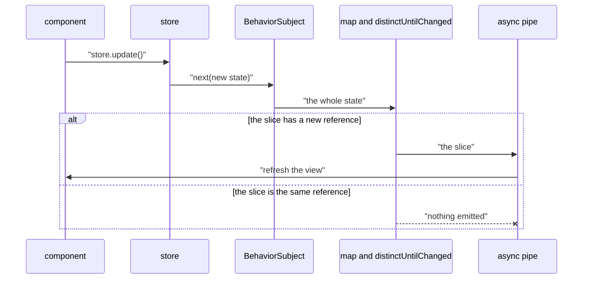

What to notice: a selector emits only when its slice's reference changes, so an in-place mutation never reaches the `async` pipe.

### How it actually works

**Why a mutation vanishes.** Read from the `rxjs` 7.8.2 source (`dist/esm/internal/operators/distinctUntilChanged.js`): without a comparator, `defaultCompare` returns `a === b`. For an array that compares references. In the lab, after `setItems(['a', 'b'])`, a `push('c')` into the snapshot's array and a `setLoading(false)` left the items subscriber with `['a']` and `['a', 'b']` only, while the array it held contained `'c'` (`Section 3: an in-place mutation followed by next is swallowed by distinctUntilChanged`). A repeated `setLoading(true)` emitted nothing either (`Section 3: select emits only when the selected slice changes`).

**Why `getValue()` is a trap in a view.** It reads and notifies nobody. In a zoneless component with the v22 `OnPush` default, a template reading `store.snapshot.loading` stayed `false` after the emission, and `loading$ | async` showed `true` (`Section 3: a view that reads the snapshot is not refreshed by an emission, a view with the async pipe is`). Read from `@angular/common` 22.2.1 (`fesm2022/_common_module-chunk.mjs`, `AsyncPipe.transform` and `_updateLatestValue`, internal): each value that arrives after the subscription calls `markForCheck()`; one emitted during the first subscribe (a `BehaviorSubject`'s current value) is just returned.

**Who pays for a selector.** Two subscribers to one `select` ran its function twice per emission (`Section 3: every subscriber to select runs the selector itself`); [23 §5](23-rxjs-in-depth.md#5-multicasting-in-depth-share-configuration-sharereplay-and-connect) owns `shareReplay`.

### Code

The approach: migrate readers first, then swap the internals.

1. Keep a private `BehaviorSubject`; expose `state$`, `select` and `snapshot` (the `getValue()` read).
2. Write through methods that copy: `{ ...snapshot, ...change }`, `[...items, item]`.
3. Wrap readers with `toSignal` [Stable since v20.0] and `requireSync: true`; a `BehaviorSubject` emits on subscribe and a `timer` does not ([Q23.24](23-rxjs-in-depth.md#q23-24)).
4. Replace the internals with a signal and keep the writers, so callers do not change.

#### Legacy

Signals replaced it in new code: a read needs no subscription and a `computed` replaces the `map` chain. [Q17.40](17-signals.md#q17-40) owns whether to migrate. The store, compiled under `ng build`:

```ts
// LEGACY: the service-with-BehaviorSubject store of module 28 §3. It is still common in codebases written before
// signals; new code uses a signal store (§2). The spec in concepts/section-3-behavior-subject-store.spec.ts runs it.
import { Injectable } from '@angular/core';
import { BehaviorSubject, Observable, distinctUntilChanged, map } from 'rxjs';

export interface LabM28ListState {
  items: string[];
  loading: boolean;
}

/** The pattern: a private BehaviorSubject, a read-only stream, `select` built from `map` and `distinctUntilChanged`. */
@Injectable()
export class LabM28LegacyListStore {
  private readonly subject = new BehaviorSubject<LabM28ListState>({ items: ['a'], loading: false });
  readonly state$: Observable<LabM28ListState> = this.subject.asObservable();

  get snapshot(): LabM28ListState {
    return this.subject.getValue();
  }

  select<T>(pick: (state: LabM28ListState) => T): Observable<T> {
    return this.state$.pipe(map(pick), distinctUntilChanged());
  }

  setLoading(loading: boolean): void {
    this.update({ loading });
  }

  setItems(items: string[]): void {
    this.update({ items });
  }

  addItem(item: string): void {
    this.update({ items: [...this.snapshot.items, item] });
  }

  private update(change: Partial<LabM28ListState>): void {
    this.subject.next({ ...this.snapshot, ...change });
  }
}
```

<sub>Source: [labs/angular/src/app/modules/28-state-management/legacy/behavior-subject-store.ts](../labs/angular/src/app/modules/28-state-management/legacy/behavior-subject-store.ts)</sub>

Step 3 (`Section 3: toSignal with requireSync reads the store's current value`):

```ts
// Excerpt of labs/angular/src/app/modules/28-state-management/concepts/section-3-behavior-subject-store.spec.ts
@Injectable()
class LabM28WrappedListStore {
  private readonly legacy = inject(LabM28LegacyListStore);
  readonly items = toSignal(this.legacy.select((state) => state.items), { requireSync: true });
  readonly loading = toSignal(this.legacy.select((state) => state.loading), { requireSync: true });
}
```

Step 4: one driver ran both stores to the same state (`Section 3: the signal rewrite keeps the store's public methods`):

```ts
// Excerpt of labs/angular/src/app/modules/28-state-management/concepts/section-3-behavior-subject-store.spec.ts
@Injectable()
class LabM28SignalListStore implements LabM28ListWriter {
  private readonly state = signal<{ items: readonly string[]; loading: boolean }>({ items: ['a'], loading: false });
  readonly items = computed(() => this.state().items);
  readonly loading = computed(() => this.state().loading);

  setLoading(loading: boolean): void {
    this.state.update((current) => ({ ...current, loading }));
  }

  setItems(items: readonly string[]): void {
    this.state.update((current) => ({ ...current, items }));
  }

  addItem(item: string): void {
    this.state.update((current) => ({ ...current, items: [...current.items, item] }));
  }
}
```

### Best practices and anti-patterns

- **Copy on every write**, because `distinctUntilChanged` compares references and swallows a mutation.
- **Expose `asObservable()` and methods, never the subject**, because a holder of the subject can `next` any state ([Q22.18](22-rxjs-foundations.md#q22-18)).
- **Read with `select` or a signal in views, not `getValue()`**, because `getValue()` notifies nobody.

### Misconceptions and traps

- *"`BehaviorSubject` stores are deprecated."* The RxJS 7.8.2 typings of `BehaviorSubject` carry no `@deprecated` tag; the pattern is a design choice, and the myth comes from signals in new documentation.
- *"`distinctUntilChanged` compares contents."* The default is `===`; the myth comes from the name.
- *"`getValue()` in a template is fine."* It never triggers a check; the myth comes from it being synchronous like a signal read.
- *"A `BehaviorSubject` replays, so `select` needs no `shareReplay`."* It replays the state, while each subscriber recomputes the selector's result; the myth comes from mixing the two.

Drilled in [Q28.07](#q28-07) and [Exercise 28.4](#ex28-4).

## 4. NgRx Store: actions, reducers, `createActionGroup`, `createFeature` and runtime checks

### The problem it solves

Six screens change the same cart, and a bug report says "the total was wrong after login". Nothing records which code changed it. One handler pushes into the cart's array: its screen looks right, and a screen that compares references is never told.

### Mental model

The **Redux pattern** is **unidirectional data flow**: state changes in one direction and through one door. In **NgRx Store** a component **dispatches** an **action**, a plain object whose string `type` says what happened, written `[Source] Event` such as `[Cart Page] Add Item`. An **action creator** is a function that builds that object. A **reducer** is a **pure function** `(state, action) => nextState` with no side effects ([03 §7](03-js-objects-prototypes-classes.md#7-immutability-and-change-by-copy-array-methods) owns change by copy). The **store** holds the single state tree, **selectors** (§5) read it, and **effects** (§6) run side effects and dispatch new actions. A bank ledger: balances are never edited, transactions are appended, and the balance is their sum.

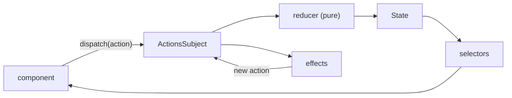

What to notice: the only way state changes is an action through a reducer; effects re-enter as actions, never as writes.

### How it actually works

**Actions.** `props<{ title: string }>()` declares a payload and `emptyProps()` none; an **action group**, `createActionGroup({ source, events })`, builds one creator per event of one source. The NgRx docs (`store/action-groups.md`, branch `main`, read 2026-10-13) say the action type "is created using the "[Source] Event Name" pattern" and the creator name "by camel-casing the event name". Read from the `@ngrx/store` 22.0.1 source (`fesm2022/ngrx-store.mjs`), `createActionGroup` calls `createAction(toActionType(source, eventName), …)` once per event (`toActionName` and `toActionType` are internal). In the lab, `Add Todo`, `Clear All`, `Load` and `Loaded` gave `addTodo`, `clearAll`, `load` and `loaded`, with types such as `[Todos Page] Add Todo` (`Section 4: createActionGroup derives camelCase creators and bracketed types`).

**Reducers and features.** `on(creator, handler)` pairs an action with a handler. Read from the same file, `createReducer` keeps handlers in a `Map` keyed by type and returns the given state for an unknown type. `addTodo` returned a new object and left the old `items` empty, and an unknown type returned the same reference (`Section 4: a reducer handles an action and returns a new state`). `createFeature({ name, reducer })` bundles a **feature**, one named slice of the state tree, and returned `name`, `reducer`, `selectTodosState`, `selectItems` and `selectN`, one selector per state key (`Section 4: createFeature returns the reducer and one selector per state key`). `provideStore()` registers the root store and `provideState(feature)` a feature's reducer under its name; both are standalone provider functions ([15 §3](15-standalone-and-ngmodules.md#3-bootstrapping-and-providers-without-modules-bootstrapapplication-provide-functions-and-importprovidersfrom)). With an effect mapping `load` to `loaded({ n: 7 })`, `n` was `7` as soon as `dispatch(load())` returned (`Section 4: an effect's action is reduced before dispatch returns`).

**Runtime checks** are guards around every reducer, built as **meta-reducers** (functions that take a reducer and return a wrapped one). Read from the `@ngrx/store` 22.0.1 source, `createActiveRuntimeChecks` (internal, may change in any release) returns, when `isDevMode()` is true, `strictStateSerializability: false`, `strictActionSerializability: false`, `strictStateImmutability: true`, `strictActionImmutability: true`, `strictActionWithinNgZone: false` and `strictActionTypeUniqueness: false`, then spreads your `runtimeChecks` over them; outside development all six are `false`. `immutabilityCheckMetaReducer` (internal) calls `freeze` (internal), a recursive `Object.freeze`, on the action and the next state, which confirms [03 §7](03-js-objects-prototypes-classes.md#7-immutability-and-change-by-copy-array-methods). The state after `addTodo({ title: 'a' })` was `{"items":["a"],"n":0}`, frozen like `items`, and `push` threw `TypeError` (`Section 4: in development the store state is frozen and a push throws`).

**A reducer that mutates.** With the defaults, `items.push` inside a reducer failed with "Cannot add property 0, object is not extensible", reported to RxJS's unhandled-error hook, not thrown to the caller of `dispatch` (`Section 4: in development a reducer that mutates the state fails inside dispatch, not in the caller`). With both immutability checks off, the state became `{"items":["b","c"]}` while the subscriber saw only the initial value: `select` ends with `distinctUntilChanged` and the reference never changed (`Section 4: with the immutability checks off, an in-place reducer changes the state but notifies nobody`).

### Code

The approach: name the events once, handle them in a pure reducer, bundle it as a feature, then provide it.

1. Declare the events in an action group.
2. Write the reducer with `on`, copying on every change.
3. Wrap it with `createFeature`.
4. Provide the store and feature, dispatch, read.

```ts
// Partial: the fixture of concepts/section-4-ngrx-store.spec.ts, imports omitted
interface TodosState { items: string[]; n: number }

export const TodosPage = createActionGroup({
  source: 'Todos Page',
  events: {
    'Add Todo': props<{ title: string }>(),
    'Clear All': emptyProps(),
  },
});

export const todosFeature = createFeature({
  name: 'todos',
  reducer: createReducer<TodosState>(
    { items: [], n: 0 },
    on(TodosPage.addTodo, (state, { title }) => ({ ...state, items: [...state.items, title] })),
    on(TodosPage.clearAll, (state) => ({ ...state, items: [] })),
  ),
});
```

```ts
// Partial: inside a TestBed test of the same spec
TestBed.configureTestingModule({ providers: [provideStore(), provideState(todosFeature)] });
const store = TestBed.inject(Store);
store.dispatch(TodosPage.addTodo({ title: 'a' }));
const items = store.selectSignal(todosFeature.selectItems); // ['a']
```

#### Legacy

Before the provider functions, the store was registered in an `NgModule` with one hand-written `createAction` per action, the call `createActionGroup` makes for you. Neither carries a `@deprecated` tag in the 22.0.1 typings. Migrate by replacing `StoreModule.forRoot` and `forFeature` with `provideStore()` and `provideState(feature)`, and a file of `createAction` calls with one action group.

```ts
// LEGACY: the NgModule registration of NgRx Store, module 28 §4. Before the provider functions, a module imported
// StoreModule and each action was a hand-written createAction; new code uses provideStore, provideState and an action group.
import { NgModule } from '@angular/core';
import { StoreModule, createAction, createFeature, createReducer, on, props } from '@ngrx/store';

export interface LabM28LegacyTodosState {
  items: string[];
  n: number;
}

export const labM28LegacyAddTodo = createAction('[Todos Page] Add Todo', props<{ title: string }>());

export const labM28LegacyTodosFeature = createFeature({
  name: 'todos',
  reducer: createReducer<LabM28LegacyTodosState>(
    { items: [], n: 0 },
    on(labM28LegacyAddTodo, (state, { title }) => ({ ...state, items: [...state.items, title] })),
  ),
});

@NgModule({ imports: [StoreModule.forRoot({}), StoreModule.forFeature(labM28LegacyTodosFeature)] })
export class LabM28LegacyTodosModule {}
```

<sub>Source: [labs/angular/src/app/modules/28-state-management/legacy/ngmodule-store.ts](../labs/angular/src/app/modules/28-state-management/legacy/ngmodule-store.ts)</sub>

### Best practices and anti-patterns

- **Name actions as events, not commands**, because several reducers and effects can then react to one event.
- **Copy in every `on` handler**, because in development an in-place write fails on the frozen state.
- **Keep the development runtime checks on**, because they turn a silent mutation into an error.
- **Keep service calls out of reducers**, because effects (§6) own side effects and a reducer must replay.

### Misconceptions and traps

- *"Actions are commands (`setItems`)."* Method-call habit makes them look like calls; the `[Source] Event` pattern records what happened, so any reducer or effect can respond.
- *"A reducer may call a service."* Its file looks like a service, but it must be pure so replay works.
- *"The state is frozen in production too."* The development `TypeError` suggests it; all six checks are `false` outside development.
- *"NgRx requires NgModules."* Older `StoreModule` examples suggest it; `provideStore` and `provideState` are standalone providers.

Drilled in [Q28.08](#q28-08), [Q28.09](#q28-09), [Q28.10](#q28-10) and [Q28.11](#q28-11); modelled in [Exercise 28.4](#ex28-4).

## 5. Selectors: memoization, composition and reading the store as signals

### The problem it solves

A dashboard filters 5,000 rows inside a selector, and the filter runs again after every unrelated action. An item-by-id selector takes a `{ id }` object from a template method and recomputes on every call. A component forgets to unsubscribe from `store.select`.

### Mental model

A **selector** is a pure function from the state tree to a value, **memoized**: it remembers its last inputs and result, so equal inputs return the stored result. An **input selector** picks a slice; the **projector** turns the inputs' results into the answer. `createSelector(...inputs, projector)` builds the pair and `createFeatureSelector('todos')` picks a feature's slice. A spreadsheet cell recalculates only when its referenced cells change.

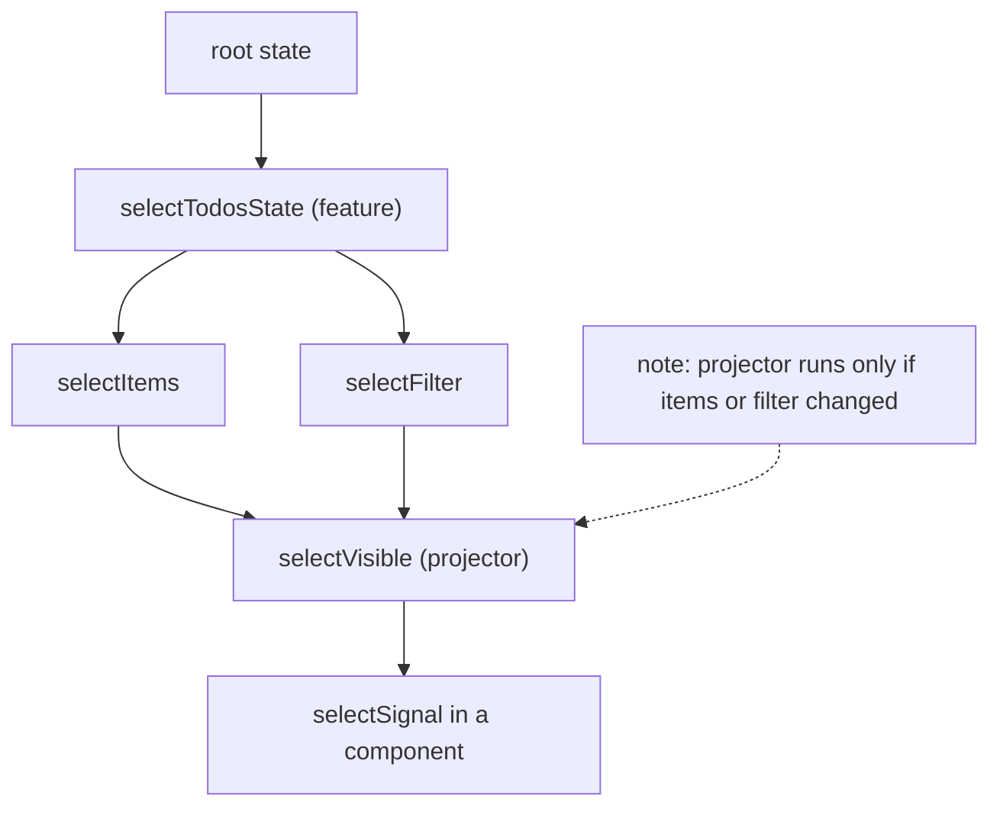

What to notice: each selector keeps one cached result, so `selectVisible` is untouched by an unrelated key; an argument needs one selector instance per value.

### How it actually works

**One entry, compared by reference.** Read from the `@ngrx/store` 22.0.1 source (`fesm2022/ngrx-store.mjs`), `defaultMemoize` (public) keeps `lastArguments` and `lastResult`, one entry, and compares each argument with `isEqualCheck` (internal, may change in any release), which is `a === b`. `createSelector` is `createSelectorFactory(defaultMemoize)`, which runs the projector only when an input's result changed. In the lab, called with a state, the same state, a new root with the same `items` array and a new root with a new equal array, a projector over `items` ran twice (first call, equal array) (`Section 5: the projector re-runs only when an input selector's result changes`). The docs (`store/selectors.md`, `main`, read 2026-10-13) describe the same cache.

**Props and factories.** A selector with props [Deprecated since NgRx v12.0 — use a selector factory] receives `(state, props)`, and `props` joins the projector's arguments. The v12 migration guide says "Selectors with props are deprecated in favor of "normal" factory selectors"; the 22.0.1 typings add "will be removed in v23", the typings' statement, not a forecast here. With one props object the projector ran once for two calls; `{ id: 2 }`, the first object again, and a new object with equal contents each ran it again: one cache shared across ids (`Section 5: a selector with props shares one cache across props`). A factory such as `(id) => createSelector(...)` gives each id its own memo. Created once, it ran once over three calls, one after an unrelated change; created inside a method each call, it ran three times (`Section 5: a factory selector created once per id keeps its memo`).

**Generated and composed.** `createFeature` ([§4](#4-ngrx-store-actions-reducers-createactiongroup-createfeature-and-runtime-checks)) calls the reducer once with `@ngrx/feature/init` and builds `select<Key>` from each initial-state key in `createNestedSelectors` (internal); `extraSelectors` receives them. After an action changed only `n`, a selector over `selectItems` and `selectFilter` returned the same array without rerunning; a filter change reran it (`Section 5: a composed selector skips its projector when only an unrelated key changes`).

**Reading as signals.** `Store.selectSignal` is `computed(() => selector(this.state()), options)`, and `State` builds `this.state` with `toSignal(this, { manualCleanup: true, requireSync: true })`. A read subscribes nothing: two reads ran the selector once, a dispatch once more, and a second `selectSignal` ran it on its own (`Section 5: selectSignal reads the current selector value`); `toSignal(store.select(...))` gave the same value through a subscription ([23 §7](23-rxjs-in-depth.md#7-rxjs-and-signals-decision-rules-tosignal-toobservable-and-rxresource)).

**Testing.** `MockStore` (`@ngrx/store/testing`) extends `Store`, and `overrideSelector` calls the selector's `setResult`, skipping the projector. A selector overridden to `99` emitted `99`, then `5` after `overrideSelector` and `refreshState()` (`Section 5: MockStore overrides a selector value`); module 29 owns testing.

### Code

The approach: compose, build the by-id selector once, read as signals.

1. Compose `selectVisible`.
2. Write `selectById` as a factory.
3. Build the by-id selector in a field, never in a template.
4. Expose both with `selectSignal`.

```ts
// Partial: concepts/section-5-selectors.spec.ts, imports omitted; todosFeature as in section 4, with items, filter and n
export const selectVisible = createSelector(
  todosFeature.selectItems,
  todosFeature.selectFilter,
  (items, filter) => items.filter((todo) => todo.title.includes(filter)),
);

export const selectById = (id: number) =>
  createSelector(todosFeature.selectItems, (items) => items.find((todo) => todo.id === id));
```

```ts
// Partial: a component over the selectors above, not run in a spec; imports omitted
@Component({
  selector: 'lab-m28-todo-list',
  template: `@for (todo of visible(); track todo.id) { <p>{{ todo.title }}</p> }`,
})
export class LabM28TodoList {
  private readonly store = inject(Store);
  protected readonly visible = this.store.selectSignal(selectVisible);
  protected readonly first = this.store.selectSignal(selectById(1));
}
```

### Best practices and anti-patterns

- **Compose from the narrowest input selectors**, because a wide input changes, and reruns the projector, on every change to its slice.
- **Build a factory selector once per id and keep it**, because one created in a method starts with an empty memo each call.
- **Read in components with `selectSignal`**, because it needs no unsubscribe; keep `select` for stream operators.

### Misconceptions and traps

- *"Memoized selectors cache every argument."* They keep one entry (2 runs for 4 calls above); "memoize" suggests a cache keyed by input.
- *"A selector with props memoizes per prop."* They share one cache, because `props` is one more argument compared with `===`; this API is deprecated.
- *"A projector that builds a new array re-renders even when nothing changed."* It does not run unless an input changed, so the same reference reaches the view; the myth assumes `filter` always runs.
- *"`selectSignal` subscribes on every read."* It is a `computed` over `State`'s signal; the myth comes from `select` returning an Observable.

Drilled in [Q28.12](#q28-12), [Q28.13](#q28-13) and [Q28.14](#q28-14); modelled in [Exercise 28.4](#ex28-4).

## 6. Effects: functional effects, flattening, error handling and `dispatch: false`

### The problem it solves

A search effect on `mergeMap` shows an older query's results after a newer one's. A save effect on `switchMap` cancels a request already on its way. One failure ends an effect for the session. An analytics effect dispatches its own trigger and loops.

### Mental model

An **effect** is a long-lived stream that listens to actions, runs a side effect (HTTP, navigation, storage) and usually answers with a new action. `Actions` is the injectable stream of actions after their reducer ran; `ofType(creator)` narrows it to one type. A **functional effect** is a plain constant, `createEffect(fn, { functional: true })`, and `provideEffects({ … })` registers it. `{ dispatch: false }` marks an effect that emits none. The **effects error handler** is the function NgRx wraps around each effect to catch its errors. A kitchen ticket printer: orders arrive, the cook answers with a new ticket, and one burnt dish must not close the kitchen.

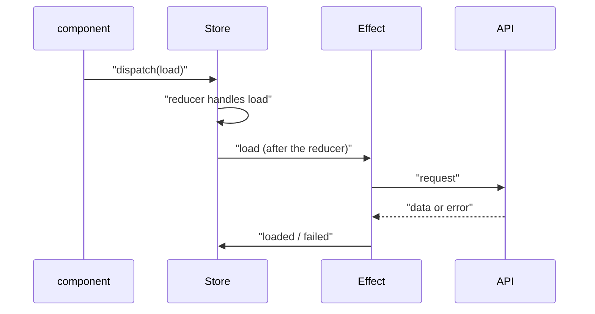

What to notice: the effect never writes state; it answers with actions.

### How it actually works

**Defaults.** Read from the `@ngrx/effects` 22.0.1 source (`fesm2022/ngrx-effects.mjs`), `createEffect` merges `{ dispatch: true, functional: false, useEffectsErrorHandler: true }` under your config; with `functional: true` it returns the function itself, and `provideEffects` is a standalone provider function ([15 §3](15-standalone-and-ngmodules.md#3-bootstrapping-and-providers-without-modules-bootstrapapplication-provide-functions-and-importprovidersfrom)). `mergeEffects` ends a `dispatch: false` effect with `ignoreElements()`. The reducer runs first: `State` in `@ngrx/store` calls `this.next(state)`, then `scannedActions.next(action)`, and `Actions` wraps that `ScannedActionsSubject` (read, not run).

**The error handler.** A `dispatch: false` effect that threw on its second of three actions still logged `fx 1`, `fx 2`, `fx 3`, and a recording `{ handleError }` value in place of `ErrorHandler` received `Error: boom` once (`Section 6: an effect that throws is resubscribed and the error reaches ErrorHandler`). `defaultEffectsErrorHandler` (public) is a `catchError` that reports to that handler and subscribes again, counting down from `MAX_NUMBER_OF_RETRY_ATTEMPTS = 10` (internal, may change in any release). An effect that threw on every action ran 11 times over 14 dispatches, the handler recorded 10 errors, and the eleventh escaped unhandled (`Section 6: the handler reports ten errors and then stops catching`).

**`catchError` placement.** An error reaching the outer stream ends it, and a completion is not resubscribed ([23 §3](23-rxjs-in-depth.md#3-errors-catcherror-placement-finalize-and-error-versus-complete), [Q23.11](23-rxjs-in-depth.md#q23-11)). With `load` for `1, 2, 3` and a request failing for `2`, `catchError` after `switchMap` logged `Load`, `Loaded`, `Load`, `Failed`, `Load` and no answer to the third (`Section 6: catchError outside switchMap completes the effect after the first failure`). Inside the inner pipe the third was answered with `Loaded` (`Section 6: catchError inside switchMap keeps the effect alive`).

**`tapResponse` and `mapResponse`** come from `@ngrx/operators`, not `@ngrx/effects`. The `tapResponse` callback signature [Removed in NgRx v22.0] is gone, and the object form takes `next`, `error` and optional `complete` and `finalize`; `tapResponse({ next, error })` runs `next` through `tap`, then `error` and `EMPTY` on failure, so in the inner pipe it keeps the effect alive. It passes the values on unchanged, so it suits `dispatch: false` effects and `rxMethod`; `mapResponse({ next, error })` maps both outcomes to actions. `tapResponse((v) => …, () => …)` failed with `TS2554` (`Section 6: tapResponse takes an object of callbacks`; `Section 6: mapResponse maps both outcomes to actions`).

**Flattening is the policy.** With two requests answered newest first, `switchMap` kept only `2`, `mergeMap` emitted `2` then `1`, and `concatMap` emitted `1` then `2` (`Section 6: the flattening operator decides which response wins`). [23 §2](23-rxjs-in-depth.md#2-choosing-a-flattening-operator-races-lost-writes-cancellation-and-recursion) owns the choice.

### Code

The approach: one effect answers with actions, one only observes.

1. Write the loading effect with the error handled in the inner pipe.
2. Write the observing effect with `dispatch: false`.
3. Register both with `provideEffects`.

```ts
// Partial: adapted from concepts/section-6-effects.spec.ts, imports omitted; load, loaded and failed are createAction creators, api() returns an Observable<number>, LAB_LOG is a token holding a string array
export const loadEffect = createEffect(
  (actions$ = inject(Actions)) =>
    actions$.pipe(
      ofType(load),
      switchMap(({ n }) =>
        api(n).pipe(
          mapResponse({ next: (v) => loaded({ n: v }), error: () => failed({ n }) }),
        ),
      ),
    ),
  { functional: true },
);

export const logEffect = createEffect(
  (actions$ = inject(Actions), log = inject(LAB_LOG)) =>
    actions$.pipe(ofType(load, loaded, failed), tap((a) => log.push(a.type))),
  { functional: true, dispatch: false },
);
```

```ts
// Partial: inside a TestBed test, as in concepts/section-6-effects.spec.ts
TestBed.configureTestingModule({
  providers: [provideStore(), provideEffects({ loadEffect, logEffect })],
});
TestBed.inject(Store).dispatch(load({ n: 1 }));
```

#### Legacy

Before functional effects, an effect was a field of an `@Injectable()` class registered in an `NgModule`. It still runs under `provideEffects(LabM28Effects)` (`Section 6: a class effect with createEffect runs under provideEffects`); the 22.0.1 typings carry no `@deprecated` tag. Migrate each field to a `createEffect(…, { functional: true })` constant, or keep the class and register it with `provideEffects(LabM28Effects)`.

```ts
// LEGACY: the class-based NgRx effect and its NgModule registration, module 28 §6. Before functional effects, an effect was a
// field of an @Injectable() class registered with EffectsModule; new code uses a createEffect(..., { functional: true }) constant.
import { Injectable, NgModule, inject } from '@angular/core';
import { Actions, EffectsModule, createEffect, ofType } from '@ngrx/effects';
import { createAction, props } from '@ngrx/store';
import { map } from 'rxjs';

export const labM28LegacyLoad = createAction('[Legacy Effects] Load', props<{ n: number }>());
export const labM28LegacyLoaded = createAction('[Legacy Effects] Loaded', props<{ n: number }>());

@Injectable()
export class LabM28Effects {
  private readonly actions$ = inject(Actions);

  readonly load$ = createEffect(() =>
    this.actions$.pipe(
      ofType(labM28LegacyLoad),
      map(({ n }) => labM28LegacyLoaded({ n })),
    ),
  );
}

@NgModule({ imports: [EffectsModule.forRoot([LabM28Effects])] })
export class LabM28LegacyEffectsModule {}
```

<sub>Source: [labs/angular/src/app/modules/28-state-management/legacy/class-effects.ts](../labs/angular/src/app/modules/28-state-management/legacy/class-effects.ts)</sub>

### Best practices and anti-patterns

- **Choose the flattening operator per effect**, because it decides which response wins.
- **Handle errors inside the inner pipe**, because the outer stream then never sees one.
- **Use `dispatch: false` for effects that only observe**, because a dispatched action could loop back through `ofType`.

### Misconceptions and traps

- *"An error kills an effect forever."* Plain RxJS ends a stream on error; NgRx's handler resubscribes up to ten times.
- *"`catchError` anywhere makes an effect safe."* The name suggests handling, but outside the inner pipe it turns the error into an unresubscribed completion.
- *"`switchMap` is the default for every effect."* Search examples are copied; it cancels saves ([23 §2](23-rxjs-in-depth.md#2-choosing-a-flattening-operator-races-lost-writes-cancellation-and-recursion)).
- *"Effects run before the reducer."* They listen to actions that already passed it, because `State` emits the state first.

Drilled in [Q28.15](#q28-15), [Q28.16](#q28-16) and [Q28.17](#q28-17).

## 7. NgRx Entity, Router Store and Store DevTools

### The problem it solves

A reducer maps over 2,000 orders to change one. A selector needs the route's `q`, which only the router has. A bug cannot be reproduced, and no one sees the actions behind it.

### Mental model

An **entity** is a record with a unique id. **Normalized state** stores a collection once, as a list of ids plus a lookup by id; `EntityState<T>` is `{ ids, entities }`. An **entity adapter**, made by `createEntityAdapter`, is a bundle of pure functions over that shape (`addMany`, `updateOne`, `getSelectors()`). Its options are `selectId` and `sortComparer`, which orders `ids` (default `false`). **Router Store** (`@ngrx/router-store`) dispatches an action for each navigation stage and keeps the router state in the store; a **router state serializer** reduces Angular's router snapshot to a plain object. **Store DevTools** (`@ngrx/store-devtools`) connects the store to the **Redux DevTools** browser extension, which lists actions, diffs state and offers **time travel**, jumping to an earlier state. `maxAge` caps the recorded history and `logOnly` restricts the extension's features.

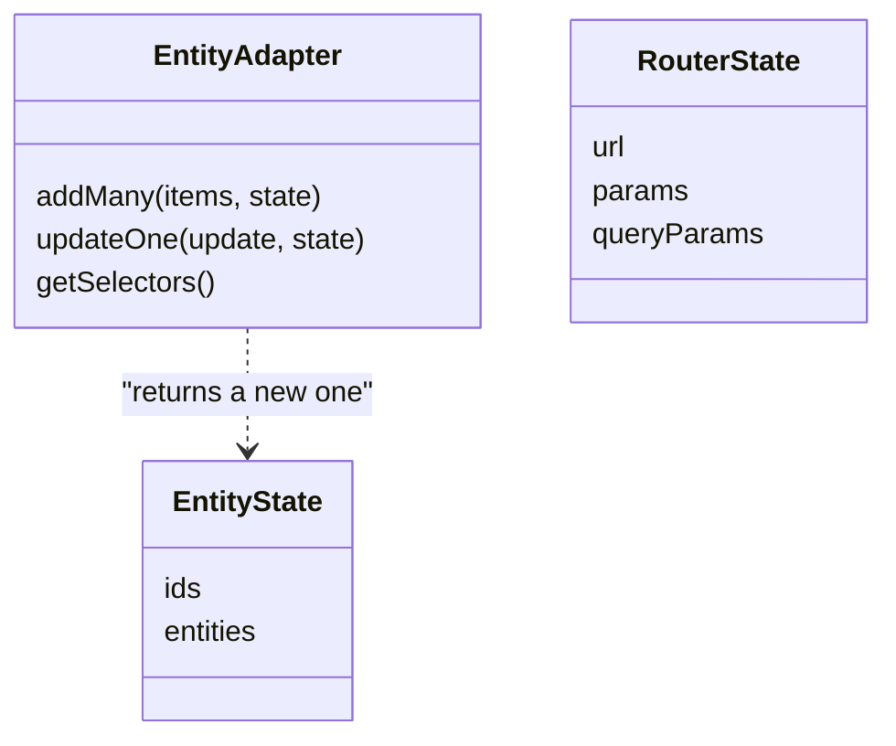

What to notice: the adapter is pure functions over a plain object; nothing is stored inside it.

### How it actually works

**The adapter.** Read from the `@ngrx/entity` 22.0.1 source (`fesm2022/ngrx-entity.mjs`), `createEntityAdapter` uses `createSortedStateAdapter` (internal) when `sortComparer` is set and `createUnsortedStateAdapter` (internal) otherwise. `createStateOperator` (internal, may change in any release) copies `ids` and `entities` shallowly, lets the operation change the copies, and returns the old state when nothing changed; entities are not cloned. `addMany` of ids 2 (`'b'`) then 1 (`'a'`) gave `ids` `[1, 2]` with a comparer on `t`, and `[2, 1]` without one (`Section 7: the adapter keeps ids sorted and entities keyed by id`). After `updateOne({ id: 2, changes: { t: 'c' } })`, entity 1 was the same reference, entity 2 a new object; changing entity 1 to `'z'` re-sorted `ids` (`Section 7: updateOne keeps the references of untouched entities`). Normalization makes a lookup a property read, not a scan ([§10](#10-optimistic-updates-normalization-and-undo)).

**Router Store.** With `routerReducer` under `router` and `provideRouterStore()`, navigating a `RouterTestingHarness` to `/orders?q=abc` and then `?q=def` made `getRouterSelectors().selectQueryParam('q')` emit `undefined`, `'abc'`, `'def'` (`Section 7: router store selectors read the current query parameter`). The default serializer is `MinimalRouterStateSerializer` (read, `_createRouterConfig`, internal). The `@ngrx/router-store/data-persistence` helpers [Deprecated since NgRx v22.0 — use core RxJS operators] carry a `@deprecated` tag.

**DevTools.** jsdom has no extension: `createReduxDevtoolsExtension` (internal) finds no `window.__REDUX_DEVTOOLS_EXTENSION__`, so the `REDUX_DEVTOOLS_EXTENSION` token was `null`. `provideStoreDevtools({ maxAge: 3 })` still provided, the store emitted 6 times (the initial value and one per dispatch of `x1` to `x5`), and the recorded list held `@ngrx/store/init`, `x4` and `x5` (`Section 7: provideStoreDevtools provides without the browser extension`). `maxAge: 1` threw "Devtools 'maxAge' cannot be less than 2, got 1" (`Section 7: provideStoreDevtools rejects a maxAge below two`). Read from `@ngrx/store-devtools` 22.0.1, `createConfig` (internal) turns `logOnly` into the features `pause`, `export` and `test` only, and `recomputeStates` (internal) replays the recorded actions through the reducer. Time travel therefore needs reducers that return the same result for the same input ([§4](#4-ngrx-store-actions-reducers-createactiongroup-createfeature-and-runtime-checks)). `maxAge` defaults to `false`, no limit (read, the `createConfig` defaults). The extension, time travel and `connectInZone` are documented only.

### Code

The approach: build the adapter once and register the two tools.

1. Create the adapter with a `sortComparer`.
2. Add entities and read them with `getSelectors()`.
3. Provide the router reducer, `provideRouterStore()` and `provideStoreDevtools`.

```ts
// Partial: adapted from concepts/section-7-entity-router-devtools.spec.ts, imports omitted
interface LabM28Order { id: number; title: string }

const adapter = createEntityAdapter<LabM28Order>({
  sortComparer: (a, b) => a.title.localeCompare(b.title),
});

const next = adapter.addMany(
  [{ id: 2, title: 'b' }, { id: 1, title: 'a' }],
  adapter.getInitialState(),
);
const { selectAll, selectTotal } = adapter.getSelectors();
selectAll(next); // [{ id: 1, … }, { id: 2, … }]
```

```ts
// Partial: application providers, not compiled in the repository
provideStore({ router: routerReducer }),
provideRouterStore(),
provideStoreDevtools({ maxAge: 25, logOnly: !isDevMode() }),
```

### Best practices and anti-patterns

- **Set `sortComparer` only when the order matters**, because the docs call the unsorted adapter "more performant during CRUD operations".
- **Give `provideStoreDevtools` a `maxAge` and `logOnly: !isDevMode()`**, because the history is unlimited by default and the docs' setup is log-only outside development.
- **Read the route from the router when no selector needs it**, because Router Store pays off when selectors combine URL and state ([Q28.19](#q28-19)).

### Misconceptions and traps

- *"Entity is a database."* The name suggests storage; it is pure helpers.
- *"`ids` follow insertion order."* Arrays keep insertion order; with a `sortComparer` the adapter sorts.
- *"Router Store is required to read params in effects."* Tutorials show it, but `inject(Router)` or input binding ([24 §2](24-routing.md#2-route-parameters-path-matrix-query-and-fragment-inheritance-and-component-input-binding)) works too.
- *"DevTools cost nothing in production."* It is an extension, but it records actions and states in memory unless `maxAge` or `logOnly` limit it.

Drilled in [Q28.18](#q28-18), [Q28.19](#q28-19) and [Q28.20](#q28-20).

## 8. ComponentStore and SignalStore: `signalState`, `signalStore`, `withState`, `withComputed`, `withMethods` and protected state

### The problem it solves

A data grid with paging, sorting and selection needs more structure than loose signals, but a global store is overkill. A team copies 2022 ComponentStore examples and asks whether they are current. A component calls `patchState` on a shared store, and nobody can say who changed the filter.

### Mental model

**ComponentStore** (`@ngrx/component-store`) is a class you extend, built on RxJS: `setState` replaces the state, an **`updater`** is a pure function `(state, value) => state` exposed as a method, `select` returns an Observable, `effect` runs side effects. **SignalStore** is the signal-based store of `@ngrx/signals`. `signalStore(...)` returns an injectable class assembled from **store features**, functions that each add members: `withState` state, `withComputed` derived values, `withMethods` writers and `withHooks` lifecycle callbacks. `withProps` [Added in NgRx v19.0] adds other members, such as an injected service. `signalState({ ... })` is the state container alone: no class, no features.

Each top-level state key becomes a signal; a nested object becomes a **deep signal**, one that also exposes a signal per property (`store.paging.total()`). **`patchState(store, partial)`** writes. **Protected state** means the store type that components receive does not accept `patchState`, so only methods inside `withMethods` can write. Like LEGO, each brick adds members and sees only the bricks below.

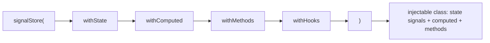

What to notice: each feature receives the members of the features before it, never those after it.

### How it actually works

Read from the `@ngrx/signals` 22.0.1 source (`fesm2022/ngrx-signals.mjs`), `signalStore` declares an `@Injectable` class whose constructor folds the features over an initial inner store (`getInitialInnerStore`, internal, may change in any release). Each feature takes the store so far and returns a bigger one, so `withMethods` hands its factory only the state signals, props and earlier methods. Naming a later one is a compile error, `TS2339` (`Section 8: a feature sees only the members of the features before it`). The constructor then copies the members onto `this`, runs `onInit`, and registers `onDestroy` with `inject(DestroyRef)`. The store dies with the injector that provides it.

The grid store below had exactly the keys `load, next, page, pageRows, pageSize, paging, rows`, and `inject` returned one shared instance (`Section 8: a signal store exposes state, computed and methods as one object`). `paging.total()` read through the deep signal, and `signalState` returned a function (`Section 8: nested state is exposed as deep signals`).

**Protection is a type, not a lock.** `patchState` accepts a `WritableStateSource`, which the instance is not: calling it outside the store fails with `TS2345`, and `signalStore({ protectedState: false }, …)` compiles. At runtime the write still happened, and a cast passed (`Section 8: patchState from outside does not compile unless protectedState is false`). The cause is in the source: the constructor stores the same writable state object (`STATE_SOURCE`, internal) on the instance, and the option changes only the type. `unprotected()` from `@ngrx/signals/testing` is the test helper.

**State is not frozen.** `getState(store)` and its nested object were not frozen, nor was an array passed to `patchState` (`Section 8: SignalStore state is not frozen in development`). NgRx Store's development-only freeze is [§4](#4-ngrx-store-actions-reducers-createactiongroup-createfeature-and-runtime-checks)'s.

**Lifetime follows the provider.** A store provided on a component gave two hosts two instances, and `onDestroy` ran as each fixture was destroyed (`Section 8: withHooks runs onInit on creation and onDestroy with its injector`). A root store ran `onDestroy` only at injector teardown (`Section 8: a root store runs onDestroy at injector teardown, not with a component`). Route providers are documented only ([16 §6](16-dependency-injection.md#6-providers-versus-viewproviders-and-per-instance-state), [Q16.21](16-dependency-injection.md#q16-21)).

**ComponentStore.** A `select` subscriber saw 1, 2, 7 after `setState` and an `updater`, and `selectSignal` read 7 (`Section 8: ComponentStore updater and selectSignal agree`). Its `get()` is `protected`: outside the class it fails with `TS2445`. The docs alert says: "While ComponentStore remains supported, we encourage using `@ngrx/signals` for new projects and considering migration for existing ones." The 22.0.1 typings carry no `@deprecated` tag: supported, not deprecated. Choosing between them is [Q28.21](#q28-21).

### Code

The approach: declare the grid store once and let consumers read it and call its methods.

1. `withState` declares the state, including a nested `paging` object.
2. `withComputed` derives the visible rows from the signals above it.
3. `withMethods` writes with `patchState`; nothing outside can.
4. A consumer injects the store and calls `load` and `next`.

```ts
// Partial: section-8-signal-store.spec.ts, imports omitted
const LabM28GridStore = signalStore(
  { providedIn: 'root' },
  withState<LabM28GridState>({ rows: [], page: 0, pageSize: 2, paging: { total: 0 } }),
  withComputed(({ rows, page, pageSize }) => ({
    pageRows: computed(() => rows().slice(page() * pageSize(), (page() + 1) * pageSize())),
  })),
  withMethods((store) => ({
    load(rows: readonly LabM28Row[]): void {
      patchState(store, { rows, paging: { total: rows.length } });
    },
    next(): void {
      patchState(store, (s) => ({ page: s.page + 1 }));
    },
  })),
);

const store = TestBed.inject(LabM28GridStore);
store.load([{ id: 1, name: 'a' }, { id: 2, name: 'b' }, { id: 3, name: 'c' }]);
store.next();
store.pageRows(); // [{ id: 3, … }]
```

#### Legacy

The same state as a ComponentStore subclass, still supported (docs quoted above) and provided on a component:

```ts
// LEGACY: the ComponentStore subclass of module 28 §8. Before @ngrx/signals, a component-local store extended ComponentStore and
// was written through updater() and read through select()/selectSignal(); it is still supported, new code uses signalStore().
import { Injectable } from '@angular/core';
import { ComponentStore } from '@ngrx/component-store';

export interface LabM28Row {
  readonly id: number;
  readonly name: string;
}

interface LabM28GridCsState {
  readonly rows: readonly LabM28Row[];
  readonly page: number;
}

@Injectable()
export class LabM28GridComponentStore extends ComponentStore<LabM28GridCsState> {
  constructor() {
    super({ rows: [], page: 0 });
  }

  readonly page = this.selectSignal((s) => s.page);
  readonly next = this.updater((s) => ({ ...s, page: s.page + 1 }));
  readonly load = this.updater((s, rows: readonly LabM28Row[]) => ({ ...s, rows }));
}
```

<sub>Source: [labs/angular/src/app/modules/28-state-management/legacy/grid-component-store.ts](../labs/angular/src/app/modules/28-state-management/legacy/grid-component-store.ts)</sub>

Migration maps each `updater` to a `withMethods` method and each `selectSignal` to a `withComputed` entry.

### Best practices and anti-patterns

- **Provide a component-local store in the component's `providers`**, because it then dies with the component and each instance has its own state.
- **Keep `protectedState` on and write through intent-named methods**, because the store alone then explains every change.
- **Use `unprotected()` only in tests**, because production code needing it should be a method.

### Misconceptions and traps

- *"ComponentStore is deprecated."* The docs push signals, which reads like deprecation; the typings carry no tag.
- *"SignalStore freezes state in development."* Once true: NgRx 19.0.0 froze it; 19.0.1 reverted it (CHANGELOG, "revert the protection for state mutation in dev mode"). Now it is not frozen.
- *"Protected state is a runtime lock."* The compile error looks like protection; it is a TypeScript check and a cast writes.
- *"SignalStore is global state."* It is a store, which suggests one; it is a class living where it is provided.

Drilled in [Q28.21](#q28-21), [Q28.22](#q28-22) and [Q28.23](#q28-23); practised in [Exercise 28.5](#ex28-5).

## 9. SignalStore in depth: `rxMethod`, `withEntities`, custom features and the Events plugin

### The problem it solves

A search box must cancel superseded requests and accept a signal as input. Three stores repeat the same `status` field and `isLoading` flag. A collection store re-implements add, update and remove. A large team wants each change traceable to a named occurrence without NgRx Store's boilerplate ([§4](#4-ngrx-store-actions-reducers-createactiongroup-createfeature-and-runtime-checks)). Each need is a feature on [§8](#8-componentstore-and-signalstore-signalstate-signalstore-withstate-withcomputed-withmethods-and-protected-state).

### Mental model

**`rxMethod`** (`@ngrx/signals/rxjs-interop`) turns an RxJS pipeline into a method: call it with a value, a signal or an Observable, and the operators decide timing and cancellation ([23 §2](23-rxjs-in-depth.md#2-choosing-a-flattening-operator-races-lost-writes-cancellation-and-recursion)). **`signalMethod`** [Added in NgRx v19.0] is the signal-only sibling: a plain function runs on each value. **`withEntities<T>()`** (`@ngrx/signals/entities`) adds a collection: **`ids`** keeps the order, **`entityMap`** looks up by id, and `entities` is computed. An **entity updater** such as `addEntity` is a pure function you pass to `patchState`. A **custom feature**, made with **`signalStoreFeature`**, bundles store features for reuse; **`type<>()`** declares which members the host store must already have.

The **Events plugin** [Stable since NgRx v21.0] (`@ngrx/signals/events`) adds Flux-style (one-way action → dispatcher → store, the pattern behind Redux) dispatching. The docs open: "The Events plugin extends SignalStore with an event-based state management layer." An **event** is a `{ type, payload }` object, **`eventGroup`** creates events typed `[Source] name`, and the **dispatcher** delivers them. **`injectDispatch`** returns functions that dispatch, **`withReducer`** turns events into state changes, and **`withEventHandlers`** [Changed in NgRx v21.0: renamed from withEffects] runs side effects. Like kitchen appliances, a feature plugs into any kitchen whose sockets match its `type<>()`.

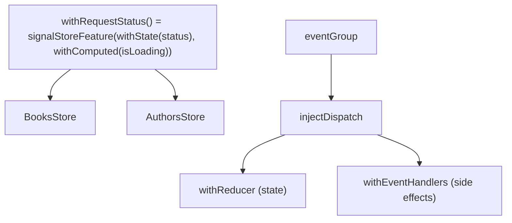

What to notice: a custom feature is the unit of reuse, and events decouple who asks from who changes state.

### How it actually works

Read from the `@ngrx/signals` 22.0.1 source (`fesm2022/ngrx-signals-rxjs-interop.mjs`, `rxMethod`): the pipeline is built once, on a `Subject`, and unsubscribed through the injector's `DestroyRef`; development builds call `assertInInjectionContext` without an `injector` option. The returned function is not an Observable: a value enters the subject, a signal gets an `effect`, an Observable is subscribed.

The value 1, a signal at 5 and 6 (after `TestBed.tick()`), and an Observable emitting 7 and 8 reached the pipeline in that order (`Section 9: rxMethod accepts a value, a signal and an Observable`). Created in a test body, it threw `NG0203` (`Section 9: rxMethod created outside an injection context throws NG0203`). With `switchMap`, a late answer for a superseded id was dropped (`Section 9: rxMethod with switchMap keeps only the latest inner request`). Calling the method with a signal or an Observable outside an injection context warned once each, which the source calls deprecated: [Deprecated since NgRx v21.1 — use an injection context or the injector option]. A static value never warns.

`withEntities` is itself `signalStoreFeature(withState({ entityMap: {}, ids: [] }), withComputed(...))` (`fesm2022/ngrx-signals-entities.mjs`), and `signalStoreFeature` is a fold over its arguments (`fesm2022/ngrx-signals.mjs`); `type()` returns `undefined`, so a requirement exists only for the compiler. After two adds, a duplicate add and a toggle, `ids` was `[1, 2]` and `entities` followed them (`Section 9: withEntities keeps ids, entityMap and entities in step`); the duplicate changed nothing. One feature gave two unrelated stores the same `status` and `isLoading` (`Section 9: a custom feature adds state and computed to any store`).

**The literal trap.** With `withEntities<{ id: number; title: string; done: boolean }>()`, `addEntity({ id, title, done: false })` inside `withMethods` failed with `TS2345`: the argument inferred `done: false`. A typed variable compiles.

**Events.** In `fesm2022/ngrx-signals-events.mjs`, `Dispatcher.dispatch` sends the event to the reducer stream first and schedules the handler stream on the `queueScheduler`, and `withReducer` builds on `withEventHandlers`. After `increment()` twice and `set(10)`, the handler logged `[Counter Page] set 10` with `count()` already 10 (`Section 9: events reduce state and reach event handlers`). The dispatcher is `providedIn: 'platform'`, so events are global unless `provideDispatcher()` scopes them.

The `@ngrx/signals` 20.0.1 typings tag the Events plugin `@experimental` (with `withEffects`); 21.0.0 has none, with `withEventHandlers`. Read, not run: `withLinkedState` [Added in NgRx v20.0] makes a state slice a `linkedSignal`; `withFeature` [Added in NgRx v19.1] hands a feature factory the store's members; `entityConfig` returns its argument to share `entity`, `collection` and `selectId`; `@ngrx/signals/resource` [Experimental since NgRx v22.0] extends resources and is not taught.

### Code

The approach: one reusable feature, a collection and an `rxMethod` in one store, then events.

1. `withRequestStatus` bundles `status` and `isLoading`.
2. `withEntities` adds the collection.
3. `load` is an `rxMethod`; `addEntity` takes a typed value.

```ts
// Partial: section-9-signal-store-in-depth.spec.ts, imports omitted
function withRequestStatus() {
  return signalStoreFeature(
    withState<{ status: 'idle' | 'loading' | 'loaded' }>({ status: 'idle' }),
    withComputed(({ status }) => ({ isLoading: computed(() => status() === 'loading') })),
  );
}

const TodoStore = signalStore(
  { providedIn: 'root' },
  withEntities<Todo>(),
  withRequestStatus(),
  withMethods((store) => ({
    load: rxMethod<number>(
      tap((id) => {
        const todo: Todo = { id, title: `t${id}`, done: false };
        patchState(store, addEntity(todo), { status: 'loaded' });
      }),
    ),
  })),
);
```

The events version declares, reduces, handles and dispatches.

```ts
// Partial: section-9-signal-store-in-depth.spec.ts, imports omitted
const counter = eventGroup({ source: 'Counter Page', events: { increment: type<void>(), set: type<number>() } });

const CounterStore = signalStore(
  { providedIn: 'root' },
  withState({ count: 0 }),
  withReducer(
    on(counter.increment, (_, { count }) => ({ count: count + 1 })),
    on(counter.set, ({ payload }) => ({ count: payload })),
  ),
  withEventHandlers(({ count }, events = inject(Events)) => ({
    logIt$: events.on(counter.set).pipe(tap((e) => log.push(`${e.type} ${e.payload} count=${count()}`))),
  })),
);
const dispatch = injectDispatch(counter); // in an injection context
```

### Best practices and anti-patterns

- **Create and call an `rxMethod` in an injection context**, because it then stops with its injector and needs no manual `destroy`.
- **Type the entity before `addEntity`**, because an inferred literal `done: false` fails with `TS2345`.
- **Put repeated fields in a `signalStoreFeature`**, because the compiler then rejects, through `type<>()`, a host store that lacks the members it needs.
- **Use events for cross-store coordination**, because one store needs no dispatcher ([Q28.27](#q28-27)).

### Misconceptions and traps

- *"`rxMethod` returns an Observable."* The `rx` prefix suggests it; it returns a function that subscribes internally and stops with its injector.
- *"Custom features are functions returning objects."* They look like it; they compose store members with typed requirements.
- *"The Events plugin is experimental."* Once true: `@experimental` stood on its typings in NgRx 20.0.1; the 21.0.0 typings dropped it.
- *"`withEntities` needs no type argument."* Inference works elsewhere; a literal breaks `addEntity` here.

Drilled in [Q28.24](#q28-24), [Q28.25](#q28-25), [Q28.26](#q28-26) and [Q28.27](#q28-27); practised in [Exercise 28.5](#ex28-5).

## 10. Optimistic updates, normalization and undo

### The problem it solves

Toggling a todo waits 600 ms for the server and feels broken. When the server rejects the write, the screen keeps a state the server never had. Changing one row of a nested list rebuilds the list the table reads. After a bulk delete, users ask for undo.

### Mental model

An **optimistic update** applies the change locally at once and sends the request afterwards; a **pessimistic update** waits for the answer before touching state. Applying early needs a way back: an **inverse operation** (the previous value, or the call that undoes the change). A **rollback** runs the inverse when the server fails. Like writing in pencil before the manager signs, only the failed line is erased, not the whole page.

**Normalization** stores a collection as `ids` (the order) plus a map from id to entity, so one update replaces one entry. **Denormalization** joins them back for display, which a `computed` does. Entity adapters ([§7](#7-ngrx-entity-router-store-and-store-devtools)) and `withEntities` ([§9](#9-signalstore-in-depth-rxmethod-withentities-custom-features-and-the-events-plugin)) store this pair.

**Undo** keeps a `past` stack (the **undo stack**), the `present`, and a `future` stack (the **redo stack**). A new edit empties `future`. A **history bound** caps `past` so memory stays finite.

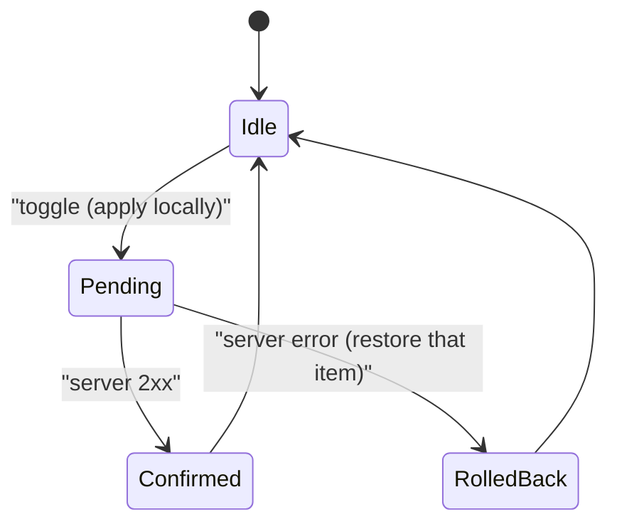

What to notice: rollback restores the one change that failed, not a whole snapshot.

### How it actually works

**Rollback.** The lab store (`LabM28TodoStore`) answers a failure by writing the item's earlier `done` onto the item's current entity. The tempting alternative remembers the whole state before the request and sets it back. Observed in the lab: two toggles were in flight, the second request failed after the first succeeded, and the snapshot version ended with every flag `false`, which erases the confirmed change; the per-item version kept it (`Section 10: a rollback restores only the failed item`). A snapshot is correct only when nothing else can change in between.

**Reference behavior.** After `toggle(2)`, entities 1 and 3 were the same objects as before, entity 2 was a new object, and `ids` was the same array (`Section 10: a normalized update replaces one entity and keeps the others' references`). Read from the `@ngrx/entity` 22.0.1 source (`fesm2022/ngrx-entity.mjs`, the unsorted adapter's `updateManyMutably` and `takeNewKey`, internal): the update builds `Object.assign({}, original, update.changes)` for the changed id only and writes it into a copy of the state; read, not run. [Q28.18](#q28-18) asserts the same for the sorted adapter's `updateOne`.

**History.** Edit, edit, undo, edit left `past` `[0, 1]`, `present` `3` and `future` `[]`; `redo` after an `undo` brought the undone value back (`Section 10: undo and redo move the present between the stacks`).

**Where each sits.** NgRx Entity is the normalization ([§7](#7-ngrx-entity-router-store-and-store-devtools)). A meta-reducer ([§4](#4-ngrx-store-actions-reducers-createactiongroup-createfeature-and-runtime-checks)) wraps every reducer, so it is where whole-store undo would sit; not run here. In a SignalStore, `withEntities` is the pair ([§9](#9-signalstore-in-depth-rxmethod-withentities-custom-features-and-the-events-plugin)). **Conflicts:** two clients editing one record need the server to refuse a stale write, and the client needs the version it read: [27 §3](27-http-client.md#3-making-requests-typed-responses-observe-responsetype-immutable-params-and-headers-and-httpcontext) reads the `ETag` header, and [module 41](41-fullstack-api-contracts.md#5-error-contracts-with-problemdetail-rfc-9457-and-mapping-them-in-angular) owns the contract.

### Code

The approach: one normalized signal, an optimistic `toggle` with a per-item inverse, and a pure history class.

1. The collection is an `ids` array and an id-keyed map in one signal; a helper replaces one entry.
2. `toggle` applies the change, sends the `PATCH`, and on error writes the old `done` back onto that id.
3. `LabM28History` returns a new instance from each operation.

```ts
// Excerpt of labs/angular/src/app/modules/28-state-management/concepts/section-10-optimistic-normalization-undo.spec.ts
  toggle(id: number): void {
    const before = this.state().entities[id];
    if (!before) {
      return;
    }
    this.state.update((s) => labM28Replace(s, id, (todo) => ({ ...todo, done: !before.done })));
    this.http.patch(`/api/todos/${id}`, { done: !before.done }).subscribe({
      error: () => {
        this.state.update((s) => labM28Replace(s, id, (todo) => ({ ...todo, done: before.done })));
        this.error.set(`could not save todo ${id}`);
      },
    });
  }
```

```ts
// Excerpt of labs/angular/src/app/modules/28-state-management/concepts/section-10-optimistic-normalization-undo.spec.ts
  edit(next: T): LabM28History<T> {
    return new LabM28History([...this.past, this.present], next, []);
  }

  undo(): LabM28History<T> {
    const previous = this.past.at(-1);
    if (previous === undefined) {
      return this;
    }
    return new LabM28History(this.past.slice(0, -1), previous, [this.present, ...this.future]);
  }
```

A bound is one more line in `edit`:

```ts
// Partial: the history class of the excerpt above, bounded to 20 entries
edit(next: T): LabM28History<T> {
  return new LabM28History([...this.past, this.present].slice(-20), next, []);
}
```

The full store and a test with concurrent requests are [Exercise 28.3](#ex28-3); the same collection as a SignalStore with `withEntities` is [Exercise 28.5](#ex28-5). Exercise 17.1's [alternative approach](17-signals.md#ex17-1) shows the same shape for a cart.

### Best practices and anti-patterns

- **Restore the failed item, not a snapshot**, because a snapshot also erases edits that succeeded meanwhile.
- **Keep the inverse next to the request**, because the code that knows the old value is the code that sends the write.
- **Wait for the server on payments and irreversible actions**, because a confirmation already shown cannot be withdrawn.
- **Make history updates pure**, because `past`, `present` and `future` are then plain values that tests compare.

### Misconceptions and traps

- *"Rollback means restoring the snapshot taken before the request."* It is the simplest code; it overwrites later changes that the server accepted.
- *"Optimistic updates suit every write."* They feel fast; writes that often fail or cannot be reversed should wait.
- *"Normalization is only for NgRx."* Entity made it famous; any store with a large collection updated often gains from it, and Exercise 17.1's alternative uses a plain record.
- *"Undo needs a store library."* DevTools time travel suggests it; three values and pure updates are enough, as the test shows.

Drilled in [Q28.28](#q28-28), [Q28.29](#q28-29) and [Q28.30](#q28-30); practised in [Exercise 28.3](#ex28-3) and [Exercise 28.5](#ex28-5).

## 11. Alternatives and the decision framework: NGXS, Elf, TanStack Query, and when a store library is justified

### The problem it solves

A five-person team adds NgRx Store to a settings page: an action group, a reducer, a selector and an effect to toggle one flag. Another app hand-writes caching and refetch-on-focus for twenty endpoints, and its copies still go stale ([Q28.03](#q28-03)). An architect asks whether Elf is maintained and whether TanStack Query is production-ready on Angular.

### Mental model

A **decision framework** is a fixed list of questions that picks a tool from facts. The first is §1's: who owns the truth? Server data goes to a **server-cache library**, one that fetches, caches by key and refreshes server data ([27 §6](27-http-client.md#6-cancellation-and-caching-unsubscribing-aborts-cache-interceptors-sharereplay-and-the-ssr-transfer-cache) builds the same by hand). A client-state library pays off only when the state is **shared across features**, **many writers need one change path**, and you need **traceability**, a record of which change produced which state. A contractor is hired for specialist work with paperwork, not to change a light bulb.

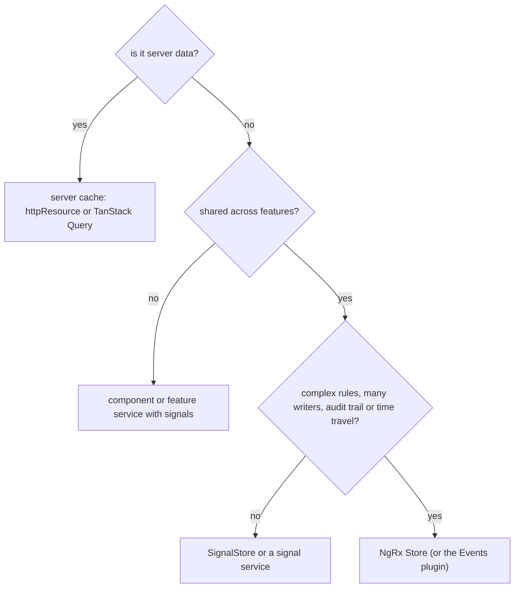

What to notice: most branches end without a store library.

### How it actually works

**TanStack Query.** A **query key** is the array that names a cache entry (`docs/framework/react/guides/query-keys.md`, reused by the Angular docs, `main`, read 2026-10-13). Read from the `@tanstack/angular-query-experimental` 5.104.1 source (`dist/inject-query.mjs`, `injectQuery`; `dist/create-base-query.mjs`, `createBaseQuery`, internal, may change in any release): it injects the `QueryClient` (the shared cache), wraps your options function in a `computed`, so a signal read in the key switches the entry, and subscribes a `QueryObserver` in an `effect` that writes each result into a signal; `signalProxy` (internal) makes each field a `computed`, hence `todos.data()`. Read, not run. Cached data is stale by default and refetched in the background on a new query instance, window focus or reconnect (`important-defaults.md`, same branch and date): **stale-while-revalidate**, serving the cached copy while fetching a fresh one ([Q09.22](09-web-networking-storage-security.md#q09-22)). A **mutation** is a server write run by `injectMutation`, which tracks pending and error state; on success you invalidate the keys it changed.

**Status.** `docs/framework/angular/overview.md` (`main`, read 2026-10-13): "This library is currently in an experimental stage. This means that breaking changes will happen in minor AND patch releases." It advises pinning a patch version. A separate `@tanstack/angular-query` published 5.0.0-rc.2 on 2026-10-12, after this guide's version snapshot (npm registry); not taught.

**NGXS.** Read from `@ngxs/store` 22.0.0 `index.d.ts` (peer `@angular/core >=22.0.0 <23.0.0`): an **NGXS state class** is decorated with `@State({ name, defaults })`, and its `@Action(SomeAction)` methods receive a `StateContext` (`getState`, `patchState`, `dispatch`); an action is a class with a static `type`. `select(selector)` returns `Signal<T>`; `dispatch(ActionType)` returns a function that returns an awaitable Observable. The `@Select` decorator is `@deprecated`. It is [§4](#4-ngrx-store-actions-reducers-createactiongroup-createfeature-and-runtime-checks)'s loop with classes as actions.

**Elf.** An **Elf store** (`@ngneat/elf` 2.5.1, peer `rxjs` only) comes from `createStore`; `src/lib/store.d.ts` declares `Store … extends BehaviorSubject<State>` with `update(...reducers)`: [§3](#3-the-service-with-behaviorsubject-store-the-legacy-but-common-pattern-and-its-migration)'s pattern, packaged. No release since 2.5.1 on 2024-02-03 and no deprecation notice (npm registry, read 2026-10-13); GitHub was not readable here, so nothing more is claimed.

**The table.** Every cell cites its basis; speed at scale is [module 31](31-performance.md#3-runtime-cost-of-a-change-onpush-zoneless-signals-and-per-check-template-work)'s, where stores live [module 38](38-architecture-and-production-structure.md#3-facades-and-the-data-access-layer)'s.

| | Signal service | SignalStore | NgRx Store | NGXS | TanStack Query |
|---|---|---|---|---|---|
| Server or client state | both; `httpResource` reads ([§2](#2-the-service-with-signals-store-state-shape-derived-selectors-methods-and-async-loads)) | client; `rxMethod` loads ([§9](#9-signalstore-in-depth-rxmethod-withentities-custom-features-and-the-events-plugin)) | client; effects load ([§6](#6-effects-functional-effects-flattening-error-handling-and-dispatch-false)) | client (typings) | server cache (overview) |
| Cross-cutting | root service ([§1](#1-kinds-of-state-server-cache-ui-form-url-and-session-state-and-where-each-belongs)) | root or component ([§8](#8-componentstore-and-signalstore-signalstate-signalstore-withstate-withcomputed-withmethods-and-protected-state)) | one feature tree ([§4](#4-ngrx-store-actions-reducers-createactiongroup-createfeature-and-runtime-checks)) | `provideStates` (typings) | one `QueryClient` (source) |
| Many writers (team size) | class methods ([§2](#2-the-service-with-signals-store-state-shape-derived-selectors-methods-and-async-loads)) | protected state ([§8](#8-componentstore-and-signalstore-signalstate-signalstore-withstate-withcomputed-withmethods-and-protected-state)) | reducers via actions ([§4](#4-ngrx-store-actions-reducers-createactiongroup-createfeature-and-runtime-checks)) | `@Action` handlers (typings) | mutations (docs) |
| Traceability, time travel | undo by hand ([§10](#10-optimistic-updates-normalization-and-undo)) | named events ([§9](#9-signalstore-in-depth-rxmethod-withentities-custom-features-and-the-events-plugin)) | DevTools ([§7](#7-ngrx-entity-router-store-and-store-devtools)) | `@ngxs/devtools-plugin` 22.0.0 (npm) | not applicable |
| Learning cost | `signal`, `computed` ([17 §3](17-signals.md#3-computed-signals)) | store features ([§8](#8-componentstore-and-signalstore-signalstate-signalstore-withstate-withcomputed-withmethods-and-protected-state)) | §4-§6 | decorators (typings) | keys, staleness (docs) |

### Code

The approach: one todo list as server cache, then as NGXS client state; both compiled on 2026-10-13 against the packed typings in a throwaway folder, not run.

1. `injectQuery` keys the data with `filter()`: a new filter, a new entry.
2. `injectMutation` posts, then invalidates keys starting with `'todos'`.
3. In NGXS an `@Action` handler writes; `select` and `dispatch` serve the component.

```ts
// Partial: imports omitted (Angular, rxjs' lastValueFrom, and injectQuery, injectMutation, QueryClient from @tanstack/angular-query-experimental 5.104.1); Todo is { id: number; title: string }
@Component({
  selector: 'app-todos',
  template: `
    @if (todos.isPending()) {
      <p>Loading…</p>
    }
    @for (todo of todos.data() ?? []; track todo.id) {
      <p>{{ todo.title }}</p>
    }
    <button (click)="add.mutate('Buy milk')" [disabled]="add.isPending()">Add</button>
  `,
})
export class Todos {
  private readonly http = inject(HttpClient);
  private readonly queryClient = inject(QueryClient);
  protected readonly filter = signal('all');

  protected readonly todos = injectQuery(() => ({
    queryKey: ['todos', this.filter()],
    queryFn: () =>
      lastValueFrom(this.http.get<Todo[]>('/api/todos', { params: { filter: this.filter() } })),
  }));

  protected readonly add = injectMutation(() => ({
    mutationFn: (title: string) => lastValueFrom(this.http.post<Todo>('/api/todos', { title })),
    onSuccess: () => this.queryClient.invalidateQueries({ queryKey: ['todos'] }),
  }));
}
```

```ts
// Partial: imports omitted (Angular, and State, Action, Selector, StateContext, select, dispatch from @ngxs/store 22.0.0); provideStore([TodosState]) is assumed
export class AddTodo {
  static readonly type = '[Todos Page] Add Todo';
  constructor(readonly title: string) {}
}

@State<{ titles: string[] }>({ name: 'todos', defaults: { titles: [] } })
@Injectable()
export class TodosState {
  @Selector()
  static titles(state: { titles: string[] }): string[] {
    return state.titles;
  }

  @Action(AddTodo)
  add(ctx: StateContext<{ titles: string[] }>, action: AddTodo): void {
    ctx.patchState({ titles: [...ctx.getState().titles, action.title] });
  }
}

@Component({ selector: 'app-todo-list', template: '' })
export class TodoList {
  protected readonly titles = select(TodosState.titles);
  protected readonly addTodo = dispatch(AddTodo);
}
```

### Best practices and anti-patterns

- **Classify the state first**, because §1's owner question removes server data, URL state and drafts from any store.
- **Keep server data in one keyed cache**, because a second copy in a client store drifts.
- **Choose NgRx Store or the Events plugin for many writers and an action log**, because that is what they add (§4, §7).
- **Pin a patch version of `@tanstack/angular-query-experimental`**, because breaking changes land in patches.

### Misconceptions and traps

- *"Every Angular app needs NgRx."* Most state is server cache, URL or local (§1); the NgRx docs recommend `@ngrx/signals` for local state (§8). RxJS-era defaults made a global store the start.
- *"TanStack Query replaces NgRx."* It caches server data; client workflows such as a wizard's step live elsewhere. Both are called "state management".
- *"Elf is dead."* The registry shows no release since 2024-02-03 and no deprecation, nothing more; read the repository before deciding. A quiet release history is taken for abandonment.
- *"Experimental means unusable."* The docs warn of breaking changes in patch releases: a cost to pin against, not a ban. The label is read as "unstable at runtime", not "unstable API".

Drilled in [Q28.31](#q28-31) and [Q28.32](#q28-32).

## 12. Under the hood: how NgRx Store reduces actions and how SignalStore keeps state in signals

### The problem it solves

An interviewer asks why the state is new on the line after `dispatch`, why a selector stays silent when another slice changes, and why `patchState` with the same value updates nothing.

### Mental model

The **`ActionsSubject`** is a `BehaviorSubject` of actions fed by `dispatch`. The **`ReducerManager`** holds the combined reducer of all features. **`State`** joins them: it applies the current reducer to each action with `scan` ([22 §6](22-rxjs-foundations.md#6-the-operator-catalogue-creation-transformation-filtering-utility-conditional-and-aggregation) owns `scan`) on a **queue scheduler**, which runs a task at once unless another is running and queues it then ([23 §9](23-rxjs-in-depth.md#9-schedulers-queue-asap-async-and-animation-frame-observeon-and-subscribeon)). `Store` is an Observable view of `State`; selectors filter its snapshots ([§5](#5-selectors-memoization-composition-and-reading-the-store-as-signals)).

**SignalStore** has no pipeline. Its **`STATE_SOURCE`** (an internal symbol, may change in any release) holds one `WritableSignal` per top-level key, and `patchState` writes only changed keys. A **state watcher** is a `watchState` callback that receives the whole state after each `patchState`. Equality and glitch-freedom come from Angular's graph ([17 §9](17-signals.md#9-under-the-hood-the-reactive-graph)). Analogy: a conveyor belt with one stamping machine, against a wall of switches.

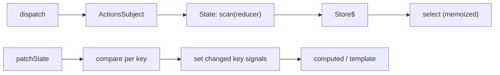

What to notice: the top lane pushes whole-state snapshots and filters later; the bottom lane filters per key first.

### How it actually works

**Reading the store.** Read from the `@ngrx/store` 22.0.1 source (`fesm2022/ngrx-store.mjs`): `ActionsSubject` (public) starts with `{ type: '@ngrx/store/init' }` and throws a `TypeError` from `next` for an action without `type`. `ReducerManager` (public) is a `BehaviorSubject` of the combined reducer. `State` (public) builds this chain:

```js
// Partial: the `State` constructor of @ngrx/store 22.0.1, `fesm2022/ngrx-store.mjs`, lines omitted around it
const actionsOnQueue$ = actions$.pipe(observeOn(queueScheduler));
const withLatestReducer$ = actionsOnQueue$.pipe(withLatestFrom(reducer$));
const stateAndAction$ = withLatestReducer$.pipe(scan(reduceState, seed));
```

Its subscriber runs `this.next(state); scannedActions.next(action);`: the state is published before the action reaches `ScannedActionsSubject`, which `Actions` reads (§6). `Store.select` ends in `distinctUntilChanged()`.

**Why `dispatch` is synchronous.** In the lab, `dispatch(add({ n: 2 }))` logged `state`, `a=2` before returning, one emission each (`Section 12: one dispatch produces one state emission and one selector emission`). An `other()` dispatch logged `state` only: the reducer kept `a` and `distinctUntilChanged` dropped the repeat. The queue delays only a nested dispatch, made inside a state subscriber, which logged `inner dispatch returned` before its own `state a=1 b=1` (`Section 12: a dispatch from inside a state subscriber is reduced after the current emission finishes`).

**Why `patchState` skips work.** Read from the `@ngrx/signals` 22.0.1 source (`fesm2022/ngrx-signals.mjs`): `patchState` merges the updaters over `getState` and calls `signals[key].set` only when `currentState[key] !== newState[key]`. A key absent from `STATE_SOURCE` triggers a development-mode `console.warn` and is skipped. Then `notifyWatchers` (internal) runs every watcher unconditionally. In the lab, `{ a: 1 }` re-ran no computed and `{ b: 3 }` only the one over `b` (`Section 12: patchState sets only the keys whose values changed`); `{ zz: 1 }` logged "@ngrx/signals: patchState was called with an unknown state slice 'zz'." and changed nothing (`Section 12: patchState warns about an unknown key and ignores it`); a watcher saw both an unchanged and a changed patch (`Section 12: state watchers run on every patchState call, changed or not`).

Once true: one `WritableSignal` held the whole state until NgRx 20.0.0 (CHANGELOG, breaking). Drilled in [Q28.33](#q28-33) and [Q28.34](#q28-34).

### Code

The approach: drive a real `Store` and a `signalState`, recording into arrays.

1. Subscribe to `State` and a selector, dispatch, and read the log.
2. Patch an unchanged and a changed key of a `signalState` and record the `computed` runs.

```ts
// Partial: concepts/section-12-under-the-hood.spec.ts, names shortened; imports, the `add` action and the `feature` (state { a, b }) omitted
const { store, state } = setup(); // provideStore() + provideState(feature), then inject Store and State
const log: string[] = [];
state.subscribe(() => log.push('state'));
store.select(feature.selectA).subscribe((v) => log.push('a=' + v));
log.length = 0;
store.dispatch(add({ n: 2 }));
log.push('returned a=' + store.selectSignal(feature.selectA)());
// log: ['state', 'a=2', 'returned a=2']
```

```ts
// Partial: concepts/section-12-under-the-hood.spec.ts, imports omitted
const runs: string[] = [];
const base = signalState({ a: 1, b: 2 });
const doubledA = computed(() => {
  runs.push('a');
  return base.a() * 2;
});
const doubledB = computed(() => {
  runs.push('b');
  return base.b() * 2;
});
doubledA();
doubledB();
runs.length = 0;
patchState(base, { a: 1 }); // unchanged: no signal is set
patchState(base, { b: 3 });
doubledA();
doubledB();
// runs: ['b']
```

### Best practices and anti-patterns

- **Treat a nested `dispatch` as queued**, because code after it still sees the old state.
- **Never import `STATE_SOURCE` or `notifyWatchers`**, because internals change without notice.
- **Keep side effects out of state watchers**, because they run on every `patchState` call ([§9](#9-signalstore-in-depth-rxmethod-withentities-custom-features-and-the-events-plugin)).

### Misconceptions and traps

- *"NgRx Store dispatches asynchronously."* The state is new when `dispatch` returns; only a nested dispatch waits. RxJS feels asynchronous, but the queue defers nothing at top level.
- *"SignalStore stores the whole state in one signal."* It holds one signal per top-level key. NgRx 20.0.0 replaced the single signal.
- *"`patchState` always notifies."* Computeds over an unchanged key stay put, but watchers run, because the comparison guards signal writes, not the watcher loop.
- *"Selectors compare state deeply."* They compare references (§5), because `distinctUntilChanged()` and `defaultMemoize` use `===`.

## Summary

State has an owner. Server data is a cache the server owns, so a copy in a store goes stale; what must survive a reload or a shared link belongs in the URL, and session state is not automatically `localStorage` ([1](#1-kinds-of-state-server-cache-ui-form-url-and-session-state-and-where-each-belongs)). A service with signals keeps state in a signal and exposes selectors as `computed`; one big state signal makes selectors re-run on every write, and `asReadonly()` removes `set` and `update` only ([2](#2-the-service-with-signals-store-state-shape-derived-selectors-methods-and-async-loads)). A `BehaviorSubject` store is a design choice, not a deprecated pattern: `distinctUntilChanged` compares with `===`, and each subscriber recomputes the selector's result ([3](#3-the-service-with-behaviorsubject-store-the-legacy-but-common-pattern-and-its-migration)).

NgRx Store records what happened as actions and applies them with a pure reducer, so replay works; the runtime checks, and the development freeze, are off outside development ([4](#4-ngrx-store-actions-reducers-createactiongroup-createfeature-and-runtime-checks)). Memoized selectors keep one entry compared by reference, and a projector does not run unless an input changed ([5](#5-selectors-memoization-composition-and-reading-the-store-as-signals)). An error in an effect is resubscribed up to ten times, while a `catchError` outside the inner pipe ends the effect in a completion that is not resubscribed ([6](#6-effects-functional-effects-flattening-error-handling-and-dispatch-false)). Entity is pure helpers, a `sortComparer` decides `ids`, and DevTools records in memory unless `maxAge` or `logOnly` limit it ([7](#7-ngrx-entity-router-store-and-store-devtools)).

ComponentStore is not deprecated, SignalStore state is not frozen, and protected state is a TypeScript check, not a runtime lock ([8](#8-componentstore-and-signalstore-signalstate-signalstore-withstate-withcomputed-withmethods-and-protected-state)). `rxMethod` returns a function that subscribes internally, the Events plugin is no longer experimental in the 21.0.0 typings, and `withEntities` needs its type argument ([9](#9-signalstore-in-depth-rxmethod-withentities-custom-features-and-the-events-plugin)). A rollback to a snapshot overwrites later changes the server accepted, and undo needs three values and pure updates ([10](#10-optimistic-updates-normalization-and-undo)). Not every app needs NgRx; TanStack Query caches server data, not client workflows, and Elf has no release since 2024-02-03 and no deprecation ([11](#11-alternatives-and-the-decision-framework-ngxs-elf-tanstack-query-and-when-a-store-library-is-justified)). `dispatch` is synchronous, SignalStore holds one signal per top-level key, and `patchState` writes only changed keys, though watchers still run ([12](#12-under-the-hood-how-ngrx-store-reduces-actions-and-how-signalstore-keeps-state-in-signals)).

## Question bank

Each answer is five parts; Output answers state the run asserted in `q28-outputs.spec.ts`.

<a id="q28-01"></a>
### Q28.01 · Concept · Server cache, UI, form, URL and session state: what is each, and where does each belong in an Angular app?

<details>
<summary>Answer</summary>

**Short answer (30 seconds).** Classify by who owns the truth and how long it must live. Server cache: a copy the server owns, in `httpResource` or a query library. URL: what must survive a reload or be shared, in query parameters. Form: a draft, in the forms API. UI: local to a component. Session: user and preferences, in a root service. A store is a container, not a kind of state.

**Full explanation.** [§1](#1-kinds-of-state-server-cache-ui-form-url-and-session-state-and-where-each-belongs) draws the decision as a flowchart, and no store library appears in it. The lab shows two lifetimes: a root service starts over when the injector is rebuilt, and a draft provided by a component is destroyed with it (`Section 1: a draft provided by a component is gone after the component is destroyed`). Owners: [24 §2](24-routing.md#2-route-parameters-path-matrix-query-and-fragment-inheritance-and-component-input-binding) for the URL, [27 §10](27-http-client.md#10-httpresource-signal-driven-requests-and-when-to-prefer-it-over-httpclient) for the server cache. Derived values are computed, never stored.

**Follow-ups an interviewer will ask.**
- *Where does session state go?* A root service; an `effect` may mirror it to storage, which is a mirror and not the home ([Q09.18](09-web-networking-storage-security.md#q09-18)).
- *Which kind needs a store library?* The client state left once the others are placed, which is small.

**Trap to avoid.** Pouring everything into one global store: the server copy drifts and the draft outlives its form.

</details>

<a id="q28-02"></a>
### Q28.02 · Bug hunt · A product list keeps its filters and page in a root service: why do reload, the back button and a shared link lose them, and where do they belong?

<details>
<summary>Answer</summary>

**Short answer (30 seconds).** A root service's state lives in memory for one injector: a reload builds a new one, a pasted link opens in someone else's, and back never touches the service. Filters and page belong in query parameters.

**Full explanation.** Root-service state starts over when the injector is rebuilt (`Section 1: state in a root service starts over when the injector is rebuilt`). After `router.navigate([], { queryParams: { q: 'pen' } })` the URL is `/list?q=pen`, and a new injector and router that open it get `pen` back through `withComponentInputBinding()` (`Section 1: a query parameter restores the filter when the same URL is opened again`). Each change adds a history entry, so back walks the filters; [Q24.05](24-routing.md#q24-05) owns where parameters live. The fix is [Exercise 28.2](#ex28-2): the URL is the source of truth, and a change writes a navigation, never the service.

**Follow-ups an interviewer will ask.**
- *Which state stays out of the URL?* Drafts and anything private or large.
- *Typing in a search box?* Debounce the write or use `replaceUrl`, so history is not flooded.

**Trap to avoid.** Mirroring the URL into the service and reading the service: two sources of truth.

</details>

<a id="q28-03"></a>
### Q28.03 · Difference · Server state versus client state: why does copying API responses into a store bring stale data and duplicated loading flags?

<details>
<summary>Answer</summary>

**Short answer (30 seconds).** Server state is owned by the server, so a copy is a cache that others can change unseen; it needs a key, a freshness rule and one reader. A store copy has no cache rules, so it goes stale after an edit elsewhere, and each screen adds its own loading flag.

**Full explanation.** The TanStack docs say it directly: server state "Implies shared ownership and can be changed by other people without your knowledge" (`docs/framework/angular/overview.md`, read 2026-10-13). A store keeps the last response until replaced, so nothing marks it stale; a second copy of the endpoint misses an edit made through the first ([§1](#1-kinds-of-state-server-cache-ui-form-url-and-session-state-and-where-each-belongs)). Each copy carries its own `loading` and `error`. The cure is one reader per resource that owns key, loading, error and invalidation: `httpResource` ([27 §10](27-http-client.md#10-httpresource-signal-driven-requests-and-when-to-prefer-it-over-httpclient)) or a query library; [Q27.21](27-http-client.md#q27-21) chooses the cache tool.

**Follow-ups an interviewer will ask.**
- *What stays in the store?* Client state: the selection, the unsent optimistic edit, the wizard step.
- *How does the cache learn of an edit?* A write invalidates the key ([§10](#10-optimistic-updates-normalization-and-undo) covers optimistic patches).

**Trap to avoid.** Treating a variable as ownership: data in a client variable is still the server's.

</details>

<a id="q28-04"></a>
### Q28.04 · Design · Design a feature store as a service with signals: state shape, derived selectors, methods, async loading and errors.

<details>
<summary>Answer</summary>

**Short answer (30 seconds).** One private `signal` holds a typed state (`query`, `items`, `status`). Public `computed` selectors read it, so no value is stored twice. Named methods are the only writers and patch related fields in one write. A `Subject` with `switchMap` loads and drops stale responses; `catchError` inside it sets `status: 'error'` and keeps the last list.

**Full explanation.** [§2](#2-the-service-with-signals-store-state-shape-derived-selectors-methods-and-async-loads) holds the code. The status is a union of literals; [Q06.11](06-ts-type-system-essentials.md#q06-11) tightens it so impossible combinations cannot compile. Selectors are `computed`, which have no `set` (`Section 2: the store exposes read-only signals and named methods`); [Q17.05](17-signals.md#q17-05) owns the pattern. After `search('pe')` and `search('pen')` the first request is `cancelled` and only the second reaches the state (`Section 2: a late response from an earlier search does not overwrite a newer one`). A failed load keeps the previous items (`Section 2: a failed load sets the error status and keeps the previous items`). [Exercise 28.1](#ex28-1) builds the full store; a keyed `httpResource` can replace the hand-written load.

**Follow-ups an interviewer will ask.**
- *Why one write for `query` and `status`?* A reader between two writes would see a state that never existed.
- *Why not an `effect` to load?* Methods start loads ([17 §4](17-signals.md#4-effects)).

**Trap to avoid.** Handing out the writable signal: any component can then break the invariants.

</details>

<a id="q28-05"></a>
### Q28.05 · Output · One state signal holds items, a filter and a loading flag: which computeds re-run when only the flag changes?

```ts
// Partial: runs in a spec (`it('Q28.05 …')`); imports computed and signal from @angular/core
const state = signal({ items: ['a'], filter: '', loading: false });
const runs = { items: 0, count: 0, loading: 0 };
const items = computed(() => {
  runs.items++;
  return state().items;
});
const count = computed(() => {
  runs.count++;
  return items().length;
});
const loading = computed(() => {
  runs.loading++;
  return state().loading;
});
const readAll = (): void => {
  items();
  count();
  loading();
};

readAll();
state.update((s) => ({ ...s, loading: true }));
readAll();
console.log(runs);
```

<details>
<summary>Answer</summary>

**Short answer (30 seconds).** `{ items: 2, count: 1, loading: 2 }`. Both selectors that read `state()` re-run, because the update made a new state object. `items` returns the same array, so `count` does not re-run: equality on `items`' result stops the chain.

**Full explanation.** Asserted by `Q28.05 only the flag changes: the whole-state selectors re-run, the count stays`. `items` and `loading` ran for the first read and again after the update; `count` ran once. The spread copies the `items` reference, so `Object.is` finds the old and new result equal, `items` keeps its version, and `count` has nothing to re-run for. [§2](#2-the-service-with-signals-store-state-shape-derived-selectors-methods-and-async-loads) shows `3, 1, 3` after two updates: one run per update plus the first read.

**Follow-ups an interviewer will ask.**
- *What if `items` returned a new array each time?* `count` would re-run.
- *How is the extra run avoided?* One signal per key, as a SignalStore holds ([§8](#8-componentstore-and-signalstore-signalstate-signalstore-withstate-withcomputed-withmethods-and-protected-state)).

**Trap to avoid.** Expecting `items` to stay quiet: it reads the whole state, and equality only protects what reads its result.

</details>

<a id="q28-06"></a>
### Q28.06 · Bug hunt · Two `load()` calls on a signal store resolve out of order and the older response wins: find the bug and two fixes.

```ts
// Partial: a method of a signal store like §2's, with http and patch as there; imports omitted
load(query: string): void {
  this.patch({ query, status: 'loading' });
  this.http
    .get<Product[]>('/api/products', { params: { q: query } })
    .subscribe((items) => this.patch({ items, status: 'loaded' }));
}
```

<details>
<summary>Answer</summary>

**Short answer (30 seconds).** Every call opens its own subscription and each one writes when it arrives, so the response that arrives last wins, not the one asked for last. Fix it by cancelling the previous request with `switchMap`, or by ignoring any answer that is not the latest.

**Full explanation.** Nothing orders the two requests. If `load('pe')` is slow and `load('pen')` fast, the late `pe` answer overwrites the `pen` one. Fix one is the pipeline of [§2](#2-the-service-with-signals-store-state-shape-derived-selectors-methods-and-async-loads): `load` pushes the query into a `Subject`, and `switchMap` unsubscribes from the previous request ([Q23.07](23-rxjs-in-depth.md#q23-07)). In the lab the testing backend reported the first request as `cancelled`, and flushing it threw `Cannot flush a cancelled request.` (`Section 2: a late response from an earlier search does not overwrite a newer one`). Fix two keeps the plain call and a counter: `const id = ++this.latest`, and the callback writes only when `id === this.latest`; the request still runs, and the lab does not run this variant.

**Follow-ups an interviewer will ask.**
- *Is there a fix without a pipeline?* A keyed `httpResource` cancels the previous request when its query signal changes ([27 §10](27-http-client.md#10-httpresource-signal-driven-requests-and-when-to-prefer-it-over-httpclient)).
- *Cancel or ignore?* Cancel; a token suits a promise, which cannot be cancelled.

**Trap to avoid.** Disabling the button while loading: it hides the race for clicks and leaves it for every other caller.

</details>

<a id="q28-07"></a>
### Q28.07 · Output · A `BehaviorSubject` store with a `select` built from `map` and `distinctUntilChanged`: what does a subscriber receive after a flag change, an items change and an in-place push?

```ts
// Partial: runs in a spec (`it('Q28.07 …')`); imports BehaviorSubject, distinctUntilChanged and map from rxjs
interface ListState {
  items: string[];
  loading: boolean;
}
const subject = new BehaviorSubject<ListState>({ items: ['a'], loading: false });
const select = <T>(pick: (state: ListState) => T) => subject.pipe(map(pick), distinctUntilChanged());
const received: string[][] = [];
select((s) => s.items).subscribe((items) => received.push([...items]));

subject.next({ ...subject.getValue(), loading: true });
subject.next({ ...subject.getValue(), items: ['a', 'b'] });
subject.getValue().items.push('c');
subject.next({ ...subject.getValue() });
console.log(received);
```

<details>
<summary>Answer</summary>

**Short answer (30 seconds).** `[['a'], ['a', 'b']]`. The flag change and the in-place push emit nothing, because `distinctUntilChanged` compares the selected array by `===` and both keep the same reference.

**Full explanation.** Asserted by `Q28.07 the BehaviorSubject select emits on a new items array only, not on a flag change or an in-place push`. The flag change copies the state but not `items`. The second `next` carries a new array and passes. The push edits that array in place and the last `next` hands over the same reference, although the array now holds `'a'`, `'b'` and `'c'` (the test reads it back). [§3](#3-the-service-with-behaviorsubject-store-the-legacy-but-common-pattern-and-its-migration) reads `defaultCompare` in `rxjs` 7.8.2: without a comparator it returns `a === b`. Whether to leave this pattern is [Q17.40](17-signals.md#q17-40)'s question.

**Follow-ups an interviewer will ask.**
- *What if `select` returned `s.loading`?* The flag change would emit `true`; a primitive compares by value.
- *How is the push fixed?* Write by copy, `[...items, 'c']`, so the reference changes.

**Trap to avoid.** Blaming RxJS: the mutation broke the contract that a change means a new reference.

</details>

<a id="q28-08"></a>
### Q28.08 · Concept · Action, reducer, store, selector and effect: how does one click travel through NgRx Store, and why must the reducer be pure?

<details>
<summary>Answer</summary>

**Short answer (30 seconds).** The click handler dispatches an action, a plain object that says what happened. The store passes it to the reducer, a pure function from the old state and the action to the next state. Selectors read the new state, and effects, which also see the action, run side effects and dispatch further actions. The reducer is pure so that the same actions always give the same state.

**Full explanation.** [§4](#4-ngrx-store-actions-reducers-createactiongroup-createfeature-and-runtime-checks) draws the loop. The docs name an action with the `[Source] Event` pattern (`store/action-groups.md`, read 2026-10-13), so it records a fact that several reducers and effects may react to. With an effect mapping `load` to `loaded({ n: 7 })`, the selected `n` was `7` as soon as `dispatch(load())` returned, so the effect's action was reduced before `dispatch` returned (`Section 4: an effect's action is reduced before dispatch returns`). Purity buys replay: DevTools time travel and tests rebuild a state by running the same actions again ([§7](#7-ngrx-entity-router-store-and-store-devtools)). A reducer that calls a service or reads the clock gives a different state on replay, and one that mutates breaks the reference comparison selectors rely on ([§5](#5-selectors-memoization-composition-and-reading-the-store-as-signals)).

**Follow-ups an interviewer will ask.**
- *Where does the HTTP call go?* In an effect ([§6](#6-effects-functional-effects-flattening-error-handling-and-dispatch-false)); the reducer only records the result.
- *Why events, not commands?* One event can drive a reducer, an effect and a log entry.

**Trap to avoid.** Calling an effect a "second reducer": it does not change state, it only dispatches an action that a reducer then handles.

</details>

<a id="q28-09"></a>
### Q28.09 · Output · `createActionGroup` with source `Todos Page` and events `Add Todo` and `Clear All`: which creator names and type strings does it produce?

```ts
// Partial: runs in a spec (`it('Q28.09 …')`); imports createActionGroup, emptyProps and props from @ngrx/store
const TodosPage = createActionGroup({
  source: 'Todos Page',
  events: {
    'Add Todo': props<{ title: string }>(),
    'Clear All': emptyProps(),
  },
});

console.log([Object.keys(TodosPage), TodosPage.addTodo({ title: 'a' }), TodosPage.clearAll().type]);
```

<details>
<summary>Answer</summary>

**Short answer (30 seconds).** `[['addTodo', 'clearAll'], { title: 'a', type: '[Todos Page] Add Todo' }, '[Todos Page] Clear All']`, because the group camel-cases each event name for the creator and joins source and event as `[Source] Event` for the type string.

**Full explanation.** Asserted by `Q28.09 createActionGroup gives camelCase creators and bracketed types`. A group that also had `Load` and `Loaded` gave `load` and `loaded` (`Section 4: createActionGroup derives camelCase creators and bracketed types`). Read from the `@ngrx/store` 22.0.1 source ([§4](#4-ngrx-store-actions-reducers-createactiongroup-createfeature-and-runtime-checks)), `createActionGroup` calls `createAction(toActionType(source, eventName), …)` once per event; `toActionName` and `toActionType` are internal. `props<{ title: string }>()` types the payload, and `emptyProps()` gives a creator that takes no argument.

**Follow-ups an interviewer will ask.**
- *Do two groups share a type?* The type string must be unique per action; `strictActionTypeUniqueness` is a check, off by default ([Q28.10](#q28-10)).
- *Why a source in the name?* It says where the event came from.

**Trap to avoid.** Writing `TodosPage['Add Todo']`: the creator key is the camel-cased name, not the original string.

</details>

<a id="q28-10"></a>
### Q28.10 · Concept · Which runtime checks does NgRx Store run in development, what does each catch, and why are they off in production?

<details>
<summary>Answer</summary>

**Short answer (30 seconds).** Six checks exist. Two are on in development: `strictStateImmutability` and `strictActionImmutability` freeze the state and the action, so a mutation throws. The other four are off unless you set them: serializability of state and of actions, dispatch inside the Angular zone, and unique action types. In production all six are `false`, because they exist to catch mistakes while writing code.

**Full explanation.** Re-read from the `@ngrx/store` 22.0.1 source (`fesm2022/ngrx-store.mjs`, `createActiveRuntimeChecks`, internal): when `isDevMode()` is true it returns `strictStateSerializability: false`, `strictActionSerializability: false`, `strictStateImmutability: true`, `strictActionImmutability: true`, `strictActionWithinNgZone: false`, `strictActionTypeUniqueness: false`, then your `runtimeChecks`; otherwise all six are `false`. The immutability meta-reducer applies a recursive `Object.freeze` to the action and the next state ([Q03.18](03-js-objects-prototypes-classes.md#q03-18) owns immutability). In the lab, `items.push('x')` on the state threw `TypeError` "Cannot add property 1, object is not extensible" (`Section 4: in development the store state is frozen and a push throws`). Read, not run: the serialization check throws for a value that is not plain data, such as a class instance, the zone check for a dispatch outside `NgZone`, and the uniqueness check for a type registered twice.

**Follow-ups an interviewer will ask.**
- *Does production still protect the state?* No; the freeze is gone, so a mutation passes silently ([§4](#4-ngrx-store-actions-reducers-createactiongroup-createfeature-and-runtime-checks)).
- *How are checks changed?* `provideStore(reducers, { runtimeChecks })` spreads over the defaults.

**Trap to avoid.** Treating the dev-mode `TypeError` as a production guarantee.

</details>

<a id="q28-11"></a>
### Q28.11 · Output · `createFeature` named `todos` with a reducer over `items` and `n`: which members does it return?

```ts
// Partial: runs in a spec (`it('Q28.11 …')`); imports createFeature and createReducer from @ngrx/store
interface TodosState {
  items: string[];
  n: number;
}
const feature = createFeature({
  name: 'todos',
  reducer: createReducer<TodosState>({ items: [], n: 0 }),
});
console.log(Object.keys(feature));
```

<details>
<summary>Answer</summary>

**Short answer (30 seconds).** `['name', 'reducer', 'selectTodosState', 'selectItems', 'selectN']`, because the feature adds to its name and reducer a feature selector named from the feature and one selector per top-level state key.

**Full explanation.** Asserted by `Q28.11 createFeature returns its name, its reducer, a feature selector and one selector per key`. `selectTodosState` is `select` plus the capitalized feature name plus `State`, and `selectItems` and `selectN` come from the keys of the reducer's initial state ([§5](#5-selectors-memoization-composition-and-reading-the-store-as-signals) reads how `createFeature` finds them). Passing `feature` to `provideState` registers `reducer` under `name`.

**Follow-ups an interviewer will ask.**
- *Where do the keys come from?* From the initial state the reducer returns, so a key missing there gets no selector.
- *Can derived values live in the feature?* Yes, through `extraSelectors`, which receives the generated selectors (read from the typings, not run here).

**Trap to avoid.** Reading `todosFeature.selectItems` as a field of the state: it is a selector, so it takes the root state or goes to `select`.

</details>

<a id="q28-12"></a>
### Q28.12 · Output · A `createSelector` projector called with the same state, a new root with the same slice and a new slice with equal contents: how many times does it run?

```ts
// Partial: runs in a spec (`it('Q28.12 …')`); imports createFeature, createReducer and createSelector from @ngrx/store
interface TodosState {
  items: string[];
  n: number;
}
const feature = createFeature({
  name: 'todos',
  reducer: createReducer<TodosState>({ items: [], n: 0 }),
});
let runs = 0;
const selectCount = createSelector(feature.selectItems, (items) => {
  runs += 1;
  return items.length;
});
const st1 = { todos: { items: ['a'], n: 0 } };
selectCount(st1);
selectCount(st1);
selectCount({ todos: st1.todos });
selectCount({ todos: { ...st1.todos, items: [...st1.todos.items] } });
console.log(runs);
```

<details>
<summary>Answer</summary>

**Short answer (30 seconds).** `2`: the first call and the call with a new, equal array, because the projector runs only when its input's reference changes. The other two reach the same `items` reference, so the stored result is returned.

**Full explanation.** Asserted by `Q28.12 the projector runs twice over four calls`. A new root object does not matter: the input selector `selectItems` still returns the old array. The fourth call hands over a different array, and equal contents do not count. Read from the `@ngrx/store` 22.0.1 source, `defaultMemoize` keeps one entry and compares each argument with `===` (`isEqualCheck`, internal), so the cache holds the last call only ([§5](#5-selectors-memoization-composition-and-reading-the-store-as-signals)).

**Follow-ups an interviewer will ask.**
- *Does an unrelated key change run it?* No; the input selector's result is unchanged.
- *Does the returned number stay the same?* Here yes, `1`, but the projector still ran; only the arguments are compared.

**Trap to avoid.** Expecting a cache of all earlier states: it has one entry, and structural equality is never checked.

</details>

<a id="q28-13"></a>
### Q28.13 · Bug hunt · A selector with props and a selector factory called from a template method: why does each misbehave, and what replaces them?

```ts
// Partial: a component over a store with todosFeature as in section 5; imports omitted
const selectById = createSelector(
  todosFeature.selectItems,
  (items: { id: number }[], props: { id: number }) => items.find((todo) => todo.id === props.id),
);
const selectByIdFactory = (id: number) =>
  createSelector(todosFeature.selectItems, (items) => items.find((todo) => todo.id === id));

@Component({
  selector: 'lab-m28-todo-row',
  template: `<p>{{ withProps(1)() }}</p><p>{{ withFactory(1)() }}</p>`,
})
export class LabM28TodoRow {
  private readonly store = inject(Store);
  protected withProps(id: number) {
    return this.store.selectSignal((state) => selectById(state, { id }));
  }
  protected withFactory(id: number) {
    return this.store.selectSignal(selectByIdFactory(id)); // a new selector on every call
  }
}
```

<details>
<summary>Answer</summary>

**Short answer (30 seconds).** The props selector has one cache shared by every `id`, so alternating ids recompute each time, and its API is deprecated. The factory is correct but not when it is called per render, because every call builds a selector with an empty memo. Build the factory result once per id and keep it in a field.

**Full explanation.** In the lab ([§5](#5-selectors-memoization-composition-and-reading-the-store-as-signals)), with props, one props object ran the projector once for two calls, while `{ id: 2 }`, the first object again, and a new equal object each ran it again, because `props` is one more argument compared with `===` against a single stored entry (`Section 5: a selector with props shares one cache across props`). A factory created once ran the projector once over three calls, one after an unrelated change; created inside a method on each call it ran three times (`Section 5: a factory selector created once per id keeps its memo`). The 22.0.1 typings tag selectors with props and the string-key `select` overloads `@deprecated Selectors with props are deprecated and will be removed in v23`, the typings' statement, not a forecast here. Replace both with `readonly first = this.store.selectSignal(selectByIdFactory(1))` as a field, or a collection selector plus a `computed` that picks the id.

**Follow-ups an interviewer will ask.**
- *Since when is props deprecated?* Since NgRx v12.0, whose migration guide recommends factory selectors.
- *Is the Observable form any safer?* No; `store.select(selectByIdFactory(id))` in a template builds a new selector on each call too.

**Trap to avoid.** Blaming memoization: a selector memoizes per instance, so the fault is creating instances.

</details>

<a id="q28-14"></a>
### Q28.14 · Difference · `store.select`, `store.selectSignal` and `toSignal(store.select(...))`: what does each return, and which belongs in a component?

<details>
<summary>Answer</summary>

**Short answer (30 seconds).** `store.select(selector)` returns an `Observable<T>`, `store.selectSignal(selector)` a `Signal<T>`, and `toSignal(store.select(selector))` a `Signal<T | undefined>` unless you pass `initialValue` or `requireSync`. In a component use `selectSignal`: it needs no subscription and no cleanup. Keep `select` for the cases that need stream operators.

**Full explanation.** `select` is lazy: nothing runs until something subscribes, and each subscription is the caller's to end (the `async` pipe or `takeUntilDestroyed`). Read from the `@ngrx/store` 22.0.1 source ([§5](#5-selectors-memoization-composition-and-reading-the-store-as-signals)), `selectSignal` is `computed(() => selector(this.state()), options)` over `State`'s signal, so a read subscribes nothing and the selector reruns only when the state changes. `toSignal(store.select(…))` wraps the Observable and subscribes for you, and the type gains `undefined` unless the first value is known to arrive synchronously. [23 §7](23-rxjs-in-depth.md#7-rxjs-and-signals-decision-rules-tosignal-toobservable-and-rxresource) owns the rule for `toSignal`. The three read the same state, so the projector counts of [Q28.12](#q28-12) apply to each.

**Follow-ups an interviewer will ask.**
- *When is `select` still right?* To compose with `debounceTime` or `switchMap`, then convert once at the end.
- *Is `selectSignal` writable?* No; it is a `computed`, so changes go through `dispatch`.

**Trap to avoid.** Wrapping a `selectSignal` result in `toSignal`: it is already a signal, so there is nothing to convert.

</details>

<a id="q28-15"></a>
### Q28.15 · Concept · What is a functional effect, how is it registered with `provideEffects`, and what do `dispatch: false` and the effects error handler change?

<details>
<summary>Answer</summary>

**Short answer (30 seconds).** A functional effect is a plain constant made with `createEffect(fn, { functional: true })`, where `fn` injects `Actions` as a default parameter and returns a stream. `provideEffects({ loadEffect })` registers it. `dispatch: false` stops the stream from dispatching its output. The error handler resubscribes after an error, up to ten times, and reports each one to `ErrorHandler`.

**Full explanation.** Read from the `@ngrx/effects` 22.0.1 source ([§6](#6-effects-functional-effects-flattening-error-handling-and-dispatch-false)), `createEffect` merges `{ dispatch: true, functional: false, useEffectsErrorHandler: true }` under your config, and `mergeEffects` ends a `dispatch: false` effect with `ignoreElements()`. The handler is `defaultEffectsErrorHandler`, with `MAX_NUMBER_OF_RETRY_ATTEMPTS = 10` (internal). A `dispatch: false` effect that threw on the second of three actions logged `fx 1`, `fx 2`, `handled boom`, `fx 3`, so the third reached the resubscribed stream (`Section 6: an effect that throws is resubscribed and the error reaches ErrorHandler`). A `catchError` after `switchMap` is different: the stream completed after the first failure, and completion is not resubscribed ([Q28.17](#q28-17)).

**Follow-ups an interviewer will ask.**
- *Does the effect see the action before the reducer?* After: the state is emitted first.
- *What does the class form add?* Nothing but the `@Injectable()` wrapper; it still runs under `provideEffects(LabM28Effects)`.

**Trap to avoid.** Treating the handler as a fix: after ten errors it stops catching.

</details>

<a id="q28-16"></a>
### Q28.16 · Output · A non-dispatching effect throws on the second of three actions and has no `catchError`: which actions reach it, and what is logged?

```ts
// Partial: runs in a spec (`it('Q28.16 …')`); imports ErrorHandler and inject from @angular/core, TestBed from @angular/core/testing, Actions, createEffect, ofType and provideEffects from @ngrx/effects, Store, createAction, props and provideStore from @ngrx/store, and tap from rxjs
const load = createAction('Load', props<{ n: number }>());
const log: string[] = [];
const throwOnSecond = createEffect(
  (actions$ = inject(Actions)) =>
    actions$.pipe(
      ofType(load),
      tap(({ n }) => {
        log.push(`fx ${n}`);
        if (n === 2) throw new Error('boom');
      }),
    ),
  { functional: true, dispatch: false },
);
const recordingHandler = { handleError: (error: Error) => log.push(`handled ${error.message}`) };
TestBed.configureTestingModule({
  providers: [provideStore(), provideEffects({ throwOnSecond }), { provide: ErrorHandler, useValue: recordingHandler }],
});
const store = TestBed.inject(Store);
store.dispatch(load({ n: 1 }));
store.dispatch(load({ n: 2 }));
store.dispatch(load({ n: 3 }));

console.log(log);
```

<details>
<summary>Answer</summary>

**Short answer (30 seconds).** `['fx 1', 'fx 2', 'handled boom', 'fx 3']`: all three actions reach the effect, because NgRx's handler reports the second action's error and subscribes again before the third arrives.

**Full explanation.** Asserted by `Q28.16 the effect is resubscribed after the error and still sees the third action`. The effect has no `catchError`, but `createEffect` defaults `useEffectsErrorHandler` to `true`, so `defaultEffectsErrorHandler` wraps the stream: it is a `catchError` that reports to `ErrorHandler` and resubscribes ([§6](#6-effects-functional-effects-flattening-error-handling-and-dispatch-false) reads it). The recording handler received `Error: boom` once, the `handled boom` entry. The resubscription is bounded: an effect that threw on every action ran 11 times over 14 dispatches, and the eleventh error escaped (`Section 6: the handler reports ten errors and then stops catching`).

**Follow-ups an interviewer will ask.**
- *Would `fx 2` be logged twice?* No; the action is not retried, only the subscription.
- *Is a missing `catchError` then fine?* Only as a safety net ([Q28.17](#q28-17) shows what it cannot catch).

**Trap to avoid.** Expecting the effect to die at the first error, as plain RxJS would: the handler hides that until the eleventh error.

</details>

<a id="q28-17"></a>
### Q28.17 · Bug hunt · A loading effect with `catchError` outside `switchMap` handles the first failure and then ignores every later action: why does the error handler not save it?

```ts
// Partial: the shape of concepts/section-6-effects.spec.ts, imports omitted; api(n) fails for n === 2
const loadEffect = createEffect(
  (actions$ = inject(Actions)) =>
    actions$.pipe(
      ofType(load),
      switchMap(({ n }) => api(n).pipe(map((v) => loaded({ n: v })))),
      catchError(() => of(failed({ n: 0 }))), // outside the inner pipe
    ),
  { functional: true },
);
// dispatch load({ n: 1 }), load({ n: 2 }), load({ n: 3 })
```

<details>
<summary>Answer</summary>

**Short answer (30 seconds).** The outer `catchError` replaces the error with `failed` and then lets the stream complete, and a completion is not an error, so the effects error handler never resubscribes. Move `catchError` inside the `switchMap` projection, or use `mapResponse` or `tapResponse` there.

**Full explanation.** For `load` of `1, 2, 3` with the request failing for `2`, the action log was `Load`, `Loaded`, `Load`, `Failed`, `Load`, and the third `Load` got no answer (`Section 6: catchError outside switchMap completes the effect after the first failure`). The handler of [Q28.16](#q28-16) is a `catchError` of its own and acts only on errors; by the time the stream ends, `catchError` has already turned the error into a normal completion, and [Q23.11](23-rxjs-in-depth.md#q23-11) owns that placement rule. The fixed version, with `catchError` inside the inner pipe, answered the third action with `Loaded` (`Section 6: catchError inside switchMap keeps the effect alive`). `mapResponse({ next, error })` from `@ngrx/operators` does the same by mapping both outcomes to actions ([§6](#6-effects-functional-effects-flattening-error-handling-and-dispatch-false)).

**Follow-ups an interviewer will ask.**
- *Why did the first failure look handled?* The `Failed` action did appear; the damage shows on the next action.
- *What does `tapResponse` change here?* In the inner pipe it runs `next`, then `error` and `EMPTY` on failure, so the outer stream never sees the error ([§6](#6-effects-functional-effects-flattening-error-handling-and-dispatch-false)).

**Trap to avoid.** Counting on the safety net: it resubscribes after an error, never after a completion.

</details>

<a id="q28-18"></a>
### Q28.18 · Output · An entity adapter with a `sortComparer`: what are `ids` and `entities` after `addMany`, and does `updateOne` keep the untouched entity's reference?

```ts
// Partial: runs in a spec (`it('Q28.18 …')`); imports createEntityAdapter from @ngrx/entity
interface Order {
  id: number;
  title: string;
}
const adapter = createEntityAdapter<Order>({
  sortComparer: (a, b) => a.title.localeCompare(b.title),
});
const s1 = adapter.addMany(
  [
    { id: 2, title: 'b' },
    { id: 1, title: 'a' },
  ],
  adapter.getInitialState(),
);
const s2 = adapter.updateOne({ id: 2, changes: { title: 'c' } }, s1);

console.log([s1.ids, Object.keys(s1.entities), s2.entities[1] === s1.entities[1]]);
```

<details>
<summary>Answer</summary>

**Short answer (30 seconds).** `[[1, 2], ['1', '2'], true]`: the comparer sorts `ids` although entity 2 was added first, the entities are keyed by id, and `updateOne` replaces only the entity it changes.

**Full explanation.** Asserted by `Q28.18 the comparer sorts ids and updateOne keeps the untouched entity`. Without a `sortComparer` the same call gave `[2, 1]`, insertion order (`Section 7: the adapter keeps ids sorted and entities keyed by id`). Read from the `@ngrx/entity` 22.0.1 source, `createStateOperator` (internal) copies `ids` and `entities` shallowly and does not clone the entities, so only the entity named in the update is a new object and `s2` itself is new ([§7](#7-ngrx-entity-router-store-and-store-devtools)). Changing entity 1 to `'z'` re-sorted `ids`, so the order follows the data (`Section 7: updateOne keeps the references of untouched entities`).

**Follow-ups an interviewer will ask.**
- *Is a sorted adapter slower?* The docs call the unsorted one "more performant during CRUD operations"; no measurement was taken here.
- *How do you read the collection back?* Through `getSelectors()`, for example `selectAll` in `ids` order and `selectTotal` ([§7](#7-ngrx-entity-router-store-and-store-devtools)).

**Trap to avoid.** Assuming `ids` keep insertion order: with a comparer the adapter sorts, and `entities` is an object, so it has no order of its own.

</details>

<a id="q28-19"></a>
### Q28.19 · Trade-off · Router Store or reading the router directly: when is the URL worth mirroring into the store?

<details>
<summary>Answer</summary>

**Short answer (30 seconds).** Mirror it when selectors must combine URL data with other state, or when actions for navigation belong in the DevTools history. Read the router directly when only a component or one effect needs the parameter. Router Store adds a reducer, a serializer and a second copy of the route.

**Full explanation.** With `routerReducer` under `router` and `provideRouterStore()`, navigating to `/orders?q=abc` and then `?q=def` made `getRouterSelectors().selectQueryParam('q')` emit `undefined`, `'abc'`, `'def'` (`Section 7: router store selectors read the current query parameter`). The value is then an ordinary selector input, so `createSelector(selectQueryParam('q'), selectOrders, …)` filters without a component in between ([§5](#5-selectors-memoization-composition-and-reading-the-store-as-signals)). The first `undefined` precedes the first navigation. The alternative needs no store: `withComponentInputBinding()` hands the parameter to a component input ([24 §2](24-routing.md#2-route-parameters-path-matrix-query-and-fragment-inheritance-and-component-input-binding)), and `inject(Router)` serves an effect. By reasoning from [§1](#1-kinds-of-state-server-cache-ui-form-url-and-session-state-and-where-each-belongs), the URL stays the owner, so the mirror is only read.

**Follow-ups an interviewer will ask.**
- *What does the default serializer keep?* `MinimalRouterStateSerializer`, a reduced plain object (read, [§7](#7-ngrx-entity-router-store-and-store-devtools)).
- *Can a component write the route through the store?* No: the URL stays the owner ([§1](#1-kinds-of-state-server-cache-ui-form-url-and-session-state-and-where-each-belongs)), so it navigates and the mirror follows.

**Trap to avoid.** Adding Router Store to read one parameter: input binding does that without a reducer.

</details>

<a id="q28-20"></a>
### Q28.20 · Concept · What does Redux DevTools time travel need from your actions and state, and what do `maxAge` and `logOnly` change?

<details>
<summary>Answer</summary>

**Short answer (30 seconds).** Time travel needs pure reducers, because the tools replay the recorded actions through them, and actions and state the extension can serialize to show and export. `maxAge` caps how many recorded actions are kept, with at least 2. `logOnly` limits the extension to a few features and leaves out jumping.

**Full explanation.** Read from the `@ngrx/store-devtools` 22.0.1 source, `recomputeStates` (internal) replays the recorded actions through the reducer, so a reducer that reads the clock or a random number gives a different state on replay ([§4](#4-ngrx-store-actions-reducers-createactiongroup-createfeature-and-runtime-checks)). Read from `@ngrx/store` 22.0.1, the serializability checks are off by default even in development, so a class instance in an action is not reported unless `strictStateSerializability` or `strictActionSerializability` is set; whether the extension then displays it correctly is documented only. `provideStoreDevtools({ maxAge: 3 })` kept `@ngrx/store/init`, `x4` and `x5` after five dispatches, and `maxAge: 1` threw "Devtools 'maxAge' cannot be less than 2, got 1" (`Section 7: provideStoreDevtools provides without the browser extension`; `Section 7: provideStoreDevtools rejects a maxAge below two`). Read, `createConfig` (internal) turns `logOnly` into the features `pause`, `export` and `test` only, so `jump`, `skip` and `dispatch` are absent. The docs default `maxAge` to `false`, infinite, and pass `logOnly: !isDevMode()`. The extension and a jump in a browser were not run.

**Follow-ups an interviewer will ask.**
- *Does time travel undo side effects?* By reasoning, no: it recomputes state from actions, and an HTTP call already sent stays sent.
- *What should production use?* A `maxAge` and `logOnly: !isDevMode()`, as the docs' setup does.

**Trap to avoid.** Treating `logOnly` as a performance switch: it changes which extension features are available.

</details>

<a id="q28-21"></a>
### Q28.21 · Difference · ComponentStore versus SignalStore: API shape, reactivity and status in NgRx 22, and when you still meet ComponentStore.

<details>
<summary>Answer</summary>

**Short answer (30 seconds).** ComponentStore is a class you extend, written through `updater` and `setState` and read through an Observable `select` (or `selectSignal`). SignalStore is assembled from features, keeps every top-level key as a signal and writes with `patchState` inside its methods. Both are supported in NgRx 22; the docs steer new code to SignalStore.

**Full explanation.** ComponentStore puts its logic in a subclass; SignalStore puts it in `withState`, `withComputed` and `withMethods` ([§8](#8-componentstore-and-signalstore-signalstate-signalstore-withstate-withcomputed-withmethods-and-protected-state)). ComponentStore reads are Observable-first, with `selectSignal` as a bridge; SignalStore state is signals, deep signals for nested objects. A `select` subscriber saw 1, 2 and 7 and `selectSignal` gave 7 (`Section 8: ComponentStore updater and selectSignal agree`). Outside the class, `get()` fails with `TS2445`. The docs alert: "While ComponentStore remains supported, we encourage using `@ngrx/signals` for new projects and considering migration for existing ones", and the 22.0.1 typings carry no `@deprecated` tag. By reasoning, migration is a cost decision, not a deadline: each `updater` becomes a method, each `selectSignal` a computed. [Q28.22](#q28-22) gives the write-protection run.

**Follow-ups an interviewer will ask.**
- *Where do you meet ComponentStore?* In code written before SignalStore, typically provided on a component as in §8's legacy example.
- *Can the two coexist?* By reasoning, yes: they are separate packages.

**Trap to avoid.** Calling ComponentStore deprecated: the docs recommend moving, and the typings still support it.

</details>

<a id="q28-22"></a>
### Q28.22 · Output · Mutating state read from NgRx Store and from a SignalStore in development, and calling `patchState` from outside a store: which throw, and which fail to compile?

```ts
// Partial: runs in a spec (`it('Q28.22 …')`); imports TestBed from @angular/core/testing, Store, createAction, createFeature, createReducer, on, props, provideState and provideStore from @ngrx/store, and getState, patchState, signalStore and withState from @ngrx/signals
const addTodo = createAction('[Todos Page] Add Todo', props<{ title: string }>());
const feature = createFeature({
  name: 'todos',
  reducer: createReducer<{ items: string[] }>(
    { items: [] },
    on(addTodo, (state, { title }) => ({ items: [...state.items, title] })),
  ),
});
const UserStore = signalStore({ providedIn: 'root' }, withState({ a: 1, user: { name: 'a' } }));
TestBed.configureTestingModule({ providers: [provideStore(), provideState(feature)] });
const ngrxStore = TestBed.inject(Store);
ngrxStore.dispatch(addTodo({ title: 'a' }));
const items = ngrxStore.selectSignal(feature.selectItems)();
try {
  items.push('x');
} catch (error) {
  console.log(String(error));
}
const store = TestBed.inject(UserStore);
getState(store).user.name = 'b';
// @ts-expect-error a store's state is protected outside it (TS2345)
patchState(store, { a: 2 });
console.log(JSON.stringify(getState(store)));
```

<details>
<summary>Answer</summary>

**Short answer (30 seconds).** `TypeError: Cannot add property 1, object is not extensible`, then `{"a":2,"user":{"name":"b"}}`. Only the NgRx push throws, because NgRx Store freezes its state in development and SignalStore does not; the outside `patchState` fails to compile with `TS2345`, yet runs.

**Full explanation.** Asserted by `Q28.22 only the frozen NgRx state throws, and patchState from outside writes despite its type error`. The Store freezes only when `isDevMode()` is true ([§4](#4-ngrx-store-actions-reducers-createactiongroup-createfeature-and-runtime-checks)). On the SignalStore, `Object.isFrozen` was `false` for `getState(store)` and `user` (`Section 8: SignalStore state is not frozen in development`). The `@ts-expect-error` line holds the `TS2345`. With `protectedState: false` the call compiled and wrote, and a cast let the default store write too (`Section 8: patchState from outside does not compile unless protectedState is false`). So protection is a type check ([§8](#8-componentstore-and-signalstore-signalstate-signalstore-withstate-withcomputed-withmethods-and-protected-state)).

**Follow-ups an interviewer will ask.**
- *What does a test use to write state?* `unprotected(store)` from `@ngrx/signals/testing`, which allows `patchState` without a cast.
- *Does the SignalStore freeze state?* Not in 22.0.1; 19.0.0 did and 19.0.1 reverted it.

**Trap to avoid.** Treating `TS2345` as a guard: plain JavaScript or a cast writes straight through it.

</details>

<a id="q28-23"></a>
### Q28.23 · Design · Provide a SignalStore in root, on a route or on a component: what changes for sharing, lifetime and `withHooks`?

<details>
<summary>Answer</summary>

**Short answer (30 seconds).** Root gives one app-wide instance, created on first injection and destroyed with the root injector. Component `providers` give one instance per host, destroyed with it. Route `providers` tie it to the route's injector, by the standard DI rules. Choose by who shares the state and when it resets; `onInit` and `onDestroy` follow the provider.

**Full explanation.** Design from the state's owner. Cart or session state: root. A grid's paging belongs to one grid: a component provider ([Q16.21](16-dependency-injection.md#q16-21)). A component-provided store gave two hosts two instances, with `onDestroy` as each fixture was destroyed; a root store ran `onInit` on its first injection and `onDestroy` at injector teardown (`Section 8: withHooks runs onInit on creation and onDestroy with its injector`; `Section 8: a root store runs onDestroy at injector teardown, not with a component`). So a load in `onInit` runs once for root and once per host for a component. Read from the `@ngrx/signals` 22.0.1 source, an `rxMethod` ends through the injector's `DestroyRef`, so a component-scoped store cancels its pipeline with the host ([§9](#9-signalstore-in-depth-rxmethod-withentities-custom-features-and-the-events-plugin)). Route providers were not run; [16 §6](16-dependency-injection.md#6-providers-versus-viewproviders-and-per-instance-state) has the rules.

**Follow-ups an interviewer will ask.**
- *Can a root store be shadowed?* By reasoning from DI, yes: listing it in a component's `providers` creates a separate instance there.
- *Where does reset-on-leave belong?* In the scope, not a `reset()` method someone must remember.

**Trap to avoid.** Expecting a root store's `onDestroy` to run when its component goes away.

</details>

<a id="q28-24"></a>
### Q28.24 · Output · An `rxMethod` called with a value, a signal and an Observable, and one created outside an injection context: what reaches the pipeline, and what is reported?

```ts
// Partial: runs in a spec (`it('Q28.24 …')`); imports signal from @angular/core, TestBed from @angular/core/testing, signalStore and withMethods from @ngrx/signals, rxMethod from @ngrx/signals/rxjs-interop, and Subject and tap from rxjs
const got: number[] = [];
const warn = vi.spyOn(console, 'warn').mockImplementation(() => undefined);
const RunStore = signalStore(
  { providedIn: 'root' },
  withMethods(() => ({ run: rxMethod<number>(tap((v) => got.push(v))) })),
);
const store = TestBed.inject(RunStore);
const level = signal(5);
store.run(1);
const warningsAfterValue = warn.mock.calls.length;
store.run(level);
TestBed.tick();
level.set(6);
TestBed.tick();
const feed = new Subject<number>();
store.run(feed);
feed.next(7);
feed.next(8);

console.log([got, warningsAfterValue, warn.mock.calls.length]);
rxMethod<number>(tap(() => undefined)); // the test body is not an injection context
```

<details>
<summary>Answer</summary>

**Short answer (30 seconds).** `[[1, 5, 6, 7, 8], 0, 2]`, then the last line throws `NG0203`. Each input reaches the pipeline (a signal through an effect, so after each tick), and only the signal and the Observable warn, because passing them outside an injection context is deprecated.

**Full explanation.** Asserted by `Q28.24 a value, a signal and an Observable reach the pipeline, and creation outside a context throws NG0203`. Read from the source, a signal argument is followed by an effect, an Observable is subscribed. The creation error begins "NG0203: rxMethod() can only be used within an injection context…" (abridged); the source asserts it only when no `injector` option is passed. Each warning calls that use "deprecated" ([§9](#9-signalstore-in-depth-rxmethod-withentities-custom-features-and-the-events-plugin)).

**Follow-ups an interviewer will ask.**
- *How is the creation error avoided?* Create it in a field initializer, or pass an `injector` option, which the source accepts in place of the assertion.
- *What ends the subscription?* The injector's `DestroyRef` (source).

**Trap to avoid.** Expecting a signal argument to reach the pipeline in the same statement: the test ticked first, because an effect carries it.

</details>

<a id="q28-25"></a>
### Q28.25 · Output · `withEntities` after two adds and a toggle: what do `ids`, `entityMap` and `entities` hold, and why does `addEntity` with a literal `done: false` fail to compile?

```ts
// Partial: runs in a spec (`it('Q28.25 …')`); imports TestBed from @angular/core/testing, patchState, signalStore and withMethods from @ngrx/signals, and addEntity, updateEntity and withEntities from @ngrx/signals/entities
interface Todo {
  id: number;
  title: string;
  done: boolean;
}
const TodoStore = signalStore(
  { providedIn: 'root' },
  withEntities<Todo>(),
  withMethods((store) => ({
    add(id: number, title: string): void {
      const todo: Todo = { id, title, done: false };
      patchState(store, addEntity(todo));
    },
    addLiteral(id: number): void {
      // @ts-expect-error the literal infers `done: false`, which is not the store's `done: boolean` (TS2345)
      patchState(store, addEntity({ id, title: 'x', done: false }));
    },
    toggle(id: number): void {
      patchState(store, updateEntity<Todo>({ id, changes: (todo) => ({ done: !todo.done }) }));
    },
  })),
);
const store = TestBed.inject(TodoStore);
store.add(1, 'x');
store.add(2, 'y');
store.toggle(2);

console.log([store.ids(), JSON.stringify(store.entityMap()), store.entities()]);
```

<details>
<summary>Answer</summary>

**Short answer (30 seconds).** `[1, 2]`, `{"1":{"id":1,"title":"x","done":false},"2":{"id":2,"title":"y","done":true}}`, and the two objects in id order, because `entities` is computed from `ids` and `entityMap`. The literal fails because `addEntity` infers its entity type from the argument.

**Full explanation.** Asserted by `Q28.25 two adds and a toggle leave ids, entityMap and entities in step`. `ids` fixes the order, `entityMap` finds by id, `entities` is the computed list following `ids`. The `addLiteral` line failed with `TS2345` ("Type 'boolean' is not assignable to type 'false'"). By reasoning, the literal narrows the generic to `{ id: number; title: string; done: false }`, which no longer matches the store's `done: boolean`. A typed variable, as in `add`, or `addEntity<Todo>(…)` compiles ([§9](#9-signalstore-in-depth-rxmethod-withentities-custom-features-and-the-events-plugin)).

**Follow-ups an interviewer will ask.**
- *Why keep both `ids` and `entityMap`?* Order and lookup are separate jobs; [Q28.29](#q28-29) covers the cost.
- *What did the duplicate add do?* Nothing: `ids` and `entityMap` stayed as they were. The adapter version of ordering is [Q28.18](#q28-18).

**Trap to avoid.** Treating `entities` as a second store of data: it is derived from `ids` and `entityMap`, so changes go through the entity updaters.

</details>

<a id="q28-26"></a>
### Q28.26 · Design · Write a reusable `withRequestStatus()` feature and use it in two stores: what does `signalStoreFeature` compose, and what does `type<>()` add?

```ts
// Partial: section-9-signal-store-in-depth.spec.ts, imports omitted
type Status = 'idle' | 'loading' | 'loaded';

function withRequestStatus() {
  return signalStoreFeature(
    withState<{ status: Status }>({ status: 'idle' }),
    withComputed(({ status }) => ({ isLoading: computed(() => status() === 'loading') })),
  );
}

function withRetry() {
  return signalStoreFeature(
    { state: type<{ status: Status }>() },
    withMethods((store) => ({
      retry(): void {
        patchState(store, { status: 'loading' });
      },
    })),
  );
}

const BooksStore = signalStore(
  { providedIn: 'root' },
  withState<{ books: string[] }>({ books: [] }),
  withRequestStatus(),
  withRetry(),
);
const AuthorsStore = signalStore({ providedIn: 'root' }, withRequestStatus(), withRetry());
```

<details>
<summary>Answer</summary>

**Short answer (30 seconds).** `signalStoreFeature` folds the features you list, in order, into one reusable feature: `withRequestStatus()` is `withState` plus `withComputed`, so any store listing it gets `status` and `isLoading`. `type<>()` adds nothing at runtime: it declares which state the host must already have, and the compiler rejects a host without it.

**Full explanation.** (`Section 9: a custom feature adds state and computed to any store`.) `BooksStore` exposed `books`, `isLoading`, `retry` and `status`, and `AuthorsStore` exposed `isLoading`, `retry` and `status`. `retry()` on the books store made `status()` `'loading'` and `isLoading()` `true` while the authors store stayed `'idle'` and `false`: the code is shared, the state is per instance. Listing `withRetry()` after `withState({ count: 0 })`, or before `withRequestStatus()`, failed with `TS2769` ("Property 'status' is missing", abridged). Read from the `@ngrx/signals` 22.0.1 typings (`types/ngrx-signals.d.ts`): each feature is typed as receiving what the features before it provide (`SignalStoreFeature<F1 & F2, F3>`), so order is part of the contract ([§9](#9-signalstore-in-depth-rxmethod-withentities-custom-features-and-the-events-plugin)).

**Follow-ups an interviewer will ask.**
- *Is it checked at runtime?* No: `type()` returns `undefined` ([§9](#9-signalstore-in-depth-rxmethod-withentities-custom-features-and-the-events-plugin)), so a gap shows only at compile time.
- *Can a feature add methods?* Yes: `withRetry()` above wraps `withMethods` in `signalStoreFeature`.

**Trap to avoid.** Putting the requiring feature first: `type<>()` is satisfied only by features listed before it.

</details>

<a id="q28-27"></a>
### Q28.27 · Trade-off · The Events plugin or plain `withMethods`: when is an event-driven SignalStore worth its ceremony?

<details>
<summary>Answer</summary>

**Short answer (30 seconds).** Use `withMethods` by default: a component calls a typed method. The Events plugin pays off when several stores must react to one named occurrence, or a team wants every change as a readable `[Source] name` event. The price is indirection and three more declarations.

**Full explanation.** (`Section 9: events reduce state and reach event handlers`.) With an `eventGroup` named `Counter Page`, a `withReducer` and a `withEventHandlers` handler, `increment()` twice and `set(10)` left `count()` at 10, `increment.type` was `'[Counter Page] increment'`, and the handler logged `[Counter Page] set 10`. With `withMethods` the same store needs one method. By reasoning, the gain is decoupling: a second store can handle the event without changing the first. The loss is that the path to a state change runs through the dispatcher, which is `providedIn: 'platform'`: events are global unless `provideDispatcher()` scopes them (read, [§9](#9-signalstore-in-depth-rxmethod-withentities-custom-features-and-the-events-plugin)). Status: the 22.0.1 typings carry no `@experimental` tag; the 20.0.1 typings did.

**Follow-ups an interviewer will ask.**
- *Does it replace NgRx Store?* The docs say it "takes inspiration from the original Flux architecture"; whether a project moves is [§11](#11-alternatives-and-the-decision-framework-ngxs-elf-tanstack-query-and-when-a-store-library-is-justified)'s decision.
- *Has it always been stable?* No: the typings dropped the tag in 21.0.0.

**Trap to avoid.** Routing a single-store feature through events: one writer has nobody to decouple from.

</details>

<a id="q28-28"></a>
### Q28.28 · Design · Design an optimistic update with rollback: what do you keep, when do you roll back, and what happens when two edits overlap?

<details>
<summary>Answer</summary>

**Short answer (30 seconds).** Apply the change at once and keep the item's previous value next to the request. On a server error write that value onto the item's current entity, never a snapshot of the whole state, and set an error message. Edits to different items overlap safely; two writes in flight for one item need ordering.

**Full explanation.** Observed in the lab (`Section 10: an optimistic toggle shows at once and rolls back on a server error`): the toggle shows at once and a server error restores it. With two toggles in flight and the second request failing after the first succeeded, the snapshot version ended with every flag `false`, erasing the confirmed change; the per-item version kept it (`Section 10: a rollback restores only the failed item`). [Exercise 28.3](#ex28-3) asserts the same behavior and leaves out two requests in flight for one item. For that case, by reasoning and untested, the second edit's inverse is the first edit's optimistic value, so the order of the rollbacks decides what the user sees. Options: queue per item (a `concatMap`, [23 §2](23-rxjs-in-depth.md#2-choosing-a-flattening-operator-races-lost-writes-cancellation-and-recursion)), ignore the older answer, or have the server refuse a stale write ([27 §3](27-http-client.md#3-making-requests-typed-responses-observe-responsetype-immutable-params-and-headers-and-httpcontext)). Payments wait for the server ([§10](#10-optimistic-updates-normalization-and-undo)).

**Follow-ups an interviewer will ask.**
- *Is a snapshot ever right?* Only when nothing else can change in between ([§10](#10-optimistic-updates-normalization-and-undo)).
- *When should an update wait for the server?* Payments and irreversible actions, because a shown confirmation cannot be withdrawn ([§10](#10-optimistic-updates-normalization-and-undo)).

**Trap to avoid.** Restoring the state captured before the request: it overwrites changes that the server accepted meanwhile.

</details>

<a id="q28-29"></a>
### Q28.29 · Concept · Why normalize a collection into ids and an entity map, and what does normalization cost?

<details>
<summary>Answer</summary>

**Short answer (30 seconds).** Normalizing keeps the order in `ids` and the data in an id-keyed map, so an update replaces one entry, every other entity keeps its reference, and a lookup reads one key. The cost is two structures to keep in step and a join to display the list.

**Full explanation.** Observed in the lab: after `toggle(2)`, entities 1 and 3 were the same objects, entity 2 was new, and `ids` was the same array (`Section 10: a normalized update replaces one entity and keeps the others' references`). The sorted adapter's `addMany` of ids 2 and 1 gave `ids` `[1, 2]`, and `updateOne` on entity 2 kept entity 1's reference ([Q28.18](#q28-18)). The costs: an add or a remove must touch both structures, and display needs `ids.map((id) => entities[id])` in a `computed`, the denormalization of [§10](#10-optimistic-updates-normalization-and-undo). `withEntities` ([§9](#9-signalstore-in-depth-rxmethod-withentities-custom-features-and-the-events-plugin)) hides this. The [alternative approach of Exercise 17.1](17-signals.md#ex17-1) calls the same shape worth it "for hundreds of lines or frequent single-line updates" and overkill for a typical cart.

**Follow-ups an interviewer will ask.**
- *Where does the order live when a `sortComparer` is set?* In `ids`, kept sorted by the adapter ([Q28.18](#q28-18)).
- *What does it look like in a store?* [Q28.25](#q28-25) shows `withEntities`.

**Trap to avoid.** Reading display order from the entity map: the order belongs to `ids`.

</details>

<a id="q28-30"></a>
### Q28.30 · Output · Undo and redo with past, present and future stacks: what do the stacks hold after edit, edit, undo, edit?

```ts
// Partial: runs in a spec (`it('Q28.30 …')`); no imports
interface History {
  readonly past: readonly number[];
  readonly present: number;
  readonly future: readonly number[];
}
const edit = (h: History, next: number): History => ({ past: [...h.past, h.present], present: next, future: [] });
const undo = (h: History): History => {
  const previous = h.past.at(-1);
  if (previous === undefined) {
    return h;
  }
  return { past: h.past.slice(0, -1), present: previous, future: [h.present, ...h.future] };
};
const redo = (h: History): History => {
  const [next, ...rest] = h.future;
  if (next === undefined) {
    return h;
  }
  return { past: [...h.past, h.present], present: next, future: rest };
};

const start: History = { past: [], present: 0, future: [] };
const twoEdits = edit(edit(start, 1), 2);
const undone = undo(twoEdits);
const branched = edit(undone, 3);
// got: twoEdits  past [0, 1], present 2, future []
// got: undone    past [0],    present 1, future [2]
// got: branched  past [0, 1], present 3, future []   (redo(branched) is branched itself)
```

<details>
<summary>Answer</summary>

**Short answer (30 seconds).** After the last edit: `past` `[0, 1]`, `present` `3`, `future` `[]`. A new edit pushes the present onto `past` and empties `future`, so the undone 2 is gone and `redo` has nothing to replay.

**Full explanation.** The lab test `Q28.30 edit, edit, undo, edit leaves past [0, 1], present 3 and an empty future` asserts the three states. `undo` moves the present onto `future` and takes the last `past` entry as the new present. The final `edit` copies the present into `past` and sets `future` to `[]`, because the old future no longer leads from the new present. The 2 is not recoverable: the test asserts that `redo(branched)` returns the same object. Each function returns a new object, with no mutation ([§10](#10-optimistic-updates-normalization-and-undo); `Section 10: undo and redo move the present between the stacks` asserts the same for a class).

**Follow-ups an interviewer will ask.**
- *What does undo do with an empty `past`?* Nothing: `Section 10: undo and redo move the present between the stacks` asserts the same instance comes back.
- *How is memory bounded?* Cut `past` on each edit; [Exercise 28.3](#ex28-3) keeps 20 entries.

**Trap to avoid.** Leaving `future` untouched on a new edit: redo then resurrects a value from a discarded branch (`a new edit after undo clears the redo stack`).

</details>

<a id="q28-31"></a>
### Q28.31 · Difference · TanStack Query for Angular versus NgRx, NGXS and Elf: which solve the server cache, which hold client state, and what is each package's status?

<details>
<summary>Answer</summary>

**Short answer (30 seconds).** TanStack Query for Angular is the server cache: it keys, caches and refetches server data. NgRx, NGXS and Elf hold client state that your code writes; the exports read for them are store, selector and dispatch tools with no key-based cache. Status differs: TanStack's Angular package is documented as experimental, and Elf has had no release since 2024-02-03.

**Full explanation.** Read from the packed typings on 2026-10-13 ([§11](#11-alternatives-and-the-decision-framework-ngxs-elf-tanstack-query-and-when-a-store-library-is-justified)): `@tanstack/angular-query-experimental` 5.104.1 exports `injectQuery`, `injectMutation`, `injectInfiniteQuery` and `provideTanStackQuery`. `@ngxs/store` 22.0.0 exports `State`, `Action`, `Selector`, `provideStore` and `select`, [§4](#4-ngrx-store-actions-reducers-createactiongroup-createfeature-and-runtime-checks)'s loop with classes as actions. `@ngneat/elf` 2.5.1 extends `BehaviorSubject`, [§3](#3-the-service-with-behaviorsubject-store-the-legacy-but-common-pattern-and-its-migration)'s pattern packaged. Status rests on dated reads. TanStack: first published 2023-12-01 as 5.12.1, and the docs (`main`) warn that "breaking changes will happen in minor AND patch releases", so pin a patch version. A separate `@tanstack/angular-query` reached `5.0.0-rc.2` on 2026-10-12, after this guide's snapshot, and is not taught. Elf: registry dates only and no deprecation notice; GitHub was not readable.

**Follow-ups an interviewer will ask.**
- *Can they be combined?* Yes: the cache owns server data and a store owns a wizard's step ([§1](#1-kinds-of-state-server-cache-ui-form-url-and-session-state-and-where-each-belongs)).
- *Is Elf abandoned?* The registry cannot say.

**Trap to avoid.** Ranking by label alone: "experimental" is a pinning cost, and a quiet release history is not a verdict.

</details>

<a id="q28-32"></a>
### Q28.32 · Trade-off · When is a store library justified: team size, cross-cutting state, time travel, and server cache versus client state?

<details>
<summary>Answer</summary>

**Short answer (30 seconds).** When the state is client state shared across features, several writers need one change path, and you need traceability. Server data never justifies a client store: it goes to a keyed cache. Otherwise a signal service or SignalStore costs less.

**Full explanation.** [§11](#11-alternatives-and-the-decision-framework-ngxs-elf-tanstack-query-and-when-a-store-library-is-justified)'s table answers one row per factor. Server or client: `httpResource` or TanStack Query holds the server copy, so only client state is judged. Cross-cutting: a root service already shares state; NgRx Store adds one feature tree. Many writers, the team-size factor: class methods and protected state ([§8](#8-componentstore-and-signalstore-signalstate-signalstore-withstate-withcomputed-withmethods-and-protected-state)) limit who writes, and reducers via actions give every writer the same path ([§4](#4-ngrx-store-actions-reducers-createactiongroup-createfeature-and-runtime-checks)). Time travel: a hand-written undo ([§10](#10-optimistic-updates-normalization-and-undo)) or SignalStore's named events cover small cases, while DevTools replay belongs to NgRx Store ([§7](#7-ngrx-entity-router-store-and-store-devtools)). The price is learning cost: `signal` and `computed` against §4-§6. The table sets no head-count threshold, so none is claimed; the diagram's last question is the test.

**Follow-ups an interviewer will ask.**
- *Five developers and one settings page?* The diagram ends at a component or feature service.
- *When does a service stop being enough?* When the last question answers yes.

**Trap to avoid.** Choosing by head-count or fashion: the factors above decide.

</details>

<a id="q28-33"></a>
### Q28.33 · Concept · Under the hood of NgRx Store: how do `ActionsSubject`, the reducer manager and `State` turn a dispatch into a new state and a selector emission?

<details>
<summary>Answer</summary>

**Short answer (30 seconds).** `dispatch` calls `next` on `ActionsSubject`. `State` observes it on a queue scheduler, pairs each action with the latest reducer from `ReducerManager`, and `scan` applies it. The new state is published, then the action goes on to `ScannedActionsSubject`. A selector emits only when `distinctUntilChanged` sees a new selected value.

**Full explanation.** Read from the `@ngrx/store` 22.0.1 source (`fesm2022/ngrx-store.mjs`, `State`): `actions$.pipe(observeOn(queueScheduler))`, then `withLatestFrom(reducer$)`, then `scan(reduceState, seed)` ([§12](#12-under-the-hood-how-ngrx-store-reduces-actions-and-how-signalstore-keeps-state-in-signals) shows the three lines). The queue runs a task at once unless another is running. In the lab, `dispatch(add({ n: 2 }))` logged `state`, `a=2` before returning, one emission each (`Section 12: one dispatch produces one state emission and one selector emission`). An `other()` dispatch logged `state` only. A dispatch made inside a state subscriber logged `inner dispatch returned` before its own `state a=1 b=1` (`Section 12: a dispatch from inside a state subscriber is reduced after the current emission finishes`). Because the state is published first, effects reading `Actions` see the state the reducer produced ([§6](#6-effects-functional-effects-flattening-error-handling-and-dispatch-false)).

**Follow-ups an interviewer will ask.**
- *What does `ActionsSubject` reject?* An action without `type`: `next` throws a `TypeError`.
- *Who owns the queue scheduler?* [23 §9](23-rxjs-in-depth.md#9-schedulers-queue-asap-async-and-animation-frame-observeon-and-subscribeon).

**Trap to avoid.** Calling dispatch asynchronous: only a nested dispatch waits, so code after it still sees the old state.

</details>

<a id="q28-34"></a>
### Q28.34 · Output · `patchState` with an unchanged value and with an unknown key: which computeds re-run, and what is logged?

```ts
// Partial: runs in a spec (`it('Q28.34 …')`); imports computed from @angular/core, TestBed from @angular/core/testing, and getState, patchState, signalState and watchState from @ngrx/signals
const runs: string[] = [];
const seen: string[] = [];
const warn = vi.spyOn(console, 'warn').mockImplementation(() => undefined);
const state = signalState({ a: 1, b: 2 });
const doubledA = computed(() => {
  runs.push('a');
  return state.a() * 2;
});
TestBed.runInInjectionContext(() => watchState(state, () => seen.push('watcher')));
doubledA();
runs.length = 0;
seen.length = 0;
patchState(state, { a: 1 }); // unchanged
patchState(state, { zz: 1 } as unknown as { a: number }); // unknown key; the cast gets it past the compiler
doubledA();

console.log([runs, seen, warn.mock.calls.map((call) => call[0]), getState(state)]);
```

<details>
<summary>Answer</summary>

**Short answer (30 seconds).** `[[], ['watcher', 'watcher'], ["@ngrx/signals: patchState was called with an unknown state slice 'zz'."], { a: 1, b: 2 }]`: no computed re-runs and the unknown key changes nothing, but the watcher runs for both calls, because the comparison guards signal writes, not the watcher loop.

**Full explanation.** Asserted by `Q28.34 an unchanged and an unknown key re-run no computed, but the watcher runs for both`. Read from the `@ngrx/signals` 22.0.1 source (`patchState`): each key of the merged state is compared with `!==` and `set` only if it differs, so `{ a: 1 }` writes no signal. An unknown key warns in development mode and is skipped; then `notifyWatchers` (internal) runs every watcher ([§12](#12-under-the-hood-how-ngrx-store-reduces-actions-and-how-signalstore-keeps-state-in-signals)). A changed `{ b: 3 }` re-ran only the computed over `b` (`Section 12: patchState sets only the keys whose values changed`).

**Follow-ups an interviewer will ask.**
- *Does an equal new object count as unchanged?* No, by the `!==` read: `{ user: { name: 'a' } }` is a new reference, so the key is set and its dependents re-run.
- *Is the warning in production?* No: the source warns in development mode only.

**Trap to avoid.** Putting a side effect in a watcher and expecting it only on real changes: it runs on every `patchState`.

</details>

## Hands-on exercises

These exercises put the sections to work in the repository lab. Try each before opening the hints. Every solution passes `ng test` on Node 24; the first four import no NgRx.

<a id="ex28-1"></a>
### Exercise 28.1 · A feature store as a service with signals: status, derived selectors and stale-response protection

**Problem.** Build `ProductsStore`, a root service for a product search ([section 2](#2-the-service-with-signals-store-state-shape-derived-selectors-methods-and-async-loads)). A private signal holds the client choices, the query and the selected id; the server copy lives in an `httpResource` keyed by the query ([section 1](#1-kinds-of-state-server-cache-ui-form-url-and-session-state-and-where-each-belongs)). Components read `products`, `status`, `error` and `selected`; only `search` and `select` write.

**Constraints.** No `effect`, and no `subscribe` in the store. The request function returns `undefined` for a trimmed query under two characters ([27 §10](27-http-client.md#10-httpresource-signal-driven-requests-and-when-to-prefer-it-over-httpclient)); a hand-written guard is the `parse`. `selected` is derived from `products`. Not covered: persistence (session state) and optimistic writes ([Exercise 28.3](#ex28-3)).

**Acceptance criteria.**
- [ ] a query of two or more characters sends one request with q as a parameter
- [ ] a newer query cancels the earlier request
- [ ] the store exposes products, status and error as read-only signals
- [ ] selecting an id derives the selected product without a request
- [ ] a failed request sets the error status
- [ ] a query shorter than two characters sends no request

<details><summary>Hint 1</summary>

What does the request function read: the whole state or only the query?

</details>

<details><summary>Hint 2</summary>

`value()` throws in the error state: check `hasValue()` before reading it.

</details>

<details><summary>Worked solution</summary>

The approach: state holds client choices, the resource holds the server copy, every read is a `computed`.

1. `state` holds `{ query, selectedId }`; `sendableQuery` trims the query and gives `undefined` when it is short.
2. The `httpResource` reads `sendableQuery`, sends `{ url, params: { q } }` and parses with the guard.
3. `products` reads the value only when `hasValue()`; `status` maps the resource status to four words; `error` re-exposes the resource's signal.
4. `selected` finds `selectedId` in `products`.

```ts
// Excerpt of labs/angular/src/app/modules/28-state-management/exercise-1-signal-store/products-store.ts
  private readonly sendableQuery = computed(() => sendable(this.state().query));

  /** Eager: a changed query cancels the pending request and starts the next one. */
  private readonly resource = httpResource<Product[]>(
    () => {
      const q = this.sendableQuery();
      return q === undefined ? undefined : { url: PRODUCTS_URL, params: { q } };
    },
    { parse: parseProducts },
  );
```

```ts
// Excerpt of labs/angular/src/app/modules/28-state-management/exercise-1-signal-store/products-store.ts
  readonly products: Signal<readonly Product[]> = computed(() =>
    this.resource.hasValue() ? this.resource.value() : [],
  );
  readonly status: Signal<ProductsStatus> = computed(() => toStatus(this.resource.status()));
  readonly error: Signal<Error | undefined> = this.resource.error;
  readonly selected: Signal<Product | null> = computed(
    () => this.products().find((product) => product.id === this.state().selectedId) ?? null,
  );
```

**How each criterion is met.** Each criterion titles one `it` in a `describe.each` named `E28.1 …`, run against both stores. After `search` the spec calls `TestBed.tick()`; it awaits `whenStable()` only after a flush ([27 §11](27-http-client.md#11-testing-and-the-backend-seam-providehttpclienttesting-httptestingcontroller-and-what-they-replace)).
- One request: `pe` left one `GET /api/products?q=pe` and status `loading`; after the flush, `loaded`.
- Cancel: after `pe` then `pen`, the first request's `cancelled` was `true` and the second's `false`; flushing the first threw, and `products()` held only the `pen` result.
- Read-only: none of the four signals has `set` or `update`; `products.set([])` carries a `@ts-expect-error` and throws `TypeError`.
- Selection: id 2 gave the second product, id 99 gave `null`, and no request was open.
- Error: a 500 gave status `error`, a defined `error()` and no products.
- Short query: `p` and ` p ` sent nothing and the status stayed `idle`.

One change was reverted to check the test: a request function reading `this.state().query` itself, not the `sendableQuery` computed, failed the selection test with `selected()` `null`. A new `selectedId` makes a new state object, so the request function returned a new params object and the resource reloaded, which resets its value.

**Alternative approach:** `RxProductsStore` keeps the API over `HttpClient` and `rxResource`, with `map(parseProducts)` in the stream; the same six tests pass. **Trade-offs:** it gives RxJS operators and `HttpClient` in the store; `httpResource` is shorter and takes `parse` directly.

**Interviewer follow-ups.**
- *"Keep the old results while the next query loads."* A params change resets `value()`; keep the last resolved list in a `linkedSignal` ([17 §5](17-signals.md#5-linkedsignal-writable-derived-state)). Design, not run.
- *"The query must survive reload."* Move it into the URL: [Exercise 28.2](#ex28-2).

**Tests:** [products-store.spec.ts](../labs/angular/src/app/modules/28-state-management/exercise-1-signal-store/products-store.spec.ts); the code is [products-store.ts](../labs/angular/src/app/modules/28-state-management/exercise-1-signal-store/products-store.ts) and [product.ts](../labs/angular/src/app/modules/28-state-management/exercise-1-signal-store/product.ts).

</details>

<a id="ex28-2"></a>
### Exercise 28.2 · The URL as state: list filters in query parameters that survive reload, back and a shared link

**Problem.** Build `lab-m28-product-list-page`, a product list whose filters (`q`, `page`, `sort`) live only in the URL, so a reload, the back button and a shared link all restore them ([section 1](#1-kinds-of-state-server-cache-ui-form-url-and-session-state-and-where-each-belongs), [24 §2](24-routing.md#2-route-parameters-path-matrix-query-and-fragment-inheritance-and-component-input-binding)). The parameters arrive as inputs through `withComponentInputBinding`; pure `parseFilters` and `toQueryParams` convert both ways.

**Constraints.** The URL is the only source of truth: no service, signal or field holds a second copy of the filters. Defaults stay out of the URL, and invalid values fall back to defaults. Not covered: debounced typing ([23 §8](23-rxjs-in-depth.md#8-angular-patterns-typeahead-polling-cache-then-network-and-racing-requests) in a follow-up).

**Acceptance criteria.**
- [ ] opening the page with q and page in the URL shows those filters
- [ ] changing the filter writes it to the URL and keeps the other parameters
- [ ] default values are left out of the URL
- [ ] an invalid page falls back to the first page
- [ ] navigating to the previous URL restores the previous filter

<details><summary>Hint 1</summary>

Which parameters does a merge navigation keep, and how does it drop one that went back to its default?

</details>

<details><summary>Hint 2</summary>

A `TestBed` router follows the browser history only after `setUpLocationChangeListener()`.

</details>

<details><summary>Worked solution</summary>

The approach: the inputs are the URL, `filters` is a `computed` over them, and every control writes by navigating.

1. `parseFilters` accepts `unknown` values, trims `q`, accepts only a positive integer string for `page` and only `name` or `price` for `sort`.
2. `toQueryParams` returns only the values that differ from `DEFAULT_FILTERS`.
3. The page reads `filters` as a `computed` of its three inputs and stores nothing else.
4. `update` merges a patch into the current filters and navigates with `queryParamsHandling: 'merge'`; `null` entries remove the parameters the filters own, so a value back at its default disappears while `ref` stays.

```ts
// Excerpt of labs/angular/src/app/modules/28-state-management/exercise-2-url-state/product-list-page.ts
  protected readonly filters = computed(() =>
    parseFilters({ q: this.q(), page: this.page(), sort: this.sort() }),
  );
```

```ts
// Excerpt of labs/angular/src/app/modules/28-state-management/exercise-2-url-state/product-list-page.ts
  private update(patch: Partial<ProductFilters>): Promise<boolean> {
    const next: ProductFilters = { ...this.filters(), ...patch };
    return this.router.navigate([], {
      queryParams: { ...CLEARED, ...toQueryParams(next) },
      queryParamsHandling: 'merge',
    });
  }
```

**How each criterion is met.** Each criterion titles one `it` in a `describe.each` named `E28.2 the URL as state`, driven by `RouterTestingHarness` with `provideRouter(routes, withComponentInputBinding())`.
- Opening: `/products?q=pen&page=3` rendered `pen · page 3 · name`.
- Writing: from `/products?ref=mail&page=3`, `setQuery('pen')` gave `/products?ref=mail&q=pen`.
- Defaults: `setPage(2)` gave `?ref=mail&page=2` and `setPage(1)` gave `?ref=mail`; `toQueryParams(parseFilters({}))` is `{}`.
- Invalid page: `abc`, `0`, `-2`, `2.5` and an empty value, with `sort=size`, all rendered page 1 and sort `name`.
- Back: after `q=pen` then `q=pencil`, `Location.back()` and the next `NavigationEnd` gave `/products?q=pen` and `pen` on screen.

The back navigation needed a setup step. In a `TestBed` router, `Location.path()` went back to `?q=pen` but `router.url` stayed `?q=pencil` and no navigation event fired, so a test that only waits for stability fails. After `router.setUpLocationChangeListener()` (documented on `Router`) the same call navigated and the test passed.

Two mutations each failed a test: dropping the `null` entries failed the writing and defaults tests (a merge keeps an old `page`), and dropping `merge` failed the same two (`ref` was lost).

**Alternative approach:** `LabM28RouteProductListPage` reads `ActivatedRoute.queryParams` through `toSignal` instead of inputs, and writes the whole query string, copying parameters it does not own, instead of a merge with `null` entries. **Trade-offs:** it does not depend on `withComponentInputBinding` and needs no `null` trick, but injects the route and keeps a list of owned keys. Both pass the same tests, labelled `input binding` and `ActivatedRoute`.

**Interviewer follow-ups.**
- *"The query box must not navigate on every keystroke."* Debounce the write only, never the read: [23 §8](23-rxjs-in-depth.md#8-angular-patterns-typeahead-polling-cache-then-network-and-racing-requests). Design, not run.
- *"Load the products for these filters."* Key an `httpResource` on `filters()`, as [Exercise 28.1](#ex28-1) keys it on the query.

**Tests:** [url-state.spec.ts](../labs/angular/src/app/modules/28-state-management/exercise-2-url-state/url-state.spec.ts); the code is [product-filters.ts](../labs/angular/src/app/modules/28-state-management/exercise-2-url-state/product-filters.ts) and [product-list-page.ts](../labs/angular/src/app/modules/28-state-management/exercise-2-url-state/product-list-page.ts); alternative: [route-product-list-page.ts](../labs/angular/src/app/modules/28-state-management/exercise-2-url-state/route-product-list-page.ts).

</details>

<a id="ex28-3"></a>
### Exercise 28.3 · Optimistic toggles with rollback, a normalized collection and undo and redo

**Problem.** Build `TodosStore`, a todo list whose toggle shows at once, is sent as a `PATCH`, and goes back when the server refuses ([section 10](#10-optimistic-updates-normalization-and-undo), [section 2](#2-the-service-with-signals-store-state-shape-derived-selectors-methods-and-async-loads)). The todos are a normalized `{ ids, entities }` signal; `undo()` and `redo()` replay toggles from a history of at most 20 entries.

**Constraints.** At most 3 injected dependencies (the store has one, `TodosApi`). A rollback restores only the failed item. A new edit clears the redo stack. Not covered: server conflict resolution (`If-Match`, a follow-up that links [27 §3](27-http-client.md#3-making-requests-typed-responses-observe-responsetype-immutable-params-and-headers-and-httpcontext)) and two requests in flight for one item.

**Acceptance criteria.**
- [ ] a toggle shows immediately before the server answers
- [ ] a server error restores the item and sets an error message
- [ ] a failed toggle does not undo a successful toggle of another item
- [ ] updating one item keeps the references of the others
- [ ] undo restores the previous state and redo re-applies it
- [ ] a new edit after undo clears the redo stack
- [ ] the history keeps at most 20 entries

<details><summary>Hint 1</summary>

What must an undo stack hold so that undo can also tell the server?

</details>

<details><summary>Hint 2</summary>

Undo and redo are writes too: they can fail, and they can use the same send-and-restore path as a toggle.

</details>

<details><summary>Worked solution</summary>

The approach: the history stores edits (`id`, `from`, `to`), not snapshots, and one private method applies any edit optimistically.

1. `setAll` normalizes the todos.
2. `toggle` records an `Edit`, appends it to `past` (cut to the last 20) and empties `future`.
3. `send` writes `to` onto that one entity, calls `TodosApi.toggle`, and on error writes `from` back, repairs the history and sets `error`.
4. `undo` and `redo` move an edit between the stacks and send it, inverted for undo.

```ts
// Excerpt of labs/angular/src/app/modules/28-state-management/exercise-3-optimistic-undo/todos-store.ts
  private send(edit: Edit, onFail: () => void): void {
    this.errorState.set(null);
    this.setDone(edit.id, edit.to);
    this.api.toggle(edit.id, edit.to).subscribe({
      error: () => {
        this.setDone(edit.id, edit.from);
        onFail();
        this.errorState.set(`could not save todo ${edit.id}`);
      },
    });
  }
```

**How each criterion is met.** Each criterion titles one `it` in a `describe.each` named `E28.3 …`, with `provideHttpClient()` then `provideHttpClientTesting()` and `verify()` in `afterEach`.
- Immediate: after `toggle(1)` the flags were `[true, false, false]` with the `PATCH` still open.
- Error: a 500 on `/api/todos/1` gave `[false, false, false]` and `could not save todo 1`.
- Per item: `toggle(2)` then `toggle(1)`; item 1 succeeded, item 2 failed, and the flags ended `[true, false, false]`.
- References: after `toggle(2)`, entities 1 and 3 and `ids` were the same objects; entity 2 was new.
- Undo and redo: undo sent `{ done: false }` and redo restored `true`.
- Redo stack: after undo and `toggle(2)`, `canRedo()` was `false`.
- Bound: 25 toggles, then undo until `canUndo()` was `false`, took 20 undos.

Five mutations each failed a test: an unbounded `past` failed the bound test; a kept `future` failed the redo-stack test; a rebuilt `ids` array failed the references test; resetting every flag on failure failed the per-item test; dropping the message failed the error test.

**Alternative approach:** `LabM28OverlayTodosStore` keeps confirmed state and unanswered writes apart and derives the visible collection from both; a failed `PATCH` drops its pending write instead of writing `from` back. **Trade-offs:** a rollback never touches confirmed state, but a second signal and a fold replace one write. Both variants, `inverse write-back` and `pending overlay`, pass the same tests.

**Interviewer follow-ups.**
- *"The same item is toggled twice before the first answer."* The first failure writes its `from` over the second toggle; a version or request token per item decides which answer counts. Design, not run.
- *"Why not snapshots for undo?"* They rewind edits that succeeded since, the flaw of [section 10](#10-optimistic-updates-normalization-and-undo)'s snapshot rollback.

**Tests:** [todos-store.spec.ts](../labs/angular/src/app/modules/28-state-management/exercise-3-optimistic-undo/todos-store.spec.ts); the code is [todo.ts](../labs/angular/src/app/modules/28-state-management/exercise-3-optimistic-undo/todo.ts), [todos-api.ts](../labs/angular/src/app/modules/28-state-management/exercise-3-optimistic-undo/todos-api.ts) and [todos-store.ts](../labs/angular/src/app/modules/28-state-management/exercise-3-optimistic-undo/todos-store.ts); alternative: [overlay-todos-store.ts](../labs/angular/src/app/modules/28-state-management/exercise-3-optimistic-undo/overlay-todos-store.ts).

</details>

<a id="ex28-4"></a>
### Exercise 28.4 · Build a mini store: typed actions, a reducer, memoized selectors and a signal view

**Problem.** Build the NgRx loop by hand for a cart: typed actions, a pure reducer, a signal-backed store and memoized selectors ([section 4](#4-ngrx-store-actions-reducers-createactiongroup-createfeature-and-runtime-checks), [section 5](#5-selectors-memoization-composition-and-reading-the-store-as-signals), [section 12](#12-under-the-hood-how-ngrx-store-reduces-actions-and-how-signalstore-keeps-state-in-signals)). `createStore(reducer, initial, { freeze })` returns `{ state, dispatch }`; `createSelector(...inputs, projector)` counts projector runs.

**Constraints.** No `@ngrx/*` and no RxJS in the store; one memo entry per selector. Not covered: effects (a follow-up) and DevTools.

**Acceptance criteria.**
- [ ] dispatch applies the reducer and updates the state signal
- [ ] an action the reducer ignores keeps the same state reference
- [ ] a selector's projector runs only when one of its inputs changes
- [ ] a selector built from two selectors reuses their results
- [ ] with freeze on, mutating the state throws
- [ ] a computed over a selector updates after dispatch

<details><summary>Hint 1</summary>

What must a selector remember between two calls to know that nothing it reads has changed?

</details>

<details><summary>Hint 2</summary>

What does a reducer return for an action it ignores, and what does a signal do when set to the same reference?

</details>

<details><summary>Worked solution</summary>

The approach: one signal that `dispatch` overwrites, and selectors that compare their inputs' results with `===`.

1. `actions.ts` types each action as an interface with a literal type such as `[Cart Page] Add Item`, joins them in `CartAction` and adds a creator each.
2. `cartReducer` switches on `action.type`, which narrows, and returns `state` otherwise.
3. `createStore` holds a `signal`, exposes `asReadonly()`, and on `dispatch` sets the reducer's result, deep-frozen when `freeze` is set and `isDevMode()` is true.
4. `createSelector` runs the projector only when an input's result differs from the last call's.

```ts
// Excerpt of labs/angular/src/app/modules/28-state-management/exercise-4-mini-store/create-selector.ts
  const selector = (state: S): R => {
    const results = inputs.map((input) => input(state));
    const previous = lastArguments;
    if (previous && results.every((value, i) => value === previous[i])) {
      return lastResult;
    }
    runs++;
    lastArguments = results;
    lastResult = projector(...results);
    return lastResult;
  };
```

**How each criterion is met.** Each criterion titles one `it` in a `describe.each` named `E28.4 …`.
- Dispatch: `addItem` then `setDiscount(10)` gave `{ items: [pen], discountPercent: 10 }`.
- Ignored: `openCart()` left the same state object.
- Memo: four calls (a state, the same state, a new root with the same `items`, a new root with an equal new array) gave 2 runs, as in [section 5](#5-selectors-memoization-composition-and-reading-the-store-as-signals).
- Two selectors: `selectTotal` over `selectSubtotal` and `selectDiscount` ran twice; the subtotal projector ran once.
- Freeze: `Object.assign` on the state or an item, and `push` on `items`, threw `TypeError`.
- Computed: a `computed` over `selectTotal` read 0, 400 and 300; the projector ran 3 times.

Four mutations, a memo that always reran, inputs replaced by the state, ignoring `freeze` and a reducer returning `{ ...state }` for unknown actions each failed their tests.

**Against NgRx.** `createActionGroup` derives `[Source] Event` types from one call; here they are written out ([section 4](#4-ngrx-store-actions-reducers-createactiongroup-createfeature-and-runtime-checks)). NgRx freezes the action too, by default in development; this `freeze` is opt-in and covers the state. The memo is `defaultMemoize`'s one entry and `===` ([section 5](#5-selectors-memoization-composition-and-reading-the-store-as-signals)). The store has no action stream, queue or reducer registry: those are `ActionsSubject`, `State` and `ReducerManager` ([section 12](#12-under-the-hood-how-ngrx-store-reduces-actions-and-how-signalstore-keeps-state-in-signals)).

**Alternative approach:** `createSignalSelector` memoizes with Angular's signal graph: each input is a `computed` over a source signal holding the last state, and the projector is a `computed` over the inputs. **Trade-offs:** no hand-written `===` loop, but equality is `Object.is` and a selector writes a signal inside `untracked`. Both pass the same tests (`createSelector`, `createSignalSelector`).

**Interviewer follow-ups.**
- *"Where would effects go?"* After the reducer: a function that sees each action and may dispatch another. Design, not run.
- *"Why one memo entry?"* A cache per argument grows without bound.

**Tests:** [mini-store.spec.ts](../labs/angular/src/app/modules/28-state-management/exercise-4-mini-store/mini-store.spec.ts); the code is [actions.ts](../labs/angular/src/app/modules/28-state-management/exercise-4-mini-store/actions.ts), [create-store.ts](../labs/angular/src/app/modules/28-state-management/exercise-4-mini-store/create-store.ts), [create-selector.ts](../labs/angular/src/app/modules/28-state-management/exercise-4-mini-store/create-selector.ts) and [cart.ts](../labs/angular/src/app/modules/28-state-management/exercise-4-mini-store/cart.ts); alternative: [create-signal-selector.ts](../labs/angular/src/app/modules/28-state-management/exercise-4-mini-store/create-signal-selector.ts) and [signal-cart-selectors.ts](../labs/angular/src/app/modules/28-state-management/exercise-4-mini-store/signal-cart-selectors.ts).

</details>

<a id="ex28-5"></a>
### Exercise 28.5 · A SignalStore with entities, `rxMethod` and a reusable request-status feature

**Problem.** Build `LabM28TodosStore`, a SignalStore that holds todos as entities and loads them from `/api/todos` on creation ([section 8](#8-componentstore-and-signalstore-signalstate-signalstore-withstate-withcomputed-withmethods-and-protected-state), [section 9](#9-signalstore-in-depth-rxmethod-withentities-custom-features-and-the-events-plugin)). The custom feature `withRequestStatus()` is written once; `LabM28AuthorsStore` reuses it.

**Constraints.** Keep the default `protectedState`. Write `addEntity<Todo>(…)`: a bare literal infers `done: false` and fails with `TS2345` ([section 9](#9-signalstore-in-depth-rxmethod-withentities-custom-features-and-the-events-plugin)). Handle load errors with `tapResponse({ next, error })` ([section 6](#6-effects-functional-effects-flattening-error-handling-and-dispatch-false)). Not covered: the Events plugin (a follow-up) and persistence.

**Acceptance criteria.**
- [ ] the store loads the todos when it is created
- [ ] a successful load stores the entities and the fulfilled status
- [ ] a failed load sets the error status and keeps existing entities
- [ ] toggling a todo updates only that entity
- [ ] remaining and done counts follow the entities
- [ ] the request-status feature works unchanged in a second store
- [ ] patching the state from outside the store does not compile

<details><summary>Hint 1</summary>

What besides an object does `patchState` accept, and how could two stores share a status update?

</details>

<details><summary>Hint 2</summary>

If the inner request fails, should the error reach the outer pipeline?

</details>

<details><summary>Worked solution</summary>

The approach: a feature for the status, an `rxMethod` for the load, entity updaters for the changes.

1. `with-request-status.ts` combines `withState` (`status`, `error`) and `withComputed` (`isLoading`) in `signalStoreFeature`, and exports `setPending()`, `setFulfilled()` and `setError(e)`, functions returning a partial state.
2. `todos-store.ts` adds `withEntities<Todo>()`, the feature and `withComputed` counts.
3. `withMethods` declares `load` as `rxMethod<void>`, `add` with `addEntity<Todo>` and `toggle` with `updateEntity`.
4. `withHooks` calls `load()` in `onInit`.
5. `authors-store.ts` repeats the pipeline over `getAuthors()`.

```ts
// Excerpt of labs/angular/src/app/modules/28-state-management/exercise-5-signal-store/todos-store.ts
    load: rxMethod<void>(
      pipe(
        tap(() => patchState(store, setPending())),
        switchMap(() =>
          api.getTodos().pipe(
            tapResponse({
              next: (todos) => patchState(store, setAllEntities(todos), setFulfilled()),
              error: (error: HttpErrorResponse) => patchState(store, setError(error.message)),
            }),
          ),
        ),
      ),
    ),
```

**How each criterion is met.** Each criterion titles one `it` in a `describe.each` named `E28.5 …`; the spec uses `provideHttpClientTesting()` and `verify()`.
- Created: injecting the store sent one GET to `/api/todos`; until the flush `status()` was `pending`.
- Success: two flushed todos gave `ids` `[1, 2]`, status `fulfilled` and `error` null.
- Failed: a 500 gave status `error`, a message containing `500` and both entities. A second `load()` then succeeded: catching inside `switchMap` keeps the method alive.
- Toggle: entity 1 changed; the other entries were the same objects.
- Counts: remaining and done were 2 and 1, then 1 and 2 after a toggle, then 2 and 2 after an add.
- Second store: the authors store went `idle`, `pending`, `fulfilled`, then `error`.
- Protected: `patchState(store, …)` on the injected store fails with `TS2345`, and `// @ts-expect-error` makes `tsc` fail if it ever compiles. The line still ran and changed `status()`: a type, not a lock ([section 8](#8-componentstore-and-signalstore-signalstate-signalstore-withstate-withcomputed-withmethods-and-protected-state)).

Six mutations, no `onInit`, no `setFulfilled()`, an error handler emptying the entities, a `toggle` replacing every entity, an untyped `addEntity` and no directive (both `TS2345`) each failed.

**Alternative approach:** `withTrackedRequest()` reuses `withRequestStatus()` and adds a private `_trackRequest(request)` that sets the status around the request with `tapResponse`; each store's `load` only stores the entities. **Trade-offs:** no store can forget a transition, but the feature depends on RxJS. Both variants, `exported updaters` and `tracked request`, pass the same tests.

**Interviewer follow-ups.**
- *"Why `switchMap` in `load`?"* A second call cancels the first request; `exhaustMap` would ignore the second call. The choice is [23 §2](23-rxjs-in-depth.md#2-choosing-a-flattening-operator-races-lost-writes-cancellation-and-recursion)'s. Design, not run.
- *"Make the toggle optimistic."* Patch first, restore the previous entity on error: [section 10](#10-optimistic-updates-normalization-and-undo) and [Exercise 28.3](#ex28-3).

**Tests:** [todos-store.spec.ts](../labs/angular/src/app/modules/28-state-management/exercise-5-signal-store/todos-store.spec.ts); the code is [with-request-status.ts](../labs/angular/src/app/modules/28-state-management/exercise-5-signal-store/with-request-status.ts), [todos-store.ts](../labs/angular/src/app/modules/28-state-management/exercise-5-signal-store/todos-store.ts), [authors-store.ts](../labs/angular/src/app/modules/28-state-management/exercise-5-signal-store/authors-store.ts), [todos-api.ts](../labs/angular/src/app/modules/28-state-management/exercise-5-signal-store/todos-api.ts) and [todo.ts](../labs/angular/src/app/modules/28-state-management/exercise-5-signal-store/todo.ts); alternative: [with-tracked-request.ts](../labs/angular/src/app/modules/28-state-management/exercise-5-signal-store/with-tracked-request.ts), [tracked-todos-store.ts](../labs/angular/src/app/modules/28-state-management/exercise-5-signal-store/tracked-todos-store.ts) and [tracked-authors-store.ts](../labs/angular/src/app/modules/28-state-management/exercise-5-signal-store/tracked-authors-store.ts).

</details>


## Check your understanding

**Explain it back.**
1. Explain to a product manager why a list's filters and page belong in the URL and not in a root service.
2. Explain to a teammate why a selector's projector ran twice for four calls.
3. Explain to a reviewer why a `catchError` outside `switchMap` ends an effect.
4. Explain to an architect why the team does not need NgRx Store for server data.

**Flashcards.**

<details><summary>Where does state that must survive a reload and a shared link belong?</summary>

In the URL; a root service loses it on reload and on the back button.

</details>

<details><summary>Why must a reducer be pure?</summary>

Replay and time travel rerun the actions, so a service call or a side effect would change the outcome.

</details>

<details><summary>Does a memoized selector cache every argument?</summary>

No, it keeps one entry and compares arguments with `===`, so the projector runs only when an input changed.

</details>

<details><summary>What happens when an effect's stream errors?</summary>

NgRx's handler resubscribes up to ten times; a completion, such as an outer `catchError` produces, is not resubscribed.

</details>

<details><summary>Does SignalStore freeze its state in development?</summary>

No; NgRx 19.0.0 froze it and 19.0.1 reverted it, and protected state is a TypeScript check only.

</details>

<details><summary>Is NgRx Entity a database?</summary>

No, it is pure helpers over `ids` and an entity map; a `sortComparer` decides the order of `ids`.

</details>

## Connections

- **Builds on:** [17 §2](17-signals.md#2-writable-signals) (writable signals, behind the service store), [17 §6](17-signals.md#6-resources-async-data-as-signals) (resources, for server reads), [19 §2](19-component-communication-and-projection.md#2-sharing-state-beyond-the-tree-services-with-signals-and-di-scoped-state) (the shared service), [22 §4](22-rxjs-foundations.md#4-subjects-subject-behaviorsubject-replaysubject-and-asyncsubject) (`BehaviorSubject`), [23 §2](23-rxjs-in-depth.md#2-choosing-a-flattening-operator-races-lost-writes-cancellation-and-recursion) (flattening in effects) and [27 §10](27-http-client.md#10-httpresource-signal-driven-requests-and-when-to-prefer-it-over-httpclient) (`httpResource` for server data).
- **Read next:** [29. Testing Angular](29-testing-angular.md) (testing stores, where `MockStore` belongs), [38. Architecture and production structure](38-architecture-and-production-structure.md#3-facades-and-the-data-access-layer) (where stores live) and [45. Front-end system design method](45-frontend-system-design-method.md#5-state-and-api-design-where-each-piece-of-state-lives-and-the-api-the-screens-need) (state in a design answer).
- **Uses these ideas later:** [29](29-testing-angular.md) (`MockStore` and store specs), [31](31-performance.md) (speed at scale), [38](38-architecture-and-production-structure.md#3-facades-and-the-data-access-layer) (where stores live) and [45](45-frontend-system-design-method.md) (state in a design).
- **Comparisons:** [Q17.40](17-signals.md#q17-40) sets when to leave a `BehaviorSubject` store as it is beside the migration in [section 3](#3-the-service-with-behaviorsubject-store-the-legacy-but-common-pattern-and-its-migration).
