# 29. Testing Angular

> **What this covers:** What to test where (unit, integration, component and end-to-end tests; the pyramid and the trophy), the runner (Vitest through `@angular/build:unit-test`, jsdom and browser mode, Karma, Jasmine and Jest and the migration to Vitest), `TestBed` and zoneless fixtures (`whenStable`, `TestBed.tick()`), component tests with signal inputs, outputs and OnPush, test doubles and over-mocking, testing services, pipes, directives, guards, interceptors, forms, effects, resources and stores, fake timers versus `fakeAsync`, component harnesses and Angular Testing Library, and how `TestBed` works under the hood.
> **Prerequisites:** [21. Zoneless change detection](21-change-detection.md#5-zoneless-change-detection-the-scheduler-its-triggers-and-pendingtasks), [16. DI patterns and testing](16-dependency-injection.md#9-di-patterns-testing-and-the-spring-container), [19. Inputs and outputs](19-component-communication-and-projection.md#1-inputs-outputs-and-two-way-binding-the-parent-and-child-contract), [27. The testing seam of `HttpClient`](27-http-client.md#11-testing-and-the-backend-seam-providehttpclienttesting-httptestingcontroller-and-what-they-replace)
> **Leads to:** [30. End-to-end tests and testing strategy](30-e2e-and-testing-strategy.md), [38. Architecture and production structure](38-architecture-and-production-structure.md)
> **Applies to:** Angular 22.2 (`@angular/core` and `@angular/build` 22.2.1), Vitest 5.0.3 with jsdom 30.1.1, TypeScript 6.0, Node 24; installed for section 11 and Exercise 29.5: `@angular/cdk` 22.2.1, `@testing-library/angular` 19.5.0 with `@testing-library/dom` 10.4.2; documented, not installed: Karma 6.4.4 with Jasmine 7.0.2, Jest 30.5.2 with `jest-preset-angular` 17.0.1
> **Study time:** ~8 hours reading + ~6 hours exercises
> **Short on time:** read [§2](#2-the-runner-vitest-through-angularbuildunit-test-jsdom-and-browser-mode), [§5](#5-zoneless-fixtures-whenstable-testbedtick-detectchanges-and-automatic-change-detection), [§7](#7-test-doubles-fakes-stubs-spies-and-mocks-vifn-provider-overrides-and-over-mocking) and [§10](#10-async-tests-vitest-fake-timers-versus-fakeasync-and-waitforasync), then [Q29.01](#q29-01), [Q29.11](#q29-11), [Q29.12](#q29-12), [Q29.18](#q29-18), [Q29.28](#q29-28) and [Q29.29](#q29-29), then the [Summary](#summary).
> **Labs:** [`labs/angular/src/app/modules/29-testing-angular/`](../labs/angular/src/app/modules/29-testing-angular/) (section specs, *Output* questions, Exercises 29.1-29.6; `TestBed` specs in jsdom; no `labs/ts-js` files). Run (Node 24): from `labs/angular`, `npx ng test --watch=false --include='src/app/modules/29-testing-angular/**/*.spec.ts'`.

## Contents

1. [What to test where: unit, integration, component and end-to-end tests, the pyramid and the trophy](#1-what-to-test-where-unit-integration-component-and-end-to-end-tests-the-pyramid-and-the-trophy)
2. [The runner: Vitest through `@angular/build:unit-test`, jsdom and browser mode](#2-the-runner-vitest-through-angularbuildunit-test-jsdom-and-browser-mode)
3. [Karma, Jasmine and Jest: the legacy and alternative runners, and migrating to Vitest](#3-karma-jasmine-and-jest-the-legacy-and-alternative-runners-and-migrating-to-vitest)
4. [`TestBed`: the testing module, `inject`, `runInInjectionContext`, overrides and teardown](#4-testbed-the-testing-module-inject-runininjectioncontext-overrides-and-teardown)
5. [Zoneless fixtures: `whenStable`, `TestBed.tick()`, `detectChanges` and automatic change detection](#5-zoneless-fixtures-whenstable-testbedtick-detectchanges-and-automatic-change-detection)
6. [Component tests: DOM queries, `ComponentFixture`, signal inputs with `setInput` and `bindings`, outputs and OnPush](#6-component-tests-dom-queries-componentfixture-signal-inputs-with-setinput-and-bindings-outputs-and-onpush)
7. [Test doubles: fakes, stubs, spies and mocks, `vi.fn`, provider overrides and over-mocking](#7-test-doubles-fakes-stubs-spies-and-mocks-vifn-provider-overrides-and-over-mocking)
8. [Testing services, pipes and directives, including `TestBed.createDirective`](#8-testing-services-pipes-and-directives-including-testbedcreatedirective)
9. [Testing guards, interceptors, forms, effects, resources and stores](#9-testing-guards-interceptors-forms-effects-resources-and-stores)
10. [Async tests: Vitest fake timers versus `fakeAsync` and `waitForAsync`](#10-async-tests-vitest-fake-timers-versus-fakeasync-and-waitforasync)
11. [Component harnesses and Angular Testing Library](#11-component-harnesses-and-angular-testing-library)
12. [Under the hood: how the builder boots `TestBed` and how a fixture decides it is stable](#12-under-the-hood-how-the-builder-boots-testbed-and-how-a-fixture-decides-it-is-stable)
- [Summary](#summary)
- [Question bank](#question-bank)
- [Hands-on exercises](#hands-on-exercises)
- [Check your understanding](#check-your-understanding)
- [Connections](#connections)

**How the claims here are verified.** Observed behavior cites a spec in `labs/angular/src/app/modules/29-testing-angular/`, run by `ng test` in jsdom with Angular 22.2.1 and Vitest 5.0.3 [Changed in v21.0: new projects use Vitest] (zoneless `TestBed`, `isolate: true` [Added in v22.0], `HttpTestingController`, `RouterTestingHarness`). "Read from the source" names the file and function in `@angular/core`, `@angular/build` or `@schematics/angular` 22.2.1; internal names are marked. CHANGELOGs and angular.dev are read on `main`, dated. Section 11 runs in lab mode (`@angular/cdk` 22.2.1 and `@testing-library/angular` 19.5.0 installed). Documented only: Karma, Jest, browser mode, coverage, the zone.js Vitest patch; §2's two build diagnostics come from a throwaway spec.

## 1. What to test where: unit, integration, component and end-to-end tests, the pyramid and the trophy

### The problem it solves

One team has hundreds of service tests and ships a login button wired to nothing, because no test rendered the template. Another drives every check through a browser, waits long for each run and stops trusting failures. A third fakes every collaborator and stays green over a broken response mapping.

### Mental model

A test's **level** is how much real code it runs and what it fakes. A **unit test** runs one function or class with its collaborators replaced by **test doubles** (stand-ins, [§7](#7-test-doubles-fakes-stubs-spies-and-mocks-vifn-provider-overrides-and-over-mocking)). A **component test** renders one component's template in `TestBed` (Angular's testing module, [§4](#4-testbed-the-testing-module-inject-runininjectioncontext-overrides-and-teardown)) on jsdom (a JavaScript DOM for Node, [§2](#2-the-runner-vitest-through-angularbuildunit-test-jsdom-and-browser-mode)). An **integration test** runs several real units together (a routed page, its service, its HTTP calls), faking only the network. An **end-to-end test** drives the built app in a real browser against a running server ([module 30](30-e2e-and-testing-strategy.md#1-what-belongs-at-the-end-to-end-level-journeys-cost-and-a-strategy-across-levels)). **Static analysis** (type checker, linter) checks code without running it.

The **testing pyramid** asks for many low-level tests and few through the UI. Martin Fowler ([bliki `TestPyramid`](https://martinfowler.com/bliki/TestPyramid.html), read 2026-10-13): "Most people know about the the Test Pyramid due to Mike Cohn, when he described it in his 2009 book Succeeding with Agile." The **testing trophy** ([Kent C. Dodds, "Static vs Unit vs Integration vs E2E Testing for Frontend Apps"](https://kentcdodds.com/blog/static-vs-unit-vs-integration-vs-e2e-tests), read 2026-10-13) puts static analysis at the base and most effort in integration tests; Dodds's ["Write tests. Not too many. Mostly integration."](https://kentcdodds.com/blog/write-tests) (2019-07-13, quoting Guillermo Rauch, read 2026-10-13) argues: "Integration tests strike a great balance on the trade-offs between confidence and speed/expense."

A car: bench-test the alternator (unit), run the engine on a stand (integration), drive the track (end-to-end); the factory inspection before anything turns is static analysis.

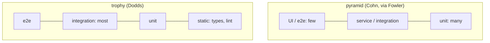

What to notice: both shapes keep end-to-end tests few and at the top; they disagree on the middle, a cost-versus-confidence trade-off, not a rule.

### How it actually works

**What each level costs in Angular.** A pure function needs no `TestBed` ([§8](#8-testing-services-pipes-and-directives-including-testbedcreatedirective)). A component test pays for `TestBed` and jsdom. An integration test in the unit runner fakes only HTTP with `HttpTestingController` ([27 §11](27-http-client.md#11-testing-and-the-backend-seam-providehttpclienttesting-httptestingcontroller-and-what-they-replace)) and navigates with `RouterTestingHarness`, module 24's router test fixture.

**Deep versus shallow.** A **deep test** renders a component with its real children. A **shallow test** swaps a child for a stub with `TestBed.overrideComponent(Parent, { set: { imports: [Stub] } })`. It isolates the parent but tests a copied contract: rename the child's input and the stub still passes.

**Confidence** is how strongly a passing test predicts working software. Testing Library's [guiding principle](https://testing-library.com/docs/guiding-principles) (read 2026-10-13): "The more your tests resemble the way your software is used, the more confidence they can give you."

**Why a component test checks the real template.** Read from the `@angular/build` 22.2.1 source (read, not run): `src/builders/unit-test/builder.js` loads the application build target's options, `getVitestBuildOptions` (internal, `runners/vitest/build-options.js`) adds the specs as entry points with `optimization: false`, and the builder runs the application build with both, so spec templates pass through the app's Angular compiler and a template error fails the build first (§2).

### Code

The approach: one cart at four levels.

1. Unit: call the counting function with no `TestBed`.
2. Deep: render the cart with its real child.
3. Shallow: replace the cart's `imports` with a same-selector stub.
4. Integration: route to an orders page, flush its request, read the list.

```ts
// Excerpt of labs/angular/src/app/modules/29-testing-angular/concepts/section-1-what-to-test.spec.ts
function labM29ItemCount(lines: readonly LabM29Line[]): number {
  return lines.reduce((sum, line) => sum + line.qty, 0);
}

@Component({
  selector: 'lab-m29-cart-line',
  template: '{{ item().name }} x{{ item().qty }};',
})
class LabM29CartLine {
  readonly item = input.required<LabM29Line>();
}

@Component({
  selector: 'lab-m29-cart-line',
  template: 'stub:{{ item().name }};',
})
class LabM29CartLineStub {
  readonly item = input.required<LabM29Line>();
}

@Component({
  selector: 'lab-m29-cart',
  imports: [LabM29CartLine],
  template: '@for (line of lines(); track line.name) {<lab-m29-cart-line [item]="line" />}{{ count() }} items',
})
class LabM29Cart {
  protected readonly lines = signal<readonly LabM29Line[]>([
    { name: 'Pen', qty: 2 },
    { name: 'Ink', qty: 1 },
  ]);
  protected readonly count = computed(() => labM29ItemCount(this.lines()));
}
```

```ts
// Excerpt of labs/angular/src/app/modules/29-testing-angular/concepts/section-1-what-to-test.spec.ts
it('Section 1: a shallow test replaces the child with a stub', async () => {
  TestBed.overrideComponent(LabM29Cart, { set: { imports: [LabM29CartLineStub] } });
  const fixture = TestBed.createComponent(LabM29Cart);
  await fixture.whenStable();
  expect(fixture.nativeElement.textContent).toBe('stub:Pen;stub:Ink;3 items');
  expect(fixture.debugElement.queryAll(By.directive(LabM29CartLine))).toHaveLength(0);
  expect(fixture.debugElement.queryAll(By.directive(LabM29CartLineStub))).toHaveLength(2);
});
```

In the lab, the deep test reads `Pen x2;Ink x1;3 items` (`Section 1: a deep component test renders the real child`); the function returns 3 with no `TestBed` (`Section 1: a unit test of a pure function needs no TestBed`). The integration page loads orders through a service:

```ts
// Excerpt of labs/angular/src/app/modules/29-testing-angular/concepts/section-1-what-to-test.spec.ts
const NO_ORDERS: readonly LabM29Order[] = [];

@Injectable({ providedIn: 'root' })
class LabM29OrdersApi {
  private readonly http = inject(HttpClient);

  list(): Observable<readonly LabM29Order[]> {
    return this.http.get<readonly LabM29Order[]>('/api/orders');
  }
}

@Component({
  selector: 'lab-m29-orders-page',
  template: '@for (order of orders(); track order.id) {<p>{{ order.item }}</p>}@empty {<p>loading</p>}',
})
class LabM29OrdersPage {
  protected readonly orders = toSignal(inject(LabM29OrdersApi).list(), { initialValue: NO_ORDERS });
}

const routes = [{ path: 'orders', component: LabM29OrdersPage }];
TestBed.configureTestingModule({
  providers: [provideHttpClient(), provideHttpClientTesting(), provideRouter(routes)],
});
const harness = await RouterTestingHarness.create();
await harness.navigateByUrl('/orders', LabM29OrdersPage);
expect(harness.routeNativeElement?.textContent).toBe('loading');
const request = TestBed.inject(HttpTestingController).expectOne('/api/orders');
request.flush([
  { id: 1, item: 'Pen' },
  { id: 2, item: 'Ink' },
]);
harness.detectChanges();
expect(harness.routeNativeElement?.textContent).toBe('PenInk');
```

Route, component, service and template run for real; only the backend is replaced, and `verify()` in `afterEach` fails on an open request (`Section 1: an integration test runs the page, its service and HTTP together`).

### Best practices and anti-patterns

- **Unit-test logic as pure functions without `TestBed`**, because they fail only when the logic does.
- **Test components deep; stub a child only when it is out of scope** (a chart, a third-party widget), because a stub copies a contract the real child can break silently.
- **Write integration tests in the unit runner, faking only HTTP**, because they cover the wiring unit tests skip, with no server.
- **Keep end-to-end tests for journeys that need a real browser**, because each needs a built app, a browser and a running backend.
- **Place accessibility checks per [Q11.19](11-accessibility.md#q11-19)**, because module 11 owns which layer catches what.

### Misconceptions and traps

- *"The pyramid says unit tests are the most valuable."* It ranks by count and cost: Fowler's bliki says "many more low-level UnitTests than high level BroadStackTests running through a GUI". The myth exists because a wide base reads as a ranking.
- *"100% coverage means the app works."* Coverage counts executed lines, not asserted behavior; an over-mocked test (§7) runs the code and asserts nothing true. It persists because coverage is easy to measure.
- *"Component tests in jsdom are end-to-end tests."* jsdom does no layout or painting and no server runs (§2). Their real templates and DOM events cause the confusion.
- *"Integration tests must be slow."* The lab's runs in the unit runner, faking only the network. The belief conflates integration with end-to-end tests.

Drilled in [Q29.01](#q29-01) and [Q29.02](#q29-02); modelled in [Exercise 29.6](#ex29-6).

## 2. The runner: Vitest through `@angular/build:unit-test`, jsdom and browser mode

### The problem it solves

A developer pastes `vi.mock('./api')` from a Vitest tutorial and the test throws. A test passes with a narrow `--include` while another spec has a type error the run never compiled. A size test passes in jsdom because every size is zero. A CI job installs `happy-dom` for another tool and every test silently changes DOM implementation.

### Mental model

`ng test` is **a build, then a run**. The **builder** (the CLI unit behind a target such as `test`) called `@angular/build:unit-test` compiles the included specs with the application's esbuild and Angular compiler pipeline and writes three **virtual files** (modules that exist only inside the build). It hands the bundle to **Vitest**, the **test runner** that finds `describe` and `it`, runs them in worker threads and reports. It runs them in **jsdom** (a JavaScript implementation of the DOM for Node) by default, or in a real browser through a **browser provider** (a package that drives it: **browser mode**).

A flight simulator running the real aircraft's software: the build loads the avionics, jsdom is the cockpit without sky, browser mode is a tethered test flight.

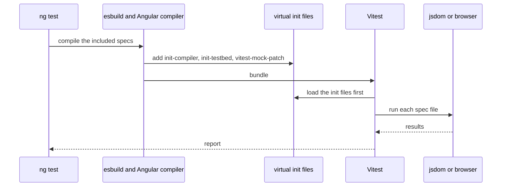

What to notice: a type or template error stops the build before any test runs, and `TestBed` is already initialized when the first line of your spec runs.

### How it actually works

Read from the `@angular/build` 22.2.1 source (`src/builders/unit-test/`; internal names may change in any release): `getVitestBuildOptions` (`runners/vitest/build-options.js`) registers the three entries, with `vitest` always external. `createTestBedInitVirtualFile` (internal) generates `angular:test-bed-init`: it registers Angular's cleanup hooks with `beforeEach` and `afterEach`, adds the `providersFile` providers (a default-exported provider array), and calls `getTestBed().initTestEnvironment` with `errorOnUnknownElements: true` and `errorOnUnknownProperties: true`, once per worker. `executor.js` lists the three init files, then your `setupFiles`, as Vitest setup files, so they run before every spec.

`findTestEnvironment` in `runners/vitest/plugins.js` (internal) picks `happy-dom` when it resolves and `jsdom` otherwise, the CI surprise above. The `angular:vitest-mock-patch` file wraps `vi.mock`, `doMock`, `importMock`, `unmock` and `doUnmock` and throws when the path starts with `.` or `/`. The reason: specs are bundled, so a relative path is not a node in Vitest's module graph; the message says to use `TestBed`.

Why no `Zone`? `getZoneTestingStrategy` (internal) loads `zone.js/testing` only if the build target's `polyfills` list names it, or imports it when the list is undefined. The application schema defaults `polyfills` to `[]` and the builder validates the target options, so this lab takes the branch that imports `zone.js/testing` only `if (typeof Zone !== 'undefined')`, and nothing defines `Zone` (read, not run; the first test below shows the result).

Options: `include`, `filter`, `isolate`, default false to match Karma and true in this lab's `angular.json`; `splitting` [Deprecated since v22.2] ("No longer needed with Vitest 5."), `providersFile`, `setupFiles`, `coverage`, `runnerConfig`. **Watch mode** reruns specs on a file change; **coverage** (a report of which lines ran) and browser mode are documented, not run here. The Angular docs (`overview.md`, `main`, read 2026-10-13) install a provider with `npm install --save-dev @vitest/browser-playwright playwright`, select it with `--browsers`, and say `@vitest/browser-preview` "is not intended for use in CI/CD"; [module 30](30-e2e-and-testing-strategy.md#2-playwright-and-cypress-architecture-ng-e2e-and-the-end-of-protractor) owns Playwright itself.

> [!NOTE]
> **Framework vs platform.** Angular supplies the builder, compiler pipeline and `TestBed`; Vitest supplies `describe`, `it`, `expect` and `vi`; the DOM is jsdom's implementation of the WHATWG DOM, or a real browser's in browser mode; zone.js, if loaded, patches platform timers (not loaded here).

### Code

The approach: assert what the builder prepared, then the guard it adds.

1. Check the DOM implementation and that no `Zone` exists.
2. Check `TestBed` is initialized without an `initTestEnvironment` call.
3. Call `vi.doMock` with a relative path.

```ts
// Excerpt of labs/angular/src/app/modules/29-testing-angular/concepts/section-2-runner.spec.ts
const RELATIVE_MOCK_MESSAGE =
  'The "vi.mock" and related methods are not supported for relative imports with the Angular unit-test system. ' +
  'Please use Angular TestBed for mocking dependencies.';

describe('Section 2: the runner', () => {
  it('Section 2: tests run in jsdom without zone.js', () => {
    expect(navigator.userAgent).toContain('jsdom');
    expect('Zone' in globalThis).toBe(false);
    expect(TestBed.inject(NgZone).constructor.name).toBe('NoopNgZone');
  });

  it('Section 2: TestBed is initialized before the spec runs', () => {
    expect(getTestBed().platform).not.toBeNull();
  });

  it('Section 2: vi.mock of a relative path is rejected', () => {
    expect(() => vi.doMock('./x', () => ({}))).toThrow(RELATIVE_MOCK_MESSAGE);
  });
});
```

These tests assert the claims above; `Section 2: vi.fn works without any module mocking` shows `vi.fn` needs no module mock. The type-check claim was observed by building a throwaway spec on 2026-10-13: `const t: number = 'oops';` in an included spec ended with "Application bundle generation failed." and `✘ [ERROR] TS2322: Type 'string' is not assignable to type 'number'. [plugin angular-compiler]`, and no test ran; a template `<lab-missing></lab-missing>` gave `✘ [ERROR] NG8001: 'lab-missing' is not a known element:`. A per-file transpiler skips both ([Q06.02](06-ts-type-system-essentials.md#q06-02)); templates compile ahead of time ([12 §7](12-angular-how-it-works.md#7-aot-versus-jit-and-template-type-checking)). CLI 22.2.0 compiles only the included specs, so also run `npx tsc -p tsconfig.spec.json --noEmit`. Drilled in [Q29.03](#q29-03), [Q29.04](#q29-04) and [Q29.05](#q29-05).

### Best practices and anti-patterns

- **Provide doubles through `TestBed` providers, not `vi.mock('./x')`**, because the builder rejects relative paths and a provider is what the injector really sees (§7).
- **Keep `isolate: true` where specs share globals**, because the default is false and one file's leaked state would reach the next.
- **Install one DOM package on purpose**, because `happy-dom` wins over jsdom whenever it resolves.
- **Check layout in a browser provider**, because jsdom does no layout.

### Misconceptions and traps

- *"Vitest runs the TypeScript directly, so type errors do not fail tests."* Plain Vitest does transpile per file, which is why the belief exists; the Angular builder type-checks the included specs and fails the build first.
- *"`vi.mock` works as in any Vitest project."* It does in the Vitest docs, which is the source of the habit; here relative paths throw, because specs are bundled.
- *"jsdom is a browser."* It runs DOM code, so tests feel browser-like; the jsdom README says it "does not have the capability to render visual content" and returns "zeros for many layout-related properties".
- *"`isolate` is on by default."* It is in many Vitest setups; the builder's schema default is false, and this lab turns it on in `angular.json`.

## 3. Karma, Jasmine and Jest: the legacy and alternative runners, and migrating to Vitest

### The problem it solves

An interview asks, "you inherit 3,000 Karma specs: what do you do?" A team pastes `jasmine.createSpyObj` into a Vitest project and the types stop compiling. Another team wants Jest because "Angular dropped Jest" or "Angular recommends Jest", and each sentence is half true.

### Mental model

Three generations of tooling. **Karma** is a test runner that launches real browsers; it ran **Jasmine** specs (a test framework with its own `describe`, `it`, `expect` and spies) and was the CLI default before v21. **Jest** is a Node runner with jsdom that Angular reaches through the third-party **`jest-preset-angular`**; the CLI's own experimental Jest and Web Test Runner builders are `[Removed in v22.0]`. **Vitest** through the unit-test builder is the default since v21 (§2).

The builder still runs Karma, so a migration is two independent steps: the **builder** (which tool runs the tests), then the **spec syntax** (what the specs say). Moving house: first the address, then repacking each box.

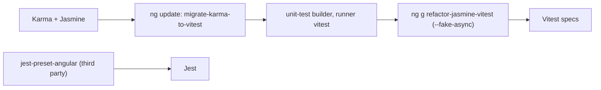

What to notice: the builder can run either runner, so step B can ship weeks before step D; Jest is a separate branch the CLI does not drive.

### How it actually works

Read from the `@angular/build` 22.2.1 source (`src/builders/unit-test/schema.json`): `runner` accepts `karma` or `vitest`, default `vitest`, and `karma` and `istanbul-lib-instrument` are optional peers. The Angular docs (`karma.md`, `main`, read 2026-10-13) say "Karma is still a supported and widely used test runner". An **`ng update` migration** is a code change the CLI applies to your workspace; read from `@schematics/angular` 22.2.1 (`migrations/migration-collection.json`, `migrate-karma-to-vitest/migration.js`), `migrate-karma-to-vitest` is version `22.0.0`, flagged optional, skips projects not on `@angular/build:application`, sets the test target to `@angular/build:unit-test` with `runner: 'vitest'`, and adds `vitest`.

A **schematic** is a generator that edits files from a template or a transform. `refactor-jasmine-vitest` rewrites the specs; its collection entry says "[EXPERIMENTAL]", the docs call it "experimental and may not cover all possible test patterns", and the CLI CHANGELOG 22.0.0 lists "stabilize refactor-jasmine-vitest schematic". With `--fake-async`, read from `refactor/jasmine-vitest/transformers/fake-async-test.js` (`_createFakeTimersHookStatements`) and `fake-async-tick.js`, it adds a `beforeEach` with `vi.useFakeTimers({ advanceTimeDelta: 1, shouldAdvanceTime: true })` and an `afterEach` with `vi.useRealTimers()` at the top of the outermost `describe`, makes each `fakeAsync` callback `async`, and turns `tick(n)` into `await vi.advanceTimersByTimeAsync(n)`. The reason: `fakeAsync` runs inside a zone and this lab has none (§2), so Vitest's clock replaces it; `shouldAdvanceTime` lets that clock move with real time, which the third test relies on (read, not run; §10 owns the contrast).

Jest is documented only: `jest-preset-angular` 17.0.1 (`npm pack`, read 2026-10-13) lists Angular `>=20.0.0 <23.0.0` and exports `setupZonelessTestEnv`. A **spy object** is a stand-in whose methods are all spies; Jasmine builds one with `createSpyObj`, the schematic writes an object literal of `vi.fn()` calls.

### Code

The approach: show the Jasmine form, then the Vitest form the schematic produces, then run both migration steps.

1. Legacy first: the Karma configuration and a Jasmine spec, not run here.
2. The Vitest spy object and `mockReturnValue`, run by the lab.
3. The fake-timer setup the schematic adds, run by the lab.
4. The two commands.

#### Legacy

```js
// Partial: karma.conf.js fragment, plugins and reporters omitted; Karma, not run in these labs
module.exports = (config) => {
  config.set({ frameworks: ['jasmine'], browsers: ['ChromeHeadless'] });
};
```

```ts
// Partial: Jasmine, not run in these labs; LabM29Greeter, LabM29Welcome and LabM29LateMessage as in the lab spec
it('greets', () => {
  const greeter = jasmine.createSpyObj<LabM29Greeter>('LabM29Greeter', ['greet', 'reset']);
  greeter.greet.and.returnValue('Hello');
  TestBed.configureTestingModule({ providers: [LabM29Welcome, { provide: LabM29Greeter, useValue: greeter }] });
  expect(TestBed.inject(LabM29Welcome).welcome('Ada')).toBe('Hello!');
});

it('shows the late message', fakeAsync(() => {
  const fixture = TestBed.createComponent(LabM29LateMessage);
  tick(1000);
  fixture.detectChanges();
  expect(fixture.nativeElement.textContent).toBe('done');
}));
```

Migration: step 1 is `ng update @angular/cli --name migrate-karma-to-vitest --migrate-only` (the options `name` and `migrate-only` are on angular.dev/cli/update, read 2026-10-13); step 2 is `ng g @schematics/angular:refactor-jasmine-vitest --fake-async`.

Vitest, as the lab runs it:

```ts
// Excerpt of labs/angular/src/app/modules/29-testing-angular/concepts/section-3-migrated-specs.spec.ts
abstract class LabM29Greeter {
  abstract greet(name: string): string;
  abstract reset(): void;
}

class LabM29Welcome {
  private readonly greeter = inject(LabM29Greeter);

  welcome(name: string): string {
    return `${this.greeter.greet(name)}!`;
  }
}

describe('Section 3: migrated specs', () => {

  it('Section 3: an object of vi.fn replaces jasmine.createSpyObj', () => {
    // The schematic turns jasmine.createSpyObj('LabM29Greeter', ['greet', 'reset']) into this shape.
    const greeter = {
      greet: vi.fn<LabM29Greeter['greet']>().mockName('LabM29Greeter.greet'),
      reset: vi.fn<LabM29Greeter['reset']>().mockName('LabM29Greeter.reset'),
    };
    greeter.greet.mockReturnValue('Hello');
    TestBed.configureTestingModule({
      providers: [LabM29Welcome, { provide: LabM29Greeter, useValue: greeter }],
    });

    expect(TestBed.inject(LabM29Welcome).welcome('Ada')).toBe('Hello!');
    expect(greeter.greet).toHaveBeenCalledWith('Ada');
    expect(greeter.reset).not.toHaveBeenCalled();
    expect(greeter.greet.getMockName()).toBe('LabM29Greeter.greet');
  });

  it('Section 3: mockReturnValue replaces and.returnValue', () => {
    const double = vi.fn<(n: number) => number>();
    expect(double(1)).toBeUndefined();

    double.mockReturnValue(7);

    expect(double(2)).toBe(7);
    expect(double).toHaveBeenCalledTimes(2);
    expect(double).toHaveBeenLastCalledWith(2);
  });
});
```

```ts
// Excerpt of labs/angular/src/app/modules/29-testing-angular/concepts/section-3-migrated-specs.spec.ts
@Component({
  selector: 'lab-m29-late-message',
  template: '{{ message() }}',
})
class LabM29LateMessage {
  protected readonly message = signal('wait');

  constructor() {
    setTimeout(() => this.message.set('done'), 1000);
  }
}

describe('Section 3: migrated specs', () => {
  afterEach(() => vi.useRealTimers());

  it("Section 3: the schematic's fake-timer setup lets whenStable resolve", async () => {
    vi.useFakeTimers({ advanceTimeDelta: 1, shouldAdvanceTime: true });
    const fixture = TestBed.createComponent(LabM29LateMessage);

    await fixture.whenStable();
    expect(fixture.nativeElement.textContent).toBe('wait');

    await vi.advanceTimersByTimeAsync(1000);
    await fixture.whenStable();
    expect(fixture.nativeElement.textContent).toBe('done');
  });
});
```

These tests assert the claims above; Karma and Jest are documented, not run. `Section 3: the schematic's fake-timer setup lets whenStable resolve` shows a test finishes under that setup; §10 shows the contrast. Drilled in [Q29.06](#q29-06) and [Q29.07](#q29-07).

### Best practices and anti-patterns

- **Migrate the builder first, then run the schematic per folder**, because the docs say the schematic "does not change your `angular.json`" and leaves `karma.conf.js` alone.
- **Review the report the schematic writes**, because it adds TODO comments for what it cannot convert.
- **Convert `fakeAsync` tests deliberately**, because the schematic swaps the clock and the test's shape.

### Misconceptions and traps

- *"Karma is deprecated."* Vitest became the default, which reads like a retirement; the docs call Karma supported and the builder keeps `runner: 'karma'`.
- *"Angular dropped Jest."* 22.0 removed the CLI's experimental Jest builder, which sounds like the whole of Jest; `jest-preset-angular` 17.0.1 declares support for Angular 20 to 22.
- *"The schematic converts everything."* It is automatic, so it feels complete; the docs say it "may not cover all possible test patterns".
- *"`fakeAsync` tests migrate one to one."* The shape is the same, but the schematic makes the test `async` and swaps the clock.

## 4. `TestBed`: the testing module, `inject`, `runInInjectionContext`, overrides and teardown

### The problem it solves

A helper calls `TestBed.inject` in a `beforeEach`, and the next `configureTestingModule` fails with "Cannot configure the test module when the test module has already been instantiated". A function that uses `inject()` throws `NG0203` ([16 §4](16-dependency-injection.md#4-the-injection-context-inject-runininjectioncontext-and-injectasync)) when a test calls it. A module-level variable leaks state between tests. A test overrides a service and the component still gets the real one. Each comes from not knowing when `TestBed` builds its module and when it discards it.

### Mental model

`TestBed` builds a fresh **testing module** (an Angular module made for one test, holding that test's providers and imports) before each test. Until the first `inject` or `createComponent`, it is only a recipe: `configureTestingModule` and the **overrides** (`override*` methods, test-only replacements of a provider or of metadata) edit it. That first call **instantiates** the module, creating its **environment injector** ([16 §5](16-dependency-injection.md#5-the-injector-tree-platform-root-route-and-element-injectors-and-the-modifiers)), and locks the recipe. **Teardown** destroys the module and its fixtures after the test. A stage set is rebuilt before every scene: props move until the curtain rises (the first `inject`), and the crew clears the stage afterwards.

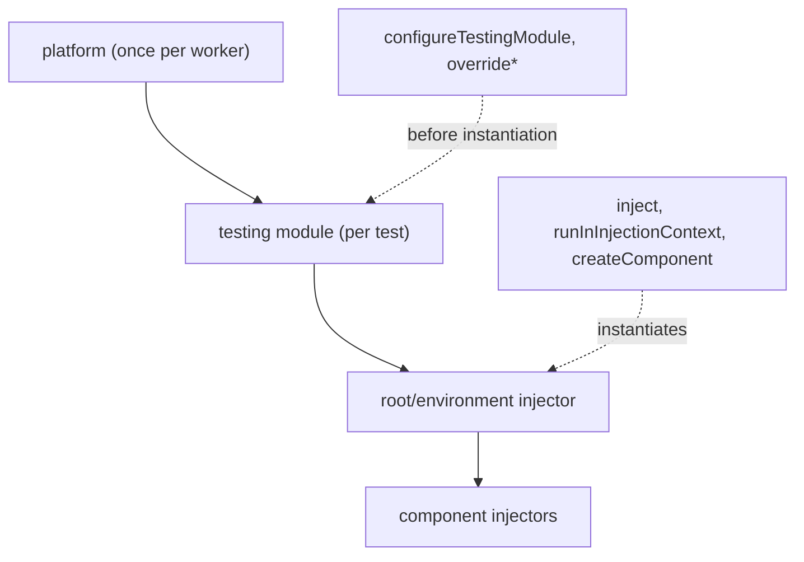

What to notice: configuration and overrides edit the recipe, not a running injector, which is why order matters.

### How it actually works

Read from the `@angular/core` 22.2.1 source (`fesm2022/testing.mjs`; `TestBedImpl` and the helpers named here are internal and may change in any release). `TestBedImpl.configureTestingModule` starts with `assertNotInstantiated`, which throws once the private module reference is set. A getter, `testModuleRef`, fills that reference by calling `compiler.finalize()` on first read; `TestBedImpl.inject` reads it, and `runInInjectionContext` is `inject(EnvironmentInjector)` followed by Angular's `runInInjectionContext`, so both instantiate. Every `override*` method runs the same guard (read, not run), because the recipe is compiled into one module type that only a new module can replace.

Teardown is registered at the end of that file: `beforeEach` and `afterEach` hooks from `ɵgetCleanupHook` (internal) call `resetTestingModule` (by default only the `afterEach` one, [§12](#12-under-the-hood-how-the-builder-boots-testbed-and-how-a-fixture-decides-it-is-stable)), which destroys the fixtures and, when `teardown.destroyAfterEach` is true (the default), the module, and starts a new recipe. `TestModuleMetadata` (`types/testing.d.ts`) carries the rest:

| Option | Default | Effect |
|---|---|---|
| `providers`, `imports` | none | the recipe |
| `teardown` | `destroyAfterEach: true` | destroy the module after each test |
| `errorOnUnknownElements`, `errorOnUnknownProperties` | `false` | throw instead of logging |
| `rethrowApplicationErrors` [Changed in v19.0: errors during change detection are rethrown] | `true` | rethrow errors seen during change detection |
| `deferBlockBehavior` | `manual` | `@defer` in tests ([Q18.19](18-control-flow-and-defer.md#q18-19)) |
| `inferTagName`, `animationsEnabled` | off, `false` | host tag from the selector; animations on |

The unit-test builder passes `errorOnUnknownElements: true` and `errorOnUnknownProperties: true` to `initTestEnvironment` (`@angular/build` 22.2.1, `build-options.js`, `createTestBedInitVirtualFile`, internal); this section claims no runtime throw for an unknown element (§2 covers the `NG8001` build failure). `TestBed` also provides a fake `PlatformLocation`, the service routing reads the URL through ([module 24](24-routing.md)) [Changed in v21.0: supports the Navigation API]; the 21.0.0 changelog names `MockPlatformLocation` from `@angular/common/testing` as the way back.

### Code

The approach: two root services, one claim per test.

1. Declare a service and a second one that injects it, plus a plain function that calls `inject()`.
2. Call `TestBed.inject`, then `configureTestingModule`: the guard throws.
3. Run the function through `TestBed.runInInjectionContext`, then bare: `NG0203`.
4. Override the dependency before the first `inject`.
5. Record each test's root instance and compare.

```ts
// Excerpt of labs/angular/src/app/modules/29-testing-angular/concepts/section-4-testbed.spec.ts
@Service()
class LabM29Clock {
  readonly label: string = 'real';
}

@Service()
class LabM29Stamp {
  private readonly clock = inject(LabM29Clock);

  text(): string {
    return `stamp of ${this.clock.label}`;
  }
}

function labM29ReadClock(): string {
  return inject(LabM29Clock).label;
}

describe('Section 4: TestBed', () => {
  it('Section 4: configureTestingModule after TestBed.inject throws', () => {
    TestBed.inject(EnvironmentInjector);

    expect(() => TestBed.configureTestingModule({})).toThrow(CONFIGURE_AFTER_INJECT);
  });

  it('Section 4: runInInjectionContext runs a function that calls inject', () => {
    expect(TestBed.runInInjectionContext(labM29ReadClock)).toBe('real');
  });

  it('Section 4: a function that calls inject outside a context throws NG0203', () => {
    expect(() => labM29ReadClock()).toThrowError(NOT_IN_CONTEXT_CLOCK);
  });

  it('Section 4: overrideProvider replaces a dependency of a root service', () => {
    TestBed.overrideProvider(LabM29Clock, { useValue: { label: 'fake' } });

    expect(TestBed.inject(LabM29Stamp).text()).toBe('stamp of fake');
  });

  it('Section 4: each test gets a new root instance', () => {
    const first = TestBed.inject(LabM29Counter);
    first.count++;

    // What the builder's cleanup hook calls after every test.
    TestBed.resetTestingModule();
    const next = TestBed.inject(LabM29Counter);

    expect(next).not.toBe(first);
    expect(next.count).toBe(0);
  });
});
```

The spec also asserts `Section 4: TestBed.inject returns the test's root instance`. The last test calls `resetTestingModule()` itself, as the cleanup hook does between tests: the next `inject` builds a new counter that reads 0. Which override reaches which injector is [16 §9](16-dependency-injection.md#9-di-patterns-testing-and-the-spring-container) and [Q16.34](16-dependency-injection.md#q16-34); spec imports after a standalone migration are [Q15.21](15-standalone-and-ngmodules.md#q15-21). Drilled in [Q29.08](#q29-08), [Q29.09](#q29-09) and [Q29.10](#q29-10).

#### Legacy

```ts
// Partial: legacy helpers, not run in these labs; LabM29Stamp as in the lab spec
import { inject } from '@angular/core/testing';

it('reads the stamp', inject([LabM29Stamp], (stamp: LabM29Stamp) => {
  expect(stamp.text()).toBe('stamp of real');
}));

const stamp = TestBed.get(LabM29Stamp);
```

`inject([tokens], fn)` is still exported by `@angular/core/testing` 22.2.1 and wraps a test function. `TestBed.get` [Removed in v20.0] is absent from its typings. Migration: write `TestBed.inject(Token)`, and replace the wrapper with a plain function body that calls `TestBed.inject` or `TestBed.runInInjectionContext`.

### Best practices and anti-patterns

- **Configure before anything injects**, because the first `inject` locks the recipe and a late `configureTestingModule` throws.
- **Override one dependency with `overrideProvider`**, because it edits the recipe and leaves the rest real.
- **Run functions that call `inject()` through `TestBed.runInInjectionContext`**, because it supplies the testing module's injector.
- **Keep `destroyAfterEach` at its default**, because a module that is not destroyed leaks its services into the next test.
- **Create per-test state in `beforeEach`**, because a module-level variable outlives the module.

### Misconceptions and traps

- *"`TestBed` is shared across the file."* A `beforeEach` looks global; the module is rebuilt for each test.
- *"A provider can be added at any point in a test."* Providers look like a list; configuration locks at instantiation.
- *"The testing `inject` and the core `inject()` are the same."* They share a name; the testing one wraps a test function with tokens, while the core one reads the current injection context.

## 5. Zoneless fixtures: `whenStable`, `TestBed.tick()`, `detectChanges` and automatic change detection

### The problem it solves

A test calls `setInput`, reads the DOM and finds the old text. A migrated suite sets a plain field, calls `detectChanges()` and nothing changes. `autoDetectChanges(false)` throws once the suite is zoneless. A tutorial calls `TestBed.flushEffects()` [Deprecated since v20.0 — use TestBed.tick()] and a reviewer says it no longer exists. Each comes from not knowing who renders a fixture.

### Mental model

In a zoneless test the **fixture** (`ComponentFixture`, the test's handle on one rendered component) **auto-detects**: like the app, it renders when something notifies the scheduler, so a signal write or `setInput` **schedules** a render. The test then waits until the fixture is **stable**, meaning no pending task is left ([21 §5](21-change-detection.md#5-zoneless-change-detection-the-scheduler-its-triggers-and-pendingtasks)), with `await fixture.whenStable()`, or forces a **tick**, one change-detection pass of the whole application, with `TestBed.tick()` [Stable since v20.0]. OnPush views ([21 §4](21-change-detection.md#4-the-tree-walk-global-and-targeted-refreshes)) still need a reason to refresh: a signal they read, an input, an event or `markForCheck` ([21 §7](21-change-detection.md#7-changedetectorref-markforcheck-detectchanges-detach-and-reattach)). A print shop: you drop an order (write a signal) and either wait at the counter (`whenStable`) or press "print now" (`TestBed.tick()`); an order slipped under the door (a plain field) is ignored.

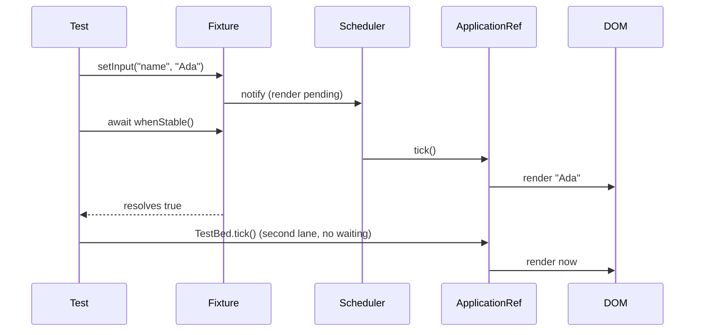

What to notice: nothing renders between a write and a tick, which is why reading right after `setInput` is stale.

### How it actually works

Read from the `@angular/core` 22.2.1 source (`fesm2022/testing.mjs`; `AbstractFixture`, the base class of `ComponentFixture`, and every other internal name here may change in any release). The constructor sets `autoDetectDefault` to true when `ZONELESS_ENABLED` (internal) is true, unless the public `ComponentFixtureAutoDetect` token says otherwise, and then adds the host view to `autoDetectTestViews` (internal) and notifies the scheduler. Zoneless, `detectChanges` sets `includeAllTestViews` (internal) and calls `ApplicationRef.tick()`, so it renders every test view, not only this fixture's; with zone.js it runs the effect scheduler and `changeDetectorRef.detectChanges()` inside `ngZone.run`. `TestBedImpl.tick` (internal) is the same flag-and-tick. `whenStable` returns `Promise.resolve(false)` when `isStable()` finds no pending task in `PendingTasksInternal` (internal), otherwise it waits for `ApplicationRef.whenStable()` and resolves `true` (read, not run). `autoDetectChanges(false)` throws first when zoneless; its typings say "We have not seen a use-case for autoDetect: false but changeDetectorRef.detach() is a close equivalent."

`TestBed.flushEffects` is `this.tick()` in 22.2.1. The 20.0.0 CHANGELOG's breaking note calls it "removed"; the 20.0.0 and 22.2.1 packages keep it deprecated, which is also what `TestBedStatic` declares. `TestBed.getLastFixture` [Added in v22.0] returns the newest `ComponentFixture` or throws `No fixture has been created yet.`

### Code

The approach: two fixtures, one claim per test.

1. Declare a component with a signal input and an OnPush one with a signal and a plain field.
2. Write, read at once, wait, read again.
3. Write the plain field, call `detectChanges`, wait, then mark the view.
4. Ask for the forbidden `autoDetectChanges(false)`.

```ts
// Excerpt of labs/angular/src/app/modules/29-testing-angular/concepts/section-5-zoneless-fixture.spec.ts
@Component({
  selector: 'lab-m29-greeting',
  template: '<p>{{ name() }}</p><b>x</b>',
})
class LabM29Greeting {
  readonly name = input('none');
}

@Component({
  selector: 'lab-m29-pair',
  template: '<p>{{ plain }}|{{ sig() }}</p>',
})
class LabM29Pair {
  plain = 'a';
  readonly sig = signal('a');
}

describe('Section 5: zoneless fixtures', () => {
  it('Section 5: the DOM is empty of bindings until the fixture is stable', async () => {
    const fixture = TestBed.createComponent(LabM29Greeting);
    fixture.componentRef.setInput('name', 'Ada');

    expect(fixture.nativeElement.textContent).toBe('x');

    await fixture.whenStable();

    expect(fixture.nativeElement.textContent).toBe('Adax');
  });

  it('Section 5: a plain field write is not rendered until the view is marked', async () => {
    const fixture = TestBed.createComponent(LabM29Pair);
    await fixture.whenStable();
    expect(fixture.nativeElement.textContent).toBe('a|a');

    fixture.componentInstance.plain = 'b';
    fixture.detectChanges();
    expect(fixture.nativeElement.textContent).toBe('a|a');

    await fixture.whenStable();
    expect(fixture.nativeElement.textContent).toBe('a|a');

    fixture.componentRef.injector.get(ChangeDetectorRef).markForCheck();
    fixture.detectChanges();
    expect(fixture.nativeElement.textContent).toBe('b|a');
  });
});
```

The spec also asserts `Section 5: TestBed.tick renders synchronously`, `Section 5: a signal write is rendered after whenStable` (`'a|c'`), `Section 5: whenStable resolves false when nothing is pending`, `Section 5: autoDetectChanges(false) throws in a zoneless test` (`Cannot set autoDetect to false with zoneless change detection.`) and `Section 5: TestBed.flushEffects still exists and runs TestBed.tick`; the last spies on `tick`. The first read sees `x` because static nodes exist after creation while bindings wait for a tick. Choose `whenStable` when the code under test schedules work the application tracks, and `TestBed.tick()` when the next DOM is all the test needs. `PendingTasks` is [Q21.20](21-change-detection.md#q21-20); `markForCheck` and `detectChanges` are [Q21.24](21-change-detection.md#q21-24). Drilled in [Q29.11](#q29-11), [Q29.12](#q29-12), [Q29.13](#q29-13) and [Q29.14](#q29-14).

#### Legacy

```ts
// Partial: zone-based suite, not run in these labs
TestBed.configureTestingModule({
  providers: [{ provide: ComponentFixtureAutoDetect, useValue: true }],
});
const fixture = TestBed.createComponent(LabM29Pair);
fixture.componentInstance.plain = 'b';
fixture.detectChanges();
```

Migration: move state a template reads into a signal, replace each `detectChanges()` with `await fixture.whenStable()`, and call `TestBed.tick()` to force one. The docs call rewriting such suites "likely not worth the effort" ([21 §6](21-change-detection.md#6-migrating-a-zone-based-app-to-zoneless)).

### Best practices and anti-patterns

- **Await `fixture.whenStable()` after a write**, because nothing renders until the scheduler ticks.
- **Use `TestBed.tick()` to force a render at once**, because it needs no wait.
- **Keep template state in signals**, because an OnPush view skips a plain field.
- **Call `TestBed.tick()`, not `flushEffects()`**, because the deprecated member only forwards to it.
- **Drop `autoDetectChanges(false)`**, because zoneless auto-detect cannot be switched off.

### Misconceptions and traps

- *"`detectChanges()` refreshes everything."* Zone-era habit; zoneless it ticks the application, and an OnPush view with no dirty mark is still skipped.
- *"`whenStable` is only for HTTP."* Zone-era async waits; zoneless it is the normal wait for a render.
- *"`TestBed.flushEffects()` was removed in v20."* The 20.0.0 CHANGELOG's breaking note says so, but the packages keep a deprecated member.
- *"Auto-detect makes tests synchronous."* The name suggests it; it schedules and does not render at once.

## 6. Component tests: DOM queries, `ComponentFixture`, signal inputs with `setInput` and `bindings`, outputs and OnPush

### The problem it solves

A spec writes `fixture.componentInstance.name.set('Ada')` on a signal input and does not compile. Another queries `.btn-primary`, and a designer's rename breaks it with no behavior changed. A third calls `triggerEventHandler('click')` and believes the parent card heard the click. A fourth spies on a private method to prove an output fired. Each tests the component's insides instead of its contract.

### Mental model

Test a component **through its public contract**: inputs in, events in, and observable results out. Inputs arrive by `setInput` on `fixture.componentRef`, by the `bindings` option of `TestBed.createComponent` [Added in v20.1] (binding functions such as `inputBinding`, which hand a component a signal or function instead of a value), or through a **host component**, a small test-only component whose template contains the one under test, which you need only when the template contract itself matters, such as content projection. Events arrive as DOM events on rendered elements. Results leave as rendered DOM and as emissions of an `OutputEmitterRef`, the object `output()` returns ([19 §7](19-component-communication-and-projection.md#7-dynamic-components-viewcontainerrefcreatecomponent-createcomponent-and-bindings) and [Q19.26](19-component-communication-and-projection.md#q19-26) own the binding functions). A vending machine is tested through its slot and buttons, not by opening the cabinet. `fixture.nativeElement` is the DOM and `fixture.debugElement` is a `DebugElement`, Angular's wrapper of a node with `query(By.css(...))` (`By.css` builds a CSS-selector predicate) and `triggerEventHandler`.

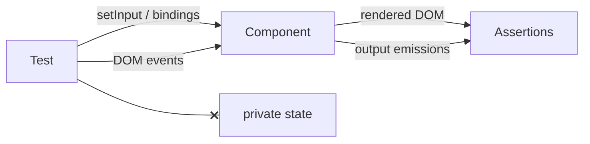

What to notice: every arrow into the component is something a parent or a user can do, and the crossed edge is the one a test must not take.

### How it actually works

`setInput` is the zoneless fixture of [§5](#5-zoneless-fixtures-whenstable-testbedtick-detectchanges-and-automatic-change-detection): it schedules a render, so the DOM changes after `await fixture.whenStable()` (`Section 6: setInput updates a signal input after whenStable`). With `bindings`, the signal you pass is read by the component's input, but a `set` renders nothing until a tick: in the lab the text stayed `Box` after `name.set('Cy')` and became `Cyx` after `TestBed.tick()`, and a click reached the `outputBinding` listener (`Section 6: bindings keep a signal input in sync after TestBed.tick`). An output is observed by calling `subscribe` on it (`Section 6: an output is observed by subscribing to the OutputEmitterRef`).

A signal input is read-only from outside. Read from the `@angular/core` 22.2.1 source: `InputSignal` in `types/core.d.ts` extends `Signal` and declares no `set`, and `createInputSignal` in `fesm2022/core.mjs` returns a bare function, so `.set` is `undefined` at run time too. The `// @ts-expect-error` line fails the compile when it stops being an error; the error is `TS2339`, a missing property (`Section 6: a signal input cannot be set from the test`).

`triggerEventHandler` is not a click. Read from the `@angular/core` 22.2.1 source (`DebugElement.triggerEventHandler` in `fesm2022/_debug_node-chunk.mjs`; the chunk's file name may change in any release): it loops over the listeners Angular registered on that one node (`getListeners(this.nativeNode)`), calls those whose name matches and never visits a parent. The lab asserts both sides: `triggerEventHandler('click')` on a button inside a clickable card ran `['button']`, and a native `click()` ran `['button', 'card']` because a DOM event bubbles.

### Code

The approach: three small components, one claim per test.

1. Declare a greeting with a signal input and an output, and a card whose `div` and inner button both listen to `click`.
2. Mount the greeting with `bindings`, write the signal, tick, and click.
3. Fire the same click through `triggerEventHandler` and through the DOM.

```ts
// Excerpt of labs/angular/src/app/modules/29-testing-angular/concepts/section-6-component-tests.spec.ts
@Component({
  selector: 'lab-m29-greet',
  template: '<p>{{ name() }}</p><button type="button" (click)="hit.emit(name())">x</button>',
})
class LabM29Greet {
  readonly name = input('none');
  readonly hit = output<string>();
}

@Component({
  selector: 'lab-m29-card',
  template:
    '<div class="card" (click)="log.push(\'card\')"><button type="button" (click)="log.push(\'button\')">go</button></div>',
})
class LabM29Card {
  readonly log: string[] = [];
}

describe('Section 6: component tests', () => {
  it('Section 6: bindings keep a signal input in sync after TestBed.tick', async () => {
    const name = signal('Bo');
    const got: string[] = [];
    const fixture = TestBed.createComponent(LabM29Greet, {
      bindings: [inputBinding('name', name), outputBinding<string>('hit', (value) => got.push(value))],
    });
    await fixture.whenStable();
    expect(fixture.nativeElement.textContent).toBe('Box');

    name.set('Cy');
    expect(fixture.nativeElement.textContent).toBe('Box');

    TestBed.tick();
    expect(fixture.nativeElement.textContent).toBe('Cyx');

    fixture.debugElement.query(By.css('button')).nativeElement.click();
    expect(got).toEqual(['Cy']);
  });

  it('Section 6: triggerEventHandler runs only the listener on that element', async () => {
    const fixture = TestBed.createComponent(LabM29Card);
    await fixture.whenStable();

    fixture.debugElement.query(By.css('button')).triggerEventHandler('click');

    expect(fixture.componentInstance.log).toEqual(['button']);
  });

  it('Section 6: a native click bubbles to the parent listener', async () => {
    const fixture = TestBed.createComponent(LabM29Card);
    await fixture.whenStable();

    fixture.debugElement.query(By.css('button')).nativeElement.click();

    expect(fixture.componentInstance.log).toEqual(['button', 'card']);
  });
});
```

The spec also finds a button by its **accessible name**, the text assistive technology announces for a control ([11 §7](11-accessibility.md#7-testing-accessibility)), with a helper that reads `aria-label` first and the trimmed text second (`Section 6: a button is found by its accessible name`): the icon-only button named `Save draft` is found without its class. That helper is a simplified computation, not the full algorithm. OnPush is the default, so [§5](#5-zoneless-fixtures-whenstable-testbedtick-detectchanges-and-automatic-change-detection)'s timing rules apply to every test here; testing a `@defer` block is [Q18.19](18-control-flow-and-defer.md#q18-19). Drilled in [Q29.15](#q29-15), [Q29.16](#q29-16) and [Q29.17](#q29-17); built in [Exercise 29.1](#ex29-1).

### Best practices and anti-patterns

- **Set inputs with `setInput` or `bindings`**, because a signal input has no `set` and a plain field write skips the render.
- **Prefer `bindings` when the input is a signal the test keeps changing**, because the test owns one source and ticks once.
- **Click with the DOM when the user would click**, because a native event bubbles through every listener the user would trigger.
- **Reserve `triggerEventHandler` for one listener in isolation**, because it skips bubbling.
- **Query by accessible name or label before a class**, because styling classes change for reasons unrelated to behavior.

### Misconceptions and traps

- *"Set inputs by assigning `componentInstance.x`."* Decorator-input habit; a signal input is a read-only `InputSignal`, so use `setInput` or `bindings`.
- *"`triggerEventHandler` is the same as a click."* The event name matches; it calls the Angular listeners on that node only and does not bubble.
- *"Test the class without its template."* Unit-test habit; the template is most of a component's behavior ([§1](#1-what-to-test-where-unit-integration-component-and-end-to-end-tests-the-pyramid-and-the-trophy)).
- *"`By.css` with classes is the Angular way."* Old docs show it; it couples tests to styling, and Testing Library's guiding principle, that tests resemble how the software is used, favors roles and labels ([§11](#11-component-harnesses-and-angular-testing-library)).

## 7. Test doubles: fakes, stubs, spies and mocks, `vi.fn`, provider overrides and over-mocking

### The problem it solves

A component test stubs the service with a list, passes, and production fails because the real service returns something else. A second asserts `toHaveBeenCalledTimes(3)` and breaks when a cache is added. A third leaks a spy into the next test.

### Mental model

A **test double** is a stand-in for a collaborator. Gerard Meszaros's five kinds, in Martin Fowler's wording ([Mocks Aren't Stubs](https://martinfowler.com/articles/mocksArentStubs.html), read 2026-10-13): "Dummy objects are passed around but never actually used."; "Stubs provide canned answers to calls made during the test"; "Spies are stubs that also record some information based on how they were called."; "Mocks are what we are talking about here: objects pre-programmed with expectations which form a specification of the calls they are expected to receive."; and "Fake objects actually have working implementations, but usually take some shortcut which makes them not suitable for production".

`vi.fn()` is a spy that can also be given canned answers, so it is a stub and a spy at once; it holds no expectations until the test asserts, so it is not a mock in Meszaros's sense. A class implementing the service's interface is a fake. In Angular the **seam** (where one implementation is swapped for another) is dependency injection: `{ provide: Service, useValue | useClass | useFactory }`. A **port** is the interface or `InjectionToken` the unit needs. A flight school uses all five: a cardboard passenger, a recorded tower voice, a logging tower, a checklist examiner, a small real airport.

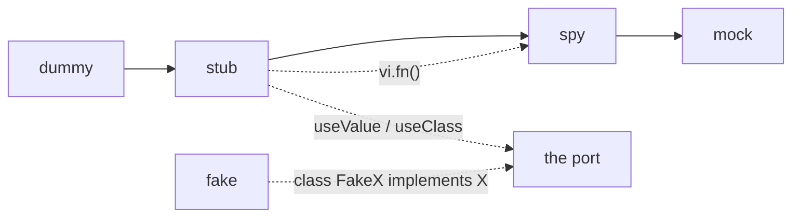

What to notice: the further right a double sits, the more it encodes about calls, and the more a refactor that keeps behavior can break its test.

### How it actually works

Read from the `@vitest/spy` 5.0.3 typings (`dist/index.d.ts`), `vi.fn()` returns a `Mock` extending `MockInstance`: it carries `mock` and accepts `mockReturnValue` and `mockResolvedValue`: one object both stubs and records. `mockRestore` does what `mockReset` does and "restores original descriptors of spied-on objects". `vi.spyOn(object, key)` keeps the original implementation until told otherwise, and `vi.restoreAllMocks()` "restores all original implementations on spies created with `vi.spyOn`" ([`vi` API](https://vitest.dev/api/vi), read 2026-10-13).

Restoring is not automatic: the `vitest` 5.0.3 typings declare `restoreMocks` ("Will call `.mockRestore()` on all spies before each test") with `@default false`, and no file under `@angular/build` 22.2.1 `src/builders/unit-test` mentions it (found by `grep`). Read from `spyOn` in `@vitest/spy/dist/index.js`, restoring a spy on a prototype method deletes the own property it created.

The [mocking guide](https://vitest.dev/guide/mocking) (read 2026-10-13) puts `vi.mock` beside `vi.fn` and `vi.spyOn`; the builder rejects `vi.mock` of a relative path ([§2](#2-the-runner-vitest-through-angularbuildunit-test-jsdom-and-browser-mode)); providers are the route ([16 §9](16-dependency-injection.md#9-di-patterns-testing-and-the-spring-container)).

A `vi.fn` stub answered `5` and recorded `[['a'], ['b']]` (`Section 7: a vi.fn stub returns canned values and records calls`); a spy called through to `hi Ada`, answered `stubbed` on demand and after `mockRestore` behaved as before (`Section 7: vi.spyOn keeps the real object and is restored`); a fake storage returned what was saved per key while a `vi.fn` stub answered `dark` for every key (`Section 7: a fake keeps behavior across calls`); the override reached the component and `mock.calls` was `[[]]` (`Section 7: a provider override with useValue reaches the component`).

### Code

The approach: a service typed as returning an array while the API answers `{ items }` (the missing mapping is the defect), and one component tested twice.

1. Test it with a `vi.fn` double returning the array: green.
2. Reset the module, provide the testing HTTP backend, flush the envelope: `failed`.

```ts
// Excerpt of labs/angular/src/app/modules/29-testing-angular/concepts/section-7-test-doubles.spec.ts
@Injectable({ providedIn: 'root' })
class LabM29Catalog {
  private readonly http = inject(HttpClient);

  load(): Promise<readonly LabM29Item[]> {
    return firstValueFrom(this.http.get<readonly LabM29Item[]>('/api/items'));
  }
}

@Component({
  selector: 'lab-m29-catalog-list',
  template: '{{ text() }}',
})
class LabM29CatalogList {
  protected readonly text = signal('loading');

  constructor() {
    void inject(LabM29Catalog)
      .load()
      .then((items) => this.text.set(items.map((item) => item.name).join(',')))
      .catch(() => this.text.set('failed'));
  }
}

describe('with HTTP faked', () => {
  afterEach(() => TestBed.inject(HttpTestingController).verify());

  it('Section 7: an over-mocked test passes while the real service is broken', async () => {
    const load = vi.fn<LabM29Catalog['load']>().mockResolvedValue(ITEMS);
    TestBed.configureTestingModule({ providers: [{ provide: LabM29Catalog, useValue: { load } }] });
    const mocked = TestBed.createComponent(LabM29CatalogList);
    await vi.waitFor(() => expect(mocked.nativeElement.textContent).toBe('Pen,Ink'));
    expect(load).toHaveBeenCalledTimes(1);

    TestBed.resetTestingModule();
    TestBed.configureTestingModule({ providers: [provideHttpClient(), provideHttpClientTesting()] });
    const real = TestBed.createComponent(LabM29CatalogList);
    TestBed.inject(HttpTestingController).expectOne('/api/items').flush({ items: ITEMS });
    await vi.waitFor(() => expect(real.nativeElement.textContent).toBe('failed'));
  });
});
```

`HttpTestingController` is itself a fake backend ([27 §11](27-http-client.md#11-testing-and-the-backend-seam-providehttpclienttesting-httptestingcontroller-and-what-they-replace)); an object of `vi.fn` methods is the spy object of [§3](#3-karma-jasmine-and-jest-the-legacy-and-alternative-runners-and-migrating-to-vitest). Drilled in [Q29.18](#q29-18), [Q29.19](#q29-19) and [Q29.20](#q29-20); built in [Exercise 29.2](#ex29-2) and [Exercise 29.6](#ex29-6).

### Best practices and anti-patterns

- **Double boundaries (HTTP, time, randomness, missing browser APIs)**, because those are slow or nondeterministic; pure code is cheap to run for real.
- **Prefer a fake when behavior spans calls**, because a stub answers every call alike.
- **Assert outcomes before calls**, because `toHaveBeenCalledTimes` pins how, not what.
- **Type the double** (`vi.fn<Service['load']>()`) and cover the seam once for real, because an untyped double can promise anything.
- **Restore spies in `afterEach`**, because `restoreMocks` defaults to `false`.

### Misconceptions and traps

- *"Mock everything except the unit."* The London school (mockist TDD, which tests a unit by the calls it makes to mocked collaborators); the unit then runs against an invented contract, and the over-mocked lab test stays green while the real service fails.
- *"`vi.fn` is a mock."* The word in Vitest's API names; it holds no expectations until asserted, so it is a stub and a spy.
- *"Spies are restored automatically."* Jasmine restored per spec; Vitest needs `mockRestore` or `vi.restoreAllMocks` because `restoreMocks` is `false`.
- *"`vi.mock` is how Angular tests replace services."* Vitest's docs lead with it; the builder rejects relative module mocks and DI is the seam.

## 8. Testing services, pipes and directives, including `TestBed.createDirective`

### The problem it solves

A pure pipe is tested through a host component, and ten lines of setup surround one `transform` call. A pipe that injects `LOCALE_ID` throws `NG0203` when built with `new`. An attribute directive gets a throwaway host component. A service that uses `HttpClient` is tested by mocking `HttpClient` itself.

### Mental model

**Use the least machinery that runs the real code.** A **pure pipe** returns the same output for the same input ([14 §5](14-directives-and-pipes.md#5-pipes-pure-and-impure-custom-pipes-injection-and-imports)); it is a class with a `transform` method. An **attribute directive** changes an element that already exists ([14 §1](14-directives-and-pipes.md#1-directives-and-attribute-directives-host-inputs-elementref-and-renderer2)), so a test needs a **host element**: the element the directive is attached to. `TestBed.createDirective` [Added in v22.2] renders one and returns a `DirectiveFixture`, a fixture that adds `directiveInstance` and `onDestroy` to the usual members. A service with HTTP runs against the real `HttpClient` over `HttpTestingController` ([27 §11](27-http-client.md#11-testing-and-the-backend-seam-providehttpclienttesting-httptestingcontroller-and-what-they-replace)).

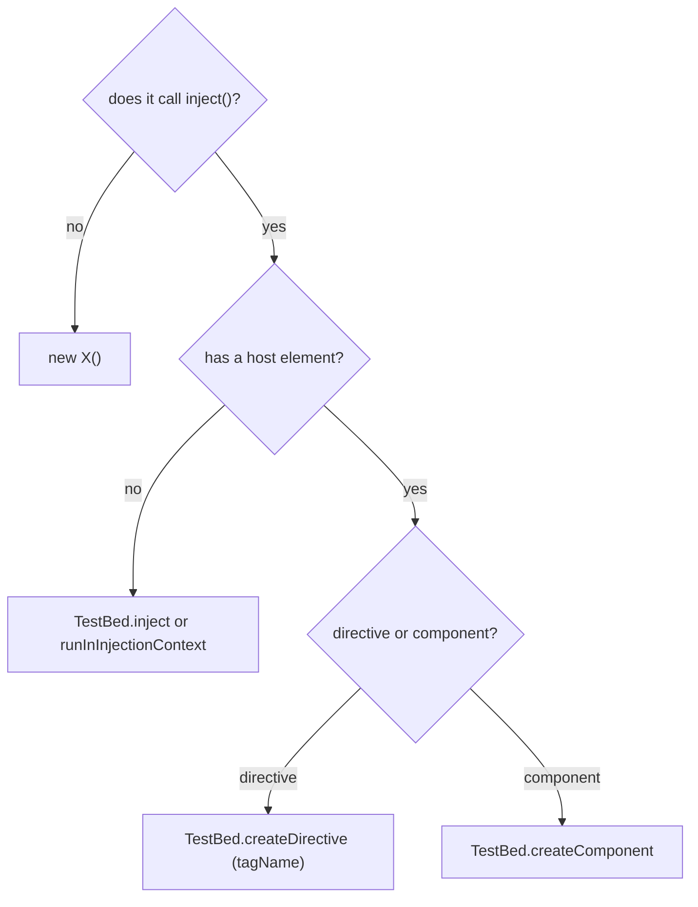

What to notice: `TestBed` is needed for the injection context and the host element, never for "being Angular"; a class that does not call `inject()` stops at the first question.

### How it actually works

`transform` is an ordinary method, so `new` runs the real pipe (`Section 8: a pure pipe is tested with new`). A pipe whose field calls `inject(LOCALE_ID)` threw an `NG0203` error under `new`, and built inside `TestBed.runInInjectionContext` ([§4](#4-testbed-the-testing-module-inject-runininjectioncontext-overrides-and-teardown)) with `LOCALE_ID` provided as `de` it answered `de:x` (`Section 8: a pipe that injects is constructed in an injection context`).

Read from the `@angular/core` 22.2.1 source, `TestBedImpl.createDirective` in `fesm2022/testing.mjs` takes `options.tagName`, or else the one tag name found in the directive's selectors. With none it throws `Cannot determine tag name for …` before anything renders; the lab test asserts that text with the class name as printed, with or without a leading underscore (`Section 8: createDirective needs a tag name for an attribute selector`). The tag is needed because the method inserts a root element of that tag and creates a component of the internal `DirectiveTestHost` (an empty template) on it, with the directive and the `bindings` option applied to that element. `inferTagName` ([§4](#4-testbed-the-testing-module-inject-runininjectioncontext-overrides-and-teardown)) is read only by `createComponent`. With `tagName: 'span'` and an `inputBinding`, the element was a `SPAN` with `data-hi` set to `yo`, an `ng-version` attribute, and `directiveInstance` an instance of the directive (`Section 8: createDirective renders the directive's host binding`).

A host component tests the same directive through a real template, where the template contract is the point; the attribute followed the bound signal from `hello` to `bye` after `TestBed.tick()` (`Section 8: a host component tests the same directive through a template`). The service test flushed an envelope through `HttpTestingController` and the real `HttpClient` summed it to `5`; `verify()` ran afterwards ([Q27.34](27-http-client.md#q27-34); `Section 8: a service is tested with the real HttpClient over HttpTestingController`).

### Code

The approach: one pipe that injects, one attribute directive, one host component for it.

1. Construct the injecting pipe in an injection context.
2. Ask `createDirective` for the directive with no tag name: the error.
3. Ask again with `tagName` and an `inputBinding`, wait for stability, read the host.
4. Render the directive from a host component and change its input with a signal.

```ts
// Excerpt of labs/angular/src/app/modules/29-testing-angular/concepts/section-8-services-pipes-directives.spec.ts
@Pipe({ name: 'labM29Locale' })
class LabM29LocalePipe implements PipeTransform {
  private readonly locale = inject(LOCALE_ID);

  transform(value: string): string {
    return `${this.locale}:${value}`;
  }
}

@Directive({
  selector: '[labM29Hi]',
  host: { '[attr.data-hi]': 'labM29Hi()' },
})
class LabM29Hi {
  readonly labM29Hi = input('');
}

@Component({
  selector: 'lab-m29-hi-host',
  imports: [LabM29Hi],
  template: '<p [labM29Hi]="word()">text</p>',
})
class LabM29HiHost {
  readonly word = signal('hello');
}

  it('Section 8: a pipe that injects is constructed in an injection context', () => {
    TestBed.configureTestingModule({ providers: [{ provide: LOCALE_ID, useValue: 'de' }] });

    const pipe = TestBed.runInInjectionContext(() => new LabM29LocalePipe());

    expect(pipe.transform('x')).toBe('de:x');
    expect(() => new LabM29LocalePipe()).toThrowError(/^NG0203: /);
  });

  it('Section 8: createDirective needs a tag name for an attribute selector', () => {
    expect(() => TestBed.createDirective(LabM29Hi)).toThrowError(NO_TAG_NAME);
  });

  it("Section 8: createDirective renders the directive's host binding", async () => {
    const fixture = TestBed.createDirective(LabM29Hi, {
      tagName: 'span',
      bindings: [inputBinding('labM29Hi', () => 'yo')],
    });
    await fixture.whenStable();

    expect(fixture.nativeElement.tagName).toBe('SPAN');
    expect(fixture.nativeElement.getAttribute('data-hi')).toBe('yo');
    expect(fixture.nativeElement.getAttribute('ng-version')).toMatch(/^\d+\.\d+\.\d+/);
    expect(fixture.directiveInstance).toBeInstanceOf(LabM29Hi);
  });

  it('Section 8: a host component tests the same directive through a template', async () => {
    const fixture = TestBed.createComponent(LabM29HiHost);
    await fixture.whenStable();
    const paragraph: HTMLElement = fixture.nativeElement.querySelector('p');

    expect(paragraph.getAttribute('data-hi')).toBe('hello');

    fixture.componentInstance.word.set('bye');
    TestBed.tick();

    expect(paragraph.getAttribute('data-hi')).toBe('bye');
  });
```

The spec also keeps the HTTP test in a nested `describe` whose `afterEach` calls `verify()`. Drilled in [Q29.21](#q29-21) and [Q29.22](#q29-22); built in [Exercise 29.2](#ex29-2).

### Best practices and anti-patterns

- **`new` a class that never calls `inject()`**, because `TestBed` setup then adds cost and hides nothing.
- **Use `runInInjectionContext` for a class that does**, because `NG0203` is the only reason it needs Angular.
- **Pass `tagName` to `createDirective` for an attribute selector**, because the selector names no element to render.
- **Use a host component when the template contract matters**, such as projected content or the binding syntax itself, because only a real template exercises projection and the binding syntax.
- **Fake the backend, not `HttpClient`**, because interceptors and URL building stay under test.

### Misconceptions and traps

- *"Every Angular class needs `TestBed`."* Generated specs always configure it; a plain class does not, and `inject()` is the one reason, shown by `NG0203`.
- *"Mock `HttpClient` with `vi.fn`."* It is a class, so the double loses interceptors and URL building; `HttpTestingController` is the supported fake ([27 §11](27-http-client.md#11-testing-and-the-backend-seam-providehttpclienttesting-httptestingcontroller-and-what-they-replace)).
- *"Directives need a host component."* That was the pattern before `createDirective` arrived in 22.2; a host component is still right when the template is under test.

## 9. Testing guards, interceptors, forms, effects, resources and stores

### The problem it solves

A guard test builds an `ActivatedRouteSnapshot` by hand and the guard still throws `NG0203`, because it calls `inject()` outside an injection context. An interceptor test passes while a lazy feature's requests never reach the controller. A form test calls `setValue` and never notices the input is not bound. An effect test asserts before the effect ran. A store-backed component is tested against a mock that returns a shape the real selector never produces.

### Mental model

**Each artifact has its own seam, and every seam is a public API, never module mocking.** Think of an orchestra: each instrument is rehearsed on its own stand, a bow for strings and a reed for winds. A **functional guard** ([24 §5](24-routing.md#5-functional-guards-canmatch-canactivate-candeactivate-and-redirectcommand)) is a function, so it runs in an injection context or behind the router. An **interceptor** ([27 §4](27-http-client.md#4-interceptors-the-functional-chain-order-and-next-and-class-interceptors-through-withinterceptorsfromdi)) runs inside a real `HttpClient` whose **testing backend**, the `HttpTestingController` pair that replaces the network ([27 §11](27-http-client.md#11-testing-and-the-backend-seam-providehttpclienttesting-httptestingcontroller-and-what-they-replace)), shows the request. DOM events drive a form. An **effect** ([17 §4](17-signals.md#4-effects)) runs on `TestBed.tick()` and a **resource** ([17 §6](17-signals.md#6-resources-async-data-as-signals)) settles on `ApplicationRef.whenStable()`. A store is real with HTTP faked, or replaced by `MockStore`, the NgRx test double that holds a state you set, built by `provideMockStore`.

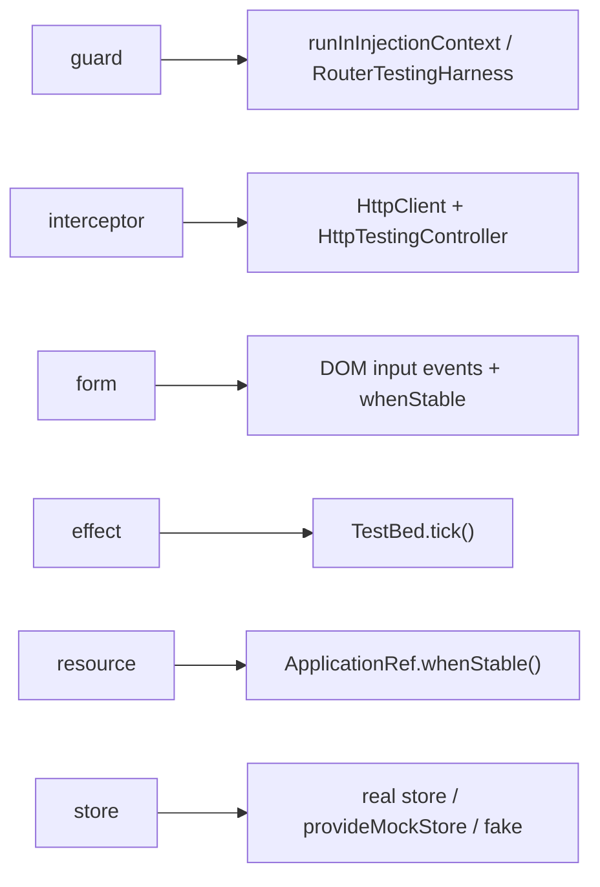

What to notice: no arrow ends in a mocked module.

### How it actually works

**Guards.** `TestBed.runInInjectionContext` calls the guard with the router's own snapshots, so no `as` cast is needed. The guard returned a **`UrlTree`**, the router's parsed URL, printed as `/login`, then `true` after its signal flipped (`Section 9: a functional guard runs inside runInInjectionContext`; [Q24.16](24-routing.md#q24-16), [Q29.23](#q29-23)). The **`RouterTestingHarness`**, the router's test helper that renders a root `router-outlet`, proves the wiring: after `navigateByUrl('/admin')` the URL was `/login` and the page read `login page` (`Section 9: a guard tested through RouterTestingHarness lands on the redirect`). Read from the `@angular/router` 22.2.1 source (`fesm2022/testing.mjs`, `RouterTestingHarness.create` and `navigateByUrl`; `afterNextNavigation` in `_router-chunk.mjs` is internal), `create` builds one root fixture and throws `Only one harness should be created per test.` on a second call. `navigateByUrl` awaits the router, waits for a navigation that ends (a redirect's cancellation does not count), then calls `detectChanges`, so a redirect needs no extra wait. Read, not run.

**Interceptors and the feature's own client.** `expectOne` returned a request with the header `Bearer lab-token` (`Section 9: an interceptor adds its header to a request seen by HttpTestingController`; provider order in [Q27.33](27-http-client.md#q27-33)). A child injector with its own `provideHttpClient()` and `provideHttpClientTesting()` had a different controller; the root one matched 0 requests, the child's 1 (`Section 9: a feature's own HttpClient needs its own testing backend`; [Q27.06](27-http-client.md#q27-06), [Q29.24](#q29-24)).

**Forms.** Dispatching `input` with `ab` set the control's value and `dirty`, with no message yet; `blur` made the message appear; `abc` removed it (`Section 9: a reactive form is driven through input events`; validators in [25 §5](25-forms-reactive-and-template-driven.md#5-validators-built-in-custom-and-cross-field), [Q25.09](25-forms-reactive-and-template-driven.md#q25-09), [Q29.25](#q29-25)). A Signal Forms field tree ([26 §2](26-signal-forms.md#2-form-the-field-tree-and-field-state)) has no `FormControl`; this test covers reactive forms only.

**Effects and resources.** A root effect had not run before `TestBed.tick()`, saw `0` at the first tick and `1` only at the next (`Section 9: an effect runs after TestBed.tick`; [Q17.13](17-signals.md#q17-13)). A resource's `value()` was `undefined` until `TestBed.tick()` and `await ApplicationRef.whenStable()`, then `status()` was `resolved` and `value()` was `4` (`Section 9: a resource value lands after ApplicationRef.whenStable`; [Q29.26](#q29-26)).

**Stores.** The component's `selectSignal` rendered `10`; after `overrideSelector` and `refreshState` it rendered `99` (`Section 9: a component reading an NgRx store renders a MockStore selector override`; [28 §5](28-state-management.md#5-selectors-memoization-composition-and-reading-the-store-as-signals), [Q29.27](#q29-27)). Read from `@ngrx/store` 22.0.1: `selectSignal` is a `computed` over the state signal and `refreshState` sets a copy of the last state, which recomputes it. For `unprotected` see [Q28.22](28-state-management.md#q28-22).

### Code

The approach: one test per seam. (1) Run the guard in an injection context with the router's snapshots. (2) Navigate to the guarded page through the harness. (3) Write into the input, dispatch events and await stability. Built in [Exercise 29.3](#ex29-3) and [Exercise 29.6](#ex29-6).

```ts
// Excerpt of labs/angular/src/app/modules/29-testing-angular/concepts/section-9-guards-interceptors-forms-effects-stores.spec.ts
@Injectable({ providedIn: 'root' })
class LabM29Session {
  readonly admin = signal(false);
}

@Component({ selector: 'lab-m29-admin-page', template: '<p>admin page</p>' })
class LabM29AdminPage {}

@Component({ selector: 'lab-m29-login-page', template: '<p>login page</p>' })
class LabM29LoginPage {}

const labM29Routes: Routes = [
  {
    path: 'admin',
    component: LabM29AdminPage,
    canActivate: [() => inject(LabM29Session).admin() || inject(Router).parseUrl('/login')],
  },
  { path: 'login', component: LabM29LoginPage },
];

@Component({
  selector: 'lab-m29-name-form',
  imports: [ReactiveFormsModule],
  template: `
    <label for="lab-m29-name">Name</label>
    <input id="lab-m29-name" [formControl]="nameControl" />
    @if (nameControl.touched && nameControl.invalid) {
      <p role="alert">At least 3 characters</p>
    }
  `,
})
class LabM29NameForm {
  readonly nameControl = new FormControl('', {
    nonNullable: true,
    validators: [Validators.required, Validators.minLength(3)],
  });
}

  it('Section 9: a functional guard runs inside runInInjectionContext', () => {
    const isAdmin = signal(false);
    const adminGuard: CanActivateFn = () => isAdmin() || inject(Router).parseUrl('/login');
    TestBed.configureTestingModule({ providers: [provideRouter([])] });
    const { snapshot } = TestBed.inject(Router).routerState;

    const before = TestBed.runInInjectionContext(() => adminGuard(snapshot.root, snapshot));
    isAdmin.set(true);
    const after = TestBed.runInInjectionContext(() => adminGuard(snapshot.root, snapshot));

    expect(String(before)).toBe('/login');
    expect(after).toBe(true);
  });

  it('Section 9: a guard tested through RouterTestingHarness lands on the redirect', async () => {
    TestBed.configureTestingModule({
      providers: [provideRouter(labM29Routes, withComponentInputBinding())],
    });
    const harness = await RouterTestingHarness.create();

    await harness.navigateByUrl('/admin');

    expect(TestBed.inject(Router).url).toBe('/login');
    expect(harness.routeNativeElement?.textContent).toBe('login page');
  });

  it('Section 9: a reactive form is driven through input events', async () => {
    const fixture = TestBed.createComponent(LabM29NameForm);
    await fixture.whenStable();
    const input: HTMLInputElement = fixture.nativeElement.querySelector('input');
    const alert = (): HTMLElement | null => fixture.nativeElement.querySelector('[role="alert"]');

    input.value = 'ab';
    input.dispatchEvent(new Event('input'));
    await fixture.whenStable();

    expect(fixture.componentInstance.nameControl.value).toBe('ab');
    expect(fixture.componentInstance.nameControl.dirty).toBe(true);
    expect(alert()).toBeNull();

    input.dispatchEvent(new Event('blur'));
    await fixture.whenStable();

    expect(alert()?.textContent).toBe('At least 3 characters');

    input.value = 'abc';
    input.dispatchEvent(new Event('input'));
    await fixture.whenStable();

    expect(alert()).toBeNull();
  });
```

The HTTP tests sit in a nested `describe` whose `afterEach` calls `verify()`.

### Best practices and anti-patterns

- **Run a guard as a function first**, because it is faster and names the failing result; add one routed test for the wiring.
- **Build route snapshots from `TestBed.inject(Router).routerState.snapshot`**, because it needs no `as` cast.
- **Put the interceptor in a real `HttpClient`**, because `next` and header cloning then run for real.
- **Drive a form with `input` and `blur` events**, because the binding and message are what users meet.
- **Tick for effects and await `whenStable` for resources**, because an earlier assertion reads the state before the work.
- **Keep one test with the real store**, because an overridden selector can return any shape.

### Misconceptions and traps

- *"Test guards only through navigation."* A guard is a function, so a direct call is faster and more precise; navigation proves only the route wiring.
- *"The root `HttpTestingController` sees every request."* A controller belongs to one backend, and a nested `provideHttpClient()` builds its own, so the root one saw 0.
- *"`setValue` proves the form works."* It writes the model directly, so the `input` listener, touched state and message stay untested until the DOM drives it.
- *"A mock store makes component tests realistic."* The mock comes from the library and any selector can be overridden with any shape, so test the selector itself.

## 10. Async tests: Vitest fake timers versus `fakeAsync` and `waitForAsync`

### The problem it solves

A debounced-search test waits 300 ms of real time per case. A migrated `fakeAsync` test throws "zone-testing.js is needed". A test with fake timers hangs on `await fixture.whenStable()` until Vitest's default `testTimeout`, 5,000 ms (read from the `vitest` 5.0.3 typings), so the lab test asserts the unresolved promise instead. Fake timers left on in one test leak into the next. Each comes from not knowing who owns the clock.

### Mental model

A **mock clock** replaces the timer functions with ones that move only when the test says so. Vitest's **fake timers** (`vi.useFakeTimers()`) fake `setTimeout`, `setInterval`, `Date` and the other globals except `process.nextTick` and `queueMicrotask` (vitest.dev/config/faketimers, read 2026-10-13), and you advance them with `vi.advanceTimersByTimeAsync`. A **microtask** ([04 §1](04-js-async-event-loop.md#1-the-event-loop-tasks-microtasks-and-rendering)) is a promise callback, so it is not faked. `fakeAsync` runs the test in a **zone** (a zone.js execution context) that intercepts the same tasks, and you advance it with `tick`. A film editor's timeline: Vitest moves the playhead; `fakeAsync` films in a studio where the director's clock is the only clock, and without the studio (zoneless) it has nowhere to run.

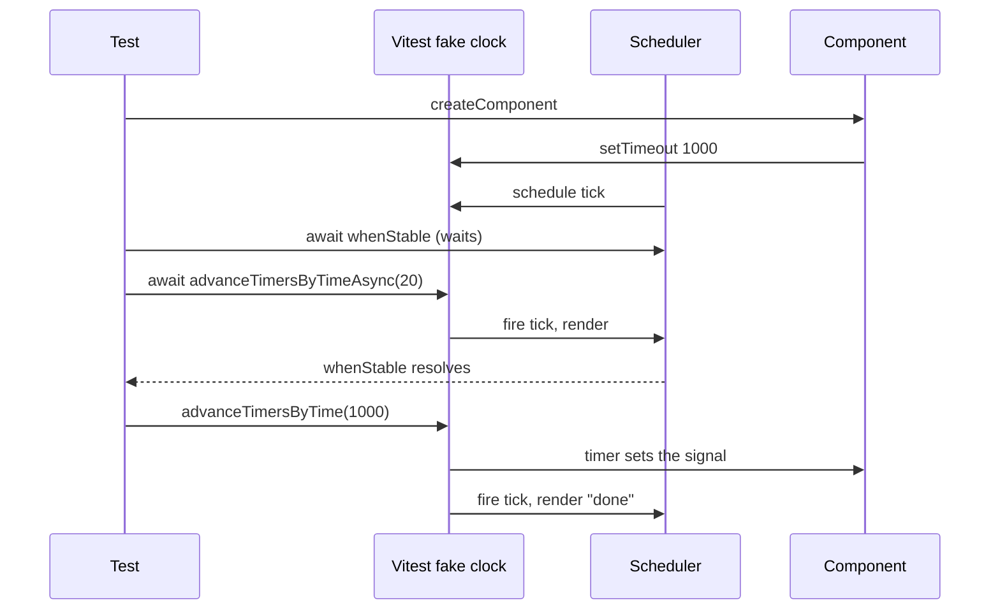

What to notice: the test owns every timer, Angular's own included, so it must advance them.

### How it actually works

Read from the `@angular/core` 22.2.1 source: `ChangeDetectionSchedulerImpl.notify` (`fesm2022/_debug_node-chunk.mjs`, internal) schedules its tick with `scheduleCallbackWithRafRace` (`_pending_tasks-chunk.mjs`, internal), which races a `setTimeout` against `requestAnimationFrame` when it exists. Fake timers replace both, so with a frozen clock the tick never runs, `isStable()` stays false and `whenStable` stays pending. `shouldAdvanceTime: true` makes the clock follow real time ("increment mocked time automatically based on the real system time shift", default `false`; `advanceTimeDelta` defaults to 20 ms, the schematic uses 1).

`fakeAsync` needs zone.js twice over. `getFakeAsyncTestModule` (`fesm2022/testing.mjs`, internal) reads `_Zone`, a constant evaluated when `@angular/core/testing` loads, before the spec's own imports run; `withFakeAsyncTestModule` throws when it is missing. `waitForAsync` reads `Zone` when called, and with zone.js but no ProxyZone (the zone that records pending work) `ProxyZoneSpec.assertPresent` throws (`zone.js` 0.16.3, `fesm2015/zone-testing.js`). The typings say of `fakeAsync` and `tick`: "This API requires Zone.js and cannot be used with the Vitest test runner", and the docs call `fakeAsync` "no longer recommended". They name `zone.js/plugins/vitest-patch` as a polyfill that restores both; that route is documented only here: the 22.2.1 unit-test builder has no `polyfills` option, but it loads the build target's polyfills first, so the patch needs an `angular.json` build-target edit these labs do not make (read, not run). RxJS virtual time is [23 §10](23-rxjs-in-depth.md#10-testing-with-testscheduler-marble-syntax-and-virtual-time-under-the-hood) and [Q23.34](23-rxjs-in-depth.md#q23-34).

### Code

The approach: one component whose constructor starts a timer, driven three ways.

1. Freeze the clock and show `whenStable` pending until the test advances it.
2. Advance past the component's own timer.
3. Let the clock follow real time with `shouldAdvanceTime`.
4. Restore real timers in `afterEach`.

```ts
// Excerpt of labs/angular/src/app/modules/29-testing-angular/concepts/section-10-async.spec.ts
@Component({
  selector: 'lab-m29-slow-message',
  template: '{{ message() }}',
})
class LabM29SlowMessage {
  protected readonly message = signal('wait');

  constructor() {
    setTimeout(() => this.message.set('done'), 1000);
  }
}

const restoreTimers = (): void => {
  vi.useRealTimers();
};

describe('Section 10: async tests', () => {
  afterEach(restoreTimers);

  it("Section 10: advancing the fake clock runs the component's timer", async () => {
    vi.useFakeTimers();
    const fixture = TestBed.createComponent(LabM29SlowMessage);

    await vi.advanceTimersByTimeAsync(20);
    expect(fixture.nativeElement.textContent).toBe('wait');

    await vi.advanceTimersByTimeAsync(1000);
    expect(fixture.nativeElement.textContent).toBe('done');
  });

  it('Section 10: shouldAdvanceTime lets whenStable resolve', async () => {
    vi.useFakeTimers({ shouldAdvanceTime: true, advanceTimeDelta: 1 });
    const fixture = TestBed.createComponent(LabM29SlowMessage);

    await fixture.whenStable();

    expect(vi.isFakeTimers()).toBe(true);
    expect(fixture.nativeElement.textContent).toBe('wait');
  });
});
```

The spec also asserts `Section 10: whenStable waits while fake timers are frozen` (five microtask turns later the promise is unresolved, `isStable()` is `false` and the text is empty; after `advanceTimersByTimeAsync(20)` it resolves with `wait`), `Section 10: fakeAsync throws without zone.js testing` and `Section 10: waitForAsync rejects without zone.js` (the string `Zone is needed for the waitForAsync() test helper but could not be found. Please make sure that your environment includes zone.js`), `Section 10: a native async test awaits a promise` and `Section 10: fake timers are restored after each test`. `section-10-zone-import.spec.ts` imports `zone.js` and `zone.js/testing` first: `Section 10: importing zone.js in the spec does not enable fakeAsync` (the same `zone-testing.js` error) and `Section 10: waitForAsync with zone.js imported needs the ProxyZone` (an `Error` saying `Expected to be running in 'ProxyZone', but it was not found.`). Drilled in [Q29.28](#q29-28), [Q29.29](#q29-29), [Q29.30](#q29-30), [Q29.31](#q29-31) and [Exercise 29.4](#ex29-4).

#### Legacy

```ts
// Partial: zone-based spec, not run in these labs; LabM29SlowMessage as in the lab spec
it('shows the late message', fakeAsync(() => {
  const fixture = TestBed.createComponent(LabM29SlowMessage);
  flushMicrotasks();
  flush();
  fixture.detectChanges();
  expect(fixture.nativeElement.textContent).toBe('done');
}));
```

Migration: the schematic of [§3](#3-karma-jasmine-and-jest-the-legacy-and-alternative-runners-and-migrating-to-vitest) makes the test `async` and maps `tick(n)` to `await vi.advanceTimersByTimeAsync(n)`, `flush()` to `await vi.runAllTimersAsync()` and `flushMicrotasks()` to `await vi.advanceTimersByTimeAsync(0)` (read, not run); then replace `detectChanges()` with `await fixture.whenStable()` ([§5](#5-zoneless-fixtures-whenstable-testbedtick-detectchanges-and-automatic-change-detection)).

### Best practices and anti-patterns

- **Call `vi.useRealTimers()` in `afterEach`**, because a failing test would otherwise leave fake timers on for the next one.
- **Advance with the async variants when promises are involved**, because only they let promise callbacks run between timers.
- **Prefer `shouldAdvanceTime` over a manual advance for a test that only needs a render**, because the clock then follows real time.
- **Await a plain promise in an `async` test**, because no fake clock is needed.
- **Avoid `fakeAsync` in a zoneless suite**, because it throws without zone.js.

### Misconceptions and traps

- *"`fakeAsync` works in any Angular test."* It requires zone.js and, under Vitest, the patch, yet it was the default async style for years.
- *"`import 'zone.js/testing'` in the spec enables `fakeAsync`."* The error text names that file, but `@angular/core/testing` captured `Zone` before the spec's imports ran.
- *"Fake timers only fake my code's timers."* You installed them for your timer, but Angular's scheduler uses timers too, so the fixture freezes with them.
- *"`advanceTimersByTime` and `advanceTimersByTimeAsync` are the same."* They share a name, but only the async one awaits promise callbacks between timers ([Exercise 29.4](#ex29-4) shows the difference).

## 11. Component harnesses and Angular Testing Library

### The problem it solves

Fifty tests query `.mat-mdc-select-trigger` and break when a library update renames it. Tests of a picker repeat the same five lines of DOM poking, and a reviewer cannot tell from the queries what a test does. Both come from tests that know the markup, not the behavior.

### Mental model

Two ways to **talk to a component the way a user or a parent would**. A **component harness** (CDK) is "a class that allows tests to interact with components the way an end user does via a supported API" and is "insulating themselves against implementation details of a component, such as its DOM structure" (angular.dev, read 2026-10-13). A **harness loader** finds harnesses under a root, a **harness predicate** filters them and a **`TestElement`** is the harness's async handle on one DOM node. **Angular Testing Library** "builds on top of DOM Testing Library by adding APIs for working with Angular components" (testing-library.com, read 2026-10-13); a **role query** such as `getByRole('button', { name: 'Increase' })` finds a node by its role and **accessible name** ([§6](#6-component-tests-dom-queries-componentfixture-signal-inputs-with-setinput-and-bindings-outputs-and-onpush) shows the name; [11 §7](11-accessibility.md#7-testing-accessibility) owns the layered strategy and [Q11.19](11-accessibility.md#q11-19)). A **driver** is the object a test drives the component through. A harness is the component's remote control, shipped with it; Testing Library is a user who reads the labels on the buttons.

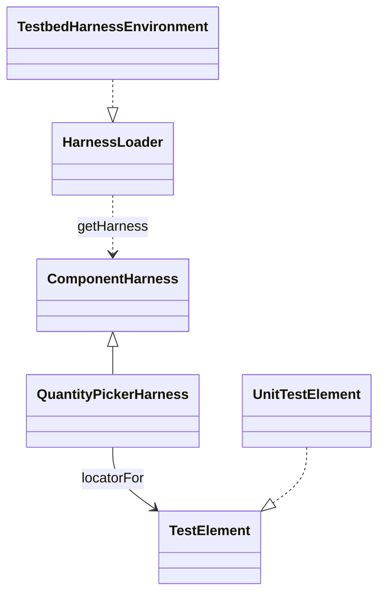

What to notice: the test depends on the harness's methods; only the harness depends on the DOM.

### How it actually works

Read from the `@angular/cdk` 22.2.1 source: `TestbedHarnessEnvironment.forceStabilize` (`fesm2022/testing-testbed.mjs`) calls `fixture.detectChanges()` and then awaits `fixture.whenStable()`, so a harness read sees a rendered DOM. Every `UnitTestElement` action awaits it after acting and `getAllRawElements` before querying, so every harness method returns a promise. Its zone checks are guarded by `typeof Zone`, so the zoneless lab needs no zone.js; the typings tie `waitForTasksOutsideAngular` to zone.js. The `with()` filter is a static method the harness author writes by convention, not a CDK member. Angular Material "provides a test harness for each component in the library" (angular.dev, read 2026-10-13); [module 36](36-material-and-cdk.md#10-component-harnesses-for-material-the-cdk-and-your-own-components) owns Material.

Read from the `@testing-library/angular` 19.5.0 source: `render` calls `TestBed.configureTestingModule` and `TestBed.createComponent`, and returns `fixture` among its queries, so the library sits on `TestBed` rather than replacing it. Its `inputs` option calls `setInput`, `on` subscribes to outputs and `bindings` passes Angular's own ([§6](#6-component-tests-dom-queries-componentfixture-signal-inputs-with-setinput-and-bindings-outputs-and-onpush)); the typings tag `componentInputs` "@deprecated use the `inputs` option instead" and `componentOutputs` "@deprecated use the `on` option instead". It registers an `afterEach` cleanup at import when a global `afterEach` exists, which Vitest globals provide. The `./zoneless` entry point is a smaller `render` with `bindings` but no `inputs` or `on`, and no auto-cleanup (read, not run). The two combine: a harness can locate by role-like selectors, and Testing Library can query inside a harness's host.

### Code

The approach: one picker whose value sits in a styling-class element, a harness for it and a Testing Library test.

1. Write the harness: a static `hostSelector`, `locatorFor` fields and intent methods.
2. Load it with `TestbedHarnessEnvironment.harnessForFixture` and drive it.
3. Pick one of two pickers with the harness's `with()` predicate.
4. Query the same component by role and name with `render`.

```ts
// Excerpt of labs/angular/src/app/modules/29-testing-angular/concepts/section-11-harnesses.spec.ts
class LabM29QuantityPickerHarness extends ComponentHarness {
  static readonly hostSelector = 'lab-m29-quantity-picker';

  private readonly increaseButton = this.locatorFor('button[aria-label="Increase"]');
  private readonly valueElement = this.locatorFor('.lab-m29-value');

  async increment(): Promise<void> {
    const button = await this.increaseButton();
    await button.click();
  }

  async getValue(): Promise<number> {
    const element = await this.valueElement();
    return Number(await element.text());
  }
}

  it('Section 11: a harness reads and drives a component through its host', async () => {
    const fixture = TestBed.createComponent(LabM29QuantityPicker);
    fixture.componentRef.setInput('start', 3);
    const picker = await TestbedHarnessEnvironment.harnessForFixture(fixture, LabM29QuantityPickerHarness);

    expect(await picker.getValue()).toBe(3);

    await picker.increment();

    expect(await picker.getValue()).toBe(4);
  });

  it('Section 11: render with inputs and on wires a signal input and an output', async () => {
    const changes: number[] = [];

    await render(LabM29QuantityPicker, {
      inputs: { start: 5 },
      on: { changed: (value) => changes.push(value) },
    });
    expect(screen.getByText('5')).toBeTruthy();

    fireEvent.click(screen.getByRole('button', { name: 'Increase' }));

    expect(screen.getByText('6')).toBeTruthy();
    expect(changes).toEqual([6]);
  });
```

The spec also asserts `Section 11: HarnessPredicate picks one harness among several` (`with({ label: 'Children' })` returns the second of two pickers, while a plain `getHarness` returns the first), `Section 11: harness reads wait for the fixture to be stable` (after a signal write the raw DOM still shows `0` until `getValue()` stabilizes the fixture and returns `7`) and `Section 11: Testing Library finds a button by role and name` (the name `Increase` comes from `aria-label`, so a query by the visible `+` finds nothing). Drilled in [Q29.32](#q29-32), [Q29.33](#q29-33) and [Exercise 29.5](#ex29-5).

### Best practices and anti-patterns

- **Put DOM selectors only in the harness**, because a markup change then costs one file.
- **Await every harness call**, because each one stabilizes the fixture first.
- **Query by role and name before a test id**, because that is how a user finds the control.
- **Use the `inputs` and `on` options, not `componentInputs`**, because the typings deprecate them.
- **Write a harness only for a component many tests share**, because one test can query by role.

### Misconceptions and traps

- *"Harnesses are only for Angular Material."* Material ships them, but any component can have one, since `ComponentHarness` is a public base class.
- *"Testing Library replaces `TestBed`."* It renders for you, but it calls `TestBed` underneath and returns the `fixture`.
- *"Harness methods are synchronous."* They read like getters, but every call is async and stabilizes the fixture first.
- *"`getByTestId` is the best Testing Library query."* It is stable, but the guiding principle ranks user-visible queries first ("The more your tests resemble the way your software is used, the more confidence they can give you.") and a failing role query is a design signal ([11 §7](11-accessibility.md#7-testing-accessibility)).

## 12. Under the hood: how the builder boots `TestBed` and how a fixture decides it is stable

### The problem it solves

No spec calls `TestBed.initTestEnvironment`, yet it ran. A service from one test is gone in the next, yet the platform is the same object. A template throws in a render the test never requested, and the test fails. The answers sit one level below [§2](#2-the-runner-vitest-through-angularbuildunit-test-jsdom-and-browser-mode), [§4](#4-testbed-the-testing-module-inject-runininjectioncontext-overrides-and-teardown) and [§5](#5-zoneless-fixtures-whenstable-testbedtick-detectchanges-and-automatic-change-detection).

### Mental model

Two lifecycles. A **worker** (a thread Vitest runs spec files in) loads the virtual `angular:test-bed-init` file, which creates the platform and the **test environment** (the base module and options every testing module extends) once. Per test, a **cleanup hook** (a function Angular exports for the runner's `beforeEach` and `afterEach`) resets the testing module. Each fixture registers its view with the **test `ApplicationRef`** (the testing module's, which tracks test views) and is stable when no pending task is open ([21 §5](21-change-detection.md#5-zoneless-change-detection-the-scheduler-its-triggers-and-pendingtasks)). A theatre opens once a season; the stage is struck after every play.

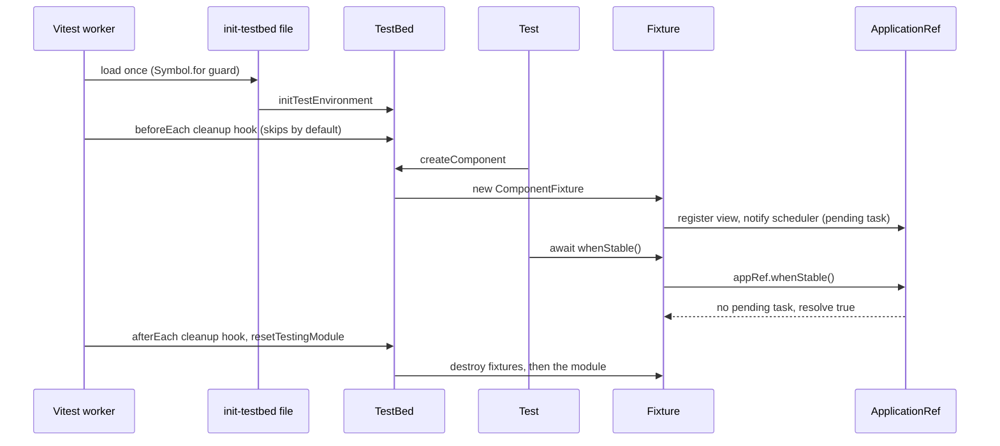

What to notice: the test never calls `initTestEnvironment`, and by default only the `afterEach` hook works.

### How it actually works

Read from the `@angular/build` 22.2.1 source (`runners/vitest/build-options.js`; internal names may change in any release): `createTestBedInitVirtualFile` (internal) emits `beforeEach(getCleanupHook(false))` and `afterEach(getCleanupHook(true))` outside a `Symbol.for('@angular/cli/testbed-setup')` guard. Inside it, a `TestModule` holds `provideZoneChangeDetection()` only when `Zone` is defined, your `providersFile` providers and `DynamicDOMTestComponentRenderer` (internal), passed to `initTestEnvironment`. The builder adds `teardown: { destroyAfterEach: false }` only when `debug` is on.

Read from the `@angular/core` 22.2.1 source (`fesm2022/testing.mjs`): `getCleanupHook(expected)` (internal, exported as `ɵgetCleanupHook`) resets only when `shouldTearDownTestingModule()` (internal) equals `expected`, so with `destroyAfterEach: true` only the `afterEach` hook resets. `TestBedImpl.resetTestingModule` (`TestBedImpl`: the internal class behind `TestBed`) destroys every active fixture, then the module, and clears the per-test options. It leaves `platform` alone; `initTestEnvironment` throws `Cannot set base providers because it has already been called` while it is set.

The fixture constructor adds its host view to `allTestViews` and `autoDetectTestViews` (internal sets on `ApplicationRef`) and notifies the scheduler, which opens a task in `PendingTasksInternal` (internal). `whenStable` stores its `reject` in `TestBedApplicationErrorHandler.whenStableRejectFunctions` (internal) before waiting for `ApplicationRef.whenStable()`. When a scheduled tick throws, that handler passes the error to your `ErrorHandler`, then rejects every waiting `whenStable`; with no waiter, it throws from the scheduler's callback. `TestBed.tick()` calls `ApplicationRef.tick()`, which has no `catch`, so its error leaves the call itself (read, not run). Drilled in [Q29.34](#q29-34).

### Code

The approach: self-contained tests.

1. Declare a component that records its destruction in a root service, and one whose `computed` throws on demand.
2. Assert the record in `onTestFinished`, which Vitest runs after every `afterEach` hook.
3. Render the fragile component, break it, await `whenStable`.

```ts
// Excerpt of labs/angular/src/app/modules/29-testing-angular/concepts/section-12-under-the-hood.spec.ts
const TEMPLATE_ERROR = 'LabM29Fragile cannot render';

@Service()
class LabM29DestroyLog {
  readonly entries: string[] = [];
}

@Component({
  selector: 'lab-m29-badge',
  template: '<span>{{ text() }}</span>',
})
class LabM29Badge {
  readonly text = signal('ready');

  constructor() {
    const log = inject(LabM29DestroyLog);
    inject(DestroyRef).onDestroy(() => log.entries.push('badge destroyed'));
  }
}

@Component({
  selector: 'lab-m29-fragile',
  template: '<span>{{ label() }}</span>',
})
class LabM29Fragile {
  readonly broken = signal(false);
  protected readonly label = computed(() => {
    if (this.broken()) {
      throw new Error(TEMPLATE_ERROR);
    }
    return 'fine';
  });
}

  it("Section 12: TestBed destroys the test's component after the test ends", () => {
    const log = TestBed.inject(LabM29DestroyLog);
    TestBed.createComponent(LabM29Badge);
    // Runs after every afterEach hook, including the builder's cleanup hook.
    onTestFinished(() => {
      expect(log.entries).toEqual(['badge destroyed']);
    });

    expect(log.entries).toEqual([]);
  });

  it('Section 12: an error during change detection fails the test', async () => {
    const fixture = TestBed.createComponent(LabM29Fragile);
    await fixture.whenStable();

    fixture.componentInstance.broken.set(true);

    await expect(fixture.whenStable()).rejects.toThrow(TEMPLATE_ERROR);
  });
```

The spec also asserts `Section 12: the fixture is stable when no pending task is open` (a `PendingTasks.add()` task keeps `isStable()` false until closed), `Section 12: whenStable resolves true after waiting for a render` and `Section 12: the test environment is initialized once, not per test` (`resetTestingModule` keeps `getTestBed().platform`; a second `initTestEnvironment` throws).

### Best practices and anti-patterns

- **Never call `initTestEnvironment` in a spec**, because the builder already did and a second call throws.
- **Await `whenStable` after a change that may throw**, because the error then rejects inside the test, not in the scheduler's callback.
- **Keep `destroyAfterEach` on outside debugging**, because components are then destroyed before the next test.

### Misconceptions and traps

- *"Each test boots a new platform."* The init file creates the platform and environment once, not per test; only the testing module is rebuilt. The belief comes from `TestBed` looking empty in every test, the cleanup hook's work.
- *"`teardown.destroyAfterEach` is off by default."* The typings say "Defaults to `true`". The belief survives because `debug` runs, where the builder passes `false`, keep the last component alive after its test.
- *"Errors during change detection are only logged in tests."* Once true: until v19.0, whose CHANGELOG says such errors "will now be rethrown when using `TestBed`" and outstanding `whenStable` promises are rejected; `rethrowApplicationErrors: false` restores logging. The belief persists because applications still only report them to `ErrorHandler`.

## Summary

A test's level is how much real code it runs and what it fakes: the pyramid and the trophy both keep end-to-end tests few and disagree only about the middle, so the choice is cost against confidence, and 100% coverage still proves nothing about asserted behavior ([section 1](#1-what-to-test-where-unit-integration-component-and-end-to-end-tests-the-pyramid-and-the-trophy)). `ng test` is a build and then a run: the unit-test builder compiles the included specs with the application's Angular compiler, so a type or template error fails the build before any test, Vitest runs them in jsdom with `TestBed` already initialized, and `vi.mock` of a relative path throws, so doubles go through providers ([section 2](#2-the-runner-vitest-through-angularbuildunit-test-jsdom-and-browser-mode)). Karma is still supported; a migration moves the builder first and the spec syntax second, and the schematic does not convert everything ([section 3](#3-karma-jasmine-and-jest-the-legacy-and-alternative-runners-and-migrating-to-vitest)).

`TestBed` rebuilds a recipe for every test, and the first `inject` or `createComponent` locks it, so configure and override before that ([section 4](#4-testbed-the-testing-module-inject-runininjectioncontext-overrides-and-teardown)). A zoneless fixture auto-detects but renders nothing between a write and a tick, so await `whenStable()` or call `TestBed.tick()`; an OnPush view skips a plain field, and `flushEffects()` is deprecated, not removed ([section 5](#5-zoneless-fixtures-whenstable-testbedtick-detectchanges-and-automatic-change-detection)). Component tests go through the public contract with `setInput` or `bindings`, and `triggerEventHandler` is not a click ([section 6](#6-component-tests-dom-queries-componentfixture-signal-inputs-with-setinput-and-bindings-outputs-and-onpush)). `vi.fn` is a stub and a spy, not a mock; injection is the seam, a fake beats a stub when behavior spans calls, and spies are restored by hand ([section 7](#7-test-doubles-fakes-stubs-spies-and-mocks-vifn-provider-overrides-and-over-mocking)). A class that never calls `inject()` needs no `TestBed`, and `createDirective` needs a `tagName` for an attribute selector ([section 8](#8-testing-services-pipes-and-directives-including-testbedcreatedirective)). Guards run as functions first, a feature's own `HttpClient` needs its own testing backend, forms are driven by DOM events, effects wait for a tick and resources for `whenStable`, and one store test keeps the real store ([section 9](#9-testing-guards-interceptors-forms-effects-resources-and-stores)).

Fake timers make the test own every timer, Angular's scheduler included, so a frozen clock leaves `whenStable` pending; `fakeAsync` needs zone.js, and importing it in the spec does not enable it ([section 10](#10-async-tests-vitest-fake-timers-versus-fakeasync-and-waitforasync)). Every harness call is async and stabilizes the fixture, selectors live only in the harness, and Testing Library sits on `TestBed` and ranks role queries first ([section 11](#11-component-harnesses-and-angular-testing-library)). The builder creates the platform once per worker and a cleanup hook resets the module per test, and an error during change detection is rethrown and rejects a waiting `whenStable` ([section 12](#12-under-the-hood-how-the-builder-boots-testbed-and-how-a-fixture-decides-it-is-stable)).

## Question bank

Each answer is five parts; Output answers state the run asserted in `outputs/q29-outputs.spec.ts`.

<a id="q29-01"></a>
### Q29.01 · Concept · Unit, integration, component and end-to-end tests in an Angular app: what does each one exercise, and which tool runs it?

<details>
<summary>Answer</summary>

**Short answer (30 seconds).** The levels differ in how much real code runs. A unit test runs one function or class with doubles for its collaborators. A component test renders one template in `TestBed`. An integration test runs several real units and fakes only the network. An end-to-end test drives the built app in a real browser. `ng test` runs the first three; the fourth belongs to a browser-driven tool.

**Full explanation.** [§1](#1-what-to-test-where-unit-integration-component-and-end-to-end-tests-the-pyramid-and-the-trophy) shows one cart at each level. The pure counting function needs no `TestBed` (`Section 1: a unit test of a pure function needs no TestBed`). The deep component test renders the real child (`Section 1: a deep component test renders the real child`). The integration test runs route, page, service and template, and replaces only the backend with `HttpTestingController` (`Section 1: an integration test runs the page, its service and HTTP together`). Type checker and linter are static analysis. End-to-end tools belong to [module 30](30-e2e-and-testing-strategy.md#2-playwright-and-cypress-architecture-ng-e2e-and-the-end-of-protractor).

**Follow-ups an interviewer will ask.**
- *Is a component test in jsdom end-to-end?* No: jsdom does no layout or painting and no server runs.
- *Where do accessibility checks go?* The layer that can see the defect; [Q11.19](11-accessibility.md#q11-19) sorts them.

**Trap to avoid.** Calling every test with `TestBed` a unit test: it renders a template, which is a component test.

</details>

<a id="q29-02"></a>
### Q29.02 · Trade-off · The testing pyramid or the testing trophy: how should an Angular team split its tests, and what decides the split?

<details>
<summary>Answer</summary>

**Short answer (30 seconds).** The pyramid puts many cheap low-level tests under few through the UI; the trophy puts static analysis at the base and most tests at the integration level. Both keep end-to-end tests few. Choose by where the team's bugs live: logic-heavy code favors the pyramid's base, wiring-heavy code (templates, routes, HTTP) favors integration tests.

**Full explanation.** Fowler credits the pyramid to Mike Cohn (*Succeeding with Agile*, 2009); Dodds's trophy argues "Integration tests strike a great balance on the trade-offs between confidence and speed/expense." (sources in [§1](#1-what-to-test-where-unit-integration-component-and-end-to-end-tests-the-pyramid-and-the-trophy)). In Angular an integration test is not far from a unit test in cost: it runs in the same runner with only HTTP faked. That favors the trophy for pages. A shallow test is cheaper but copies a child's contract: renaming the child's input leaves the stub green (`Section 1: a shallow test replaces the child with a stub`). Pure functions still deserve plain unit tests.

**Follow-ups an interviewer will ask.**
- *Which does the lab model?* [Exercise 29.6](#ex29-6), an integration test.
- *Does the choice change the end-to-end count?* No; both shapes keep it small, and [module 30](30-e2e-and-testing-strategy.md#1-what-belongs-at-the-end-to-end-level-journeys-cost-and-a-strategy-across-levels) owns it.

**Trap to avoid.** Quoting a ratio as if measured; neither source gives one for Angular.

</details>

<a id="q29-03"></a>
### Q29.03 · Concept · What does `ng test` do with `@angular/build:unit-test`: what does it compile, where do the tests run, and what is set up before your first line?

<details>
<summary>Answer</summary>

**Short answer (30 seconds).** It builds, then runs. The builder compiles the included specs with the application's esbuild and Angular compiler pipeline, which type-checks them, and hands the bundle to Vitest, which runs it in jsdom by default. Before your first line, three virtual files have run: the compiler init, the `TestBed` init and the mock patch.

**Full explanation.** [§2](#2-the-runner-vitest-through-angularbuildunit-test-jsdom-and-browser-mode) reads the source (`getVitestBuildOptions`, `createTestBedInitVirtualFile`, both internal). The init file calls `initTestEnvironment` once per worker with `errorOnUnknownElements` and `errorOnUnknownProperties` on, and registers the cleanup hooks (`Section 2: TestBed is initialized before the spec runs`). No `Zone` exists in this lab (`Section 2: tests run in jsdom without zone.js`). Observed by building a throwaway spec on 2026-10-13: `const t: number = 'oops';` ended the build with `TS2322` and no test ran, and `<lab-missing>` with `NG8001`. A per-file transpiler would skip both ([Q06.02](06-ts-type-system-essentials.md#q06-02)).

**Follow-ups an interviewer will ask.**
- *Does `--include` limit type checking?* Yes, since CLI 22.2.0 only the included specs compile, so also run `npx tsc -p tsconfig.spec.json --noEmit`.
- *How do you add providers for every test?* `providersFile`, a default-exported provider array.

**Trap to avoid.** Calling `initTestEnvironment` in a spec: the builder already did, once per worker.

</details>

<a id="q29-04"></a>
### Q29.04 · Difference · jsdom or Vitest browser mode: what does each give a component test, and what does each cost?

<details>
<summary>Answer</summary>

**Short answer (30 seconds).** jsdom is the default: a JavaScript DOM inside Node, so a test needs no browser, but it does no layout or painting. Browser mode runs the same specs in a real browser through a provider package, so layout, focus and real events are real, at the cost of installing the provider and a browser.

**Full explanation.** With no `browsers` option the builder runs in Node on jsdom, and the lab's component tests do (`Section 2: tests run in jsdom without zone.js`). `findTestEnvironment` (internal) picks `happy-dom` first when it resolves, so one transitive install can swap the DOM silently. Browser mode is documented here, not run: the Angular docs (`overview.md`, read 2026-10-13) install `@vitest/browser-playwright` with `playwright` and select it with `--browsers`. They say `@vitest/browser-preview` "is not intended for use in CI/CD". Keep browser mode for what jsdom cannot show ([§2](#2-the-runner-vitest-through-angularbuildunit-test-jsdom-and-browser-mode)).

**Follow-ups an interviewer will ask.**
- *Is browser mode end-to-end?* No: it runs unit specs in a browser, with no built app or server ([module 30](30-e2e-and-testing-strategy.md#1-what-belongs-at-the-end-to-end-level-journeys-cost-and-a-strategy-across-levels)).
- *Which provider fits CI?* Playwright or WebdriverIO, not preview.

**Trap to avoid.** Asserting a size or position in jsdom: it passes on zeros.

</details>

<a id="q29-05"></a>
### Q29.05 · Output · An Angular spec calls `vi.mock('./api')`: what happens, and what should the test do instead?

```ts
// Complete: runs in a spec (`it('Q29.05 …')`); imports Injectable from @angular/core and TestBed from @angular/core/testing
@Injectable({ providedIn: 'root' })
class LabM29Api {
  load(): string {
    return 'real';
  }
}

// In the test (`vi.doMock` is wrapped by the same patch as `vi.mock`):
vi.doMock('./api', () => ({ load: () => 'mocked' }));
```

<details>
<summary>Answer</summary>

**Short answer (30 seconds).** It throws `The "vi.mock" and related methods are not supported for relative imports with the Angular unit-test system. Please use Angular TestBed for mocking dependencies.` The builder's mock patch rejects any string path starting with `.` or `/`, because specs are bundled and a relative path is no node in Vitest's module graph. Provide a double through DI.

**Full explanation.** The patch (`angular:vitest-mock-patch`, internal, [§2](#2-the-runner-vitest-through-angularbuildunit-test-jsdom-and-browser-mode)) wraps `mock`, `doMock`, `importMock`, `unmock` and `doUnmock`. `vi.mock` is hoisted above the imports and wrapped the same way, so a spec fails at the call. The test asserts the message for `vi.doMock('./api', …)`. A package path passes through: `vi.doMock('rxjs', …)` then `vi.doUnmock('rxjs')` does not throw. The fix is the provider override of [§7](#7-test-doubles-fakes-stubs-spies-and-mocks-vifn-provider-overrides-and-over-mocking): `TestBed.inject(LabM29Api).load()` returns `'double'` and the `vi.fn` is called once.

**Code.**

```ts
// Partial: inside an `it`; `TestBed` is already initialized by the builder
const load = vi.fn(() => 'double');
TestBed.configureTestingModule({ providers: [{ provide: LabM29Api, useValue: { load } }] });
expect(TestBed.inject(LabM29Api).load()).toBe('double');
```

**Follow-ups an interviewer will ask.**
- *Can a test mock a package?* Yes, package paths pass through the patch.
- *Does `vi.spyOn` on a real object still work?* Yes, it needs no module mock ([§7](#7-test-doubles-fakes-stubs-spies-and-mocks-vifn-provider-overrides-and-over-mocking)).

**Trap to avoid.** Copying `vi.mock('./x')` from a Vitest tutorial: for your own files it never works in this builder.

</details>

<a id="q29-06"></a>
### Q29.06 · Design · Migrate a Karma and Jasmine suite to Vitest: which builder change, which schematic, and what is left for you to fix by hand?

<details>
<summary>Answer</summary>

**Short answer (30 seconds).** Two independent steps, builder first. `ng update @angular/cli --name migrate-karma-to-vitest --migrate-only` moves the test target to `@angular/build:unit-test` with `runner: 'vitest'`. Then `ng g @schematics/angular:refactor-jasmine-vitest` rewrites spec syntax, folder by folder, with `--fake-async` if you use `fakeAsync`. Read its report and fix the rest by hand.

**Full explanation.** [§3](#3-karma-jasmine-and-jest-the-legacy-and-alternative-runners-and-migrating-to-vitest) reads both from `@schematics/angular` 22.2.1: the migration is version `22.0.0`, skips projects not on `@angular/build:application` and adds `vitest`; it deletes a `karma.conf.js` that matches the default, warns about a custom one, and swaps the spec tsconfig's `jasmine` type for `vitest/globals`. The builder can still run Karma, so step one can ship alone. The schematic maps `jasmine.createSpyObj` to an object of `vi.fn()` and `and.returnValue` to `mockReturnValue` (`Section 3: an object of vi.fn replaces jasmine.createSpyObj`, `Section 3: mockReturnValue replaces and.returnValue`). Its status is stated both ways: the collection says "[EXPERIMENTAL]" and the docs say it "may not cover all possible test patterns", while the CLI CHANGELOG 22.0.0 says "stabilize refactor-jasmine-vitest schematic". By hand: the report's items, `fakeAsync` timing, and tests that needed a real browser, since the default is jsdom ([Q29.04](#q29-04)).

**Follow-ups an interviewer will ask.**
- *What does `--fake-async` change?* The test becomes `async`, `tick(n)` becomes `await vi.advanceTimersByTimeAsync(n)`, and a fake-timer setup is added (`Section 3: the schematic's fake-timer setup lets whenStable resolve`).
- *One pull request or two?* Two: a failing spec then points at the runner or at the syntax.

**Trap to avoid.** Treating a green run after the schematic as done: untransformed patterns stay in the report.

</details>

<a id="q29-07"></a>
### Q29.07 · Trade-off · Vitest through the CLI, Jest through `jest-preset-angular`, or staying on Karma: which would you pick for a large existing suite?

<details>
<summary>Answer</summary>

**Short answer (30 seconds).** Vitest through the CLI by default, migrated in steps; stay on Karma if it works and nothing forces a move; pick Jest only if the organization already runs it elsewhere and accepts owning a third-party preset. Decide on who maintains the integration and what the suite needs from a browser, not on a speed ranking.

**Full explanation.** Vitest is the CLI's default runner and the builder is first-party ([§2](#2-the-runner-vitest-through-angularbuildunit-test-jsdom-and-browser-mode)). Karma is still supported: the docs (`karma.md`, read 2026-10-13) call it "a supported and widely used test runner", and `runner: 'karma'` stays in the builder schema, so there is no deadline. Jest has no CLI builder: 22.0 removed the experimental one, and `jest-preset-angular` 17.0.1 declares Angular `>=20.0.0 <23.0.0`, so an Angular 23 upgrade waits for a preset release ([§3](#3-karma-jasmine-and-jest-the-legacy-and-alternative-runners-and-migrating-to-vitest)). Karma runs real browsers, while Vitest defaults to jsdom, so a suite that asserts layout needs browser mode. No source here measures speed, so none is claimed.

**Follow-ups an interviewer will ask.**
- *What would make you stay on Karma?* A suite that depends on a real browser and passes, with no upgrade pressure.
- *Which migration is cheapest to reverse?* The builder step: the builder runs either runner.

**Trap to avoid.** Choosing a runner from a speed claim nobody measured on your suite.

</details>

<a id="q29-08"></a>
### Q29.08 · Concept · What does `TestBed.configureTestingModule` build, what do `TestBed.inject` and `runInInjectionContext` give you, and what is reset between tests?

<details>
<summary>Answer</summary>

**Short answer (30 seconds).** It builds nothing yet: `configureTestingModule` edits a recipe of providers and imports for a fresh testing module. The first `TestBed.inject`, `runInInjectionContext` or `createComponent` instantiates the module and locks the recipe. `inject` returns a token's instance, `runInInjectionContext` runs a function that calls `inject()`. After each test the module and its fixtures are destroyed and a new recipe starts.

**Full explanation.** [§4](#4-testbed-the-testing-module-inject-runininjectioncontext-overrides-and-teardown) reads `TestBedImpl` (internal): the `testModuleRef` getter finalizes the compiler on first read, and `inject` and `runInInjectionContext` both read it. The lab shows the results: one instance per token per test (`Section 4: TestBed.inject returns the test's root instance`), a function with `inject()` working through `runInInjectionContext` and throwing `NG0203` bare (`Section 4: runInInjectionContext runs a function that calls inject`, `Section 4: a function that calls inject outside a context throws NG0203`), and a new root instance each test (`Section 4: each test gets a new root instance`) because `destroyAfterEach` defaults to `true`. Overrides and injectors: [Q16.34](16-dependency-injection.md#q16-34).

**Follow-ups an interviewer will ask.**
- *Where do overrides go?* Before the first `inject`: `overrideProvider` edits the recipe (`Section 4: overrideProvider replaces a dependency of a root service`).
- *Can a module-level variable carry state between tests?* It outlives the module, so the state leaks; create it in `beforeEach`.

**Trap to avoid.** Treating `TestBed` as a shared container for the whole file.

</details>

<a id="q29-09"></a>
### Q29.09 · Output · A test calls `TestBed.inject` and then `configureTestingModule`: what is thrown, and why?

```ts
// Complete: runs in a spec (`it('Q29.09 …')`); imports Injectable from @angular/core and TestBed from @angular/core/testing
@Injectable({ providedIn: 'root' })
class LabM29Api {
  load(): string {
    return 'real';
  }
}

// In the test:
TestBed.inject(LabM29Api);
TestBed.configureTestingModule({ providers: [] }); // throws
```

<details>
<summary>Answer</summary>

**Short answer (30 seconds).** The second call throws `Cannot configure the test module when the test module has already been instantiated. Make sure you are not using `inject` before `TestBed.configureTestingModule`.` The first `inject` instantiated the testing module, and configuration is locked from then on, even with an empty `providers` list.

**Full explanation.** `TestBedImpl.configureTestingModule` (internal) starts with `assertNotInstantiated`, which throws once the module reference is set; `inject` sets it ([§4](#4-testbed-the-testing-module-inject-runininjectioncontext-overrides-and-teardown), read from the `@angular/core` 22.2.1 source). The test asserts the message and that `TestBed.inject(LabM29Api)` still returns the earlier instance. `Section 4: configureTestingModule after TestBed.inject throws` asserts the same guard after `TestBed.inject(EnvironmentInjector)`. Every `override*` method runs the same guard, so the fix is order: configure and override first, inject after.

**Follow-ups an interviewer will ask.**
- *Does the lock last for the whole file?* No: the cleanup hook resets the module after each test, so the next test can configure again.
- *Which calls instantiate the module?* `inject`, `runInInjectionContext` and `createComponent`.

**Trap to avoid.** Calling `TestBed.inject` in a shared helper before the test's own `configureTestingModule`.

</details>

<a id="q29-10"></a>
### Q29.10 · Difference · `TestBed.inject`, the legacy `inject([...], fn)` helper and `TestBed.runInInjectionContext`: when does each apply?

<details>
<summary>Answer</summary>

**Short answer (30 seconds).** `TestBed.inject(Token)` returns an instance for the test body. `TestBed.runInInjectionContext(fn)` runs a function that itself calls the core `inject()`, such as a guard or a helper. The `inject([Token], fn)` from `@angular/core/testing` is a legacy wrapper that hands tokens to a test function; it is still exported, and new tests need neither it nor `TestBed.get`.

**Full explanation.** The core `inject()` reads the current injection context and throws `NG0203` outside one, while the testing `inject` only wraps a test function: they share a name and nothing else ([§4](#4-testbed-the-testing-module-inject-runininjectioncontext-overrides-and-teardown)). In `@angular/core` 22.2.1 typings the wrapper is `inject(tokens: any[], fn: Function): () => any`, and `withModule(...)` returns an `InjectSetupWrapper` with the same method. `TestBed.get` was removed in 20.0 (Angular CHANGELOG 20.0.0: "remove TestBed.get"). Migration: `TestBed.inject(Token)` inside a plain test, and `runInInjectionContext` for the function under test (`Section 4: runInInjectionContext runs a function that calls inject`).

**Follow-ups an interviewer will ask.**
- *Is the helper type-safe?* No: its typings are `any[]` and `Function`, so a wrong token order compiles.
- *Does `TestBed.get` still compile?* No: it is absent from the 22.2.1 typings.

**Trap to avoid.** Importing `inject` from `@angular/core/testing` where you meant the core one, then calling it inside a service.

</details>

<a id="q29-11"></a>
### Q29.11 · Output · A zoneless fixture: what does the DOM show right after `createComponent` and `setInput`, and after `await fixture.whenStable()`?

```ts
// Complete: runs in a spec (`it('Q29.11 …')`); imports Component and input from @angular/core and TestBed from @angular/core/testing
@Component({
  selector: 'lab-m29-greeting',
  template: '<p>{{ name() }}</p><b>x</b>',
})
class LabM29Greeting {
  readonly name = input('none');
}

// In the test:
const fixture = TestBed.createComponent(LabM29Greeting);
fixture.componentRef.setInput('name', 'Ada');
console.log(fixture.nativeElement.textContent); // (1)
await fixture.whenStable();
console.log(fixture.nativeElement.textContent); // (2)
```

<details>
<summary>Answer</summary>

**Short answer (30 seconds).** (1) `x`, (2) `Adax`. The fixture renders on the scheduler's tick, and nothing ticks between the write and the next line: only the static `<b>x</b>` exists, not even the default `none` is bound. `whenStable` waits for the scheduled render.

**Full explanation.** A zoneless fixture auto-detects, so `setInput` schedules a render instead of performing one ([§5](#5-zoneless-fixtures-whenstable-testbedtick-detectchanges-and-automatic-change-detection)). Static nodes exist after creation; bindings wait for the first tick. The test asserts `'x'` and then `'Adax'`, and `Section 5: TestBed.tick renders synchronously` reaches `'Adax'` with `TestBed.tick()` instead of the wait. A signal write behaves the same way: `Section 5: a signal write is rendered after whenStable` reads `a|a` before the wait and `a|c` after it.

**Follow-ups an interviewer will ask.**
- *Is this a `setInput` quirk?* No: a write to a signal the template reads is also unrendered until the tick.
- *How does a test skip the wait?* `TestBed.tick()` renders at once; [Q29.12](#q29-12) gives the rule for choosing.

**Trap to avoid.** Reading the DOM straight after a write, the habit from zone-based suites where a manual `detectChanges()` followed every change.

</details>

<a id="q29-12"></a>
### Q29.12 · Difference · `fixture.detectChanges()`, `TestBed.tick()` and `await fixture.whenStable()` in a zoneless test: what does each run, and which should a test use?

<details>
<summary>Answer</summary>

**Short answer (30 seconds).** `await fixture.whenStable()` waits until no pending task is left, so the scheduled render has run. `TestBed.tick()` runs one application tick now. `fixture.detectChanges()` zoneless is the same flag-and-tick, kept from the zone-era API. Default to `whenStable`; use `TestBed.tick()` when the test needs the next DOM synchronously; leave `detectChanges()` to ported code.

**Full explanation.** Read from the `@angular/core` 22.2.1 source (`fesm2022/testing.mjs`, internal names): zoneless `detectChanges` and `TestBedImpl.tick` both set `includeAllTestViews` and call `ApplicationRef.tick()`, so each renders every test view, not only one fixture ([§5](#5-zoneless-fixtures-whenstable-testbedtick-detectchanges-and-automatic-change-detection)). `whenStable` runs nothing itself: it returns `Promise.resolve(false)` when `isStable()` finds no pending task, which `Section 5: whenStable resolves false when nothing is pending` asserts, and otherwise waits for `ApplicationRef.whenStable()` (read, not run). What `isStable` and `whenStable` report is [Q21.20](21-change-detection.md#q21-20). `whenStable` is the default because it also waits for work the application tracks; `TestBed.tick()` does not wait.

| Call | Runs a tick | Waits for pending tasks |
|---|---|---|
| `await fixture.whenStable()` | the scheduled one | yes |
| `TestBed.tick()` | one, now | no |
| `fixture.detectChanges()` | one, now | no |

**Follow-ups an interviewer will ask.**
- *Does either refresh an OnPush view that nothing marked?* No: the tick still skips it ([Q29.13](#q29-13)).
- *What happened to `TestBed.flushEffects()`?* It is deprecated and forwards to `TestBed.tick()` (`Section 5: TestBed.flushEffects still exists and runs TestBed.tick`).

**Trap to avoid.** Awaiting `whenStable` under `vi.useFakeTimers()` with no advance: it can hang ([Q29.28](#q29-28)).

</details>

<a id="q29-13"></a>
### Q29.13 · Output · A test writes a plain field of an OnPush component, then a signal: what do `detectChanges`, `whenStable` and `markForCheck` show?

```ts
// Complete: runs in a spec (`it('Q29.13 …')`); imports ChangeDetectorRef, Component and signal from @angular/core and TestBed from @angular/core/testing
// The default change detection strategy is OnPush.
@Component({
  selector: 'lab-m29-pair',
  template: '<p>{{ plain }}|{{ sig() }}</p>',
})
class LabM29Pair {
  plain = 'a';
  readonly sig = signal('a');
}

// In the test:
const fixture = TestBed.createComponent(LabM29Pair);
await fixture.whenStable();
fixture.componentInstance.plain = 'b';
fixture.detectChanges();
console.log(fixture.nativeElement.textContent); // (1)
await fixture.whenStable();
console.log(fixture.nativeElement.textContent); // (2)
fixture.componentRef.injector.get(ChangeDetectorRef).markForCheck();
fixture.detectChanges();
console.log(fixture.nativeElement.textContent); // (3)
fixture.componentInstance.sig.set('c');
await fixture.whenStable();
console.log(fixture.nativeElement.textContent); // (4)
```

<details>
<summary>Answer</summary>

**Short answer (30 seconds).** (1) `a|a`, (2) `a|a`, (3) `b|a`, (4) `b|c`. An OnPush view is refreshed only when something marks it dirty, and a plain field write marks nothing: neither the tick of `detectChanges` nor the wait changes the text. `markForCheck` marks the view, so the next tick shows `b`; the signal write marks it itself.

**Full explanation.** The test asserts exactly these four texts. Ticks 1 and 2 run, but the view is clean, so the walk skips it ([§5](#5-zoneless-fixtures-whenstable-testbedtick-detectchanges-and-automatic-change-detection)). Once `markForCheck` has made the view dirty, the tick renders everything it reads, which is why (3) shows the new `b` beside the signal's unchanged `a`. In (4) the signal, which the template reads, notifies the scheduler on `set`, and `whenStable` waits for that render, showing `c` and keeping `b`. The rule behind the marks is [Q21.24](21-change-detection.md#q21-24).

**Follow-ups an interviewer will ask.**
- *Would `TestBed.tick()` in place of `detectChanges()` change (1)?* No: it ticks the same way (read, not run), so the view stays unmarked.
- *What is the fix in the component?* Make the template's state a signal, so the view needs no manual mark.

**Trap to avoid.** Concluding that `detectChanges()` is broken: it ran, and the view had no reason to refresh.

</details>

<a id="q29-14"></a>
### Q29.14 · Bug hunt · A migrated suite calls `fixture.autoDetectChanges(false)` and now throws: why, and what replaces manual detection?

```ts
// Partial: inside an `it`; LabM29Greeting is the component of Q29.11
const fixture = TestBed.createComponent(LabM29Greeting);
fixture.autoDetectChanges(false); // throws
fixture.componentRef.setInput('name', 'Ada');
fixture.detectChanges();
```

<details>
<summary>Answer</summary>

**Short answer (30 seconds).** The zoneless fixture always auto-detects, so switching it off is refused with `Cannot set autoDetect to false with zoneless change detection.` The call existed to take manual control of rendering; remove it, write the state, then `await fixture.whenStable()` or call `TestBed.tick()`.

**Full explanation.** Read from the `@angular/core` 22.2.1 source (`autoDetectChanges` in `fesm2022/testing.mjs`): the guard is `!autoDetect && this.zonelessEnabled`, thrown before anything else runs; `Section 5: autoDetectChanges(false) throws in a zoneless test` asserts the message. The typings mark the boolean overload deprecated: "For `autoDetect: true`, use `autoDetectChanges()`. We have not seen a use-case for `autoDetect: false` but `changeDetectorRef.detach()` is a close equivalent." The suite probably moved from zones to zoneless ([21 §6](21-change-detection.md#6-migrating-a-zone-based-app-to-zoneless)), where the scheduler renders on every notification, so the test needs timing, not control: [Q29.12](#q29-12) chooses between the waits. `detach` is the typings' suggestion for a view that must stay frozen (read, not run).

**Follow-ups an interviewer will ask.**
- *Does the same call throw in a zone-based suite?* The guard requires `zonelessEnabled`, so with zone.js it turns auto-detect off (read, not run).
- *What if the test needs a frozen view?* Call `fixture.changeDetectorRef.detach()`, as the typings suggest; `changeDetectorRef` is a member of `ComponentFixture`.

**Trap to avoid.** Deleting the call but keeping a bare `detectChanges()` after every write as if it waited for pending work: it does not ([Q29.12](#q29-12)).

</details>

<a id="q29-15"></a>
### Q29.15 · Concept · How do you set signal inputs and observe outputs in a component test: `setInput`, `bindings` or a host component?

<details>
<summary>Answer</summary>

**Short answer (30 seconds).** `fixture.componentRef.setInput(name, value)` sets a value, and the DOM updates after `await fixture.whenStable()`. `TestBed.createComponent(C, { bindings: [inputBinding(...), outputBinding(...)] })` binds a signal or a function, so the test keeps one source of truth. A host component is for the rare test about the template contract, such as projection. An output is observed with `subscribe` or an `outputBinding`.

**Full explanation.** A signal input is read-only from outside, so `componentInstance.name.set(...)` does not compile and its `set` is `undefined` at run time (`Section 6: a signal input cannot be set from the test`). `setInput` is the supported write (`Section 6: setInput updates a signal input after whenStable`). With `bindings` [Added in v20.1], the lab text was `Box` after `name.set('Cy')` and `Cyx` after `TestBed.tick()`, and a click reached the `outputBinding` listener with `['Cy']` (`Section 6: bindings keep a signal input in sync after TestBed.tick`). `OutputEmitterRef` has `subscribe` (`Section 6: an output is observed by subscribing to the OutputEmitterRef`). What the binding functions do is [Q19.26](19-component-communication-and-projection.md#q19-26); [§6](#6-component-tests-dom-queries-componentfixture-signal-inputs-with-setinput-and-bindings-outputs-and-onpush) has the rest.

```ts
// Partial: inside an `it`; LabM29Greet has `name = input('none')` and `hit = output<string>()`
const name = signal('Bo');
const got: string[] = [];
const fixture = TestBed.createComponent(LabM29Greet, {
  bindings: [inputBinding('name', name), outputBinding<string>('hit', (value) => got.push(value))],
});
```

**Follow-ups an interviewer will ask.**
- *Which should the test pick?* `setInput` for a value set once, `bindings` for an input the test keeps changing, a host component only when a parent's template is the subject.
- *Does `name.set(...)` on the bound signal render by itself?* After the tick, not at once: tick or wait first.

**Trap to avoid.** Assigning to `componentInstance` or spying on a private method to prove an output fired, which tests the insides instead of the contract.

</details>

<a id="q29-16"></a>
### Q29.16 · Output · `triggerEventHandler('click')` versus a native `click()` on a button inside a clickable card: which handlers run?

```ts
// Complete: runs in a spec (`it('Q29.16 …')`); imports Component from @angular/core, TestBed from @angular/core/testing and By from @angular/platform-browser
@Component({
  selector: 'lab-m29-card',
  template:
    '<div class="card" (click)="log.push(\'card\')"><button type="button" (click)="log.push(\'button\')">go</button></div>',
})
class LabM29Card {
  readonly log: string[] = [];
}

// In the test:
const synthetic = TestBed.createComponent(LabM29Card);
await synthetic.whenStable();
synthetic.debugElement.query(By.css('button')).triggerEventHandler('click');
console.log(synthetic.componentInstance.log); // (1)

const native = TestBed.createComponent(LabM29Card);
await native.whenStable();
native.debugElement.query(By.css('button')).nativeElement.click();
console.log(native.componentInstance.log); // (2)
```

<details>
<summary>Answer</summary>

**Short answer (30 seconds).** (1) `['button']`, (2) `['button', 'card']`. `triggerEventHandler` calls only the listeners Angular registered on that one node and never visits a parent. A native `click()` dispatches a real DOM event, which bubbles from the button to the card's listener.

**Full explanation.** The test asserts both arrays; `Section 6: triggerEventHandler runs only the listener on that element` and `Section 6: a native click bubbles to the parent listener` assert each half, and the source read is in [§6](#6-component-tests-dom-queries-componentfixture-signal-inputs-with-setinput-and-bindings-outputs-and-onpush). A spec that fires `triggerEventHandler` can stay green while the card's handler, which every real user triggers, misbehaves.

**Follow-ups an interviewer will ask.**
- *When is `triggerEventHandler` right?* When the test is about that one listener.
- *Would `stopPropagation()` in the button's handler change (2)?* Yes: the card's listener would not run (DOM rule, read, not run).

**Trap to avoid.** Treating `triggerEventHandler('click')` as a click: the event does not travel.

</details>

<a id="q29-17"></a>
### Q29.17 · Bug hunt · A spec queries `.btn-primary` and reads `componentInstance` state instead of the DOM: what breaks on the next refactor, and how do you test from the user's side?

```ts
// Partial: inside an `it`; a variant of LabM29Toolbar (§6) that also stores `lastAction`
const fixture = TestBed.createComponent(LabM29Toolbar);
fixture.debugElement.query(By.css('.btn-primary')).nativeElement.click();
expect(fixture.componentInstance.lastAction).toBe('save');
```

<details>
<summary>Answer</summary>

**Short answer (30 seconds).** Renaming `btn-primary` breaks the query with no behavior changed, and a `lastAction` field passes even if the template stops wiring the button. Find the control by its accessible name, click through the DOM, and assert the rendered result or the output's emission.

**Full explanation.** Testing Library's guiding principle: "The more your tests resemble the way your software is used, the more confidence they can give you." A class is styling and a field is an internal, so the spec is coupled to both. `Section 6: a button is found by its accessible name` finds the icon-only button labelled `Save draft` without its class, finds `Delete` by its text, and asserts the emissions `['save', 'delete']`; the helper is a simplified name computation ([§11](#11-component-harnesses-and-angular-testing-library) covers role and label queries).

```ts
// Excerpt of labs/angular/src/app/modules/29-testing-angular/concepts/section-6-component-tests.spec.ts
@Component({
  selector: 'lab-m29-toolbar',
  template:
    '<button type="button" class="btn-primary" aria-label="Save draft" (click)="act.emit(\'save\')">S</button>' +
    '<button type="button" class="btn-danger" (click)="act.emit(\'delete\')">Delete</button>',
})
class LabM29Toolbar {
  readonly act = output<string>();
}

// A simplified accessible name: the aria-label when there is one, else the trimmed text content.
function findButtonByName(root: HTMLElement, name: string): HTMLButtonElement | undefined {
  return Array.from(root.querySelectorAll('button')).find(
    (button) => (button.getAttribute('aria-label') ?? button.textContent?.trim()) === name,
  );
}

describe('Section 6: component tests', () => {
  it('Section 6: a button is found by its accessible name', async () => {
    const fixture = TestBed.createComponent(LabM29Toolbar);
    const got: string[] = [];
    fixture.componentInstance.act.subscribe((value) => got.push(value));
    await fixture.whenStable();

    const save = findButtonByName(fixture.nativeElement, 'Save draft');
    const remove = findButtonByName(fixture.nativeElement, 'Delete');
    expect(findButtonByName(fixture.nativeElement, 'S')).toBeUndefined();
    save?.click();
    remove?.click();

    expect(save?.classList.contains('btn-primary')).toBe(true);
    expect(got).toEqual(['save', 'delete']);
  });
});
```

**Follow-ups an interviewer will ask.**
- *Is `By.css` ever acceptable?* For an element with no role or label, through an agreed attribute, never a styling class.
- *Is reading `componentInstance` always wrong?* No: subscribing to an `OutputEmitterRef` is the contract (`Section 6: an output is observed by subscribing to the OutputEmitterRef`); private fields and internal signals are not.

**Trap to avoid.** Swapping `.btn-primary` for another class or an `id`: the coupling to markup stays.

</details>

<a id="q29-18"></a>
### Q29.18 · Difference · Dummy, stub, spy, mock and fake: what is each, and which one does `vi.fn()` give you?

<details>
<summary>Answer</summary>

**Short answer (30 seconds).** A dummy fills a parameter, a stub gives canned answers, a spy also records calls, a mock holds expectations set before the call, a fake works for real with a shortcut. `vi.fn()` is a stub and a spy in one object, not a mock: nothing is pre-programmed and the test asserts afterwards.

**Full explanation.** Fowler's wording of Meszaros's terms, "Mocks Aren't Stubs" ([§7](#7-test-doubles-fakes-stubs-spies-and-mocks-vifn-provider-overrides-and-over-mocking)).

| Double | Fowler's words | Lab example |
|---|---|---|
| Dummy | "passed around but never actually used" | an argument nothing reads |
| Stub | "canned answers to calls made during the test" | `vi.fn().mockReturnValue(5)` |
| Spy | "stubs that also record some information" | `vi.spyOn(speaker, 'greet')` |
| Mock | "pre-programmed with expectations which form a specification of the calls they are expected to receive" | none in the lab |
| Fake | "actually have working implementations" | `LabM29FakeStorage`, a `Map` behind the port |

Read from the `@vitest/spy` 5.0.3 typings: `fn` returns a `Mock` (a `MockInstance` with `mock` and `mockReturnValue`). `Section 7: a vi.fn stub returns canned values and records calls` shows `5` for `'a'` and `'b'`, recorded as `[['a'], ['b']]`; `Section 7: a fake keeps behavior across calls` shows a fake answering per key where a `vi.fn` stub answered `dark` for every key.

**Follow-ups an interviewer will ask.**
- *Is `HttpTestingController` a fake?* It is a backend you answer by hand ([Q27.34](27-http-client.md#q27-34)); `provideHttpClientTesting` replaces the real one.
- *What does `vi.spyOn` add?* A spy on a real object that keeps the original (`Section 7: vi.spyOn keeps the real object and is restored`).

**Trap to avoid.** Calling every double a "mock" because of `vi.fn`: the word hides whether a test pins canned answers or call expectations.

</details>

<a id="q29-19"></a>
### Q29.19 · Output · A provider override with `{ load: vi.fn().mockResolvedValue([...]) }`: what does the component render, and what do `mock.calls` hold?

```ts
// Complete: runs in a spec (`it('Q29.19 …')`); imports Component, Injectable, inject and signal from @angular/core and TestBed from @angular/core/testing
interface LabM29Item {
  readonly id: number;
  readonly name: string;
}

@Injectable({ providedIn: 'root' })
class LabM29Catalog {
  load(): Promise<readonly LabM29Item[]> {
    return Promise.reject(new Error('the real service was reached'));
  }
}

@Component({
  selector: 'lab-m29-catalog-list',
  template: '{{ text() }}',
})
class LabM29CatalogList {
  protected readonly text = signal('loading');

  constructor() {
    void inject(LabM29Catalog)
      .load()
      .then((items) => this.text.set(items.map((item) => item.name).join(',')))
      .catch(() => this.text.set('failed'));
  }
}

// In the test:
const items: readonly LabM29Item[] = [
  { id: 1, name: 'Pen' },
  { id: 2, name: 'Ink' },
];
const load = vi.fn<LabM29Catalog['load']>().mockResolvedValue(items);
TestBed.configureTestingModule({ providers: [{ provide: LabM29Catalog, useValue: { load } }] });

const fixture = TestBed.createComponent(LabM29CatalogList);
await vi.waitFor(() => expect(fixture.nativeElement.textContent).toBe('Pen,Ink'));
console.log(fixture.nativeElement.textContent); // (1)
console.log(load.mock.calls); // (2)
```

<details>
<summary>Answer</summary>

**Short answer (30 seconds).** (1) `Pen,Ink`, (2) `[[]]`. The `useValue` override makes `inject(LabM29Catalog)` return the plain object holding the `vi.fn`, so the component never reaches the real class (which would render `failed`). `mock.calls` holds one argument list per call; the component called `load()` once with no arguments.

**Full explanation.** The test asserts the text after `vi.waitFor`, that `TestBed.inject(LabM29Catalog).load` is the same `vi.fn`, and `mock.calls` equal to `[[]]`; `Section 7: a provider override with useValue reaches the component` asserts the same on the §7 component ([§7](#7-test-doubles-fakes-stubs-spies-and-mocks-vifn-provider-overrides-and-over-mocking)). The promise settles in a microtask and the render follows the signal write, so the test polls. `useValue` is not checked against the class; typing the double with `vi.fn<LabM29Catalog['load']>()` is what lets the compiler reject a wrong shape.

**Follow-ups an interviewer will ask.**
- *What would `mock.calls` hold if the component called `load('x')`?* `[['x']]`: each inner array is one call's arguments.
- *Is `toHaveBeenCalledTimes(1)` enough?* No: it passes with a broken render ([Q29.20](#q29-20)).

**Trap to avoid.** Stopping at the call assertion: the double may feed a shape the real service never returns.

</details>

<a id="q29-20"></a>
### Q29.20 · Trade-off · Over-mocking: when does a fake beat a `vi.fn` stub, and when should the test use the real dependency?

<details>
<summary>Answer</summary>

**Short answer (30 seconds).** Replace what is slow, random or outside the process (HTTP, time, a missing browser API). Use a fake when behavior spans calls, such as a store that remembers what was saved; use a `vi.fn` stub for one canned answer; use the real code for pure functions and your own collaborators. Cover each seam once for real, because a double that invents a contract stays green while production fails.

**Full explanation.** In `Section 7: an over-mocked test passes while the real service is broken`, a `vi.fn` double returning an array made the component render `Pen,Ink` with one call; with the real service and the testing HTTP backend answering `{ items }`, it rendered `failed`. The service's type promised an array and the API sent an envelope, so the double encoded the author's belief ([§7](#7-test-doubles-fakes-stubs-spies-and-mocks-vifn-provider-overrides-and-over-mocking)). In `Section 7: a fake keeps behavior across calls` a fake saved `theme` and `size` and read both back, while a stub answered `dark` for both. A fake costs code that can drift from the real one; a stub is silent about everything it was not told, and a call count pins how, not what.

**Follow-ups an interviewer will ask.**
- *How is a fake kept honest?* Run one shared suite against the fake and the real implementation; [Exercise 29.2](#ex29-2) shows the shape with `describe.each` over its fakes and `vi.fn` stubs.
- *Does the real-service test need a network?* No ([Q27.34](27-http-client.md#q27-34)).

**Trap to avoid.** "Mock every collaborator to isolate the unit": the unit then runs against an invented contract.

</details>

<a id="q29-21"></a>
### Q29.21 · Concept · Testing a pure pipe and a service: when is `new` enough, and when do you need `TestBed`?

<details>
<summary>Answer</summary>

**Short answer (30 seconds).** `new` is enough for a class that never calls `inject()`, such as a pure pipe: call `transform` and assert. A class that calls `inject()` needs an injection context, so build it in `TestBed.runInInjectionContext` or take it from `TestBed.inject`. A service that uses `HttpClient` needs the real client over `HttpTestingController`. `TestBed` is there for dependency injection, not for "being Angular".

**Full explanation.** [§8](#8-testing-services-pipes-and-directives-including-testbedcreatedirective) tests an initials pipe with `new` and three inputs, no setup (`Section 8: a pure pipe is tested with new`). A pipe that reads `LOCALE_ID` through `inject()` gave `de:x` inside `runInInjectionContext` and threw `NG0203` under `new` (`Section 8: a pipe that injects is constructed in an injection context`). The service test flushed `{ items }` through `HttpTestingController` and the real `HttpClient` summed it to `5` (`Section 8: a service is tested with the real HttpClient over HttpTestingController`), so URL building and interceptors stayed under test. A `vi.fn` standing in for `HttpClient` would skip both.

**Follow-ups an interviewer will ask.**
- *Why not give every pipe a `TestBed`?* It adds setup and hides nothing: the pure pipe has no dependency to provide.
- *How do you give a service doubles for its own ports?* Provide them at their tokens, as [Exercise 29.2](#ex29-2) does for a clock and storage.

**Trap to avoid.** Treating generated specs as the rule: they configure `TestBed` for every class, and only `inject()` requires it.

</details>

<a id="q29-22"></a>
### Q29.22 · Output · `TestBed.createDirective` on an attribute directive: what happens without `tagName`, and what does the host render with one?

```ts
// Complete: runs in a spec (`it('Q29.22 …')`); imports Directive, input and inputBinding from @angular/core and TestBed from @angular/core/testing
@Directive({
  selector: '[labM29Hi]',
  host: { '[attr.data-hi]': 'labM29Hi()' },
})
class LabM29Hi {
  readonly labM29Hi = input('');
}

// In the test:
try {
  TestBed.createDirective(LabM29Hi);
} catch (error) {
  console.log(String(error)); // (1)
}
const fixture = TestBed.createDirective(LabM29Hi, {
  tagName: 'span',
  bindings: [inputBinding('labM29Hi', () => 'yo')],
});
await fixture.whenStable();
console.log(fixture.nativeElement.tagName, fixture.nativeElement.getAttribute('data-hi')); // (2)
```

<details>
<summary>Answer</summary>

**Short answer (30 seconds).** (1) An error starting `Cannot determine tag name for LabM29Hi` (the compiled class name may carry a leading underscore), saying the selector names no tag and to pass `tagName`. (2) `SPAN yo`. An attribute selector names no element, so the helper cannot choose one to render; with `tagName: 'span'` it renders a `span`, binds the input and the host binding writes `data-hi="yo"`.

**Full explanation.** `Q29.22 createDirective on an attribute selector throws without tagName, and with tagName a span host carries data-hi and ng-version` asserts the full message by pattern, the tag, the attribute, an `ng-version` attribute that matches `major.minor.patch`, and `fixture.directiveInstance` as an instance of `LabM29Hi`. `Section 8: createDirective needs a tag name for an attribute selector` asserts the throw on the §8 directive ([§8](#8-testing-services-pipes-and-directives-including-testbedcreatedirective)). The wait is needed because the host binding and the input binding apply on a render, not at creation.

**Follow-ups an interviewer will ask.**
- *Is `tagName` needed for `selector: 'lab-hi'`?* No: a selector that contains a tag name gives the helper one.
- *When is a host component still right?* When the template contract is the point, such as projected content; `Section 8: a host component tests the same directive through a template` shows the same attribute through a template.

**Trap to avoid.** Asserting the host's `id` or its whole `outerHTML`: the id depends on how many fixtures ran before.

</details>

<a id="q29-23"></a>
### Q29.23 · Output · A functional guard run through `TestBed.runInInjectionContext`: what does it return before and after the signal it reads flips?

```ts
// Complete: runs in a spec (`it('Q29.23 …')`); imports signal and inject from @angular/core, TestBed from @angular/core/testing, CanActivateFn, Router and provideRouter from @angular/router
const isAdmin = signal(false);
const adminGuard: CanActivateFn = () => isAdmin() || inject(Router).parseUrl('/login');
TestBed.configureTestingModule({ providers: [provideRouter([])] });
const { snapshot } = TestBed.inject(Router).routerState;

const before = TestBed.runInInjectionContext(() => adminGuard(snapshot.root, snapshot));
isAdmin.set(true);
const after = TestBed.runInInjectionContext(() => adminGuard(snapshot.root, snapshot));
console.log(String(before), after); // (1)
```

<details>
<summary>Answer</summary>

**Short answer (30 seconds).** (1) `/login true`. While `isAdmin()` is `false` the guard returns `inject(Router).parseUrl('/login')`, a `UrlTree` that prints as `/login`; after the flip the signal read is `true` and the guard returns it. The guard is a plain function, so the test calls it with the router's own snapshots and no navigation runs.

**Full explanation.** `Q29.23 a guard run in an injection context returns the /login UrlTree, then true once its signal flips` asserts `String(before)` as `/login` and `after` as `true`; `Section 9: a functional guard runs inside runInInjectionContext` asserts the same ([§9](#9-testing-guards-interceptors-forms-effects-resources-and-stores)). The snapshots come from `routerState.snapshot` and its `root`, so no `as` cast is needed. Called outside the context, `inject(Router)` would fail as the pipe's `inject` did in §8 (`NG0203`; not run for a guard). The unit run proves the decision; `Section 9: a guard tested through RouterTestingHarness lands on the redirect` proves the wiring.

**Follow-ups an interviewer will ask.**
- *What does the router do with a `UrlTree` result?* It redirects; [Q24.16](24-routing.md#q24-16) runs each guard result.
- *Why not test only through navigation?* It is slower, and one failure cannot say whether the decision or the route config is wrong.

**Trap to avoid.** Building `ActivatedRouteSnapshot` by hand with a cast: the router already holds a valid one.

</details>

<a id="q29-24"></a>
### Q29.24 · Design · A lazy feature provides its own `HttpClient`: why does the root `HttpTestingController` see none of its requests, and how do you test it?

<details>
<summary>Answer</summary>

**Short answer (30 seconds).** A `provideHttpClient()` in a feature's providers builds a second client with its own handler and backend; the root controller belongs to the root backend, so it never receives that client's requests. In the test, add `provideHttpClientTesting()` to the feature's providers and query that controller. In the app, add `withRequestsMadeViaParent()` so the feature's chain ends in the parent's backend.

**Full explanation.** In `Section 9: a feature's own HttpClient needs its own testing backend` a child injector with its own pair of providers had a controller different from the root's; a request from the child's client matched 0 times on the root and once on the child ([§9](#9-testing-guards-interceptors-forms-effects-resources-and-stores)).

```ts
// Excerpt of labs/angular/src/app/modules/29-testing-angular/concepts/section-9-guards-interceptors-forms-effects-stores.spec.ts
const child = createEnvironmentInjector(
  [provideHttpClient(), provideHttpClientTesting()],
  TestBed.inject(EnvironmentInjector),
);
const rootController = TestBed.inject(HttpTestingController);
const childController = child.get(HttpTestingController);
```

Without the child's `provideHttpClientTesting()` the child would use the fetch backend, the v22 default ([27 §2](27-http-client.md#2-setting-up-httpclient-providehttpclient-its-features-and-the-fetch-backend-default)) (not run here: no test lets a request reach `fetch`). With `withRequestsMadeViaParent()` the log read child, parent and the root controller matched one (`Q27.06 a child provideHttpClient with and without withRequestsMadeViaParent`).

**Follow-ups an interviewer will ask.**
- *Does the root `verify()` cover the child?* No: it reports only its own backend's open requests, so call `verify()` on the child's controller too.
- *Which fix is a product decision?* `withRequestsMadeViaParent()`: it also runs the parent's interceptors, which [Q27.06](27-http-client.md#q27-06) shows.

**Trap to avoid.** Expecting providers to merge: the feature's client is a second client, not an extension of the first.

</details>

<a id="q29-25"></a>
### Q29.25 · Design · Test a reactive form in a component: what do you drive, DOM events or the `FormControl`, and what do you assert?

<details>
<summary>Answer</summary>

**Short answer (30 seconds).** Drive the DOM: set the input's `value`, dispatch `input` and `blur`, then `await fixture.whenStable()`. Assert what the user sees (a message, a disabled button) and the control's state as a second check. `control.setValue` changes the model without the template; use it to arrange a starting state, never as the proof that the form works.

**Full explanation.** `Section 9: a reactive form is driven through input events` dispatched `input` with `ab`: the control's value was `ab`, `dirty` was `true` and no message showed. `blur` made `At least 3 characters` appear, because the template reads `touched`; `abc` removed it ([§9](#9-testing-guards-interceptors-forms-effects-resources-and-stores)). Each step proves a binding that `setValue` skips: the listener, the touched rule and the render. [Exercise 29.6](#ex29-6) applies it to a routed page: an empty title shows an error and sends nothing (`an empty title shows a validation error and sends nothing`), and the test clicks **Add** rather than call the component's `save()`.

**Follow-ups an interviewer will ask.**
- *Does the same test work for a template-driven form?* The controls are created after a stability wait, so it needs `whenStable` first ([Q25.09](25-forms-reactive-and-template-driven.md#q25-09)).
- *When is `setValue` right?* To prefill a state, then assert the DOM, so the test names no state the user could not reach.

**Trap to avoid.** `setValue('abc')` then `expect(control.valid)`: it tests the validators, not the form.

</details>

<a id="q29-26"></a>
### Q29.26 · Output · An effect and a `resource` in a test: what do they show after `set`, after `TestBed.tick()`, and after `await ApplicationRef.whenStable()`?

```ts
// Complete: runs in a spec (`it('Q29.26 …')`); imports ApplicationRef, effect, resource and signal from @angular/core and TestBed from @angular/core/testing
const count = signal(0);
const seen: number[] = [];
TestBed.runInInjectionContext(() => effect(() => seen.push(count())));
count.set(1);
const id = signal(2);
const doubled = TestBed.runInInjectionContext(() =>
  resource({ params: () => id(), loader: async ({ params }) => params * 2 }),
);
const snapshot = (): string => `${seen.join(',')}|${doubled.status()}|${String(doubled.value())}`;

console.log(snapshot()); // (1) after the writes
TestBed.tick();
console.log(snapshot()); // (2) after TestBed.tick()
await TestBed.inject(ApplicationRef).whenStable();
console.log(snapshot()); // (3) after whenStable
```

<details>
<summary>Answer</summary>

**Short answer (30 seconds).** (1) `|loading|undefined`, (2) `1|loading|undefined`, (3) `1|resolved|4`. A signal write only schedules work: the effect has not run and the resource has not called its loader. `TestBed.tick()` runs the effect once, with the latest value `1` (not `0`), and starts the loader. The loader's promise needs a microtask, so only the wait for stability shows `resolved` and `4`.

**Full explanation.** `Q29.26 an effect and a resource show nothing until TestBed.tick, and the resource resolves only after ApplicationRef.whenStable` asserts the three strings; `Section 9: an effect runs after TestBed.tick` and `Section 9: a resource value lands after ApplicationRef.whenStable` assert the same order ([§9](#9-testing-guards-interceptors-forms-effects-resources-and-stores)). Read from the `@angular/core` 22.2.1 source (`fesm2022/_resource-chunk.mjs`, `ResourceImpl.loadEffect`, internal): the resource starts `loading` when its params are defined, its own effect calls the loader, and it holds a pending task until the promise settles. That task is what `ApplicationRef.whenStable()` waits for. Effect batching is [Q17.13](17-signals.md#q17-13).

**Follow-ups an interviewer will ask.**
- *Why does the effect log `1` and not `0, 1`?* It had not run when `count` changed, so its first run read the current value.
- *Would `await Promise.resolve()` replace `whenStable`?* By reasoning, not reliably: a loader that awaits more than one microtask would still read `loading`, while `whenStable` waits for the pending task.

**Trap to avoid.** Asserting `doubled.value()` right after `TestBed.tick()`: it is still `undefined`.

</details>

<a id="q29-27"></a>
### Q29.27 · Trade-off · A component reads an NgRx store or a SignalStore: test it with `provideMockStore`, the real store, or a fake?

<details>
<summary>Answer</summary>

**Short answer (30 seconds).** Use the real store for logic you own (reducers, selectors, SignalStore methods), because it runs the real rules; use `provideMockStore` when the component only renders what a selector gives and the state shape is awkward to build. Keep at least one test with the real store, since an overridden selector can return any shape.

**Full explanation.** `Section 9: a component reading an NgRx store renders a MockStore selector override` showed `10` from the initial state, then `99` after `overrideSelector` and `refreshState` ([§9](#9-testing-guards-interceptors-forms-effects-resources-and-stores)). Read from `@ngrx/store` 22.0.1 (`ngrx-store-testing.mjs`, `MockStore`): its `addReducer` and `removeReducer` are empty, so a dispatched action reaches `scannedActions$` but no reducer rewrites the state (read, not run). A mock therefore proves the template, never the reducer. For a SignalStore, call its public methods with `HttpTestingController`; when a test must set state directly, `unprotected(store)` from `@ngrx/signals/testing` (named in its typings) returns the store typed as writable for `patchState` ([Q28.22](28-state-management.md#q28-22)).

**Follow-ups an interviewer will ask.**
- *Which test catches a renamed selector?* The real-store one; the mock still returns the value it was given.
- *Is `unprotected` fine in app code?* No: it exists for tests, and a method belongs in the store instead.

**Trap to avoid.** Leaving overrides in place: call `resetSelectors()` afterwards, as the §9 test does in `finally`.

</details>

<a id="q29-28"></a>
### Q29.28 · Output · `vi.useFakeTimers()` and a zoneless fixture: why does `await fixture.whenStable()` hang, and what makes it resolve?

```ts
// Complete: runs in a spec (`it('Q29.28 …')`); imports Component and signal from @angular/core and TestBed from @angular/core/testing
@Component({
  selector: 'lab-m29-slow-message',
  template: '{{ message() }}',
})
class LabM29SlowMessage {
  protected readonly message = signal('wait');

  constructor() {
    setTimeout(() => this.message.set('done'), 1000);
  }
}

// In the test:
vi.useFakeTimers();
const fixture = TestBed.createComponent(LabM29SlowMessage);
let resolved = false;
const stable = fixture.whenStable().then(() => {
  resolved = true;
});
for (let turn = 0; turn < 5; turn++) {
  await Promise.resolve();
}
console.log(resolved, fixture.isStable(), JSON.stringify(fixture.nativeElement.textContent)); // (1)
await vi.advanceTimersByTimeAsync(20);
await stable;
console.log(resolved, fixture.nativeElement.textContent); // (2)
await vi.advanceTimersByTimeAsync(1000);
console.log(fixture.nativeElement.textContent); // (3)
vi.useRealTimers();
```

<details>
<summary>Answer</summary>

**Short answer (30 seconds).** (1) `false false ""`, (2) `true wait`, (3) `done`. The zoneless scheduler runs its render tick from `setTimeout` and `requestAnimationFrame`, and fake timers replace both, so with a frozen clock the tick never fires, the fixture stays unstable and `whenStable` stays pending. Advancing 20 ms fires the tick and renders `wait`; advancing 1000 ms more fires the component's own timer.

**Full explanation.** `Q29.28 whenStable stays pending on frozen fake timers, resolves after advanceTimersByTimeAsync(20), and the component timer fires after 1000 ms` asserts the three lines ([§10](#10-async-tests-vitest-fake-timers-versus-fakeasync-and-waitforasync)). The cause is read from `scheduleCallbackWithRafRace` (`fesm2022/_pending_tasks-chunk.mjs`, internal), which races a `setTimeout` against `requestAnimationFrame`. Awaiting `whenStable` without advancing the clock waits until Vitest's default `testTimeout`, 5,000 ms (read from the `vitest` 5.0.3 typings), so the lab asserts the unresolved promise instead. To let `whenStable` resolve without advancing by hand, install `vi.useFakeTimers({ shouldAdvanceTime: true, advanceTimeDelta: 1 })` (`Section 10: shouldAdvanceTime lets whenStable resolve`).

**Follow-ups an interviewer will ask.**
- *Why `advanceTimersByTimeAsync`?* It lets promise callbacks run between timers; the plain variant does not ([Exercise 29.4](#ex29-4)).
- *Does the component's own timer fire at 20 ms?* No: the text read `wait` until the 1000 ms advance.

**Trap to avoid.** Calling `vi.useFakeTimers()` in one test and never `vi.useRealTimers()`: the next test's fixture freezes too.

</details>

<a id="q29-29"></a>
### Q29.29 · Difference · Vitest fake timers versus `fakeAsync`, `tick` and `flush`: what does each fake, and why does `fakeAsync` need zone.js?

<details>
<summary>Answer</summary>

**Short answer (30 seconds).** Vitest fake timers replace the global timer functions and `Date`, and you move them with `vi.advanceTimersByTimeAsync`; promises still run on the real microtask queue. `fakeAsync` runs the test inside a zone that intercepts every timer and microtask, and you move it with `tick`, `flush` and `flushMicrotasks`. `fakeAsync` needs zone.js because the zone is the interception mechanism, and Vitest has none.

**Full explanation.** Fake timers: `vi.useFakeTimers()` fakes `setTimeout`, `setInterval` and `Date`, not `queueMicrotask` ([§10](#10-async-tests-vitest-fake-timers-versus-fakeasync-and-waitforasync)). `fakeAsync` reads `Zone` through a constant evaluated when `@angular/core/testing` loads, so `import 'zone.js/testing'` in the spec comes too late ([Q29.30](#q29-30) runs it). The 22.2.1 typings of `fakeAsync` and `tick` say: "This API requires Zone.js and cannot be used with the Vitest test runner" (grepped in `types/testing.d.ts`). The migration schematic maps `tick(n)` to `await vi.advanceTimersByTimeAsync(n)`, `flush()` to `await vi.runAllTimersAsync()` and `flushMicrotasks()` to `await vi.advanceTimersByTimeAsync(0)` (read, not run: [§3](#3-karma-jasmine-and-jest-the-legacy-and-alternative-runners-and-migrating-to-vitest)). The rule: pick fake timers in a zoneless suite.

**Follow-ups an interviewer will ask.**
- *Does RxJS virtual time replace either one?* It covers only RxJS schedulers ([Q23.34](23-rxjs-in-depth.md#q23-34)).
- *Must the team rewrite every `fakeAsync` test at once?* No: the schematic converts on request, and the docs name a zone.js patch for the interim (documented only).

**Trap to avoid.** Treating `tick` and `advanceTimersByTime` as equals: the typings say `tick` drains microtasks before and after each timer callback, and only the async Vitest variant lets promise callbacks run between timers.

</details>

<a id="q29-30"></a>
### Q29.30 · Output · `fakeAsync` and `waitForAsync` in a zoneless Vitest spec, and again with `zone.js` imported in the spec: what is thrown or rejected?

```ts
// Complete: runs in two specs (`it('Q29.30 …')`); imports fakeAsync and waitForAsync from @angular/core/testing; the second spec starts with `import 'zone.js'; import 'zone.js/testing';`
try {
  fakeAsync(() => {})();
} catch (error) {
  console.log(String(error).split('\n')[0]); // (1)
}
const reason: unknown = await waitForAsync(() => {})(undefined).then(
  () => 'resolved',
  (error: unknown) => error,
);
console.log(reason instanceof Error ? reason.message : reason); // (2)
```

<details>
<summary>Answer</summary>

**Short answer (30 seconds).** Zoneless: (1) `Error: zone-testing.js is needed for the fakeAsync() test helper but could not be found.`, (2) the string `Zone is needed for the waitForAsync() test helper but could not be found. Please make sure that your environment includes zone.js`. With zone.js imported in the spec, (1) is the same and (2) is the `Error` message `Expected to be running in 'ProxyZone', but it was not found.` The import creates `Zone` for `waitForAsync` but too late for `fakeAsync`, and nothing runs the test in a ProxyZone.

**Full explanation.** `Q29.30 in a zoneless spec fakeAsync throws the zone-testing.js error and waitForAsync rejects with the Zone is needed string` and `Q29.30 with zone.js imported in the spec fakeAsync still throws the zone-testing.js error and waitForAsync rejects with the ProxyZone error` (in `outputs/q29-zone-outputs.spec.ts`) assert both runs; `typeof Zone` is `undefined` in the first and `function` in the second ([§10](#10-async-tests-vitest-fake-timers-versus-fakeasync-and-waitforasync)). The zoneless rejection is a bare string, not an `Error`, so `error.message` would be `undefined`.

**Follow-ups an interviewer will ask.**
- *Why does `fakeAsync` still fail after the import?* It captured `Zone` when `@angular/core/testing` loaded, before the spec's imports ran.
- *What would make both work?* Not run here: the docs name the `zone.js/plugins/vitest-patch` polyfill, which in 22.2.1 goes into the build target's `polyfills` (not run here).

**Trap to avoid.** Adding `import 'zone.js/testing'` to one migrated spec because the message names it.

</details>

<a id="q29-31"></a>
### Q29.31 · Bug hunt · A debounced-search test advances 300 ms but the results never render, and the next test in the file times out: find both bugs.

```ts
// Partial: one `it` in a spec file with no `afterEach`; LabM29SearchBox and the SearchApi double as in Exercise 29.4
it('searches after 300 ms', async () => {
  vi.useFakeTimers();
  const search = vi.fn(() => Promise.resolve(['ang one']));
  TestBed.configureTestingModule({ providers: [{ provide: SearchApi, useValue: { search } }] });
  const fixture = TestBed.createComponent(LabM29SearchBox);
  const input: HTMLInputElement = fixture.nativeElement.querySelector('input');
  input.value = 'ang';
  input.dispatchEvent(new Event('input'));
  vi.advanceTimersByTime(300);
  expect(fixture.nativeElement.textContent).toContain('ang one');
});
```

<details>
<summary>Answer</summary>

**Short answer (30 seconds).** Bug one: the plain advance calls `search('ang')` but runs no promise callbacks, and the render needs one more scheduler tick; use `await vi.advanceTimersByTimeAsync(300)`, then `TestBed.tick()`. Bug two: fake timers are never restored, so the next test's `await fixture.whenStable()` waits for a scheduler tick on a frozen clock until Vitest's 5,000 ms limit.

**Full explanation.** The scheduler's tick is itself a faked timer, so the first advance runs the `toObservable` effect and the debounce (`Section 10: the first advance starts the debounce without TestBed.tick`). `Section 10: a plain advance runs the search but not its rendered result` asserts bug one: the list stays empty after the plain advance, and after the async 300 ms it fills only on a further advance. [Exercise 29.4](#ex29-4) applies the fix. `afterEach(restoreTimers)` prevents the second bug; `fake timers are off after each test` asserts `vi.isFakeTimers()` is `false` and `setTimeout` is native again. The frozen-clock hang is the one [§10](#10-async-tests-vitest-fake-timers-versus-fakeasync-and-waitforasync) asserts as a promise still pending (`Section 10: whenStable waits while fake timers are frozen`); the 5,000 ms is the default `testTimeout` in the `vitest` 5.0.3 typings. A real app that never becomes stable is a different hunt, for a pending task ([Q21.31](21-change-detection.md#q21-31)).

**Follow-ups an interviewer will ask.**
- *Why does the next test fail, not this one?* The clock is global.
- *Would `shouldAdvanceTime` fix bug two?* It lets `whenStable` resolve, but the leaked clock still skews `Date`; restore it.

**Trap to avoid.** Raising the timeout: the hang is a frozen clock.

</details>

<a id="q29-32"></a>
### Q29.32 · Concept · What is a component harness, and why does a harness-based test survive a template refactor that breaks a CSS-selector test?

<details>
<summary>Answer</summary>

**Short answer (30 seconds).** A component harness is a `ComponentHarness` subclass exposing what a user can do (`increment()`, `getValue()`) and keeping the selectors inside. Tests call those methods, so a markup change costs one locator, not every test.

**Full explanation.** The harness declares a static `hostSelector` and `locatorFor` fields; the test loads it with `TestbedHarnessEnvironment.harnessForFixture` ([§11](#11-component-harnesses-and-angular-testing-library)). `Section 11: a harness reads and drives a component through its host` reads `3`, clicks through the harness and reads `4`, and `Section 11: HarnessPredicate picks one harness among several` picks the picker labelled `Children` with a `with()` predicate. Each call is async because `TestbedHarnessEnvironment.forceStabilize` runs `fixture.detectChanges()` and awaits `fixture.whenStable()` first (read from `@angular/cdk` 22.2.1 `fesm2022/testing-testbed.mjs`); `Section 11: harness reads wait for the fixture to be stable` shows the raw DOM at `0` until `getValue()` returns `7`. The harness still queries by CSS (`.lab-m29-value`): survival comes from one place to edit, not from selectors that cannot break ([Exercise 29.5](#ex29-5)).

**Follow-ups an interviewer will ask.**
- *Who should write the harness?* The component's author, so locators sit beside the template; Material ships them (module 36).
- *Why is every method a promise?* The call stabilizes the fixture first, so the test needs no manual `whenStable`.

**Trap to avoid.** Calling a harness method without `await`: the read happens before stabilization.

</details>

<a id="q29-33"></a>
### Q29.33 · Difference · CDK component harnesses versus Angular Testing Library: what does each query by, what does each hide, and can they be combined?

<details>
<summary>Answer</summary>

**Short answer (30 seconds).** A harness queries by the host selector and the locators its author wrote, and hides the markup behind methods. Angular Testing Library queries by role, accessible name or text, and hides the `TestBed` setup, not the page. Both sit on `TestBed`.

**Full explanation.** `Section 11: Testing Library finds a button by role and name` finds `Increase` through its `aria-label`, and a query by the visible `+` finds nothing. `Section 11: render with inputs and on wires a signal input and an output` shows `render` taking `inputs` and `on`. `render` calls `TestBed.configureTestingModule` and `TestBed.createComponent` (read from `@testing-library/angular` 19.5.0), and the typings tag `componentInputs` and `componentOutputs` as deprecated. The harness hides the DOM: tests call `getValue()`. Testing Library hides none of it but ignores classes, so a role or label change breaks it, a signal worth having ([11 §7](11-accessibility.md#7-testing-accessibility)). [Exercise 29.5](#ex29-5)'s `describe.each` runs the same five tests through both drivers, and each passes. Mixing both in one test is not run in the lab ([§11](#11-component-harnesses-and-angular-testing-library)).

**Follow-ups an interviewer will ask.**
- *Which for an app's own widgets?* Testing Library by default, since a failing role query exposes a missing label; a harness for a widget many tests drive.
- *Do both await?* Harness calls always do; Testing Library queries are synchronous, so the driver awaits `whenStable` by hand.

**Trap to avoid.** A harness for a one-test component.

</details>

<a id="q29-34"></a>
### Q29.34 · Concept · Under the hood: how does the unit-test builder initialize `TestBed` once and clean it per test, and how does a zoneless fixture know it is stable?

<details>
<summary>Answer</summary>

**Short answer (30 seconds).** The builder's `angular:test-bed-init` file calls `initTestEnvironment` once per worker, behind a `Symbol.for('@angular/cli/testbed-setup')` guard, and registers cleanup hooks outside it; by default only the `afterEach` hook resets the testing module. A fixture registers its view and notifies the scheduler, which opens a pending task; it is stable when none is open.

**Full explanation.** Internal sources, any release may change them ([§12](#12-under-the-hood-how-the-builder-boots-testbed-and-how-a-fixture-decides-it-is-stable)). `@angular/build` 22.2.1 `createTestBedInitVirtualFile` emits `beforeEach(getCleanupHook(false))` and `afterEach(getCleanupHook(true))` (grepped in `runners/vitest/build-options.js`); `@angular/core` `getCleanupHook(expected)` resets when `shouldTearDownTestingModule()` equals `expected`. `resetTestingModule` destroys fixtures, then the module, and keeps the platform. `Section 12: the test environment is initialized once, not per test` asserts the platform survives a reset and a second `initTestEnvironment` throws; `Section 12: TestBed destroys the test's component after the test ends` asserts `['badge destroyed']`; `Section 12: the fixture is stable when no pending task is open` keeps `isStable()` `false` while a `PendingTasks.add()` task is open. The typings say `destroyAfterEach` "Defaults to `true`".

**Follow-ups an interviewer will ask.**
- *Why not call `initTestEnvironment` in a spec?* The builder did; the second call throws `Cannot set base providers because it has already been called`.
- *What does a frozen fake clock do to stability?* The scheduler's tick never runs, so `whenStable` hangs ([Q29.28](#q29-28)).

**Trap to avoid.** Believing each test boots a new platform: only the testing module is rebuilt.

</details>

## Hands-on exercises

Each exercise pairs a small piece of code with a spec that proves its criteria. Try each before opening the hints; every solution passes `ng test` on Node 24.

<a id="ex29-1"></a>
### Exercise 29.1 · Test a rating component: signal inputs, an output, OnPush and accessible queries

**Problem.** Build `lab-m29-rating`, a star rating, and test it from the user's side ([section 4](#4-testbed-the-testing-module-inject-runininjectioncontext-overrides-and-teardown), [section 5](#5-zoneless-fixtures-whenstable-testbedtick-detectchanges-and-automatic-change-detection), [section 6](#6-component-tests-dom-queries-componentfixture-signal-inputs-with-setinput-and-bindings-outputs-and-onpush)). Signal inputs `value` (required), `max` (default 5) and `readonly` give one button per point; `rated` emits the clicked point. The spec mounts it two ways and runs every criterion over both.

**Constraints.** No `componentInstance` read in an assertion and no `detectChanges`: a test waits with `whenStable()`. Buttons are found by role and accessible name, never by class. Not covered: keyboard arrows (a follow-up) and component harnesses ([Exercise 29.5](#ex29-5)).

**Acceptance criteria.**
- [ ] renders one button per point of max
- [ ] marks the buttons up to the value as pressed
- [ ] updates the pressed buttons after the value changes
- [ ] emits rated with the clicked point
- [ ] emits nothing when readonly
- [ ] names each button with its point and the maximum

<details><summary>Hint 1</summary>

After a test sets an input, what must it wait for before reading the DOM, and why is the component's own field the wrong thing to read?

</details>

<details><summary>Hint 2</summary>

A `signal` handed to a binding changes without `setInput`. Which call makes the fixture render it?

</details>

<details><summary>Worked solution</summary>

The approach: a `mount` helper hides how inputs arrive, so every `it` reads only the DOM and the recorded outputs.

1. `LabM29Rating` derives its points with a `computed` over `max` and renders them with `@for` and `track point`; each `<button>` has `aria-pressed`, an `aria-label` of `Rate N of M` and `[disabled]="readonly()"`.
2. `mount(value, max, readonly)` returns `{ fixture, setValue, rated }`; `rated` collects every emission.
3. The `setInput` variant sets each input on `fixture.componentRef` and awaits `whenStable()`; the helper, not an assertion, subscribes to `rated`.
4. The `bindings` variant passes the bindings at creation and moves the value signal with `TestBed.tick()`.
5. `buttons(fixture)` collects the `button` elements; the name is the `aria-label`.

```ts
// Excerpt of labs/angular/src/app/modules/29-testing-angular/exercise-1-rating/rating.spec.ts
  const fixture = TestBed.createComponent(LabM29Rating, {
    bindings: [
      inputBinding('value', value),
      inputBinding('max', () => max),
      inputBinding('readonly', () => readonly),
      outputBinding<number>('rated', (point) => rated.push(point)),
    ],
  });
```

**How each criterion is met.** Each criterion titles one `it` in a `describe.each` named `E29.1 rating component`, run once per mount variant.
- Count: `mount(2, 4, false)` asserts four buttons.
- Pressed: `mount(3, 5, false)` asserts `aria-pressed` `true, true, true, false, false`.
- Change: `mount(1, 5, false)` then `setValue(4)` asserts four `true`, one `false`.
- Emit: a click on the button named `Rate 4 of 5` asserts `rated` equal to `[4]`.
- Readonly: `mount(2, 5, true)` asserts every button disabled and `rated` empty after a click on each.
- Names: `mount(1, 3, false)` asserts `Rate 1 of 3`, `Rate 2 of 3` and `Rate 3 of 3`.

The component keeps Angular 22's default, OnPush; it reads only signal inputs, so the wait is enough ([section 5](#5-zoneless-fixtures-whenstable-testbedtick-detectchanges-and-automatic-change-detection)).

**Alternative approach:** the `bindings` mount passes `inputBinding` over a `signal` and an `outputBinding` to `TestBed.createComponent` instead of calling `setInput`. **Trade-offs:** the signal acts like a parent's state and the output needs no subscription, but each `set` needs `TestBed.tick()`. Both pass the same tests, labelled `setInput` and `bindings`.

**Interviewer follow-ups.**
- *"Add arrow-key support."* A `keydown` listener on the group moves the value; the test dispatches a `KeyboardEvent` and reads the pressed buttons. Design, not run.
- *"Why not assert `componentInstance.value()`?"* It shows the input arrived, not what the user sees, so a template bug passes ([Q29.17](#q29-17)).
- *"Why no `detectChanges`?"* The zoneless fixture renders on its own schedule and `whenStable()` waits for it ([Q29.12](#q29-12)).

**Tests:** [rating.spec.ts](../labs/angular/src/app/modules/29-testing-angular/exercise-1-rating/rating.spec.ts); the code is [rating.ts](../labs/angular/src/app/modules/29-testing-angular/exercise-1-rating/rating.ts).

</details>

<a id="ex29-2"></a>
### Exercise 29.2 · Fakes, stubs and spies: test a session service that depends on a clock and storage

**Problem.** `SessionStore` starts a session with a time to live, saves it to storage, expires it against a clock and restores it when created. Test it with doubles at both ports ([section 7](#7-test-doubles-fakes-stubs-spies-and-mocks-vifn-provider-overrides-and-over-mocking), [section 8](#8-testing-services-pipes-and-directives-including-testbedcreatedirective)).

**Constraints.** No `vi.useFakeTimers` (time is a port) and no `vi.mock`. `SessionStore` injects two dependencies. `fake-clock.ts` and `in-memory-storage.ts` use no `vi`. Not covered: cross-tab sync, which a follow-up links to [09 §7](09-web-networking-storage-security.md#7-browser-storage-what-each-is-safe-for).

**Acceptance criteria.**
- [ ] a started session is not expired
- [ ] a session expires after its time to live
- [ ] the remaining time counts down with the clock
- [ ] starting a session writes it to storage once
- [ ] a stored session is restored when the service is created
- [ ] a corrupt stored value starts with no session

<details><summary>Hint 1</summary>

The service reads time and storage through tokens. What can a test provide at each token, so that it, not the wall clock, decides what "later" is?

</details>

<details><summary>Hint 2</summary>

`expired` is a signal. What must the test call after moving the clock, and what does a value stored before the service exists need?

</details>

<details><summary>Worked solution</summary>

The approach: a provider set hides the doubles, so every `it` reads only the store and four helpers.

1. `CLOCK` and `SESSION_STORAGE` carry `Date.now` and `localStorage` as factories, so production needs no providers; `SessionStore` injects only those two.
2. `FakeClock` returns a number that `advance(ms)` moves; `InMemoryStorage` keeps a `Map`, counts `setItem` calls in `writes()` and has a `seed` that does not count.
3. Each set is a function that configures `TestBed` and returns `advance`, `seed`, `stored` and `writes`.
4. Every `it` calls its set, injects the store and acts through those helpers; `expired` changes only after `refresh()`.

```ts
// Excerpt of labs/angular/src/app/modules/29-testing-angular/exercise-2-session/session-store.spec.ts
  const clock = new FakeClock();
  const storage = new InMemoryStorage();
  TestBed.configureTestingModule({
    providers: [
      { provide: CLOCK, useValue: clock },
      { provide: SESSION_STORAGE, useValue: storage },
    ],
  });
```

**How each criterion is met.** Each criterion titles one `it` in a `describe.each` named `E29.2 session store`, run once per provider set.
- Not expired: `start('ana', 60000)` shows the user and `expired()` false.
- Expiry: 59,999 ms later `refresh()` leaves `expired()` false; one more millisecond makes it true.
- Remaining: after 15,000 ms `remainingMs()` is 45,000.
- One write: `writes()` is 1 and `stored()` holds `"user":"ana"`.
- Restore: a seeded session for `bo` is the user of a store created afterwards.
- Corrupt: a seeded `{not json` leaves `user()` null.

**Alternative approach:** the stubs set provides `vi.fn` objects: a `now` stub whose return value the test moves, a `getItem` stub and a `setItem` spy whose calls give `stored()` and `writes()`. **Trade-offs:** nothing is hand-written and calls are recorded for free, but the test now owns the storage's behavior and couples to call shapes; the fakes behave like the real ports and survive a refactor to `removeItem`. Both sets pass the same tests, labelled `fakes` and `vi.fn stubs` ([Q29.20](#q29-20)).

**Interviewer follow-ups.**
- *"Why not `vi.useFakeTimers`?"* The service reads a port, not the timer; the fake clock needs no global state to restore ([section 10](#10-async-tests-vitest-fake-timers-versus-fakeasync-and-waitforasync) covers timers).
- *"Why call `refresh()`?"* `expired` is a signal over a stored reading; the clock is not reactive, so nothing re-evaluates until `refresh()`.
- *"What breaks if the store reads `localStorage` directly?"* The test cannot seed or count writes without touching the real jsdom storage and tests share it.

**Tests:** [session-store.spec.ts](../labs/angular/src/app/modules/29-testing-angular/exercise-2-session/session-store.spec.ts); the code is [session-store.ts](../labs/angular/src/app/modules/29-testing-angular/exercise-2-session/session-store.ts).

</details>

<a id="ex29-3"></a>
### Exercise 29.3 · Test the auth flow: a functional guard, an interceptor and the routed redirect

**Problem.** `authGuard` lets a signed-in user reach `/account` and sends anyone else to `/login?returnUrl=<url>`; `authInterceptor` adds `Authorization: Bearer <token>` to requests whose URL starts with `/api`. Both read the token from `AuthState`. Test the guard two ways and the interceptor inside a real `HttpClient` ([section 9](#9-testing-guards-interceptors-forms-effects-resources-and-stores), [24 §5](24-routing.md#5-functional-guards-canmatch-canactivate-candeactivate-and-redirectcommand), [27 §4](27-http-client.md#4-interceptors-the-functional-chain-order-and-next-and-class-interceptors-through-withinterceptorsfromdi)).

**Constraints.** No `as` cast to build a route snapshot: take it from the router. The interceptor runs inside `HttpClient` over `HttpTestingController`, never called as a bare function. Not covered: token refresh on a 401, which [27 §7](27-http-client.md#7-authentication-attaching-tokens-refreshing-on-401-with-a-request-queue-and-avoiding-refresh-loops) teaches.

**Acceptance criteria.**
- [ ] the guard lets a signed-in user through
- [ ] the guard redirects a signed-out user to login with the return URL
- [ ] the interceptor adds the bearer token to API requests
- [ ] the interceptor leaves other URLs untouched
- [ ] a signed-out request carries no authorization header
- [ ] no request is left unanswered

<details><summary>Hint 1</summary>

A guard needs `route` and `state` arguments. Which object already holds a snapshot of both, and which field tells the guard the URL being visited?

</details>

<details><summary>Hint 2</summary>

`verify()` fails when a request is pending. How can one test show it fails with a request open and passes once it is answered?

</details>

<details><summary>Worked solution</summary>

The approach: a runner hides how the guard is reached, so every guard `it` reads one string; the interceptor tests read the request the backend saw.

1. `AuthState` holds the token as a read-only signal with `signIn` and `signOut`; the guard returns `true` or `createUrlTree(['/login'], { queryParams: { returnUrl: state.url } })`.
2. A `GuardRunner` has `run(url, token)` returning `'allowed'` or the URL it ended on.
3. The direct runner sets `url` on the router's own snapshot and calls the guard in `TestBed.runInInjectionContext`; the router runner navigates with `RouterTestingHarness` and reads `Router.url`.
4. `setup(token)` provides `withInterceptors([authInterceptor])` before `provideHttpClientTesting()`; `afterEach` calls `verify()`.

```ts
// Excerpt of labs/angular/src/app/modules/29-testing-angular/exercise-3-auth/auth.spec.ts
const direct: GuardRunner = {
  async run(url, token) {
    TestBed.configureTestingModule({ providers: [provideRouter(authRoutes)] });
    if (token !== null) {
      TestBed.inject(AuthState).signIn(token);
    }
    const { snapshot } = TestBed.inject(Router).routerState;
    snapshot.url = url;
    const result = TestBed.runInInjectionContext(() => authGuard(snapshot.root, snapshot));
    return result === true ? 'allowed' : String(result);
  },
};
```

**How each criterion is met.** The guard criteria are `it` blocks in a `describe.each` named `E29.3 auth guard`, run once per runner; the interceptor criteria sit in `E29.3 auth interceptor`.
- Signed in: `run('/account', 'abc')` is `'allowed'`.
- Redirect: `run('/account', null)`, URL-decoded, is `/login?returnUrl=/account`.
- Bearer: after `signIn('abc')`, `GET /api/orders` carries `Bearer abc`.
- Untouched: `GET /assets/logo.svg` has no `Authorization`.
- Signed out: `GET /api/orders` with no token has none either.
- Unanswered: `verify()` throws while the request is unmatched and passes after `expectOne(…).flush`; `expectOne` alone already takes the request off the open list.

**Alternative approach:** the first runner is the direct call; the other navigates with `RouterTestingHarness.navigateByUrl`. **Trade-offs:** the direct run is fast and isolates the guard but never proves the route lists it; the router run proves the wiring and the render, and costs a navigation per case. Both pass the same tests, labelled `direct` and `through the router`.

**Interviewer follow-ups.**
- *"Why set `snapshot.url`?"* The guard reads `state.url`, and a fresh router's snapshot is `/`; the field is public and the router is new in each test.
- *"Why compare the URL decoded?"* The router encodes the `/` in a query value as `%2F`; decoding keeps the test about the destination, not the serializer.
- *"What breaks if `provideHttpClientTesting()` comes first?"* The client keeps the fetch backend and the controller sees no request ([27 §11](27-http-client.md#11-testing-and-the-backend-seam-providehttpclienttesting-httptestingcontroller-and-what-they-replace)).

**Tests:** [auth.spec.ts](../labs/angular/src/app/modules/29-testing-angular/exercise-3-auth/auth.spec.ts); the code is [auth-guard.ts](../labs/angular/src/app/modules/29-testing-angular/exercise-3-auth/auth-guard.ts) and [auth-interceptor.ts](../labs/angular/src/app/modules/29-testing-angular/exercise-3-auth/auth-interceptor.ts).

</details>

<a id="ex29-4"></a>
### Exercise 29.4 · Time without waiting: a debounced search and a polling status with Vitest fake timers

**Problem.** `lab-m29-search-box` searches only after the user pauses typing for 300 ms, and `StatusPoller` asks a status endpoint every 5 seconds until its owner is destroyed. Test both without waiting ([section 10](#10-async-tests-vitest-fake-timers-versus-fakeasync-and-waitforasync), [section 5](#5-zoneless-fixtures-whenstable-testbedtick-detectchanges-and-automatic-change-detection), [23 §8](23-rxjs-in-depth.md#8-angular-patterns-typeahead-polling-cache-then-network-and-racing-requests)).

**Constraints.** `vi.useRealTimers()` runs in `afterEach`. Not covered: marble tests, which [23 §10](23-rxjs-in-depth.md#10-testing-with-testscheduler-marble-syntax-and-virtual-time-under-the-hood) teaches.

**Acceptance criteria.**
- [ ] typing does not search before 300 ms of quiet
- [ ] the search runs once after 300 ms with the last term
- [ ] polling asks the server every 5 seconds
- [ ] polling stops when its owner is destroyed
- [ ] the fixture becomes stable without waiting in real time
- [ ] fake timers are off after each test

<details><summary>Hint 1</summary>

Which call moves a faked clock, and which variant lets a promise callback run before the next assertion?

</details>

<details><summary>Hint 2</summary>

`toObservable` forwards the signal from an effect. When does it run, and so when does the 300 ms count start?

</details>

<details><summary>Worked solution</summary>

The approach: a table of timer setups feeds one `describe.each`; every `it` calls `install()` first, then only advances the clock.

1. `SearchApi` and `StatusApi` are abstract classes, so a test provides a double at each.
2. The box pipes `toObservable(term)` through `debounceTime(300)`, `distinctUntilChanged()` and `switchMap`, and shows the answer through `toSignal`. RxJS beats a `setTimeout` reset because `switchMap` drops a superseded search and `debounceTime` calls the global `setInterval` when it schedules (`rxjs@7.8.2`, `intervalProvider.js`), so fake timers reach it.
3. `StatusPoller` calls `setInterval` in `start()`; `stop()` clears it and `DestroyRef.onDestroy` calls `stop()`. The destroy test builds it in an environment injector.
4. `type(text)` sets the input, dispatches `input` and calls `TestBed.tick()`, so the effect runs, and the 300 ms count starts, at the moment of typing rather than at the next advance.
5. `afterEach` restores real timers.

```ts
// Excerpt of labs/angular/src/app/modules/29-testing-angular/exercise-4-fake-timers/search-box.ts
  protected readonly results = toSignal(
    toObservable(this.term).pipe(
      debounceTime(300),
      distinctUntilChanged(),
      switchMap((term) => (term === '' ? of<string[]>([]) : from(this.api.search(term)))),
    ),
    { initialValue: [] },
  );
```

```ts
// Excerpt of labs/angular/src/app/modules/29-testing-angular/exercise-4-fake-timers/fake-timers.spec.ts
const setups: [string, () => void][] = [
  ['explicit advance', () => vi.useFakeTimers()],
  ['auto-advancing', () => vi.useFakeTimers({ shouldAdvanceTime: true, advanceTimeDelta: 1 })],
];
```

**How each criterion is met.** Each criterion titles one `it` in a `describe.each` named `E29.4 fake timers`, run once per setup.
- Quiet: `a`, 200 ms, `an`, 200 ms leaves `search` uncalled.
- Once: `a`, `an`, `ang` 100 ms apart, then 300 ms, gives one call with `ang`.
- Every 5 seconds: no call at 4,000 ms, one at 5,000 with `status()` `up`, two at 10,000.
- Destroy: one call at 5,000 ms; after `owner.destroy()` and 15,000 ms still one.
- Stable: `whenStable()` resolves after 5,000 virtual ms and a `performance.now` bound before the fake clock shows under 1,000 real ms.
- Off: `vi.isFakeTimers()` is `true` after `install()` and `false` after the `afterEach` function.

**Alternative approach:** `vi.useFakeTimers({ shouldAdvanceTime: true, advanceTimeDelta: 1 })`, the setup the schematic emits ([section 3](#3-karma-jasmine-and-jest-the-legacy-and-alternative-runners-and-migrating-to-vitest)), lets the clock follow real time, so a fixture settles without an advance. **Trade-offs:** less ceremony, but real milliseconds leak into the clock, so the tests leave margins (200 ms, not 299); the explicit setup is exact. Both pass the same tests, labelled `explicit advance` and `auto-advancing` ([Q29.31](#q29-31)).

**Interviewer follow-ups.**
- *"Why `advanceTimersByTimeAsync`?"* Only the async variant awaits promise callbacks between timers, so the search result is set before the next line ([section 10](#10-async-tests-vitest-fake-timers-versus-fakeasync-and-waitforasync)).
- *"What if `type()` skips `TestBed.tick()`?"* The effect waits for the scheduler's faked timer, so the 300 ms count starts at the next advance ([Q29.31](#q29-31)).
- *"Why destroy an injector, not call `stop()`?"* The criterion is the owner's end of life; `stop()` skips the `DestroyRef` hook.

**Tests:** [fake-timers.spec.ts](../labs/angular/src/app/modules/29-testing-angular/exercise-4-fake-timers/fake-timers.spec.ts); the code is [search-box.ts](../labs/angular/src/app/modules/29-testing-angular/exercise-4-fake-timers/search-box.ts) and [status-poller.ts](../labs/angular/src/app/modules/29-testing-angular/exercise-4-fake-timers/status-poller.ts).

</details>

<a id="ex29-5"></a>
### Exercise 29.5 · One widget, two drivers: a component harness and an Angular Testing Library test

**Problem.** Build `lab-m29-quantity-picker`, a labelled group with **Decrease** and **Increase** buttons and a number input, and test it through a **driver**, so the same five tests run once through a CDK harness and once through Testing Library queries ([section 11](#11-component-harnesses-and-angular-testing-library), [section 6](#6-component-tests-dom-queries-componentfixture-signal-inputs-with-setinput-and-bindings-outputs-and-onpush)). `value` is a `model(1)`, `min` and `max` default to 1 and 10, `label` is required, and typed values are clamped.

**Constraints.** A test calls only driver methods; the DOM is touched only inside a driver. Not covered: Material harnesses (module 36).

**Acceptance criteria.**
- [ ] reads the current quantity
- [ ] increments and decrements by one
- [ ] disables decrease at the minimum
- [ ] clamps a typed value to the maximum
- [ ] finds one picker among several by its label

<details><summary>Hint 1</summary>

Which class lets a test pick the picker labelled `Children` from two?

</details>

<details><summary>Hint 2</summary>

A typed value arrives with a `change` event. What must a driver set first, and which role has `<input type="number">`?

</details>

<details><summary>Worked solution</summary>

The approach: a `QuantityPickerDriver` interface hides how a picker is found and driven, so each `it` is written once.

1. `LabM29QuantityPicker` clamps in one `clamp` method used by the buttons and by the `change` handler, which also rewrites the input, since an unchanged value would not re-render.
2. `QuantityPickerHarness` extends `ComponentHarness` with `hostSelector`, one `locatorFor` per part and `with({ label })`, a `HarnessPredicate` over `getLabel()`.
3. `LabM29PickerHost` renders the pickers named by one input, so both drivers can mount several.
4. The harness driver mounts the host with `TestBed.createComponent` and finds a picker with `getHarness(QuantityPickerHarness.with({ label }))`; the harness already has the driver's methods.
5. The Testing Library driver renders the host, finds the group by role and name and queries inside it with `within`.

```ts
// Excerpt of labs/angular/src/app/modules/29-testing-angular/exercise-5-harness/quantity-picker-harness.ts
  static with(options: QuantityPickerFilters = {}): HarnessPredicate<QuantityPickerHarness> {
    return new HarnessPredicate(QuantityPickerHarness, options).addOption(
      'label',
      options.label,
      (harness, label) => HarnessPredicate.stringMatches(harness.getLabel(), label),
    );
  }
```

**How each criterion is met.** Each criterion titles one `it` in a `describe.each` named `E29.5 quantity picker`, run once per driver.
- Read: a picker mounted with `4` reports `4`.
- Step: from `3`, increment gives `4`, then two decrements give `2`.
- Minimum: from `2`, decrease is enabled; one decrement gives `1` and disables it.
- Clamp: typing `99` into a picker with `max` `10` reads back `10`.
- Label: `Adults` (2) and `Children` (5) are mounted; after one increment `Children` reads `6` and `Adults` still `2`.

**Alternative approach:** the Testing Library driver reads the page as a user does: `getByRole('group', { name })`, then `spinbutton` and `button` queries inside it, and `fireEvent` for clicks and `change`. **Trade-offs:** it needs no extra class and ignores CSS classes, but each driver repeats the role and name strings; the harness is written once and reads like the widget's API, at the cost of one more class ([Q29.33](#q29-33)). Both pass the same tests, labelled `harness` and `Testing Library`.

**Interviewer follow-ups.**
- *"Why does `getValue()` need no `whenStable`?"* Every harness call stabilizes the fixture first ([section 11](#11-component-harnesses-and-angular-testing-library)); the Testing Library driver awaits it by hand.
- *"Add arrow-key support."* The driver gains `pressUp()`; the harness calls `sendKeys`, Testing Library fires `keydown`. Design, not run.
- *"What does the harness hide?"* The markup: a wrapper `div` changes one locator, not five tests.

**Tests:** [quantity-picker.spec.ts](../labs/angular/src/app/modules/29-testing-angular/exercise-5-harness/quantity-picker.spec.ts); the code is [quantity-picker.ts](../labs/angular/src/app/modules/29-testing-angular/exercise-5-harness/quantity-picker.ts), [harness](../labs/angular/src/app/modules/29-testing-angular/exercise-5-harness/quantity-picker-harness.ts) and [driver](../labs/angular/src/app/modules/29-testing-angular/exercise-5-harness/quantity-picker-driver.ts).

</details>

<a id="ex29-6"></a>
### Exercise 29.6 · An integration test of a routed feature: store, HTTP, a form and the URL

**Problem.** `lab-m29-todo-page`, routed at `/todos`, lists the todos of `TodosStore` (signals over `TodosApi`, an `HttpClient` port), filters by the `q` query parameter and adds through a reactive form (`required`, `maxLength(80)`) ([25 §5](25-forms-reactive-and-template-driven.md#5-validators-built-in-custom-and-cross-field)). Test them together over two backends ([section 1](#1-what-to-test-where-unit-integration-component-and-end-to-end-tests-the-pyramid-and-the-trophy), [section 9](#9-testing-guards-interceptors-forms-effects-resources-and-stores)).

**Constraints.** No double of the store, page or form; DOM events drive the form. Not covered: optimistic updates ([28 §10](28-state-management.md#10-optimistic-updates-normalization-and-undo)) and end-to-end ([module 30](30-e2e-and-testing-strategy.md#1-what-belongs-at-the-end-to-end-level-journeys-cost-and-a-strategy-across-levels)).

**Acceptance criteria.**
- [ ] opening the page loads and lists the todos
- [ ] the filter in the URL shows only matching todos
- [ ] an empty title shows a validation error and sends nothing
- [ ] adding a todo saves it and shows it in the list
- [ ] a failed save shows an error and keeps the typed title
- [ ] no backend call is left pending

<details><summary>Hint 1</summary>

The page's request is still open after navigation. What must happen before reading the list?

</details>

<details><summary>Hint 2</summary>

Which router feature turns `?q=milk` into an `input()`, and what does it hold without `q`?

</details>

<details><summary>Worked solution</summary>

The approach: a `Backend` interface hides who answers, so each `it` navigates, acts through the DOM and answers with three helpers.

1. `TodosApi` owns URL and body; `TodosStore` sets signals in subscribe callbacks; `add` resolves `true` or `false`.
2. The page declares `q = input<string>()` and filters in a `computed`; `withComponentInputBinding()` sets `q` to `undefined` when absent (default `'alwaysUndefined'`, read from `@angular/router` 22.2.1). `save()` marks the form touched and resets it only after success.
3. `openPage(url)` navigates with `RouterTestingHarness`: `type` dispatches `input`, `submit` clicks **Add**; both await `harness.fixture.whenStable()`.
4. The HTTP backend keeps the requests `match()` takes off the open list, so `pending()` loses none; `respondCreate` checks the body. `afterEach` calls `verify()`.

```ts
// Excerpt of labs/angular/src/app/modules/29-testing-angular/exercise-6-feature/todo-page.spec.ts
interface Backend {
  /** Answers the open list call with `items`. */
  respondList(items: readonly Todo[]): void;
  /** Answers the open save with `result`, or fails it with `'fail'`. */
  respondCreate(result: Todo | 'fail'): void;
  /** Calls made and not answered yet. */
  pending(): number;
}
const backends: [string, () => Backend][] = [
  ['HttpTestingController', httpBackend],
  ['fake TodosApi', fakeBackend],
];
```

**How each criterion is met.** Each criterion titles one `it` in a `describe.each` named `E29.6 routed todo feature`, run once per backend.
- Load: empty until `respondList`, then both titles.
- Filter: `/todos?q=milk` lists only `Buy milk`.
- Empty: **Add** shows `Enter a title of at most 80 characters`; `pending()` is 0.
- Add: **Add** is disabled while saving, then `Call mom` is listed and the field empty.
- Fail: `Could not save the todo` shows; the field keeps `Call mom`.
- Pending: one call after opening, one after submitting, then none.

**Alternative approach:** `FakeTodosApi`, provided at `TodosApi`, keeps an in-memory list, holds each call in a `Subject` until answered, and is itself the `Backend`. **Trade-offs:** simpler, but it never sees a URL or a body: a wrong path or a `{ name }` body would pass it and fail only under `HttpTestingController` ([section 7](#7-test-doubles-fakes-stubs-spies-and-mocks-vifn-provider-overrides-and-over-mocking), [Q29.20](#q29-20)). Both pass the same tests, labelled `HttpTestingController` and `fake TodosApi`.

**Interviewer follow-ups.**
- *"Why does `whenStable()` resolve with the save open?"* `provideHttpClientTesting()` sets `REQUESTS_CONTRIBUTE_TO_STABILITY` to `false` (read from `@angular/common` 22.2.1 `http-testing.mjs`), so open test requests do not block stability.
- *"Why click **Add** rather than call `save()`?"* The click runs `FormGroupDirective`'s `submit` listener, as a user would; calling `save()` skips the template wiring ([Q29.25](#q29-25)).
- *"Make the save optimistic."* Append first, remove on failure; the tests stay. Design, not run.

**Tests:** [todo-page.spec.ts](../labs/angular/src/app/modules/29-testing-angular/exercise-6-feature/todo-page.spec.ts); code: [todo-page.ts](../labs/angular/src/app/modules/29-testing-angular/exercise-6-feature/todo-page.ts), [todos-store.ts](../labs/angular/src/app/modules/29-testing-angular/exercise-6-feature/todos-store.ts), [todos-api.ts](../labs/angular/src/app/modules/29-testing-angular/exercise-6-feature/todos-api.ts).

</details>

## Check your understanding

**Explain it back.**
1. Explain to a backend developer why `ng test` fails on a type error before any test runs.
2. Explain to a teammate why `whenStable` hangs with fake timers.
3. Explain to a reviewer why a `vi.fn` stub hid a broken mapping.
4. Explain to a lead why the team can move the builder to Vitest first and convert its `fakeAsync` tests later.
5. Explain to a junior why `triggerEventHandler('click')` did not reach the card's handler.

**Flashcards.**

<details><summary>What does `ng test` do before Vitest starts?</summary>

It builds the included specs with the application's Angular compiler, so a type error or an unknown template element fails the build.

</details>

<details><summary>Why does `vi.mock('./api')` throw in an Angular spec?</summary>

Specs are bundled, so a relative path is not a node in Vitest's module graph; provide the double through `TestBed`.

</details>

<details><summary>When does `TestBed` stop accepting configuration?</summary>

At the first `inject`, `createComponent` or `runInInjectionContext`; a later `configureTestingModule` throws.

</details>

<details><summary>What does a zoneless test do after a signal write?</summary>

It awaits `fixture.whenStable()` or calls `TestBed.tick()`, because nothing renders in between.

</details>

<details><summary>Is `vi.fn()` a mock?</summary>

No, it is a stub and a spy in one object; it holds no expectations until the test asserts.

</details>

<details><summary>Why does the root `HttpTestingController` not see a lazy feature's requests?</summary>

A controller belongs to one backend, and a nested `provideHttpClient()` builds its own.

</details>

<details><summary>Why does `fakeAsync` throw in a zoneless suite?</summary>

It needs zone.js, and importing `zone.js/testing` in the spec is too late: `@angular/core/testing` captured `Zone` first.

</details>

<details><summary>Are harness methods synchronous?</summary>

No, every call is async and stabilizes the fixture first.

</details>

## Connections

- **Builds on:** [16 §9](16-dependency-injection.md#9-di-patterns-testing-and-the-spring-container) (providers as the test seam), [19 §1](19-component-communication-and-projection.md#1-inputs-outputs-and-two-way-binding-the-parent-and-child-contract) (the input and output contract a component test drives), [21 §5](21-change-detection.md#5-zoneless-change-detection-the-scheduler-its-triggers-and-pendingtasks) (the scheduler behind `whenStable`), [23 §10](23-rxjs-in-depth.md#10-testing-with-testscheduler-marble-syntax-and-virtual-time-under-the-hood) (virtual time for streams), [24 §5](24-routing.md#5-functional-guards-canmatch-canactivate-candeactivate-and-redirectcommand) (what guards return) and [27 §11](27-http-client.md#11-testing-and-the-backend-seam-providehttpclienttesting-httptestingcontroller-and-what-they-replace) (the HTTP testing backend).
- **Read next:** [30. End-to-end tests and testing strategy](30-e2e-and-testing-strategy.md) (the browser level above these tests) and [38. Architecture and production structure](38-architecture-and-production-structure.md) (where tests live in a workspace).
- **Uses these ideas later:** [30](30-e2e-and-testing-strategy.md) (what stays at the end-to-end level), [31](31-performance.md) (measuring beside tests), [36](36-material-and-cdk.md#10-component-harnesses-for-material-the-cdk-and-your-own-components) (Material's component harnesses), [38](38-architecture-and-production-structure.md) (test layout) and [41](41-fullstack-api-contracts.md) (contract tests), all file-level and not yet written.
- **Comparisons:** [Q11.19](11-accessibility.md#q11-19) places accessibility checks beside the role queries of [section 11](#11-component-harnesses-and-angular-testing-library), and [Q23.34](23-rxjs-in-depth.md#q23-34) sets RxJS virtual time beside the fake timers of [section 10](#10-async-tests-vitest-fake-timers-versus-fakeasync-and-waitforasync).
