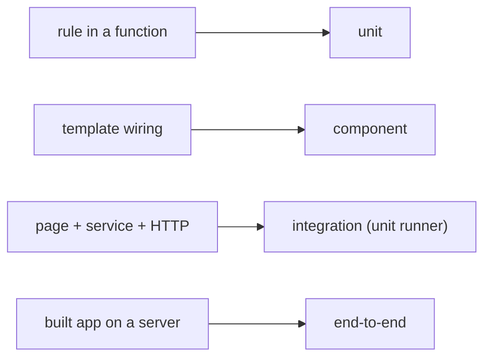
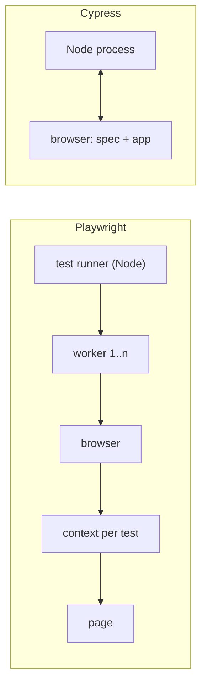
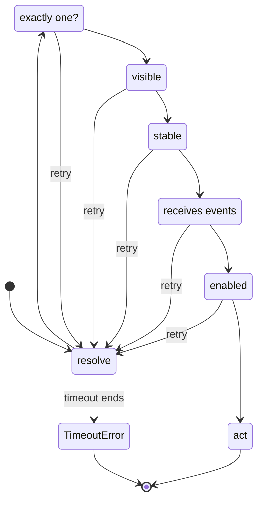
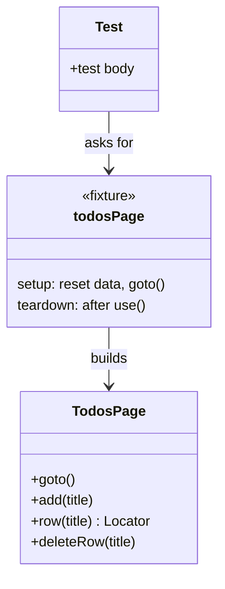
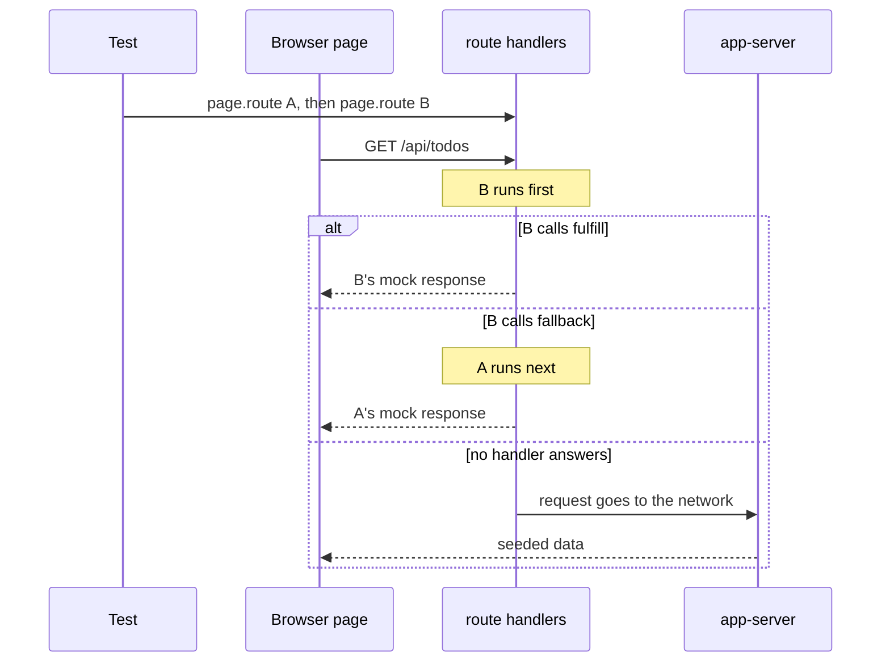
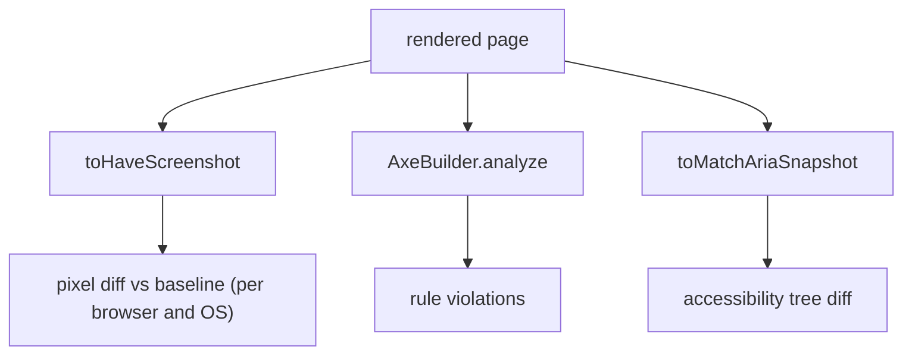
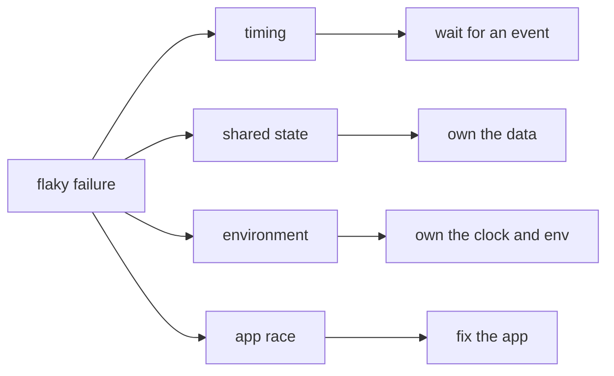
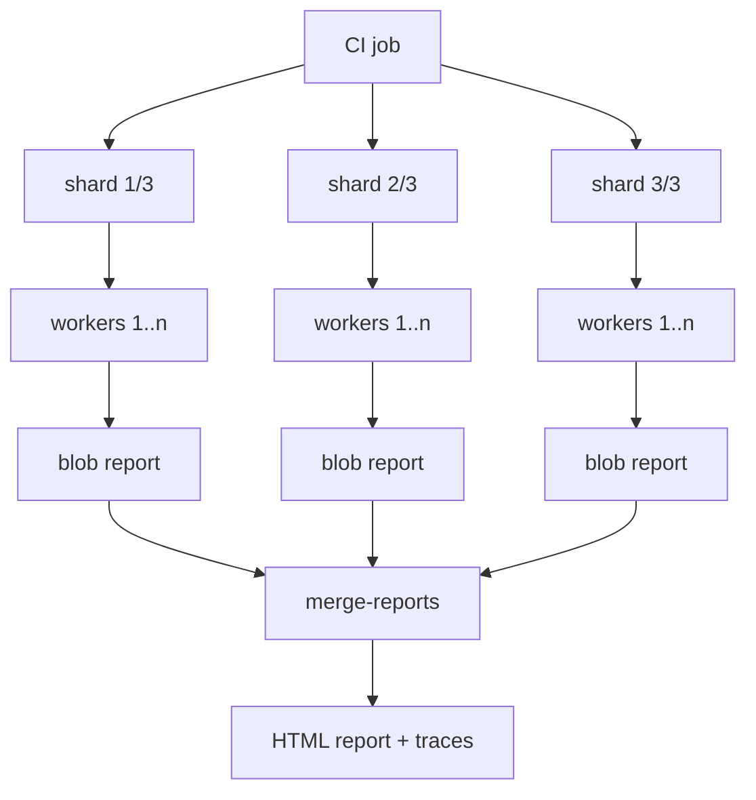
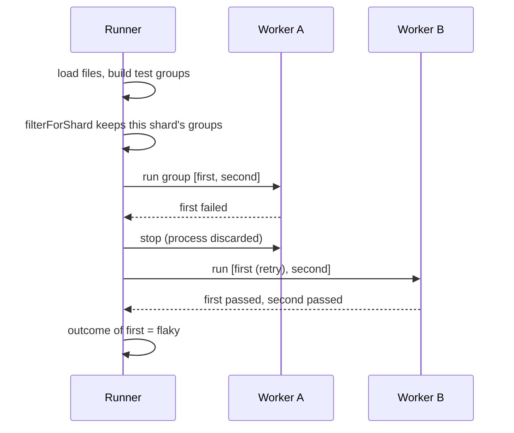

# 30. End-to-end tests and testing strategy

> **What this covers:** What earns a browser test and how a strategy spreads risks across test levels, Playwright and Cypress (architecture, `ng e2e` and the end of Protractor, auto-waiting, parallelism), locators, page objects and fixtures, API mocking at the network layer and where contract tests take over, visual regression and accessibility checks in end-to-end tests, flaky tests, a CI strategy for end-to-end suites (workers, sharding, retries policy, test data), and how Playwright's runner works under the hood.
> **Prerequisites:** [29. What to test where](29-testing-angular.md#1-what-to-test-where-unit-integration-component-and-end-to-end-tests-the-pyramid-and-the-trophy), [29. Component harnesses and role queries](29-testing-angular.md#11-component-harnesses-and-angular-testing-library), [11. Testing accessibility](11-accessibility.md#7-testing-accessibility)
> **Leads to:** [31. Performance](31-performance.md), [38. Architecture and production structure](38-architecture-and-production-structure.md), [41. Full-stack API contracts](41-fullstack-api-contracts.md), [44. Full-stack delivery and operations](44-fullstack-delivery-and-operations.md)
> **Applies to:** Playwright 1.63.0 (`@playwright/test`, Chromium only) with `@axe-core/playwright` 4.13.0, Angular 22.2 (CLI 22.2.1), TypeScript 6.0, Node 24; lab mode, so every observed claim is a committed spec; documented, not installed: Cypress 16.1.1, MSW 3.0.3, Pact 17.1.4
> **Study time:** ~5 hours reading + ~4 hours exercises
> **Short on time:** read [§1](#1-what-belongs-at-the-end-to-end-level-journeys-cost-and-a-strategy-across-levels), [§3](#3-auto-waiting-actionability-checks-web-first-assertions-and-cypress-retry-ability), [§7](#7-flaky-tests-root-causes-diagnosis-and-fixes) and [§8](#8-ci-strategy-for-end-to-end-tests-workers-sharding-retries-policy-and-test-data), then [Q30.01](#q30-01), [Q30.03](#q30-03), [Q30.04](#q30-04), [Q30.13](#q30-13), [Q30.16](#q30-16) and [Q30.17](#q30-17), then the [Summary](#summary).
> **Labs:** [`labs/e2e/`](../labs/e2e/), [`labs/angular/src/app/modules/30-e2e-and-testing-strategy/`](../labs/angular/src/app/modules/30-e2e-and-testing-strategy/) and [`labs/ts-js/src/modules/30-e2e-and-testing-strategy/`](../labs/ts-js/src/modules/30-e2e-and-testing-strategy/) (lab mode: Playwright specs against the production build, *Output* questions and Exercises 30.1-30.2 in `labs/e2e`; one component-level spec in `labs/angular`; Exercise 30.3 in `labs/ts-js`). Run (Node 24): from `labs/e2e`, `npm test`; from `labs/angular`, `npx ng test --watch=false --include='src/app/modules/30-e2e-and-testing-strategy/**/*.spec.ts'`; from `labs/ts-js`, `npx vitest run src/modules/30-e2e-and-testing-strategy`.

## Contents

1. [What belongs at the end-to-end level: journeys, cost and a strategy across levels](#1-what-belongs-at-the-end-to-end-level-journeys-cost-and-a-strategy-across-levels)
2. [Playwright and Cypress: architecture, `ng e2e` and the end of Protractor](#2-playwright-and-cypress-architecture-ng-e2e-and-the-end-of-protractor)
3. [Auto-waiting: actionability checks, web-first assertions and Cypress retry-ability](#3-auto-waiting-actionability-checks-web-first-assertions-and-cypress-retry-ability)
4. [Locators, page objects and fixtures](#4-locators-page-objects-and-fixtures)
5. [API mocking at the network layer, and where contract tests take over](#5-api-mocking-at-the-network-layer-and-where-contract-tests-take-over)
6. [Visual regression and accessibility checks in end-to-end tests](#6-visual-regression-and-accessibility-checks-in-end-to-end-tests)
7. [Flaky tests: root causes, diagnosis and fixes](#7-flaky-tests-root-causes-diagnosis-and-fixes)
8. [CI strategy for end-to-end tests: workers, sharding, retries policy and test data](#8-ci-strategy-for-end-to-end-tests-workers-sharding-retries-policy-and-test-data)
9. [Under the hood: how Playwright's runner groups, shards, retries and isolates tests](#9-under-the-hood-how-playwrights-runner-groups-shards-retries-and-isolates-tests)
- [Summary](#summary)
- [Question bank](#question-bank)
- [Hands-on exercises](#hands-on-exercises)
- [Check your understanding](#check-your-understanding)
- [Connections](#connections)

**How the claims here are verified.** Lab mode: observed behavior cites a Playwright 1.63.0 spec in `labs/e2e`, run on Chromium only against the production build of `labs/angular`, served by a standard-library Node server; scans use `@axe-core/playwright` 4.13.0, and runner behavior is asserted by nested runs whose JSON report a spec parses. One component spec runs under `ng test`; Exercise 30.3 runs in `labs/ts-js`. "Read from the source" names the file and function in `playwright` or `playwright-core` 1.63.0, or `@angular/cli` 22.2.1; internal names are marked. Docs are read on `main`, dated. Documented only: Cypress, MSW, Pact, Firefox, WebKit; the `ng e2e` message is observed once.

## 1. What belongs at the end-to-end level: journeys, cost and a strategy across levels

### The problem it solves

One team mirrors every component test in Playwright, and the suite takes most of an hour. Another has no browser test and ships a build whose lazy route returns 404 from the production server, because no unit test serves the built files. A third has one end-to-end test asserting twenty things; when it fails, nobody knows which broke.

### Mental model

An **end-to-end (e2e) test** drives the built app in a real browser against a running server and checks a **user journey**: a path that delivers one outcome, such as "add a todo and find it after a reload". Only this level sees the **production build** (the optimized, hash-named files `ng build` writes, [12 §3](12-angular-how-it-works.md#3-building-the-application-builder-output-layout-and-budgets)), real routing on a real server, layout and the browser's own behavior. [29 §1](29-testing-angular.md#1-what-to-test-where-unit-integration-component-and-end-to-end-tests-the-pyramid-and-the-trophy) owns the levels; this section asks which checks earn the top one.

A strategy names each **risk** (one way the app can break) and assigns it to the cheapest level that can catch it: **risk-based test selection**. End-to-end tests get the costly journeys no lower level can see. Think of a dress rehearsal: not every line in costume, only the scene changes, where sets, lights and actors meet.



What to notice: each risk goes to the cheapest level that can see it; only the last needs a browser.

### How it actually works

**What only this level sees.** The fixture page is a lazy route (`loadChildren` in `app.routes.ts`); the fixture server answers any `/m30/*` path with `index.html`, the **SPA fallback**. In the lab the served HTML names a hashed `main-<hash>.js` and an added todo survives a reload (`Section 1: the add-todo journey runs on the production build in a real browser`); loading `/m30/todos?q=milk` directly returns 200 HTML showing only the matching todo (`Section 1: a deep link to a lazy route is served by the server fallback`). No unit test requests a URL from the server, so only this level catches a broken fallback.

**What it costs.** Each run builds the app, starts a server and a browser, and gives each test a fresh **browser context** (an isolated profile with its own cookies and storage, [§2](#2-playwright-and-cypress-architecture-ng-e2e-and-the-end-of-protractor)). Failures arrive slowly. Read from the `playwright` 1.63.0 source (read, not run): `lib/common/index.js` sets `defaultTimeout = 3e4`, the `FullProjectInternal` constructor's (internal) fallback when no `timeout` is set, and `lib/matchers/expect.js` sets `defaultExpectTimeout = 5e3`, the fallback in `invokeMatcher` (internal). A missing element costs 5 s per assertion; a hung test, 30 s. `invokeMatcher` also rethrows a failed assertion unless it is soft, so the first failure ends the test: a twenty-check test reports one.

**The same rule, one level down.** A component test in jsdom (a simulated DOM in Node, [29 §2](29-testing-angular.md#2-the-runner-vitest-through-angularbuildunit-test-jsdom-and-browser-mode)) checks the empty-title rule without a browser (`Section 1: the empty-title rule is checked in a component test without a browser`). Ham Vocke's ["The Practical Test Pyramid"](https://martinfowler.com/articles/practical-test-pyramid.html) (2018-02-26, read 2026-10-13): "Push your tests as far down the test pyramid as you can". Drilled in [Q30.01](#q30-01); the levels are [Q29.01](29-testing-angular.md#q29-01), the shapes [Q29.02](29-testing-angular.md#q29-02).

### Code

The approach: one journey on the production build, with its own data.

1. Set a cookie that names its own tenant (a per-test slice of server data, [§8](#8-ci-strategy-for-end-to-end-tests-workers-sharding-retries-policy-and-test-data)) and reset that tenant's todos through the server's test endpoint.
2. Fetch the served HTML and check for the hashed bundle.
3. Add a todo by label and role.
4. Reload and find it: the server kept it.

```ts
// Excerpt of labs/e2e/tests/concepts/section-1-what-belongs.spec.ts
async function useOwnTenant(context: BrowserContext, testInfo: TestInfo): Promise<void> {
  const tenant = `section-1-${testInfo.testId}-${testInfo.repeatEachIndex}`;
  await context.addCookies([{ name: 'm30-tenant', value: tenant, url: 'http://localhost:4300' }]);
}

test('Section 1: the add-todo journey runs on the production build in a real browser', async ({
  page,
  context,
  browserName,
}, testInfo) => {
  await useOwnTenant(context, testInfo);
  await page.request.post('/api/__reset', { data: [] });

  const html = await (await page.request.get('/m30/todos')).text();
  expect(html).toMatch(/<script src="main-[A-Z0-9]{8}\.js" type="module"><\/script>/);
  expect(browserName).toBe('chromium');

  await page.goto('/m30/todos');
  await expect(page.getByText('No todos yet')).toBeVisible();
  await page.getByLabel('New todo').fill('Book the venue');
  await page.getByRole('button', { name: 'Add' }).click();
  await expect(page.getByRole('status')).toHaveText('Saved');

  await page.reload();
  await expect(page.getByRole('checkbox', { name: 'Book the venue' })).toBeVisible();
});
```

### Best practices and anti-patterns

- **Pick journeys by the cost of their failure** (sign-in, checkout), because, as Vocke writes, "Due to their high maintenance cost you should aim to reduce the number of end-to-end tests to a bare minimum."
- **Keep a few smoke tests** (a **smoke test** only checks that the built app starts and its main page loads), because they separate "the app is down" from "a journey broke".
- **Give each test one outcome and its own data**, because the first failed assertion ends the test, and shared data couples tests ([§7](#7-flaky-tests-root-causes-diagnosis-and-fixes)).
- **Avoid running e2e tests against `ng serve`**, because the lab's `angular.json` makes `development` its default configuration, not the bundle that ships.

### Misconceptions and traps

- *"End-to-end tests are the only real tests."* Each is slow and coarse, and a failure names a step, not a cause; push rules down instead. The myth exists because they look most like the user.
- *"One end-to-end test per component."* Journeys are the unit; a component's rules belong in a component test. The habit comes from mirroring the component tree.
- *"More end-to-end tests mean more confidence."* Past the key journeys each adds run time and flakiness (§7). The belief reads confidence as volume.
- *"A green journey makes contract tests unnecessary."* It proves one path against one backend version, not the contract ([§5](#5-api-mocking-at-the-network-layer-and-where-contract-tests-take-over)). Both cross the wire, which makes them look interchangeable.

## 2. Playwright and Cypress: architecture, `ng e2e` and the end of Protractor

### The problem it solves

`ng e2e` in a new v22 project prints `Cannot find "e2e" target` and exits. An old `e2e/protractor.conf.js` stops running after an update. A Cypress team needs a second tab for a payment page.

### Mental model

**Playwright** (a browser automation library and test runner) runs test code in **Node**. The runner starts **worker processes** (OS processes running test files), each worker starts a browser, and each test gets a fresh browser context (§1) holding its pages (tabs). **Cypress** is a test runner whose test code runs **inside the browser**, beside the app. Angular supplies neither: `ng e2e` runs the **builder** (the function a target names, [12 §2](12-angular-how-it-works.md#2-the-cli-and-the-workspace-angularjson-projects-schematics-and-ng-update)) a package registered as the `e2e` target.

Playwright is an instructor with dual controls beside the driver; Cypress, a co-pilot wired into the dashboard.



What to notice: where the test code runs decides tabs, origins and what a test can reach in Node.

### How it actually works

**Where the code runs.** In the lab, `typeof window` is `'undefined'` in the test and `'object'` in `page.evaluate` (`Section 2: test code runs in Node and reaches the page through evaluate`); a cookie and `localStorage` item one test sets are gone in the next, same browser (`Section 2: each test starts with an empty browser context`).

**How it drives the browser.** The docs ([Browsers](https://playwright.dev/docs/browsers), [`connectOverCDP`](https://playwright.dev/docs/api/class-browsertype)) say the Firefox and WebKit builds rely on patches and the Chrome DevTools Protocol (Chromium's remote-debugging protocol) is Chromium-only. Read from the `playwright-core` 1.63.0 source (`lib/coreBundle.js`; read, not run; names internal): Chromium starts with `--remote-debugging-pipe`, Firefox with `-juggler-pipe`, WebKit with `--inspector-pipe`, and a Chromium context is one DevTools Protocol call, `Target.createBrowserContext` (`crBrowser.ts`, `doCreateNewContext`), which is why a context per test is cheap.

**Cypress (documented only).** Its ["Trade-offs" page](https://docs.cypress.io/app/references/trade-offs) (read 2026-10-13): "Test code is not evaluated in Node, or any other server side language."; Node is reached through `cy.task()`; "Cypress does not support controlling more than 1 open browser at a time.", tabs need the `@cypress/puppeteer` plugin, and a test is bound to one **superdomain** (a shared parent domain). Since Cypress 14, [`cy.origin`](https://docs.cypress.io/api/commands/origin) is required between any two origins, "even if the two origins are in the same superdomain".

**`ng e2e`.** Read from `@angular/cli` 22.2.1 (read, not run): `E2eCommandModule` (`src/commands/e2e/cli.js`) lists five `missingTargetChoices`; with no `e2e` target, `onMissingTarget` (internal, `src/command-builder/architect-base-command-module.js`) builds the message; on a terminal it asks (default "No") and runs **`ng add`** (install a package and run its setup schematic), elsewhere or in CI (`isTTY`) it only logs. Both return 1. Observed by running `npx ng e2e` (stdin `/dev/null`) in `labs/angular` on 2026-10-13, exit code 1:

```text
Cannot find "e2e" target for the specified project.
You can add a package that implements these capabilities.

For example:
  Playwright: ng add playwright-ng-schematics
  Cypress: ng add @cypress/schematic
  Nightwatch: ng add @nightwatch/schematics
  WebdriverIO: ng add @wdio/schematics
  Puppeteer: ng add @puppeteer/ng-schematics
```

The Angular docs (["End to End Testing"](https://angular.dev/tools/cli/end-to-end), `main`, read 2026-10-13) show an older order, Cypress first. Drilled in [Q30.02](#q30-02) and [Q30.03](#q30-03).

### Code

The approach: two tabs of one context share storage; a page in a second context does not see it.

1. Route a made-up origin: storage gets an origin, nothing reaches the network.
2. Open a second tab and a page in a new context.
3. Write `localStorage` in one page; read it from the others.

```ts
// Excerpt of labs/e2e/tests/concepts/section-2-architecture.spec.ts
const ORIGIN = 'http://m30-section-2.test';

async function serveBlankPage(context: BrowserContext): Promise<void> {
  await context.route(`${ORIGIN}/**`, (route) =>
    route.fulfill({ status: 200, contentType: 'text/html', body: '<!doctype html><title>Section 2</title>' }),
  );
}

test('Section 2: two pages in one context share storage while a second context does not', async ({
  browser,
  context,
  page,
}) => {
  await serveBlankPage(context);
  const secondTab = await context.newPage();
  const otherContext = await browser.newContext();
  await serveBlankPage(otherContext);
  const otherPage = await otherContext.newPage();

  await page.goto(`${ORIGIN}/`);
  await secondTab.goto(`${ORIGIN}/`);
  await otherPage.goto(`${ORIGIN}/`);
  await page.evaluate(() => localStorage.setItem('cart', '3 items'));

  expect(await secondTab.evaluate(() => localStorage.getItem('cart'))).toBe('3 items');
  expect(await otherPage.evaluate(() => localStorage.getItem('cart'))).toBeNull();
  await otherContext.close();
});
```

#### Legacy

**Protractor**, an e2e framework for Angular apps, is "built on top of WebDriverJS" (`protractor` 7.0.0 README); **WebDriver** is the W3C "remote control interface that enables introspection and control of user agents" ([WebDriver 2](https://www.w3.org/TR/webdriver2/), read 2026-10-13).

```ts
// Partial: Protractor 7 with Jasmine, config omitted; Protractor, not run in these labs
import { browser, by, element } from 'protractor';

it('adds a todo', async () => {
  await browser.get('/m30/todos');
  await element(by.css('#lab-m30-title')).sendKeys('Book the venue');
  await element(by.buttonText('Add')).click();
  expect(await element(by.css('[role=status]')).getText()).toBe('Saved');
});
```

The Protractor builder is [Removed in v19.0]: deprecated in CLI 12.1 ("deprecate protractor builder", [CHANGELOG](https://github.com/angular/angular-cli/blob/main/CHANGELOG.md)); the `protractor` 7.0.0 npm notice: "Protractor is deprecated and will reach end-of-life by Summer 2023"; CLI 19.0.0: "Protractor is no longer supported." Migration: run `ng e2e` and pick a package, or add a standalone Playwright project as `labs/e2e` does; port page objects first, then delete explicit `browser.wait` calls ([§3](#3-auto-waiting-actionability-checks-web-first-assertions-and-cypress-retry-ability)).

> [!NOTE]
> **Framework vs platform.** Angular adds only `ng e2e` and the `e2e` target. Playwright and Cypress are third-party tools. The platform supplies the automation interfaces: the Chrome DevTools Protocol, pipes into patched Firefox and WebKit builds, W3C WebDriver.

### Best practices and anti-patterns

- **Choose by what the tests need** (tabs, several origins, Node access), because those are architecture, not missing features.
- **Use a second context for a second user**, because tabs of one context share cookies and storage.
- **Expect a targetless `ng e2e` to fail in CI**, because the CLI prompts only on a terminal.

### Misconceptions and traps

- *"Angular ships an e2e tool."* Since 19.0 the CLI only suggests third-party packages; the belief dates from the Protractor builder.
- *"Cypress cannot test tabs or other origins."* `cy.origin` and `@cypress/puppeteer` cover them; the myth comes from its trade-offs page.
- *"`ng e2e` runs Playwright by default."* A new project has no `e2e` target, so nothing runs; Playwright is first in the 22.2.1 list.

## 3. Auto-waiting: actionability checks, web-first assertions and Cypress retry-ability

### The problem it solves

A test reads `textContent` right after a click and fails one run in five. A teammate adds `waitForTimeout(2000)`: the suite slows by minutes and still fails on a slow CI machine. Another click lands on a button a toast covers.

### Mental model

Playwright waits for the page, not the clock. **Actionability** is the set of checks an element must pass before an action runs on it. **Auto-waiting** is Playwright retrying those checks until they pass or the action's `timeout` ends. A **web-first assertion** (`expect(locator).toHaveText(...)`) retries until it passes or the `expect` timeout, 5 s, ends (the test timeout is 30 s, [§1](#1-what-belongs-at-the-end-to-end-level-journeys-cost-and-a-strategy-across-levels)). **Retry-ability** is Cypress's word for the same idea, with different rules. A value read once with `await locator.textContent()` is a snapshot that never retries.

A waiter checks that the table is free before serving; a bad one serves after counting to two.



What to notice: every failed check loops back and retries until the timeout; nothing waits a fixed time.

### How it actually works

**The checks.** Before `click`, Playwright checks that the locator resolves to exactly one element ([§4](#4-locators-page-objects-and-fixtures)) that is visible, stable (the same bounding box for two animation frames), receives events (nothing covers it) and enabled; otherwise the action fails with **`TimeoutError`**, Playwright's error for an expired wait ([Auto-waiting](https://playwright.dev/docs/actionability), `main`, read 2026-10-13). The page on `main` also lists a "Not Inert" check, added after 1.64.0 (Playwright PR #43211, merged 2026-10-08); the `release-1.63` page lists only these. In the lab the error is named `TimeoutError`, starts `locator.click: Timeout 500ms exceeded.` and logs `element is not enabled` and `retrying click action` (`Section 3: an action fails with TimeoutError when its target never becomes actionable`).

**Where it polls.** Read from `playwright` and `playwright-core` 1.63.0 (read, not run; names internal, "may change in any release"): `lib/matchers/expect.js` sends `toHaveText` as `locator._expect("to.have.text", …)` with the 5 s `defaultExpectTimeout`. It reaches `Frame.expect` in `lib/coreBundle.js` (bundled `server/frames.ts`): one check, then `retryWithProgressAndBackoff` repeats it after waits of 20, 50, 100, 100 and then 500 ms (steps above a fifth of the timeout are dropped). Actions retry through the same function, via `_retryWithProgressIfNotConnected`.

**What does not wait.** `textContent()` and `page.evaluate` return at once (`Section 3: a value read once does not retry`); a web-first assertion keeps going (`Section 3: a web-first assertion retries until the text appears`), and `click()` waits for a disabled button (`Section 3: click waits for a disabled button to become enabled`).

**Cypress (documented only).** Its [retry-ability page](https://docs.cypress.io/app/core-concepts/retry-ability) (`main`, read 2026-10-13): "Queries link up, retrying the entire chain together", assertions are queries, "Non-queries only execute once", and a retrying command does so for up to 4 seconds (`defaultCommandTimeout`). `.click()` waits until the element is actionable, then acts once; it is not retried because "it could change something in the application".

### Code

The approach: a page that fills in a status after 600 ms; the same wait seen through a snapshot, a web-first assertion and a click.

1. Serve a micro-fixture with `page.setContent`.
2. Read the status once, then assert it with `toHaveText` (`SLOW_STATUS` is a `<p role="status">` that reads "Saved" after 600 ms).
3. Click a button that is disabled until it enables itself.
4. Click one that never enables, with `timeout: 500`.

```ts
// Excerpt of labs/e2e/tests/concepts/section-3-auto-waiting.spec.ts
test('Section 3: a value read once does not retry', async ({ page }) => {
  await page.setContent(SLOW_STATUS);
  const status = page.getByRole('status');

  const readOnce = await status.textContent();
  await expect(status).toHaveText('Saved');

  expect(readOnce).toBe('');
  expect(await status.textContent()).toBe('Saved');
});

test('Section 3: an action fails with TimeoutError when its target never becomes actionable', async ({ page }) => {
  await page.setContent('<button disabled>Pay</button>');

  const error = await page
    .getByRole('button', { name: 'Pay' })
    .click({ timeout: 500 })
    .then(
      () => null,
      (e: Error) => e,
    );

  expect(error?.name).toBe('TimeoutError');
  expect(error?.message.split('\n')[0]).toBe('locator.click: Timeout 500ms exceeded.');
  expect(error?.message).toContain('element is not enabled');
});
```

### Best practices and anti-patterns

- **Assert with `expect(locator)` matchers**, because each poll fetches the element again; `expect(await locator.textContent())` checks one snapshot.
- **Wait for the state the next step needs**, because a fixed sleep is a guess ([§7](#7-flaky-tests-root-causes-diagnosis-and-fixes)).
- **Raise a timeout for one slow step** (`expect.configure({ timeout: 10000 })`, [Assertions](https://playwright.dev/docs/test-assertions), read 2026-10-13), because a global increase slows every failure.
- **Keep `force: true` for rare cases**, because it "disables non-essential actionability checks", so a covered button is clicked anyway.

### Misconceptions and traps

- *"Auto-waiting makes every line safe."* Only actions and web-first matchers wait; a value read once and `page.evaluate` do not. The name suggests the whole test.
- *"`waitForTimeout` is a harmless fallback."* It is a fixed guess, too short on slow CI and wasted time elsewhere. It works on the author's machine.
- *"Cypress retries every command."* Queries and assertions retry; `.click()` runs once after its actionability wait. Retry-ability is its headline feature.
- *"`networkidle` means the page is ready."* The 1.63.0 typings mark it **DISCOURAGED** ("Don't use this method for testing, rely on web assertions to assess readiness instead"). It sounds final, but it only means no connections for 500 ms.

Drilled in [Q30.04](#q30-04) and [Q30.05](#q30-05).

## 4. Locators, page objects and fixtures

### The problem it solves

A redesign renames CSS classes and sixty end-to-end tests fail, though no behavior changed. A click on "Delete" removes the wrong row. Every spec repeats the same navigation, and a URL change means editing forty files.

### Mental model

A **locator** describes how a user finds an element and is resolved again on every use ([Locators](https://playwright.dev/docs/locators), `main`, read 2026-10-13: "a way to find element(s) on the page at any moment"); it is not a handle. It starts from role and **accessible name**, the text assistive technology announces for a control ([11 §6](11-accessibility.md#6-accessible-names-descriptions-and-forms)). Locators are **strict**: an action on a locator that matches several elements throws. A **page object** is a class that wraps one page's locators and actions. A **fixture** (Playwright's sense; unrelated to Angular's `ComponentFixture`) is a value `test.extend` builds for a test, with setup before `await use(...)` and teardown after. They are not rivals: the [fixtures docs](https://playwright.dev/docs/test-fixtures) deliver a `TodoPage` object as a fixture.

A locator is a description ("the red door marked Exit"), not a coordinate; the page object is the floor plan; the fixture is the concierge who hands you the plan and tidies up afterwards.



What to notice: the test never sees a selector; only `TodosPage` knows how the page is built.

### How it actually works

**Priority.** The docs recommend "prioritizing user-facing attributes and explicit contracts such as `page.getByRole()`" over XPath or CSS ([Best Practices](https://playwright.dev/docs/best-practices)). The order: role with name, label, text, test id, CSS last. A test id is "not user facing" (Locators); `testIdAttribute` in the config changes the attribute (declared in `playwright` 1.63.0 `types/test.d.ts`, read, not run). A role query needs a name, so a missing one fails ([29 §11](29-testing-angular.md#11-component-harnesses-and-angular-testing-library) and [Q29.33](29-testing-angular.md#q29-33) show the same query style one level down). In the lab a button with `aria-label="Close dialog"` is found by that name and not by its visible `x` (`Section 4: getByRole finds a button by its accessible name`).

**Strictness.** With two todos, clicking `getByRole('button', { name: 'Delete' })` fails. The message starts `locator.click: Error: strict mode violation: getByRole('button', { name: 'Delete' }) resolved to 2 elements:` and lists each match with a locator that singles it out (`Section 4: a locator that matches two elements throws a strict mode violation`). Read from `playwright-core` 1.63.0 (read, not run; names internal, "may change in any release"): in `lib/coreBundle.js`, `_callOnSelectorInternal` (bundled `server/frameSelectors.ts`) throws `strictModeViolationError` when the selector is strict and matched more than one element; that method of the injected script builds the message. It throws because a silent first match would act on whichever element comes first. Chaining narrows it (`Section 4: filtering by row text narrows to one Delete button`).

**Fixtures.** Test-scoped fixtures are torn down after each test, `{ scope: 'worker' }` ones when the worker ends, and a fixture is set up after the one it needs and torn down before it ([Fixtures](https://playwright.dev/docs/test-fixtures), read 2026-10-13). The recorded order is `setup`, `test`, `teardown` (`Section 4: a fixture's teardown runs after the test`).

### Code

The approach: the page object holds every selector, and a fixture gives each test its own data and a page already open.

1. `row(title)` filters list items by text; `deleteRow` scopes "Delete" to that row.
2. The `todosPage` fixture sets the tenant, resets its data, builds the object and `use`s it.
3. The test states the journey only.

```ts
// Excerpt of labs/e2e/tests/concepts/section-4-locators-and-fixtures.spec.ts
class TodosPage {
  constructor(private readonly page: Page) {}
  row(title: string): Locator {
    return this.page.getByRole('listitem').filter({ hasText: title });
  }

  async deleteRow(title: string): Promise<void> {
    await this.row(title).getByRole('button', { name: 'Delete' }).click();
  }
}

const test = base.extend<{ todosPage: TodosPage }>({
  todosPage: async ({ page, context, baseURL }, use, testInfo) => {
    const tenant = `section-4-${testInfo.testId}-${testInfo.repeatEachIndex}`;
    await context.addCookies([{ name: 'm30-tenant', value: tenant, url: baseURL ?? '' }]);
    await page.request.post('/api/__reset', { data: [{ title: 'Buy milk' }, { title: 'Walk the dog' }] });
    const todosPage = new TodosPage(page);
    await todosPage.goto();
    await use(todosPage);
  },
});

test('Section 4: a page object delivered as a fixture drives the journey', async ({ todosPage }) => {
  await todosPage.add('Book the venue');
  await todosPage.deleteRow('Buy milk');

  await expect(todosPage.row('Book the venue')).toBeVisible();
  await expect(todosPage.row('Buy milk')).toHaveCount(0);
});
```

### Best practices and anti-patterns

- **Locate by role and name first**, because it matches what a user perceives and a missing name fails loudly.
- **Scope a repeated control to its row**, because "Delete" repeats per item.
- **Keep selectors inside the page object**, because a redesign then edits one file.
- **Put setup and its teardown in one fixture**, because tests then ask only for what they use ([Fixtures](https://playwright.dev/docs/test-fixtures): fixtures are "on-demand").
- **Add a test id only when no role or text identifies the element**, because it tests nothing the user perceives.

### Misconceptions and traps

- *"`data-testid` everywhere is best practice."* The docs rank user-facing attributes first. Ids are stable, which tempts.
- *"Page objects are outdated, use fixtures."* A fixture delivers the page object; they do different jobs. Fixtures are newer, which is why they look like a replacement.
- *"`locator.first()` fixes strict mode errors."* It silences them; the docs call `first()`, `last()` and `nth()` "not recommended" because the page may change and a different element gets the click. It is quick, so the wrong row gets deleted.
- *"A locator is an element handle."* It resolves again on every use, so it survives a re-render. Selenium habits suggest otherwise.

Drilled in [Q30.06](#q30-06), [Q30.07](#q30-07) and [Q30.08](#q30-08); [Exercise 30.1](#ex30-1) builds the journey both ways.

## 5. API mocking at the network layer, and where contract tests take over

### The problem it solves

A suite on a shared staging backend fails whenever another team edits the data. A "500 from the server" state is never tested, because a real server fails only by accident. A fully mocked suite stays green after the backend renames a field.

### Mental model

**Network-layer mocking** intercepts the browser's own requests and answers them, so the app runs unchanged on a scripted backend. In Playwright a **route handler** is a function given to `page.route(url, handler)`. It receives a `Route` and ends the request with `fulfill` (answer it), `continue` (send it to the network), `fallback` (pass it on) or `abort`. The alternatives are a **stub server**, a small fake backend over HTTP (this lab's `app-server.mjs`), and the real backend with seeded data.

A flight simulator scripts the storm (mock), a training airfield is the stub server, real weather is the real backend. None checks the airport still exists: the contract test does.



What to notice: the last registered handler sees the request first, and only a request that no handler answers reaches the server.

### How it actually works

**Order.** "When several routes match the given pattern, they run in the order opposite to their registration" ([Route.fallback](https://playwright.dev/docs/api/class-route#route-fallback), `main`, read 2026-10-13). Two handlers on one URL: the page shows the later one's (`Section 5: the last registered route handles the request first`). A handler that calls `fallback()` passes the request on; the order is B then A (`Section 5: route.fallback hands the request to the earlier handler`). Read from `playwright-core` 1.63.0 (read, not run; names internal): in `lib/coreBundle.js` the page's `route` calls `this._routes.unshift(...)`, and `_onRoute` walks that array from the front until a handler reports the request handled; `Route.fallback` reports `_reportHandled(false)`, so the walk continues.

**Pass-through.** A fulfilled request never arrives: log empty (`Section 5: page.route fulfills the list request without the server`). An unmatched one is served from seeded data and logged once (`Section 5: an unrouted request reaches the stub server`).

**HAR.** A **HAR** (HTTP Archive) is a JSON record of requests and responses. `routeFromHAR` with `update: true` records one, and without it replays ([Mock APIs](https://playwright.dev/docs/mock), `main`, read 2026-10-13). The committed file was recorded once against the stub server; replay never shows the server's data (`Section 5: routeFromHAR replays a recorded response`). In the 1.63.0 typings `notFound` is `"abort"|"fallback"`, "Defaults to abort": a request missing from the HAR fails, and with `fallback` reaches the server, which answers 404.

**Others.** `HttpTestingController` replaces the backend inside `HttpClient`, in Node ([27 §11](27-http-client.md#11-testing-and-the-backend-seam-providehttpclienttesting-httptestingcontroller-and-what-they-replace)); `page.route` intercepts the browser's request. MSW (documented only) uses a **Service Worker**, a script the browser runs between page and network ([09 §9](09-web-networking-storage-security.md#9-service-workers-and-the-pwa-manifest)); its README says one mock definition serves unit, integration and end-to-end tests (read 2026-10-13).

**Contract tests.** A mock echoes what the frontend expects and cannot notice a renamed field. A **contract test** checks both sides against one shared description; Pact's docs say contract tests "assert that inter-application messages conform to a shared understanding that is documented in a contract" ([Pact introduction](https://docs.pact.io/), read 2026-10-13, documented only). In a **consumer-driven contract** the frontend's tests write the requests it makes and the responses it needs into a pact file, which the backend replays in its own build ([Terminology](https://docs.pact.io/getting_started/terminology), "Pact verification"). [Module 41](41-fullstack-api-contracts.md#3-openapi-with-springdoc-and-generated-typescript-clients-openapi-generator-orval-and-ng-openapi-gen) owns the design.

### Code

The approach: register the answering handler first, then a recording one that runs first and hands over.

1. Seed the test's tenant.
2. Register A, which fulfills the list.
3. Register B, which records itself and calls `fallback()`.
4. Navigate; check A's data and the order B, A.

```ts
// Excerpt of labs/e2e/tests/concepts/section-5-network-mocking.spec.ts
test('Section 5: route.fallback hands the request to the earlier handler', async ({ page, context }, testInfo) => {
  await seedOwnTenant(page, context, testInfo, []);
  const order: string[] = [];
  await page.route(TODOS, (route) => {
    order.push('A');
    return route.fulfill({ json: [{ id: 1, title: 'From A', done: false }] });
  });
  await page.route(TODOS, (route) => {
    order.push('B');
    return route.fallback();
  });

  await page.goto('/m30/todos');

  await expect(page.getByRole('checkbox', { name: 'From A' })).toBeVisible();
  expect(order).toEqual(['B', 'A']);
});
```

### Best practices and anti-patterns

- **Register routes before `goto`**, as the docs do, because an earlier request goes to the network.
- **Mock only the request under test**: each mock is a claim the backend must keep.
- **Review a recorded HAR before committing it**: it holds headers and cookies.
- **Pair mocks with a contract test** per consumed endpoint: only a contract notices a backend change.
- **Script failures and delays in the mock**; a real server rarely fails on demand.

### Misconceptions and traps

- *"Mocked end-to-end tests are not real."* They run the real build in a real browser, trading backend coverage for determinism. "Mock" sounds fake.
- *"`HttpTestingController` and `page.route` are the same."* One replaces Angular's backend in Node, the other intercepts the browser's request. Both fake HTTP.
- *"A green mocked suite proves the API works."* Green looks like proof because the mock agrees with every request. The mock echoes what the frontend expects, so only a contract closes that gap.
- *"A HAR file is a full mock server."* It replays what it recorded; unmatched requests abort or fall through. Replay looks like serving.

Drilled in [Q30.09](#q30-09) and [Q30.10](#q30-10); [Exercise 30.2](#ex30-2) controls the backend both ways.

## 6. Visual regression and accessibility checks in end-to-end tests

### The problem it solves

A CSS refactor shifts the Add button 40 pixels and every functional test passes (`Section 6: a button shifted by CSS fails the screenshot while a functional assertion still passes`). A baseline taken on a Mac fails on Linux CI on every run. An unlabelled input ships although the component tests use role queries.

### Mental model

A **visual regression test** compares a screenshot with a **baseline**, an approved reference image, and fails when the **pixel diff**, the count of differing pixels, passes a tolerance. An **accessibility scan** runs **axe**, a rule engine for accessibility defects ([11 §7](11-accessibility.md#7-testing-accessibility)), against the live page; a **WCAG tag** selects the rules tied to one level of the standard in [11 §1](11-accessibility.md#1-why-accessibility-and-what-the-standards-require). An **ARIA snapshot** compares the **accessibility tree**, the roles, names and states the browser exposes to assistive technology, as YAML text. The three are a photo comparison, a building-code inspection and a floor-plan check.



What to notice: only the screenshot depends on the platform's fonts and rendering.

### How it actually works

**Pixels.** Without a baseline the docs say the run reports "A snapshot doesn't exist at …, writing actual." and saves the screenshot; `--update-snapshots` regenerates it ([Visual comparisons](https://playwright.dev/docs/test-snapshots), `main`, read 2026-10-13). The 1.63.0 typings give `threshold` default `0.2` (perceived colour difference, `0` strict to `1` lax), `maxDiffPixels` and `maxDiffPixelRatio` "unset by default", `animations` default `"disabled"`, and `mask`, which covers locators with a pink box. The lab's baseline is `todos-empty-chromium-darwin.png` (`Section 6: the empty todos page matches its baseline screenshot`); moving a button fails it.

**Why a Mac baseline never matches on Linux.** Read from `playwright` 1.63.0 (read, not run; names internal): `lib/index.js` sets `testInfo.snapshotSuffix = process.platform`, and `lib/worker/workerProcessEntry.js` builds the path from `{arg}{-projectName}{-snapshotSuffix}{ext}`. Linux looks for `…-chromium-linux.png`, a file nobody committed (`Section 6: the baseline file name carries the project and the platform`). Rendering differs too: "run tests in the same environment where the baseline screenshots were generated" (docs).

**Axe.** `new AxeBuilder({ page }).withTags([...]).analyze()` returns the results, whose `violations` the test asserts. The todos page has none for the four WCAG A and AA tags (`Section 6: axe finds no violations on the todos page for the WCAG A and AA tags`); an input without a label is reported as `label` (`Section 6: axe reports an unlabelled input as a label violation`). `analyze()` scans the page "in its current state" (docs), so wait for the content first. The docs warn that automated tests find only some problems; what scans miss is [Q11.18](11-accessibility.md#q11-18).

**ARIA snapshot.** The template is "a constraint, not necessarily a complete serialization" and order-sensitive ([Snapshot testing](https://playwright.dev/docs/aria-snapshots), read 2026-10-13); the list's checkboxes and Delete buttons match (`Section 6: the todo list matches its ARIA snapshot`). Storybook-based visual testing is [module 38](38-architecture-and-production-structure.md#10-storybook-for-component-development)'s.

### Code

The approach: break the layout in the page, then show that behavior still passes and the pixels do not.

1. Seed and open the page.
2. Inject a style that moves the Add button.
3. Assert the button is still visible.
4. Assert the screenshot no longer matches.

```ts
// Excerpt of labs/e2e/tests/concepts/section-6-visual-and-a11y.spec.ts
  await page.addStyleTag({ content: 'button[type="submit"] { position: relative; left: 40px; }' });

  await expect(page.getByRole('button', { name: 'Add' })).toBeVisible();
  await expect(page).not.toHaveScreenshot('todos-empty.png');
```

### Best practices and anti-patterns

- **Pin one platform for baselines**, such as the CI image, because the file name carries the platform.
- **Mask or remove dynamic content**, because any changing pixel is a failure.
- **Scan after the page settles**, because `analyze()` sees only the current state.
- **Review a changed baseline like code**, because `--update-snapshots` accepts whatever renders.

### Misconceptions and traps

- *"Visual tests replace functional assertions."* A picture shows pixels, not behavior, and a tolerance hides small changes. Seeing everything feels like checking everything.
- *"Baselines are portable."* The browser name matches, but fonts and rendering differ by platform and the file name says so.
- *"An axe pass means accessible."* A green report reads like a certificate. It covers only the rules run; see Q11.18.
- *"Screenshots are flaky by nature."* Unmasked dynamic content and animations cause it; mask, disable and pin the platform.

Drilled in [Q30.11](#q30-11) and [Q30.12](#q30-12).

## 7. Flaky tests: root causes, diagnosis and fixes

### The problem it solves

A test passes alone and fails in the full suite one run in ten. CI goes green on the second run and the team learns to press "re-run". A date-dependent test fails every night at midnight UTC.

### Mental model

A **flaky test** gives both a passing and a failing result on the same code. Google lists causes "including concurrency, relying on non-deterministic or undefined behaviors, flaky third party code, infrastructure problems" ([Flaky Tests at Google](https://testing.googleblog.com/2016/05/flaky-tests-at-google-and-how-we.html), 2016-05-27, read 2026-10-13). The cause is **non-determinism**, an input the test does not control: timing, shared state, the environment (clock, time zone, viewport, fonts) or a race in the app. The fix removes the uncontrolled input; it never adds time. Wait for an event ([§3](#3-auto-waiting-actionability-checks-web-first-assertions-and-cypress-retry-ability)), own the clock, own the data, mock what you do not own ([§5](#5-api-mocking-at-the-network-layer-and-where-contract-tests-take-over)). A smoke alarm that rings at random is not moved away; you find the toaster.



What to notice: every fix removes an input the test did not control; none adds time.

### How it actually works

**Why a retry-pass is not a pass.** Read from `playwright` 1.63.0 (read, not run; names internal, "may change in any release"): `outcome()` in `lib/common/index.js` counts a test's attempts. No counted attempt gives `skipped`; no unexpected attempt gives `expected`; no expected attempt (and none skipped) gives `unexpected`; anything else is **`flaky`**. `ok()` still accepts `flaky`, so the run passes. `--fail-on-flaky-tests` ("Fail if any test is flagged as flaky", default false, `lib/program.js`) turns it into a failure (policy: [§8](#8-ci-strategy-for-end-to-end-tests-workers-sharding-retries-policy-and-test-data)).

**Why shared state hides.** A failure discards the worker process and the retry starts in a new one ([Retries](https://playwright.dev/docs/test-retries), `main`, read 2026-10-13), so state leaked inside one worker vanishes exactly when the retry runs; [§9](#9-under-the-hood-how-playwrights-runner-groups-shards-retries-and-isolates-tests) covers the worker replacement.

**Finding the cause.** `--repeat-each <N>` runs each test N times, so a rare failure shows up on demand; `--last-failed` reruns only failures. A **trace** is a recording of each action of a test that the Trace Viewer lets you step through ([Trace viewer](https://playwright.dev/docs/trace-viewer-intro), `main`, read 2026-10-13); `on-first-retry` means "Record and keep a trace only for the first retry of a test" (`types/test.d.ts`), the evidence of a failure you did not watch. To **quarantine** a test is to move it to a separate suite: Fowler says "quarantine your non-deterministic tests" and "fix quarantined tests quickly" ([Eradicating Non-Determinism in Tests](https://martinfowler.com/articles/nonDeterminism.html), 2011-04-14, read 2026-10-13).

**The three fixes, in the lab.** The scenario endpoint delays the list response by 1,500 ms; the test waits for that response, then asserts (`Section 7: waiting for the response replaces a fixed sleep`). With `page.clock`, a 5-second `setTimeout` message is reached by `fastForward(5000)` (`Section 7: page.clock makes a timer-driven message deterministic`). Two parallel tests add "Same title", each in its own tenant, and each sees one (`Section 7: tests in separate tenants do not see each other's data`). The clock replaces `Date` and `setTimeout` among others ([Clock](https://playwright.dev/docs/clock), `main`, read 2026-10-13).

### Code

The approach: hold the response back on the server, then wait for that response instead of a fixed time.

1. Seed an own tenant.
2. Delay the next list response by 1,500 ms.
3. Start waiting for the response, then open the page.
4. Assert the status, await the response and assert the data.

```ts
// Excerpt of labs/e2e/tests/concepts/section-7-flaky.spec.ts
  await page.request.post('/api/__scenario', { data: { status: 200, delayMs: 1500 } });
  const listResponse = page.waitForResponse((response) => response.url().endsWith('/api/todos') && response.request().method() === 'GET');

  await page.goto('/m30/todos');
  await expect(page.getByRole('status')).toHaveText('Loading…');
  const response = await listResponse;

  expect(response.status()).toBe(200);
  await expect(page.getByRole('checkbox', { name: 'Buy milk' })).toBeVisible();
```

### Best practices and anti-patterns

- **Wait for an event, not a duration**, because a fixed wait is too long on a fast machine and too short on a slow one.
- **Reset data per test**, because shared records couple tests through run order.
- **Control the clock** with `page.clock`, because real time changes between runs.
- **Run `--repeat-each` before trusting a fix**, because one clean run proves little.
- **Count flaky outcomes**, because a retry that hides them stops guarding anything.

### Misconceptions and traps

- *"Flaky tests are the tool's fault."* Most causes are uncontrolled inputs in the test or races in the app; the tool only shows the failure.
- *"Retries fix flakiness."* They hide it: CI turns green, and the `flaky` outcome exists so it can be counted ([§8](#8-ci-strategy-for-end-to-end-tests-workers-sharding-retries-policy-and-test-data)).
- *"A longer timeout is a fix."* The race remains and only fails less often; a timeout is where the failure shows.
- *"A test that usually passes can be ignored."* The habit grows because it usually passes. An ignored flaky test stops guarding anything, and real regressions hide among its failures.

Drilled in [Q30.13](#q30-13) and [Q30.14](#q30-14).

## 8. CI strategy for end-to-end tests: workers, sharding, retries policy and test data

### The problem it solves

The end-to-end stage takes 45 minutes on one machine. Split four ways, one machine takes 20 minutes and three take 2: one file holds most tests. Retries are set to 3 "to be safe", and a regression that fails one run in three ships green. Two parallel jobs share a seeded user and delete each other's data.

### Mental model

Speed comes from parallelism at two levels: **workers** (the runner's processes, [§2](#2-playwright-and-cypress-architecture-ng-e2e-and-the-end-of-protractor)) inside a machine, and **shards** across machines; a **shard** is the slice of the suite one machine runs (`--shard=2/4`). Reliability comes from a **retries policy**: how many retries CI allows and what a pass on retry triggers. Isolation comes from **test data management**: every test creates or resets the data it reads. A kitchen at rush hour: more cooks, more kitchens, a log of dishes sent back, and each cook's own ingredients. Pipeline stages belong to [38](38-architecture-and-production-structure.md#11-a-ci-pipeline-for-a-front-end-lint-test-build-end-to-end-and-deploy-previews), deploy previews to [44](44-fullstack-delivery-and-operations.md#7-cicd-for-both-layers-one-image-promoted-through-stages-a-monorepo-or-separate-repositories-and-versioning-the-contract).



What to notice: shards are independent machines; only the merged report shows the whole run.

### How it actually works

**Workers.** By default the runner uses half the logical cores (`--workers` help "(default: 50%)", `lib/program.js`, `playwright` 1.63.0). Playwright's CI page recommends `workers: 1` on CI "to prioritize stability and reproducibility", sharding for more ([Continuous Integration](https://playwright.dev/docs/ci), `main`, read 2026-10-13). One worker avoids CPU contention between browsers; more cut wall time where cores exist.

**Why file-level shards are unbalanced.** Read from `playwright` 1.63.0 (read, not run; internal, "may change in any release"): `filterForShard` in `lib/runner/index.js` splits the **number of tests** evenly and hands out test groups whole, in order. Without `fullyParallel` (default off: each file runs serially in one worker) a group is a file, so a 40-test file lands in one shard; no duration is used ([§9](#9-under-the-hood-how-playwrights-runner-groups-shards-retries-and-isolates-tests) walks it). The docs recommend `fullyParallel: true` "when aiming for balanced distribution across shards" ([Sharding](https://playwright.dev/docs/test-sharding), read 2026-10-13). Cypress Cloud instead "estimates the duration of each spec" from previous runs ([Load Balancing](https://docs.cypress.io/cloud/features/smart-orchestration/load-balancing), read 2026-10-13; documented only). Each shard writes a **blob report** (raw results plus traces) that `merge-reports` joins (`lib/program.js`), and pays its own start-up: here `npm test` builds the app first.

**Retries policy.** Retries default to none (`--retries` help). A pass on a later attempt is reported `flaky`, and the run still passes unless `--fail-on-flaky-tests` is set ([§7](#7-flaky-tests-root-causes-diagnosis-and-fixes)). The count matters less than tracking every `flaky` result (traces `on-first-retry`) and acting: quarantine, or a **flaky budget** (a cap on flaky outcomes past which fixing comes first). The docs' sample `retries: process.env.CI ? 2 : 0` ([Test configuration](https://playwright.dev/docs/test-configuration), read 2026-10-13) is an example, not a rule; this lab's choice is `retries: 0`.

**Test data.** A **tenant** is one isolated slice of the server's data, here picked by the `m30-tenant` cookie; a **seed** is the known data a reset writes. `parallelIndex` is a worker's slot, and "workers running at the same time have a different `parallelIndex`" (`types/test.d.ts`), so a tenant named after it is never shared by two running tests. Tests in one worker run in turn, so each also resets (`Section 8: each worker gets its own tenant from parallelIndex`, `Section 8: a reset seeds a known state for each test`). A shared-login `storageState` setup is "recommended … for tests without server-side state"; otherwise use "one account per parallel worker" ([Authentication](https://playwright.dev/docs/auth), read 2026-10-13; documented only).

**Local loops.** `--last-failed` reruns failures; `--only-changed` is "a heuristic and might miss tests", so "always run the full test suite after" it (CI page).

### Code

The approach: a worker-scoped fixture names the tenant; a test-scoped fixture seeds it.

1. `tenant` reads `workerInfo.parallelIndex` once per worker.
2. `data` sets the cookie, seeds, and exposes `reset`.

```ts
// Excerpt of labs/e2e/tests/concepts/section-8-ci.spec.ts
const test = base.extend<{ data: TenantData }, { tenant: string }>({
  tenant: [
    async ({}, use, workerInfo) => {
      await use(`section-8-worker-${workerInfo.parallelIndex}`);
    },
    { scope: 'worker' },
  ],
  data: async ({ context, page, tenant }, use) => {
    await context.addCookies([{ name: 'm30-tenant', value: tenant, url: 'http://localhost:4300' }]);
    const reset = async (): Promise<void> => {
      await page.request.post('/api/__reset', { data: SEED.map((title) => ({ title })) });
    };
    await reset();
    await use({ seed: SEED, reset });
  },
});
```

> [!TIP]
> **Coming from the backend.** A Spring `@Transactional` test "rolls back the transaction at the end of each test method by default"; the per-test reset plays that role. **Where the analogy breaks:** against a real server, client and server "run in separate threads and, thus, in separate transactions" ([Testing Spring Boot Applications](https://docs.spring.io/spring-boot/reference/testing/spring-boot-applications.html), read 2026-10-13), so an end-to-end test resets through the API instead.

### Best practices and anti-patterns

- **Set `fullyParallel` before sharding**, because file-level groups make shard sizes follow file sizes.
- **Count every `flaky` outcome**, because a passing retry otherwise leaves no signal.
- **Name tenants after `parallelIndex` and reset per test**, because the first separates concurrent workers, the second tests within a worker.

### Misconceptions and traps

- *"More shards always mean a faster run."* Each pays start-up, and file-level shards can be unbalanced; the belief treats shards as free.
- *"Retries are free reliability."* A retry-pass is a `flaky` signal hiding a possible intermittent regression; a green CI feeds the belief.
- *"Seed the database once for the whole run."* Popular because fast, but shared mutable data couples tests across workers and shards.
- *"Run every end-to-end test on every commit."* It feels safest; the sourced policy is affected tests first, then the full suite before merge.

Drilled in [Q30.15](#q30-15), [Q30.16](#q30-16) and [Q30.17](#q30-17); [Exercise 30.3](#ex30-3) plans shards by duration and quarantines flaky tests.

## 9. Under the hood: how Playwright's runner groups, shards, retries and isolates tests

### The problem it solves

An interviewer asks: why did `--shard=2/3` run one file, why did a failed test not leak state into the next, and how does Playwright decide a test is flaky?

### Mental model

The runner cuts the suite into **test groups** (the tests one worker runs in order: a file by default, a single test with `fullyParallel`) and, with `--shard`, keeps this machine's groups. The **dispatcher** (the runner part that hands groups to free worker processes, [§2](#2-playwright-and-cypress-architecture-ng-e2e-and-the-end-of-protractor)) runs them. After a failure the worker is discarded and the rest of the group, retry included, goes to a new one. Each test's attempts then collapse into one **outcome**: `expected`, `unexpected`, `flaky` or `skipped`. A sorting office: sacks never split between vans; a counter that drops a parcel is replaced.



What to notice: a failure never shares a process with the next test, so a retry runs in a clean worker.

### How it actually works

Read from `playwright` 1.63.0 `lib/runner/index.js` (names internal, "may change in any release"; read, not run, unless a test is named).

**Grouping.** `createTestGroups` keys tests by worker hash (project, worker fixtures, repeat index) and file: one group per file outside parallel mode, one per test with `fullyParallel`. A group runs in order in one worker, so sharding never splits it.

**Sharding.** `filterForShard` counts tests, gives each shard an equal share (remainder from shard 1), and adds each group whole to the shard whose window holds its first test; `PWTEST_SHARD_WEIGHTS` (internal) can weight the shares. A 3-test file and three 1-test files split `[a1 a2 a3] [b1] [c1 d1]`, and `[a1 a2] [a3 b1] [c1 d1]` with `--fully-parallel` (`Section 9: without fullyParallel a whole file goes to one shard`, `Section 9: with fullyParallel tests are split one by one`). The [Sharding](https://playwright.dev/docs/test-sharding) docs on `main` (read 2026-10-13) say statically skipped tests "are not counted when balancing shards"; 1.63.0 counts `group.tests.length`, skipped tests included, so that sentence does not hold for this version.

**Worker replacement.** The `Dispatcher` (bundled from `dispatcher.ts`) calls `worker.stop(true)` when a group `didFail`; `JobDispatcher._onDone` queues the unrun tests plus, by default, each failed test with attempts left (`results.length < retries + 1`) as a `remainingJob` at the front, and `_createWorker` starts a fresh process for it. Why: Playwright "will discard the entire worker process along with the browser", which "guarantees that failing tests can't affect healthy ones" ([Retries](https://playwright.dev/docs/test-retries), read 2026-10-13). In the lab (`Section 9: a failed test's worker is replaced before the next test`, one worker, `retries: 1`) the failed attempt ran in one process, the retry and the next test in another; `workerIndex` went 0 to 1, `parallelIndex` stayed 0.

**Outcome.** `outcome()` ([§7](#7-flaky-tests-root-causes-diagnosis-and-fixes)) folds the attempts; that test came out `flaky`.

### Code

The approach: run Playwright inside Playwright on a browserless fixture project outside `testDir`, and read the JSON report.

1. `runNested` spawns the runner with `--reporter=json` and `--output` under the test's output directory.
2. `--list --shard=n/3` reports a shard's tests without running them.
3. The test compares the three lists.

```ts
// Excerpt of labs/e2e/tests/concepts/section-9-under-the-hood.spec.ts
function runNested(project: string, args: readonly string[], testInfo: TestInfo): { status: number | null; report: JSONReport } {
  const run = spawnSync(
    'npx',
    ['playwright', 'test', '-c', `runner-fixtures/${project}/playwright.config.ts`, '--reporter=json', `--output=${testInfo.outputPath('nested')}`, ...args],
    { encoding: 'utf8' },
  );
  const report: JSONReport = JSON.parse(run.stdout);
  return { status: run.status, report };
}

function shardMembership(extraArgs: readonly string[], testInfo: TestInfo): string[][] {
  return [1, 2, 3].map((current) => {
    const { status, report } = runNested('shard-project', ['--list', `--shard=${current}/3`, ...extraArgs], testInfo);
    expect(status).toBe(0);
    return listTests(report.suites);
  });
}

test('Section 9: without fullyParallel a whole file goes to one shard', async ({}, testInfo) => {
  expect(shardMembership([], testInfo)).toEqual([
    ['a.spec.ts:a1', 'a.spec.ts:a2', 'a.spec.ts:a3'],
    ['b.spec.ts:b1'],
    ['c.spec.ts:c1', 'd.spec.ts:d1'],
  ]);
});
```

The sharding rule, condensed:

```ts
// Partial: condensed from filterForShard (internal) in playwright 1.63.0 lib/runner/index.js; weights omitted, TestGroup = { tests: unknown[] }
function groupsForShard(current: number, total: number, groups: readonly TestGroup[]): Set<TestGroup> {
  const count = groups.reduce((sum, group) => sum + group.tests.length, 0);
  const sizes = Array.from({ length: total }, (_, i) => Math.floor(count / total) + (i < count % total ? 1 : 0));
  const from = sizes.slice(0, current - 1).reduce((a, b) => a + b, 0);
  const to = sizes.slice(0, current).reduce((a, b) => a + b, 0);
  const result = new Set<TestGroup>();
  let start = 0;
  for (const group of groups) {
    if (start >= from && start < to) result.add(group); // the group's first test decides its shard
    start += group.tests.length;
  }
  return result;
}
```

### Best practices and anti-patterns

- **Make `beforeAll` cheap and repeatable**, because after a failure it runs again in the new worker (Retries docs).
- **Detect a new process by `workerIndex`, not `parallelIndex`**, because the replacement worker reuses the slot's `parallelIndex`.
- **Treat runner internals as unstable**, because they are not public API.

### Misconceptions and traps

- *"Shards are balanced by duration."* Playwright counts tests; Cypress Cloud's duration balancing ([§8](#8-ci-strategy-for-end-to-end-tests-workers-sharding-retries-policy-and-test-data)) feeds the belief.
- *"A retry runs in the same worker."* It runs in a new process; "retry" sounds like "again, here".
- *"`fullyParallel` makes tests in a file share state."* Each test still gets its own context; sharing a file suggests otherwise.

Drilled in [Q30.18](#q30-18).

## Summary

A browser test earns its cost only for what no lower level can see: the production build, the server's fallback for a deep link, routing and layout. Every other rule goes down to a unit or component test, and each end-to-end test checks one journey with its own data, because the first failed assertion ends the test; more tests are not more confidence ([section 1](#1-what-belongs-at-the-end-to-end-level-journeys-cost-and-a-strategy-across-levels)). Playwright runs the test in Node and drives the browser from outside, with a fresh context per test; Cypress runs the test inside the browser, which decides tabs, origins and Node access. `ng e2e` only runs a target, so a new project prints `Cannot find "e2e" target` and exits 1, and the Protractor builder is [Removed in v19.0]; Angular ships no e2e tool ([section 2](#2-playwright-and-cypress-architecture-ng-e2e-and-the-end-of-protractor)). Playwright waits for the page, not the clock: actions retry their actionability checks and web-first assertions retry until the `expect` timeout, while a value read once is a snapshot and `waitForTimeout` is a guess ([section 3](#3-auto-waiting-actionability-checks-web-first-assertions-and-cypress-retry-ability)).

A locator is resolved again on every use and is strict, so two matches throw instead of clicking the first, and `first()` only silences that. The page object holds the selectors and a fixture delivers it with setup and teardown, as partners, not rivals ([section 4](#4-locators-page-objects-and-fixtures)). `page.route` answers the browser's own request, and the last registered handler runs first until one calls `fallback()`; a mock echoes what the frontend expects, so a contract test (module 41) is what notices a changed backend ([section 5](#5-api-mocking-at-the-network-layer-and-where-contract-tests-take-over)). A screenshot baseline is tied to one project and platform; an axe scan finds only the violations of the rules run, so a pass is not "accessible"; an ARIA snapshot compares the accessibility tree ([section 6](#6-visual-regression-and-accessibility-checks-in-end-to-end-tests)). A flaky test has an uncontrolled input (timing, shared state, environment or an app race), and the fix removes it, never a longer timeout: wait for an event, own the clock, own the data ([section 7](#7-flaky-tests-root-causes-diagnosis-and-fixes)).

In CI, workers run inside a machine and shards across machines. Playwright 1.63.0 splits shards by test count and keeps a file whole unless `fullyParallel` is set, so more shards are not always faster. A pass on retry is `flaky`, the run still exits 0 unless `--fail-on-flaky-tests` is set, and every flaky outcome should be counted, so retries do not hide it. Each worker gets its own tenant and each test resets it ([section 8](#8-ci-strategy-for-end-to-end-tests-workers-sharding-retries-policy-and-test-data)). The runner builds test groups, `filterForShard` keeps whole groups, and a failed test's worker process is discarded, so a retry never runs in the same worker ([section 9](#9-under-the-hood-how-playwrights-runner-groups-shards-retries-and-isolates-tests)).

## Question bank

Each answer has five parts. Each Output answer states the run asserted in `labs/e2e/tests/outputs/q30-outputs.spec.ts` or, for the nested runs, `q30-runner-outputs.spec.ts`.

<a id="q30-01"></a>
### Q30.01 · Design · Pick the end-to-end tests for a shop's checkout: which journeys earn a browser test, and what stays in unit and component tests?

The team proposes one Playwright test per component of the cart, coupon, address and payment pages.

<details>
<summary>Answer</summary>

**Short answer (30 seconds).** Browser tests cover only costly journeys no lower level can see: sign in, add to cart, pay, see the confirmation, plus a deep link to the lazy checkout route. Coupon arithmetic stays in unit tests, the address form's rules in component tests.

**Full explanation.** Give each risk the cheapest level that sees it ([§1](#1-what-belongs-at-the-end-to-end-level-journeys-cost-and-a-strategy-across-levels)). Only the browser level sees the production build and the server's SPA fallback: a deep link to a lazy route is served as HTML (`Section 1: a deep link to a lazy route is served by the server fallback`). A pure rule needs no browser (`Section 1: the empty-title rule is checked in a component test without a browser`). Vocke: "Push your tests as far down the test pyramid as you can". Give each journey one outcome: the first failed assertion ends a test. The levels are [Q29.01](29-testing-angular.md#q29-01), the shapes [Q29.02](29-testing-angular.md#q29-02).

**Follow-ups an interviewer will ask.**
- *How many end-to-end tests?* Count journeys; no source gives a ratio.
- *Why not one long purchase test?* It reports one failure among many causes.
- *Does a green checkout replace contract tests?* No: it proves one path against one backend version ([§5](#5-api-mocking-at-the-network-layer-and-where-contract-tests-take-over)).

**Trap to avoid.** Mirroring the component tree in Playwright: slower suite, no new risk covered.

</details>

<a id="q30-02"></a>
### Q30.02 · Concept · `ng e2e` in an Angular 22 project: what does it run, why does a new project have no e2e target, and what happened to Protractor?

<details>
<summary>Answer</summary>

**Short answer (30 seconds).** In a new project `ng e2e` runs nothing: the CLI ships no e2e builder, so it prints `Cannot find "e2e" target for the specified project.` and exits with code 1. It only suggests packages. Protractor, the old Angular e2e tool, was deprecated in CLI 12.1 and removed in 19.0.

**Full explanation.** `E2eCommandModule` in `@angular/cli` 22.2.1 lists five `missingTargetChoices`, Playwright first (read, not run; internal names, [§2](#2-playwright-and-cypress-architecture-ng-e2e-and-the-end-of-protractor)). On a terminal it prompts and runs `ng add`; in CI it only logs. The module's one throwaway observation: `npx ng e2e` (stdin `/dev/null`) in `labs/angular` on 2026-10-13 printed that first line, `You can add a package that implements these capabilities.` and five `ng add` lines, and exited 1. The docs page shows an older order, Cypress first. For 19.0.0 the changelog says "Protractor is no longer supported."; the migration is in §2's Legacy part.

**Follow-ups an interviewer will ask.**
- *Does `ng e2e` run Playwright by default?* No: with no target nothing runs; Playwright is only first in the list.
- *Why does it fail in CI?* The prompt needs a terminal (`isTTY`).
- *What replaces Protractor's waits?* Auto-waiting ([§3](#3-auto-waiting-actionability-checks-web-first-assertions-and-cypress-retry-ability)).

**Trap to avoid.** Saying Angular ships an e2e tool: since 19.0 it only suggests packages.

</details>

<a id="q30-03"></a>
### Q30.03 · Difference · Playwright versus Cypress: where does the test code run, how does each drive the browser, and what does that allow or forbid?

<details>
<summary>Answer</summary>

**Short answer (30 seconds).** Playwright runs test code in Node and drives the browser from outside, so a test can use Node freely and open several contexts and tabs. Cypress runs test code inside the browser beside the app, so it reaches Node through tasks and controls one browser at a time. The needs decide.

**Full explanation.** In the lab `typeof window` is `'undefined'` in a test and `'object'` in `page.evaluate` (`Section 2: test code runs in Node and reaches the page through evaluate`). A second user is a second context (`Section 2: two pages in one context share storage while a second context does not`). Cypress is documented only here: its Trade-offs page says "Test code is not evaluated in Node, or any other server side language." and "Cypress does not support controlling more than 1 open browser at a time."; `cy.origin` is required between any two origins ([§2](#2-playwright-and-cypress-architecture-ng-e2e-and-the-end-of-protractor)).

**Follow-ups an interviewer will ask.**
- *Can Cypress test two tabs or origins?* Yes: the `@cypress/puppeteer` plugin and `cy.origin`.
- *Which is faster?* No figure is claimed here; measure your suite.
- *Why is a context cheap?* On Chromium it is one DevTools Protocol call (read, §2).

**Trap to avoid.** Reading the trade-offs page as missing features: they are architecture, with workarounds.

</details>

<a id="q30-04"></a>
### Q30.04 · Output · A button's label changes to "Saved" 500 ms after a click: does `await expect(button).toHaveText('Saved')` pass, and what does `await button.textContent()` return right after the click?

```ts
// Partial: runs in `labs/e2e/tests/outputs/q30-outputs.spec.ts` (`test('Q30.04 …')`); `page` is the test's page
await page.setContent(`<button>Save</button>
<script>
  document.querySelector('button').addEventListener('click', (event) => {
    setTimeout(() => { event.target.textContent = 'Saved'; }, 500);
  });
</script>`);
const button = page.getByRole('button');

await button.click();
const readOnce = await button.textContent();
await expect(button).toHaveText('Saved');
```

<details>
<summary>Answer</summary>

**Short answer (30 seconds).** The assertion passes and `readOnce` is `'Save'`. The click returns once the handler has run, and `textContent()` reads the DOM once. `toHaveText` polls until the text matches or the 5 s `expect` timeout ends, so it outlasts the 500 ms delay.

**Full explanation.** The test records `readOnce`, waits with `toHaveText` (at least 300 ms in the run), then reads `'Saved'`. Assertions poll and reads do not ([§3](#3-auto-waiting-actionability-checks-web-first-assertions-and-cypress-retry-ability): `Section 3: a value read once does not retry`); 5 s is the `defaultExpectTimeout` (internal) read in §1. The rule behind it is [Q30.05](#q30-05).

**Follow-ups an interviewer will ask.**
- *Would `expect(await button.textContent()).toBe('Saved')` pass?* No: it checks one snapshot, `'Save'`.
- *Would `waitForTimeout(600)` fix it?* It guesses and fails when slower ([§7](#7-flaky-tests-root-causes-diagnosis-and-fixes)).

**Trap to avoid.** Moving the `await` inside `expect(...)`: that checks one snapshot.

</details>

<a id="q30-05"></a>
### Q30.05 · Difference · Playwright's actionability checks and web-first assertions versus Cypress's retry-ability: what is retried, and what is not?

<details>
<summary>Answer</summary>

**Short answer (30 seconds).** Playwright retries the checks before an action (one element, visible, stable, receives events, enabled) until the action's timeout, then acts once, and retries web-first assertions until the 5 s `expect` timeout. A value you read yourself is never retried. Cypress retries queries and assertions as one chain; `.click()` runs once after an actionability wait.

**Full explanation.** In `playwright` 1.63.0 `toHaveText` checks once, then repeats after waits of 20, 50, 100, 100 and 500 ms (read, not run; [§3](#3-auto-waiting-actionability-checks-web-first-assertions-and-cypress-retry-ability)). In the lab `click` waits for a disabled button to become enabled (`Section 3: click waits for a disabled button to become enabled`) and fails with `TimeoutError` when it never does (`Section 3: an action fails with TimeoutError when its target never becomes actionable`). Cypress (documented only): "Queries link up, retrying the entire chain together" and "Non-queries only execute once"; `.click()` is not retried because "it could change something in the application". The run is [Q30.04](#q30-04).

**Code.**

```ts
// Partial: inside a Playwright test with `page`; the status text appears later
const status = page.getByRole('status');
await expect(status).toHaveText('Saved'); // polls
expect(await status.textContent()).toBe('Saved'); // one snapshot
```

**Follow-ups an interviewer will ask.**
- *Does `page.evaluate` retry?* No: it returns at once.
- *One slow step needs more time?* `expect.configure({ timeout: 10000 })`, not a global increase.

**Trap to avoid.** Believing Cypress retries every command: only queries and assertions.

</details>

<a id="q30-06"></a>
### Q30.06 · Output · Two rows each have a "Delete" button: what does `page.getByRole('button', { name: 'Delete' }).click()` do, and how do you target one row?

```ts
// Partial: runs in `labs/e2e/tests/outputs/q30-outputs.spec.ts` (`test('Q30.06 …')`); `page` is the test's page
await page.setContent(`<ul>
  <li>Milk <button>Delete</button></li>
  <li>Bread <button>Delete</button></li>
</ul>
<script>
  document.querySelectorAll('li button').forEach((button) => {
    button.addEventListener('click', () => button.closest('li').remove());
  });
</script>`);

await page.getByRole('button', { name: 'Delete' }).click();
```

<details>
<summary>Answer</summary>

**Short answer (30 seconds).** The click throws and deletes nothing. The error's first line is `locator.click: Error: strict mode violation: getByRole('button', { name: 'Delete' }) resolved to 2 elements:`, and both rows remain: a strict locator that matches two elements fails instead of picking one. Scope the button to its row by filtering the list items by text.

**Full explanation.** The run asserts that line exactly, that two list items remain, and that the row-scoped click leaves only `Bread Delete` (the error also lists each match, [§4](#4-locators-page-objects-and-fixtures): `Section 4: a locator that matches two elements throws a strict mode violation`). In `playwright-core` 1.63.0 `_callOnSelectorInternal` throws `strictModeViolationError` when a strict selector matched more than one element (read, not run; internal, may change in any release).

**Code.**

```ts
// Excerpt of labs/e2e/tests/outputs/q30-outputs.spec.ts
  await page
    .getByRole('listitem')
    .filter({ hasText: 'Milk' })
    .getByRole('button', { name: 'Delete' })
    .click();
```

**Follow-ups an interviewer will ask.**
- *Does `.first()` fix it?* It silences the error; the docs call `first()`, `last()` and `nth()` "not recommended" because the page may change.
- *Why not make the locator guess?* A guess acts on whichever row is first in the DOM, which changes when the list does.

**Trap to avoid.** Adding `.nth(1)` to silence the error: it deletes the wrong row after a sort.

</details>

<a id="q30-07"></a>
### Q30.07 · Concept · Which locator should an end-to-end test prefer (role, label, text, test id or CSS), and why does a role locator double as an accessibility check?

<details>
<summary>Answer</summary>

**Short answer (30 seconds).** Prefer what a user perceives: role with accessible name, then label, then text, a test id when none identifies the element, CSS last. A role locator is a partial accessibility check: it finds only an element that exposes that role and name to assistive technology. It does not replace an axe scan.

**Full explanation.** The docs recommend "prioritizing user-facing attributes and explicit contracts such as `page.getByRole()`" over XPath or CSS, and call a test id "not user facing" ([§4](#4-locators-page-objects-and-fixtures)). The accessible name is what assistive technology announces ([11 §6](11-accessibility.md#6-accessible-names-descriptions-and-forms)): a button with `aria-label="Close dialog"` is found by that name and not by its visible `x` (`Section 4: getByRole finds a button by its accessible name`), so a control without a name makes the query fail loudly. A test id checks none of this, and a copy edit breaks a text locator. The same query style one level down is [Q29.33](29-testing-angular.md#q29-33).

**Follow-ups an interviewer will ask.**
- *When is a test id right?* When no role, label or text identifies the element, for example two identical cards; `testIdAttribute` in the config names the attribute.
- *Does a passing `getByRole` mean the page is accessible?* No: it proves one control has a role and a name, not contrast, focus order or the rest ([Q11.18](11-accessibility.md#q11-18) lists what scans cannot find; the scan is [§6](#6-visual-regression-and-accessibility-checks-in-end-to-end-tests)).

**Trap to avoid.** Making `data-testid` the default: it also survives a button that screen readers cannot name.

</details>

<a id="q30-08"></a>
### Q30.08 · Trade-off · Page objects or Playwright fixtures: how should a suite share page knowledge and setup?

<details>
<summary>Answer</summary>

**Short answer (30 seconds).** Use both, for different jobs. A page object keeps one page's selectors and actions in one class, so a redesign edits one file. A fixture builds what a test needs, with setup before `use` and teardown after, on demand. Page object alone repeats setup in every test; fixture alone leaves selectors in specs.

**Full explanation.** They are not rivals: the Playwright docs deliver a page object as a fixture ([§4](#4-locators-page-objects-and-fixtures)). Page object only: simple to read, but each spec builds it and repeats setup, and teardown has no home. Fixture only: it returns a bare `Page`, so locators leak into tests. Both: the test states the journey and asks for `todosPage`. The recorded order of a fixture is `setup`, `test`, `teardown` (`Section 4: a fixture's teardown runs after the test`). The cost is indirection: a reader opens the fixture to see what "ready" means. [Exercise 30.1](#ex30-1) writes the same six criteria both ways.

**Follow-ups an interviewer will ask.**
- *What does a fixture own that a page object should not?* Things that are not a page: a seeded tenant or a backend controller.
- *Test-scoped or worker-scoped?* Test-scoped by default; `{ scope: 'worker' }` lives until the worker ends, which suits costly shared setup ([§8](#8-ci-strategy-for-end-to-end-tests-workers-sharding-retries-policy-and-test-data)).

**Trap to avoid.** Putting assertions and business rules inside the page object: it then hides what each test proves.

</details>

<a id="q30-09"></a>
### Q30.09 · Output · Two `page.route` handlers match the same API URL: which one answers, and what changes when the later one calls `route.fallback()`?

```ts
// Partial: runs in `labs/e2e/tests/outputs/q30-outputs.spec.ts` (`test('Q30.09 …')`); the page itself is routed, so no request leaves the machine
const ORIGIN = 'http://q30-09.test';

async function answerFromHandlers(page: Page, laterFallsBack: boolean): Promise<{ body: string; order: string[] }> {
  const order: string[] = [];
  await page.route(`${ORIGIN}/`, (route) => route.fulfill({ contentType: 'text/html', body: '<p>page</p>' }));
  await page.route(`${ORIGIN}/api/value`, (route) => {
    order.push('A');
    return route.fulfill({ body: 'A' });
  });
  await page.route(`${ORIGIN}/api/value`, (route) => {
    order.push('B');
    return laterFallsBack ? route.fallback() : route.fulfill({ body: 'B' });
  });
  await page.goto(`${ORIGIN}/`);
  const body = await page.evaluate(async () => (await fetch('/api/value')).text());
  return { body, order };
}
```

<details>
<summary>Answer</summary>

**Short answer (30 seconds).** With `laterFallsBack` false the page receives `'B'` and the order is `['B']`: the last-registered handler runs first and its `fulfill` ends the request. With `true` the page receives `'A'` and the order is `['B', 'A']`: `fallback()` passes the request to the earlier handler.

**Full explanation.** The docs say routes "run in the order opposite to their registration", so the last one can override all earlier ones ([Route.fallback](https://playwright.dev/docs/api/class-route#route-fallback), read 2026-10-13). The run asserts both results (`Q30.09 the later handler answers first, and route.fallback hands the request to the earlier one`, the second call on a new page). In `playwright-core` 1.63.0 the page's `route` does `this._routes.unshift(...)` and `Route.fallback` calls `_reportHandled(false)`, so the walk continues (read, not run; internal names, [§5](#5-api-mocking-at-the-network-layer-and-where-contract-tests-take-over) names the same code).

**Follow-ups an interviewer will ask.**
- *What if B calls `route.continue()`?* Per the docs, `continue` sends the request to the network and A never runs (documented, not run here).
- *Why a recording handler that calls `fallback`?* It observes each request without changing the answer, as the order list shows.

**Trap to avoid.** Expecting first-registered-wins, like the first matching rule in a router: here the newest registration wins.

</details>

<a id="q30-10"></a>
### Q30.10 · Trade-off · Mock the network, run a stub server, or use the real backend: what does each end-to-end setup prove, and where do contract tests take over?

<details>
<summary>Answer</summary>

**Short answer (30 seconds).** A route mock proves the frontend handles scripted responses, including failures a real server rarely produces. A stub server proves the same through real HTTP and a per-test data store. The real backend proves the integration but costs speed, shared data and flakiness. None proves the backend still honors what the frontend expects: a contract test does.

**Full explanation.** A fulfilled request never reaches a server (`Section 5: page.route fulfills the list request without the server`). Against the stub server an unrouted request is served from seeded data and logged once (`Section 5: an unrouted request reaches the stub server`). [Exercise 30.2](#ex30-2) controls the backend both ways. The real backend wins when the question is whether two deployed parts work together, at the price of seeding data per test. A mock echoes what the frontend expects, so a renamed field stays green. A **consumer-driven contract** writes the frontend's expectations into a file the backend replays in its build ([§5](#5-api-mocking-at-the-network-layer-and-where-contract-tests-take-over); [module 41](41-fullstack-api-contracts.md#3-openapi-with-springdoc-and-generated-typescript-clients-openapi-generator-orval-and-ng-openapi-gen) owns the design). The seam below it is [Q27.34](27-http-client.md#q27-34).

**Code.**

```ts
// Partial: inside a Playwright test with `page`; the list URL is the app's
await page.route('**/api/todos', (route) => route.fulfill({ status: 500 }));
```

**Follow-ups an interviewer will ask.**
- *Can one suite mix them?* Yes: mock failure states, run journeys on the stub server, keep a few against the real backend.
- *Does a recorded HAR count as a mock?* Yes, it replays one recording; a request missing from it aborts by default (`notFound` defaults to abort, [§5](#5-api-mocking-at-the-network-layer-and-where-contract-tests-take-over)).

**Trap to avoid.** Saying the mocked suite proves the API works: it proves the frontend works against your guess of it.

</details>

<a id="q30-11"></a>
### Q30.11 · Design · Add visual regression tests to an Angular app without drowning in false failures: baselines, platforms, masking and thresholds.

Developers use macOS and CI runs Linux.

<details>
<summary>Answer</summary>

**Short answer (30 seconds).** Screenshot a few stable states, with baselines created in the one environment that runs them, normally the CI image. Wait for the content, mask dynamic regions, keep the tolerance tight, review baseline changes like code.

**Full explanation.** Four decisions ([§6](#6-visual-regression-and-accessibility-checks-in-end-to-end-tests)). Platform: the file name carries the platform, so Linux does not look for a Mac baseline (`Section 6: the baseline file name carries the project and the platform`); the docs say to "run tests in the same environment where the baseline screenshots were generated". Stability: assert the content is visible first (`Section 6: the empty todos page matches its baseline screenshot`); the 1.63.0 typings default `animations` to `"disabled"` and offer `mask` and `stylePath`. Tolerance: `threshold` defaults to `0.2`, `maxDiffPixels` and `maxDiffPixelRatio` are unset; set one per assertion with a reason.

**Code.**

```ts
// Partial: inside a Playwright test on the fixture app; options from the 1.63.0 typings, not run in these labs
await expect(page.getByText('Buy milk')).toBeVisible();
await expect(page).toHaveScreenshot('todos-list.png', {
  mask: [page.getByRole('status')],
  maxDiffPixelRatio: 0.001,
});
```

**Follow-ups an interviewer will ask.**
- *Screenshot every page?* No: each baseline is an image to review on every intended change; keep the states where a layout break costs most.
- *Run them on a Mac?* They fail against Linux baselines; run them where the baselines were made.
- *Who accepts a new baseline?* The reviewer: `--update-snapshots` accepts whatever renders.

**Trap to avoid.** Raising the tolerance until failures stop: it hides a real shift. Mask the cause instead.

</details>

<a id="q30-12"></a>
### Q30.12 · Difference · `toHaveScreenshot`, `toMatchAriaSnapshot` and an axe scan: which regression does each catch, and which does each miss?

<details>
<summary>Answer</summary>

**Short answer (30 seconds).** A screenshot catches anything that changes pixels, such as a shifted button, and misses what looks the same but is wrong, such as a lost name. An ARIA snapshot catches a change in the exposed roles, names and states, and misses every visual change. An axe scan catches violations of its rules, and misses what rules cannot judge.

**Full explanation.** Each compares a different artifact ([§6](#6-visual-regression-and-accessibility-checks-in-end-to-end-tests)). A moved Add button fails the screenshot (`Section 6: a button shifted by CSS fails the screenshot while a functional assertion still passes`). The ARIA snapshot compares the accessibility tree with a YAML template of the list (`Section 6: the todo list matches its ARIA snapshot`); the template is "a constraint, not necessarily a complete serialization", so what it omits is unchecked. Axe needs no baseline; it reports an unlabelled input as `label` (`Section 6: axe reports an unlabelled input as a label violation`).

**Follow-ups an interviewer will ask.**
- *Does a clean axe scan mean accessible?* No: [Q11.18](11-accessibility.md#q11-18) lists what scans miss.
- *Which notices a renamed button?* The ARIA snapshot: the name is in the template.
- *Must a suite use all three?* They catch different failures; only the screenshot depends on fonts.

**Trap to avoid.** Snapshotting the whole page's tree: every unrelated edit fails it. Scope it, as the list test does.

</details>

<a id="q30-13"></a>
### Q30.13 · Bug hunt · A test passes alone and fails in the full suite one run in ten: find the three causes in this spec.

The suite runs in parallel on one shared account.

```ts
// Partial: a spec file in the fixture app's suite, shown as the bug and not run in these labs
test('adds a todo', async ({ page }) => {
  await page.goto('/m30/todos');
  await page.getByLabel('New todo').fill('Buy milk');
  await page.getByRole('button', { name: 'Add' }).click();
  await page.waitForTimeout(1000);
  await expect(page.getByRole('listitem')).toHaveCount(1);
});

test('shows the todo added before', async ({ page }) => {
  await page.goto('/m30/todos');
  await expect(page.getByRole('checkbox', { name: 'Buy milk' })).toBeVisible();
});
```

<details>
<summary>Answer</summary>

**Short answer (30 seconds).** A fixed sleep (timing), one account shared by parallel workers (shared state), and a second test that needs the first test's todo (order). Wait for the response, give each test its own data, and seed it inside the test.

**Full explanation.** The sleep fits only a response within a second; the docs call waiting for time "inherently flaky" ([Page.waitForTimeout](https://playwright.dev/docs/api/class-page#page-wait-for-timeout), read 2026-10-13). The shared account lets another worker's todo change the count. A test that "depends on another test's side effects works when tests run in order, but breaks the moment they run in parallel or in a different order" ([Parallelism](https://playwright.dev/docs/test-parallel), `main`, read 2026-10-13). The fixes are [§7](#7-flaky-tests-root-causes-diagnosis-and-fixes)'s: `Section 7: waiting for the response replaces a fixed sleep` and `Section 7: tests in separate tenants do not see each other's data`, plus the reset each test starts with (`Section 8: a reset seeds a known state for each test`).

**Code.**

```ts
// Partial: inside a spec; `seedOwnTenant` is the helper of section-7-flaky.spec.ts (own tenant cookie, then reset); not run as written
test('adds a todo', async ({ page, context }, testInfo) => {
  await seedOwnTenant(page, context, testInfo, []);
  await page.goto('/m30/todos');
  const created = page.waitForResponse((response) => response.request().method() === 'POST' && response.url().endsWith('/api/todos'));

  await page.getByLabel('New todo').fill('Buy milk');
  await page.getByRole('button', { name: 'Add' }).click();
  await created;

  await expect(page.getByRole('listitem')).toHaveCount(1);
});

test('shows a seeded todo', async ({ page, context }, testInfo) => {
  await seedOwnTenant(page, context, testInfo, ['Buy milk']);
  await page.goto('/m30/todos');

  await expect(page.getByRole('checkbox', { name: 'Buy milk' })).toBeVisible();
});
```

**Follow-ups an interviewer will ask.**
- *Mark the pair `serial`?* The docs say serial mode "is not recommended"; isolated tests parallelize and shard.
- *A longer sleep?* It slows every run and still races; a web-first assertion waits only as needed ([§3](#3-auto-waiting-actionability-checks-web-first-assertions-and-cypress-retry-ability)).
- *Add retries?* They turn red into green and hide the cause ([Q30.14](#q30-14)).

**Trap to avoid.** Fixing one cause: the other two resurface elsewhere.

</details>

<a id="q30-14"></a>
### Q30.14 · Concept · How do you find the cause of a flaky end-to-end test: traces, `--repeat-each`, retries as detection, and quarantine?

<details>
<summary>Answer</summary>

**Short answer (30 seconds).** Reproduce on demand with `--repeat-each`, keep a trace of each failed run, then sort the cause into timing, shared state, environment or an app race. A retry that passes marks the test flaky, and the run still passes. Quarantine what you cannot fix yet.

**Full explanation.** `--repeat-each <N>` runs each test N times, so a rare failure appears on demand ([§7](#7-flaky-tests-root-causes-diagnosis-and-fixes)). The lab config sets `trace: 'retain-on-failure'`, which per the 1.63.0 typings keeps a failed run's trace "even when a later retry passes". A retry-pass is `flaky` and fails the run only under `--fail-on-flaky-tests`: the run is [Q30.15](#q30-15), the policy [Q30.17](#q30-17). To quarantine, tag the title and run `--grep-invert` on the tag in the blocking job (CLI help: "Only run tests that do not match this regular expression"). Fowler: "quarantine your non-deterministic tests" and "fix quarantined tests quickly" ([Eradicating Non-Determinism in Tests](https://martinfowler.com/articles/nonDeterminism.html), 2011-04-14, read 2026-10-13).

**Follow-ups an interviewer will ask.**
- *It never fails locally?* Reproduce CI's worker count and load, and read CI's trace.
- *How do I know a fix worked?* Run `--repeat-each` again at the same parallelism; one clean run proves little.
- *Is `--last-failed` detection?* No: it reruns the last run's failures, which speeds the loop and proves no stability.

**Trap to avoid.** Leaving a test quarantined for months.

</details>

<a id="q30-15"></a>
### Q30.15 · Output · With `retries: 1`, a test fails on its first attempt and passes on the retry: what status does the JSON report give it, and what exit code does the run return with and without `--fail-on-flaky-tests`?

```ts
// Complete: `labs/e2e/runner-fixtures/retry-project/flaky.spec.ts`, run by `test('Q30.15 …')` with `retries: 1` and `workers: 1` in the project's config
import { expect, test } from '@playwright/test';

test('fails on its first attempt', async ({}, testInfo) => {
  expect(testInfo.retry).toBe(1);
});
```

<details>
<summary>Answer</summary>

**Short answer (30 seconds).** The test's status is `'flaky'`, with two results, `failed` then `passed`. The run exits `0`, and exits `1` with `--fail-on-flaky-tests`. The flag turns that passing outcome into a failed run.

**Full explanation.** The nested run (`Q30.15 a test that passes on its retry is reported flaky: exit code 0, and 1 with --fail-on-flaky-tests`, [§9](#9-under-the-hood-how-playwrights-runner-groups-shards-retries-and-isolates-tests)'s pattern) also reports `stats.flaky` 1. The Retries docs: "flaky" is a test that "failed on the first run, but passed when retried" ([Retries](https://playwright.dev/docs/test-retries), read 2026-10-13). In `playwright` 1.63.0 `ok()` counts `expected`, `flaky` and `skipped` as passing, and the run status becomes `failed` when `failOnFlakyTests` is set and a flaky test exists (`lib/common/index.js`, `lib/runner/index.js`; internal; read, not run). The policy for the flag is [Q30.17](#q30-17); the outcome rule is [§7](#7-flaky-tests-root-causes-diagnosis-and-fixes).

**Follow-ups an interviewer will ask.**
- *Does the report keep the failed first attempt?* Yes: both attempts are in `results`, and the test's own status is `flaky`.
- *A config switch?* `failOnFlakyTests`, the same option.
- *And if the retry fails too?* The docs call it "failed" (documented, not run here).

**Trap to avoid.** Reading a green run as "no flaky tests".

</details>

<a id="q30-16"></a>
### Q30.16 · Design · Design the CI stage for 400 end-to-end tests that must finish in about ten minutes: workers, shards, retries, artifacts and test data.

<details>
<summary>Answer</summary>

**Short answer (30 seconds).** Measure the serial time, then shard with `fullyParallel: true` so one shard's start-up plus its share fits ten minutes. Few workers per machine, one retry, blob reports and traces uploaded as artifacts, one tenant per worker and a reset per test.

**Full explanation.** Assume 80 serial minutes and 2 minutes of start-up per job (invented numbers; measure yours): 80 / (10 − 2) gives 10 shards of 40 tests. The CI page recommends `workers: 1` and sharding for more ([§8](#8-ci-strategy-for-end-to-end-tests-workers-sharding-retries-policy-and-test-data)). Shards split by test count, never duration, so slow tests can skew one shard ([§9](#9-under-the-hood-how-playwrights-runner-groups-shards-retries-and-isolates-tests); planning by duration is Exercise 30.3). The docs' GitHub Actions example sets `fail-fast: false` and uploads blob reports with `if: ${{ !cancelled() }}`, so a merge job sees every shard ([Sharding](https://playwright.dev/docs/test-sharding), read 2026-10-13). Retries are [Q30.17](#q30-17); tenants are `Section 8: each worker gets its own tenant from parallelIndex`; pipeline stages belong to [38](38-architecture-and-production-structure.md#11-a-ci-pipeline-for-a-front-end-lint-test-build-end-to-end-and-deploy-previews).

**Code.**

```ts
// Partial: playwright.config.ts for CI; `devices` and `projects` omitted; not run (the lab config has retries 0 and the list reporter)
export default defineConfig({
  fullyParallel: true,
  workers: process.env['CI'] ? 1 : undefined,
  retries: process.env['CI'] ? 1 : 0,
  reporter: process.env['CI'] ? 'blob' : 'html',
  use: { trace: 'on-first-retry' },
});
```

**Follow-ups an interviewer will ask.**
- *Why not 40 shards?* Each job pays start-up, so past a point more shards add cost and no speed.
- *One shard is far slower?* Split or speed its slow tests; count-based sharding cannot see duration.
- *Where do traces go?* Into the blob report that `merge-reports` joins.

**Trap to avoid.** Sharding without `fullyParallel`: shard sizes then follow file sizes.

</details>

<a id="q30-17"></a>
### Q30.17 · Trade-off · Retries in CI: safety net or hiding place? What retries policy would you set, and how do you keep flaky tests visible?

<details>
<summary>Answer</summary>

**Short answer (30 seconds).** Both: a retry absorbs a one-off blip and also turns a real intermittent failure green. Allow one retry on CI and none locally, keep a trace of the first retry, count every `flaky` result, and cap them with a budget.

**Full explanation.** *Safety net:* a failure that a clean worker does not repeat costs a rerun instead of a blocked merge. *Hiding place:* the retry-pass exits `0` ([Q30.15](#q30-15)), so an application race that fails one run in three looks like noise. The net wins when someone reads the flaky count; the hiding place wins when nobody does. So the count is the policy: `trace: 'on-first-retry'` keeps the evidence, a **flaky budget** (a cap on flaky outcomes) forces fixing first ([§8](#8-ci-strategy-for-end-to-end-tests-workers-sharding-retries-policy-and-test-data)); quarantine moves the rest out of the blocking job ([Q30.14](#q30-14)). `failOnFlakyTests` (the typings show `!!process.env.CI`) fails the run on any flaky test, which suits a nightly job more than every pull request. One retry is my choice, not a sourced figure.

**Follow-ups an interviewer will ask.**
- *Why not zero retries?* One blip blocks every merge, and manual re-runs hide flakiness worse.
- *Who owns a quarantined test?* The team that owns the journey, with a deadline.
- *Does a retry-pass prove a test bug?* No: the trace may show an application race.

**Trap to avoid.** Raising retries until the pipeline is green.

</details>

<a id="q30-18"></a>
### Q30.18 · Output · `--shard=2/3` over four test files without `fullyParallel` (one file with 3 tests, three with 1): which tests run in shard 2, and what changes with `fullyParallel`?

```bash
# Complete when run from `labs/e2e/runner-fixtures/shard-project/` (the test adds `-c` with that config, `--reporter=json` and `--output`; a.spec.ts: a1 a2 a3; b.spec.ts: b1; c.spec.ts: c1; d.spec.ts: d1); `--list` runs no test
npx playwright test --list --shard=2/3
npx playwright test --list --shard=2/3 --fully-parallel
```

<details>
<summary>Answer</summary>

**Short answer (30 seconds).** Without `fullyParallel`, shard 2 lists only `b1`. With it, shard 2 lists `a3` and `b1`. Six tests over three shards is two per shard; a file is one group that goes whole to the shard holding its first test, and with `fullyParallel` each test is its own group.

**Full explanation.** The test `Q30.18 without fullyParallel shard 2 runs only b1; with fullyParallel it runs a3 and b1` asserts both lists. Shard 2's window is tests 2 and 3 (from 0). `a.spec.ts` starts at 0, so shard 1 takes all three of its tests: `[a1 a2 a3] [b1] [c1 d1]`. With `fullyParallel`, `a3` is test 2 and `b1` test 3, so `[a1 a2] [a3 b1] [c1 d1]`. This is `filterForShard` in `playwright` 1.63.0 (internal, read, not run; walked in [§9](#9-under-the-hood-how-playwrights-runner-groups-shards-retries-and-isolates-tests) with `Section 9: without fullyParallel a whole file goes to one shard`). The [Sharding](https://playwright.dev/docs/test-sharding) docs (read 2026-10-13) say uneven files unbalance file-level shards; the design consequence is [Q30.16](#q30-16).

**Follow-ups an interviewer will ask.**
- *Does shard time follow the counts?* Not exactly: durations matter too, and `filterForShard` never reads them.
- *The docs say skipped tests are not counted?* 1.63.0 sums `group.tests.length`, skipped included (read, not run; §9).
- *How do I balance by duration?* Plan the shards yourself ([Exercise 30.3](#ex30-3)); Cypress Cloud estimates durations (documented only).

**Trap to avoid.** Assuming three shards finish in similar time.

</details>

## Hands-on exercises

These exercises drive the module's fixture page in a real browser from `labs/e2e`; every solution passes `npm test` on Node 24.

<a id="ex30-1"></a>
### Exercise 30.1 · A todo journey, two ways: a page object and a fixture with role-based locators

**Problem.** Drive `/m30/todos` through a `TodosPage` page object and prove six journeys ([section 4](#4-locators-page-objects-and-fixtures), [section 7](#7-flaky-tests-root-causes-diagnosis-and-fixes), [section 8](#8-ci-strategy-for-end-to-end-tests-workers-sharding-retries-policy-and-test-data)). Build the page object two ways, in the test and by a fixture; every criterion runs over both.

**Constraints.** No CSS or test-id locators, no `waitForTimeout`, no locator outside `todos-page.ts`. Each test seeds its own data. Not covered: login (`storageState`, [section 8](#8-ci-strategy-for-end-to-end-tests-workers-sharding-retries-policy-and-test-data)) and visual checks ([section 6](#6-visual-regression-and-accessibility-checks-in-end-to-end-tests)).

**Acceptance criteria.**
- [ ] lists the todos the server returns
- [ ] adds a todo and shows it in the list
- [ ] shows a validation message for an empty title and sends nothing
- [ ] filters the list by the q query parameter
- [ ] deletes one todo by its title
- [ ] starts each test from its own seeded data

<details><summary>Hint 1</summary>

Every row has a "Delete" button. What must the click be scoped to?

</details>

<details><summary>Hint 2</summary>

Two tests in one worker share a tenant. What must run before each so the second never sees the first one's todo?

</details>

<details><summary>Worked solution</summary>

The approach: `TodosPage` owns every locator, a worker-scoped `tenant` fixture names the data, a test-scoped `backend` fixture seeds it.

1. `todos-page.ts` finds controls by role and label; `row(title)` filters list items by text and `deleteRow` scopes "Delete" to that row.
2. `titles()` waits for the heading and for "Loading…" to disappear, then reads each checkbox's label.
3. `fixtures.ts` builds `tenant` from `parallelIndex`; `backend.seed()` posts the reset and `backend.requests()` reads the server's log; `todos` seeds, then builds the page object.
4. The spec writes each criterion once and registers it under both variants.

```ts
// Excerpt of labs/e2e/tests/exercise-1-todos-journey/todos-journey.spec.ts
test.describe('E30.1 todos journey (page object constructed in the test)', () => {
  test.beforeEach(async ({ backend }) => {
    await backend.seed();
  });

  for (const [title, run] of criteria) {
    test(title, async ({ page, backend }) => {
      await run({ todos: new TodosPage(page), backend });
    });
  }
});

test.describe('E30.1 todos journey (page object delivered by the fixture)', () => {
  for (const [title, run] of criteria) {
    test(title, async ({ todos, backend }) => {
      await run({ todos, backend });
    });
  }
});
```

**How each criterion is met.** Each criterion titles one test in each `describe` block.
- List: `goto()`, then `titles()` equals the seed.
- Add: "Book the venue" appears, after the seed.
- Validation: `submitEmpty()` shows "Title is required" and the request log is unchanged.
- Filter: `goto('milk')` lists only "Buy milk".
- Delete: the row goes, and after a reload the server returns the other two.
- Own data: it runs after the add and delete tests in the same worker and still sees exactly the seed.

**Alternative approach:** the `todos` fixture seeds and builds the page object; the other variant seeds in `beforeEach` and calls `new TodosPage(page)`. **Trade-offs:** the fixture removes repeated setup but hides when the data is seeded; construction in the test is explicit and costs a line per test. Both pass the same six titles, twelve tests.

**Interviewer follow-ups.**
- *"Now add login."* A setup project saves `storageState` once ([section 8](#8-ci-strategy-for-end-to-end-tests-workers-sharding-retries-policy-and-test-data)); documented, not run here.
- *"Does the empty-title test prove nothing was sent?"* Only when it reads the log: a request in flight is not listed yet. A cheaper check needs no browser ([Section 1: the empty-title rule](#1-what-belongs-at-the-end-to-end-level-journeys-cost-and-a-strategy-across-levels)).
- *"Run the file with `fullyParallel`."* Each worker has its own tenant and every test reseeds, so none reads another's data. A design argument, not run here.

**Tests:** [todos-journey.spec.ts](../labs/e2e/tests/exercise-1-todos-journey/todos-journey.spec.ts); the code is [todos-page.ts](../labs/e2e/tests/exercise-1-todos-journey/todos-page.ts) and [fixtures.ts](../labs/e2e/tests/exercise-1-todos-journey/fixtures.ts).

</details>

<a id="ex30-2"></a>
### Exercise 30.2 · Loading, empty, error and slow: control the backend from the test

**Problem.** Drive `/m30/todos` through its list states by scripting the reply to `GET /api/todos` ([section 5](#5-api-mocking-at-the-network-layer-and-where-contract-tests-take-over), [section 7](#7-flaky-tests-root-causes-diagnosis-and-fixes)). Give two backend controllers one interface, `respondWith({ status, delayMs, body })` and `unexpectedCalls()`: `page.route` handlers and the stub server's scenario endpoint. Every criterion runs over both.

**Constraints.** No `waitForTimeout`; the backend holds the delay. Each test has its own tenant. Not covered: HAR replay ([section 5](#5-api-mocking-at-the-network-layer-and-where-contract-tests-take-over)) and contract tests ([41](41-fullstack-api-contracts.md#3-openapi-with-springdoc-and-generated-typescript-clients-openapi-generator-orval-and-ng-openapi-gen)).

**Acceptance criteria.**
- [ ] shows a loading message while the list request is pending
- [ ] shows an error message and a retry button when the server fails
- [ ] shows the list after a successful retry
- [ ] shows the empty state for an empty list
- [ ] waits for a slow response without a fixed sleep
- [ ] makes no API call the test did not script

<details><summary>Hint 1</summary>

The scenario answers only the next list request. What must the test script before it clicks "Retry"?

</details>

<details><summary>Hint 2</summary>

Which handler should see a request first: the scripted one or the stray-rejecter?

</details>

<details><summary>Worked solution</summary>

The approach: one spec runs over either controller.

1. `routeBackend` registers a catch-all `**/api/**` handler first: it records `METHOD /path?query` and aborts. The list handler, registered second, runs first ([Section 5: the last registered route handles the request first](#5-api-mocking-at-the-network-layer-and-where-contract-tests-take-over)); other requests fall back to the catch-all.
2. `respondWith` stores one answer; the handler waits `delayMs` itself, then fulfills.
3. `serverBackend` sets the tenant cookie, resets the tenant and posts each answer to `/api/__scenario`; the server sleeps. `unexpectedCalls` reads `/api/__log`, minus the scripted list requests.
4. The spec finds states by role, takes the controller from a `kind` option, and registers each criterion per variant.

```ts
// Excerpt of labs/e2e/tests/exercise-2-network-states/backends.ts
await page.route('**/api/**', async (route) => {
  const url = new URL(route.request().url());
  unexpected.push(`${route.request().method()} ${url.pathname}${url.search}`);
  await route.abort();
});
await page.route(LIST_URL, async (route) => {
  const scripted = route.request().method() === 'GET' ? next : undefined;
  if (!scripted) {
    await route.fallback();
    return;
  }
  next = undefined;
  await sleep(scripted.delayMs ?? 0);
  await route.fulfill({
    status: scripted.status ?? 200,
    contentType: 'application/json',
    body: JSON.stringify(scripted.body ?? []),
  });
});
```

**How each criterion is met.** Each criterion titles one test in each `describe` block.
- Loading: a one-second delay; "Loading…" shows, then two rows.
- Error: status 500 shows "Could not load todos" and "Retry".
- Retry: a second `respondWith`, a click, then two rows and no alert.
- Empty: body `[]` shows "No todos yet".
- Slow: a two-second delay; the web-first assertion waits it out and two seconds have passed.
- No strays: once the list loads, `unexpectedCalls()` is empty.

**Alternative approach:** the stub server plays the backend. **Trade-offs:** handlers live in the test process and need no server support; the scenario endpoint puts the failure in a real HTTP exchange but needs tenant state and a reset. A list request with nothing scripted is aborted by the mock but served by the server; both report it as unexpected (read, not run). Both pass the same six titles, twelve tests.

**Interviewer follow-ups.**
- *"Why register the catch-all first?"* The last registered handler runs first, so the specific one answers and calls `fallback()` for the rest.
- *"Could the last test pass when the page sends nothing?"* It first waits for two rows, which only the scripted reply supplies; without that it would pass vacuously.
- *"Replay a recorded session instead."* HAR replay ([section 5](#5-api-mocking-at-the-network-layer-and-where-contract-tests-take-over)); it cannot show the backend still sends that shape: that is a contract test ([41](41-fullstack-api-contracts.md#3-openapi-with-springdoc-and-generated-typescript-clients-openapi-generator-orval-and-ng-openapi-gen)).

**Tests:** [network-states.spec.ts](../labs/e2e/tests/exercise-2-network-states/network-states.spec.ts); the code is [backends.ts](../labs/e2e/tests/exercise-2-network-states/backends.ts).

</details>

<a id="ex30-3"></a>
### Exercise 30.3 · A CI kernel: plan shards by duration and quarantine flaky tests

**Problem.** Write a CI planner ([section 8](#8-ci-strategy-for-end-to-end-tests-workers-sharding-retries-policy-and-test-data), [section 7](#7-flaky-tests-root-causes-diagnosis-and-fixes)): `planShards(files, shards)`, `classify(attempts)`, `quarantine(history, policy)`. The input is reduced from the JSON reporter's `JSONReportTestResult` (`playwright` 1.63.0, `types/testReporter.d.ts`, read 2026-10-13): a file is `{ file, ms }` (summed result `duration`), an attempt is a result's `status` (`timedOut` counts as `failed`), a history is a test's runs, oldest first. Plan shards two ways, longest-processing-time-first and list scheduling in input order; plan criteria run over both.

**Constraints.** No I/O, no `Math.random`; ties go to the lowest shard, equal durations to the file name. Not covered: report files ([section 9](#9-under-the-hood-how-playwrights-runner-groups-shards-retries-and-isolates-tests)).

**Acceptance criteria.**
- [ ] puts every file in exactly one shard
- [ ] gives the same plan for the same input
- [ ] keeps every shard within the average load plus the longest file
- [ ] classifies a test that failed and then passed as flaky
- [ ] quarantines a test that was flaky in at least 2 of its last 5 runs
- [ ] never quarantines a test that fails on every attempt

<details><summary>Hint 1</summary>

Which shard should the next file join so that none runs ahead?

</details>

<details><summary>Hint 2</summary>

Fail-then-pass and always-fail both contain failures. What else must `classify` count?

</details>

<details><summary>Worked solution</summary>

The approach: one assignment rule in two orders.

1. `assign` gives each file to the least-loaded shard.
2. `planShards` sorts a copy, longest first, then by name; `planInOrder` does not.
3. `classify` follows the runner for a test expected to pass: no failure is a pass, no pass is a failure, a mix is flaky (`computeTestCaseOutcome`, `playwright` 1.63.0 `lib/common/index.js`, internal).
4. `quarantine` counts flaky runs among the last `window`.

The bound, in three lines. Let L be the largest load and p its shard's last file. Before p, that shard was the least loaded, so L - p is at most total / shards. So L is at most total / shards + p, at most average plus longest. The order is never used.

```ts
// Reduced from the JSON reporter: `file` is a JSONReportSuite's file, `ms` the sum of its tests' result durations.
export interface TestFile {
  readonly file: string;
  readonly ms: number;
}

export type Planner = (files: readonly TestFile[], shards: number) => string[][];

// List scheduling: each file, in the order given, goes to the shard with the smallest load so far (lowest index on a tie).
function assign(ordered: readonly TestFile[], shards: number): string[][] {
  const plan: string[][] = Array.from({ length: shards }, () => []);
  const load: number[] = Array.from({ length: shards }, () => 0);
  for (const { file, ms } of ordered) {
    const target = load.indexOf(Math.min(...load));
    plan[target]?.push(file);
    load[target] = (load[target] ?? 0) + ms;
  }
  return plan;
}

const longestFirst = (a: TestFile, b: TestFile): number => b.ms - a.ms || (a.file < b.file ? -1 : a.file > b.file ? 1 : 0);

// Longest-processing-time-first: the same rule after sorting by duration, ties by file name.
export const planShards: Planner = (files, shards) => assign([...files].sort(longestFirst), shards);

// The alternative: no sort.
export const planInOrder: Planner = (files, shards) => assign(files, shards);
```

<sub>Source: [shard-plan.ts](../labs/ts-js/src/modules/30-e2e-and-testing-strategy/exercise-3-ci-kernel/shard-plan.ts)</sub>

```ts
// Reduced from the JSON reporter: one attempt is a result's `status` (`timedOut` counts as `failed`).
export type Attempt = 'passed' | 'failed' | 'skipped';
export type Outcome = 'passed' | 'failed' | 'flaky' | 'skipped';

// One test's runs, oldest first; each run lists its attempts (the first try, then its retries).
export type History = Readonly<Record<string, readonly (readonly Attempt[])[]>>;

export interface Policy {
  readonly window: number;
  readonly threshold: number;
}

// The runner's rule for a test expected to pass: no failed attempt is a pass, no passed attempt is a failure, a mix is flaky.
export function classify(attempts: readonly Attempt[]): Outcome {
  const passed = attempts.filter((a) => a === 'passed').length;
  const failed = attempts.filter((a) => a === 'failed').length;
  if (passed === 0 && failed === 0) return 'skipped';
  if (failed === 0) return 'passed';
  return passed === 0 ? 'failed' : 'flaky';
}

// Names, sorted, of the tests that were flaky in at least `threshold` of their last `window` runs.
export function quarantine(history: History, { window, threshold }: Policy): string[] {
  return Object.entries(history)
    .filter(([, runs]) => runs.slice(Math.max(0, runs.length - window)).filter((run) => classify(run) === 'flaky').length >= threshold)
    .map(([test]) => test)
    .sort();
}
```

<sub>Source: [flaky.ts](../labs/ts-js/src/modules/30-e2e-and-testing-strategy/exercise-3-ci-kernel/flaky.ts)</sub>

**How each criterion is met.** Each criterion titles one test; the plan criteria run once per planner, and `E30.3 shard plan trade-off` backs the Trade-offs paragraph.
- Every file once, same plan, bound: 200 seeded inputs, the bound checked in integers.
- Flaky: `failed, passed` is flaky; a pass, a failure and a skip are not.
- Quarantine: flaky twice is listed; flaky once, or only before the window, is not.
- Never: five runs of failed attempts give an empty list.

**Alternative approach:** list scheduling in input order, no sort. **Trade-offs:** both meet the bound, a ceiling and not a promise that sorting always wins; on `[1, 1, 1, 1, 4]` over two shards the longest shard holds 6 in order and 4 sorted (`E30.3 shard plan trade-off`).

**Interviewer follow-ups.**
- *"Feed it a real report."* Walk `suites` and `specs`, map each result's `status`, sum `duration` ([section 8](#8-ci-strategy-for-end-to-end-tests-workers-sharding-retries-policy-and-test-data)). A report's test `status` is already `'flaky'` for a mix.
- *"Does `--shard` balance by duration?"* Not in 1.63.0: by test count ([section 9](#9-under-the-hood-how-playwrights-runner-groups-shards-retries-and-isolates-tests)); read, not run here.
- *"Quarantine every failure?"* An always-failing test is a regression or a broken test; setting it aside hides it ([section 7](#7-flaky-tests-root-causes-diagnosis-and-fixes)).

**Tests:** [ci-kernel.test.ts](../labs/ts-js/src/modules/30-e2e-and-testing-strategy/exercise-3-ci-kernel/ci-kernel.test.ts).

</details>

## Check your understanding

**Explain it back.**
1. Explain to a backend developer why the end-to-end run builds the app before it starts the browser.
2. Explain to a teammate why `waitForTimeout(2000)` is not a fix for a flaky click.
3. Explain to a lead why a retry that turns CI green must not end the investigation.
4. Explain to a reviewer why a fully mocked journey still needs a contract test.
5. Explain to a junior why a screenshot baseline made on a Mac fails in Linux CI.

**Flashcards.**

<details><summary>What does `ng e2e` do in a new Angular 22 project?</summary>

There is no `e2e` target, so it prints `Cannot find "e2e" target`, lists packages to add and exits 1.

</details>

<details><summary>Why does `expect(locator).toHaveText('Saved')` pass when `await locator.textContent()` read the old text?</summary>

The assertion retries until the `expect` timeout (5 s); `textContent()` is a snapshot taken once.

</details>

<details><summary>Why does clicking a locator that matches two buttons throw?</summary>

Locators are strict: a silent first match would click whichever element comes first.

</details>

<details><summary>With two `page.route` handlers on one URL, which answers first?</summary>

The one registered last; `route.fallback()` passes the request to the earlier one.

</details>

<details><summary>What status does a test get that failed, then passed on retry?</summary>

`flaky`; the run still passes unless `--fail-on-flaky-tests` is set.

</details>

<details><summary>Are Playwright shards balanced by duration?</summary>

No, in 1.63.0 by test count, and a file stays whole unless `fullyParallel` is set.

</details>

## Connections

- **Builds on:** [29 §1](29-testing-angular.md#1-what-to-test-where-unit-integration-component-and-end-to-end-tests-the-pyramid-and-the-trophy) (the levels this module's top level sits on), [29 §11](29-testing-angular.md#11-component-harnesses-and-angular-testing-library) (role queries one level down), [11 §7](11-accessibility.md#7-testing-accessibility) (what accessibility scans miss) and [27 §11](27-http-client.md#11-testing-and-the-backend-seam-providehttpclienttesting-httptestingcontroller-and-what-they-replace) (the HTTP seam that `page.route` fakes in the browser instead).
- **Read next:** [31. Performance](31-performance.md) (measuring the built app) and [38. Architecture and production structure](38-architecture-and-production-structure.md#11-a-ci-pipeline-for-a-front-end-lint-test-build-end-to-end-and-deploy-previews) (the pipeline stages and where end-to-end projects live).
- **Uses these ideas later:** [31](31-performance.md) (budgets beside tests), [38](38-architecture-and-production-structure.md#12-a-complete-production-folder-tree-folder-by-folder) (test layout in a workspace), [41](41-fullstack-api-contracts.md) (contract tests), [44](44-fullstack-delivery-and-operations.md) (CI/CD around sharded runs) and [46](46-system-design-case-studies.md) (flaky suites as failure modes).
- **Comparisons:** [Q29.02](29-testing-angular.md#q29-02) sets the pyramid beside the trophy, and [Q11.19](11-accessibility.md#q11-19) places accessibility checks beside the scan of [Q30.12](#q30-12).
