# 31. Performance

> **What this covers:** Measuring before optimizing (the loop, lab versus field data, Lighthouse, the Chrome Performance panel and the Angular DevTools profiler), lab metrics read from a real browser and performance checks in CI, the runtime cost of a change (OnPush, zoneless, signals, per-check template work), long lists with `track` and CDK virtual scrolling, the loading plan (initial bundle, lazy routes, `@defer`, preloading), bundle analysis, budgets and tree-shaking pitfalls, images with `NgOptimizedImage`, memory leaks and the DevTools heap workflow, Web Workers and `runOutsideAngular`, rendering strategy as a performance decision, and how the CDK, `NgOptimizedImage` and the builder work under the hood.
> **Prerequisites:** [08. Core Web Vitals](08-browser-rendering-dom-events.md#6-core-web-vitals-lcp-inp-and-cls), [18. `@defer` blocks](18-control-flow-and-defer.md#5-defer-blocks-and-states-placeholder-loading-error-minimum-and-after), [21. OnPush and Eager](21-change-detection.md#2-onpush-and-eager-strategies-and-what-marks-a-view-dirty), [24. Lazy loading](24-routing.md#4-lazy-loading-in-depth-loaders-canmatch-and-route-injectors)
> **Leads to:** [32. SSR, SSG and hydration](32-ssr-ssg-hydration.md), [45. Frontend system design method](45-frontend-system-design-method.md)
> **Applies to:** Angular 22.2 (CLI 22.2.1), `@angular/cdk` 22.2.1, TypeScript 6.0, Node 24; Playwright 1.63.0 on Chromium 153 for browser measurements; Lighthouse 13.5.0 and `web-vitals` 6.2.3, both installed and observed in the `labs/e2e` lab; documented only: source-map-explorer 2.5.3
> **Study time:** ~6 hours reading + ~5 hours exercises
> **Short on time:** read [§1](#1-measure-first-the-loop-lab-versus-field-and-what-each-tool-answers), [§3](#3-runtime-cost-of-a-change-onpush-zoneless-signals-and-per-check-template-work), [§5](#5-loading-the-initial-bundle-lazy-routes-defer-and-preloading-as-one-plan) and [§8](#8-memory-leaks-heap-snapshots-detached-nodes-and-the-devtools-workflow), then [Q31.01](#q31-01), [Q31.06](#q31-06), [Q31.12](#q31-12), [Q31.17](#q31-17), [Q31.21](#q31-21) and [Q31.25](#q31-25), then the [Summary](#summary).
> **Labs:** [`labs/angular/src/app/modules/31-performance/`](../labs/angular/src/app/modules/31-performance/), [`labs/e2e/tests/31-performance/`](../labs/e2e/tests/31-performance/) and [`labs/ts-js/src/modules/31-performance/`](../labs/ts-js/src/modules/31-performance/). Run (Node 24): from `labs/angular`, `npx ng test --watch=false --include='src/app/modules/31-performance/**/*.spec.ts'`; from `labs/e2e`, `npm test -- tests/31-performance`; from `labs/ts-js`, `npx vitest run src/modules/31-performance`.

## Contents

1. [Measure first: the loop, lab versus field, and what each tool answers](#1-measure-first-the-loop-lab-versus-field-and-what-each-tool-answers)
2. [Lab metrics in a real browser: performance observers, DevTools Protocol counters and Lighthouse in CI](#2-lab-metrics-in-a-real-browser-performance-observers-devtools-protocol-counters-and-lighthouse-in-ci)
3. [Runtime cost of a change: OnPush, zoneless, signals and per-check template work](#3-runtime-cost-of-a-change-onpush-zoneless-signals-and-per-check-template-work)
4. [Long lists: `track`, virtual scrolling with the CDK, and the alternatives](#4-long-lists-track-virtual-scrolling-with-the-cdk-and-the-alternatives)
5. [Loading: the initial bundle, lazy routes, `@defer` and preloading as one plan](#5-loading-the-initial-bundle-lazy-routes-defer-and-preloading-as-one-plan)
6. [Bundle analysis, budgets and tree-shaking pitfalls](#6-bundle-analysis-budgets-and-tree-shaking-pitfalls)
7. [Images: `NgOptimizedImage` with priority, `fill`, loaders and placeholders](#7-images-ngoptimizedimage-with-priority-fill-loaders-and-placeholders)
8. [Memory leaks: heap snapshots, detached nodes and the DevTools workflow](#8-memory-leaks-heap-snapshots-detached-nodes-and-the-devtools-workflow)
9. [Off the main thread: Web Workers in Angular, and `runOutsideAngular` in zone apps](#9-off-the-main-thread-web-workers-in-angular-and-runoutsideangular-in-zone-apps)
10. [Rendering strategy as a performance decision: CSR, SSR and SSG](#10-rendering-strategy-as-a-performance-decision-csr-ssr-and-ssg)
11. [Under the hood: the CDK's rendered range, `NgOptimizedImage`'s `srcset` and the builder's chunks](#11-under-the-hood-the-cdks-rendered-range-ngoptimizedimages-srcset-and-the-builders-chunks)
- [Summary](#summary)
- [Question bank](#question-bank)
- [Hands-on exercises](#hands-on-exercises)
- [Check your understanding](#check-your-understanding)
- [Connections](#connections)

**How the claims here are verified.** Browser behavior cites a Playwright 1.63.0 spec in `labs/e2e`, run on Chromium 153 against the production build of `labs/angular` (performance observers, DevTools Protocol counters, the built chunks, `browser-stats.json`); `ng test` (jsdom) covers templates, `NgOptimizedImage` attributes and counts; one kernel runs in `labs/ts-js`. Lighthouse 13.5.0 and `web-vitals` 6.2.3 are installed in `labs/e2e`, so both are observed. Source reads name the file and function in the 22.2.1 Angular packages; internal names are marked. Docs are read on `main`, dated. Documented only: the DevTools and Angular DevTools interfaces, CrUX, source-map-explorer, image CDNs. No test asserts a duration.

## 1. Measure first: the loop, lab versus field, and what each tool answers

### The problem it solves

A team hears "the app is slow", adds OnPush and `trackBy` everywhere, and nothing changes: the slow part was the first load on a phone. Another ships a fix because its Lighthouse score rose, while real users' INP (Interaction to Next Paint, [08 §6](08-browser-rendering-dom-events.md#6-core-web-vitals-lcp-inp-and-cls)) got worse. Both changed code before knowing where the time went.

### Mental model

The **performance loop**: pick one symptom a user feels (slow first view, slow interaction, growing memory), measure it, change one thing, and measure again with the same instrument. A doctor works this way: diagnosis first, then treatment.

**Field data** comes from real users: the **Chrome UX Report (CrUX)**, Google's public dataset of Chrome users' metrics, or your own **real user monitoring (RUM)**, a page script that sends each visit's metrics to your server. **Lab data** comes from one controlled run. The field says how bad and for whom; the lab says why ([Q08.17](08-browser-rendering-dom-events.md#q08-17) explains why they disagree). Each lab tool answers one question:

- **Lighthouse**, an automated auditor: what one controlled load looks like and which audits fail.
- The DevTools **Performance panel**: what the **main thread** (which runs JavaScript, style, layout and paint) did, as a **flame chart** (time across, call stack down), where a **long task** (one task that runs longer than 50 ms, per the [Long Tasks API](https://w3c.github.io/longtasks/); [04 §1](04-js-async-event-loop.md#1-the-event-loop-tasks-microtasks-and-rendering)) shows.
- The **Angular DevTools profiler**: which components' change detection took the time ([21 §8](21-change-detection.md#8-debugging-the-profiler-providechecknochangesconfig-and-stability), [Q21.29](21-change-detection.md#q21-29)).
- The **Memory panel**: what is retained ([§8](#8-memory-leaks-heap-snapshots-detached-nodes-and-the-devtools-workflow)).

A **performance budget**, a size limit the build enforces, keeps a fixed regression fixed ([§6](#6-bundle-analysis-budgets-and-tree-shaking-pitfalls)).

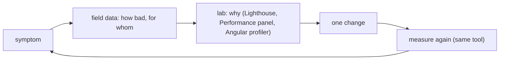

What to notice: the loop starts and ends with the same measurement; a change without a before and an after is a guess.

### How it actually works

**Where the Angular docs start.** The [performance overview](https://angular.dev/best-practices/performance) (read 2026-10-13) groups advice into loading, runtime and measuring: "If you are unsure where to start, profile your application first using the Chrome DevTools Angular track".

**Debugging tools need a development build** ([12 §5](12-angular-how-it-works.md#5-the-dev-loop-ng-serve-hot-module-replacement-and-angular-devtools), [Q12.13](12-angular-how-it-works.md#q12-13)). Why? Read from `@angular/core` 22.2.1 (`fesm2022/_debug_node-chunk.mjs`, read, not run): `publishDefaultGlobalUtils` (internal) is `ngDevMode && publishDefaultGlobalUtils$1()`, and only the inner function writes the `ng` global. In the lab the production page loads a hashed `main-<hash>.js` and has no `window.ng` (`Section 1: the production build ships hashed files that the dev tools cannot inspect`). The development build adds checks and skips minification, so load numbers come from the production build, which this module's browser tests run.

**What the lab cannot see.** A load without interaction has no INP; real devices, networks and the 75th percentile exist only in the field. The `web-vitals` library measures metrics "on real users, in a way that accurately matches how they're measured by Chrome" (`web-vitals` 6.2.3 `README.md`); injected before the page's scripts, it reports LCP and CLS here with no interaction (`Section 1: web-vitals reports LCP and CLS for the module-31 landing page`).

**The build measures load size.** Read from `@angular/build` 22.2.1: `src/builders/application/schema.json` describes `statsJson` as "Generates a 'stats.json' file which can be analyzed with https://esbuild.github.io/analyze/."; `normalizeOptions` maps it to `stats`, and `executeBuild` writes the metafile as `browser-stats.json` at the output root. [§6](#6-bundle-analysis-budgets-and-tree-shaking-pitfalls) reads it.

Drilled in [Q31.01](#q31-01) and [Q31.02](#q31-02).

### Code

The approach: prove the lab runs what ships, then read field metrics in it.

1. Check the served HTML for a hashed `main` bundle.
2. Open the page; the `ng` global is absent.
3. Second test: read the `web-vitals` IIFE from disk, inject it with `addInitScript` and assign it to `window`.
4. Register `onLCP` and `onCLS`; assert the names and finite values, never a threshold.

```ts
// Excerpt of labs/e2e/tests/31-performance/concepts/section-1-measure-first.spec.ts
/** Injects web-vitals before the page's own scripts and exposes it as `window.webVitals`. */
async function injectWebVitals(page: Page): Promise<void> {
  const iife = await readFile(WEB_VITALS_IIFE, 'utf8');
  // `addInitScript({ path })` keeps the IIFE's top-level `var` inside Playwright's wrapper, so assign it explicitly.
  await page.addInitScript({ content: `${iife};window.webVitals = webVitals;` });
}

test('Section 1: the production build ships hashed files that the dev tools cannot inspect', async ({ page }) => {
  const html = await (await page.request.get('/m31/home')).text();
  expect(html).toMatch(/<script src="main-[A-Z0-9]{8}\.js" type="module"><\/script>/);

  await page.goto('/m31/home');
  await expect(page.getByRole('heading', { name: 'Module 31 lab' })).toBeVisible();
  const ngGlobal = await page.evaluate(() => typeof Reflect.get(window, 'ng'));
  expect(ngGlobal).toBe('undefined');
});
```

### Best practices and anti-patterns

- **Record a baseline before changing code**, because without one nobody can tell a fix from a regression.
- **Change one thing per measurement**, because two changes at once leave the result without an owner.
- **Start from field data when you have it**, because it names the pages and users that hurt.
- **Avoid asserting durations in CI**, because they vary by machine; assert structure ([§2](#2-lab-metrics-in-a-real-browser-performance-observers-devtools-protocol-counters-and-lighthouse-in-ci)).

### Misconceptions and traps

- *"Optimize first, measure later."* Without a baseline no result can be judged. Known practices feel safe to apply blind.
- *"A Lighthouse score is the user's experience."* It is one controlled load; users are field data. The score looks like a verdict.
- *"Profile in development, ship the numbers."* Development builds add checks and skip minification. The habit exists because the debugging tools work there.
- *"The Angular profiler finds every slowdown."* It sees change detection and hooks, not network, layout, paint or third-party scripts; the Performance panel does. It is the Angular-specific tool, so it gets the blame-finding role.

## 2. Lab metrics in a real browser: performance observers, DevTools Protocol counters and Lighthouse in CI

### The problem it solves

A team wants CI to fail when a change delays the hero or makes content jump. [08 §6](08-browser-rendering-dom-events.md#6-core-web-vitals-lcp-inp-and-cls) could only describe LCP and CLS, because jsdom has no layout; a real browser can report them. Another team gates merges on "Lighthouse above 90" and gets a pipeline that fails at random.

### Mental model

A real browser records metrics as **performance entries**: objects with a name, a type and a time, one per event such as a paint or a layout shift. A **`PerformanceObserver`** subscribes to one entry type; with `buffered: true` it also receives **buffered entries**, those recorded before it existed, so a test can attach late. Engine counters come through the **Chrome DevTools Protocol (CDP)**, the command channel DevTools itself uses; a **CDP session** is one attached connection to a page. A test asserts stable structure (which element, whether a shift happened, how many nodes), never durations. Analogy: a building's sensors (entries) versus an annual inspection report (Lighthouse).

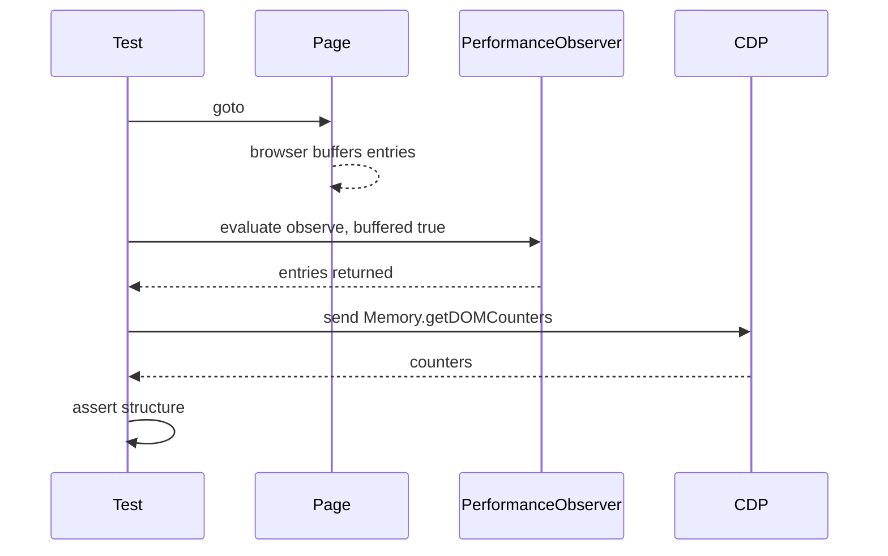

What to notice: the test reads what the browser recorded; it never times anything itself.

### How it actually works

**The LCP rule.** The largest element so far is the candidate and a larger, later one replaces it, but only until the user acts. The W3C spec (Editor's Draft, read 2026-10-14): "The algorithm halts when it detects certain types of user inputs." web.dev (read 2026-10-14): the browser will "stop reporting new entries as soon as the user interacts with the page (via a tap, scroll, or keypress)". The definition is module 08's. In the lab a heading paints, a key is pressed, a far larger paragraph is added, and every reported entry still names `H1` (`Section 2: the LCP entry names the largest element painted before input`).

**Layout shifts.** A banner inserted above painted content yields a `layout-shift` entry with `hadRecentInput` false, since the test pressed nothing (`Section 2: content inserted above the fold produces a layout-shift entry`). The same banner inside a slot of the same height yields none and leaves the content's box where it was (`Section 2: reserved space produces no layout-shift entry`).

**Slow frames and interactions.** A **long animation frame** is a rendering update that takes more than 50 ms ([LoAF spec](https://w3c.github.io/long-animation-frames/)); `event` entries time single interactions, by default only those of 104 ms or more ([Event Timing](https://w3c.github.io/event-timing/)): the lab's view of slow input.

**CDP counters.** After forced garbage collection, 25 inserted `div`s raise `Memory.getDOMCounters().nodes` by exactly 25 (`Section 2: the CDP counters report the page's DOM nodes`). Why Chromium only? Read from `playwright-core` 1.63.0, `types/types.d.ts`, `newCDPSession`: "**NOTE** CDP sessions are only supported on Chromium-based browsers."

**Lighthouse in CI.** `runLighthouse()` returns a report whose performance score and LCP audit value are numbers on the landing page (`Section 2: Lighthouse reports a performance category and the LCP audit for the landing page`; types only). **Lighthouse CI** runs Lighthouse in a pipeline; its **assertions** are per-audit checks such as `["error", {"minScore": 0.8}]` or `["warn", {"maxNumericValue": 4000}]`. Its `numberOfRuns` option (default 3) "helps mitigate fluctuations due to natural page variability" (Lighthouse CI configuration docs, read 2026-10-14; documented, not run here). A bytes gate is the build's budget ([§6](#6-bundle-analysis-budgets-and-tree-shaking-pitfalls), [Q12.08](12-angular-how-it-works.md#q12-08)); these tests belong to the end-to-end stage ([30 §8](30-e2e-and-testing-strategy.md#8-ci-strategy-for-end-to-end-tests-workers-sharding-retries-policy-and-test-data)).

Drilled in [Q31.03](#q31-03), [Q31.04](#q31-04) and [Q31.05](#q31-05).

### Code

The approach: serve a tiny page, let the browser record, then assert names and counts.

1. `servePage` fulfills a made-up URL of the lab's origin and navigates to it, so the browser records a real load.
2. `firstEntry` waits until the first LCP entry exists.
3. Press a key, add the larger block, wait two frames.
4. Read the buffered entries and assert the element names, never a time.

```ts
// Excerpt of labs/e2e/tests/31-performance/concepts/section-2-lab-metrics.spec.ts
/** Serves a made-up HTML page from the lab's own origin and navigates to it (a real navigation, so LCP and layout shifts are recorded). */
async function servePage(page: Page, name: string, body: string): Promise<void> {
  const url = `${ORIGIN}/__m31/${name}`;
  await page.route(url, (route) => route.fulfill({ contentType: 'text/html', body }));
  await page.goto(url);
}

test('Section 2: the LCP entry names the largest element painted before input', async ({ page }) => {
  await servePage(page, 'lcp', '<!doctype html><title>lcp</title><h1>Small heading</h1>');
  await firstEntry(page, 'largest-contentful-paint');

  await page.keyboard.press('a');
  await page.evaluate(() => {
    const block = document.createElement('p');
    block.id = 'late';
    block.textContent = 'A much larger block of text. '.repeat(400);
    document.body.append(block);
  });
  await afterFrames(page);

  await expect(page.locator('#late')).toBeVisible();
  const entries = await collectEntries(page, 'largest-contentful-paint');
  expect(entries.length).toBeGreaterThan(0);
  expect(entries.map((entry) => entry.element)).toEqual(entries.map(() => 'H1'));
});
```

### Best practices and anti-patterns

- **Assert entry names, elements and counts**, because values and times differ per machine.
- **Wait for the first paint before changing the page**, because a shift needs painted content.
- **Gate Lighthouse CI on chosen audits, run several times**, because one score moves between runs.
- **Avoid CDP in tests meant for all browsers**, because the session is Chromium-only.

### Misconceptions and traps

- *"Lighthouse in CI is a reliable pass/fail gate on its score."* Assert audits or budgets over several runs. One number is easy to gate, but the docs' own `numberOfRuns` exists because results fluctuate.
- *"A test can measure INP."* INP is a field metric over a whole visit (08 §6); a load without interaction has none ([§1](#1-measure-first-the-loop-lab-versus-field-and-what-each-tool-answers)). It sounds like any other metric a test could read.
- *"CDP works in every browser."* Only Chromium. Playwright drives three browsers, so its API looks uniform, but `newCDPSession` is Chromium-only per its typings.
- *"The LCP entry list ends with the biggest element on the page."* It ends with the biggest one painted before input. Later content looks like it should count.

## 3. Runtime cost of a change: OnPush, zoneless, signals and per-check template work

### The problem it solves

A search box is slow: a template method filters 5,000 rows on every check of its view, not once per keystroke. A clock widget opted into `Eager` is checked whenever a refresh passes through it ([Q21.07](21-change-detection.md#q21-07)). A zoneless app still wraps every timer in `runOutsideAngular`, with no zone to leave.

### Mental model

The cost of a change is **views checked × work per check**. v22 shrinks the first factor by default: zoneless scheduling (`provideZonelessChangeDetection` [Stable since v20.2]) refreshes only after a notification, and a component without a `changeDetection` property is OnPush [Changed in v22.0: "Component with undefined `changeDetection` property are now `OnPush` by default"], so only views marked by a signal, an input or an event refresh ([21 §2](21-change-detection.md#2-onpush-and-eager-strategies-and-what-marks-a-view-dirty)). What remains is **per-check work**: whatever a view's template expressions and hooks compute each time Angular checks it. A template method runs every check; a pure pipe, only when an input changes ([14 §5](14-directives-and-pipes.md#5-pipes-pure-and-impure-custom-pipes-injection-and-imports)); a `computed`, Angular's **derived state** (a value calculated from other signals, [17](17-signals.md)), only when a signal it read changed. Analogy: motion-sensor lights (OnPush, zoneless) still waste power if each lit room runs a space heater.

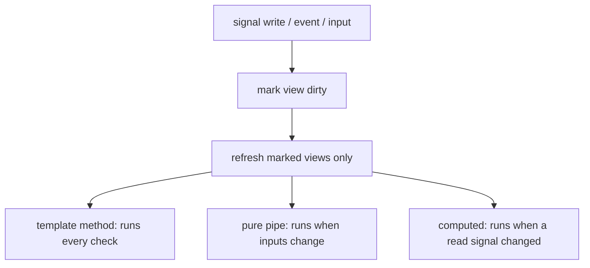

What to notice: the defaults shrink how many views run; only you can shrink what each run does.

### How it actually works

**Per-check work, counted.** The lab's dashboard computes one filter over 100 rows three ways. Three writes to an unrelated `clock` signal run the template method 3 times (`Section 3: a template method runs on every check of its view`) and the `computed` 0 times; a new `query` runs it once (`Section 3: a computed over the rows does not run when an unrelated signal changes`). The pure pipe runs 0 times for those writes and for an in-place `push`, leaving its total stale, then once for a new array (`Section 3: a pure pipe runs again only when its input reference changes`). Choosing among the three is [14 §7](14-directives-and-pipes.md#7-pipe-computed-or-method-call-in-a-template)'s topic ([Q14.24](14-directives-and-pipes.md#q14-24), [Q14.25](14-directives-and-pipes.md#q14-25), [Q17.07](17-signals.md#q17-07)).

**Why a clean `computed` is cheap.** Read from `@angular/core` 22.2.1, `fesm2022/_effect-chunk.mjs`: the getter from `createComputed` first calls `producerUpdateValueVersion` (internal; may change in any release), which returns early for a live node that is not dirty, and otherwise calls `producerRecomputeValue` only if `consumerPollProducersForChange` finds a changed producer. The graph is [17 §9](17-signals.md#9-under-the-hood-the-reactive-graph)'s.

**Memoization at store scale.** **Memoization** is returning a stored result while the inputs are unchanged; a `computed` stores one value, and "pure pipes preserve only the last result" ([slow computations](https://angular.dev/best-practices/slow-computations), read 2026-10-14). A **list-wide selector** is one derivation over a whole collection ([28](28-state-management.md)). Renaming one of 100 entities makes it format all 100 again (`Section 3: one changed entity re-runs a list-wide selector over all rows`). With a `computed` per row, `@for` tracked by id ([18 §2](18-control-flow-and-defer.md#2-for-track-context-variables-empty-and-what-angular-can-iterate)) hands 99 rows the same object and one `computed` runs (`Section 3: one changed entity re-runs only that row's computed`).

**What the docs add.** Each check also runs hooks such as `ngDoCheck`, so heavy hook code is per-check work ([20](20-lifecycle-and-render-hooks.md)). An event in an `Eager` component checks the whole tree, still skipping OnPush subtrees without new inputs ([skipping subtrees](https://angular.dev/best-practices/skipping-subtrees), read 2026-10-14).

Drilled in [Q31.06](#q31-06), [Q31.07](#q31-07) and [Q31.08](#q31-08); practiced in [Exercise 31.1](#ex31-1).

### Code

The approach: count each kind of per-check work, then change something none of it depends on.

1. `LabM31RunCounter` (lab instrumentation) counts each kind of work.
2. The dashboard reads `clock` and `matches()`, calls `matchCount()` and pipes `rows()`.
3. `renderDashboard` renders, waits and resets the counts.
4. The test writes `clock` three times, then `query`, asserting counts.

```ts
// Excerpt of labs/angular/src/app/modules/31-performance/concepts/dashboard.ts
export class LabM31Dashboard {
  private readonly runs = inject(LabM31RunCounter);
  readonly rows = signal<LabM31Row[]>(makeRows(LAB_M31_ROW_COUNT));
  readonly query = signal('');
  readonly clock = signal(0);

  readonly matches = computed(() => {
    this.runs.computed++;
    return filterRows(this.rows(), this.query());
  });

  protected matchCount(): number {
    this.runs.method++;
    return filterRows(this.rows(), this.query()).length;
  }
}
```

```ts
// Excerpt of labs/angular/src/app/modules/31-performance/concepts/section-3-runtime-cost.spec.ts
  it('Section 3: a computed over the rows does not run when an unrelated signal changes', async () => {
    const fixture = await renderDashboard();
    const runs = TestBed.inject(LabM31RunCounter);

    await tickClock(fixture, 3);
    expect(runs.computed).toBe(0);

    fixture.componentInstance.query.set('Row 1');
    await fixture.whenStable();
    expect(runs.computed).toBe(1);
  });
```

#### Legacy

Zone-era code carries a checklist written when zone.js triggered a check after every async task.

```ts
// Partial: legacy zone-era component; imports, the Order type and NgFor in `imports` omitted
@Component({
  selector: 'app-orders',
  changeDetection: ChangeDetectionStrategy.OnPush,
  template: `<p *ngFor="let order of orders; trackBy: byId">{{ order.total }}</p>`,
})
export class Orders {
  orders: Order[] = [];

  constructor() {
    inject(NgZone).runOutsideAngular(() => setInterval(() => this.poll(), 1000));
  }

  byId(_index: number, order: Order): number {
    return order.id;
  }

  private poll(): void {}
}
```

Hand-written OnPush skipped unmarked subtrees; v22 makes it the default (marker above). `trackBy` was optional on `*ngFor`; `@for` requires `track`. `runOutsideAngular` escapes nothing without zone.js. Migration: `ng generate @angular/core:control-flow` ([18 §8](18-control-flow-and-defer.md#8-migrating-with-ng-generate-angularcorecontrol-flow)), drop zone.js as [21 §6](21-change-detection.md#6-migrating-a-zone-based-app-to-zoneless) describes, then remove the wrappers.

### Best practices and anti-patterns

- **Keep template expressions to signal and `computed` reads**, because a method runs on every check of its view.
- **Put a heavy derivation in one `computed` or a pure pipe**, because both skip the work while inputs are unchanged.
- **Derive per row when single entities change in a long list**, because a list-wide selector repeats every row's work.
- **Fix the algorithm before caching it**, because the docs call that "the recommended approach".

### Misconceptions and traps

- *"OnPush everywhere is the main performance fix."* Once true until v22, when components without a strategy were checked on every pass, hence the advice. Now OnPush is the default; per-check work remains.
- *"Signals make an app fast automatically."* They make updates precise, but a slow `computed` is still slow when it runs; the myth comes from losing whole-tree checks.
- *"`runOutsideAngular` speeds up a zoneless app."* There is no zone to leave; the habit comes from zone apps, where it kept timers from triggering checks.
- *"Memoize everything."* The docs warn: "The memory overhead of memoization could be significant". It seems free because the cache is invisible; memoize where the derivation is expensive or shared.

## 4. Long lists: `track`, virtual scrolling with the CDK, and the alternatives

### The problem it solves

A log page renders 10,000 rows: the first paint takes seconds and scrolling stutters. After virtual scrolling the rows jump because their heights vary, and a teammate's `track $index` makes every sort recreate all rows ([18 §2](18-control-flow-and-defer.md#2-for-track-context-variables-empty-and-what-angular-can-iterate)).

### Mental model

With `@for`, the DOM holds every row. A good `track` makes updates cheap ([Q18.05](18-control-flow-and-defer.md#q18-05) shows which nodes survive), but not the first render or the memory. **Virtual scrolling** (also called windowing) keeps only the rows in and near the viewport in the DOM. The **rendered range** is the pair `start..end` of item indexes that currently have a row. A **buffer** is the extra distance rendered beyond the viewport on each side, with a minimum and a maximum. A **spacer** is an empty element sized to the whole list, so the scrollbar behaves as if every row existed. Analogy: a theatre's revolving stage builds only the scenes facing the audience; the script (the data) stays complete.

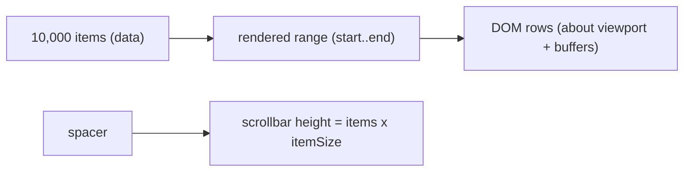

What to notice: the DOM size follows the viewport and the buffers, not the data.

### How it actually works

**Plain `@for`.** The lab renders all 10,000 rows (`Section 4: a plain @for list holds every row in the DOM`).

**The rendered range.** The CDK's fixed-size strategy is `FixedSizeVirtualScrollStrategy`; its directive `CdkFixedSizeVirtualScroll` defaults to `minBufferPx` 100 and `maxBufferPx` 200 (`@angular/cdk` 22.2.1, `fesm2022/scrolling.mjs`). Why does the row count stay bounded? Its `_updateRenderedRange` (internal) computes `firstVisibleIndex = scrollOffset / itemSize`. Only when the buffer past the viewport falls below `minBufferPx` does it extend the end by `ceil((maxBufferPx - endBuffer) / itemSize)`. At the top, `end = ceil((200 + 400) / 40) = 15`, and the page shows rows 0 to 14 (`Section 4: the virtual viewport holds only the rendered range`). After `scrollToIndex(5000)` the range is 4997 to 5015: 18 rows, and `Row 5000` is visible (`Section 4: scrolling to an index renders that row and keeps the DOM bounded`). The test reads the range through a lab hook on `window`.

**The spacer.** The viewport's template holds a `cdk-virtual-scroll-spacer` element whose height is `getDataLength() * itemSize`, set by `setTotalContentSize`; the rendered rows sit in a wrapper shifted by `itemSize * start`. The viewport's `scrollHeight` is 400,000 (`Section 4: the spacer gives the scrollbar the full list height`). That is why `itemSize` is a contract: the sums assume every row has exactly that height ([Q31.11](#q31-11)), and other strategies belong to [36](36-material-and-cdk.md).

**Row recycling.** `CdkVirtualForOf` (`*cdkVirtualFor`) uses `_RecycleViewRepeaterStrategy` (internal, `_recycle-view-repeater-strategy-chunk.mjs`). A row that leaves the range is detached into a **template cache** of `viewCacheSize` views, 20 by default (`cdkVirtualForTemplateCacheSize`), and the next row that enters takes one and gets a new `$implicit`. This is **row recycling**; it is read, not run. The consequence: a row component's own fields can show another item's data, so state belongs in the data.

**Alternatives.** Pagination shows one page of rows. Infinite loading adds rows over time, all staying in the DOM. **`content-visibility: auto`** keeps every node but lets the browser "potentially omit large swathes of layout and rendering work until it becomes needed" (MDN, read 2026-10-14); [10](10-css-essentials.md) owns containment. Accessibility: with 15 rows in the DOM, assistive technology cannot learn the list's size; MDN says `aria-setsize` "defines the number of items in the current set of listitems or treeitems when not all items in the set are present in the DOM".

Drilled in [Q31.09](#q31-09), [Q31.10](#q31-10) and [Exercise 31.2](#ex31-2).

### Code

The approach: one page, two variants of the same 10,000 rows, and a hook for the test.

1. `makeRows` builds rows with stable ids.
2. The default branch renders the viewport with `itemSize` 40; `?mode=for` renders a plain `@for`.
3. After the first render the component exposes `getRenderedRange` and `scrollToIndex` on `window`.
4. The test reads the range and counts `.row` elements.

```ts
// Excerpt of labs/angular/src/app/modules/31-performance/demo/long-list.ts
export class LabM31LongList {
  protected readonly items = makeRows(ROW_COUNT);
  protected readonly rowHeight = ROW_HEIGHT_PX;
  protected readonly plain = inject(ActivatedRoute).snapshot.queryParamMap.get('mode') === PLAIN_MODE;
  private readonly viewport = viewChild(CdkVirtualScrollViewport);

  constructor() {
    // Lab instrumentation, not application code: a test cannot reach the viewport instance
    // through the DOM, so the page exposes the two calls the module's tests need.
    afterNextRender(() => {
      const viewport = this.viewport();
      if (!viewport) return;
      Reflect.set(window, HOOK_NAME, {
        getRenderedRange: () => viewport.getRenderedRange(),
        scrollToIndex: (index: number) => viewport.scrollToIndex(index),
      });
    });
    inject(DestroyRef).onDestroy(() => Reflect.deleteProperty(window, HOOK_NAME));
  }
}
```

### Best practices and anti-patterns

- **Give the viewport a height and the rows one fixed height**, because the spacer and offsets are computed from `itemSize`.
- **Keep row state in the data, keyed by id**, because recycled rows are reused for other items.
- **Choose pagination when find-in-page or an exact screen-reader count matters**, because virtualized rows do not exist until scrolled to.

### Misconceptions and traps

- *"Virtual scrolling fixes every long list."* It fixes DOM size only. It breaks find-in-page, variable heights and some screen-reader expectations, so pagination can win; it sounds like a free upgrade.
- *"`track` makes a 10,000-row list fast."* It makes updates cheap; the first render still creates every row, because `track` only matches old rows to new ones.
- *"`content-visibility: auto` is virtual scrolling in CSS."* Both skip off-screen work, but the nodes still exist and use memory.
- *"A virtualized row keeps its own state."* It looks like an ordinary child, but rows are reused for other items, so state belongs in the data.

## 5. Loading: the initial bundle, lazy routes, `@defer` and preloading as one plan

### The problem it solves

One landing page downloads the admin area's chart library. Another app lazy-loads everything, so every click waits for a download. A third prefetches every `@defer` block on idle, and a phone's data plan pays.

### Mental model

A **loading plan** decides when each piece of code downloads. A **chunk** is one JavaScript file the build emits. The **initial bundle** is the files the first view needs; every other file is a **lazy chunk**, fetched later through `import()`. Only the initial bundle is on the **critical path**, the work done before the first view appears ([08 §1](08-browser-rendering-dom-events.md#1-the-critical-rendering-path-from-bytes-to-pixels)). Lazy code has two homes: **lazy routes**, whole areas fetched on navigation ([24 §4](24-routing.md#4-lazy-loading-in-depth-loaders-canmatch-and-route-injectors)), and **`@defer` blocks**, parts of a page fetched on a trigger ([18 §5](18-control-flow-and-defer.md#5-defer-blocks-and-states-placeholder-loading-error-minimum-and-after)). **Preloading** fetches route chunks early ([24 §8](24-routing.md#8-preloading-strategies-and-route-reuse)); **prefetching** fetches a `@defer` chunk on an earlier trigger ([18 §6](18-control-flow-and-defer.md#6-triggers-and-prefetching)). Analogy: packing for a trip. The carry-on is the initial bundle, bags collected on arrival are lazy routes, a box shipped on request is `@defer`, and a box sent ahead is preloading.

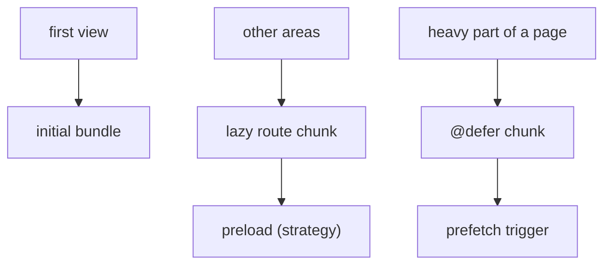

What to notice: every arrow is a choice about **when** bytes move.

### How it actually works

**The docs' tools.** Angular's performance overview lists lazy routes ("Defers loading route components until navigation, reducing the initial bundle size"), `@defer` ("Splits components into separate bundles that load on demand") and `injectAsync` [Added in v22.0], a service loaded on first call ([16 §4](16-dependency-injection.md#4-the-injection-context-inject-runininjectioncontext-and-injectasync)) (angular.dev, `main`, read 2026-10-14).

**Lazy routes.** `loadComponent` and `loadChildren` wrap `import()`. `ng build --stats-json` writes `browser-stats.json`, an esbuild metafile listing each output file with its inputs and imports. There, the module-31 `routes.ts` sits in a `chunk-*.js`, and `main-*.js` reaches it only through a `dynamic-import`, never statically (`Section 5: the module-31 lazy route is not part of the initial files`).

**Why a lazy chunk escapes the `initial` budget.** Read from `@angular/build` 22.2.1 (read, not run): `executeBuild` in `src/builders/application/execute-build.js` gets `initialFiles` (internal) from the bundler, the files the first load needs, and passes it to `generateBudgetStats` (internal, `src/tools/esbuild/budget-stats.js`), which marks an output `initial` only if it has a record there. A file reached only through `import()` has none, so the `initial` budget and the summary's "Initial Total" skip it.

**`@defer` chunks.** The compiler turns each dependency used only inside the block into a dynamic `import()` ([18 §7](18-control-flow-and-defer.md#7-what-lands-in-a-chunk-testing-deferred-blocks-and-the-ssr-pointer)). In the lab, no new chunk is requested while the page sits idle; clicking the trigger button requests one, and the report replaces the placeholder (`Section 5: the deferred block's chunk is requested only after the trigger`). [Q18.16](18-control-flow-and-defer.md#q18-16) chooses triggers per block.

**Outside the router and templates**, a service can await `import()` of a chart library when a report opens ([Q05.08](05-js-modules-memory-modern-features.md#q05-08)). **Preloading** strategies decide which route chunks download after the first navigation ([Q24.28](24-routing.md#q24-28)): the wait leaves the click, the bytes stay.

Drilled in [Q31.12](#q31-12) and [Q31.13](#q31-13).

### Code

The approach: defer the page's heavy part until the user asks for it.

1. `LabM31HeavyPanel` renders a report table; only the `@defer` block references it.
2. The button's template reference `#showReport` names the trigger in `on interaction(showReport)`.
3. The `@placeholder` shows until the click.
4. The test records chunk requests before and after the click.

```ts
// Excerpt of labs/angular/src/app/modules/31-performance/demo/loading.ts
@Component({
  selector: 'lab-m31-loading',
  imports: [LabM31HeavyPanel],
  template: `
    <h1>Loading lab</h1>
    <button type="button" #showReport>Show the quarterly report</button>
    @defer (on interaction(showReport)) {
      <lab-m31-heavy-panel />
    } @placeholder {
      <p>The report loads when you ask for it.</p>
    }
  `,
})
export class LabM31Loading {}
```

> [!NOTE]
> **Framework vs platform.** The platform supplies dynamic `import()`, "a function-like expression that allows loading an ECMAScript module asynchronously and dynamically" (MDN, read 2026-10-14). The bundler turns each `import()` target into a chunk. Angular adds when to call it: the router on navigation, the compiler's code for `@defer` on its trigger.

### Best practices and anti-patterns

- **Keep only the first view in the initial bundle**, because every initial byte is on every visit's critical path.
- **Split areas by route and page parts by `@defer`**, because a route also owns a URL and guards.
- **Prefetch only what the user likely needs next**, because early fetching costs bandwidth on every visit.
- **Check the split in the build output**, because one static import elsewhere makes a lazy target eager silently.

### Misconceptions and traps

- *"Lazy-load everything."* Each lazy boundary adds a wait at use unless preloaded; the myth exists because teams watch initial size.
- *"`@defer` replaces lazy routes."* Routes split areas and own URLs and guards; `@defer` splits one view. Both split code, hence the confusion.
- *"Preloading is free."* It does not delay the first view, but it spends bandwidth and CPU; it looks free because nobody waits for it.
- *"A dynamic `import()` always makes a chunk."* A static import of the same module in the initial graph keeps it initial, as [Q18.18](18-control-flow-and-defer.md#q18-18) shows for `@defer`; the myth holds because usually it does.

## 6. Bundle analysis, budgets and tree-shaking pitfalls

### The problem it solves

CI fails with "budget initial was not met". Someone raises the limit, and three months later the initial bundle has doubled. Elsewhere a team imports one function from a utility barrel and ships the whole folder. Both need one answer: what is in the output, and who asked for it.

### Mental model

A **budget** is a size limit that warns or fails the build when crossed ([12 §3](12-angular-how-it-works.md#3-building-the-application-builder-output-layout-and-budgets) owns setup, [Q12.08](12-angular-how-it-works.md#q12-08) the thresholds). `ng build --stats-json` writes a **metafile**, a JSON description of the build: for every output file, the input modules inside it and the bytes each contributed (**`bytesInOutput`**), and for every input, what it imports. An **importer chain** is the path of imports from an entry to a module; it says who asked for the code. **Tree-shaking** drops exports nothing uses, but only when the bundler can prove that dropping them changes nothing. A **side effect**, in the module sense, is a top-level statement that does something when the file loads, such as writing to a global; a **CommonJS** dependency (the older `require` format) defeats the proof too ([Q05.07](05-js-modules-memory-modern-features.md#q05-07)). A **barrel file** is an `index.ts` that only re-exports other modules ([Q18.18](18-control-flow-and-defer.md#q18-18)). Analogy: a moving company's inventory, saying which box came from which room and who ordered it.

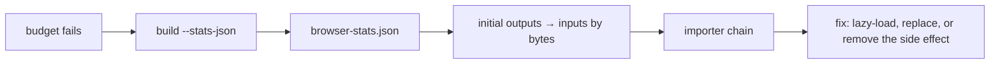

What to notice: the importer chain, not the size list, tells you what to change.

### How it actually works

**Reading the metafile.** esbuild 0.28.2's typings declare `outputs[path].inputs[path].bytesInOutput`, `outputs[path].entryPoint` and `inputs[path].imports` (`lib/main.d.ts`, `Metafile`, read only). In the lab, the initial outputs list `@angular/core` inputs and no fixture module (`Section 6: the stats file lists the initial outputs and their inputs`), and the chain from `main-*.js` to the chunk holding the module-31 `routes.ts` starts with a `dynamic-import` (`Section 6: the importer chain leads from main to the module-31 routes file`).

**Why an ordinary build has no file.** Read, not run (`@angular/build` 22.2.1, `execute-build.js`): `executeBuild` adds `browser-stats.json` only when `options.stats` is set, and `statsJson` defaults to `false`.

**Two other analyzers, documented only.** The `statsJson` description names esbuild's online analyzer: "Generates a 'stats.json' file which can be analyzed with https://esbuild.github.io/analyze/." source-map-explorer's README says it "determines which file each byte in your minified code came from" (`master`, read 2026-10-14), by reading a **source map**, a file mapping minified output back to its sources. The metafile is esbuild's own count per input, so the two can differ. Neither tool is installed in the labs. Both count bytes before compression; delivery belongs to [09](09-web-networking-storage-security.md) and [44](44-fullstack-delivery-and-operations.md#3-nginx-for-a-single-page-app-location-matching-the-try_files-fallback-caching-headers-for-hashed-assets-and-gzip-or-brotli).

**What survives.** The page `m31/tree-shaking` imports one name through a four-module barrel. In the production build, the unused pure function's marker string appears in no built file, because removing it provably changes nothing (`Section 6: an unused pure export is absent from the production chunk`). The side-effect module's marker is present, in a lazy chunk, because its statement must still run, and so is the static block's (`Section 6: a module with a top-level side effect stays in the chunk although nothing uses its export`). Providers are [Q16.07](16-dependency-injection.md#q16-07)'s.

**CommonJS and the budget.** `allowedCommonJsDependencies` is "A list of CommonJS or AMD packages that are allowed to be used without a build time warning. Use `'*'` to allow all." (`schema.json`, read 2026-10-14); allowing a package silences the warning only. The `initial` budget "measures the JavaScript and CSS used to bootstrap the application" (angular.dev, read 2026-10-13), so the lazy fixture does not count.

Drilled in [Q31.14](#q31-14), [Q31.15](#q31-15), [Q31.16](#q31-16), [Q31.17](#q31-17) and [Exercise 31.3](#ex31-3).

### Code

The approach: give each tree-shaking rule one marker string, then search the build for it.

1. Each fixture module under `demo/tree-shaking/` holds one unique marker.
2. `index.ts` re-exports all four; the page imports only `usedGreeting`.
3. The side-effect module writes its marker to the global object with `Reflect.set` (lab instrumentation).
4. The spec reads each built `.js` through `distFile` and lists the files containing a marker.

```ts
// Excerpt of labs/e2e/tests/31-performance/concepts/section-6-bundle-analysis.spec.ts
test('Section 6: an unused pure export is absent from the production chunk', async () => {
  const outputs = await readOutputs();

  expect(await scriptsContaining(outputs, MARKER_USED)).not.toHaveLength(0);
  expect(await scriptsContaining(outputs, MARKER_UNUSED_PURE)).toHaveLength(0);
});
```

### Best practices and anti-patterns

- **Find the importer chain before touching a budget**, because the limit only says something grew.
- **Import from the file, not the barrel, in code you lazy-load**, because a barrel ties every module's side effects to one import.
- **Keep top-level statements out of library modules**, because a bundler cannot remove them.
- **Check the build output**, because the source reads the same whether or not the code shipped.

### Misconceptions and traps

- *"Raise the budget when it fails."* The budget did its job; find what grew first. The myth survives because the build is red and the fix is one line.
- *"Tree-shaking removes everything unused."* It removes only what it proves side-effect free; the name suggests all.
- *"A barrel file costs nothing."* It looks free as plain re-exports, but one import ties every re-exported module's side effects to it.
- *"The analyzer's sizes are what users download."* They are bytes before compression; the numbers look like download sizes because they are in kilobytes.

## 7. Images: `NgOptimizedImage` with priority, `fill`, loaders and placeholders

### The problem it solves

The hero, the page's largest element, loads late like every image. Product images without dimensions push text down as they arrive. A 4000 px photo goes to a 360 px phone. Each fix is one easily forgotten attribute.

### Mental model

The **LCP element** is the element the browser reports as the page's largest paint ([08 §6](08-browser-rendering-dom-events.md#6-core-web-vitals-lcp-inp-and-cls)). `NgOptimizedImage`, the directive behind ``, turns image advice into defaults. The **priority** image, the one you expect to be the LCP element, gets `fetchpriority="high"` (a hint of fetch urgency), `loading="eager"` and `decoding="sync"`; every other image is lazy. `width` and `height` are required so the browser reserves space, unless **`fill` mode** is on: the image takes its parent's box, so the parent must be positioned. An **image loader** builds a URL for a requested width; an **image CDN** serves resized images at such URLs. With a loader the directive writes a `srcset` (candidate files to choose from): **density descriptors** (`1x`, `2x`) without `sizes` (the rendered width the page expects), **width descriptors** (`640w`), one per configured breakpoint, with it. A **placeholder** is a small image shown until the real one loads. **Preconnect** opens a connection to another origin early. Analogy: a stage manager who seats the star first, reserves every seat and hands each guest a programme sized to their eyesight.

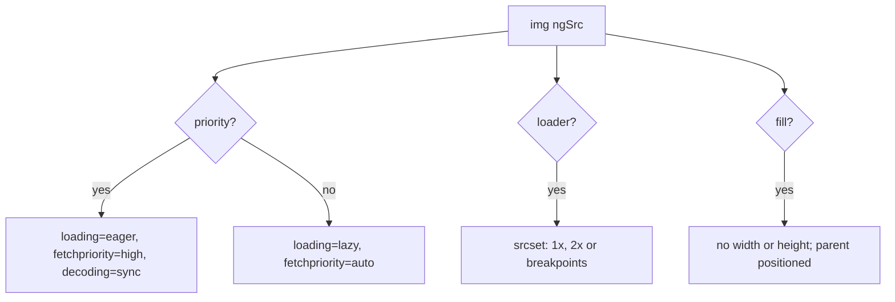

What to notice: every output is a plain HTML attribute the browser already understands.

### How it actually works

**Why `eager` is not `priority`.** Read from `@angular/common` 22.2.1, `fesm2022/common.mjs`, `NgOptimizedImage` (internal methods): `getLoadingBehavior()` returns the `loading` input only when `priority` is false; `getFetchPriority()` reads `priority` alone; `getDecoding()` returns `'sync'` for priority, else `decoding` or `'auto'`. So `loading="eager"` alone leaves the other two at `auto`. The tests render a priority image (eager, high, sync) and a plain one (lazy, auto, auto) (`Section 7: a priority image is eager with high fetch priority and sync decoding`, `Section 7: a non-priority image is lazy with auto fetch priority`).

**Where `srcset` comes from.** `getFixedSrcset()` multiplies the width by `[1, 2]`; `getResponsiveSrcset()` calls the loader for each `IMAGE_CONFIG` breakpoint, only those `>= 640` when `sizes` is exactly `100vw`. With a loader returning `cdn/<src>?w=<width>`, a 300 px image gets `1x` and `2x` entries, breakpoints `[320, 640, 960]` with `sizes="50vw"` give three, and `100vw` leaves two (`Section 7: a custom loader produces a 1x and 2x srcset`, `Section 7: sizes produces one srcset entry per configured breakpoint`, `Section 7: sizes of 100vw drops breakpoints below 640`). A `fill` image renders no `width` or `height` (`Section 7: a fill image renders without width and height attributes`).

**Development mode only.** A missing `width` and `height` throws `NG02954` (`Section 7: an ngSrc without width and height throws in development`). A dev-only `LCPImageObserver` logs `NG02955` when the LCP element is an image without `priority`; it creates its `PerformanceObserver` only if one exists (read, not run). Production builds omit these checks, so browser tests on the production build never see them.

**In the browser.** On the landing page the LCP entries are the heading, then the hero image (5 of 5 runs); the last entry's element is `IMG` (`Section 7: the priority hero image is the LCP element on the landing page`). On the server, `priority` also adds a preload link, which [32 §1](32-ssr-ssg-hydration.md#1-why-render-on-the-server-csr-ssr-ssg-and-hybrid-rendering-and-what-each-costs) observes (`Section 1: a priority image adds a preload link to the server HTML`).

Drilled in [Q31.18](#q31-18), [Q31.19](#q31-19) and [Q31.20](#q31-20).

### Code

The approach: render each variant from a small host, then read the attributes written.

1. Each `lab-m31-*` host in `concepts/image-hosts.ts` holds one ``.
2. `IMAGE_LOADER` supplies the `cdn/<src>?w=<width>` loader.
3. `IMAGE_CONFIG` sets three breakpoints.
4. The test renders a host and reads `srcset`.

```ts
// Excerpt of labs/angular/src/app/modules/31-performance/concepts/section-7-images.spec.ts
  it('Section 7: sizes of 100vw drops breakpoints below 640', () => {
    const img = renderImage(LabM31FullWidthImage);

    expect(img.getAttribute('srcset')).toBe('cdn/photo.jpg?w=640 640w, cdn/photo.jpg?w=960 960w');
  });
```

> [!NOTE]
> **Framework vs platform.** The platform owns every behavior here. MDN: `fetchpriority` "Provides a hint of the relative priority to use when fetching the image."; `loading` "Indicates how the browser should load the image"; `decoding` chooses between one presentation step and rendering the page first, then decoding "later (async)"; `srcset` lists "possible image sources for the user agent to use."; `sizes` "only be present when srcset uses width descriptors" (MDN, ``, read 2026-10-14). Angular adds a default for each, required dimensions and development-mode checks.

### Best practices and anti-patterns

- **Mark only the expected LCP image `priority`**, because priority for all ranks none.
- **Give every non-`fill` image `width` and `height`**, because the browser reserves space before the file arrives.
- **Give `fill` a positioned parent**, because the image takes its size from that box.

### Misconceptions and traps

- *"`loading="eager"` is the same as `priority`."* It only avoids lazy loading; `priority` also sets `fetchpriority` and `decoding`. Both avoid lazy loading, hence the confusion.
- *"`NgOptimizedImage` resizes images."* It writes attributes and URLs; the loader's service resizes. The name suggests more.
- *"Lazy loading every image is safe."* It saves bytes, but a lazy LCP image starts late. Lazy is the default advice for images, so it gets applied to all.
- *"`fill` frees you from layout."* It drops the dimensions, so the parent's size and position now decide. Dropping `width` and `height` looks like dropping layout altogether.
- *"The biggest image is always the LCP element."* web.dev says Chromium excludes "Placeholder images or other images with a low entropy, that likely don't reflect the true content of the page" (read 2026-10-14). Size is the rule people remember; the exclusion is a Chromium heuristic.

## 8. Memory leaks: heap snapshots, detached nodes and the DevTools workflow

### The problem it solves

A dashboard slows down after an hour and the tab nears a gigabyte; every visit to the report route adds memory that never returns. The unit tests pass, because each test destroys its fixture and nothing checks what a service still holds afterwards.

### Mental model

A leak in a single-page app is **something reachable that should not be**: a destroyed component, its DOM or a subscription's closure. The collector frees only what no path from a **GC root** can reach (a starting point it always keeps, such as `window`; [05 §4](05-js-modules-memory-modern-features.md#4-garbage-collection-and-memory-leaks)). Each object on that path is a **retainer**; the chain to the root is the **retainer path**. A **detached node** is a DOM element removed from the document but still referenced. Typical Angular retainers: a root service holding instances, a `window` listener, a timer, an `effect` without `onCleanup`, a component created by hand and never destroyed, a third-party instance never disposed. Analogy: a hotel where checked-out guests' luggage piles up because the porter still holds the claim tickets.

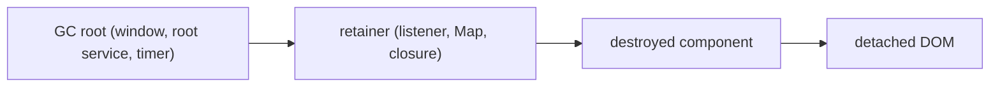

What to notice: removing the component from the page does not free it; cutting the retainer does.

### How it actually works

**Why `DestroyRef` cleanup runs and other code does not.** Read from `@angular/core` 22.2.1 (internal, may change in any release): `NodeInjectorDestroyRef.onDestroy` (`fesm2022/_pending_tasks-chunk.mjs`) calls `storeLViewOnDestroy`, which stores the callback on the view; `cleanUpView` (`fesm2022/_debug_node-chunk.mjs`) calls `processCleanups`, which removes the template's listeners, runs the stored callbacks and destroys the view's effects. A `window.addEventListener` call in a constructor belongs to the browser, not the view, so nothing removes it. Teardown APIs: [20 §5](20-lifecycle-and-render-hooks.md#5-teardown-ngondestroy-destroyref-and-takeuntildestroyed); classic leaks: [Q20.16](20-lifecycle-and-render-hooks.md#q20-16); subscription leaks and their proofs: [23 §6](23-rxjs-in-depth.md#6-unsubscription-strategies-in-angular-and-finding-leaks), [Q23.22](23-rxjs-in-depth.md#q23-22).

**The DevTools workflow** (Chrome DevTools docs, "Record heap snapshots", read 2026-10-14; documented, not run here). A **heap snapshot** records every object in the JavaScript heap at one moment.

1. In the Memory panel, take a snapshot.
2. Repeat the action N times (open and close the panel); take a second snapshot.
3. In the Comparison view ("Differences between two snapshots."), find a class that grew by about N.
4. Check detached DOM: the docs list "Objects retained by detached nodes: objects that are kept alive because a detached DOM node references them."
5. Select an object: "The Retainers section at the bottom of the Memory panel shows objects that point to the object selected in the view." Read upward to your own code.

An **allocation timeline** "combines the detailed snapshot information of the heap profiler with the incremental updating and tracking of the Timeline panel" ([Chrome docs](https://developer.chrome.com/docs/devtools/memory-problems/allocation-profiler), read 2026-10-14). Plain-JavaScript causes are [Q05.12](05-js-modules-memory-modern-features.md#q05-12)'s.

**The same proof, automated.** The lab uses the CDP session from [§2](#2-lab-metrics-in-a-real-browser-performance-observers-devtools-protocol-counters-and-lighthouse-in-ci). `HeapProfiler.collectGarbage`, an experimental CDP method, forces a collection; **`Runtime.queryObjects`**, a stable one, returns the live objects with a given prototype. Production builds minify class names, so the page publishes both panel prototypes on `window.__m31Leaks`: lab instrumentation, not production code. Five open-close cycles leave five leaky panels and five more `window` listeners (stable `DOMDebugger.getEventListeners`) (`Section 8: a leaky panel's instances survive garbage collection`); the fixed panel leaves none (`Section 8: the fixed panel leaves no instance after garbage collection`). A canvas a root service keeps after removal is still counted; once released, the count is 0 (`Section 8: a removed element held by a service is still counted as a node`).

Drilled in [Q31.21](#q31-21), [Q31.22](#q31-22) and [Q31.23](#q31-23); [Exercise 31.4](#ex31-4) hunts a leak end to end.

### Code

The approach: toggle a panel, force a collection, count what is left.

1. The fixed panel registers its listener's removal with `DestroyRef`; the leaky one does not.
2. `togglePanel` opens and closes the panel five times.
3. `forceGc` collects garbage through the CDP session.
4. `countInstances` counts live objects through the exposed prototype.

```ts
// Excerpt of labs/angular/src/app/modules/31-performance/demo/leaks.ts
export class LabM31FixedPanel {
  protected readonly resizes = signal(0);

  constructor() {
    const onResize = (): void => this.resizes.update((count) => count + 1);
    window.addEventListener(RESIZE, onResize);
    inject(DestroyRef).onDestroy(() => window.removeEventListener(RESIZE, onResize));
  }
}
```

```ts
// Excerpt of labs/e2e/tests/31-performance/concepts/section-8-memory.spec.ts
test("Section 8: a leaky panel's instances survive garbage collection", async ({ page }) => {
  await openLeaksPage(page);
  const session = await cdp(page);
  const listenersBefore = await windowListenerCount(session);

  await togglePanel(page, LEAKY, CYCLES);
  await forceGc(session);

  expect(await countInstances(session, LEAKY.prototype)).toBe(CYCLES);
  expect((await windowListenerCount(session)) - listenersBefore).toBe(CYCLES);
});
```

### Best practices and anti-patterns

- **Register each cleanup with `DestroyRef` where the resource is created**, because destroying a view runs only what was registered with it.
- **Compare two snapshots around the same action repeated N times**, because growth by N points at the leak.
- **Keep ids, not instances, in root services**, because a root service lives as long as the app.
- **Destroy components you create by hand and dispose third-party instances**, because Angular never registered them with a view.

### Misconceptions and traps

- *"The garbage collector handles it."* It frees only the unreachable; a `window` listener keeps the panel reachable. "Managed memory" sounds like no work at all.
- *"A leak shows up as a large heap."* A leak is growth across repetitions, so compare snapshots after the same action N times. The task manager shows size, so people watch size.
- *"Destroying the component frees its DOM."* Angular removes the nodes from the document; anything still holding a node or the instance keeps both alive (the canvas test). Removal is the visible step, so it looks like the last.
- *"Only subscriptions leak in Angular."* Services, listeners, timers, hand-made components and third-party instances leak too. RxJS is the famous case, so people check only it.

## 9. Off the main thread: Web Workers in Angular, and `runOutsideAngular` in zone apps

### The problem it solves

Counting primes up to five million in a click handler freezes the page: it is one long task on the main thread, so nothing paints and no input is handled ([§1](#1-measure-first-the-loop-lab-versus-field-and-what-each-tool-answers), [04 §1](04-js-async-event-loop.md#1-the-event-loop-tasks-microtasks-and-rendering)). Splitting the work or a better algorithm comes first. In a zone-based app a different problem looks similar: a `mousemove` handler triggers change detection on every event.

### Mental model

A **Web Worker** is a separate thread with its own global scope and no DOM. Page and worker share nothing; **message passing** sends copies with `postMessage` and delivers them as `message` events. `runOutsideAngular` is the other cure: in a zone app it runs a callback without a change-detection pass afterwards. The work is no shorter, and without zone.js it does nothing ([21 §3](21-change-detection.md#3-zonejs-and-ngzone-how-changes-used-to-be-detected-and-why-zone-left-the-default), [Q21.11](21-change-detection.md#q21-11), [Exercise 21.3](21-change-detection.md#ex21-3)). Analogy: a prep cook in another room is the worker; telling the waiter not to check the table after every sip is `runOutsideAngular`.

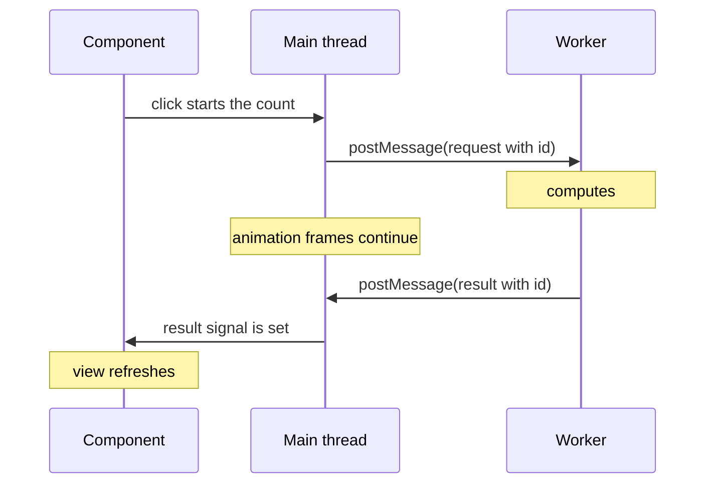

What to notice: the main thread is free while the worker computes; only the request and the result cross.

### How it actually works

**Messages are copied.** The **structured clone** algorithm copies each message, but "Function objects cannot be duplicated by the structured clone algorithm; attempting to throws a DataCloneError exception." "Cloning DOM nodes likewise throws a DataCloneError exception." ([MDN](https://developer.mozilla.org/en-US/docs/Web/API/Web_Workers_API/Structured_clone_algorithm), read 2026-10-14; [03 §6](03-js-objects-prototypes-classes.md#6-copying-shallow-deep-and-structured).) A **transferable** is moved instead: "Transferable objects are objects that own resources that can be transferred from one context to another, ensuring that the resources are only available in one context at a time." ([MDN](https://developer.mozilla.org/en-US/docs/Web/API/Web_Workers_API/Transferable_objects), read 2026-10-14.)

**Why the build finds the worker.** `ng generate web-worker <location>` creates `<name>.worker.ts` and `tsconfig.worker.json` and sets `webWorkerTsConfig` (Angular docs, read 2026-10-13); the lab sets no such option and its worker is still bundled. Read from `@angular/build` 22.2.1 (`web-worker-transformer.js`, read, not run): `createWorkerTransformer` (internal) rewrites only a `new Worker(...)` or `new SharedWorker(...)` whose first argument is `new URL(...)`; its comments say "URL arguments must be a string and then `import.meta.url`" and "Unsupported worker expressions will be left in their origin form." (`import.meta.url` is the module's own URL, [05 §3](05-js-modules-memory-modern-features.md#3-import-maps-importmeta-and-import-attributes).) A path in a variable is therefore not bundled. For a match, `processWebWorker` (internal) emits `worker-<hash>.js` (`Section 9: the production build serves the worker as its own file`).

**Fallback.** Where `Worker` is undefined the service runs the same function on the main thread (`Section 9: without Worker support the service computes on the main thread`). The docs: "Some environments or platforms, such as `@angular/platform-server` used in Server-side Rendering, don't support web workers." ([32](32-ssr-ssg-hydration.md#7-platform-safe-code-browser-apis-afternextrender-document-request-and-response_init).)

**Stale results.** Each request carries an id; older requests get `null`, so a slow first answer cannot overwrite a newer one. [Exercise 31.5](#ex31-5) builds this.

**Not a speedup.** The count takes as long in the worker, plus copying; the main thread just stays free. A frame counter keeps advancing during the count (`Section 9: animation frames keep running while the worker computes`).

Drilled in [Q31.24](#q31-24) and [Q31.25](#q31-25).

### Code

The approach: one service hides whether a worker exists.

1. The worker calls the shared `countPrimes` and posts the answer with the request's id.
2. The service creates the worker on first use, in the literal form.
3. Without `Worker`, `count` calls `countPrimes` directly.
4. The page ignores a `null` answer.

```ts
// Excerpt of labs/angular/src/app/modules/31-performance/demo/sum.worker.ts
addEventListener('message', (event: MessageEvent<PrimeRequest>) => {
  const { id, limit } = event.data;
  const response: PrimeResponse = { id, count: countPrimes(limit) };
  postMessage(response);
});
```

```ts
// Excerpt of labs/angular/src/app/modules/31-performance/demo/prime-service.ts
  private ensureWorker(): Worker {
    if (this.worker) return this.worker;
    const worker = new Worker(new URL('./sum.worker', import.meta.url), { type: 'module' });
    worker.addEventListener('message', (event: MessageEvent<PrimeResponse>) => this.settle(event.data));
```

### Best practices and anti-patterns

- **Write `new Worker(new URL('./x.worker', import.meta.url), …)` with a string literal**, because the builder rewrites only that shape.
- **Send plain data and an id**, because messages are cloned and a function or DOM node throws.
- **Keep a main-thread fallback**, because tests and server rendering have no `Worker`.
- **Measure before moving work**, because startup and copying can cost more than the work.

### Misconceptions and traps

- *"A worker makes the computation faster."* It frees the main thread; the work takes as long or longer, plus copying. "Parallel" sounds like speed.
- *"`runOutsideAngular` moves work off the main thread."* It only skips change detection; the callback still runs there. "Outside" sounds like another thread.
- *"A worker can update the DOM."* It has no `document`. It runs your code, so it seems able to do what your code does.
- *"Every heavy function belongs in a worker."* Copying and startup can exceed the work, so measure. Moving work away sounds safe.

## 10. Rendering strategy as a performance decision: CSR, SSR and SSG

### The problem it solves

A client-only marketing page stays blank until its JavaScript runs, so LCP suffers ([§5](#5-loading-the-initial-bundle-lazy-routes-defer-and-preloading-as-one-plan)). A logged-in dashboard is server-rendered for no visible gain. Where the HTML is built is a performance decision. This lab has no SSR; [module 32](32-ssr-ssg-hydration.md#1-why-render-on-the-server-csr-ssr-ssg-and-hybrid-rendering-and-what-each-costs) owns it, so this section gives the decision only.

### Mental model

**CSR** (client-side rendering): the server sends an empty HTML shell; JavaScript builds the page. **SSR** (server-side rendering): the server renders HTML per request. **SSG** (static site generation, or prerendering): HTML rendered once at build time, served as a file. **Hydration** makes server HTML interactive on the client. Analogy: CSR is flat-pack furniture assembled at home; SSR is a kitchen cooking each order; SSG is meals cooked in advance.

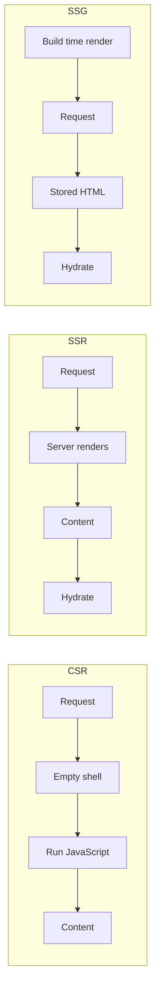

What to notice: CSR content waits for JavaScript, SSR for the server's render, and SSG's render already happened, so only hydration remains on the device.

### How it actually works

**What the docs say.** The Angular performance overview's SSR row: "Renders pages on the server for faster first paint and better SEO, with hydration to restore interactivity and incremental hydration to defer hydrating sections until needed", for "Content-heavy applications, pages that need search engine indexing" ([angular.dev](https://angular.dev/best-practices/performance), `main`, read 2026-10-14).

**Why hydration exists.** "Without hydration enabled, server-side rendered Angular applications will destroy and re-render the application's DOM, which may result in a visible UI flicker. This re-rendering can negatively impact Core Web Vitals like LCP and cause a layout shift." Hydration instead reuses the existing DOM ([angular.dev](https://angular.dev/guide/hydration), `main`, read 2026-10-14).

**The decision.**
- **LCP:** SSR and SSG send content in the first response; CSR waits for scripts.
- **Hydration cost:** SSR and SSG still ship JavaScript, and the device hydrates.
- **Server cost:** SSR pays per request; SSG once, at build.
- **Caching:** a file identical for everyone caches easily; per-request HTML needs a plan.
- **Personalization:** per-user content needs CSR or SSR.

INP is a client metric ([08 §6](08-browser-rendering-dom-events.md#6-core-web-vitals-lcp-inp-and-cls)): no strategy removes the JavaScript behind slow interactions.

**Where each mechanism lives.** `@angular/ssr`, `RenderMode`, `getPrerenderParams`, incremental hydration, event replay and `ngSkipHydration` are [32](32-ssr-ssg-hydration.md#3-server-routes-and-rendermode-per-route-rendering-getprerenderparams-fallbacks-headers-and-status)'s.

Drilled in [Q31.26](#q31-26).

### Code

No lab code: the lab has no SSR.

### Best practices and anti-patterns

- **Choose per route by audience**, because HTML identical for everyone can be prerendered.
- **Measure LCP before and after**, because SSR can add server time that cancels the gain ([§1](#1-measure-first-the-loop-lab-versus-field-and-what-each-tool-answers)).
- **Do not server-render pages behind a login by default**, because the server cost may buy nothing.

### Misconceptions and traps

- *"SSR always makes an app faster."* It paints earlier but adds server time and hydration work, so a dashboard may gain nothing; "earlier first paint" sounds like "faster".
- *"SSG is only for blogs."* Any page identical for everyone and rarely changed can be prerendered; static-site tools made it look like a blogging tool.
- *"SSR fixes a slow interaction."* INP depends on client JavaScript, which SSR keeps; "fast page" is confused with "fast response to input".

## 11. Under the hood: the CDK's rendered range, `NgOptimizedImage`'s `srcset` and the builder's chunks

### The problem it solves

An interviewer pushes past the API: how many rows after an arbitrary scroll, where do the `srcset` widths come from, and are the shipped chunks esbuild's? [§4](#4-long-lists-track-virtual-scrolling-with-the-cdk-and-the-alternatives), [§7](#7-images-ngoptimizedimage-with-priority-fill-loaders-and-placeholders) and [§6](#6-bundle-analysis-budgets-and-tree-shaking-pitfalls) asserted the outputs; here are the algorithms.

### Mental model

The **rendered range** is §4's `start..end`. A **breakpoint** is a width in pixels, listed in `IMAGE_CONFIG`, for which the loader builds one `srcset` file. **Chunk optimization** is a second bundling pass over esbuild's output that can merge lazy chunks. Analogy: a ticket machine; the same coins always give the same ticket.

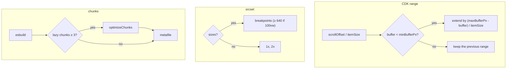

What to notice: every output the earlier sections asserted is a function of a few inputs, and the range also of the previous range.

### How it actually works

**The range extends the previous one.** `FixedSizeVirtualScrollStrategy._updateRenderedRange` (internal, may change in any release; `@angular/cdk` 22.2.1, `fesm2022/scrolling.mjs`, lines 68-109) starts from the current range. Per call it extends the side whose buffer fell below `minBufferPx` (100) far enough to reach `maxBufferPx` (200), and re-sets the other side to `minBufferPx` from the visible rows. Why two buffers? The gap lets the next pixels of scrolling pass without a re-render. The lab checks both sides: offset 30,020 from the top gives 748..766, one row back gives 744..762 (`Section 11: the rendered range after a scroll matches the fixed-size formula`). Every offset is `index * itemSize`, so a row of another height breaks the arithmetic: that is why `itemSize` must be exact.

**`srcset` comes from configuration.** In `NgOptimizedImage` (`@angular/common` 22.2.1, `fesm2022/common.mjs`), `processConfig` (internal, lines 1166-1172) sorts `breakpoints` in place, and `getAutomaticSrcset` picks `getResponsiveSrcset` when `sizes` is set, else `getFixedSrcset` (all internal, lines 931-977). `shouldGenerateAutomaticSrcset` (internal) writes none without a loader. So `[300, 600]` gives `300w` and `600w` (`Section 11: a custom breakpoints list becomes the srcset widths`); with `sizes="100vw"` the 640 cutoff would leave no `srcset` at all (read, not run).

**A second bundling pass.** In `@angular/build` 22.2.1, `executeBuild` (internal; `src/builders/application/execute-build.js`, lines 171-189) counts lazy `.js` outputs when script optimization is on. At `optimizeChunksThreshold` (internal; `src/utils/environment-options.js`, lines 155-176) or more, `optimizeChunks` (internal, `chunk-optimizer.js`) rebundles from `main` with Rolldown and rewrites the metafile through `bundleOutputToEsbuildMetafile` (internal). The threshold is 3; `NG_BUILD_OPTIMIZE_CHUNKS` (internal, undocumented) set to `false` or `0` disables the pass, `true` or `1` forces it, a number replaces it. Budgets and `browser-stats.json` read the rewritten metafile (lines 241, 303). This lab has more than three lazy chunks, so by this condition the pass runs: read, not run, since no test compares builds with and without it.

Drilled in [Q31.27](#q31-27).

### Code

The approach: each algorithm in a few lines, then a test that pins one output.

1. The range update extends one side per call and re-sets the other.

```ts
// Partial: pseudo-code of FixedSizeVirtualScrollStrategy._updateRenderedRange (internal),
// @angular/cdk 22.2.1, fesm2022/scrolling.mjs, lines 68-109; the end-of-list clamp is omitted.
const first = scrollOffset / itemSize;
const startBuffer = scrollOffset - range.start * itemSize;
if (startBuffer < minBufferPx && range.start !== 0) {
  range.start = max(0, range.start - ceil((maxBufferPx - startBuffer) / itemSize));
  range.end = min(dataLength, ceil(first + (viewportSize + minBufferPx) / itemSize));
} else {
  const endBuffer = range.end * itemSize - (scrollOffset + viewportSize);
  if (endBuffer < minBufferPx && range.end !== dataLength) {
    range.end = min(dataLength, range.end + ceil((maxBufferPx - endBuffer) / itemSize));
    range.start = max(0, floor(first - minBufferPx / itemSize));
  }
}
```

2. The `srcset` branches on `sizes`.

```ts
// Partial: pseudo-code of NgOptimizedImage's getAutomaticSrcset, getResponsiveSrcset and getFixedSrcset
// (internal), @angular/common 22.2.1, fesm2022/common.mjs, lines 931-977.
if (sizes) {
  const widths = sizes.trim() === '100vw' ? breakpoints.filter((bp) => bp >= 640) : breakpoints;
  srcset = widths.map((bp) => `${loader({ src, width: bp })} ${bp}w`).join(', ');
} else {
  srcset = [1, 2].map((m) => `${loader({ src, width: width * m })} ${m}x`).join(', ');
}
```

3. The chunk pass runs past a count.

```ts
// Partial: pseudo-code of executeBuild's chunk step (internal),
// @angular/build 22.2.1, src/builders/application/execute-build.js, lines 171-189.
if (optimizationOptions.scripts) {
  const lazy = outputs.filter((path) => path.endsWith('.js') && !initialFiles.has(path)).length;
  if (lazy >= optimizeChunksThreshold) {
    // 3 unless NG_BUILD_OPTIMIZE_CHUNKS sets it; rebundles from main and rewrites the metafile.
    bundlingResult = await optimizeChunks(bundlingResult, sourcemap);
  }
}
```

4. The test renders a host with two breakpoints and reads `srcset`.

```ts
// Excerpt of labs/angular/src/app/modules/31-performance/concepts/section-11-srcset.spec.ts
  it('Section 11: a custom breakpoints list becomes the srcset widths', () => {
    const fixture = TestBed.createComponent(LabM31CustomBreakpointsImage);
    fixture.detectChanges();
    const root: HTMLElement = fixture.nativeElement;

    expect(root.querySelector('img')?.getAttribute('srcset')).toBe('cdn/photo.jpg?w=300 300w, cdn/photo.jpg?w=600 600w');
  });
```

### Best practices and anti-patterns

- **Predict a range from the previous one**, because the strategy extends it rather than recomputing it.
- **Set breakpoints to the widths your layout renders**, because the `srcset` offers only those.
- **Pin behavior with a test, not an internal name**, because any release may rename internals.

### Misconceptions and traps

- *"Virtual scrolling renders exactly the visible rows."* It renders a buffer on both sides, up to `maxBufferPx`; the name suggests only what is visible.
- *"The range depends only on the scroll offset."* Offset 29,980 gives 744..762 after a scroll back and 747..765 straight from the top (same test), because each call extends the last one; §4's numbers look like a pure formula.
- *"`srcset` widths come from the image."* They come from `IMAGE_CONFIG` and the loader; the entries look measured.
- *"The build ships esbuild's chunks as they are."* Past the threshold a second pass rebundles them; esbuild is the bundler everyone names.

## Summary

Performance work is a loop: pick one symptom a user feels, measure it, change one thing and measure again with the same tool. Field data (CrUX, RUM) says how bad and for whom; lab data says why, and a lab load has no INP ([section 1](#1-measure-first-the-loop-lab-versus-field-and-what-each-tool-answers)). Tests read performance entries and Chromium's DevTools Protocol counters, assert names and counts and never a duration, and Lighthouse in CI gates on chosen audits over several runs ([section 2](#2-lab-metrics-in-a-real-browser-performance-observers-devtools-protocol-counters-and-lighthouse-in-ci)). In v22 OnPush is the default, so the levers left are per-check work: signals and `computed` in templates, not methods, and the algorithm before any cache ([section 3](#3-runtime-cost-of-a-change-onpush-zoneless-signals-and-per-check-template-work)).

A long list needs `track` for cheap updates and virtual scrolling for a small DOM, which costs find-in-page, variable heights and row state kept in the row ([section 4](#4-long-lists-track-virtual-scrolling-with-the-cdk-and-the-alternatives)). Loading is one plan: only the first view is initial, routes split areas, `@defer` splits parts of a view, preloading spends bandwidth, and one static import can undo a split ([section 5](#5-loading-the-initial-bundle-lazy-routes-defer-and-preloading-as-one-plan)). When a budget fails, read the metafile's importer chain before raising the limit; tree-shaking removes only what is provably side-effect free, which barrels and top-level statements defeat ([section 6](#6-bundle-analysis-budgets-and-tree-shaking-pitfalls)).

`NgOptimizedImage` writes attributes, and the loader's service resizes: `priority` only on the expected LCP image, dimensions or a positioned parent for `fill` ([section 7](#7-images-ngoptimizedimage-with-priority-fill-loaders-and-placeholders)). A leak is growth across repetitions of one action, found with two heap snapshots and read through retainers; cleanup is registered with `DestroyRef`, and root services hold ids, not instances ([section 8](#8-memory-leaks-heap-snapshots-detached-nodes-and-the-devtools-workflow)). A Web Worker frees the main thread without making the work faster; `runOutsideAngular` only skips change detection and is moot in a zoneless app ([section 9](#9-off-the-main-thread-web-workers-in-angular-and-runoutsideangular-in-zone-apps)). CSR, SSR and SSG decide where the HTML is built: SSR and SSG help LCP, none of them cures a slow INP, and the mechanics belong to module 32 ([section 10](#10-rendering-strategy-as-a-performance-decision-csr-ssr-and-ssg)). Under the hood the CDK renders a range computed from `itemSize` and scroll offset, `NgOptimizedImage`'s `srcset` comes from configured widths, and the builder rebundles chunks past a threshold ([section 11](#11-under-the-hood-the-cdks-rendered-range-ngoptimizedimages-srcset-and-the-builders-chunks)).

## Question bank

Each answer has five parts. Each Output answer states the run asserted in `labs/e2e/tests/31-performance/outputs/q31-outputs.spec.ts` or, for Q31.18, in `labs/angular/src/app/modules/31-performance/outputs/q31-outputs.spec.ts`.

<a id="q31-01"></a>
### Q31.01 · Design · "The app feels slow": how do you find out where, before changing any code?

<details>
<summary>Answer</summary>

**Short answer (30 seconds).** Turn the feeling into one symptom a user can name, ask field data how bad it is and for whom, reproduce it in the lab with the tool for that symptom, and record a baseline. Only then change one thing and measure again with the same tool, because a change without a before and an after is a guess.

**Full explanation.** This is [§1](#1-measure-first-the-loop-lab-versus-field-and-what-each-tool-answers)'s loop. The symptoms fall into three families: a slow first view, a slow interaction and growing memory. Each has its instrument: Lighthouse or the Performance panel for the first view, the Performance panel's flame chart and the Angular profiler for an interaction, the Memory panel for growth. Field data says how bad and for whom; the lab says why ([Q08.17](08-browser-rendering-dom-events.md#q08-17) covers why the two disagree). Load numbers come from the production build, since the development build adds checks.

**Follow-ups an interviewer will ask.**
- *What if there is no field data?* Say so: a lab number speaks for one controlled load, not for users. Add real user monitoring first.
- *Which tool for a slow click?* The Performance panel; the Angular profiler only when the flame chart points at change detection.

**Trap to avoid.** Quoting a Lighthouse score as the diagnosis: it is one controlled load, not a place in the code.

</details>

<a id="q31-02"></a>
### Q31.02 · Difference · Lighthouse, the Chrome Performance panel, the Angular DevTools profiler and field data: which question does each answer?

<details>
<summary>Answer</summary>

**Short answer (30 seconds).** Lighthouse: what does one controlled load look like, and which audits fail? The Performance panel: what did the main thread do, and when? The Angular profiler: which components' change detection took the time? Field data: how bad is it for real users, on which pages? Each answers one question the others cannot.

**Full explanation.** Field data (CrUX or your own real user monitoring) is the only source of INP, real devices and networks; a lab load without interaction has no INP ([§1](#1-measure-first-the-loop-lab-versus-field-and-what-each-tool-answers)). Lighthouse audits a single load. The Performance panel draws a flame chart of the main thread, where a long task, one longer than 50 ms, shows. The profiler sees change detection and hooks, not network, layout, paint or third-party scripts; its workflow is [Q21.29](21-change-detection.md#q21-29). Angular DevTools needs a development build ([Q12.13](12-angular-how-it-works.md#q12-13)), so it names components, not production timings.

**Follow-ups an interviewer will ask.**
- *Which one reports INP?* Field data only.
- *Where does the Memory panel fit?* It answers "what is retained?", the question of [§8](#8-memory-leaks-heap-snapshots-detached-nodes-and-the-devtools-workflow).

**Trap to avoid.** Using the Angular profiler as the universal tool: it is the Angular-specific one, so it gets blamed for slowdowns it cannot see.

</details>

<a id="q31-03"></a>
### Q31.03 · Output · A heading paints, then a larger hero image, then the user clicks and a bigger block appears: which `largest-contentful-paint` entries does a buffered observer report?

A routed page holds an `h1`; an image is inserted after the heading is reported; then the heading is clicked and a far larger paragraph is added.

<details>
<summary>Answer</summary>

**Short answer (30 seconds).** Two entries, naming `H1` and then `IMG`, and nothing for the block. A larger element replaces the candidate while it paints, but the browser stops reporting at the first user input, so the block added after the click never becomes one.

**Full explanation.** `Q31.03 a buffered observer reports the heading and then the image, and nothing after the click` asserts exactly this: the entries number 2 and their element tags equal `['H1', 'IMG']`. The rule is quoted in [§2](#2-lab-metrics-in-a-real-browser-performance-observers-devtools-protocol-counters-and-lighthouse-in-ci): reporting stops "as soon as the user interacts with the page (via a tap, scroll, or keypress)" (web.dev, read 2026-10-14). The image is inserted once the heading's entry exists, not after a timer, so the order never depends on timing. It has a few kilobytes of content because Chromium excludes low-entropy images from LCP (web.dev): a flat one would not appear.

**Follow-ups an interviewer will ask.**
- *And a block added before the click?* By the rule it would be reported if larger; the test does not run that case.
- *Does a click count as input?* The test clicks; [§2](#2-lab-metrics-in-a-real-browser-performance-observers-devtools-protocol-counters-and-lighthouse-in-ci)'s test presses a key. Both stop the reporting.

**Trap to avoid.** Expecting the biggest element on the final page to be the LCP element: it is the largest one painted before input.

</details>

<a id="q31-04"></a>
### Q31.04 · Output · A banner is inserted above the content after load, once without reserved space and once into a box of the same height: what `layout-shift` entries are reported?

A page shows a paragraph. A 100 px banner is added above it in one run, and in the other appended into an empty 100 px box that already sits above it.

<details>
<summary>Answer</summary>

**Short answer (30 seconds).** Without reserved space: one `layout-shift` entry, with `hadRecentInput` false and a value above 0. Into the reserved box: no entry. A shift is painted content moving, and the box keeps the paragraph where it was.

**Full explanation.** `Q31.04 a banner above painted content shifts it once; the same banner in a reserved box shifts nothing` serves both pages and waits for the first paint, because a shift needs painted content ([§2](#2-lab-metrics-in-a-real-browser-performance-observers-devtools-protocol-counters-and-lighthouse-in-ci)). On the first it asserts 1 entry, `hadRecentInput` `false` (nothing was pressed) and `value > 0`. On the second it asserts that the paragraph's bounding box is unchanged and the entry count is 0. The test never asserts the value, because it depends on the viewport.

**Follow-ups an interviewer will ask.**
- *Why not assert the value or a CLS threshold?* The value changes with viewport and content; the test checks structure.
- *How do you reserve space in an app?* A fixed-size box, or declared dimensions for images ([§7](#7-images-ngoptimizedimage-with-priority-fill-loaders-and-placeholders)).

**Trap to avoid.** Putting a CLS number in a CI assertion: it fails on another viewport without any regression.

</details>

<a id="q31-05"></a>
### Q31.05 · Design · Put performance into CI: Lighthouse assertions, bundle budgets and lab metrics in end-to-end tests. What does each catch, and what can none of them catch?

<details>
<summary>Answer</summary>

**Short answer (30 seconds).** Bundle budgets catch size growth, before any browser starts. Lab-metric tests catch structural regressions: the wrong LCP element, content that shifts, a DOM that keeps growing. Lighthouse assertions catch a failing audit on one controlled load. None catches field-only problems: real devices, real networks and INP over a whole visit.

**Full explanation.** Give each regression the cheapest gate that sees it. A bytes limit is the build's budget ([Q12.08](12-angular-how-it-works.md#q12-08), [§6](#6-bundle-analysis-budgets-and-tree-shaking-pitfalls)). Tests in a real browser assert names, counts and booleans, never durations ([§2](#2-lab-metrics-in-a-real-browser-performance-observers-devtools-protocol-counters-and-lighthouse-in-ci)). Lighthouse CI assertions check chosen audits, run several times because its `numberOfRuns` option exists to "mitigate fluctuations due to natural page variability" (docs, read 2026-10-14; documented, not run here). The stage belongs to the end-to-end pipeline; its workers and retries are [Q30.16](30-e2e-and-testing-strategy.md#q30-16).

**Follow-ups an interviewer will ask.**
- *Gate on "performance above 90"?* No: one number fluctuates between runs; gate audits or budgets.
- *Can a test fail on INP?* No: a load without interaction has none.

**Trap to avoid.** Treating a green pipeline as proof users are fast: it proves one controlled load and some structure.

</details>

<a id="q31-06"></a>
### Q31.06 · Concept · Which runtime levers still matter in a v22 zoneless, OnPush-by-default app, and which classic advice no longer buys anything?

<details>
<summary>Answer</summary>

**Short answer (30 seconds).** The work inside each check and the size of what you render still matter: template methods, heavy hooks, unmemoized derived state, long lists. Zone-era advice no longer buys anything: OnPush on every component and `runOutsideAngular` around timers.

**Full explanation.** The cost of a change is views checked times work per check ([§3](#3-runtime-cost-of-a-change-onpush-zoneless-signals-and-per-check-template-work)). v22 shrinks the first factor: `provideZonelessChangeDetection` [Stable since v20.2] refreshes only after a notification, and a component without a `changeDetection` property is OnPush [Changed in v22.0: "Component with undefined `changeDetection` property are now `OnPush` by default"]. A blanket `OnPush` repeats the default, and `runOutsideAngular` has no zone to leave. The second factor stays yours: 3 unrelated signal writes ran a template method 3 times and a `computed` 0 times (`Section 3: a template method runs on every check of its view`). A component a migration marked `Eager` [Added in v21.2] is still checked on every traversal ([Q21.07](21-change-detection.md#q21-07)).

**Follow-ups an interviewer will ask.**
- *Is writing OnPush still worth it?* Only to state intent.
- *Which lever first for a slow keystroke?* Find the per-check work, then use a `computed` ([Q31.07](#q31-07)).

**Trap to avoid.** Deleting every `Eager` marker at once: plain-field state relies on being checked.

</details>

<a id="q31-07"></a>
### Q31.07 · Bug hunt · Typing in a dashboard's search box is slow: a template method filtering 5,000 rows, `track $index` on a sortable table and an `Eager` clock widget. Find the costs and the fixes.

<details>
<summary>Answer</summary>

**Short answer (30 seconds).** Three costs. The method filters 5,000 rows on every check of its view: use a `computed`. `track $index` keys rows by position, so a sort rewrites every row: track by id. The `Eager` clock is checked whenever a refresh passes through, keystrokes included: drop `Eager` and keep the time in a signal.

**Full explanation.** A keystroke is an event, which refreshes the path to the root and any `Eager` siblings, so the clock rides along and re-runs the method: 3 runs for 3 unrelated writes, against 0 for a `computed` (`Section 3: a template method runs on every check of its view`). Method, pipe or `computed` is [Q14.24](14-directives-and-pipes.md#q14-24)'s choice. `track $index` makes the key mean "row 3" whatever row 3 holds; [Q18.07](18-control-flow-and-defer.md#q18-07) shows the state mix-ups, and a stable id lets Angular move nodes instead of rewriting them. With the clock in a signal and no `Eager`, a write refreshes only that view ([Q21.07](21-change-detection.md#q21-07)).

**Follow-ups an interviewer will ask.**
- *Which fix first?* Measure ([§1](#1-measure-first-the-loop-lab-versus-field-and-what-each-tool-answers)); the method is the usual suspect, not proof.
- *Could a pure pipe replace the `computed`?* Yes: 0 runs for unrelated writes, but stale after an in-place `push` (`Section 3: a pure pipe runs again only when its input reference changes`).

**Trap to avoid.** Debouncing the input: the filter still runs on every unrelated check.

</details>

<a id="q31-08"></a>
### Q31.08 · Trade-off · A store holds 10,000 entities and one changes every second: one list-wide selector or a `computed` per row? What does each recompute, and when does it matter?

<details>
<summary>Answer</summary>

**Short answer (30 seconds).** A `computed` per row when single entities change often and each row's derivation costs something; one list-wide selector when the derivation is cheap or needs the whole list. In the lab one rename re-ran a list-wide selector over all 100 rows; per-row `computed`s ran 100 times at first render and once after the rename.

**Full explanation.** `Section 3: one changed entity re-runs a list-wide selector over all rows` and `Section 3: one changed entity re-runs only that row's computed` assert those counts. With `@for` tracked by id, 99 rows get the same object, so their `computed`s stay clean. The cost moves: per row you pay for every `computed` up front and keep its value in memory ("The memory overhead of memoization could be significant", [§3](#3-runtime-cost-of-a-change-onpush-zoneless-signals-and-per-check-template-work)). At 10,000 entities and one change a second the list-wide selector formats 10,000 rows every second, the per-row design one; if each format is cheap, neither may show in a profile. Selectors in stores are [28](28-state-management.md)'s.

**Follow-ups an interviewer will ask.**
- *And a total across all rows?* Keep one list-wide `computed` for it; derive per row only the formatting.
- *Does per-row need `track` by id?* Yes: the same object must reach the same row.

**Trap to avoid.** Per-row `computed`s for 20 rows: setup cost, nothing measurable gained.

</details>

<a id="q31-09"></a>
### Q31.09 · Output · 10,000 rows of 40 px in a 400 px `cdk-virtual-scroll-viewport`: how many rows are in the DOM at the top, and after scrolling to row 5,000?

The lab page `m31/long-list` renders 10,000 rows with `itemSize` 40, `minBufferPx` 100 and `maxBufferPx` 200 in a 400 px viewport; the test scrolls with `scrollToIndex(5000)`.

<details>
<summary>Answer</summary>

**Short answer (30 seconds).** 15 rows at the top, range 0 to 15; after the scroll 18 rows, range 4997 to 5015. The CDK renders the visible rows plus a buffer, so the DOM follows the viewport, not the 10,000 items.

**Full explanation.** `Q31.09 a 400 px viewport of 40 px rows renders 15 rows at the top and 18 after scrolling to row 5000` asserts 15 `.row` elements and `getRenderedRange()` equal to `{ start: 0, end: 15 }` (through the lab hook), then calls `scrollToIndex(5000)` and asserts 18 rows, `{ start: 4997, end: 5015 }` and `Row 5000` visible. At the top the end is `ceil((200 + 400) / 40) = 15` ([§4](#4-long-lists-track-virtual-scrolling-with-the-cdk-and-the-alternatives)). After the scroll the start keeps about `minBufferPx` of rows above the first visible one, so the range is 3 rows larger.

**Follow-ups an interviewer will ask.**
- *Does the scrollbar still show 10,000 rows?* Yes: the spacer's height is the item count times `itemSize`, 400,000 px.
- *Why does the count differ after the scroll?* Start and end come from the scroll offset, not from a fixed window.

**Trap to avoid.** Answering 10, the visible rows: the buffers are rendered too.

</details>

<a id="q31-10"></a>
### Q31.10 · Trade-off · Virtual scrolling, pagination, infinite loading or `content-visibility: auto`: which for which long list?

<details>
<summary>Answer</summary>

**Short answer (30 seconds).** Virtual scrolling for a very long list of uniform rows that users scroll through, such as a log. Pagination when users search or need an exact count. Infinite loading for a feed that arrives over time. `content-visibility: auto` for a moderate list of varied heights where every node may stay.

**Full explanation.** Virtual scrolling bounds the DOM, but unrendered rows do not exist for find-in-page, a screen reader cannot learn the list's size (`aria-setsize` exists for sets "when not all items in the set are present in the DOM", MDN, [§4](#4-long-lists-track-virtual-scrolling-with-the-cdk-and-the-alternatives)), and rows need one fixed height. Pagination keeps the DOM small, and find-in-page works within a page. Infinite loading decides when data arrives, not how much stays in the DOM, so every loaded row stays unless a virtual viewport bounds it. `content-visibility: auto` lets the browser skip layout and rendering work for off-screen content, but every node and its memory stay; containment is [10](10-css-essentials.md)'s.

**Follow-ups an interviewer will ask.**
- *Can you combine them?* Yes: infinite loading fetches data, a virtual viewport bounds the DOM.
- *Pagination over virtual scrolling when?* When find-in-page or an exact count matters.

**Trap to avoid.** Making virtual scrolling the default: it fixes DOM size only.

</details>


<a id="q31-11"></a>
### Q31.11 · Bug hunt · A virtual-scrolled chat jumps and shows blank gaps: rows of varying height with a fixed `itemSize`, a row that keeps its own state, and a viewport with no height. Find each cause.

<details>
<summary>Answer</summary>

**Short answer (30 seconds).** Three causes. Rows taller than `itemSize` make the spacer and offsets wrong, so rows overlap and positions jump. A row component's own state follows a recycled view onto another message. A viewport without a height has no size to compute the range from.

**Full explanation.** The spacer is item count times `itemSize`, and rows are shifted by `itemSize * start` ([§4](#4-long-lists-track-virtual-scrolling-with-the-cdk-and-the-alternatives)); a 120 px bubble in a 40 px slot spills over its neighbour ([Q31.27](#q31-27) gives the rule). A row leaving the range goes into a 20-view template cache and is reused with a new `$implicit` (read, not run), so a draft or an "expanded" flag inside the row follows the view. The range comes from the viewport's size (read, not run), so it needs a CSS height. The fixes: one height per row, state in a map keyed by id, a height in CSS.

**Follow-ups an interviewer will ask.**
- *Can `itemSize` be the average height?* No: every row that differs adds an error, and it grows with the index.
- *Can larger buffers hide the gaps?* No: more rows render, the wrong sums stay.

**Trap to avoid.** Fixing the symptom in the row's CSS: the sums are the CDK's.

</details>

<a id="q31-12"></a>
### Q31.12 · Design · Plan what loads when for an app with a public landing page, a dashboard and an admin area: initial bundle, lazy routes, `@defer` and preloading.

<details>
<summary>Answer</summary>

**Short answer (30 seconds).** Initial bundle: the shell and the landing page's first view. Dashboard and admin area: lazy routes, the dashboard preloaded, admin not. Heavy parts of a page, such as a chart, go in `@defer`. Then verify in the build output.

**Full explanation.** Only the first view belongs on the critical path ([§5](#5-loading-the-initial-bundle-lazy-routes-defer-and-preloading-as-one-plan)). Above-the-fold landing content stays static, because a deferred block renders after its trigger. Most visitors go to the dashboard next, so a preloading strategy fetches it while the browser is idle ([Q24.28](24-routing.md#q24-28) compares strategies). The admin area has few users: its chunk loads on navigation, behind its guard. The chart library goes behind `@defer`, with the trigger chosen per block ([Q18.16](18-control-flow-and-defer.md#q18-16)).

**Follow-ups an interviewer will ask.**
- *Why not preload admin too?* Each preload costs bandwidth on every visit, for few users.
- *How do you know the plan held?* A budget on the initial files and a stats-file test such as `Section 5: the module-31 lazy route is not part of the initial files`.

**Trap to avoid.** Lazy-loading the landing page's own hero: the first view then waits.

</details>

<a id="q31-13"></a>
### Q31.13 · Difference · A lazy route, a `@defer` block and a dynamic `import()` in a service: what does each split out, and what starts each download?

<details>
<summary>Answer</summary>

**Short answer (30 seconds).** A lazy route splits out a whole area; navigation, or a preloading strategy, starts the download. A `@defer` block splits out the dependencies used only inside it; its trigger starts it. A dynamic `import()` splits out the module you name; the code that runs the call starts it.

**Full explanation.** `loadComponent` and `loadChildren` wrap `import()`, so the router makes the call when the route activates, and the route also owns a URL and guards. For `@defer`, the compiler turns each dependency used only inside the block into a dynamic `import()` run on the trigger: in the lab, no chunk is requested while idle and the click requests one (`Section 5: the deferred block's chunk is requested only after the trigger`). A service that awaits `import()` of a chart library when a report opens picks the moment itself ([Q05.08](05-js-modules-memory-modern-features.md#q05-08)); `injectAsync` [Added in v22.0] does that for a service loaded on first call ([§5](#5-loading-the-initial-bundle-lazy-routes-defer-and-preloading-as-one-plan)).

**Follow-ups an interviewer will ask.**
- *Which one has a URL and guards?* Only the lazy route.
- *What if the target is also imported statically elsewhere?* It stays initial and no lazy boundary helps.

**Trap to avoid.** Treating `@defer` as a replacement for lazy routes: it splits one view.

</details>

<a id="q31-14"></a>
### Q31.14 · Concept · What does `ng build --stats-json` write, and how do you find out why a package ended up in the initial bundle?

<details>
<summary>Answer</summary>

**Short answer (30 seconds).** `browser-stats.json`, an esbuild metafile: for each output file, its input modules with `bytesInOutput`, and its imports, each with a kind. An ordinary build writes none. To see why a package is initial, find its input in an initial output and follow the imports back to your own code.

**Full explanation.** The builder writes the file only when `statsJson` is set, and it defaults to `false` ([§6](#6-bundle-analysis-budgets-and-tree-shaking-pitfalls)). Start at the `main-*.js` output: initial files are those reachable through static `import-statement` edges, and a `dynamic-import` edge leaves them. Search the inputs for `node_modules/<package>/`, then walk each input's `imports` backwards to the first module you wrote. That importer chain is the answer, and the fix is on its first link: lazy-load, replace, or remove the side effect. `Section 6: the importer chain leads from main to the module-31 routes file` does the output-level walk. esbuild's online analyzer reads the same file (documented, not run). [Q31.17](#q31-17) is the failing-budget workflow; [Exercise 31.3](#ex31-3) practises it.

**Follow-ups an interviewer will ask.**
- *Is the sorted size list enough?* No: it says what is big, the chain says who asked for it.
- *Why is a package initial when a lazy page uses it?* Some initial module imports it statically too.

**Trap to avoid.** Raising the budget before reading the chain.

</details>

<a id="q31-15"></a>
### Q31.15 · Output · Three unused exports through a barrel: a pure function, a function in a file with a top-level side effect and a class with a static block. Which survive in the production chunk?

The lab page `m31/tree-shaking` imports one name, `usedGreeting`, from a barrel that also re-exports a pure function, a side-effect module and a class with a static block; each module holds one marker string, and the test searches every built `.js` file for it.

<details>
<summary>Answer</summary>

**Short answer (30 seconds).** The pure function is dropped; the side-effect file and the static-block class stay. The bundler removes only code it can prove changes nothing, and a statement that runs at load, or a static block, may do something.

**Full explanation.** `Q31.15 through a barrel the unused pure function is dropped, while the side-effect file and the static-block class stay` reads every built script listed in `browser-stats.json` and asserts `M31_MARKER_USED` is in at least one file, `M31_MARKER_UNUSED_PURE` in none, and `M31_MARKER_SIDE_EFFECT` and `M31_MARKER_STATIC_BLOCK` each in at least one. The side-effect marker is in a lazy chunk, not an initial file ([§6](#6-bundle-analysis-budgets-and-tree-shaking-pitfalls)). The test reads files only and loads no page.

**Follow-ups an interviewer will ask.**
- *And an unused `providedIn: 'root'` service?* The lab has no such fixture, so nothing is observed here; [Q16.07](16-dependency-injection.md#q16-07) owns providers.
- *Why not read the source?* It reads the same whether the code shipped; only the output tells.

**Trap to avoid.** Believing tree-shaking removes everything unused.

</details>


<a id="q31-16"></a>
### Q31.16 · Difference · source-map-explorer versus the esbuild metafile: what does each attribute bytes to, and why can their numbers differ?

<details>
<summary>Answer</summary>

**Short answer (30 seconds).** source-map-explorer reads a built file and its source map and says which source file each byte of the minified code came from. The esbuild metafile, which `ng build --stats-json` writes, is esbuild's own record: for each output, the bytes (`bytesInOutput`) each input contributed, plus what each input imports. Their numbers can differ: one maps minified bytes back through a source map, the other is the bundler's own per-input count, rewritten after the chunk pass. Only the metafile answers who imported what.

**Full explanation.** The README says source-map-explorer "determines which file each byte in your minified code came from" (`master`, read 2026-10-14). It needs a **source map**, and the builder's `sourceMap` option defaults to `false` (`schema.json`, [§6](#6-bundle-analysis-budgets-and-tree-shaking-pitfalls)), so a default production build gives it nothing to read. The metafile needs no map: `outputs[path].inputs[path].bytesInOutput` and `inputs[path].imports` come from the bundler's own accounting. One more difference, read and not run: after the chunk-optimization pass the builder rewrites the metafile from the optimizer's output (`chunk-optimizer.js`, [§11](#11-under-the-hood-the-cdks-rendered-range-ngoptimizedimages-srcset-and-the-builders-chunks)). Neither tool is installed in the labs, so no difference between the two is measured here. Both count bytes before compression.

**Follow-ups an interviewer will ask.**
- *Which one finds the importer chain?* The metafile, because it records imports; a map only says where bytes came from. [Q31.14](#q31-14) shows the walk.
- *Are these the sizes users download?* No: both are bytes before compression.

**Trap to avoid.** Treating one tool's totals as the other's, or as the delivered size.

</details>

<a id="q31-17"></a>
### Q31.17 · Design · The `initial` budget fails in CI after a merge: walk through the investigation and the fix.

<details>
<summary>Answer</summary>

**Short answer (30 seconds).** Read which budget failed and by how much, build the merge commit and its parent with `--stats-json`, compare the initial outputs' inputs, then follow the importer chain of what grew to the first line of your own code that pulls it in. Fix that line, and touch the limit last.

**Full explanation.** The `initial` budget "measures the JavaScript and CSS used to bootstrap the application" (angular.dev, [§6](#6-bundle-analysis-budgets-and-tree-shaking-pitfalls)), so the failure says something reachable from the first load grew:

1. Note the budget type and the overshoot in the failing log ([Q12.08](12-angular-how-it-works.md#q12-08) owns thresholds).
2. Build both commits with `ng build --stats-json` and diff the inputs of the initial outputs by `bytesInOutput`.
3. For the input that grew, walk `imports` back to your code; the lab's `Section 6: the importer chain leads from main to the module-31 routes file` does that walk.
4. Fix the first link: lazy-load or `@defer` it, bypass the barrel, replace the package, or drop the side effect.
5. Raise the limit only as a decision on purpose.

[Exercise 31.3](#ex31-3) practises steps 2 and 3 on a fixture.

**Follow-ups an interviewer will ask.**
- *What if no single input grew?* Compare per-package totals across both builds.
- *Why not just raise the budget?* Then nothing records that the bundle grew; the next merge starts from the larger number.

**Trap to avoid.** Reading only the sorted size list: it names what is big, not who asked for it.

</details>

<a id="q31-18"></a>
### Q31.18 · Output · `NgOptimizedImage` with a custom loader, once with `priority` and once without: which `loading`, `fetchpriority`, `decoding` and `srcset` attributes render?

A host renders two `` elements, the first with `priority`, under an `IMAGE_LOADER` that returns `` `/img/${src}?w=${width}` ``; the test reads each element's attributes.

<details>
<summary>Answer</summary>

**Short answer (30 seconds).** The priority image renders `loading="eager"`, `fetchpriority="high"` and `decoding="sync"`; the plain one renders `loading="lazy"`, `fetchpriority="auto"` and `decoding="auto"`. Both get `srcset="/img/a.png?w=400 1x, /img/a.png?w=800 2x"`. `priority` decides the three behaviour attributes; the `srcset` comes from the width and the loader alone.

**Full explanation.** `Q31.18 a priority image is eager, high and sync, a plain one lazy, auto and auto, and both share one srcset` asserts exactly those attribute strings. The reason is in `NgOptimizedImage` (`@angular/common` 22.2.1, `common.mjs`, internal, read): `getLoadingBehavior()`, `getFetchPriority()` and `getDecoding()` each look at `priority`, while the density `srcset` multiplies the `width` by 1 and 2 and calls the loader for each ([§7](#7-images-ngoptimizedimage-with-priority-fill-loaders-and-placeholders), [§11](#11-under-the-hood-the-cdks-rendered-range-ngoptimizedimages-srcset-and-the-builders-chunks)). `Section 7: a custom loader produces a 1x and 2x srcset` checks the same rule with another loader.

**Follow-ups an interviewer will ask.**
- *Does `loading="eager"` alone equal `priority`?* No: `fetchpriority` and `decoding` stay `auto`.
- *Does `priority` change the `srcset`?* No: both elements carry the same string.

**Trap to avoid.** Expecting `priority` to be only a `loading` switch.

</details>

<a id="q31-19"></a>
### Q31.19 · Concept · `fill` mode, `sizes` and a responsive `srcset`: what does `NgOptimizedImage` generate, and what must the parent element provide?

<details>
<summary>Answer</summary>

**Short answer (30 seconds).** In `fill` mode the directive renders no `width` or `height` and makes the image fill its parent, so the parent must be positioned (`relative`, `absolute` or `fixed`) and have a height. With a loader it writes a `srcset` of width descriptors, one per configured breakpoint, chosen by `sizes`, which defaults to `100vw` for `fill`.

**Full explanation.** The host gets `position: absolute`, `width: 100%`, `height: 100%` and `inset: 0` (`common.mjs`, internal, read), which resolve against the nearest positioned ancestor; otherwise development mode warns (`NG02952`) that "the height of the fill-mode image is zero". The lab asserts the absent dimensions in `Section 7: a fill image renders without width and height attributes`. With `sizes` set, `srcset` has one width entry per `IMAGE_CONFIG` breakpoint, three for `[320, 640, 960]` and `50vw`; with exactly `100vw`, breakpoints under 640 are dropped (`Section 7: sizes produces one srcset entry per configured breakpoint`, `Section 7: sizes of 100vw drops breakpoints below 640`). `sizes` is how the browser picks among those widths, so an honest value matters ([§7](#7-images-ngoptimizedimage-with-priority-fill-loaders-and-placeholders)).

**Follow-ups an interviewer will ask.**
- *Who resizes the image?* The loader's service; the directive writes URLs and attributes.
- *What if the parent has no height?* The image collapses; give the box a height or an aspect ratio.

**Trap to avoid.** Putting `fill` inside a static parent and then debugging the image's size.

</details>

<a id="q31-20"></a>
### Q31.20 · Bug hunt · Review these images: an LCP image without `priority`, an `ngSrc` without dimensions, a `placeholder` with no loader and a placeholder on a very large image. What does development mode report, and why does production stay silent?

<details>
<summary>Answer</summary>

**Short answer (30 seconds).** In development, the LCP image without `priority` logs `NG02955` as an error; the missing dimensions throw `NG02954`; a `placeholder` with no loader throws `NG02963`; a placeholder on an image rendered wider or taller than 1000px logs `NG02967`. Production stays silent because these checks run only under `ngDevMode`, a flag the production build compiles out.

**Full explanation.** Codes and texts are read from `@angular/common` 22.2.1, `common.mjs` (internal, not run): `NG02955` says the image "is the Largest Contentful Paint (LCP) element but was not marked "priority"" and comes from a dev-only `LCPImageObserver`. `NG02954` lists the "required attributes" missing (`"width", "height"`); `Section 7: an ngSrc without width and height throws in development` asserts it. `NG02963` says the placeholder is set "but no image loader is configured". `NG02967` warns when an image that uses a placeholder renders larger than `1000px` in either dimension (`assertPlaceholderDimensions` reads the ``'s computed size, internal). The two that throw stop the render, the two others only log. The checks sit behind `if (ngDevMode)` (and `assertDevMode`), so a production build has none of them, and a clean production console proves nothing ([§7](#7-images-ngoptimizedimage-with-priority-fill-loaders-and-placeholders)).

**Follow-ups an interviewer will ask.**
- *Which findings stop the app?* The two that throw, `NG02954` and `NG02963`; the others are logs.
- *How do you keep the logs from being missed?* Treat a development-mode error as a failing test, as the lab's dimensions test does.

**Trap to avoid.** Reading a quiet production console as a clean review.

</details>


<a id="q31-21"></a>
### Q31.21 · Design · Find a memory leak in an Angular route with Chrome DevTools: which snapshots, what to compare, what "Detached" means and how to read retainers.

<details>
<summary>Answer</summary>

**Short answer (30 seconds).** Take a heap snapshot, repeat one action N times, take a second snapshot and compare. A class that grew by about N is the suspect, and its retainer path leads to the code holding it. "Detached" means a DOM node removed from the document but still referenced.

**Full explanation.** The steps follow the Chrome DevTools docs ([Record heap snapshots](https://developer.chrome.com/docs/devtools/memory-problems/heap-snapshots), read 2026-10-14; documented, not run) and [§8](#8-memory-leaks-heap-snapshots-detached-nodes-and-the-devtools-workflow). The Comparison view shows "Differences between two snapshots.": growth per repetition matters, size alone does not. "Objects retained by detached nodes" are "kept alive because a detached DOM node references them". Select an object and the Retainers section lists "objects that point to the object selected": read upward to the first name you own, then cut that link and compare again. The lab's automated equivalent is [Q31.22](#q31-22).

**Follow-ups an interviewer will ask.**
- *Why N repetitions, not one?* One run mixes real growth with caches; growth that tracks N is a leak.
- *What does the allocation timeline add?* Allocations as they happen, not at two moments.
- *What if the retainer is plain JavaScript?* [Q05.12](05-js-modules-memory-modern-features.md#q05-12) covers those causes.

**Trap to avoid.** Judging by heap size in one snapshot.

</details>

<a id="q31-22"></a>
### Q31.22 · Output · A panel is opened and closed ten times: how many instances of its class survive a forced garbage collection, before and after the fix?

The leaks page offers a leaky panel and a fixed one; the test opens and closes each ten times, forces a collection and counts the instances through the class prototype the page exposes.

<details>
<summary>Answer</summary>

**Short answer (30 seconds).** Ten leaky panels survive and no fixed one does. The leaky panel's `window` listener keeps each destroyed instance reachable; the fixed panel removes its listener through `DestroyRef`, so all ten are freed.

**Full explanation.** `Q31.22 after ten open-close cycles and a forced collection 10 leaky panels survive and 0 fixed ones` asserts both counts, each on its own page: the array `Runtime.queryObjects` returns keeps its objects alive, so a shared page would blur the second count. `HeapProfiler.collectGarbage` forces the collection and the count reads the prototype published on `window.__m31Leaks`, lab instrumentation because production minifies class names ([§8](#8-memory-leaks-heap-snapshots-detached-nodes-and-the-devtools-workflow)). The count equals the cycles because each open creates one instance and its listener pins that one. The `Section 8` tests assert the same rule with five cycles. [Q31.21](#q31-21) is the manual route.

**Follow-ups an interviewer will ask.**
- *Why force a collection first?* Unreachable panels can linger until the next one, so an unforced count could exceed 0 for timing reasons.
- *Why does the count track the cycles?* One pinned instance per open grows with repetitions, not time.

**Trap to avoid.** Counting without a forced collection.

</details>

<a id="q31-23"></a>
### Q31.23 · Bug hunt · Leaks that unit tests miss: a root service that keeps component instances, an `effect` that adds a listener without cleanup, a component made with `createComponent` and never destroyed, and a chart instance never disposed.

<details>
<summary>Answer</summary>

**Short answer (30 seconds).** Each leaves a destroyed component reachable from something that outlives it. Keep ids, not instances, in a root service; give an `effect` that adds a listener an `onCleanup`; call `destroy()` on a `createComponent` result; dispose a chart library's instance.

**Full explanation.** TestBed destroys every fixture when the test ends, and no assertion asks what a longer-lived holder still references. These four differ from [Q20.16](20-lifecycle-and-render-hooks.md#q20-16)'s interval, subscription and listener, which belong to one component's own lifetime. Here the holder is elsewhere: a service map that never drops an entry; an `effect`, which reruns when a signal it reads changes, so one instance can add many listeners; a `ComponentRef` Angular never registered with a view, so no teardown reaches it; a third-party object that keeps its canvas until disposed. The lab shows the last shape: a canvas a service holds is still counted after removal and gone once released (`Section 8: a removed element held by a service is still counted as a node`). Subscription proofs: [Q23.22](23-rxjs-in-depth.md#q23-22). For the rest, compare snapshots ([Q31.21](#q31-21)).

**Follow-ups an interviewer will ask.**
- *Which holder lasts longest?* The root service: entries stay until someone removes them.
- *Why is the `effect` worse than a constructor listener?* The constructor runs once; the effect can rerun, and `onCleanup` runs before each rerun and on destroy.

**Trap to avoid.** Taking a green unit suite as proof of no leak.

</details>

<a id="q31-24"></a>
### Q31.24 · Concept · How does `ng generate web-worker` wire a worker, how does the build bundle it, and what can a worker not do?

<details>
<summary>Answer</summary>

**Short answer (30 seconds).** `ng generate web-worker <location>` creates `<name>.worker.ts` and `tsconfig.worker.json` and sets `webWorkerTsConfig`. The builder bundles a `new Worker(new URL('./x.worker', import.meta.url))` with a literal URL into its own `worker-<hash>.js`. A worker has no DOM and shares nothing with the page: only cloned messages cross.

**Full explanation.** The rewrite keys on the call's shape, not the option: the lab's worker is bundled without `webWorkerTsConfig`, and a path held in a variable is left as written ([§9](#9-off-the-main-thread-web-workers-in-angular-and-runoutsideangular-in-zone-apps), read from `@angular/build` 22.2.1). `Section 9: the production build serves the worker as its own file` shows no request for it until the click, then a 200. A worker cannot touch `document`, receive a function or DOM node (`DataCloneError`), shorten the work (`Section 9: animation frames keep running while the worker computes` shows responsiveness, not speed) or run where workers are missing, such as server rendering ([32](32-ssr-ssg-hydration.md#7-platform-safe-code-browser-apis-afternextrender-document-request-and-response_init)). jsdom has none either, so the service falls back to the main thread (`Section 9: without Worker support the service computes on the main thread`).

**Follow-ups an interviewer will ask.**
- *What if the path is in a variable?* No worker file is emitted and the call is left as written, so its URL names a file the build did not produce (read, not run).
- *How do you test such a service?* The fallback in the unit environment, the real worker in the browser.

**Trap to avoid.** Expecting a worker to speed the work up or update the page.

</details>

<a id="q31-25"></a>
### Q31.25 · Trade-off · A long task blocks input: a Web Worker, splitting the work into tasks, `runOutsideAngular` or a better algorithm. Which cure when?

<details>
<summary>Answer</summary>

**Short answer (30 seconds).** Ask what the time is spent on. A better algorithm shortens the work. Splitting into tasks suits work that must touch the page. A Web Worker suits pure computation on data that can be copied. `runOutsideAngular` cures only change-detection passes, never a long computation.

**Full explanation.** Take the cheapest cure that removes the cause ([§9](#9-off-the-main-thread-web-workers-in-angular-and-runoutsideangular-in-zone-apps)). A quadratic loop made linear makes the rest unnecessary. Work that touches the DOM cannot move to a worker, which has none: cut it into small tasks and yield between them. Pure work on cloneable data suits a worker, but it takes as long plus the copying (`Section 9: animation frames keep running while the worker computes` shows responsiveness, not speed), and adds a file, messages and a fallback. `runOutsideAngular` answers another question: in a zone app a `mousemove` handler triggers a change-detection pass per event, and this skips them. Without zone.js it does nothing ([Q21.11](21-change-detection.md#q21-11)). Profile first ([§1](#1-measure-first-the-loop-lab-versus-field-and-what-each-tool-answers)).

**Follow-ups an interviewer will ask.**
- *A 300 ms filter over a large array: where do you start?* The algorithm and the data shape; a worker only for heavy, pure work.
- *What does a worker cost?* A separate file, copied messages, stale-result handling and a main-thread fallback.

**Trap to avoid.** Reaching for a worker before finding out whether the time is in the work or in change detection.

</details>

<a id="q31-26"></a>
### Q31.26 · Trade-off · CSR, SSR or SSG for a marketing page, a logged-in dashboard and a product catalog: what does each do to LCP and INP, and what does it cost?

<details>
<summary>Answer</summary>

**Short answer (30 seconds).** Marketing page: SSG, since the HTML is the same for everyone and served as a file. Logged-in dashboard: CSR, since its content is per user. Catalog: SSG if it changes rarely, SSR if prices or stock must be fresh per request. None of them fixes INP.

**Full explanation.** The first response decides LCP ([§10](#10-rendering-strategy-as-a-performance-decision-csr-ssr-and-ssg)). CSR sends an empty shell, so content waits for scripts. SSR and SSG send content at once, but both still ship JavaScript and the device hydrates. SSR pays a server render per request and needs a caching plan; SSG pays once at build and caches easily, but is only as fresh as its last build. A dashboard needs the user's data, so SSR adds server time for little gain. The catalog can prerender its product pages and load per-user parts on the client. INP is a client metric: the JavaScript behind a slow click remains whichever strategy ships the HTML. Measure LCP before and after, since server time can cancel the gain. `RenderMode` and hydration belong to [module 32](32-ssr-ssg-hydration.md#3-server-routes-and-rendermode-per-route-rendering-getprerenderparams-fallbacks-headers-and-status).

**Follow-ups an interviewer will ask.**
- *Can one app mix strategies?* Yes: the choice is per route, by audience.
- *What does SSG lose?* Freshness between builds.

**Trap to avoid.** Saying "SSR is faster" without naming the metric, the page and the server cost.

</details>

<a id="q31-27"></a>
### Q31.27 · Concept · How does the CDK's fixed-size strategy decide which rows to render as you scroll, and why must `itemSize` be exact?

<details>
<summary>Answer</summary>

**Short answer (30 seconds).** It renders the visible rows plus a buffer on each side, extended from the previous range rather than recomputed. A side is extended only when its buffer falls below `minBufferPx` (100), and then up to `maxBufferPx` (200); the opposite side is then re-set to about `minBufferPx` from the visible rows. Every position is `index * itemSize`, so a wrong `itemSize` puts the rows in the wrong place.

**Full explanation.** In `FixedSizeVirtualScrollStrategy._updateRenderedRange` (internal, `@angular/cdk` 22.2.1, [§11](#11-under-the-hood-the-cdks-rendered-range-ngoptimizedimages-srcset-and-the-builders-chunks)) the range starts from the current one, and the gap between the buffers lets small scrolls pass without a re-render. The spacer is item count times `itemSize`; each row is offset by `itemSize * start`. In the lab (run 2026-10-14) a 400 px viewport with 40 px rows renders 15 rows at the top (0..15) and 18 after scrolling to row 5000 (4997..5015). The range depends on the scroll path: after a reload, setting `scrollTop` to 29,980 directly gives 747..765. `Section 11: the rendered range after a scroll matches the fixed-size formula` asserts the formula. The bug is [Q31.11](#q31-11); this is the rule behind it.

**Follow-ups an interviewer will ask.**
- *Is `_updateRenderedRange` public API?* No, it is internal and may change in any release.
- *Why does the same offset give different ranges?* The new range extends the previous one.

**Trap to avoid.** Believing virtual scrolling renders exactly the rows on screen.

</details>

## Hands-on exercises

Five exercises close the module. Each starts from code with a measurable cost and asks for the change that removes it; the criteria are tests, counts come from lab instrumentation, and none asserts a duration.

<a id="ex31-1"></a>
### Exercise 31.1 · Make a slow list fast: one derivation, a stable `track` and no work on unrelated changes

**Problem.** Make a product list of 5,000 rows fast: it filters by a `query`, sorts, shows the total of the visible products and has an unrelated `clock` signal ([section 3](#3-runtime-cost-of-a-change-onpush-zoneless-signals-and-per-check-template-work), [section 4](#4-long-lists-track-virtual-scrolling-with-the-cdk-and-the-alternatives)). The spec runs every criterion over two variants.

**Starting point.** The slow version filters and sorts in a template method, tracks by `$index` and sums in the template:

```ts
// Partial: the slow starting point; imports, the Product type and the byId comparator omitted
@Component({
  selector: 'lab-m31-slow-list',
  template: `
    <p>Total: {{ total() }}</p>
    @for (product of visible(); track $index) {
      <li>{{ product.name }}</li>
    }
  `,
})
export class SlowList {
  products = signal<Product[]>([]);
  query = signal('');
  ascending = signal(true);
  clock = signal(0);

  visible(): Product[] {
    return this.products().filter((p) => p.name.includes(this.query())).sort(this.byId);
  }

  total(): number {
    return this.visible().reduce((sum, p) => sum + p.price, 0);
  }
}
```

**Constraints.** No `Eager`, no `ChangeDetectorRef`, no zone.js. A counter service the derivation increments gives the counts (lab instrumentation). Not covered: virtual scrolling ([Exercise 31.2](#ex31-2)).

**Acceptance criteria.**
- [ ] shows the products that match the query
- [ ] recomputes the filter once per query change
- [ ] does not recompute when an unrelated signal changes
- [ ] keeps each row's DOM node when the list is re-sorted
- [ ] shows the total of the visible products

<details><summary>Hint 1</summary>

Which of the three derivations must read the others, and what does a method in the template do on a check that only the clock caused?

</details>

<details><summary>Hint 2</summary>

After a re-sort, how does Angular match each new position to an old row, and what does `track $index` tell it?

</details>

<details><summary>Worked solution</summary>

The approach: derive each value once from the signals it depends on, and give every row an identity that survives a re-sort.

1. `matches` is a `computed` over `products` and `query`; it increments the counter, then filters.
2. `visible` sorts `matches()` by `ascending`, and `total` sums it, so neither filters again.
3. The template reads `visible()` and `total()` and iterates with `@for` and `track product.id`.
4. `clock` is read only by its own paragraph, so writing it refreshes the view but runs no derivation.

```ts
// Excerpt of labs/angular/src/app/modules/31-performance/exercise-1-fast-list/product-list.ts
export class LabM31ProductList {
  private readonly runs = inject(LabM31ListRuns);
  private readonly products = signal(makeProducts(LAB_M31_PRODUCT_COUNT));
  readonly query = signal('');
  readonly ascending = signal(true);
  readonly clock = signal(0);

  // The filter is its own computed so a re-sort reuses its result instead of scanning 5,000 products again.
  private readonly matches = computed(() => {
    this.runs.filter++;
    return filterProducts(this.products(), this.query());
  });
  protected readonly visible = computed(() => sortProducts(this.matches(), this.ascending()));
  protected readonly total = computed(() => {
    this.runs.total++;
    return sumPrices(this.matches());
  });
}
```

**How each criterion is met.** Each criterion titles one `it` in a `describe.each` named `E31.1 fast product list`, run once per variant.
- Match: the query `Product 12` shows 111 rows, from `Product 12` to `Product 1299`.
- Once: one query change runs the filter once, and a second change once again.
- Unrelated: three `clock` writes leave the filter and total counts at 0.
- Nodes: the test keeps the `Product 120` row, flips `ascending`, and asserts that same element is still in the list and still reads `Product 120`.
- Total: 15,000 for all 5,000 rows and 333 for `Product 12`.

```ts
// Excerpt of labs/angular/src/app/modules/31-performance/exercise-1-fast-list/product-list.spec.ts
    const held = rowNamed(fixture, 'Product 120');

    fixture.componentInstance.ascending.set(false);
    await fixture.whenStable();

    const after = rows(fixture);
    expect(after[0].textContent).toBe('Product 1299');
    expect(after).toContain(held);
    expect(held.isConnected).toBe(true);
    expect(held.textContent).toBe('Product 120');
```

**Alternative approach:** a pure pipe, `labM31ProductFilter`, filters in the template and a `computed` sums the total. **Trade-offs:** the pipe runs only when its arguments change, but the total scans the products again, so a query change scans twice and a re-sort filters again; the solution scans once. Both pass the same tests, labelled `computed signals` and `pure pipe`.

**Interviewer follow-ups.**
- *"Why not `track $index`?"* Each position keeps its element and only the item behind it changes, so a re-sort rewrites every row instead of moving them ([Q18.05](18-control-flow-and-defer.md#q18-05)).
- *"Is the method fine for 50 rows?"* It reruns on every check, including a clock tick; the counts show it, so measure first ([section 1](#1-measure-first-the-loop-lab-versus-field-and-what-each-tool-answers)).
- *"What if the list has 100,000 rows?"* `track` does not cut the first render or the memory, so window it ([Exercise 31.2](#ex31-2)).

**Tests:** [product-list.spec.ts](../labs/angular/src/app/modules/31-performance/exercise-1-fast-list/product-list.spec.ts); the code is [product-list.ts](../labs/angular/src/app/modules/31-performance/exercise-1-fast-list/product-list.ts).

</details>

<a id="ex31-2"></a>
### Exercise 31.2 · A log viewer for 10,000 lines: CDK virtual scrolling and a hand-written window

**Problem.** Show a log of 10,000 lines, 24 px each, in a 480 px viewport with a "Jump to line" control ([section 4](#4-long-lists-track-virtual-scrolling-with-the-cdk-and-the-alternatives), [section 11](#11-under-the-hood-the-cdks-rendered-range-ngoptimizedimages-srcset-and-the-builders-chunks)). Only the lines in view may exist as elements.

**Starting point.** The plain version renders every line, so the DOM holds 10,000 rows:

```ts
// Partial: the starting point; imports omitted
@Component({
  selector: 'lab-m31-plain-log',
  template: `
    <div class="viewport">
      @for (line of lines; track line.id) {
        <div class="line">{{ line.text }}</div>
      }
    </div>
  `,
})
export class PlainLog {
  lines = makeLogLines(10_000);
}
```

**Constraints.** Rows are 24 px and the viewport 480 px. The tests run on the production build and assert no duration. Not covered: variable row heights, which need another strategy (module 36).

**Acceptance criteria.**
- [ ] renders the first lines on load
- [ ] keeps at most 40 rows in the DOM at any scroll position
- [ ] shows line 7,500 after jumping to it
- [ ] gives the scroll area the height of all 10,000 lines
- [ ] shows the last line when scrolled to the end

<details><summary>Hint 1</summary>

Which element makes the scrollbar as long as 10,000 rows, when only a few rows exist?

</details>

<details><summary>Hint 2</summary>

At offset 0 the CDK renders up to `maxBufferPx` past the viewport's bottom edge; how many 24 px rows is that?

</details>

<details><summary>Worked solution</summary>

The approach: let the CDK's fixed-size strategy turn the scroll offset into a range of rows.

1. Put the lines in `*cdkVirtualFor` inside a `cdk-virtual-scroll-viewport` with `[itemSize]="24"`.
2. CSS gives the viewport 480 px and each row 24 px; the viewport's spacer makes the scroll height 10,000 × 24 px.
3. The rendered range is the visible rows plus the buffer (defaults `minBufferPx` 100 and `maxBufferPx` 200).
4. `jumpTo` calls `scrollToIndex(line - 1)`, and `trackBy` the id binds recycled views to the right line.

```ts
// Excerpt of labs/angular/src/app/modules/31-performance/exercise-2-log-viewer/log-viewer-cdk.ts
    <cdk-virtual-scroll-viewport
      class="viewport"
      role="region"
      aria-label="Log lines"
      tabindex="0"
      [itemSize]="lineHeight"
    >
      <div *cdkVirtualFor="let line of lines; trackBy: trackById" class="line">{{ line.text }}</div>
    </cdk-virtual-scroll-viewport>
```

**How each criterion is met.** One test per criterion and `variant`.
- First lines: `Line 1` and `Line 20` are visible, with 29 rows in the DOM for the CDK and 26 for the window.
- At most 40: the count is checked at the top, after the jump and at the end; the jump leaves 34 rows (CDK) or 31 (window).
- Jump: typing 7500 and pressing "Go to line" shows `Line 7,500` and removes `Line 1`.
- Height: `scrollHeight` is 240,000 and `clientHeight` 480.
- End: scrolling to `scrollHeight` shows `Line 10,000` and removes `Line 1`.

**Alternative approach:** a hand-written window: a `scroll` event writes a `scrollTop` signal, a `computed` takes `floor(scrollTop / 24)` less 5 rows of overscan as the start, and the rows sit in a container offset by `start × 24` px inside a 240,000 px spacer. **Trade-offs:** no dependency and every number is visible in your code, but you now own what the CDK handles, such as the buffer rules, `scrollToIndex` and any later change to row heights. Both pass the same tests, labelled `variant cdk` and `variant window`; they differ only in row counts.

**Interviewer follow-ups.**
- *"Why 29 rows when 20 fit?"* The CDK adds buffer: at offset 0 the end is `ceil((200 + 480) / 24)`, where 200 is `maxBufferPx` ([section 11](#11-under-the-hood-the-cdks-rendered-range-ngoptimizedimages-srcset-and-the-builders-chunks)).
- *"Why is the spacer needed?"* Without it the container is only as tall as the rendered rows, so the scrollbar could never reach line 7,500.
- *"What breaks with variable row heights?"* `floor(offset / 24)` stops giving the first row, so you need cumulative heights or measurement (module 36).

**Tests:** [log-viewer.spec.ts](../labs/e2e/tests/31-performance/exercise-2-log-viewer/log-viewer.spec.ts); the code is [log-viewer-cdk.ts](../labs/angular/src/app/modules/31-performance/exercise-2-log-viewer/log-viewer-cdk.ts) and [log-viewer-window.ts](../labs/angular/src/app/modules/31-performance/exercise-2-log-viewer/log-viewer-window.ts).

</details>

<a id="ex31-3"></a>
### Exercise 31.3 · Why is this in my bundle? Read an esbuild metafile and explain the initial chunk

**Problem.** Explain from an esbuild metafile what the first load of a production build contains and why ([section 5](#5-loading-the-initial-bundle-lazy-routes-defer-and-preloading-as-one-plan), [section 6](#6-bundle-analysis-budgets-and-tree-shaking-pitfalls)). Write `initialBytesByPackage` and `importChain`; each strategy runs every criterion. The fixture is reduced: 11 inputs and 3 outputs, written by hand in the shape of the `browser-stats.json` that `ng build --stats-json` writes.

**Starting point.** Two stubs over a typed subset of the metafile:

```ts
// Partial: the starting point; imports omitted
export function initialBytesByPackage(meta: Metafile, initialFiles: readonly string[]): Record<string, number> {
  throw new Error('not written yet');
}

export function importChain(meta: Metafile, from: string, to: string): string[] | null {
  throw new Error('not written yet');
}
```

**Constraints.** No file system access and no dependency in the functions; the test loads the fixture. `metafile.ts` declares its own types, so nothing imports esbuild. Not covered: finding the initial files (you pass them in), chunks shared between lazy routes and CSS.

**Acceptance criteria.**
- [ ] sums the bytes each package contributes to the initial files
- [ ] attributes app code to the app, not to a package
- [ ] finds the shortest import chain from main to a module
- [ ] returns null when the module is not reachable
- [ ] ignores dynamic imports when explaining the initial chunk

<details><summary>Hint 1</summary>

Which package names need two path segments, and what belongs to paths with none?

</details>

<details><summary>Hint 2</summary>

Which edge kind starts a download later, and should a search for the first load follow it?

</details>

<details><summary>Worked solution</summary>

The approach: credit bytes by package name, then search the static edges only.

1. `packageOf` reads the name after the last `node_modules/`: two segments for `@scope/name`, `(app)` when there is none.
2. `initialBytesByPackage` adds each input's `bytesInOutput` in the initial outputs to its package.
3. `staticTargets` drops `dynamic-import` and external edges.
4. `importChainBfs` searches breadth first, records each module's predecessor and walks back from the target.

```ts
// Excerpt of labs/ts-js/src/modules/31-performance/exercise-3-bundle-why/bundle-why.ts
export function importChainBfs(meta: Metafile, from: string, to: string): string[] | null {
  if (!(from in meta.inputs) || !(to in meta.inputs)) return null;
  const previous = new Map<string, string | null>([[from, null]]);
  const queue = [from];
  for (const current of queue) {
    for (const next of staticTargets(meta, current)) {
      if (previous.has(next)) continue;
      previous.set(next, current);
      queue.push(next);
    }
  }
  if (!previous.has(to)) return null;
  const chain: string[] = [];
  for (let step: string | null | undefined = to; step != null; step = previous.get(step)) chain.push(step);
  return chain.reverse();
}
```

**How each criterion is met.** Each criterion titles one `it` in a `describe.each` named `E31.3 bundle why`, run once per strategy.
- Bytes: `@angular/core` 61,200, `@angular/router` 18,400 and `rxjs` 4,100 in `main-AAAA1111.js`.
- App: `(app)` is 2,150 bytes and the only keys are `(app)`, `@angular/core`, `@angular/router` and `rxjs`.
- Shortest: `main.ts`, `app.ts`, `core.mjs` for core; four steps for `rxjs`.
- Null: `home.ts` never reaches `app.ts`, and a path absent from the metafile gives null.
- Dynamic: `app.routes.ts` imports `admin.ts` with `dynamic-import`, so `chart.js` has no chain and no bytes in the totals.

**Alternative approach:** a reverse-importer index: map each module to its static importers, then search from the target back to the entry. **Trade-offs:** one index answers many "why" questions about one target, but each call here builds it over every input, where the search stops early. Both return the same chains, labelled `breadth-first search over imports` and `reverse-importer index`.

**Interviewer follow-ups.**
- *"Why is core 140,000 bytes as input and 61,200 in the output?"* `bytes` is the source size; `bytesInOutput` is what survives tree-shaking and minification in that output ([section 6](#6-bundle-analysis-budgets-and-tree-shaking-pitfalls)).
- *"Does cutting the shortest chain remove the module?"* No: `core.mjs` is also imported by the router and `home.ts`, so it stays until no static importer is left.
- *"How do you keep `chart.js` out of the first load?"* Reach it only through a lazy route or `@defer`, as `app.routes.ts` does ([section 5](#5-loading-the-initial-bundle-lazy-routes-defer-and-preloading-as-one-plan)); then no static chain exists.

**Tests:** [bundle-why.test.ts](../labs/ts-js/src/modules/31-performance/exercise-3-bundle-why/bundle-why.test.ts); the code is [bundle-why.ts](../labs/ts-js/src/modules/31-performance/exercise-3-bundle-why/bundle-why.ts) and [metafile.ts](../labs/ts-js/src/modules/31-performance/exercise-3-bundle-why/metafile.ts).

</details>

<a id="ex31-4"></a>
### Exercise 31.4 · Hunt a leak: prove it with the DevTools Protocol, then fix it

**Problem.** A chart panel leaks on every open-close cycle ([section 8](#8-memory-leaks-heap-snapshots-detached-nodes-and-the-devtools-workflow)); prove it with the DevTools Protocol session of [section 2](#2-lab-metrics-in-a-real-browser-performance-observers-devtools-protocol-counters-and-lighthouse-in-ci), then fix it. On `m31/leak-hunt?variant=leaky` the panel registers itself in a root `PanelRegistry`, listens to `resize` on `window` and starts an interval that counts ticks.

**Starting point.** The leaky panel never cleans up:

```ts
// Partial: the starting point; imports omitted
@Component({ selector: 'lab-m31-leaky-chart-panel', template: PANEL_TEMPLATE })
export class LabM31LeakyChartPanel {
  protected readonly ticks = signal(0);
  protected readonly resizes = signal(0);

  constructor() {
    const host = inject<ElementRef<HTMLElement>>(ElementRef).nativeElement;
    inject(PanelRegistry).add(this);
    window.addEventListener(RESIZE, () => this.resizes.update((count) => count + 1));
    startLabTimer(this.ticks, host);
  }
}
```

After ten cycles and a forced collection, 10 panels survive, `window` has 10 more listeners and 10 timers are live (`Before the fix: ten cycles of the leaky panel leave 10 instances, 10 window listeners and 10 live timers`). That test belongs to the statement, not to a criterion.

**Constraints.** Force garbage collection through CDP. Production builds minify class names, so the page publishes the panel prototypes and timer counters on `window.__m31LeakHunt` (lab instrumentation, not production code), and tests poll the counters: no `waitForTimeout`. Not covered: disposing a third-party chart instance ([Q31.23](#q31-23)).

**Acceptance criteria.**
- [ ] leaves no panel instance after ten open-close cycles
- [ ] removes its window listener when closed
- [ ] stops its timer when closed
- [ ] keeps updating while open

<details><summary>Hint 1</summary>

Which of the three registrations does Angular know about when `@if` destroys the panel?

</details>

<details><summary>Hint 2</summary>

What must `removeEventListener` and `clearInterval` receive, and where does the panel keep it?

</details>

<details><summary>Worked solution</summary>

The approach: undo each registration in one callback registered with `DestroyRef`.

1. Keep the `resize` handler in a constant, so the same function can be removed.
2. Keep the handle `startLabTimer` returns.
3. `DestroyRef.onDestroy` undoes all three; Angular runs it when the view is destroyed ([section 8](#8-memory-leaks-heap-snapshots-detached-nodes-and-the-devtools-workflow)).

```ts
// Excerpt of labs/angular/src/app/modules/31-performance/exercise-4-leak-hunt/chart-panel.ts
  constructor() {
    const host = inject<ElementRef<HTMLElement>>(ElementRef).nativeElement;
    const registry = inject(PanelRegistry);
    const onResize = (): void => this.resizes.update((count) => count + 1);
    registry.add(this);
    window.addEventListener(RESIZE, onResize);
    const timer = startLabTimer(this.ticks, host);
    inject(DestroyRef).onDestroy(() => {
      registry.remove(this);
      window.removeEventListener(RESIZE, onResize);
      stopLabTimer(timer);
    });
  }
```

**How each criterion is met.** One test per criterion and `variant`, after ten cycles.
- Instances: after `forceGc`, `countInstances` on the variant's prototype returns 0.
- Listener: `windowListenerCount` is one higher while the panel is open, then back to its start.
- Timer: the live-timer counter is 0, and while a new panel reaches 3 ticks no closed panel ticks.
- Updating: the panel shows `Ticks: 3` or more, and a viewport resize `Resizes: 1` or more.

**Alternative approach:** `fromEvent(window, 'resize')` and `interval()`, each piped through `takeUntilDestroyed()`, with a registry that holds only the panel's id. **Trade-offs:** no handle to keep, and a forgotten registry removal would retain a number, not the panel; the cost is two RxJS streams for two browser calls (teardown strategies are [23 §6](23-rxjs-in-depth.md#6-unsubscription-strategies-in-angular-and-finding-leaks)'s). Both pass the same tests, labelled `variant destroyref` and `variant signals`.

**Interviewer follow-ups.**
- *"Why force a collection first?"* Unreachable closed panels can stay in the heap until the collector runs, so a fixed panel could still be counted.
- *"Why count once per session?"* The array `Runtime.queryObjects` returns retains what it lists while the session lives; detach before counting again ([section 8](#8-memory-leaks-heap-snapshots-detached-nodes-and-the-devtools-workflow)).
- *"Does the leaky panel keep DOM too?"* Yes: its timer callback captures the host element, a detached node once the panel closes (the `Before the fix` test's orphan ticks).

**Tests:** [leak-hunt.spec.ts](../labs/e2e/tests/31-performance/exercise-4-leak-hunt/leak-hunt.spec.ts); the code is [chart-panel.ts](../labs/angular/src/app/modules/31-performance/exercise-4-leak-hunt/chart-panel.ts), [panel-registry.ts](../labs/angular/src/app/modules/31-performance/exercise-4-leak-hunt/panel-registry.ts) and [leak-hunt.ts](../labs/angular/src/app/modules/31-performance/exercise-4-leak-hunt/leak-hunt.ts).

</details>

<a id="ex31-5"></a>
### Exercise 31.5 · Move a heavy computation into a Web Worker, with stale results dropped and a fallback

**Problem.** A page lists the primes up to 5,000,000 in a click handler and freezes while it runs ([section 9](#9-off-the-main-thread-web-workers-in-angular-and-runoutsideangular-in-zone-apps)). Move the work into a Web Worker behind a service that drops stale answers, works without `Worker` and cleans up. The page is `m31/primes?variant=long-lived` or `per-request`.

**Starting point.** The service computes on the main thread:

```ts
// Partial: the starting point; imports omitted
@Injectable({ providedIn: 'root' })
export class PrimesClient {
  primes(limit: number): Promise<number[]> {
    return Promise.resolve(primesUpTo(limit));
  }
}
```

**Constraints.** Use the literal `new Worker(new URL('./primes.worker', import.meta.url), { type: 'module' })` form, so the builder bundles it with no `angular.json` change. The unit spec injects a fake worker because jsdom has no `Worker`. As in [section 2](#2-lab-metrics-in-a-real-browser-performance-observers-devtools-protocol-counters-and-lighthouse-in-ci), the browser test counts and never times: a frame counter on `window.__m31Frames` is lab instrumentation. Not covered: `SharedWorker`, worker pools, transferables beyond one clause.

**Acceptance criteria.**
- [ ] returns the same primes as the main-thread function
- [ ] ignores the result of a superseded request
- [ ] computes on the main thread when Worker is unavailable
- [ ] keeps animation frames running while computing
- [ ] terminates its worker when destroyed

<details><summary>Hint 1</summary>

Where must the request id travel, and which single place compares it with the newest id?

</details>

<details><summary>Hint 2</summary>

What must the service be given so a test can replace or remove the worker?

</details>

<details><summary>Worked solution</summary>

The approach: number every request, decide in one place whether an answer is current, and hide where the work runs.

1. `primesUpTo` is the pure function; the worker file and the fallback both call it.
2. The base class numbers requests, returns `null` for a stale answer and, with no worker factory, calls `primesUpTo`.
3. The long-lived variant keeps one worker and its pending requests by id.
4. `DestroyRef` terminates the worker and settles what is pending with `null`.

```ts
// Excerpt of labs/angular/src/app/modules/31-performance/exercise-5-worker/primes-client.ts
  protected send(request: PrimeRequest, createWorker: PrimesWorkerFactory): Promise<number[] | null> {
    return new Promise((resolve, reject) => {
      this.pending.set(request.id, { resolve, reject });
      this.ensureWorker(createWorker).post(request);
    });
  }

  // Created on the first request, so a page that never asks never downloads the worker file.
  private ensureWorker(createWorker: PrimesWorkerFactory): PrimesWorker {
    if (this.worker) return this.worker;
    const worker = createWorker();
    worker.listen((response) => this.settle(response), () => this.fail());
    this.worker = worker;
    return worker;
  }
```

**How each criterion is met.** Unit spec: a `describe.each` named `E31.5 primes client`, per variant, with a fake worker. Browser spec: the production build.
- Same primes: unit, the fake's answer comes back as those 168 primes (`primesUpTo(1000)`); browser, the output equals a sieve computed in the test for 5,000,000.
- Superseded: unit, the first of two requests resolves `null`, the second `primesUpTo(20)`.
- Main thread: unit, factory `null`: `usesWorker` is false, `primesUpTo(100)` is returned, no worker is created.
- Frames: browser, at least 5 frames between click and result.
- Terminate: unit, after `TestBed.resetTestingModule()` the fake is `terminated` and the pending request is `null`.

**Alternative approach:** `LabM31PerRequestPrimesClient` makes one worker per request and terminates it when superseded. **Trade-offs:** a stale count stops at once instead of running ahead of the new one, but each request pays worker startup. Both pass the same tests, labelled `long-lived worker` and `worker per request` (unit), `variant long-lived` and `variant per-request` (browser).

**Interviewer follow-ups.**
- *"Is it faster in the worker?"* No: the work takes as long, plus copying; the page only keeps drawing ([section 9](#9-off-the-main-thread-web-workers-in-angular-and-runoutsideangular-in-zone-apps)).
- *"What does copying a huge list cost?"* Messages are cloned; a transferable `ArrayBuffer` moves instead, and the sender loses it.
- *"Why not cancel the old request?"* Only terminating stops a running worker, so the long-lived variant discards the late answer by id.

**Tests:** [primes-client.spec.ts](../labs/angular/src/app/modules/31-performance/exercise-5-worker/primes-client.spec.ts) and [worker.spec.ts](../labs/e2e/tests/31-performance/exercise-5-worker/worker.spec.ts); the code is [primes-client.ts](../labs/angular/src/app/modules/31-performance/exercise-5-worker/primes-client.ts), [primes.ts](../labs/angular/src/app/modules/31-performance/exercise-5-worker/primes.ts), [primes.worker.ts](../labs/angular/src/app/modules/31-performance/exercise-5-worker/primes.worker.ts) and [primes-page.ts](../labs/angular/src/app/modules/31-performance/exercise-5-worker/primes-page.ts).

</details>

## Check your understanding

**Explain it back.**
1. Explain to a product manager why the team measures before changing code.
2. Explain to a teammate why OnPush is no longer the first fix in v22.
3. Explain to a reviewer why a failing budget should not be raised yet.
4. Explain to a backend developer how a destroyed component can stay in memory.
5. Explain to a designer why a virtual list can break find-in-page.

**Flashcards.**

<details><summary>What does a lab load never report?</summary>

INP: it needs a user's interactions over a visit, so it is a field metric.

</details>

<details><summary>Does `track` make the first render of 10,000 rows fast?</summary>

No; it makes later updates cheap, and the first render still creates every row.

</details>

<details><summary>What can one static import do to a lazy route?</summary>

It pulls the module into the initial graph, so the lazy target is no longer a separate chunk.

</details>

<details><summary>Which images get `priority`?</summary>

Only the expected LCP image; priority for all ranks none.

</details>

<details><summary>How do you recognise a leak in heap snapshots?</summary>

Growth by N after repeating one action N times, then follow the retainers.

</details>

<details><summary>What does `runOutsideAngular` move off the main thread?</summary>

Nothing; it skips change detection, and only a worker runs code on another thread.

</details>

<details><summary>Why can SSR leave a dashboard no faster?</summary>

It adds server time and hydration, and INP depends on client JavaScript that SSR keeps.

</details>

## Connections

- **Builds on:** [08 §6](08-browser-rendering-dom-events.md#6-core-web-vitals-lcp-inp-and-cls) (the metrics measured here), [18 §5](18-control-flow-and-defer.md#5-defer-blocks-and-states-placeholder-loading-error-minimum-and-after) (`@defer`), [21 §2](21-change-detection.md#2-onpush-and-eager-strategies-and-what-marks-a-view-dirty) (OnPush and Eager), [24 §4](24-routing.md#4-lazy-loading-in-depth-loaders-canmatch-and-route-injectors) (lazy routes), [05 §4](05-js-modules-memory-modern-features.md#4-garbage-collection-and-memory-leaks) (what keeps memory reachable) and [12 §3](12-angular-how-it-works.md#3-building-the-application-builder-output-layout-and-budgets) (builder output and budgets).
- **Read next:** [32. SSR, SSG and hydration](32-ssr-ssg-hydration.md) (the mechanics behind §10) and [45. Frontend system design method](45-frontend-system-design-method.md#6-performance-and-accessibility-as-design-steps-budgets-a-loading-plan-long-lists-and-keyboard-and-pointer-paths) (performance as one part of a design).
- **Uses these ideas later:** [32](32-ssr-ssg-hydration.md) (hydration cost), [36](36-material-and-cdk.md#7-tables-and-long-lists-cdktable-datasource-mattable-and-virtual-scrolling) (CDK breadth), [37](37-elements-pwa-errors-ecosystem.md#5-caching-with-asset-and-data-groups-navigation-requests-and-the-app-shell) (service-worker caching), [38](38-architecture-and-production-structure.md#11-a-ci-pipeline-for-a-front-end-lint-test-build-end-to-end-and-deploy-previews) (the CI pipeline), [44](44-fullstack-delivery-and-operations.md) (CDN and compression), [45](45-frontend-system-design-method.md) and [46](46-system-design-case-studies.md) (performance in designs), all file-level and not yet written.
- **Comparisons:** [Q08.17](08-browser-rendering-dom-events.md#q08-17) sets field data beside lab data, [Q14.24](14-directives-and-pipes.md#q14-24) a pipe beside `computed` and a method, and [Q21.11](21-change-detection.md#q21-11) the zone's cures beside this module's.
