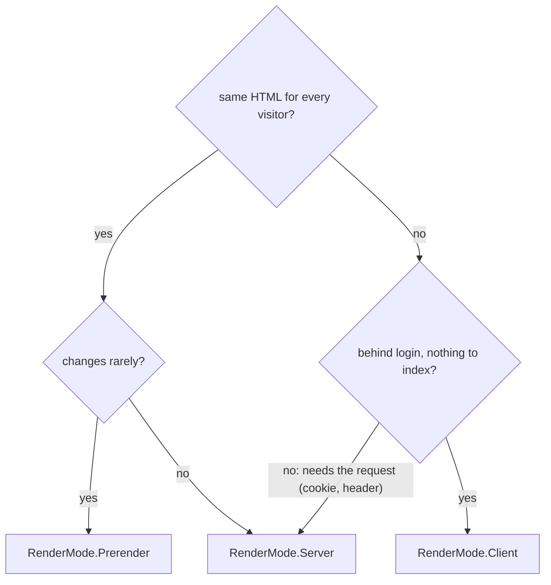
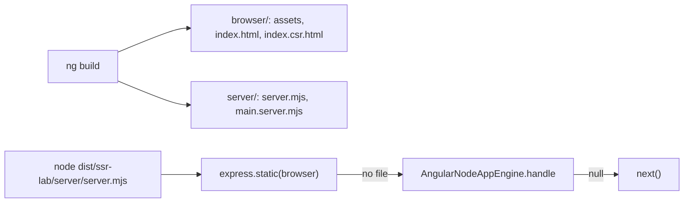
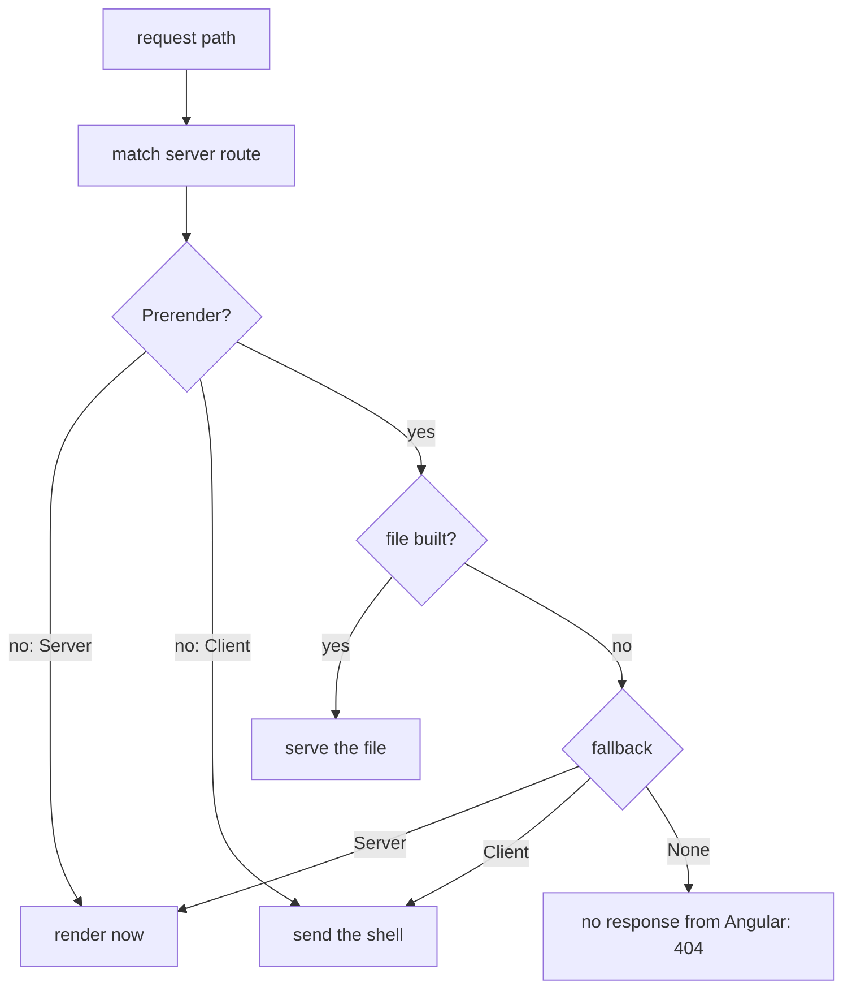
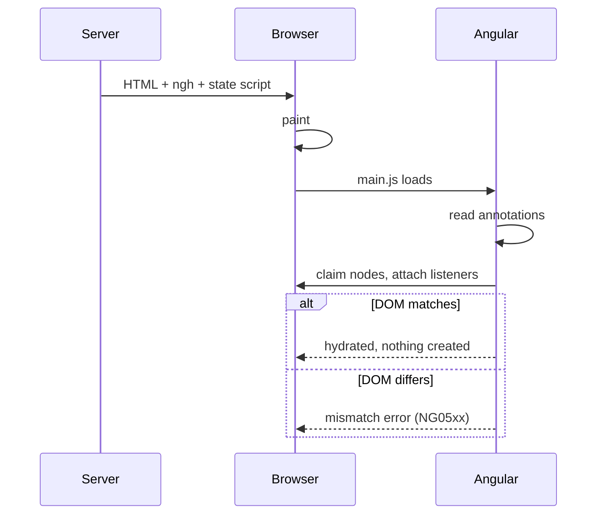
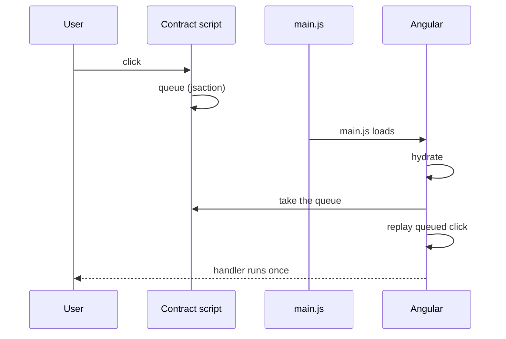
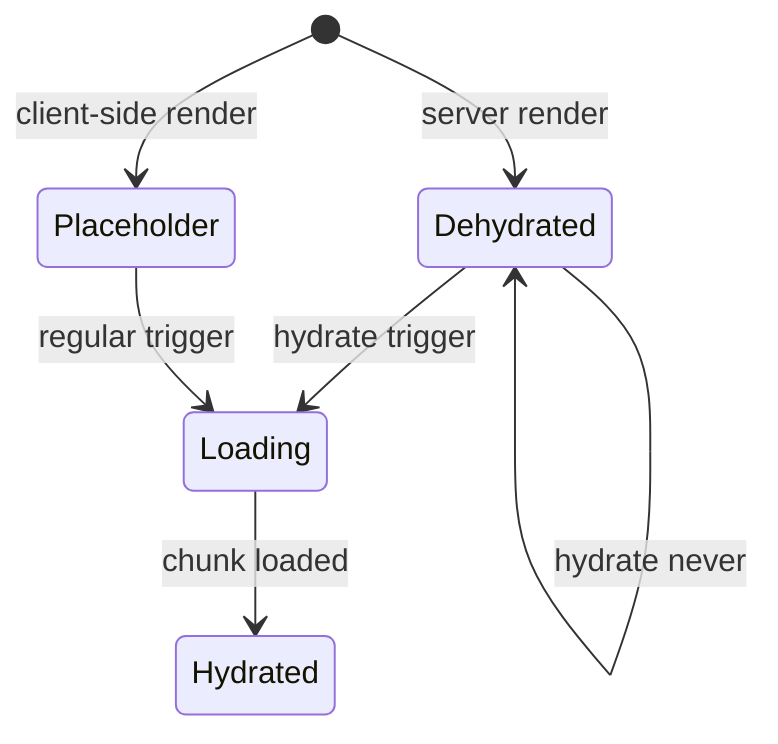
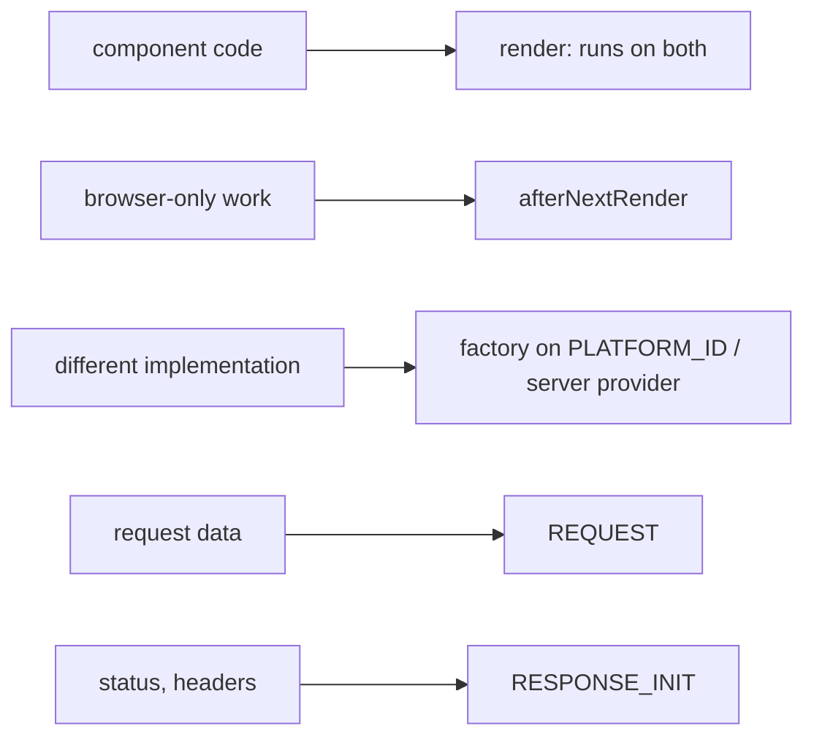
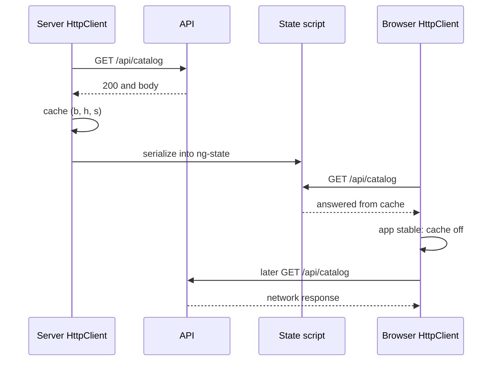
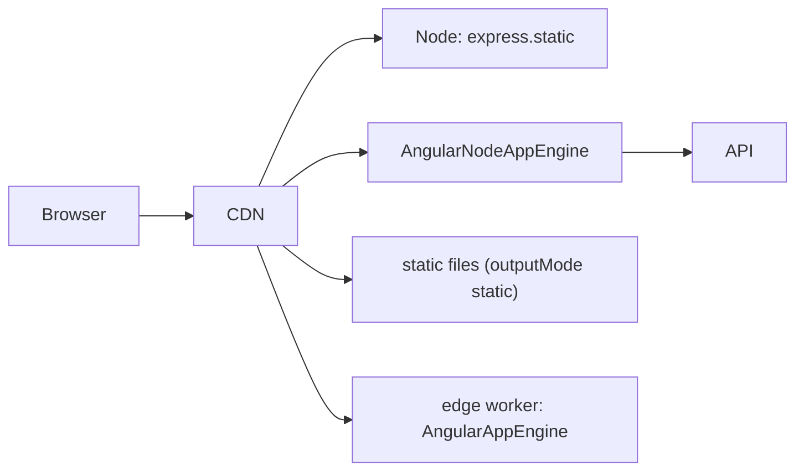
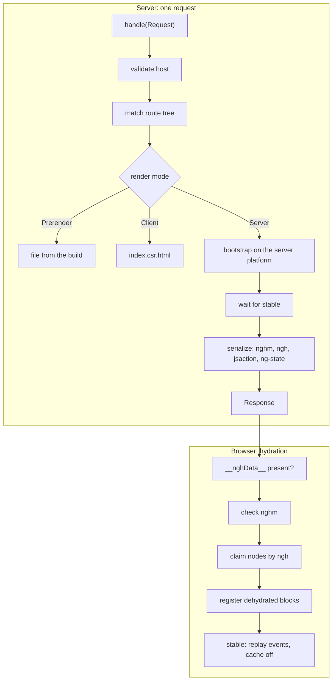

# 32. SSR, SSG and hydration

> **What this covers:** Why an Angular app renders on the server or at build time (first paint, search engines, link previews) and what that costs; adding `@angular/ssr` and reading what it generates; server routes with `RenderMode`, `getPrerenderParams`, fallbacks, headers and status codes; hydration, its mismatches and `ngSkipHydration`; event replay; incremental hydration with `hydrate` triggers; code that is safe on both platforms (`afterNextRender`, `DOCUMENT`, `REQUEST`, `RESPONSE_INIT`); the HTTP transfer cache and `TransferState`; deploying and caching server-rendered pages; and how a request travels through the engine and back into a hydrated page.
> **Prerequisites:** [18. `@defer` and the SSR pointer](18-control-flow-and-defer.md#7-what-lands-in-a-chunk-testing-deferred-blocks-and-the-ssr-pointer), [24. Router configuration](24-routing.md#1-router-configuration-providerouter-route-matching-redirects-and-the-wildcard), [31. Rendering strategy as a performance decision](31-performance.md#10-rendering-strategy-as-a-performance-decision-csr-ssr-and-ssg)
> **Leads to:** [33. Security](33-security.md), [44. Full-stack delivery and operations](44-fullstack-delivery-and-operations.md), [45. Frontend system design method](45-frontend-system-design-method.md)
> **Applies to:** Angular 22.2 (CLI 22.2.1), `@angular/ssr` and `@angular/platform-server` 22.2.1 and Express 5.2.1, TypeScript 6.0, Node 24; Playwright 1.63.0 on Chromium 153 for server and browser behavior, the Angular packages and Express installed in `labs/angular`, Playwright in `labs/e2e`, so all are observed; documented only: edge runtimes, CDNs, crawlers and the development-mode hydration log
> **Study time:** ~5 hours reading + ~4 hours exercises
> **Short on time:** read [§1](#1-why-render-on-the-server-csr-ssr-ssg-and-hybrid-rendering-and-what-each-costs), [§3](#3-server-routes-and-rendermode-per-route-rendering-getprerenderparams-fallbacks-headers-and-status), [§4](#4-hydration-reusing-the-servers-dom-mismatches-and-ngskiphydration) and [§7](#7-platform-safe-code-browser-apis-afternextrender-document-request-and-response_init), then [Q32.01](#q32-01), [Q32.06](#q32-06), [Q32.10](#q32-10), [Q32.14](#q32-14), [Q32.18](#q32-18) and [Q32.21](#q32-21), then the [Summary](#summary).
> **Labs:** [`labs/angular/projects/ssr-lab/`](../labs/angular/projects/ssr-lab/), [`labs/angular/src/app/modules/32-ssr-ssg-hydration/`](../labs/angular/src/app/modules/32-ssr-ssg-hydration/) and [`labs/e2e/tests/32-ssr-ssg-hydration/`](../labs/e2e/tests/32-ssr-ssg-hydration/). Run (Node 24): from `labs/angular`, `npx ng test --watch=false --include='src/app/modules/32-ssr-ssg-hydration/**/*.spec.ts'` and `npx ng build ssr-lab`; from `labs/e2e`, `npm test -- tests/32-ssr-ssg-hydration`.

## Contents

1. [Why render on the server: CSR, SSR, SSG and hybrid rendering, and what each costs](#1-why-render-on-the-server-csr-ssr-ssg-and-hybrid-rendering-and-what-each-costs)
2. [Adding `@angular/ssr`: what `ng add` generates, the build output and the server entry](#2-adding-angularssr-what-ng-add-generates-the-build-output-and-the-server-entry)
3. [Server routes and `RenderMode`: per-route rendering, `getPrerenderParams`, fallbacks, headers and status](#3-server-routes-and-rendermode-per-route-rendering-getprerenderparams-fallbacks-headers-and-status)
4. [Hydration: reusing the server's DOM, mismatches and `ngSkipHydration`](#4-hydration-reusing-the-servers-dom-mismatches-and-ngskiphydration)
5. [Event replay: keeping the clicks made before the code arrives](#5-event-replay-keeping-the-clicks-made-before-the-code-arrives)
6. [Incremental hydration: `@defer` blocks with `hydrate` triggers](#6-incremental-hydration-defer-blocks-with-hydrate-triggers)
7. [Platform-safe code: browser APIs, `afterNextRender`, `DOCUMENT`, `REQUEST` and `RESPONSE_INIT`](#7-platform-safe-code-browser-apis-afternextrender-document-request-and-response_init)
8. [Data across the boundary: the HTTP transfer cache, `TransferState` and `resource` ids](#8-data-across-the-boundary-the-http-transfer-cache-transferstate-and-resource-ids)
9. [Deploying SSR: Node and other runtimes, static output, caching rendered pages and allowed hosts](#9-deploying-ssr-node-and-other-runtimes-static-output-caching-rendered-pages-and-allowed-hosts)
10. [Under the hood: a request through the engine, the serialized page and the client's hydration pass](#10-under-the-hood-a-request-through-the-engine-the-serialized-page-and-the-clients-hydration-pass)
- [Summary](#summary)
- [Question bank](#question-bank)
- [Hands-on exercises](#hands-on-exercises)
- [Check your understanding](#check-your-understanding)
- [Connections](#connections)

**How the claims here are verified.** `@angular/ssr` and `@angular/platform-server` 22.2.1 are installed in `labs/angular`, so server behavior is observed: Playwright 1.63.0 drives Chromium 153 against the production build of the `ssr-lab` project, served by its own Express server. Tests fetch raw HTML without JavaScript and hold scripts to act before hydration; `ng test` (jsdom) covers tokens, `PLATFORM_ID`, `TransferState` and route typing. Source reads name the 22.2.1 file; docs on `main` are dated. Documented only: edge runtimes, CDNs, crawlers, the development-mode hydration log and DevTools. No test asserts a duration.

## 1. Why render on the server: CSR, SSR, SSG and hybrid rendering, and what each costs

### The problem it solves

A client-rendered shop's product link, pasted into a chat, previews with no title or image: the fetcher received only `<lab-root></lab-root>`. Another team server-renders a login-only admin tool and pays for servers rendering pages nothing indexes.

### Mental model

The question is **where and when a route's HTML is built**, answered per route by a **render mode** (a `RenderMode` value in the server routes, [Stable since v20.0]):

- **CSR (client-side rendering):** the server sends an empty app root; the browser builds the page with JavaScript.
- **SSR (server-side rendering):** the server runs Angular per request and sends finished HTML.
- **SSG (static site generation, or prerendering):** Angular renders the page at build time; the server sends that file.

**Hybrid rendering** mixes the three per route. After SSR or SSG, **hydration** makes the server's HTML interactive by reusing its DOM ([§4](#4-hydration-reusing-the-servers-dom-mismatches-and-ngskiphydration)). Analogy: a restaurant serves dishes from the fridge (SSG), cooked to order (SSR), or as a kit (CSR).



What to notice: the questions are asked per route, so one app can use all three modes.

### How it actually works

**What server HTML buys besides speed** ([31 §10](31-performance.md#10-rendering-strategy-as-a-performance-decision-csr-ssr-and-ssg) owns first paint): HTML any client reads without running JavaScript. A **crawler** fetches pages to index them: Google's [JavaScript SEO basics](https://developers.google.com/search/docs/crawling-indexing/javascript/javascript-seo-basics) (read 2026-10-14) says "a headless Chromium renders the page and executes the JavaScript", and that "not all bots can run JavaScript". A **link preview** (unfurl) is the card a chat app builds from a pasted URL; **Open Graph tags** (`<meta property="og:title" …>` in the `<head>`) are how the [Open Graph protocol](https://ogp.me/) lets a page "become a rich object in a social graph" (read 2026-10-14; documented only). The lab's `Client` route sends `<title>SsrLab</title>` and an empty `<lab-root>` (`Section 1: a client-rendered route sends an empty app root`); the `Server` route sends the heading, title and `description` set by `Title` and `Meta` (`Section 1: a server-rendered route sends the content, the title and the description`).

**Why the mode decides when HTML exists.** Read from `@angular/ssr` 22.2.1 (`types/ssr.d.ts`, `enum RenderMode`): `Server` is "rendered on the server for each request", `Client` "on the client side in the browser", `Prerender` "pre-rendered at build time and served as static files". Only `Server` and `Prerender` put route content in the response.

**Why only server HTML preloads the image.** Read from `@angular/common` 22.2.1 (`fesm2022/common.mjs`, `NgOptimizedImage.setHostAttributes`; read, not run): a `priority` image calls `PreloadLinkCreator` only when `ngServerMode`, the flag a server render sets, is true (both internal, may change in any release), which appends `<link rel="preload" as="image" fetchpriority="high">` to `document.head`. The lab finds it in the server `<head>` only (`Section 1: a priority image adds a preload link to the server HTML`).

**What each mode costs** ([SSR guide](https://angular.dev/guide/ssr) and [rendering strategies](https://angular.dev/guide/routing/rendering-strategies), read 2026-10-14):

| Mode | Cost |
|---|---|
| CSR | crawlers see no content "until JS executes" |
| SSR | a render "for every request which may increase server hosting costs"; no code that must "strictly depend on browser APIs" ([§7](#7-platform-safe-code-browser-apis-afternextrender-document-request-and-response_init)); interactivity "Delayed until hydration" |
| SSG | nothing user-specific; "may add significant time to your production builds"; an update needs a rebuild |

**Time to first byte (TTFB)** is the time until "the first byte of a response begins to arrive"; a server-rendered site "could have a higher TTFB" ([web.dev](https://web.dev/articles/ttfb), read 2026-10-14), because the response waits for the render.

Drilled in [Q32.01](#q32-01), [Q32.02](#q32-02) and [Q32.03](#q32-03); LCP and INP per page type is [Q31.26](31-performance.md#q31-26).

### Code

The approach: one component on two routes differing only in render mode, read with no browser.

1. The component sets the title and `description` tag and renders a `priority` image.
2. `app.routes.server.ts` gives each path its mode, above `'**'`.
3. The test fetches each path with `rawHtml` and compares the bodies.

```ts
// Excerpt of labs/angular/projects/ssr-lab/src/app/m32/why/product-page.ts
export class LabM32WhyProduct {
  protected readonly product = PRODUCT;

  constructor() {
    inject(Title).setTitle(`${PRODUCT.name} | Lab shop`);
    inject(Meta).updateTag({ name: 'description', content: PRODUCT.description });
  }
}
```

```ts
// Excerpt of labs/angular/projects/ssr-lab/src/app/app.routes.server.ts
export const serverRoutes: ServerRoute[] = [
  { path: 'm32/why/client', renderMode: RenderMode.Client },
  { path: 'm32/why/server', renderMode: RenderMode.Server },
  { path: '**', renderMode: RenderMode.Server },
];
```

```ts
// Excerpt of labs/e2e/tests/32-ssr-ssg-hydration/concepts/section-1-why-server.spec.ts
test('Section 1: a server-rendered route sends the content, the title and the description', async ({ request }) => {
  const { status, body } = await rawHtml(request, '/m32/why/server');
  expect(status).toBe(200);
  expect(body).toContain(`<h2>${PRODUCT}</h2>`);
  expect(body).toContain(TITLE);
  expect(body).toContain(DESCRIPTION);
});
```

> [!TIP]
> **Coming from the backend.** Spring MVC with Thymeleaf, "a modern server-side Java template engine" ([Spring docs](https://docs.spring.io/spring-framework/reference/web/webmvc-view/mvc-thymeleaf.html), read 2026-10-14), also sends finished HTML. **Where the analogy breaks:** each Thymeleaf navigation is a server render; Angular hydrates the server DOM, and later navigation stays "client-side" (rendering strategies).

### Best practices and anti-patterns

- **Prerender what every visitor sees the same and keep `Client` for login-only pages**, because neither then renders on the server per request.
- **Check the raw HTML, not a screenshot**, because a client that runs no JavaScript gets only the response.

### Misconceptions and traps

- *"SSR is only about speed."* Its HTML also serves clients without JavaScript; the myth comes from the docs leading with "faster page loads".
- *"Search engines cannot index client-rendered apps."* Google renders JavaScript, though not all bots can; the Angular docs say CSR "may negatively affect" SEO. The myth holds because CSR's HTML really is empty.
- *"SSR makes the app interactive sooner."* Content is in the HTML, but interactivity waits for hydration ([§4](#4-hydration-reusing-the-servers-dom-mismatches-and-ngskiphydration)); visible looks usable.
- *"One rendering mode per app."* Server routes set it per route ([§3](#3-server-routes-and-rendermode-per-route-rendering-getprerenderparams-fallbacks-headers-and-status)); the myth comes from the generated config, whose only server route is `'**'` with `RenderMode.Prerender` ([§2](#2-adding-angularssr-what-ng-add-generates-the-build-output-and-the-server-entry)).

## 2. Adding `@angular/ssr`: what `ng add` generates, the build output and the server entry

### The problem it solves

After `ng add @angular/ssr` the build writes `browser/` and `server/` folders; for a project that had no browser sub-folder the schematic warns: "You might need to adjust your deployment pipeline." A team uploading only the browser files finds no file for `/m32/setup/orders/42`, and nobody knows where a server-only provider goes.

### Mental model

`ng add` gives the app **two entry points and one server**. `main.ts` boots `App` in the browser. `main.server.ts`, the **server entry point** (where the server bundle's app starts), boots the same `App` with a **`BootstrapContext`**, an object carrying a platform created for the request ([12 §6](12-angular-how-it-works.md#6-bootstrapping-bootstrapapplication-the-platform-and-initializers) and [15 §3](15-standalone-and-ngmodules.md#3-bootstrapping-and-providers-without-modules-bootstrapapplication-provide-functions-and-importprovidersfrom) own bootstrapping). `app.config.server.ts` is the **server config**: **`mergeApplicationConfig`** merges its providers into the shared config "from left to right". `app.routes.server.ts` holds the render modes; `server.ts` is an Express app whose **Express middleware** are functions `(req, res, next)` that answer or call `next()`. Analogy: one script, two stages.



What to notice: the server is your Express app; Angular is one middleware inside it.

### How it actually works

**Who writes what.** `@angular/ssr` 22.2.1's `ng-add` only calls `externalSchematic('@schematics/angular', 'ssr', options)` (`schematics/ng-add/index.js`; read, not run; the lab ran `ng generate application ssr-lab --ssr`, the same schematic). `@schematics/angular` 22.2.1 (`ssr/index.js`) sets the build options `outputMode: 'server'`, `ssr.entry` and `security.allowedHosts: []` (the lab sets `["localhost"]`, [§9](#9-deploying-ssr-node-and-other-runtimes-static-output-caching-rendered-pages-and-allowed-hosts)), writes `server.ts` and adds the script `serve:ssr:<project>`; its `server` step writes the three server files. **`outputMode`** (a builder option, [12 §3](12-angular-how-it-works.md#3-building-the-application-builder-output-layout-and-budgets)) is `'server'` for "applications using hybrid rendering or APIs" and `'static'` for "a static site build artifact" (`@angular/build` 22.2.1, `schema.json`).

**Why hydration is on without `withEventReplay()`.** The `server` step ends with `addRootProvider(options.project, … provideClientHydration …)` (`server/index.js`). `addRootProvider` finds the `bootstrapApplication` call in the main file, follows its config and appends the call to `providers` (`utility/standalone/rules.js`; read, not run). `Smoke: the generated config enables event replay without withEventReplay` still finds the replay script ([§5](#5-event-replay-keeping-the-clicks-made-before-the-code-arrives)).

**Two `provideServerRendering` functions.** `@angular/ssr` exports one taking features such as `withRoutes`; `@angular/platform-server` exports another whose only parameter is `{ maxResponseBodySize }` (typings, 22.2.1). The generated config uses `@angular/ssr`'s.

**What the files in `dist/ssr-lab` are.** `Section 2: the build writes a browser folder and a server folder` lists them. `Section 2: prerendered routes are written as index.html files at build time` reads `browser/index.html` (the prerendered home page) and `browser/index.csr.html` (an empty `<lab-root></lab-root>`), and finds both and `server/index.server.html` in `server/angular-app-manifest.mjs`. In `@angular/ssr` 22.2.1 (`fesm2022/ssr.mjs`; read, not run) a `Client` route is answered with `index.csr.html` and a `Server` render starts from `index.server.html`.

**Why `index: false`.** serve-static 2.2.1 (README, read) sends a directory's `index.html` unless `index` is `false`. With it off, `/` reaches the engine, whose internal `handleServe` answers a prerendered route from the manifest's assets (read, not run). The exported **request handler** `reqHandler` is the app wrapped for callers such as "the Angular CLI (for dev-server and during build)" (`server.ts` comment); `isMainModule(import.meta.url)` is true only for the entry file, so importing `server.ts` does not listen.

### Code

The approach: read the generated files in request order.

1. The shared config, with the schematic's root provider:

```ts
import { ApplicationConfig, provideBrowserGlobalErrorListeners } from '@angular/core';
import { provideRouter } from '@angular/router';
import { routes } from './app.routes';
import { provideClientHydration } from '@angular/platform-browser';

export const appConfig: ApplicationConfig = {
  providers: [
    provideBrowserGlobalErrorListeners(),
    provideRouter(routes),
    provideClientHydration(),
  ],
};
```

<sub>Source: [labs/angular/projects/ssr-lab/src/app/app.config.ts](../labs/angular/projects/ssr-lab/src/app/app.config.ts)</sub>

2. The server config merges `@angular/ssr`'s `provideServerRendering(withRoutes(…))`:

```ts
import { mergeApplicationConfig, ApplicationConfig } from '@angular/core';
import { provideServerRendering, withRoutes } from '@angular/ssr';
import { appConfig } from './app.config';
import { serverRoutes } from './app.routes.server';

const serverConfig: ApplicationConfig = {
  providers: [provideServerRendering(withRoutes(serverRoutes))],
};

export const config = mergeApplicationConfig(appConfig, serverConfig);
```

<sub>Source: [labs/angular/projects/ssr-lab/src/app/app.config.server.ts](../labs/angular/projects/ssr-lab/src/app/app.config.server.ts)</sub>

3. The server entry point passes that config and the context on:

```ts
import { BootstrapContext, bootstrapApplication } from '@angular/platform-browser';
import { App } from './app/app';
import { config } from './app/app.config.server';

const bootstrap = (context: BootstrapContext) => bootstrapApplication(App, config, context);

export default bootstrap;
```

<sub>Source: [labs/angular/projects/ssr-lab/src/main.server.ts](../labs/angular/projects/ssr-lab/src/main.server.ts)</sub>

4. The generated server routes: a record copy outside `src/`, not compiled; the lab's `src/` file replaced them:

```ts
import { RenderMode, ServerRoute } from '@angular/ssr';

export const serverRoutes: ServerRoute[] = [
  {
    path: '**',
    renderMode: RenderMode.Prerender,
  },
];
```

<sub>Source: [labs/angular/projects/ssr-lab/generated/app.routes.server.ts](../labs/angular/projects/ssr-lab/generated/app.routes.server.ts)</sub>

5. The Express server, minus comments and the lab's `/api` line:

```ts
// Excerpt of labs/angular/projects/ssr-lab/src/server.ts
import {
  AngularNodeAppEngine,
  createNodeRequestHandler,
  isMainModule,
  writeResponseToNodeResponse,
} from '@angular/ssr/node';
import express from 'express';
import { join } from 'node:path';
const browserDistFolder = join(import.meta.dirname, '../browser');
const app = express();
const angularApp = new AngularNodeAppEngine();
app.use(
  express.static(browserDistFolder, {
    maxAge: '1y',
    index: false,
    redirect: false,
  }),
);
app.use((req, res, next) => {
  angularApp
    .handle(req)
    .then((response) => (response ? writeResponseToNodeResponse(response, res) : next()))
    .catch(next);
});
if (isMainModule(import.meta.url) || process.env['pm_id']) {
  const port = process.env['PORT'] || 4000;
  app.listen(port, (error) => {
    if (error) {
      throw error;
    }
    console.log(`Node Express server listening on http://localhost:${port}`);
  });
}
export const reqHandler = createNodeRequestHandler(app);
```

6. A nested path has no file in `browser/`, so the engine renders it (`Section 2: the server answers a deep link with the HTML of that page`; [Q24.33](24-routing.md#q24-33) asks the router side):

```ts
// Excerpt of labs/e2e/tests/32-ssr-ssg-hydration/concepts/section-2-setup.spec.ts
  const { status, body } = await rawHtml(request, '/m32/setup/orders/42');
  expect(status).toBe(200);
  expect(body).toContain('<h2>Order 42 detail</h2>');
  await expect(distFile('browser/m32/setup/orders/42/index.html')).rejects.toThrow('is missing');
```

Drilled in [Q32.04](#q32-04) and [Q32.05](#q32-05).

### Best practices and anti-patterns

- **Put a server-only provider in `app.config.server.ts`**, because `main.server.ts` imports `config` while `main.ts` imports `appConfig`.
- **Define API routes above the engine handler**, because it takes "all other requests".
- **Name the import path of `provideServerRendering`**, because both packages export it and only `@angular/ssr`'s accepts `withRoutes`.

### Misconceptions and traps

- *"`ng add @angular/ssr` makes every route server-rendered."* The generated route is `'**'` with `RenderMode.Prerender` ([§3](#3-server-routes-and-rendermode-per-route-rendering-getprerenderparams-fallbacks-headers-and-status)); the name suggests per-request rendering.
- *"`server.ts` is Angular's server."* It is plain Express with the engine as one handler; the CLI only generated it.
- *"`provideServerRendering` from `@angular/platform-server` is the same function."* Only `@angular/ssr`'s takes `withRoutes`; the names match.
- *"The browser folder can be deployed alone."* It has no file for a nested server route, so deep links need the server; only `outputMode: 'static'` builds without one ([§9](#9-deploying-ssr-node-and-other-runtimes-static-output-caching-rendered-pages-and-allowed-hosts)). The folder looks like the old output.

## 3. Server routes and `RenderMode`: per-route rendering, `getPrerenderParams`, fallbacks, headers and status

### The problem it solves

A shop prerenders every product page, so the build renders them one by one and grows with the catalog. A product added after the build has no file. The account page, prerendered too, shows what the build saw instead of the visitor's data. A missing product answers 200 with an empty page.

### Mental model

**Server routes** are a `ServerRoute[]` given to `withRoutes` ([§2](#2-adding-angularssr-what-ng-add-generates-the-build-output-and-the-server-entry)). Each names a router path and a `renderMode`: `RenderMode.Prerender` writes the HTML at build time, `Server` renders per request, `Client` sends the **shell**, `index.csr.html` with an empty app root ([§1](#1-why-render-on-the-server-csr-ssr-ssg-and-hybrid-rendering-and-what-each-costs)). A path with a parameter such as `products/:id` adds **`getPrerenderParams`**, a function returning the parameter values to build, and a **prerender fallback** (`PrerenderFallback.Server`, `Client` or `None`) for the values it did not list. A **route header** is a `headers` entry sent with the route's response; `status` sets its status code. A **soft redirect** is an HTML page with `<meta http-equiv="refresh">`, because a file cannot send a `Location` header. Analogy: a print shop prints bestsellers in advance, others on demand, and hands a blank form for the rest.



What to notice: a prerendered route can still render on demand; only `None` leaves the request unanswered.

### How it actually works

**A server route does not create a page.** Read from `@angular/ssr` 22.2.1 (`fesm2022/ssr.mjs`, `traverseRoutesConfig`, internal; read, not run): the build walks the router's routes and, for each, looks up the server route that matches it. A router route with no match is an error, and so is a server route with no router route unless it ends in `/**`. The result is a list stored in the server bundle, which is why `'**'` gives a mode to every router route nothing more specific names.

**Why order does not decide.** `RouteTree` (same file, internal) stores paths segment by segment, with `:id` normalized to `*`. Matching tries the exact segment, then `*`, then `**`, wherever each is written; `'**'` last is for the reader.

**Why a prerendered route has no status.** `ServerRoutePrerender` is `Omit<ServerRouteCommon, 'status'>` (typings): the server sends a file, and `handleServe` adds the route's headers to a 200. `Section 3: a Prerender route is served from a file written at build time` shows the response equal to the file, even with `?visit=b`; `Section 3: route headers and status reach the response` shows the header on both modes and 201 on `Server`.

**What each fallback answers.** `Section 3: getPrerenderParams writes one file per returned id` finds files for ids 1 and 2 only. For id 3 the default fallback renders on the server (`Section 3: the default fallback renders an id that was not prerendered on the server`), `Client` sends the shell (`Section 3: the Client fallback sends the shell for an id that was not prerendered`), and `None` gets Express's own 404 (`Section 3: the None fallback does not render an id that was not prerendered`) (the engine's `handle` returns `null` for an unmatched path, read, and `server.ts` then calls `next()`, [§2](#2-adding-angularssr-what-ng-add-generates-the-build-output-and-the-server-entry)).

**Redirects** follow the router's `redirectTo` ([24 §1](24-routing.md#1-router-configuration-providerouter-route-matching-redirects-and-the-wildcard) owns it). `Section 3: a redirect on a server-rendered route is an HTTP redirect` gets 301 from `status: 301`; a prerendered route with a redirect gets 302 from the server and has no file. In `@angular/build` 22.2.1 (`prerender.js`; read, not run) redirects are skipped unless `outputMode` is `'static'`, and only then written as the soft-redirect page ([§9](#9-deploying-ssr-node-and-other-runtimes-static-output-caching-rendered-pages-and-allowed-hosts)). The [SSR guide](https://angular.dev/guide/ssr) (read 2026-10-14): SSR uses "standard HTTP redirects", SSG "soft redirects".

Drilled in [Q32.06](#q32-06), [Q32.07](#q32-07), [Q32.08](#q32-08) and [Q32.09](#q32-09), and in [Exercise 32.1](#ex32-1).

### Code

The approach: three parameterized routes that differ only in fallback, plus pages that show their mode.

1. Each server route sits above `'**'`; the product routes share one `getPrerenderParams` returning strings.
2. The compile-time spec shows the types refusing a `status` on `Prerender`.
3. The e2e spec requests id 3 from the `None` route.

```ts
// Excerpt of labs/angular/projects/ssr-lab/src/app/app.routes.server.ts
  {
    path: 'm32/routes/shelf-client/:id',
    renderMode: RenderMode.Prerender,
    fallback: PrerenderFallback.Client,
    getPrerenderParams: prerenderIds,
  },
  {
    path: 'm32/routes/shelf-none/:id',
    renderMode: RenderMode.Prerender,
    fallback: PrerenderFallback.None,
    getPrerenderParams: prerenderIds,
  },
```

```ts
// Excerpt of labs/angular/src/app/modules/32-ssr-ssg-hydration/concepts/section-3-server-routes.spec.ts
    // @ts-expect-error `ServerRoutePrerender` is `Omit<ServerRouteCommon, 'status'>`: a file has no status per request.
    const route: ServerRoute = { path: 'catalog', renderMode: RenderMode.Prerender, status: 201 };
```

```ts
// Excerpt of labs/e2e/tests/32-ssr-ssg-hydration/concepts/section-3-server-routes.spec.ts
  const { status, body } = await rawHtml(request, `${ROUTES}/shelf-none/3`);
  expect(status).toBe(404);
  expect(body).toContain('Cannot GET /m32/routes/shelf-none/3');
```

### Best practices and anti-patterns

- **Prerender the ids you can list and keep the default fallback**, because a new product then renders on demand instead of failing.
- **Use `Server` for anything that reads the request**, because the build has no request.
- **Set `status` only on `Server` and `Client` routes**, because a file cannot carry one.
- **Choose `None` only when something else answers the leftover path**, because Angular sends nothing.

### Misconceptions and traps

- *"Prerendering makes the whole site static."* It is per route and the Node server renders the rest; the myth comes from static site generators.
- *"A product missing from `getPrerenderParams` returns 404."* The default fallback renders it on the server; the myth comes from the file not existing, and only `None` answers 404.
- *"Server routes replace the router's routes."* They only choose how an existing router route renders; the paths look alike.
- *"A prerendered page can greet the visitor from a cookie."* It renders once at build time, where `REQUEST` is `null` ([§7](#7-platform-safe-code-browser-apis-afternextrender-document-request-and-response_init)); the component code looks the same as on a `Server` route.

## 4. Hydration: reusing the server's DOM, mismatches and `ngSkipHydration`

### The problem it solves

Without hydration, a server-rendered app "will destroy and re-render the application's DOM, which may result in a visible UI flicker" ([hydration guide](https://angular.dev/guide/hydration), read 2026-10-14). Today's failure is different: a chart component inserts a `<canvas>` with `document.createElement`, the console shows `NG0500`, and the quick fix, `ngSkipHydration` on the root, "would effectively disable hydration for your entire application" (same guide).

### Mental model

**Hydration** ([§1](#1-why-render-on-the-server-csr-ssr-ssg-and-hybrid-rendering-and-what-each-costs)) is the browser's Angular **taking over** the server's DOM: it walks its templates and **claims** each existing node (keeps it as if it had created it) instead of creating one, then attaches listeners. **Destructive hydration**, the older way, discards the server DOM and renders again. To find nodes, the server writes **annotations**: an `ngh` attribute on each component host, pointing at an entry of `__nghData__` in the **state script** (the JSON the server writes into the page, [§8](#8-data-across-the-boundary-the-http-transfer-cache-transferstate-and-resource-ids)) that records what each view rendered. A **hydration mismatch** is a DOM that differs from what the template expects; hydration throws. **`ngSkipHydration`** on a component host opts that component out: the browser empties the host and renders it from scratch. Analogy: a tenant moves into a furnished flat with its inventory list; a missing chair stops the move.



What to notice: when the DOM matches, no node is created; the server's nodes become Angular's.

### How it actually works

**The server opts in too.** In `@angular/platform-server` 22.2.1, `prepareForHydration` (internal, may change in any release; read, not run) returns early unless hydration is enabled on the server; otherwise it inserts the **integrity marker**, a `<!--nghm-->` comment as the body's first child, and calls `annotateForHydration` (internal), which stores the views in `TransferState` under `__nghData__`. Hence the guide's "IMPORTANT" note to provide `provideClientHydration()` on the server too; the generated server config inherits it ([§2](#2-adding-angularssr-what-ng-add-generates-the-build-output-and-the-server-entry)). `Section 4: the server HTML carries hydration annotations and the state script` finds the marker, `ngh="0"` and `__nghData__`.

**The client checks before claiming.** In `@angular/core` 22.2.1 (`core.mjs`), `withDomHydration` (internal) reuses nodes only when the state holds `__nghData__`; `verifySsrContentsIntegrity` (internal) throws NG0507 if the marker is gone, because something (its message names CDN optimizations) rewrote the HTML. Without the data, development builds warn NG0505.

**Claiming is positional.** `locateNextRNode` (internal, `_debug_node-chunk.mjs`) takes the view's first child, the previous node's `nextSibling`, or a path from the annotation; nothing is looked up by tag. `Section 4: hydration keeps the nodes the server rendered` holds `main-*.js`, grabs the server's `<h2>`, releases it, and finds the same node after a click is handled.

**Why a mismatch throws instead of patching.** `locateOrCreateElementNodeImpl` (internal) raises `HYDRATION_NODE_MISMATCH` (NG0500) when the node found is not an element, and NG0502 when there is none. The full comparison, tag names included, is `validateMatchingNode` (internal), which runs only under `ngDevMode`. One extra node shifts every later claim, and Angular cannot tell its nodes from foreign ones, so it stops. `Section 4: a component that adds DOM nodes outside Angular fails hydration with its error code`: the constructor prepends a `<canvas>`, the text `Weekly sales` is claimed as that canvas, `<strong>` lands on the text node: the console shows `ERROR …: NG0500`, without message in production. `Section 4: markup the parser repairs fails hydration`: the server sends `<p>Intro <lab-m32-note-box><div>…</div></lab-m32-note-box></p>`; the browser's parser closes the `<p>` before the `<div>`, the host arrives empty: NG0502. The guide also lists `<table>` without `<tbody>`, nested `<a>`, `preserveWhitespaces: true`, and DOM APIs such as `appendChild` (`Renderer2` included, [14 §1](14-directives-and-pipes.md#1-directives-and-attribute-directives-host-inputs-elementref-and-renderer2)).

**`ngSkipHydration`.** The server writes the component without `ngh`; the browser's `locateOrCreateElementNodeImpl` sees the attribute on a component host, clears it and renders it anew. `Section 4: ngSkipHydration renders the component's nodes again`: the page's `<h2>` survives, the card's `<p>` is replaced. On a non-host element, development builds throw NG0504; production ignores it (read, not run). The development statistics log and DevTools overlay are documented only.

Drilled in [Q32.10](#q32-10), [Q32.11](#q32-11) and [Q32.12](#q32-12), and in [Exercise 32.2](#ex32-2) and [Exercise 32.4](#ex32-4).

### Code

The approach: a component that breaks hydration, and a page that opts one out.

1. `PLATFORM_ID` keeps the DOM write out of the server render ([§7](#7-platform-safe-code-browser-apis-afternextrender-document-request-and-response_init)).
2. It prepends a `<canvas>` before Angular claims the template's nodes.
3. The other page puts `ngSkipHydration` on a component host.

```ts
// Excerpt of labs/angular/projects/ssr-lab/src/app/m32/hydration/dom-append-page.ts
@Component({
  selector: 'lab-m32-sales-chart',
  template: `Weekly sales <strong>42</strong>`,
})
export class LabM32SalesChart {
  constructor() {
    if (isPlatformBrowser(inject(PLATFORM_ID))) {
      const canvas = inject(DOCUMENT).createElement('canvas');
      inject<ElementRef<HTMLElement>>(ElementRef).nativeElement.prepend(canvas);
    }
  }
}
```

```ts
// Excerpt of labs/angular/projects/ssr-lab/src/app/m32/hydration/skip-page.ts
@Component({
  selector: 'lab-m32-hydration-skip',
  imports: [LabM32SkippedCard],
  template: `
    <h2>Hydration: skipped child</h2>
    <lab-m32-skipped-card ngSkipHydration />
    <button type="button" (click)="clicks.set(clicks() + 1)">Clicks: {{ clicks() }}</button>
  `,
})
```

### Best practices and anti-patterns

- **Keep `provideClientHydration()` in the shared config**, because the server annotates only when hydration is enabled there.
- **Create nodes in the template, and run DOM libraries in `afterNextRender`** [Stable since v20.0] ([20 §4](20-lifecycle-and-render-hooks.md#4-render-hooks-afternextrender-aftereveryrender-and-their-phases)), because a node added before hydration shifts every claim after it.
- **Write HTML the parser keeps** (`<tbody>`, no block inside `<p>`), because the browser re-parses the server's string.
- **Use `ngSkipHydration` as a stopgap on the smallest component**, because that subtree is rendered twice.
- **Check hydration in a development build too**, because production skips the tag check and prints codes only.

### Misconceptions and traps

- *"Hydration renders the page again in the browser."* It claims them (the node-identity test). Once true until v16.0, which added "a public API function to enable non-destructive hydration" (core CHANGELOG 16.0.0); other frameworks' wording keeps the myth alive.
- *"`ngSkipHydration` fixes the mismatch."* The error disappears because the component is rendered again; fix the component.
- *"Different text causes a mismatch."* Text nodes are claimed without reading their content (`locateOrCreateTextNodeImpl`, internal; read, not run); the word "mismatch" suggests content.
- *"No error in production means hydration matched."* A wrong-tag element is claimed silently there; the tag check is development-only. A quiet console looks like success.
- *"Hydration needs only the browser provider."* The server writes the annotations; the name `provideClientHydration` suggests otherwise.

## 5. Event replay: keeping the clicks made before the code arrives

### The problem it solves

The server's HTML shows an "Add to cart" button before the JavaScript bundle arrives, so a shopper clicks it while no listener exists, and the click goes nowhere until hydration ([§4](#4-hydration-reusing-the-servers-dom-mismatches-and-ngskiphydration)) ends. **Event replay** closes that gap: the browser records the click and Angular runs the handler later. `Section 5: a click before hydration is replayed once after hydration` holds the main bundle, clicks, releases it, and finds the click counted once.

### Mental model

**Capturing** is recording an event before hydration; **replaying** is delivering it to the real listener afterwards; between the two nothing runs. The **event contract** is the inline script that captures. **`jsaction`** is the attribute marking an element with a listener (`jsaction="click:;"`); **JSAction** is the library behind the name (Core 18.0.0: "Synchronize changes from internal JSAction codebase"). Analogy: a night letterbox, emptied once at opening time.



What to notice: the click is handled once, by the real handler, after hydration.

### How it actually works

**The server writes both halves.** The build inserts the contract right after `<body>` (`@angular/build` 22.2.1, `addEventDispatchContract`; read, not run), so it listens before any element exists. While rendering, Angular records each listener's event type, and `insertEventRecordScript` (`@angular/platform-server` 22.2.1, internal; read, not run) adds the call naming the types to catch. `Section 5: the server HTML includes the event contract script and jsaction attributes` shows `["click"]` and `jsaction="click:;"` on the button; `Section 5: an element without a listener carries no jsaction attribute` shows none on the heading, paragraphs or `<output>`.

**The client takes the queue over.** The contract keeps its queue on `window._ejsas[appId]`. In `@angular/core` 22.2.1 (internal; read, not run), each listener Angular registers is also stored on its element, and when `appRef.whenStable()` resolves, `initEventReplay` feeds the queue to a dispatcher that calls the stored listeners.

**Why a click runs once.** `invokeListeners` skips an element already marked as having handled that event (`handledEventElements`), the mark behind Core 21.2.11's fix: "prevent event replay double-invocation when element hydrates before app stability" ([CHANGELOG](https://github.com/angular/angular/blob/main/CHANGELOG.md), read 2026-10-14).

**Why it is on by default.** Event replay `[Changed in v22.0: on by default through provideClientHydration()]`: the providers of `withIncrementalHydration()` start with `withEventReplay()`, and platform-browser 22.0.0 made incremental hydration the default ([§6](#6-incremental-hydration-defer-blocks-with-hydrate-triggers)). `Smoke: the generated config enables event replay without withEventReplay` finds the contract. After `withNoIncrementalHydration()` the [hydration guide](https://angular.dev/guide/hydration) (read 2026-10-14) adds `withEventReplay()`. VERSIONS.md calls it stable since v19; no changelog line says so, and Core 18.0.0 introduced it: "Add event delegation library to queue up events and replay them when the application is ready".

**What is recorded.** Only types in a fixed list (`BUBBLE_EVENT_TYPES`, `CAPTURE_EVENT_TYPES`, `primitives-event-dispatch.mjs`, internal; read, not run): `click` and `input` are in it, `scroll` is not.

Drilled in [Q32.13](#q32-13) and [Q32.14](#q32-14), and in [Exercise 32.4](#ex32-4).

### Code

The approach: one listener, one inert paragraph.

1. The component has a single `(click)`; its route is `RenderMode.Server`.
2. The generated `provideClientHydration()` supplies replay.
3. The test holds `main-*.js`, clicks, and releases.

```ts
import { Component, signal } from '@angular/core';

/** A cart with one listener: a click on the button before hydration is queued and replayed. */
@Component({
  selector: 'lab-m32-replay-cart',
  template: `
    <h2>Event replay: cart</h2>
    <p>Items in cart: <output>{{ items() }}</output></p>
    <button type="button" (click)="items.set(items() + 1)">Add to cart</button>
    <p>This paragraph has no listener.</p>
  `,
})
export class LabM32ReplayCart {
  protected readonly items = signal(0);
}
```

<sub>Source: [labs/angular/projects/ssr-lab/src/app/m32/replay/cart-page.ts](../labs/angular/projects/ssr-lab/src/app/m32/replay/cart-page.ts)</sub>

```ts
// Excerpt of labs/e2e/tests/32-ssr-ssg-hydration/concepts/section-5-event-replay.spec.ts
  const release = await holdScripts(page, MAIN);
  await page.goto(`${SSR_ORIGIN}${CART}`, { waitUntil: 'commit' });

  const items = page.getByRole('status');
  await expect(items).toHaveText('0');
  await page.getByRole('button', { name: 'Add to cart' }).click();
  await expect(items).toHaveText('0');

  await release();
  await expect(items).toHaveText('1');
```

```js
// Partial: abridged from @angular/core 22.2.1 (core.mjs) and @angular/platform-server 22.2.1 (platform-server.mjs), internal; read, not run
function withIncrementalHydration() {
  const providers = [withEventReplay(), { provide: IS_INCREMENTAL_HYDRATION_ENABLED, useValue: true } /* … */];
  /* … */
}
function insertEventRecordScript(appId, doc, eventTypesToReplay, nonce) {
  /* … */
  `window.__jsaction_bootstrap(document.body,"${appId}",${JSON.stringify(Array.from(regular))},${JSON.stringify(Array.from(capture))});`
  eventDispatchScript.after(replayScript);
}
```

### Best practices and anti-patterns

- **Leave replay on**, because the default already includes it; after `withNoIncrementalHydration()`, add `withEventReplay()`.
- **Write handlers that read current state**, because they run after hydration, not at click time.
- **Test with a held bundle, never a sleep**, because no delay reliably precedes hydration.

### Misconceptions and traps

- *"Event replay must be enabled with `withEventReplay()`."* It was the switch (Core 20.0.0: "enable stashing only when `withEventReplay()` is invoked"); the default now includes it.
- *"Replay re-dispatches every DOM event."* It queues the listed types of listeners in the server output. "Captures events" sounds like all of them.
- *"Replayed clicks may run twice."* Once true until Core 21.2.11; the lab asserts one.
- *"Replay makes the page interactive sooner."* The click is kept, not served: nothing runs until the code arrives. A click that is no longer lost feels like a working page.

## 6. Incremental hydration: `@defer` blocks with `hydrate` triggers

### The problem it solves

A product page server-renders a gallery, reviews and a footer. Full hydration ([§4](#4-hydration-reusing-the-servers-dom-mismatches-and-ngskiphydration)) loads and runs the code of all three, although most visitors never touch the reviews. A plain `@defer` block splits the code but leaves only its `@placeholder` in the server HTML ([Q18.20](18-control-flow-and-defer.md#q18-20)), so the reviews are missing from it. `Section 6: a hydrate block's content is in the server HTML and a regular defer block's is not` shows both on one page.

### Mental model

**Incremental hydration** `[Stable since v20.0]` · `[Changed in v22.0: enabled by default by provideClientHydration()]` hydrates parts of a page separately. A **hydrate trigger** (`hydrate on interaction`, `idle`, `viewport`, `hover`, `immediate`, `timer(…)`, `hydrate when <expr>`, `hydrate never`) on a `@defer` block makes the server render the block's content; in the browser that content stays a **dehydrated block** (server DOM, no code, no listeners) until the trigger fires. Each such block is a **hydration boundary**: hydration stops at its edge. The triggers mirror the regular ones ([18 §6](18-control-flow-and-defer.md#6-triggers-and-prefetching)) and apply only to the first load; a later client-side render uses the regular trigger and the `@placeholder` ([incremental hydration guide](https://angular.dev/guide/incremental-hydration), read 2026-10-14). Analogy: locked, furnished rooms; a key opens one, hallway first.



What to notice: a `hydrate never` block stays dehydrated and still shows its server content.

### How it actually works

**The server renders, the client waits.** Under `ngServerMode` (internal: the flag set while rendering on the server) each hydrate instruction (internal), such as `ɵɵdeferHydrateOnInteraction`, loads the block at once, while regular triggers never fire there ([18 §7](18-control-flow-and-defer.md#7-what-lands-in-a-chunk-testing-deferred-blocks-and-the-ssr-pointer)). The output marks the block's root elements with `ngb="d2"` and, for `interaction`, `jsaction="click:;keydown:;"`; the state script's `__nghDeferData__` (internal) records each block's parent (`"d1":{…,"p":"d0"}`). In the browser, `ɵɵdefer` adds each block the server rendered through a hydrate trigger to `DEHYDRATED_BLOCK_REGISTRY` (`@angular/core` 22.2.1, `_debug_node-chunk.mjs`, internal; read, not run).

**Why the chunk waits.** `Section 6: the block's chunk is requested only after the hydrate trigger` counts zero requests for the reviews chunk on the hydrated page, then one after a click on its heading. `Section 6: a hydrate never block's chunk is not requested after interaction` counts none after a click on the footer.

**Why a click is not lost.** The event contract ([§5](#5-event-replay-keeping-the-clicks-made-before-the-code-arrives)) catches the click; `invokeRegisteredReplayListeners` (`core.mjs`, internal) sees the `ngb` attribute, queues the event and starts hydration; after the block hydrates, the queued event reaches the real listener. `Section 6: a click inside a dehydrated block is replayed after the block hydrates` holds the reviews chunk, clicks "Helpful", sees `0`, releases and sees `1`.

**Why parents hydrate first.** A component needs its parent's injector and bindings. `triggerHydrationFromBlockName` (internal) calls `getParentBlockHydrationQueue`, which walks the `p` links up to the top-most block still in the registry and builds the queue from it down; `triggerHydrationForBlockQueue` then loads each block and waits a render before the next. `Section 6: nested blocks hydrate from the outermost block down` clicks the inner "Zoom" button and finds the gallery chunk and log before the zoom ones.

Opt out with `withNoIncrementalHydration()` `[Added in v22.0]`; `withIncrementalHydration()` `[Deprecated since v22.0 — use the default of provideClientHydration()]` (typings: "Intent to remove in v24"). Drilled in [Q32.15](#q32-15), [Q32.16](#q32-16) and [Q32.17](#q32-17), and in [Exercise 32.4](#ex32-4).

### Code

The approach: one page with every kind of block.

1. A nested pair (gallery, zoom) and the reviews use `hydrate on interaction`; each deferred component sits in its own file, so each gets its own chunk.
2. A regular `@defer (on viewport)` block and a `hydrate never` footer complete the page; the route is `RenderMode.Server`.
3. `afterNextRender` sets "hydrated", which the tests wait for.

```ts
import { afterNextRender, Component, signal } from '@angular/core';
import { LabM32IncrementalFooter } from './site-footer';
import { LabM32IncrementalGallery } from './gallery';
import { LabM32IncrementalRelated } from './related';
import { LabM32IncrementalReviews } from './reviews';
import { LabM32IncrementalZoom } from './zoom';

/** A product page with three kinds of `@defer` block: regular, `hydrate on interaction` (also nested) and `hydrate never`. */
@Component({
  selector: 'lab-m32-incremental-product',
  imports: [
    LabM32IncrementalFooter,
    LabM32IncrementalGallery,
    LabM32IncrementalRelated,
    LabM32IncrementalReviews,
    LabM32IncrementalZoom,
  ],
  template: `
    <h2>Incremental hydration: desk chair</h2>
    <p>Page: <output aria-label="Page state">{{ state() }}</output></p>

    @defer (hydrate on interaction) {
      <section>
        <lab-m32-incremental-gallery />
        @defer (hydrate on interaction) {
          <div><lab-m32-incremental-zoom /></div>
        }
      </section>
    }

    @defer (hydrate on interaction) {
      <section><lab-m32-incremental-reviews /></section>
    } @placeholder {
      <p>Reviews placeholder</p>
    }

    @defer (on viewport) {
      <lab-m32-incremental-related />
    } @placeholder {
      <p>Related products placeholder</p>
    }

    @defer (hydrate never) {
      <footer><lab-m32-incremental-footer /></footer>
    }
  `,
})
export class LabM32IncrementalProduct {
  /** "server" in the server HTML; "hydrated" once the page itself has hydrated in the browser. */
  protected readonly state = signal('server');

  constructor() {
    afterNextRender(() => this.state.set('hydrated'));
  }
}
```

<sub>Source: [labs/angular/projects/ssr-lab/src/app/m32/incremental/product-page.ts](../labs/angular/projects/ssr-lab/src/app/m32/incremental/product-page.ts)</sub>

The nested test, after recording the console and the chunk requests:

```ts
// Excerpt of labs/e2e/tests/32-ssr-ssg-hydration/concepts/section-6-incremental.spec.ts
  await openHydrated(page);

  await page.getByRole('button', { name: 'Zoom: 0' }).click();

  await expect(page.getByRole('button', { name: 'Zoom: 1' })).toBeVisible();
  expect(logs).toEqual(['m32 incremental: gallery block hydrated', 'm32 incremental: zoom block hydrated']);
  const order = scripts.filter((url) => url.endsWith(`/${gallery}`) || url.endsWith(`/${zoom}`));
  expect(order.map((url) => url.slice(url.lastIndexOf('/') + 1))).toEqual([gallery, zoom]);
```

```js
// Partial: abridged from @angular/core 22.2.1 (_debug_node-chunk.mjs), internal; read, not run
function getParentBlockHydrationQueue(deferBlockId, injector) {
  /* … */
  const deferBlockParents = transferState.get(NGH_DEFER_BLOCKS_KEY, {}); // __nghDeferData__
  while (!isTopMostDeferBlock && currentBlockId) {
    isTopMostDeferBlock = dehydratedBlockRegistry.has(currentBlockId);
    /* … a parent already hydrating: wait for its promise instead … */
    hydrationQueue.unshift(currentBlockId);
    currentBlockId = deferBlockParents[currentBlockId][DEFER_PARENT_BLOCK_ID]; // "p"
  }
  return { parentBlockPromise, hydrationQueue };
}
```

### Best practices and anti-patterns

- **Use `hydrate on interaction` for widgets people seldom touch**, because their code then loads only for the visitors who touch them.
- **Keep a `@placeholder`**, because a client-side navigation to the page renders the block the regular way.
- **Use `hydrate never` only for content with no listeners**, because its code never loads on the first visit.
- **Avoid `hydrate when` inside a dehydrated parent**, because the guide says the expression lives in the parent, which must hydrate first.

### Misconceptions and traps

- *"`hydrate never` means the content is not rendered."* The server renders it; it stays static HTML. The word "never" suggests absence.
- *"Hydrate triggers replace regular triggers."* They apply only to the first load; client-side renders use the regular ones. Both sit in the same parentheses.
- *"Incremental hydration needs `withIncrementalHydration()`."* Once true: v19 to v21 required it. Now the default includes it (platform-browser 22.0.0: "make incremental hydration default behavior").
- *"A dehydrated block ignores clicks."* No code is loaded, but the contract queues the click, hydration starts, and the click is replayed once.

## 7. Platform-safe code: browser APIs, `afterNextRender`, `DOCUMENT`, `REQUEST` and `RESPONSE_INIT`

### The problem it solves

One page reads `window.innerWidth` in a field initializer: in the lab's server entry the request ends on Express's `Cannot GET` page with status 404 and none of the app's HTML (`Section 7: touching window during a server render fails the request`). A not-found page renders "Not found" yet answers 200, telling every client the page exists. A third page must greet visitors in their language, and nothing in a component says which one the request asked for.

### Mental model

Component code runs in **two environments**. The **server platform**, the platform Angular builds to render on Node, sets the `PLATFORM_ID` token (the **platform ID**) to `'server'` (`@angular/platform-server` 22.2.1, `_server-chunk.mjs`; read). It has no `window`, `localStorage` or layout; its `document` is a **DOM emulation**, domino (an internal library name, in `third_party/domino`), where a text search finds no `innerWidth` or `getBoundingClientRect` (read). Four tools, in order of preference:

1. **Don't touch the browser while rendering.** Derive values from inputs and signals.
2. **Run browser work after render** in `afterNextRender` ([20 §4](20-lifecycle-and-render-hooks.md#4-render-hooks-afternextrender-aftereveryrender-and-their-phases), [Q20.10](20-lifecycle-and-render-hooks.md#q20-10), [Q20.24](20-lifecycle-and-render-hooks.md#q20-24)); the server skips it.
3. **Inject `DOCUMENT`** instead of reading the global.
4. **Swap the implementation** with a **platform-specific provider**, one supplying a different class or value per environment: a factory reading `PLATFORM_ID`, or a provider in `app.config.server.ts` ([16 §7](16-dependency-injection.md#7-injectiontoken-multi-providers-environment-providers-and-initializers)).

`isPlatformBrowser` is the last resort: "Prefer platform-specific providers over runtime checks with `isPlatformBrowser` or `isPlatformServer`." ([server rendering guide](https://angular.dev/guide/ssr), read 2026-10-14). Three tokens carry the exchange: **`REQUEST`**, a Fetch `Request`; **`RESPONSE_INIT`**, the response's options, where a page sets status and headers; **`REQUEST_CONTEXT`**, the `unknown` value the server passes as the second argument of `handle`. `REQUEST` and `RESPONSE_INIT` are `null` in the browser and in prerendered pages. Analogy: an actor rehearsing on an empty stage mimes props that arrive on opening night.



What to notice: the safe default is code that never asks where it runs.

> [!NOTE]
> **Framework vs platform.** The platform owns the shapes. `REQUEST` is the Fetch `Request`, which "represents a resource request" ([MDN, `Request`](https://developer.mozilla.org/en-US/docs/Web/API/Request)); `RESPONSE_INIT` is the options of `Response()`, whose `status` is "The status code for the response. The default value is 200." ([MDN, `Response()`](https://developer.mozilla.org/en-US/docs/Web/API/Response/Response)); `DOCUMENT` is the platform's `Document`, "an entry point into the web page's content" ([MDN, `Document`](https://developer.mozilla.org/en-US/docs/Web/API/Document)), read 2026-10-14. Angular adds the tokens that hand them to a component, `PLATFORM_ID`, the render hooks and the server's emulation.

### How it actually works

**Why a failed render ends as a 404.** `renderAngular` (`@angular/ssr` 22.2.1, `ssr.mjs`, internal) sets `hasNavigationError` when the router has no `lastSuccessfulNavigation()`; `handleRendering` then returns `null`, which `handle` passes on. The lab's `server.ts` answers `null` with `next()`, so Express sends its 404 (read; the crash test shows the result).

**Why a component can set the status.** For a `Server` route `handleRendering` provides `REQUEST`, `REQUEST_CONTEXT` and `RESPONSE_INIT` (internal; read), and `RESPONSE_INIT` is the object it later passes to `new Response(stream, responseInit)`, so an assignment while rendering changes the response. The type is mutable since core 21.0.6, "use mutable ResponseInit type for RESPONSE_INIT token" ([CHANGELOG](https://github.com/angular/angular/blob/main/CHANGELOG.md)). `Section 7: RESPONSE_INIT sets the status of a server-rendered page` finds 404 there and 200 on a neighbour. The typings list SSG among the `null` cases, and the `REQUEST` test finds `no request` in the prerendered copy.

**Why the server waits for work.** It serializes after the app is stable ([21 §5](21-change-detection.md#5-zoneless-change-detection-the-scheduler-its-triggers-and-pendingtasks), [Q21.31](21-change-detection.md#q21-31)). `PendingTasks.run(fn)` [Developer preview since v19.0] keeps it unstable until `fn`'s promise settles, so `Section 7: the server waits for a pending task before it serializes the page` finds text set after a timer in the HTML. The server has no `Worker` either ([31 §9](31-performance.md#9-off-the-main-thread-web-workers-in-angular-and-runoutsideangular-in-zone-apps)).

Drilled in [Q32.18](#q32-18), [Q32.19](#q32-19) and [Q32.20](#q32-20), and in [Exercise 32.1](#ex32-1) and [Exercise 32.2](#ex32-2).

### Code

The approach: one page per tool.

1. `afterNextRender` fills a browser-only value through `DOCUMENT`.
2. A not-found page sets its status through `RESPONSE_INIT`.
3. A page reads `Accept-Language` from `REQUEST`.
4. An `ng test` spec picks the implementation from `PLATFORM_ID`.

```ts
import { afterNextRender, Component, DOCUMENT, inject, signal } from '@angular/core';

/** Browser-only work goes into `afterNextRender`, and the document comes from `DOCUMENT`. */
@Component({
  selector: 'lab-m32-platform-after-render',
  template: `
    <h2>Platform: after render</h2>
    <p>Width: <output aria-label="Width">{{ width() }}</output></p>
  `,
})
export class LabM32PlatformAfterRender {
  private readonly document = inject(DOCUMENT);
  protected readonly width = signal('unknown');

  constructor() {
    afterNextRender(() => this.width.set(`${this.document.defaultView?.innerWidth}px`));
  }
}
```

<sub>Source: [labs/angular/projects/ssr-lab/src/app/m32/platform/after-render-page.ts](../labs/angular/projects/ssr-lab/src/app/m32/platform/after-render-page.ts)</sub>

```ts
import { Component, inject, RESPONSE_INIT } from '@angular/core';

/** Sets the response status while the server renders; the token is `null` in the browser. */
@Component({
  selector: 'lab-m32-platform-not-found',
  template: `<h2>Not found</h2><p>This page does not exist.</p>`,
})
export class LabM32PlatformNotFound {
  constructor() {
    const response = inject(RESPONSE_INIT);
    if (response) response.status = 404;
  }
}
```

<sub>Source: [labs/angular/projects/ssr-lab/src/app/m32/platform/not-found-page.ts](../labs/angular/projects/ssr-lab/src/app/m32/platform/not-found-page.ts)</sub>

```ts
import { Component, inject, REQUEST } from '@angular/core';

/** Shows the request's `Accept-Language` header; with no request (prerendering, the browser) there is none. */
@Component({
  selector: 'lab-m32-platform-language',
  template: `<h2>Platform: language</h2><p>Accept-Language: <output aria-label="Language">{{ language }}</output></p>`,
})
export class LabM32PlatformLanguage {
  protected readonly language = inject(REQUEST)?.headers.get('accept-language') ?? 'no request';
}
```

<sub>Source: [labs/angular/projects/ssr-lab/src/app/m32/platform/language-page.ts](../labs/angular/projects/ssr-lab/src/app/m32/platform/language-page.ts)</sub>

```ts
// Excerpt of labs/angular/src/app/modules/32-ssr-ssg-hydration/concepts/section-7-platform.spec.ts
const PREFERENCES = new InjectionToken<Preferences>('lab-m32 preferences', {
  factory: () => ({ kind: isPlatformBrowser(inject(PLATFORM_ID)) ? 'browser' : 'server' }),
});

  it('Section 7: a factory provider picks the server implementation from PLATFORM_ID', () => {
    TestBed.configureTestingModule({ providers: [{ provide: PLATFORM_ID, useValue: 'server' }] });

    expect(TestBed.inject(PREFERENCES).kind).toBe('server');
  });
```

### Best practices and anti-patterns

- **Derive from inputs and signals first**, because code that never asks where it runs needs no guard.
- **Put browser-only work in `afterNextRender`**, because the server skips it.
- **Inject `DOCUMENT` and `PLATFORM_ID`**, because a test can then supply a replacement.
- **Check `REQUEST` and `RESPONSE_INIT` for `null`**, because both are `null` in the browser and in prerendered pages.
- **Don't render different DOM per platform**, because the browser then disagrees with the server's HTML ([§4](#4-hydration-reusing-the-servers-dom-mismatches-and-ngskiphydration)).

### Misconceptions and traps

- *"`typeof window !== 'undefined'` is the Angular way."* A guard hides the platform from tests; inject `PLATFORM_ID` or `DOCUMENT` and prefer `afterNextRender`. Other frameworks' habit keeps it alive.
- *"`DOCUMENT` on the server is a full browser DOM."* It is the emulation, without layout; the shared token suggests one object.
- *"`REQUEST` works in prerendered pages."* The page is built with no request, so the token is `null` (`no request` in the test). The page still renders on a server, so a request seems to exist.
- *"`isPlatformBrowser` checks are free."* Branching on it can render different DOM and break hydration. A boolean check looks free.

## 8. Data across the boundary: the HTTP transfer cache, `TransferState` and `resource` ids

### The problem it solves

The server fetches `/api/catalog` to render a product list. The browser hydrates and fetches it again: the API sees every page view twice. A page sending an `Authorization` header behaves differently for no visible reason. A per-user value placed in the page lands in HTML that anyone can read. The lab runs the first: `Section 8: hydration reuses the cached response without a browser request`.

### Mental model

Server and browser share no memory, so a server value reaches the browser only through the page. **State transfer** is that hand-over: the server writes the data it used into the HTML as JSON and the browser reads it during hydration. The JSON sits in the **state script**, `<script id="ng-state" type="application/json">`; each value has a **state key**, the string it is stored under. Three routes use it:

1. **`HttpClient`, automatically:** the **HTTP transfer cache** stores the `GET` and `HEAD` responses of the server render, and the browser's `HttpClient` answers the same requests from it until the app is stable, then switches it off ([27 §6](27-http-client.md#6-cancellation-and-caching-unsubscribing-aborts-cache-interceptors-sharereplay-and-the-ssr-transfer-cache) owns the rule, [Q27.21](27-http-client.md#q27-21) compares caches).
2. **`TransferState`:** write on the server, read in the browser, with a key from `makeStateKey`.
3. **A `resource` with an `id`** [Added in v22.0] ([17 §6](17-signals.md#6-resources-async-data-as-signals)): the same, with the id as the key.

Analogy: a waiter who brings the kitchen's ticket with the dish, so the table does not reorder.



What to notice: the cache only covers the first render; everything after is a normal request.

### How it actually works

**What is in the script.** `/m32/data/products` holds one entry besides the hydration data: a 64-hex-character key and `{ b, h, s, st, u, rt }`, the body, headers (none by default), status, status text, URL and response type (`Section 8: the server HTML carries the HttpClient response in the state script`). The key hashes method, response type, URL, body and params (`makeCacheKey`, internal, may change in any release); `u` is the relative URL, so the key ignores the server's origin. When the server reaches the API at another origin, the **origin map** (`HTTP_TRANSFER_CACHE_ORIGIN_MAP`) renames it (server code only).

**Why a request is skipped.** Read from `@angular/common` 22.2.1, `fesm2022/http.mjs`, `canUseOrCacheRequest` (internal):

```js
// Partial: quoted from @angular/common 22.2.1 (fesm2022/http.mjs), internal; line breaks added, `hasAuthHeaders` abridged; read, not run
if (!isCacheActive || requestOptions === false ||
    requestMethod === 'POST' && !includePostRequests && !requestOptions ||
    requestMethod !== 'POST' && !ALLOWED_METHODS.includes(requestMethod) ||
    !includeRequestsWithAuthHeaders && hasAuthHeaders(req) ||
    !includeRequestsWithCredentials && hasOutgoingCredentials(req) ||
    !includeNonCacheableRequests && (hasUncacheableCacheControl(req.headers) || isNonCacheableRequest(req.cache)) ||
    filter?.(req) === false) {
  return false;
}
// hasAuthHeaders: headers.has('authorization') || headers.has('proxy-authorization') || headers.has('cookie')
```

Each of `Authorization`, `Proxy-Authorization`, `Cookie`, credentials, `no-store`, `private`, `no-cache` and `POST` skips the cache. Nothing travels: the state script of `/m32/data/me` holds only `__nghData__` and the browser makes one `GET /api/catalog` (`Section 8: a request with an Authorization header is requested again in the browser`). A response with those directives or `Set-Cookie` is not stored either (read, not run).

**Why it ends.** `withHttpTransferCache` sets `isCacheActive` to `false` once `appRef.whenStable()` resolves ([21 §5](21-change-detection.md#5-zoneless-change-detection-the-scheduler-its-triggers-and-pendingtasks)); `provideClientHydration` does the same to `CACHE_ACTIVE` (internal), which a `resource` checks (read). After `Stable: yes` a click made one request (`Section 8: a client-side navigation after hydration requests again`), where hydration made none.

**`TransferState` and `resource` ids.** `TransferState` values go through `JSON.stringify`, so only "boolean, number, string, null and non-class objects" survive "in a non-lossy manner" (typings). `makeStateKey(key)` returns `key` itself (read). `Section 8: a TransferState value written on the server is read in the browser` shows the server's `lab-banner`, not the browser's fallback. A `resource` with an `id` stores its value under the id on the server; in the browser, while the flag is active, it starts resolved and skips its loader (`ResourceImpl`, internal; read). In `Section 8: a resource with an id reads its server value in the browser` the one `GET /api/time` comes from the control resource without an `id`. The marker rests on Core 22.0.0's "add ability to cache resources for SSR" ([CHANGELOG](https://github.com/angular/angular/blob/main/CHANGELOG.md)), as in 17.

Drilled in [Q32.21](#q32-21), [Q32.22](#q32-22), [Q32.23](#q32-23) and [Q32.24](#q32-24), and in [Exercise 32.3](#ex32-3).

### Code

The approach: three pages.

1. `products-page.ts` calls `HttpClient`; the transfer needs no code. `stable.ts` shows `Stable: yes` once the browser app is stable.
2. `me-page.ts` sends the same request with an `Authorization` header (a fixed lab value, not a credential).
3. `state-page.ts` writes a `TransferState` value on the server and loads `/api/time` in two resources, one with an `id`.

```ts
import { HttpClient } from '@angular/common/http';
import { Component, inject } from '@angular/core';
import { toSignal } from '@angular/core/rxjs-interop';
import { RouterLink } from '@angular/router';
import { LabProduct } from './product';
import { browserStable } from './stable';

/** Loads the catalog with `HttpClient`: the server's response travels to the browser in the state script. */
@Component({
  selector: 'lab-m32-data-products',
  imports: [RouterLink],
  template: `
    <h2>Data: products</h2>
    <ul aria-label="Products">
      @for (product of products(); track product.id) {
        <li>{{ product.name }}</li>
      }
    </ul>
    <p>Stable: <output aria-label="Stable">{{ stable() ? 'yes' : 'no' }}</output></p>
    <a routerLink="/m32/data/products-again">Open the list again</a>
  `,
})
export class LabM32DataProducts {
  protected readonly products = toSignal(inject(HttpClient).get<LabProduct[]>('/api/catalog'), { initialValue: [] });
  protected readonly stable = browserStable();
}
```

<sub>Source: [labs/angular/projects/ssr-lab/src/app/m32/data/products-page.ts](../labs/angular/projects/ssr-lab/src/app/m32/data/products-page.ts)</sub>

```ts
// Excerpt of labs/angular/projects/ssr-lab/src/app/m32/data/me-page.ts
/** A fixed lab value, not a credential: any request that carries an `Authorization` header skips the transfer cache. */
const LAB_AUTHORIZATION = 'Bearer lab-demo-token';
export class LabM32DataMe {
  protected readonly products = toSignal(
    inject(HttpClient).get<LabProduct[]>('/api/catalog', { headers: new HttpHeaders({ Authorization: LAB_AUTHORIZATION }) }),
    { initialValue: [] },
  );
```

```ts
import { isPlatformServer } from '@angular/common';
import { HttpClient } from '@angular/common/http';
import { Component, inject, makeStateKey, PLATFORM_ID, resource, TransferState } from '@angular/core';
import { firstValueFrom } from 'rxjs';
import { browserStable } from './stable';

interface LabTime {
  time: string;
}

const BANNER = makeStateKey<string>('lab-banner');

/**
 * Three ways to hand a value from the server to the browser: a `TransferState` key, a `resource` with an `id`
 * and, as the control, a `resource` without one.
 */
@Component({
  selector: 'lab-m32-data-state',
  template: `
    <h2>Data: state</h2>
    <p>Banner: <output aria-label="Banner">{{ banner }}</output></p>
    <p>Time with id: <output aria-label="Time with id">{{ timeWithId.value()?.time ?? 'loading' }}</output></p>
    <p>Time without id: <output aria-label="Time without id">{{ timeWithoutId.value()?.time ?? 'loading' }}</output></p>
    <p>Stable: <output aria-label="Stable">{{ stable() ? 'yes' : 'no' }}</output></p>
  `,
})
export class LabM32DataState {
  private readonly http = inject(HttpClient);
  private readonly transferState = inject(TransferState);

  protected readonly banner = this.readBanner();
  protected readonly timeWithId = resource({ id: 'lab-time', loader: () => this.loadTime() });
  protected readonly timeWithoutId = resource({ loader: () => this.loadTime() });
  protected readonly stable = browserStable();

  /** Writes the value on the server; the browser reads it back, or falls back to its own. */
  private readBanner(): string {
    if (isPlatformServer(inject(PLATFORM_ID))) {
      this.transferState.set(BANNER, 'written on the server');
    }
    return this.transferState.get(BANNER, 'computed in the browser');
  }

  private loadTime(): Promise<LabTime> {
    return firstValueFrom(this.http.get<LabTime>('/api/time', { transferCache: false }));
  }
}
```

<sub>Source: [labs/angular/projects/ssr-lab/src/app/m32/data/state-page.ts](../labs/angular/projects/ssr-lab/src/app/m32/data/state-page.ts)</sub>

### Best practices and anti-patterns

- **Load server-rendered data through `HttpClient`**, because the transfer cache is its interceptor: a direct `fetch` is not stored.
- **Give a `resource` an `id` when the server already has its data**, because otherwise the browser loads it again.
- **Keep per-user data out of the state script**, because it is public HTML; `includeRequestsWithAuthHeaders` and `includeNonCacheableRequests` remove that protection.

### Misconceptions and traps

- *"The transfer cache is an HTTP cache."* It lives for one page load, has no expiry and ends at stability; the word "cache" suggests more.
- *"Every `HttpClient` call is transferred."* `POST`, authorized, credentialed and non-cacheable requests are skipped; "automatic" suggests all.
- *"`TransferState` is private to the user."* It is plain JSON in the HTML, readable by anyone, or any shared cache ([section 9](#9-deploying-ssr-node-and-other-runtimes-static-output-caching-rendered-pages-and-allowed-hosts)), that gets the page; never put secrets in it. Data filled per request feels private.
- *"The browser stops calling the API after SSR."* Only the first render is covered; later navigations call it as usual. The first load made no browser call, which looks like the rule.

## 9. Deploying SSR: Node and other runtimes, static output, caching rendered pages and allowed hosts

### The problem it solves

After an upgrade to v22, every page behind a load balancer answers 400. A CDN shows one visitor's personalized page to others. An edge platform rejects a server bundle that imports Node modules.

### Mental model

The build gives three shapes: **a Node server** (`server/server.mjs`, Express with `AngularNodeAppEngine`, [§2](#2-adding-angularssr-what-ng-add-generates-the-build-output-and-the-server-entry)); **another runtime** through **`AngularAppEngine`** `[Stable since v20.0]`, the engine that maps a web-standard `Request` to a `Response`, such as an **edge runtime** (JavaScript at a CDN's locations, without Node's modules); or **static output**, files from `outputMode: 'static'` with no server.

A **shared cache** (a CDN or reverse proxy) stores one response and gives it to many users; **`Cache-Control`** is the header telling caches whether and how long to store it ([09 §4](09-web-networking-storage-security.md#4-http-caching)). **Host validation** rejects a request whose `Host` is not on your list. Analogy: a bakery baking to order (Node), a food truck (edge), a vending machine (static); only packaged goods can be stocked anywhere.



What to notice: only responses that are the same for every visitor belong in a shared cache.

### How it actually works

**Why an unknown host gets 400 before rendering.** `AngularAppEngine.handle` (`@angular/ssr` 22.2.1, `fesm2022/ssr.mjs`) calls `validateRequest` (internal, `_validation-chunk.mjs`), which checks `Host`, `X-Forwarded-Host` and a `Forwarded` host, then the URL's hostname. A throw becomes a `text/plain` 400: `Section 9: a request with an unknown Host header gets 400` reads `Header "host" with value "evil.example" is not allowed.` Host validation `[Changed in v22.0: an unknown host gets 400 instead of a client-rendered page]`: "The server no longer falls back to Client-Side Rendering (CSR)" ([CLI CHANGELOG](https://github.com/angular/angular-cli/blob/main/CHANGELOG.md), 22.0.0, abridged).

**Why it worked under `ng serve`.** The list joins the engine's `allowedHosts` option, or `NG_ALLOWED_HOSTS` for `AngularNodeAppEngine`, with the build's `security.allowedHosts`; `*.example.com` matches subdomains only (`isHostAllowed`). The generated `[]` admits nothing, so the lab lists `"localhost"`. `ng serve` substitutes its own list ("Always allow the dev server host", `@angular/build` 22.2.1, `builders/dev-server/vite/index.js`; read, not run), so a missing name surfaces only in production.

**Why the check exists.** **SSRF** (server-side request forgery) makes a server call an address the attacker picks ([33](33-security.md#7-server-rendered-pages-escaping-in-the-server-html-the-state-script-and-ssrf) owns it). The request URL comes from `Host`, and server-side `HttpClient` resolves relative URLs against it (`relativeUrlsTransformerInterceptorFn`, `@angular/platform-server` 22.2.1, internal), so a forged host redirects `/api` calls. `'*'` disables the check and logs "Allowing all hosts via "*" is a security risk." (abridged).

**Proxy headers** (`Forwarded`, `X-Forwarded-*`) carry the client's original host and scheme from a load balancer. `sanitizeRequestHeaders` deletes them unless `trustProxyHeaders` keeps them, because clients can send them too. The 22.0.0 `trust-proxy-headers` migration (`@schematics/angular` 22.2.1) inserts `['x-forwarded-host', 'x-forwarded-proto']` with a TODO "Remove if not needed" (read, not run).

**Caching follows the render mode.** `express.static` gives hashed assets `public, max-age=31536000` (`Section 9: hashed static assets are served with a one-year max-age`); names change with content ([12 §3](12-angular-how-it-works.md#3-building-the-application-builder-output-layout-and-budgets)). The engine adds no `Cache-Control` to a server-rendered page: `Section 9: a route's Cache-Control header reaches the server-rendered response` finds `private, no-store` on the route with `headers` and none on a plain `Server` page; `RESPONSE_INIT` sets it per request ([§7](#7-platform-safe-code-browser-apis-afternextrender-document-request-and-response_init)). A prerendered page gets an `ETag` and no `Cache-Control` unless its route adds one (`handleServe`, internal; read).

**Other runtimes.** `ssr.platform: 'neutral'` `[Changed in v22.0: renamed from ssr.experimentalPlatform]` "avoids using Node.js-specific APIs" and "does not provide polyfills" (`@angular/build` 22.2.1, `schema.json`, abridged). `outputMode: 'static'` "does not generate a server file" ([server rendering guide](https://angular.dev/guide/ssr), read 2026-10-14).

Drilled in [Q32.25](#q32-25).

### Code

The approach: put hosts, proxies and caching in code.

1. Mark a per-request page private.
2. Configure the Node engine behind a proxy.
3. Export a web-standard handler for another runtime.

```ts
// Excerpt of labs/angular/projects/ssr-lab/src/app/app.routes.server.ts
export const serverRoutes: ServerRoute[] = [
  { path: 'm32/deploy/greeting', renderMode: RenderMode.Server, headers: { 'Cache-Control': 'private, no-store' } },
  { path: '**', renderMode: RenderMode.Server },
];
```

```ts
// Partial: server.ts as generated (section 2); the proxy sets and overwrites both headers
const angularApp = new AngularNodeAppEngine({
  allowedHosts: ['shop.example.com', '*.shop.example.com'],
  trustProxyHeaders: ['x-forwarded-host', 'x-forwarded-proto'],
});
```

```ts
// Partial: the server entry for a runtime that passes a Request, built with ssr.platform 'neutral'
import { AngularAppEngine, createRequestHandler } from '@angular/ssr';

const angularApp = new AngularAppEngine({ allowedHosts: ['shop.example.com'] });

export const reqHandler = createRequestHandler(async (request: Request) => {
  const response = await angularApp.handle(request);
  return response ?? new Response('Not found', { status: 404 });
});
```

#### Legacy

`CommonEngine` (`@angular/ssr/node`) `[Deprecated since v22.0 — use AngularNodeAppEngine or AngularAppEngine]` renders a URL to an HTML string; its `render` options (typings) have no render mode, status or headers. `@schematics/angular` 22.2.1 still generates it without the application builder (`ssr/files/server-builder/server.ts.template`):

```ts
// Partial: legacy CommonEngine server.ts; imports, `server`, `distFolder`, `indexHtml` and `bootstrap` as in the template
const commonEngine = new CommonEngine({ allowedHosts: ['shop.example.com'] });

server.use((req, res, next) => {
  const { protocol, originalUrl, baseUrl, headers } = req;

  commonEngine
    .render({
      bootstrap,
      documentFilePath: indexHtml,
      url: `${protocol}://${headers.host}${originalUrl}`,
      publicPath: distFolder,
      providers: [{ provide: APP_BASE_HREF, useValue: baseUrl }],
    })
    .then((html) => res.send(html))
    .catch((err) => next(err));
});
```

It changed because server routes let each route pick its mode, status and headers. No `ng update` step migrates it: `@schematics/angular` 22.2.1's `migration-collection.json` lists five 22.0.0 migrations, none for `CommonEngine`; `@angular/ssr` 22.2.1 ships none. By hand: use the generated `AngularNodeAppEngine` handler, move per-route choices into `app.routes.server.ts` with `provideServerRendering(withRoutes(serverRoutes))` from `@angular/ssr`, and move `allowedHosts` to `angular.json`.

### Best practices and anti-patterns

- **List every public hostname in `security.allowedHosts` or `NG_ALLOWED_HOSTS`**, because `ng serve` hides a missing one.
- **Trust only the proxy headers your proxy sets and overwrites**, because the rest come from clients.
- **Send `private, no-store` on per-user or per-request pages**, because the engine sends no `Cache-Control` of its own.
- **Prerender pages that are the same for everyone**, because any cache or static host can serve files.

### Misconceptions and traps

- *"SSR pages can go on a CDN like static files."* Only if identical for every visitor, or the page and its state script ([§8](#8-data-across-the-boundary-the-http-transfer-cache-transferstate-and-resource-ids)) leak; being HTML, it looks like a file.
- *"`allowedHosts: ['*']` is a harmless fix for the 400."* It removes the SSRF guard; it seems harmless because the error disappears.
- *"Angular SSR needs Node."* `AngularAppEngine` takes web-standard requests; the generated Express `server.ts` suggests otherwise.
- *"`trustProxyHeaders: true` is required behind a load balancer."* List only the headers the proxy sets; `true` trusts all. Wrong-looking URLs push people to `true`.

## 10. Under the hood: a request through the engine, the serialized page and the client's hydration pass

### The problem it solves

An interviewer asks what happens between the request and an interactive page, what `ngh`, `ng-state` and `nghm` (internal) are, and what the server waits for. Earlier sections showed results; here are the functions behind them.

### Mental model

On the server, the **server app** (the object holding one build's routes, HTML and bootstrap) looks the URL up in the **route tree** (the server routes stored segment by segment, [§3](#3-server-routes-and-rendermode-per-route-rendering-getprerenderparams-fallbacks-headers-and-status)), picks the render mode, renders, and ends with **serialization**: writing into the HTML what the browser needs, including the **server context attribute** `ng-server-context`, which names how the page was produced. The browser's hydration reads it back. Analogy: movers label every box and leave an inventory; the tenant checks the seal, then unpacks by label.



What to notice: each artifact in the HTML is written by one server step and consumed by one client step.

### How it actually works

Names marked internal may change in any release; read, not run, except where a test is named.

**The mode is chosen before anything renders.** `AngularNodeAppEngine.handle` converts the Node request (`createWebRequestFromNodeRequest`, `@angular/ssr` 22.2.1, `node.mjs`); `AngularAppEngine.handle` validates the host ([§9](#9-deploying-ssr-node-and-other-runtimes-static-output-caching-rendered-pages-and-allowed-hosts)) and gets the server app (`getOrCreateAngularServerApp`, internal). `AngularServerApp.handle` (internal, `ssr.mjs`) matches the URL in `RouteTree` (internal): `Prerender` answers from the build's file (`handleServe`, internal), `Client` sends `index.csr.html` unrendered, `Server` renders.

**Why the server waits.** `renderAngular` (internal) bootstraps on `platformServer` and awaits `applicationRef.whenStable()` ([21 §5](21-change-detection.md#5-zoneless-change-detection-the-scheduler-its-triggers-and-pendingtasks) explains stability); only then does it check the navigation ([§7](#7-platform-safe-code-browser-apis-afternextrender-document-request-and-response_init)) and serialize, because earlier HTML would ship half-loaded data.

**Serialization, in order.** Every function and constant here is internal; `BEFORE_APP_SERIALIZED` is a public token. `renderInternal` (`@angular/platform-server` 22.2.1, `platform-server.mjs`) runs `prepareForHydration`: `appendSsrContentIntegrityMarker` puts `<!--nghm-->` first in the body, `annotateForHydration` writes each host's `ngh` index and stores the views under `__nghData__` (`NGH_DATA_KEY`), and `insertEventRecordScript` adds the replay call ([§5](#5-event-replay-keeping-the-clicks-made-before-the-code-arrives)). Then `appendServerContextInfo` sets `ng-server-context`, and a `BEFORE_APP_SERIALIZED` callback, `serializeTransferStateFactory`, appends the state script. The value comes from a table in `ssr.mjs`: `ssg` for `Prerender`, `ssr` for `Server`; `Client` never gets here. `Section 10: the root element carries ng-server-context naming the render mode` reads `ssg`, `ssr` and none, with `<body ngcm="">` on the shell ("to prevent hydration warnings", `@angular/build` 22.2.1, `ngcm-attribute.js`). `Section 10: the integrity marker comment opens the body` finds `<body><!--nghm-->`.

**The client consumes it.** `withDomHydration` (internal, `core.mjs`) reuses nodes only when `__nghData__` exists, then calls `verifySsrContentsIntegrity` (internal). `retrieveHydrationInfoImpl` (internal) reads a host's `ngh`, takes that entry and removes the attribute: `Section 10: the state script holds the hydration annotations under __nghData__` sees `ngh="1"` while `main-*.js` is held, none after. Each `@defer` block with a server id joins `DEHYDRATED_BLOCK_REGISTRY` (internal, [§6](#6-incremental-hydration-defer-blocks-with-hydrate-triggers)). Once stable, unclaimed server views other than `@defer` blocks are removed (`cleanupDehydratedViews`, internal) and `CACHE_ACTIVE` (internal) turns off ([§8](#8-data-across-the-boundary-the-http-transfer-cache-transferstate-and-resource-ids)).

**What the marker proves.** The comment above `verifySsrContentsIntegrity` (`packages/core/src/hydration/utils.ts` in the 22.2.1 source map) guards against changes "after SSR is completed. Typically that happens either by CDN or during the build process as an optimization to remove comment nodes. Hydration process requires comment nodes produced by Angular to locate correct DOM segments." (abridged). The code only looks for that comment among the body's children, or where the parser moves it when `<body>` is implicit.

Drilled in [Q32.26](#q32-26) and [Q32.27](#q32-27).

### Code

The approach: three short quotes, then the test that pins the mode values.

1. The server app branches on the matched route.

```js
// Partial: abridged from @angular/ssr 22.2.1, fesm2022/ssr.mjs, AngularServerApp.handle (lines 986-1012),
// handleRendering (lines 1058-1112) and SERVER_CONTEXT_VALUE (lines 966-970); internal, read, not run
const SERVER_CONTEXT_VALUE = { [RenderMode.Prerender]: 'ssg', [RenderMode.Server]: 'ssr', [RenderMode.Client]: '' };
const matchedRoute = this.router.match(url);
if (!matchedRoute) return null;
if (renderMode === RenderMode.Prerender) {
  const response = await this.handleServe(request, matchedRoute);
  if (response) return response;
}
// handleRendering:
if (renderMode === RenderMode.Server) {
  platformProviders.push({ provide: REQUEST, useValue: request } /* , REQUEST_CONTEXT, RESPONSE_INIT */);
} else if (renderMode === RenderMode.Client) {
  let html = await this.assets.getServerAsset('index.csr.html').text();
  /* … */
  return new Response(html, responseInit);
}
const result = await renderAngular(html, this.boostrap, url, platformProviders, SERVER_CONTEXT_VALUE[renderMode]);
// renderAngular (lines 118-197): bootstrap, then `await applicationRef.whenStable();` (line 145)
```

2. The platform serializes in a fixed order.

```js
// Partial: abridged from @angular/platform-server 22.2.1, fesm2022/platform-server.mjs,
// prepareForHydration (lines 55-72), appendSsrContentIntegrityMarker (73-76), renderInternal (103-131); internal, read, not run
function prepareForHydration(platformState, applicationRef) {
  /* … returns early, removing the event contract, when hydration is off on the server … */
  appendSsrContentIntegrityMarker(doc); // <!--nghm--> before doc.body.firstChild
  const eventTypesToReplay = _annotateForHydration(applicationRef, doc); // ngh + __nghData__
  if (eventTypesToReplay.regular.size || eventTypesToReplay.capture.size) {
    insertEventRecordScript(environmentInjector.get(APP_ID), doc, eventTypesToReplay, /* nonce */);
  } else {
    removeEventDispatchScript(doc);
  }
}
async function renderInternal(platformRef, applicationRef) {
  prepareForHydration(platformState, applicationRef);
  appendServerContextInfo(applicationRef); // ng-server-context on each root element
  /* … BEFORE_APP_SERIALIZED callbacks: the <script id="ng-state"> (appId + '-state') … */
  return platformState.renderToString();
}
```

3. The client claims a host by its annotation.

```js
// Partial: abridged from @angular/core 22.2.1, fesm2022/core.mjs, withDomHydration (lines 554-621), and
// fesm2022/_debug_node-chunk.mjs, retrieveHydrationInfoImpl (lines 2418-2453); internal, read, not run
const isEnabled = !!transferState?.get(NGH_DATA_KEY, null); // IS_HYDRATION_DOM_REUSE_ENABLED, browser only
if (inject(IS_HYDRATION_DOM_REUSE_ENABLED)) {
  verifySsrContentsIntegrity(doc); // throws -507 when no nghm comment is found
  enableHydrationRuntimeSupport();
}
// retrieveHydrationInfoImpl(rNode, injector, isRootView):
let nghAttrValue = rNode.getAttribute(NGH_ATTR_NAME); // 'ngh'
/* … a value 'a|b' holds a component view and a root view; this call takes one part … */
data = transferState.get(NGH_DATA_KEY, [])[Number(nghAttrValue)];
rNode.removeAttribute(NGH_ATTR_NAME);
```

4. The test requests one page under three server routes and reads the root element.

```ts
// Excerpt of labs/e2e/tests/32-ssr-ssg-hydration/concepts/section-10-under-the-hood.spec.ts
test('Section 10: the root element carries ng-server-context naming the render mode', async ({ request }) => {
  const prerendered = await rawHtml(request, `${PAGES}/prerendered`);
  const server = await rawHtml(request, `${PAGES}/server`);
  const client = await rawHtml(request, `${PAGES}/client`);

  expect(prerendered.body).toContain('<lab-root ng-version="22.2.1" ngh="1" ng-server-context="ssg">');
  expect(server.body).toContain('<lab-root ng-version="22.2.1" ngh="1" ng-server-context="ssr">');
  // A Client route is never rendered: the shell's root element is empty and the body carries `ngcm`.
  expect(client.body).toContain('<lab-root></lab-root>');
  expect(client.body).toContain('<body ngcm="">');
  expect(client.body).not.toContain('ng-server-context');
});
```

### Best practices and anti-patterns

- **Check `ng-server-context` first when a page misbehaves**, because it tells a prerendered file (`ssg`) from a fresh render (`ssr`) or the shell (none).
- **Turn off HTML minifiers that strip comments or whitespace on server pages**, because hydration "requires comment nodes produced by Angular to locate correct DOM segments" (the comment above).
- **Test outputs, not internal names**, because any release may rename these functions.

### Misconceptions and traps

- *"The server renders and answers at once."* It awaits `whenStable()` first (`Section 7: the server waits for a pending task before it serializes the page`); one request looks like one step.
- *"`ngh` attributes are for styling or debugging."* They index `__nghData__`, and the browser deletes each after claiming the host; they look like noise.
- *"The browser re-validates the whole page against the server."* It only checks that the `nghm` comment exists, a sign nothing rewrote the HTML; "integrity" suggests a checksum.

## Summary

Server rendering decides, per route, where and when the HTML is built: CSR sends an empty root, SSR renders each request and SSG renders at build time. The HTML is what clients without JavaScript, crawlers and link previews read; it is not only about speed, and it does not make the page interactive sooner ([section 1](#1-why-render-on-the-server-csr-ssr-ssg-and-hybrid-rendering-and-what-each-costs)). `ng add @angular/ssr` adds a server entry, a server config and an Express server, and its one generated server route prerenders `'**'`; name the import path of `provideServerRendering` every time, because two packages export one ([section 2](#2-adding-angularssr-what-ng-add-generates-the-build-output-and-the-server-entry)). Server routes pick a `RenderMode` per path. A value missing from `getPrerenderParams` is rendered on the server unless the fallback is `None`, and a prerendered page has no request, so it cannot read a cookie ([section 3](#3-server-routes-and-rendermode-per-route-rendering-getprerenderparams-fallbacks-headers-and-status)).

Hydration claims the server's DOM instead of rendering again, and `ngSkipHydration` only hides a mismatch by rendering that component again, so fix the component ([section 4](#4-hydration-reusing-the-servers-dom-mismatches-and-ngskiphydration)). Event replay keeps a click made before the code arrives and runs it once, though nothing runs sooner ([section 5](#5-event-replay-keeping-the-clicks-made-before-the-code-arrives)). Incremental hydration leaves `@defer` blocks with a `hydrate` trigger dehydrated until the trigger fires, and `hydrate never` still renders on the server ([section 6](#6-incremental-hydration-defer-blocks-with-hydrate-triggers)). Browser-only code belongs in `afterNextRender`, behind an injected `PLATFORM_ID` or on an injected `DOCUMENT`, not behind a `typeof window` guard, and `REQUEST` is `null` in a prerendered page ([section 7](#7-platform-safe-code-browser-apis-afternextrender-document-request-and-response_init)).

The HTTP transfer cache and `TransferState` carry server data to the browser as JSON that anyone who gets the page can read, so no secrets, and only the first render is covered ([section 8](#8-data-across-the-boundary-the-http-transfer-cache-transferstate-and-resource-ids)). A deployment chooses between Node, `AngularAppEngine` and static output; a shared cache may serve a page only when every visitor gets the same one, and `allowedHosts: ['*']` removes the host check instead of fixing the 400 ([section 9](#9-deploying-ssr-node-and-other-runtimes-static-output-caching-rendered-pages-and-allowed-hosts)). Under the hood a request is validated, matched in the route tree, rendered, held until the app is stable and serialized with annotations the browser reads back; the `nghm` marker only shows the HTML was not rewritten ([section 10](#10-under-the-hood-a-request-through-the-engine-the-serialized-page-and-the-clients-hydration-pass)).

## Question bank

Each answer has five parts. Each Output answer states the run asserted in `labs/e2e/tests/32-ssr-ssg-hydration/outputs/q32-outputs.spec.ts`.

<a id="q32-01"></a>
### Q32.01 · Concept · What do CSR, SSR, SSG and hybrid rendering mean in Angular, and what do search engines and link previews gain from server HTML?

<details>
<summary>Answer</summary>

**Short answer (30 seconds).** They name where and when a route's HTML is built. CSR: the server sends an empty app root and the browser builds the page. SSR: the server renders each request. SSG: Angular renders at build time and the server sends that file. Hybrid mixes the three per route. Search engines and link previews gain content that is already in the response, so reading it needs no JavaScript.

**Full explanation.** The modes are `RenderMode.Client`, `Server` and `Prerender`, defined in `@angular/ssr` 22.2.1's typings (read 2026-10-14). Hybrid rendering makes that choice per route: prerender the home page, render a product page on request, leave a login-only dashboard to the browser ([§1](#1-why-render-on-the-server-csr-ssr-ssg-and-hybrid-rendering-and-what-each-costs)). Google's documentation says a headless Chromium renders JavaScript, but "not all bots can run JavaScript" (read 2026-10-14). A reader that does not run it sees only the response: an empty `<lab-root>` for `Client` ([Q32.03](#q32-03)). Link-preview cards are built from head tags such as Open Graph's (documented only). How each mode moves LCP and INP is [Q31.26](31-performance.md#q31-26).

**Follow-ups an interviewer will ask.**
- *Can Google index a client-rendered app?* Often, since it renders JavaScript; the Angular docs still say CSR "may negatively affect" SEO.
- *Does SSR make the page usable sooner?* Its content is in the first response; interactivity waits for hydration ([§4](#4-hydration-reusing-the-servers-dom-mismatches-and-ngskiphydration)).

**Trap to avoid.** Treating SSR as one app-wide switch: the mode is set per route.

</details>

<a id="q32-02"></a>
### Q32.02 · Trade-off · When is server rendering not worth it: server cost, time to first byte, hydration work and browser-only code?

<details>
<summary>Answer</summary>

**Short answer (30 seconds).** When nobody but the signed-in user reads the HTML, or when the page cannot render without a browser. Each server-rendered route pays a render per request, a possibly higher time to first byte and hydration before it is interactive. Pages the same for everyone can pay once at build time; login-only pages can stay `Client`.

**Full explanation.** The costs are quoted from the Angular docs and web.dev (read 2026-10-14; nothing was measured). SSR renders "for every request which may increase server hosting costs", the response waits for it, and web.dev says a server-rendered site "could have a higher TTFB" (time to first byte). Interactivity is "Delayed until hydration", and code that must "strictly depend on browser APIs" cannot run in the render unguarded ([§7](#7-platform-safe-code-browser-apis-afternextrender-document-request-and-response_init)). SSG moves the render to the build: nothing is user-specific, and it "may add significant time to your production builds" ([§1](#1-why-render-on-the-server-csr-ssr-ssg-and-hybrid-rendering-and-what-each-costs)). So choose per route: shared and rarely changing, `Prerender`; per request, `Server`; behind a login with nothing to index, `Client`.

**Follow-ups an interviewer will ask.**
- *Does SSR improve LCP?* [31 §10](31-performance.md#10-rendering-strategy-as-a-performance-decision-csr-ssr-and-ssg) owns first paint; this answer is the cost side.
- *Is prerendering free?* No: every update needs a rebuild, and a page of user data cannot be prerendered.

**Trap to avoid.** Server-rendering an admin tool because the template did: it pays a render per request for pages nothing indexes.

</details>

<a id="q32-03"></a>
### Q32.03 · Output · A client that runs no JavaScript requests the same product page from a `Client` route and a `Server` route: which title, description meta tag and content does each HTML response contain?

One product component sets a title and a `description` meta tag with `Title` and `Meta` and renders the product name in an `<h2>`. `/m32/why/client` serves it with `RenderMode.Client`, `/m32/why/server` with `RenderMode.Server`; a plain HTTP request fetches each.

<details>
<summary>Answer</summary>

**Short answer (30 seconds).** The `Client` response has the default `<title>SsrLab</title>`, an empty `<lab-root></lab-root>` and no description tag. The `Server` response has `<title>Trail running shoe | Lab shop</title>`, the `description` meta tag and `<h2>Trail running shoe</h2>`. Only a server render runs the component before sending.

**Full explanation.** `Q32.03 a client that runs no JavaScript gets an empty root from the Client route and the full page from the Server route` asserts presence and absence on both bodies, status 200 each: on `Client`, the default title and the empty root are present and the product name and `name="description"` absent; on `Server`, the reverse. The shell is `index.csr.html` ([§2](#2-adding-angularssr-what-ng-add-generates-the-build-output-and-the-server-entry)).

**Follow-ups an interviewer will ask.**
- *Where do the tags come from on the server?* `Title` and `Meta` run during the render, so their output is in the serialized `<head>`.
- *What does a browser see on the `Client` route?* The full page once the code runs (`Section 1: a client-rendered route sends an empty app root` checks heading and title).

**Trap to avoid.** Checking the page in a browser and calling it indexable: the browser runs the code, and only the raw response shows what a client without JavaScript receives.

</details>

<a id="q32-04"></a>
### Q32.04 · Concept · What does `ng add @angular/ssr` change: which files, which `angular.json` options and which dependencies, and what does each file do?

<details>
<summary>Answer</summary>

**Short answer (30 seconds).** Four new files: `main.server.ts` (the server entry point, which boots the app), `app.config.server.ts` (server-only providers merged into the shared config), `app.routes.server.ts` (one route, `'**'` with `RenderMode.Prerender`) and `server.ts` (an Express app with the engine as one handler). The build options gain `server`, `outputMode: 'server'`, `ssr.entry` and `security.allowedHosts: []`. It adds `@angular/ssr`, `@angular/platform-server`, `express`, `@types/express`, `@types/node` and the script `serve:ssr:<project>`.

**Full explanation.** `@angular/ssr`'s `ng-add` only runs `@schematics/angular`'s `ssr` schematic (22.2.1, `ssr/index.js` and `server/index.js`; read, not run, as is this list). It also adds `src/server.ts` to the tsconfig `files` unless `include` covers it, and a root `provideClientHydration()`, so hydration is on with no further step ([§2](#2-adding-angularssr-what-ng-add-generates-the-build-output-and-the-server-entry)). The server config calls `provideServerRendering` from `@angular/ssr`; bootstrapping itself is [15 §3](15-standalone-and-ngmodules.md#3-bootstrapping-and-providers-without-modules-bootstrapapplication-provide-functions-and-importprovidersfrom)'s.

**Code.**

```ts
// Partial: the body of app.config.server.ts; appConfig and serverRoutes are imported.
import { provideServerRendering, withRoutes } from '@angular/ssr'; // accepts features such as withRoutes
// import { provideServerRendering } from '@angular/platform-server'; // same name, only { maxResponseBodySize }
const serverConfig: ApplicationConfig = { providers: [provideServerRendering(withRoutes(serverRoutes))] };
```

**Follow-ups an interviewer will ask.**
- *Does it server-render every route?* No: the one generated route is `Prerender`; you add `Server` and `Client` routes.
- *Is `server.ts` Angular's server?* It is plain Express; the engine is one middleware.

**Trap to avoid.** Importing `provideServerRendering` from `@angular/platform-server` and expecting `withRoutes`: that function's only parameter is `{ maxResponseBodySize }` (typings, 22.2.1).

</details>

<a id="q32-05"></a>
### Q32.05 · Output · After `ng build` with `outputMode: 'server'`, which folders and prerendered `index.html` files are in `dist/`, and which file starts the server?

The `ssr-lab` project sets `outputMode: 'server'` and `ssr.entry` to `src/server.ts`. Its server routes prerender the home page and several `m32/routes` pages, among them `products/:id` for ids 1 and 2.

<details>
<summary>Answer</summary>

**Short answer (30 seconds).** `dist/ssr-lab/` holds `browser/`, `server/` and `prerendered-routes.json`. `browser/` has one `index.html` per prerendered route, such as `browser/index.html` for `/` and `browser/m32/routes/products/1/index.html` for product 1, plus `index.csr.html`, the empty-root shell. `server/` has no page per route. `node dist/ssr-lab/server/server.mjs` starts the server, because the build turns `ssr.entry` into `server/server.mjs`.

**Full explanation.** `Q32.05 the build writes browser and server folders, one index.html per prerendered route, and server.mjs starts the server` reads the folder after the build. The `index.html` files in `browser/` equal, route for route, the keys of `prerendered-routes.json` (`/` is `browser/index.html`), and include the home page and products 1 and 2. `server/` holds `server.mjs`, `main.server.mjs` and `index.server.html`, the template for server renders, and no `index.html`. It also asserts `outputMode`, the entry and the script `serve:ssr:ssr-lab`. Only `Prerender` routes get a file; a `Server` route is rendered on request, and a `Client` route is answered with `index.csr.html` (read, not run; [§2](#2-adding-angularssr-what-ng-add-generates-the-build-output-and-the-server-entry)).

**Follow-ups an interviewer will ask.**
- *Why does `server.mjs` listen when started this way?* `server.ts` calls `listen` only when `isMainModule(import.meta.url)` is true, on `PORT` or 4000.
- *Is `browser/` deployable alone?* No: `Server` routes need the server; only `outputMode: 'static'` builds without one ([§9](#9-deploying-ssr-node-and-other-runtimes-static-output-caching-rendered-pages-and-allowed-hosts)).

**Trap to avoid.** Expecting one `index.html` per route: only prerendered routes have one.

</details>

<a id="q32-06"></a>
### Q32.06 · Difference · `RenderMode.Server`, `RenderMode.Client` and `RenderMode.Prerender`: when is the HTML produced, what does the response contain, and what can each page read?

<details>
<summary>Answer</summary>

**Short answer (30 seconds).** `Prerender` produces the HTML once, in `ng build`, and the server sends that file. `Server` renders on every request. `Client` produces none: the response is the shell with an empty app root. A `Server` page can read the request and set the response; a `Prerender` page has no request; a `Client` page runs in the browser.

**Full explanation.** `Section 3: a Prerender route is served from a file written at build time` finds the response equal to the file; `Section 3: a Server route renders on every request` finds `?visit=a` and `?visit=b` each echoed; `Section 3: a Client route sends the shell without the page content` finds the empty root ([§3](#3-server-routes-and-rendermode-per-route-rendering-getprerenderparams-fallbacks-headers-and-status)). `REQUEST` and `RESPONSE_INIT` are `null` in prerendered pages and in the browser (typings, 22.2.1): `Section 7: REQUEST exposes the request headers during a server render` finds `de-CH` on a `Server` page and `no request` in a prerendered copy.

**Follow-ups an interviewer will ask.**
- *Can a prerendered page change after the build?* No, until the next build; an unlisted id is a fallback's decision ([Q32.07](#q32-07)).
- *Does a `Client` route reach the server?* Yes, for the shell ([Q32.03](#q32-03)).

**Trap to avoid.** Prerendering a page that shows the visitor's data: it renders once with no request, and everyone gets that file ([Q32.08](#q32-08)).

</details>

<a id="q32-07"></a>
### Q32.07 · Output · `getPrerenderParams` returns ids 1 and 2 on three routes whose fallbacks are `Server`, `Client` and `None`: what does a request for id 1 and for id 3 get on each?

`/m32/fallbacks/server/:id`, `/client/:id` and `/none/:id` show `Fallback product <id>`. Each is `Prerender` with ids `'1'` and `'2'`; only `fallback` differs. A plain HTTP request fetches ids 1 and 3.

<details>
<summary>Answer</summary>

**Short answer (30 seconds).** Id 1 gets the same on all three: 200 and the file built at build time, marked `ng-server-context="ssg"`. Id 3 has no file, so the fallback answers. `Server` renders it: 200, `<h2>Fallback product 3</h2>`, `ng-server-context="ssr"`. `Client` sends the shell: 200 and an empty `<lab-root></lab-root>`. `None` gets 404 with Express's `Cannot GET /m32/fallbacks/none/3`: Angular answers nothing and the request falls through.

**Full explanation.** `Q32.07 ids 1 and 2 are files on all three fallback routes, and id 3 is rendered, sent as a shell or refused` asserts these values, and that ids 1 and 2 equal their files. A fallback applies only where no file was built, and defaults to `Server` (typings, 22.2.1). With `None` the engine's `handle` returns `null` and `server.ts` calls `next()` (read, not run; [§3](#3-server-routes-and-rendermode-per-route-rendering-getprerenderparams-fallbacks-headers-and-status)).

**Follow-ups an interviewer will ask.**
- *Which fallback is the default?* `Server`: any id renders with 200, existing product or not.
- *When is `None` right?* When something after the engine answers the leftover path, such as a not-found route in Express.

**Trap to avoid.** Expecting 404 for an unknown id without setting `None`.

</details>

<a id="q32-08"></a>
### Q32.08 · Bug hunt · Review these server routes: a prerendered page that greets the user from a cookie, a `status` on a `Prerender` route, a `redirectTo` on a prerendered route expected to send 301, and a `getPrerenderParams` that returns numbers.

```ts
// Partial: entries of app.routes.server.ts; the router has { path: 'old-shop', redirectTo: '/shop' },
// and the account page greets the visitor from a cookie read through REQUEST
const serverRoutes: ServerRoute[] = [
  { path: 'account', renderMode: RenderMode.Prerender },
  { path: 'catalog', renderMode: RenderMode.Prerender, status: 201 },
  { path: 'old-shop', renderMode: RenderMode.Prerender },
  { path: 'products/:id', renderMode: RenderMode.Prerender, getPrerenderParams: async () => [{ id: 1 }, { id: 2 }] },
];
```

<details>
<summary>Answer</summary>

**Short answer (30 seconds).** All four forget that a prerendered page is a file made at build time. The account page has no request then, so everyone gets the no-cookie text: use `Server` or `Client`. A `status` on `Prerender` is a type error, since a file has no per-request status: drop it. The redirect gets 302 and no file: use `Server` with `status: 301`. The ids must be strings, `{ id: '1' }`.

**Full explanation.** `Section 7: REQUEST exposes the request headers during a server render` finds `no request` in a prerendered copy. Two compile-time tests (`@ts-expect-error`) cover the types: `Section 3: a Prerender route does not accept a status` and `Section 3: getPrerenderParams must resolve to string values`. `Section 3: a redirect on a server-rendered route is an HTTP redirect` finds 301 from a `Server` route with `status: 301`, and 302 with no file from a prerendered one.

**Follow-ups an interviewer will ask.**
- *Why does the account page build?* `REQUEST` is `Request | null`, so `REQUEST?.…` compiles and renders the null branch.
- *Is `Client` enough for it?* Yes: no visitor's data enters shared HTML.

**Trap to avoid.** Trusting a green build: the cookie page and the redirect both build and run.

</details>

<a id="q32-09"></a>
### Q32.09 · Design · Choose render modes, fallbacks and cache headers for a shop: home, 20,000 product pages, search, cart, account and admin.

<details>
<summary>Answer</summary>

**Short answer (30 seconds).** Home: `Prerender`. Products: `Prerender` with `getPrerenderParams` for the ids worth building and the default `Server` fallback for the rest, so a new product renders instead of failing. Search: `Server`, since it depends on the query. Cart, account and admin: `Client`: one user's data, nothing to index. Headers: `public` with a lifetime you choose on home and products, which are the same for everyone; `private, no-store` on any `Server` page that differs per user.

**Full explanation.** SSG "may add significant time to your production builds" ([§1](#1-why-render-on-the-server-csr-ssr-ssg-and-hybrid-rendering-and-what-each-costs)). The engine adds no `Cache-Control`: `Section 9: a route's Cache-Control header reaches the server-rendered response` finds `private, no-store` on a route that sets it and none on a plain `Server` page; a prerendered file gets an `ETag` only (read). A shared cache stores one response for everyone, so only identical pages may be `public` ([§9](#9-deploying-ssr-node-and-other-runtimes-static-output-caching-rendered-pages-and-allowed-hosts); header semantics in [09 §4](09-web-networking-storage-security.md#4-http-caching)).

**Follow-ups an interviewer will ask.**
- *Should the cart be `Server`, to show its count in the HTML?* Only with `private, no-store`; otherwise a cache could hand one visitor's cart to others.
- *Prerender all 20,000?* Only if the build time is acceptable.

**Trap to avoid.** Sending a per-user `Server` page with no `Cache-Control`; [Exercise 32.1](#ex32-1) builds the catalog side.

</details>

<a id="q32-10"></a>
### Q32.10 · Concept · What is hydration, and why does Angular reuse the server's DOM instead of rendering the page again?

<details>
<summary>Answer</summary>

**Short answer (30 seconds).** Hydration is the browser's Angular taking over the server-rendered DOM: it walks its templates, claims each existing node as if it had created it, and attaches listeners. Rendering again would discard the nodes the user already sees and rebuild them, which "may result in a visible UI flicker" (hydration guide, read 2026-10-14).

**Full explanation.** The server writes an `ngh` attribute on each component host and an `__nghData__` entry in the state script, so the client can find what each view rendered (`Section 4: the server HTML carries hydration annotations and the state script`). The client claims nodes by position (internal `locateNextRNode`; read, not run). `Section 4: hydration keeps the nodes the server rendered` finds the server's `<h2>` still in the page after hydration ([§4](#4-hydration-reusing-the-servers-dom-mismatches-and-ngskiphydration)). Before 16.0 Angular discarded the DOM; the 16.0.0 changelog lists "add a public API function to enable non-destructive hydration".

**Follow-ups an interviewer will ask.**
- *Does hydration fetch the data again?* Not for `HttpClient` calls: `Section 8: hydration reuses the cached response without a browser request`.
- *What if the DOM differs from the template?* Hydration throws, because a shifted node cannot be told from a foreign one ([Q32.12](#q32-12)).

**Trap to avoid.** Saying hydration renders the page again in the browser: that was true before 16.0.

</details>

<a id="q32-11"></a>
### Q32.11 · Output · A script marks the server-rendered heading before the app boots: after hydration, is the marked node still in the page, with and without `ngSkipHydration`?

`/m32/hydration/skip` renders `<h2>Hydration: skipped child</h2>` and, in a child with `ngSkipHydration`, `<p>Skipped card content</p>`. While `main-*.js` is held, a script sets the property `labMarked` on both nodes.

<details>
<summary>Answer</summary>

**Short answer (30 seconds).** The heading still has the marker: hydration claimed the server's node, so it is the same node. The card's `<p>` does not: the page holds one card, a new node with no marker. The skipped host was emptied and rendered again, so the server's copy was thrown away.

**Full explanation.** `Q32.11 a node marked before the app boots survives hydration, except inside an ngSkipHydration component` holds the bundle with `holdScripts`, so the nodes it marks are the server's. The server wrote the skipped host with no `ngh` annotation (`Section 4: ngSkipHydration renders the component's nodes again`), and the browser's `locateOrCreateElementNodeImpl` clears such a host (internal; read, not run; [§4](#4-hydration-reusing-the-servers-dom-mismatches-and-ngskiphydration)). A property is the test because the HTML looks the same either way: only identity tells a claimed node from a rebuilt one.

**Follow-ups an interviewer will ask.**
- *Does the skip spread to siblings?* No: the heading beside the skipped child kept its marker.
- *Where may `ngSkipHydration` go?* On a component host; elsewhere development builds throw NG0504 and production ignores it (read, not run).

**Trap to avoid.** Taking identical visible HTML as proof of reuse, or adding `ngSkipHydration` to silence an error: that subtree's server work is discarded.

</details>

<a id="q32-12"></a>
### Q32.12 · Bug hunt · Hydration mismatches: a component that appends nodes with `document.createElement`, a `<div>` inside a `<p>`, and an `@if` on `isPlatformBrowser` that renders different elements. Which error does each raise, and what is the fix?

```ts
// Partial: the three pages of the question, each RenderMode.Server
@Component({ selector: 'lab-sales-chart', template: `Weekly sales <strong>42</strong>` })
class SalesChart {
  constructor() {
    if (isPlatformBrowser(inject(PLATFORM_ID))) {
      inject<ElementRef<HTMLElement>>(ElementRef).nativeElement.prepend(inject(DOCUMENT).createElement('canvas'));
    }
  }
}
// <p>Intro <lab-note-box /></p>, where lab-note-box renders <div>Box content</div>
// @if (isBrowser) { <section>Browser branch</section> } @else { <article>Server branch</article> }
```

<details>
<summary>Answer</summary>

**Short answer (30 seconds).** The canvas raises NG0500, printed as the code alone in production: create it in `afterNextRender` or the template. The `<div>` in a `<p>` raises NG0502, because the parser closes the `<p>` early: nest validly. The `@if` raises nothing: the browser's branch replaces the server's element, so the page changes under the reader. Render the same elements on both sides; keep the browser-only part in `afterNextRender`.

**Full explanation.** `Section 4: a component that adds DOM nodes outside Angular fails hydration with its error code` and `Section 4: markup the parser repairs fails hydration` print the first two codes. `Q32.12 an @if on isPlatformBrowser raises no hydration error and the browser branch replaces the server branch` finds `<article>Server branch</article>` in the HTML, no console error, then `<section>Browser branch</section>`. `findMatchingDehydratedViewImpl` (`@angular/core` 22.2.1, `_debug_node-chunk.mjs`, internal; read, not run) drops the dehydrated views when the first one's template id differs from the template being created, and creates the view anew; only nodes inside one view are claimed by position ([§4](#4-hydration-reusing-the-servers-dom-mismatches-and-ngskiphydration)).

**Follow-ups an interviewer will ask.**
- *Where does the canvas go?* Into [`afterNextRender`](20-lifecycle-and-render-hooks.md#q20-13): `Section 7: afterNextRender work is absent from the server HTML and present after hydration`.
- *Why not `ngSkipHydration`?* On the root it "would effectively disable hydration for your entire application" (hydration guide, read 2026-10-14), and a child is rendered twice ([Q32.11](#q32-11)).

**Trap to avoid.** Reading a quiet console as a match: the `@if` case reused nothing.

</details>

<a id="q32-13"></a>
### Q32.13 · Output · A user clicks "Add to cart" while the app's JavaScript is still loading: what does the counter show after hydration?

`/m32/replay/cart` server-renders `Items in cart: 0` and an "Add to cart" button that adds one. The test holds `main-*.js`, clicks the button once, then releases the bundle.

<details>
<summary>Answer</summary>

**Short answer (30 seconds).** 1: the click is neither lost (0) nor counted twice (2). The server wrote `jsaction="click:;"` on the button and an inline script that queued the click; after hydration Angular delivered it to the real handler once. Until the release the counter stays 0, because no code has run.

**Full explanation.** `Q32.13 a click made before the app loads is replayed once, so the counter shows 1` finds the `jsaction` attribute in the HTML, `0` after the click while the bundle is held, and `1` after the release. A second click on the live listener then gives 2, so the replay ran the handler once. The queue and the dispatcher are [Q32.14](#q32-14); the section is [§5](#5-event-replay-keeping-the-clicks-made-before-the-code-arrives).

**Follow-ups an interviewer will ask.**
- *What if the click lands on text with no listener?* Nothing is recorded: `Section 5: an element without a listener carries no jsaction attribute`.
- *Does this page enable replay itself?* No: it is the default, and the contract is in the HTML. After `withNoIncrementalHydration()` the hydration guide adds `withEventReplay()` (read, not run).

**Trap to avoid.** Believing replay makes the page interactive sooner: the click waits for the bundle.

</details>

<a id="q32-14"></a>
### Q32.14 · Concept · How does event replay work: the inline contract script, the `jsaction` attributes, the queue and the replay; and why is it on by default in v22?

<details>
<summary>Answer</summary>

**Short answer (30 seconds).** Event replay `[Changed in v22.0: on by default through provideClientHydration()]`. The server writes `jsaction` attributes on elements with listeners and an inline contract script at the top of `<body>` that queues those events. Once the app is stable, Angular passes the queue to the listeners it stored, once each. It is the default because `provideClientHydration()` now enables incremental hydration, whose providers begin with `withEventReplay()`.

**Full explanation.** While rendering, Angular records its listeners' event types, and `insertEventRecordScript` (`@angular/platform-server` 22.2.1, internal; read, not run) writes `window.__jsaction_bootstrap(document.body,"ng",["click"],[])`; `Section 5: the server HTML includes the event contract script and jsaction attributes` finds it. The contract keeps the queue on `window._ejsas[appId]`; the client replays only when it exists. After `appRef.whenStable()`, `initEventReplay` feeds the queue to the listeners, and `handledEventElements` blocks a second delivery (`@angular/core` 22.2.1, `core.mjs`, internal; read, not run). `withIncrementalHydration()` starts with `withEventReplay()` (same file, read 2026-10-15; [§5](#5-event-replay-keeping-the-clicks-made-before-the-code-arrives)).

**Follow-ups an interviewer will ask.**
- *Which events are recorded?* Types in a fixed list that Angular listens to: `click` and `input` yes, `scroll` no (read, not run).
- *Does a click in a dehydrated block replay?* Yes, once it hydrates: `Section 6: a click inside a dehydrated block is replayed after the block hydrates`.

**Trap to avoid.** Adding `withEventReplay()` to a v22 config to turn replay on: it matters only after `withNoIncrementalHydration()`.

</details>

<a id="q32-15"></a>
### Q32.15 · Output · `@defer (on viewport)`, `@defer (hydrate on interaction)` and `@defer (hydrate never)` on a server-rendered page: what does the HTML contain, and which chunk loads when?

```html
<!-- Excerpt of the page /m32/incremental/product -->
@defer (on viewport) { <lab-m32-incremental-related /> } @placeholder { <p>Related products placeholder</p> }
@defer (hydrate on interaction) { <section><lab-m32-incremental-reviews /></section> }
@defer (hydrate never) { <footer><lab-m32-incremental-footer /></footer> }
```

<details>
<summary>Answer</summary>

**Short answer (30 seconds).** The HTML has the reviews with `ngb="d2"` and `jsaction="click:;keydown:;"` on the block's root, the footer with neither, and for the viewport block only its placeholder. After hydration none of the three chunks is requested. Scrolling the placeholder into view requests the related chunk (`chunk-BOawU__Q.js` in this build). A click on the reviews requests `chunk-D-Duh8AC.js` and nothing else. The footer chunk (`chunk-DYo2NYx6.js`) is never requested. A regular trigger never fires on the server, and a hydrate trigger fires only in the browser.

**Full explanation.** `Q32.15 the HTML holds the hydrate blocks and the viewport placeholder; chunks load for the viewport and the interaction only` runs in a 200-pixel-high window, so the placeholder starts below the fold, and compares the requested chunks after each step; hashed names are found by the exported class. A regular trigger never fires on the server, so only the placeholder is written; a `hydrate` trigger renders the content there and waits in the browser ([§6](#6-incremental-hydration-defer-blocks-with-hydrate-triggers)). `hydrate never` has no trigger, so its content stays static HTML.

**Follow-ups an interviewer will ask.**
- *Does clicking the footer load anything?* No: the new requests stay the reviews chunk alone.
- *Would a client-side navigation here use `hydrate on interaction`?* No: hydrate triggers apply only to the first load ([Q32.16](#q32-16)).

**Trap to avoid.** Expecting `hydrate never` to leave the footer out of the HTML, or the viewport content to be in it.

</details>

<a id="q32-16"></a>
### Q32.16 · Concept · Nested `@defer` blocks with `hydrate` triggers: in which order do they hydrate, why is `@placeholder` still needed, and what happens on a later client-side navigation?

<details>
<summary>Answer</summary>

**Short answer (30 seconds).** The outermost dehydrated block hydrates first, then each inner block down to the triggered one. `@placeholder` is still needed because hydrate triggers apply only to the first load: on a client-side navigation the block is created in the browser, shows its placeholder and loads through its regular trigger.

**Full explanation.** `Section 6: nested blocks hydrate from the outermost block down` clicks the inner "Zoom" button: the log shows the gallery block, then the zoom block, in chunk order, and the click is replayed (`Zoom: 1`). The state script records each block's parent (`"p":"d0"`), and `getParentBlockHydrationQueue` (`@angular/core` 22.2.1, internal; read, not run) climbs those links ([§6](#6-incremental-hydration-defer-blocks-with-hydrate-triggers)). In the same file `shouldAttachRegularTrigger` skips the regular triggers only for a block with hydrate triggers that the server rendered (read, not run); a block built by navigation was not. The Exercise 32.4 test `renders the reviews after a client-side navigation to the page` finds them working. The server side of `@defer` is [Q18.20](18-control-flow-and-defer.md#q18-20).

**Follow-ups an interviewer will ask.**
- *Is the placeholder in the server HTML?* No: it holds the content, not `Reviews placeholder` (`Section 6: a hydrate block's content is in the server HTML and a regular defer block's is not`).
- *Can the inner block hydrate alone?* No: its queue starts at the top-most dehydrated parent.

**Trap to avoid.** Deleting the placeholder because the server HTML has none.

</details>

<a id="q32-17"></a>
### Q32.17 · Design · Plan incremental hydration for a product page: header, image gallery, reviews, recommendations, a chat widget and the footer.

```html
<!-- Partial: the plan as one template; the header sits outside any @defer -->
<lab-header />
@defer (hydrate on interaction) { <lab-gallery /> } @placeholder { <p>Gallery</p> }
@defer (hydrate on interaction) { <lab-reviews /> } @placeholder { <p>Reviews</p> }
@defer (hydrate on viewport) { <lab-recommendations /> } @placeholder { <p>Related</p> }
@defer (on interaction) { <lab-chat /> } @placeholder { <button type="button">Chat</button> }
@defer (hydrate never) { <lab-footer /> }
```

<details>
<summary>Answer</summary>

**Short answer (30 seconds).** Ask of each region: must the server HTML hold it, and when is it first used? The header hydrates normally; the gallery and reviews take `hydrate on interaction`, the recommendations `hydrate on viewport`, the footer `hydrate never` if it holds only links, and the chat a regular `@defer (on interaction)`, so only its launcher is in the HTML.

**Full explanation.** A click on a dehydrated block is queued and replayed once it hydrates (`Section 6: a click inside a dehydrated block is replayed after the block hydrates`), so no click is lost. [Q32.15](#q32-15) shows the chunk requests: none at load, one per trigger, never the footer. The chat needs no server content: a regular block leaves only its placeholder (`viewport` shown in Q32.15; `interaction` not run). Triggers: [18 §6](18-control-flow-and-defer.md#6-triggers-and-prefetching); a built page: [Exercise 32.4](#ex32-4).

**Follow-ups an interviewer will ask.**
- *Could the gallery use `hydrate on idle`?* Yes if most visitors use it: `idle` loads its chunk on every visit, `interaction` only for those who click.
- *Where does `hydrate when` fit?* Rarely: its expression lives in the parent, which must hydrate first (guide, read 2026-10-14).

**Trap to avoid.** `hydrate never` on a region with listeners, such as a newsletter form: its chunk never loads (`Section 6: a hydrate never block's chunk is not requested after interaction`).

</details>

<a id="q32-18"></a>
### Q32.18 · Bug hunt · A component reads `window.innerWidth` in its constructor, a service uses `localStorage`, and a directive calls `focus()` in `ngOnInit`: what happens on the server, and how do you fix each?

```ts
// Partial: three separate files, each used by a RenderMode.Server page
@Component({ selector: 'lab-width', template: `{{ width }}` })
class Width { protected readonly width = window.innerWidth; }

@Injectable({ providedIn: 'root' })
class Recent { readonly last = localStorage.getItem('recent'); }

@Directive({ selector: '[labAutofocus]' })
class Autofocus {
  private readonly host = inject<ElementRef<HTMLElement>>(ElementRef);
  ngOnInit() { this.host.nativeElement.focus(); }
}
```

<details>
<summary>Answer</summary>

**Short answer (30 seconds).** The first two throw a `ReferenceError` while rendering, because Node has no `window` or `localStorage`; the lab answers 404 `Cannot GET` with none of the app's HTML. `focus()` throws nothing: on the server it does nothing. Fixes: read the width in `afterNextRender` through `DOCUMENT`, put storage behind a token with a server no-op, and move the focus into `afterNextRender`.

**Full explanation.** `Section 7: touching window during a server render fails the request` shows the 404. The `localStorage` case was not run through the lab server (read, not run). In `@angular/platform-server` 22.2.1, `bundled-domino.mjs` defines `focus` as an empty function. `Section 7: afterNextRender work is absent from the server HTML and present after hydration` finds `unknown`, then a width; see [Q20.10](20-lifecycle-and-render-hooks.md#q20-10). `Section 7: a factory provider picks the server implementation from PLATFORM_ID` covers the storage swap, the no-op [17 sketches](17-signals.md).

**Follow-ups an interviewer will ask.**
- *Why fix `focus()` if nothing throws?* It does nothing on the server; `afterNextRender` states that it is browser work.
- *Is `typeof window !== 'undefined'` a fix?* It stops the crash but hides the platform from tests; inject `PLATFORM_ID` or `DOCUMENT` ([§7](#7-platform-safe-code-browser-apis-afternextrender-document-request-and-response_init)).

**Trap to avoid.** Expecting every browser-only call to crash: `focus()` passes silently on the server.

</details>

<a id="q32-19"></a>
### Q32.19 · Trade-off · `isPlatformBrowser`, `afterNextRender` or a server-specific provider: which for which browser-only code?

<details>
<summary>Answer</summary>

**Short answer (30 seconds).** Work that needs a finished page, such as measuring or creating a widget, goes in `afterNextRender`: the server skips it. A service that differs per platform, such as storage, goes behind a platform-specific provider, so callers never ask. `isPlatformBrowser` comes last, for a branch that neither renders nor can move.

**Full explanation.** `afterNextRender` costs a value: the server HTML holds the fallback (`unknown`, `Section 7: afterNextRender work is absent from the server HTML and present after hydration`) and the real value arrives after hydration. A provider costs a second implementation and a place to register it ([16 §7](16-dependency-injection.md#7-injectiontoken-multi-providers-environment-providers-and-initializers)); callers hold no platform code (`Section 7: a factory provider picks the server implementation from PLATFORM_ID`). A check costs a branch in every caller, and if it changes the rendered elements the browser replaces the server's, with no error ([Q32.12](#q32-12)); the guide says "Prefer platform-specific providers over runtime checks" (read 2026-10-14). Widgets: [Q20.13](20-lifecycle-and-render-hooks.md#q20-13).

**Follow-ups an interviewer will ask.**
- *Can `afterNextRender` fill the server HTML?* No: it never runs there; show a fallback.
- *When is a check fine?* In a method that renders nothing, with `PLATFORM_ID` injected: `Section 7: isPlatformBrowser is false under the server platform id` sets it in a unit test.

**Trap to avoid.** An `@if` on `isPlatformBrowser` in a template: it swaps elements silently.

</details>

<a id="q32-20"></a>
### Q32.20 · Output · A not-found page sets `RESPONSE_INIT.status` to 404 and a page renders the `Accept-Language` header read from `REQUEST`: what does a server-rendered request return, and what does the prerendered page show?

```ts
// Partial: inside a component's constructor; both tokens are null in the browser
const response = inject(RESPONSE_INIT);
if (response) response.status = 404;
const language = inject(REQUEST)?.headers.get('accept-language') ?? 'no request';
```

<details>
<summary>Answer</summary>

**Short answer (30 seconds).** The not-found page returns 404 with its "Not found" heading. `/m32/platform/language` with `Accept-Language: fr-CA` returns 200 showing `fr-CA`. The prerendered copy returns 200 and shows `no request`, even for a request carrying `fr-CA`: it is a file written at build time, when no request exists, so both tokens are `null`.

**Full explanation.** `Q32.20 a server render gets its status from RESPONSE_INIT and its header from REQUEST, and the prerendered page has neither` asserts these values and that the served body equals the file in `dist/`. `@angular/ssr` 22.2.1 (`ssr.mjs`, internal; read, not run) provides `REQUEST` and `RESPONSE_INIT` only for `RenderMode.Server`, and `Section 7: REQUEST and RESPONSE_INIT are null outside a server render` shows `null` under TestBed. The status sticks because `RESPONSE_INIT` is later passed to `new Response` ([§7](#7-platform-safe-code-browser-apis-afternextrender-document-request-and-response_init)).

**Follow-ups an interviewer will ask.**
- *Why check `RESPONSE_INIT` for `null`?* In the browser it is `null`, so an unguarded assignment would throw on a client-side navigation to the page.
- *Does `no request` prove there was no request?* No: a request without the header shows the same fallback, so the page cannot tell the two apart.

**Trap to avoid.** Reading a visitor's header in a prerendered page: it was built once, for nobody.

</details>

<a id="q32-21"></a>
### Q32.21 · Concept · What is the HTTP transfer cache: what does it store, which requests does it skip by default, and when does the browser stop reading it?

<details>
<summary>Answer</summary>

**Short answer (30 seconds).** The server render stores each `GET` and `HEAD` response in the state script, and the browser's `HttpClient` answers the same request from it without a network call. By default it skips requests that carry `Authorization`, `Proxy-Authorization` or `Cookie` headers or credentials, requests and responses marked `no-store`, `private` or `no-cache`, and every `POST`. The browser stops reading it when the app is stable.

**Full explanation.** One entry holds the body, status, status text, URL and response type under a hash of method, response type, URL, body and params; headers are left out unless `includeHeaders` names them (`Section 8: the server HTML carries the HttpClient response in the state script`). `withHttpTransferCache` switches it off once `appRef.whenStable()` resolves (read, not run), so a request after a client-side navigation reaches the API (`Section 8: a client-side navigation after hydration requests again`). The rule's owner is [27 §6](27-http-client.md#6-cancellation-and-caching-unsubscribing-aborts-cache-interceptors-sharereplay-and-the-ssr-transfer-cache); the quoted skip condition is in [§8](#8-data-across-the-boundary-the-http-transfer-cache-transferstate-and-resource-ids).

**Follow-ups an interviewer will ask.**
- *Does it spare the server the API call?* No: each server render still calls the API; only the browser's repeat goes.
- *Are response headers transferred?* Not by default: the lab's entry has `h: {}`.

**Trap to avoid.** Treating it as a session cache: it covers the first render only.

</details>

<a id="q32-22"></a>
### Q32.22 · Output · A product list loads `/api/catalog` with `HttpClient`: how many browser requests reach `/api` on the first server-rendered load, after a client-side navigation away and back, and with `transferCache: false`?

```ts
// Partial: the call in each page's component; the second page differs only in the options
toSignal(inject(HttpClient).get<LabProduct[]>('/api/catalog'), { initialValue: [] });
toSignal(inject(HttpClient).get<LabProduct[]>('/api/catalog', { transferCache: false }), { initialValue: [] });
```

<details>
<summary>Answer</summary>

**Short answer (30 seconds).** None on the first load: the server stored its response and the browser read it. Each client-side arrival afterwards makes one request, so away and back is two in all. With `transferCache: false` the first load makes one: the server stored nothing, so the browser asks.

**Full explanation.** `Q32.22 the first load makes no browser request, each later arrival makes one, and transferCache false makes one on the first load` asserts the counts with `apiRequests`, after `Stable: yes`: `[]`, then `['GET /api/catalog']` after the link, then two entries after browser Back. The server HTML of `/m32/data/products` holds one 64-hex key in `ng-state`; `/m32/data-uncached` renders the same list but holds none. The lab uses `/api/catalog` because its other routes send `no-store`, which the cache skips ([§8](#8-data-across-the-boundary-the-http-transfer-cache-transferstate-and-resource-ids)).

**Follow-ups an interviewer will ask.**
- *Would `/api/products/1` count 0?* No: it sends `no-store`, so the browser asks once (read, not run).
- *Why wait for `Stable`?* Before it the cache is still on and hides requests.

**Trap to avoid.** Reading the server's log: the server calls the API on every render; the count is the browser's.

</details>

<a id="q32-23"></a>
### Q32.23 · Bug hunt · Transfer cache traps: a request with an `Authorization` header fetched twice, an API called through an internal host on the server, a GraphQL `POST` that is never cached, and a personalized response inside shared HTML.

```ts
// Partial: the first call sends a token; the second uses the server's own API origin, `serverApi`
http.get('/api/orders', { headers: { Authorization: `Bearer ${token}` } });
http.get(`${serverApi}/products`);   // the browser calls the public origin, with the same path
http.post('/graphql', { query: '{ products { id } }' });
```

<details>
<summary>Answer</summary>

**Short answer (30 seconds).** All four are the cache working as built. The `Authorization` request is skipped, so the browser repeats it; keep that unless the response is safe for anyone who can read the HTML. The internal URL hashes differently from the browser's, so nothing matches: map the origins on the server. A `POST` is skipped unless `includePostRequests` or a per-request `transferCache` allows it. A personalized page leaks through the HTML a shared cache can store (documented only, no shared cache ran): send `Cache-Control: private, no-store`.

**Full explanation.** `Section 8: a request with an Authorization header is requested again in the browser` shows the first. The key includes the URL (`makeCacheKey`, read from `@angular/common` 22.2.1), so `HTTP_TRANSFER_CACHE_ORIGIN_MAP` renames the server's origin; it is server-only, as the browser throws if it is provided (read, not run). The `POST` options are in the typings (read, not run). The fourth: `Section 9: a route's Cache-Control header reaches the server-rendered response` ([§9](#9-deploying-ssr-node-and-other-runtimes-static-output-caching-rendered-pages-and-allowed-hosts)); Exercise 32.3 keeps the per-user response [out of the page state](#ex32-3).

**Code.**

```ts
// Partial: the fixes; server config, application config and a route's headers
{ provide: HTTP_TRANSFER_CACHE_ORIGIN_MAP, useValue: { 'http://internal-domain.com:8080': 'https://external-domain.com' } }
provideClientHydration(withHttpTransferCache({ includePostRequests: true }))
{ path: 'account', renderMode: RenderMode.Server, headers: { 'Cache-Control': 'private, no-store' } }
```

**Follow-ups an interviewer will ask.**
- *Can a GraphQL mutation be cached too?* Only if you filter it: `includePostRequests` stores every `POST`, mutations included; use `filter`. Compare caches in [Q27.21](27-http-client.md#q27-21).
- *Why not set `includeRequestsWithAuthHeaders` always?* It writes the user's response into HTML any visitor can read.

**Trap to avoid.** Fixing a double request by allowing every request.

</details>

<a id="q32-24"></a>
### Q32.24 · Difference · `TransferState` with `makeStateKey`, `resource` with an `id` and the HTTP transfer cache: what does each carry to the browser, and when do you need each?

<details>
<summary>Answer</summary>

**Short answer (30 seconds).** The HTTP transfer cache carries `HttpClient` `GET` and `HEAD` responses and needs no code. `TransferState` carries any value you `set` on the server under a key from `makeStateKey`: use it for something that is not an HTTP response, such as a server-side stamp. A `resource` with an `id` carries its loaded value under that id: use it for asynchronous data a loader fetches, with or without `HttpClient`.

**Full explanation.** All three end in the one `ng-state` script. `Section 8: the server HTML carries the HttpClient response in the state script` shows a hashed key; `Section 8: a TransferState value written on the server is read in the browser` the banner under its key; `Section 8: a resource with an id reads its server value in the browser` shows `lab-time` and no browser request from the resource with an `id`, where the one without made its own. Only the cache and the resource stop at stability (`CACHE_ACTIVE`, read); `TransferState` has no such flag (read). Values must survive `JSON.stringify` ([17 §6](17-signals.md#6-resources-async-data-as-signals)).

**Follow-ups an interviewer will ask.**
- *Does `httpResource` [Stable since v22.0] need `HttpClient` caching rules?* It reads the same cache (`retrieveStateFromCache`, read), so the skip rules apply.
- *Can I send a class instance?* No: the typings promise only boolean, number, string, null and non-class objects.

**Trap to avoid.** Writing a `TransferState` key for a plain `GET`: the cache already carries it.

</details>

<a id="q32-25"></a>
### Q32.25 · Design · Deploy an SSR app on a Node server behind a CDN, on an edge runtime or on static hosting: what do you configure (`allowedHosts`, `trustProxyHeaders`, cache headers), and which responses may a shared cache store?

<details>
<summary>Answer</summary>

**Short answer (30 seconds).** On Node behind a CDN, list every public hostname in `allowedHosts`, name in `trustProxyHeaders` only the proxy headers your proxy overwrites, and send `private, no-store` on per-user pages. An edge runtime takes the same two settings on `AngularAppEngine` (documented only). Static hosting has no server file, so no host check runs and the host sets the headers (documented only). A shared cache may store only what is identical for every visitor: hashed assets and prerendered pages.

**Full explanation.** `Section 9: a request with an unknown Host header gets 400` shows what an unlisted hostname meets; `'*'` removes the guard ([33](33-security.md#7-server-rendered-pages-escaping-in-the-server-html-the-state-script-and-ssrf) owns why). An `X-Forwarded-*` header the list does not name is deleted with a warning (`sanitizeRequestHeaders`, internal; read, not run). `Section 9: hashed static assets are served with a one-year max-age` finds `public, max-age=31536000`; `Section 9: a route's Cache-Control header reaches the server-rendered response` finds none on a plain `Server` page, so set it ([09 §4](09-web-networking-storage-security.md#4-http-caching)). A prerendered file gets an `ETag` and no `Cache-Control` (`handleServe`, internal; read). See [§9](#9-deploying-ssr-node-and-other-runtimes-static-output-caching-rendered-pages-and-allowed-hosts).

**Follow-ups an interviewer will ask.**
- *Is `trustProxyHeaders: true` fine behind a load balancer?* Only if it overwrites each: `true` trusts all (`isProxyHeaderAllowed`, read); clients send them too.
- *Can a CDN store a `Server` page?* Only one identical for every visitor, state script included ([§8](#8-data-across-the-boundary-the-http-transfer-cache-transferstate-and-resource-ids)).

**Trap to avoid.** Treating server HTML as a static file.

</details>

<a id="q32-26"></a>
### Q32.26 · Concept · Follow a request through `AngularNodeAppEngine`: host validation, route matching, the render mode, rendering, waiting for stability and the serialized page.

<details>
<summary>Answer</summary>

**Short answer (30 seconds).** `handle` converts the Node request to a `Request`, rejects an unlisted host with 400 and matches the URL in the route tree. The mode decides the rest: `Prerender` serves the build's file, `Client` sends the unrendered shell, `Server` bootstraps the app on the server platform, waits for stability, then serializes. No match, or a failed first navigation, returns `null`, and the lab's Express falls to `next()`: a 404, never a 500.

**Full explanation.** Except the engine class, every name here is internal and read, not run ([§10](#10-under-the-hood-a-request-through-the-engine-the-serialized-page-and-the-clients-hydration-pass)). `AngularServerApp.handle` branches on the matched route; `renderAngular` awaits `whenStable()` because earlier HTML would ship half-loaded data ([Q21.31](21-change-detection.md#q21-31) finds what blocks it). Serialization writes `<!--nghm-->` first in the body, the `ngh` attributes, `__nghData__` and `ng-server-context`: `Section 10: the root element carries ng-server-context naming the render mode` finds `ssg`, `ssr` and none; `Section 10: the integrity marker comment opens the body`.

**Follow-ups an interviewer will ask.**
- *Does it call `renderApplication`?* No: `renderAngular` bootstraps on `platformServer` itself.
- *Why 404 when a component throws?* The router has no successful navigation, so the engine returns `null` (`Section 7: touching window during a server render fails the request`).

**Trap to avoid.** Picturing one step: the mode is chosen before rendering, and stability gates serialization.

</details>

<a id="q32-27"></a>
### Q32.27 · Concept · How does the client hydrate: reading the `ngh` annotations, claiming DOM nodes, the dehydrated block registry, and why a structure mismatch throws instead of being patched?

<details>
<summary>Answer</summary>

**Short answer (30 seconds).** `withDomHydration` (internal) reuses nodes only if the state script holds `__nghData__`, then checks the `nghm` comment. As each template runs, Angular reads the host's `ngh` index, takes that entry, removes the attribute and claims existing nodes in order instead of creating them. Each server-rendered `@defer` block joins the dehydrated block registry (internal) to await its trigger. A mismatch throws: claiming is positional, one foreign node shifts every later claim, and Angular cannot tell its nodes from foreign ones.

**Full explanation.** `Section 10: the state script holds the hydration annotations under __nghData__` sees `ngh="1"` on `lab-root` while `main-*.js` is held and none after. A host can carry `a|b`, a component-view and a root-view index; each claim takes its part and rewrites the attribute with the other (`retrieveHydrationInfoImpl`, internal; read, not run). A `@defer` block registers only with a server id and incremental hydration on (`ɵɵdefer`, internal; read). The throw is `Section 4: a component that adds DOM nodes outside Angular fails hydration with its error code` ([§4](#4-hydration-reusing-the-servers-dom-mismatches-and-ngskiphydration)).

**Follow-ups an interviewer will ask.**
- *Why does production print only a code?* The tag comparison, `validateMatchingNode` (internal), runs only in development builds (read).
- *Can a component opt out?* `ngSkipHydration` on its host renders it anew.

**Trap to avoid.** Expecting a repair: hydration claims or throws, it never diffs the server's HTML.

</details>

## Hands-on exercises

Four exercises close the module. Each runs on the production build of `ssr-lab`, its criteria are tests, and the spec runs every criterion over a solution and an alternative. None asserts a duration.

<a id="ex32-1"></a>
### Exercise 32.1 · Server routes for a catalog: prerender the known products, render new ones on demand and answer 404 for the rest

**Problem.** The build knows products `p1` and `p2`; `p3` was added afterwards and only the API (`/api/catalog`) lists it. The client routes exist; write the server side ([section 3](#3-server-routes-and-rendermode-per-route-rendering-getprerenderparams-fallbacks-headers-and-status), [section 7](#7-platform-safe-code-browser-apis-afternextrender-document-request-and-response_init)): build the known products, render the others on request, answer 404 for an unknown id and keep the account page out of the server.

**Constraints.** No `angular.json` or app-config change: providers go on the route. An unknown id is never prerendered. Not covered: shared caches ([09 §4](09-web-networking-storage-security.md#4-http-caching)) and the `Client` and `None` fallbacks.

**Acceptance criteria.**
- [ ] writes an HTML file at build time for each known product
- [ ] renders a product added after the build on the server
- [ ] answers 404 with the not-found page for an unknown product
- [ ] sends the catalog's Cache-Control header with every product page
- [ ] keeps the account page rendered in the browser only

<details><summary>Hint 1</summary>

Which render mode lets a component set the status, and what renders an id `getPrerenderParams` did not list?

</details>

<details><summary>Hint 2</summary>

With no API running during the build, where must `p1` come from?

</details>

<details><summary>Worked solution</summary>

The approach: one list feeds the build and the lookup, the default fallback renders the rest, and the page that finds nothing sets the status.

1. `find` answers from the build-time list first and asks `/api/catalog` otherwise; `labM32BuildParams` returns that list's ids.
2. The product route is `Prerender` with `getPrerenderParams` and `headers`; the default fallback, `Server`, renders every other id.
3. The page sets `RESPONSE_INIT`'s `status` to 404 when `find` returns `null`.
4. The account route is `Client`.

```ts
// Excerpt of labs/angular/projects/ssr-lab/src/app/app.routes.server.ts
    {
      path: `m32/ex1/${variant}/products/:id`,
      renderMode: RenderMode.Prerender,
      getPrerenderParams: labM32BuildParams,
      headers: { 'Cache-Control': LAB_M32_CATALOG_CACHE_CONTROL },
    },
    { path: `m32/ex1/${variant}/account`, renderMode: RenderMode.Client },
```

```ts
// Excerpt of labs/angular/projects/ssr-lab/src/app/m32/exercise-1-catalog-routes/product-page.ts
  protected readonly product = toSignal(
    inject(LabM32Catalog)
      .find(this.id)
      .pipe(
        tap((found) => {
          // The token is `null` in the browser, where the status was already sent.
          if (!found && this.response) this.response.status = 404;
        }),
      ),
  );
```

**Why the status works.** For unlisted ids the build adds a `Server` entry carrying the route's headers (`@angular/ssr` 22.2.1, `handleSSGRoute`, internal; read).

**How each criterion is met.** Each criterion titles one `test`, run for `a` and `b`.
- Build: files for `p1` and `p2`, none for `p3` or `p9`; `prerendered-routes.json` lists only the two.
- On demand: `p3` answers 200 with `Monitor` and `ng-server-context="ssr"`.
- 404: `p9` ends at 404 with `Product not found`, in the HTML and the browser.
- Header: `p1`, `p2` and `p3` carry `public, max-age=300`.
- Account: the HTML holds only the empty `<lab-root>`.

**Alternative approach:** a resolver returns a `RedirectCommand` to `/m32/ex1/b/not-found` for an unknown id, and that route's server entry is `Server` with `status: 404`. The engine redirects when the final URL differs from the requested one (`renderAngular`, read), so the first answer is a 302, then the 404. **Trade-offs:** the status lives in the route table, but the visitor pays a round trip and the address changes. Both variants pass all five tests.

**Interviewer follow-ups.**
- *"Why not `PrerenderFallback.None`?"* Express answers its own 404 and `p3` is not rendered either (`Section 3: the None fallback does not render an id that was not prerendered`).
- *"Is caching the 404 a problem?"* The header also leaves with the first answer for an unknown id (the header test asserts it), so a cache honoring it could keep the miss for five minutes.

**Tests:** [catalog-routes.spec.ts](../labs/e2e/tests/32-ssr-ssg-hydration/exercise-1-catalog-routes/catalog-routes.spec.ts); the code is [product-page.ts](../labs/angular/projects/ssr-lab/src/app/m32/exercise-1-catalog-routes/product-page.ts) and [known-product.ts](../labs/angular/projects/ssr-lab/src/app/m32/exercise-1-catalog-routes/known-product.ts).

</details>

<a id="ex32-2"></a>
### Exercise 32.2 · Make a browser-only widget safe to render on the server

**Problem.** A widget shows the window width and the last items a visitor viewed. Its component reads both while it is created, so the server render fails and the lab's server answers its own 404 (`Before the fix: …` runs against `/m32/ex2/broken`; that test belongs to this statement, not to a criterion). Make it render on the server with **fallback text**, the text the server HTML shows where a browser-only value will go, and fill the values in after hydration ([section 7](#7-platform-safe-code-browser-apis-afternextrender-document-request-and-response_init), [section 4](#4-hydration-reusing-the-servers-dom-mismatches-and-ngskiphydration)).

```ts
// Excerpt of labs/angular/projects/ssr-lab/src/app/m32/exercise-2-safe-widget/broken-page.ts
  protected readonly width = `${window.innerWidth}px`;
  protected readonly recent = localStorage.getItem('lab-m32-ex2-recent') ?? 'none';
```

**Constraints.** No `typeof window` check and no `ngSkipHydration`. No app-config change: providers go on the route. Not covered: the `storage` event across tabs.

**Acceptance criteria.**
- [ ] renders on the server with status 200
- [ ] shows the fallback text in the server HTML
- [ ] hydrates without a hydration error in the console
- [ ] shows the window width after hydration
- [ ] restores the last viewed items after a reload

<details><summary>Hint 1</summary>

Which hook never runs on the server, and what must the HTML say until it runs?

</details>

<details><summary>Hint 2</summary>

How can the component reach the window without naming the global?

</details>

<details><summary>Worked solution</summary>

The approach: the server renders fallback text, and the browser fills in its values in `afterNextRender`, after hydration has claimed the server's nodes.

1. The badge starts at `unknown` and sets `innerWidth` in `afterNextRender`, read from the injected `DOCUMENT`'s `defaultView`.
2. The recent items start empty, shown as `No recent items yet`; the same hook reads `localStorage`, and a click writes it.

```ts
// Excerpt of labs/angular/projects/ssr-lab/src/app/m32/exercise-2-safe-widget/viewport-badge.ts
  constructor() {
    afterNextRender(() => {
      const view = this.document.defaultView;
      if (view) this.width.set(`${view.innerWidth}px`);
    });
  }
```

```ts
// Excerpt of labs/angular/projects/ssr-lab/src/app/m32/exercise-2-safe-widget/recent-items.ts
  constructor() {
    afterNextRender(() => this.items.set(labM32Ex2Parse(this.document.defaultView?.localStorage.getItem(LAB_M32_EX2_KEY))));
  }
```

**Why the fallback reaches the HTML.** The server skips `afterNextRender` and serializes the first values (`Section 7: afterNextRender work is absent from the server HTML and present after hydration`).

**How each criterion is met.** Each criterion titles one `test`, run for `a` and `b`.
- Status: 200 and `ng-server-context="ssr"`.
- Fallback: `Width` holds `unknown` and the list `No recent items yet`.
- Hydration: with one item stored, the page reloads with `main-*.js` held; after release the server's `<h2>` is the same node and the console has no error.
- Width: a 900 px viewport shows `900px`.
- Reload: `Mouse` and `Keyboard` return in that order.

**Alternative approach:** the component asks for a store token. The route's factory gives the browser a `localStorage` store and any other platform a **no-op store**, one that stores nothing, as [Exercise 17.3](17-signals.md#ex17-3) says an SSR app would provide. The component still reads in `afterNextRender`, so its first render equals the server's. **Trade-offs:** a test can supply its own store, and the platform check sits in one factory, §7's fourth tool, at the cost of a second implementation. Both variants pass all five tests.

**Interviewer follow-ups.**
- *"Where did the error go?"* To the server's log as `ReferenceError: window is not defined`; the engine returned `null` and Express sent the 404.
- *"Why hold the main bundle?"* So the server's node can be taken before Angular runs and compared afterwards, as `Section 4: hydration keeps the nodes the server rendered` does.
- *"Why not read the store in the constructor?"* The first browser render would differ from the server's HTML.

**Tests:** [safe-widget.spec.ts](../labs/e2e/tests/32-ssr-ssg-hydration/exercise-2-safe-widget/safe-widget.spec.ts); the code is [viewport-badge.ts](../labs/angular/projects/ssr-lab/src/app/m32/exercise-2-safe-widget/viewport-badge.ts), [recent-items.ts](../labs/angular/projects/ssr-lab/src/app/m32/exercise-2-safe-widget/recent-items.ts) and [recent-store.ts](../labs/angular/projects/ssr-lab/src/app/m32/exercise-2-safe-widget/recent-store.ts).

</details>

<a id="ex32-3"></a>
### Exercise 32.3 · Fetch once: carry server data to the browser without a second request

**Problem.** A products page shows the catalog, the signed-in user's name and a **server stamp**, a value the server makes once per render. A bare `crypto.randomUUID()` runs on both sides, so each makes its own stamp, and the browser asks the API for data the server already has. Carry what the server fetched to the browser, and keep the user's reply out of the page state ([section 8](#8-data-across-the-boundary-the-http-transfer-cache-transferstate-and-resource-ids), [section 9](#9-deploying-ssr-node-and-other-runtimes-static-output-caching-rendered-pages-and-allowed-hosts)).

```ts
// Partial: the starting point, a field of the products page
  protected readonly stamp = crypto.randomUUID();
```

**Constraints.** No `withNoHttpTransferCache`, which the typings say "effectively causes HTTP requests to be performed twice". The user's call carries an `Authorization` header (a lab constant), and no per-user value goes into a committed fixture. The list comes from `/api/catalog`, because `/api/products` sends `Cache-Control: no-store`, which the cache skips. Not covered: invalidating cached data across navigations ([27 §6](27-http-client.md#6-cancellation-and-caching-unsubscribing-aborts-cache-interceptors-sharereplay-and-the-ssr-transfer-cache)).

**Acceptance criteria.**
- [ ] shows the products in the server HTML
- [ ] makes no browser request to the products API on the first load
- [ ] fetches the products again after a client-side navigation back
- [ ] keeps the per-user response out of the page state
- [ ] shows the same server stamp before and after hydration

<details><summary>Hint 1</summary>

Which responses does the transfer cache store by default, and when does it stop answering?

</details>

<details><summary>Hint 2</summary>

A value that is not an HTTP response needs a key.

</details>

<details><summary>Worked solution</summary>

The approach: the transfer cache carries the catalog, `TransferState` carries the stamp, and the per-user call stays outside both.

1. The page reads `/api/catalog` with `HttpClient`; the server's response is stored in the state script and answers the browser's identical request until the app is stable.
2. `labM32Ex3ServerStamp()` reads its state key if the server wrote it, and otherwise makes the stamp and stores it, so no platform check is needed.
3. The signed-in call sends `Authorization`, which the cache skips (§8), so the browser asks again.

```ts
// Excerpt of labs/angular/projects/ssr-lab/src/app/m32/exercise-3-fetch-once/server-stamp.ts
  const state = inject(TransferState);
  if (state.hasKey(STAMP)) return state.get(STAMP, '');
  const stamp = crypto.randomUUID();
  state.set(STAMP, stamp);
  return stamp;
```

**How each criterion is met.** Each criterion titles one `test`, run for `a` and `b`; request counts come from `apiRequests`, taken after `Stable: yes`.
- Server HTML: status 200 and the three `<li>` items.
- First load: no `GET /api/catalog` from the browser.
- Navigation back: after the other page and back, one `GET /api/catalog`, because the cache ended at stability.
- Per-user: the state script has neither `Ada` nor `/api/me`, and the browser's one call is `GET /api/me`.
- Stamp: with `main-*.js` held, the server's UUID is in the DOM; after release and `Stable: yes` the text is the same.

**Alternative approach:** `httpResource` loads the products and reads the transfer cache when it starts (`getInitialStream` in `fesm2022/http.mjs`, internal; read), and `resource({ id })` carries the stamp, because the `id` is its state key ([§8](#8-data-across-the-boundary-the-http-transfer-cache-transferstate-and-resource-ids)). `httpResource` is `@publicApi 22.0` in the typings ([27 §10](27-http-client.md#10-httpresource-signal-driven-requests-and-when-to-prefer-it-over-httpclient)). **Trade-offs:** no key to write and no `TransferState` code, but the `id` must be the same on both sides and unique per value. Both variants pass all five tests.

**Interviewer follow-ups.**
- *"Can the user's reply travel too?"* Only by opting in, but the state script is public HTML that a shared cache may store (§9), so keep it out.
- *"Why wait for `Stable: yes`?"* The cache switches off at stability, so an earlier count could miss a later request.

**Tests:** [fetch-once.spec.ts](../labs/e2e/tests/32-ssr-ssg-hydration/exercise-3-fetch-once/fetch-once.spec.ts); the code is [products-page.ts](../labs/angular/projects/ssr-lab/src/app/m32/exercise-3-fetch-once/products-page.ts), [server-stamp.ts](../labs/angular/projects/ssr-lab/src/app/m32/exercise-3-fetch-once/server-stamp.ts) and [resource-products-page.ts](../labs/angular/projects/ssr-lab/src/app/m32/exercise-3-fetch-once/resource-products-page.ts).

</details>

<a id="ex32-4"></a>
### Exercise 32.4 · Incremental hydration for a product page, with no early click lost

**Problem.** A server-rendered product page has reviews with a "Helpful" counter, recommendations below a long description, and a static footer. Full hydration loads all three each visit. Hydrate each region only when needed, without losing a "Helpful" click made while code loads ([§4](#4-hydration-reusing-the-servers-dom-mismatches-and-ngskiphydration), [§5](#5-event-replay-keeping-the-clicks-made-before-the-code-arrives), [§6](#6-incremental-hydration-defer-blocks-with-hydrate-triggers)).

```ts
// Partial: the starting point, the page template with every region hydrated with the page
  template: `
    <section><lab-m32-ex4-reviews /></section>
    <p class="description">Mesh back, adjustable arms, five-year warranty.</p>
    <section><lab-m32-ex4-recommendations /></section>
    <footer><lab-m32-ex4-footer /></footer>
  `,
```

**Constraints.** One file per deferred component, so each gets its own chunk; the route is `RenderMode.Server`. Tests hold scripts with `holdScripts`, never a timer, and find a chunk by the class it exports (names are hashed). Triggers are [18 §6](18-control-flow-and-defer.md#6-triggers-and-prefetching)'s. Not covered: `hydrate when` (follow-ups).

**Acceptance criteria.**
- [ ] puts the reviews, recommendations and footer in the server HTML
- [ ] loads no reviews code before the first interaction with them
- [ ] counts a helpful click made before hydration exactly once
- [ ] never loads the footer code on the first visit
- [ ] renders the reviews after a client-side navigation to the page

<details><summary>Hint 1</summary>

Which trigger fits a region rarely touched, one scrolled to, and one with nothing to run?

</details>

<details><summary>Hint 2</summary>

Where does a click go before its block has code?

</details>

<details><summary>Worked solution</summary>

The approach: one `@defer` block per region, each with its own hydrate trigger.

1. Reviews: `hydrate on interaction`; the first click inside loads their chunk.
2. Recommendations: `hydrate on viewport`; no chunk while they sit below the fold.
3. Footer: nothing to run, so `hydrate never` keeps it as server HTML.
4. Each block keeps a `@placeholder` for client-side navigations (§6).

```ts
// Excerpt of labs/angular/projects/ssr-lab/src/app/m32/exercise-4-incremental-product/product-detail.ts
    @defer (hydrate on interaction) {
      <section><lab-m32-ex4-reviews /></section>
    } @placeholder {
      <p>Reviews placeholder</p>
    }

    <p class="description">Mesh back, adjustable arms, five-year warranty.</p>

    @defer (hydrate on viewport) {
      <section><lab-m32-ex4-recommendations /></section>
    } @placeholder {
      <p>Recommendations placeholder</p>
    }

    @defer (hydrate never) {
      <footer><lab-m32-ex4-footer /></footer>
    }
```

**How each criterion is met.** Each criterion titles one `test` for `a` and `b`; tests wait for "Page state" to read `hydrated` (`afterNextRender`).
- Server HTML: status 200, all three regions, no placeholder, and `jsaction="click:;"` with `ngb` on "Helpful".
- Reviews code: `scriptRequests` sees neither chunk; after a click on the "Reviews" heading, `a` requests the reviews chunk alone.
- Early click: with `main-*.js` held, a "Helpful" click leaves `0`; after release `1`, and a live click makes `2`: one replay (§5).
- Footer: after clicks on the footer and on "Helpful" (`1`), no footer chunk.
- Navigation: a `routerLink` from a start page shows working reviews, with one document request.

**Alternative approach:** nest the reviews block inside the recommendations block. Hydration runs from the outer block down (§6), so after the click `b` requests the recommendations chunk, then the reviews chunk. The click also scrolls it into view, which may fire its viewport trigger; the order holds. **Trade-offs:** the first click pays for two chunks, so nest only when the inner content needs the outer block. Both variants pass all five tests.

**Interviewer follow-ups.**
- *"Hydrate the reviews only for signed-in users."* `@defer (hydrate when signedIn())`. The [incremental hydration guide](https://angular.dev/guide/incremental-hydration) (read 2026-10-15) says the condition lives in the parent component and fires only for the top-most dehydrated block, so in `b` it would wait for the recommendations. Documented only.
- *"Why not `hydrate never` for the reviews?"* Their code would never load on the first visit, so "Helpful" would never work, and it stops every hydrate trigger nested inside (guide).

**Tests:** [incremental-product.spec.ts](../labs/e2e/tests/32-ssr-ssg-hydration/exercise-4-incremental-product/incremental-product.spec.ts); the code is [product-detail.ts](../labs/angular/projects/ssr-lab/src/app/m32/exercise-4-incremental-product/product-detail.ts) and [nested-product-detail.ts](../labs/angular/projects/ssr-lab/src/app/m32/exercise-4-incremental-product/nested-product-detail.ts).

</details>

## Check your understanding

**Explain it back.**
1. Explain to a product manager why some pages are prerendered and others are rendered per request.
2. Explain to a teammate why a click made before hydration is not lost.
3. Explain to a backend developer how Angular SSR differs from server-side templates.
4. Explain to an SRE why the new release answers 400 behind the load balancer.
5. Explain to a reviewer why a `typeof window` guard is not the fix for a server error.

**Flashcards.**

<details><summary>Which render mode builds the HTML at build time?</summary>

`RenderMode.Prerender`; `Server` renders per request and `Client` sends the shell.

</details>

<details><summary>What does a product id missing from `getPrerenderParams` get?</summary>

The fallback decides: `Server` renders it, `Client` sends the shell, `None` answers 404.

</details>

<details><summary>Does hydration render the page again?</summary>

No; it claims the server's nodes and attaches listeners.

</details>

<details><summary>Does `ngSkipHydration` fix a mismatch?</summary>

No; it renders that component again, so the error only disappears.

</details>

<details><summary>Where does browser-only code go?</summary>

In `afterNextRender`, or behind an injected `PLATFORM_ID` or `DOCUMENT`, not a `typeof window` guard.

</details>

<details><summary>What does the HTTP transfer cache skip?</summary>

`POST`, authorized, credentialed and non-cacheable requests; it ends at stability.

</details>

<details><summary>Why not set `allowedHosts` to `'*'`?</summary>

It removes the guard against forged `Host` headers instead of listing the real hosts.

</details>

## Connections

- **Builds on:** [18 §7](18-control-flow-and-defer.md#7-what-lands-in-a-chunk-testing-deferred-blocks-and-the-ssr-pointer) (`@defer` on the server), [20 §4](20-lifecycle-and-render-hooks.md#4-render-hooks-afternextrender-aftereveryrender-and-their-phases) (render hooks), [21 §5](21-change-detection.md#5-zoneless-change-detection-the-scheduler-its-triggers-and-pendingtasks) (stability), [24 §1](24-routing.md#1-router-configuration-providerouter-route-matching-redirects-and-the-wildcard) (routes the server routes extend), [27 §6](27-http-client.md#6-cancellation-and-caching-unsubscribing-aborts-cache-interceptors-sharereplay-and-the-ssr-transfer-cache) (the transfer cache rule) and [31 §10](31-performance.md#10-rendering-strategy-as-a-performance-decision-csr-ssr-and-ssg) (the performance decision).
- **Read next:** [33. Security](33-security.md) (SSRF, CSP and XSS with server HTML) and [44. Full-stack delivery and operations](44-fullstack-delivery-and-operations.md) (shipping the server).
- **Uses these ideas later:** [33](33-security.md) (host validation), [34](34-i18n.md) (localized SSR), [37](37-elements-pwa-errors-ecosystem.md#5-caching-with-asset-and-data-groups-navigation-requests-and-the-app-shell) (service worker, app shell), [44](44-fullstack-delivery-and-operations.md) (containers and CDN), [45](45-frontend-system-design-method.md) and [46](46-system-design-case-studies.md) (rendering in a design), all file-level and not yet written.
- **Comparisons:** [Q31.26](31-performance.md#q31-26) (the performance decision), [Q18.20](18-control-flow-and-defer.md#q18-20) (`@defer` on the server) and [Q27.21](27-http-client.md#q27-21) (cache choices).
