# 33. Security

> **What this covers:** The threat model of an Angular single-page app and where each defense lives; XSS and Angular's template model, sanitization by security context and the `DomSanitizer` bypass methods; Content Security Policy with nonces and `autoCsp`, and Trusted Types; escaping and SSRF on the server; where to keep tokens; CSRF and Angular's XSRF support; why route guards are not access control; and dependency and supply-chain security, ending with how a binding is sanitized from the compiler to the DOM.
> **Prerequisites:** [09. Content Security Policy and Trusted Types](09-web-networking-storage-security.md#8-content-security-policy-and-trusted-types), [13. Property, attribute, class and style bindings](13-components-and-templates.md#4-property-attribute-class-and-style-bindings), [27. XSRF protection](27-http-client.md#8-xsrf-protection-how-httpclient-reads-the-cookie-and-sets-the-header-and-when-it-does-not)
> **Leads to:** [42. Full-stack authentication](42-fullstack-authentication.md), [44. Full-stack delivery and operations](44-fullstack-delivery-and-operations.md), [46. System design case studies](46-system-design-case-studies.md)
> **Applies to:** Angular 22.2 (CLI 22.2.1), `@angular/build` 22.2.1, TypeScript 6.0, Node 24 and npm 11.19.0; Playwright 1.63.0 on Chromium 153 for CSP, Trusted Types, cookies and SRI, `ng test` (jsdom) for the sanitizer, so all are observed; documented only: `npm audit` results, other browsers, CDN headers
> **Study time:** ~5 hours reading + ~4 hours exercises
> **Short on time:** read [§2](#2-xss-and-angulars-template-model-escaping-by-default-trusted-templates-and-the-paths-around-them), [§3](#3-sanitization-by-security-context-html-style-url-and-resource-url), [§5](#5-content-security-policy-with-angular-nonces-csp_nonce-and-autocsp) and [§9](#9-csrf-in-single-page-apps-when-cookies-make-you-vulnerable-samesite-and-angulars-xsrf-support), then [Q33.03](#q33-03), [Q33.06](#q33-06), [Q33.09](#q33-09), [Q33.13](#q33-13), [Q33.21](#q33-21) and [Q33.24](#q33-24), then the [Summary](#summary).
> **Labs:** [`labs/angular/projects/security-lab/`](../labs/angular/projects/security-lab/), [`labs/angular/src/app/modules/33-security/`](../labs/angular/src/app/modules/33-security/), [`labs/e2e/tests/33-security/`](../labs/e2e/tests/33-security/) and [`labs/ts-js/src/modules/33-security/`](../labs/ts-js/src/modules/33-security/). Run (Node 24): from `labs/angular`, `npx ng test --watch=false --include='src/app/modules/33-security/**/*.spec.ts'`; from `labs/e2e`, `npm test -- tests/33-security`; from `labs/ts-js`, `npx vitest run src/modules/33-security`.

## Contents

1. [Threat model of an Angular single-page app: what the attacker controls, what runs where, and where each defense lives](#1-threat-model-of-an-angular-single-page-app-what-the-attacker-controls-what-runs-where-and-where-each-defense-lives)
2. [XSS and Angular's template model: escaping by default, trusted templates and the paths around them](#2-xss-and-angulars-template-model-escaping-by-default-trusted-templates-and-the-paths-around-them)
3. [Sanitization by security context: HTML, style, URL and resource URL](#3-sanitization-by-security-context-html-style-url-and-resource-url)
4. [`DomSanitizer` and `bypassSecurityTrust*`: when trusting a value is dangerous, and the safe patterns](#4-domsanitizer-and-bypasssecuritytrust-when-trusting-a-value-is-dangerous-and-the-safe-patterns)
5. [Content Security Policy with Angular: nonces, `CSP_NONCE` and `autoCsp`](#5-content-security-policy-with-angular-nonces-csp_nonce-and-autocsp)
6. [Trusted Types with Angular: the framework's policies, enforcement and rollout](#6-trusted-types-with-angular-the-frameworks-policies-enforcement-and-rollout)
7. [Server-rendered pages: escaping in the server HTML, the state script and SSRF](#7-server-rendered-pages-escaping-in-the-server-html-the-state-script-and-ssrf)
8. [Where the token lives: memory, Web Storage, `HttpOnly` cookies and a backend-for-frontend](#8-where-the-token-lives-memory-web-storage-httponly-cookies-and-a-backend-for-frontend)
9. [CSRF in single-page apps: when cookies make you vulnerable, `SameSite` and Angular's XSRF support](#9-csrf-in-single-page-apps-when-cookies-make-you-vulnerable-samesite-and-angulars-xsrf-support)
10. [Route guards are UX: authorization belongs on the server](#10-route-guards-are-ux-authorization-belongs-on-the-server)
11. [Dependency and supply-chain security: lockfiles, `npm audit`, install scripts and Subresource Integrity](#11-dependency-and-supply-chain-security-lockfiles-npm-audit-install-scripts-and-subresource-integrity)
12. [Under the hood: from a template binding to a sanitized DOM write](#12-under-the-hood-from-a-template-binding-to-a-sanitized-dom-write)
- [Summary](#summary)
- [Question bank](#question-bank)
- [Hands-on exercises](#hands-on-exercises)
- [Check your understanding](#check-your-understanding)
- [Connections](#connections)

**How the claims here are verified.** Browser behavior is observed: Playwright 1.63.0 drives Chromium 153 against two production builds of the `security-lab` project ([§5](#5-content-security-policy-with-angular-nonces-csp_nonce-and-autocsp) and [§11](#11-dependency-and-supply-chain-security-lockfiles-npm-audit-install-scripts-and-subresource-integrity) explain their settings), served by a Node server on port 4500 that writes a fresh nonce (a random value a Content Security Policy names, [09 §8](09-web-networking-storage-security.md#8-content-security-policy-and-trusted-types)) into every HTML response and answers as two sites, `localhost` and `127.0.0.1`. Server HTML runs on module 32's `ssr-lab`, the sanitizer under `ng test` (jsdom, development mode). Documented only: `npm audit` results, other browsers, CDN headers. No test asserts a duration.

## 1. Threat model of an Angular single-page app: what the attacker controls, what runs where, and where each defense lives

### The problem it solves

A shop hides its staff discount code behind `@if (isStaff())`, yet the code ships to every visitor. Its checkout posts the price the page shows, and the API charges it. A review widget pastes customer HTML into the page; a dependency runs a script at install time. A **threat model** (what you protect, who attacks it, from where, and which control stops each attack) says which layer owns each defense.

### Mental model

Code and data come from four places:

- **Your bundle** is public: every string in it ships to every visitor.
- **The user's browser** belongs to the user, who can edit any request; script injected through **XSS** (cross-site scripting: attacker text running as script in your page, [09 §8](09-web-networking-storage-security.md#8-content-security-policy-and-trusted-types)) runs with that user's session.
- **Third parties**, scripts and npm packages, run with your origin's power.
- **The server** is the only place where the user cannot edit a decision.

An **asset** is what you protect; the **attack surface**, every input an attacker reaches; a **trust boundary**, where data passes to a more trusted side. Analogy: a shop window customers can rearrange (bundle and browser), suppliers' boxes (packages), and the till (the server), which alone decides what is paid.

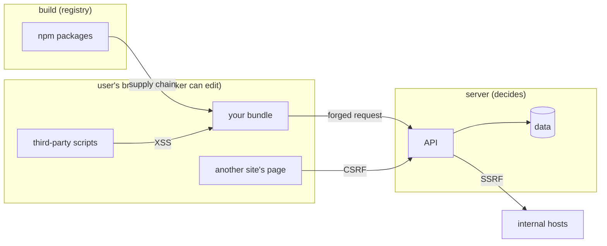

What to notice: everything left of the API can be changed by the user or by code in their page; the arrows into the server cross the boundary that must hold. **CSRF** (cross-site request forgery: another site makes the browser send a request that carries your cookies, [09 §5](09-web-networking-storage-security.md#5-the-same-origin-policy-and-cors)), **SSRF** (server-side request forgery: your server fetches a URL the attacker chose) and the **supply chain** (the packages your build is made of) are the other arrows.

### How it actually works

The **OWASP Top 10** lists web-application risk categories; the [root guide's Part I](../../Backend%20Study%20Guide%20-%20Security%2C%20JPA%2C%20Design%20Patterns%20%26%20Spring.md#part-i--web-application-security-owasp) teaches its 2021 edition, mapped here ([OWASP Top 10:2021](https://top10.owasp.org/2021/), read 2026-10-15):

| 2021 category | Sections |
|---|---|
| A03 Injection (XSS is in it) | [§2](#2-xss-and-angulars-template-model-escaping-by-default-trusted-templates-and-the-paths-around-them)-[§4](#4-domsanitizer-and-bypasssecuritytrust-when-trusting-a-value-is-dangerous-and-the-safe-patterns), [§7](#7-server-rendered-pages-escaping-in-the-server-html-the-state-script-and-ssrf) |
| A05 Security Misconfiguration | [§5](#5-content-security-policy-with-angular-nonces-csp_nonce-and-autocsp), [§6](#6-trusted-types-with-angular-the-frameworks-policies-enforcement-and-rollout) |
| A01 Broken Access Control (CSRF is in it) | [§9](#9-csrf-in-single-page-apps-when-cookies-make-you-vulnerable-samesite-and-angulars-xsrf-support), [§10](#10-route-guards-are-ux-authorization-belongs-on-the-server) |
| A06 Vulnerable and Outdated Components, A08 Software and Data Integrity Failures | [§11](#11-dependency-and-supply-chain-security-lockfiles-npm-audit-install-scripts-and-subresource-integrity) |
| A10 Server Side Request Forgery (SSRF) | [§7](#7-server-rendered-pages-escaping-in-the-server-html-the-state-script-and-ssrf) |

A01's page says "Access control is only effective in trusted server-side code or server-less API". So **client-side defenses** protect the user from script in their page (escaping, policies, token storage, [§8](#8-where-the-token-lives-memory-web-storage-httponly-cookies-and-a-backend-for-frontend)); **server-side defenses** protect the data from the user. In the lab, the never-rendered staff code is in the downloaded JavaScript (`Section 1: every string the app ships is readable in the downloaded bundle`), and a request edited to `price: 0` is charged 25 (`Section 1: the API recomputes a price the client edited`). Secrets in environment files are [12 §4](12-angular-how-it-works.md#4-environments-and-configuration-build-time-versus-run-time)'s ([Q12.11](12-angular-how-it-works.md#q12-11)).

Angular's [security guide](https://angular.dev/guide/security) (read 2026-10-15): "Angular treats all values as untrusted by default", while templates "should be treated as executable code". Attacks aim to move a value into code.

**Why this module studies these APIs.** Read from the typings of `@angular/core` 22.2.1 (`types/core.d.ts`, `types/_debug_node-chunk.d.ts`) and `@angular/platform-browser` 22.2.1 (`types/platform-browser.d.ts`), `grep -n '@security'` finds six tags: `ElementRef`, `DomSanitizer` (its `bypassSecurityTrust...` methods), `NgModule.schemas` with `NO_ERRORS_SCHEMA` or `CUSTOM_ELEMENTS_SCHEMA`, and three internal names (the `ɵ` prefix; may change in any release): `ɵɵtrustConstantHtml`, `ɵɵtrustConstantResourceUrl` and `ɵBrowserDomAdapter`. They mark where the framework's protection ends; [§2](#2-xss-and-angulars-template-model-escaping-by-default-trusted-templates-and-the-paths-around-them), [§4](#4-domsanitizer-and-bypasssecuritytrust-when-trusting-a-value-is-dangerous-and-the-safe-patterns) and [§12](#12-under-the-hood-from-a-template-binding-to-a-sanitized-dom-write) study them.

Drilled in [Q33.01](#q33-01) and [Q33.02](#q33-02).

### Code

The approach: a page that trusts itself, an API that does not.

1. The page renders the staff code only `@if (isStaff())` and posts the price it shows.
2. The server's route module reads only `item` and charges its own price, logging both.
3. The test replays the request with `price: 0`, without the page.

```ts
// Excerpt of labs/angular/projects/security-lab/src/app/m33/threat/order-page.ts
export const LAB_M33_PUBLIC_MARKER = 'LAB-M33-STAFF-DISCOUNT-50';
  protected placeOrder(): void {
    // The client sends the price it shows; the server must not believe it.
    this.http
      .post<LabM33OrderResult>('/api/m33/threat/order', { item: 'book', price: this.price })
      .subscribe({
        next: (order) => this.status.set(`Charged ${order.total} EUR`),
        error: () => this.status.set('The order failed. Try again.'),
      });
  }
```

```js
// Excerpt of labs/e2e/server/security/01-threat.mjs
  async handle(req, res, _url, ctx) {
    if (req.method !== 'POST') return sendJson(res, 405, { error: 'POST only' });
    const body = await readJson(req);
    const order = typeof body === 'object' && body !== null ? body : {};
    const item = 'item' in order && typeof order.item === 'string' ? order.item : '';
    const total = CATALOG.get(item);
    if (total === undefined) return sendJson(res, 400, { error: 'unknown item' });
    ctx.log({ item, clientPrice: 'price' in order ? order.price : null, total });
    sendJson(res, 201, { item, total });
  },
```

```ts
// Excerpt of labs/e2e/tests/33-security/concepts/section-1-threat-model.spec.ts
  const forged = await context.request.post(ORDER_API, { data: { item: 'book', price: 0 } });
  expect(forged.status()).toBe(201);
  expect(await forged.json()).toEqual({ item: 'book', total: 25 });
```

### Best practices and anti-patterns

- **Decide prices, permissions and limits on the server**, because any request field can be edited.
- **Keep secrets out of the bundle**, because the build keeps string constants verbatim.
- **Layer defenses** (**defense in depth**: independent controls, so one failure is not a breach), because escaping, a policy and the server's check each stop a different step.
- **Review every use of a `@security`-tagged API**, because Angular's protection ends there.

### Misconceptions and traps

- *"Angular apps are secure by default."* The sanitizer guards template bindings, not direct DOM writes, tokens, CSRF or dependencies ([§2](#2-xss-and-angulars-template-model-escaping-by-default-trusted-templates-and-the-paths-around-them)-[§11](#11-dependency-and-supply-chain-security-lockfiles-npm-audit-install-scripts-and-subresource-integrity)); the myth comes from sanitization being on by default.
- *"Minified code keeps strings private."* It ships whole, strings included; the myth comes from minified output looking unreadable.
- *"HTTPS protects the app from XSS."* TLS protects the transport, not what the page runs; the myth comes from the padlock reading as "secure".
- *"The server is the boundary, so front-end security does not matter."* Injected script acts as the logged-in user in their browser ([§8](#8-where-the-token-lives-memory-web-storage-httponly-cookies-and-a-backend-for-frontend)); the myth holds because authorization really is the server's.

## 2. XSS and Angular's template model: escaping by default, trusted templates and the paths around them

### The problem it solves

A search page echoes `?q=` by assigning `nativeElement.innerHTML`. A directive renders reviews with `Renderer2.setProperty(el, 'innerHTML', …)` "because the renderer is safe". A CMS team wants to compile templates shipped as strings in the browser. Each skips the template.

### Mental model

XSS comes in three kinds, by where the script travels ([OWASP, Cross Site Scripting](https://owasp.org/www-community/attacks/xss/) and [DOM Based XSS](https://owasp.org/www-community/attacks/DOM_Based_XSS), read 2026-10-15): **stored** (the server saves the payload and serves it to others), **reflected** (a response echoes part of the request) and **DOM-based** (the page's own script moves attacker data into the DOM; the response does not change). A **payload** is the attacker's input; a **sink** is an API that turns a string into markup or code ([09 §8](09-web-networking-storage-security.md#8-content-security-policy-and-trusted-types)).

Angular treats **templates as code and values as data**. `{{ }}` and `[textContent]` create text, so markup in a value stays characters; HTML enters only through a sanitized HTML binding ([§3](#3-sanitization-by-security-context-html-style-url-and-resource-url)). Analogy: a mail room that opens every parcel sent through reception, and a side door nobody watches.

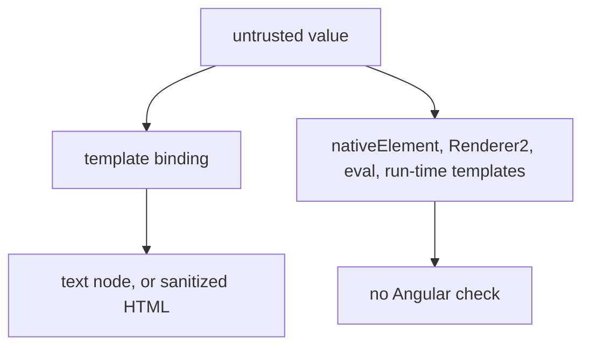

What to notice: Angular guards one road, the template binding; the others are yours.

### How it actually works

**Text is not parsed.** Interpolation updates a text node: `updateTextNode` calls `renderer.setValue`, and the default renderer assigns `node.nodeValue` (`@angular/core` 22.2.1 `_debug_node-chunk.mjs`, `@angular/platform-browser` 22.2.1 `_dom_renderer-chunk.mjs`, read 2026-10-15; internal names, may change in any release). A text node holds characters, so `` stays visible text (`Section 2: interpolation renders markup as text`; [13 §2](13-components-and-templates.md#2-interpolation-and-template-expressions-what-is-allowed)).

**Why `Renderer2` does not protect.** In `@angular/core`, `setDomProperty` first runs the sanitizer that the compiled binding passed in, then calls `renderer.setProperty`; the default renderer's `setProperty` is `el[name] = value` (read, same date). So a direct call skips the sanitizer (`Section 2: Renderer2.setProperty writes innerHTML without sanitizing`), while a binding removes script and handler (`Section 2: an [innerHTML] binding removes the script and the event handler`). The typings say `Renderer2` "provides no extra security" ([14 §1](14-directives-and-pipes.md#1-directives-and-attribute-directives-host-inputs-elementref-and-renderer2)). In Chromium, one payload in four regions ran the handler once, from the direct write (`Section 2: only the direct innerHTML write runs the injected handler`).

Other roads: `document.write`, `eval`, `new Function`, DOM libraries and `bypassSecurityTrust*` ([§4](#4-domsanitizer-and-bypasssecuritytrust-when-trusting-a-value-is-dangerous-and-the-safe-patterns)).

**Templates are code.** The docs say templates "should be treated as executable code" and "Never create templates by concatenating user input and template syntax" ([Security](https://angular.dev/guide/security), `main`, read 2026-10-15). AOT compiles at build time, so braces in the HTML the server sends are plain text, and so is a value containing them (`Section 2: interpolation braces in the served HTML are not evaluated`). JIT compiles in the browser, so a template string with user text is code (**template injection**; [12 §7](12-angular-how-it-works.md#7-aot-versus-jit-and-template-type-checking)); the docs call that "a security anti-pattern", and say not to build Angular templates on the server ([§7](#7-server-rendered-pages-escaping-in-the-server-html-the-state-script-and-ssrf) covers server HTML).

> [!TIP]
> **Coming from the backend.** Thymeleaf's `th:text` escapes by default; `th:utext` ("unescaped text") does not ([Thymeleaf 3.1 tutorial, section 3.2](https://www.thymeleaf.org/doc/tutorials/3.1/usingthymeleaf.html), read 2026-10-15). **Where the analogy breaks:** an engine escapes while building an HTML string that the browser then parses; Angular builds no such string, it sets text nodes.

Drilled in [Q33.03](#q33-03), [Q33.04](#q33-04) and [Q33.05](#q33-05).

### Code

The approach: one value, four regions, and a count of handler runs.

1. The page reads `q` from the route.
2. Three regions bind it; the fourth writes `innerHTML` itself in `afterNextRender` [Stable since v20.0].
3. The test loads a payload that adds one to `window.__m33Hits`, and polls the count.

```ts
// Excerpt of labs/angular/projects/security-lab/src/app/m33/xss/sinks-page.ts
  template: `
    <section aria-label="Interpolation"><p>{{ query }}</p></section>
    <section aria-label="innerHTML binding"><p [innerHTML]="query"></p></section>
    <section aria-label="textContent binding"><p [textContent]="query"></p></section>
    <section aria-label="Direct innerHTML write"><p #direct></p></section>
  `,
  constructor() {
    afterNextRender(() => {
      // The hole: Angular never sees this string, so nothing sanitizes it.
      this.direct().nativeElement.innerHTML = this.query;
    });
  }
```

```ts
// Excerpt of labs/e2e/tests/33-security/concepts/section-2-template-model.spec.ts
  await expect.poll(() => page.evaluate(() => Reflect.get(window, '__m33Hits') ?? 0)).toBe(1);
  const regions = ['Interpolation', 'innerHTML binding', 'textContent binding'];
  for (const name of regions) {
    await expect(page.getByRole('region', { name }).locator('[onerror]')).toHaveCount(0);
  }
```

### Best practices and anti-patterns

- **Bind values; do not write them**, because `{{ }}` and `[textContent]` make text nodes and nothing is parsed.
- **Review every `nativeElement` or `Renderer2` write of external text as a sink**, because Angular never sees the string.
- **Ship AOT and keep user text out of template strings**, because the compiler trusts what it compiles.
- **Escape server-built HTML too**, because Angular's model ends at the server.

### Misconceptions and traps

- *"Angular escapes everything, so XSS is impossible."* Direct writes and bypasses sit outside the template (observed above); the myth comes from escaping being on by default.
- *"`Renderer2` is the safe way to set `innerHTML`."* It sanitizes nothing (observed); the myth comes from it being the recommended DOM abstraction.
- *"`{{ }}` sanitizes HTML."* Interpolation makes text, so nothing is parsed and nothing removed; the myth comes from "sanitize" and "escape" being used interchangeably.
- *"A CSP makes a direct `innerHTML` write safe."* A CSP blocks inline handlers, but injected markup can still fake a login form ([§5](#5-content-security-policy-with-angular-nonces-csp_nonce-and-autocsp)); the myth comes from CSP being taught as an XSS defense.

## 3. Sanitization by security context: HTML, style, URL and resource URL

### The problem it solves

A profile page binds `[href]="user.website"`; a saved `javascript:…` runs script on click. An editor's inline `style` vanishes, so someone reaches for `bypassSecurityTrustHtml`. An iframe `[src]` bound to a string fails with NG0904. One rule explains them: what Angular does to a value depends on where it lands.

### Mental model

A binding's **target** (element and property) decides its **security context**, the kind of place the value lands, with one rule per kind. The compiler reads it from a schema table (`@angular/compiler` 22.2.1, `SECURITY_SCHEMA`, read 2026-10-15; internal, may change in any release). A **resource URL** is one the browser loads and runs as code, such as an iframe `src`. An **allowlist** names what is permitted and drops the rest; the **`unsafe:` prefix** is what a rejected URL gets. **Sanitization** cleans a value for one context; **escaping** turns it into text ([§2](#2-xss-and-angulars-template-model-escaping-by-default-trusted-templates-and-the-paths-around-them)). Analogy: an airport lane per cargo type: letters opened, parcels X-rayed, animals refused.

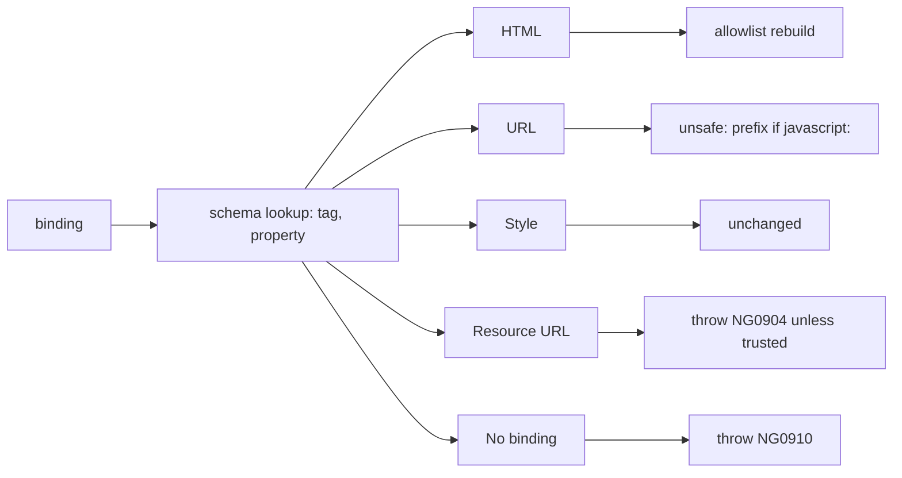

What to notice: the same string is fine in one context and refused in another.

### How it actually works

**Resource URLs are never cleaned.** `ɵɵsanitizeResourceUrl` has no cleaning branch: it accepts only a value the app marked trusted ([§4](#4-domsanitizer-and-bypasssecuritytrust-when-trusting-a-value-is-dangerous-and-the-safe-patterns)), else it throws (`@angular/core` 22.2.1, read; internal). The docs: "Sanitizing resource URLs isn't possible because they contain arbitrary code" ([Security](https://angular.dev/guide/security), `main`, read 2026-10-15). `Section 3: an iframe src binding with a plain string throws NG0904` caught `NG0904: unsafe value used in a resource URL context` (abridged). `Section 3: a sandbox binding on an iframe is rejected` with NG0910.

**HTML is rebuilt from the allowlist.** The sanitizer parses into an inert document, skips `script`, `style` and `template` content, and re-parses up to five times until the output is stable, else it throws "input is unstable" (a guard against **mutation XSS**: markup that changes when parsed again; read). `Section 3: the HTML sanitizer keeps formatting and drops scripts, handlers, styles and ids` kept `<b>` and `class`, and turned `svg`, `form`, `iframe` and `template` into an empty string.

**URLs are one pattern.** `SAFE_URL_PATTERN` (internal, may change in any release) refuses only `javascript:`, in any letter case, even after a leading space (`Section 3: a javascript: URL gets the unsafe: prefix in an href binding`). `Section 3: a data:text/html URL passes the 22.2.1 URL sanitizer`, as does `vbscript:`. The 22.2.1 [CHANGELOG](https://github.com/angular/angular/blob/main/CHANGELOG.md) lists "block dangerous data: and vbscript: URLs in URL sanitizer", yet 22.2.1 does neither, and the published 22.2.3 and 22.3.0-next.2 carry the same pattern (read): a discrepancy, not behavior.

**Once true:** until 15.2.5 the pattern allowed only `https?|mailto|data|ftp|tel|file|sms` and relative URLs (`@angular/core@15.2.5` `fesm2020/core.mjs`, read 2026-10-15). `[Changed in v15.2.6: only javascript: URLs are blocked]` (CHANGELOG, 2023-04-05).

**Style passes through.** `ɵɵsanitizeStyle` returns the string as it is (read), and `Section 3: a style binding is not sanitized`. The production page's `style` attribute kept it too.

**Warnings.** Development mode warns when it drops anything, even a `style` attribute (`Section 3: the sanitizer warns in development mode`); the production build logged none (`Section 3: the production build sanitizes without a console warning`). Internals: [§12](#12-under-the-hood-from-a-template-binding-to-a-sanitized-dom-write).

> [!NOTE]
> **Framework vs platform.** Angular's sanitizer is framework JavaScript; CSP and Trusted Types [Baseline 2026: newly available, per MDN] are browser features ([09 §8](09-web-networking-storage-security.md#8-content-security-policy-and-trusted-types); [Baseline](https://developer.mozilla.org/en-US/docs/Glossary/Baseline/Compatibility) means support in the latest stable Chrome, Edge, Firefox and Safari). [`Element.setHTML()`](https://developer.mozilla.org/en-US/docs/Web/API/Element/setHTML) is the browser's own sanitizer; MDN says it always removes `script`, `iframe` and event-handler attributes, and lists Chrome, Edge and Firefox: `[Baseline: limited availability, per MDN]`. `setHTML` appears nowhere in `@angular/core`, `compiler` or `platform-browser` 22.2.1 (searched), so bindings do not call it.

Drilled in [Q33.06](#q33-06), [Q33.07](#q33-07) and [Q33.08](#q33-08).

### Code

The approach: one page binds a hostile value to each of three contexts, and a test reads the DOM.

1. The page binds `html`, `profile` and `background`, each carrying a payload.
2. The test loads the production build and reads the DOM.
3. It checks the counter and the console.

```ts
// Excerpt of labs/angular/projects/security-lab/src/app/m33/sanitize/sanitize-page.ts
    <section aria-label="HTML context"><div [innerHTML]="html"></div></section>
    <section aria-label="URL context"><a [href]="profile">Profile</a></section>
    <section aria-label="Style context"><p [style.background-image]="background">Styled</p></section>
```

```ts
// Excerpt of labs/e2e/tests/33-security/concepts/section-3-sanitization.spec.ts
  await expect(page.getByRole('link', { name: 'Profile' })).toHaveAttribute('href', 'unsafe:javascript:window.__m33Hits=1');
  await expect(page.getByText('Styled')).toHaveAttribute('style', 'background-image: url("javascript:window.__m33Hits=1");');
```

### Best practices and anti-patterns

- **Bind a value to the property that fits its kind**, because the target picks the rule.
- **Fix the data when a value is rejected**, because a bypass ([§4](#4-domsanitizer-and-bypasssecuritytrust-when-trusting-a-value-is-dangerous-and-the-safe-patterns)) disables the rule.
- **Check URL schemes against your own list**, because the sanitizer's one rule is `javascript:`.
- **Map style input to class names**, because style values pass through.

### Misconceptions and traps

- *"Angular sanitizes CSS in style bindings."* The value passes through (tested); the myth comes from the guide listing Style as a context.
- *"Sanitized HTML is safe anywhere."* It is clean for the HTML context only; the myth comes from "clean" sounding absolute.
- *"Angular blocks `data:` and `vbscript:` URLs."* The shipped 22.2.1 refuses only `javascript:` (tested); the myth comes from the 22.2.1 CHANGELOG line.
- *"The sanitizer warning means something was attacked."* It fires for any dropped content, in development only; the myth comes from its wording.

## 4. `DomSanitizer` and `bypassSecurityTrust*`: when trusting a value is dangerous, and the safe patterns

### The problem it solves

A team's `safeHtml` pipe calls `bypassSecurityTrustHtml` on CMS content to keep inline styles. A video page trusts a pasted URL concatenated into an embed URL. Each turns off a [§3](#3-sanitization-by-security-context-html-style-url-and-resource-url) rule for attacker-controlled text, and nobody can find where.

### Mental model

`DomSanitizer` (`@angular/platform-browser`) does two jobs. `sanitize(context, value)` is for code that writes outside templates. Five **bypass** methods (`bypassSecurityTrustHtml`, `…Style`, `…Script`, `…Url`, `…ResourceUrl`) each wrap a string in a **safe value** (`SafeHtml`, `SafeStyle`, `SafeScript`, `SafeUrl`, `SafeResourceUrl`): an object that says "I vouch for this, in this context". A binding unwraps it only in the matching context (a resource URL also passes as a URL) and throws elsewhere. Analogy: a notarized letter, valid only for the purpose it names. A **canonical URL** is one you build from parsed, checked parts; an **embed allowlist** lists the hosts and ID shapes you accept.

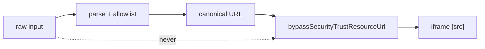

What to notice: the bypass sits after the check, never before it.

### How it actually works

**A bypass is a promise, not a check.** The typings say "Calling any of the `bypassSecurityTrust...` APIs disables Angular's built-in sanitization for the value passed in" (`@angular/platform-browser` 22.2.1 typings, `@security`, read). `Section 4: a SafeResourceUrl is accepted where a URL is required` (the one coded exception) wrote a `javascript:` string into an `href` unchanged: the wrapper decided, not the scheme.

**The wrapper carries its type.** Each wrapper's `getTypeName()` returns `HTML`, `Style`, `Script`, `URL` or `ResourceURL`, and `allowSanitizationBypassAndThrow` compares it with the binding's context (`@angular/core` 22.2.1; internal, may change in any release; read), so `Section 4: a SafeHtml bound to a URL context throws` printed "Required a safe URL, got a HTML (see https://angular.dev/best-practices/security#preventing-cross-site-scripting-xss)".

**`sanitize` runs only when you call it.** In 22.2.1 nothing provides `DomSanitizerImpl` (exported only as `ɵDomSanitizerImpl`, internal) as the root `Sanitizer`, so bindings use the `ɵɵsanitize*` instructions directly (read). `Section 4: sanitize unwraps a matching safe value and cleans a plain HTML string` returned a trusted `<script>x</script><b>x</b>` whole and cleaned the plain string to `<b>x</b>`.

**The typings comment disagrees with the code.** The comment says outside HTML `sanitize` "throws an error if provided with a plain string"; the code throws only for script and resource URL. `Section 4: sanitize throws for a plain string in the resource URL context` printed "NG05201: unsafe value used in a resource URL context (see …)" (abridged), returned a plain URL as `unsafe:javascript:alert(1)` and a plain style unchanged. The code decides.

**A literal needs no bypass.** The compiler wraps a static `src` on an `iframe` in `ɵɵtrustConstantResourceUrl` (`@angular/compiler` 22.2.1, `resolveSanitizers`, internal; read), and `Section 4: a static iframe src needs no bypass` rendered one (the literal is part of a template you wrote, [§2](#2-xss-and-angulars-template-model-escaping-by-default-trusted-templates-and-the-paths-around-them)).

**A safe value is not a string.** `Section 4: a safe value interpolated as text prints its warning string` ("SafeValue must use [property]=binding: <b>x</b> …", abridged). Internals: [§12](#12-under-the-hood-from-a-template-binding-to-a-sanitized-dom-write).

Drilled in [Q33.09](#q33-09), [Q33.10](#q33-10), [Q33.11](#q33-11) and [Q33.12](#q33-12); the safe build is [Exercise 33.1](#ex33-1).

### Code

The approach: render trusted and wrongly typed values, then call `sanitize`.

1. One host binds a trusted resource URL to an iframe.
2. Another binds an HTML-trusted value to an `href`.
3. The test calls `sanitize` for two contexts.

```ts
// Excerpt of labs/angular/src/app/modules/33-security/concepts/section-4-dom-sanitizer.spec.ts
@Component({ template: `<iframe [src]="value"></iframe>` })
class BoundFrameHost {
  value: SafeValue = inject(DomSanitizer).bypassSecurityTrustResourceUrl(FRAME);
}
@Component({ template: `<a [href]="value">link</a>` })
class LinkHost {
  value: SafeValue = inject(DomSanitizer).bypassSecurityTrustHtml('<b>x</b>');
}
```

```ts
// Excerpt of labs/angular/src/app/modules/33-security/concepts/section-4-dom-sanitizer.spec.ts
    expect(() => sanitizer.sanitize(SecurityContext.RESOURCE_URL, FRAME)).toThrowError('NG05201: unsafe value used in a resource URL context');
    expect(sanitizer.sanitize(SecurityContext.URL, 'javascript:alert(1)')).toBe('unsafe:javascript:alert(1)');
```

### Best practices and anti-patterns

- **Parse, check against an allowlist, build the value, then bypass**, because a bypass vouches for what it receives.
- **Keep every bypass in one audited service, near the value's source**, because a reviewer can grep one file, and a distant call hides what it trusts.
- **Never bypass raw input** (CMS HTML, a pasted URL), because the check is off for all of it.
- **Fix a lost style with a class, not a pipe**, because a `safeHtml` pipe trusts every input.
- **Leave literals alone**, because a static `src` is trusted.

### Misconceptions and traps

- *"`bypassSecurityTrust*` makes a value safe."* It switches the check off for that value (typings `@security`); the myth comes from "Security" in the name.
- *"A `safeHtml` pipe is a standard Angular pattern."* It trusts every input and reopens XSS; the myth comes from blogs that circulate it.
- *"`sanitize()` throws for every plain string outside HTML."* URL strings are cleaned and style strings returned (tested); the myth comes from the typings comment.
- *"Any iframe needs a bypass."* A static `src` is a trusted constant (tested); the myth comes from NG0904 on bindings.

## 5. Content Security Policy with Angular: nonces, `CSP_NONCE` and `autoCsp`

### The problem it solves

A strict CSP header goes live and every component style vanishes; a CDN serves one cached `index.html`; a server-rendered build refuses `autoCsp`. How does a policy that refuses inline code trust the inline code Angular produces?

### Mental model

A **strict CSP** trusts scripts by nonce or hash plus `'strict-dynamic'`, never by host. A **nonce** is a random value sent once per response, in the header and on each trusted tag (owned by [09 §8](09-web-networking-storage-security.md#8-content-security-policy-and-trusted-types)). Angular produces inline content such a policy refuses: scripts in `index.html` (the import map, a JSON `<script type="importmap">` that maps module names to files, which Subresource Integrity, a hash check on each file, adds; and the loading of critical CSS, the styles the build inlines for the first paint) and the `<style>` elements it appends at run time for component styles. Two ways to trust them:

- **A per-response nonce.** The server writes it into the header and into **`ngCspNonce`**, a root-element attribute; the **`CSP_NONCE`** token reads it, and Angular puts it on each `<style>`.
- **`autoCsp`.** A build option that writes a **hash-based policy** (a SHA-256 of each inline script) into a `<meta>` tag: scripts only, client-rendered builds only.

Analogy: tonight's guest list (nonce) versus photos of the regulars (hashes).

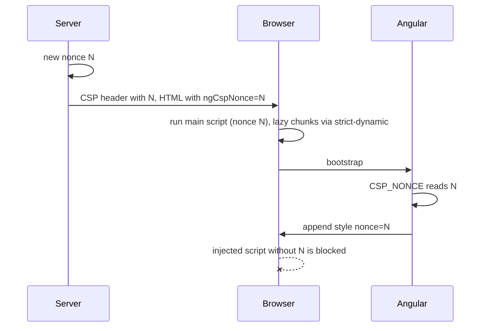

What to notice: Angular never creates the nonce; the server does.

### How it actually works

**The token reads the attribute.** `CSP_NONCE`'s default factory is `inject(DOCUMENT).body?.querySelector('[ngCspNonce]')?.getAttribute('ngCspNonce') || null` (`@angular/core` 22.2.1, read; `Section 5: CSP_NONCE defaults to the ngCspNonce attribute of the root element`). The internal `SharedStylesHost` (may change in any release) sets that value on each `<style>` it appends (`@angular/platform-browser` 22.2.1, `addElement`, read). In `Section 5: component styles carry the response nonce`, the `nonce` property held the header's value while `getAttribute('nonce')` returned an empty string: Chromium hides it.

**The build copies it onto scripts.** `addNonce` (`@angular/build` 22.2.1, `nonce.js`, internal, read) copies the `ngCspNonce` value onto every `<script>` and `<style>` tag of `index.html`. `Section 5: a fresh nonce is sent with every response` found each response's nonce on the import map, the root element and the main script.

**What Chromium enforced.** Under `script-src 'nonce-N' 'strict-dynamic'; style-src 'self' 'nonce-N'; object-src 'none'; base-uri 'self'` plus a `report-uri`, `Section 5: the app boots under a nonce-based policy with no violation`, lazy chunk included. In `Section 5: an injected inline script is blocked and reported`, an injected `<script>` and `onerror` handler never ran; Chromium raised `script-src-elem` and `script-src-attr` and posted each as a **violation report**, a JSON body (`application/csp-report`, `"blocked-uri": "inline"`). In `Section 5: a page nonce that does not match the header blocks the component styles`, scripts ran but the `<style>` was refused (`style-src-elem`). **Report-only** mode (`Content-Security-Policy-Report-Only`) blocks nothing: in `Section 5: report-only mode reports the injected script without blocking it`, both payloads ran and both reports arrived.

**`autoCsp` hashes at build time.** `autoCsp` (`@angular/build` 22.2.1, `auto-csp.js`, read) hashes each inline script and writes `script-src 'strict-dynamic' <hashes> https: 'unsafe-inline';object-src 'none';base-uri 'self';` right after `<head>`; its comment says modern browsers ignore the `https:` and `'unsafe-inline'` fallbacks. The schema says it "Will default to true once we are out of experimental/preview phases"; the docs name no status. `Section 5: the autoCsp build boots under its hash-based meta policy` with a header of only `style-src 'self' 'unsafe-inline'`, as the [docs](https://angular.dev/guide/security) advise, and blocked the same injection.

**Why not with server rendering.** `index-html-generator.js` (`@angular/build` 22.2.1, lines 43-49, read) throws "Cannot set both SSR and auto-CSP at the same time." Hashes are fixed at build time, but the server writes inline script per request: `@angular/platform-server` 22.2.1 inserts an event-replay script listing the page's event types, nonced with `CSP_NONCE` (`insertEventRecordScript`, internal; read, not run).

Drilled in [Q33.13](#q33-13), [Q33.14](#q33-14) and [Q33.15](#q33-15), after [Q09.19](09-web-networking-storage-security.md#q09-19); the locked-down page is [Exercise 33.2](#ex33-2).

### Code

The approach: the server makes the nonce; Angular only carries it.

1. The route module builds the policy from the response's nonce.
2. It writes the same nonce over the shell's placeholder.
3. The test compares the header's nonce with the `<style>` element's.

```js
// Excerpt of labs/e2e/server/security/05-csp.mjs
function noncePolicy(ctx) {
  const nonce = `'nonce-${ctx.nonce}'`;
  return [
    `script-src ${nonce} 'strict-dynamic'`,
    `style-src 'self' ${nonce}`,
```

```ts
// Excerpt of labs/e2e/tests/33-security/concepts/section-5-csp.spec.ts
  const nonce = headerNonce(await open(page, PAGE));
  const styles = await page.locator('style').evaluateAll((elements) =>
    elements.map((element) => ({ nonce: element.nonce, attribute: element.getAttribute('nonce') })),
  );
```

### Best practices and anti-patterns

- **Create the nonce per response, at the server or the edge**, because a repeated one can be copied onto an attacker's tag.
- **Use `ngCspNonce` when the server writes the HTML, `CSP_NONCE` when the nonce arrives at run time**, because the token lets `index.html` stay cacheable (docs).
- **Use `autoCsp` on a static host and write `style-src` yourself**, because it hashes scripts only.

### Misconceptions and traps

- *"A fixed nonce in `index.html` is good enough."* Anyone who loads the page can copy it; the myth comes from a nonce looking like a secret.
- *"`autoCsp` covers styles."* It hashes scripts only (read, tested); the myth comes from its name.
- *"`autoCsp` works with server rendering."* The build throws; the myth comes from it working in client-only builds.
- *"The `'unsafe-inline'` in the `autoCsp` policy weakens it."* Chromium blocked the injected script anyway (tested); the myth comes from the keyword's reputation.
- *"`CSP_NONCE` must always be provided."* Its default reads `ngCspNonce` (tested); the myth comes from the docs' only code sample, which provides it.

## 6. Trusted Types with Angular: the framework's policies, enforcement and rollout

### The problem it solves

The team enforces Trusted Types [Baseline 2026: newly available, per MDN]. Angular keeps rendering, but a markdown widget setting `innerHTML` throws, a `bypassSecurityTrustHtml` box stays empty, and someone adds `angular#bundler` "for lazy routes" because the docs list it. Which needs a policy name, which a code change?

### Mental model

**Trusted Types** are a browser feature owned by [09 §8](09-web-networking-storage-security.md#8-content-security-policy-and-trusted-types). The CSP directive **`require-trusted-types-for 'script'`** makes every sink throw on a plain string; it accepts only a typed value, such as **`TrustedHTML`**, made by a **Trusted Types policy**: a named object from `trustedTypes.createPolicy(name, rules)`. The **`trusted-types` allowlist** names the policies a page may create.

Angular passes its output through `angular` (sanitized HTML, template constants) and `angular#unsafe-bypass` (values trusted with a bypass, §4); the JIT compiler has `angular#unsafe-jit` (`compiler.mjs`, read). Leave `angular#unsafe-bypass` out and every bypass fails, so the header audits bypasses. Your own sink writes need your own policy, or a binding.

Analogy: only listed notaries may stamp documents for the vault; Angular brings two.

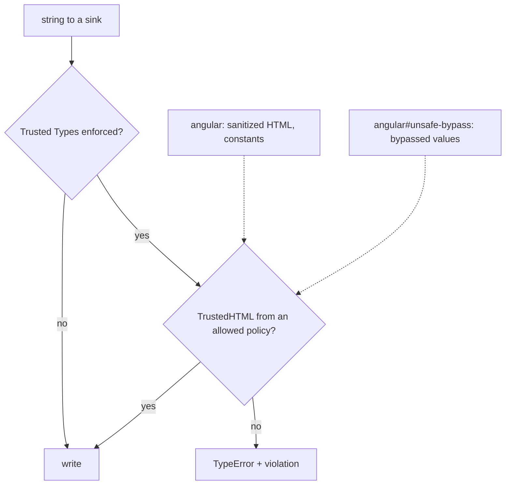

What to notice: a bypass needs a second, separately allowed policy.

### How it actually works

**Identity policies behind a lazy getter.** `@angular/core` 22.2.1 (`_debug_node-chunk.mjs`, `getPolicy`, internal, may change in any release; read) creates each policy at first use: `try { policy = _global.trustedTypes.createPolicy('angular#unsafe-bypass', { createHTML: s => s, … }); } catch {}` (abridged). The rules return their input. When the header refuses the name, the empty `catch` swallows the error and the getter returns `null`, so the sink gets a plain string. That is why a missing name breaks only the values needing that policy, never start-up.

**What Chromium enforced** under `require-trusted-types-for 'script'; trusted-types angular`:

- `Section 6: an [innerHTML] binding works with only the angular policy`: no violation, no console error.
- `Section 6: a bypassed value is not rendered without the unsafe-bypass policy`: violations `trusted-types` (blocked URI `trusted-types-policy`) then `require-trusted-types-for` (`trusted-types-sink`); Angular's `ErrorHandler` logged `TypeError: Failed to set the 'innerHTML' property on 'Element': This document requires 'TrustedHTML' assignment.` The box stayed empty. `Section 6: a bypassed value renders when the header allows angular#unsafe-bypass`.
- `Section 6: a direct innerHTML write throws a TypeError` with the same message.
- `Section 6: report-only mode reports the direct write without throwing`; the report's `script-sample` was `Element innerHTML|<em>Widget output</em>`, enough to find the widget. Sending the policy report-only first is the **report-only rollout**.

**No `angular#bundler`.** The [docs](https://angular.dev/guide/security) table (read 2026-10-15) lists it as "used by the Angular CLI bundler when creating lazy chunk files". `grep -rl 'angular#bundler'` over `@angular/build` 22.2.1 finds nothing, and the built `security-lab` files create only `angular` and `angular#unsafe-bypass` (read). `Section 6: a lazy route loads without an angular#bundler policy` fetched its chunk after boot with no violation.

Drilled in [Q33.16](#q33-16), [Q33.17](#q33-17) and [Q33.18](#q33-18), after [Q09.20](09-web-networking-storage-security.md#q09-20); [Exercise 33.2](#ex33-2) combines this with §5.

### Code

The approach: the server decides which policy names may exist; the page decides whether it needs more than `angular`.

1. The route module builds the header, adding `angular#unsafe-bypass` only under `?allow-bypass`.
2. The widget writes a plain string to `innerHTML` and shows what was thrown.
3. The test clicks the widget and reads the status line.

```js
// Excerpt of labs/e2e/server/security/06-trusted-types.mjs
function trustedTypesPolicy(url, run) {
  const names = url.searchParams.has('allow-bypass') ? 'angular angular#unsafe-bypass' : 'angular';
  return [
    `require-trusted-types-for 'script'`,
    `trusted-types ${names}`,
```

```ts
// Excerpt of labs/angular/projects/security-lab/src/app/m33/tt/tt-page.ts
  protected runWidget(): void {
    try {
      // The hole Trusted Types close: a plain string straight into a sink.
      this.widget().nativeElement.innerHTML = '<em>Widget output</em>';
      this.widgetResult.set('written');
    } catch (error) {
```

```ts
// Excerpt of labs/e2e/tests/33-security/concepts/section-6-trusted-types.spec.ts
  await page.getByRole('button', { name: 'Run the legacy widget' }).click();
  await expect(page.getByRole('status')).toHaveText(
    "TypeError: Failed to set the 'innerHTML' property on 'Element': This document requires 'TrustedHTML' assignment.",
  );
```

### Best practices and anti-patterns

- **Roll out report-only first**, because each report names the sink and the value's start.
- **Allow `angular` alone; add `angular#unsafe-bypass` only after reviewing every bypass**, because that one name admits all of them.
- **Move a widget's markup into a binding**, because Angular then sanitizes it; one that must write HTML gets its own sanitizing policy, allowlisted.
- **Leave `angular#bundler` and `angular#unsafe-jit` out of an AOT build's header**, because nothing creates them; the list should show what runs.

### Misconceptions and traps

- *"Trusted Types break Angular's own rendering."* The binding worked with only `angular` (tested); the myth comes from the header sounding global.
- *"Lazy routes need `angular#bundler`."* The 22.2.1 builder creates no such policy and the lazy route loaded (tested); the myth comes from the docs' table.
- *"Allowing `angular#unsafe-bypass` is harmless."* It re-enables every bypass in the app; the myth comes from it being Angular's own name.
- *"A policy that returns its input unchanged is a fix."* It checks nothing; Angular's identity policies are safe only because Angular sanitized first. The myth comes from the error disappearing.

## 7. Server-rendered pages: escaping in the server HTML, the state script and SSRF

### The problem it solves

A search page echoes `?q=`. Another keeps the visitor's display name in `TransferState`, which lands inside a script element. A third previews a link by fetching a URL the visitor typed. Is the value escaped, can it close the script, and what does the server call?

### Mental model

The server renders through the same bindings as the browser, in a **DOM emulation** ([32 §7](32-ssr-ssg-hydration.md#7-platform-safe-code-browser-apis-afternextrender-document-request-and-response_init)), then serializes the tree. Bindings escape or sanitize ([§2](#2-xss-and-angulars-template-model-escaping-by-default-trusted-templates-and-the-paths-around-them), [§3](#3-sanitization-by-security-context-html-style-url-and-resource-url)) before any string exists. The **state script** ([32 §8](32-ssr-ssg-hydration.md#8-data-across-the-boundary-the-http-transfer-cache-transferstate-and-resource-ids)) is the JSON `<script id="ng-state">` that carries server values to the browser.

What is new: **request data is attacker input** (`REQUEST` headers, the URL), and **the server makes requests**. **SSRF** (server-side request forgery) makes it a proxy into the private network. Analogy: a receptionist dialing any number a visitor writes on a card.

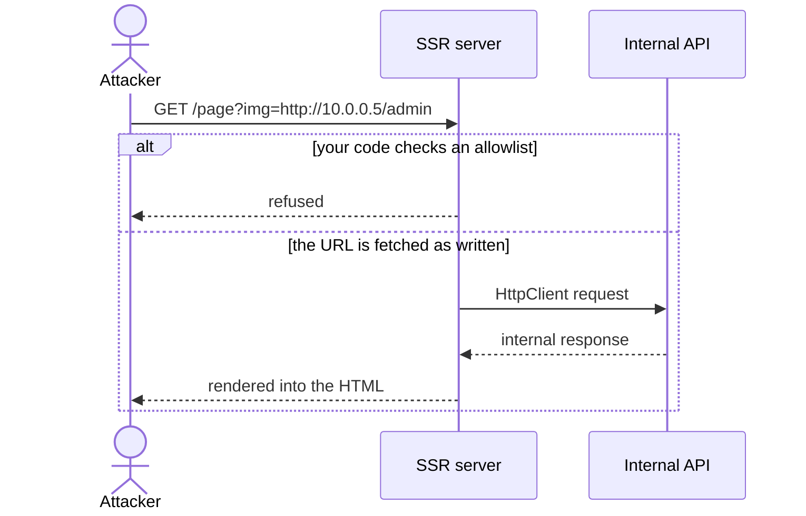

What to notice: the dangerous request is one the server makes, not one the browser makes.

### How it actually works

**Escaping happens before serialization.** The raw HTML, before any JavaScript runs, shows the bindings' work:

- `Section 7: a server-rendered interpolation escapes markup in the raw HTML`: `<b>` arrives as `&lt;b&gt;`.
- `Section 7: an [innerHTML] binding is sanitized in the server HTML`: the `onerror` attribute and the script element are gone.
- `Section 7: a reflected request header is escaped in the server HTML`: an `X-Lab-Name` header read from `REQUEST` comes out escaped.

**One line keeps the state script closed.** `TransferState.toJson` (`@angular/core` 22.2.1, `_pending_tasks-chunk.mjs`, internal, may change in any release; read) returns `JSON.stringify(this.store).replace(/</g, '\\u003C').replace(/\//g, '\\u002F')`, so `</script>` in a value cannot end the element. `Section 7: the state script escapes a closing script tag` finds the escaped text, parses the original value back and sees no handler run. Escaped is not hidden.

**SSRF is partly yours.** Angular's [docs](https://angular.dev/guide/security) (read 2026-10-15) cover header-based SSRF: host validation and proxy headers ([32 §9](32-ssr-ssg-hydration.md#9-deploying-ssr-node-and-other-runtimes-static-output-caching-rendered-pages-and-allowed-hosts), [Q32.25](32-ssr-ssg-hydration.md#q32-25)). For URLs, `resolveUrl` (`@angular/platform-server` 22.2.1, `_server-chunk.mjs`, internal; read, not run) throws on a **protocol-relative URL** (`//host/path`, another host) when it sets the server's location; the server's `HttpClient` interceptor calls it with `allowProtocolRelative: true`, so your requests get no such check. The [CHANGELOG](https://github.com/angular/angular/blob/main/CHANGELOG.md) has "reject protocol-relative paths in resolveUrl" (22.2.1, 2026-09-30) and "prevent SSRF bypasses via backslash URLs in HttpClient" (21.2.15, 2026-05-28). The relative-URL interceptor passes a URL with scheme and host through unchanged, so a visitor's absolute URL is fetched as written. The **egress allowlist**, the destinations your server may call, is yours.

Drilled in [Q33.19](#q33-19) and [Q33.20](#q33-20).

### Code

The approach: store the value on the server, read what the server sent, then load the page.

1. The state page stores `?q=` in `TransferState`, on the server only.
2. The test requests the page without a browser and parses the state script.
3. It loads the page and checks that nothing ran.

```ts
// Excerpt of labs/angular/projects/ssr-lab/src/app/m33/ssr/state-page.ts
    if (isPlatformServer(this.platformId)) {
      this.transferState.set(DISPLAY_NAME, this.route.snapshot.queryParamMap.get('q') ?? '');
    }
```

```ts
// Excerpt of labs/e2e/tests/33-security/concepts/section-7-ssr.spec.ts
  expect(stateScript(body)).toMatchObject({ 'lab-display-name': value });
  expect(body).not.toContain('</script><script>window.__m33Hits');
  expect(await page.evaluate(() => Reflect.get(window, '__m33Hits'))).toBeUndefined();
```

### Best practices and anti-patterns

- **Pass request data through bindings, never into concatenated HTML**, because the escaping lives in the bindings.
- **Keep secrets out of state**, because the page's visitors read the script.
- **Allowlist outgoing hosts for any URL a visitor can influence**, because Angular's checks do not cover your own destinations.

### Misconceptions and traps

- *"Server output is a raw string, so Angular's escaping does not apply."* The raw HTML was escaped (tested); the myth comes from string-template servers.
- *"Escaped state is private state."* Escaping stops a value closing the script, not reading it; the myth comes from "escaped" sounding protective.
- *"Host validation solves SSRF."* It covers a forged `Host`, not a URL your code takes from a user; the myth comes from module 32's 400.
- *"SSRF is a backend-only concern."* An SSR server is a backend that makes requests; the myth comes from calling Angular "the front end".

## 8. Where the token lives: memory, Web Storage, `HttpOnly` cookies and a backend-for-frontend

### The problem it solves

An XSS payload sends the token in `localStorage` to another host. Moved into memory, it is gone after every reload. A refresh token sits in `localStorage` for months. What did each move fix?

### Mental model

An **access token** is the credential an API accepts per request; a **refresh token** is a longer-lived one traded for new access tokens ([27 §7](27-http-client.md#7-authentication-attaching-tokens-refreshing-on-401-with-a-request-queue-and-avoiding-refresh-loops)). A **JWT** is a token format: signed claims as base64url text ([42](42-fullstack-authentication.md#1-sessions-versus-tokens-what-the-server-keeps-what-each-request-carries-revocation-and-scaling) issues them). **Exfiltration** is copying a secret out to the attacker. A **session cookie** holds an id the server maps to a user. A **backend-for-frontend (BFF)** is a server on the app's site that keeps the tokens and gives the browser only a session cookie.

Ask each option: **can injected script read it** and take it away? **can it use it** while the page is open?

| Option | Readable by XSS | Usable by XSS | Survives reload | CSRF exposure | Needs a server |
|---|---|---|---|---|---|
| Memory (a signal) | from the next request (tested) | yes | no (tested) | no | no |
| `localStorage`, `sessionStorage` | yes (`localStorage` tested) | yes | yes ([`sessionStorage`](https://developer.mozilla.org/en-US/docs/Web/API/Window/sessionStorage): per tab) | no | no |
| `HttpOnly` cookie | no (tested) | yes (tested) | yes | yes ([§9](#9-csrf-in-single-page-apps-when-cookies-make-you-vulnerable-samesite-and-angulars-xsrf-support)) | sets it |
| BFF | no token | yes, via the cookie | yes | yes | yes, holds tokens |

Analogy: keys in your pocket, under the mat, with the doorman, or with a concierge who opens doors.

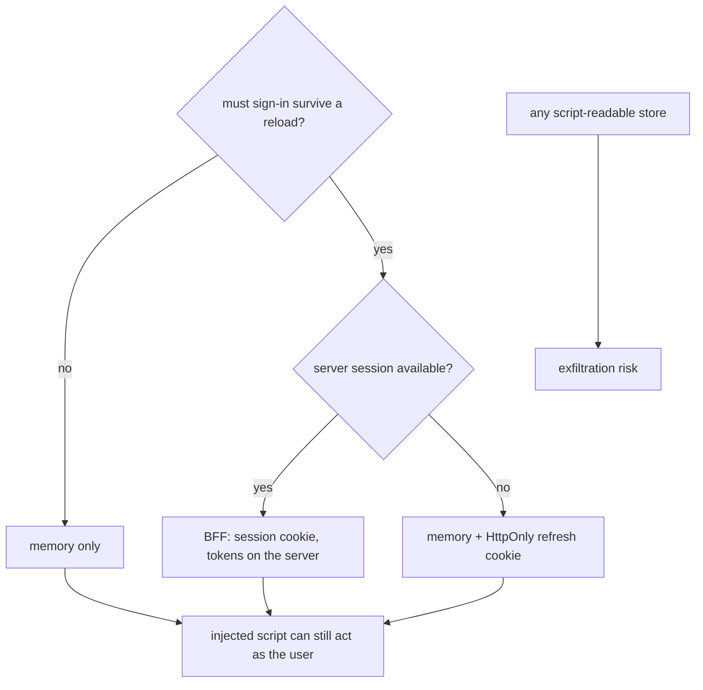

What to notice: no option stops script in the page acting as the user; they differ in what can be stolen, and for how long.

### How it actually works

**Cookies ride only when asked.** In `@angular/common` 22.2.1 (`fesm2022/_module-chunk.mjs`, read), the default `FetchBackend`'s private `createRequestInit` (internal, may change in any release) maps `withCredentials: true` to `credentials: 'include'`; otherwise the request's `credentials` option, or fetch's `same-origin` default, applies ([MDN](https://developer.mozilla.org/en-US/docs/Web/API/RequestInit), read 2026-10-15).

**Memory does not hide the token.** Its private `fetchImpl`, also internal, is `inject(FetchFactory, { optional: true })?.fetch ?? ((...args) => globalThis.fetch(...args))` (read): it looks up `globalThis.fetch` per request, so a payload replacing `window.fetch` after boot sees the next one.

**In Chromium:**

- `Section 8: injected script reads a token kept in localStorage`; replayed without cookies, 200.
- `Section 8: injected script captures an in-memory token from the app's next request`; replayed, 200.
- `Section 8: a token kept in memory is gone after a reload`: the next call got 401.
- `Section 8: injected script cannot read an HttpOnly session cookie`: `document.cookie` lacked `m33-session` (attributes: [09 §6](09-web-networking-storage-security.md#6-cookies)).
- `Section 8: injected script can call the API with the HttpOnly session cookie`: 200.

**Guidance.** [RFC 10017](https://www.rfc-editor.org/rfc/rfc10017.html), "OAuth 2.0 for Browser-Based Applications" (BCP 212, August 2026, formerly draft -27; read 2026-10-15): with a BFF "there are no tokens available to extract from the browser" (§6.1), yet "none of these options can fully mitigate token exfiltration when the attacker can execute malicious code" (§8.5). OWASP's [HTML5 Security Cheat Sheet](https://cheatsheetseries.owasp.org/cheatsheets/HTML5_Security_Cheat_Sheet.html) (read 2026-10-15): "Do not store session identifiers in local storage as the data is always accessible by JavaScript."

Drilled in [Q33.21](#q33-21), [Q33.22](#q33-22) and [Q33.23](#q33-23), after [Q09.18](09-web-networking-storage-security.md#q09-18); [Exercise 33.4](#ex33-4) designs it.

### Code

The approach: the route picks where the credential lives; the test plays the payload.

1. Three `@Injectable()` strategies extend `LabM33TokenStore`; each route provides one.
2. The page keeps what sign-in returned and sends it on "Load profile".
3. The test wraps `window.fetch`, then replays the capture from the cookieless `request` fixture.

```ts
// Excerpt of labs/angular/projects/security-lab/src/app/m33/tokens/token-store.ts
@Injectable()
export class LabM33MemoryStore extends LabM33TokenStore {
  readonly mode = 'bearer';
  readonly label = 'memory';
  private readonly token = signal<string | null>(null);
```

```ts
// Excerpt of labs/e2e/tests/33-security/concepts/section-8-token-storage.spec.ts
  await page.evaluate(() => {
    const original = window.fetch;
    window.fetch = (input, init) => {
      const authorization = new Headers(init?.headers).get('authorization');
      if (authorization) Reflect.set(window, '__m33Captured', authorization);
      return original(input, init);
    };
  });
```

### Best practices and anti-patterns

- **Keep tokens out of Web Storage**, because any same-origin script reads them, and copies work anywhere.
- **Prefer a BFF when you can run one**, because no token reaches the browser; then defend its cookie against CSRF (§9).
- **Otherwise, a short-lived access token in memory and the refresh token in an `HttpOnly` cookie**, because script cannot read the cookie and a stolen access token expires.
- **Invest in preventing XSS** ([§2](#2-xss-and-angulars-template-model-escaping-by-default-trusted-templates-and-the-paths-around-them)-§6), because every option lets injected script act as the user.

### Misconceptions and traps

- *"A token in memory is out of XSS's reach."* The payload captured it (tested); the myth comes from it being in no store.
- *"`sessionStorage` is safer than `localStorage` against XSS."* Same-origin script reads both ([09 §7](09-web-networking-storage-security.md#7-browser-storage-what-each-is-safe-for)); the myth comes from it being per tab.
- *"A BFF needs no CSRF protection."* The browser attaches its session cookie (§9); the myth comes from there being no token.
- *"A JWT's contents are secret."* Each part "contains a base64url-encoded value" ([RFC 7519](https://www.rfc-editor.org/rfc/rfc7519.html) §3, May 2015), so its holder reads the claims; the myth comes from it looking opaque.

## 9. CSRF in single-page apps: when cookies make you vulnerable, `SameSite` and Angular's XSRF support

### The problem it solves

[§8](#8-where-the-token-lives-memory-web-storage-httponly-cookies-and-a-backend-for-frontend) ended on a session cookie. A page on another site posts a form to the bank and the browser attaches the bank's cookies: is that its own user? A team "turned on Angular's XSRF (its name for CSRF) protection" while the server never checks the header: what does it protect?

### Mental model

**CSRF** (cross-site request forgery) is another site making the user's browser send a state-changing request ([27 §8](27-http-client.md#8-xsrf-protection-how-httpclient-reads-the-cookie-and-sets-the-header-and-when-it-does-not) defines it). It needs an **ambient credential**, one the browser attaches by itself: a cookie, HTTP authentication or a client certificate. An `Authorization` header set by script is not ambient; that API's risk is XSS (§8). With cookies, layer these:

- **`SameSite`**, the browser's rule for which cookies cross sites ([09 §6](09-web-networking-storage-security.md#6-cookies)).
- A **token check**: Angular copies the cookie into a header ([Q27.26](27-http-client.md#q27-26)) and the server must compare them.
- **Fetch Metadata**: request headers the browser sets, among them `Sec-Fetch-Site` (`same-origin`, `same-site`, `none` or `cross-site`; [web.dev](https://web.dev/articles/fetch-metadata), last updated 2020-06-04, read 2026-10-15). An **`Origin` check** compares the `Origin` header with the app's own.

**XSSI** (cross-site script inclusion) is another site loading your JSON in a `<script>` tag. Analogy: a bank that honors any cheque with your stamp, against one that also wants your PIN.

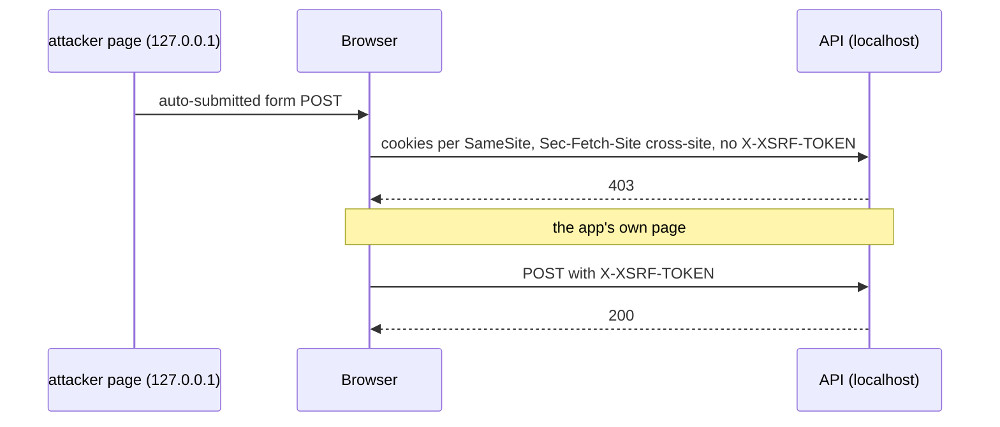

What to notice: the server's check decides; the browser's rules only reduce what reaches it.

### How it actually works

**The forgery arrives.** `localhost` and `127.0.0.1` are two sites, so a page on `127.0.0.1` plays the attacker. Sign-in sets four `HttpOnly` cookies, one per `SameSite` choice (`Lax`, `Strict`, `None; Secure`, none given). In Chromium 153.0.8010.12:

- `Section 9: a cross-site form post carries only the None cookie and the cookie without SameSite`: the cookies `def` and `none`.
- `Section 9: a cross-site no-cors fetch carries only the None cookie`.
- `Section 9: the forged request arrives with Sec-Fetch-Site cross-site`, with `Origin: http://127.0.0.1:4500`, in both.

The `def` result is that test's, signed in seconds earlier; [09 §6](09-web-networking-storage-security.md#6-cookies) describes the short window. It says nothing about other browsers or versions.

**The server decides.** `Section 9: the forged post without the header is rejected`: the session cookies arrived, no header, 403. `Section 9: the app's own post carries the XSRF header and is accepted`: `same-origin`, header, 200. Spring's `CookieCsrfTokenRepository` writes `XSRF-TOKEN` and reads `X-XSRF-TOKEN` by default ([API 7.1.1](https://docs.spring.io/spring-security/reference/api/java/org/springframework/security/web/csrf/CookieCsrfTokenRepository.html), read 2026-10-15); [42](42-fullstack-authentication.md#6-csrf-with-cookiecsrftokenrepository-and-angulars-xsrf-support-csrfspa-in-spring-security-7) configures it.

**Prefixed JSON.** The [docs](https://angular.dev/guide/security) (`main`, read 2026-10-15) say servers can prefix JSON "to make them non-executable, by convention, using the well-known string `")]}',\n"`". `@angular/common` 22.2.1 (`fesm2022/_module-chunk.mjs`, read; internal, may change in any release) defines `XSSI_PREFIX = /^\)\]\}',?\n/`, and the fetch backend (line 963) and the XHR backend (1862) strip it before parsing. `Section 9: HttpClient strips the XSSI prefix before parsing JSON`: `JSON.parse` of the raw body throws, the page shows `Status ok: true`.

Drilled in [Q33.24](#q33-24) and [Q33.25](#q33-25), after [Q09.17](09-web-networking-storage-security.md#q09-17); [Exercise 33.3](#ex33-3) stops the forgery.

### Code

The approach: sign in on the app's site, then forge from the other site.

1. The server logs each transfer's cookies, `Sec-Fetch-Site` and `Origin`.
2. The attacker page is served only on `127.0.0.1`.
3. The test loads it and reads the log.

```js
// Excerpt of labs/e2e/server/security/09-csrf.mjs
      const status = session === undefined ? 401 : header !== undefined && header === sessions.get(session) ? 200 : 403;
```

```ts
// Excerpt of labs/e2e/tests/33-security/concepts/section-9-csrf.spec.ts
  await page.goto(`${ATTACKER_ORIGIN}/m33/csrf/attacker/form`);
  const [forged] = await transfers(page, run, 1);
  expect(forged?.cookies).toEqual(['def', 'none']);
```

### Best practices and anti-patterns

- **Check the token on the server for every state change**, because Angular's header protects nothing alone ([27 §8](27-http-client.md#8-xsrf-protection-how-httpclient-reads-the-cookie-and-sets-the-header-and-when-it-does-not)).
- **Reject `cross-site` requests and a foreign `Origin` on state changes**, because the browser sets them.
- **Keep `SameSite` as one layer**, because it varies by browser and version.
- **Never change state on `GET`**, because a link or image makes one.

### Misconceptions and traps

- *"`SameSite=Lax` makes CSRF tokens unnecessary."* The cookie without the attribute and the `None` cookie rode the forged post (tested); the myth comes from browsers defaulting to `Lax`.
- *"JSON APIs are CSRF-proof."* A no-cors `fetch` with `text/plain` needs no preflight, the CORS permission request of [09 §5](09-web-networking-storage-security.md#5-the-same-origin-policy-and-cors) (tested), so only the token or a Fetch Metadata check stops it; the myth comes from JSON needing a preflight.
- *"CORS stops CSRF."* CORS hides responses and does not stop the request ([Q09.12](09-web-networking-storage-security.md#q09-12)); the myth comes from CORS errors filling the console.
- *"Bearer-token APIs need XSRF tokens."* Nothing ambient is attached, so the risk is XSS (§8); the myth comes from cookie-app habit.

## 10. Route guards are UX: authorization belongs on the server

### The problem it solves

An admin area hides behind a `canMatch` guard that reads a role from `localStorage`. A user edits the value and sees the admin screens. Did the data come too, and was the admin code ever hidden from them?

### Mental model

Everything in the bundle and every decision in the browser is advisory. A route guard, a hidden button and a disabled field shape the **user experience** (UX). **Authorization** (may this caller do this?) happens on the server for every request, after **authentication** (who is the caller?): no valid identity is `401`, a known caller who may not is `403` ([09 §1](09-web-networking-storage-security.md#1-http-semantics-methods-status-codes-and-headers)). Hiding a route is **client-side gating**: it decides what the page offers, not what a request can do. Analogy: a "staff only" sign against a locked door.

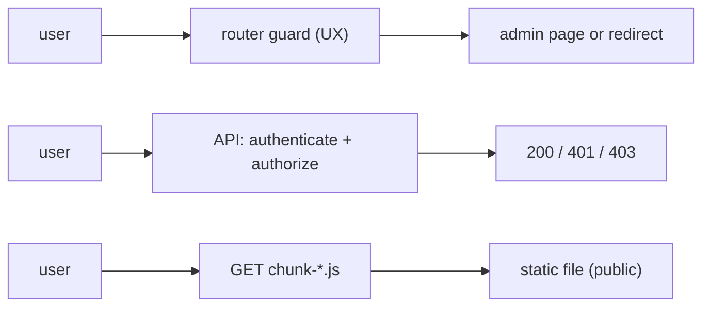

What to notice: the guard sits on only one of three paths.

### How it actually works

**The guard decides what the router loads.** [24 §5](24-routing.md#5-functional-guards-canmatch-canactivate-candeactivate-and-redirectcommand) quotes the docs warning and [24 §4](24-routing.md#4-lazy-loading-in-depth-loaders-canmatch-and-route-injectors) shows `canMatch` stopping a lazy load. Read from `@angular/router` 22.2.1 (`_router-chunk.mjs`; internal, may change in any release): `Recognizer.matchSegmentAgainstRoute` calls `matchWithChecks`, which runs `runCanMatchGuards`, and only then reaches `getChildConfig` and the `loadChildren` loader; a `loadComponent` loader runs in a later step. A refusal means no request for the chunk, not a private file.

**The lab, in Chromium on the production build:**

- `Section 10: canMatch keeps a non-admin on the fallback page`: the second route with the same path rendered, and the browser never requested the admin chunk.
- `Section 10: the admin chunk is downloadable without passing the guard`: chunks are static files ([12 §3](12-angular-how-it-works.md#3-building-the-application-builder-output-layout-and-budgets)); a plain request with no cookie got 200 and the marker `LAB_M33_ADMIN_CHUNK`, and the page's import map lists the file name.
- `Section 10: the admin API answers 403 to a non-admin and 200 to an admin`, and 401 with no session.
- `Section 10: a role edited in the browser opens the admin page but not the data`: the guard passed, the chunk loaded, "Load report" got 403, because the server reads the role from its own session behind an `HttpOnly` cookie.

[Q24.19](24-routing.md#q24-19) drills the code-review bug and [Q33.26](#q33-26) the observed one.

### Code

The approach: the guard trusts the browser's copy of the role; the server trusts only its session.

1. The guard compares the role in `localStorage`.
2. The API reads the role it stored at sign-in.
3. The test edits the copy, then calls the API.

```ts
// Excerpt of labs/angular/projects/security-lab/src/app/m33/guards/is-admin.ts
export const isAdmin: CanMatchFn = () => inject(LabM33GuardSession).role() === 'admin';
```

```js
// Excerpt of labs/e2e/server/security/10-guards.mjs
      const status = role === undefined ? 401 : role === 'admin' ? 200 : 403;
```

```ts
// Excerpt of labs/e2e/tests/33-security/concepts/section-10-guards.spec.ts
  await page.evaluate(() => localStorage.setItem('m33-guards-role', 'admin'));
```

### Best practices and anti-patterns

- **Authorize every request on the server from a verified identity and role**, because the browser's copy is editable.
- **Keep guards for UX**, because they spare users screens that would only fail.
- **Put nothing secret in a lazy chunk**, because its file is public.

### Misconceptions and traps

- *"`canMatch` keeps the admin code away from non-admins."* The router skipped the request, yet the file answered 200 to anyone (tested); the myth comes from reading "never loaded" as "never available".
- *"Guards are pointless if they are not security."* They spare users failing screens and needless `403`s; the myth comes from all-or-nothing thinking.
- *"A role inside the token lets the client decide."* The claim is readable and the page's belief is editable, so the server verifies the token and the role on every request ([42](42-fullstack-authentication.md#5-spring-security-as-a-resource-server-validating-jwts-and-turning-scopes-into-authorities)); the myth comes from treating readable as trusted.

## 11. Dependency and supply-chain security: lockfiles, `npm audit`, install scripts and Subresource Integrity

### The problem it solves

A transitive dependency publishes a malicious patch, CI installs what the ranges allow that morning, and a script from another host changes overnight. Which checks notice?

### Mental model

The **lockfile** (`package-lock.json`) pins every installed package, **transitive dependencies** (those of your dependencies) included, to a version and an **integrity hash**, a `sha512` digest of its tarball. **`npm ci`** installs exactly the lockfile. An **install script** runs code at install. A **release-age delay** skips versions published too recently. An **advisory** reports a bad version; **provenance** says where a package was built. **Subresource Integrity (SRI)** makes the browser compare a script's hash with its `integrity` attribute. Analogy: seals checked at each warehouse and at the shop door.

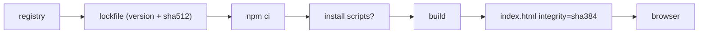

What to notice: each check covers one hop; none covers what an author published on purpose.

### How it actually works

**npm** (11.19.0 shipped docs, read 2026-10-15; documented, not run against the registry):

- `npm ci` "will exit with an error, instead of updating the package lock" when it disagrees with `package.json`.
- `ignore-scripts`: "npm does not run scripts specified in package.json files".
- `min-release-age`: "only versions that were available more than the given number of days ago will be installed".
- `npm audit signatures` "will also verify the provenance attestations".

**The lockfile is tested.** `Section 11: every package in the labs/angular lockfile pins a version and a sha512 integrity hash`: no exception. Two incidents (GitHub advisory database, read 2026-10-15): GHSA-pjwm-rvh2-c87w (2021-10-22), `ua-parser-js` "published with malicious code"; GHSA-2v46-p5h4-248w (2025-09-08), `chalk` 5.6.1, "a browser-based interceptor". A hash proves a file is the one published, not that the publish was honest.

**SRI is a digest in a format**: `sha384-` plus base64 (W3C Working Draft, 20 March 2026, section 3.1). `Section 11: an SRI hash changes when one byte of the file changes` reproduces its example digest, then flips one bit.

**What the build writes** (`@angular/build` 22.2.1; internal, may change in any release; read). `augmentIndexHtml` (`augment-index-html.js`) adds `integrity` to each initial script, stylesheet and modulepreload link, and `crossorigin="anonymous"` to the scripts and stylesheets; `generateIndexHtml` (`index-html-generator.js`) hashes every other `.js` file into a `<script type="importmap">` for lazy chunks, which needs the nonce of [§5](#5-content-security-policy-with-angular-nonces-csp_nonce-and-autocsp). `Section 11: the built index.html carries integrity attributes that match the served scripts`: all equal the served bytes' SHA-384. `Section 11: a tampered main bundle is refused and the app does not boot`: Chromium logs (abridged) "Failed to find a valid digest in the 'integrity' attribute … The resource has been blocked." and `lab-root` stays empty.

**A limit found.** `Section 11: the import map checks a lazy chunk from the root URL but not on a deep link`: a tampered lazy chunk is refused at `/`, runs at `/m33/guards`. The HTML standard (14 October 2026, "prepare the script element") parses a map against the base URL in force then, and the build writes the map before `<base href="/">`; with `<base>` first, the deep link refuses the chunk.

**Staying current.** Angular's [release page](https://angular.dev/reference/releases) (`main`, read 2026-10-15): "A patch release … almost every week"; LTS (long-term support) gets "Only critical fixes and security patches" ([§7](#7-server-rendered-pages-escaping-in-the-server-html-the-state-script-and-ssrf) cites two SSRF patches).

Drilled in [Q33.27](#q33-27) and [Q33.28](#q33-28).

### Code

The approach: compare each pinned hash with the served bytes.

1. Vitest checks every lockfile entry.
2. The e2e test fetches each pinned file and compares digests.
3. The tamper test appends one byte with `page.route`.

```ts
// Excerpt of labs/ts-js/src/modules/33-security/section-11-supply-chain.test.ts
      expect(entry.integrity, path).toMatch(/^sha512-[A-Za-z0-9+/]{86}==$/);
```

```ts
// Excerpt of labs/e2e/tests/33-security/concepts/section-11-supply-chain.spec.ts
    const body = await (await context.request.get(`${SEC_ORIGIN}/${file.replace(/^\.\//, '')}`)).body();
    expect(`sha384-${sha384Base64(body)}`, file).toBe(integrity);
```

```ts
// Excerpt of labs/e2e/tests/33-security/concepts/section-11-supply-chain.spec.ts
  await tampered.route(/\/main-[^/]+\.js$/, async (route) => {
    const response = await route.fetch();
    await route.fulfill({ response, body: `${await response.text()} ` });
```

### Best practices and anti-patterns

- **Commit the lockfile and install with `npm ci`**, because it fails instead of rewriting.
- **Use `ignore-scripts` where the build works**, because install scripts run with your rights.
- **Stay on a supported Angular line**, because only those get patches.

### Misconceptions and traps

- *"A clean `npm audit` means the dependencies are safe."* It knows only reported advisories, not this morning's version; the myth comes from zero findings reading as a pass.
- *"Exact versions in `package.json` pin everything."* Transitive ranges float without a lockfile: `@angular/core` 22.2.1 asks for `tslib` `^2.3.0`, which the lab's lockfile pins at 2.8.1; the myth comes from the top level looking pinned.
- *"SRI protects against a compromised npm package."* It checks the browser got the files you built, not what built them (and a deep link skipped a chunk); the myth comes from "integrity" sounding total.
- *"Lockfiles are only for reproducibility."* Their hashes also refuse a swapped tarball; the myth comes from how they are introduced.

## 12. Under the hood: from a template binding to a sanitized DOM write

### The problem it solves

An interviewer asks how Angular knows that `[href]` needs URL cleaning and `[title]` does not, when the check runs, and why the HTML sanitizer parses its input more than once.

### Mental model

Decided at compile time, run at update time. The **security schema** (`SECURITY_SCHEMA`, `@angular/compiler` 22.2.1; internal, may change in any release) maps an element and property to a security context. The compiler looks each binding up once and passes a **sanitizer function reference**, an `ɵɵsanitize*` function (internal), as the binding instruction's last argument; the instruction calls it whenever the value changes. HTML is parsed in an **inert document**, a separate in-memory DOM where scripts and handlers do not run, then rebuilt from allowlists. Analogy: the customs form is printed at the factory; every shipment is inspected.

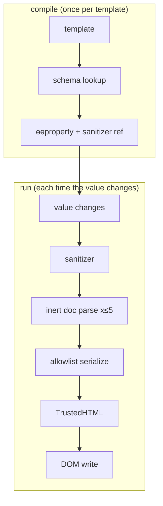

What to notice: no binding pays for sanitization unless the schema gives its target a context.

### How it actually works

Names below are internal and may change in any release; read, not run, unless a test is named. Instructions in general: [12 §8](12-angular-how-it-works.md#8-under-the-hood-what-the-compiler-emits-and-what-the-runtime-does-with-it).

**Compile.** `BindingParser.createBoundElementProperty` asks `DomElementSchemaRegistry.securityContext`; `checkSecurityContext` looks up the property, namespace and tag (or `*`), else `NONE`. The `resolveSanitizers` phase turns the context into a reference (`ɵɵsanitizeHtml`, `ɵɵsanitizeUrl`, `ɵɵvalidateAttribute` for no-binding attributes); `NONE` gets none. Static attributes are constants you wrote: only HTML and resource-URL ones are wrapped, as trusted (`ɵɵtrustConstant*`). `Section 12: the compiled template passes a URL sanitizer with an href binding` reads `ɵɵdomProperty("href", ctx.url(), ɵɵsanitizeUrl)` in the template function (`ɵɵproperty` once a directive is imported); `Section 12: the compiled template passes no sanitizer with a title binding` finds `("title", ctx.label())`.

**Run.** `ɵɵproperty` and `ɵɵdomProperty` (`@angular/core` 22.2.1, `_debug_node-chunk.mjs`) call `bindingUpdated` (`Object.is`), then `setDomProperty` sanitizes just before `renderer.setProperty`, so each new value is checked: `Section 12: the sanitizer runs again when the bound value changes` sees a safe URL, `unsafe:javascript:…`, then a safe one. A property that matches a directive input goes to the input unsanitized (`setPropertyAndInputs`).

**Which sanitizer.** Each `ɵɵsanitize*` first calls `getSanitizer()`. The root `Sanitizer` provider returns `null`, and `@angular/platform-browser` 22.2.1 never binds `DomSanitizerImpl` to it, so a browser app unwraps a matching safe value (`allowSanitizationBypassAndThrow`) or calls `_sanitizeUrl` or `_sanitizeHtml`, which `DomSanitizerImpl.sanitize` also uses ([§4](#4-domsanitizer-and-bypasssecuritytrust-when-trusting-a-value-is-dangerous-and-the-safe-patterns)).

**HTML.** `_sanitizeHtml` parses with `DOMParser` through the `angular` Trusted Types policy ([§6](#6-trusted-types-with-angular-the-frameworks-policies-enforcement-and-rollout)), then re-parses until two passes agree, at most five times, else throws "Failed to sanitize html because the input is unstable". The reason is **mutation XSS**, markup that changes meaning when parsed again: agreement means the browser later sees what was checked. `SanitizingHtmlSerializer` writes only allowlisted elements and attributes and entity-encodes text. **DOM clobbering** is markup whose `name` or `id` shadows a DOM property (in `<form><input name="nextSibling"></form>`, `form.nextSibling` is the input); the walker checks that siblings and children point back, or throws "Failed to sanitize html because the element is clobbered". The output becomes `TrustedHTML` where the browser supports it.

Drilled in [Q33.29](#q33-29).

### Code

The approach: quote the three steps, then the test.

1. The compiler maps the context to a reference.
2. The instruction calls it after the change check.
3. The HTML sanitizer parses until stable.
4. The test reads the compiled template.

```js
// Partial: abridged from @angular/compiler 22.2.1, fesm2022/compiler.mjs, DomElementSchemaRegistry.securityContext
// (lines 18725-18731), checkSecurityContext (364-391) and resolveSanitizers (21907-21935); internal, read, not run
securityContext(tagName, propName, isAttribute) {
  if (isAttribute) propName = this.getMappedPropName(propName);
  const [ns, name] = splitNsName(tagName, false);
  return checkSecurityContext(name, propName, ns); // schema[prop][ns][tag] ?? …['*'] ?? SecurityContext.NONE
}
// resolveSanitizers: static attribute → op.trustedValueFn = trustedValueFns.get(context) ?? null  (HTML, RESOURCE_URL only)
//                    bound property   → op.sanitizer = sanitizerFns.get(context) ?? null
```

```js
// Partial: abridged from @angular/core 22.2.1, fesm2022/_debug_node-chunk.mjs, ɵɵdomProperty (lines 15644-15654),
// setDomProperty (5564-5581) and ɵɵsanitizeUrl (3402-3411); internal, read, not run
if (bindingUpdated(lView, bindingIndex, value)) {                 // Object.is against the stored value
  value = sanitizer != null ? sanitizer(value, tNode.value || '', propName) : value;
  renderer.setProperty(element, propName, value);
}
function ɵɵsanitizeUrl(unsafeUrl) {
  const sanitizer = getSanitizer();                               // lView[ENVIRONMENT].sanitizer, null by default
  if (sanitizer) return sanitizer.sanitize(SecurityContext.URL, unsafeUrl) || '';
  if (allowSanitizationBypassAndThrow(unsafeUrl, "URL")) return unwrapSafeValue(unsafeUrl);
  return _sanitizeUrl(renderStringify(unsafeUrl));
}
```

```js
// Partial: abridged from @angular/core 22.2.1, fesm2022/_debug_node-chunk.mjs, _sanitizeHtml (lines 3250-3280);
// internal, read, not run
inertBodyElement = inertBodyHelper.getInertBodyElement(unsafeHtml);
let mXSSAttempts = 5;
let parsedHtml = unsafeHtml;
do {
  if (mXSSAttempts === 0) throw new Error('Failed to sanitize html because the input is unstable');
  mXSSAttempts--;
  unsafeHtml = parsedHtml;
  parsedHtml = inertBodyElement.innerHTML;
  inertBodyElement = inertBodyHelper.getInertBodyElement(unsafeHtml);
} while (unsafeHtml !== parsedHtml);
const safeHtml = new SanitizingHtmlSerializer().sanitizeChildren(getTemplateContent(inertBodyElement) || inertBodyElement);
return trustedHTMLFromString(safeHtml);                           // the 'angular' Trusted Types policy
```

```ts
// Excerpt of labs/angular/src/app/modules/33-security/concepts/section-12-under-the-hood.spec.ts
    expect(templateSource(LinkHost)).toMatch(/ɵɵdomProperty\("href", ctx\.url\(\), [\w$]+\.ɵɵsanitizeUrl\)/);
    expect(templateSource(MarkedLinkHost)).toMatch(/ɵɵproperty\("href", ctx\.url\(\), [\w$]+\.ɵɵsanitizeUrl\)/);
```

```ts
// Excerpt of labs/angular/src/app/modules/33-security/concepts/section-12-under-the-hood.spec.ts
    expect(href('https://example.test/a')).toBe('https://example.test/a');
    expect(href('javascript:window.__m33Hits=1')).toBe('unsafe:javascript:window.__m33Hits=1');
    expect(href('https://example.test/b')).toBe('https://example.test/b');
```

### Best practices and anti-patterns

- **Keep the default `Sanitizer`**, because one you provide replaces every built-in check for every binding.
- **Make a directive that writes HTML or URLs sanitize its own input**, because a matched input skips the binding's sanitizer.
- **Read the compiled template when a binding surprises you**, because it names the function that guards it, if any.

### Misconceptions and traps

- *"Sanitization happens once, when the component is created."* Every change of the bound value runs it again (tested); the myth comes from constructor-time thinking.
- *"Angular strips tags with regular expressions."* It parses in an inert document with the browser's parser and rebuilds from allowlists (read); the myth comes from older sanitizers that did.
- *"Static attributes in a template are sanitized like bindings."* They are constants you wrote, at most wrapped as trusted (read); the myth comes from the two looking alike.

## Summary

An attacker controls the bundle they download, every request their browser sends and any script that runs in the page, so only the server can make a decision the user cannot edit, and each defense stops a different step ([section 1](#1-threat-model-of-an-angular-single-page-app-what-the-attacker-controls-what-runs-where-and-where-each-defense-lives)). Angular's templates escape what you bind; a direct `nativeElement` write, a template compiled from user text or server-built HTML sits outside that model ([section 2](#2-xss-and-angulars-template-model-escaping-by-default-trusted-templates-and-the-paths-around-them)). The sanitizer picks its rule by security context, and the shipped 22.2.1 refuses only `javascript:` URLs and lets style values through, so check schemes against your own list and map style input to classes ([section 3](#3-sanitization-by-security-context-html-style-url-and-resource-url)). A `bypassSecurityTrust*` call switches the check off for that value: parse, allowlist, build, then bypass in one audited service, never in a `safeHtml` pipe ([section 4](#4-domsanitizer-and-bypasssecuritytrust-when-trusting-a-value-is-dangerous-and-the-safe-patterns)).

A nonce must be new in every response; `ngCspNonce` suits server-written HTML, `CSP_NONCE` a nonce that arrives at run time, and `autoCsp` hashes scripts only and cannot be built with server rendering ([section 5](#5-content-security-policy-with-angular-nonces-csp_nonce-and-autocsp)). Trusted Types makes the browser refuse string writes to dangerous sinks: allow `angular`, add `angular#unsafe-bypass` only after reviewing every bypass, and roll out in report-only mode first ([section 6](#6-trusted-types-with-angular-the-frameworks-policies-enforcement-and-rollout)). On the server, request data is attacker input: bindings escape it, the state script is readable by every visitor, and a server that fetches a visitor's URL needs an outgoing allowlist ([section 7](#7-server-rendered-pages-escaping-in-the-server-html-the-state-script-and-ssrf)). Every token option lets injected script act as the user, so prefer a backend-for-frontend, or keep a short-lived access token in memory and the refresh token in an `HttpOnly` cookie ([section 8](#8-where-the-token-lives-memory-web-storage-httponly-cookies-and-a-backend-for-frontend)).

A cookie session needs a server-checked CSRF token or a refusal of `cross-site` requests, because `SameSite` is one layer and a no-cors `text/plain` `fetch` needs no preflight; a bearer header has no ambient credential to ride ([section 9](#9-csrf-in-single-page-apps-when-cookies-make-you-vulnerable-samesite-and-angulars-xsrf-support)). Route guards spare users failing screens, yet a `canMatch` guard leaves the chunk and the API open, so the server authorizes every request ([section 10](#10-route-guards-are-ux-authorization-belongs-on-the-server)). Commit the lockfile and install with `npm ci`: `npm audit` knows only reported advisories, and Subresource Integrity checks the files you built, not what built them ([section 11](#11-dependency-and-supply-chain-security-lockfiles-npm-audit-install-scripts-and-subresource-integrity)). Under the hood a compiled template names the `ɵɵsanitize*` function for each binding, and the runtime sanitizer parses in an inert document and rebuilds from allowlists; a `Sanitizer` you provide replaces every check ([section 12](#12-under-the-hood-from-a-template-binding-to-a-sanitized-dom-write)).

## Question bank

Each answer has five parts. Each Output answer states the run asserted in `labs/e2e/tests/33-security/outputs/q33-outputs.spec.ts` or `labs/angular/src/app/modules/33-security/outputs/q33-outputs.spec.ts`.

<a id="q33-01"></a>
### Q33.01 · Concept · What is the threat model of an Angular single-page app: what does an attacker control, what runs on the user's device, and which defenses live in the browser and which on the server?

<details>
<summary>Answer</summary>

**Short answer (30 seconds).** The attacker controls everything that reaches the browser: the bundle they download, every request their browser sends, any script that runs in the page (injected, third-party or shipped in a package) and any other site that can make their browser call you. Only the server's decision is out of their hands. Browser-side defenses (escaping, policies, token storage) protect the user from script in their page, and server-side defenses (prices, permissions, limits) protect the data from the user.

**Full explanation.** [§1](#1-threat-model-of-an-angular-single-page-app-what-the-attacker-controls-what-runs-where-and-where-each-defense-lives) draws the four sources of code and the boundaries between them. In the lab, a staff code the page never renders is readable in the downloaded JavaScript, and an order edited to `price: 0` is charged 25 (`Section 1: every string the app ships is readable in the downloaded bundle`, `Section 1: the API recomputes a price the client edited`). The [root guide's Part I](../../Backend%20Study%20Guide%20-%20Security%2C%20JPA%2C%20Design%20Patterns%20%26%20Spring.md#part-i--web-application-security-owasp) teaches the OWASP 2021 list mapped here.

**Follow-ups an interviewer will ask.**
- *Does minifying hide logic or keys?* No: strings ship whole, which is why the bundle test finds the marker.
- *If the server decides everything, why defend the browser?* Injected script acts as the logged-in user with their session ([§8](#8-where-the-token-lives-memory-web-storage-httponly-cookies-and-a-backend-for-frontend)), so the server's checks alone cannot tell it from the user.

**Trap to avoid.** Answering "the backend handles security" or "Angular sanitizes it": each names one layer.

</details>

<a id="q33-02"></a>
### Q33.02 · Design · Threat-model a payments single-page app in an interview: list the assets, entry points and trust boundaries, and map each threat to a client or server control.

<details>
<summary>Answer</summary>

**Short answer (30 seconds).** Name the assets (the session or token, the payment instruction, account data), the entry points (form fields, URL parameters, API responses, third-party scripts, packages, other sites' pages) and the boundaries (browser to API, third-party script to page, registry to build). Then pair each threat on a boundary with a control and its owner. Whatever moves money or grants access is checked on the server.

**Full explanation.** One line per threat, each owned by a section:
- A forged amount or recipient: the server recomputes and authorizes ([§1](#1-threat-model-of-an-angular-single-page-app-what-the-attacker-controls-what-runs-where-and-where-each-defense-lives), [§10](#10-route-guards-are-ux-authorization-belongs-on-the-server)).
- Script in the page: bindings, the sanitizer, a CSP and Trusted Types ([§2](#2-xss-and-angulars-template-model-escaping-by-default-trusted-templates-and-the-paths-around-them)-[§6](#6-trusted-types-with-angular-the-frameworks-policies-enforcement-and-rollout)), and a token outside Web Storage ([§8](#8-where-the-token-lives-memory-web-storage-httponly-cookies-and-a-backend-for-frontend)).
- Another site's request carrying the user's cookies: `SameSite` plus a token or a Fetch Metadata check ([§9](#9-csrf-in-single-page-apps-when-cookies-make-you-vulnerable-samesite-and-angulars-xsrf-support)).
- A poisoned package or script: a lockfile, `npm ci`, Subresource Integrity ([§11](#11-dependency-and-supply-chain-security-lockfiles-npm-audit-install-scripts-and-subresource-integrity)).
- A secret in the bundle: none; the server holds keys ([Q12.11](12-angular-how-it-works.md#q12-11)).

Injected script still acts as the user, so the server's limits are the last control.

**Follow-ups an interviewer will ask.**
- *Where does a route guard sit?* In the browser, as display logic; the API's check is the control ([§10](#10-route-guards-are-ux-authorization-belongs-on-the-server)).
- *What changes if the app is server-rendered?* The server fetches URLs and writes HTML: SSRF and server-side escaping ([§7](#7-server-rendered-pages-escaping-in-the-server-html-the-state-script-and-ssrf)).

**Trap to avoid.** Listing tools (CSP, JWT, HTTPS) without the attack each covers.

</details>

<a id="q33-03"></a>
### Q33.03 · Concept · What are stored, reflected and DOM-based XSS, and which of them does Angular's template model stop by default?

<details>
<summary>Answer</summary>

**Short answer (30 seconds).** The names say where the script travels. Stored: the server saves the payload and serves it to other users. Reflected: a response echoes part of the request. DOM-based: the page's own script moves attacker data into the DOM; the response never changes. Angular's template model stops all three at the template binding: interpolation and `[textContent]` make text, `[innerHTML]` is sanitized. It does not at a direct DOM write, a bypass or a run-time template.

**Full explanation.** The kind names the path; the sink decides ([§2](#2-xss-and-angulars-template-model-escaping-by-default-trusted-templates-and-the-paths-around-them); definitions from OWASP, read 2026-10-15). A stored comment and a reflected `?q=` both reach the client as strings. Bound with `{{ }}` they become characters ([13 §2](13-components-and-templates.md#2-interpolation-and-template-expressions-what-is-allowed)); bound to `[innerHTML]` they lose script and handlers (`Section 2: interpolation renders markup as text`, `Section 2: an [innerHTML] binding removes the script and the event handler`). The same string given to `nativeElement.innerHTML` runs ([Q33.04](#q33-04)). Server-built HTML is outside the model ([§7](#7-server-rendered-pages-escaping-in-the-server-html-the-state-script-and-ssrf)).

**Follow-ups an interviewer will ask.**
- *Is stored XSS in an API response a problem for an Angular client?* Only when it leaves the binding: a direct write or `bypassSecurityTrustHtml` ([§4](#4-domsanitizer-and-bypasssecuritytrust-when-trusting-a-value-is-dangerous-and-the-safe-patterns)).
- *What kind is a page that writes `?q=` with `nativeElement.innerHTML`?* DOM-based: the response never contains the payload; the page's script moves it into a sink.

**Trap to avoid.** Answering "Angular prevents XSS" without the bound: it does so through bindings only.

</details>

<a id="q33-04"></a>
### Q33.04 · Output · One payload, four sinks: interpolation, `[innerHTML]`, `[textContent]` and `nativeElement.innerHTML`. What ends up in the DOM, and does the payload's handler run?

A search page writes `?q=` four ways, one paragraph each; the fourth is `nativeElement.innerHTML = q` in `afterNextRender`. The payload is ``, whose handler only counts.

<details>
<summary>Answer</summary>

**Short answer (30 seconds).** Interpolation and `[textContent]` hold the payload as text, with no child element. `[innerHTML]` holds ``, the handler removed. The direct write holds the whole element, `onerror` included, and `window.__m33Hits` is 1: only that sink ran the handler. Angular escapes or sanitizes what passes through a binding; a direct write never does.

**Full explanation.** `Q33.04 one payload reaches four sinks: only the direct innerHTML write keeps the handler and runs it` loads the sinks page of the production `security-lab` build and asserts each paragraph's content and the count ([§2](#2-xss-and-angulars-template-model-escaping-by-default-trusted-templates-and-the-paths-around-them)). The text bindings set a text node's value, so nothing is parsed; `[innerHTML]` passes the sanitizer first; `nativeElement.innerHTML = q` assigns the property directly, so Angular never sees the string.

**Follow-ups an interviewer will ask.**
- *Would a CSP change the last paragraph?* A policy that forbids inline handlers stops the handler, but the element still renders ([§5](#5-content-security-policy-with-angular-nonces-csp_nonce-and-autocsp)).
- *Does `Renderer2.setProperty(el, 'innerHTML', q)` differ?* No: it assigns the property too (`Section 2: Renderer2.setProperty writes innerHTML without sanitizing`).

**Trap to avoid.** Generalizing from the first three paragraphs to "Angular escapes everything": the fourth is a call you make.

</details>

<a id="q33-05"></a>
### Q33.05 · Bug hunt · Template injection: a CMS template compiled at run time, user text concatenated into a template string, and a server that writes user input into `index.html` before Angular boots. What does each give an attacker?

```ts
// Partial: the code under review; imports and the services that supply `page` and `note` are omitted.
Component({ selector: 'lab-cms', template: page.html })(class CmsPage {}); // 1: a CMS page
Component({ selector: 'lab-note', template: `<p>${note.text}</p>` })(class Note {}); // 2: user text in a template string
```

```js
// Partial: a server handler; `res`, `indexHtml` and `query` come from the framework.
res.send(indexHtml.replace('<!--greeting-->', `Hello ${query.name}`)); // 3: user input in the shell
```

<details>
<summary>Answer</summary>

**Short answer (30 seconds).** Cases 1 and 2 hand the attacker template code: text compiled in the browser is trusted, and the docs say it lets attackers "inject arbitrary code". Case 3 is ordinary server-side XSS: the browser parses the markup before Angular starts. The AOT build compiled none of the shell, so braces the server writes stay text, but a `<script>` in the same input still runs.

**Full explanation.** The docs (`guide/security`, `main`, read 2026-10-15; read, not run) say templates "should be treated as executable code", and "Never create templates by concatenating user input and template syntax". Case 3 falls under "Server-side XSS protection": HTML built on the server is open to injection, so escape there and never build Angular templates on it. `Section 2: interpolation braces in the served HTML are not evaluated` shows a `{{ 7 * 7 }}` written outside the root staying literal. The fixes: keep the AOT default ([Q12.19](12-angular-how-it-works.md#q12-19) lists where JIT remains); bind user text as a value; escape server output ([§7](#7-server-rendered-pages-escaping-in-the-server-html-the-state-script-and-ssrf)).

**Follow-ups an interviewer will ask.**
- *Is the JIT compiler itself the problem?* No: AOT runs the same compiler at build time; the hole is untrusted input.
- *Does a bound value get compiled?* No: a value `{{ 7 * 7 }}` renders as literal text (that test's last assertion).

**Trap to avoid.** Trusting the server's `index.html` because Angular escapes: that starts after the browser parsed the page's own HTML.

</details>

<a id="q33-06"></a>
### Q33.06 · Concept · What are Angular's security contexts, which bindings fall into each, and what happens to an untrusted value in each?

<details>
<summary>Answer</summary>

**Short answer (30 seconds).** A security context is where a bound value lands; the compiler picks it from the element and property. HTML (`[innerHTML]`) is rebuilt from an allowlist. URL (`<a [href]>`, ``) gets an `unsafe:` prefix if it starts with `javascript:`. Style (`[style.background-image]`) passes unchanged. Resource URL (`<iframe [src]>`) throws unless the app marked the value trusted. Binding an iframe's `sandbox` is rejected.

**Full explanation.** The compiler reads a schema table (`SECURITY_SCHEMA`, internal; [§3](#3-sanitization-by-security-context-html-style-url-and-resource-url)), so one string is fine in `[textContent]` and refused in an iframe `[src]`. Tests: `Section 3: the HTML sanitizer keeps formatting and drops scripts, handlers, styles and ids`, `Section 3: a javascript: URL gets the unsafe: prefix in an href binding`, `Section 3: a style binding is not sanitized` and `Section 3: an iframe src binding with a plain string throws NG0904`. The docs: "Sanitizing resource URLs isn't possible because they contain arbitrary code" (`guide/security`, `main`, 2026-10-15).

**Follow-ups an interviewer will ask.**
- *Is a `[style]` value safe, since Style is a context?* No: it passes unchanged. Map input to class names.
- *Why does an iframe `[src]` throw, not get `unsafe:`?* Its instruction has no cleaning branch (`@angular/core` 22.2.1, read; internal): the app vouches for the value ([§4](#4-domsanitizer-and-bypasssecuritytrust-when-trusting-a-value-is-dangerous-and-the-safe-patterns)) or gets the error.

**Trap to avoid.** Reciting "Angular sanitizes every binding": two contexts are cleaned, one passes, one throws.

</details>

<a id="q33-07"></a>
### Q33.07 · Output · What does Angular's sanitizer return for `<script>`, an `onerror` attribute, `style` and `id` attributes, `<svg>`, and the URLs `javascript:`, ` javascript:` with a leading space, and `data:text/html`?

Each value goes through `DomSanitizer.sanitize` in development mode, the first four with `SecurityContext.HTML` and the URLs with `SecurityContext.URL`.

```ts
// Partial: seven calls; `sanitizer` is the injected DomSanitizer.
sanitizer.sanitize(SecurityContext.HTML, 'a<script>window.__m33Hits=1</script>b');
sanitizer.sanitize(SecurityContext.HTML, '');
sanitizer.sanitize(SecurityContext.HTML, '<p style="color:red" id="i" class="c">t</p>');
sanitizer.sanitize(SecurityContext.HTML, '<svg><circle/></svg>');
sanitizer.sanitize(SecurityContext.URL, 'javascript:alert(1)');
sanitizer.sanitize(SecurityContext.URL, ' javascript:alert(1)');
sanitizer.sanitize(SecurityContext.URL, 'data:text/html,<b>x</b>');
```

<details>
<summary>Answer</summary>

**Short answer (30 seconds).** The script disappears with its content (`ab`), `onerror` is dropped (``), `style` and `id` go and `class` stays (`<p class="c">t</p>`), and `<svg>` becomes the empty string. `javascript:alert(1)` becomes `unsafe:javascript:alert(1)`, the leading-space version `unsafe: javascript:alert(1)`, and `data:text/html,<b>x</b>` is unchanged. HTML is rebuilt from an allowlist; the URL rule refuses only `javascript:`.

**Full explanation.** `Q33.07 the sanitizer drops script, handlers, style, id and svg, and prefixes only javascript: URLs` asserts every line ([§3](#3-sanitization-by-security-context-html-style-url-and-resource-url)). The sanitizer copies only allowlisted elements and attributes and skips the content of `script`, `style` and `template`. The URL pattern rejects the space-led string because what follows the space is neither a scheme nor a relative path (`SAFE_URL_PATTERN`, internal; read). The 22.2.1 CHANGELOG says `data:` URLs are blocked; the shipped code lets this one through, and the run shows the code. Development mode warned for the six changed values only.

**Follow-ups an interviewer will ask.**
- *Is `data:text/html` safe because the sanitizer returned it?* Passing means only "not `javascript:`"; check user-supplied schemes against your own list.
- *Does production differ?* Only in warnings: it prefixed the `javascript:` link and logged nothing (`Section 3: the production build sanitizes without a console warning`).

**Trap to avoid.** Assuming a longer blocklist: `vbscript:` passes as well (`Section 3: a data:text/html URL passes the 22.2.1 URL sanitizer`).

</details>

<a id="q33-08"></a>
### Q33.08 · Bug hunt · An iframe `[src]` binding that throws NG0904, an `[attr.sandbox]` binding that is rejected, and a `[style]` binding with `url(javascript:…)`: why does each happen, and what is the safe fix?

```html
<!-- Partial: the template under review; `videoUrl`, `flags` and `background` come from the component class. -->
<iframe [src]="videoUrl"></iframe>
<iframe src="https://player.example.test/embed" [attr.sandbox]="flags"></iframe>
<p [style.background-image]="background">Card</p>
```

<details>
<summary>Answer</summary>

**Short answer (30 seconds).** A resource URL is never cleaned, so the plain string in `[src]` throws NG0904; build the URL from an allowlist and bypass only that result, or write a literal `src`. `sandbox` is an attribute Angular refuses to bind (NG0910); write it as a static attribute. The style binding is not rejected: the value passes unchanged, so the bug is the trust; map input to a class.

**Full explanation.** The first two throw in development (`Section 3: an iframe src binding with a plain string throws NG0904`, `Section 3: a sandbox binding on an iframe is rejected`). The NG0910 message says the attribute "can be set on the <iframe> element as a static attribute only" (abridged; `ɵɵvalidateAttribute`, `@angular/core` 22.2.1, internal, read). The style value reaches the DOM untouched, with no warning (`Section 3: a style binding is not sanitized`). The safe embed is [Exercise 33.1](#ex33-1).

**Follow-ups an interviewer will ask.**
- *A static `src` is also a resource URL; why no bypass?* The compiler trusts a literal from your template, text you wrote (`Section 4: a static iframe src needs no bypass`).
- *Can `bypassSecurityTrustResourceUrl(videoUrl)` silence it?* Yes, by switching the only check off ([§4](#4-domsanitizer-and-bypasssecuritytrust-when-trusting-a-value-is-dangerous-and-the-safe-patterns)).

**Trap to avoid.** Bypassing the raw input to end NG0904: the error was the check.

</details>

<a id="q33-09"></a>
### Q33.09 · Concept · What do the five `bypassSecurityTrust*` methods return, and why is each a promise you make to Angular rather than a check Angular makes?

<details>
<summary>Answer</summary>

**Short answer (30 seconds).** `bypassSecurityTrustHtml`, `…Style`, `…Script`, `…Url` and `…ResourceUrl` return `SafeHtml`, `SafeStyle`, `SafeScript`, `SafeUrl` and `SafeResourceUrl`: wrapper objects holding your string and a context name. A binding in the matching context unwraps the string and skips its rule. Nothing inspects the string: the call says "I vouch for this value here".

**Full explanation.** The typings say any of them "disables Angular's built-in sanitization for the value passed in" (`@angular/platform-browser` 22.2.1, `@security`, read; [§4](#4-domsanitizer-and-bypasssecuritytrust-when-trusting-a-value-is-dangerous-and-the-safe-patterns)). The tests show it: a `SafeResourceUrl` holding `javascript:window.__m33Hits=1` reached an `href` (`Section 4: a SafeResourceUrl is accepted where a URL is required`), and `sanitize` returned a trusted `<script>x</script><b>x</b>` whole (`Section 4: sanitize unwraps a matching safe value and cleans a plain HTML string`). The only check compares the wrapper's type name with the binding's context, so a wrong kind throws; content is never read (`allowSanitizationBypassAndThrow`, internal; read).

**Follow-ups an interviewer will ask.**
- *Where should the call sit?* The typings: "as early as possible and as close as possible to the source of the value".
- *When is a bypass unnecessary?* Typings: "It is not required (and not recommended) to bypass security if the value is safe".

**Trap to avoid.** Treating `Safe…` as validation: the name describes a promise, and a bypass on raw input is XSS with a stamp.

</details>

<a id="q33-10"></a>
### Q33.10 · Output · A `SafeHtml` bound to `[href]`, a `SafeResourceUrl` bound to `[href]`, a `SafeUrl` bound to an iframe `[src]`, and `sanitize(SecurityContext.HTML, safeHtml)`: what does each do?

Development mode; the values come from `bypassSecurityTrustHtml`, `bypassSecurityTrustResourceUrl('javascript:window.__m33Hits=1')`, `bypassSecurityTrustUrl` of a frame URL and `bypassSecurityTrustHtml('<script>x</script><b>x</b>')`.

```ts
// Partial: the four checks; the hosts bind `value`, and `sanitizer` is the injected DomSanitizer.
// 1: <a [href]="value"> with a SafeHtml
// 2: <a [href]="value"> with a SafeResourceUrl
// 3: <iframe [src]="value"> with a SafeUrl
sanitizer.sanitize(SecurityContext.HTML, safeHtml); // 4
```

<details>
<summary>Answer</summary>

**Short answer (30 seconds).** Case 1 throws "Required a safe URL, got a HTML". Case 2 is accepted: the `href` holds `javascript:window.__m33Hits=1` unchanged. Case 3 throws "Required a safe ResourceURL, got a URL". Case 4 returns the wrapped string whole, `<script>x</script><b>x</b>`. The wrapper's type must match the binding's context, except that a resource URL is accepted where a URL is required. Nothing looks at the content.

**Full explanation.** `Q33.10 a safe value works only in its own context, and sanitize unwraps a matching one` asserts the two messages, each ending with the runtime's link to `angular.dev/best-practices/security`, and the other two values ([§4](#4-domsanitizer-and-bypasssecuritytrust-when-trusting-a-value-is-dangerous-and-the-safe-patterns)). That docs path is 404 on `main` (checked 2026-10-15); the live page is `guide/security`. The comparison is the wrapper's type name (`allowSanitizationBypassAndThrow`, internal, read), so case 2 is the one exception, and case 4 shows `sanitize` unwrapping without cleaning.

**Follow-ups an interviewer will ask.**
- *What does an interpolated wrapper print?* "SafeValue must use [property]=binding…" (`Section 4: a safe value interpolated as text prints its warning string`).
- *Is case 2 safe because it rendered?* No: no rule checked that `javascript:` URL.

**Trap to avoid.** Switching wrappers until the error stops: the message names the context, and the fix is to validate the value first.

</details>

<a id="q33-11"></a>
### Q33.11 · Bug hunt · A `safeHtml` pipe that trusts every input, an embed URL built by string concatenation, and a bypass three services away from the value's source: find the holes and fix them.

```ts
// Partial: three pieces of one code review; `sanitizer` is the injected DomSanitizer.
transform(html: string) { return this.sanitizer.bypassSecurityTrustHtml(html); } // 1: the body of a `safeHtml` pipe
this.src = this.sanitizer.bypassSecurityTrustResourceUrl('https://www.youtube.com' + pasted); // 2: `pasted` is the author's text
// 3: lesson-api.ts loads `lesson.body`, format.ts passes it on, and render.ts calls
//    sanitizer.bypassSecurityTrustHtml(lesson.body), three services from where the text was written.
```

<details>
<summary>Answer</summary>

**Short answer (30 seconds).** Each vouches for unchecked text. (1) The pipe trusts every input: delete it and bind `[innerHTML]`, which Angular sanitizes. (2) Concatenation lets the author's text choose the host: `@evil.test/x` after `https://www.youtube.com` makes that name mere user information. Parse the link, compare the host with an allowlist, build the URL yourself and bypass only that. (3) A distant bypass hides what it vouches for and covers every later input: build and bypass in one audited service.

**Full explanation.** Hole 1 reopens what [§3](#3-sanitization-by-security-context-html-style-url-and-resource-url) closed: `sanitize` returned a trusted `<script>x</script><b>x</b>` whole but cleaned the plain string (`Section 4: sanitize unwraps a matching safe value and cleans a plain HTML string`). The look-alikes of [Exercise 33.1](#ex33-1) include `https://www.youtube.com@evil.test/…`, and `refuses look-alike hosts and javascript: URLs` shows a parse-and-compare check refusing it. Hole 3 shows in a search: `grep -rn bypassSecurityTrust src` should list one file, each hit preceded by a check ([§4](#4-domsanitizer-and-bypasssecuritytrust-when-trusting-a-value-is-dangerous-and-the-safe-patterns), [Q33.09](#q33-09)).

**Follow-ups an interviewer will ask.**
- *The pipe keeps inline styles; what instead?* Named classes: `class` survives the sanitizer, `style` does not (`Section 3: the HTML sanitizer keeps formatting and drops scripts, handlers, styles and ids`).
- *How can a header expose a stray bypass?* Without `angular#unsafe-bypass`, a bypassed HTML value is not rendered (`Section 6: a bypassed value is not rendered without the unsafe-bypass policy`; [§6](#6-trusted-types-with-angular-the-frameworks-policies-enforcement-and-rollout)).

**Trap to avoid.** Fixing only the pipe.

</details>

<a id="q33-12"></a>
### Q33.12 · Design · Render user-generated rich text with formatting, links and video embeds: where do you sanitize, what do you allow, and where may a bypass appear?

<details>
<summary>Answer</summary>

**Short answer (30 seconds).** Sanitize where the text renders, through `[innerHTML]`. Let Angular's sanitizer allow formatting and links, and treat video embeds as data, not HTML: parse the pasted link against an allowlist, build the embed URL, and bypass only that, in one service.

**Full explanation.**
- *Where.* At render, so a changed rule also covers old posts.
- *What it allows.* The sanitizer keeps formatting and `class`, drops scripts, handlers, `style` and `id`, and empties an `iframe` (`Section 3: the HTML sanitizer keeps formatting and drops scripts, handlers, styles and ids`; [§3](#3-sanitization-by-security-context-html-style-url-and-resource-url)), so embeds cannot ride in the HTML.
- *Links.* Its URL rule refuses only `javascript:`; `data:text/html` passes ([Q33.07](#q33-07)). If links must be `https:` or `mailto:`, check the scheme yourself.
- *Embeds.* A component builds the canonical embed URL from an allowlist ([Exercise 33.1](#ex33-1)) and is the one place a bypass appears ([§4](#4-domsanitizer-and-bypasssecuritytrust-when-trusting-a-value-is-dangerous-and-the-safe-patterns)).
- *Audit.* A CSP with Trusted Types ([09 §8](09-web-networking-storage-security.md#8-content-security-policy-and-trusted-types)) exposes bypasses and direct writes you missed ([§6](#6-trusted-types-with-angular-the-frameworks-policies-enforcement-and-rollout)).

**Follow-ups an interviewer will ask.**
- *Why not allow `iframe`?* Docs: "Sanitizing resource URLs isn't possible because they contain arbitrary code".
- *Why not sanitize once at save?* Rendering would trust whatever any writer stored.

**Trap to avoid.** A `safeHtml` pipe to keep a lost style: it switches the sanitizer off for the whole body ([Q33.11](#q33-11)).

</details>

<a id="q33-13"></a>
### Q33.13 · Difference · `ngCspNonce` versus `CSP_NONCE`: where does each get the nonce, what does Angular put it on, and when must you use which?

<details>
<summary>Answer</summary>

**Short answer (30 seconds).** Both carry the server's nonce; neither creates one. `ngCspNonce` is an attribute the server writes on the root element of `index.html`. `CSP_NONCE` is an injection token whose default reads that attribute. Angular puts the value on the `<style>` elements it adds at run time; the build copies only the attribute onto `index.html`'s `<script>` and `<style>` tags.

**Full explanation.** The token defaults to the attribute (`Section 5: CSP_NONCE defaults to the ngCspNonce attribute of the root element`; [§5](#5-content-security-policy-with-angular-nonces-csp_nonce-and-autocsp)). In the lab, each `<style>`'s `nonce` equalled the header's (`Section 5: component styles carry the response nonce`), as did the import map and main script (`Section 5: a fresh nonce is sent with every response`). Use the attribute when the server writes the HTML per response; use the token when the nonce reaches the app only at run time and `index.html` stays cacheable, though critical-CSS inlining cannot use it (docs, read 2026-10-15).

```ts
// Partial: the two forms; the server supplies N and `runtimeNonce` stands for a value the app receives.
// index.html: <lab-root ngCspNonce="N"></lab-root>
providers: [{ provide: CSP_NONCE, useValue: runtimeNonce }]
```

**Follow-ups an interviewer will ask.**
- *What if the attribute and the header differ?* Scripts run, the component styles are refused (`Section 5: a page nonce that does not match the header blocks the component styles`).
- *Can a cached page carry a nonce?* Only by replacing a placeholder per response at the edge ([Q33.15](#q33-15)).

**Trap to avoid.** Providing `CSP_NONCE` from a build-time constant: a fixed nonce.

</details>

<a id="q33-14"></a>
### Q33.14 · Output · Under a nonce-based CSP, which of these run or apply: the app's bundles, component styles, an injected inline `<script>`, an injected `onerror` handler, and component styles when the page's nonce does not match the header?

The production `security-lab` build in Chromium, with the header below; each injected piece adds one to `window.__m33Hits`; the last case loads `/m33/csp?mismatch`.

```txt
// Partial: the response header (N is the response's nonce) and the two injected pieces.
Content-Security-Policy: script-src 'nonce-N' 'strict-dynamic'; style-src 'self' 'nonce-N'; object-src 'none'; base-uri 'self'; report-uri /__csp-report?run=…
<script>window.__m33Hits = (window.__m33Hits || 0) + 1</script>

```

<details>
<summary>Answer</summary>

**Short answer (30 seconds).** The bundles run (the heading renders) and the component styles apply (the text turns green). Neither injected piece runs: `__m33Hits` stays undefined, and Chromium reports `script-src-elem` for the script and `script-src-attr` for the handler. With a page nonce that differs from the header's, the bundles still run but the component style is refused: the text stays black and Chromium reports `style-src-elem`. The browser compares each tag's nonce with the header's; Angular only supplies the value.

**Full explanation.** `Q33.14 under a nonce-based policy the bundles and nonced styles run, injected script is blocked, and a mismatched page nonce blocks the styles` asserts all of it ([§5](#5-content-security-policy-with-angular-nonces-csp_nonce-and-autocsp)). The server wrote the header's nonce on the scripts, so `strict-dynamic` lets them load more code. The `<style>` element gets the value Angular read from `ngCspNonce`, so it matches only while the attribute equals the header. Injected markup has no nonce.

**Follow-ups an interviewer will ask.**
- *Why two violations?* Different directives: `script-src-elem` covers script elements and `script-src-attr` inline handlers, both with blocked URI `inline`.
- *What would report-only change?* Both payloads would run and be reported (`Section 5: report-only mode reports the injected script without blocking it`).

**Trap to avoid.** Crediting Angular with the blocking: the browser enforces, and a wrong nonce costs you styles.

</details>

<a id="q33-15"></a>
### Q33.15 · Trade-off · Per-response nonces, `autoCsp` hashes, or no inline scripts at all: which CSP setup for a CDN-hosted SPA, a server-rendered app and an app behind a templating server?

<details>
<summary>Answer</summary>

**Short answer (30 seconds).** Choose by what can write a fresh nonce per response. Server-rendered and templating-server apps: a per-response nonce. CDN-hosted SPA: a nonce replaced at the edge if the CDN can; otherwise `autoCsp` or no inline scripts, plus `'unsafe-inline'` for styles.

**Full explanation.**
- *CDN-hosted.* The docs discourage an origin-made nonce behind a cache, where every visitor shares it. With an edge function (code the CDN runs on each response), build `ngCspNonce="__CSP_NONCE__"` and replace it per response (`Section 5: a fresh nonce is sent with every response`). Without one, `autoCsp` hashes the inline scripts only, so send `style-src 'self' 'unsafe-inline'` (`Section 5: the autoCsp build boots under its hash-based meta policy`). Or disable critical-CSS inlining and `subresourceIntegrity`, so `script-src 'self'` suffices; the docs say it "removes script integrity checks".
- *Server-rendered.* The build fails: "Cannot set both SSR and auto-CSP at the same time." (`@angular/build` 22.2.1, read, not run).
- *Templating server.* It writes the nonce into the header and `ngCspNonce` ([§5](#5-content-security-policy-with-angular-nonces-csp_nonce-and-autocsp)).

The schema says `autoCsp` "Will default to true once we are out of experimental/preview phases"; no source names its status, so it has no marker.

**Follow-ups an interviewer will ask.**
- *Why not a build-time nonce?* Anyone who loads the page can copy it ([Q09.19](09-web-networking-storage-security.md#q09-19)).
- *Does the `autoCsp` meta tag cover everything?* No: `report-uri` and `frame-ancestors` are ignored there (docs).

**Trap to avoid.** `autoCsp` with server rendering, or a fixed nonce.

</details>

<a id="q33-16"></a>
### Q33.16 · Concept · Which Trusted Types policies does Angular create, and which policy names must the header allow when an app uses `bypassSecurityTrust*`, the JIT compiler or lazy-loaded routes?

<details>
<summary>Answer</summary>

**Short answer (30 seconds).** Angular creates three, each at first use. `angular` carries sanitized HTML and constants, so every app needs it. `angular#unsafe-bypass` carries values passed to `bypassSecurityTrust*`: allow it only after reviewing each bypass. `angular#unsafe-jit` belongs to the JIT compiler, which an AOT build never loads. Lazy routes need no extra name: the 22.2.1 builder does not create the docs' `angular#bundler`.

**Full explanation.** Each policy returns its input unchanged (`createHTML: s => s`) and is created inside `try { … } catch {}` (`@angular/core` and `@angular/compiler` 22.2.1, internal, may change in any release; read, not run), so it is safe only because Angular sanitized first ([§6](#6-trusted-types-with-angular-the-frameworks-policies-enforcement-and-rollout)). Both bypass cases ran: `Section 6: a bypassed value is not rendered without the unsafe-bypass policy` and `Section 6: a bypassed value renders when the header allows angular#unsafe-bypass`. The [docs](https://angular.dev/guide/security) table (read 2026-10-15) lists `angular#bundler` for "lazy chunk files", yet `grep -rl 'angular#bundler'` over `@angular/build` 22.2.1 finds nothing and `Section 6: a lazy route loads without an angular#bundler policy` passed. The table's `angular#unsafe-upgrade` was not checked: the lab lacks `@angular/upgrade`.

**Follow-ups an interviewer will ask.**
- *What if a needed name is missing?* The empty `catch` swallows the refusal, the sink gets a plain string, and only that value fails: the app still starts.
- *Does `autoCsp` add a policy?* Its loader's `angular#auto-csp` policy is built disabled (`auto-csp.js`, read, not run).

**Trap to avoid.** Allowing `angular#bundler` or `angular#unsafe-jit` because a table lists them.

</details>

<a id="q33-17"></a>
### Q33.17 · Output · With `require-trusted-types-for 'script'; trusted-types angular`, which of these work: an `[innerHTML]` binding, a `bypassSecurityTrustHtml` value, `nativeElement.innerHTML = s`, and a lazy route?

The production `security-lab` build in Chromium; the first, third and fourth cases are on one page, the bypassed value on its own page.

```txt
// Partial: the header and the four cases.
Content-Security-Policy: require-trusted-types-for 'script'; trusted-types angular; report-uri /__csp-report?run=…
<div [innerHTML]="'<b>Sanitized</b><script>window.__m33Hits=1</script>'"></div>
<div [innerHTML]="inject(DomSanitizer).bypassSecurityTrustHtml('<b>Bypassed</b>')"></div>
widget.nativeElement.innerHTML = '<em>Widget output</em>'
<a routerLink="lazy">Open the lazy page</a>
```

<details>
<summary>Answer</summary>

**Short answer (30 seconds).** The binding and the lazy route work; the bypassed value and the direct write fail. The binding renders `<b>Sanitized</b>` with no violation and no console error. The bypassed box stays empty, with two violations: `trusted-types` (blocked URI `trusted-types-policy`), then `require-trusted-types-for` (`trusted-types-sink`). The direct write throws `TypeError: Failed to set the 'innerHTML' property on 'Element': This document requires 'TrustedHTML' assignment.` and adds one `trusted-types-sink` violation. The lazy page renders with no new violation. Angular's output has an allowed policy; the bypass needs a name the header omits; your write has no policy.

**Full explanation.** `Q33.17 under require-trusted-types-for with only the angular policy, bindings and a lazy route work, a bypassed value and a direct write fail` asserts every value above ([§6](#6-trusted-types-with-angular-the-frameworks-policies-enforcement-and-rollout)). Angular's `ErrorHandler` logged the bypass's `TypeError`, the same message (`Section 6: a bypassed value is not rendered without the unsafe-bypass policy`).

**Follow-ups an interviewer will ask.**
- *Why two violations for the bypass?* The first is the refused policy name, the second the plain string reaching the sink.
- *What would report-only change?* The write would succeed (`written`) and the report would say `disposition: report` (`Section 6: report-only mode reports the direct write without throwing`).

**Trap to avoid.** Expecting enforcement to break Angular's own bindings.

</details>

<a id="q33-18"></a>
### Q33.18 · Design · Roll out Trusted Types on an existing app with third-party widgets: report-only first, which violations to expect, and how to fix each.

<details>
<summary>Answer</summary>

**Short answer (30 seconds).** Send the policy report-only, fix each cause, then enforce with `angular` plus any name you reviewed. Expect two kinds of report: `trusted-types-sink`, a plain string written to a sink, and `trusted-types-policy`, code creating a policy the header does not list.

**Full explanation.** Four steps ([§6](#6-trusted-types-with-angular-the-frameworks-policies-enforcement-and-rollout); platform rules in [Q09.20](09-web-networking-storage-security.md#q09-20)).
1. Send `Content-Security-Policy-Report-Only: require-trusted-types-for 'script'; trusted-types angular; report-uri …`. Nothing throws, and each report's `script-sample` names the sink and the value's start: `Element innerHTML|<em>Widget output</em>` (`Section 6: report-only mode reports the direct write without throwing`).
2. Fix sink reports from your code by moving the markup into a binding, so Angular sanitizes it.
3. For a widget you cannot edit, upgrade or replace it. If it must write HTML, allowlist a policy of its own, but only one that sanitizes: an identity policy only silences the report.
4. Fix policy reports by reviewing each bypass ([§4](#4-domsanitizer-and-bypasssecuritytrust-when-trusting-a-value-is-dangerous-and-the-safe-patterns)): a surviving one needs `angular#unsafe-bypass`, which enforcement refused in the lab.

Enforce when the reports stop.

**Follow-ups an interviewer will ask.**
- *Which reports may you ignore?* None you cannot explain.
- *Why not allow `angular#unsafe-bypass` at the start?* It re-enables every bypass, hiding the ones to review.

**Trap to avoid.** Enforcing first, or silencing reports with an identity policy of your own.

</details>

<a id="q33-19"></a>
### Q33.19 · Output · A server-rendered page interpolates a query parameter containing `</script><script>` and stores it in `TransferState`: what does the raw HTML response contain?

The `ssr-lab` production build, a `RenderMode.Server` page read as the server sent it, before any JavaScript runs.

```txt
// Partial: the request and the two places the page puts the value.
GET /m33/ssr/state?q=</script><script>window.__m33Hits=1</script>   (URL-encoded)
<output aria-label="Display name">{{ name }}</output>
transferState.set(DISPLAY_NAME, q)   // on the server only
```

<details>
<summary>Answer</summary>

**Short answer (30 seconds).** The value is escaped in both places, and the closing tag never appears raw. The body holds `<output aria-label="Display name">&lt;/script&gt;&lt;script&gt;window.__m33Hits=1&lt;/script&gt;</output>`. The state script holds `"lab-display-name":"\u003C\u002Fscript>\u003Cscript>window.__m33Hits=1\u003C\u002Fscript>"`: each `<` and `/` is a `\u` escape and `>` stays. The raw HTML has no `</script><script>window.__m33Hits`. After hydration ([32 §4](32-ssr-ssg-hydration.md#4-hydration-reusing-the-servers-dom-mismatches-and-ngskiphydration)) the page shows the original text and `__m33Hits` is undefined.

**Full explanation.** `Q33.19 a server-rendered page escapes a closing script tag in the body and in the state script, and nothing runs after hydration` asserts it ([§7](#7-server-rendered-pages-escaping-in-the-server-html-the-state-script-and-ssrf)). The body is a text node, serialized with `&lt;`. The state script is JSON from `TransferState.toJson`, which replaces `<` with `\u003C` and `/` with `\u002F` (`@angular/core` 22.2.1, internal, read, not run). `JSON.parse` undoes both, so the browser reads back the exact value.

**Follow-ups an interviewer will ask.**
- *Is escaped state private?* No: anyone can read and parse it ([32 §8](32-ssr-ssg-hydration.md#8-data-across-the-boundary-the-http-transfer-cache-transferstate-and-resource-ids)).
- *What if the server wrote the script tag by string concatenation?* Neither the binding's escaping nor `toJson` would run; the escaping would be yours to write.

**Trap to avoid.** Trusting the state script because it is escaped, and putting a secret in it.

</details>

<a id="q33-20"></a>
### Q33.20 · Concept · What is server-side request forgery, how can an Angular SSR server be turned into a proxy for it, and which defenses are Angular's and which belong to the network?

<details>
<summary>Answer</summary>

**Short answer (30 seconds).** **SSRF** is an attacker making your server request a destination the attacker chose, so the request starts inside your network, which the attacker cannot reach directly ([MDN](https://developer.mozilla.org/en-US/docs/Web/Security/Attacks/SSRF), read 2026-10-15). An SSR server becomes a proxy when code passes a URL taken from the request (query, header, body) to `HttpClient` or `fetch`. Angular covers forged `Host` and `X-Forwarded-*` headers; limiting destinations, schemes, redirects and the server's network reach is yours.

**Full explanation.**
- *Angular's.* Host validation answers an unlisted host with 400 ([32 §9](32-ssr-ssg-hydration.md#9-deploying-ssr-node-and-other-runtimes-static-output-caching-rendered-pages-and-allowed-hosts), [Q32.25](32-ssr-ssg-hydration.md#q32-25)); the docs' SSRF section covers headers only (read 2026-10-15). `resolveUrl` (`@angular/platform-server` 22.2.1, internal; read, not run) refuses a protocol-relative path by default, but the server's relative-URL interceptor calls it with `allowProtocolRelative: true` and passes an absolute `http://10.0.0.5/admin` through untouched, so a visitor's URL is fetched.
- *Yours.* MDN lists input validation with an allowlist, `https` only, no automatic redirects, least privilege and logging. Code allowlists; network rules enforce ([§7](#7-server-rendered-pages-escaping-in-the-server-html-the-state-script-and-ssrf)).

**Follow-ups an interviewer will ask.**
- *Does host validation solve it?* No: it stops a forged `Host`, not a URL your code takes from a user.
- *Why not check the URL once, before the request?* A redirect can lead to an internal address (MDN), so check each hop.

**Trap to avoid.** Treating the 400 or the CHANGELOG's URL fixes as an allowlist.

</details>

<a id="q33-21"></a>
### Q33.21 · Trade-off · Memory, `localStorage`, `sessionStorage`, an `HttpOnly` cookie or a backend-for-frontend: where should a single-page app keep its access token?

<details>
<summary>Answer</summary>

**Short answer (30 seconds).** Where script cannot read it. Run a backend-for-frontend (BFF) if you can: the browser then holds only a session cookie. Otherwise keep a short-lived access token in memory and the refresh token in an `HttpOnly` cookie. Use Web Storage last. Every option lets script in the page act as the user; the choice limits what is stolen.

**Full explanation.** Ask whether injected script can read and whether it can use the token ([§8](#8-where-the-token-lives-memory-web-storage-httponly-cookies-and-a-backend-for-frontend) has the matrix).
- *BFF.* [RFC 10017](https://www.rfc-editor.org/rfc/rfc10017.html) §6.1 (read 2026-10-15): "there are no tokens available to extract from the browser". It costs a server, and CSRF protection for its cookie ([§9](#9-csrf-in-single-page-apps-when-cookies-make-you-vulnerable-samesite-and-angulars-xsrf-support)); Spring's side is [42](42-fullstack-authentication.md#3-where-the-oauth-client-runs-a-browser-only-client-a-token-mediating-backend-or-a-backend-for-frontend-with-spring).
- *Memory plus an `HttpOnly` refresh cookie.* The memory token is gone after a reload (`Section 8: a token kept in memory is gone after a reload`: the next call got 401), so the cookie fetches a new one. Keep it short-lived: a payload captured it (`Section 8: injected script captures an in-memory token from the app's next request`).
- *Web Storage.* A payload read `localStorage`; the copy worked elsewhere (`Section 8: injected script reads a token kept in localStorage`). OWASP: "Do not store session identifiers in local storage as the data is always accessible by JavaScript." Storage rules: [Q09.18](09-web-networking-storage-security.md#q09-18).

RFC 10017 §8.5: "none of these options can fully mitigate token exfiltration when the attacker can execute malicious code"; preventing XSS comes first.

**Follow-ups an interviewer will ask.**
- *Does `HttpOnly` stop XSS?* It stops reading, not use: the page's own `fetch` got 200 (Q33.22).
- *Is `sessionStorage` safer?* Per tab only; same-origin script reads both.

**Trap to avoid.** Choosing the hardest store to read and forgetting script can still act.

</details>

<a id="q33-22"></a>
### Q33.22 · Output · Script injected into the page tries to read a token from `localStorage`, from memory and from an `HttpOnly` cookie, then calls the API: what can it read, and what can it still do?

The production `security-lab` build in Chromium; three signed-in pages. "Injected script" runs in the page, with its origin.

```ts
// Partial: the payload, run after the app has booted.
localStorage.getItem('m33-access-token');   // page 1: the token sits in localStorage
window.fetch = (input, init) => { /* keep the Authorization header, then call the real fetch */ };  // page 2: the token is in a signal
document.cookie;                            // page 3: the token is an HttpOnly cookie
fetch('/api/m33/tokens/me');                // page 3: then call the API
```

<details>
<summary>Answer</summary>

**Short answer (30 seconds).** It reads two of the three and can use all three. From `localStorage` it gets the token string, and a client with no cookies got 200 with it. From memory it finds nothing in any store, but after wrapping `window.fetch` it saw `Bearer …` in the app's next request, and the replay got 200. From the cookie, `document.cookie` lacked `m33-session`, yet `fetch('/api/m33/tokens/me')` from the page returned 200 with `{"name":"Ada"}`, while a client without the cookie got 401. Script in the page runs with the page's origin: it sees what the app sends, and the browser attaches the cookie to its requests.

**Full explanation.** `Q33.22 injected script reads the localStorage token and captures the memory one, cannot read the HttpOnly cookie, and can still call the API with it` asserts every value above ([§8](#8-where-the-token-lives-memory-web-storage-httponly-cookies-and-a-backend-for-frontend)). The wrapper sees the request because the default fetch backend looks up `globalThis.fetch` on each request (internal, read in 22.2.1); the cookie rides because a same-origin `fetch` sends cookies by default.

**Follow-ups an interviewer will ask.**
- *Why does the 401 matter?* A stolen string works anywhere; the cookie only in its browser.
- *Would a BFF change it?* No token to carry away, but the payload still acts through the session cookie.

**Trap to avoid.** Calling the cookie safe because the read failed.

</details>

<a id="q33-23"></a>
### Q33.23 · Bug hunt · A token in `localStorage` sent to every URL, a refresh token in `sessionStorage`, and a token passed in the URL query string: what leaks, to whom, and what is the fix?

```ts
// Partial: three pieces of one code review.
next(req.clone({ setHeaders: { Authorization: `Bearer ${token}` } }));                 // 1: an interceptor, no URL check
sessionStorage.setItem('refresh_token', refreshToken);                                  // 2
this.router.navigate(['/callback'], { queryParams: { access_token: token } });          // 3
```

<details>
<summary>Answer</summary>

**Short answer (30 seconds).** (1) The interceptor sends the credential to every host the app calls. Attach it only when the parsed origin is your API's ([Q27.22](27-http-client.md#q27-22)). (2) Any same-origin script reads `sessionStorage`, and a refresh token mints access tokens until it expires or is revoked. Keep it in an `HttpOnly` cookie, or in a BFF. (3) A token in the URL is recorded wherever the URL is: server and proxy logs, and the `Referer` of later requests. Send credentials in a header or cookie.

**Full explanation.** For hole 3, MDN's [`Referrer-Policy`](https://developer.mozilla.org/en-US/docs/Web/HTTP/Reference/Headers/Referrer-Policy) (last modified 2026-09-04, read 2026-10-15) gives the default as `strict-origin-when-cross-origin`, and warns that `unsafe-url` "will leak potentially-private information from HTTPS resource URLs to insecure origins". Under the default a same-origin request carries the full URL and a cross-origin one only the origin. MDN's [Referer header](https://developer.mozilla.org/en-US/docs/Web/Security/Referer_header:_privacy_and_security_concerns) page (same date) says to use `POST` "to avoid passing sensitive data to other locations via URLs". Holes 1 and 2: a copied token works anywhere (`Section 8: injected script reads a token kept in localStorage`; [§8](#8-where-the-token-lives-memory-web-storage-httponly-cookies-and-a-backend-for-frontend)).

**Follow-ups an interviewer will ask.**
- *Is a prefix check enough for hole 1?* No: `https://api.example.com.evil.test` starts with the API's address.
- *Does short life fix hole 3?* It only limits the damage.

**Trap to avoid.** Fixing the storage and leaving the interceptor.

</details>

<a id="q33-24"></a>
### Q33.24 · Concept · When is a single-page app vulnerable to CSRF: cookies versus an `Authorization` header, `SameSite` defaults, and why `Lax` is not the whole answer?

<details>
<summary>Answer</summary>

**Short answer (30 seconds).** When the browser attaches the credential by itself: a cookie, HTTP authentication or a client certificate. A bearer token that script puts in `Authorization` is not attached by itself, so a forged request lacks it; that API's risk is XSS. `SameSite` narrows which cookies cross sites, but the server's check decides.

**Full explanation.** [§9](#9-csrf-in-single-page-apps-when-cookies-make-you-vulnerable-samesite-and-angulars-xsrf-support) layers three defenses.
- *`SameSite`.* Not enough alone. In Chromium 153 the cookie without the attribute and the `None` cookie rode a forged cross-site form post (`Section 9: a cross-site form post carries only the None cookie and the cookie without SameSite`). `Lax` and `Strict` did not, but sites are wider than origins: `app.example.com` and `api.example.com` are same-site, so a forged request from a sibling subdomain keeps `Lax` cookies ([Q09.17](09-web-networking-storage-security.md#q09-17)).
- *A token check.* Angular copies the `XSRF-TOKEN` cookie into `X-XSRF-TOKEN` ([Q27.26](27-http-client.md#q27-26)); nothing is protected until the server compares them (`Section 9: the forged post without the header is rejected`).
- *Fetch Metadata and `Origin`.* The browser sets `Sec-Fetch-Site` and `Origin`; reject `cross-site` and foreign origins on state changes.

**Follow-ups an interviewer will ask.**
- *Are JSON APIs CSRF-proof?* No: a no-cors `fetch` with `text/plain` needs no preflight.
- *Does a bearer-token app need XSRF tokens?* No: nothing ambient rides along ([§8](#8-where-the-token-lives-memory-web-storage-httponly-cookies-and-a-backend-for-frontend)).

**Trap to avoid.** "Browsers default to `Lax`, so no token."

</details>

<a id="q33-25"></a>
### Q33.25 · Output · While the user is logged in, a page on another site auto-submits a form and calls `fetch` against your API: which cookies does Chromium send for `Lax`, `Strict`, `None` and no `SameSite`, and what tells the server the request is cross-site?

Sign-in set four `HttpOnly` cookies on `localhost:4500`: `lax`, `strict`, `none` (`SameSite=None; Secure`) and `def` (no attribute). The attacker page is on `127.0.0.1:4500`, another site.

```js
// Partial: the two forged requests, as the attacker page sends them.
document.forms[0].submit();  // <form method="post" action="http://localhost:4500/api/m33/csrf/transfer">
fetch(target, { method: 'POST', credentials: 'include', mode: 'no-cors', headers: { 'content-type': 'text/plain' }, body: 'amount=1000' });
```

<details>
<summary>Answer</summary>

**Short answer (30 seconds).** The form post carried `none` and `def`; the `fetch` carried only `none`. `lax` and `strict` came with neither. Both arrived with `Sec-Fetch-Site: cross-site` and `Origin: http://127.0.0.1:4500`, and both got 403: cookies present, `X-XSRF-TOKEN` header missing. `SameSite` decides which cookies cross sites; the server's header check decides the answer.

**Full explanation.** `Q33.25 a cross-site form post sends the None cookie and the one without SameSite, a no-cors fetch only None, and the server rejects both for the missing header` asserts it on Chromium 153.0.8010.12 ([§9](#9-csrf-in-single-page-apps-when-cookies-make-you-vulnerable-samesite-and-angulars-xsrf-support)). The `def` cookie rode the top-level `POST` because it was set seconds earlier, inside the window [09 §6](09-web-networking-storage-security.md#6-cookies) describes; other browsers were not run. The server's `Sec-Fetch-Site` and `Origin` values identify the request as cross-site; a check on either would have refused it.

**Follow-ups an interviewer will ask.**
- *Why did `def` ride the form but not the `fetch`?* The form is a top-level navigation; `none` goes on any cross-site request.
- *Does the 403 mean the cookies were refused?* No, the header check decided.

**Trap to avoid.** Reading "the cookie was sent" as "the request was accepted".

</details>

<a id="q33-26"></a>
### Q33.26 · Output · A `canMatch` guard keeps a non-admin out of `/admin`: can that user still download the admin chunk and call the admin API, and what does the server answer?

The lab's `/m33/guards/admin` is a lazy route behind `canMatch`, with a fallback route. A user signs in as `user`; the server keeps the role.

```ts
// Partial: the guard and the call, as the lab runs them.
export const isAdmin: CanMatchFn = () => inject(LabM33GuardSession).role() === 'admin';
await context.request.get('/api/m33/guards/report');   // with the user's session cookie
```

<details>
<summary>Answer</summary>

**Short answer (30 seconds).** The user sees the fallback page and the browser never requests the chunk. The chunk is still a public file: a request with no session got 200 and the whole file. The API answered the user's session 403 and an admin's 200.

**Full explanation.** `Q33.26 a canMatch guard keeps a non-admin on the fallback page, yet the admin chunk is a public file and the API answers that session 403 and an admin 200` asserts all three on Chromium 153 ([§10](#10-route-guards-are-ux-authorization-belongs-on-the-server)). The guard stops the router before its loader runs, so nothing asks for the file; the static server never sees the guard. Authorization is the API's job: 403 means a known caller who may not, 401 no session ([09 §1](09-web-networking-storage-security.md#1-http-semantics-methods-status-codes-and-headers)). [Q24.19](24-routing.md#q24-19) drills the code-review version of this bug.

**Follow-ups an interviewer will ask.**
- *Is the public chunk a leak?* Only if it holds a secret.
- *What if the user edits `localStorage`?* The page opens, but "Load report" gets 403 (`Section 10: a role edited in the browser opens the admin page but not the data`).

**Trap to avoid.** Adding a second client-side check.

</details>

<a id="q33-27"></a>
### Q33.27 · Concept · How do lockfiles, `npm ci`, integrity hashes and `npm audit` protect a build, and what do they not protect against?

<details>
<summary>Answer</summary>

**Short answer (30 seconds).** The lockfile pins every package, transitive ones included, to a version and a `sha512` hash; `npm ci` installs exactly that and fails when `package.json` disagrees. `npm audit` reports known advisories. None of them judges what a locked version does: one that was malicious when you locked it installs cleanly, and its install script runs.

**Full explanation.** Read from npm 11.19.0's shipped docs (documented, not run against the registry; [§11](#11-dependency-and-supply-chain-security-lockfiles-npm-audit-install-scripts-and-subresource-integrity)).
- *Lockfile and `npm ci`.* Every package in the lab's lockfile has a version and a `sha512` hash (`Section 11: every package in the labs/angular lockfile pins a version and a sha512 integrity hash`). `npm ci` exits with an error "instead of updating the package lock".
- *Integrity.* A hash proves the file is the one published, not that the publish was honest.
- *`npm audit`.* It "asks for a report of known vulnerabilities": a version published this morning has no advisory yet.

**Follow-ups an interviewer will ask.**
- *Is `npm install` in CI as good as `npm ci`?* No: it may rewrite the lockfile.
- *What reviews a lockfile change?* A person reading the diff.

**Trap to avoid.** "`npm audit` is clean, so the dependencies are safe."

</details>

<a id="q33-28"></a>
### Q33.28 · Design · Harden a front-end supply chain: install scripts, a release-age delay, provenance and signatures, Subresource Integrity for third-party scripts, and the update cadence.

<details>
<summary>Answer</summary>

**Short answer (30 seconds).** Layer controls over the hops: a committed lockfile and `npm ci`; install scripts off unless approved; a release-age delay; signature and provenance checks in CI; SRI on third-party scripts; a steady update rhythm. Each covers one hop ([§11](#11-dependency-and-supply-chain-security-lockfiles-npm-audit-install-scripts-and-subresource-integrity)).

**Full explanation.** npm settings are from 11.19.0's shipped docs (documented, not run).
1. *Install scripts.* Set `ignore-scripts=true` in `.npmrc`, or approve by name with `allowScripts` in `package.json` and `strict-allow-scripts`, so an unreviewed script fails the install. The lockfile's `hasInstallScript` flag lists who has one.
2. *Release-age delay.* `min-release-age=7` installs only versions more than seven days old, a window in which a bad release may be noticed. It also blocks `npm audit fix` from installing a fresh fix; `min-release-age-exclude` names the exceptions.
3. *Provenance.* Run `npm audit signatures` in CI. For packages you publish, `npm trust` sets up trusted publishing (npm 11.15.0 or later).
4. *SRI for third-party scripts.* Prefer self-hosting; otherwise add `integrity` and `crossorigin="anonymous"`, because SRI "requires CORS" (W3C draft, 20 March 2026, section 3.3). A changed script then fails to run.
5. *Cadence.* Angular ships a patch "almost every week"; update on a schedule, with the delay applied.

**Follow-ups an interviewer will ask.**
- *Does SRI cover your own bundles?* Yes, with the CLI's `subresourceIntegrity`.
- *What does none of this stop?* Malice published on purpose and installed after the window.

**Trap to avoid.** Delaying every update, so a published fix waits too.

</details>

<a id="q33-29"></a>
### Q33.29 · Concept · How does a binding get sanitized end to end: the compiler's security schema, the `ɵɵsanitize*` instruction, the runtime sanitizer, the inert document and the mutation-XSS loop?

<details>
<summary>Answer</summary>

**Short answer (30 seconds).** The compiler looks up each binding's element and property in a security schema once and passes the matching `ɵɵsanitize*` function to the property instruction. Each time the value changes, the instruction calls it. HTML is parsed in an inert document, re-parsed until two passes agree, and rebuilt from allowlists. Names are internal and may change in any release.

**Full explanation.** Read, not run, from 22.2.1 unless a test is named ([§12](#12-under-the-hood-from-a-template-binding-to-a-sanitized-dom-write); instructions in general: [12 §8](12-angular-how-it-works.md#8-under-the-hood-what-the-compiler-emits-and-what-the-runtime-does-with-it)).
1. *Compile.* `DomElementSchemaRegistry.securityContext` finds the context, else `NONE`; `resolveSanitizers` makes the reference (`Section 12: the compiled template passes a URL sanitizer with an href binding`; a `title` binding gets none).
2. *Run.* `ɵɵdomProperty` checks `bindingUpdated`, then `setDomProperty` sanitizes just before `renderer.setProperty` (`Section 12: the sanitizer runs again when the bound value changes`).
3. *Which sanitizer.* `getSanitizer()` is `null` in a browser app, so the instruction unwraps a matching safe value or calls the built-in function.
4. *HTML.* `_sanitizeHtml` re-parses, at most five times, so the browser later sees what was checked; `SanitizingHtmlSerializer` writes allowlisted names only.

**Follow-ups an interviewer will ask.**
- *Why parse more than once?* Mutation XSS: markup that changes meaning when parsed again.
- *Is a value bound to a directive input sanitized?* No: the directive must sanitize it.

**Trap to avoid.** Thinking the build sanitizes: it only picks the function, and the value arrives later.

</details>

## Hands-on exercises

Four exercises close the module. Each runs its criteria as tests over a solution and an alternative. Exercise 33.1 runs in `ng test`; the others run in the browser, on the production builds of `security-lab`.

<a id="ex33-1"></a>
### Exercise 33.1 · A safe video embed: build the embed URL from an allowlist and trust only what you built

**Problem.** A lesson page lets authors paste a video link. Today the component trusts the pasted text as the iframe address, so a look-alike host goes straight into the frame ([section 3](#3-sanitization-by-security-context-html-style-url-and-resource-url), [section 4](#4-domsanitizer-and-bypasssecuritytrust-when-trusting-a-value-is-dangerous-and-the-safe-patterns)). Show YouTube and Vimeo links as embeds, and any other link as a plain link.

```ts
// Partial: the starting point, which passes the raw input to the bypass
  protected readonly src = inject(DomSanitizer).bypassSecurityTrustResourceUrl(this.url());
```

**Constraints.** No `bypassSecurityTrustHtml`, the raw input is never passed to a bypass, and the component injects at most two dependencies. Not covered: oEmbed, playlists and a `frame-src` policy ([section 5](#5-content-security-policy-with-angular-nonces-csp_nonce-and-autocsp)).

**Acceptance criteria.**
- [ ] embeds a YouTube watch URL as its canonical embed URL
- [ ] embeds a Vimeo URL as its canonical player URL
- [ ] renders a plain link for a host outside the allowlist
- [ ] refuses look-alike hosts and javascript: URLs
- [ ] passes only built URLs to bypassSecurityTrustResourceUrl

<details><summary>Hint 1</summary>

Which host does `new URL('https://www.youtube.com@evil.test/')` report?

</details>

<details><summary>Hint 2</summary>

A host on the list is not enough: the id still comes from the attacker.

</details>

<details><summary>Worked solution</summary>

The approach: parse, compare the host with a fixed list, check the id's shape, build the address yourself, and only then trust it.

1. `URL.parse` returns `null` instead of throwing (`lib.dom.d.ts`, TypeScript 6.0.3, read); the function also requires `https:` and no user name or password.
2. It compares `hostname` with `www.youtube.com`, `youtu.be` and `vimeo.com`, and takes the id from the `v` parameter or the path.
3. It tests the id against a strict pattern and builds `https://www.youtube-nocookie.com/embed/<id>` or `https://player.vimeo.com/video/<id>`.
4. The component calls `bypassSecurityTrustResourceUrl` on that built string only, and binds the result to the iframe's `[src]`.

```ts
// Excerpt of labs/angular/src/app/modules/33-security/exercise-1-safe-embed/embed-url.ts
export function toEmbedUrl(input: string): string | null {
  const url = URL.parse(input);
  if (url === null || url.protocol !== 'https:' || url.username !== '' || url.password !== '') return null;
  const parts = idFromUrl(url);
  if (parts === null) return null;
  const shape = parts.build === youtubeEmbed ? YOUTUBE_ID : VIMEO_ID;
  return shape.test(parts.id) ? parts.build(parts.id) : null;
}
```

**How each criterion is met.** Each criterion titles one `it`, run for both variants by `describe.each`.
- YouTube: the watch link and the `youtu.be` link both give `https://www.youtube-nocookie.com/embed/dQw4w9WgXcQ`.
- Vimeo: `https://vimeo.com/76979871` gives `https://player.vimeo.com/video/76979871`.
- Plain link: for `https://example.test/clip` there is no iframe and the `href` is unchanged.
- Refusal: six inputs (`.evil.test` after the host, `@evil.test` user information, a link inside another site's query, `notyoutu.be`, `http:`, `javascript:`) give `null`, no iframe and no `javascript:` link.
- Bypass: a spy on `bypassSecurityTrustResourceUrl` sees exactly the two canonical URLs across eight inputs.

**Alternative approach:** one anchored regular expression per provider, applied to the whole input and building the same two addresses (`toEmbedUrlByPattern`). **Trade-offs:** no parser, but every anchor and character class is a security decision, and a pattern missing `^` or `$` would match a link buried in another site's query. Both variants pass all five tests.

**Interviewer follow-ups.**
- *"Why not check that the input starts with `https://www.youtube.com`?"* The first look-alike in the tests begins with exactly that text; compare the parsed host, which must equal an entry whole.
- *"Why pass a rebuilt URL instead of the one you checked?"* The checked string may carry a query, a fragment or user information; the built one holds a fixed host and your checked id, so the bypass vouches only for what you made ([section 4](#4-domsanitizer-and-bypasssecuritytrust-when-trusting-a-value-is-dangerous-and-the-safe-patterns)).

**Tests:** [video-embed.spec.ts](../labs/angular/src/app/modules/33-security/exercise-1-safe-embed/video-embed.spec.ts); the code is [embed-url.ts](../labs/angular/src/app/modules/33-security/exercise-1-safe-embed/embed-url.ts) and [video-embed.ts](../labs/angular/src/app/modules/33-security/exercise-1-safe-embed/video-embed.ts).

</details>

<a id="ex33-2"></a>
### Exercise 33.2 · Lock a page down with a strict CSP and Trusted Types

**Problem.** A comments page shows HTML from `/api/m33/ex2/comments` through a legacy widget that writes it into `innerHTML` itself, past Angular's sanitizer. Enforce a strict CSP and Trusted Types ([section 5](#5-content-security-policy-with-angular-nonces-csp_nonce-and-autocsp), [section 6](#6-trusted-types-with-angular-the-frameworks-policies-enforcement-and-rollout)). Two tests belong to this statement, not to a criterion. Under `trusted-types angular`, `Before the fix: the legacy widget's innerHTML write throws under Trusted Types` (the box stays empty). And `Before the fix: the autoCsp build does not start under enforced Trusted Types`: its loader assigns a plain string to `script.src` (`@angular/build` 22.2.1, `auto-csp.js`, `emitLoaderScript` passes `enableTrustedTypes = false`; read), and Chromium threw `TypeError: … This document requires 'TrustedScriptURL' assignment.` (abridged).

```ts
// Excerpt of labs/angular/projects/security-lab/src/app/m33/exercise-2-locked-page/legacy-widget.ts
    afterRenderEffect(() => {
      const html = this.html();
      if (html !== '') this.box().nativeElement.innerHTML = html;
    });
```

**Constraints.** No `bypassSecurityTrust*`, no `'unsafe-inline'` in `script-src`, providers only at the route. Not covered: `frame-ancestors` and reporting endpoints in production ([module 44](44-fullstack-delivery-and-operations.md#3-nginx-for-a-single-page-app-location-matching-the-try_files-fallback-caching-headers-for-hashed-assets-and-gzip-or-brotli)).

**Acceptance criteria.**
- [ ] boots with no CSP or Trusted Types violation
- [ ] applies the component styles under the policy
- [ ] blocks and reports an injected inline script
- [ ] renders the comment's formatting and drops its script
- [ ] rejects a raw innerHTML write from a widget

<details><summary>Hint 1</summary>

Who makes the nonce, and where does Angular read it?

</details>

<details><summary>Hint 2</summary>

Which binding sanitizes a string and passes it through the `angular` policy?

</details>

<details><summary>Worked solution</summary>

The approach: the server owns the policy and its nonce; the widget lets Angular write the HTML.

1. The route module builds §5's nonce policy for the response and adds `require-trusted-types-for 'script'`, `trusted-types angular` and a `report-uri`.
2. It writes the same nonce over the shell's `__CSP_NONCE__` placeholders, `ngCspNonce` included.
3. The widget becomes `<div [innerHTML]="html()"></div>`: Angular sanitizes the comment, then passes it as `TrustedHTML` from its `angular` policy ([section 3](#3-sanitization-by-security-context-html-style-url-and-resource-url), §6).

```js
// Excerpt of labs/e2e/server/security/ex2-locked-page.mjs
  const nonce = `'nonce-${ctx.nonce}'`;
  return [
    ...loading,
    `require-trusted-types-for 'script'`,
    `trusted-types angular${variant === 'b' ? ' lab-m33-widget' : ''}`,
    `report-uri /__csp-report?run=${encodeURIComponent(ctx.run)}`,
  ].join('; ');
```

**How each criterion is met.** Each criterion titles one test, run over `/m33/ex2/a` and `/m33/ex2/b` by a `for` loop.
- Boot: the header is exactly that policy and the comment reads "Great post", with no violation or console error.
- Styles: the heading's component style applies, because Angular's `<style>` carries the nonce (§5).
- Injection: an injected inline `<script>` and `onerror` handler never ran; both violations (`script-src-elem`, `script-src-attr`) reached the server as reports.
- Comment: the box holds `<p><b>Great</b> post</p>`, and no payload ran.
- Raw write: a string written to `innerHTML` threw the `TrustedHTML` `TypeError` (`require-trusted-types-for` violation).

**Alternative approach:** keep the widget's write, through its own policy `lab-m33-widget`, whose `createHTML` returns `DomSanitizer.sanitize(SecurityContext.HTML, …)`; the header allows `angular lab-m33-widget`, and the route provides the service. **Trade-offs:** it suits a widget you cannot rewrite, but adds a policy name and a sanitizing step to review; TypeScript 6.0.3's `lib.dom.d.ts` has no Trusted Types types, so the write uses `Reflect.set` (read). Both variants pass all five tests.

**Interviewer follow-ups.**
- *"Why not a policy that returns its input?"* It checks nothing; Angular's identity policies are safe only because Angular sanitized first (§6).
- *"The page moves to a CDN with no per-response nonce."* `autoCsp`'s 22.2.1 loader fails under enforced Trusted Types (the statement's second test); send Trusted Types report-only there, or add the nonce at the edge.

**Tests:** [locked-page.spec.ts](../labs/e2e/tests/33-security/exercise-2-locked-page/locked-page.spec.ts); the code is under [exercise-2-locked-page/](../labs/angular/projects/security-lab/src/app/m33/exercise-2-locked-page/) and in [ex2-locked-page.mjs](../labs/e2e/server/security/ex2-locked-page.mjs).

</details>

<a id="ex33-3"></a>
### Exercise 33.3 · Stop cross-site requests against a cookie session

**Problem.** A bank's transfer page posts with `HttpClient` and the server trusts the session cookie alone, so a page on another site can post the same form and the browser attaches the cookie ([section 9](#9-csrf-in-single-page-apps-when-cookies-make-you-vulnerable-samesite-and-angulars-xsrf-support), [section 8](#8-where-the-token-lives-memory-web-storage-httponly-cookies-and-a-backend-for-frontend)). Make the server accept the app's transfers and refuse forged ones. The attacker is a page on `127.0.0.1`, which the browser treats as another site than `localhost`. One test belongs to this statement: `Second layer: a request that carries the session cookie but fails the check is refused`. In Chromium the cookie rule already withholds the session from a forged post, so that test sends the cookie by hand (Playwright's request context) and checks that the server's own check refuses it with 403.

```ts
// Excerpt of labs/angular/projects/security-lab/src/app/m33/exercise-3-csrf/transfer-page.ts
    this.http.post(`${this.api}transfer`, { amount: 10 }).subscribe({
```

**Constraints.** No `withNoXsrfProtection`, and `GET` never changes state. Not covered: login CSRF and Spring's configuration ([module 42](42-fullstack-authentication.md#6-csrf-with-cookiecsrftokenrepository-and-angulars-xsrf-support-csrfspa-in-spring-security-7)).

**Acceptance criteria.**
- [ ] accepts a transfer submitted by the app
- [ ] rejects a transfer auto-submitted from another site
- [ ] rejects a cross-site fetch with credentials
- [ ] changes nothing on a GET to the transfer endpoint
- [ ] accepts the app's transfer after a new login

<details><summary>Hint 1</summary>

What does the browser withhold from a cross-site request, and what must the server still check for itself?

</details>

<details><summary>Hint 2</summary>

Which two values must match, and who copies the second one into the request?

</details>

<details><summary>Worked solution</summary>

The approach: the server makes the decision, and Angular supplies half of it.

1. Sign-in sets the session cookie `HttpOnly; SameSite=Lax` and a script-readable `XSRF-TOKEN` cookie, both new at every login.
2. The page's relative `POST` carries `X-XSRF-TOKEN`, copied from that cookie by `HttpClient` ([27 §8](27-http-client.md#8-xsrf-protection-how-httpclient-reads-the-cookie-and-sets-the-header-and-when-it-does-not)); the page needs no code.
3. The server answers 401 without a session and 403 when the header is not that session's token; `GET` answers 405.

```js
// Excerpt of labs/e2e/server/security/ex3-csrf-a.mjs
  const token = session === undefined ? undefined : sessions.get(session);
  if (token === undefined) return 401;
  return first(req.headers['x-xsrf-token']) === token ? 200 : 403;
```

**How each criterion is met.** Each criterion titles one test, run over `/m33/ex3/a` and `/m33/ex3/b` by a `for` loop.
- App transfer: `Sec-Fetch-Site: same-origin`, the app's `Origin`, 200, one transfer applied.
- Auto-submitted form and cross-site fetch: both arrive as `cross-site` with the attacker's `Origin`, without the session cookie, get 401, and apply nothing.
- `GET`: a browser navigation carries the session cookie, gets 405, and applies nothing.
- New login: the session cookie (and here the token) changes, and the next transfer is accepted.

**Alternative approach:** a `SameSite=Strict` session cookie and no token, the server comparing what the browser sets itself. **Trade-offs:** no token to issue or rotate, but the check trusts the browser to send both headers, and one without them fails the comparison (read, not run).

```js
// Excerpt of labs/e2e/server/security/ex3-csrf-b.mjs
  const sameSite = site === 'same-origin' || site === 'none';
  return sameSite && first(req.headers.origin) === `http://${req.headers.host}` ? 200 : 403;
```

Both variants pass all five tests and the second-layer test, which sends a foreign `Origin` or `Sec-Fetch-Site: cross-site` here.

**Interviewer follow-ups.**
- *"Is `SameSite=Lax` alone enough?"* Chromium withheld the Lax cookie in these tests, but the rule varies by browser and version ([section 9](#9-csrf-in-single-page-apps-when-cookies-make-you-vulnerable-samesite-and-angulars-xsrf-support)); the server's check is the layer you control.
- *"Why must `GET` change nothing?"* The cookie rides a `GET` to the endpoint (the test's log lists it), and `Lax` lets cookies ride top-level navigations ([09 §6](09-web-networking-storage-security.md#6-cookies)).

**Tests:** [csrf.spec.ts](../labs/e2e/tests/33-security/exercise-3-csrf/csrf.spec.ts); the code is under [exercise-3-csrf/](../labs/angular/projects/security-lab/src/app/m33/exercise-3-csrf/), in [ex3-csrf-a.mjs](../labs/e2e/server/security/ex3-csrf-a.mjs) and [ex3-csrf-b.mjs](../labs/e2e/server/security/ex3-csrf-b.mjs).

</details>

<a id="ex33-4"></a>
### Exercise 33.4 · Move the token out of Web Storage: an in-memory token with a refresh cookie, or a backend-for-frontend session

**Problem.** An invoices page keeps its access token in `localStorage`, so one XSS payload copies it out and replays it anywhere ([section 8](#8-where-the-token-lives-memory-web-storage-httponly-cookies-and-a-backend-for-frontend)). Move it out of script's reach and keep the user signed in across a reload. No design here stops injected script acting as the user while the page is open: this statement's test, `Still true: script running in the page loads the data`, passes in both variants.

```ts
// Excerpt of labs/angular/projects/security-lab/src/app/m33/tokens/token-store.ts
    localStorage.setItem(LAB_M33_TOKEN_KEY, token);
```

**Constraints.** No token in Web Storage or a script-readable cookie; at most four injected dependencies per class. Not covered: OAuth, PKCE, refresh rotation, reuse detection and expiry ([module 42](42-fullstack-authentication.md#4-refresh-tokens-rotation-reuse-detection-silent-renew-and-refreshing-across-tabs)).

**Acceptance criteria.**
- [ ] keeps no token in localStorage, sessionStorage or document.cookie
- [ ] loads the user's data after login
- [ ] restores the session after a reload
- [ ] refuses the data request from another site
- [ ] ends the session on logout

<details><summary>Hint 1</summary>

What survives a reload but not script?

</details>

<details><summary>Hint 2</summary>

Which route needs the refresh token, and which cookie attribute says so?

</details>

<details><summary>Worked solution</summary>

The approach: the access token in a signal, the refresh token in a cookie only one route receives.

1. `POST login` answers `{ accessToken }` and sets the refresh cookie `HttpOnly; SameSite=Strict; Path=/api/m33/ex4/a/refresh`.
2. `LabM33Ex4MemoryAuth` keeps the token in a signal and, at start-up, asks `POST refresh` for a new one.
3. A functional interceptor, in the route's own `provideHttpClient(withInterceptors(…))`, attaches it to this API only (the prefix is a same-origin path ending in `/`, so unlike [Q33.23](#q33-23)'s origin prefix no other host can match); it runs in that client's injector (`HttpInterceptorHandler`, `@angular/common` 22.2.1, internal, read). Refreshing on 401: [27 §7](27-http-client.md#7-authentication-attaching-tokens-refreshing-on-401-with-a-request-queue-and-avoiding-refresh-loops).
4. `DELETE refresh` revokes the refresh token and every access token minted from it, and clears the cookie.

```ts
// Excerpt of labs/angular/projects/security-lab/src/app/m33/exercise-4-token-storage/bearer-interceptor.ts
export const labM33Ex4BearerInterceptor: HttpInterceptorFn = (req, next) => {
  const token = inject(LabM33Ex4MemoryAuth).accessToken();
  if (token === null || !req.url.startsWith(inject(LAB_M33_EX4_API))) return next(req);
  return next(req.clone({ setHeaders: { Authorization: `Bearer ${token}` } }));
};
```

```js
// Excerpt of labs/e2e/server/security/ex4-tokens-a.mjs
    const cookie = `${REFRESH_COOKIE}=${created}; HttpOnly; SameSite=Strict; Path=${API}refresh`;
```

**How each criterion is met.** Each criterion titles one test, run over `/m33/ex4/a` and `/m33/ex4/b` by a `for` loop.
- Storage: both stores are empty, `document.cookie` holds only the run cookie, and the variant's cookie is `HttpOnly` and `Strict`.
- Data: the browser sends `Authorization` and no cookie: `Path` confines the refresh cookie to `refresh`.
- Reload: the start-up call got 401 before sign-in and succeeded after the reload.
- Another site: the attacker page's restore and data calls arrived `cross-site`, without cookie or token, and got 401.
- Logout: the browser's credential, replayed from another client, got 200 before and 401 after; a reload stays signed out.

**Alternative approach:** a backend-for-frontend: an `HttpOnly; SameSite=Strict; Path=/` session cookie, while the server keeps the access token and calls the same bearer API (the browser sends no `Authorization`). **Trade-offs:** no token in the browser, but a server to run and a cookie needing [§9](#9-csrf-in-single-page-apps-when-cookies-make-you-vulnerable-samesite-and-angulars-xsrf-support)'s defenses; [module 42](42-fullstack-authentication.md#3-where-the-oauth-client-runs-a-browser-only-client-a-token-mediating-backend-or-a-backend-for-frontend-with-spring) builds one.

```js
// Excerpt of labs/e2e/server/security/ex4-tokens-b.mjs
  const response = await fetch(url, { headers: { authorization: `Bearer ${token}` } });
```

Both variants pass all six tests.

**Interviewer follow-ups.**
- *"Why `Strict` and not `Lax`?"* Only the app's own calls need the cookie, and `Lax` lets cookies ride top-level navigations from another site ([09 §6](09-web-networking-storage-security.md#6-cookies)).
- *"A payload runs in the page: what does it get?"* The solution's access token, from the app's next request (§8's capture test), never the refresh token; from the alternative, nothing. Either way it calls the API as the user until the page closes, so preventing XSS (§2-§6) comes first.

**Tests:** [token-storage.spec.ts](../labs/e2e/tests/33-security/exercise-4-token-storage/token-storage.spec.ts); the code is under [exercise-4-token-storage/](../labs/angular/projects/security-lab/src/app/m33/exercise-4-token-storage/), in [ex4-tokens-a.mjs](../labs/e2e/server/security/ex4-tokens-a.mjs) and [ex4-tokens-b.mjs](../labs/e2e/server/security/ex4-tokens-b.mjs).

</details>

## Check your understanding

**Explain it back.**
1. Explain to a teammate why a `safeHtml` pipe is a hole.
2. Explain to a security reviewer how the app gets its CSP nonce.
3. Explain to a product manager why hiding the admin button is not access control.
4. Explain to a backend developer when a single-page app needs CSRF tokens.
5. Explain to an architect where the access token lives and what injected script can still do.

**Flashcards.**

<details><summary>Why is a `safeHtml` pipe a hole?</summary>

It calls a bypass for every input, so the sanitizer never runs.

</details>

<details><summary>Where does the nonce come from?</summary>

A fresh value per response: `ngCspNonce` on the root when the server writes the HTML, `CSP_NONCE` when it arrives at run time.

</details>

<details><summary>Does `autoCsp` cover styles?</summary>

No; it hashes scripts only, and the build refuses server rendering.

</details>

<details><summary>What does the Trusted Types header need for a bypass?</summary>

`angular#unsafe-bypass`, which admits every bypass in the app.

</details>

<details><summary>Does a `canMatch` guard protect the admin chunk?</summary>

No; the file still answers anyone, so the server checks every request.

</details>

<details><summary>Does `SameSite=Lax` replace a CSRF token?</summary>

No; it is one layer, and a cookie without the attribute or with `None` rode the forged post.

</details>

<details><summary>What does a clean `npm audit` prove?</summary>

Only that no reported advisory matches; it knows nothing newer.

</details>

## Connections

- **Builds on:** [09 §8](09-web-networking-storage-security.md#8-content-security-policy-and-trusted-types) (CSP and Trusted Types as platform features), [13 §4](13-components-and-templates.md#4-property-attribute-class-and-style-bindings) (bindings), [14 §1](14-directives-and-pipes.md#1-directives-and-attribute-directives-host-inputs-elementref-and-renderer2) (`ElementRef`, `Renderer2`), [24 §5](24-routing.md#5-functional-guards-canmatch-canactivate-candeactivate-and-redirectcommand) (guards), [27 §8](27-http-client.md#8-xsrf-protection-how-httpclient-reads-the-cookie-and-sets-the-header-and-when-it-does-not) (the XSRF gates) and [32 §9](32-ssr-ssg-hydration.md#9-deploying-ssr-node-and-other-runtimes-static-output-caching-rendered-pages-and-allowed-hosts) (host validation).
- **Read next:** [42. Full-stack authentication](42-fullstack-authentication.md) (the token flows end to end) and [44. Full-stack delivery and operations](44-fullstack-delivery-and-operations.md#3-nginx-for-a-single-page-app-location-matching-the-try_files-fallback-caching-headers-for-hashed-assets-and-gzip-or-brotli) (sending the headers in production).
- **Uses these ideas later:** [37](37-elements-pwa-errors-ecosystem.md#10-error-ux-expected-and-unexpected-errors-http-failures-offline-state-and-route-errors) (errors must not leak), [41](41-fullstack-api-contracts.md#7-validation-on-both-layers-bean-validation-angular-validators-and-server-errors-on-form-fields) (server-side validation), [42](42-fullstack-authentication.md), [44](44-fullstack-delivery-and-operations.md), [45](45-frontend-system-design-method.md) and [46](46-system-design-case-studies.md) (security in a design), all file-level and not yet written.
- **Comparisons:** [Q09.19](09-web-networking-storage-security.md#q09-19) (CSP as a platform feature), [Q24.19](24-routing.md#q24-19) (guards in code review) and [Q27.26](27-http-client.md#q27-26) (the cookie-to-header pattern).
