# 34. Internationalization

> **What this covers:** The difference between internationalization and localization, locales and `LOCALE_ID`; the platform's `Intl` APIs and Angular's own locale data; marking text with `i18n` and `$localize`, ICU plural and select messages, extraction and translation files; one build per locale versus runtime translation with `@angular/localize`, Transloco or ngx-translate; dates, numbers, currencies and time zones; right-to-left layouts with logical CSS properties; and what the compiler, the build and the runtime do with a translated message.
> **Prerequisites:** [14. Built-in pipes and locale data](14-directives-and-pipes.md#6-built-in-pipes-and-locale-data), [24. Router configuration](24-routing.md#1-router-configuration-providerouter-route-matching-redirects-and-the-wildcard), [10. Responsive CSS (logical properties)](10-css-essentials.md#5-responsive-css-media-queries-container-queries-and-fluid-type), [01. Strings and Unicode](01-js-values-types-coercion.md#3-strings-and-unicode)
> **Leads to:** [36. Material and CDK](36-material-and-cdk.md), [38. Architecture and production structure](38-architecture-and-production-structure.md), [41. Full-stack API contracts](41-fullstack-api-contracts.md), [44. Full-stack delivery and operations](44-fullstack-delivery-and-operations.md)
> **Applies to:** Angular 22.2 (CLI 22.2.1), `@angular/localize` 22.2.1, `@angular/build` 22.2.1, `@angular/cdk` 22.2.1, Transloco 8.4.0, ngx-translate 18.0.0, TypeScript 6.0, Node 24 (ICU 78.3, CLDR 48.0); Playwright 1.63.0 on Chromium 153 for the per-locale builds, the runtime build and RTL layout, so all are observed; documented only: server-rendered locales, other browsers
> **Study time:** ~5 hours reading + ~4 hours exercises
> **Short on time:** read [§1](#1-i18n-l10n-and-the-locale-language-tags-what-a-locale-decides-and-locale_id), [§3](#3-angulars-locale-data-and-formatting-functions-versus-intl), [§5](#5-icu-expressions-plural-select-and-nesting) and [§7](#7-compile-time-localization-one-build-per-locale-subpath-lang-and-dir), then [Q34.01](#q34-01), [Q34.06](#q34-06), [Q34.12](#q34-12), [Q34.13](#q34-13), [Q34.17](#q34-17) and [Q34.19](#q34-19), then the [Summary](#summary).
> **Labs:** [`labs/angular/projects/i18n-lab/`](../labs/angular/projects/i18n-lab/), [`labs/angular/src/app/modules/34-i18n/`](../labs/angular/src/app/modules/34-i18n/), [`labs/e2e/tests/34-i18n/`](../labs/e2e/tests/34-i18n/) and [`labs/ts-js/src/modules/34-i18n/`](../labs/ts-js/src/modules/34-i18n/). Run (Node 24): from `labs/angular`, `npx ng test --watch=false --include='src/app/modules/34-i18n/**/*.spec.ts'`; from `labs/e2e`, `npm test -- tests/34-i18n`; from `labs/ts-js`, `npx vitest run src/modules/34-i18n`.

## Contents

1. [i18n, l10n and the locale: language tags, what a locale decides, and `LOCALE_ID`](#1-i18n-l10n-and-the-locale-language-tags-what-a-locale-decides-and-locale_id)
2. [The platform's `Intl` APIs: dates, numbers, plurals, lists, collation and display names](#2-the-platforms-intl-apis-dates-numbers-plurals-lists-collation-and-display-names)
3. [Angular's locale data and formatting functions versus `Intl`](#3-angulars-locale-data-and-formatting-functions-versus-intl)
4. [Marking text for translation: `i18n` attributes, metadata, IDs and `$localize` in code](#4-marking-text-for-translation-i18n-attributes-metadata-ids-and-localize-in-code)
5. [ICU expressions: plural, select and nesting](#5-icu-expressions-plural-select-and-nesting)
6. [Extraction and translation files: `ng extract-i18n`, formats and message IDs](#6-extraction-and-translation-files-ng-extract-i18n-formats-and-message-ids)
7. [Compile-time localization: one build per locale, `subPath`, `lang` and `dir`](#7-compile-time-localization-one-build-per-locale-subpath-lang-and-dir)
8. [Runtime translation with `@angular/localize`: `loadTranslations` before bootstrap](#8-runtime-translation-with-angularlocalize-loadtranslations-before-bootstrap)
9. [Runtime translation libraries: Transloco and ngx-translate, lazy scopes, and the trade-off against built-in i18n](#9-runtime-translation-libraries-transloco-and-ngx-translate-lazy-scopes-and-the-trade-off-against-built-in-i18n)
10. [Dates, times, numbers and money: time zones, currency codes and minor units](#10-dates-times-numbers-and-money-time-zones-currency-codes-and-minor-units)
11. [Right-to-left layouts: `dir`, logical CSS properties and bidirectional text](#11-right-to-left-layouts-dir-logical-css-properties-and-bidirectional-text)
12. [Under the hood: from an `i18n` attribute to translated DOM](#12-under-the-hood-from-an-i18n-attribute-to-translated-dom)
- [Summary](#summary)
- [Question bank](#question-bank)
- [Hands-on exercises](#hands-on-exercises)
- [Check your understanding](#check-your-understanding)
- [Connections](#connections)

**How the claims here are verified.** Playwright 1.63.0 drives Chromium 153 against production builds of the `i18n-lab` project, one per locale (`en-US`, `fr`, `ar`) plus one that translates at run time, served by a Node server on port 4600. `LOCALE_ID`, locale data, ICU messages, runtime translation, Transloco 8.4.0, ngx-translate 18.0.0 and CDK `Directionality` run under `ng test` (jsdom, development mode). `Intl` and the translation files run under Vitest on Node 24.21.0, whose `Intl` uses ICU 78.3 and CLDR 48.0 (defined below). Angular package sources are 22.2.1; docs are read on `main`, dated. Documented only: server-rendered locales, other browsers.

## 1. i18n, l10n and the locale: language tags, what a locale decides, and `LOCALE_ID`

### The problem it solves

A Chilean shop prints prices with two decimals, though the peso has none ([§10](#10-dates-times-numbers-and-money-time-zones-currency-codes-and-minor-units)). A French release translates every word, yet uses the plural for zero items, which French counts as singular ([§5](#5-icu-expressions-plural-select-and-nesting)). A date written `07/08` names two different days, month first or day first. No translation is missing: the app was built for one place.

### Mental model

Angular's docs define both words (`guide/i18n/overview`, read 2026-10-15). **Internationalization** (i18n: 18 letters between the i and the n) is "the process of designing and preparing your project for use in different locales around the world". **Localization** (l10n) is "the process of building versions of your project for different locales". The docs' **locale** "identifies a region in which people speak a particular language or language variant".

A locale is written as a **BCP 47 language tag** (the IETF's format for naming languages, RFC 5646): `fr`, `fr-CA`, `zh-Hant-TW`, `ar-EG`. Its parts are **subtags**: the language (required), an optional script (writing system, `Hant`) and an optional region (`CA`). Read a tag like a postal address, coarse to fine; the formats are the local customs at that address.

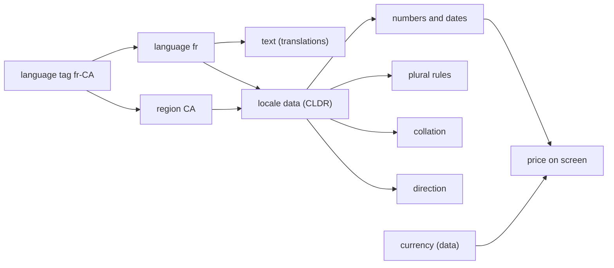

What to notice: the currency arrow does not start at the locale; the locale only decides how an amount is written.

### How it actually works

**Tags.** Case does not matter: `Intl.getCanonicalLocales` turns `EN-us` into `en-US` (`Section 1: getCanonicalLocales normalizes the case of a tag`). `Intl.Locale` exposes the subtags; `fr-CA` and `en-CA` share a region, not a language, and `fr` has no region at all (`Section 1: Intl.Locale splits a tag into language, script and region`). `supportedLocalesOf` keeps `fr-CA` and `de` and drops `xx-YY`, which Node 24 has no data for (`Section 1: supportedLocalesOf drops a tag the runtime cannot format`).

**Data.** **CLDR** (the Unicode Common Locale Data Repository) supplies, per its site (read 2026-10-15), formats of dates, numbers and units and "the alphabetical order" (**collation**). **ICU** (International Components for Unicode; not [§5](#5-icu-expressions-plural-select-and-nesting)'s message syntax) is a "set of C/C++ and Java libraries providing Unicode and Globalization support" (its site, read 2026-10-15); Node 24's `Intl` ([§2](#2-the-platforms-intl-apis-dates-numbers-plurals-lists-collation-and-display-names)) runs on ICU 78.3. Angular ships its own tables generated from CLDR ([§3](#3-angulars-locale-data-and-formatting-functions-versus-intl)); the pipes that read them, and `en-GB` falling back to `en`, are [14 §6](14-directives-and-pipes.md#6-built-in-pipes-and-locale-data)'s.

**`LOCALE_ID`.** The **source locale** is the language your templates are written in: `en-US` unless `i18n.sourceLocale` in `angular.json` says otherwise (`guide/i18n/locale-id`, read 2026-10-15). **`LOCALE_ID`** is the **injection token** (a typed key for a value with no class, [16 §7](16-dependency-injection.md#7-injectiontoken-multi-providers-environment-providers-and-initializers)) holding the app's locale. Why does a localized build need no provider? Read from the `@angular/core` 22.2.1 source (`fesm2022/_debug_node-chunk.mjs`): the token's factory is `inject(LOCALE_ID, { optional: true, skipSelf: true }) || getGlobalLocale()`, and the internal `getGlobalLocale` (may change in any release) returns `$localize.locale` or `'en-US'`. **`$localize`** is the global tag function from `@angular/localize` that translated text compiles to ([§4](#4-marking-text-for-translation-i18n-attributes-metadata-ids-and-localize-in-code)). `@angular/build` 22.2.1 (`application-code-bundle.js`, `i18n-inliner-worker.js`) writes each locale's tag into `$localize.locale` in that locale's polyfills bundle (the script that runs before the app's own code; [§7](#7-compile-time-localization-one-build-per-locale-subpath-lang-and-dir)). So the order is provider, then `$localize.locale`, then `en-US` (`Section 1: LOCALE_ID is en-US when nothing sets it`).

At bootstrap, `core.mjs` reads the token once and passes it to the internal `setLocaleId`, which lower-cases it and replaces `_` with `-` for ICU plurals ([§12](#12-under-the-hood-from-an-i18n-attribute-to-translated-dom); read, not run). **`DEFAULT_CURRENCY_CODE`** is separate: its factory returns `'USD'` even in a French app (`Section 1: DEFAULT_CURRENCY_CODE is USD in a French app`), and the typings say it "has no relation to locale currency".

Drilled in [Q34.01](#q34-01) and [Q34.02](#q34-02).

### Code

The approach: run the factory's three branches in `TestBed`.

1. Save `$localize.locale` before each test and restore it after.
2. Set `$localize.locale` before the first `inject`, because the root injector runs the factory once.
3. Add a provider and check that it wins.

```ts
// Excerpt of labs/angular/src/app/modules/34-i18n/concepts/section-1-locale-id.spec.ts
  it('Section 1: LOCALE_ID follows $localize.locale when no provider sets it', () => {
    // Set before the first inject: the root injector runs the token's factory once and caches the value.
    $localize.locale = 'fr';

    expect(TestBed.inject(LOCALE_ID)).toBe('fr');
  });

  it('Section 1: a LOCALE_ID provider wins over $localize.locale', () => {
    $localize.locale = 'fr';
    TestBed.configureTestingModule({ providers: [{ provide: LOCALE_ID, useValue: 'de' }] });

    expect(TestBed.inject(LOCALE_ID)).toBe('de');
  });
```

### Best practices and anti-patterns

- **Name every target locale as a BCP 47 tag up front**, because extraction, locale data, build folders and URLs key on it.
- **Let a localized build set `LOCALE_ID`, or provide it once at the root**, because the root caches the value and bootstrap copies it for ICU plurals.
- **Store the currency code with each amount**, because the locale never chooses the currency.
- **Canonicalize tags before comparing them**, because `EN-us` and `en-US` are the same tag.

### Misconceptions and traps

- *"i18n means translating the text."* Formats, plural rules, collation and direction change too ([§2](#2-the-platforms-intl-apis-dates-numbers-plurals-lists-collation-and-display-names)-[§11](#11-right-to-left-layouts-dir-logical-css-properties-and-bidirectional-text)); the myth exists because translation is the visible part.
- *"A locale is a country."* Only the language subtag is required, and `fr-CA` and `en-CA` share a region; the myth comes from flags in language pickers and the docs' "identifies a region".
- *"Setting `LOCALE_ID` to `de` makes prices euros."* The currency token stays `USD`; the myth exists because currency looks bound to a place.
- *"The browser language is the user's locale."* Users choose, and the app must let them ([§7](#7-compile-time-localization-one-build-per-locale-subpath-lang-and-dir), [§9](#9-runtime-translation-libraries-transloco-and-ngx-translate-lazy-scopes-and-the-trade-off-against-built-in-i18n)); the myth exists because `navigator.language` is one line to read.

## 2. The platform's `Intl` APIs: dates, numbers, plurals, lists, collation and display names

### The problem it solves

A hand-written `formatPrice` returns `'$' + amount.toFixed(2)`: a dollar sign for euros, a point where Germany writes a comma, two decimals for a peso that has none ([§10](#10-dates-times-numbers-and-money-time-zones-currency-codes-and-minor-units)). `` `${n} days ago` `` prints "1 days ago". A contact list sorted with `sort()` puts `ä` after `z`; Germans expect it beside `a`, Swedes after `z`.

### Mental model

An `Intl` **formatter** is an object built once from a locale and options, then reused to format, select or compare: `DateTimeFormat`, `NumberFormat`, `PluralRules`, `RelativeTimeFormat`, `ListFormat`, `Collator`, `Segmenter`, `DisplayNames` and `DurationFormat` [Baseline 2025: newly available, per MDN]. [Baseline](https://developer.mozilla.org/en-US/docs/Glossary/Baseline/Compatibility) *newly available* means the latest stable Chrome, Edge, Firefox and Safari support a feature; *widely available* means they have for at least 2.5 years. Think of rubber stamps: cut once, pressed often. The engine supplies the data ([CLDR and ICU](#1-i18n-l10n-and-the-locale-language-tags-what-a-locale-decides-and-locale_id)).

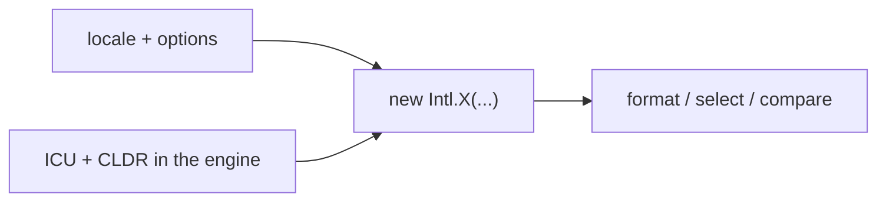

What to notice: the data enters from the runtime, not your code, so two runtimes can print different characters for one call.

A **plural category** is the label a language's rule gives a number: `zero`, `one`, `two`, `few`, `many` or `other` (MDN, `Intl.PluralRules`, 2026-10-15). **Cardinal** rules count things ("1 file"); **ordinal** rules rank them ("1st").

### How it actually works

**Why output varies.** Node 24.21.0 reports ICU 78.3 and CLDR 48.0 in `process.versions` (`Section 2: resolvedOptions reports the numbering system`). Another runtime ships other data: the API is standard, the characters are not. Chromium 153 printed `3:30 PM` for `timeStyle: 'short'` with U+0020 before `PM` (`Section 2: Chromium formats the en-US short time with the separator the run shows`).

**Time zone.** A **time zone** is an IANA name such as `America/New_York`. The instant `2024-07-08T02:30:00Z` formats as July 7 in New York and July 8 in UTC and Tokyo (`Section 2: DateTimeFormat formats one instant differently per locale and time zone`). Without `timeZone` the runtime's zone decides.

**Resolved options.** `resolvedOptions()` reports what a formatter really uses, such as the **numbering system** (digit set): `ar-EG` resolves to `arab` and prints `١٬٢٣٤٫٥`, while `ar` resolves to `latn` (same test).

**Plurals.** `en` gives `one` only for 1; `fr` gives `one` for 0 and 1.5; `ar` gives six for 0, 1, 2, 3, 11 and 100; `ru` gives `few` for 2 and `many` for 5 (`Section 2: PluralRules returns different categories per language`). `RelativeTimeFormat` with `numeric: 'auto'` says "yesterday" (`Section 2: RelativeTimeFormat with numeric auto says yesterday`).

**Collation.** `Collator('de')` orders `ä, a, z` as `a ä z`, `sv` as `a z ä`, and `sort()` as `a z ä` (`Section 2: Collator orders ä differently in German and Swedish`); `numeric: true` puts `item2` before `item10` (`Section 2: a numeric Collator puts item2 before item10`).

**Words.** `Segmenter('ja', { granularity: 'word' })` finds eight words in the space-free `私は東京に住んでいます`; `en` finds the same, so the locale did not matter here (`Section 2: word segmentation of Japanese text finds words without spaces`). Graphemes are [01 §3](01-js-values-types-coercion.md#3-strings-and-unicode)'s, drilled in [Q01.11](01-js-values-types-coercion.md#q01-11).

**Newer APIs.** MDN (read 2026-10-15) lists `Intl.DurationFormat` (above) and `Intl.Locale.prototype.getTextInfo()` and `getWeekInfo()` [Baseline 2026: newly available, per MDN]. Node 24 runs all three (same test).

Drilled in [Q34.03](#q34-03), [Q34.04](#q34-04) and [Q34.05](#q34-05).

### Code

The approach: build each formatter once, then ask it questions.

1. Build one `PluralRules` per locale and type.
2. Call `select` for each value.
3. Compare the categories per language.

```ts
// Excerpt of labs/ts-js/src/modules/34-i18n/section-2-intl.test.ts
  it('Section 2: PluralRules returns different categories per language', () => {
    const categories = (locale: string, values: number[], type: Intl.PluralRulesOptions['type'] = 'cardinal') =>
      values.map((value) => new Intl.PluralRules(locale, { type }).select(value));

    expect(categories('en', [0, 1, 2, 5])).toEqual(['other', 'one', 'other', 'other']);
    expect(categories('fr', [0, 1, 1.5, 2])).toEqual(['one', 'one', 'one', 'other']);
    expect(categories('ar', [0, 1, 2, 3, 11, 100])).toEqual(['zero', 'one', 'two', 'few', 'many', 'other']);
```

### Best practices and anti-patterns

- **Build a formatter once and reuse it**, because locale and options are fixed at construction.
- **Pass `timeZone` whenever a date is shown or tested**, because the runtime's zone moves the day.
- **Choose text by plural category, not `n === 1`**, because Arabic has six categories and French treats 0 as `one`.
- **Sort display strings with a `Collator`**, because `sort()` compares code units.

### Misconceptions and traps

- *"Plural means singular or not."* Arabic has six categories; the myth exists because English has two.
- *"`toLocaleString()` with no arguments is localized for the user."* MDN says it "depends on the implementation" and uses the default locale and time zone, which on a server are not the user's; it works on your laptop, hence the myth.
- *"`localeCompare` sorts the same for everyone."* German and Swedish differ for `ä` (tested); the myth exists because the default order looks alphabetical.
- *"`Intl` output is identical everywhere."* The API is standard but the data belongs to each runtime ([§3](#3-angulars-locale-data-and-formatting-functions-versus-intl) compares Angular's tables); the myth exists because the call looks the same everywhere.

## 3. Angular's locale data and formatting functions versus `Intl`

### The problem it solves

An app sets `LOCALE_ID` to `fr` and crashes with `NG0701`: Angular holds no French data until you register it ([Q14.23](14-directives-and-pipes.md#q14-23)). A test compares the `date` pipe with `Intl.DateTimeFormat`; both read "3:30 PM" and it fails, because one has U+202F before `PM` and the other U+0020. For `ar-EG`, Angular prints `1,234.5` and a chart library on `Intl` prints `١٬٢٣٤٫٥`.

### Mental model

**Locale data** is the table one locale supplies to a formatter: month names, patterns, symbols and the plural rule. The **formatting functions** (`formatDate`, `formatNumber`, `formatCurrency`) read tables that ship inside `@angular/common`, a snapshot per release. `Intl` reads the engine's ICU ([§2](#2-the-platforms-intl-apis-dates-numbers-plurals-lists-collation-and-display-names)). Two phrasebooks, printed in different years.

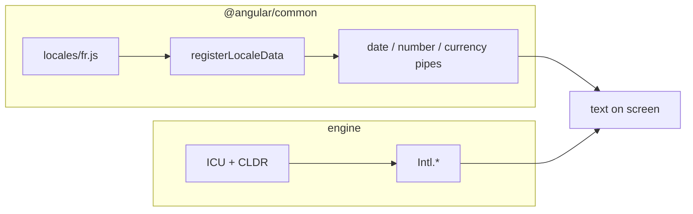

What to notice: nothing connects the two subgraphs, so their outputs can differ.

### How it actually works

**Registering.** `registerLocaleData(fr)` stores the imported array in a module-level map keyed by the lower-cased id. Nothing is downloaded: your bundler includes the file you imported (source read; internal `registerLocaleData` and `getLocaleData`, `@angular/core` 22.2.1, `fesm2022/_debug_node-chunk.mjs`, may change in any release). With `fr` registered, `formatDate` prints `lundi 8 juillet 2024`; without data, `formatNumber(1234.5, 'pt')` throws `NG0701: Missing locale data for the locale "pt".` (`Section 3: registering fr data makes formatDate print French`, `Section 3: an unregistered locale throws NG0701 from formatNumber`). The lookup order is [14 §6](14-directives-and-pipes.md#6-built-in-pipes-and-locale-data)'s.

A **global variant** (`@angular/common/locales/global/de`) registers nothing itself: it assigns the array to `ng.common.locales` on the global object, which that same lookup reads when the map has no entry (source read). In the lab `formatNumber(1234.5, 'de')` throws before the import and prints `1.234,5` after it (`Section 3: the global variant registers the locale when imported`).

**What is deprecated.** In the `@angular/common` 22.2.1 typings (`types/common.d.ts`, read) every `getLocale*` getter is [Deprecated since v18.0 — use `Intl`]. `getLocaleId` carries `@deprecated 18.0` and "Angular recommends relying on the `Intl` API for i18n. This function serves no purpose when relying on the `Intl` API." `getCurrencySymbol` and `getNumberOfCurrencyDigits` carry the tag too. `registerLocaleData`, `formatDate`, `formatNumber`, `formatCurrency` and `formatPercent` do not.

**Where the outputs differ.** For `2024-07-08T15:30Z`, `formatDate(…, 'short', 'en-US')` gives `7/8/24, 3:30` U+202F `PM`; Node 24's `Intl` (ICU 78.3, CLDR 48.0) gives U+0020 (`Section 3: Angular puts U+202F before PM where Node's Intl puts a space`). `ar-EG` shows **Arabic-Indic digits** (U+0660 to U+0669) in `Intl` and Latin digits in Angular (`Section 3: Angular prints Latin digits for ar-EG where Intl prints Arabic-Indic digits`). The `fr` euro amount is identical: `1` U+202F `234,50` U+00A0 `€` (`Section 3: both print the same French currency string`). That test also shows `formatCurrency`'s third parameter is the text printed: `'EUR'` there prints `EUR`.

**Overriding.** With `LOCALE_ID` `fr`, the `date` pipe prints `lundi 8 juillet 2024`; its locale argument `'en-US'` gives `Monday, July 8, 2024` (`Section 3: the DatePipe with a locale argument overrides LOCALE_ID`).

Drilled in [Q34.06](#q34-06), [Q34.07](#q34-07) and [Q34.08](#q34-08).

### Code

The approach: format one instant with both APIs and compare by code point, because the difference is invisible.

1. Format the instant with `formatDate` in `en-US` and UTC.
2. Format it with an `Intl.DateTimeFormat` with the same options.
3. Assert each string with `\u` escapes; a failure prints the code points.

```ts
// Excerpt of labs/angular/src/app/modules/34-i18n/concepts/section-3-locale-data.spec.ts
  it("Section 3: Angular puts U+202F before PM where Node's Intl puts a space", () => {
    const angular = formatDate(instant, 'short', 'en-US', 'UTC');
    const platform = new Intl.DateTimeFormat('en-US', { dateStyle: 'short', timeStyle: 'short', timeZone: 'UTC' }).format(instant);

    expectSame(angular, '7/8/24, 3:30\u202fPM');
    expectSame(platform, '7/8/24, 3:30\u0020PM');
  });
```

> [!NOTE]
> **Framework vs platform.** Angular's pipes and `format*` functions read CLDR tables shipped in `@angular/common`; `Intl` reads the engine's ICU. The alternative is a pipe on `Intl` that injects `LOCALE_ID` (tested as in [29 §8](29-testing-angular.md#8-testing-services-pipes-and-directives-including-testbedcreatedirective)); [Exercise 34.1](#ex34-1) builds one.

### Best practices and anti-patterns

- **Compare Angular and `Intl` output by code point in tests**, because U+202F and U+0020 look alike.
- **Use one data source per screen**, because a `date` table beside an `Intl` chart can show different digits.
- **Avoid the deprecated `getLocale*` getters in new code**, because the typings mark them deprecated since 18.0 and name `Intl`.

### Misconceptions and traps

- *"The `date` pipe wraps `Intl.DateTimeFormat`."* It does not: 14 found no `Intl.` call in the package and the runs above show different characters. The myth exists because both do the same job.
- *"Deprecated `getLocale*` means the pipes are deprecated."* Only the getters and two currency helpers carry the tag (read); the myth exists because they share a package.
- *"`registerLocaleData` downloads the locale."* It stores an array you already imported; the name sounds like a fetch.

## 4. Marking text for translation: `i18n` attributes, metadata, IDs and `$localize` in code

### The problem it solves

Three texts stay English in a French build. A toast built as `'Saved ' + count + ' items'` was never marked. A button's `title` was not marked, only its content. The "Close" of a door and the "Close" of a dialog share one translation, because the texts are identical.

### Mental model

You **mark**, the tools **collect**, translators **translate** and the build **replaces**. A **message** is one unit of translatable text: the source text, its **placeholders** (named slots for non-text parts, such as an interpolation) and its metadata. `i18n` marks an element's content; `i18n-title`, or `i18n-<attribute>` (the handoff from [13](13-components-and-templates.md#connections)), marks an attribute; `<ng-container i18n>` marks text without an element. In TypeScript, the `$localize` **tagged template literal** (a template literal after a function name, which gets the fixed strings and the values separately) marks code text. The metadata is `meaning|description@@id`: the **meaning** separates identical texts used differently, the **description** gives context, and the **custom ID** (after `@@`) replaces the computed ID. Like highlighter marks with sticky notes.

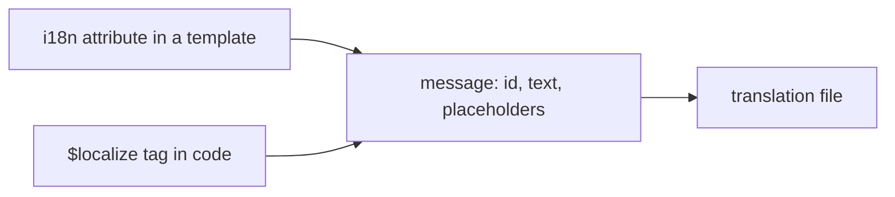

What to notice: a template message and a code message become the same kind of thing.

### How it actually works

**What a message contains.** `<p i18n>Hi {{ name }}, you have <b>{{ count }}</b> items</p>` shows the translator `Hi {$INTERPOLATION}, you have {$START_BOLD_TEXT}{$INTERPOLATION_1}{$CLOSE_BOLD_TEXT} items` (`Section 4: an interpolation and a bold element become named placeholders`). In code you name a value after it, `${giver}:giver:`; an unnamed one gets `PH`, `PH_1` (read: internal `computePlaceholderName`, which may change in any release, `_localize-chunk.mjs`).

**Metadata.** `i18n="site header|An introduction header@@m34.marking.header"` yields one message with those parts (`Section 4: the i18n message of an element carries its meaning, description and custom ID`, read through the internal `ɵparseMessage`, which may change in any release). `i18n-title` makes its own message (`Section 4: an i18n-title attribute becomes its own message`). Without a custom ID the source computes it from the text and the meaning (`customId || computeMsgId(messageString, meaning || '')`, same file), so "The _description_ does not affect the ID" (`guide/i18n/prepare`, read 2026-10-15).

**Why the metadata costs nothing at run time.** `$localize` is a plain function: the internal `stripBlock` drops a leading `:…:` block from each part, and the optional `$localize.translate` is the only hook (read, same file). Without translations the call returns the text alone (`Section 4: $localize without translations returns the text without its metadata`).

**One sentence, one message.** A translation names its placeholders and the lookup fills them by name (read: `translate`, `fesm2022/localize.mjs`), so once loaded ([§8](#8-runtime-translation-with-angularlocalize-loadtranslations-before-bootstrap)) `${giver}:giver: thanked ${receiver}:receiver:` prints `Luis a été remercié par Ana` (`Section 4: a named placeholder in $localize keeps its value`).

**The polyfill.** `@angular/localize/init` assigns the global `$localize` (read). A **polyfill** is a script the build bundles to run before your code and add a global it expects: the `i18n-lab` build lists it in `polyfills`; `ng test` adds it itself (`@angular/build` 22.2.1, `build-options.js`). An import in application code draws "Direct import of '@angular/localize/init' detected. This may lead to undefined behavior." (`angular-localize-init-warning-plugin.js`). [12 §8](12-angular-how-it-works.md#8-under-the-hood-what-the-compiler-emits-and-what-the-runtime-does-with-it) covers the compiler's output.

**Security.** The core changelog lists "disallow i18n event attributes" (22.0.1), and [33 §3](33-security.md#3-sanitization-by-security-context-html-style-url-and-resource-url) owns sanitization.

Drilled in [Q34.09](#q34-09), [Q34.10](#q34-10) and [Q34.11](#q34-11).

### Code

The approach: record the message a template builds, then make one in TypeScript.

1. Install a recording `$localize.translate` before the first render, because a template builds its messages once.
2. Render and read the recorded placeholder names.
3. Call `$localize` with two named values and move them with a translation.
4. Clear the translations after each test.

```ts
// Excerpt of labs/angular/src/app/modules/34-i18n/concepts/section-4-marking.spec.ts
function recordMessages(): ParsedMessage[] {
  const seen: ParsedMessage[] = [];
  $localize.translate = (parts, substitutions) => {
    seen.push(parseMessage(parts, substitutions));
    return [parts, substitutions];
  };
  return seen;
}

@Component({
  selector: 'lab-m34-bold-host',
  template: `<p i18n>Hi {{ name }}, you have <b>{{ count }}</b> items</p>`,
})
class LabM34BoldHost {
  protected readonly name = 'Ana';
  protected readonly count = 2;
}
```

```ts
// Excerpt of labs/angular/src/app/modules/34-i18n/concepts/section-4-marking.spec.ts
  it('Section 4: a named placeholder in $localize keeps its value', () => {
    const thanks = (giver: string, receiver: string) =>
      $localize`:@@m34.marking.thanks:${giver}:giver: thanked ${receiver}:receiver:`;

    expect(thanks('Ana', 'Luis')).toBe('Ana thanked Luis');

    loadTranslations({ 'm34.marking.thanks': '{$receiver} a été remercié par {$giver}' });

    expect(thanks('Ana', 'Luis')).toBe('Luis a été remercié par Ana');
  });
```

### Best practices and anti-patterns

- **Mark a whole sentence as one message**, because placeholders move with their names.
- **Give identical texts different meanings**, because the meaning feeds the computed ID.
- **Add a custom ID only when a tool needs stable IDs**, because an edited text keeps its ID and its translation can drift (`guide/i18n/manage-marked-text`).

### Misconceptions and traps

- *"Mark each phrase separately for reuse."* Fragments cannot be reordered; the myth exists because reuse feels efficient.
- *"The description changes the ID."* Only text and meaning feed it; the myth exists because both are metadata in one attribute.
- *"`$localize` works only in templates."* It is a global tag for any TypeScript, as the tests show; the myth exists because the docs start with a template.
- *"Import `@angular/localize/init` in `main.ts`."* The build warns; the myth exists because the name looks like an import path.

## 5. ICU expressions: plural, select and nesting

### The problem it solves

`{{ count }} item(s)` is wrong in every language. A French page says "0 articles" where French uses the singular for zero. Arabic wants forms for zero, one, two, a few and many. A gendered sentence becomes three templates.

### Mental model

**ICU message syntax** (not the ICU library of [§1](#1-i18n-l10n-and-the-locale-language-tags-what-a-locale-decides-and-locale_id)) is a switch inside a message that the translator owns. A **plural expression**, `{count, plural, =0 {…} one {…} other {…}}`, picks a branch by number; a **select expression**, `{gender, select, female {…} other {…}}`, by a string. The developer supplies the variable; translations supply the branches. An **exact match** (`=0`) tests the value; a **plural category** ([§2](#2-the-platforms-intl-apis-dates-numbers-plurals-lists-collation-and-display-names)) tests the language's label for it; `other` is the fallback. A **nested expression** sits in a branch of another. Like a form letter whose tick boxes differ per country.

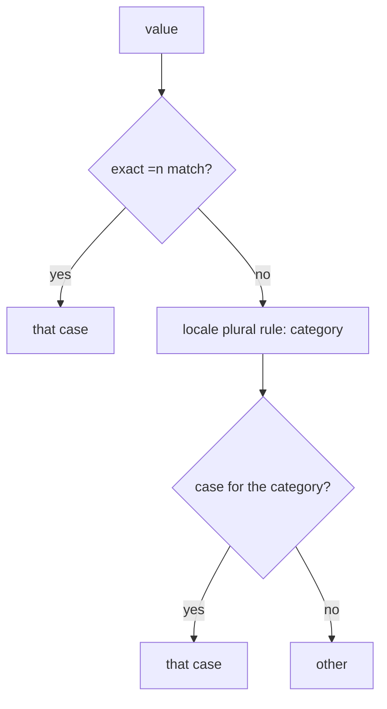

What to notice: an exact match is tried before any category.

### How it actually works

**Choosing a branch.** The runtime tries the exact case, then the category, then `other` (read: internal `getCaseIndex`, `@angular/core` 22.2.1, `_debug_node-chunk.mjs`; may change in any release). In Arabic 0 is `zero`, and `=0` still wins (`Section 5: an exact =0 case wins over the category`). A missing category falls to `other`: 3 is `few` and the message has none (`Section 5: a missing category falls back to other`). A select takes the matching value or `other` (`Section 5: a select expression picks the branch by value`); nesting renders both levels (`Section 5: a nested select and plural render together`).

**Where the category comes from.** Internal `getPluralCase` calls the plural function of the [locale data](#3-angulars-locale-data-and-formatting-functions-versus-intl) with `parseInt(value, 10)` (read, same file). So 1.5 counts as 1: the ICU renders "one item", the `i18nPlural` pipe ([14 §6](14-directives-and-pipes.md#6-built-in-pipes-and-locale-data)) "1.5 items", and `Intl.PluralRules('en').select(1.5)` is `other` (`Section 5: an ICU plural treats 1.5 as one in English`). Without registered data it throws `NG0701` (`Section 5: an ICU plural under a locale without data throws NG0701`).

**The translator owns the branches.** The English source has `=0`, `one` and `other`; the French translation has only `one` and `other`, and 0 reads "0 article", because French `one` covers 0 (`Section 5: the French build uses one for zero and one item`). The Arabic build writes all six categories; 0, 1, 2, 3 and 11 reach the first five (`Section 5: the Arabic build uses the zero, one, two, few and many branches`). The pipe's strings stay in code, out of the translator's sight.

**The docs' `few` row.** The guide's table (`prepare`, read 2026-10-15) says `few` is "Quantity is 2 or more". CLDR calls it a language's paucal form (the form for a small number; plural rules page, read 2026-10-15): Russian 2 is `few` and 5 is `many` (`Section 2: PluralRules returns different categories per language`). The row simplifies.

**Translated content.** Angular "now only applies known attributes from HTML in translated ICU content" (core changelog 21.1.6); [33 §3](33-security.md#3-sanitization-by-security-context-html-style-url-and-resource-url) owns sanitization.

Drilled in [Q34.12](#q34-12), [Q34.13](#q34-13) and [Q34.14](#q34-14).

### Code

The approach: render an ICU whose exact case and category disagree.

1. Register the Arabic data and provide `LOCALE_ID` `ar`.
2. Render a host whose ICU has `=0` and `zero`, with 0.
3. Show the lab page's message, which each build translates.

```ts
// Excerpt of labs/angular/src/app/modules/34-i18n/concepts/section-5-icu.spec.ts
@Component({
  selector: 'lab-m34-exact-host',
  template: `<p>{n(), plural, =0 {none} zero {zero category} one {one} other {other}}</p>`,
})
class LabM34ExactHost {
  readonly n = signal(0);
}
```

```ts
// Excerpt of labs/angular/src/app/modules/34-i18n/concepts/section-5-icu.spec.ts
  it('Section 5: an exact =0 case wins over the category', () => {
    registerLocaleData(localeAr);
    TestBed.configureTestingModule({ providers: [{ provide: LOCALE_ID, useValue: 'ar' }] });
    const fixture = TestBed.createComponent(LabM34ExactHost);

    fixture.detectChanges();

    // In Arabic 0 is the `zero` category, and the exact case still wins.
    expect(text(fixture)).toBe('none');
  });
```

```ts
// Excerpt of labs/angular/projects/i18n-lab/src/app/m34/icu/icu.ts
    <p data-testid="items" i18n="@@m34.icu.items">{count(), plural, =0 {No items} one {One item} other {{{ count() }} items}}</p>
```

### Best practices and anti-patterns

- **Write `other` in every plural and select**, because it renders when no case matches.
- **Add `=0` only when the wording differs**, because categories follow grammar and French puts 0 under `one`.
- **Pass whole numbers**, because the category comes from the truncated value.

### Misconceptions and traps

- *"`=1` and `one` mean the same."* `=1` tests the value; `one` is a category, which French gives to 0 and Russian to 21; the myth exists because they coincide in English.
- *"`few` means 2 or more."* It is a language's own small-number form; the myth exists because the docs' table says so.
- *"ICU plurals use `Intl.PluralRules`."* They use Angular's locale data on the truncated value; the myth exists because both return the same category names.
- *"A translator can put any HTML in an ICU."* Unknown attributes are dropped; the myth exists because the translation is text, and text looks free.

## 6. Extraction and translation files: `ng extract-i18n`, formats and message IDs

### The problem it solves

After a copy edit, one sentence on the French page is English: the text changed, so its computed ID changed, and the French file holds the old one. Two "Close" buttons, door and dialog, share a translation.

### Mental model

**Extraction** builds the app, collects every message ([§4](#4-marking-text-for-translation-i18n-attributes-metadata-ids-and-localize-in-code)) and writes them to one **source file** (`messages.xlf` here), in **XLIFF** 1.2 by default, an XML interchange format for translations. Each message becomes a **trans-unit**: an `id`, the `<source>` text, notes, and the file and line. Translators copy it per locale and add a **target**, the translated text; the build looks each message up by ID. An ID is a **custom ID** or a **computed ID**, a hash of text and meaning, so one changed word makes a new ID (`Section 6: changing one word changes the computed ID`). Like a parts catalogue whose numbers are printed on the part or calculated from its shape.

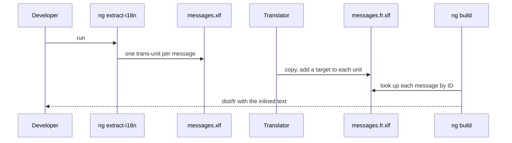

What to notice: the ID is the only link between the code and the translation.

### How it actually works

**Why extraction builds.** The CLI infers `@angular/build:extract-i18n` for a `build` target that uses `@angular/build:application`, so the lab declares none (read: `@angular/cli` 22.2.1). The builder builds the app with `optimization` and `localize` off, then reads the `$localize` calls in the output's `.js` files (`application-extraction.js`). Without `@angular/localize` it stops with "i18n extraction requires the '@angular/localize' package." (abridged, `builder.js`).

**Formats.** `--format` picks the serializer (`builder.js`) and the default file name (`options.js`):

| `--format` | Default file | Translations return as |
| :-- | :-- | :-- |
| `xlf` (also `xlif`, `xliff`) | `messages.xlf`, XLIFF 1.2 | `.xlf` |
| `xlf2`, `xliff2` | `messages.xlf`, XLIFF 2 | `.xlf` |
| `xmb` | `messages.xmb` | `.xtb` |
| `json` | `messages.json` | `.json` |
| `arb` | `messages.arb` | `.arb` |

Extensions: docs, read 2026-10-15; JSON holds `{ locale, translations }`. `legacy-migrate` maps legacy IDs, the hashes older versions computed, to current ones. Only XLIFF 1.2 was run.

**Missing and duplicate translations.** `i18nMissingTranslation` is `warning` by default (`@angular/build` application `schema.json`), and the lab's production configuration sets `error`. `i18nDuplicateTranslation` governs two messages with one ID and different text; identical text merges (read: `checkDuplicateMessages`).

**The lab's five messages.** Two keep custom IDs, "Welcome back" gets a number, and the "Close" buttons become two units by meaning (`Section 6: the extracted file lists a custom ID as written`, `Section 6: a message without an ID gets a numeric computed ID`, `Section 6: the same text with two meanings gives two units`). The description is a note, not an input (`Section 6: a description does not change the computed ID`); the meaning is (`Section 6: a meaning changes the computed ID`; both use the internal `ɵcomputeMsgId`, which may change in any release). Each unit names its file and line (`Section 6: the extracted unit records its source file and line`).

> [!TIP]
> **Coming from the backend.** Spring's `MessageSource` resolves a code and a `Locale` through resource bundles (Spring Framework 7.0.9 reference, read 2026-10-15), so the key is yours, like a custom ID. **Where the analogy breaks:** without an `@@id` Angular's key is a hash of the source text, and the lookup runs in the build, not per request.

Drilled in [Q34.15](#q34-15) and [Q34.16](#q34-16).

### Code

The approach: extract the lab page, then compute its ID.

1. Mark a message with a meaning and no `@@id`.
2. Run `npx ng extract-i18n i18n-lab --output-path projects/i18n-lab/src/locale`.
3. Compute the same ID from text and meaning.

```ts
// Excerpt of labs/angular/projects/i18n-lab/src/app/m34/extract/extract.ts
    <button type="button" i18n="door|Closes a physical door">Close</button>
```

```xml
<!-- Excerpt of labs/angular/projects/i18n-lab/src/locale/messages.xlf -->
      <trans-unit id="2522557153388325485" datatype="html">
        <source>Close</source>
        <context-group purpose="location">
          <context context-type="sourcefile">projects/i18n-lab/src/app/m34/extract/extract.ts</context>
          <context context-type="linenumber">11,12</context>
        </context-group>
        <note priority="1" from="description">Closes a physical door</note>
        <note priority="1" from="meaning">door</note>
      </trans-unit>
```

```ts
// Excerpt of labs/angular/src/app/modules/34-i18n/concepts/section-6-ids.spec.ts
  it('Section 6: a meaning changes the computed ID', () => {
    expect(computeMsgId('Close', 'door')).toBe('2522557153388325485');
    expect(computeMsgId('Close', 'dialog')).toBe('1426216042718898919');
  });
```

### Best practices and anti-patterns

- **Re-extract after every copy edit and read the diff**, because a changed text is a new ID.
- **Set `i18nMissingTranslation` to `error` in production**, because the default warns.
- **Give identical texts different meanings**, because an ID has one translation.

### Misconceptions and traps

- *"Computed IDs are stable across releases."* They hash the text and meaning, so any edit moves them (tested); the myth exists because they look like opaque keys.
- *"A missing translation fails the build."* The default is `warning` (read); the myth exists because production is strict elsewhere.
- *"Custom IDs are always better."* The ID then survives an edit, so you own uniqueness and must request retranslation; the myth exists because stable keys feel safer.
- *"XLIFF is required."* It is the default; JSON and ARB are options (read); the myth exists because the docs lead with it.

## 7. Compile-time localization: one build per locale, `subPath`, `lang` and `dir`

### The problem it solves

One build must produce English, French and Arabic sites. A link to `/fr/orders/42` must open the French page, Arabic must render right to left before any script runs, and switching language should need no JavaScript.

### Mental model

A **localized build** is an `ng build` with `localize` on. The app compiles once, messages still `$localize` calls ([§4](#4-marking-text-for-translation-i18n-attributes-metadata-ids-and-localize-in-code)); then the **inliner**, a later step, writes one copy per locale with each call replaced by its translation. Each copy lands in a folder named by its **`subPath`**, which defaults to the locale code and also becomes the copy's **base `href`**, the `<base href="/fr/">` URL that relative links and the router resolve against (build output: [12 §3](12-angular-how-it-works.md#3-building-the-application-builder-output-layout-and-budgets)). The build also sets the **`lang` attribute** (the page's language) and the **`dir` attribute** (`ltr` or `rtl`) on `<html>`. Switching language means opening another folder. Like one typeset master printed in three editions.

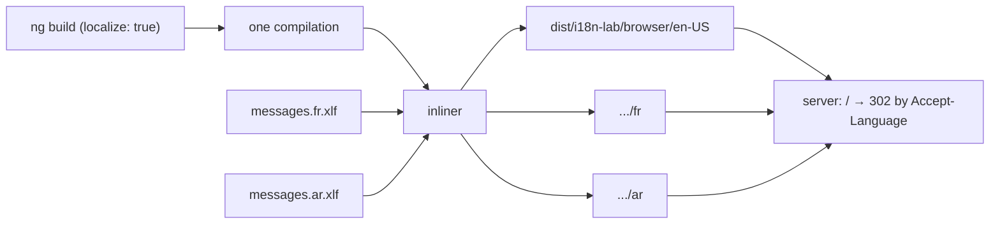

What to notice: translation happens after compilation, so adding a locale does not recompile components.

### How it actually works

**One compilation, N copies.** The docs' summary: "Compile once, then translate for each locale." (`merge.md`, read 2026-10-15). In `@angular/build` 22.2.1 the polyfills module ends with `(globalThis.$localize ??= {}).locale = "___NG_LOCALE_INSERT___";` (`application-code-bundle.js`). The inliner's internal `inlineLocalize` (`i18n-inliner-worker.js`; both names internal, may change in any release) parses each output file with OXC (the `oxc-parser` JavaScript parser, 0.150.0 in the lab), overwrites that placeholder with the locale and, except for `en-US`, its data, and replaces each `$localize` tagged template with a literal. So `LOCALE_ID`, which falls back to `$localize.locale` ([§1](#1-i18n-l10n-and-the-locale-language-tags-what-a-locale-decides-and-locale_id)), is the build's locale without a provider (`Section 7: LOCALE_ID equals the build's locale`), and the French scripts hold "Détails de la commande" as a plain string, with no `loadTranslations` and no `$localize` tag left (`Section 7: a locale build has no runtime translation lookup`).

**Folders, `lang` and `dir`.** Each copy's files move under its `subPath` (`i18n.js`), and its base `href` is `baseHref` plus `subPath/` (internal `getLocaleBaseHref`, `options.js`). In the lab, `dist/i18n-lab/browser/` holds `ar`, `en-US` and `fr`, each with its own `index.html` (`Section 7: the build writes one folder per locale`), and each sets `<base href="/<locale>/">` (`Section 7: each locale build sets its base href`). `lang` is the locale; `dir` comes from the locale data's direction (`augment-index-html.js`), so `ar` gets `dir="rtl"` (`Section 7: each locale build sets lang and dir on html`).

**What the router sees.** Routes resolve below the base `href`, so `/fr/m34/builds/42` reaches the router as `/m34/builds/42`, as in English (`Section 7: a deep link under fr renders the French page with the same router URL`). No `/:lang` route is needed (route matching: [24 §1](24-routing.md#1-router-configuration-providerouter-route-matching-redirects-and-the-wildcard)).

**`ng serve` takes one locale.** With several, the dev server logs "Localization (`localize` option) has been disabled. The development server only supports localizing a single locale per build." and builds untranslated (read: `dev-server/vite/index.js`). The docs say "an error occurs"; the source only warns. The docs' remedy: `"localize": ["fr"]` in a configuration.

**Serving.** **`Accept-Language`** is the request header listing the browser's preferred languages; **`Vary: Accept-Language`** tells caches the response depends on it. The lab's own server (`labs/e2e/server/i18n-server.mjs`, modelled on the docs' Nginx example) answers `/` with 302 to `/fr/` for `fr-CA,fr;q=0.9`, `/ar/` for `ar-EG` and `/en-US/` for `de-DE` (`Section 7: the lab server redirects / to the preferred locale with Vary Accept-Language`). For server builds, `@angular/ssr` 22.2.1's `AngularAppEngine.handle` does the same through the internal `redirectBasedOnAcceptLanguage`: 302 to the preferred locale's `subPath`, with that `Vary` header (read, not run; deployment: [32 §9](32-ssr-ssg-hydration.md#9-deploying-ssr-node-and-other-runtimes-static-output-caching-rendered-pages-and-allowed-hosts)). Serving the folders in production is [44](44-fullstack-delivery-and-operations.md#3-nginx-for-a-single-page-app-location-matching-the-try_files-fallback-caching-headers-for-hashed-assets-and-gzip-or-brotli)'s.

Drilled in [Q34.17](#q34-17), [Q34.18](#q34-18) and [Q34.19](#q34-19).

### Code

The approach: declare the locales, build once, read the build's choices on a page.

1. List the locales under the project's `i18n` key and set `localize: true`.
2. Run `npx ng build i18n-lab`.
3. Render the router URL and `LOCALE_ID`; neither is configured in code.

```jsonc
// From labs/angular/angular.json, project i18n-lab
"i18n": {
  "sourceLocale": "en-US",
  "locales": {
    "fr": { "translation": "projects/i18n-lab/src/locale/messages.fr.xlf" },
    "ar": { "translation": "projects/i18n-lab/src/locale/messages.ar.xlf" }
  }
},
```

```ts
// Excerpt of labs/angular/projects/i18n-lab/src/app/m34/builds/builds.ts
    <h2 i18n="@@m34.builds.title">Order details</h2>
      <dd data-testid="router-url">{{ router.url }}</dd>
      <dd data-testid="locale-id">{{ localeId }}</dd>
export class LabM34Builds {
  protected readonly router = inject(Router);
  protected readonly localeId = inject(LOCALE_ID);
}
```

```html
<!-- From dist/i18n-lab/browser/ar/index.html (abridged) -->
<html lang="ar" dir="rtl" data-beasties-container>
<base href="/ar/">
```

### Best practices and anti-patterns

- **Prefer `subPath` to a per-locale `baseHref`**, because the build warns that `baseHref` "may lead to undefined behavior when used with SSR" (server-side rendering; read: `i18n-options.js`).
- **Switch language with a plain `<a href="/ar/…">` built from the router URL**, not `routerLink`, because the target is another app.
- **Redirect only `/` and keep the locale in the URL**, because a shared link must open the same language for everyone.

### Misconceptions and traps

- *"One build per locale means compiling N times."* The app compiles once and the inliner copies it (read; literals tested); the myth exists because the output holds one full app per locale folder.
- *"`ng serve` can show all locales."* It disables `localize` for more than one (read); the myth exists because `ng build` writes all three.
- *"The router needs `/:lang` routes."* The base `href` hides the prefix (tested); the myth exists because other stacks put the language in the route table.
- *"Set `dir="rtl"` by hand in `index.html`."* The source has one `<html>` tag and the build writes `lang` and `dir` per locale (tested); the myth exists because there is only one source file.

## 8. Runtime translation with `@angular/localize`: `loadTranslations` before bootstrap

### The problem it solves

A white-label product ships one build to 40 customers, each with its own wording. Product wants one artifact, and the team still wants `i18n` attributes in the templates.

### Mental model

**Runtime translation** keeps `$localize` live in the browser: before the app starts, the page fetches the language's JSON, hands it to **`loadTranslations`** (the `@angular/localize` function that fills the **translation map**, the table from message ID to translated text), sets `$localize.locale`, registers the locale data, and only then bootstraps ([12 §6](12-angular-how-it-works.md#6-bootstrapping-bootstrapapplication-the-platform-and-initializers)). Without a map, `$localize` is **pass-through**: it strips the metadata and returns the source text. A component type resolves its messages when its template is first created, so a later load changes nothing already created; switching language means reloading the page. Like dubbing a film before the premiere, not live during it.

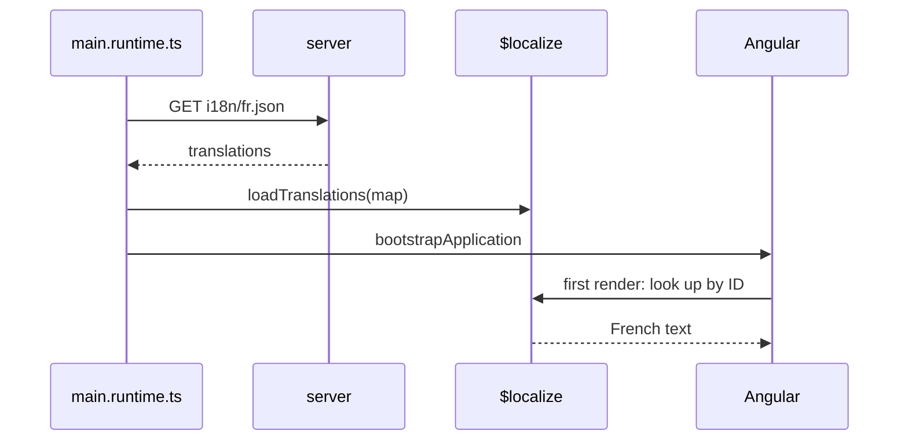

What to notice: the lookup happens once per component type, at its first render, after the map is full.

### How it actually works

**Read from the `@angular/localize` 22.2.1 source** (`fesm2022/localize.mjs`, `_localize-chunk.mjs`). `loadTranslations` sets `$localize.translate` if absent and parses each target into parts and `{$NAME}` placeholder names in a null-prototype map, `$localize.TRANSLATIONS`; **`clearTranslations`** removes `translate` and empties the map. At each call the internal `translate$1` (may change in any release) looks up the message ID, then each legacy ID. A miss, or a target placeholder the source lacks, throws inside it, but `translate` catches every error, calls `console.warn(e.message)` and returns the source parts. So at run time both mistakes warn and show English; they do not break the page (`Section 8: a missing translation logs a warning and renders the source text`, `Section 8: a translation that names an unknown placeholder logs the mismatch and renders the source text`).

Before bootstrap, French loads and placeholders reorder (`Section 8: translations loaded before the first render translate the template`, `Section 8: a translation can reorder placeholders`). After the first render, a second render of the same type stays English although the map now holds French (`Section 8: translations loaded after the first render do not change the component`). In the runtime build the file is requested before any component exists, and links with `?lang=` reload the page (`Section 8: the runtime build requests the translation file before the app renders`, `Section 8: the runtime build renders French with lang=fr in the URL`, `Section 8: switching language in the runtime build reloads the page`). Cost, stated and not measured: the bundle keeps the source strings and the lookup code, and first paint waits for the JSON. `ng add @angular/localize --use-at-runtime` puts the package in `dependencies`: "If set, then `$localize` can be used at runtime" (`add-package.md`, read 2026-10-15).

#### Legacy

`TRANSLATIONS` and `TRANSLATIONS_FORMAT` are `@publicApi` tokens in `@angular/core` 22.2.1, documented for providing a translation file at bootstrap. In `fesm2022` a `grep` for `TRANSLATIONS` finds only their two definitions (`_debug_node-chunk.mjs`) and their exports: nothing injects them. Read, not run: use a localized build ([§7](#7-compile-time-localization-one-build-per-locale-subpath-lang-and-dir)) or `loadTranslations`.

Tokens: [16 §7](16-dependency-injection.md#7-injectiontoken-multi-providers-environment-providers-and-initializers). Drilled in [Q34.19](#q34-19) and [Q34.20](#q34-20).

### Code

The approach: load the map, set the locale, then bootstrap.

1. Read `lang` from the URL.
2. Fetch `i18n/<lang>.json` and call `loadTranslations`.
3. Set `$localize.locale` and register its data.
4. Import the bootstrap file last.

```ts
// Excerpt of labs/angular/projects/i18n-lab/src/main.runtime.ts
  const body: TranslationFile = await response.json();
  // (3) Load the translations, (4) switch the locale, (5) register its data.
  loadTranslations(body.translations);
  $localize.locale = lang;
  registerLocaleData(LOCALE_DATA[lang], lang);
}

// (6) Bootstrap only now, so every $localize call sees the translations.
await import('./bootstrap.runtime');
```

### Best practices and anti-patterns

- **Bootstrap through a dynamic `import()` after the load**, because a static import would create `$localize` calls before the map is full.
- **Switch language by reloading**, because created component types keep their messages.
- **Pick runtime translation only when one artifact must serve many wordings**, because it adds a fetch before first paint.

### Misconceptions and traps

- *"`loadTranslations` switches language live."* Created types keep their messages (tested); the name sounds dynamic.
- *"Runtime translation needs a third-party library."* `@angular/localize` does it (tested); the myth exists because the docs present built-in i18n as a build step ("Compile once, then translate for each locale.").
- *"A missing runtime translation breaks the page."* It warns and shows the source (tested); build-time `error` mode suggests otherwise.
- *"Providing `TRANSLATIONS` still works."* Nothing in 22.2.1's `@angular/core` injects it (read); old JIT guides say it does.

## 9. Runtime translation libraries: Transloco and ngx-translate, lazy scopes, and the trade-off against built-in i18n

### The problem it solves

An admin area with 2,000 strings should not ship to every visitor, and users who switch language expect no reload: a localized build ([§7](#7-compile-time-localization-one-build-per-locale-subpath-lang-and-dir)) sends them to another folder, and `loadTranslations` ([§8](#8-runtime-translation-with-angularlocalize-loadtranslations-before-bootstrap)) reloads.

### Mental model

Runtime libraries are **key-based**: a template names a **translation key** (an identifier such as `'cart.title'` instead of English text), a **loader** (the class that returns one language's dictionary) supplies the JSON, and a service holds the active language. A lazy feature brings its own file: a Transloco **scope** (a named slice of translations) or an ngx-translate **child translation service** (one with its own loader that asks its parent for keys it lacks). Built-in i18n prints a book per language; a library is a phrase book looked up live.

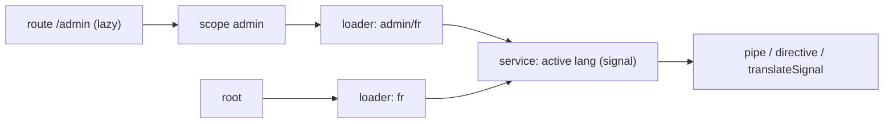

What to notice: each lazy area adds a request, not a bundle.

### How it actually works

**Transloco 8.4.0** (`fesm2022/jsverse-transloco.mjs`, read and run). `TranslocoService.load` caches one request per path (`<scope>/<lang>` for a scope), and `setTranslation` merges a scope's keys under its camel-cased name unless `scopes.keepCasing` or an alias says otherwise (internal `getMappedScope`, may change in any release): `Section 9: Transloco loads a scope only when a scoped component renders`, `Section 9: Transloco prefixes scoped keys with the scope alias` (`adminPanel.title`). The impure `TranslocoPipe` follows language changes only with `reRenderOnLangChange: true`, and `defaultConfig` sets `false`: `Section 9: Transloco switches language without recreating the component`, `Section 9: Transloco keeps the first language on screen when reRenderOnLangChange is off`. A miss goes to the internal `_handleMissingKey`: with `missingHandler.useFallbackTranslation` it reads the **fallback language** (the language consulted when the active one lacks a key), else the **missing-key handler** (the class that decides what a miss shows), whose default warns in dev mode and returns the key: `Section 9: Transloco falls back to the fallback language for a missing key`, `Section 9: Transloco returns the key for a missing key unless useFallbackTranslation is on`.

**ngx-translate 18.0.0** (`fesm2022/ngx-translate-core.mjs`, read and run). A child service loads the current language through its own loader when created and on each change, and delegates `use()` and `currentLang` to its `parent`, the service above it: `Section 9: a child service loads its feature translations on first use`. The internal `getTextToInterpolate` tries the current language, then `fallbackLang`, then the parent, and the default handler returns the key: `Section 9: ngx-translate returns the key for a missing translation by default`, `Section 9: ngx-translate uses the fallback language for a missing key once fallbackLang is set`. `currentLang` and `translate()` are signals (`Section 9: ngx-translate's translate() signal follows the language`).

Providers on a component or route tie the file to the lazy route ([24 §4](24-routing.md#4-lazy-loading-in-depth-loaders-canmatch-and-route-injectors)). ICU plurals need a plugin in both (Transloco's v8 "Message Format" page and ngx-translate's plugins page, read 2026-10-15). Validation messages are just keys (`validation.required`), the handoff from [Exercise 25.4](25-forms-reactive-and-template-driven.md#ex25-4).

| | One build per locale | `loadTranslations` | Transloco 8.4.0 | ngx-translate 18.0.0 |
|---|---|---|---|---|
| Switch without reload | no (§7, tested) | no (§8, tested) | with `reRenderOnLangChange` (tested) | `use()` (tested) |
| Requests before text | none (§7) | one JSON (§8, tested) | per language and scope (tested) | per language and child (tested) |
| App copies | one per locale (§7, tested) | one | one | one |
| Extraction | `ng extract-i18n` (§6) | same (§6) | Keys Manager, Transloco's key-extraction tool (docs) | community `ngx-translate-extract` |
| ICU | yes (§5) | yes (§5) | plugin (docs) | community plugin |
| Missing text | warns, or fails with `error` (§6) | warns, shows source (§8, tested) | key (tested); keys typed `string` | same |
| SSR | `@angular/ssr` redirects by language (§7, read) | not read | docs page "out-of-date" | docs recipe: bundle, or `TransferState` |

Drilled in [Q34.19](#q34-19), [Q34.21](#q34-21) and [Q34.22](#q34-22); built in [Exercise 34.3](#ex34-3).

### Code

The approach: an in-memory loader per library, and the feature's provider on the feature's component.

1. Write a loader that logs the path.
2. Provide the root service with it.
3. Put `provideTranslocoScope` or `provideChildTranslateService` on the feature.

```ts
// Excerpt of labs/angular/src/app/modules/34-i18n/concepts/section-9-transloco.spec.ts
@Injectable()
class LabM34InMemoryTranslocoLoader implements TranslocoLoader {
  private readonly log = inject(LabM34LoaderLog);

  getTranslation(path: string): Observable<Translation> {
    this.log.calls.push(path);
    return of(FILES[path] ?? {});
  }
}

@Component({
  selector: 'lab-m34-transloco-admin',
  imports: [TranslocoPipe],
  providers: [provideTranslocoScope('admin-panel')],
  template: `<h2>{{ 'adminPanel.title' | transloco }}</h2>`,
})
class LabM34TranslocoAdmin {}
```

```ts
// Excerpt of labs/angular/src/app/modules/34-i18n/concepts/section-9-ngx-translate.spec.ts
@Component({
  selector: 'lab-m34-ngx-admin',
  imports: [TranslatePipe],
  providers: [provideChildTranslateService({ loader: provideTranslateLoader(LabM34AdminTranslateLoader) })],
  template: `<h2>{{ 'admin.title' | translate }}</h2>
    <p>{{ 'cart.title' | translate }}</p>`,
})
class LabM34NgxAdmin {}

function setUp(lang: string, fallbackLang?: string): LabM34NgxLoaderLog {
  TestBed.configureTestingModule({
    providers: [provideTranslateService({ lang, fallbackLang, loader: provideTranslateLoader(LabM34RootTranslateLoader) })],
  });
  return TestBed.inject(LabM34NgxLoaderLog);
}
```

### Best practices and anti-patterns

- **Set `reRenderOnLangChange: true` in Transloco when users switch language**, because the default renders each key once.
- **Configure the fallback explicitly**, because Transloco also needs `useFallbackTranslation` and ngx-translate only `fallbackLang`.
- **Skip a library when the language never changes at run time**, because a localized build gives extraction, ICU and a build-time check.

### Misconceptions and traps

- *"Runtime libraries are slow, so never use them."* One request per language and area (tested) buys switching without reload; nothing here measures speed, and the myth comes from that request.
- *"Transloco and ngx-translate are interchangeable."* Scopes differ from child services, and the fallbacks differ (tested); the pipe syntax looks the same.
- *"A runtime library gives you plurals."* Both need a MessageFormat plugin (read); `{{ count }}` interpolation looks like enough.
- *"Keys make extraction unnecessary."* Unused and missing keys still need tooling such as Keys Manager (read); the myth comes from key-only templates.

## 10. Dates, times, numbers and money: time zones, currency codes and minor units

### The problem it solves

A birthday saved as `2024-07-08` shows as July 7 in New York. Totals drift after `0.1 + 0.2`. A German user of a euro shop sees `$`. Yen shows as `¥1,235.00`.

### Mental model

Keep three kinds of data apart. An **instant** is one moment, the same for everyone: store it in **UTC** (the zero offset) as **ISO 8601** text (the date and time notation) ending in `Z`. A **plain date** has no time, like a birthday. **Money** is an integer count of **minor units** (cents) plus an **ISO 4217** currency code (`EUR`, `JPY`). The user's **IANA time zone** (a region name such as `America/New_York`) applies at display time. A timestamp is a moment everyone shares; the wall clock is local. The locale only decides how it looks ([§1](#1-i18n-l10n-and-the-locale-language-tags-what-a-locale-decides-and-locale_id)).

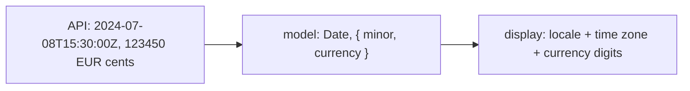

What to notice: the time zone and the currency travel with the data, the locale does not.

### How it actually works

MDN: "When the time zone offset is absent, date-only forms are interpreted as a UTC time and date-time forms are interpreted as a local time" (Date, December 8, 2025, read 2026-10-15). So `new Date('2024-07-08')` is July 8 in UTC and July 7 in New York (`Section 10: a date-only string shows the previous day in New York`).

The `date` pipe's `timezone` argument fixes the displayed day: for `2024-07-08T02:30:00Z`, `'UTC'` renders `2024-07-08 02:30` and `'-0400'` renders `2024-07-07 22:30`. The typings accept "a time zone offset from GMT (such as `'+0430'`)"; an IANA name does not throw: the internal `timezoneToOffset` (may change in any release) gets `NaN` and falls back to the host's zone (`Section 10: the date pipe's timezone argument fixes the displayed day`). A default for every pipe is [14 §6](14-directives-and-pipes.md#6-built-in-pipes-and-locale-data)'s `DATE_PIPE_DEFAULT_OPTIONS`.

The `currency` pipe's code defaults to `DEFAULT_CURRENCY_CODE`, which is `'USD'` whatever the locale (§1). With `de` data, `{{ 1234.5 | currency }}` renders `1.234,50` U+00A0 `$`, while `currency:'EUR'` or a `DEFAULT_CURRENCY_CODE` provider renders the euro sign (`Section 10: the currency pipe shows USD unless a code or DEFAULT_CURRENCY_CODE is given`). The decimals come from the code. **Read from `@angular/common` 22.2.1:** `formatCurrency` sets the fraction digits to `getNumberOfCurrencyDigits(code)` [Deprecated since v18.0 — use `Intl`], which reads the internal `CURRENCIES_EN` table (`JPY` and `CLP` have 0; unknown codes get 2). So `currency:'JPY'` renders `¥1,235`, and `Intl` gives the same digits for `JPY`, `CLP`, `EUR` and `USD` (`Section 10: yen and Chilean pesos have no minor digits`). Minor units convert with those digits and integer arithmetic (`Section 10: minor units convert exactly with the currency's digits`).

`Intl.NumberFormat`'s `currencyDisplay` picks `symbol`, `narrowSymbol`, `code` or `name` (MDN, `NumberFormat()`, Aug 21, 2026, read 2026-10-15). For `CAD` in `en-US` they print `CA$1,234.50`, `$1,234.50`, `CAD` U+00A0 `1,234.50` and `1,234.50 Canadian dollars`: the number never changes (`Section 10: currencyDisplay changes the symbol, not the number format`). Floats drift: `0.1 + 0.2` is `0.30000000000000004`, while `10 + 20` cents is `30` ([Q01.09](01-js-values-types-coercion.md#q01-09) owns money in JavaScript) (`Section 10: adding prices as floats drifts while integer minor units do not`). Wire formats are [41's](41-fullstack-api-contracts.md#9-dates-time-zones-decimals-and-money-across-the-wire).

Drilled in [Q34.23](#q34-23).

### Code

The approach: the zone and the code are explicit, the digits come from the currency.

1. Keep the instant as a `Date` and show it with a zone.
2. Keep money as `{ minor, currency }`.
3. Convert with the currency's digits.

```ts
// Excerpt of labs/angular/src/app/modules/34-i18n/concepts/section-10-dates-money.spec.ts
/** Integer minor units to a decimal string, with integer arithmetic only. */
function minorToMajor(minor: number, digits: number): string {
  if (digits === 0) return String(minor);
  const factor = 10 ** digits;
  return `${Math.trunc(minor / factor)}.${String(minor % factor).padStart(digits, '0')}`;
}

@Component({
  selector: 'lab-m34-date-host',
  imports: [DatePipe],
  template: `<p id="utc">{{ instant | date: 'yyyy-MM-dd HH:mm' : 'UTC' }}</p>
    <p id="offset">{{ instant | date: 'yyyy-MM-dd HH:mm' : '-0400' }}</p>`,
})
class LabM34DateHost {
  protected readonly instant = new Date('2024-07-08T02:30:00Z');
}
```

### Best practices and anti-patterns

- **Store instants as UTC and show them in the user's zone**, because the server's zone is one office's.
- **Format a plain date with `timeZone: 'UTC'`**, because another zone moves the day.
- **Keep money as integer minor units plus a code**, because floats drift and the code is data.
- **Pass the code to `currency`**, because the locale never chooses it.

### Misconceptions and traps

- *"Store dates as local strings."* They lose the zone (tested); they display as typed.
- *"The locale implies the currency."* `de` shows USD unless told (tested); most users pay in one currency, travelers and shops do not.
- *"`toFixed(2)` formats money."* It adds no grouping or symbol and keeps two decimals for yen (tested); two decimals look right for most prices.
- *"The server's time zone is fine for display."* Users are elsewhere (tested: New York); one office hides it.

## 11. Right-to-left layouts: `dir`, logical CSS properties and bidirectional text

### The problem it solves

In the Arabic build a spacing gap sits on the wrong side, a phone number reads `4567 123 300 +57`, `Ana!` shows as `!Ana` inside an Arabic sentence, and the back arrow points forward.

### Mental model

**Writing direction** is the way a line runs: `ltr` or `rtl`. `dir="rtl"` on `<html>`, which the build sets ([§7](#7-compile-time-localization-one-build-per-locale-subpath-lang-and-dir)), flips the **inline axis**, the one lines run along ([10 §5](10-css-essentials.md#5-responsive-css-media-queries-container-queries-and-fluid-type) owns it). A **logical property** (`margin-inline-start`) is relative to that axis and follows the flip; a **physical property** (`margin-left`) names a side and does not. The **bidi algorithm** (the browser's ordering of mixed-direction runs) places neutral characters such as `!` and spaces. **Isolation** keeps one run from reordering its neighbours. **Mirroring** flips a picture; only direction-bearing icons need it. Mirror the frame, not the words.

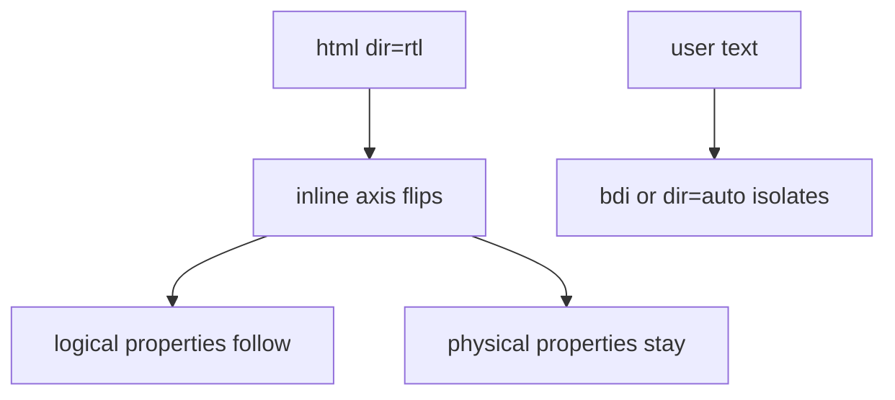

What to notice: only properties tied to the inline axis change.

### How it actually works

MDN: "Logical properties define direction‐relative equivalents to their corresponding physical properties" (Nov 18, 2025, read 2026-10-15). In the Arabic build a 100 px box in a 300 px flex row has 16 px at the right edge with `margin-inline-start: 16px` and 0 with `margin-left: 16px`, whose margin sits on the box's left (`Section 11: margin-inline-start moves to the right edge in the Arabic build`, `Section 11: margin-left stays on the left in the Arabic build`). `text-align: start` puts text at the right edge (`Section 11: text-align start aligns right in the Arabic build`); the `en-US` build gives both boxes a 16 px left gap (`Section 11: the en-US build lays out the same page left to right`).

`[dir=rtl]` matches only an element that carries the attribute; `:dir(rtl)` "matches elements based on the directionality of the text contained in them" [Baseline 2023: widely available, per MDN] (Apr 17, 2026, read 2026-10-15).

`<bdi>` [Baseline 2020: widely available, per MDN] "tells the browser's bidirectional algorithm to treat the text it contains in isolation from its surrounding text" (Aug 28, 2026, read 2026-10-15). Without it, the `!` is neutral between a Latin letter and Arabic, takes the paragraph's direction and lands left of the name; inside `<bdi>` it stays after it (`Section 11: bdi keeps a user name's punctuation with the name`). Digits run left to right, but spaces between phone groups take the paragraph's direction, so groups reverse unless `dir="ltr"` is set (`Section 11: dir=ltr keeps a phone number in reading order in the Arabic build`).

**Read from `@angular/cdk` 22.2.1** (`fesm2022/_directionality-chunk.mjs`, `bidi.mjs`): `Directionality` reads `document.body.dir || document.documentElement.dir` once, in its constructor, into a signal, with no observer (`Section 11: Directionality reads rtl from the document`), so a later change of `<html dir>` is not seen (`Section 11: Directionality does not follow a later change of the html dir attribute`). `'auto'` goes through the internal `_resolveDirectionality` (may change in any release) and `navigator.language`. The `Dir` directive (`[dir]`) provides its own value below it (`Section 11: the Dir directive reports its own direction to children`), so a switch without a reload needs it. [36](36-material-and-cdk.md#2-material-components-in-a-v22-app-standalone-imports-form-fields-dialogs-direction-and-motion) owns Material's use. `lang` matters for fonts, hyphenation and screen readers ([11 §1](11-accessibility.md#1-why-accessibility-and-what-the-standards-require)).

Drilled in [Q34.24](#q34-24); built in [Exercise 34.4](#ex34-4).

### Code

The approach: logical properties for layout, isolation for user text and numbers.

1. Use `margin-inline-start` and `text-align: start`.
2. Wrap the user name in `<bdi>`.
3. Give the phone number `dir="ltr"`.

```ts
// Excerpt of labs/angular/projects/i18n-lab/src/app/m34/rtl/rtl.ts
    <p class="frame start" data-testid="start" i18n="@@m34.rtl.start">Aligned to the start</p>
    <p data-testid="isolated" i18n="@@m34.rtl.arrivedIsolated"><bdi>{{ name }}</bdi> just arrived</p>
    <p data-testid="phone-ltr" dir="ltr">{{ phone }}</p>
  styles: `
    .logical { margin-inline-start: 16px; }
    .start { text-align: start; }
```

### Best practices and anti-patterns

- **Use logical properties**, because one rule serves both directions.
- **Wrap user text in `<bdi>`**, because its direction is unknown.
- **Set `dir="ltr"` on phone numbers and code**, because neutrals take the paragraph's direction.
- **Mirror only direction icons**, because a logo keeps its meaning.

### Misconceptions and traps

- *"RTL means `scaleX(-1)` on the page."* `dir` reorders layout; a mirror flips the glyphs too; the myth exists because a mirror image is the familiar picture of "reversed".
- *"Mirror every icon."* Only direction-bearing ones; consistency tempts, but a logo keeps its meaning.
- *"Numbers run right to left in Arabic."* Digits run left to right (tested with the phone number); the script is RTL, so the myth follows.
- *"`Directionality` follows `<html dir>`."* It reads once (tested); it is a signal now, which suggests it updates.

## 12. Under the hood: from an `i18n` attribute to translated DOM

### The problem it solves

An interviewer asks why a French build does no lookup at run time, why `loadTranslations` after bootstrap changes nothing, and how an ICU picks a new branch when the count changes. Each answer is one stage of one pipeline.

### Mental model

Three stages. **Compile:** the template compiler puts each message in the component's **`consts` function**, the part of its private definition `ɵcmp` that builds the template's constants ([12 §8](12-angular-how-it-works.md#8-under-the-hood-what-the-compiler-emits-and-what-the-runtime-does-with-it) owns definitions), here `$localize` tagged templates. **Build:** the inliner replaces each tag with a translated literal ([§7](#7-compile-time-localization-one-build-per-locale-subpath-lang-and-dir)). **Run:** at a component type's first render, the runtime calls `consts` once and parses each message into **opcodes**, numbers and strings encoding "create this text node" or "switch this ICU". The **create pass** (building a view's nodes) runs the create opcodes; each **update pass** (checking bindings) runs only the update opcodes whose bindings changed. An **ICU case swap** replaces the old case's nodes with the new case's. Like a printed form: typeset once, only the blanks change.

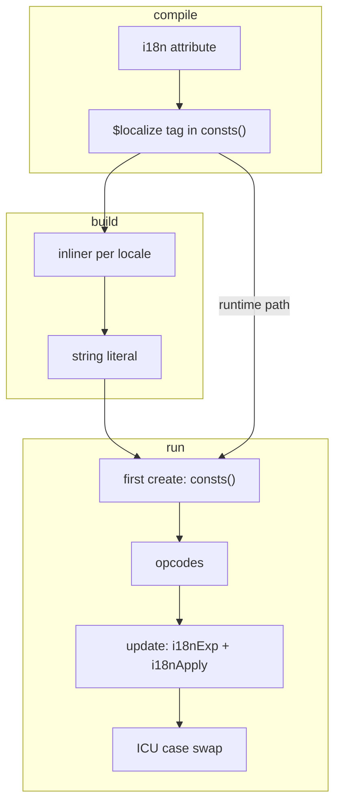

What to notice: the build path and the runtime path meet at the same `consts` function.

### How it actually works

**Compile.** Read from `@angular/compiler` 22.2.1 (`compiler.mjs`; internal `collectI18nConsts`, `getTranslationDeclStmts`, `compileComponentFromMetadata`; internal names may change in any release): each message becomes a variable set by a `$localize` tag (a `goog.getMsg` branch runs only under `ngI18nClosureMode`), and `consts` becomes an arrow function that sets them and returns the array. In `ng test` it returns `['Order summary']` (`Section 12: a component's consts is a function that returns its messages`). Elements inside a message use `ɵɵi18nStart`/`ɵɵi18nEnd` instead of `ɵɵi18n`.

**Why once per type.** Read from `@angular/core` 22.2.1 (`_debug_node-chunk.mjs`; internal `getOrCreateComponentTView`, `createTView`, `i18nStartFirstCreatePass`): the first render builds the type's template blueprint, calls `consts()` there and stores the blueprint on the definition; `ɵɵi18nStart` parses opcodes only on that first pass. Two instances and a changed binding made one translate call (`Section 12: the message is built once per component type`), so [§8](#8-runtime-translation-with-angularlocalize-loadtranslations-before-bootstrap)'s map must be full before bootstrap. In a localized build the tag is already a literal: the inliner translated it with the same internal `ɵtranslate` of `@angular/localize` (internal `translateMessage`, `@angular/build` 22.2.1 `i18n-inliner-worker.js`).

**Update.** `ɵɵi18nExp` compares a value with its slot and sets a change-mask bit; `ɵɵi18nApply` runs internal `applyUpdateOpCodes`, which skips groups whose bit is clear.

**ICU case swap.** Internal `applyIcuSwitchCase` asks `getCaseIndex` for the case ([§5](#5-icu-expressions-plural-select-and-nesting)); if it changed, `applyIcuSwitchCaseRemove` removes the old nodes and `applyMutableOpCodes` creates the new ones before a comment anchor. At 0 there is no `<b>`; at 3 the earlier `<i>` is detached (`Section 12: an ICU swaps its nodes when the bound value changes`).

**i18n hydration.** `withI18nSupport()` [Stable since v20.0] "Enables support for hydrating i18n blocks" (`@angular/platform-browser` 22.2.1 typings). **i18n hydration** means the browser reuses the server's nodes of an `i18n` block: the server records each ICU's active case (internal `trySerializeI18nBlock`) and the client's internal `locateOrCreateNodeImpl` claims them (read, not run; hydration: [32 §4](32-ssr-ssg-hydration.md#4-hydration-reusing-the-servers-dom-mismatches-and-ngskiphydration)).

Drilled in [Q34.25](#q34-25).

### Code

The approach: count translate calls, then watch an ICU replace its nodes.

1. Install a counting `$localize.translate` before the first render.
2. Create the host twice and change its binding.
3. Render the ICU at 0, keep its `<i>`, then set 3.

```ts
// Excerpt of labs/angular/src/app/modules/34-i18n/concepts/section-12-under-the-hood.spec.ts
  it('Section 12: the message is built once per component type', () => {
    const calls = countTranslations();
    const first = TestBed.createComponent(LabM34OnceHost);
    first.detectChanges();
    const second = TestBed.createComponent(LabM34OnceHost);
    second.detectChanges();
    second.componentInstance.count.set(5);
    second.detectChanges();

    expect([...calls.values()]).toEqual([1]);
    expect(first.nativeElement.textContent).toBe('You have 2 items');
    expect(second.nativeElement.textContent).toBe('You have 5 items');
  });
```

```text
Pseudo-code, not compiler output: the shape the functions above emit for LabM34OnceHost
consts: () => {
  let i18n_0;
  if (typeof ngI18nClosureMode !== 'undefined' && ngI18nClosureMode) { i18n_0 = goog.getMsg(…); }
  else { i18n_0 = $localize`:@@m34.hood.items:You have ${…}:INTERPOLATION: items`; }
  return [i18n_0];
}
template: (rf, ctx) => {
  if (rf & 1) { /* <p> */ ɵɵi18n(1, 0); /* </p> */ }        // create: parse once, build nodes
  if (rf & 2) { ɵɵadvance(); ɵɵi18nExp(ctx.count()); ɵɵi18nApply(1); }  // update: changed bindings only
}
```

### Best practices and anti-patterns

- **Load runtime translations before bootstrap**, because `consts()` runs once per component type.
- **Keep ICU cases small**, because a case change removes and recreates every node in the case.
- **Never read `ɵcmp.consts` in application code**, because it is private and may change in any release.

### Misconceptions and traps

- *"Translated builds look strings up in a dictionary at run time."* The inliner replaced them (tested in [§7](#7-compile-time-localization-one-build-per-locale-subpath-lang-and-dir)); the myth exists because runtime libraries do.
- *"Every change detection re-translates the text."* Only its expressions update (tested); the myth exists because bindings re-run on every check.
- *"ICU branches are all rendered and hidden."* Only the active case's nodes exist (tested); the myth exists because the template lists every branch side by side.

## Summary

Internationalization prepares the app and localization produces one locale's version; a locale is a language tag that selects formats, plural rules, sort order and direction, but not the currency ([section 1](#1-i18n-l10n-and-the-locale-language-tags-what-a-locale-decides-and-locale_id)). The platform's `Intl` constructors need a locale and, for dates, a time zone, because the engine's defaults are not the user's ([section 2](#2-the-platforms-intl-apis-dates-numbers-plurals-lists-collation-and-display-names)). Angular's pipes read the CLDR tables in `@angular/common`, not `Intl`, so the two can print different characters, and `registerLocaleData` registers an array you already imported and downloads nothing ([section 3](#3-angulars-locale-data-and-formatting-functions-versus-intl)). An `i18n` attribute or a `$localize` call marks one whole message: translate sentences, not fragments, and remember that only the text and the meaning feed the computed ID, not the description ([section 4](#4-marking-text-for-translation-i18n-attributes-metadata-ids-and-localize-in-code)).

ICU `plural` and `select` expressions keep word order inside the translation; `=1` tests the value while `one` is a category (French gives it to 0, Russian to 21), and Angular reads its own locale data on the truncated value, so `1.5` is not what `Intl.PluralRules` says ([section 5](#5-icu-expressions-plural-select-and-nesting)). `ng extract-i18n` writes the source messages, the ID is the only link between code and translation, computed IDs move with any text edit, and a missing translation is a warning unless the build is set to `error` ([section 6](#6-extraction-and-translation-files-ng-extract-i18n-formats-and-message-ids)). A `localize` build compiles once and the inliner writes one folder per locale with its `lang`, `dir` and base `href`, so the router needs no language prefix and `ng serve` shows one locale ([section 7](#7-compile-time-localization-one-build-per-locale-subpath-lang-and-dir)). `loadTranslations` before bootstrap translates at run time, and after a component type's first render it changes nothing ([section 8](#8-runtime-translation-with-angularlocalize-loadtranslations-before-bootstrap)). Transloco and ngx-translate switch language without a reload and fetch each lazy area's file on demand, which costs a request, a plugin for plurals and key tooling you run yourself ([section 9](#9-runtime-translation-libraries-transloco-and-ngx-translate-lazy-scopes-and-the-trade-off-against-built-in-i18n)).

Dates keep their zone, the locale does not imply the currency, and `toFixed(2)` formats no money: pass the zone and the currency with the data ([section 10](#10-dates-times-numbers-and-money-time-zones-currency-codes-and-minor-units)). `dir` reorders the layout, logical properties follow the inline axis, digits stay left to right, only direction-bearing icons mirror, and `Directionality` reads `dir` once ([section 11](#11-right-to-left-layouts-dir-logical-css-properties-and-bidirectional-text)). Under the hood the compiler turns each message into a `$localize` call inside the component's `consts` function; the build path replaces the literal, the runtime path looks the message up once per component type, so a change check updates only the expressions and an ICU creates only its active case's nodes ([section 12](#12-under-the-hood-from-an-i18n-attribute-to-translated-dom)).

## Question bank

Each answer has five parts. Each Output answer names the run asserted in `labs/angular/src/app/modules/34-i18n/outputs/q34-outputs.spec.ts`, `labs/ts-js/src/modules/34-i18n/outputs/q34-outputs.test.ts` or `labs/e2e/tests/34-i18n/outputs/q34-outputs.spec.ts`; `Intl` values are Node 24's (ICU 78.3, CLDR 48.0).

<a id="q34-01"></a>
### Q34.01 · Concept · What are internationalization and localization, what does a locale identify, and what changes with it besides the language?

<details>
<summary>Answer</summary>

**Short answer (30 seconds).** Internationalization (i18n) is preparing the app so any locale can be served: no hard-coded formats, text kept apart from code, layout that does not assume a direction. Localization (l10n) is producing the version for one locale. A locale is a BCP 47 tag such as `fr-CA`: a language, an optional script and an optional region. Besides text, it selects number and date formats, plural rules, sort order and text direction, but not the currency.

**Full explanation.** Angular's docs define both words (`guide/i18n/overview`, read 2026-10-15); [§1](#1-i18n-l10n-and-the-locale-language-tags-what-a-locale-decides-and-locale_id) draws the tag and the data it selects. In the lab, `getCanonicalLocales` turns `EN-us` into `en-US`, `fr-CA` and `en-CA` share only a region, and `fr` has none (`Section 1: getCanonicalLocales normalizes the case of a tag`, `Section 1: Intl.Locale splits a tag into language, script and region`). The data comes from CLDR, so plural rules differ: French counts 0 as singular and Arabic has six categories ([Q34.04](#q34-04)). The currency token stays `USD` under any `LOCALE_ID` ([Q34.02](#q34-02)); Angular's pipes read the same tables ([14 §6](14-directives-and-pipes.md#6-built-in-pipes-and-locale-data)).

**Follow-ups an interviewer will ask.**
- *Is a locale a country?* No: only the language subtag is required.
- *Does choosing `fr-CA` pick the currency?* No. Send a currency code with every amount ([§10](#10-dates-times-numbers-and-money-time-zones-currency-codes-and-minor-units)).

**Trap to avoid.** Answering "i18n is translating the text". Translation is one part of localization; the work of i18n is making formats, plurals, ordering and direction replaceable.

</details>

<a id="q34-02"></a>
### Q34.02 · Output · `LOCALE_ID` with nothing configured, with `$localize.locale` set to `fr`, and with a provider for `de`: which value does each injector return, and what is `DEFAULT_CURRENCY_CODE` in the French app?

A French build reads `$localize.locale = 'fr'`. Three `TestBed` setups ask for `LOCALE_ID`: one with nothing configured, one with `$localize.locale` set to `fr`, one with `{ provide: LOCALE_ID, useValue: 'de' }`. Then the French setup asks for `DEFAULT_CURRENCY_CODE`.

<details>
<summary>Answer</summary>

**Short answer (30 seconds).** `en-US`, `fr` and `de`; `DEFAULT_CURRENCY_CODE` is `USD`. A `LOCALE_ID` provider replaces the factory; without one, the factory takes a parent injector's value, then `$localize.locale`, then `en-US`. The currency token's factory returns `USD` whatever the locale is.

**Full explanation.** `Q34.02 LOCALE_ID is en-US with nothing configured, fr from $localize.locale, de from a provider; the currency stays USD` asserts the four values, resetting `TestBed` between cases because the root injector runs the factory once and caches the result ([§1](#1-i18n-l10n-and-the-locale-language-tags-what-a-locale-decides-and-locale_id); factory read in `@angular/core` 22.2.1, internal `getGlobalLocale`, which may change in any release). A localized build writes its tag into `$localize.locale` in its polyfills, so it needs no provider ([§7](#7-compile-time-localization-one-build-per-locale-subpath-lang-and-dir)).

**Follow-ups an interviewer will ask.**
- *Why reset `TestBed` between the cases?* The first `inject` caches the value, so setting `$localize.locale` afterwards changes nothing.
- *How does a French price show euros?* Pass `EUR` to the pipe or provide `DEFAULT_CURRENCY_CODE`; the locale only decides how the amount is written (`Section 10: the currency pipe shows USD unless a code or DEFAULT_CURRENCY_CODE is given`).

**Trap to avoid.** Expecting the browser's language to set `LOCALE_ID`, or `$localize.locale` to beat a provider: the order is provider, global value, default.

</details>

<a id="q34-03"></a>
### Q34.03 · Concept · Which `Intl` constructors does the platform give you, which job does each do, and why do you always pass a time zone?

<details>
<summary>Answer</summary>

**Short answer (30 seconds).** `DateTimeFormat` writes dates and times, `NumberFormat` numbers, currency, percent and units, `PluralRules` picks a plural category for a count, `RelativeTimeFormat` writes "yesterday", `ListFormat` joins "a, b, and c", `Collator` orders strings, `Segmenter` cuts text into graphemes or words, `DisplayNames` names regions and languages, and `DurationFormat` writes "1 hour, 30 minutes". Pass a time zone because an instant is one moment and the zone decides which day and hour it shows.

**Full explanation.** Each is built once from a locale and options ([§2](#2-the-platforms-intl-apis-dates-numbers-plurals-lists-collation-and-display-names)). `2024-07-08T02:30:00Z` is July 8 in UTC and Tokyo but July 7 in New York (`Section 2: DateTimeFormat formats one instant differently per locale and time zone`), and a date-only string is UTC midnight, so it shows the previous day in New York (`Section 10: a date-only string shows the previous day in New York`). Without `timeZone`, a laptop and a server print different text. Graphemes belong to [01 §3](01-js-values-types-coercion.md#3-strings-and-unicode).

**Follow-ups an interviewer will ask.**
- *Is `toLocaleString` another API?* Without a locale and options it uses the implementation's default locale and time zone (MDN, read 2026-10-15).
- *Do Node and Chrome print the same text?* Not guaranteed, since each ships its own ICU data; for the `en-US` short time both print U+0020 (`Section 2: Chromium formats the en-US short time with the separator the run shows`).

**Trap to avoid.** Leaving out `timeZone` because it works on your machine: the output depends on where the code runs.

</details>

<a id="q34-04"></a>
### Q34.04 · Output · `Intl.PluralRules` for English, French, Arabic and Russian on 0, 1, 2, 5, 11 and 1.5, plus English ordinals: which category does each return?

Run `new Intl.PluralRules(locale).select(n)` for `en`, `fr`, `ar` and `ru` over 0, 1, 2, 5, 11 and 1.5, then English with `{ type: 'ordinal' }` over 1, 2, 3 and 11.

<details>
<summary>Answer</summary>

**Short answer (30 seconds).** The categories come from each language's CLDR rules in Node 24's ICU:

| n | 0 | 1 | 2 | 5 | 11 | 1.5 |
|---|---|---|---|---|---|---|
| `en` | other | one | other | other | other | other |
| `fr` | one | one | other | other | other | one |
| `ar` | zero | one | two | few | many | other |
| `ru` | many | one | few | many | many | other |

English ordinals: 1 `one`, 2 `two`, 3 `few`, 11 `other`.

**Full explanation.** `Q34.04 each language maps 0, 1, 2, 5, 11 and 1.5 to its own categories, and English ordinals use one, two, few and other` asserts every cell ([§2](#2-the-platforms-intl-apis-dates-numbers-plurals-lists-collation-and-display-names)). A category is a label, not a quantity: French `one` covers 0 and 1.5, and Russian `one` also covers 21 (`Section 2: PluralRules returns different categories per language`). The docs' table simplifies `few` as "2 or more"; [§5](#5-icu-expressions-plural-select-and-nesting) states the real rule.

**Follow-ups an interviewer will ask.**
- *Why not `n === 1 ? 'item' : 'items'`?* It fits English only; each category gets its own translated text ([§5](#5-icu-expressions-plural-select-and-nesting)).
- *Cardinal or ordinal?* Cardinal counts things ("1 file"), ordinal ranks them ("1st"); English ordinals map to `st`, `nd`, `rd` and `th`.

**Trap to avoid.** Reading `one` as "exactly one" and `other` as "many".

</details>

<a id="q34-05"></a>
### Q34.05 · Bug hunt · A names list sorted with `sort()`, file names where `item10` comes before `item2`, and a Swedish list that puts `ä` next to `a`: what is wrong in each, and what is the fix?

```ts
// Partial: three lists and three comparators.
['ä', 'a', 'z'].sort();                                              // a German list
['item10', 'item2', 'item9'].sort(new Intl.Collator('en').compare);  // file names
['ä', 'a', 'z'].sort(new Intl.Collator('de').compare);               // a Swedish list
```

<details>
<summary>Answer</summary>

**Short answer (30 seconds).** The first compares UTF-16 code units, so `ä` (U+00E4) follows `z`; German readers expect `a ä z`. The second compares `item10` and `item2` as text, so `1` sorts before `2`; it needs `numeric: true`. The third uses German rules, which put `ä` beside `a`; Swedish puts it after `z`, so it needs `Collator('sv')`. The fix is a `Collator` built for the user's locale.

**Full explanation.** `Section 2: Collator orders ä differently in German and Swedish` asserts `a ä z` for `de`, `a z ä` for `sv` and for plain `sort()`: the default can match one language by accident. `Section 2: a numeric Collator puts item2 before item10` asserts `item2, item9, item10` with `numeric: true` and `item10, item2, item9` without ([§2](#2-the-platforms-intl-apis-dates-numbers-plurals-lists-collation-and-display-names)). The order is data, so it follows the reader's locale.

**Code.** The fix:

```ts
// Partial: `locale` is the user's locale, for example the injected LOCALE_ID.
names.sort(new Intl.Collator(locale).compare);
files.sort(new Intl.Collator(locale, { numeric: true }).compare);
```

**Follow-ups an interviewer will ask.**
- *Why not strip the accents and compare?* It would put `ä` beside `a`, which is what `de` does and `sv` does not.
- *Does a `Collator` fix reversing or cutting a name?* No: it orders strings; splitting at visible characters is `Intl.Segmenter`'s ([Q01.11](01-js-values-types-coercion.md#q01-11)).

**Trap to avoid.** Testing with ASCII names: all three bugs stay hidden until a name has `ä` or a number.

</details>

<a id="q34-06"></a>
### Q34.06 · Difference · Output · `formatDate` and `formatNumber` versus `Intl.DateTimeFormat` and `Intl.NumberFormat` for the same values in `en-US`, `fr` and `ar-EG`: what differs, character by character?

With `fr` and `ar-EG` data registered and `UTC` as the zone, format `2024-07-08T15:30Z` in `en-US` with the `short` format, `1234.5` in `ar-EG`, and `1234.5` euros in `fr`, once with Angular's functions and once with `Intl`.

<details>
<summary>Answer</summary>

**Short answer (30 seconds).** Two pairs differ and one is identical. `en-US` short: Angular prints `7/8/24, 3:30`, U+202F, `PM`; `Intl` prints U+0020 before `PM`. `ar-EG`: Angular prints Latin digits, `1,234.5`; `Intl` prints Arabic-Indic digits, U+0661 U+066C U+0662 U+0663 U+0664 U+066B U+0665. The `fr` euro string is the same in both: `1`, U+202F, `234,50`, U+00A0, `€`. The reason is two data sources: tables shipped in `@angular/common`, and the engine's ICU.

**Full explanation.** `Q34.06 en-US short time differs by U+202F against U+0020, ar-EG digits differ, and the fr currency string is identical` asserts each string with `\u` escapes ([§3](#3-angulars-locale-data-and-formatting-functions-versus-intl)). The `ar-EG` medium date splits the same way: U+200F follows the day and the month in both, with Latin digits from Angular and Arabic-Indic ones from `Intl`.

**Follow-ups an interviewer will ask.**
- *Why compare by code point?* U+202F and U+0020 look alike in a diff, so the assertions use escapes and a failure lists the code points.
- *Does Chrome print what Node prints?* Not guaranteed. These strings are Node 24's (ICU 78.3, CLDR 48.0), and a browser claim needs a browser test.

**Trap to avoid.** Pasting the expected string from a terminal into a test: the invisible character may be lost or replaced, so write the escape `\u202f`.

</details>

<a id="q34-07"></a>
### Q34.07 · Concept · How does Angular find a locale's data, what does `registerLocaleData` do, and why are the `getLocale*` functions deprecated?

<details>
<summary>Answer</summary>

**Short answer (30 seconds).** Angular ships data for `en` only; every other locale is an array you import. `registerLocaleData(data)` stores it in a module-level map under its own id, lower-cased, and the formatters look the locale up there, then by its language part; an `en-*` tag falls back to the built-in `en`, and any other tag throws `NG0701`. The `getLocale*` getters are deprecated since 18.0 because the typings tell you to rely on `Intl`; the formatters are not.

**Full explanation.** With `fr` registered `formatDate` prints French, and without data `formatNumber(1234.5, 'pt')` throws (`Section 3: registering fr data makes formatDate print French`, `Section 3: an unregistered locale throws NG0701 from formatNumber`). A global variant registers nothing itself: it assigns the array to `ng.common.locales`, which the lookup reads when the map has no entry (`Section 3: the global variant registers the locale when imported`). The lookup order and the `en-GB` fallback are [Q14.23](14-directives-and-pipes.md#q14-23)'s; the source read is `@angular/core` 22.2.1, internal `registerLocaleData` and `findLocaleData`, which may change in any release ([§3](#3-angulars-locale-data-and-formatting-functions-versus-intl)).

**Follow-ups an interviewer will ask.**
- *Does registering change what `Intl` prints?* No: the map feeds only Angular's functions.
- *Are the pipes deprecated too?* No: only the getters and two currency helpers carry the tag (`@angular/common` 22.2.1 typings, read).

**Trap to avoid.** Reading "deprecated" on the getters as "stop using locale data": the formatters still need it.

</details>

<a id="q34-08"></a>
### Q34.08 · Trade-off · Angular's `date`, `number` and `currency` pipes, or your own pipes on `Intl`: which do you use in a new app?

<details>
<summary>Answer</summary>

**Short answer (30 seconds).** Use Angular's pipes where they cover the job, and write `Intl` pipes for the gaps. The built-in pipes follow `LOCALE_ID` and need no code. `Intl` covers what no built-in pipe does, such as relative time, lists and units. Never format one value both ways on one screen.

**Full explanation.** The pipes read tables in `@angular/common`, so each non-English locale needs its data registered, or `NG0701` follows ([§3](#3-angulars-locale-data-and-formatting-functions-versus-intl)). An `Intl` pipe needs no registration because the engine has the data, but its output depends on the engine: Node and Chrome each ship their own ICU, so server and browser text can differ (read, not run for server rendering). You also write and test it, injecting `LOCALE_ID` ([29 §8](29-testing-angular.md#8-testing-services-pipes-and-directives-including-testbedcreatedirective)) and building each formatter once per locale ([Exercise 34.1](#ex34-1) does). Mixing costs most: Q34.06's run printed U+202F against U+0020.

**Follow-ups an interviewer will ask.**
- *Did the `getLocale*` deprecation settle it?* No: only the getters carry the tag, not the pipes or `format*` functions (read).
- *When does `Intl` win?* When another `Intl` consumer, such as a chart library, must print the same text.

**Trap to avoid.** Choosing by novelty: "`Intl` is the platform" does not say which text must agree.

</details>

<a id="q34-09"></a>
### Q34.09 · Concept · What does the `i18n` attribute mark, what do meaning, description and `@@id` change, and how do you translate attributes and text in TypeScript code?

<details>
<summary>Answer</summary>

**Short answer (30 seconds).** `i18n` marks an element's content as one message; `i18n-title` (or `i18n-<attribute>`) marks an attribute as its own message; `<ng-container i18n>` marks text without an element. The metadata is `meaning|description@@id`. The meaning separates identical texts and feeds the computed ID, the description only informs the translator, and `@@id` replaces the computed ID. In TypeScript, the `$localize` tag marks a template literal.

**Full explanation.** An element with all three parts yields one message, `i18n-title` a second (`Section 4: the i18n message of an element carries its meaning, description and custom ID`, `Section 4: an i18n-title attribute becomes its own message`). Without `@@` the ID comes from the text and the meaning, so "The _description_ does not affect the ID" (`guide/i18n/prepare`, read 2026-10-15). In code the call returns plain text without its metadata (`Section 4: $localize without translations returns the text without its metadata`) ([§4](#4-marking-text-for-translation-i18n-attributes-metadata-ids-and-localize-in-code)).

**Code.** A label computed in TypeScript:

```ts
// Partial: a field of a component whose template has `[title]="closeLabel"`.
protected readonly closeLabel = $localize`:dialog action|Tooltip of the close button@@m34.q09.close:Close the dialog`;
```

**Follow-ups an interviewer will ask.**
- *Does editing the description lose the translation?* No: it is not part of the ID, so the translation stays attached.
- *Is translated text sanitized?* Yes, and the core changelog lists "disallow i18n event attributes" (22.0.1); sanitization is [33 §3](33-security.md#3-sanitization-by-security-context-html-style-url-and-resource-url)'s.

**Trap to avoid.** Adding `@@id` everywhere: an edited text keeps its ID, so an out-of-date translation keeps showing (`guide/i18n/manage-marked-text`).

</details>

<a id="q34-10"></a>
### Q34.10 · Output · What does a `$localize` call with metadata and a named placeholder return without translations, and which placeholder names does the compiler give an interpolation and a `<b>` inside an `i18n` element?

Two pieces run with no translations loaded: `` $localize`:greeting|Opens the page@@m34.q10.greet:Hello, ${name}:name:!` `` with `name = 'Ana'`, and a component template `<p i18n>Hi {{ name }}, you have <b>{{ count }}</b> items</p>` whose message a recording `$localize.translate` captures on first render.

<details>
<summary>Answer</summary>

**Short answer (30 seconds).** The call returns `Hello, Ana!`. The element's message reads `Hi {$INTERPOLATION}, you have {$START_BOLD_TEXT}{$INTERPOLATION_1}{$CLOSE_BOLD_TEXT} items`, and its placeholder names are `INTERPOLATION`, `START_BOLD_TEXT`, `INTERPOLATION_1` and `CLOSE_BOLD_TEXT`, in that order. The metadata block is stripped, and the compiler names a placeholder after its kind, with a numeric suffix for the second of a kind.

**Full explanation.** `Q34.10 the call returns Hello, Ana! and the element message names INTERPOLATION, START_BOLD_TEXT, INTERPOLATION_1 and CLOSE_BOLD_TEXT` asserts both: it first checks that no `$localize.translate` is installed, then installs a recorder, renders and reads the message through the internal `ɵparseMessage`, which may change in any release ([§4](#4-marking-text-for-translation-i18n-attributes-metadata-ids-and-localize-in-code)). The recorder changes nothing, so the DOM shows the source text.

**Follow-ups an interviewer will ask.**
- *Why do the names matter?* A translation refers to a placeholder by name, so it can move it: `${giver}:giver: thanked ${receiver}:receiver:` became `Luis a été remercié par Ana` (`Section 4: a named placeholder in $localize keeps its value`).
- *What if a value in code has no name?* It gets `PH`, then `PH_1` (read: internal `computePlaceholderName` in `@angular/localize` 22.2.1, not run).

**Trap to avoid.** Expecting the metadata or the `@@id` in the returned text: it exists for tools and translations, and the call returns the source text alone.

</details>

<a id="q34-11"></a>
### Q34.11 · Bug hunt · A sentence split across three `i18n` elements, a message built by string concatenation in a component, an untranslated `title` attribute and two identical words with different meanings: what breaks in each language, and how do you fix it?

<details>
<summary>Answer</summary>

**Short answer (30 seconds).** Three `i18n` elements make three messages that cannot be reordered: make one message with the inline elements inside. A concatenated string was never marked, so it stays English in every build: use `$localize` with named placeholders. Marking an element's content does not mark its `title`: add `i18n-title`. Two identical words share one translation: give each a meaning.

**Full explanation.** Inside one message, `<b>` and every value are named placeholders that a translation may move (`Section 4: a named placeholder in $localize keeps its value`); across three messages each fragment is translated alone, so a language that puts the adjective after the noun cannot swap "unread" and "messages". An attribute is its own message (`Section 4: an i18n-title attribute becomes its own message`). Extraction reads `$localize` calls ([§6](#6-extraction-and-translation-files-ng-extract-i18n-formats-and-message-ids)), not plus signs. Two meanings give two units (`Section 6: the same text with two meanings gives two units`).

**Code.** The template after the fixes:

```html
<!-- Partial: one message; the button keeps its meaning and its title. -->
<p i18n>You have <b>{{ count() }}</b> unread messages</p>
<button type="button" i18n="dialog|Dismisses a dialog" i18n-title title="Close the dialog">Close</button>
```

**Follow-ups an interviewer will ask.**
- *Would `i18nMissingTranslation: "error"` catch the toast?* No: an unmarked string is not a message (read).
- *Are separate `i18n` elements ever right?* Yes, for separate sentences.

**Trap to avoid.** Giving each fragment an `@@id`: that makes it stable, not reorderable.

</details>

<a id="q34-12"></a>
### Q34.12 · Concept · What are ICU `plural` and `select` expressions, how do `=0` and the plural categories differ, and when do you nest them?

<details>
<summary>Answer</summary>

**Short answer (30 seconds).** An ICU expression is a switch inside one message whose branches the translator owns. `plural` chooses by number: `=0` matches that exact value, a category (`one`, `few`, `many`…) matches the language's label for it, and `other` is the required fallback. `select` chooses by a string. Nest them when two variables shape one sentence, such as gender and count.

**Full explanation.** The runtime tries the exact case, then the category, then `other` ([§5](#5-icu-expressions-plural-select-and-nesting)). In Arabic, 0 is `zero`, yet `=0` wins (`Section 5: an exact =0 case wins over the category`); a missing category falls to `other` (`Section 5: a missing category falls back to other`). Categories belong to the language: French `one` covers 0, Russian `one` covers 21 (`Section 2: PluralRules returns different categories per language`), so `=1` and `one` differ outside English. The guide's table says `few` is "Quantity is 2 or more" (`guide/i18n/prepare`, read 2026-10-15), a simplification: Russian 5 is `many`.

**Follow-ups an interviewer will ask.**
- *Can a translation use categories the source lacks?* Yes: the Arabic target of the lab's `m34.icu.items` has six, its source three (`Section 5: the Arabic build uses the zero, one, two, few and many branches`).
- *What must be registered?* The locale's data, or rendering throws `NG0701` (`Section 5: an ICU plural under a locale without data throws NG0701`).

**Trap to avoid.** Writing `=1` instead of `one` to save a branch: it works in English and gives Russian 21 the `other` form.

</details>

<a id="q34-13"></a>
### Q34.13 · Output · `{n, plural, one {…} other {…}}` in an `i18n` template, the `i18nPlural` pipe and `Intl.PluralRules`, all in English with `n = 1.5`: what does each produce?

Run in English with `n = 1.5`: the template ICU `{n, plural, one {one item} other {{{ n }} items}}`, the pipe `{{ n | i18nPlural: { one: '# item', other: '# items' } }}` and `new Intl.PluralRules('en').select(n)`.

<details>
<summary>Answer</summary>

**Short answer (30 seconds).** The ICU renders `one item`, the pipe `1.5 items`, and `Intl.PluralRules` returns `other`. The ICU path truncates the value before it picks a category, so 1.5 counts as 1; the pipe and `Intl` receive 1.5 whole, and English 1.5 is `other`.

**Full explanation.** `Q34.13 the template ICU renders one item, the i18nPlural pipe 1.5 items, Intl.PluralRules selects other, and a select on that category renders 1.5 items` asserts all four texts. Internal `getPluralCase` calls the locale data's plural function with `parseInt(value, 10)` (read: `@angular/core` 22.2.1, `_debug_node-chunk.mjs`; [§5](#5-icu-expressions-plural-select-and-nesting)), so the ICU sees 1 and English `one` matches. The pipe ([14 §6](14-directives-and-pipes.md#6-built-in-pipes-and-locale-data)) does not truncate.

**Follow-ups an interviewer will ask.**
- *How do you get `1.5 items` from an ICU?* Compute the category in code and select on it: the test passes `Intl.PluralRules('en').select(1.5)` to a `select` and prints `1.5 items`.
- *Does truncation matter for whole numbers?* No, only for fractions such as hours or a rating.

**Trap to avoid.** Trusting the template ICU for decimals because "it uses the locale's rules": it uses them after truncating.

</details>

<a id="q34-14"></a>
### Q34.14 · Design · Design the message "Ana and 3 others liked your photo" so that it translates correctly into French and Arabic: the ICU structure, the placeholders and what the translator sees.

<details>
<summary>Answer</summary>

**Short answer (30 seconds).** Make the whole sentence one message with a `plural` on the number of others, and put the name and the count in the branches as placeholders. English has `=0`, `one` and `other`; French keeps `=0`, and Arabic gives each category its own branch. Pieces cannot work: the noun, the number and the verb all depend on the count.

**Full explanation.** Design, not run:

```html
<!-- Partial: one message; `name()` and `others()` become movable placeholders. -->
<p i18n="Notification|Someone and others liked the photo@@m34.q14.liked">{others(), plural, =0 {{{ name() }} liked your photo} one {{{ name() }} and one other person liked your photo} other {{{ name() }} and {{ others() }} others liked your photo}}</p>
```

The translator sees the ICU with a placeholder for each value, as in the lab's `m34.icu.items` unit, where the value is `<x id="INTERPOLATION"/>` ([§5](#5-icu-expressions-plural-select-and-nesting)). French `one` covers 0, so its translation must keep `=0`, or zero others would read "one other person"; Arabic needs six branches, for 0, 1, 2, 3, 11 and 100 (`Section 2: PluralRules returns different categories per language`).

**Follow-ups an interviewer will ask.**
- *What if the verb agrees with Ana's gender?* Select on gender outside and plural inside (`Section 5: a nested select and plural render together`).
- *Why not translate "others" separately?* Its form depends on the count.

**Trap to avoid.** Letting the French translator drop `=0` because "French has no zero form".

</details>

<a id="q34-15"></a>
### Q34.15 · Concept · How does `ng extract-i18n` find messages, which formats can it write, and how is a message ID computed and when does it change?

<details>
<summary>Answer</summary>

**Short answer (30 seconds).** `ng extract-i18n` builds the app with `optimization` and `localize` off, reads every `$localize` call in the output and writes one trans-unit per message. The default is XLIFF 1.2; XLIFF 2, XMB, JSON and ARB are options. The ID is the custom `@@id`, or else a hash of the text and the meaning: it changes with either, never with the description.

**Full explanation.** The lab's `messages.xlf` ([§6](#6-extraction-and-translation-files-ng-extract-i18n-formats-and-message-ids)) gives "Welcome back" `4200317694838753109` (`Section 6: a message without an ID gets a numeric computed ID`); one changed word changes it (`Section 6: changing one word changes the computed ID`), a description does not (`Section 6: a description does not change the computed ID`), a meaning does (`Section 6: a meaning changes the computed ID`). Only XLIFF 1.2 was run; the other formats are read.

**Code.** The command that wrote the lab's file:

```bash
npx ng extract-i18n i18n-lab --output-path projects/i18n-lab/src/locale
```

**Follow-ups an interviewer will ask.**
- *A copy edit left one French sentence in English. Why?* The computed ID changed and the French file holds the old one; with the default `warning` the build still passes, while the lab's production configuration sets `error`, which would fail it (read, not run).
- *Are custom IDs the cure?* They survive a copy edit, but an out-of-date translation then keeps showing.

**Trap to avoid.** Treating a computed ID as a stable key across releases: it hashes the text.

</details>

<a id="q34-16"></a>
### Q34.16 · Bug hunt · After a copy edit, French users see English text, two messages share one translation, and the build still passes: why, and which settings catch it?

<details>
<summary>Answer</summary>

**Short answer (30 seconds).** The edit changed the message's computed ID, so the French file's old unit matches nothing, and `i18nMissingTranslation` defaults to `warning`: the build passes and shows English. Two messages with the same text and no meaning share one ID, so one translation. Set `i18nMissingTranslation` to `error` in production and give the twins different meanings.

**Full explanation.** An ID hashes the text and the meaning (`Section 6: changing one word changes the computed ID`), and the build looks messages up by it ([§6](#6-extraction-and-translation-files-ng-extract-i18n-formats-and-message-ids)). A miss only warns by default (`@angular/build` 22.2.1 schema, read). A meaning splits the twins (`Section 6: the same text with two meanings gives two units`). `i18nDuplicateTranslation` guards another case, one ID with different texts, and also defaults to `warning` (read).

**Code.** The lab's production configuration:

```jsonc
// Excerpt of labs/angular/angular.json (i18n-lab, production).
"i18nMissingTranslation": "error"
```

**Follow-ups an interviewer will ask.**
- *Would an `@@id` on every message prevent it?* The ID would survive the edit and the stale French would keep showing ([Q34.15](#q34-15)).
- *What catches it earlier?* Re-extract and read the diff; the lab's `Smoke: every extracted message has a French and an Arabic translation` fails on a unit without a target.

**Trap to avoid.** Reading a green build as fully translated: `warning` is the default.

</details>

<a id="q34-17"></a>
### Q34.17 · Concept · What does a build with `localize` produce: folders, base `href`, `lang` and `dir`, locale data and `LOCALE_ID`, and why does `ng serve` show only one locale?

<details>
<summary>Answer</summary>

**Short answer (30 seconds).** One compilation, then a copy per locale under its `subPath`: its own `index.html` with `<base href="/fr/">`, `lang` and `dir` on `<html>`, every `$localize` call replaced by a string, and `LOCALE_ID` equal to the locale. The dev server builds one thing at a time, so with several locales it turns `localize` off.

**Full explanation.** `ng build i18n-lab` writes `ar`, `en-US` and `fr` (`Section 7: the build writes one folder per locale`), each with its base `href` (`Section 7: each locale build sets its base href`) and its `lang` and `dir`, from the locale data's direction (`Section 7: each locale build sets lang and dir on html`). `LOCALE_ID` falls back to the `$localize.locale` the build sets (`Section 7: LOCALE_ID equals the build's locale`). The dev server logs "Localization (`localize` option) has been disabled. The development server only supports localizing a single locale per build." (read, `dev-server/vite/index.js`); the docs say an error occurs, the source only warns ([§7](#7-compile-time-localization-one-build-per-locale-subpath-lang-and-dir)).

**Code.** The docs' remedy, one locale per configuration (illustrative, not run):

```jsonc
// Partial: a configuration of the application build target.
"localize": ["fr"]
```

**Follow-ups an interviewer will ask.**
- *Does the router need `/:lang` routes?* No: the base `href` hides the prefix (`Section 7: a deep link under fr renders the French page with the same router URL`).
- *Who redirects `/`?* The server, not the build ([Q34.18](#q34-18)).

**Trap to avoid.** Expecting `ng serve` to show every locale.

</details>

<a id="q34-18"></a>
### Q34.18 · Output · The per-locale builds behind the lab server: what do `/` with `Accept-Language: fr`, `/fr/` and `/ar/` return, and which `lang`, `dir` and text does each page carry?

The lab serves `dist/i18n-lab/browser/` on port 4600. The test requests `/` with `Accept-Language: fr` without following redirects, then reads the served HTML and the rendered home page of `/fr/` and `/ar/` in Chromium.

<details>
<summary>Answer</summary>

**Short answer (30 seconds).** `/` answers 302 with `Location: /fr/` and `Vary: Accept-Language`; that is the lab's own server, not Angular. `/fr/` is `<html lang="fr" dir="ltr">` with the heading "Laboratoire i18n du module 34"; `/ar/` is `lang="ar" dir="rtl"` with "مختبر i18n للوحدة 34". The build writes `lang` and `dir` into each `index.html`; the server only picks the folder.

**Full explanation.** `Q34.18 / with Accept-Language fr answers 302 to /fr/ with Vary, /fr/ and /ar/ carry their lang, dir and heading` asserts the status, both headers, the opening `<html>` tag of the served HTML (so before any script runs), and the heading and attributes after rendering. The server (`labs/e2e/server/i18n-server.mjs`) tries the exact tag, then the language, then `en-US`; see [§7](#7-compile-time-localization-one-build-per-locale-subpath-lang-and-dir).

**Code.** The redirect request of the test:

```ts
// Partial: inside a Playwright test that has the `request` fixture.
const redirect = await request.get('http://localhost:4600/', {
  headers: { 'Accept-Language': 'fr' },
  maxRedirects: 0,
}); // 302, location '/fr/', vary 'Accept-Language'
```

**Follow-ups an interviewer will ask.**
- *What does `de-DE` get?* `/en-US/`, the default (`Section 7: the lab server redirects / to the preferred locale with Vary Accept-Language`).
- *Does a real deployment need this?* Something must redirect: the docs' Nginx example, or `@angular/ssr` (read, not run).

**Trap to avoid.** Crediting the static build with the redirect: it only produced folders.

</details>

<a id="q34-19"></a>
### Q34.19 · Trade-off · One build per locale, runtime `loadTranslations`, or a runtime library such as Transloco: which for a marketing site, an internal dashboard and a white-label product?

<details>
<summary>Answer</summary>

**Short answer (30 seconds).** Marketing site: one build per locale, since the text is already in the page and the language is in the URL. Internal dashboard: a runtime library, because people switch language mid-session and lazy areas fetch their own files. White-label product: `loadTranslations` when one artifact must carry each customer's wording and a reload is fine, a library when the switch must be live.

**Full explanation.** The choice follows [§9](#9-runtime-translation-libraries-transloco-and-ngx-translate-lazy-scopes-and-the-trade-off-against-built-in-i18n)'s table. A per-locale build switches by opening another folder and keeps one app copy per locale ([§7](#7-compile-time-localization-one-build-per-locale-subpath-lang-and-dir)). `loadTranslations` keeps one artifact and one JSON fetch before the app renders, but switching reloads, and the bundle keeps the source strings and lookup code ([§8](#8-runtime-translation-with-angularlocalize-loadtranslations-before-bootstrap)). Transloco switches in place with `reRenderOnLangChange: true`, and a scope requests its file only when a scoped component renders (`Section 9: Transloco switches language without recreating the component`, `Section 9: Transloco loads a scope only when a scoped component renders`).

**Follow-ups an interviewer will ask.**
- *Can a dashboard use per-locale builds?* Yes, if users pick a language once and a reload is fine; the question is mid-session switching.
- *What do libraries give up?* The compiler's extraction; ICU needs a plugin in both (docs, read 2026-10-15).

**Trap to avoid.** Choosing by popularity or "faster": the lab has no measurement for either.

</details>

<a id="q34-20"></a>
### Q34.20 · Output · Runtime translations loaded before bootstrap, loaded after the first render, and missing for one message: what does each page show, and what is logged?

Three component types under `ng test`, each with one `i18n` message: the first renders after `loadTranslations` holds its reordered French, the second renders first and has its French loaded afterwards, and the third renders while the map holds only another message.

<details>
<summary>Answer</summary>

**Short answer (30 seconds).** Before: `<p><b>2</b> articles pour Ana</p>`, nothing logged. After: still `<h1>Welcome back</h1>`, nothing logged, although `$localize` now returns `Bon retour` for that ID. Missing: `<h1>Welcome back</h1>` and one `console.warn` starting `No translation found for "m34.q20.missing"`. A type resolves its messages once, at its first render; a miss warns and falls back to the source.

**Full explanation.** `Q34.20 a map loaded first translates and reorders, a map loaded after the first render changes nothing, and a missing message shows the source and logs one warning` asserts the three in jsdom. The reorder uses the compiler's placeholder names ([Q34.10](#q34-10)); the warning comes from the internal `translate`, which catches the miss and returns the source parts ([§8](#8-runtime-translation-with-angularlocalize-loadtranslations-before-bootstrap), read).

**Code.** The "after" case:

```ts
// Partial: inside a TestBed test; `html` renders a host type and returns its innerHTML.
html(LabM34Q20AfterHost); // '<h1>Welcome back</h1>', no map yet
loadTranslations({ 'm34.q20.after': 'Bon retour' });
html(LabM34Q20AfterHost); // '<h1>Welcome back</h1>' again
```

**Follow-ups an interviewer will ask.**
- *How does the runtime build change language?* It reloads with `?lang=fr` (`Section 8: switching language in the runtime build reloads the page`).
- *A placeholder the source lacks?* Same path: one warning, source text (`Section 8: a translation that names an unknown placeholder logs the mismatch and renders the source text`).

**Trap to avoid.** Calling `loadTranslations` from a language switcher: created types ignore it.

</details>

<a id="q34-21"></a>
### Q34.21 · Difference · Transloco versus ngx-translate in v22 apps: setup, loaders, lazy feature translations, signals and missing keys.

<details>
<summary>Answer</summary>

**Short answer (30 seconds).** Both look a key up in JSON that a loader returns and switch without a reload; the defaults differ. Transloco 8.4.0: `provideTransloco({ config, loader })`, lazy slices as scopes with prefixed keys, a pipe that redraws only with `reRenderOnLangChange: true`, a fallback only with `missingHandler.useFallbackTranslation`. ngx-translate 18.0.0: `provideTranslateService({ lang, fallbackLang, loader })`, lazy slices as child services with bare keys, a fallback from `fallbackLang` alone. Both return the key for an unfilled miss.

**Full explanation.** A Transloco loader implements `getTranslation(path)` and receives `admin/en` for a scope; an ngx-translate child service has its own loader and asks its parent for keys it lacks ([§9](#9-runtime-translation-libraries-transloco-and-ngx-translate-lazy-scopes-and-the-trade-off-against-built-in-i18n): `Section 9: Transloco prefixes scoped keys with the scope alias`, `Section 9: a child service loads its feature translations on first use`). Both expose the language as a signal: Transloco's `activeLang` (read, 8.4.0), ngx-translate's `currentLang` and a `translate()` that returns one (`Section 9: ngx-translate's translate() signal follows the language`). Two `Section 9` tests cover `useFallbackTranslation` and `fallbackLang`.

**Follow-ups an interviewer will ask.**
- *Which extracts keys?* Neither uses the compiler: Transloco has Keys Manager, ngx-translate a community extractor (docs, read 2026-10-15).
- *Which do you pick?* The one the team runs; the lab ranks neither.

**Trap to avoid.** Treating them as interchangeable because the pipes look alike: Transloco needs two settings where ngx-translate needs one.

</details>

<a id="q34-22"></a>
### Q34.22 · Design · A large app with lazy feature areas must switch language without a reload and download each area's translations only when it is opened: design it with a runtime library.

<details>
<summary>Answer</summary>

**Short answer (30 seconds).** One root service owns the active language and the shell uses root keys. Each lazy area's root component carries its own scope (Transloco) or child service (ngx-translate), so its file is requested when the area first renders. Switching calls `setActiveLang` or `use()`, with `reRenderOnLangChange: true` in Transloco. An English fallback covers missing keys; a storage port keeps the choice.

**Full explanation.** The lab shows the language changing in place and an `admin` scope requested only when its component renders (`Section 9: Transloco switches language without recreating the component`, `Section 9: Transloco loads a scope only when a scoped component renders`). The area stays a lazy route, so its code and strings arrive together ([24 §4](24-routing.md#4-lazy-loading-in-depth-loaders-canmatch-and-route-injectors)); [Exercise 34.3](#ex34-3) builds the store. Design, not run: a runtime build gets no `lang` or `dir` from the compiler ([§7](#7-compile-time-localization-one-build-per-locale-subpath-lang-and-dir)), so the store sets `<html lang dir>`.

**Code.**

```ts
// Partial: design; the tested provider is in section-9-transloco.spec.ts.
@Component({ selector: 'lab-admin', providers: [provideTranslocoScope('admin')], /* … */ })
class LabAdmin {}
```

**Follow-ups an interviewer will ask.**
- *A key the area's French file lacks?* The fallback language, with `useFallbackTranslation` on.
- *Server rendering?* Transloco's SSR docs page is marked out-of-date (read 2026-10-15; not run).

**Trap to avoid.** Putting every key in the root file: the admin strings ship to every visitor.

</details>

<a id="q34-23"></a>
### Q34.23 · Bug hunt · A birthday shown one day early, a price stored as a float, a `currency` pipe that shows dollars to German users of a euro shop, and yen shown with two decimals: find the four bugs.

<details>
<summary>Answer</summary>

**Short answer (30 seconds).** (1) `new Date('2024-07-08')` is midnight UTC, July 7 in New York: format a plain date with `timeZone: 'UTC'`. (2) Floats drift: store integer minor units and a currency code ([Q01.09](01-js-values-types-coercion.md#q01-09)). (3) `DEFAULT_CURRENCY_CODE` is `'USD'` whatever the locale: pass `'EUR'` or provide the token. (4) Decimals come from the currency, not `toFixed(2)`: `JPY` has none.

**Full explanation.** Each bug is a §10 test. `Section 10: a date-only string shows the previous day in New York` shows the zone deciding the day; `timeZone: 'UTC'` gives `July 8, 2024`. `0.1 + 0.2` is `0.30000000000000004` and `10 + 20` cents is `30` (`Section 10: adding prices as floats drifts while integer minor units do not`). With `de` data and no code the pipe prints `1.234,50` U+00A0 `$` (`Section 10: the currency pipe shows USD unless a code or DEFAULT_CURRENCY_CODE is given`). `(1234567.5).toFixed(2)` gives `1234567.50`, with no grouping or symbol (`Section 10: adding prices as floats drifts while integer minor units do not`), while `{{ 1235 | currency: 'JPY' }}` prints `¥1,235` (`Section 10: yen and Chilean pesos have no minor digits`). Dates and money on the wire are [module 41](41-fullstack-api-contracts.md#9-dates-time-zones-decimals-and-money-across-the-wire)'s.

**Follow-ups an interviewer will ask.**
- *A birthday with a time?* That is an instant: store UTC and show it with the `date` pipe's `timezone` argument.
- *Why not take the currency from the locale?* A German user can pay in dollars.

**Trap to avoid.** Formatting a plain date in the user's zone: it moves the day west of UTC.

</details>

<a id="q34-24"></a>
### Q34.24 · Output · In `dir="rtl"`, where do `margin-left`, `margin-inline-start` and `text-align: start` put a box and its text, and what does CDK `Directionality` report after `<html dir>` changes at run time?

Two runs: the Arabic build's `m34/rtl` page in Chromium (a 300 px frame, a 100 px box per margin kind, a `text-align: start` paragraph), and a `Directionality` injected under `ng test` before `<html dir>` becomes `rtl`.

<details>
<summary>Answer</summary>

**Short answer (30 seconds).** `margin-inline-start: 16px`: the box sits at the right edge with a 16 px gap there (left 184, right 16). `margin-left: 16px`: the box is flush right (left 200, right 0) and its margin lies on its left. `text-align: start`: the text touches the right edge. `Directionality.value` stays `ltr`. Logical properties follow the inline axis, physical ones name a side, and the service reads `dir` once.

**Full explanation.** `Q34.24 / in the ar build margin-left keeps its margin on the box left, margin-inline-start puts 16 px at the right edge and text-align start aligns right` asserts the pixels; in `en-US` both boxes have a 16 px left gap (`Section 11: the en-US build lays out the same page left to right`). `Q34.24 Directionality keeps ltr after the html dir changes` asserts the second half; a service created after the change reads `rtl` ([§11](#11-right-to-left-layouts-dir-logical-css-properties-and-bidirectional-text)).

**Code.**

```ts
// Excerpt of labs/angular/src/app/modules/34-i18n/outputs/q34-outputs.spec.ts
const early = TestBed.inject(Directionality);
document.documentElement.dir = 'rtl';
expect(early.value).toBe('ltr');
```

**Follow-ups an interviewer will ask.**
- *How does a switch without a reload stay right?* Set `<html dir>` and put `Dir` on the app, which reports its own value below it.
- *It is a signal; does it update?* Nothing writes it after the constructor (CDK 22.2.1 source, read).

**Trap to avoid.** Reading `margin-left` as "start": in the Arabic build it stays on the box's left.

</details>

<a id="q34-25"></a>
### Q34.25 · Concept · How does an `i18n` attribute become translated DOM: what the compiler emits, what the build-time inliner replaces, and what the runtime does with ICU cases?

<details>
<summary>Answer</summary>

**Short answer (30 seconds).** The compiler puts each message in the component's `consts` function as a `$localize` tagged template. In a localized build the inliner replaces each tag with that locale's literal, so no lookup remains. At run time a component type's first render calls `consts` once and parses each message into opcodes; later checks update only changed bindings. An ICU asks for its case on each change and, when it differs, removes the old case's nodes and creates the new ones.

**Full explanation.** [§12](#12-under-the-hood-from-an-i18n-attribute-to-translated-dom) reads the stages from the 22.2.1 sources: `Section 12: a component's consts is a function that returns its messages`, `Section 7: a locale build has no runtime translation lookup`, `Section 12: the message is built once per component type`, `Section 12: an ICU swaps its nodes when the bound value changes`. The case is chosen as in [§5](#5-icu-expressions-plural-select-and-nesting): exact, then category, then `other`. What the compiler emits for any component is [12 §8](12-angular-how-it-works.md#8-under-the-hood-what-the-compiler-emits-and-what-the-runtime-does-with-it)'s.

**Follow-ups an interviewer will ask.**
- *Why does `loadTranslations` after bootstrap change nothing?* The type's messages were built at its first render ([Q34.20](#q34-20)).
- *Do server-rendered `i18n` blocks hydrate?* `withI18nSupport()` [Stable since v20.0] enables it; read, not run ([32 §4](32-ssr-ssg-hydration.md#4-hydration-reusing-the-servers-dom-mismatches-and-ngskiphydration) owns hydration).

**Trap to avoid.** Picturing a dictionary lookup at every change detection: only bound expressions update.

</details>

## Hands-on exercises

Four exercises close the module. Each runs its criteria as tests over a solution and an alternative. Exercise 34.1 runs in `ng test`; the others run in the browser or the lab builds.

<a id="ex34-1"></a>
### Exercise 34.1 · A relative-time pipe on `Intl.RelativeTimeFormat` that follows `LOCALE_ID`

**Problem.** A feed prints `` `${days} days ago` ``, which says "1 days ago" and never speaks French ([section 2](#2-the-platforms-intl-apis-dates-numbers-plurals-lists-collation-and-display-names)). Build a pipe that shows "yesterday", "3 hours ago" or "in 2 days" in the app's locale ([section 3](#3-angulars-locale-data-and-formatting-functions-versus-intl)).

```ts
// Partial: the starting point
  protected readonly label = computed(() => `${this.days()} days ago`);
```

**Constraints.** No `Date.now()` inside the pipe: the caller passes `now`, so tests are deterministic. `numeric: 'auto'`, and at most two injected dependencies. Not covered: time zones ([section 10](#10-dates-times-numbers-and-money-time-zones-currency-codes-and-minor-units)); beyond 30 days it keeps counting days, with no months or years.

**Acceptance criteria.**
- [ ] shows yesterday for a time one day earlier in English
- [ ] shows the French phrase when LOCALE_ID is fr
- [ ] picks seconds, minutes, hours or days by distance
- [ ] formats a later time as a future phrase
- [ ] creates one formatter per locale

<details><summary>Hint 1</summary>

`RelativeTimeFormat.format` takes a signed number and a unit. Which sign does "earlier" need?

</details>

<details><summary>Hint 2</summary>

Building the formatter is the costly step; the locale and options never change between calls.

</details>

<details><summary>Worked solution</summary>

The approach: a pure function turns a distance into a number and a unit, and the pipe only formats it.

1. `toRelativeParts(diffMs)` takes the first of day, hour, minute, second that the absolute distance reaches, and divides by it (it returns `{ value, unit }`; `Intl.RelativeTimeFormatUnit` is in the TypeScript 6.0.3 typings, read).
2. The pipe computes `value - now`, so the past is negative.
3. It injects `LOCALE_ID` and looks the formatter up in a module-level `Map`, creating `new Intl.RelativeTimeFormat(locale, { numeric: 'auto' })` on the first miss.

```ts
// Excerpt of labs/angular/src/app/modules/34-i18n/exercise-1-relative-time/relative-time.pipe.ts
  transform(value: Date | number, now: Date | number): string {
    const { value: amount, unit } = toRelativeParts(toMs(value) - toMs(now));
    return formatterFor(this.locale).format(amount, unit);
  }
```

**How each criterion is met.** Each criterion titles one `it`, run for both variants by `describe.each`, with `NOW` fixed at `2024-07-08T12:00:00Z`.
- Yesterday: one day earlier gives `yesterday` for `en`, because `numeric: 'auto'` replaces "1 day ago".
- French: `fr` gives `hier`, and three hours earlier gives `il y a 3 heures`.
- Distance: 30 and 59 seconds stay seconds, 60 seconds is `1 minute ago`, then `5 minutes ago`, `3 hours ago`, `3 days ago` and `40 days ago`.
- Future: `in 2 days`, `tomorrow` and `in 5 minutes`.
- One formatter: with `Intl.RelativeTimeFormat` spied, five calls across `sv` and `pt` construct it twice, with `sv` then `pt`.

**Alternative approach:** a root service with `format(value, now)` that builds its formatter once at construction; a component calls it inside a `computed`. **Trade-offs:** it needs no template and is testable by injection, but it has no `value | pipe` syntax. Both variants pass all five tests.

**Interviewer follow-ups.**
- *"Now make the label tick every minute."* The pipe is pure, so it reruns when an argument changes: keep `now` in a signal that a timer updates and pass it in. Reading the clock inside would need an impure pipe and break the tests ([14 §5](14-directives-and-pipes.md#5-pipes-pure-and-impure-custom-pipes-injection-and-imports)).
- *"What if the user switches language at run time?"* `LOCALE_ID` is fixed when the injector is created, so this pipe follows it only per build; run-time switching is [section 9](#9-runtime-translation-libraries-transloco-and-ngx-translate-lazy-scopes-and-the-trade-off-against-built-in-i18n)'s.

**Tests:** [relative-time.spec.ts](../labs/angular/src/app/modules/34-i18n/exercise-1-relative-time/relative-time.spec.ts); the code is [relative-parts.ts](../labs/angular/src/app/modules/34-i18n/exercise-1-relative-time/relative-parts.ts), [relative-time.pipe.ts](../labs/angular/src/app/modules/34-i18n/exercise-1-relative-time/relative-time.pipe.ts) and [relative-time.service.ts](../labs/angular/src/app/modules/34-i18n/exercise-1-relative-time/relative-time.service.ts).

</details>

<a id="ex34-2"></a>
### Exercise 34.2 · Translate a checkout summary with built-in i18n: ICU plurals, custom IDs and three locale builds

**Problem.** A checkout page prints `` `${count} items` `` and `` `Total: ${price}` `` in English only, and it says "1 items". Translate it into French and Arabic in the three locale builds ([section 4](#4-marking-text-for-translation-i18n-attributes-metadata-ids-and-localize-in-code), [section 5](#5-icu-expressions-plural-select-and-nesting), [section 6](#6-extraction-and-translation-files-ng-extract-i18n-formats-and-message-ids), [section 7](#7-compile-time-localization-one-build-per-locale-subpath-lang-and-dir)).

```ts
// Partial: the starting point
  template: `<p>{{ count() }} items</p><p>Total: {{ total() }}</p>`,
```

**Constraints.** No string concatenation of translated parts. Totals use the `currency` pipe with an explicit `EUR` code. Not covered: tax rules; right-to-left layout ([Exercise 34.4](#ex34-4)); counts that are not whole numbers.

**Acceptance criteria.**
- [ ] shows the English summary in the en-US build
- [ ] uses the French one form for zero and one item
- [ ] uses the Arabic few form for three items
- [ ] formats the total in each locale's currency format
- [ ] gives every message a custom ID with a French and an Arabic translation

<details><summary>Hint 1</summary>

Which languages have a `zero` category, and what does French do with 0?

</details>

<details><summary>Hint 2</summary>

A message with no `@@id` gets an ID computed from its text. What happens to the translation when the text is edited?

</details>

<details><summary>Worked solution</summary>

The approach: one message per piece of text, with an ID you chose, and the plural written so each language supplies its own branches.

1. Mark the heading, the total label and the plural with `i18n="@@m34.ex2.a.…"`; the plural is one ICU with `one` and `other`.
2. Format the total with `currency: 'EUR'`, so the build's locale decides the digits and symbol position.
3. Run `ng extract-i18n`, then add a French target (`one`, `other`) and an Arabic target (`zero`, `one`, `two`, `few`, `many`, `other`) under the same IDs.

```ts
// Excerpt of labs/angular/projects/i18n-lab/src/app/m34/exercise-2-checkout/a/checkout-a.ts
    <p data-testid="summary" i18n="@@m34.ex2.a.items">{count(), plural, one {{{ count() }} item} other {{{ count() }} items}}</p>
    <strong data-testid="total">{{ count() * unitPrice | currency: 'EUR' }}</strong>
```

**How each criterion is met.** Each criterion titles one e2e test, run over `/<locale>/m34/ex2/a` and `/b` by a `for` loop, with the context's `locale` and `timezoneId` set.
- English: 1 gives `1 item`, 3 gives `3 items`, and 0 gives `0 items`, because English has no `zero` category.
- French: 0 and 1 give `0 article` and `1 article`; 2 gives `2 articles`.
- Arabic: 3 gives `3 عناصر`, 2 gives `عنصران`, 11 gives `11 عنصرًا`.
- Total: three items at 12.50 are `€37.50`, `37,50` U+00A0 `€` and U+200F `37.50` U+00A0 `€`.
- IDs: a Vitest test finds every `i18n="` and `` $localize` `` in each page, requires `@@m34.ex2.<variant>.<name>` on all of them, and looks each ID up in `messages.xlf`, `messages.fr.xlf` and `messages.ar.xlf`.

**Alternative approach:** write no ICU; in code, choose among six `$localize` messages (`m34.ex2.b.zero` to `other`) with `Intl.PluralRules` built from `LOCALE_ID`. **Trade-offs:** each message is plain text, but translators see six for one sentence, and the category choice lives in code that the extraction cannot check. Both variants pass all five tests.

**Interviewer follow-ups.**
- *"Add Russian."* Variant a needs one new target in the Russian file, with no code change. Variant b needs a `few` and a `many` message, already in the table, to be translated and the build to include them ([section 6](#6-extraction-and-translation-files-ng-extract-i18n-formats-and-message-ids)).
- *"Why not rely on computed IDs?"* Editing the English text changes the ID, and the translation stops matching ([section 6](#6-extraction-and-translation-files-ng-extract-i18n-formats-and-message-ids)).

**Tests:** [checkout.spec.ts](../labs/e2e/tests/34-i18n/exercise-2-checkout/checkout.spec.ts) and [exercise-2-checkout.test.ts](../labs/ts-js/src/modules/34-i18n/exercise-2-checkout.test.ts); the code is under [exercise-2-checkout/](../labs/angular/projects/i18n-lab/src/app/m34/exercise-2-checkout/).

</details>

<a id="ex34-3"></a>
### Exercise 34.3 · A language switcher with lazy feature translations: Transloco or ngx-translate

**Problem.** A shop has English text hard-coded in its templates, and its admin area adds 2,000 more strings. Users must switch to French without a reload, the admin strings must download only when the admin view opens, and a required field needs its message from the translation file ([section 9](#9-runtime-translation-libraries-transloco-and-ngx-translate-lazy-scopes-and-the-trade-off-against-built-in-i18n); the message key is the handoff from [Exercise 25.4](25-forms-reactive-and-template-driven.md#ex25-4)).

```ts
// Partial: the starting point
  template: `<h1>Your cart</h1><p>Your cart is empty</p><p>This field is required.</p>`,
```

**Constraints.** No page reload. The language persists through a storage port, never `localStorage` inside the store. At most four injected dependencies per class. Not covered: ICU plurals in either library, which need a plugin ([section 9](#9-runtime-translation-libraries-transloco-and-ngx-translate-lazy-scopes-and-the-trade-off-against-built-in-i18n), read).

**Acceptance criteria.**
- [ ] shows the default language on start
- [ ] switches language without recreating the page
- [ ] loads the admin translations only when the admin view opens
- [ ] falls back to English for a missing key
- [ ] restores the chosen language after a restart

<details><summary>Hint 1</summary>

Which setting makes Transloco's pipe redraw when the language changes, and which one makes it read English for a key French lacks?

</details>

<details><summary>Hint 2</summary>

A restart is a new injector with the same storage. Who reads the storage first?

</details>

<details><summary>Worked solution</summary>

The approach: one store owns the choice and the storage port, and each library only translates.

1. `LabM34LanguageStore` reads the port once, keeps a signal, and writes the port on every choice.
2. The root provider names the English fallback (Transloco also sets `reRenderOnLangChange: true` and `missingHandler.useFallbackTranslation: true`; ngx-translate needs only `fallbackLang`).
3. The switcher applies the stored language when it is created and again on each click.
4. The admin component carries its own provider (`provideTranslocoScope('admin')` or `provideChildTranslateService`), so its file is requested when it renders.

```ts
// Excerpt of labs/angular/src/app/modules/34-i18n/exercise-3-language-switch/transloco/language-switch.ts
  protected choose(lang: LabM34Language): void {
    this.store.choose(lang);
    this.transloco.setActiveLang(lang);
  }
```

**How each criterion is met.** Each criterion titles one `it`, run for both libraries by `describe.each`; an in-memory loader logs each file it is asked for, and a fake storage replaces the port.
- Default: the heading reads `Your cart` and the loader log is `en`.
- Switch: after a click on `fr`, the same `<h1>` and `<input>` nodes read `Votre panier`, and the required message reads `Ce champ est obligatoire.`.
- Lazy admin: before the click the log holds only `en`; after it, `admin/en` is there and the title reads `Admin area`.
- Fallback: in French the heading is French and `cart.empty`, which the French file lacks, reads `Your cart is empty`.
- Restart: the fake holds `fr` after a click; a second injector over the same fake shows `Votre panier`.

**Alternative approach:** the other library; the shared spec runs the same five tests over both, so both pass. **Trade-offs:** Transloco prefixes the admin file's keys with the scope name (`admin.title`), while the child service keeps bare keys (`title`) and asks its parent for the rest; ngx-translate needs one setting where Transloco needs two.

**Interviewer follow-ups.**
- *"Load the JSON over HTTP."* Only the loader class changes, so the five tests still hold with a fake backend ([section 9](#9-runtime-translation-libraries-transloco-and-ngx-translate-lazy-scopes-and-the-trade-off-against-built-in-i18n)).
- *"Show 1 item and 3 items."* Neither library does plurals alone: add a MessageFormat plugin, or choose a built-in ICU message instead ([section 5](#5-icu-expressions-plural-select-and-nesting)).

**Tests:** [language-switch.spec.ts](../labs/angular/src/app/modules/34-i18n/exercise-3-language-switch/language-switch.spec.ts); the code is [language-store.ts](../labs/angular/src/app/modules/34-i18n/exercise-3-language-switch/language-store.ts), [transloco/](../labs/angular/src/app/modules/34-i18n/exercise-3-language-switch/transloco/) and [ngx-translate/](../labs/angular/src/app/modules/34-i18n/exercise-3-language-switch/ngx-translate/).

</details>

<a id="ex34-4"></a>
### Exercise 34.4 · Make a dashboard card right-to-left ready: logical properties, bidirectional isolation and mirrored icons

**Problem.** The English-only card below puts its border, padding and avatar on the left and its logo at the far side, and shows a user name, a phone number and a balance. Make it right-to-left ready for the Arabic build ([section 11](#11-right-to-left-layouts-dir-logical-css-properties-and-bidirectional-text), [section 7](#7-compile-time-localization-one-build-per-locale-subpath-lang-and-dir)).

```ts
// Partial: the starting point
  template: `<button aria-label="Back"><svg class="back-icon">…</svg></button><h2>Account</h2>
    <svg class="logo">…</svg><span class="avatar">A</span><p>Welcome back, {{ name }}</p>
    <p>Phone: {{ phone }}</p><p>Balance: {{ balance | currency: 'EUR' }}</p>`,
  styles: `.card { border-left: 4px solid #2a6; padding-left: 16px; }
    .avatar { float: left; margin-right: 12px; } .logo { margin-left: auto; }`,
```

**Constraints.** No per-locale component and no JavaScript for layout. The logo never mirrors. Not covered: Material components ([36](36-material-and-cdk.md#2-material-components-in-a-v22-app-standalone-imports-form-fields-dialogs-direction-and-motion)); vertical writing modes; negative amounts.

**Acceptance criteria.**
- [ ] mirrors the card layout in the Arabic build
- [ ] keeps the English layout unchanged
- [ ] keeps the phone number and amount left to right
- [ ] keeps a user name's punctuation with the name
- [ ] mirrors the back arrow but not the logo

<details><summary>Hint 1</summary>

Which of the starting rules name a side of the box, and which layout model already follows `dir`?

</details>

<details><summary>Hint 2</summary>

`Ana!` and `+57 300 123 4567` contain characters with no direction of their own. What decides where they go?

</details>

<details><summary>Worked solution</summary>

The approach: place things relative to the line's start, and isolate runs that are not Arabic text.

1. Replace `border-left` and `padding-left` with `border-inline-start` and `padding-inline`, the float with a flex row, and `margin-left: auto` with `margin-inline-start: auto`.
2. Wrap the name in `<bdi>` inside the message, so translators see it as a placeholder (`START_TAG_BDI`).
3. Put the phone number and the amount in a `<span dir="ltr">` inside their `<dd>`.
4. Give only the back arrow the `.mirror-in-rtl` class, which `:dir(rtl)` flips.

```ts
// Excerpt of labs/angular/projects/i18n-lab/src/app/m34/exercise-4-rtl-card/a/rtl-card-a.ts
          <p data-testid="greeting" i18n="@@m34.ex4.a.greeting">Welcome back, <bdi>{{ name }}</bdi></p>
              <span dir="ltr" data-testid="phone">{{ phone }}</span>
    .card {
      border-inline-start: 4px solid #2a6;
      padding-inline: 16px 12px;
    }
    .mirror-in-rtl:dir(rtl) {
      transform: scaleX(-1);
    }
    .logo {
      margin-inline-start: auto;
    }
```

**How each criterion is met.** Each criterion titles one Playwright test over `/<locale>/m34/ex4/a` and `/b`; positions are `getBoundingClientRect` offsets from the card.
- Mirror: the back button, logo, avatar and greeting sit as far from the right edge in Arabic as from the left edge in English, and the 4 px border moves to the right.
- English: pinned offsets, back button and avatar 20 px from the left, logo 12 px from the right.
- Numbers: `+57`, `300`, `123` and `4567` run left to right; the amount reads U+200F `1,234.50` U+00A0 `€`, digits before the sign.
- Name: the `!` stays right of `Ana`.
- Icons: in Arabic the arrow's computed transform is `matrix(-1, 0, 0, 1, 0, 0)` and the logo's is `none`; in English both are `none`.

**Alternative approach:** keep the physical rules and add a mirrored twin of each under `:host-context([dir='rtl'])`. A bare `[dir=rtl] .avatar` fails: emulated encapsulation adds the component's attribute to `[dir=rtl]` too, and `<html>` lacks it ([13 §9](13-components-and-templates.md#9-view-encapsulation-emulated-shadowdom-and-none-and-what-the-compiler-does-to-your-css)).

```ts
// Excerpt of labs/angular/projects/i18n-lab/src/app/m34/exercise-4-rtl-card/b/rtl-card-b.ts
    :host-context([dir='rtl']) .avatar {
      float: right;
      margin-right: 0;
      margin-left: 12px;
    }
```

**Trade-offs:** the starting CSS stays recognisable and the change is additive, but every physical rule now has a twin to keep in step, and 13 §9 records the docs calling `:host-context()` "deprecated in modern browsers". Both variants pass all five tests.

**Interviewer follow-ups.**
- *"Add a progress bar."* Size it with `inline-size` and anchor it with `inset-inline-start`, so it grows from the start edge in both builds ([section 11](#11-right-to-left-layouts-dir-logical-css-properties-and-bidirectional-text)).
- *"Why not `transform: scaleX(-1)` on the whole card?"* It mirrors the letters, digits and logo too; only direction-bearing icons flip ([section 11](#11-right-to-left-layouts-dir-logical-css-properties-and-bidirectional-text)).

**Tests:** [rtl-card.spec.ts](../labs/e2e/tests/34-i18n/exercise-4-rtl-card/rtl-card.spec.ts); the code is under [exercise-4-rtl-card/](../labs/angular/projects/i18n-lab/src/app/m34/exercise-4-rtl-card/).

</details>

## Check your understanding

**Explain it back.**
1. Explain to a product manager why a French build still needs plural rules, not only translated words.
2. Explain to a backend developer why message IDs change when the copy changes.
3. Explain to a designer which icons mirror in Arabic and which do not.
4. Explain to a teammate why `loadTranslations` after bootstrap does nothing.
5. Explain to an architect what a runtime library buys over one build per locale, and what it costs.

**Flashcards.**

<details><summary>Does `LOCALE_ID` set the currency?</summary>

No; the currency stays `USD` until you provide a code.

</details>

<details><summary>How do `=1` and `one` differ in an ICU plural?</summary>

`=1` tests the value; `one` is a category that the language defines.

</details>

<details><summary>Is a computed message ID stable across copy edits?</summary>

No; it hashes the text and the meaning, so any edit moves it.

</details>

<details><summary>Does a `localize` build compile once per locale?</summary>

No; it compiles once and the inliner writes a folder per locale.

</details>

<details><summary>Why does `loadTranslations` after the first render not retranslate?</summary>

Component types already created keep their messages.

</details>

<details><summary>Which icons mirror in right-to-left?</summary>

Only direction-bearing ones; logos and digits keep their shape.

</details>

<details><summary>Why pass a time zone to `Intl.DateTimeFormat`?</summary>

The default is the machine's zone, which on a server is not the user's.

</details>

## Connections

- **Builds on:** [14 §6](14-directives-and-pipes.md#6-built-in-pipes-and-locale-data) (the built-in pipes and the locale data they read), [10 §5](10-css-essentials.md#5-responsive-css-media-queries-container-queries-and-fluid-type) (logical properties), [01 §3](01-js-values-types-coercion.md#3-strings-and-unicode) (strings and Unicode), [12 §8](12-angular-how-it-works.md#8-under-the-hood-what-the-compiler-emits-and-what-the-runtime-does-with-it) (what the compiler emits) and [24 §4](24-routing.md#4-lazy-loading-in-depth-loaders-canmatch-and-route-injectors) (lazy loading, which [§9](#9-runtime-translation-libraries-transloco-and-ngx-translate-lazy-scopes-and-the-trade-off-against-built-in-i18n) uses for translation scopes).
- **Read next:** [36. Material and CDK](36-material-and-cdk.md#2-material-components-in-a-v22-app-standalone-imports-form-fields-dialogs-direction-and-motion) (components in right-to-left, on top of [§11](#11-right-to-left-layouts-dir-logical-css-properties-and-bidirectional-text)) and [44. Full-stack delivery and operations](44-fullstack-delivery-and-operations.md#3-nginx-for-a-single-page-app-location-matching-the-try_files-fallback-caching-headers-for-hashed-assets-and-gzip-or-brotli) (serving the locale folders, which [§7](#7-compile-time-localization-one-build-per-locale-subpath-lang-and-dir) tests only on the lab's own server).
- **Uses these ideas later:** [36](36-material-and-cdk.md#2-material-components-in-a-v22-app-standalone-imports-form-fields-dialogs-direction-and-motion) (Material in RTL), [38](38-architecture-and-production-structure.md#12-a-complete-production-folder-tree-folder-by-folder) (translation files in a large workspace), [41](41-fullstack-api-contracts.md) (dates and money on the wire), [44](44-fullstack-delivery-and-operations.md) (serving locales) and [46](46-system-design-case-studies.md) (i18n in a case study), all file-level and not yet written.
- **Comparisons:** [Q14.22](14-directives-and-pipes.md#q14-22) (pipes with `en-US` data), [Q01.10](01-js-values-types-coercion.md#q01-10) (Unicode strings) and [Q32.25](32-ssr-ssg-hydration.md#q32-25) (deploying behind a shared cache).
