# 35. Animations

> **What this covers:** How the browser animates (CSS transitions, keyframe animations and the Web Animations API) and how Angular 22 hooks into it: `animate.enter` and `animate.leave` with CSS classes or callbacks, the v22 leave semantics, list animations with `@for`, the deprecated `@angular/animations` package and the way off it, router view transitions, and keeping motion cheap and optional with compositor properties and `prefers-reduced-motion`.
> **Prerequisites:** [18. `@for` and `track`](18-control-flow-and-defer.md#2-for-track-context-variables-empty-and-what-angular-can-iterate), [10. Media queries](10-css-essentials.md#5-responsive-css-media-queries-container-queries-and-fluid-type), [08. Layout, paint and composite](08-browser-rendering-dom-events.md#2-layout-paint-and-composite-what-each-change-costs), [13. View encapsulation](13-components-and-templates.md#9-view-encapsulation-emulated-shadowdom-and-none-and-what-the-compiler-does-to-your-css), [24. View transitions in the router](24-routing.md#9-view-transitions-scroll-restoration-and-titles)
> **Leads to:** [36. Material and CDK](36-material-and-cdk.md), [39. Version history and migrations](39-version-history-and-migrations.md), [40. Framework comparisons](40-framework-comparisons.md)
> **Applies to:** Angular 22.2 (CLI 22.2.1), `@angular/core`, `@angular/router`, `@angular/platform-browser` 22.2.1, `@angular/animations` 22.2.1 (deprecated; legacy build only), TypeScript 6.0, Node 24; Playwright 1.63.0 on Chromium 153 for everything on screen, so it is observed; documented only: other browsers
> **Study time:** ~4 hours reading + ~4 hours exercises
> **Short on time:** read [§1](#1-motion-in-a-ui-what-to-animate-the-browsers-three-animation-mechanisms-and-where-angular-fits), [§5](#5-animateenter-and-animateleave-with-css-classes-syntax-bindings-and-when-the-element-leaves), [§6](#6-function-callbacks-and-the-v22-leave-semantics-animationcallbackevent-animationcomplete-and-nested-leaves) and [§10](#10-view-transitions-with-the-router-withviewtransitions-view-transition-name-and-onviewtransitioncreated), then [Q35.01](#q35-01), [Q35.07](#q35-07), [Q35.09](#q35-09), [Q35.10](#q35-10), [Q35.16](#q35-16) and [Q35.23](#q35-23), then the [Summary](#summary).
> **Labs:** [`labs/angular/projects/animations-lab/`](../labs/angular/projects/animations-lab/), [`labs/angular/src/app/modules/35-animations/`](../labs/angular/src/app/modules/35-animations/) and [`labs/e2e/tests/35-animations/`](../labs/e2e/tests/35-animations/). Run (Node 24): from `labs/angular`, `npx ng test --watch=false --include='src/app/modules/35-animations/**/*.spec.ts'`; from `labs/e2e`, `npm test -- tests/35-animations`.

## Contents

1. [Motion in a UI: what to animate, the browser's three animation mechanisms and where Angular fits](#1-motion-in-a-ui-what-to-animate-the-browsers-three-animation-mechanisms-and-where-angular-fits)
2. [CSS transitions: triggers, interruption, events and entry with `@starting-style`](#2-css-transitions-triggers-interruption-events-and-entry-with-starting-style)
3. [CSS keyframe animations: `@keyframes`, fill modes, iteration and component-scoped names](#3-css-keyframe-animations-keyframes-fill-modes-iteration-and-component-scoped-names)
4. [The Web Animations API: `element.animate`, the `Animation` object and `getAnimations`](#4-the-web-animations-api-elementanimate-the-animation-object-and-getanimations)
5. [`animate.enter` and `animate.leave` with CSS classes: syntax, bindings and when the element leaves](#5-animateenter-and-animateleave-with-css-classes-syntax-bindings-and-when-the-element-leaves)
6. [Function callbacks and the v22 leave semantics: `AnimationCallbackEvent`, `animationComplete` and nested leaves](#6-function-callbacks-and-the-v22-leave-semantics-animationcallbackevent-animationcomplete-and-nested-leaves)
7. [Animating lists: `@for` enter, leave, reorder and stagger](#7-animating-lists-for-enter-leave-reorder-and-stagger)
8. [Legacy `@angular/animations`: triggers, states, transitions, `query` and `stagger`](#8-legacy-angularanimations-triggers-states-transitions-query-and-stagger)
9. [Migrating from `@angular/animations` to native CSS and `animate.enter`/`animate.leave`](#9-migrating-from-angularanimations-to-native-css-and-animateenteranimateleave)
10. [View transitions with the router: `withViewTransitions`, `view-transition-name` and `onViewTransitionCreated`](#10-view-transitions-with-the-router-withviewtransitions-view-transition-name-and-onviewtransitioncreated)
11. [Performance and reduced motion: compositor properties, measuring jank and `prefers-reduced-motion`](#11-performance-and-reduced-motion-compositor-properties-measuring-jank-and-prefers-reduced-motion)
12. [Under the hood: from `animate.leave` to a removed node](#12-under-the-hood-from-animateleave-to-a-removed-node)
- [Summary](#summary)
- [Question bank](#question-bank)
- [Hands-on exercises](#hands-on-exercises)
- [Check your understanding](#check-your-understanding)
- [Connections](#connections)

**How the claims here are verified.** Playwright 1.63.0 drives Chromium 153 against two production builds of the `animations-lab` project on port 4700: the native build and a `legacy` build under `/legacy/` that adds `provideAnimationsAsync()` from `@angular/animations` 22.2.1, installed for it only (both pass the lab's `Smoke: …` tests). Every context sets `reducedMotion`. `ng test` (on jsdom, a JavaScript DOM for Node, [29 §2](29-testing-angular.md#2-the-runner-vitest-through-angularbuildunit-test-jsdom-and-browser-mode); development mode) covers tokens, options of `TestBed` (Angular's testing module, [29 §4](29-testing-angular.md#4-testbed-the-testing-module-inject-runininjectioncontext-overrides-and-teardown)), compile-time types, legacy callbacks under the noop driver and `NG05105`. Package sources are 22.2.1; docs and MDN are dated. Documented only: other browsers.

## 1. Motion in a UI: what to animate, the browser's three animation mechanisms and where Angular fits

### The problem it solves

A deleted row vanishes in one frame: which of five similar rows went? A dialog pops in from nowhere. A team that wants one fading button adds `@angular/animations` [Deprecated since v20.2 — use `animate.enter` and `animate.leave`] (its typings: "Intent to remove in v23") and ships an engine ([§8](#8-legacy-angularanimations-triggers-states-transitions-query-and-stagger)) for one effect.

### Mental model

An **animation** is a style change spread over time; good motion shows what changed and where it went. **Baseline** is MDN's cross-browser label: *newly available* means support in the latest Chrome, Edge, Firefox and Safari, *widely available* at least 2.5 years of it ([MDN](https://developer.mozilla.org/en-US/docs/Glossary/Baseline/Compatibility)). The browser has three mechanisms:

- A **CSS transition** animates a property from its old computed value to its new one when the value changes [Baseline 2015: widely available, per MDN].
- A **CSS keyframe animation** runs a `@keyframes` rule, a list of **keyframes** (style values at points of the run), while the `animation` property applies [Baseline 2015: widely available, per MDN].
- The **Web Animations API** lets script create one: `element.animate(keyframes, options)` [Baseline 2020: widely available, per MDN].

Each produces an **`Animation` object** (a handle with play state and timing) on the document **timeline**, the page's animation clock; `element.getAnimations()` [Baseline 2020: widely available, per MDN] lists them all.

Angular adds timing, not a fourth mechanism. For an **enter animation** (run when an element is inserted), `animate.enter` [Stable since v20.2] adds classes and removes them when the animation ends. For a **leave animation** (run before removal), `animate.leave` [Stable since v20.2] adds classes and delays the DOM removal until it ends ([§5](#5-animateenter-and-animateleave-with-css-classes-syntax-bindings-and-when-the-element-leaves)). `withViewTransitions` [Developer preview since v19.0] wraps navigations in a view transition ([§10](#10-view-transitions-with-the-router-withviewtransitions-view-transition-name-and-onviewtransitioncreated)). The browser is the orchestra; Angular is the stage manager who sends actors on and holds the curtain until the bow ends.

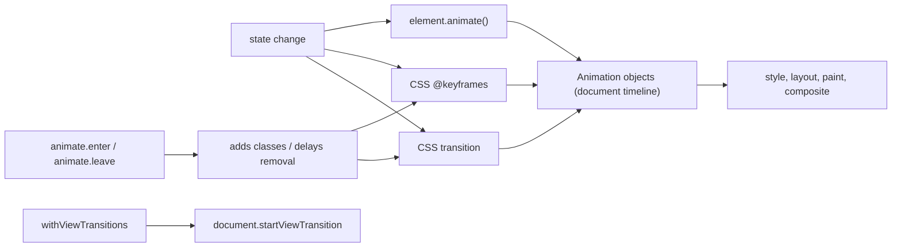

What to notice: Angular feeds the browser's mechanisms; it does not run its own.

### How it actually works

**One kind of object.** Each box of the lab's `/m35/mechanisms` page holds one `Animation`: a `CSSTransition` on `transform`, a `CSSAnimation` whose name contains `m35-pulse` (component keyframes are renamed, [13 §9](13-components-and-templates.md#9-view-encapsulation-emulated-shadowdom-and-none-and-what-the-compiler-does-to-your-css)) and a script `Animation` (`Section 1: each mechanism creates an Animation object on the element`). Cost depends on the property: the **compositor** (the stage that assembles painted layers into a frame) runs `transform` and `opacity` without layout or paint ([08 §2](08-browser-rendering-dom-events.md#2-layout-paint-and-composite-what-each-change-costs)).

**No provider.** A **provider** tells an injector how to create a token's value ([16 §7](16-dependency-injection.md#7-injectiontoken-multi-providers-environment-providers-and-initializers)). Read from `@angular/platform-browser` 22.2.1 (`fesm2022/animations-async.mjs`, `provideAnimationsAsync`): the legacy provider replaces `RendererFactory2` (the factory of the renderers that write to the DOM, [14 §1](14-directives-and-pipes.md#1-directives-and-attribute-directives-host-inputs-elementref-and-renderer2)) and sets the **injection token** (a typed DI key) `ANIMATION_MODULE_TYPE` to `'BrowserAnimations'`. The native page prints `inject(ANIMATION_MODULE_TYPE, { optional: true })` as `null`, yet `animate.enter` adds `m35-fade-in` to the home paragraph and removes it when the animation ends (`Section 1: the native build has no animation provider and still runs animate.enter`).

**Why jsdom sees nothing.** Read from `@angular/core` 22.2.1 (`fesm2022/_debug_node-chunk.mjs`): the internal constant `areAnimationSupported` (may change in any release) is false on the server or when `document.documentElement.getAnimations` is not a function. The animate instructions (`ɵɵanimateEnter` and siblings, internal) then return before reading the internal `ANIMATIONS_DISABLED` token that `TestBed`'s `animationsEnabled` sets. jsdom lacks `getAnimations`, so even `animationsEnabled: true` adds no enter class (`Section 1: under jsdom animate.enter adds no class even with animationsEnabled`): motion is asserted in Chromium.

**When to animate:** feedback, continuity of position, attention to one change; never decoration the user waits through ([§11](#11-performance-and-reduced-motion-compositor-properties-measuring-jank-and-prefers-reduced-motion)).

Drilled in [Q35.01](#q35-01).

### Code

One box per mechanism:

1. A button toggles `m35-moved`; the declared `transition` animates the new `transform`.
2. `m35-pulsing` applies `animation: m35-pulse`.
3. The script checks `prefers-reduced-motion` [Baseline 2020: widely available, per MDN] itself, because no CSS rule stops `element.animate()`.

```ts
// Excerpt of labs/angular/projects/animations-lab/src/app/m35/mechanisms/mechanisms.ts
    /* 1. CSS transition: the browser animates transform when its computed value changes. */
    .m35-box-transition {
      transition: transform 1s ease-out;
    }

    .m35-moved {
      transform: translateX(12rem);
    }

    /* 2. CSS keyframe animation: runs when the animation property applies. */
    .m35-pulsing {
      animation: m35-pulse 1s ease-in-out;
    }

  /** 3. Web Animations API: script creates the Animation object itself. */
  protected runScript(): void {
    if (matchMedia(REDUCED_MOTION_QUERY).matches) return;
    this.scripted().nativeElement.animate(
      [{ transform: 'scale(1)' }, { transform: 'scale(1.2)' }, { transform: 'scale(1)' }],
      {
        duration: 1000,
        easing: 'ease-in-out',
      },
    );
  }
```

### Best practices and anti-patterns

- **Start from CSS classes with `animate.enter`/`animate.leave`**, because the browser already runs the animation.
- **Use `element.animate()` for keyframes known only at run time**, because its `Animation` can be paused or awaited ([§4](#4-the-web-animations-api-elementanimate-the-animation-object-and-getanimations)).
- **Keep `@angular/animations` out of new code**, because it is deprecated and the native build ships none of its engine (`Smoke: no chunk of the native build contains the legacy animation engine`).

### Misconceptions and traps

- *"Angular animations need `@angular/animations`."* Once true until v20.2; now `@angular/core` runs `animate.enter` with no provider (test above). The myth comes from older tutorials.
- *"`animate.enter` is a directive you import."* They "are not directives. They are special API supported directly by the Angular compiler" (`guide/animations/enter-and-leave`, read 2026-10-16). The myth exists because the attribute looks like one.
- *"A passing test with `animate.leave` proves the animation."* jsdom skips the instructions; `TestBed`'s `animationsEnabled` "Defaults to `false`" (`types/testing.d.ts`; `Smoke: animate.leave removes the element synchronously under jsdom`). The myth exists because the test is green either way.
- *"More motion feels faster."* Motion the user waits through adds time ([§11](#11-performance-and-reduced-motion-compositor-properties-measuring-jank-and-prefers-reduced-motion)); the myth exists because smoothness reads as polish.

## 2. CSS transitions: triggers, interruption, events and entry with `@starting-style`

### The problem it solves

A dropdown toggled with `display: none` never fades: the browser has no in-between value to draw. A hover effect snaps back mid-way. A toast inserted by `@if` appears at full opacity, because a new element has no earlier style to move from.

### Mental model

A **transition** is the browser animating a property between two computed values ([§1](#1-motion-in-a-ui-what-to-animate-the-browsers-three-animation-mechanisms-and-where-angular-fits)). When the value changes, the browser animates from the value on screen to the new one over `transition-duration`, after `transition-delay` (the wait before it starts), following an **easing** (the timing function that shapes the speed). Change it again mid-way and the browser **reverses**: it runs back from where the value is now. Analogy: a dimmer moves only when you turn it, from where it is.

Two cases need help. An inserted element has no previous style, so `@starting-style` [Baseline 2024: newly available, per MDN] supplies its "before" values. A **discrete property** (no in-between values, such as `display`) transitions only with `transition-behavior: allow-discrete` (MDN lists it as limited availability, read 2026-10-16).

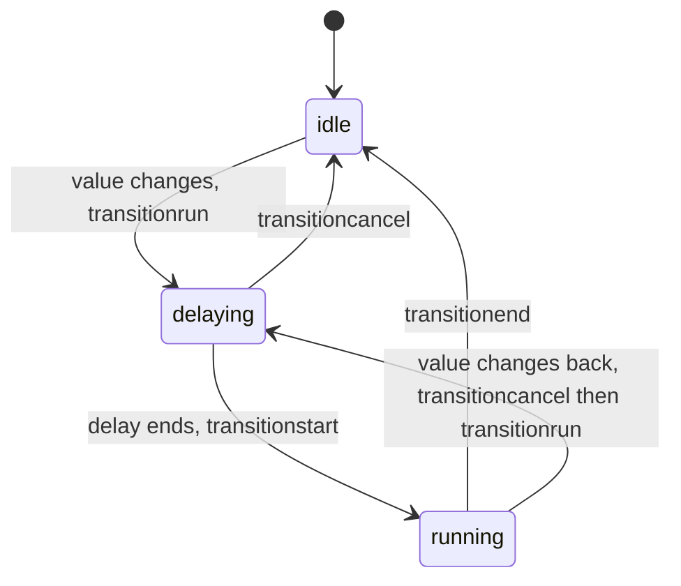

What to notice: `transitionrun` fires when the value changes, before the delay; `transitionstart` only after it.

### How it actually works

**Events, in order.** `transitionrun` "fires before any delay" and `transitionstart` "fires after any delay" (MDN, *Using CSS transitions*, read 2026-10-16). In the lab, a class change paused inside the delay has fired two `transitionrun` and no start; seeking past the delay adds two `transitionstart`, and to the end two `transitionend` (`Section 2: transitionrun fires before transitionstart, and transitionend comes last`).

**One transition per property.** The lab's box lists `opacity` and `transform`; its class change also changes the unlisted `background-color`. `getAnimations()` returns one **`CSSTransition`** (the `Animation` subclass with a `transitionProperty`) per listed property, and the background changes at once (`Section 2: a class change starts a CSSTransition for each listed property`). `all` would also animate layout-changing properties ([08 §2](08-browser-rendering-dom-events.md#2-layout-paint-and-composite-what-each-change-costs)).

**Interruption.** Removing the class halfway cancels both transitions (`transitioncancel`) and starts two new ones back toward the old values, each shorter than the rule's 600 ms because it starts part-way (`Section 2: removing the class mid-flight cancels the transitions and starts reverse ones`).

**Entry and exit.** MDN: "CSS transitions are by default not triggered on an element's initial style update" (`@starting-style`, read 2026-10-16). Of two `@if`-inserted boxes with the same `opacity` transition, only the one with a nested `@starting-style` gets a `CSSTransition` (`Section 2: an inserted element transitions only with @starting-style`). With `display 600ms allow-discrete` listed, `display: none` starts a `display` transition and the box stays `block` until it ends; without it the box is `none` at once (`Section 2: display none animates out only with transition-behavior allow-discrete`). Chromium 153.

**Why Angular waits for your CSS.** Read, not run, from `@angular/core` 22.2.1 (`fesm2022/_debug_node-chunk.mjs`): the internal `determineLongestAnimation` (may change in any release) takes `el.getAnimations()`, skips infinite ones and keeps the largest delay plus duration; with none, it falls back to the computed `transition-property`, `-duration` and `-delay`. So the longest transition you write sets how long `animate.enter` and `animate.leave` wait ([§5](#5-animateenter-and-animateleave-with-css-classes-syntax-bindings-and-when-the-element-leaves)). Switching motion off is a media query ([10 §5](10-css-essentials.md#5-responsive-css-media-queries-container-queries-and-fluid-type)).

Drilled in [Q35.02](#q35-02), [Q35.03](#q35-03) and [Q35.04](#q35-04).

### Code

One box per behavior; Angular flips signals and the CSS does the rest:

1. `.m35-listed` lists two properties, with a delay that separates run from start.
2. `.m35-with-start` nests `@starting-style`; `.m35-without-start` does not.
3. `.m35-discrete` adds `display` with `allow-discrete` to its list.

```ts
// Excerpt of labs/angular/projects/animations-lab/src/app/m35/transitions/transitions.ts
    /* A list of properties: only opacity and transform transition; background-color changes at once. */
    .m35-listed {
      transition:
        opacity 600ms ease-out 400ms,
        transform 600ms ease-out 400ms;
    }

    .m35-with-start,
    .m35-without-start {
      transition: opacity 600ms;
    }

    .m35-with-start {
      @starting-style {
        opacity: 0;
      }
    }

    .m35-discrete {
      transition:
        opacity 600ms,
        display 600ms allow-discrete;
    }
```

### Best practices and anti-patterns

- **List the properties you animate**, because `all` also animates layout properties and Angular waits for the slowest.
- **Keep `@starting-style` beside its transition**, because without it an inserted element just appears.
- **Treat `allow-discrete` as an enhancement**, because MDN lists it as limited availability; where it is missing, the element hides at once.

### Misconceptions and traps

- *"`transition: all` is harmless."* It animates every changing property, layout ones included, and Angular waits for the slowest. The myth exists because it is the shortest to type.
- *"A transition can animate an element in on insertion."* Only with `@starting-style`: an inserted element has no "from" value (test above). The myth exists because the same CSS fades on hover.
- *"`display: none` can never be animated."* Once true, before discrete transitions: MDN's table for `transition-behavior` lists Chrome 117 as first support (read 2026-10-16), and the lab's `allow-discrete` box does it. The myth exists because older articles were right.

## 3. CSS keyframe animations: `@keyframes`, fill modes, iteration and component-scoped names

### The problem it solves

A spinner declared in one component works there, but a global `.spin` class finds no animation. A fade that should end dim snaps back to full opacity. An infinite animation on a leaving element looks like a removal blocker; it is not.

### Mental model

A **`@keyframes`** rule declares a named sequence of keyframes ([§1](#1-motion-in-a-ui-what-to-animate-the-browsers-three-animation-mechanisms-and-where-angular-fits)). The `animation` shorthand applies it with a duration, delay, easing, **iteration count** (`infinite` included), **direction** (forward, backward or alternating) and **play state** (`running` or `paused`). A **fill mode** says what applies outside the active interval: `backwards` the first keyframe during the delay, `forwards` the last one after the end, `both` each, `none` (default) neither. Analogy: a flip-book you can play once, loop or freeze on its last page. A running one is a **`CSSAnimation`**, the `Animation` subclass whose `animationName` names its rule.

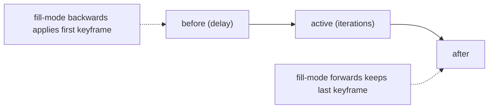

What to notice: without `forwards`, the end state comes from the normal cascade, not from the keyframes.

### How it actually works

**Fill mode.** With `none`, "The animation will not apply any styles to the target when it's not executing"; `forwards` "will retain the computed values set by the last keyframe encountered during execution" (MDN, `animation-fill-mode`, read 2026-10-16). In the lab one 800 ms fade runs on two boxes; after `finishAll`, the `forwards` box is `finished` at opacity `0.3` and the other has no animation left and shows `1` (`Section 3: an animation with fill-mode forwards keeps its last keyframe after finishing`, `Section 3: without forwards the element returns to its own style`).

**Events.** `animationiteration` "is fired when an iteration of a CSS Animation ends, and another one begins", not at the same time as `animationend` (MDN, read 2026-10-16). A three-iteration animation records `animationstart`, two `animationiteration` and `animationend` (`Section 3: animationiteration fires once per completed iteration`).

**Scoped names.** In the lab, a component class and a global class both say `animation: m35-grow 800ms`, but the `@keyframes` sits in the component. Only the component's box gets a `CSSAnimation`, named with a `_m35-grow` ending; the global box gets none, and no rule is called plain `m35-grow` (`Section 3: a global class cannot use a component's keyframes`). Read, not run, from `@angular/compiler` 22.2.1 (`fesm2022/compiler.mjs`): the internal `_scopeKeyframesRelatedCss` (may change) renames each `@keyframes` declared in a component's styles to `<scope>_<name>` and rewrites its `animation` references there; other names stay, so a component can use a global `@keyframes`, never the reverse. **Emulated encapsulation** is Angular's default; [13 §9](13-components-and-templates.md#9-view-encapsulation-emulated-shadowdom-and-none-and-what-the-compiler-does-to-your-css) owns the rule.

**Infinite iterations.** Read, not run, from `@angular/core` 22.2.1 (`fesm2022/_debug_node-chunk.mjs`): the internal `determineLongestAnimationFromElementAnimations` skips `iterations: Infinity`, so such an animation never sets how long Angular waits ([§5](#5-animateenter-and-animateleave-with-css-classes-syntax-bindings-and-when-the-element-leaves) tests a leaving element).

Drilled in [Q35.03](#q35-03) and [Q35.04](#q35-04).

### Code

One box per behavior; Angular only flips signals:

1. `.m35-fade-forwards` and `.m35-fade-plain` apply the same keyframes; only the first has `forwards`.
2. `.m35-iterating` runs `m35-slide` three times, 1000 ms each.
3. `.m35-grow-local` names `m35-grow`, declared in the same component; the global `.m35-global-grow` in `styles.css` names it from outside.

```ts
// Excerpt of labs/angular/projects/animations-lab/src/app/m35/keyframes/keyframes.ts
    .m35-fade-forwards {
      animation: m35-fade 800ms forwards;
    }

    .m35-fade-plain {
      animation: m35-fade 800ms;
    }

    @keyframes m35-fade {
      from {
        opacity: 1;
      }
      to {
        opacity: 0.3;
      }
    }

    .m35-iterating {
      animation: m35-slide 1000ms linear 3;
    }

    .m35-grow-local {
      animation: m35-grow 800ms;
    }
```

```css
/* Excerpt of labs/angular/projects/animations-lab/src/styles.css */
.m35-global-grow {
  animation: m35-grow 800ms;
}
```

### Best practices and anti-patterns

- **Add `forwards` only when the last keyframe must stay**, because the effect keeps winning over the element's own style.
- **Keep an animation and its `@keyframes` in one stylesheet**, because local keyframes are renamed.
- **Reserve `infinite` for decoration**, because Angular ignores it when waiting.

### Misconceptions and traps

- *"An animation's last keyframe stays by default."* Without `forwards` the box returns to its own style (test above). It looks right when the base style equals the last keyframe.
- *"Keyframe names are global in Angular."* They are in plain CSS; emulated encapsulation renames a component's own (test above). The myth exists because the CSS you write is plain CSS.
- *"`animation-iteration-count: infinite` on a leaving element keeps it forever."* Angular skips infinite animations when it measures (read above). The myth exists because "waits for the animation" suggests all.

## 4. The Web Animations API: `element.animate`, the `Animation` object and `getAnimations`

### The problem it solves

A drag-to-dismiss card must slide on from where the pointer let go. A dashboard needs one button that pauses every animation. A form must wait for an animation to end before moving focus. CSS can do none of these.

### Mental model

The **Web Animations API** is the script interface to the engine CSS uses. `element.animate(keyframes, options)` creates an **`Animation`**, starts it and returns it. It owns a **`KeyframeEffect`** (keyframes and timing) on a timeline ([§1](#1-motion-in-a-ui-what-to-animate-the-browsers-three-animation-mechanisms-and-where-angular-fits)). You can `play`, `pause`, `finish` or `cancel` it, set `playbackRate` (speed multiplier), and read its **`playState`** (`running`, `paused`, `finished` or `idle`) and **`finished` promise**. `CSSTransition` and `CSSAnimation` are subclasses, so `getAnimations()` lists CSS and script animations together; **`commitStyles()`** [Baseline 2020: widely available, per MDN] writes current values into the inline style. Analogy: CSS animations are a playlist; this API hands you the remote.

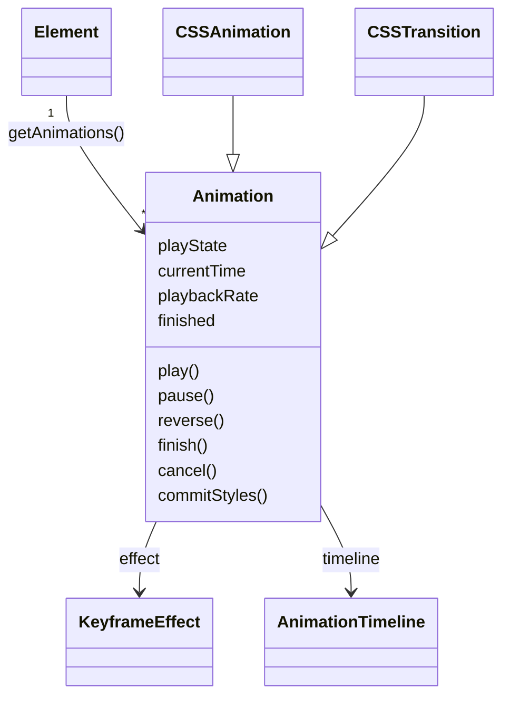

What to notice: one object model sits under all three mechanisms.

### How it actually works

**One list.** In the lab one element gets a class toggle and an `element.animate()` call. The call returns a `running` `Animation`; `getAnimations()` lists the `CSSTransition` for `transform`, then the script animation with its 2000 ms (`Section 4: element.animate returns an Animation that getAnimations lists with CSS ones`).

**The promise.** `finished` "returns a Promise which resolves once the animation has finished playing"; `cancel()` on a non-idle animation rejects "the current finished promise" with an `AbortError` (MDN, `Animation.finished` and `cancel()`, read 2026-10-16). In the lab `finish()` resolves it with the animation itself and `cancel()` rejects it with `AbortError` (`Section 4: finished resolves after finish and rejects after cancel`).

**Keeping an end state.** `fill: 'forwards'` leaves the effect active, and "Animations take precedence over all static styles"; MDN's recipe is `commitStyles()`, then `cancel()` (`Animation.commitStyles()`, read 2026-10-16). In the lab both boxes end at opacity `0.4`; the forwards-only box keeps a finished animation and ignores a later inline `opacity: 1`; the committed box has none and obeys it (`Section 4: commitStyles then cancel keeps the end style without an animation`).

**Pausing everything.** `pause()` on each of `document.getAnimations()` freezes a CSS spinner and a script animation together; after `ready` resolves, `currentTime` holds still, and `play()` resumes both (`Section 4: pausing every animation from getAnimations freezes the page's motion`).

**What Angular reads.** Read, not run, from `@angular/core` 22.2.1 (`fesm2022/_debug_node-chunk.mjs`): the internal `determineLongestAnimationFromElementAnimations` (may change) sums each animation's `getTiming()` delay and duration, divides by `playbackRate` (unless 0 or 1) and skips infinite ones. It records a result only for an `animationName` or `transitionProperty`, which a script `Animation` lacks; whether a leave waits for one is untested. The legacy engine ([§8](#8-legacy-angularanimations-triggers-states-transitions-query-and-stagger)) ends in this API: `@angular/animations` 22.2.1 (`fesm2022/browser.mjs`), `WebAnimationsPlayer`, whose driver calls `element.animate(keyframesObject, options)`.

> [!NOTE]
> **Framework vs platform.** The browser provides transitions, keyframes, this API, `getAnimations` and the events. Angular's current API decides only when classes come and go and when a node leaves the DOM ([§5](#5-animateenter-and-animateleave-with-css-classes-syntax-bindings-and-when-the-element-leaves)); the legacy package was an engine that played computed keyframes through `element.animate`.

Drilled in [Q35.05](#q35-05).

### Code

1. `cancelRun()` keeps `finished`, cancels, then awaits it.
2. `keepEnds()` finishes two animations; the second is also committed and cancelled.
3. `setAll()` pauses or plays everything `getAnimations()` returns.

```ts
// Excerpt of labs/angular/projects/animations-lab/src/app/m35/waapi/waapi.ts
    const finished = animation.finished;
    animation.cancel();
    try {
      await finished;
      this.outcomeText.set('finished resolved');
    } catch (error) {

    committed.finish();
    committed.commitStyles();
    committed.cancel();

    for (const animation of document.getAnimations()) animation[action]();
```

### Best practices and anti-patterns

- **Use CSS for fixed motion and `element.animate()` for run-time values**, because a stylesheet's reduced-motion rule cannot stop a script animation; check `matchMedia` yourself ([§11](#11-performance-and-reduced-motion-compositor-properties-measuring-jank-and-prefers-reduced-motion)).
- **Hold `finished` before `cancel()` and catch it**, because cancelling rejects it with `AbortError`.
- **Keep an end state with `commitStyles()` then `cancel()`**, because `forwards` overrides later styles.

### Misconceptions and traps

- *"The Web Animations API needs a polyfill."* `Element.animate()` is widely available (MDN, read 2026-10-16). The myth lingers because Edge lacked it before 79 and Safari before 13.1.
- *"`getAnimations()` only returns script animations."* It lists CSS transitions and animations too (test above). The name suggests only yours; MDN: the array "includes CSS Animations, CSS Transitions, and Web Animations".
- *"`fill: 'forwards'` is the way to keep an end state."* It looks right, but the effect stays active and wins over later styles; commit, then cancel (test above).

## 5. `animate.enter` and `animate.leave` with CSS classes: syntax, bindings and when the element leaves

### The problem it solves

A notification should fade in and, once dismissed, fade out. The fade-in is easy. The fade-out is not: `@if` removes the element in the same render pass, so nothing is left to animate. Before v20.2 that took a trigger from `@angular/animations` ([§8](#8-legacy-angularanimations-triggers-states-transitions-query-and-stagger)); now it takes an attribute and CSS.

### Mental model

`animate.enter="cls"` [Stable since v20.2] adds classes when Angular inserts the element and removes them when the element's **longest animation** (the one with the largest delay plus duration) ends. `animate.leave="cls"` [Stable since v20.2] adds its classes when Angular is about to remove the element and removes the *element* when that animation ends. The **enter classes** and **leave classes** carry the CSS. Both are compiler syntax, "not directives" (Angular docs, `enter-and-leave.md`, read 2026-10-16), and work on an element or as a **host binding**, a host-element property set from the component class ([13 §7](13-components-and-templates.md#7-the-host-element-host-metadata-hostbinding-and-hostlistener)).

A value is a string of space-separated classes, an array of strings, a bound expression `[animate.enter]="expr"` or, [Changed in v22.2: a function or signal may be bound], a function or **signal** ([17 §2](17-signals.md#2-writable-signals)) that returns a class list. Bound uninvoked, `[animate.enter]="classes"` is unwrapped at run time, but 22.2.1's extended diagnostic NG8109 (a compile-time warning for a likely mistake) still asks for `classes()` (read, not run: `getClassListFromValue` in `@angular/core`, the `interpolated_signal_not_invoked` check in `@angular/compiler-cli`). With transitions the enter class is the state to animate *to*, so pair it with `@starting-style` ([§2](#2-css-transitions-triggers-interruption-events-and-entry-with-starting-style)). Analogy: theatre cues; the actor leaves the stage only after the exit scene ends.

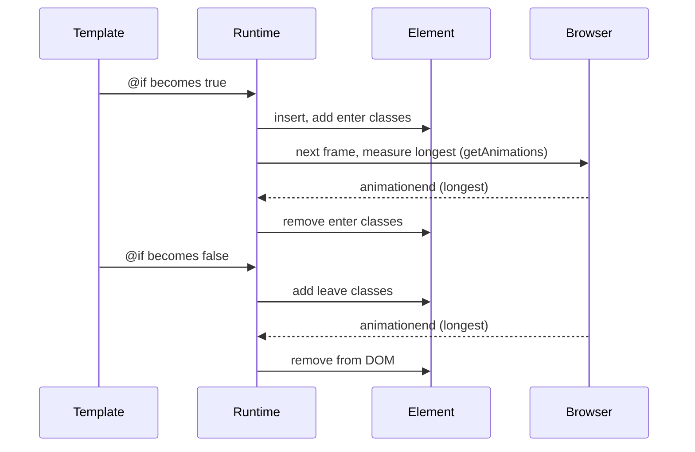

What to notice: removal waits for the browser's end event, and a fallback timer covers a missing one ([§12](#12-under-the-hood-from-animateleave-to-a-removed-node)).

### How it actually works

**Enter.** In the lab the box carries its enter class while its `CSSAnimation` runs, and loses it, but stays, when the animation ends (`Section 5: the enter class is present while the animation runs and removed after it`). The docs: "Animation classes are only present while the animation is active."

**Leave.** After the binding turns false, the box is still attached, with its leave class and a `running` animation, until that animation ends (`Section 5: the element stays in the DOM until its leave animation ends`).

**Nothing to wait for.** A leave class that only changes a colour removes the element at once (`Section 5: a leave class that animates nothing removes the element at once`). A leave class whose animation is infinite does not make removal wait (`Section 5: an infinite animation does not delay removal`).

**Bindings.** In the lab an array and an invoked signal (`signalClasses()`) each give two classes, one naming the keyframes and one setting the duration, so an animation proves both applied (`Section 5: an array and a signal-bound class list both apply`). `host: { 'animate.enter': … }` on a child component adds the class to its host element (`Section 5: animate.enter works as a host binding`). No chunk of the native build contains the legacy engine (`Smoke: no chunk of the native build contains the legacy animation engine`).

**Why the browser decides.** Angular cannot know a CSS duration in advance. Read, not run, in `@angular/core` 22.2.1 (`fesm2022/_debug_node-chunk.mjs`; internal `animateLeaveClassRunner`, may change in any release): it cancels running enter classes, adds the leave classes and, in the next frame, measures. Nothing animating removes the element in that frame. Otherwise it waits for the end event of the longest animation, with a fallback `setTimeout` of its duration plus 50 ms. Measuring reads `getAnimations()`, adds delay and duration, divides by `playbackRate` and skips infinite animations. It records a result only for an `animationName` or a `transitionProperty`, which a script `Animation` ([§4](#4-the-web-animations-api-elementanimate-the-animation-object-and-getanimations)) lacks; no test runs a leave on one.

Drilled in [Q35.06](#q35-06), [Q35.07](#q35-07) and [Q35.08](#q35-08).

### Code

1. A box with `animate.leave` sits in an `@if`.
2. Its leave class runs a finite animation.
3. Two classes bound as one value must both apply.
4. A child component sets `animate.enter` in `host`.

```html
<!-- Excerpt of labs/angular/projects/animations-lab/src/app/m35/enter-leave/enter-leave.ts -->
      <div class="m35-box" animate.leave="m35-leave-fade" data-testid="leave-box">Leave</div>
```

```css
/* Excerpt of labs/angular/projects/animations-lab/src/app/m35/enter-leave/enter-leave.ts */
    .m35-leave-fade {
      animation: m35-fade-out 1500ms forwards;
    }
```

```ts
// Excerpt of labs/angular/projects/animations-lab/src/app/m35/enter-leave/enter-leave.ts
  host: { 'animate.enter': 'm35-host-in' },
```

### Best practices and anti-patterns

- **Give a leave class a finite animation**, because the runtime skips infinite ones and the element would leave at once.
- **Pair an enter transition with `@starting-style`**, because the enter class is the target state, not the start.
- **Keep timing in the CSS, not in timers**, because the runtime waits for the longest animation.

### Misconceptions and traps

- *"The leave class must undo the enter class."* Any animation that runs is waited for (tests above). The myth lingers because legacy `:leave` mirrored `:enter`.
- *"Classes stay on the element after the enter animation."* The runtime removes them at the end (test above). The myth lingers because legacy states kept their styles.
- *"`animate.leave` keeps an element forever if the animation never ends."* Infinite animations are skipped and a fallback timer exists (test and source above). The fear is reasonable, because a missing end event would otherwise block removal.

## 6. Function callbacks and the v22 leave semantics: `AnimationCallbackEvent`, `animationComplete` and nested leaves

### The problem it solves

Leaves animated with a JavaScript library linger for seconds. A removed card hides its child component's leave animation. After the v22 upgrade, a panel waits for an inner `@if` to animate away.

### Mental model

The **function form** `(animate.leave)="fn($event)"` calls your method with an **`AnimationCallbackEvent`** [Stable since v20.2]: `{ target, animationComplete }`. `target` is the element; **`animationComplete`** tells Angular the animation is over. The docs: "You **must** call the `animationComplete()` function when using `animate.leave` for Angular to remove the element." The safety net is **`MAX_ANIMATION_TIMEOUT`** [Stable since v20.2], an injection token (a typed DI key, [16 §7](16-dependency-injection.md#7-injectiontoken-multi-providers-environment-providers-and-initializers)) giving the longest wait in milliseconds.

Removing a node also runs leaves below it [Changed in v22.0: leave animations of descendants in the same component template run before removal]: in the same template and in its **embedded views**, the views `@if`, `@for`, `@switch` and `ng-template` create ([18 §9](18-control-flow-and-defer.md#9-under-the-hood-what-the-blocks-compile-to-how-for-reconciles-and-how-defer-moves-between-states)). A child component's template is a separate view; that **component boundary** is not crossed. Analogy: a stage manager waits for this scene's actors, not the next play's.

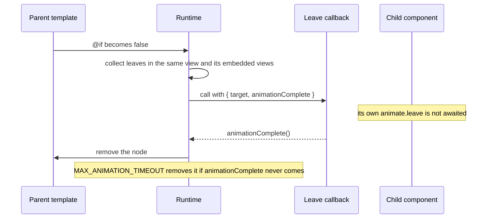

What to notice: the boundary is the component, not the DOM subtree.

### How it actually works

**Waiting.** In the lab the callback gets the box, which stays, unanimated, until a button calls the stored `animationComplete` (`Section 6: the leave callback receives the element and removal waits for animationComplete`).

**The timer.** A route provides the token through a counting factory the page never injects; the count is 1, and an uncompleted callback still loses its element (`Section 6: a leave callback that never calls animationComplete is removed after the route's MAX_ANIMATION_TIMEOUT`). The default is 4000 (`Section 6: MAX_ANIMATION_TIMEOUT defaults to 4000`); a four-second wait was not run.

**What completes a leave.** Read, not run, in `@angular/core` 22.2.1 (`fesm2022/_debug_node-chunk.mjs`; internal `runLeaveAnimationFunction`, may change in any release): it starts a `setTimeout` with the token's value, listens once for `animationend` on the element, then calls your function; all three paths run the same removal. So a callback adding a CSS animation completes by itself, but `element.animate()` ([§4](#4-the-web-animations-api-elementanimate-the-animation-object-and-getanimations)) fires no `animationend` (`Section 6: a leave callback completes on a CSS animationend but not on an element.animate finish`). `animationComplete` is [Changed in v22.0: `VoidFunction`, was `Function`] (commit b9b5c279b4; `Section 6: animationComplete is typed as VoidFunction`).

**Nested leaves.** A card without `animate.leave` stays while a paragraph in it and one in its inner `@if` run their leave classes (`Section 6: descendants with animate.leave in the same template run before the parent is removed`). In a card with two children, the leave inside each child's template never starts; the child whose host carries `animate.leave` in the card's template animates (`Section 6: a child component's own animate.leave does not run when its parent is removed`). The docs: "Child animations fire only for elements within the same component template."

**Why the boundary.** Read, not run, in the same file (internal `aggregateDescendantAnimations` and `collectNestedViewAnimations`, may change in any release): the first collects the removed node's descendants in its view by parent chain; the second enters only embedded views (internal `TView` type 2), never component views. `Promise.allSettled` awaits them all. Commit df659b8d0c: crossing it made "route navigations and parental destruction ... excessively stall" (abridged).

**Dynamic content.** A component created by a **`ViewContainerRef`**, an anchor for run-time views ([19 §7](19-component-communication-and-projection.md#7-dynamic-components-viewcontainerrefcreatecomponent-createcomponent-and-bindings)), stays through `clear()` while its host-binding leave runs (`Section 6: a dynamically created component's host animate.leave runs on clear`). The docs forbid legacy animations ([§8](#8-legacy-angularanimations-triggers-states-transitions-query-and-stagger)) and `animate.*` in one component: "leaving nodes not being removed".

Drilled in [Q35.09](#q35-09), [Q35.10](#q35-10) and [Q35.11](#q35-11).

### Code

1. The template passes `$event` to a method.
2. The method keeps `animationComplete` for a button to call.
3. A script animation completes from `finished`.
4. A route sets the timeout in its `providers`.

```html
<!-- Excerpt of labs/angular/projects/animations-lab/src/app/m35/callbacks/callbacks.ts -->
      <div class="m35-box" (animate.leave)="holdLeave($event)" data-testid="manual-box">Manual</div>
```

```ts
// Excerpt of labs/angular/projects/animations-lab/src/app/m35/callbacks/callbacks.ts
  protected holdLeave(event: AnimationCallbackEvent): void {
    this.callbackTarget.set(event.target.getAttribute('data-testid') ?? 'unknown');
    this.pendingComplete = event.animationComplete;
  }

  protected leaveWithScriptAndComplete(event: AnimationCallbackEvent): void {
    if (matchMedia(REDUCED_MOTION_QUERY).matches) {
      event.animationComplete();
      return;
    }
    const animation = event.target.animate([{ opacity: 1 }, { opacity: 0 }], {
      duration: 1500,
      fill: 'forwards',
    });
    animation.finished.then(event.animationComplete, event.animationComplete);
  }
```

```ts
// Excerpt of labs/angular/projects/animations-lab/src/app/app.routes.ts
  {
    path: 'm35/callbacks/short-timeout',
    providers: SHORT_TIMEOUT_PROVIDERS,
    loadComponent: () => import('./m35/callbacks/callbacks').then((m) => m.LabM35Callbacks),
  },
```

### Best practices and anti-patterns

- **Call `animationComplete` from the animation's end signal, resolved or rejected**, because only a CSS `animationend` completes a leave without it.
- **Put `animate.leave` on a child's host element in the parent template**, because leaves inside the child are not awaited.

### Misconceptions and traps

- *"A leave callback's element goes when the callback returns."* It waits for `animationComplete`, an `animationend` or the timer (tests above). The myth lingers because callbacks usually end their work on return.
- *"Nested leave animations always run."* They stop at component boundaries (test above). The myth lingers because the 22.0.0 note reads "Leave animations are no longer limited to the element being removed."
- *"Nested leaves never run."* Once true: until v21.1, and after 21.2.4 (2026-03-12) reverted what 21.2.0 (2026-02-25) added. Now: 22.0.0 (2026-06-03) restored them within the component (Angular CHANGELOG).
- *"Forgetting `animationComplete` leaks the element forever."* The timer removes it (test above). The myth lingers because nothing is logged when the call is missing.

## 7. Animating lists: `@for` enter, leave, reorder and stagger

### The problem it solves

A to-do list gains a row, loses one and gets sorted. Adding and removing are enter and leave animations. The sort is the question: do rows flash out and in, or glide? A row restored right after its deletion must not show twice.

### Mental model

With a stable `track` ([18 §2](18-control-flow-and-defer.md#2-for-track-context-variables-empty-and-what-angular-can-iterate); reconciliation stays in [Q18.25](18-control-flow-and-defer.md#q18-25)), `@for` **inserts**, **removes** or **moves** a row, a **reorder** that keeps the element. `animate.enter` and `animate.leave` [Stable since v20.2] run on insert and remove. A move runs no leave (CHANGELOG 20.3.1, 2025-09-17: "Prevent leave animations on a move operation"). Analogy: a queue at a counter; people who only swap places do not leave.

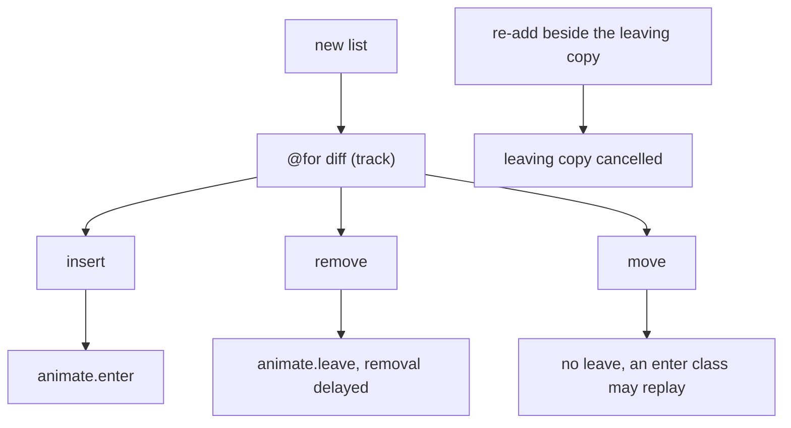

What to notice: identity decides the operation, so `track` decides the animation.

### How it actually works

**Insert and remove.** In the lab an added row runs a `CSSAnimation` and its siblings none; a removed row stays attached with its leave class until its animation ends (`Section 7: an added row runs its enter animation and a removed row its leave animation`).

**Move.** Reversing three keyed rows keeps all three elements and starts no leave; the row moved to the end replays its enter class, the others stay quiet (`Section 7: reordering with a stable track keeps every element and runs no leave animation`). The docs: "Items in a `@for` loop will be removed and re-added properly, which will fire off animations using `@starting-styles` for entry animations" (`migration.md`, read 2026-10-16). The run keeps the elements, so "re-added" means the enter class, not a new node; a first-to-end rotation replays nothing ([Q35.13](#q35-13)), and other reorders were not run.

**Identity.** With `track $index` ([Q18.07](18-control-flow-and-defer.md#q18-07)) a reversal rewrites the same three elements' text and animates nothing; removing the first item rewrites the others and animates the last element out (`Section 7: track $index rewrites rows in place on a reorder and animates the last row when the first item goes`).

**Re-adding during a leave.** A row removed and restored before its leave ends leaves one element; the leaving copy is detached (`Section 7: re-adding a row during its leave animation leaves one copy`). Read, not run, in `@angular/core` 22.2.1 (`fesm2022/_debug_node-chunk.mjs`; internal `trackLeavingNodes`, `cancelLeavingNodes` and `applyToElementOrContainer`, may change): a leaving element is recorded per template node. When that node inserts an element, a recorded one that is the new element itself gets a synthetic `animationend` with `detail.cancel` and is reused; one that is the new element's previous sibling, or sits under another parent of the same view, gets the same event and is removed; any other stays until its leave ends. The test restores the row in place; [Q35.13](#q35-13) restores one at the end and sees two elements.

**Stagger.** A **stagger** delays each item a little more than the last. The docs: "You can replicate this behavior in native CSS by utilizing `animation-delay` or `transition-delay`". The template sets a **custom property** ([10 §6](10-css-essentials.md#6-custom-properties-theming-and-color-scheme)) from `$index`; the class multiplies it. Four rows carry delays 0, 40, 80 and 120 in `getTiming()` (`Section 7: each row's animation-delay follows its index`).

**FLIP.** **FLIP** (first, last, invert, play) is a pattern, not an Angular feature: read each row's position, let the change happen, offset each row back with a `transform` and animate it to none. In the lab the two rows that swapped places get a script animation and the middle row none (`Section 7: a FLIP glide on a reorder plays a script animation on each row that changed place`).

Drilled in [Q35.12](#q35-12) and [Q35.13](#q35-13).

### Code

1. A row carries both attributes inside an `@for` that tracks the row.
2. The stagger row sets `--i` from `$index`.
3. Its class turns that into a delay.

```html
<!-- Excerpt of labs/angular/projects/animations-lab/src/app/m35/lists/lists.ts -->
      @for (row of rows(); track row) {
          animate.enter="m35-row-in"
          animate.leave="m35-row-out"
```

```html
<!-- Excerpt of labs/angular/projects/animations-lab/src/app/m35/lists/lists.ts -->
            animate.enter="m35-stagger-in"
            [style.--i]="$index"
```

```css
/* Excerpt of labs/angular/projects/animations-lab/src/app/m35/lists/lists.ts */
    .m35-stagger-in {
      animation: m35-row-slide-in 1500ms backwards;
      animation-delay: calc(var(--i) * 40ms);
    }
```

### Best practices and anti-patterns

- **Track by a stable id**, because moves then keep their elements and run no leave.
- **Stagger with a custom property**, because the CSS keeps the timing.
- **Keep the enter class harmless**, because a moved row can replay it.

### Misconceptions and traps

- *"`@for` re-renders the list, so every row animates on a sort."* With a stable `track` elements move and none leaves (test above). The myth lingers because `*ngFor` without `trackBy` re-created rows.
- *"A cascade needs `stagger()` from `@angular/animations`."* A custom property and `animation-delay` do it (test above). The myth lingers because older tutorials teach `stagger()`.
- *"`track $index` animates the removed row."* The last element leaves and the others change text (test above). The myth lingers because an index looks like an identity.
- *"Re-adding during a leave always shows two rows."* Restored in place, one row remains: fixed in 20.2.0 (2025-08-20) and 20.3.7 (2025-10-22), CHANGELOG ("prevent duplicate nodes from being retained with fast `animate.leave` calls"). Restored elsewhere, both show until the leave ends ([Q35.13](#q35-13)). The myth lingers because early v20 did it.

## 8. Legacy `@angular/animations`: triggers, states, transitions, `query` and `stagger`

> [!WARNING]
> **Legacy / deprecated.** The whole `@angular/animations` package and its providers are [Deprecated since v20.2 — use `animate.enter` and `animate.leave`]. The typings say "Intent to remove in v23" (`@angular/platform-browser` 22.2.1, `types/animations.d.ts`): an intent, not a removal that has shipped. Write new motion with [§5](#5-animateenter-and-animateleave-with-css-classes-syntax-bindings-and-when-the-element-leaves).

### The problem it solves

Most Angular code written before v20.2 animates with triggers. You will read `[@openClose]="state"` in reviews and debug `NG05105` or a stuck `ng-animating` class. Drilled in [Q35.14](#q35-14), [Q35.15](#q35-15) and [Q35.16](#q35-16).

### Mental model

A **trigger** is a named state machine in the component's `animations` array, bound with `[@name]="expr"`. A **state** is a named value; `state('open', style({…}))` gives it styles. A **transition expression** such as `'open <=> closed'` says which change plays and `animate('300ms ease')` how. **`void`** is the state of an element not in the DOM, the **wildcard** `*` matches any state, and `:enter` and `:leave` mean `void => *` and `* => void`. Inside a transition, **`query`** finds descendants, **`stagger`** offsets them, **`animateChild`** lets a parent run its children's triggers. `(@name.start)` and `(@name.done)` receive an **`AnimationEvent`**. Analogy: a state-machine diagram handed to a separate animation engine.

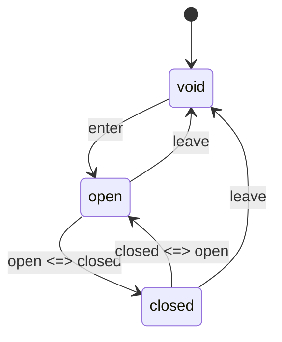

What to notice: `enter` and `leave` stand for `:enter` and `:leave`; states are named values, not CSS classes, and the engine computes the styles for each move.

### How it actually works

**Providers.** Read, not run, from `@angular/platform-browser` 22.2.1 (`fesm2022/animations.mjs`; `fesm2022/animations-async.mjs`). The **animation driver** adapts the engine to the platform. `provideAnimations()` registers the web driver, `ANIMATION_MODULE_TYPE` and a `RendererFactory2` that wraps the DOM renderer ([14 §1](14-directives-and-pipes.md#1-directives-and-attribute-directives-host-inputs-elementref-and-renderer2) names the renderer's animation hooks); `provideNoopAnimations()` registers the **noop driver**, which plays nothing but reports states. `provideAnimationsAsync()` registers the internal `AsyncAnimationRendererFactory` (may change), which imports `import('@angular/animations/browser')` for the first component whose metadata has `animations`. Why: a bundler splits at a dynamic import, so the engine stays out of the initial bundle until first use. A failed import throws `NG05300`.

**The engine.** Read, not run, from `@angular/animations` 22.2.1 (`fesm2022/browser.mjs`; internal `TransitionAnimationEngine` and `WebAnimationsPlayer`, may change): the renderer sends each `@name` binding to the engine, which builds keyframes and plays them with `element.animate()`. In the lab a trigger's transition is a `script` animation, not a CSS one (`Section 8: a legacy trigger plays its transition through element.animate`).

**Marker classes.** Elements carry `ng-trigger` always and `ng-animating` only while an animation runs (`Section 8: elements carry ng-animating while a legacy animation runs`). The string `ng-animating` is in the legacy build only (`Smoke: no chunk of the native build contains the legacy animation engine`).

**Stagger.** An increasing `delay` is what you would expect; the run shows none. The three items have delay 0 and durations 900, 1050 and 1200 ms, so later items hold their first keyframe longer (`Section 8: stagger lengthens each entering item's animation by the step and keeps its delay at 0`). Read, not run: the internal `buildKeyframes` (may change in any release) folds a delay into keyframe offsets and sets `delay` to 0.

**Callbacks and errors.** Under `provideNoopAnimations()` the start and done callbacks still report `fromState` `off` and `toState` `on` (`Section 8: under provideNoopAnimations the start and done callbacks report fromState and toState`), and `ANIMATION_MODULE_TYPE` is `NoopAnimations` (`Section 8: provideNoopAnimations sets ANIMATION_MODULE_TYPE to NoopAnimations`). Without a provider a `[@flag]` binding throws `NG05105` (`Section 8: a synthetic property without an animation provider throws NG05105`). That check runs in development mode only (read, not run: internal `checkNoSyntheticProp`, may change in any release, `@angular/platform-browser` 22.2.1 `fesm2022/_dom_renderer-chunk.mjs`).

**Mixing.** The docs: "You cannot use legacy animations alongside `animate.enter` and `animate.leave` within the same component" (read 2026-10-16).

### Code

1. Declare `panel` (two states, one transition) and `cascade` (`query` and `stagger`).
2. Bind `panel` in the template.
3. Bind the callbacks, as the spec does.

```ts
// Excerpt of labs/angular/projects/animations-lab/src/app/m35/legacy/legacy.ts
    trigger('panel', [
      state('open', style({ opacity: 1, height: '80px' })),
      state('closed', style({ opacity: 0.3, height: '20px' })),
      transition('open <=> closed', animate('900ms ease')),
    ]),
    trigger('cascade', [
      transition('* => *', [
        query(
          ':enter',
          [style({ opacity: 0 }), stagger(150, animate('900ms', style({ opacity: 1 })))],
          { optional: true },
        ),
      ]),
    ]),
```

```html
<!-- Excerpt of labs/angular/projects/animations-lab/src/app/m35/legacy/legacy.ts -->
    <div class="m35-legacy-panel" data-testid="legacy-panel" [@panel]="panelState()">
```

```html
<!-- Excerpt of labs/angular/src/app/modules/35-animations/concepts/section-8-legacy.spec.ts -->
    (@flag.start)="
      seen.push({ phase: $event.phaseName, from: $event.fromState, to: $event.toState })
    "
```

### Best practices and anti-patterns

- **Provide the engine once, at bootstrap**, because a `[@x]` binding without one throws `NG05105` in development.
- **Prefer `provideAnimationsAsync()`**, because the engine then stays out of the initial bundle.
- **Keep legacy and native animations in separate components**, because mixing them in one breaks both.

### Misconceptions and traps

- *"`provideAnimationsAsync` makes animations run asynchronously."* It loads the engine lazily and nothing more (read, not run). The name suggests timing.
- *"`provideNoopAnimations` turns off `animate.enter`."* The native path never reads it; the lab's native build has no provider and still animates (`Smoke: the animations lab serves the home page and runs its enter animation`). Both read as "animations" switches.
- *"States keep their styles through CSS classes."* The engine applies computed inline styles; the `ng-` classes only mark phases. Classes are how plain CSS does it.

## 9. Migrating from `@angular/animations` to native CSS and `animate.enter`/`animate.leave`

### The problem it solves

The typings say "Intent to remove in v23" ([§8](#8-legacy-angularanimations-triggers-states-transitions-query-and-stagger)). Forty triggers, `animateChild` chains across components and route animations need a plan, and no tool writes it: the schematic collections of `@angular/core` and `@schematics/angular` 22.2.1 (`collection.json`, `migrations.json`, `migration-collection.json`) list no animations schematic. Drilled in [Q35.17](#q35-17) and [Q35.18](#q35-18).

### Mental model

A **migration path** is the mapping and order for replacing an API. The mapping, from the docs' guide (`migration.md` on `main`, read 2026-10-16):

| Legacy | Native |
|---|---|
| `state` + `style` + `transition` | a class per state with a `transition` ([§2](#2-css-transitions-triggers-interruption-events-and-entry-with-starting-style)) |
| `:enter` / `:leave` | `animate.enter` or `@starting-style` / `animate.leave` ([§5](#5-animateenter-and-animateleave-with-css-classes-syntax-bindings-and-when-the-element-leaves)) |
| **wildcard height** (`height: '*'`, the content's natural height) | a `grid-template-rows` [Baseline 2017: widely available, per MDN] row, or `calc-size()` (MDN lists it as limited availability, read 2026-10-16) |
| `query` + `stagger` | `animation-delay` per item ([§7](#7-animating-lists-for-enter-leave-reorder-and-stagger)) |
| `group` / `sequence` | several animations in one rule / delays or `animationend` |
| `AnimationPlayer` | `element.getAnimations()` ([§4](#4-the-web-animations-api-elementanimate-the-animation-object-and-getanimations)) |
| `animateChild` across components | none: `animate.leave` on the child's host |
| route animations | view transitions ([§10](#10-view-transitions-with-the-router-withviewtransitions-view-transition-name-and-onviewtransitioncreated)) |

Analogy: standard parts you assemble replace a contractor who built everything.

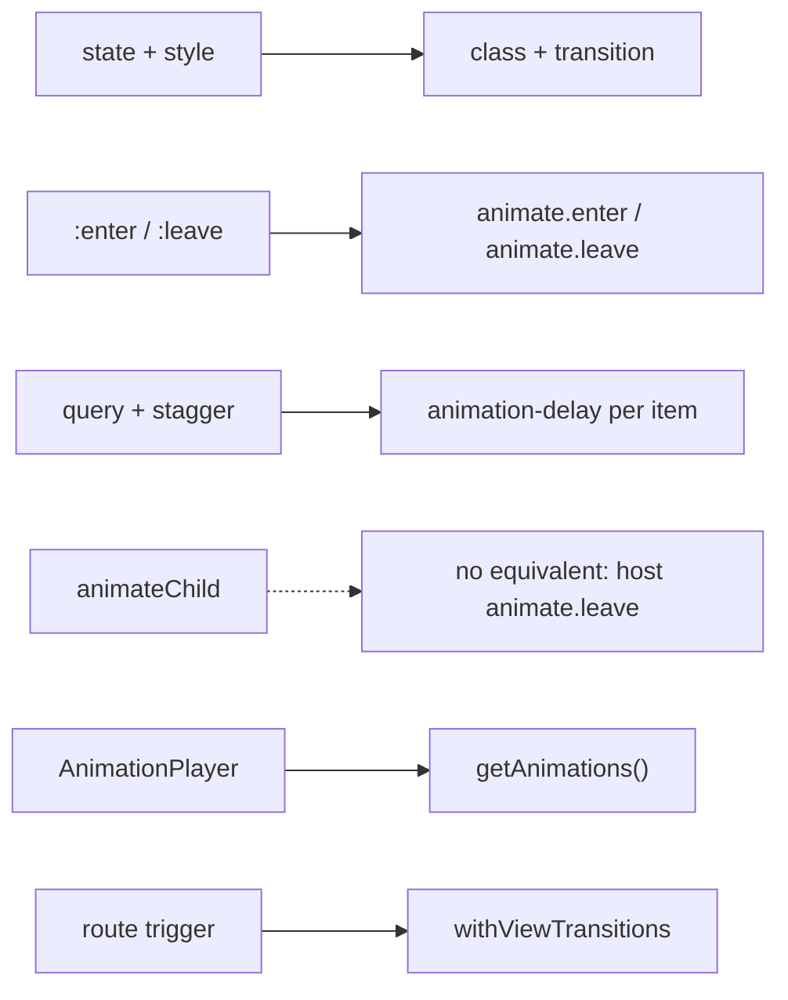

What to notice: the dashed arrow has no real target.

### How it actually works

**The mixing rule.** "You cannot use legacy animations alongside `animate.enter` and `animate.leave` within the same component" (`enter-and-leave.md`, read 2026-10-16), so a component migrates in one step. The lab's `/m35/migration` loader returns the trigger panel when `ANIMATION_MODULE_TYPE` is provided (the legacy build) and the class panel otherwise: a `script` animation becomes two `CSSTransition`s, `height` and `opacity` (`Section 9: the migrated panel runs a CSSTransition where the legacy one ran a script animation`). Closed, the legacy panel carries `height: 20px` inline and `ng-trigger ng-trigger-panel`; the migrated one has no `style` attribute and the class `m35-closed` (`Section 9: the legacy panel keeps its closed state in inline styles and the migrated panel in a class`).

**Disabling: docs versus run.** The guide's `animation: none !important` class carries a warning: "this prevents animation events from firing. If you are awaiting animation events for element removal, this solution won't work." It suggests 1 ms durations. The class form does not wait: nothing animates, so the element goes (`Section 9: a class that sets animation none removes a leaving element at once`; read, not run: internal `animateLeaveClassRunner`, `@angular/core` 22.2.1 `fesm2022/_debug_node-chunk.mjs`, may change in any release). The warning fits a callback that awaits `animationend` ([§6](#6-function-callbacks-and-the-v22-leave-semantics-animationcallbackevent-animationcomplete-and-nested-leaves)): it holds the element until `MAX_ANIMATION_TIMEOUT` (`Section 9: under animation none a leave callback that waits for animationend keeps the element until MAX_ANIMATION_TIMEOUT`).

**The bundle.** A **bundle chunk** is one JavaScript file the builder emits ([12 §3](12-angular-how-it-works.md#3-building-the-application-builder-output-layout-and-budgets)). In the legacy build one lazy chunk holds the engine, and `main` loads it with `import()`. The native build has none, though the shared routes put the legacy pages' `trigger()` helpers in a lazy chunk. The legacy `main` is larger (`Section 9: the legacy build ships an animations chunk the native build does not`). Native code ignores the engine: `Section 9: animate.enter still runs in the build that provides the legacy engine`.

**Order of work.** Leaf components, lists, then `animateChild` chains; finally the providers and the dependency.

### Code

The approach: keep the markup, turn each state into a class, and let a transition replace the trigger.

1. Read the trigger's states and transition.
2. Write the open state as the base rule, with the transition, and the closed state as a class.
3. Replace `[@panel]` with a class binding.

```ts
// Excerpt of labs/angular/projects/animations-lab/src/app/m35/migration/legacy-panel.ts
    trigger('panel', [
      state('open', style({ opacity: 1, height: '80px' })),
      state('closed', style({ opacity: 0.3, height: '20px' })),
      transition('open <=> closed', animate('900ms ease')),
    ]),
    <div class="m35-mig-panel" data-testid="mig-panel" [@panel]="panelState()">
```

```ts
// Excerpt of labs/angular/projects/animations-lab/src/app/m35/migration/migration.ts
      [class.m35-closed]="panelState() === 'closed'"
    .m35-mig-panel {
      overflow: hidden;
      background: #dbeafe;
      padding: 0.5rem;
      opacity: 1;
      height: 80px;
      transition:
        opacity 900ms ease,
        height 900ms ease;
    }
    .m35-mig-panel.m35-closed {
      opacity: 0.3;
      height: 20px;
    }
```

### Best practices and anti-patterns

- **Migrate one whole component at a time**, because mixing leaves classes or nodes behind (docs).
- **Redesign `animateChild` chains**, because nested leaves stop at the component boundary ([§6](#6-function-callbacks-and-the-v22-leave-semantics-animationcallbackevent-animationcomplete-and-nested-leaves)).
- **Remove the provider after the last `[@…]` binding**, because a leftover one throws `NG05105` in development.

### Misconceptions and traps

- *"There is an `ng generate` migration for animations."* 22.2.1 ships none (read above); control flow has one, so people expect it.
- *"`animation: none !important` breaks removal."* The class form removes at once; only code awaiting `animationend` waits for the timeout (tested). The docs' warning, written for such listeners, reads as general.
- *"`animateChild` maps to v22 nested leaves."* Nested leaves stop at child components; `animateChild` crossed them. Both are called "nested".
- *"Migrating changes nothing visible."* Inline styles become your classes (tested); the same intent hides it.

## 10. View transitions with the router: `withViewTransitions`, `view-transition-name` and `onViewTransitionCreated`

### The problem it solves

A product list and its detail page feel like two unrelated screens, and a query-string filter must not replay a page animation on every keystroke. Where view transitions sit in a navigation belongs to [24 §9](24-routing.md#9-view-transitions-scroll-restoration-and-titles) and [Q24.32](24-routing.md#q24-32). Drilled in [Q35.19](#q35-19), [Q35.20](#q35-20) and [Q35.21](#q35-21).

### Mental model

A **view transition** is the browser animating from the old state of the page to the new one. `document.startViewTransition(update)` [Baseline 2025: newly available, per MDN] takes a **snapshot** (a static image of the page), runs `update`, takes another and animates between them through a **pseudo-element tree** of generated elements: `::view-transition` > `::view-transition-group(name)` > `::view-transition-image-pair(name)` > `::view-transition-old(name)` and `::view-transition-new(name)`. The page is the group `root`. An element with `view-transition-name: card-2` [Baseline 2025: newly available, per MDN] gets a group of its own, and elements on the old and new pages sharing a name morph: a **shared element**. A **view transition type** is a label CSS can match.

`withViewTransitions()` [Developer preview since v19.0] runs route activation inside `update`. Its option `onViewTransitionCreated` [Developer preview since v20.0] receives `{ transition, from, to }`: a **`ViewTransition`** (the handle with `ready`, `finished` and `skipTransition()`) and two routes. Analogy: a projector cross-fades a before and an after photo, morphing what carries the same tag.

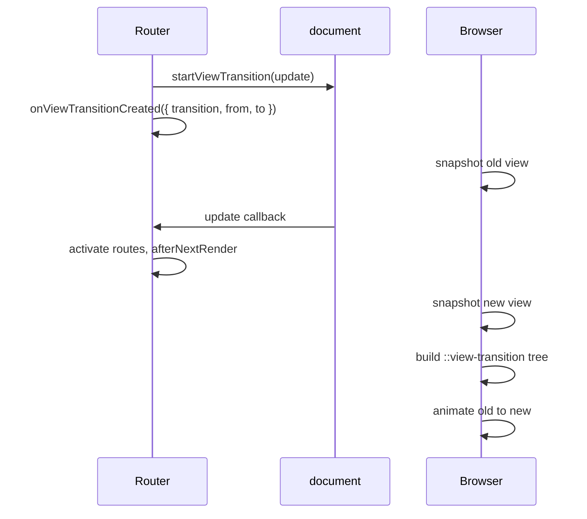

What to notice: the router only times the DOM update.

### How it actually works

**What the browser builds.** From the list to item 2, the old and new `root` snapshots and the `root` group animate (`Section 10: a navigation runs the root group's old and new animations`). `card-2`, on the card and the title, gets a group with both snapshots; `card-1` and `card-3` exist only on the old page: an old snapshot, no group animation (`Section 10: an element with a view-transition-name gets its own group`).

**What the router adds.** Read, not run, from `@angular/router` 22.2.1 (`fesm2022/_router-chunk.mjs`, internal `createViewTransition`, may change): it returns at once when the user agent already animated the navigation, and without `document.startViewTransition` it waits one `setTimeout`. Otherwise its update callback resolves after `afterNextRender` (a render hook that runs once after the next render, [20 §4](20-lifecycle-and-render-hooks.md#4-render-hooks-afternextrender-aftereveryrender-and-their-phases)) plus a `setTimeout`, so the new view is rendered before the snapshot. "Angular Router does not provide a way to delay view transitions" (docs, `route-transition-animations.md` on `main`, read 2026-10-16).

**The hook** runs for every transition, the first navigation too: `/ to /m35/vt/list, skipped: false` (`Section 10: onViewTransitionCreated receives the from and to routes`). The lab's `recordTransition` skips when the target route has `data: { skipViewTransition: true }`: a link on `/m35/vt/filtered` that changes only `?tag=` records `skipped: true`, `ready` rejects with `AbortError` and no pseudo-element animates (`Section 10: skipTransition on a query-only navigation runs no view-transition animation`).

**Global rules.** Component styles are scoped, "which prevents them from targeting the transition pseudo-elements correctly" (docs); use `styles.css` ([13 §9](13-components-and-templates.md#9-view-encapsulation-emulated-shadowdom-and-none-and-what-the-compiler-does-to-your-css) owns scoping).

**Duplicate names.** MDN: "If two rendered elements have the same view-transition-name at the same time, the ViewTransition.ready Promise will reject and the transition will be skipped." With `?twin=1` `ready` rejects with `InvalidStateError`, the page renders and nothing animates (`Section 10: two elements with the same view-transition-name make the transition skip`).

> [!NOTE]
> **Framework vs platform.** Snapshots, pseudo-elements, names, types and `skipTransition` are the browser's. Angular adds only the call at the right point of the navigation and the hook ([24 §9](24-routing.md#9-view-transitions-scroll-restoration-and-titles) draws the same line).

### Code

The router starts the transition, both pages tag the shared element and the durations sit in global styles.

1. Enable the feature with the hook.
2. Give the card and the title the same name.
3. Set the durations in `styles.css`, only while a page marked `data-m35-vt` is present.

```ts
// Excerpt of labs/angular/projects/animations-lab/src/app/app.config.ts
    provideRouter(routes, withViewTransitions({ onViewTransitionCreated: recordTransition })),
```

```ts
// Excerpt of labs/angular/projects/animations-lab/src/app/m35/vt/list.ts
            [style.view-transition-name]="'card-' + item.id"
```

```ts
// Excerpt of labs/angular/projects/animations-lab/src/app/m35/vt/item.ts
    <h1 class="m35-vt-title" [style.view-transition-name]="'card-' + id">{{ name }}</h1>
```

```css
/* Excerpt of labs/angular/projects/animations-lab/src/styles.css */
:root:has([data-m35-vt])::view-transition-group(*),
:root:has([data-m35-vt])::view-transition-old(*),
:root:has([data-m35-vt])::view-transition-new(*) {
  animation-duration: 1200ms;
}
```

### Best practices and anti-patterns

- **Derive each name from the id**, because one repeated name skips the whole transition.
- **Skip query-only navigations**, because each would replay the page animation.
- **Keep `::view-transition-*` rules in `styles.css`**, because component styles are scoped.

### Misconceptions and traps

- *"View transitions need `@angular/animations`."* They are the browser's API, and the native build has no engine (`Smoke: no chunk of the native build contains the legacy animation engine`); route triggers hid that.
- *"Put the `::view-transition-old` rules in the component."* They do not match from there (docs); everything else lives in component CSS.
- *"The router waits for my data."* It waits for resolvers, not later loads, and offers no delay; the snapshot looks like a loading step.
- *"Old browsers break navigation."* The router skips the API when missing ([24 §9](24-routing.md#9-view-transitions-scroll-restoration-and-titles) owns the test); "developer preview" sounds risky.

## 11. Performance and reduced motion: compositor properties, measuring jank and `prefers-reduced-motion`

### The problem it solves

A 200-row list collapses a row by animating `height`: every frame the rows below move, so the browser lays the list out again each frame and the motion **janks** (stutters because frames arrive late). A sidebar that slides by animating `width` does the same. A user who asked the operating system for less motion still gets a zooming page transition. The pipeline belongs to [08 §2](08-browser-rendering-dom-events.md#2-layout-paint-and-composite-what-each-change-costs). Drilled in [Q35.22](#q35-22), [Q35.23](#q35-23) and [Q35.24](#q35-24).

### Mental model

An animation costs what its property sends the browser back to. A **compositor-only property** (`transform`, `opacity`) can change without layout or paint ([Q08.03](08-browser-rendering-dom-events.md#q08-03)); `width`, `height` and `top` re-run layout every frame.

`prefers-reduced-motion` is the media query that reports the user's setting (syntax: [10 §5](10-css-essentials.md#5-responsive-css-media-queries-container-queries-and-fluid-type); accessibility: [module 11](11-accessibility.md#7-testing-accessibility)). MDN (read 2026-10-16) describes a preference for "an interface that removes, reduces, or replaces motion-based animations", because such animations "can trigger discomfort for those with vestibular motion disorders" (conditions of the balance system). So the response is less motion, not no feedback: shorten, cross-fade, or change state at once.

WCAG 2.2 is the standard behind it. SC 2.3.3 Animation from Interactions (AAA): "Motion animation triggered by interaction can be disabled, unless the animation is essential to the functionality or the information being conveyed." SC 2.2.2 Pause, Stop, Hide (A) asks for a way to pause, stop or hide moving information that starts automatically, lasts over five seconds and sits beside other content, unless essential. Analogy: a stage with a quiet mode: actors still enter and leave, without the pyrotechnics.

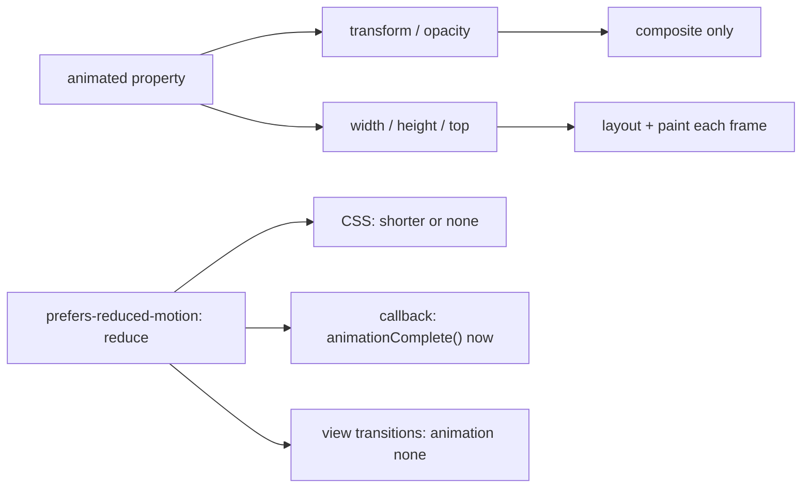

What to notice: reduced motion has three switch points, one per mechanism.

### How it actually works

**Counting layouts.** `LayoutCount` is a DevTools Protocol counter of layout passes ([31 §2](31-performance.md#2-lab-metrics-in-a-real-browser-performance-observers-devtools-protocol-counters-and-lighthouse-in-ci) owns the counters). Over ten frames, a `transform` animation adds none, a `width` animation adds layouts (`Section 11: animating width adds layouts while animating transform adds none`). Put `will-change` only on the element about to animate ([Q08.05](08-browser-rendering-dom-events.md#q08-05)).

**Three switch points.**

- CSS: the pulse runs only inside `@media (prefers-reduced-motion: no-preference)`; under `reduce` it has no animation (`Section 11: with reduced motion the guarded keyframe animation does not run`).
- `animate.leave` class ([§5](#5-animateenter-and-animateleave-with-css-classes-syntax-bindings-and-when-the-element-leaves)): a `reduce` rule with `animation: none` leaves nothing to wait for. Read, not run, in `@angular/core` 22.2.1 (internal `animateLeaveClassRunner`, may change): with no animation the element goes in the next frame. The note is removed (`Section 11: with reduced motion a leaving element is removed without an animation`).
- Callback form ([§6](#6-function-callbacks-and-the-v22-leave-semantics-animationcallbackevent-animationcomplete-and-nested-leaves)): CSS cannot stop a script animation, so the callback asks `matchMedia` and calls `animationComplete()` at once (`Section 11: with reduced motion a leave callback completes at once`).

**Why view transitions need their own rule.** Read, not run: `@angular/router` and `@angular/core` 22.2.1 contain no `prefers-reduced-motion` or `reducedMotion` (`grep`, 2026-10-16). With the lab's guard off, the same navigation under `reduce` animates `::view-transition-old(root)`; with it on, nothing animates (`Section 11: with reduced motion a navigation runs no view-transition animation`). The rule must be global ([§10](#10-view-transitions-with-the-router-withviewtransitions-view-transition-name-and-onviewtransitioncreated)).

### Code

Each mechanism gets its own guard.

1. Wrap the keyframe animation in a `no-preference` query and override the leave class under `reduce`.
2. In the leave callback, check the query and complete at once.
3. Add the global rule for the pseudo-elements.

```ts
// Excerpt of labs/angular/projects/animations-lab/src/app/m35/motion/motion.ts
    @media (prefers-reduced-motion: no-preference) {
      .m35-pulse {
        animation: m35-pulse 1500ms ease-in-out infinite;
      }
    }
```

```ts
// Excerpt of labs/angular/projects/animations-lab/src/app/m35/motion/motion.ts
    @media (prefers-reduced-motion: reduce) {
      .m35-note-out {
        animation: none;
      }
    }
```

```ts
// Excerpt of labs/angular/projects/animations-lab/src/app/m35/motion/motion.ts
  protected leaveCard(event: AnimationCallbackEvent): void {
    if (matchMedia(REDUCED_MOTION_QUERY).matches) {
      event.animationComplete();
      return;
    }
```

```css
/* Excerpt of labs/angular/projects/animations-lab/src/styles.css */
@media (prefers-reduced-motion: reduce) {
  :root:has([data-m35-motion-guard])::view-transition-group(*),
  :root:has([data-m35-motion-guard])::view-transition-old(*),
  :root:has([data-m35-motion-guard])::view-transition-new(*) {
    animation: none;
  }
}
```

### Best practices and anti-patterns

- **Animate `transform` and `opacity`**, because a `width` or `height` animation re-runs layout every frame.
- **Reduce, do not delete, feedback**, because the card still leaves under `reduce`; only the motion goes.
- **Guard each mechanism**, because the media query reaches CSS only and the router reads nothing.

### Misconceptions and traps

- *"Reduced motion means remove all animation."* It asks to remove, reduce or replace motion (MDN), and the removal itself stays. The name reads like an off switch.
- *"The router respects reduced motion."* Nothing in it reads the setting (read above) and the unguarded navigation animates (tested). The browser knows the setting, so it seems built in.
- *"`will-change` on everything makes animations smooth."* It can promote layers that cost memory ([Q08.05](08-browser-rendering-dom-events.md#q08-05) owns it). The name promises speed.
- *"A short animation is cheap."* Layout per frame is the cost, and the count shows it while the animation runs. Duration feels like cost.

## 12. Under the hood: from `animate.leave` to a removed node

### The problem it solves

An interviewer asks how Angular knows when to remove an element whose animation it never sees, why unit tests never see a leave, and why two quick toggles do not leave two nodes. Each answer is one stage of a single path.

### Mental model

An **instruction** is a function call the compiler writes into a component's template function ([12 §8](12-angular-how-it-works.md#8-under-the-hood-what-the-compiler-emits-and-what-the-runtime-does-with-it)). `animate.leave="cls"` becomes `ɵɵanimateLeave` (internal; the function form becomes the internal `ɵɵanimateLeaveListener`). At creation it stores a leave function in the view's **animation map**, keyed by node. When the node is **detached**, taken out of the DOM, the runtime pushes those functions onto the **animation queue**, a per-injector set that runs once after the next render ([20 §4](20-lifecycle-and-render-hooks.md#4-render-hooks-afternextrender-aftereveryrender-and-their-phases) owns render hooks). Each function adds the classes, waits for the end event, and resolves a promise; the node goes when every promise settles. Analogy: a cloakroom ticket; nobody leaves before the coat comes back.

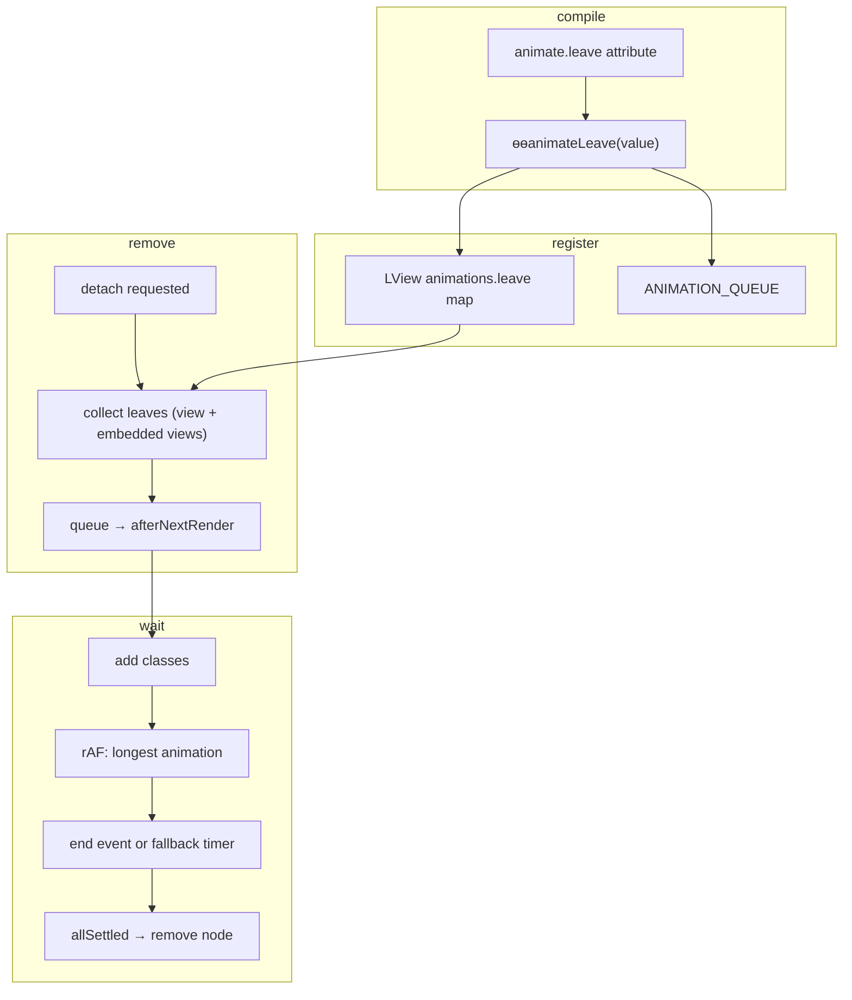

What to notice: removal is a callback, so anything that never resolves is bounded by the timers.

### How it actually works

Read, not run, in `@angular/core` 22.2.1 (`fesm2022/_debug_node-chunk.mjs`); every function named here is internal and may change in any release.

**Compile.** `@angular/compiler` 22.2.1 matches the `animate.` prefix (`ANIMATE_PREFIX`). In the lab, the development build's template function calls both instructions (`Section 12: the compiled template calls the animate instructions`).

**Register.** `ɵɵanimateLeave` returns at once on the server or when `areAnimationSupported` is false, which is why jsdom never sees a leave ([§1](#1-motion-in-a-ui-what-to-animate-the-browsers-three-animation-mechanisms-and-where-angular-fits)). Otherwise it adds a function to `LView[ANIMATIONS].leave`, the **LView** being one template instance's live state ([12 §8](12-angular-how-it-works.md#8-under-the-hood-what-the-compiler-emits-and-what-the-runtime-does-with-it)), and connects the queue (`ANIMATION_QUEUE`).

**Remove.** `applyToElementOrContainer` receives action `2`, the detach that `detachViewFromDOM` passes. It hands the removal to `runLeaveAnimationsWithCallback` as a callback. `aggregateDescendantAnimations` and `collectNestedViewAnimations` gather the leaves ([§6](#6-function-callbacks-and-the-v22-leave-semantics-animationcallbackevent-animationcomplete-and-nested-leaves)); with none, the callback runs at once. The queue's `afterNextRender` runs them all in one pass. In the lab, the note is still attached, with its leave class and a running animation, after `ApplicationRef.whenStable()` resolves (`Section 12: the leaving element is still attached after the render that removed it from the model`): stability does not wait for leaves. Two removals in one handler run side by side and one `finishAll` removes both (`Section 12: two removals in one change detection resolve together`).

**Wait.** `animateLeaveClassRunner` adds the classes; in the next frame `determineLongestAnimation` picks the longest finite animation. With none, the classes go and the promise resolves in that frame. Otherwise a **fallback timer**, a `setTimeout` of that duration plus 50 ms, bounds the wait, and `isLongestAnimation` accepts only the matching end event. `Promise.allSettled` then calls the removal.

**Re-insert.** A leaving element is tracked per template node; when that node inserts again, `cancelLeavingNodes` sends it a synthetic cancel and detaches it. In the lab, the second toggle leaves one note, and the old one is gone (`Section 12: toggling an @if twice during a leave leaves one element`).

Drilled in [Q35.25](#q35-25).

### Code

1. The page removes the note and records when the application is stable again.
2. The test reads the DOM at that point.
3. The pseudo-code condenses the removal path.

```ts
// Excerpt of labs/angular/projects/animations-lab/src/app/m35/internals/internals.ts
  protected hideNote(): void {
    this.noteShown.set(false);
    void this.appRef.whenStable().then(() => this.stableAfterRemoval.set(true));
  }
```

```ts
// Excerpt of labs/e2e/tests/35-animations/concepts/section-12-under-the-hood.spec.ts
  await page.getByRole('button', { name: 'Hide the note' }).click();
  // The page sets this text when ApplicationRef.whenStable() resolves after the removal: the render is over.
  await expect(page.getByTestId('stable-status')).toHaveText('Stable after removal: yes');
  await expect(note).toHaveCount(1);
  expect(await classesOf(note)).toEqual(['m35-internals-box', 'm35-internals-out']);
```

```ts
// Partial: pseudo-code of applyToElementOrContainer's detach branch in @angular/core 22.2.1, names simplified
function detach(leaves: Array<() => Promise<void>>, removeNode: () => void): void {
  if (leaves.length === 0) return removeNode();
  afterNextRender(() => {
    void Promise.allSettled(leaves.map((leave) => leave())).then(removeNode);
  });
}
```

### Best practices and anti-patterns

- **Finish animations in browser tests instead of waiting for stability**, because `whenStable()` resolves while the leaving element is still attached.
- **Avoid reading `ɵ` instructions or `LView` from application code**, because they are internal and may change in any release.

### Misconceptions and traps

- *"Angular polls the element until the animation stops."* It listens for the longest animation's end event, bounded by a fallback timer (read above). The myth exists because Angular must learn the end somehow.
- *"Leave animations run during change detection."* Change detection only detaches; the leaves run in one after-render callback (read above). The myth exists because the removal starts there.
- *"The element is removed, then animated from a clone."* The real node stays attached until its promise settles (first test above). The myth exists because some animation libraries clone.

## Summary

Animate to show what changed, never as decoration. A transition, a keyframe animation and a script `Animation` all put objects on one timeline, and Angular adds only timing ([section 1](#1-motion-in-a-ui-what-to-animate-the-browsers-three-animation-mechanisms-and-where-angular-fits)). A transition needs a changed computed value, so an inserted element needs `@starting-style` and `display` needs `allow-discrete`, and an interrupted one reverses from the value on screen ([section 2](#2-css-transitions-triggers-interruption-events-and-entry-with-starting-style)). A keyframe animation starts when the `animation` property applies, and emulated encapsulation renames a component's `@keyframes`, so a global class cannot use them ([section 3](#3-css-keyframe-animations-keyframes-fill-modes-iteration-and-component-scoped-names)). `element.animate` returns an `Animation` you can await: `cancel()` rejects `finished` with `AbortError`, and `commitStyles()` keeps the end state ([section 4](#4-the-web-animations-api-elementanimate-the-animation-object-and-getanimations)).

`animate.enter` and `animate.leave` are compiler syntax that add classes; a leaving element waits for the longest finite animation and goes in the next frame if nothing animates or the animation loops ([section 5](#5-animateenter-and-animateleave-with-css-classes-syntax-bindings-and-when-the-element-leaves)). The function form must call `animationComplete()`, or the element goes when `MAX_ANIMATION_TIMEOUT` (4000 ms by default) runs out; v22 runs the leaves in the same template and its embedded views, never a child component's own ([section 6](#6-function-callbacks-and-the-v22-leave-semantics-animationcallbackevent-animationcomplete-and-nested-leaves)). With a stable `track` a reorder is a move that runs no leave, so the glide is your FLIP, and restoring a row in place leaves one element ([section 7](#7-animating-lists-for-enter-leave-reorder-and-stagger)). Legacy triggers run through an engine and throw `NG05105` without a provider ([section 8](#8-legacy-angularanimations-triggers-states-transitions-query-and-stagger)). Migrate in small steps and keep the provider until the last `[@…]` is gone; `animateChild` across components has no native counterpart, and `animation: none` removes a class-form leave at once, unlike the docs' wording ([section 9](#9-migrating-from-angularanimations-to-native-css-and-animateenteranimateleave)).

`withViewTransitions` snapshots the old and new page and animates a pseudo-element tree, one group per `view-transition-name`; `skipTransition()` runs none, and a duplicate name skips the transition ([section 10](#10-view-transitions-with-the-router-withviewtransitions-view-transition-name-and-onviewtransitioncreated)). Cost follows the animated property, not the duration: `transform` and `opacity` add no layouts, `width` does. The media query reaches CSS only, so guard each mechanism, and the router has no reduced-motion logic ([section 11](#11-performance-and-reduced-motion-compositor-properties-measuring-jank-and-prefers-reduced-motion)). Under the hood the compiler emits `ɵɵanimateLeave` (internal), detach queues the leaves per injector, and the node goes when the longest animation ends or a fallback timer fires ([section 12](#12-under-the-hood-from-animateleave-to-a-removed-node)).

## Question bank

Each answer has five parts. Each Output answer names the run asserted in `labs/e2e/tests/35-animations/outputs/q35-outputs.spec.ts`, except Q35.15's, asserted by `ng test` in `labs/angular/src/app/modules/35-animations/outputs/q35-outputs.spec.ts`; screen values are Chromium 153's, with `reducedMotion` set explicitly.

<a id="q35-01"></a>
### Q35.01 · Concept · When should a UI animate, what does each browser mechanism (transition, keyframe animation, Web Animations API) do, and what does Angular add on top?

<details>
<summary>Answer</summary>

**Short answer (30 seconds).** Animate to show what changed, where it went or what needs attention, never as decoration the user waits through. A transition animates a property between two computed values, a keyframe animation runs a `@keyframes` rule, and the Web Animations API creates an `Animation` from script. All three put `Animation` objects on one timeline. Angular adds timing only: `animate.enter` and `animate.leave` add classes and delay removal.

**Full explanation.** In the lab each mechanism's box holds one object: a `CSSTransition`, a `CSSAnimation` and a script `Animation` (`Section 1: each mechanism creates an Animation object on the element`). `transform` and `opacity` skip layout and paint ([08 §2](08-browser-rendering-dom-events.md#2-layout-paint-and-composite-what-each-change-costs)). The native build has no animation provider, yet `animate.enter` still adds its class (`Section 1: the native build has no animation provider and still runs animate.enter`). [§1](#1-motion-in-a-ui-what-to-animate-the-browsers-three-animation-mechanisms-and-where-angular-fits) draws it.

**Follow-ups an interviewer will ask.**
- *Why does a unit test not show the animation?* jsdom has no `getAnimations`, so the instructions return early; assert motion in a browser (`Section 1: under jsdom animate.enter adds no class even with animationsEnabled`).
- *Is `animate.enter` a directive?* No: the docs call them "special API supported directly by the Angular compiler" (`guide/animations/enter-and-leave`, read 2026-10-16).

**Trap to avoid.** Answering "Angular animations need `@angular/animations`". That package is deprecated, and the native build ships none of its engine.

</details>

<a id="q35-02"></a>
### Q35.02 · Output · A class change starts `transition: opacity 400ms, transform 400ms` and the class is removed halfway: which `Animation` objects exist, which transition events fire in which order, and what is the opacity afterwards?

The class `m35-q02-on` sets `opacity: 0.2` and `transform: translateX(8rem)`. A test adds it, seeks the transitions to 200 ms, then removes it.

```css
/* Excerpt of labs/angular/projects/animations-lab/src/app/m35/outputs/q35-02.ts */
    .m35-q02-box {
      transition:
        opacity 400ms,
        transform 400ms;
    }
```

<details>
<summary>Answer</summary>

**Short answer (30 seconds).** Two `CSSTransition`s while it runs, one for `opacity` and one for `transform`. Removal cancels both and starts two new ones back to the old values, each shorter than 400 ms. Events: `transitionrun` and `transitionstart` for each property, then two `transitioncancel`, then run and start for each reverse transition, then two `transitionend`. Afterwards no animation is left and the opacity is `1`. Transitions run per property and reverse from the value on screen.

**Full explanation.** `Q35.02 removing the class halfway cancels both transitions, starts two shorter reverse ones and ends at opacity 1` asserts the twelve events, the two durations below 400 ms and the final `1` ([§2](#2-css-transitions-triggers-interruption-events-and-entry-with-starting-style)). Midway the opacity lies between `0.2` and `1`, so the reverse starts there. Without a delay, `transitionstart` follows each `transitionrun`.

**Follow-ups an interviewer will ask.**
- *Does the cancelled pair fire `transitionend`?* No, only `transitioncancel`; the two `transitionend` events come from the reverse transitions.
- *What changes with a 400 ms delay?* Both runs fire before any start (`Section 2: transitionrun fires before transitionstart, and transitionend comes last`).

**Trap to avoid.** Expecting a jump to the start value or a `transitionend` for the interrupted pair: the browser reverses.

</details>

<a id="q35-03"></a>
### Q35.03 · Difference · CSS transitions versus CSS keyframe animations: what triggers each, where the start state comes from, repetition, events, and when each fits.

<details>
<summary>Answer</summary>

**Short answer (30 seconds).** A transition is triggered by a change of a computed value and runs once per change. A keyframe animation is triggered by the `animation` property applying, declares its own states in `@keyframes` and can repeat. Use transitions for state changes (hover, toggle), keyframes for steps in between or loops.

| | Transition | Keyframe animation |
|---|---|---|
| Trigger | A computed value changes | `animation` applies |
| Start state | The value on screen | The first keyframe |
| Repetition | None | Count, direction, `infinite` |
| Events | `transition…` | `animation…`, with `animationiteration` |
| After the end | The new value stays | The element's own style, unless `forwards` |

**Full explanation.** In the lab a class change starts one `CSSTransition` per listed property (`Section 2: a class change starts a CSSTransition for each listed property`); a three-iteration animation records start, two iterations and end (`Section 3: animationiteration fires once per completed iteration`), and without `forwards` the box returns to its own style (`Section 3: without forwards the element returns to its own style`).

**Follow-ups an interviewer will ask.**
- *Which does Angular wait for?* Both: it reads `getAnimations()`, then the computed `transition-*` values (read, not run, [§2](#2-css-transitions-triggers-interruption-events-and-entry-with-starting-style)).
- *Which fits an inserted element?* A keyframe animation names its own first state; a transition needs `@starting-style` (`Section 2: an inserted element transitions only with @starting-style`).

**Trap to avoid.** Using keyframes for a two-state change: a transition is shorter and reverses when interrupted.

</details>

<a id="q35-04"></a>
### Q35.04 · Bug hunt · A fade-in that appears instantly on insertion, a `display: none` toggle that never animates, and a component's `@keyframes` a global class cannot find: what is wrong in each?

An `@if` inserts a box with `transition: opacity 600ms`. A class gives a second box `display: none` and `opacity: 0`. A global class says `animation: m35-grow 800ms`, but the component declares `m35-grow`.

<details>
<summary>Answer</summary>

**Short answer (30 seconds).** The inserted box has no previous style, so nothing transitions: add `@starting-style` with the start values. `display` is a discrete property: list it with `allow-discrete`. Emulated encapsulation renames a component's `@keyframes`, so the global class names a rule that does not exist: declare the keyframes globally.

**Full explanation.** Of two inserted boxes, only the one with `@starting-style` gets a `CSSTransition` (`Section 2: an inserted element transitions only with @starting-style`). With `display 600ms allow-discrete` listed, the box stays `block` until the transition ends; without it, it is `none` at once (`Section 2: display none animates out only with transition-behavior allow-discrete`). Only the component's box gets a `CSSAnimation`, named with a `_m35-grow` ending (`Section 3: a global class cannot use a component's keyframes`). [13 §9](13-components-and-templates.md#9-view-encapsulation-emulated-shadowdom-and-none-and-what-the-compiler-does-to-your-css) owns the renaming rule.

**Code.**

```css
/* Partial: the fixes, one rule each; the third goes in a global stylesheet. */
.fade { transition: opacity 600ms; @starting-style { opacity: 0; } }
.hide { transition: opacity 600ms, display 600ms allow-discrete; }
@keyframes m35-grow { from { scale: 1; } to { scale: 1.2; } }
```

**Follow-ups an interviewer will ask.**
- *Does `allow-discrete` work everywhere?* MDN lists it as limited availability (read 2026-10-16): where it is missing the element hides at once, so treat it as an enhancement.
- *Can a component use a global `@keyframes`?* Yes: only the component's own names are renamed (read, not run, `@angular/compiler` 22.2.1, `_scopeKeyframesRelatedCss`).

**Trap to avoid.** Searching DevTools for `m35-grow`: the rule is `<scope>_m35-grow`.

</details>

<a id="q35-05"></a>
### Q35.05 · Concept · What does the Web Animations API add over CSS: `element.animate`, the `Animation` object and its `finished` promise, `getAnimations` and `commitStyles`?

<details>
<summary>Answer</summary>

**Short answer (30 seconds).** It is the script handle onto the engine CSS uses. `element.animate(keyframes, options)` creates and starts an `Animation` from values computed at run time. You can pause, reverse, finish or cancel it and await `finished`. `getAnimations()` lists CSS and script animations together, and `commitStyles()` writes the current values into the inline style so the end state survives `cancel()`.

**Full explanation.** In the lab `element.animate()` returns a `running` `Animation` that `getAnimations()` lists beside the `CSSTransition` (`Section 4: element.animate returns an Animation that getAnimations lists with CSS ones`). `finish()` resolves `finished` with the animation and `cancel()` rejects it with `AbortError` (`Section 4: finished resolves after finish and rejects after cancel`). After `commitStyles()` then `cancel()` the box keeps its end style with no animation (`Section 4: commitStyles then cancel keeps the end style without an animation`). [§4](#4-the-web-animations-api-elementanimate-the-animation-object-and-getanimations) has the model.

**Follow-ups an interviewer will ask.**
- *Why not `fill: 'forwards'` to keep the end state?* The effect stays active and wins over later static styles: the forwards-only box ignored an inline `opacity: 1`, the committed one obeyed it.
- *Does Angular use this API?* The legacy package does: `WebAnimationsPlayer` calls `element.animate` (read, not run, `@angular/animations` 22.2.1, `fesm2022/browser.mjs`).

**Trap to avoid.** Cancelling with an un-caught `finished` pending: it rejects with `AbortError`.

</details>

<a id="q35-06"></a>
### Q35.06 · Output · `animate.enter="m35-pop"` on an `@if` element whose class runs a 400 ms fade and a 1500 ms slide: which classes and animations are on the element while each runs, and when are the classes removed?

```css
/* Excerpt of labs/angular/projects/animations-lab/src/app/m35/outputs/q35-06.ts */
    .m35-pop {
      animation:
        m35-pop-fade 400ms,
        m35-pop-slide 1500ms;
    }
```

<details>
<summary>Answer</summary>

**Short answer (30 seconds).** While both run, the element has the class `m35-pop` and two `CSSAnimation`s, `m35-pop-fade` and `m35-pop-slide`. When the fade ends the class stays and one animation is left. The class goes when the slide ends; the element stays. The runtime waits for the longest animation.

**Full explanation.** `Q35.06 the enter class stays on the element until the longer of its two animations ends` asserts both names, then the class and the slide left after the fade is finished, then neither after the slide is ([§5](#5-animateenter-and-animateleave-with-css-classes-syntax-bindings-and-when-the-element-leaves)). Only the longest animation's end counts (read, not run, `@angular/core` 22.2.1, internal `isLongestAnimation`).

**Follow-ups an interviewer will ask.**
- *Is the longest one the longest duration?* Delay plus duration, divided by `playbackRate` (read, not run, internal `determineLongestAnimation`).
- *What if the class only held an infinite animation?* Infinite animations are skipped when measuring (same read), so the classes would go in the next frame.

**Trap to avoid.** Treating the first end as the end of the enter: the class lasts until the longest ends.

</details>

<a id="q35-07"></a>
### Q35.07 · Concept · How do `animate.enter` and `animate.leave` work with CSS classes: where can you put them, which values do they take, and when is the element actually removed?

<details>
<summary>Answer</summary>

**Short answer (30 seconds).** Both are compiler syntax, not directives, written on an element or in a component's `host`. A value is a class string, an array, a bound expression or, since v22.2, a function or signal returning classes. `animate.enter` adds its classes on insertion and removes them when the longest animation ends. `animate.leave` adds its classes when removal starts and removes the element when the longest animation ends, or in the next frame if nothing animates.

**Full explanation.** `host: { 'animate.enter': … }` works like the element form ([13 §7](13-components-and-templates.md#7-the-host-element-host-metadata-hostbinding-and-hostlistener); `Section 5: animate.enter works as a host binding`). An array and an invoked signal each applied two classes (`Section 5: an array and a signal-bound class list both apply`). Enter classes go and the element stays (`Section 5: the enter class is present while the animation runs and removed after it`); a leaving element stays until its animation ends (`Section 5: the element stays in the DOM until its leave animation ends`). The runtime asks the browser instead of guessing a duration ([§5](#5-animateenter-and-animateleave-with-css-classes-syntax-bindings-and-when-the-element-leaves)).

**Follow-ups an interviewer will ask.**
- *Does an enter transition need anything extra?* Yes: the enter class is the state to animate to, so pair it with `@starting-style` (docs, read 2026-10-16).
- *Which animation does removal wait for?* The longest finite one ([Q35.06](#q35-06) for the enter case; `Section 5: an infinite animation does not delay removal`).

**Trap to avoid.** A leave class that only changes a colour: nothing animates, so the element leaves at once.

</details>

<a id="q35-08"></a>
### Q35.08 · Output · `animate.leave` with a class that animates nothing, with a transition, and with an infinite animation: when does each element leave the DOM?

`m35-q08-plain` changes a colour only.

```css
/* Excerpt of labs/angular/projects/animations-lab/src/app/m35/outputs/q35-08.ts */
    .m35-q08-fade {
      opacity: 0;
      transition: opacity 1500ms;
    }
    .m35-q08-spin {
      animation: m35-q08-turn 2s linear infinite;
    }
```

<details>
<summary>Answer</summary>

**Short answer (30 seconds).** The plain box and the infinite box leave without any animation being finished; the transition box stays, with its leave class and one running `CSSTransition` on `opacity`, until that transition ends. Removal waits only for a finite animation; an infinite one is skipped.

**Full explanation.** `Q35.08 a leave class that animates nothing or only loops removes the element at once, a transition waits` asserts that the spin class declares `infinite`, that the transition box is still attached with `css-transition opacity running` two frames later, that the other two are gone without a finish and that it goes after `finishAll`. That removal is in the next frame is read, not run (`@angular/core` 22.2.1, internal `animateLeaveClassRunner`). [§5](#5-animateenter-and-animateleave-with-css-classes-syntax-bindings-and-when-the-element-leaves) has the model.

**Follow-ups an interviewer will ask.**
- *Why does a class change start a transition on a leaving element?* The class changes the computed `opacity`, which is what starts a transition ([§2](#2-css-transitions-triggers-interruption-events-and-entry-with-starting-style)).
- *What if the end event never arrives?* A fallback timer of the longest duration plus 50 ms removes it (read, not run, same function).

**Trap to avoid.** An infinite spinner as the leave effect: the element goes at once.

</details>

<a id="q35-09"></a>
### Q35.09 · Concept · How does the function form `(animate.leave)` work, what is `animationComplete`, and what happens if you never call it?

<details>
<summary>Answer</summary>

**Short answer (30 seconds).** `(animate.leave)="fn($event)"` calls your method with an `AnimationCallbackEvent`: `target`, the element, and `animationComplete`, a `VoidFunction`. You run the animation (a class, `element.animate()`, a library) and call `animationComplete()` when it is over. If you never call it, the element is removed when `MAX_ANIMATION_TIMEOUT` runs out, 4000 ms by default, or earlier on a CSS `animationend` on it.

**Full explanation.** The docs: "You **must** call the `animationComplete()` function when using `animate.leave` for Angular to remove the element." (read 2026-10-16). In the lab the box stays until a button calls the stored function (`Section 6: the leave callback receives the element and removal waits for animationComplete`). A route with a short timeout still loses an uncompleted element (`Section 6: a leave callback that never calls animationComplete is removed after the route's MAX_ANIMATION_TIMEOUT`). The default: `Section 6: MAX_ANIMATION_TIMEOUT defaults to 4000`. A CSS class completes by itself, an `element.animate()` does not (`Section 6: a leave callback completes on a CSS animationend but not on an element.animate finish`). [§6](#6-function-callbacks-and-the-v22-leave-semantics-animationcallbackevent-animationcomplete-and-nested-leaves) has the model.

**Follow-ups an interviewer will ask.**
- *Does `animationComplete` matter for `animate.enter`?* No: in the enter callback it is a no-op (read, not run, `@angular/core` 22.2.1, internal `noOpAnimationComplete`).
- *How do I complete from a script animation safely?* Pass it to both branches, `finished.then(done, done)`: `cancel()` rejects `finished`.

**Trap to avoid.** Starting `element.animate()` and relying on it: the element lingers for the whole timeout.

</details>

<a id="q35-10"></a>
### Q35.10 · Output · An `@if` block is removed while it holds an element with `animate.leave` in the same template and a child component whose own template uses `animate.leave`: which leave animations run before removal in v22, and what did v21.1 do?

```html
<!-- Excerpt of labs/angular/projects/animations-lab/src/app/m35/outputs/q35-10.ts -->
      <section class="m35-q10-block" data-testid="q10-block">
        <p animate.leave="m35-q10-line-out" data-testid="q10-line">Same template</p>
        <lab-m35-q10-child />
      </section>
```

<details>
<summary>Answer</summary>

**Short answer (30 seconds).** In v22 the paragraph in the same template gets its class and a running `CSSAnimation`, and the block stays until it ends. The child's paragraph gets no class and no animation. v21.1 animated only the element being removed, here the `<section>`, which has no leave, so nothing would have run (read from the CHANGELOG, not run).

**Full explanation.** `Q35.10 a leave in the removed block's own template runs before removal and a child component's own leave does not` asserts the paragraph's class and `css-animation running`, then the block attached and the child's paragraph unanimated, then the block gone after `finishAll`. The runtime collects leaves in the same view and its embedded views (`@if`, `@for`), never a child component's view ([§6](#6-function-callbacks-and-the-v22-leave-semantics-animationcallbackevent-animationcomplete-and-nested-leaves); read, not run, internal `collectNestedViewAnimations`). The CHANGELOG (read 2026-10-16) for 22.0.0: "Leave animations are no longer limited to the element being removed."

**Follow-ups an interviewer will ask.**
- *How do I animate the child anyway?* Put `animate.leave` on the child's host element in the parent template (`Section 6: a child component's own animate.leave does not run when its parent is removed`).
- *Did 21.2 ship nested leaves?* 21.2.0 added them and 21.2.4 reverted them (CHANGELOG, read, not run); 22.0.0 restored them inside the component.

**Trap to avoid.** Expecting a child's own leave to show when its parent goes.

</details>

<a id="q35-11"></a>
### Q35.11 · Bug hunt · A leave callback that never calls `animationComplete`, a leave class whose transition never starts because nothing changes, and legacy `[@fade]` mixed with `animate.leave` in one component: what breaks?

<details>
<summary>Answer</summary>

**Short answer (30 seconds).** Three different failures. A callback that never completes leaves the element in the DOM until `MAX_ANIMATION_TIMEOUT` (4000 ms by default), with no error. A leave class that changes nothing the transition watches starts no animation, yet the runtime reads the declared `transition-duration` from the computed style and keeps the element until its fallback timer (that duration plus 50 ms) fires. Legacy `[@fade]` beside `animate.leave` in one component is unsupported: split them or finish the migration.

**Full explanation.** *Callback:* the element is removed after the route's timeout (`Section 6: a leave callback that never calls animationComplete is removed after the route's MAX_ANIMATION_TIMEOUT`); the default is `Section 6: MAX_ANIMATION_TIMEOUT defaults to 4000`. Fix: pass `animationComplete` to both `finished` branches. *Class:* a class that only changes a colour animates nothing (`Section 5: a leave class that animates nothing removes the element at once`); a `transition` on a property the class leaves unchanged does not: with `getAnimations()` empty, the internal `determineLongestAnimationFromComputedStyles` (may change in any release) records the declared transition, so the element waits for the fallback timer, not for a `transitionend` that never comes (read, not run, `@angular/core` 22.2.1). Fix: change the transitioned property. *Mixing:* "You cannot use legacy animations alongside `animate.enter` and `animate.leave` within the same component" (docs, read 2026-10-16); no test mixes them, because only the `legacy` build provides the engine ([§8](#8-legacy-angularanimations-triggers-states-transitions-query-and-stagger)).

**Follow-ups an interviewer will ask.**
- *How do you notice the first bug?* Nothing is logged; the element lingers ([§6](#6-function-callbacks-and-the-v22-leave-semantics-animationcallbackevent-animationcomplete-and-nested-leaves)).
- *How do you spot the second?* `getAnimations()` on the element after the class lands is empty while the element is still attached.

**Trap to avoid.** Shortening the timeout: it hides the missing completion.

</details>

<a id="q35-12"></a>
### Q35.12 · Design · Animate a notification list: entering items slide in, removed items collapse, reordered items glide, and an item re-added during its leave animation does not duplicate.

<details>
<summary>Answer</summary>

**Short answer (30 seconds).** Render with `@for` and `track item.id`, put `animate.enter` (slide in) and `animate.leave` (fade out) on the row, and glide reorders with FLIP. A stable track makes a reorder a move, which runs no leave, so the glide is yours. Restoring a row in place needs no code.

**Full explanation.** Identity decides the operation ([Q18.25](18-control-flow-and-defer.md#q18-25) has the `@for` rules). A removed row stays until its leave ends (`Section 7: an added row runs its enter animation and a removed row its leave animation`). A reorder keeps every element and starts no leave (`Section 7: reordering with a stable track keeps every element and runs no leave animation`); the glide is a script animation on each row that changed place (`Section 7: a FLIP glide on a reorder plays a script animation on each row that changed place`). Restoring in place leaves one element (`Section 7: re-adding a row during its leave animation leaves one copy`). For the collapse, animating `height` moves the rows below on every frame ([§11](#11-performance-and-reduced-motion-compositor-properties-measuring-jank-and-prefers-reduced-motion) ran `width`, not `height`): fade the row and let the glide close the gap.

**Follow-ups an interviewer will ask.**
- *Why not `track $index`?* The wrong element leaves (`Section 7: track $index rewrites rows in place on a reorder and animates the last row when the first item goes`).
- *And reduced motion?* A `matchMedia` check: CSS cannot switch off `element.animate()`.

**Trap to avoid.** An unstable key: every row looks new, so every row would enter and leave (read, not run).

</details>

<a id="q35-13"></a>
### Q35.13 · Output · In a `@for` with `track item.id`, one item is moved, another removed and re-added before its leave animation ends: which rows run enter or leave animations, and how many elements carry the re-added item?

Three items, ids 1 to 3. The first item moves to the end, item 2 is removed, then item 2 is restored in its place before the leave ends.

```html
<!-- Excerpt of labs/angular/projects/animations-lab/src/app/m35/outputs/q35-13.ts -->
      @for (item of items(); track item.id) {
        <li animate.enter="m35-q13-in" animate.leave="m35-q13-out">{{ item.label }}</li>
      }
```

<details>
<summary>Answer</summary>

**Short answer (30 seconds).** The moved row runs neither: the same three elements, a new order, no class and no animation. The removed row gets its leave class and one running `CSSAnimation` and stays attached. After the in-place restore one element carries item 2, with the enter class; the leaving copy is detached. Restored at the end instead, two elements carry it until the leave ends.

**Full explanation.** `Q35.13 a moved row runs neither animation, a removed row leaves, and a row restored in place mid-leave leaves one element` asserts the kept elements and empty classes after the move, the running leave, then one element with the enter class and a detached leaving copy. `Q35.13 a row restored away from its leaving copy shows two elements until the leave ends` asserts a leaving and a new element together, then one after `finishAll`. The runtime's cancel rule is read, not run ([§7](#7-animating-lists-for-enter-leave-reorder-and-stagger)).

**Follow-ups an interviewer will ask.**
- *Does a move never animate?* A reversal replayed the enter class on one row (`Section 7: reordering with a stable track keeps every element and runs no leave animation`), a rotation did not. Keep enter classes harmless.
- *Why does a restore at the end differ?* The leaving copy is not beside the new element (read, not run), so it stays.

**Trap to avoid.** Assuming a restore always replaces the leaving copy: only a restore beside it does.

</details>

<a id="q35-14"></a>
### Q35.14 · Concept · What were triggers, states and transitions in `@angular/animations`, and how did `:enter`, `:leave`, `query`, `stagger` and `animateChild` work?

<details>
<summary>Answer</summary>

**Short answer (30 seconds).** A trigger is a named state machine in a component's `animations` array, bound with `[@name]="expr"`. A state is a named value with styles, a transition expression such as `open <=> closed` says which change plays and `animate()` how. `void` is "not in the DOM", `*` matches any state, and `:enter` and `:leave` mean `void => *` and `* => void`. `query` finds descendants, `stagger` offsets them, `animateChild` lets a parent run its children's triggers.

**Full explanation.** An engine, not CSS, runs it, so a trigger's transition is a script animation (`Section 8: a legacy trigger plays its transition through element.animate`), with `ng-animating` while it runs (`Section 8: elements carry ng-animating while a legacy animation runs`). `stagger` does not raise `delay`: it lengthens each item's duration and keeps the delay at 0 (`Section 8: stagger lengthens each entering item's animation by the step and keeps its delay at 0`). `animateChild` was not run ([§8](#8-legacy-angularanimations-triggers-states-transitions-query-and-stagger)).

**Follow-ups an interviewer will ask.**
- *What does a native version of `:enter` look like?* `animate.enter` ([§9](#9-migrating-from-angularanimations-to-native-css-and-animateenteranimateleave) maps the rest).
- *What has no native equivalent?* `animateChild` across components: put `animate.leave` on the child's host ([§9](#9-migrating-from-angularanimations-to-native-css-and-animateenteranimateleave)).

**Trap to avoid.** Treating states as CSS classes: they are values the engine turns into styles.

</details>

<a id="q35-15"></a>
### Q35.15 · Output · A legacy trigger with `open` and `closed` states and an `open <=> closed` transition under `provideNoopAnimations()`: which `(@t.start)` and `(@t.done)` callbacks fire on first render and on a toggle, with which `fromState` and `toState`?

```ts
// Excerpt of labs/angular/src/app/modules/35-animations/outputs/q35-outputs.spec.ts
    trigger('t', [
      state('open', style({ height: '80px' })),
      state('closed', style({ height: '20px' })),
      transition('open <=> closed', animate('300ms')),
    ]),
```

<details>
<summary>Answer</summary>

**Short answer (30 seconds).** First render, with the state `open`: `start` then `done`, both with `fromState` `void` and `toState` `open`. After the toggle to `closed`: `start` then `done`, both `open` to `closed`. The noop driver plays nothing but still reports every state change, and it completes each one at once.

**Full explanation.** `Q35.15 first render reports void to open and a toggle reports open to closed, each start before done` asserts the four events from the `AnimationEvent` fields `phaseName`, `fromState` and `toState`. The first render fires although no transition matches `void => open`. [§8](#8-legacy-angularanimations-triggers-states-transitions-query-and-stagger) has the model. The test runs under `ng test` with `provideNoopAnimations()` in jsdom; the real driver was not run for these callbacks.

**Follow-ups an interviewer will ask.**
- *What if no provider is registered?* The binding throws `NG05105` in development (`Section 8: a synthetic property without an animation provider throws NG05105`).
- *Can code detect the noop driver?* `ANIMATION_MODULE_TYPE` is `NoopAnimations` (`Section 8: provideNoopAnimations sets ANIMATION_MODULE_TYPE to NoopAnimations`).

**Trap to avoid.** Expecting no callbacks on first render, or a `done` that waits 300 ms.

</details>

<a id="q35-16"></a>
### Q35.16 · Difference · `provideAnimations`, `provideAnimationsAsync` and `provideNoopAnimations` (and their NgModule forms): what each loads and when, and why `animate.enter` needs none of them.

<details>
<summary>Answer</summary>

**Short answer (30 seconds).** All three register the legacy engine; they differ in when. `provideAnimations()` loads it with the app, `provideAnimationsAsync()` imports it on first use, `provideNoopAnimations()` loads it with a driver that plays nothing. `BrowserAnimationsModule` and `NoopAnimationsModule` are the NgModule forms. `animate.enter` needs none: it adds classes and reads `getAnimations()`.

| | Engine loaded | `ANIMATION_MODULE_TYPE` |
|---|---|---|
| `provideAnimations()` | Static import | `BrowserAnimations` |
| `provideAnimationsAsync()` | `import()` on first use | `BrowserAnimations` (`NoopAnimations` for `'noop'`) |
| `provideNoopAnimations()` | Static import | `NoopAnimations` |

**Full explanation.** With none of them a `[@x]` binding throws (`Section 8: a synthetic property without an animation provider throws NG05105`); the noop provider sets the token as the table says (`Section 8: provideNoopAnimations sets ANIMATION_MODULE_TYPE to NoopAnimations`). The async form puts the engine in one lazy chunk (`Section 9: the legacy build ships an animations chunk the native build does not`). If the import fails it throws `NG05300`: "Async loading for animations package was enabled, but loading failed." (read, not run: `@angular/platform-browser` 22.2.1, `animations-async.mjs`). Native code ignores all of them (`Section 9: animate.enter still runs in the build that provides the legacy engine`). [§8](#8-legacy-angularanimations-triggers-states-transitions-query-and-stagger) has the engine.

**Follow-ups an interviewer will ask.**
- *Which one in a unit test?* The noop one ([Q35.15](#q35-15)).
- *How does a legacy app turn motion off?* `BrowserAnimationsModule.withConfig({ disableAnimations: true })` selects the noop providers (read, not run).

**Trap to avoid.** Treating the async form as a load that cannot fail.

</details>

<a id="q35-17"></a>
### Q35.17 · Trade-off · Migrate a large app off `@angular/animations` now or wait until it is removed: what to migrate first, what has no direct replacement, and what you gain.

<details>
<summary>Answer</summary>

**Short answer (30 seconds).** Start now, in small steps, and keep the provider until the last `[@…]` binding is gone. The typings read "Intent to remove in v23" (`@angular/platform-browser` 22.2.1, `types/animations.d.ts`): an intent, not a date. Waiting is free today, but the work grows with every new trigger.

**Full explanation.** The order from [§9](#9-migrating-from-angularanimations-to-native-css-and-animateenteranimateleave): leaf components with state toggles, lists, then `animateChild` chains and route triggers, and last the providers and the dependency. Two things have no direct replacement. `animateChild` across components: native nested leaves stop at the component boundary (`Section 6: a child component's own animate.leave does not run when its parent is removed`), so the child's host gets its own `animate.leave`. A wildcard `height: '*'` needs `grid-template-rows` or `calc-size()` (limited availability, MDN, read 2026-10-16). No schematic exists: the collections of `@angular/core` and `@schematics/angular` 22.2.1 list none (read, not run). The gain the lab asserts is one lazy engine chunk less (`Section 9: the legacy build ships an animations chunk the native build does not`), with no size or speed claim.

**Follow-ups an interviewer will ask.**
- *Can new code go native meanwhile?* Yes (`Section 9: animate.enter still runs in the build that provides the legacy engine`).
- *When is it done?* When no `[@` binding and no `animations:` array remains.

**Trap to avoid.** Waiting for the removal, then migrating everything at once.

</details>

<a id="q35-18"></a>
### Q35.18 · Bug hunt · A migrated component keeps a `[@fade]` binding after the provider is removed, relies on `query(':leave', animateChild())` across child components, and disables motion with `animation: none`: what breaks after the migration?

<details>
<summary>Answer</summary>

**Short answer (30 seconds).** Two things break. `[@fade]` with no provider throws `NG05105` in development. `query(':leave', animateChild())` across components has no native counterpart: a child's own `animate.leave` does not run before the parent's removal. `animation: none` is milder than the docs sound: a class-form leave then removes the element at once; only code awaiting `animationend` waits.

**Full explanation.** The first is `Section 8: a synthetic property without an animation provider throws NG05105`. The second is `Section 6: a child component's own animate.leave does not run when its parent is removed`, while descendants in the same template do run (`Section 6: descendants with animate.leave in the same template run before the parent is removed`); put `animate.leave` on the child's host ([§6](#6-function-callbacks-and-the-v22-leave-semantics-animationcallbackevent-animationcomplete-and-nested-leaves)). The third is docs against run. The guide says the class "prevents animation events from firing. If you are awaiting animation events for element removal, this solution won't work." The run: `Section 9: a class that sets animation none removes a leaving element at once`, but `Section 9: under animation none a leave callback that waits for animationend keeps the element until MAX_ANIMATION_TIMEOUT`. [§9](#9-migrating-from-angularanimations-to-native-css-and-animateenteranimateleave) has both.

**Follow-ups an interviewer will ask.**
- *Which nested leaves still run?* Those in the same template.
- *How do you honor reduced motion?* With `prefers-reduced-motion` rules ([§11](#11-performance-and-reduced-motion-compositor-properties-measuring-jank-and-prefers-reduced-motion)).

**Trap to avoid.** Reading the docs' warning as "`animation: none` stops the removal".

</details>

<a id="q35-19"></a>
### Q35.19 · Concept · What does the browser do during a router view transition: the snapshots, the `::view-transition` pseudo-element tree, `view-transition-name`, and what `onViewTransitionCreated` can change?

<details>
<summary>Answer</summary>

**Short answer (30 seconds).** The browser snapshots the old page, runs the update, snapshots the new page and animates between them through a pseudo-element tree: `::view-transition` > `::view-transition-group(name)` > `::view-transition-image-pair(name)` > `::view-transition-old(name)` and `::view-transition-new(name)`. The page is the group `root`; each `view-transition-name` adds a group. `onViewTransitionCreated` [Developer preview since v20.0] gets `{ transition, from, to }` and can call `skipTransition()`.

**Full explanation.** In the lab the root group animates (`Section 10: a navigation runs the root group's old and new animations`), and a named element gets its own group (`Section 10: an element with a view-transition-name gets its own group`). The hook runs for every transition, the first load too (`Section 10: onViewTransitionCreated receives the from and to routes`). `skipTransition()` rejects `ready` with `AbortError` (`Section 10: skipTransition on a query-only navigation runs no view-transition animation`); a duplicate name rejects it with `InvalidStateError` (`Section 10: two elements with the same view-transition-name make the transition skip`). The hook runs right after `startViewTransition`, before the update callback (read, not run: `@angular/router` 22.2.1, `createViewTransition`), and cannot delay it (docs). Where it sits in the navigation is [Q24.32](24-routing.md#q24-32); [§10](#10-view-transitions-with-the-router-withviewtransitions-view-transition-name-and-onviewtransitioncreated) has the model.

**Follow-ups an interviewer will ask.**
- *Does it need `@angular/animations`?* No (`Smoke: no chunk of the native build contains the legacy animation engine`).
- *Where do the `::view-transition-*` rules go?* In global styles; component styles are scoped.

**Trap to avoid.** Expecting the hook to wait for data or rename elements.

</details>

<a id="q35-20"></a>
### Q35.20 · Output · A navigation with `withViewTransitions()` from a list to a detail page where the card and the detail header share one `view-transition-name`: which `::view-transition-*` animations run, and what runs when `onViewTransitionCreated` calls `skipTransition()`?

<details>
<summary>Answer</summary>

**Short answer (30 seconds).** Six animation targets run: `::view-transition-group`, `-old` and `-new` for `root`, and the same three for the shared name. With `skipTransition()` none runs: `ready` rejects with `AbortError`, `finished` resolves and the detail page renders. The browser builds one group per name, and a skipped one never animates the tree.

**Full explanation.** `Q35.20 a shared name adds one group with both snapshots to the root group, and skipTransition runs none` clicks a card (`view-transition-name: q20-card`) to a detail page whose header carries the same name, and asserts the selectors of `document.getAnimations()`, sorted:

```text
::view-transition-group(q20-card)   ::view-transition-group(root)
::view-transition-new(q20-card)     ::view-transition-new(root)
::view-transition-old(q20-card)     ::view-transition-old(root)
```

The first load is a view transition too; the test ends it first. The skipped route has `data: { skipViewTransition: true }`, which the lab's hook reads. Chromium 153; [§10](#10-view-transitions-with-the-router-withviewtransitions-view-transition-name-and-onviewtransitioncreated) has the model.

**Follow-ups an interviewer will ask.**
- *What if the name sits only on the old page?* An old snapshot, no group animation (`Section 10: an element with a view-transition-name gets its own group`).
- *What if two elements share it?* `ready` rejects with `InvalidStateError` and nothing animates (`Section 10: two elements with the same view-transition-name make the transition skip`).

**Trap to avoid.** Expecting `skipTransition()` to cancel the navigation: it skips only the animation.

</details>

<a id="q35-21"></a>
### Q35.21 · Trade-off · Router view transitions, `animate.enter` and `animate.leave` on routed components, or a legacy route animation: which do you choose for page transitions?

<details>
<summary>Answer</summary>

**Short answer (30 seconds).** Router view transitions for the move between pages; `animate.enter` and `animate.leave` for elements inside a page; a legacy route trigger only while the app still ships `@angular/animations`. [§9](#9-migrating-from-angularanimations-to-native-css-and-animateenteranimateleave) maps route animations to view transitions.

**Full explanation.** A view transition animates two whole pages from snapshots, so neither has to stay alive: the router times the update (`Section 10: a navigation runs the root group's old and new animations`), and shared elements morph by name. The costs ([§10](#10-view-transitions-with-the-router-withviewtransitions-view-transition-name-and-onviewtransitioncreated)): developer preview, global styles only, no way to delay the transition (docs). `animate.leave` suits a page's parts: a child component's own leave does not run when its parent is removed (`Section 6: a child component's own animate.leave does not run when its parent is removed`); no lab test routes through an outlet with it. A legacy trigger needs a provider and a chunk (`Section 9: the legacy build ships an animations chunk the native build does not`), and its typings say "Intent to remove in v23". [24 §9](24-routing.md#9-view-transitions-scroll-restoration-and-titles) owns the navigation.

**Follow-ups an interviewer will ask.**
- *What about a query-only navigation?* Skip it with the hook (`Section 10: skipTransition on a query-only navigation runs no view-transition animation`).
- *What does the router skip?* Reduced motion ([Q35.23](#q35-23)).

**Trap to avoid.** Keeping a route trigger because the app already has one.

</details>

<a id="q35-22"></a>
### Q35.22 · Bug hunt · A sidebar whose `animate.enter` class animates `width`, a 200-row list whose leave class animates `height`, and `will-change: transform` on every card: where does the cost come from, and what is the fix?

<details>
<summary>Answer</summary>

**Short answer (30 seconds).** The cost comes from the animated property, not the duration. `width` and `height` change geometry, so the browser lays out again every frame; over ten frames `transform` adds no layouts and `width` adds some (`Section 11: animating width adds layouts while animating transform adds none`). Fix: slide the sidebar with `transform`, fade and shift leaving rows with `opacity` and `transform`, and put `will-change` only on what is about to animate.

**Full explanation.** The test measures a bar, not a 200-row list; that the rows below move each frame is the layout model of [§11](#11-performance-and-reduced-motion-compositor-properties-measuring-jank-and-prefers-reduced-motion), read, not run. A collapse then moves the rows once, at removal. `will-change: transform` on every card is the third bug: it asks for a layer per card, a memory cost [Q08.05](08-browser-rendering-dom-events.md#q08-05) owns, and [Q08.03](08-browser-rendering-dom-events.md#q08-03) owns the compositor-only rule.

**Follow-ups an interviewer will ask.**
- *How do you measure it?* Read `LayoutCount` through the DevTools Protocol before and after the animation, in one session, as `Section 11: animating width adds layouts while animating transform adds none` does.
- *Is a shorter `height` animation cheaper?* Not per frame: each frame still lays out.

**Trap to avoid.** Adding `will-change` everywhere to cure jank.

</details>

<a id="q35-23"></a>
### Q35.23 · Design · Respect `prefers-reduced-motion` across CSS animations, `animate.leave` removal, the callback form and router view transitions.

<details>
<summary>Answer</summary>

**Short answer (30 seconds).** Guard each mechanism where it starts, because the media query reaches CSS only. Keyframes run only inside `prefers-reduced-motion: no-preference`. A leave class gets a `reduce` rule with `animation: none`. A callback asks `matchMedia` and calls `animationComplete()` at once. View transitions get a global `reduce` rule that sets `animation: none` on the pseudo-elements. Reduce motion, keep feedback.

**Full explanation.** MDN: remove, reduce or replace motion, so the card still leaves. Each switch has a test: `Section 11: with reduced motion the guarded keyframe animation does not run`, `Section 11: with reduced motion a leaving element is removed without an animation`, `Section 11: with reduced motion a leave callback completes at once` and `Section 11: with reduced motion a navigation runs no view-transition animation`. The router has no reduced-motion logic (read, not run, 22.2.1), so the rule is yours, in `styles.css`, scoped with `:root:has(...)`. Standards: WCAG 2.3.3 (AAA), 2.2.2 (A) ([§11](#11-performance-and-reduced-motion-compositor-properties-measuring-jank-and-prefers-reduced-motion)). Test with `reducedMotion: 'reduce'`, as `shows and removes toasts without animations when reduced motion is requested` does ([Exercise 35.1](#ex35-1)).

**Follow-ups an interviewer will ask.**
- *Is `none` the only rule?* No: a cross-fade also reduces; the lab tests only `none`.
- *Does Angular have a switch?* Not a public one: its disable token is exported only as internal `ɵANIMATIONS_DISABLED` (read, not run).

**Trap to avoid.** A CSS guard and no callback guard.

</details>

<a id="q35-24"></a>
### Q35.24 · Output · With `reducedMotion: 'reduce'`: what happens to a keyframe animation guarded by the media query, to an `animate.leave` element whose class has a reduced rule, and to a router view transition with no reduced-motion rule?

<details>
<summary>Answer</summary>

**Short answer (30 seconds).** The guarded keyframe animation does not run, the leaving element is removed with nothing finishing it, and the unguarded view transition still animates. The media query reaches CSS only: the first two have a `reduce` rule, and the router reads no reduced-motion setting.

**Full explanation.** `Q35.24 under reduce the guarded keyframe animation does not run, the leaving element is removed at once and an unguarded view transition still animates` uses a context with `reducedMotion: 'reduce'` and asserts:

```text
pulse (keyframes inside no-preference)   no animations
note (leave class, animation: none)      removed, no finishAll
navigation, page guard off               ::view-transition-group(root)
                                         ::view-transition-new(root)
                                         ::view-transition-old(root)
```

The pulse sits in a `no-preference` query, so no rule applies under `reduce`; the leave class sets `animation: none`, so nothing is left to wait for. The router has no reduced-motion handling (read, not run, `@angular/router` 22.2.1), so only a page rule stops its transition (`Section 11: with reduced motion a navigation runs no view-transition animation`). Chromium 153; [§11](#11-performance-and-reduced-motion-compositor-properties-measuring-jank-and-prefers-reduced-motion) has the model.

**Follow-ups an interviewer will ask.**
- *And a leave callback?* It completes at once (`Section 11: with reduced motion a leave callback completes at once`).
- *What if the reduced rule only shortened the leave?* The element would wait for it like any leave.

**Trap to avoid.** Assuming the router honors the setting because the browser knows it.

</details>

<a id="q35-25"></a>
### Q35.25 · Concept · How does Angular run `animate.leave` under the hood: the compiler instruction, the per-view animation map, the animation queue, longest-animation detection and the fallback timer?

<details>
<summary>Answer</summary>

**Short answer (30 seconds).** The compiler turns `animate.leave="cls"` into a call to `ɵɵanimateLeave` (internal) in the template function, which stores a leave function in the view's animation map. On detach they join a per-injector queue that runs once after the next render. Each adds classes, finds the longest animation and waits for its end event or a fallback timer; the node goes when all promises settle.

**Full explanation.** Read, not run, in `@angular/core` 22.2.1; every name here is internal. The function form compiles to `ɵɵanimateLeaveListener` (`Section 12: the compiled template calls the animate instructions`); that spec avoids `@if` because its body compiles to a separate template function. It returns at once on the server or without `getAnimations`, so jsdom never sees a leave. The map is `LView[ANIMATIONS].leave`, the queue `ANIMATION_QUEUE`; detach gathers leaves from the view and its embedded views. `animateLeaveClassRunner` adds the classes; `determineLongestAnimation` skips infinite ones; with none the node goes in that frame, otherwise a `setTimeout` of the longest duration plus 50 ms bounds the wait. The leave is still running after `ApplicationRef.whenStable()` resolves (`Section 12: the leaving element is still attached after the render that removed it from the model`). See [12 §8](12-angular-how-it-works.md#8-under-the-hood-what-the-compiler-emits-and-what-the-runtime-does-with-it) and [20 §4](20-lifecycle-and-render-hooks.md#4-render-hooks-afternextrender-aftereveryrender-and-their-phases).

**Follow-ups an interviewer will ask.**
- *Why do two removals end together?* One pass starts both (`Section 12: two removals in one change detection resolve together`).
- *Why no second node after a quick toggle?* Inserting again cancels the leaving element (`Section 12: toggling an @if twice during a leave leaves one element`).

**Trap to avoid.** Reading a stable app as one with no leave running.

</details>

## Hands-on exercises

Four exercises close the module. Each runs its criteria as tests over a solution and an alternative, in the browser, on the production builds of `animations-lab`.

<a id="ex35-1"></a>
### Exercise 35.1 · A toast stack that animates in and out with `animate.enter` and `animate.leave`

**Problem.** Toasts pop in and vanish in one frame, so the eye misses which one went ([section 5](#5-animateenter-and-animateleave-with-css-classes-syntax-bindings-and-when-the-element-leaves)). Animate each toast in and out, leave the others alone, and respect reduced motion ([section 11](#11-performance-and-reduced-motion-compositor-properties-measuring-jank-and-prefers-reduced-motion)).

```html
<!-- Partial: the starting point -->
@for (toast of store.toasts(); track toast.id) {
  <li class="m35-toast">{{ toast.text }}</li>
}
```

**Constraints.** No `@angular/animations`; `@for` with `track toast.id`; at most two injected dependencies per class; animate only `transform` and `opacity` ([08 §2](08-browser-rendering-dom-events.md#2-layout-paint-and-composite-what-each-change-costs)). Not covered: swipe to dismiss, and focus management of toasts ([11 §5](11-accessibility.md#5-focus-management-in-spas-and-live-regions) owns live regions).

**Acceptance criteria.**
- [ ] shows a new toast with an enter animation
- [ ] removes the enter class when the animation ends
- [ ] keeps a dismissed toast until its leave animation ends
- [ ] leaves the other toasts in place when one is dismissed
- [ ] shows and removes toasts without animations when reduced motion is requested

<details><summary>Hint 1</summary>

After the store forgets a toast, which element does Angular still hold, and what ends its wait?

</details>

<details><summary>Hint 2</summary>

A CSS media rule can switch off a CSS animation. Can it switch off one that `element.animate` started?

</details>

<details><summary>Worked solution</summary>

The approach: the store holds data, the template binds both animations, and the browser's animation decides when Angular removes the toast.

1. `ToastStore` is a root service with a `toasts` signal, `show(text)` and `dismiss(id)`; counter ids give `track toast.id` stable identities.
2. Variant a binds `animate.enter="m35-toast-in"` and `animate.leave="m35-toast-out"`. The classes name keyframes on `transform` and `opacity`, 800 ms each, and a reduced-motion rule sets `animation: none`.
3. Dismiss calls `store.dismiss(id)`; the element stays until its leave animation ends.

```html
<!-- Excerpt of labs/angular/projects/animations-lab/src/app/m35/exercise-1-toasts/a/toasts-a.ts -->
<li class="m35-toast" animate.enter="m35-toast-in" animate.leave="m35-toast-out"
    [attr.data-toast]="toast.id">
```

**How each criterion is met.** Each criterion titles one test, run for both variants by a loop over `a` and `b`, with `reducedMotion` set explicitly. Tests wait for `getAnimations()` to list the animation (the class appears first), then call `finishAll`.
- Enter: toast 1 has one running animation and the class `m35-toast-in`.
- Enter class: the class is present while it runs, absent after `finishAll`, and the toast stays visible.
- Dismissed: after Dismiss the toast is attached with one running animation, and gone after `finishAll`.
- Others: with two toasts, dismissing the first leaves the second attached with no animation.
- Reduced: no animation and no enter class; Dismiss removes the toast with no `finishAll`.

**Alternative approach:** variant b binds `(animate.enter)` and `(animate.leave)`. The component calls `element.animate` with 800 ms keyframes, passes `animationComplete` to the `finished` promise, adds `m35-toast-in` itself so the second criterion reads the same, and checks `matchMedia`, because CSS cannot stop a script animation. **Trade-offs:** script gives computed values and control of the end; CSS stays designer-editable and lets the browser animate `transform` and `opacity` off the main thread ([08 §2](08-browser-rendering-dom-events.md#2-layout-paint-and-composite-what-each-change-costs)). Both variants pass all five tests.

**Interviewer follow-ups.**
- *"A toast is dismissed while it is still entering."* Read, not run: Angular cancels the enter classes and adds the leave classes ([section 5](#5-animateenter-and-animateleave-with-css-classes-syntax-bindings-and-when-the-element-leaves)).
- *"Variant b forgets `animationComplete`."* A script animation fires no `animationend`, so the toast stays attached until the fallback timeout (`Section 6: a leave callback completes on a CSS animationend but not on an element.animate finish`; [section 6](#6-function-callbacks-and-the-v22-leave-semantics-animationcallbackevent-animationcomplete-and-nested-leaves)).

**Tests:** [toasts.spec.ts](../labs/e2e/tests/35-animations/exercise-1-toasts/toasts.spec.ts); the code is [toast-store.ts](../labs/angular/projects/animations-lab/src/app/m35/exercise-1-toasts/toast-store.ts), [toasts-a.ts](../labs/angular/projects/animations-lab/src/app/m35/exercise-1-toasts/a/toasts-a.ts) and [toasts-b.ts](../labs/angular/projects/animations-lab/src/app/m35/exercise-1-toasts/b/toasts-b.ts).

</details>

<a id="ex35-2"></a>
### Exercise 35.2 · A disclosure panel that animates to its natural height

**Problem.** A details panel opens in one frame, so the page jumps. Animate it to its content's height, unknown when you write the CSS ([section 2](#2-css-transitions-triggers-interruption-events-and-entry-with-starting-style)). The legacy code that did this is below; replace it with native CSS ([section 9](#9-migrating-from-angularanimations-to-native-css-and-animateenteranimateleave)).

```ts
// Partial: the legacy trigger to replace
trigger('disclosure', [
  state('closed', style({ height: '0', overflow: 'hidden' })),
  state('open', style({ height: '*' })),
  transition('closed <=> open', animate('800ms ease')),
])
```

**Constraints.** No `@angular/animations`; no JavaScript measurement of heights; the button exposes `aria-expanded` ([11 §3](11-accessibility.md#3-aria-roles-states-properties-and-its-rules) owns ARIA); the content has any length. Not covered: nested disclosures.

**Acceptance criteria.**
- [ ] starts closed with its content not focusable
- [ ] opens with a running transition
- [ ] ends at the content's natural height
- [ ] reverses from its current height when toggled mid-animation
- [ ] opens and closes without a transition when reduced motion is requested

<details><summary>Hint 1</summary>

`height: auto` is not a number, so the browser cannot compute a frame between `0` and `auto`. What else can change between two numbers and still size the panel?

</details>

<details><summary>Hint 2</summary>

Overflow hides content from the eye, not from Tab.

</details>

<details><summary>Worked solution</summary>

The approach: the panel is a grid with one row. The row's size changes between two numbers, so the browser can interpolate it, and the row's size is the content's.

1. The wrapper has `display: grid` and `grid-template-rows: 0fr`, and transitions that property over 800 ms. An open class sets `1fr`.
2. The content has `min-height: 0` and `overflow: hidden`, so the closed row can shrink below its content.
3. The content is `inert` while closed, and the button's `aria-expanded` follows the same signal.

```css
/* Excerpt of labs/angular/projects/animations-lab/src/app/m35/exercise-2-disclosure/a/disclosure-a.ts */
.m35-disc { display: grid; grid-template-rows: 0fr; transition: grid-template-rows 800ms; }
.m35-disc-open { grid-template-rows: 1fr; }
```

**How each criterion is met.** Each criterion titles one test, run for both variants by a loop over `a` and `b`, with `reducedMotion` set explicitly. Tests read `getAnimations()` and use `finishAll`, `pauseAll` and `seek`.
- Closed: `aria-expanded` is `false`, the panel is 0 px tall, and calling `focus()` on the link inside leaves it unfocused.
- Running: after the click the panel has one `css-transition` in the `running` state, on `grid-template-rows` for a.
- Natural height: after `finishAll` the panel's height is within 1 px of the content's `scrollHeight`, and the link now takes focus.
- Reverses: at `seek` 400 the height lies between 0 and the natural height; toggling again starts a new transition, whose height is still strictly between the two.
- Reduced: no animation at either end; the height jumps to natural and back to 0.

**Alternative approach:** variant b transitions `height` from `0` to `auto`, with `interpolate-size: allow-keywords` on the panel. That property is not Baseline (MDN lists it as limited availability, read 2026-10-16, with Chrome and Edge 129 as its only browsers), so other browsers, documented only, jump. **Trade-offs:** a is plain widely available CSS, with an extra wrapper; b needs one property and no wrapper. Both variants pass all five tests in Chromium.

**Interviewer follow-ups.**
- *"Why `min-height: 0`?"* Read, not run: a grid item's automatic minimum is its content height, so without it the row cannot reach 0.
- *"Why not just transition `height` to `auto`?"* Read, not run: MDN says intrinsic sizes cannot be interpolated by default (`numeric-only`).

**Tests:** [disclosure.spec.ts](../labs/e2e/tests/35-animations/exercise-2-disclosure/disclosure.spec.ts); the code is [disclosure-a.ts](../labs/angular/projects/animations-lab/src/app/m35/exercise-2-disclosure/a/disclosure-a.ts) and [disclosure-b.ts](../labs/angular/projects/animations-lab/src/app/m35/exercise-2-disclosure/b/disclosure-b.ts).

</details>

<a id="ex35-3"></a>
### Exercise 35.3 · Migrate a staggered list from `@angular/animations` to native CSS

**Problem.** A list cascades in, 60 ms between items; a removed item fades out; a reorder animates nothing ([section 8](#8-legacy-angularanimations-triggers-states-transitions-query-and-stagger)). Move it to native CSS ([section 9](#9-migrating-from-angularanimations-to-native-css-and-animateenteranimateleave)) and keep what the user sees ([section 7](#7-animating-lists-for-enter-leave-reorder-and-stagger)).

```ts
// Partial: the legacy trigger to replace
trigger('list', [
  transition('* => *', [
    query(':enter', [
      style({ opacity: 0, transform: 'translateX(-2rem)' }),
      stagger(60, animate('800ms ease-out', style({ opacity: 1, transform: 'none' }))),
    ], { optional: true }),
    query(':leave', animate('800ms ease-in', style({ opacity: 0 })), { optional: true }),
  ]),
])
```

**Constraints.** No `@angular/animations` in your code; the same markup and 800 ms timing; `@for` with `track item.id`. Not covered: `animateChild` across components ([section 9](#9-migrating-from-angularanimations-to-native-css-and-animateenteranimateleave)).

**Acceptance criteria.**
- [ ] gives each entering item a delay that grows with its position
- [ ] animates a removed item before it leaves the DOM
- [ ] runs no animation on reorder
- [ ] declares no legacy animations metadata
- [ ] shows the list without animations when reduced motion is requested

<details><summary>Hint 1</summary>

Which native property can hold a different number for each item?

</details>

<details><summary>Hint 2</summary>

Reverse the list in your first draft. Which elements does `@for` move, and what does a move run?

</details>

<details><summary>Worked solution</summary>

The approach: the template gives each item its index, CSS turns it into a delay, and a set of fresh ids decides which items may enter.

1. The item sets `[style.--i]="$index"`; the enter class has `animation-delay: calc(var(--i) * 60ms)` and `backwards` fill, so waiting items stay hidden.
2. `animate.leave="m35-ex3-out"` fades the item out before removal.
3. A `fresh` signal holds the ids that entered since the last reorder, and `[animate.enter]` returns the class only for them. A move re-inserts the element and replays its enter class ([section 7](#7-animating-lists-for-enter-leave-reorder-and-stagger), `Section 7: reordering with a stable track keeps every element and runs no leave animation`).

```html
<!-- Excerpt of labs/angular/projects/animations-lab/src/app/m35/exercise-3-stagger/a/stagger-a.ts -->
<li class="m35-ex3-item" [animate.enter]="fresh().has(item.id) ? 'm35-ex3-in' : ''"
    animate.leave="m35-ex3-out" [style.--i]="$index" [attr.data-item]="item.id">
```

**How each criterion is met.** Each criterion titles one test, run for both variants by a loop over `a` and `b`, with `reducedMotion` set explicitly; the fourth has no screen.
- Delay: after Show list the four items carry delays 0, 60, 120 and 180 in `getTiming()`.
- Removed: after Remove first the item is attached with one running animation; after `finishAll` three items remain.
- Reorder: after Reverse all four marked elements are still there, in reverse order, and the document lists no animation.
- Metadata: an `ng test` spec reads the internal `ɵcmp` (may change) of both variants and finds no `data.animation`. The legacy component has one, so the read can find it.
- Reduced: no animation; Remove first removes the item at once.

**Alternative approach:** variant b binds `(animate.enter)` and calls `element.animate` with `delay: index * 60`, skipping ids that are not fresh. It passes `animationComplete` to `finished` and checks `matchMedia` itself. **Trade-offs:** CSS delays are declarative and the browser can run `transform` and `opacity` off the main thread ([08 §2](08-browser-rendering-dom-events.md#2-layout-paint-and-composite-what-each-change-costs)); script can compute the delay from data. Both variants pass all five tests.

**Interviewer follow-ups.**
- *"Can the legacy stagger be asserted like this?"* No: the `before` page keeps every delay at 0 and stretches durations to 800, 860, 920 and 980 ms (`Before: the legacy stagger keeps every delay at 0 and lengthens each duration by 60 ms`).
- *"Why not keep `[@list]` beside `animate.leave`?"* The docs forbid both in one component ([section 6](#6-function-callbacks-and-the-v22-leave-semantics-animationcallbackevent-animationcomplete-and-nested-leaves)).

**Tests:** [stagger.spec.ts](../labs/e2e/tests/35-animations/exercise-3-stagger/stagger.spec.ts) and [no-legacy.spec.ts](../labs/angular/src/app/modules/35-animations/exercise-3-stagger/no-legacy.spec.ts); the code is [stagger-before.ts](../labs/angular/projects/animations-lab/src/app/m35/exercise-3-stagger/before/stagger-before.ts), [stagger-a.ts](../labs/angular/projects/animations-lab/src/app/m35/exercise-3-stagger/a/stagger-a.ts) and [stagger-b.ts](../labs/angular/projects/animations-lab/src/app/m35/exercise-3-stagger/b/stagger-b.ts).

</details>

<a id="ex35-4"></a>
### Exercise 35.4 · A shared-element route transition from a product list to its detail page

**Problem.** A click on a product card swaps the page in one frame ([section 10](#10-view-transitions-with-the-router-withviewtransitions-view-transition-name-and-onviewtransitioncreated)). Morph the card into the detail header and back, keep filter changes still, and respect reduced motion ([section 11](#11-performance-and-reduced-motion-compositor-properties-measuring-jank-and-prefers-reduced-motion)).

```html
<!-- Partial: the starting point -->
@for (product of products(); track product.id) {
  <a [routerLink]="[base(), 'product', product.id]">{{ product.name }}</a>
}
```

**Constraints.** One element per name at any time; no `@angular/animations`; `::view-transition-*` rules only in `styles.css`, scoped to your pages; the `onViewTransitionCreated` hook is read-only. Not covered: cross-document transitions; browsers without the API ([24 §9](24-routing.md#9-view-transitions-scroll-restoration-and-titles) owns that fallback).

**Acceptance criteria.**
- [ ] morphs the clicked card into the detail header
- [ ] gives no other card that card's transition name
- [ ] animates the way back to the list
- [ ] skips the transition when only the filter changes
- [ ] navigates without view-transition animations when reduced motion is requested

<details><summary>Hint 1</summary>

Which card should carry a name before anyone clicks?

</details>

<details><summary>Hint 2</summary>

What runs after the router starts a transition but before the old snapshot?

</details>

<details><summary>Worked solution</summary>

The approach: the header always carries `product-<id>`; the list names only the navigation's card.

1. `detail.ts` binds `transitionName(id)` to the `<h1>` with `[style.view-transition-name]`.
2. `list.ts` binds each card's name from an input function and emits `picked` on click; variant a keeps that id in a root signal, naming the card before the transition and on return.
3. Filter links go to `<base>/filtered`, whose `data: { skipViewTransition: true }` makes the hook call `skipTransition()`.
4. `styles.css` scopes durations and the reduced-motion `animation: none` to `:root:has([data-m35-ex4])`.

```ts
// Excerpt of labs/angular/projects/animations-lab/src/app/m35/exercise-4-shared-element/a/products-a.ts
  protected readonly nameOf = (id: number): string | null =>
    this.selection.id() === id ? transitionName(id) : null;
```

**How each criterion is met.** Each criterion titles one test, run for both variants by a loop over `a` and `b`, with `reducedMotion` set explicitly. Tests read `ready` and `finished`.
- Morph: clicking Drill runs the group, old and new animations of `product-2`; `ready` resolves.
- No other card: none is named on load, only Drill's after Drill and back; then Saw animates exactly `product-3` and `root`.
- Back: the back link runs the same three animations.
- Filter: `?tag=hand` to `?tag=power` starts a transition whose `ready` rejects with `AbortError`; nothing animates.
- Reduced: the transition resolves with no pseudo-element animation.

**Alternative approach:** variant b keeps no click state: a card is named while the hook's last record goes to or comes from its detail page. The name appears after the transition is created, yet the old snapshot holds it (first two tests). Read, not run: the router calls the hook right after `document.startViewTransition` (`@angular/router` 22.2.1, `fesm2022/_router-chunk.mjs`, internal `createViewTransition`, may change in any release), and Angular renders the signal change on a microtask or a `setTimeout`/`requestAnimationFrame` race (`@angular/core` 22.2.1, `fesm2022/_debug_node-chunk.mjs`, internal `ChangeDetectionSchedulerImpl`, may change in any release). **Trade-offs:** a is explicit; b needs no click handler but relies on the hook's paths and timing. Both variants pass all five tests.

**Interviewer follow-ups.**
- *"Why not name every card all the time?"* Distinct names skip nothing, but each card left behind becomes an old snapshot with no partner (`Section 10: an element with a view-transition-name gets its own group`), failing the second criterion.
- *"The product loads after navigation."* Use a resolver: the router waits for resolvers, not later loads, or the card morphs into an empty header ([section 10](#10-view-transitions-with-the-router-withviewtransitions-view-transition-name-and-onviewtransitioncreated)).

**Tests:** [shared-element.spec.ts](../labs/e2e/tests/35-animations/exercise-4-shared-element/shared-element.spec.ts); the code is [products.ts](../labs/angular/projects/animations-lab/src/app/m35/exercise-4-shared-element/products.ts), [list.ts](../labs/angular/projects/animations-lab/src/app/m35/exercise-4-shared-element/list.ts), [detail.ts](../labs/angular/projects/animations-lab/src/app/m35/exercise-4-shared-element/detail.ts), [products-a.ts](../labs/angular/projects/animations-lab/src/app/m35/exercise-4-shared-element/a/products-a.ts) and [products-b.ts](../labs/angular/projects/animations-lab/src/app/m35/exercise-4-shared-element/b/products-b.ts).

</details>

## Check your understanding

**Explain it back.**
1. Explain to a backend developer why a test passes while the leave animation never ran.
2. Explain to a designer which properties to animate and why.
3. Explain to a teammate why a child component's leave does not show when its parent is removed.
4. Explain to a product manager what reduced motion changes and what it keeps.
5. Explain to a tech lead why to migrate off `@angular/animations` before it is removed.

**Flashcards.**

<details><summary>Does `animate.enter` need an animation provider?</summary>

No; it adds classes and reads `getAnimations()`.

</details>

<details><summary>What removes a leaving element?</summary>

The end of its longest finite animation; with none, the next frame.

</details>

<details><summary>What if a leave callback never calls `animationComplete`?</summary>

The element goes at `MAX_ANIMATION_TIMEOUT`, 4000 ms by default.

</details>

<details><summary>Does a child component's own `animate.leave` run when its parent is removed?</summary>

No; v22 runs only leaves in the same template and its embedded views.

</details>

<details><summary>Why is `transform` cheaper than `width`?</summary>

It adds no layouts; `width` makes the browser lay out again each frame.

</details>

<details><summary>Does the router honour `prefers-reduced-motion`?</summary>

No; add a `reduce` rule that sets `animation: none` on the pseudo-elements.

</details>

<details><summary>What does `skipTransition()` do?</summary>

It runs no view-transition animation and rejects `ready` with `AbortError`.

</details>

## Connections

- **Builds on:** [08 §2](08-browser-rendering-dom-events.md#2-layout-paint-and-composite-what-each-change-costs) (the cost of each change), [13 §9](13-components-and-templates.md#9-view-encapsulation-emulated-shadowdom-and-none-and-what-the-compiler-does-to-your-css) (renamed keyframes), [18 §2](18-control-flow-and-defer.md#2-for-track-context-variables-empty-and-what-angular-can-iterate) (`@for` identity), [20 §4](20-lifecycle-and-render-hooks.md#4-render-hooks-afternextrender-aftereveryrender-and-their-phases) (render hooks) and [24 §9](24-routing.md#9-view-transitions-scroll-restoration-and-titles) (view transitions in the router).
- **Read next:** [36. Material and CDK](36-material-and-cdk.md#2-material-components-in-a-v22-app-standalone-imports-form-fields-dialogs-direction-and-motion) (components that animate on these rules) and [39. Version history and migrations](39-version-history-and-migrations.md) (the deprecation of `@angular/animations` in context).
- **Uses these ideas later:** [36](36-material-and-cdk.md#2-material-components-in-a-v22-app-standalone-imports-form-fields-dialogs-direction-and-motion) (component motion), [39](39-version-history-and-migrations.md) (the migration) and [40](40-framework-comparisons.md) (other frameworks' motion), all file-level and not yet written.
- **Comparisons:** [Q24.32](24-routing.md#q24-32) (the router side of view transitions), [Q08.03](08-browser-rendering-dom-events.md#q08-03) (pipeline stages) and [Q18.25](18-control-flow-and-defer.md#q18-25) (which rows move).
