# 36. Material and the CDK

> **What this covers:** Angular's three component layers: Material (styled Material Design 3 components), the Component Dev Kit (behavior primitives: overlays, portals, drag and drop, tables, the stepper, layout, clipboard and the accessibility helpers) and Angular Aria (headless, signal-driven ARIA patterns). It covers theming with `mat.theme` and system variables, testing through component harnesses, and the choice between building a design system on the CDK and wrapping Material.
> **Prerequisites:** [11. Keyboard, focus order and focus traps](11-accessibility.md#4-keyboard-focus-order-roving-tabindex-and-focus-traps), [19. Dynamic components](19-component-communication-and-projection.md#7-dynamic-components-viewcontainerrefcreatecomponent-createcomponent-and-bindings), [10. Custom properties and `color-scheme`](10-css-essentials.md#6-custom-properties-theming-and-color-scheme), [29. Component harnesses](29-testing-angular.md#11-component-harnesses-and-angular-testing-library)
> **Leads to:** [37. Elements, PWA, errors and the ecosystem](37-elements-pwa-errors-ecosystem.md), [38. Architecture and production structure](38-architecture-and-production-structure.md), [39. Version history and migrations](39-version-history-and-migrations.md)
> **Applies to:** Angular 22.2 (CLI 22.2.1), `@angular/material`, `@angular/cdk` and `@angular/aria` 22.2.1, TypeScript 6.0, Sass 1.104 (through `@angular/build`), Node 24; Playwright 1.63.0 on Chromium 153 for everything on screen, so it is observed; documented only: other browsers and screen-reader speech
> **Study time:** ~4 hours reading + ~4 hours exercises
> **Short on time:** read [§1](#1-material-the-cdk-and-angular-aria-styled-components-behavior-primitives-and-headless-patterns), [§3](#3-theming-with-material-3-mattheme-system-variables-and-light-and-dark-with-color-scheme), [§5](#5-portals-and-overlays-where-floating-ui-renders-how-it-is-positioned-and-how-it-closes) and [§9](#9-cdk-accessibility-focustrap-focusmonitor-liveannouncer-and-the-key-managers), then [Q36.01](#q36-01), [Q36.05](#q36-05), [Q36.10](#q36-10), [Q36.17](#q36-17), [Q36.22](#q36-22) and [Q36.24](#q36-24), then the [Summary](#summary).
> **Labs:** [`labs/angular/projects/material-lab/`](../labs/angular/projects/material-lab/), [`labs/angular/src/app/modules/36-material-and-cdk/`](../labs/angular/src/app/modules/36-material-and-cdk/) and [`labs/e2e/tests/36-material-and-cdk/`](../labs/e2e/tests/36-material-and-cdk/). Run (Node 24): from `labs/angular`, `npx ng test --watch=false --include='src/app/modules/36-material-and-cdk/**/*.spec.ts'` and `npx ng build material-lab`; from `labs/e2e`, `npm test -- tests/36-material-and-cdk`.

## Contents

1. [Material, the CDK and Angular Aria: styled components, behavior primitives and headless patterns](#1-material-the-cdk-and-angular-aria-styled-components-behavior-primitives-and-headless-patterns)
2. [Material components in a v22 app: standalone imports, form fields, dialogs, direction and motion](#2-material-components-in-a-v22-app-standalone-imports-form-fields-dialogs-direction-and-motion)
3. [Theming with Material 3: `mat.theme`, system variables, and light and dark with `color-scheme`](#3-theming-with-material-3-mattheme-system-variables-and-light-and-dark-with-color-scheme)
4. [Customizing the theme: system and component token overrides, and theming your own components](#4-customizing-the-theme-system-and-component-token-overrides-and-theming-your-own-components)
5. [Portals and overlays: where floating UI renders, how it is positioned and how it closes](#5-portals-and-overlays-where-floating-ui-renders-how-it-is-positioned-and-how-it-closes)
6. [Drag and drop: sorting, transferring between lists and the keyboard gap](#6-drag-and-drop-sorting-transferring-between-lists-and-the-keyboard-gap)
7. [Tables and long lists: `CdkTable`, `DataSource`, `MatTable` and virtual scrolling](#7-tables-and-long-lists-cdktable-datasource-mattable-and-virtual-scrolling)
8. [The smaller primitives: the stepper, `BreakpointObserver` and `Clipboard`](#8-the-smaller-primitives-the-stepper-breakpointobserver-and-clipboard)
9. [CDK accessibility: `FocusTrap`, `FocusMonitor`, `LiveAnnouncer` and the key managers](#9-cdk-accessibility-focustrap-focusmonitor-liveannouncer-and-the-key-managers)
10. [Component harnesses for Material, the CDK and your own components](#10-component-harnesses-for-material-the-cdk-and-your-own-components)
11. [Angular Aria: headless, signal-driven ARIA patterns](#11-angular-aria-headless-signal-driven-aria-patterns)
12. [A design system on the CDK and Angular Aria, or a wrapper around Material](#12-a-design-system-on-the-cdk-and-angular-aria-or-a-wrapper-around-material)
13. [Under the hood: from `createOverlayRef` to a popover in the top layer, and from `mat.theme` to a computed color](#13-under-the-hood-from-createoverlayref-to-a-popover-in-the-top-layer-and-from-mattheme-to-a-computed-color)
- [Summary](#summary)
- [Question bank](#question-bank)
- [Hands-on exercises](#hands-on-exercises)
- [Check your understanding](#check-your-understanding)
- [Connections](#connections)

**How the claims here are verified.** Playwright 1.63.0 drives Chromium 153 against the production build of the `material-lab` project on port 4800: a Material 3 theme compiled from Sass, with no web font and no network request (its `Smoke: …` tests pass). Every context sets `colorScheme` and `reducedMotion`. `ng test` (on jsdom, a JavaScript DOM for Node, [29 §2](29-testing-angular.md#2-the-runner-vitest-through-angularbuildunit-test-jsdom-and-browser-mode); development mode) covers structure, ARIA attributes, keyboard handling, `DataSource` calls and harnesses. The three packages are installed at 22.2.1 and read there; docs, the components CHANGELOG and MDN are dated. Documented only: other browsers and screen-reader speech.

## 1. Material, the CDK and Angular Aria: styled components, behavior primitives and headless patterns

### The problem it solves

A hand-rolled dropdown ignores Escape and drops focus to `body`. A team adopts Material for one date picker, then fights its look everywhere. Another rewrites a listbox's ARIA and arrow keys by hand.

### Mental model

A **component library** is a package of ready-made UI components. The `angular/components` repository releases three together:

- **Angular Material**: "Material Design UI components for Angular applications" (repository README, read 2026-10-16). **Material Design 3** (M3) is the third version of Google's Material Design system, which Material's theming "is inspired by" (`guides/theming.md`; [§2](#2-material-components-in-a-v22-app-standalone-imports-form-fields-dialogs-direction-and-motion)).
- **The Component Dev Kit** (CDK): **behavior primitives**: services, directives and functions with behavior but no look (overlays, drag and drop, tables, focus, testing) ([§5](#5-portals-and-overlays-where-floating-ui-renders-how-it-is-positioned-and-how-it-closes)).
- **Angular Aria** [Stable since v22.0]: **headless components**, which own behavior and ARIA attributes but render no styles. They implement **WAI-ARIA patterns**: the W3C ARIA Authoring Practices Guide's (APG) keyboard, role and state rules for a widget ([APG patterns](https://www.w3.org/WAI/ARIA/apg/patterns/)). "The directives handle keyboard interactions, ARIA attributes, focus management, and screen reader support" (`guide/aria/overview`, read 2026-10-16); the 22.0.0 CHANGELOG entry "remove developer preview tag from aria" made them stable ([§11](#11-angular-aria-headless-signal-driven-aria-patterns)).

Each package splits into **entry points** (secondary entry points), import paths such as `@angular/cdk/dialog` listed in its `exports` map. Material is a furnished show flat; the CDK is the building's plumbing and wiring; Aria is a fitted kitchen frame you clad yourself.

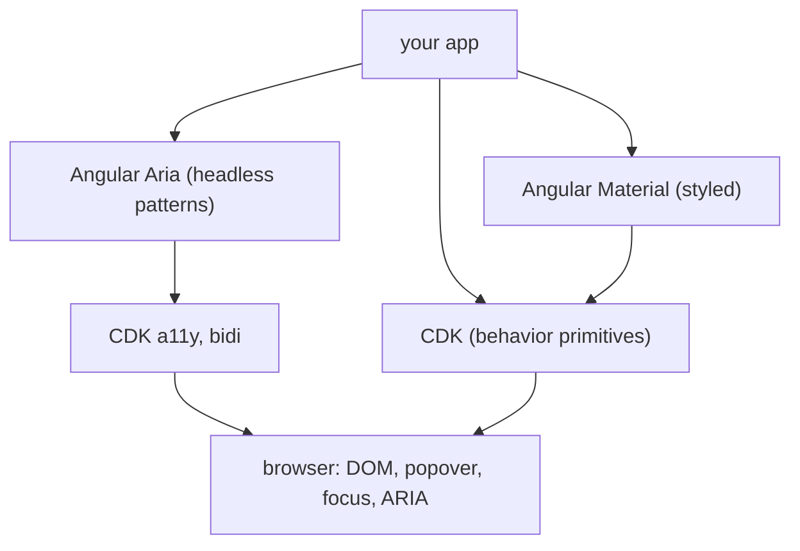

What to notice: every layer ends in platform features; the higher the layer, the less markup and styling you own.

### How it actually works

**Why a Material dialog traps focus and closes like a CDK one.** Read from the `@angular/material` 22.2.1 source (`fesm2022/dialog.mjs`): it imports `Dialog`, `DialogRef` and `CdkDialogContainer` from `@angular/cdk/dialog`. `MatDialog.open` calls the CDK `Dialog.open` with `MatDialogContainer`, a subclass of `CdkDialogContainer`, as the container, so it inherits the focus trap (code that keeps Tab inside the dialog, [11 §4](11-accessibility.md#4-keyboard-focus-order-roving-tabindex-and-focus-traps)) and focus return (internal `_trapFocus` and `_restoreFocus`, which may change in any release). Escape arrives through the `keydownEvents()` of the overlay, the floating layer [§5](#5-portals-and-overlays-where-floating-ui-renders-how-it-is-positioned-and-how-it-closes) builds; Material passes `disableClose: true` down and closes from its own `MatDialogRef`, which starts the exit animation. In the lab, the CDK `Dialog` service lists the Material dialog by its id, and the container carries both `mat-mdc-dialog-container` and `cdk-dialog-container` (`Section 1: MatDialog opens its content in a CDK dialog container`).

**Aria builds on the CDK too**: its files import `@angular/cdk/a11y`, `bidi`, `platform` and `testing` (read, not run). Under jsdom, an Aria and a CDK listbox on a plain `ul` both get `role="listbox"`, `aria-orientation="vertical"` and three `option` children; only the CDK host gets a class, `cdk-listbox` (`Section 1: an Aria listbox and a CDK listbox expose the same listbox role on plain markup`).

**One version for all three.** A **peer dependency** is a package a library expects the app to install, within the range its `peerDependencies` names. Material and Aria 22.2.1 name `"@angular/cdk": "22.2.1"`, exactly, so the three upgrade together.

**Change detection.** Several Material components, `MatDialogContainer` among them, declare `ChangeDetectionStrategy.Eager`, checked whenever the walk reaches them ([21 §2](21-change-detection.md#2-onpush-and-eager-strategies-and-what-marks-a-view-dirty); CHANGELOG 22.0.0: "use eager change detection"). Yours keep the OnPush default.

**Choosing.** Material when its look fits; the CDK for behavior under your markup; Aria for a WAI-ARIA pattern on your markup ([§12](#12-a-design-system-on-the-cdk-and-angular-aria-or-a-wrapper-around-material)). All three ship **harnesses** (test classes that drive a component through a supported API, [29 §11](29-testing-angular.md#11-component-harnesses-and-angular-testing-library)) in `…/testing` entry points. Drilled in [Q36.01](#q36-01) and [Q36.02](#q36-02).

### Code

The `/m36/layers` page builds one "pick a size" control three ways:

1. Material: `mat-selection-list` brings markup, styles and behavior.
2. CDK: `cdkListbox` on a plain `ul`; the `m36-` rules in `styles.scss` are its whole look.
3. Aria: `ngListbox` on the same markup, configured through signal inputs.

```ts
// Excerpt of labs/angular/projects/material-lab/src/app/m36/layers/layers.ts
      <!-- 1. Material: the component brings its markup, its styles and its behavior. -->
      <mat-selection-list aria-label="Size" [multiple]="false">
        @for (size of sizes; track size.value) {
          <mat-list-option [value]="size.value">{{ size.label }}</mat-list-option>
        }
      </mat-selection-list>
      <!-- 2. CDK: behavior on your markup; the m36- classes are the whole look. -->
      <ul cdkListbox aria-label="Size" class="m36-listbox">
        @for (size of sizes; track size.value) {
          <li [cdkOption]="size.value" class="m36-option">{{ size.label }}</li>
        }
      </ul>
      <!-- 3. Aria: the WAI-ARIA listbox pattern on your markup, configured through signal inputs. -->
      <ul ngListbox aria-label="Size" class="m36-listbox">
        @for (size of sizes; track size.value) {
          <li ngOption [value]="size.value" [label]="size.label" class="m36-option">{{ size.label }}</li>
        }
      </ul>
```

In Chromium each is a listbox named "Size" with three options and `aria-multiselectable="false"` (`Section 1: the Material, CDK and Aria versions expose the same accessible role and name`).

### Best practices and anti-patterns

- **Avoid hand-rolling a listbox's or dialog's keyboard and ARIA handling**, because the CDK and Aria already implement it.
- **Test by role and name or through a harness**, because the three versions above share role and name, not markup.

### Misconceptions and traps

- *"The CDK is the old Material."* It is the behavior layer Material is built on (`MatDialog` over CDK `Dialog`). The myth exists because both live in one repository and share version numbers.
- *"Angular Aria replaces the CDK."* Aria imports CDK `a11y` and `bidi`; its entry points are patterns only, while overlays, drag and drop and tables stay in the CDK. The myth exists because both offer a listbox and a menu.
- *"Using Material makes an app accessible."* Your labels, focus after navigation and status messages remain yours ([11 §5](11-accessibility.md#5-focus-management-in-spas-and-live-regions)). The myth exists because Material's components carry roles, keyboard handling and focus traps.
- *"Material can run a minor ahead of the CDK."* Its CDK peer is exact (above). The myth exists because most Angular peers are caret ranges, such as Material's `^22.0.0 || ^23.0.0` on `@angular/core`.

## 2. Material components in a v22 app: standalone imports, form fields, dialogs, direction and motion

### The problem it solves

A form shows an error before anyone has typed. A dialog closes and focus lands on `body`. A menu opens on the wrong side on a right-to-left page. Motion plays for a user who asked for less. An old `MatButtonModule` import brings four button classes for one.

### Mental model

Material components are standalone classes you import where a template uses them (`MatButton`, `MatInput`, `MatFormField`, `MatError`). They take their look from the theme's variables ([§3](#3-theming-with-material-3-mattheme-system-variables-and-light-and-dark-with-color-scheme)) and their behavior from the CDK, like appliances plugged into a building's wiring. `matButton` takes an **appearance**: `text`, `filled`, `elevated`, `outlined` or `tonal` [Added in v20.0]. `MatDialog.open` returns a **dialog ref**, a handle you close or await with `afterClosed()`. `MatFormFieldControl` [Changed in v22.2: supports Signal Forms] is the contract a control such as `matInput` implements to sit in a `mat-form-field`; `ErrorStateMatcher` decides when that field shows its error.

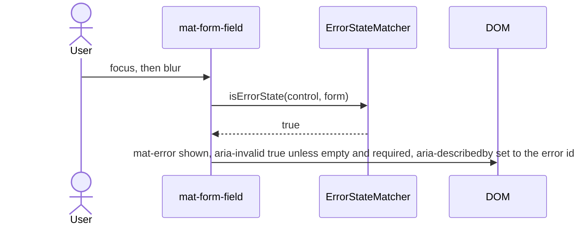

What to notice: the error appears when the matcher's condition holds, not when the control turns invalid.

### How it actually works

**Why the error waits for blur.** In `@angular/material` 22.2.1 (`fesm2022/_error-options-chunk.mjs`), the default `isErrorState` returns `!!(control && control.invalid && (control.touched || form && form.submitted))`, and blur marks the control touched. `matInput` sets `aria-invalid` from it and the form field points `aria-describedby` at the `mat-error` id (`Section 2: the error shows only after the control is touched`). A Signal Forms field ([26 §3](26-signal-forms.md#3-binding-with-formfield-native-inputs-attributes-classes-and-rendering)) gets `isSignalErrorState` [Added in v22.0.4], the same rule ([25 §8](25-forms-reactive-and-template-driven.md#8-error-display-strategies-and-accessible-errors) teaches the policy).

**Why a dialog gives focus back.** `MatDialogContainer` extends the CDK's `CdkDialogContainer`. Read, not run: when content attaches it records the focused element (internal `_initializeFocusTrap`, which may change in any release); on destroy it refocuses it if focus is on `body` or inside the dialog (internal `_restoreFocus`). `MatDialogConfig` defaults to `restoreFocus: true` ([§9](#9-cdk-accessibility-focustrap-focusmonitor-liveannouncer-and-the-key-managers) covers `FocusTrap`). In Chromium, closing by button or Escape returns focus to the opener (`Section 2: closing a dialog returns focus to the button that opened it`).

**Why direction and motion need no setup.** `Directionality` is the CDK service for the reading direction ([34 §11](34-i18n.md#11-right-to-left-layouts-dir-logical-css-properties-and-bidirectional-text)); a `Dir` directive on an ancestor overrides it below. `MatMenuTrigger` passes it to the overlay and `xPosition` defaults to `'after'`: origin and overlay both use `start`, so the panel's start edge meets the trigger's, left under ltr and right under rtl (`Section 2: a menu opens on the start side under dir rtl`).

`MATERIAL_ANIMATIONS` [Added in v20.0] holds `{ animationsDisabled?: boolean }`. The internal `_getAnimationsState()` returns `'di-disabled'` when it says so or `ANIMATION_MODULE_TYPE` is `'NoopAnimations'`; otherwise it reads `(prefers-reduced-motion)` once per page into a module variable (read, not run). Under `reduce` the page reports `reduced-motion` and the menu panel's `animation-name` is `none`; under `no-preference`, `enabled` and `_mat-menu-enter` (`Section 2: Material disables its motion when reduced motion is requested`).

### Code

The `/m36/material-app` page imports each class where used:

1. The dialog's content imports the `mat-dialog-*` directives.
2. The page imports the menu classes and `Dir`, and calls `MatDialog.open`.
3. The spec's host puts a `matInput` and a `mat-error` in a `mat-form-field`.

```ts
// Excerpt of labs/angular/projects/material-lab/src/app/m36/material-app/material-app.ts
@Component({
  selector: 'lab-m36-delete-dialog',
  imports: [MatButton, MatDialogTitle, MatDialogContent, MatDialogActions, MatDialogClose],
  template: `
    <h2 mat-dialog-title>Delete this draft?</h2>
    <mat-dialog-content>The draft cannot be restored.</mat-dialog-content>
    <mat-dialog-actions>
      <button matButton mat-dialog-close>Keep</button>
      <button matButton="filled" [mat-dialog-close]="true">Delete</button>
    </mat-dialog-actions>
  `,
})
class LabM36DeleteDialog {}
```

```ts
// Excerpt of labs/angular/projects/material-lab/src/app/m36/material-app/material-app.ts
    @for (direction of directions; track direction) {
      <section [attr.aria-label]="'Menu under dir ' + direction" [dir]="direction">
        <button matButton [matMenuTriggerFor]="menu">Menu</button>
        <mat-menu #menu="matMenu">
          <button mat-menu-item>Rename draft</button>
          <button mat-menu-item>Duplicate draft</button>
        </mat-menu>
      </section>
    }
  `,
})
export class LabM36MaterialApp {
  private readonly dialog = inject(MatDialog);
  protected readonly directions = DIRECTIONS;

  protected openDelete(): void {
    this.dialog.open(LabM36DeleteDialog);
  }
}
```

```ts
// Excerpt of labs/angular/src/app/modules/36-material-and-cdk/concepts/section-2-form-field.spec.ts
@Component({
  selector: 'lab-m36-email-field',
  imports: [ReactiveFormsModule, MatFormField, MatLabel, MatInput, MatError],
  template: `
    <mat-form-field>
      <mat-label>Email</mat-label>
      <input matInput [formControl]="email" />
      <mat-error>Enter a valid email address</mat-error>
    </mat-form-field>
  `,
})
class LabM36EmailField {
  readonly email = new FormControl('not-an-email', { nonNullable: true, validators: [Validators.email] });
}
```

#### Legacy

NgModule-era code imported `MatButtonModule` and wrote `mat-button`, `mat-raised-button`, `mat-flat-button` or `mat-stroked-button`:

```ts
// Partial: a component's metadata in the NgModule-era style
@Component({
  imports: [MatButtonModule],
  template: `<button mat-flat-button>Save</button>`,
})
```

In 22.2.1 both still work (no `@deprecated` tag in `types/button.d.ts`): the selectors set four appearances on the same class (`Section 2: MatButton applies the filled appearance class` compares `mat-flat-button` with `matButton="filled"`), and only `matButton` can ask for `tonal`. `MatButtonModule` exports four button classes and `BidiModule`. Migrate by importing `MatButton` and writing `matButton="…"`.

### Best practices and anti-patterns

- **Open a dialog from a focused control**, because the container restores whatever was focused.
- **Test both directions under `Dir`**, because the menu's side comes from `Directionality`, not your CSS.
- **Avoid an animation provider for Material**, because the token and the media query decide.

### Misconceptions and traps

- *"Material needs `provideAnimations()`."* Once true: until v19.1, Material depended on the animations module. Now `@angular/animations` is not among its peer dependencies (`package.json` 22.2.1) [Changed in v19.2: dropped that dependency]. The myth exists because guides of that era listed the provider ([35 §9](35-animations.md#9-migrating-from-angularanimations-to-native-css-and-animateenteranimateleave) covers the package).
- *"`mat-error` shows when the control is invalid."* The default matcher also needs touched or a submitted form (tested). The myth exists because the control is invalid from the start.
- *"`MatButtonModule` is required."* The standalone classes import directly. The myth exists because NgModule-era docs imported modules.
- *"Material components are OnPush like a v22 app's."* The dialog container and the table components declare `ChangeDetectionStrategy.Eager` (`dialog.mjs`, `table.mjs`). The myth exists because v22 made OnPush the default for your components.

Drilled in [Q36.03](#q36-03) and [Q36.04](#q36-04).

## 3. Theming with Material 3: `mat.theme`, system variables, and light and dark with `color-scheme`

### The problem it solves

A brand blue pasted into forty component rules drifts when design changes it. A dark mode built by copying every color rule doubles the CSS. And nobody knows which values the team may change.

### Mental model

A **design token** is a named design decision (a color role, a type style) that code reads by name. `mat.theme` is a Sass mixin you include once, on `html`. From a **palette** (a map of **tonal palettes**, each a hue at tones 0 to 100), a font family and a **density** (a spacing scale, 0 down to -5 per the theming guide), it writes **system variables** (system tokens): custom properties such as `--mat-sys-primary` or `--mat-sys-body-medium`. Each component reads them through its own **component tokens**, such as `--mat-button-filled-container-color`.

The **theme type** sets the colors' form. The default, `color-scheme` [Changed in v19.0: the default theme type], writes each color as `light-dark(<light>, <dark>)` [Baseline 2024: newly available, per MDN], which picks a color from the element's `color-scheme` property [Baseline 2022: widely available, per MDN]. (**Baseline**, [MDN's](https://developer.mozilla.org/en-US/docs/Glossary/Baseline/Compatibility) label: *newly available* is support in the latest Chrome, Edge, Firefox and Safari; *widely available*, 2.5 years of it.) `light dark` follows the user's preference; `light` or `dark` forces one ([10 §6](10-css-essentials.md#6-custom-properties-theming-and-color-scheme)). Think of a paint chart printed once with two finishes per swatch; the room's lighting picks the finish.

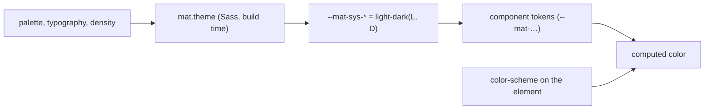

What to notice: Sass runs at build time; the light-or-dark choice happens in the browser, per element.

### How it actually works

**Why the theme turns dark without a second theme.** Read in `@angular/material` 22.2.1, `core/tokens/_system.scss`, mixin `theme`: a bare palette gets the `color-scheme` type (line 82), as does a color map without `theme-type` (64-66). The internal `_generate-sys-colors` (may change in any release) builds light and dark role maps and, for `color-scheme`, sets each role to `light-dark($light-value, $dark-value)` (248-256). `primary` is tone 40 in light and 80 in dark (`m3/_md-sys-color.scss`), so azure's is `light-dark(#005cbb, #abc7ff)`. With no enclosing rule, the internal `current-selector-or-root` writes on `html`. No script runs: the stylesheet declares them (`Section 3: the theme declares the system variables on html` finds them unresolved, with no inline style).

A property that uses the variable resolves `light-dark()` against its own element's `color-scheme`: one declaration gives two colors under two preferences (`Section 3: the primary color follows the color scheme preference`), and the dark one in a dark subtree of a light page (`Section 3: a subtree with color-scheme dark gets the dark values`). The filled button paints `var(--mat-button-filled-container-color, var(--mat-sys-primary))` (`fesm2022/button.mjs`; `Section 3: a filled button's background is the system primary color`; [§13](#13-under-the-hood-from-createoverlayref-to-a-popover-in-the-top-layer-and-from-mattheme-to-a-computed-color) traces it). The guide (`guides/theming.md`, read 2026-10-16): "If your application does not define a value for `color-scheme`, then the light colors will always be applied."

The lab's `system-ui` font loads nothing from the network (the smoke test checks requests); density 0 emits nothing (`_system.scss` 149). **Prebuilt themes** are compiled CSS files used instead of Sass; none of the eight contains `light-dark(` (grep).

> [!NOTE]
> **Framework vs platform.** Custom properties, inheritance, `light-dark()` and `color-scheme` are CSS; Material adds a build-time Sass mixin, the `--mat-sys-*` names and the rules that read them.

### Code

1. `styles.scss` sets `color-scheme: light dark` and includes `mat.theme` on `html`.
2. The page's block forces `color-scheme: dark` on `.m36-dark-panel`.
3. The template puts a swatch and a filled button outside and inside it.
4. The test reads both values from the built stylesheet.

```scss
// Excerpt of labs/angular/projects/material-lab/src/styles.scss
html {
  color-scheme: light dark;

  @include mat.theme(
    (
      color: mat.$azure-palette,
      typography: system-ui,
      density: 0,
    )
  );
}

.m36-swatch {
  padding: 0.5rem 1rem;
  border-radius: var(--mat-sys-corner-medium);
  background-color: var(--mat-sys-primary);
  color: var(--mat-sys-on-primary);
}

.m36-dark-panel {
  color-scheme: dark;
  background-color: var(--mat-sys-surface);
  color: var(--mat-sys-on-surface);
}
```

```ts
// Excerpt of labs/angular/projects/material-lab/src/app/m36/theme/theme.ts
    <section aria-labelledby="m36-theme-dark" class="m36-dark-panel">
      <h2 id="m36-theme-dark">Dark subtree</h2>
      <!-- 2. Same variables, inherited from html; color-scheme: dark on the section makes light-dark() pick the dark value. -->
      <div class="m36-swatch">Primary</div>
      <button matButton="filled" type="button">Save</button>
    </section>
```

```ts
// Excerpt of labs/e2e/tests/36-material-and-cdk/concepts/section-3-theme.spec.ts
const PRIMARY_DECLARATION = /--mat-sys-primary:\s*light-dark\(\s*([^,]+?)\s*,\s*([^)]+?)\s*\)/;
  const match = PRIMARY_DECLARATION.exec(await readFile(new URL(names[0], BUILD), 'utf8'));
  return { light: match[1], dark: match[2] };
```

#### Legacy

Material 2 theming passed an object from `mat.m2-define-light-theme` or `m2-define-dark-theme` to each component's mixin; dark mode was a second object applied in a media query or class (`guides/material-2.md`). Nothing is marked deprecated; the guide says "The M2 themes are provided for backwards compatibility and will be removed in a future version" (the prebuilt files). Migrate to one `mat.theme`; `mat.m2-theme` bridges by writing `--mat-sys-*` from an M2 object.

### Best practices and anti-patterns

- **Set `color-scheme` beside `mat.theme`**, because otherwise the light value always wins.
- **Switch modes through `color-scheme`, not a second theme**, because the variables hold both colors ([Q10.17](10-css-essentials.md#q10-17) builds a toggle).
- **Read `--mat-sys-*` in your own CSS**, because a copied hex ignores the scheme ([§4](#4-customizing-the-theme-system-and-component-token-overrides-and-theming-your-own-components)).

### Misconceptions and traps

- *"Dark mode needs a second theme."* One `mat.theme` holds both values (tested). The myth exists because M2 built a dark object, and `color-scheme` became the default only in v19.0.
- *"System variables are Sass variables."* They are custom properties read at run time (tested; [Q10.15](10-css-essentials.md#q10-15)). The myth exists because a Sass mixin writes them.
- *"A prebuilt theme supports dark mode."* Each file is one scheme, without `light-dark()`. The myth exists because the M3 files set the same `--mat-sys-*` names.
- *"`light-dark()` follows `prefers-color-scheme`."* It follows the element's `color-scheme` (tested). The myth exists because under `light dark` on `html` the two agree.

Drilled in [Q36.05](#q36-05) and [Q36.06](#q36-06).

## 4. Customizing the theme: system and component token overrides, and theming your own components

### The problem it solves

A designer wants a brand color on buttons only and a card that matches Material in light and dark. The team restyles `.mdc-button__label` (an internal class) and the next upgrade breaks it, because Material treats its class names as private.

### Mental model

Three levels, safest first. A **system override** changes a `--mat-sys-*` variable for a subtree: it edits the paint chart. A **component override** changes one component's tokens: it repaints one appliance model. **Direct CSS** on internal classes scrapes one appliance's enamel. The first two use **override mixins**, Sass mixins that write custom properties under the selector that includes them: `mat.theme-overrides` [Added in v19.0] and `mat.button-overrides` [Added in v18.0]. A **token name** is the key without the component prefix: `filled-container-color` for `--mat-button-filled-container-color`.

Overrides follow CSS inheritance: they reach the DOM subtree under their element. A dialog renders in the CDK overlay container on `body` ([§5](#5-portals-and-overlays-where-floating-ui-renders-how-it-is-positioned-and-how-it-closes)), outside it. Its way in is the **overlay pane class**: the class `panelClass` puts on the overlay's pane element.

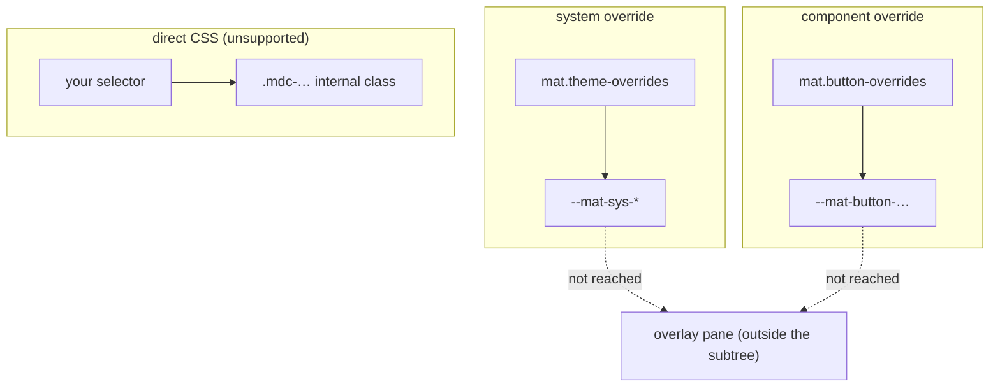

What to notice: the scope of an override is the DOM subtree, not the component tree.

### How it actually works

**Why a misspelled component token stops the build.** Read in `@angular/material` 22.2.1, not run. `button/_button-theme.scss`, mixin `overrides` (87), calls the internal `batch-create-token-values` (may change in any release) (`core/tokens/_token-utils.scss`, 86-). It emits each valid name as `--mat-button-<name>`; any other reaches an `@error` rule, and Sass then "stops compiling the stylesheet" (Sass docs). `mat.theme-overrides` (`core/tokens/_system.scss`, 190-211) has no such branch: it skips an unknown name silently, so `(primry: red)` does nothing.

**Why an override reaches a button and stops at a dialog.** The filled button paints `var(--mat-button-filled-container-color, var(--mat-sys-primary))` ([§3](#3-theming-with-material-3-mattheme-system-variables-and-light-and-dark-with-color-scheme)). A component token on an ancestor beats the fallback; a system override changes the fallback's variable. Both resolve where used, so both end at the subtree edge (`Section 4: a component override changes only the buttons inside its subtree`). The CDK appends the overlay container to `body` (`@angular/cdk` 22.2.1, `fesm2022/_overlay-module-chunk.mjs`, internal `_createContainer`), so the dialog is outside the card (`Section 4: a system override inside a card does not reach a dialog opened from it`). `panelClass` goes to the overlay config (`fesm2022/dialog.mjs`, internal `_getOverlayConfig`) and onto the pane, so the class there reaches it (`Section 4: the same override on the overlay pane class reaches the dialog`).

**Your own components.** The guide offers `--mat-sys-*` for "your component stylesheets", with no Sass import. The card reads them and exposes its own property with a fallback ([Q13.25](13-components-and-templates.md#q13-25); `Section 4: a custom card reads the system surface color in light and dark`).

**Strong focus indicators.** A background change "can fall short of accessibility requirements" (guide). A **strong focus indicator** is an outline on the focused element; `mat.strong-focus-indicators()` (`core/focus-indicators/_private.scss`) shows it; the internal `.mat-focus-indicator::before` is hidden otherwise. Read, not run; see [11 §4](11-accessibility.md#4-keyboard-focus-order-roving-tabindex-and-focus-traps).

### Code

1. `styles.scss` adds the two overrides and the custom card.
2. The page puts them on a button group, a card and, through `panelClass`, a dialog's pane.
3. The tests read the override colors from the built stylesheet.

```scss
// Excerpt of labs/angular/projects/material-lab/src/styles.scss
.m36-brand-buttons {
  @include mat.button-overrides(
    (
      filled-container-color: #8b5000,
    )
  );
}

.m36-brand {
  @include mat.theme-overrides(
    (
      primary: #006a6a,
    )
  );
}

.m36-custom-card {
  padding: 1rem;
  border-radius: var(--mat-sys-corner-medium);
  background-color: var(--mat-sys-surface-container);
  color: var(--mat-sys-on-surface);
}

.m36-custom-card h2 {
  margin: 0;
  color: var(--m36-card-accent, var(--mat-sys-primary));
}
```

```ts
// Excerpt of labs/angular/projects/material-lab/src/app/m36/overrides/overrides.ts
      <mat-card class="m36-brand" appearance="outlined" role="group" aria-label="Branded card">
        <mat-card-content>
          <div class="m36-swatch">Card primary</div>
          <button matButton="filled" type="button" (click)="openDialog()">Open dialog</button>
          <button matButton="filled" type="button" (click)="openDialog('m36-brand')">Open dialog on branded pane</button>
        </mat-card-content>
      </mat-card>
```

```ts
// Excerpt of labs/angular/projects/material-lab/src/app/m36/overrides/overrides.ts
  protected openDialog(panelClass = ''): void {
    this.dialog.open(LabM36BrandDialog, { panelClass });
  }
```

```ts
// Excerpt of labs/e2e/tests/36-material-and-cdk/concepts/section-4-overrides.spec.ts
const COMPONENT_OVERRIDE = /\.m36-brand-buttons\s*\{[^}]*--mat-button-filled-container-color:\s*([^;}]+)/;
const SYSTEM_OVERRIDE = /\.m36-brand\s*\{[^}]*--mat-sys-primary:\s*([^;}]+)/;
```

Direct CSS is **unsupported** (the guide "strongly discourages" it):

```css
/* Partial: unsupported; `.mdc-button__label` is internal to Material 22.2.1's button template */
.mdc-button__label {
  letter-spacing: 0.1em;
}
```

### Best practices and anti-patterns

- **Use system, then component overrides, never internal classes**, because only the first two are supported across versions.
- **Scope the class to the smallest subtree**, because an override on `html` changes everything.
- **Put an override meant for a dialog on its pane class**, because overlays render outside the subtree.
- **Prefer a component mixin for one-offs**, because it rejects typos that `theme-overrides` ignores.

### Misconceptions and traps

- *"`!important` on Material's classes is the way to customize."* The guide calls it unsupported. The myth exists because that was the only way before the token mixins.
- *"An override in a component's styles themes everything that component opens."* Overlays render outside the subtree (tested). The myth exists because the override reads like ownership of its children.
- *"Theming your own component means importing Material's Sass."* Plain CSS reading `--mat-sys-*` is enough (tested). The myth exists because Material 2 recipes called mixins per component.

Drilled in [Q36.07](#q36-07) and [Q36.08](#q36-08).

## 5. Portals and overlays: where floating UI renders, how it is positioned and how it closes

### The problem it solves

A dropdown in a card with `overflow: hidden` is cut off. A tooltip hides under a sticky header whatever its `z-index`, because a stacking context caps it ([10 §4](10-css-essentials.md#4-positioning-stacking-contexts-and-z-index)). Two stacked menus close on one Escape.

### Mental model

A **portal** is content rendered somewhere else; a **portal outlet** is the place ([19 §7](19-component-communication-and-projection.md#7-dynamic-components-viewcontainerrefcreatecomponent-createcomponent-and-bindings) owns `createComponent`). An **overlay** is an outlet the CDK creates outside your component tree: `createOverlayRef` [Added in v20.0] makes a host holding a **pane**, the element for your content. The host is a `popover="manual"` element (only code closes it) shown with `showPopover()` [Changed in v21.0: overlays render as native popovers by default], which puts it in the **top layer**, the browser's layer above every stacking context [Baseline 2025: newly available, per MDN]. A **position strategy** places the pane: globally, or against an **origin** element with **fallback positions** tried in order. A **scroll strategy** decides what scrolling does. A stagehand (portal) carries a prop to the front of the stage (top layer).

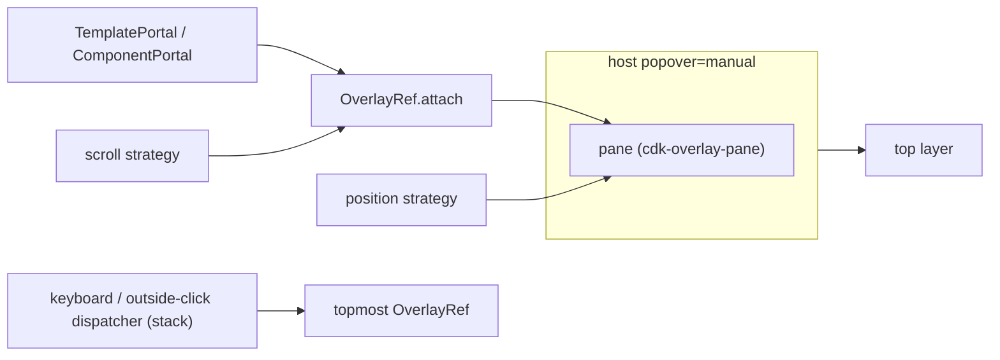

What to notice: the top layer, not the DOM position, decides what paints on top.

### How it actually works

**Why `z-index` fights stopped.** Read in `@angular/cdk` 22.2.1, `fesm2022/_overlay-module-chunk.mjs`, `createOverlayRef` (2051-2091): `usePopover` is the config value, else the `OVERLAY_DEFAULT_CONFIG` token's, else `true`, and `false` without `'showPopover' in document.body` (2062-2069). The host then gets `popover="manual"` (2076-2079) and `attach` calls `showPopover()` (967). The commit "enable popover by default" ([#32209](https://github.com/angular/components/pull/32209)) is in the history of the 21.0.0 tag, not of 20.2.14 (GitHub commits API, read 2026-10-16); the changelog has no line for it. The host stays a child of the **overlay container**, the `div` the CDK appends to `body` (2080-2087; [the overlay guide](https://github.com/angular/components/blob/main/src/cdk/overlay/overlay.md) agrees; `Section 5: the overlay host is a popover in the top layer`).

**Why a fallback position is taken.** `FlexibleConnectedPositionStrategy.apply` (1134-1203) applies the first position that fits the viewport. With `withFlexibleDimensions(false)` and `withPush(false)` it neither shrinks nor pushes (1392-1403), so if none fits the most visible area wins (`Section 5: a connected overlay near the bottom edge opens above its origin`). `start` follows `Directionality` ([34 §11](34-i18n.md#11-right-to-left-layouts-dir-logical-css-properties-and-bidirectional-text); tested in [§2](#2-material-components-in-a-v22-app-standalone-imports-form-fields-dialogs-direction-and-motion)).

**Why one Escape closes one overlay.** Internal, may change in any release: the keyboard dispatcher's `_attachedOverlays` array is walked from the end, and the first overlay with a `keydownEvents()` subscriber gets the event (415-424); the outside-click dispatcher notifies overlays from the top until one contains the click (489-509). A raw `OverlayRef` therefore closes nothing itself: CDK `DialogRef` subscribes and closes on Escape (`dialog.mjs`, 354-358). `disposeOnNavigation` (default `false`) closes on back and forward, or on any URL change with `'url-change'` [Added in v22.2.1] (784-789).

**Why only the DOM nodes move.** A `DomPortalOutlet` attaches a `ComponentPortal` through `createComponent` and `appRef.attachView` and appends its root node to the pane (`portal.mjs`, 186-208); a template portal's root nodes move the same way (212-218). Both stay Angular views ([Q19.25](19-component-communication-and-projection.md#q19-25); `Section 5: a TemplatePortal renders its template into a CdkPortalOutlet with its context`). `MatDialog` adds a focus trap ([§9](#9-cdk-accessibility-focustrap-focusmonitor-liveannouncer-and-the-key-managers)).

> [!NOTE]
> **Framework vs platform.** The `popover` attribute and the [top layer](https://developer.mozilla.org/en-US/docs/Glossary/Top_layer) are the browser's; [`manual`](https://developer.mozilla.org/en-US/docs/Web/HTML/Reference/Global_attributes/popover) popovers are never light-dismissed. The CDK adds positioning, scroll handling, the Escape and outside-click stack, and portal attachment.

### Code

The page builds raw overlays, so each piece is visible.

1. A position list tries below, then above.
2. `openMenu` builds a connected strategy from the clicked button.
3. `show` creates the overlay, attaches a `ComponentPortal` and subscribes to the events it wants.
4. Tests read the top layer, parents, rectangles and painted elements.

```ts
// Excerpt of labs/angular/projects/material-lab/src/app/m36/overlay/overlay.ts
const BELOW_THEN_ABOVE: ConnectedPosition[] = [
  { originX: 'start', originY: 'bottom', overlayX: 'start', overlayY: 'top', panelClass: 'm36-below' },
  { originX: 'start', originY: 'top', overlayX: 'start', overlayY: 'bottom', panelClass: 'm36-above' },
];
```

```ts
// Excerpt of labs/angular/projects/material-lab/src/app/m36/overlay/overlay.ts
  protected openMenu(label: string, event: Event): void {
    const origin = event.currentTarget;
    if (!(origin instanceof HTMLElement)) return;
    const strategy = createFlexibleConnectedPositionStrategy(this.injector, origin)
      .withPositions(BELOW_THEN_ABOVE)
      .withFlexibleDimensions(false)
      .withPush(false);
    this.show(label, strategy, 'outside');
  }

  private show(label: string, positionStrategy: PositionStrategy, dismiss: Dismiss): void {
    // 1. createOverlayRef makes the host and the pane; the strategies say where and what scrolling does.
    const ref = createOverlayRef(this.injector, {
      positionStrategy,
      scrollStrategy: createRepositionScrollStrategy(this.injector),
    });
    // 2. A ComponentPortal attaches the panel into the pane.
    ref.attach(new ComponentPortal(LabM36Panel)).setInput('label', label);
    this.refs.add(ref);
    ref.detachments().subscribe(() => this.refs.delete(ref));
    // 3. A raw OverlayRef closes nothing by itself: the page subscribes to the events it cares about.
    if (dismiss === 'outside') ref.outsidePointerEvents().subscribe(() => ref.dispose());
    if (dismiss === 'escape') {
      ref.keydownEvents().subscribe((event) => {
        if (event.key === 'Escape') ref.dispose();
      });
    }
  }
```

```ts
// Excerpt of labs/e2e/tests/36-material-and-cdk/concepts/section-5-overlay.spec.ts
  // The second was attached last, so it is the topmost: one Escape closes it and leaves the first.
  await page.keyboard.press('Escape');
  await expect(second).toHaveCount(0);
  await expect(first).toBeVisible();
```

### Best practices and anti-patterns

- **Use `createOverlayRef` and the `create*` strategies, not the `Overlay` service**, because 20.0.0 added them as tree-shakeable alternatives ([#30904](https://github.com/angular/components/pull/30904)).
- **Subscribe to `keydownEvents()` and `outsidePointerEvents()`**, because nothing else closes the overlay.
- **Dispose overlays with their owner**, because the host stays until `dispose()` removes it (842).

### Misconceptions and traps

- *"Overlays live at the end of `body`, so DOM order puts them on top."* The host is still in the container (tested), but the top layer paints it. Once true: DOM order decided it through v20; v21.0 made the host a popover. The myth exists because that was the story for years.
- *"A high `z-index` fixes a hidden dropdown."* A stacking context caps it; the top layer sidesteps it (`Section 5: the overlay host is a popover in the top layer`). The myth exists because it fixes most overlaps.
- *"A portal is content projection."* Projection is fixed at compile time; a portal attaches at run time into any outlet ([19 §3](19-component-communication-and-projection.md#3-content-projection-ng-content-slots-ngprojectas-fallback-content-and-the-lifecycle-trap)). The myth exists because both show content elsewhere.
- *"An overlay closes itself on Escape."* Material's do; a raw `OverlayRef` emits `keydownEvents()` and you close it (`Section 5: Escape closes only the topmost of two overlays`). The myth exists because `MatDialog` hides the wiring.

Drilled in [Q36.09](#q36-09), [Q36.10](#q36-10) and [Q36.11](#q36-11).

## 6. Drag and drop: sorting, transferring between lists and the keyboard gap

### The problem it solves

The browser's [HTML Drag and Drop API](https://developer.mozilla.org/en-US/docs/Web/API/HTML_Drag_and_Drop_API) drags a translucent copy and sorts nothing: hit testing, the moving gap and the data update are yours. Three failures follow: a list that snaps back after every drop, lists that will not exchange items, and a board only a mouse can rearrange.

### Mental model

A **drop list** (`cdkDropList`) is a container; a **drag item** (`cdkDrag`) sits inside it. While you drag, the CDK hides the item, shows a **preview** (a copy that follows the pointer) and leaves a **placeholder** (a copy that marks the gap). Lists exchange items only when **connected**: by `cdkDropListConnectedTo` or by sharing one **drop list group** (`cdkDropListGroup`). A **drag handle** (`cdkDragHandle`) limits where a drag may start; the **start threshold** is how far the pointer must move before a press becomes a drag. A sorting tray tells you where the card landed; you write the ledger.

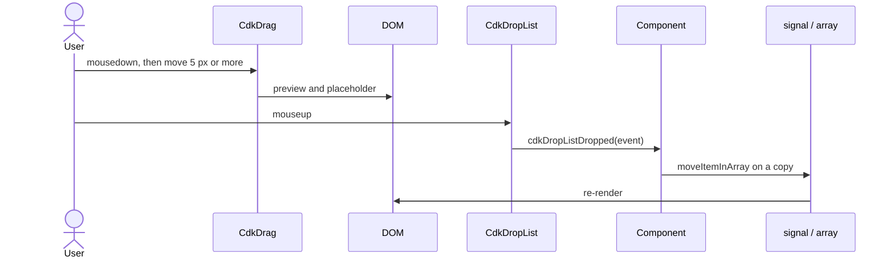

What to notice: the order changes only when your handler changes the data.

### How it actually works

**Why a drag starts late.** Read in `@angular/cdk` 22.2.1, `fesm2022/drag-drop.mjs`: an item listens for `mousedown` and `touchstart` (719), the document for `mousemove`, `touchmove`, `mouseup` and `touchend` (310-341), and no pointer events. Internal, may change in any release: `DragRef._pointerMove` starts the drag when horizontal plus vertical distance reaches `dragStartThreshold`, 5 px by default (581, 891, 2509). The native `dragstart` is cancelled (1410-1418), and the preview is a `popover="manual"` element appended to `body` (495, 551, 1393-1400), outside your page's root class.

**Why a drop only reports.** The list emits `cdkDropListDropped` with `previousIndex`, `currentIndex`, `previousContainer` and `container` (3157-3170), then the item's node returns to its marker (1068-1072): with no data change the old order is back (`Section 6: without moveItemInArray the list snaps back`). `moveItemInArray` and `transferArrayItem` mutate (1452-1471), and a signal notices only a new value ([17 §2](17-signals.md#2-writable-signals)): `Section 6: moveItemInArray on a signal array leaves a computed value stale`.

**Why an unconnected list refuses.** Siblings are the `connectedTo` lists plus the group's (3092-3127), and only they are asked to receive (2170): `Section 6: an unconnected list does not accept the item`.

**Why there is no keyboard path.** A search of `drag-drop.mjs` for `keydown` finds nothing, and keys do nothing (`Section 6: arrow keys on a focused item do not move it`). WCAG 2.2 [2.1.1 Keyboard](https://www.w3.org/TR/WCAG22/#keyboard) exempts only input that depends on the path of a movement, and a drop depends on its endpoint; [2.5.7 Dragging Movements](https://www.w3.org/TR/WCAG22/#dragging-movements) asks for a single-pointer alternative. Build one ([11 §4](11-accessibility.md#4-keyboard-focus-order-roving-tabindex-and-focus-traps), [§9](#9-cdk-accessibility-focustrap-focusmonitor-liveannouncer-and-the-key-managers)).

The `DragDrop` service [Deprecated since v21.0.6 — use `createDragRef` and `createDropListRef`] ([#32604](https://github.com/angular/components/pull/32604)): its typing says "Will be removed in v23" (`types/drag-drop.d.ts`, 1333-1335).

### Code

The board shows the pattern.

1. Each column is a `cdkDropList` in one `cdkDropListGroup`; its data is the column id.
2. `moveCard` applies `moveItemInArray` or `transferArrayItem` to copies.
3. The test drags with `dragBy`: a 10 px move passes the threshold, then 12 moves reach the target.

```ts
// Excerpt of labs/angular/projects/material-lab/src/app/m36/drag-drop/drag-drop.ts
      <div cdkDropListGroup class="m36-board">
        @for (column of columns; track column.id) {
          <ul cdkDropList class="m36-drag-list" [attr.aria-label]="column.label" [cdkDropListData]="column.id" (cdkDropListDropped)="moveCard($event)">
            @for (card of board()[column.id]; track card) {
              <li cdkDrag [cdkDragData]="card" cdkDragPreviewClass="m36-drag-preview" class="m36-drag-item">{{ card }}</li>
            }
          </ul>
        }
      </div>
```

```ts
// Excerpt of labs/angular/projects/material-lab/src/app/m36/drag-drop/drag-drop.ts
  protected moveCard(event: CdkDragDrop<ColumnId, ColumnId, string>): void {
    const from = event.previousContainer.data;
    const to = event.container.data;
    this.boardReport.set(`Dropped ${event.item.data}: ${from} to ${to}`);
    this.board.update((board) => {
      const next: Board = { todo: [...board.todo], done: [...board.done] };
      if (from === to) moveItemInArray(next[to], event.previousIndex, event.currentIndex);
      else transferArrayItem(next[from], next[to], event.previousIndex, event.currentIndex);
      return next;
    });
  }
```

```ts
// Excerpt of labs/e2e/tests/36-material-and-cdk/concepts/section-6-drag-drop.spec.ts
  await dragBy(page, todo.filter({ hasText: 'Write' }), done.filter({ hasText: 'Ship' }));

  await expect(report(page, 'Board report')).toHaveText('Dropped Write: todo to done');
  await expect(todo).toHaveText(['Test']);
```

### Best practices and anti-patterns

- **Reorder a copy and `update` the signal**, because `moveItemInArray` mutates and a signal sees only a new value.
- **Connect lists with a group or ids**, because an unconnected list is never asked to receive.
- **Offer a second way to move items**, because the CDK has no keyboard path ([Exercise 36.3](#ex36-3)).
- **Style the preview with `cdkDragPreviewClass`**, because it lives in `body`.
- **Avoid the `DragDrop` service**, because it is deprecated.

### Misconceptions and traps

- *"The CDK uses the HTML Drag and Drop API."* It reads mouse and touch events and cancels the native `dragstart`. The myth exists because `cdkDrag` looks like `draggable`.
- *"The CDK reorders your array."* It reports; your handler decides (`Section 6: dragging the first item below the third reorders the list`). The myth exists because the gap moves during the drag.
- *"CDK drag and drop is accessible because the CDK is."* The helpers are other entry points; this one has no key handling. The myth exists because they ship in one kit.
- *"`moveItemInArray` works with signals."* It mutates, so derived state goes stale. The myth exists because a signal holds an array and the function takes one.

Drilled in [Q36.12](#q36-12) and [Q36.13](#q36-13).

## 7. Tables and long lists: `CdkTable`, `DataSource`, `MatTable` and virtual scrolling

### The problem it solves

A hand-written `<table>` with `@for` grows sorting, paging, sticky headers and a "no data" row on every page, and a poll that returns fresh objects can rebuild every row (read, not run, below).

### Mental model

A **column definition** (`cdkColumnDef`, `matColumnDef`) names a column and holds its header and cell templates. A **row definition** (`cdkRowDef`) lists the columns a data row shows; a **header row** (`cdkHeaderRowDef`) does so for the header. Data is an array, an `Observable` or a **`DataSource`**: an object whose `connect` returns an `Observable` of rows and whose `disconnect` cleans up. **`trackBy`** (table) gives each row an identity across emissions. A **sticky column** (`sticky` on a column definition) stays in view when the table scrolls sideways. **`MatTableDataSource`** (Material) filters, sorts and pages an array in memory. A spreadsheet template: column formats fixed, rows poured in.

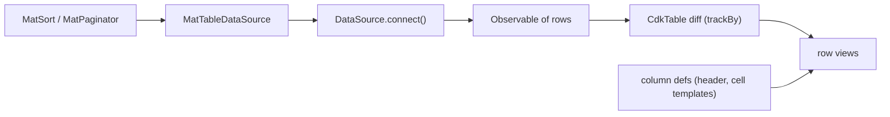

What to notice: the table renders what the data source emits, so sorting and paging belong to the data source.

### How it actually works

**Why connect runs once.** Read in `@angular/cdk` 22.2.1, `fesm2022/table.mjs`: `ngAfterContentChecked` calls `_render` once the table is initialized (1571-1574, 1731-1733), and `_render` calls `_observeRenderChanges` only when a data source and a row definition exist and no subscription does (1752-1753); both are internal, may change in any release. It calls `connect(this)` when the value has a `connect` function (1871-1872; `_data-source-chunk.mjs` 4-6), takes an `Observable` as is, wraps an array, and otherwise throws in development mode (1873-1880): `Section 7: connect is called once on init and disconnect once on destroy`.

**Why disconnect runs when it does.** A new `dataSource` disconnects the old one (1847-1856); destroying the table disconnects the current one (1588-1589). Arrays and observables have no `disconnect`: the table unsubscribes (1852-1855) or `takeUntil` ends it (1881). The docs (`table.md`, read 2026-10-16) name only `DataSource`, the typing all three (`types/table.d.ts` 359): `Section 7: the table renders one row per emitted item and only the listed columns`.

**Why `trackBy` matters.** The differ's key is `trackBy(index, data)`, else a row object cached per data object (1554-1556, 1766-1769). Fresh objects mean new views; equal keys keep the view and set its `$implicit` (1608-1618). Read, not run. Row templates and context: [19 §4](19-component-communication-and-projection.md#4-template-driven-apis-ng-template-ngtemplateoutlet-and-typed-context), [Q19.13](19-component-communication-and-projection.md#q19-13).

**What else the sources show.** The no-data row appears when the row outlet is empty (2066-2071): `Section 7: the no-data row shows for an empty emission`. `MatTable extends CdkTable` (`@angular/material` 22.2.1, `fesm2022/table.mjs` 40). `CdkRecycleRows` is typed "@deprecated This directive is a no-op and will be removed" (`types/table.d.ts` 343-349). `renderedRows` [Added in v22.0] (`types/table.d.ts` 677; [CHANGELOG](https://github.com/angular/components/blob/main/CHANGELOG.md): "expose rendered rows").

**Long lists.** [31 §4](31-performance.md#4-long-lists-track-virtual-scrolling-with-the-cdk-and-the-alternatives) owns virtual scrolling, [31 §11](31-performance.md#11-under-the-hood-the-cdks-rendered-range-ngoptimizedimages-srcset-and-the-builders-chunks) its range arithmetic and [Q31.09](31-performance.md#q31-09) a counted run. Those tests use a list, not a table, so nothing here is claimed about a table in a viewport; the table docs name two limits, `fixedLayout` always on and no `when` row definitions (documented, not run).

### Code

Two hosts and a counting source show the mechanism.

1. Columns are named; the row definition lists `name` and `qty`.
2. `CountingSource` is no Material class.
3. `MatSort` joins `MatTableDataSource` after the view exists.

```ts
// Excerpt of labs/angular/src/app/modules/36-material-and-cdk/concepts/section-7-table.spec.ts
    <table cdk-table [dataSource]="source()">
      <ng-container cdkColumnDef="id">
        <th cdk-header-cell *cdkHeaderCellDef>Id</th>
        <td cdk-cell *cdkCellDef="let row">{{ row.id }}</td>
      </ng-container>
      <tr cdk-header-row *cdkHeaderRowDef="columns"></tr>
      <tr cdk-row *cdkRowDef="let row; columns: columns"></tr>
      <tr *cdkNoDataRow><td colspan="2">No items</td></tr>
    </table>
```

```ts
// Excerpt of labs/angular/src/app/modules/36-material-and-cdk/concepts/section-7-table.spec.ts
  override connect(viewer: CollectionViewer): Observable<readonly Item[]> {
    this.connected.push(viewer);
    return this.rows;
  }

  override disconnect(viewer: CollectionViewer): void {
    this.disconnected.push(viewer);
  }
```

```ts
// Excerpt of labs/angular/src/app/modules/36-material-and-cdk/concepts/section-7-table.spec.ts
  ngAfterViewInit(): void {
    this.dataSource.sort = this.sort();
  }
```

### Best practices and anti-patterns

- **Pass a `trackBy` that returns the row's id**, because fresh objects are new keys otherwise.
- **Keep sorting and paging in the data source**, because the table renders what the stream emits.
- **Release resources in `disconnect`**, because the table calls it on a switch and a destroy.

### Misconceptions and traps

- *"`mat-table` and `cdk-table` are different engines."* `MatTable` extends `CdkTable` (`Section 7: MatSort reorders a MatTableDataSource`). The myth exists because the element names differ.
- *"A `DataSource` must be a class from Material."* An object with `connect`, an `Observable` or an array works (`Section 7: the table renders one row per emitted item and only the listed columns`). The myth exists because `MatTableDataSource` is the common example.
- *"Virtual scrolling makes any table fast."* It limits DOM rows, and no test here runs a table in a viewport. The myth exists because fewer rows sounds like less work.

Drilled in [Q36.14](#q36-14).

## 8. The smaller primitives: the stepper, `BreakpointObserver` and `Clipboard`

### The problem it solves

A checkout wizard lets users skip an invalid step. A layout that reads `window.innerWidth` once ignores rotation and breaks on the server. A "copy link" button works on a laptop and fails in a test.

### Mental model

A **step control** is the form control a step checks (`stepControl`); a **linear stepper** (`linear`) will not leave a step until it is valid. `CdkStepper` holds that logic and renders nothing; `MatStepper` adds headers and look. A **breakpoint** is a viewport size where the layout changes, written as a **media query** ([10 §5](10-css-essentials.md#5-responsive-css-media-queries-container-queries-and-fluid-type)). `BreakpointObserver` turns media queries into an `Observable`. A turnstile, a weather vane, a copier.

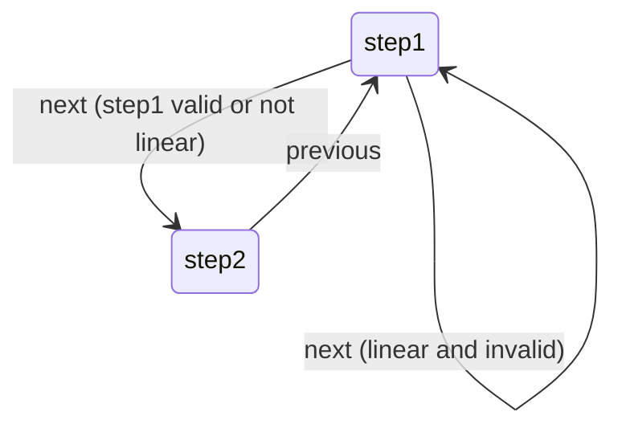

What to notice: `linear` turns validity into a gate.

### How it actually works

**Why a linear stepper blocks.** Read in `@angular/cdk` 22.2.1, `fesm2022/stepper.mjs`: the `selectedIndex` setter marks the current step interacted, then moves only if `_anyControlsInvalidOrPending(index)` is false (404-418; internal, may change in any release). That check blocks on an earlier control that is invalid, pending or not interacted (541-550); a step without a control is complete once interacted (145-152). `next()` reaches the setter (482-484), and a move emits `selectionChange` (514-522): `Section 8: a linear stepper does not advance past an invalid step`.

**Why the observer reports changes.** `MediaMatcher` uses `window.matchMedia` [Baseline 2015: widely available, per MDN] in a browser that has it, else the internal `noopMatchMedia`, which matches only `all` and the empty string (`_breakpoints-observer-chunk.mjs` 16-18, 71-78; may change in any release). `BreakpointObserver` splits a comma-separated string into queries (161-163), listens to each `MediaQueryList` (120) and emits `{ matches, breakpoints }` (96-111). `Breakpoints.Handset` is two queries (`layout.mjs` 49): `Section 8: BreakpointObserver reports Handset at 375 px and not at 1280 px`. Under jsdom, where `window.matchMedia` is `undefined` (Vitest defines the key, jsdom gives it no value), nothing matches or emits again: `Section 8: under jsdom BreakpointObserver never matches`.

**Why `copy` can return `false`.** The CDK never calls `navigator.clipboard`, the async Clipboard API [Baseline 2024: newly available, per MDN]. Read in `fesm2022/clipboard.mjs`: the pending-copy object (`PendingCopy` in the typings, what `beginCopy` returns) is an off-screen, read-only textarea (7-18). `copy` runs `document.execCommand('copy')` on it in a `try` with an empty `catch` and returns the boolean (19-34); `Clipboard.copy` then removes it (35-51). [MDN](https://developer.mozilla.org/en-US/docs/Web/API/Document/execCommand) says `execCommand` returns `false` "if the command is unsupported or disabled", "only returns true if it is invoked as part of a user interaction", and is not Baseline and discouraged (read 2026-10-16). Under jsdom it does not exist, the `TypeError` is swallowed and `copy` returns `false`: `Section 8: under jsdom Clipboard.copy returns false`. A Chromium click works: `Section 8: Clipboard.copy puts the text on the clipboard`.

The async API needs a **secure context** ([MDN](https://developer.mozilla.org/en-US/docs/Glossary/Secure_Context): a window meeting minimum authentication and confidentiality standards) and may need **transient user activation** ([MDN](https://developer.mozilla.org/en-US/docs/Glossary/Transient_activation): a recent direct user interaction), per its [security notes](https://developer.mozilla.org/en-US/docs/Web/API/Clipboard_API).

### Code

One page, `/m36/primitives`, holds all three.

1. The first step's `stepControl` is an email control; the second has none.
2. `handset` turns each emission into a signal with a count.
3. `copy` shows what `Clipboard.copy` returned; the test grants permissions for its own `readText()`.

```ts
// Excerpt of labs/angular/projects/material-lab/src/app/m36/primitives/primitives.ts
      <mat-stepper linear aria-label="Checkout" (selectionChange)="onStepChange($event)">
        <mat-step [stepControl]="email" label="Email" aria-label="Email step">
          <input class="m36-step-input" type="email" aria-label="Email address" [formControl]="email" />
          <button matButton="filled" matStepperNext type="button">To note</button>
        </mat-step>
```

```ts
// Excerpt of labs/angular/projects/material-lab/src/app/m36/primitives/primitives.ts
  protected readonly handset = toSignal(
    this.breakpoints.observe(Breakpoints.Handset).pipe(map((state, index) => ({ state, count: index + 1 }))),
    { initialValue: null },
  );
```

```ts
// Excerpt of labs/angular/projects/material-lab/src/app/m36/primitives/primitives.ts
  protected copy(): void {
    this.copyResult.set(`Copied: ${this.clipboard.copy(SHARE_LINK)}`);
  }
```

```ts
// Excerpt of labs/e2e/tests/36-material-and-cdk/concepts/section-8-primitives.spec.ts
  await expect(result).toHaveText('Copied: true');
  await expect.poll(() => readClipboard(page)).toBe('example.com/share/42');
```

```ts
// Excerpt of labs/angular/src/app/modules/36-material-and-cdk/concepts/section-8-jsdom.spec.ts
    expect(clipboard.copy('hello')).toBe(false);
    expect(document.querySelector('textarea')).toBeNull();
```

### Best practices and anti-patterns

- **Give every step that can be invalid a `stepControl`**, because a step without one never blocks.
- **Read breakpoints through `BreakpointObserver`**, because it follows the browser's changes.
- **Call `Clipboard.copy` in the click handler and read its boolean**, because the command needs a user interaction.

### Misconceptions and traps

- *"`BreakpointObserver` polls the window size."* It listens to media-query changes, as above. The myth exists because its queries are about widths.
- *"The CDK clipboard uses the async Clipboard API."* It uses `execCommand` (`Section 8: under jsdom Clipboard.copy returns false`). The myth exists because it ships with the current CDK.
- *"A linear stepper validates on its own."* It blocks on `stepControl`, as above. The myth exists because `linear` sounds like "validated".

Drilled in [Q36.15](#q36-15) and [Q36.16](#q36-16).

## 9. CDK accessibility: `FocusTrap`, `FocusMonitor`, `LiveAnnouncer` and the key managers

### The problem it solves

A custom modal lets Tab walk into the page behind it. A designer removes every focus ring because mouse clicks show them, and keyboard users lose their place. A search count changes silently. Every list handles arrow keys differently.

### Mental model

Four helpers wrap platform mechanisms; [11 §4](11-accessibility.md#4-keyboard-focus-order-roving-tabindex-and-focus-traps) and [11 §5](11-accessibility.md#5-focus-management-in-spas-and-live-regions) teach them. A **focus trap** keeps Tab inside a region. A **focus origin** is how an element got focus: `keyboard`, `mouse`, `touch` or `program` (code); the **input modality** is the input seen last. A **live announcer** writes messages into one live region. A **key manager** turns key presses into an **active item**, the one the list points at. Think guard rails, door sensors, an intercom and floor numbers.

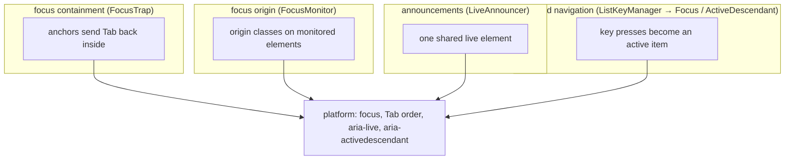

What to notice: each helper wraps a platform mechanism; none adds new semantics.

### How it actually works

**Why a trap holds.** Read in `@angular/cdk` 22.2.1, `fesm2022/_a11y-module-chunk.mjs`: `FocusTrap` [Changed in v22.0: the `injector` parameter is required] inserts two `div` siblings around the region, each with `tabindex="0"`, `aria-hidden="true"` and the class `cdk-focus-trap-anchor` (202-219, 316-324). Focus on the end anchor moves it to the first tabbable element, on the start anchor to the last (155-166). Nothing else happens: no `inert`, no blocked clicks (`Section 9: Tab from the last element of a trapped region returns to the first`; [Q11.11](11-accessibility.md#q11-11) compares it with `<dialog>`). `cdkTrapFocusAutoCapture` focuses inside and, on destroy, refocuses the element focused before (395-401, 419-422; read, not run). `ConfigurableFocusTrapFactory.create` [Changed in v22.0: takes a config object, not a boolean] ([changelog](https://github.com/angular/components/blob/main/CHANGELOG.md)).

**Why it knows the keyboard.** In `_focus-monitor-chunk.mjs`, `InputModalityDetector` listens on `document` for `keydown`, `mousedown` and `touchstart` (17-20, 71) and remembers the last (33-55). `FocusMonitor` gives a focus event that origin, or `program` when no input came first (201-216, 277-279; internal `_getFocusOrigin`, may change in any release). Internal `_setClasses` toggles `cdk-focused` plus one of `cdk-keyboard-focused`, `cdk-mouse-focused`, `cdk-touch-focused` or `cdk-program-focused` (220-226), only on elements registered with `monitor()` (151-169), which `cdkMonitorElementFocus` calls for its host (359-374, 392): `Section 9: keyboard focus gets cdk-keyboard-focused and a click does not`.

**Why the announcer is delayed.** `LiveAnnouncer` creates one `div`, class `cdk-live-announcer-element`, `aria-atomic="true"`, `aria-live="polite"` (554-566). `announce` clears it and writes after 100 ms (501-538; read, not run), so `Section 9: LiveAnnouncer writes the message into its live element` uses `expect.poll`.

**Why key managers are small.** In `_list-key-manager-chunk.mjs`, `onKeydown` switches on `keyCode` (107-184). Arrows move the active item, wrapping with `withWrap` (225-235); the **skip predicate** (default `item.disabled`, 28) skips items (239-251); letters go to **type-ahead**, which matches typed text to labels after a pause (200 ms by default, 67). `FocusKeyManager` adds one call, `item.focus(origin)`, `'program'` by default (`_focus-key-manager-chunk.mjs` 4-13); `ActiveDescendantKeyManager` only calls `setInactiveStyles` and `setActiveStyles` (`_activedescendant-key-manager-chunk.mjs` 3-13): `Section 9: FocusKeyManager wraps from the last item to the first`, `Section 9: ActiveDescendantKeyManager marks the active item without moving focus`. Given a signal and an `Injector` (typings 36-37), the constructor creates an effect that calls internal `_itemsChanged`, which re-finds the active item's index (29-43, 258-268): `Section 9: a key manager built from a signal follows the items it reads`. [Q11.10](11-accessibility.md#q11-10) owns roving tabindex versus `aria-activedescendant`.

### Code

1. The button copies each origin into a signal.
2. One rule removes the ring; the CDK class restores it.
3. The signal test adds an item first, then lets the effect run.

```ts
// Excerpt of labs/angular/projects/material-lab/src/app/m36/a11y/a11y.ts
      <button class="m36-a11y-button m36-a11y-ring" type="button" cdkMonitorElementFocus (cdkFocusChange)="origin.set($event)">
        Monitored button
      </button>
```

```scss
// Excerpt of labs/angular/projects/material-lab/src/styles.scss
.m36-a11y .m36-a11y-ring:focus {
  outline: none;
}

.m36-a11y .m36-a11y-ring.cdk-keyboard-focused {
  outline: 3px solid var(--mat-sys-primary);
  outline-offset: 2px;
}
```

```ts
// Excerpt of labs/angular/src/app/modules/36-material-and-cdk/concepts/section-9-key-manager.spec.ts
    items.set([zero, a, b, c]);
    expect(manager.activeItemIndex).toBe(1);
    TestBed.tick();
    expect(manager.activeItemIndex).toBe(2);
    expect(manager.activeItem).toBe(b);
```

> [!NOTE]
> **Framework vs platform.** Focus, `inert`, `<dialog>` and `aria-live` are the platform's. The CDK adds focus-origin tracking, trap anchors, key managers and one shared announcer element.

### Best practices and anti-patterns

- **Keep a visible ring for keyboard focus when you remove the default**, because otherwise keyboard users cannot see where they are.
- **Give a key manager a `QueryList` or a signal with an injector**, because a replaced array is never read again.
- **Announce a change once**, because each call clears the shared element ([Q11.14](11-accessibility.md#q11-14)).

### Misconceptions and traps

- *"`cdkTrapFocus` makes the rest of the page inert."* It only redirects Tab; nothing gets `inert` and the page stays clickable (trap test). The myth exists because modals look that way.
- *"`:focus-visible` makes `FocusMonitor` obsolete."* `:focus-visible` [Baseline 2022: widely available, per MDN] applies when the browser "determines via heuristics that the focus should be made evident" ([MDN](https://developer.mozilla.org/en-US/docs/Web/CSS/:focus-visible), read 2026-10-16); `FocusMonitor` also reports `program` and lets code react. The myth exists because both target keyboard rings.
- *"A key manager handles focus for you."* Only `FocusKeyManager` calls `focus()`; with `ActiveDescendantKeyManager` your item must set `aria-activedescendant` (tested). The myth exists because both share one base class.
- *"Announcing twice stacks two messages."* A second call within the delay cancels the first write on the one element. The myth exists because each call looks like a new message.

Drilled in [Q36.17](#q36-17), [Q36.18](#q36-18) and [Q36.19](#q36-19).

## 10. Component harnesses for Material, the CDK and your own components

### The problem it solves

A test that clicks `.mat-mdc-select-trigger` breaks when a Material release renames the class. A select's options are not under the select: they render in an overlay at the end of `body`, where a query rooted at the component never looks. A component of your own has no supported way to be driven.

### Mental model

[29 §11](29-testing-angular.md#11-component-harnesses-and-angular-testing-library) teaches what a harness is and how it waits for the fixture ([Q29.32](29-testing-angular.md#q29-32) asks why one survives a refactor, [Q29.33](29-testing-angular.md#q29-33) compares it with Angular Testing Library). A **harness environment** connects harnesses to a runner; it is also a **harness loader**, whose `getHarness`, `getHarnessOrNull` and `getAllHarnesses` find harnesses under a root element. A **host selector** is the CSS selector of the component a harness wraps; a **locator** is a function the harness builds with `locatorFor` to find an element inside that host. A **harness predicate** narrows a query by options such as a label, built by a static `with()`. The **document root loader** is a loader rooted at `body`. Material ships a harness per component in `@angular/material/<name>/testing`; any component can. Think of a remote control with labelled buttons instead of a screwdriver into the circuit board.

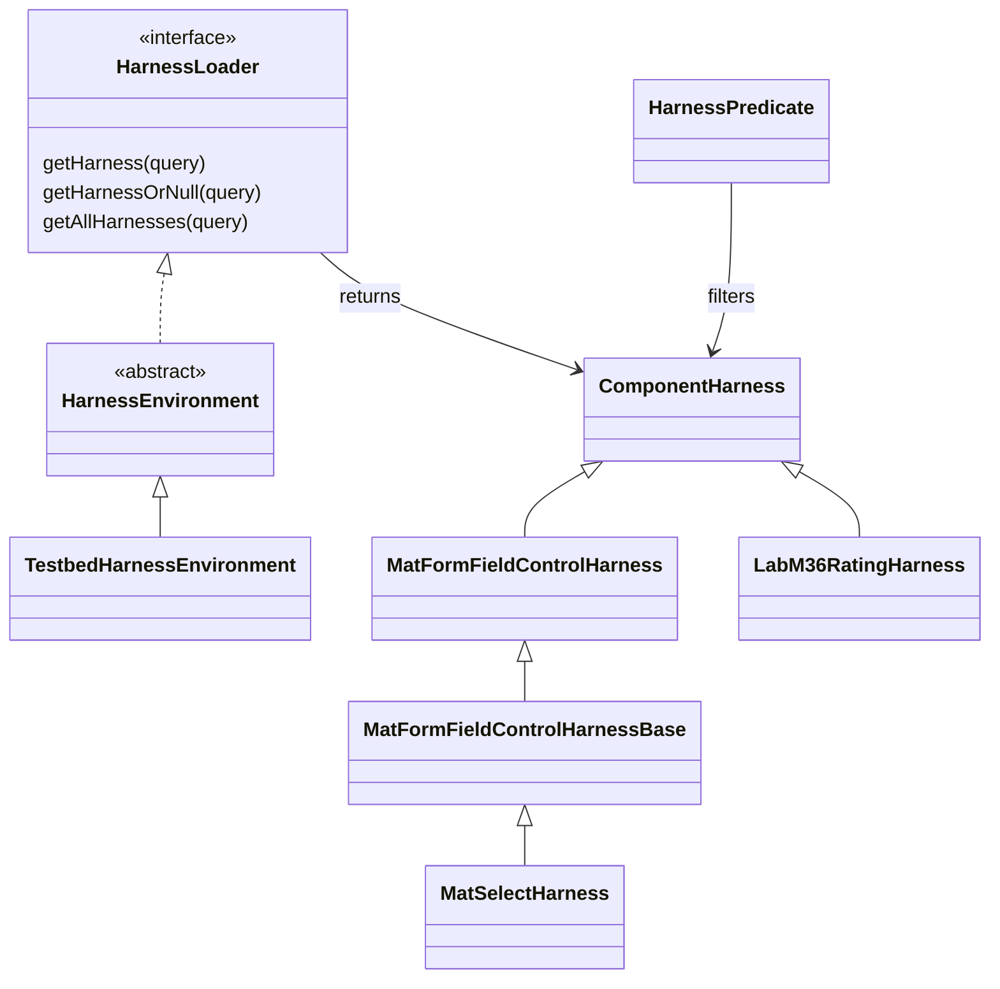

What to notice: tests depend on the harness's methods, so the markup behind them can change.

### How it actually works

**Why a failed lookup is readable.** Read in `@angular/cdk` 22.2.1, `fesm2022/testing.mjs`: `getHarness` is a locator call whose internal `_assertResultFound` (may change in any release) throws `Failed to find element matching one of the following queries:` and one parenthesised line per query (350-355). Each line holds the harness class name, its host selector and any predicate options as `name = value` (357-377). `Section 10: a failed getHarness names the query in its error` asserts both messages exactly. `getHarnessOrNull` returns `null` instead (246-247): `Section 10: getHarnessOrNull returns null when nothing matches`.

**Why Material's harness finds the overlay.** In `@angular/material` 22.2.1, `fesm2022/select-testing.mjs`, `MatSelectHarness` keeps an internal `_documentRootLocator` (10), made by `documentRootLocatorFactory()`, which the TestBed environment roots at `document.body` (`testing-testbed.mjs` 663-665). Options are searched there, under the panel id `#<host id>-panel` (47-61, 85-88). `clickOptions` opens the panel and throws "Select does not have options matching the specified filter" when none match (62-79; read, not run). `Section 10: MatSelectHarness opens the overlay and selects an option by text` shows the split: a loader rooted at the fixture finds no option, `documentRootLoader` finds three.

**Where harnesses run.** `@angular/cdk` 22.2.1 exports `TestbedHarnessEnvironment` and `SeleniumWebDriverHarnessEnvironment` and no Playwright one (`package.json` `exports`; the Selenium one is read, not run). Angular Aria has them too, such as `ListboxHarness` (`@angular/aria` 22.2.1, `listbox-testing.mjs` 58); see [§11](#11-angular-aria-headless-signal-driven-aria-patterns).

### Code

1. The harness names its host and builds its locators once.
2. `with()` adds a `label` option; `addOption` skips it when the caller passes none.
3. Public methods say what a user does and return no element.
4. Tests ask by predicate and write no selector.
5. The select test reads options through the document root loader.

```ts
// Excerpt of labs/angular/src/app/modules/36-material-and-cdk/concepts/section-10-harnesses.spec.ts
class LabM36RatingHarness extends ComponentHarness {
  static readonly hostSelector = 'lab-m36-rating';
  private readonly labelElement = this.locatorFor('.lab-m36-rating-label');
  private readonly stars = this.locatorForAll('button');
  static with(options: LabM36RatingFilters = {}): HarnessPredicate<LabM36RatingHarness> {
    return new HarnessPredicate(LabM36RatingHarness, options).addOption(
      'label',
      options.label,
      (harness, label) => HarnessPredicate.stringMatches(harness.getLabel(), label),
    );
  }
  async getLabel(): Promise<string> {
    return (await this.labelElement()).text();
  }
```

```ts
// Excerpt of labs/angular/src/app/modules/36-material-and-cdk/concepts/section-10-harnesses.spec.ts
    const price = await loader.getHarness(LabM36RatingHarness.with({ label: 'Price' }));
    await price.setValue(5);
    expect(await price.getValue()).toBe(5);
```

```ts
// Excerpt of labs/angular/src/app/modules/36-material-and-cdk/concepts/section-10-harnesses.spec.ts
    expect(await loader.getAllHarnesses(MatOptionHarness)).toHaveLength(0);
    const documentLoader = TestbedHarnessEnvironment.documentRootLoader(fixture);
    await select.clickOptions({ text: 'Banana' });
    expect(await select.getValueText()).toBe('Banana');
```

### Best practices and anti-patterns

- **Give a shared component a harness**, because its markup can then change without touching tests.
- **Expose intent, not elements**, because a method that returns a button puts selectors back into tests.
- **Check absence with `getHarnessOrNull` or `hasHarness`**, because `getHarness` rejects when nothing matches.

### Misconceptions and traps

- *"Harnesses are slower, so skip them."* Every call is async; no timing is claimed here. The myth exists because each call awaits stability.
- *"A harness only works with Material."* Any component can ship one (`Section 10: a custom harness filters by label with a HarnessPredicate`). The myth exists because Material made harnesses visible.
- *"Harness tests replace end-to-end tests."* They run on jsdom, with no layout or top layer, so they cannot see an overlay's position ([29 §1](29-testing-angular.md#1-what-to-test-where-unit-integration-component-and-end-to-end-tests-the-pyramid-and-the-trophy), §5's browser tests). The myth exists because harness steps read like user steps.
- *"Playwright can load CDK harnesses."* 22.2.1 ships a TestBed and a Selenium environment only. The myth exists because harnesses are environment-agnostic by design.

Drilled in [Q36.20](#q36-20) and [Q36.21](#q36-21), and [Exercise 36.4](#ex36-4).

## 11. Angular Aria: headless, signal-driven ARIA patterns

### The problem it solves

A design system needs a listbox and tabs that follow the WAI-ARIA Authoring Practices on its own markup. Material's look does not fit, and hand-written arrow-key code regresses: one missed `tabindex` reset leaves two tab stops.

### Mental model

A **headless directive** adds behavior and ARIA state to an element you wrote, and no styles. Angular Aria ships them per **pattern** (an APG widget, §1): listbox, tabs, menu and menubar, toolbar, accordion, tree, grid and combobox (select and autocomplete combine the last with a listbox, `guide/aria/listbox`, read 2026-10-16). Inputs are signals; the selection is a **model input** (writable, bound with `[(value)]`, [17 §7](17-signals.md#7-signal-based-component-apis)): `value` [Changed in v22.0: renamed from `values`], an array of option values. A fitted kitchen frame: hinges included, doors yours.

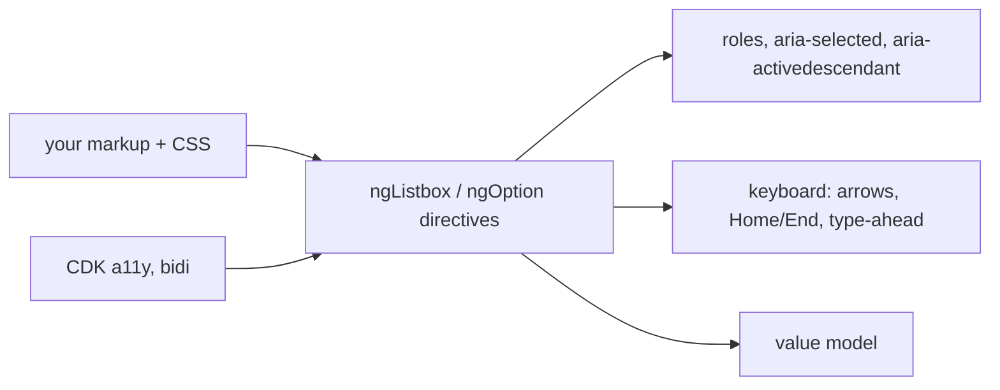

What to notice: the directives own behavior and semantics; you own structure and appearance.

The **focus mode** says where DOM focus sits: `roving` (on the active option, [11 §4](11-accessibility.md#4-keyboard-focus-order-roving-tabindex-and-focus-traps)) or `activedescendant` (on the listbox, which names the active option in `aria-activedescendant`). The **selection mode** says whether moving selects (`follow`) or Space and Enter do (`explicit`). **Soft-disabled** (`softDisabled`, default `true`): "disabled items are focusable but not interactive" (`types/listbox.d.ts`).

### How it actually works

**`roving` versus `activedescendant`.** Read in `@angular/aria` 22.2.1, `fesm2022/listbox.mjs` 249-266 and 494-505: both hosts bind `role` and `tabindex`; the listbox adds `aria-activedescendant`, each option an `id` and `aria-selected`. The internal `ListFocus` computes them (`_list-navigation-chunk.mjs` 18-54; may change in any release). In `roving`, the listbox has `tabindex="-1"`, the active option `0`, the others `-1`, no `aria-activedescendant`, and a move focuses the option (`Section 11: in roving mode the active option has tabindex 0 and the others -1`). In `activedescendant`, the listbox has `0`, every option `-1`, and `aria-activedescendant` moves while focus stays (`Section 11: in activedescendant mode focus stays on the listbox and aria-activedescendant moves`). [Q11.10](11-accessibility.md#q11-10) owns the choice.

**A surprising default.** The defaults are `roving` and `follow` (`listbox.mjs` 46-51). Before any interaction, the internal `ListboxPattern.setDefaultState` activates the first option and, under `follow`, selects it (`_option-chunk.mjs` 181-200): a listbox bound to `[]` holds `['apple']` after one render (`Section 11: ngListbox sets the listbox and option roles on plain elements`). The [APG listbox pattern](https://www.w3.org/WAI/ARIA/apg/patterns/listbox/) allows it: "selection may also move with focus" (read 2026-10-16). Under `explicit`, Space toggles (`Section 11: Space selects in explicit mode and updates the value model`).

**Status.** 21.0.0 introduced the directives; the 22.0.0 CHANGELOG entry "remove developer preview tag from aria" (#33232) made them stable, and no preview tag remains in the 22.2.1 typings or the overview, listbox and tabs guides (read 2026-10-16). `Combobox` [Changed in v22.0: `SimpleCombobox` promoted to `Combobox`].

**Against `cdk/listbox` and `cdk/menu`.** Both declare no signal input (`grep -c InputSignal`: 0), and `CdkListbox` implements `ControlValueAccessor` (the forms bridge, [25 §10](25-forms-reactive-and-template-driven.md#10-controlvalueaccessor-and-the-validator-interface-custom-controls-under-the-hood)). Each Aria directive delegates to a pattern class in `_pattern`, such as `ListboxPattern` (internal, from `@angular/aria/private`).

**Harnesses and tabs.** `ListboxHarness.getOptions({ selected: true })` filters on `aria-selected` (`Section 11: ListboxHarness reads the selected options`). In Chromium, ArrowRight moves focus and selection to the next tab, one panel stays exposed, the previous one turns `inert` and loses its `ngTabContent` view (`Section 11: the Aria tabs move between tabs with the arrow keys and show one panel`); "Proper styling is required for visual hiding" (`ngTabPanel` typings).

### Code

The directives write the state; your CSS reads it.

1. Import `Listbox` and `Option`; put `ngListbox` on a `ul` with an `aria-label`, binding the modes and `[(value)]`.
2. `ngOption` on each `li`, with its required `value` and a type-ahead `label`.
3. Style from state: `styles.scss` keys on `[aria-selected='true']` and hides `[inert]` panels.

```ts
// Excerpt of labs/angular/src/app/modules/36-material-and-cdk/concepts/section-11-aria.spec.ts
@Component({
  selector: 'lab-m36-fruit-listbox',
  imports: [Listbox, Option],
  template: `
    <ul ngListbox aria-label="Fruit" [focusMode]="focusMode()" [selectionMode]="selectionMode()" [(value)]="selected">
      @for (fruit of fruits; track fruit.value) {
        <li ngOption [value]="fruit.value" [label]="fruit.label">{{ fruit.label }}</li>
      }
    </ul>
  `,
})
class LabM36FruitListbox {
  readonly focusMode = input<FocusMode>('roving');
  readonly selectionMode = input<SelectionMode>('follow');
  readonly selected = signal<string[]>([]);
  protected readonly fruits = FRUITS;
}
```

The tabs page:

```ts
// Excerpt of labs/angular/projects/material-lab/src/app/m36/aria/aria.ts
    <div ngTabs>
      <!-- 2. The tab list: roving focus and selection that follows focus are its defaults; the selected tab is a model. -->
      <ul ngTabList aria-label="Product information" [(selectedTab)]="selectedTab" class="m36-tab-list">
        @for (section of sections; track section.value) {
          <li ngTab [value]="section.value" class="m36-tab">{{ section.label }}</li>
        }
      </ul>
      <!-- 3. A panel matches its tab by value; ngTabContent renders only while the panel is shown. -->
      @for (section of sections; track section.value) {
        <div ngTabPanel [value]="section.value" class="m36-tab-panel">
          <ng-template ngTabContent><p>{{ section.text }}</p></ng-template>
        </div>
      }
    </div>
```

### Best practices and anti-patterns

- **Style from ARIA state**, because look and semantics then cannot disagree.
- **Choose `selectionMode` on purpose**, because `follow` selects on render and on every arrow.
- **Name every widget and style its focus**, because the directives set neither.

### Misconceptions and traps

- *"Angular Aria is a component library."* It ships directives, no templates or styles. The myth exists because it sits beside Material.
- *"Aria is still a developer preview."* Once true: through 21.x. Now: [Stable since v22.0] (§1). The myth exists because its first major shipped under that tag.
- *"`values` is the binding."* Once true: until 22.0. Now: `value` [Changed in v22.0: renamed from `values`]. The myth exists because 21.x examples use the old name.
- *"Headless means no accessibility work."* Names, focus styles and contrast stay yours ([11 §6](11-accessibility.md#6-accessible-names-descriptions-and-forms)). The myth exists because keyboard handling and ARIA states come for free.

Drilled in [Q36.22](#q36-22) and [Q36.23](#q36-23), and built in [Exercise 36.2](#ex36-2).

## 12. A design system on the CDK and Angular Aria, or a wrapper around Material

### The problem it solves

Three apps want one library: wrap Material, or build on the CDK and Aria? One path only tunes the look; the other assembles keyboard models.

### Mental model

A **design system** is the tokens, components, usage rules and tests several products share. A **wrapper component** renders another library's component behind your inputs; its inputs, outputs, tokens and exports are its **public API surface**, and **upgrade coupling** is how much of it moves when the library releases. A furnished flat to repaint, or a shell.

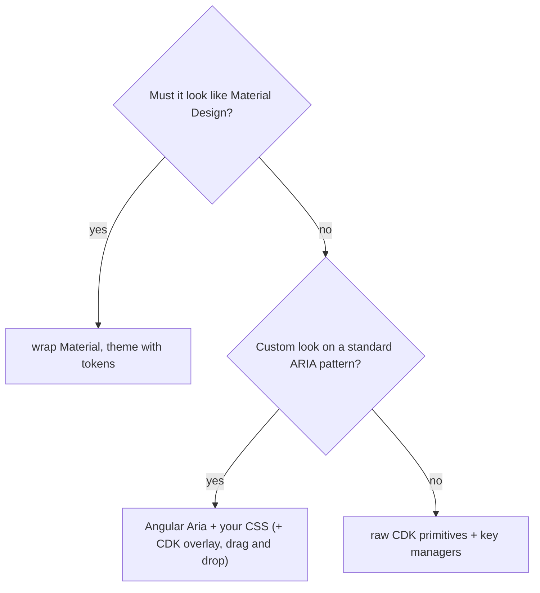

What to notice: the CDK is under every branch ([§1](#1-material-the-cdk-and-angular-aria-styled-components-behavior-primitives-and-headless-patterns)); the choice is how much sits above it.

The [Aria overview](https://angular.dev/guide/aria/overview) (read 2026-10-16) sets two branches: "If you need components that look complete without custom styling, use Angular Material instead"; Aria suits "Custom brand requirements". A widget outside §11's patterns takes the third.

| Factor | Wrap Material | Build on Aria | Build on raw CDK |
|---|---|---|---|
| Brand fidelity | Tokens and overrides only (`Section 4: a component override changes only the buttons inside its subtree`) | Every element and rule (§11) | The same (§1) |
| Accessibility expertise | Built in (`Section 2: closing a dialog returns focus to the button that opened it`); labels yours | Pattern built in (`Section 11: in roving mode the active option has tabindex 0 and the others -1`); names and focus styles yours | You wire `aria-activedescendant` (`Section 9: ActiveDescendantKeyManager marks the active item without moving focus`) |
| Code you write (team size) | A wrapper per component | Markup and CSS per pattern (§11) | Also roles and keyboard wiring (§9) |
| Timeline | Pre-styled libraries "reduce initial development time" (overview) | Styling first | Styling and pattern first |
| Number of apps | One theme per app (`Section 3: the theme declares the system variables on html`) | "reusable components for multiple applications" (overview) | As Aria |

### How it actually works

**Why the wrapper's `disabled` reaches the native button.** Read in `@angular/material` 22.2.1, `fesm2022/_icon-button-chunk.mjs`: the internal base `MatButtonBase` binds `attr.disabled` to the internal `_getDisabledAttribute()` (may change in any release), `null` unless disabled with `disabledInteractive` off; `setAppearance` (`button.mjs`) swaps the appearance classes. The wrapper only forwards (`Section 12: a design-system button wrapper renders a Material button and forwards its disabled input`).

**Why a wrapper inherits markup.** `MatButton`'s template fixes four spans, your content inside one (`button.mjs` 72); a wrapper only sets inputs, projects content or provides `MAT_BUTTON_CONFIG` defaults.

**The public API.** Ship standalone pieces and `provide*` functions ([Q15.19](15-standalone-and-ngmodules.md#q15-19); [module 38](38-architecture-and-production-structure.md#6-public-api-surfaces-public-apits-exports-secondary-entry-points-and-versioning)). **Token layering** means your custom properties fall back to `--mat-sys-*`, as §4's card does ([Q13.25](13-components-and-templates.md#q13-25)). Form wrappers forward values through `ControlValueAccessor` ([25 §10](25-forms-reactive-and-template-driven.md#10-controlvalueaccessor-and-the-validator-interface-custom-controls-under-the-hood)) or `FormValueControl` [Stable since v22.0] ([26 §8](26-signal-forms.md#8-custom-controls-formvaluecontrol-formcheckboxcontrol-and-how-formfield-picks-a-control)).

### Code

1. `kind` is your vocabulary; a `computed` maps it to an appearance.
2. `disabled` passes straight through.
3. The test flips both and reads classes and `disabled`.

```ts
// Excerpt of labs/angular/src/app/modules/36-material-and-cdk/concepts/section-12-wrapper.spec.ts
const APPEARANCE_BY_KIND: Record<LabM36DsButtonKind, 'filled' | 'outlined'> = {
  primary: 'filled',
  secondary: 'outlined',
};

@Component({
  selector: 'lab-m36-ds-button',
  imports: [MatButton],
  template: `<button type="button" [matButton]="appearance()" [disabled]="disabled()"><ng-content /></button>`,
})
class LabM36DsButton {
  readonly kind = input<LabM36DsButtonKind>('primary');
  readonly disabled = input(false, { transform: booleanAttribute });
  protected readonly appearance = computed(() => APPEARANCE_BY_KIND[this.kind()]);
}
```

> [!TIP]
> **Coming from the backend.** Building on the CDK is assembling a Spring Security `SecurityFilterChain`, which `FilterChainProxy` uses "to determine which Spring Security `Filter` instances should be invoked" ([reference 7.1.1](https://docs.spring.io/spring-security/reference/servlet/architecture.html)). Wrapping Material is theming Keycloak: "Unless you plan to replace every single page you should extend another theme" ([Keycloak themes](https://www.keycloak.org/ui-customization/themes), read 2026-10-16). **Where the analogy breaks:** a Keycloak theme may replace a page; a wrapper cannot replace `MatButton`'s template, so it inherits the markup and ARIA users meet.

### Best practices and anti-patterns

- **Expose your vocabulary, not Material's**, because `kind` can then map to another implementation.
- **Ship a harness per component**, because tests through it survive a rewrite (§10; [Exercise 36.4](#ex36-4)).
- **Avoid styling Material's internal classes in a wrapper**, because the guide calls direct CSS unsupported (§4).

### Misconceptions and traps

- *"Wrapping Material removes the upgrade risk."* Styles reaching Material's internal DOM still break (§4). The myth exists because a wrapper looks like a firewall.
- *"The CDK means rebuilding accessibility."* Key managers, traps and Aria patterns carry roles and keys (§9, §11). The myth exists because the CDK looks low-level.
- *"A design system is a component library."* Tokens, usage rules and harnesses belong to it. The myth exists because code is its visible part.

Drilled in [Q36.24](#q36-24).

## 13. Under the hood: from `createOverlayRef` to a popover in the top layer, and from `mat.theme` to a computed color

### The problem it solves

An interviewer asks why a menu escapes `overflow: hidden`, which of two open overlays gets Escape, why a unit test finds the overlay in `.cdk-overlay-container` while Chromium shows a popover, and how a brand color reaches a button. Without the internals, answers are guesses: "a high `z-index`", "a theme script".

### Mental model

Two pipelines. **Overlay:** `createOverlayRef` loads the **structural styles** (the CDK's CSS that places container, host and pane, with no look), decides `usePopover`, builds host and pane and inserts the host at the strategy's **insertion point** (the element it names for the host) or in the overlay container; `attach` shows, renders, positions and registers. The **dispatcher stack** is the array of attached overlays that the keyboard and outside-click dispatchers walk from the newest. **Theme:** Sass declares variables at build time; the browser resolves each element's **fallback chain** (a `var()` whose second argument applies when the first property is unset). A stagehand's checklist, then a paint chart's lookup.

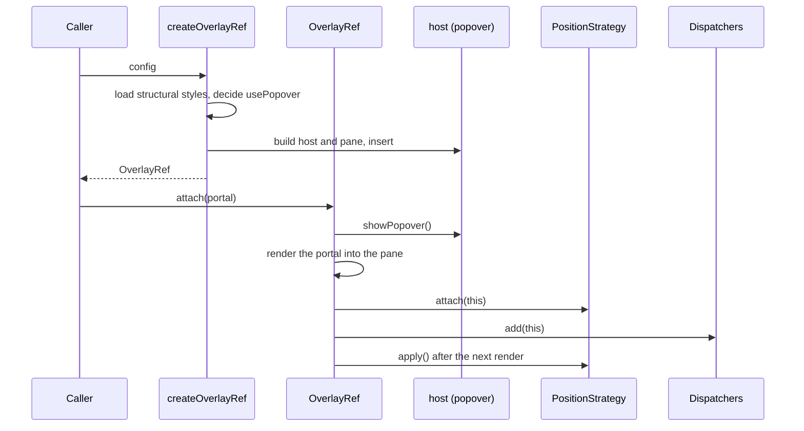

What to notice: the host enters the top layer before it is positioned, and the dispatchers' order is attach order.

### How it actually works

**Why the host can sit anywhere and still paint on top.** Read in `@angular/cdk` 22.2.1, `fesm2022/_overlay-module-chunk.mjs`: `createOverlayRef` (2051-2091) calls `_CdkPrivateStyleLoader.load(_CdkOverlayStyleLoader)` (internal, may change in any release), which creates one unencapsulated, template-less component per application for the structural styles (`_style-loader-chunk.mjs` 23-28). For popovers ([§5](#5-portals-and-overlays-where-floating-ui-renders-how-it-is-positioned-and-how-it-closes)) it asks `getPopoverInsertionPoint()`: an element puts the host after it, `{ type: 'parent', element }` inside it, `null` in the container (2080-2087). The flexible strategy returns the origin for `withPopoverLocation('inline')`, `null` for the default `'global'` (1304-1317). `Section 13: an inline overlay host follows its origin in the DOM and paints above an overlay shown before it`: the top layer stacks in show order, not DOM order.

**Why attach order is event order.** `OverlayRef.attach` (750-799) runs the internal `_attachHost` (`showPopover()`, 967), the portal outlet, the strategy's `attach`, the scroll strategy's `enable()`, schedules `apply()` after the next render (767-773), then `add(this)` on both dispatchers (783, 790). The internal `BaseOverlayDispatcher.add` pushes onto its internal `_attachedOverlays` (351); the internal `_keydownListener` loops from the last index to the first overlay whose `keydownEvents()` has a subscriber, then stops (415-424). `Section 13: the second overlay opened receives Escape first` skips an unwired third one.

**Why unit tests see the container.** jsdom has no `showPopover`, so no popover and no insertion point (`Section 5: without popover support the host goes into the overlay container`).

**Why the theme needs no script.** `mat.theme` compiles each system color to `light-dark()` on `html` ([§3](#3-theming-with-material-3-mattheme-system-variables-and-light-and-dark-with-color-scheme)). `@angular/material` 22.2.1, `fesm2022/button.mjs` 73: `background-color: var(--mat-button-filled-container-color, var(--mat-sys-primary));` on `.mat-mdc-unelevated-button:not(:disabled)`. Per element, the token wins if set, else the nearest system variable, whose `light-dark()` follows the element's `color-scheme` (`Section 13: a button reads its container color from the system primary variable`).

### Code

1. Wired overlays log who received Escape.
2. `openInline` names the origin as the insertion point.
3. One subtree sets the system variable; the other also the component token.
4. The test reads the log; the pseudo-code condenses both functions.

```ts
// Excerpt of labs/angular/projects/material-lab/src/app/m36/internals/internals.ts
  protected openStacked(label: string, left: string, wired: boolean): void {
    const ref = this.show(label, { positionStrategy: createGlobalPositionStrategy(this.injector).top('14rem').left(left) });
    if (!wired) return;
    ref.keydownEvents().subscribe((event) => {
      if (event.key !== 'Escape') return;
      this.escapeLog.update((log) => [...log, label]);
      ref.dispose();
    });
  }

  protected openInline(event: Event): void {
    const origin = event.currentTarget;
    if (!(origin instanceof HTMLElement)) return;
    const positionStrategy = createFlexibleConnectedPositionStrategy(this.injector, origin)
      .withPositions(BELOW)
      .withFlexibleDimensions(false)
      .withPush(false)
      .withPopoverLocation('inline');
    this.show('Inline menu', { positionStrategy });
  }
```

```scss
// Excerpt of labs/angular/projects/material-lab/src/styles.scss
.m36-internals .m36-internals-sys {
  --mat-sys-primary: #6d3a9c;
}

.m36-internals .m36-internals-token {
  --mat-sys-primary: #8c2f39;
  --mat-button-filled-container-color: #1e6b3a;
}
```

```ts
// Excerpt of labs/e2e/tests/36-material-and-cdk/concepts/section-13-under-the-hood.spec.ts
  // The dispatcher walks from the last attached: the unwired overlay has no keydown subscriber, so the second gets the event.
  await page.keyboard.press('Escape');
  await expect(log).toHaveText(['Second overlay']);
  await expect(panel(page, 'Second overlay')).toHaveCount(0);
  await expect(panel(page, 'First overlay')).toBeVisible();
  await expect(panel(page, 'Unwired overlay')).toBeVisible();
```

```ts
// Partial: pseudo-code of createOverlayRef (2051-2091) and OverlayRef.attach (750-799) in @angular/cdk 22.2.1, names simplified, backdrop and navigation omitted
function createOverlayRef(config: OverlayConfig): OverlayRef {
  loadStructuralStyles(); // once per application
  const usePopover = supportsPopover() && (config.usePopover ?? defaultUsePopover());
  const host = buildHostAndPane(usePopover); // popover="manual" when usePopover
  const point = usePopover ? config.positionStrategy?.getPopoverInsertionPoint?.() : null;
  insertHost(host, point ?? overlayContainer()); // after an element, inside a parent, or in the container
  return new OverlayRef(host, config);
}

function attach(ref: OverlayRef, portal: Portal<unknown>): void {
  if (ref.usePopover) ref.host.showPopover(); // joins the top layer, last shown on top
  ref.outlet.attach(portal); // DomPortalOutlet
  ref.positionStrategy?.attach(ref);
  ref.scrollStrategy?.enable();
  afterNextRender(() => ref.positionStrategy?.apply());
  keyboardDispatcher.add(ref); // pushed: walked first
  outsideClickDispatcher.add(ref);
}
```

### Best practices and anti-patterns

- **Subscribe to `keydownEvents()` only where the overlay handles keys**, because the dispatcher skips it otherwise and hands the key to the next one down (tested).
- **Recolor at the right link**: a system variable for a subtree, a component token for one component, because the token is read first (tested).
- **Assert placement and stacking in a browser**, because jsdom takes the no-popover path.

### Misconceptions and traps

- *"The CDK computes a `z-index` per overlay."* Every pane gets `z-index: 1000` in `@layer cdk-overlay` (569); without popovers the internal `_updateStackingOrder` moves the host last (996-1000); with them the top layer orders by show order (tested; [10 §4](10-css-essentials.md#4-positioning-stacking-contexts-and-z-index) on stacking). The myth exists because panes once stacked by DOM order in one container, which looks managed.
- *"Material injects the theme at run time."* The compiled stylesheet declares the variables (the test reads them from the build). The myth exists because DevTools shows them on `html` as if a script set them.
- *"The first overlay opened owns Escape."* The walk starts at the newest (tested). The myth exists because the first registered first.

Drilled in [Q36.25](#q36-25).

## Summary

Material, the CDK and Angular Aria are three layers over the platform, and the higher the layer, the less markup and styling you own; Material's CDK peer is exact, and Material alone does not make an app accessible ([§1](#1-material-the-cdk-and-angular-aria-styled-components-behavior-primitives-and-headless-patterns)). Import standalone classes with no animations provider; `mat-error` waits for the matcher's condition, not for the control to be invalid ([§2](#2-material-components-in-a-v22-app-standalone-imports-form-fields-dialogs-direction-and-motion)). `mat.theme` runs in Sass at build time and writes `--mat-sys-*` custom properties as `light-dark()` pairs, so one theme serves both schemes per element's `color-scheme` ([§3](#3-theming-with-material-3-mattheme-system-variables-and-light-and-dark-with-color-scheme)). An override reaches a DOM subtree, not a component tree, so it misses the dialog a component opens, and `!important` on internal classes is unsupported ([§4](#4-customizing-the-theme-system-and-component-token-overrides-and-theming-your-own-components)).

An overlay is a portal attached at run time whose host is a popover in the top layer, so a high `z-index` is not the fix, and a raw `OverlayRef` closes on Escape only if you subscribe ([§5](#5-portals-and-overlays-where-floating-ui-renders-how-it-is-positioned-and-how-it-closes)). Drag and drop only reports the drop, your handler reorders, and it has no keyboard handling ([§6](#6-drag-and-drop-sorting-transferring-between-lists-and-the-keyboard-gap)). `MatTable` is `CdkTable`, so sorting belongs to the data source ([§7](#7-tables-and-long-lists-cdktable-datasource-mattable-and-virtual-scrolling)). `BreakpointObserver` listens to media queries, a linear stepper blocks on `stepControl`, and `Clipboard.copy` uses `execCommand` ([§8](#8-the-smaller-primitives-the-stepper-breakpointobserver-and-clipboard)). `cdkTrapFocus` only redirects Tab, `FocusMonitor` adds the focus origin, and only `FocusKeyManager` calls `focus()` ([§9](#9-cdk-accessibility-focustrap-focusmonitor-liveannouncer-and-the-key-managers)).

A harness hides markup behind methods so a test survives a rewrite, and jsdom cannot see an overlay's position ([§10](#10-component-harnesses-for-material-the-cdk-and-your-own-components)). Angular Aria ships directives without templates or styles, stable since v22.0, and names and contrast stay yours ([§11](#11-angular-aria-headless-signal-driven-aria-patterns)). Wrap Material when its look is acceptable and build on Aria or the CDK when it is not; a wrapper does not remove upgrade risk if styles reach Material's DOM ([§12](#12-a-design-system-on-the-cdk-and-angular-aria-or-a-wrapper-around-material)). Under the hood the host enters the top layer before it is positioned, the dispatchers walk the newest overlay first, and the theme's variables are declared in the compiled stylesheet ([§13](#13-under-the-hood-from-createoverlayref-to-a-popover-in-the-top-layer-and-from-mattheme-to-a-computed-color)).

## Question bank

Each answer has five parts. Each Output answer names the run asserted in `labs/angular/src/app/modules/36-material-and-cdk/outputs/q36-outputs.spec.ts` (`ng test`) or `labs/e2e/tests/36-material-and-cdk/outputs/q36-outputs.spec.ts` (Playwright); screen values are Chromium 153's, with `colorScheme` and `reducedMotion` set explicitly, and jsdom shows no layout, top layer or `matchMedia`.

<a id="q36-01"></a>
### Q36.01 · Concept · What are Angular Material, the CDK and Angular Aria, and which layer do you reach for when?

<details>
<summary>Answer</summary>

**Short answer (30 seconds).** Three packages released together. Material is styled Material Design 3 components. The CDK is behavior without a look: overlays, portals, drag and drop, tables, focus helpers, harnesses. Angular Aria [Stable since v22.0] is headless directives that implement WAI-ARIA patterns on your markup. Reach for Material when its look fits, Aria for a pattern in your own look, the CDK for the rest.

**Full explanation.** Material and Aria sit on the CDK: `MatDialog` opens a CDK `Dialog` (`Section 1: MatDialog opens its content in a CDK dialog container`), and Aria imports `@angular/cdk/a11y`, `bidi` and `platform` (read, not run). Material and Aria peer on one exact CDK version, 22.2.1. The layers differ in what you own: a Material, a CDK and an Aria listbox all expose a listbox named "Size" with three options (`Section 1: the Material, CDK and Aria versions expose the same accessible role and name`), but only Material brings markup and styles ([§1](#1-material-the-cdk-and-angular-aria-styled-components-behavior-primitives-and-headless-patterns)).

**Follow-ups an interviewer will ask.**
- *Does Aria replace the CDK?* No. Its entry points are patterns (listbox, menu, tabs, tree, grid); overlays, drag and drop and tables stay in the CDK.
- *Who owns accessibility?* Material ships roles and keyboard handling, but labels and focus after navigation stay yours ([11 §4](11-accessibility.md#4-keyboard-focus-order-roving-tabindex-and-focus-traps) teaches roving tabindex and traps).

**Trap to avoid.** Adopting Material, then overriding its look everywhere: that is the case for the CDK or Aria.

</details>

<a id="q36-02"></a>
### Q36.02 · Difference · What does Material add on top of the CDK: `MatDialog` over CDK `Dialog`, `mat-table` over `cdk-table`, and `MatStepper` over `CdkStepper`?

<details>
<summary>Answer</summary>

**Short answer (30 seconds).** The same rule three times: the CDK keeps the logic, Material adds markup, styles and defaults. `MatDialog` adds a styled container, the `mat-dialog-*` directives and a ref with exit motion over the CDK dialog service. `MatTable` extends `CdkTable` and adds element selectors, styled cells and `MatTableDataSource`, with `MatSort` and `MatPaginator`. `MatStepper` adds headers and the look to `CdkStepper`'s step logic.

**Full explanation.** `MatDialog.open` registers the same dialog id with the CDK `Dialog` service, and its container carries both `mat-mdc-dialog-container` and `cdk-dialog-container`, so focus trap and focus return are inherited. Rendering, `connect` and `disconnect` stay the CDK's (`Section 7: connect is called once on init and disconnect once on destroy`), while sorting is Material's (`Section 7: MatSort reorders a MatTableDataSource`). The linear check lives in `CdkStepper` (`Section 8: a linear stepper does not advance past an invalid step`). Details: [§7](#7-tables-and-long-lists-cdktable-datasource-mattable-and-virtual-scrolling).

**Follow-ups an interviewer will ask.**
- *When use the CDK piece?* When your design system's look differs from Material's: `CdkTable` with your own cells keeps the rendering contract.
- *Does the CDK table sort?* No; it renders what its data source emits, so sorting belongs to the data source.

**Trap to avoid.** Treating Material as a separate implementation: a behavior fix in the CDK reaches the Material component too.

</details>

<a id="q36-03"></a>
### Q36.03 · Output · A required `matInput` in a `mat-form-field` bound to a reactive control: which state classes, `aria-invalid` value and error text does the field show before any interaction, after blur while empty, and after typing?

The control starts as `''` with `Validators.required`; the template has `<input matInput required [formControl]="name" />` and `<mat-error>Name is required</mat-error>`. A test dispatches `blur`, then sets the value `Ada` and dispatches `input`.

<details>
<summary>Answer</summary>

**Short answer (30 seconds).** Before interaction: no `mat-error`, no `mat-form-field-invalid` class and no `aria-invalid` attribute. After blur while empty: the text `Name is required`, the classes `mat-form-field-invalid` and `ng-touched` on the field, and still no `aria-invalid`. After typing `Ada`: no error, no invalid class and `aria-invalid="false"`. The default `ErrorStateMatcher` needs invalid and (touched or submitted), and `matInput` binds `aria-invalid` to `(empty && required) ? null : errorState`.

**Full explanation.** `Q36.03 a required matInput shows no error until touched, then the error, and aria-invalid stays absent while empty` asserts the three steps, `aria-required="true"` before any interaction and `aria-describedby` equal to the error id after blur. The control is invalid from the first check; blur marks it touched ([§2](#2-material-components-in-a-v22-app-standalone-imports-form-fields-dialogs-direction-and-motion)). The attribute is the surprise: an empty required input exposes its state through `aria-required` and the error's `aria-describedby`, not `aria-invalid` (read in `@angular/material` 22.2.1, `fesm2022/input.mjs`).

**Follow-ups an interviewer will ask.**
- *And a control that is not required?* The binding is `errorState`, so `aria-invalid` is `"true"` after blur (`Section 2: the error shows only after the control is touched`).
- *How do I show the error earlier?* Provide a custom `ErrorStateMatcher`; the default also accepts a submitted parent form.

**Trap to avoid.** Writing `aria-invalid="true"` after blur for an empty required field: the run shows no attribute until a value is typed.

</details>

<a id="q36-04"></a>
### Q36.04 · Bug hunt · A theme that never turns dark, a token override in a component's styles that does not reach its dialog, and Material motion that still runs under reduced motion: what is wrong in each?

<details>
<summary>Answer</summary>

**Short answer (30 seconds).** One: no `color-scheme` beside `mat.theme`, so `light-dark()` always resolves light. Two: the dialog renders in the overlay container on `body`, outside the subtree the override covers. Three: Material stops only its own motion, from a preference read once per page; your own CSS animations, or a change after the first read, still run.

**Full explanation.** The guide says "If your application does not define a value for `color-scheme`, then the light colors will always be applied" (`guides/theming.md`, read 2026-10-16). A system override inside a card does not reach a dialog opened from it, but the same override on the overlay pane class does (`Section 4: a system override inside a card does not reach a dialog opened from it`, `Section 4: the same override on the overlay pane class reaches the dialog`). The internal `_getAnimationsState()` stores `(prefers-reduced-motion)` in a module variable on first use (read, not run); `Section 2: Material disables its motion when reduced motion is requested` covers that first read. Fixes: `color-scheme: light dark` on `html`; `panelClass` on the dialog; your own `prefers-reduced-motion` rules ([35 §11](35-animations.md#11-performance-and-reduced-motion-compositor-properties-measuring-jank-and-prefers-reduced-motion)).

**Follow-ups an interviewer will ask.**
- *Would a prebuilt theme fix the first?* No: each file is one scheme, without `light-dark(`.
- *A misspelled name in an override?* `mat.theme-overrides` skips it silently; a component's `*-overrides` mixin stops the build (read, not run; [§4](#4-customizing-the-theme-system-and-component-token-overrides-and-theming-your-own-components)).

**Trap to avoid.** Restyling the dialog through Material's internal classes: they are private and change in upgrades.

</details>

<a id="q36-05"></a>
### Q36.05 · Concept · How does `mat.theme` turn a palette, a font and a density into CSS: what are the `--mat-sys-*` system variables, and how do light and dark mode work?

<details>
<summary>Answer</summary>

**Short answer (30 seconds).** `mat.theme` is a Sass mixin, run at build time, that takes a palette, a typography setting and a density and writes **system variables**: custom properties named `--mat-sys-*`, such as `--mat-sys-primary` and `--mat-sys-body-medium`. By default each color is `light-dark(<light>, <dark>)`, so the browser picks per element from its `color-scheme`. One theme holds both modes.

**Full explanation.** The palette's tonal palettes give each role two tones: azure's `primary` is `light-dark(#005cbb, #abc7ff)`. The mixin writes them on `html`, with no script (`Section 3: the theme declares the system variables on html`). Components read them through their component tokens, so `--mat-button-filled-container-color` falls back to `--mat-sys-primary`. The choice follows the element's `color-scheme`, not the media query (`Section 3: a subtree with color-scheme dark gets the dark values`). Custom properties and `light-dark()` are CSS ([10 §6](10-css-essentials.md#6-custom-properties-theming-and-color-scheme)); Material adds the Sass and the names ([§3](#3-theming-with-material-3-mattheme-system-variables-and-light-and-dark-with-color-scheme)).

```scss
html {
  color-scheme: light dark;
  @include mat.theme((color: mat.$azure-palette, typography: system-ui, density: 0));
}
```

**Follow-ups an interviewer will ask.**
- *How does a user toggle work?* Set `color-scheme` to `light` or `dark` on `html`; [Q10.17](10-css-essentials.md#q10-17) builds it with no flash.
- *Are they Sass variables?* No: custom properties read at run time, so a subtree can change them.

**Trap to avoid.** Copying a hex value into your component's CSS: it ignores `color-scheme`; read `var(--mat-sys-primary)` instead.

</details>

<a id="q36-06"></a>
### Q36.06 · Output · With `color-scheme: light dark` on `html` and `mat.theme` with the azure palette: what does `--mat-sys-primary` resolve to under a light preference, a dark preference, and inside a subtree that sets `color-scheme: dark`?

A swatch's background is `var(--mat-sys-primary)` in the page, in a `color-scheme: dark` section and in a `color-scheme: light` section. A test opens the page under each preference.

<details>
<summary>Answer</summary>

**Short answer (30 seconds).** The variable is one declaration, `light-dark(#005cbb, #abc7ff)`, and it stays unresolved wherever you read it. What resolves is the color a property paints from it: `#005cbb` under a light preference, `#abc7ff` under a dark one, `#abc7ff` inside the `color-scheme: dark` subtree under either and `#005cbb` inside the `color-scheme: light` one, because the browser picks the half from the element's `color-scheme`.

**Full explanation.** `Q36.06 --mat-sys-primary stays one light-dark() pair; the color it paints is the light hex under light, the dark hex under dark, and the dark hex in a color-scheme: dark subtree in either` reads both hex values from the built stylesheet's `html` rule, never typed by hand, and runs under both preferences. It asserts each swatch's computed `background-color`, and that the variable is the same `light-dark(` string on `html` and inside the dark subtree: custom properties inherit as written, and the property that uses them resolves ([§3](#3-theming-with-material-3-mattheme-system-variables-and-light-and-dark-with-color-scheme)).

**Follow-ups an interviewer will ask.**
- *Why is the variable not a color?* A custom property has no type; resolution happens where a property uses it.
- *And with no `color-scheme` on `html`?* The light half always applies ([Q36.04](#q36-04)).

**Trap to avoid.** Reading the variable in script and expecting a color: you get the pair. Resolve it through a probe element, as the test does.

</details>

<a id="q36-07"></a>
### Q36.07 · Difference · `mat.theme-overrides`, a component's `*-overrides` mixin and a direct CSS rule on Material's internal classes: what each changes, where its scope ends, and which survives an upgrade.

<details>
<summary>Answer</summary>

**Short answer (30 seconds).** `mat.theme-overrides` writes `--mat-sys-*` variables under its selector, so every component reading them changes in that subtree. A component mixin such as `mat.button-overrides` writes that component's tokens (`--mat-button-…`): one component type. A direct rule on an internal class such as `.mdc-button__label` reaches what its selector matches and is unsupported: the first two are the supported API, and internal class names may change in any release.

**Full explanation.** Both mixins end where inheritance ends: `Section 4: a component override changes only the buttons inside its subtree`, and `Section 4: a system override inside a card does not reach a dialog opened from it`, because the dialog renders on `body`; the overlay pane class does reach it (`Section 4: the same override on the overlay pane class reaches the dialog`). A component token beats the system variable: the button paints `var(--mat-button-filled-container-color, var(--mat-sys-primary))` ([§4](#4-customizing-the-theme-system-and-component-token-overrides-and-theming-your-own-components)). A direct rule sits outside that chain. For your own component, expose a custom property with a system fallback ([Q13.25](13-components-and-templates.md#q13-25)).

**Follow-ups an interviewer will ask.**
- *Which for one brand button?* The component mixin on a wrapper class; the system override when every component reading primary should change.
- *My override did nothing; why?* `mat.theme-overrides` skips a misspelled name silently (read, not run), or the target is an overlay outside the subtree.

**Trap to avoid.** Reaching for direct CSS when an override seems ignored: check the name and the subtree first.

</details>

<a id="q36-08"></a>
### Q36.08 · Bug hunt · A brand color forced with `!important` on an internal Material class, an M2 prebuilt theme loaded beside `mat.theme`, and a custom card hard-coded to `#fff`: what breaks, and what is the fix?

<details>
<summary>Answer</summary>

**Short answer (30 seconds).** The `!important` rule fights a private class and breaks when a release changes it: set the token with `mat.button-overrides` or `mat.theme-overrides`. The M2 prebuilt file sets component tokens on `html`, which beat the `--mat-sys-*` fallbacks, so components keep the old palette beside your M3 theme: load one theme. The `#fff` card ignores `color-scheme` and stays white in dark mode: read `var(--mat-sys-surface-container)`.

**Full explanation.** Read in `@angular/material` 22.2.1, `prebuilt-themes/indigo-pink.css`, not run: `html { --mat-button-filled-container-color: white; … }` (1386) and `html { --mat-sys-on-surface: initial; }` at the top. A component token on `html` is found before the fallback to `--mat-sys-primary` ([§3](#3-theming-with-material-3-mattheme-system-variables-and-light-and-dark-with-color-scheme)). It has no `light-dark(`: one scheme. The card's fix is the one `Section 4: a custom card reads the system surface color in light and dark` asserts: two different colors under two preferences, which a hard-coded value cannot give ([§4](#4-customizing-the-theme-system-and-component-token-overrides-and-theming-your-own-components)).

**Follow-ups an interviewer will ask.**
- *Can I keep the M2 theme while migrating?* Yes; the guide says M2 themes are provided for backwards compatibility, and `mat.m2-theme` writes `--mat-sys-*` from an M2 object (§3, Legacy).
- *Why not one `!important`?* It also beats your own later overrides.

**Trap to avoid.** Answering a failed override with a more specific selector on `.mat-mdc-…`: it is still a private class.

</details>

<a id="q36-09"></a>
### Q36.09 · Concept · What are portals and portal outlets (`ComponentPortal`, `TemplatePortal`, `DomPortal`, `CdkPortalOutlet`), and how do they relate to `ViewContainerRef.createComponent`?

<details>
<summary>Answer</summary>

**Short answer (30 seconds).** A **portal** describes content to render elsewhere at run time; a **portal outlet** is where it renders. `ComponentPortal` names a component to create, `TemplatePortal` a `TemplateRef` with its context, and `DomPortal` an existing element to move. `CdkPortalOutlet` is the outlet directive; the overlay uses a `DomPortalOutlet` on its pane. The outlet makes the same calls you would: a portal is a description, not a renderer.

**Full explanation.** Read in `@angular/cdk` 22.2.1, `fesm2022/portal.mjs`, not run. `CdkPortalOutlet.attachComponentPortal` calls `viewContainerRef.createComponent` (325) and `attachTemplatePortal` calls `createEmbeddedView` (345). `DomPortalOutlet` uses the portal's `viewContainerRef` if set, else `createComponent()` and `appRef.attachView` (170-200); [19 §7](19-component-communication-and-projection.md#7-dynamic-components-viewcontainerrefcreatecomponent-createcomponent-and-bindings) owns those calls and [Q19.25](19-component-communication-and-projection.md#q19-25) who destroys the result. `attachDomPortal` leaves a comment where the element was and restores it on detach (356-370). `Section 5: a TemplatePortal renders its template into a CdkPortalOutlet with its context` asserts the template case ([§5](#5-portals-and-overlays-where-floating-ui-renders-how-it-is-positioned-and-how-it-closes)).

**Follow-ups an interviewer will ask.**
- *When a `DomPortal`?* When an existing element must show elsewhere without being recreated: the node moves, so its state stays.
- *Is it content projection?* No: `<ng-content>` is fixed at compile time; a portal attaches at run time.

**Trap to avoid.** Attaching to an outlet and never detaching or disposing it: `dispose()` detaches the attached portal (read, not run).

</details>

<a id="q36-10"></a>
### Q36.10 · Output · An overlay created with `createOverlayRef` and a flexible connected position strategy below a button near the bottom of the viewport: is its host a popover in the top layer, which position does it take, and what closes it?

A button fixed near the bottom of an 800 by 500 px page opens the overlay. Positions: below the button, then above. The page calls `dispose()` from `keydownEvents()` and `outsidePointerEvents()`.

<details>
<summary>Answer</summary>

**Short answer (30 seconds).** Yes: the host is a `div` with `popover="manual"` and the class `cdk-overlay-popover`, matches `:popover-open` and is in the top layer, while still a child of `.cdk-overlay-container`. With no room below, the strategy takes the second position: the pane sits above the button. Escape and a click outside close it, because the page wired them (a raw `OverlayRef` closes nothing otherwise); a click inside does not. `usePopover` defaults to `true`.

**Full explanation.** `Q36.10 an overlay below a button at the bottom edge is a popover host in the top layer, takes the above position, and closes on Escape and on an outside click` asserts it in Chromium 153. The overlay guide and the run agree on the host's parent; the run adds that it is a shown popover, so the top layer decides what paints on top ([§5](#5-portals-and-overlays-where-floating-ui-renders-how-it-is-positioned-and-how-it-closes)). `Q36.10 with room below the button the first position wins and the pane is below it` shows the fallback follows the space.

**Follow-ups an interviewer will ask.**
- *And under jsdom?* No `showPopover`, so `usePopover` turns off (`Section 5: without popover support the host goes into the overlay container`).
- *How do I opt out?* `usePopover: false` in the config, or the `OVERLAY_DEFAULT_CONFIG` token (read, not run).

**Trap to avoid.** Raising the pane's `z-index` against a sticky header: the host is already in the top layer.

</details>

<a id="q36-11"></a>
### Q36.11 · Trade-off · The native `popover` attribute and `<dialog>`, a CDK overlay, or `MatMenu` and `MatDialog`: which do you choose for a dropdown, a modal and a tooltip?

<details>
<summary>Answer</summary>

**Short answer (30 seconds).** Take the lowest layer that supplies what the widget needs. **Modal**: native `<dialog>` without Material, `MatDialog` with it. **Dropdown**: `MatMenu`; without Material, a CDK overlay when the panel must move near an edge, a native `popover` when a fixed place is enough. **Tooltip**: `MatTooltip`, not a hand-built one. Stacking does not decide, because a popover and a CDK overlay host both reach the top layer; placement, dismissal and focus do.

**Full explanation.** The overlay host is a `popover="manual"` element by default, so the CDK adds what a bare popover lacks: fallback positions, scroll strategies and one Escape and outside-click stack (`Q36.10 an overlay below a button at the bottom edge is a popover host in the top layer, takes the above position, and closes on Escape and on an outside click`; [§5](#5-portals-and-overlays-where-floating-ui-renders-how-it-is-positioned-and-how-it-closes)). Read, not run, in `@angular/material` 22.2.1: `MatMenu` and `MatTooltip` open through `createOverlayRef` (`fesm2022/menu.mjs` 884, `_tooltip-chunk.mjs` 259), and `MatDialog` reuses the CDK dialog container (`Section 2: closing a dialog returns focus to the button that opened it`).

**Follow-ups an interviewer will ask.**
- *Why not `<dialog>` for every modal?* It can serve: top layer, inert page, Escape ([Q11.11](11-accessibility.md#q11-11)). Choose `MatDialog` for Material's look and dialog ref.
- *Does an overlay beat a popover on stacking?* No: its host is a popover (`Section 5: the overlay host is a popover in the top layer`).

**Trap to avoid.** Hand-writing "flip above near the bottom edge" for a native popover: that rebuilds the position strategy (`Q36.10 with room below the button the first position wins and the pane is below it`).

</details>

<a id="q36-12"></a>
### Q36.12 · Output · A `cdkDropList` of five items: after item 1 is dragged below item 3, what does `cdkDropListDropped` report, and what does the list render if the handler does not reorder the data?

Two lists hold Item 1 to Item 5. One handler only reports the event; the other also reorders a copy. The mouse drags Item 1 onto Item 3.

<details>
<summary>Answer</summary>

**Short answer (30 seconds).** Both report `previousIndex` 0, `currentIndex` 2 and the same container. The report-only list still renders Item 1 to Item 5; the reordering list renders Item 2, Item 3, Item 1, Item 4, Item 5. The CDK reports the move and never touches your data: the list renders what the data says.

**Full explanation.** `Q36.12 dropping item 1 on item 3 reports previousIndex 0 and currentIndex 2 in one container, and the list renders the new order only when the handler writes it` asserts both lists in Chromium 153. The template renders a signal, so only a handler that sets it changes the list ([§6](#6-drag-and-drop-sorting-transferring-between-lists-and-the-keyboard-gap)). `currentIndex` 2 is the item's new, third position.

**Code.**

```ts
// Excerpt of labs/angular/projects/material-lab/src/app/m36/outputs/q36-12.ts
  protected reorder(event: CdkDragDrop<unknown, unknown, string>): void {
    this.reordered.set(describeDrop(event));
    this.items.update((list) => {
      const next = [...list];
      moveItemInArray(next, event.previousIndex, event.currentIndex);
      return next;
    });
  }
```

**Follow-ups an interviewer will ask.**
- *Why copy the array first?* `moveItemInArray` mutates in place; on a signal's own array nothing is notified (`Section 6: moveItemInArray on a signal array leaves a computed value stale`).
- *A drop onto another list?* `previousContainer` differs; the handler transfers the item (`Section 6: an item moves to a connected list`).

**Trap to avoid.** Expecting the CDK to reorder: it moves a placeholder during the drag, and the drop leaves the data to you.

</details>

<a id="q36-13"></a>
### Q36.13 · Bug hunt · A list that snaps back after every drop, two lists that will not exchange items, and a board that only a mouse can rearrange: find the three causes.

<details>
<summary>Answer</summary>

**Short answer (30 seconds).** (1) The drop handler never writes the data: the event is right, the template renders the old array, the item returns. (2) The lists are not connected: use one `cdkDropListGroup` or `cdkDropListConnectedTo`, and call `transferArrayItem` when the containers differ. (3) The CDK has no keyboard dragging: `drag-drop.mjs` registers no `keydown` handler (read, not run, `@angular/cdk` 22.2.1). Give keys or buttons the same move method.

**Full explanation.** Each cause has a test in [§6](#6-drag-and-drop-sorting-transferring-between-lists-and-the-keyboard-gap): `Section 6: without moveItemInArray the list snaps back`, `Section 6: an unconnected list does not accept the item` and `Section 6: arrow keys on a focused item do not move it`. [Exercise 36.3](#ex36-3) builds the third: one store method serves drops and keys and announces the move.

**Code.**

```ts
// Excerpt of labs/angular/projects/material-lab/src/app/m36/drag-drop/drag-drop.ts
      if (from === to) moveItemInArray(next[to], event.previousIndex, event.currentIndex);
      else transferArrayItem(next[from], next[to], event.previousIndex, event.currentIndex);
```

**Follow-ups an interviewer will ask.**
- *Connected, and still nothing moves?* Connecting only lets the drop land; the handler must transfer the data.
- *Which cause hides in a list that looks right?* The in-place mutation: a `computed` reading the array goes stale (`Section 6: moveItemInArray on a signal array leaves a computed value stale`).

**Trap to avoid.** Treating dragging as the whole interaction: without a keyboard path the board fails users who cannot hold a mouse.

</details>

<a id="q36-14"></a>
### Q36.14 · Concept · How does `CdkTable` render rows from a `DataSource`: column and row definitions, `connect` and `disconnect`, `trackBy`, and what `MatTable`, `MatSort` and `MatPaginator` add?

<details>
<summary>Answer</summary>

**Short answer (30 seconds).** Column definitions name the columns and hold header and cell templates; the row definition lists which columns a data row shows. The table calls `connect` once, renders one row per emitted item, and calls `disconnect` when the source is replaced or the table is destroyed. `trackBy` gives rows an identity, so equal keys keep their view. `MatTable` is `CdkTable` with Material's markup and styles; `MatSort` and `MatPaginator` act on `MatTableDataSource`, not on the table.

**Full explanation.** Read, not run, in `@angular/cdk` 22.2.1, `fesm2022/table.mjs`: `_render` subscribes through `connect(this)`, takes an `Observable` as is and wraps an array (1871-1880). `Section 7: connect is called once on init and disconnect once on destroy` and `Section 7: the table renders one row per emitted item and only the listed columns` assert it ([§7](#7-tables-and-long-lists-cdktable-datasource-mattable-and-virtual-scrolling)). In Material's `fesm2022/table.mjs`, `MatTableDataSource` filters, sorts a copy, then slices a page (1095-1119): `Section 7: MatSort reorders a MatTableDataSource`.

**Follow-ups an interviewer will ask.**
- *Caller-supplied cell templates?* A component design question: [Q19.13](19-component-communication-and-projection.md#q19-13).
- *Thousands of rows?* Paginate, virtualize or load more: [Q31.10](31-performance.md#q31-10). §7 claims nothing about a table in a virtual viewport.

**Trap to avoid.** Emitting fresh objects without `trackBy`: every emission brings new keys and rebuilds the rows (read, not run).

</details>

<a id="q36-15"></a>
### Q36.15 · Output · `BreakpointObserver.observe(Breakpoints.Handset)` in a 375 px and a 1280 px wide Chromium viewport, and under jsdom in `ng test`: what does `matches` report, and when does it emit again?

A page shows the latest `matches` and the emission count. It opens at 375 by 667, then the viewport becomes 1280 by 720, then 1100 by 720, then 375 by 667.

<details>
<summary>Answer</summary>

**Short answer (30 seconds).** At 375 by 667: true, one emission. At 1280 by 720: false, two. At 1100 by 720 nothing changes; back at 375 by 667 it reads true with three emissions, not four. Under jsdom: false for both queries, one emission, never another. The observer emits when a query's result changes. Chromium fires `matchMedia` change events; jsdom has no `matchMedia`, so the CDK's fallback never matches and never fires.

**Full explanation.** `Q36.15 Handset matches at 375 px, not at 1280 px, and the observer emits again only when a query flips` asserts the Chromium sequence and `Q36.15 under jsdom Handset reports matches false for both queries, once, and never emits again` the jsdom half ([§8](#8-the-smaller-primitives-the-stepper-breakpointobserver-and-clipboard)). `Handset` is two queries, and `matches` is true when either matches. Read, not run, in `@angular/cdk` 22.2.1 (`_breakpoints-observer-chunk.mjs`): later changes pass through `debounceTime(0)`, and the fallback (internal `noopMatchMedia`) has no-op listeners.

**Code.**

```ts
// Excerpt of labs/angular/projects/material-lab/src/app/m36/outputs/q36-15.ts
  protected readonly handset = toSignal(
    inject(BreakpointObserver)
      .observe(Breakpoints.Handset)
      .pipe(map((state, index) => ({ matches: state.matches, count: index + 1 }))),
    { initialValue: null },
  );
```

**Follow-ups an interviewer will ask.**
- *Why one emission when a resize crosses two queries?* The debounce merges changes in one task (read, not run).
- *Why not test this under jsdom?* It shows only the fallback; the reaction needs Chromium.

**Trap to avoid.** Reading `matches: false` as "desktop": it says only that neither handset query matches.

</details>

<a id="q36-16"></a>
### Q36.16 · Difference · The CDK's `Clipboard.copy` versus `navigator.clipboard.writeText`: how each copies, what each needs, and what each tells you about success.

<details>
<summary>Answer</summary>

**Short answer (30 seconds).** `Clipboard.copy` is synchronous: it selects an off-screen textarea, runs `document.execCommand('copy')` and returns a boolean. `navigator.clipboard.writeText` returns a Promise that resolves once the clipboard is updated; it needs a secure context and may need transient user activation. The CDK never calls the async API (read, not run, `@angular/cdk` 22.2.1).

**Full explanation.** [§8](#8-the-smaller-primitives-the-stepper-breakpointobserver-and-clipboard) reads `fesm2022/clipboard.mjs`: the `execCommand` call sits in a `try` with an empty `catch`. MDN's `execCommand` page is labelled Deprecated and says "Avoid using this feature in new projects" (read 2026-10-17), and that the method "only returns true if it is invoked as part of a user interaction". MDN lists the async Clipboard API as newly available (read 2026-10-16). Two tests show the boolean: `Section 8: under jsdom Clipboard.copy returns false` (jsdom has no `execCommand`) and `Section 8: Clipboard.copy puts the text on the clipboard` (a Chromium click returns `true`).

**Code.**

```ts
// Partial: inside a click handler; `clipboard` is the CDK `Clipboard` and `text` the string to copy.
const copied = clipboard.copy(text); // boolean, no reason
await navigator.clipboard.writeText(text); // rejects when refused
```

**Follow-ups an interviewer will ask.**
- *What does `false` tell you?* That the command was unsupported or disabled (MDN). Show a manual-copy fallback.
- *Why call `copy` in the click handler?* The command only returns `true` during a user interaction.

**Trap to avoid.** Reading `false` under `ng test` as a bug: jsdom lacks `execCommand`, so only a browser test can show a copy.

</details>

<a id="q36-17"></a>
### Q36.17 · Concept · What do `FocusTrap` and `cdkTrapFocus` do, and how does `FocusMonitor` tell keyboard focus from mouse and programmatic focus?

<details>
<summary>Answer</summary>

**Short answer (30 seconds).** `FocusTrap` puts two focusable anchors around a region and sends Tab from one end to the other; `cdkTrapFocus` makes one for its host, and `cdkTrapFocusAutoCapture` moves focus in and restores it on destroy. It makes nothing inert and blocks no clicks. `FocusMonitor` knows the origin because `InputModalityDetector` remembers the last `keydown`, `mousedown` or `touchstart` on the document; focus with no input before it is `program`.

**Full explanation.** [§9](#9-cdk-accessibility-focustrap-focusmonitor-liveannouncer-and-the-key-managers) reads both in `@angular/cdk` 22.2.1. The anchors are `div`s with `tabindex="0"`, `aria-hidden="true"` and the class `cdk-focus-trap-anchor`: `Section 9: Tab from the last element of a trapped region returns to the first`. Monitored elements get `cdk-focused` plus one origin class: `Section 9: keyboard focus gets cdk-keyboard-focused and a click does not`. A real modal needs [11 §4](11-accessibility.md#4-keyboard-focus-order-roving-tabindex-and-focus-traps): `<dialog>` and `inert` are the platform's.

**Code.**

```ts
// Excerpt of labs/angular/projects/material-lab/src/app/m36/a11y/a11y.ts
      <div cdkTrapFocus class="m36-a11y-trap" role="group" aria-label="Trapped region">
        <button class="m36-a11y-button" type="button">Trap first</button>
        <button class="m36-a11y-button" type="button">Trap last</button>
      </div>
```

**Follow-ups an interviewer will ask.**
- *Does a click outside the trap stay in?* No: the test finds no `[inert]` and the outside button takes focus.
- *Where does focus go afterwards?* With auto-capture, back to the element focused before (read, not run).

**Trap to avoid.** Using `cdkTrapFocus` as a modal: it only redirects Tab.

</details>

<a id="q36-18"></a>
### Q36.18 · Output · A `FocusKeyManager` over five items with `withWrap()`, `withTypeAhead()` and a skip predicate for the disabled third item: which item is active after ArrowDown three times, then End, then ArrowDown, then typing `c`?

The labels are Apple, Banana, Cherry (disabled), Date and Cranberry, and `withHomeAndEnd()` is on. No item is active at the start.

<details>
<summary>Answer</summary>

**Short answer (30 seconds).** After the three ArrowDowns: 0, 1, 3. End: 4. ArrowDown: 0. Typing `c`: 4, Cranberry, once the test's fake timers ([29 §10](29-testing-angular.md#10-async-tests-vitest-fake-timers-versus-fakeasync-and-waitforasync)) run. The default skip predicate (`disabled`) passes over Cherry for arrows and for type-ahead alike, wrap carries the last item to the first, and typed letters wait for a debounce before they move anything.

**Full explanation.** `Q36.18 ArrowDown x3 gives 0, 1, 3; End 4; ArrowDown wraps to 0; typing c skips the disabled Cherry and lands on 4 once the fake timers run` asserts the sequence ([§9](#9-cdk-accessibility-focustrap-focusmonitor-liveannouncer-and-the-key-managers)). Read, not run, in `@angular/cdk` 22.2.1 (`_list-key-manager-chunk.mjs`, `_typeahead-chunk.mjs`): Type-ahead buffers letters, then searches from the item after the active one for a label starting with them. The debounce is rxjs `debounceTime`, which reschedules until `Date.now()` has passed its target (`debounceTime.js`, rxjs 7.8.2), so the test fakes `Date` with the interval and calls `vi.runOnlyPendingTimers()`, never a duration.

**Code.**

```ts
// Excerpt of labs/angular/src/app/modules/36-material-and-cdk/outputs/q36-outputs.spec.ts
      manager.onKeydown(key(C, 'c'));
      expect(manager.isTyping()).toBe(true);
      expect(manager.activeItemIndex).toBe(0);
      vi.runOnlyPendingTimers();
      expect(manager.isTyping()).toBe(false);
      expect(manager.activeItemIndex).toBe(4); // Cherry (2) starts with "c" but is skipped; Cranberry (4) is next
```

**Follow-ups an interviewer will ask.**
- *Without `withHomeAndEnd()`?* End changes nothing, and without `withWrap()` ArrowDown stops on the last item (`Q36.18 without withHomeAndEnd the End key changes nothing, and without withWrap ArrowDown stops at the last item`).
- *Why does `c` not move at once?* Letters wait for the debounce; the default is 200 ms (read, not run).

**Trap to avoid.** Expecting `c` to land on Cherry: the skip predicate also filters type-ahead.

</details>

<a id="q36-19"></a>
### Q36.19 · Bug hunt · A `LiveAnnouncer` message that is never read, a `cdkTrapFocus` dialog whose focus still escapes, and a `FocusMonitor` subscription that keeps classes on a destroyed element: find the causes.

<details>
<summary>Answer</summary>

**Short answer (30 seconds).** (1) Each `announce` clears the one live element and cancels the previous pending write, so a second call within 100 ms replaces the first; and the text is not there until the write. (2) The trap only redirects Tab at its anchors: focus that starts outside, a click or a programmatic `focus()` is not caught. (3) A manual `monitor()` stays registered until `stopMonitoring`; only the directive stops itself.

**Full explanation.** Read in `@angular/cdk` 22.2.1. `announce` calls `clear()` and `clearTimeout`, then writes after 100 ms (`_a11y-module-chunk.mjs`, read, not run); `Section 9: LiveAnnouncer writes the message into its live element` therefore polls, and [11 §5](11-accessibility.md#5-focus-management-in-spas-and-live-regions) covers the delay. The trap leaves the page clickable: `Section 9: Tab from the last element of a trapped region returns to the first`. Fix it with `cdkTrapFocusAutoCapture` and a modal the platform makes inert ([Q36.17](#q36-17)). In `_focus-monitor-chunk.mjs`, `stopMonitoring` completes the subject, clears the classes and removes the listeners; `cdkMonitorElementFocus` calls it in `ngOnDestroy`.

**Code.**

```ts
// Partial: inside a component that injects `FocusMonitor`; `host` is its `ElementRef<HTMLElement>`.
ngOnDestroy(): void {
  this.focusMonitor.stopMonitoring(this.host);
}
```

**Follow-ups an interviewer will ask.**
- *Two messages in a row?* The first is cancelled; announce once.
- *Why not unsubscribe only?* The registry still holds the element and its listeners until `stopMonitoring`.

**Trap to avoid.** Reading the live element right after `announce`: it is empty until the write.

</details>

<a id="q36-20"></a>
### Q36.20 · Design · Write a component harness for your own component: what it exposes, how `HarnessPredicate` filters it, and what it must hide from the test.

<details>
<summary>Answer</summary>

**Short answer (30 seconds).** Extend `ComponentHarness` with a `static hostSelector`, build locators once with `locatorFor` and `locatorForAll`, and expose async methods for what a user sees or does: `getLabel`, `getValue`, `setValue`, `isDisabled`. Add `static with(options)` returning a `HarnessPredicate`, with `addOption` and `stringMatches` per filter. Hide elements, selectors, classes and signals: tests get values and actions, so the markup can change.

**Full explanation.** [§10](#10-component-harnesses-for-material-the-cdk-and-your-own-components) builds one: `Section 10: a custom harness filters by label with a HarnessPredicate` finds ratings by string and by `RegExp`. A miss names the host selector and the constraint, such as `label = "Missing"`, in its error (`Section 10: a failed getHarness names the query in its error`). Content that renders outside the host, like a select's options, is read through the document root loader, as `MatSelectHarness` does. Why a harness survives a refactor is [Q29.32](29-testing-angular.md#q29-32); [Exercise 36.4](#ex36-4) builds the version that survives two rewrites.

**Code.**

```ts
// Excerpt of labs/angular/src/app/modules/36-material-and-cdk/concepts/section-10-harnesses.spec.ts
    const all = await loader.getAllHarnesses(LabM36RatingHarness);
    const price = await loader.getHarness(LabM36RatingHarness.with({ label: 'Price' }));
    const startingWithS = await loader.getAllHarnesses(LabM36RatingHarness.with({ label: /^S/ }));
    const delivery = await loader.getHarness(LabM36RatingHarness.with({ label: 'Delivery' }));
```

**Follow-ups an interviewer will ask.**
- *Why not return the star button?* A returned element puts selectors back into tests; return a number.
- *How do you assert absence?* `getHarnessOrNull` or `hasHarness`, because `getHarness` rejects.

**Trap to avoid.** One method per element: that only moves the break from the test into the harness.

</details>

<a id="q36-21"></a>
### Q36.21 · Output · Two Material buttons on a page: what do `getHarness`, `getHarnessOrNull`, `getAllHarnesses` and `getHarness(MatButtonHarness.with({ text }))` return, and what happens when nothing matches?

The page holds `<button matButton>Save</button>` then `<button matButton>Cancel</button>`; the loader is `TestbedHarnessEnvironment.loader(fixture)`.

<details>
<summary>Answer</summary>

**Short answer (30 seconds).** `getHarness(MatButtonHarness)` returns the Save harness, the first match in DOM order; `getHarnessOrNull` returns the same one; `getAllHarnesses` returns Save and Cancel; `with({ text: 'Cancel' })` returns Cancel. With no match, `getHarnessOrNull` gives `null`, `getAllHarnesses` gives `[]`, and `getHarness` rejects with an error naming the query: only `getHarness` insists on a result.

**Full explanation.** `Q36.21 getHarness takes the first button, getAllHarnesses both, with({ text }) the match, and a miss is null or a rejection naming the query` asserts all of it, message included ([§10](#10-component-harnesses-for-material-the-cdk-and-your-own-components)). The message is the header line, then one parenthesised line per query: class name, host selector, and each filter as `name = value`. Read in `@angular/cdk` 22.2.1, `fesm2022/testing.mjs` (`_assertResultFound`, 350-355).

```text
Failed to find element matching one of the following queries:
(MatButtonHarness with host element matching selector: ".mat-mdc-button-base, [matButton], [mat-button], [matIconButton],
    [matFab], [matMiniFab], [mat-raised-button], [mat-flat-button], [mat-icon-button],
    [mat-stroked-button], [mat-fab], [mat-mini-fab]" satisfying the constraints: text = "Missing")
```

**Code.**

```ts
// Excerpt of labs/angular/src/app/modules/36-material-and-cdk/outputs/q36-outputs.spec.ts
    const none = MatButtonHarness.with({ text: 'Missing' });
    expect(await loader.getHarnessOrNull(none)).toBeNull();
    expect(await loader.getAllHarnesses(none)).toEqual([]);
    expect(await loader.hasHarness(none)).toBe(false);
```

**Follow-ups an interviewer will ask.**
- *How do you assert that a button is absent?* `hasHarness` or `getHarnessOrNull`; `getHarness` fails the test before an assertion runs.
- *Does this run in Playwright?* No: `@angular/cdk` 22.2.1 exports a TestBed and a Selenium environment, and no Playwright one (`package.json` `exports`; read, not run). Stabilization is [29 §11](29-testing-angular.md#11-component-harnesses-and-angular-testing-library).

**Trap to avoid.** Testing that something is gone with `getHarness`: it rejects instead of returning `null`.

</details>

<a id="q36-22"></a>
### Q36.22 · Concept · What is Angular Aria: which patterns it ships, how its directives are driven by signal inputs, and how it differs from the CDK's `cdk/listbox` and `cdk/menu`?

<details>
<summary>Answer</summary>

**Short answer (30 seconds).** `@angular/aria` [Stable since v22.0] is a set of headless directives that put WAI-ARIA patterns on your own markup: keys, ARIA attributes and focus, with no template or style. It ships accordion, combobox, grid, listbox, menu, tabs, toolbar and tree. Modes are signal inputs and the selection is a `model`; the CDK's `cdk/listbox` and `cdk/menu` have neither.

**Full explanation.** [§11](#11-angular-aria-headless-signal-driven-aria-patterns) reads the `@angular/aria` 22.2.1 typings: `Listbox` declares `focusMode`, `selectionMode`, `multi` and `wrap` as `InputSignal`s and `value` as a `ModelSignal`, so `[(value)]` binds a signal. Autocomplete and select are documented patterns built from `combobox` and `listbox`, not entry points. The CDK pair declares no signal input (`grep -c InputSignal`: 0), and `CdkListbox` implements `ControlValueAccessor` where Aria's `Listbox` does not (read, not run). Aria builds on CDK `a11y` and `bidi`; it replaces nothing. Choosing a focus model is [Q11.10](11-accessibility.md#q11-10)'s.

**Code.**

```html
<!-- Partial: `selected` is a `signal<string[]>`; the directives add roles, keys and ARIA state. -->
<ul ngListbox aria-label="Fruit" focusMode="activedescendant" [(value)]="selected">
  <li ngOption value="apple" label="Apple">Apple</li>
</ul>
```

**Follow-ups an interviewer will ask.**
- *Is it a developer preview?* Not since 22.0, which removed the tag (#33232); the 22.2.1 typings carry none (read, not run).
- *What did 22.0 rename?* `values` became `value` [Changed in v22.0: renamed from `values`].

**Trap to avoid.** Treating Aria as a component library: names, focus styles and contrast stay yours.

</details>

<a id="q36-23"></a>
### Q36.23 · Output · An `ngListbox` with three `ngOption`s in `activedescendant` focus mode and `explicit` selection: after ArrowDown and Space, what are `aria-activedescendant`, each `aria-selected` and the bound `value`?

The options are Apple, Banana and Cherry; `[(value)]` binds a `signal<string[]>([])`, and both keys go to the listbox.

<details>
<summary>Answer</summary>

**Short answer (30 seconds).** After ArrowDown, `aria-activedescendant` is Banana's id, focus stays on the `ul`, every `aria-selected` is `"false"` and `value` is `[]`. After Space: `"false"`, `"true"`, `"false"`, `value` is `['banana']`, and the pointer still names Banana. `activedescendant` moves a pointer, not focus; `explicit` selects only on Space or click.

**Full explanation.** `Q36.23 in activedescendant and explicit mode ArrowDown moves aria-activedescendant to the second option without selecting, then Space selects it and value is [banana]` asserts both steps ([§11](#11-angular-aria-headless-signal-driven-aria-patterns)). Before any key the pointer already names Apple. Read in `@angular/aria` 22.2.1 (`listbox.mjs`, `_option-chunk.mjs`; internal, may change): the listbox keeps `tabindex="0"`, each option `-1`, and `aria-activedescendant` takes the active option's generated id. Under the default `follow`, the same arrow would have selected Banana.

**Code.**

```ts
// Excerpt of labs/angular/src/app/modules/36-material-and-cdk/outputs/q36-outputs.spec.ts
    press(' ');
    await fixture.whenStable();
    expect(selectedStates()).toEqual(['false', 'true', 'false']);
    expect(fixture.componentInstance.selected()).toEqual(['banana']);
```

**Follow-ups an interviewer will ask.**
- *And with the defaults, `roving` and `follow`?* The first option is selected on render (`Section 11: ngListbox sets the listbox and option roles on plain elements`) and DOM focus moves with each arrow (`Section 11: in roving mode the active option has tabindex 0 and the others -1`); under `follow` "the focused item is automatically selected" (`types/listbox.d.ts`, read, not run).
- *A second Space?* It toggles Banana off and `value` returns to `[]` (`Section 11: Space selects in explicit mode and updates the value model`).

**Trap to avoid.** Expecting ArrowDown to select: that is `follow`.

</details>

<a id="q36-24"></a>
### Q36.24 · Trade-off · Build a design system on the CDK and Angular Aria, or wrap Material: what each costs, what you control, who owns accessibility, and how upgrades go.

<details>
<summary>Answer</summary>

**Short answer (30 seconds).** Wrap Material when the product may look like Material Design: you theme with tokens, write a thin wrapper per component and inherit tested keyboard and ARIA behavior. Build on Aria and the CDK when the brand must own every element: you write all markup and CSS and still get the patterns' behavior. Wrapping is cheaper to start; building buys the look. The CDK sits under both.

**Full explanation.** [§12](#12-a-design-system-on-the-cdk-and-angular-aria-or-a-wrapper-around-material) lays out the factors. Control: tokens and overrides on Material (`Section 4: a component override changes only the buttons inside its subtree`), every element on Aria. Accessibility: both carry the pattern (`Section 2: closing a dialog returns focus to the button that opened it`); names and focus styles stay yours, and a widget outside Aria's eight patterns means raw CDK wiring. Upgrades: Material and Aria each peer on the CDK at one exact version (read, not run, `package.json`), so the three move together; a wrapper inherits Material's markup (`Section 12: a design-system button wrapper renders a Material button and forwards its disabled input`). Shipping the API is [Q15.19](15-standalone-and-ngmodules.md#q15-19)'s.

**Code.**

```ts
// Excerpt of labs/angular/src/app/modules/36-material-and-cdk/concepts/section-12-wrapper.spec.ts
  template: `<button type="button" [matButton]="appearance()" [disabled]="disabled()"><ng-content /></button>`,
})
class LabM36DsButton {
  readonly kind = input<LabM36DsButtonKind>('primary');
```

**Follow-ups an interviewer will ask.**
- *What does a wrapper expose?* Your vocabulary (`kind`), so the implementation can change.
- *What ships with each component?* A harness ([Exercise 36.4](#ex36-4)), so tests survive a rewrite.

**Trap to avoid.** Thinking a wrapper removes upgrade risk: it hides the API, not the markup.

</details>

<a id="q36-25"></a>
### Q36.25 · Concept · Under the hood: how does a CDK overlay reach the top layer, route Escape and outside clicks to the topmost overlay, and reposition; and how does a `--mat-sys-*` value reach a component's computed color?

<details>
<summary>Answer</summary>

**Short answer (30 seconds).** `createOverlayRef` builds a host with `popover="manual"` and `attach` calls `showPopover()`: the host joins the top layer, stacked in show order. The keyboard and outside-click dispatchers keep an array in attach order and walk it from the newest. The strategy's `apply()` runs after the next render. A theme is plain CSS: `mat.theme` declares variables on `html`, and a component reads its token first, then the system variable.

**Full explanation.** [§13](#13-under-the-hood-from-createoverlayref-to-a-popover-in-the-top-layer-and-from-mattheme-to-a-computed-color) reads `@angular/cdk` 22.2.1, `_overlay-module-chunk.mjs` (internal). `attach` runs `showPopover()`, the portal and the strategy, then `add(this)` on both dispatchers; the keydown walk stops at the newest overlay with a `keydownEvents()` subscriber (`Section 13: the second overlay opened receives Escape first`). Stacking is show order ([10 §4](10-css-essentials.md#4-positioning-stacking-contexts-and-z-index) owns contexts): `Section 13: an inline overlay host follows its origin in the DOM and paints above an overlay shown before it`. Color: `button.mjs` line 73 sets `background-color: var(--mat-button-filled-container-color, var(--mat-sys-primary))`, so the nearest value wins (`Section 13: a button reads its container color from the system primary variable`).

**Code.**

```ts
// Excerpt of labs/angular/projects/material-lab/src/app/m36/internals/internals.ts
    ref.keydownEvents().subscribe((event) => {
      if (event.key !== 'Escape') return;
      this.escapeLog.update((log) => [...log, label]);
      ref.dispose();
    });
```

**Follow-ups an interviewer will ask.**
- *Why does a unit test find the overlay in `.cdk-overlay-container`?* jsdom has no `showPopover`, so the host goes into the container (`Section 5: without popover support the host goes into the overlay container`).
- *Who closes on Escape?* Whoever subscribes to `keydownEvents()`, such as the CDK `DialogRef`; a raw `OverlayRef` closes nothing.

**Trap to avoid.** Answering "a high `z-index`": the top layer orders overlays.

</details>

## Hands-on exercises

Four exercises close the module. Each runs its criteria as tests over a solution and an alternative: Exercises 36.1 to 36.3 in Chromium on the production build of `material-lab`, Exercise 36.4 under `ng test`.

<a id="ex36-1"></a>
### Exercise 36.1 · A themed app shell with a light and dark switch, a brand override and a custom component on system variables

**Problem.** A shell follows the operating system's color scheme, lets the user force light or dark, keeps a brand-colored button and shows a custom card that matches Material ([section 3](#3-theming-with-material-3-mattheme-system-variables-and-light-and-dark-with-color-scheme), [section 4](#4-customizing-the-theme-system-and-component-token-overrides-and-theming-your-own-components)). The M2 recipe needed a theme object per scheme:

```scss
// Partial: the M2 way, provided for backwards compatibility; the two config maps are defined elsewhere
$light: mat.m2-define-light-theme($light-config);
$dark: mat.m2-define-dark-theme($dark-config);
@include mat.all-component-themes($light);
.m36-dark {
  @include mat.all-component-colors($dark);
}
```

**Constraints.** No hard-coded color outside the brand override; the card reads only system variables; `MatButtonToggleGroup` is the switch. Not covered: high-contrast mode, typography scales, density.

**Acceptance criteria.**
- [ ] follows the operating system's color scheme until the user chooses one
- [ ] switches every system color when the user picks dark
- [ ] keeps the brand color on the filled button in light and dark
- [ ] paints the profile card from the system surface and outline variables
- [ ] keeps the user's choice after a reload

<details><summary>Hint 1</summary>

Which element's `color-scheme` does `light-dark()` read, and which value means "follow the system"? ([10 §6](10-css-essentials.md#6-custom-properties-theming-and-color-scheme))

</details>

<details><summary>Worked solution</summary>

The approach: a service holds the choice, the stylesheet holds every color, components read variables.

1. `ThemeChoice` is a root service: `choice` is a signal read from `localStorage` in a `try`/`catch` and written by `select`; `prefersDark` follows a `matchMedia` listener.
2. Variant a keeps the project's one `mat.theme` on `html`; the shell binds `[style.color-scheme]` to the choice, and "system" means `light dark`.
3. The `m36-shell` class carries `mat.button-overrides`; the button reads that token before the system primary, so the brand holds in both schemes.
4. The card's styles name three variables and no color.

```ts
// Excerpt of labs/angular/projects/material-lab/src/app/m36/exercise-1-theme/theme-choice.ts
  /** The `color-scheme` value variant a puts on the shell: both schemes while the choice is "system". */
  readonly colorScheme = computed(() => (this.choice() === 'system' ? 'light dark' : this.choice()));
```

```scss
// Excerpt of labs/angular/projects/material-lab/src/styles.scss
.m36-shell {
  @include mat.button-overrides(
    (
      filled-container-color: #8b2f6e,
      filled-label-text-color: #ffffff,
    )
  );
```

**How each criterion is met.** One test per criterion, titled with its text, runs for both variants. Expected colors are parsed from the built stylesheet and resolved inside the shell.
- System: "System" is checked and the colors are light; `emulateMedia` to dark flips them; choosing Light beats the still-dark system.
- Dark: after choosing Dark, every system color equals its dark value.
- Brand: the button's background equals the override read from the build, under both choices, and differs from both primaries.
- Card: background, text and border equal the surface, on-surface and outline-variant values in each scheme; new values set on the card move all three.
- Reload: Dark stays checked and applied after `reload`.

**Alternative approach:** variant b builds two themes, `theme-type: light` on `html.m36-b` and `dark` on `html.m36-b.m36-dark`; the `dark` signal toggles the class, and the `matchMedia` listener covers "system". **Trade-offs:** a emits each color once as `light-dark()` and needs no script for "system"; b emits every variable twice and needs the listener. Both variants pass all five tests.

**Interviewer follow-ups.**
- *"Does a dialog opened from the shell follow the switch?"* Read, not run: in variant a it renders outside the shell, so the shell's `color-scheme` misses it; b's class on `html` reaches it ([section 5](#5-portals-and-overlays-where-floating-ui-renders-how-it-is-positioned-and-how-it-closes); `Section 4: a system override inside a card does not reach a dialog opened from it` shows the subtree rule).
- *"Why does the card need no dark rule?"* It reads variables whose values change: in a with the element's `color-scheme`, in b with the class (`paints the profile card from the system surface and outline variables` overrides them on the card).

**Tests:** [theme.spec.ts](../labs/e2e/tests/36-material-and-cdk/exercise-1-theme/theme.spec.ts); the code is [theme-choice.ts](../labs/angular/projects/material-lab/src/app/m36/exercise-1-theme/theme-choice.ts), [shell.ts](../labs/angular/projects/material-lab/src/app/m36/exercise-1-theme/shell.ts), [profile-card.ts](../labs/angular/projects/material-lab/src/app/m36/exercise-1-theme/profile-card.ts), [theme-a.ts](../labs/angular/projects/material-lab/src/app/m36/exercise-1-theme/a/theme-a.ts) and [theme-b.ts](../labs/angular/projects/material-lab/src/app/m36/exercise-1-theme/b/theme-b.ts).

</details>

<a id="ex36-2"></a>
### Exercise 36.2 · A filterable select on a CDK overlay with an active-descendant key manager, and the same select on Angular Aria

**Problem.** A country field filters twelve options as the user types and picks one by keyboard: an **editable combobox** (a text input with a suggestion popup); "DOM Focus is maintained on the combobox" ([APG combobox](https://www.w3.org/WAI/ARIA/apg/patterns/combobox/), read 2026-10-17). Build it from CDK parts ([§5](#5-portals-and-overlays-where-floating-ui-renders-how-it-is-positioned-and-how-it-closes), [§9](#9-cdk-accessibility-focustrap-focusmonitor-liveannouncer-and-the-key-managers)), then on Angular Aria ([§11](#11-angular-aria-headless-signal-driven-aria-patterns)).

**Constraints.** No `MatAutocomplete` or `MatSelect`; `LiveAnnouncer` reads the count. Not covered: multiple selection, async options, virtual scrolling of options.

**Acceptance criteria.**
- [ ] opens the options below the input when the user types
- [ ] moves the active option with the arrow keys while focus stays in the input
- [ ] selects the active option with Enter and closes the list
- [ ] closes on Escape without changing the value
- [ ] announces how many options match the filter

<details><summary>Hint 1</summary>

Which element carries `aria-activedescendant`, and what must each option have? ([Q11.10](11-accessibility.md#q11-10))

</details>

<details><summary>Worked solution</summary>

The approach: focus stays in the input; a key manager marks the active option in an overlay list.

1. `countries.ts` holds the data, a prefix filter and the count message (announced by an `effect`).
2. The input (`role="combobox"`) binds `aria-expanded`, `aria-controls` and `aria-activedescendant`. The first keystroke creates an `OverlayRef` (`createOverlayRef`, `createFlexibleConnectedPositionStrategy` at `STANDARD_DROPDOWN_BELOW_POSITIONS`) and attaches the list through a `TemplatePortal`.
3. An `ActiveDescendantKeyManager` takes the `viewChildren` signal of `Highlightable` options (the CDK interface with `setActiveStyles` and `setInactiveStyles`, [§9](#9-cdk-accessibility-focustrap-focusmonitor-liveannouncer-and-the-key-managers)); Enter commits `activeItem`.
4. A raw `OverlayRef` closes nothing: the page subscribes to `keydownEvents()` and `outsidePointerEvents()`.

```ts
// Excerpt of labs/angular/projects/material-lab/src/app/m36/exercise-2-select/a/select-a.ts
  private readonly options = viewChildren(LabM36SelectOption);
  private readonly keyManager = new ActiveDescendantKeyManager<LabM36SelectOption>(this.options, this.injector).withWrap();
```

**How each criterion is met.** One test per criterion, titled with its text, runs for both variants.
- Opens: "C" sets `aria-expanded="true"` and shows Canada, Chile, Colombia below the input, in a `cdk-overlay-pane` whose host is a top-layer `cdk-overlay-popover`; `aria-controls` names the listbox.
- Arrows: `aria-activedescendant` names the first option; Down, Down, Up give second, third, second; focus stays.
- Enter: the list closes; input and output read "Chile".
- Escape: after committing Chile, "A", ArrowDown, Escape leave "A" and "Chile".
- Count: the live element reads "3 countries match", "1 country matches", "No countries match" (polled).

**Trap: a key faster than a render** (read, not run). In a, `DomPortalOutlet.attachTemplatePortal` calls `detectChanges` (`@angular/cdk` 22.2.1, `portal.mjs` 212-218): options reach the DOM at once, but the query and the `afterRenderEffect` (an effect that runs after rendering, [Q17.39](17-signals.md#q17-39)) activating the first wait for the next render, so an ArrowDown between finds index -1 and `setNextItemActive` picks the first (`_list-key-manager-chunk.mjs` 200-202). In b, the internal `ComboboxPattern` (may change in any release) keeps keys in one `keyboardEventRelay` signal read in an `afterRenderEffect` (`@angular/aria` 22.2.1, `private.mjs` 48, 157): two keys per render keep the last. The tests wait for the active state between keys.

**Alternative approach:** b's `ngCombobox` sets the states, closes on Escape, and relays arrows and Enter (a **key relay**: a copied event dispatched on the listbox) to an `ngListbox` in `activedescendant` focus mode, `explicit` selection. It neither filters nor positions:

```ts
// Excerpt of labs/angular/projects/material-lab/src/app/m36/exercise-2-select/b/select-b.ts
  // The combobox does not filter: it writes the typed text into `query`, and the page derives the options from it.
  protected readonly matches = computed(() => filterCountries(this.query()));
```

A `cdkConnectedOverlay` (`usePopover: 'inline'`) holds the popup, as in the docs' [autocomplete example](https://github.com/angular/angular/blob/main/adev/src/content/examples/aria/autocomplete/src/basic/app/app.html) (read 2026-10-17). **Trade-offs:** a hand-writes every attribute and key; b delegates them but still owns filter, overlay and commit (`ComboboxPattern.keydown` never closes on Enter; read, not run). Both variants pass all five tests.

**Interviewer follow-ups.**
- *"5,000 countries?"* A virtual list must keep the active option rendered, since `aria-activedescendant` names a DOM element ([31 §4](31-performance.md#4-long-lists-track-virtual-scrolling-with-the-cdk-and-the-alternatives)).
- *"Why not roving tabindex?"* It moves focus off the input ([11 §4](11-accessibility.md#4-keyboard-focus-order-roving-tabindex-and-focus-traps)).

**Tests:** [select.spec.ts](../labs/e2e/tests/36-material-and-cdk/exercise-2-select/select.spec.ts); the code is [countries.ts](../labs/angular/projects/material-lab/src/app/m36/exercise-2-select/countries.ts), [select-option.ts](../labs/angular/projects/material-lab/src/app/m36/exercise-2-select/a/select-option.ts), [select-a.ts](../labs/angular/projects/material-lab/src/app/m36/exercise-2-select/a/select-a.ts) and [select-b.ts](../labs/angular/projects/material-lab/src/app/m36/exercise-2-select/b/select-b.ts).

</details>

<a id="ex36-3"></a>
### Exercise 36.3 · A kanban board with drag and drop and a keyboard alternative that announces each move

**Problem.** Three columns hold five cards. A keyboard user must move them too and hear where each landed. The CDK has no keyboard dragging ([§6](#6-drag-and-drop-sorting-transferring-between-lists-and-the-keyboard-gap)), so buttons and Alt+Arrow keys call the same store method as a drop, and `LiveAnnouncer` ([§9](#9-cdk-accessibility-focustrap-focusmonitor-liveannouncer-and-the-key-managers)) reports each move. Build it with `cdkDropListGroup`, then with `cdkDropListConnectedTo` ids.

**Constraints.** The store copies arrays and never mutates one a signal holds; tests drag with `dragBy`. Not covered: persistence, touch-specific behavior, auto-scroll.

**Acceptance criteria.**
- [ ] reorders a card within a column by dragging
- [ ] moves a card to another column by dragging
- [ ] moves the focused card to the next column with the keyboard
- [ ] announces the card's new column and position
- [ ] keeps focus on the moved card after a keyboard move

<details><summary>Hint 1</summary>

What do a drop and a key press have in common, and after a move across columns, how do you find the card that replaced the focused one?

</details>

<details><summary>Worked solution</summary>

The approach: one store method moves and announces; drops and keys call it; the card refocuses itself.

1. `board-store.ts`: `move(cardId, toColumn, toIndex)` builds new arrays, sets the board and announces "<card> moved to <column>, position <n> of <m>".
2. Each drop handler passes `event.item.data`, `event.container.data` and `event.currentIndex`.
3. `card.ts` is the focusable list item: "Move … left" and "Move … right" buttons, Alt+ArrowLeft and Alt+ArrowRight for column, Alt+ArrowUp and Alt+ArrowDown for position.
4. After `move`, the card calls `afterNextRender` (a one-time callback after the next render, [20 §4](20-lifecycle-and-render-hooks.md#4-render-hooks-afternextrender-aftereveryrender-and-their-phases)) to focus the element with its id.

```ts
// Excerpt of labs/angular/projects/material-lab/src/app/m36/exercise-3-kanban/board-store.ts
    const rest = board[from].filter((candidate) => candidate.id !== cardId);
    const target = from === toColumn ? rest : board[toColumn];
    const index = Math.max(0, Math.min(toIndex, target.length));
    const inserted = [...target.slice(0, index), card, ...target.slice(index)];

    this.board.set({ ...board, [from]: rest, [toColumn]: inserted });
    void this.announcer.announce(moveMessage(card, toColumn, index + 1, inserted.length));
```

```ts
// Excerpt of labs/angular/projects/material-lab/src/app/m36/exercise-3-kanban/card.ts
  private moveTo(column: ColumnId, index: number): void {
    const id = this.domId();
    this.store.move(this.card().id, column, index);
    afterNextRender(() => this.document.getElementById(id)?.focus(), { injector: this.environment });
  }
```

**Focus approach and why.** A move across columns destroys the card and creates another, so a `FocusKeyManager` per column would not hold the new element; an id lookup after the render does. The injector is the environment's: `afterNextRender` cleans up on its injector's `DestroyRef` (`@angular/core` 22.2.1, `_debug_node-chunk.mjs` 4482; read, not run), and the card's injector dies with the card.

**How each criterion is met.** One test per criterion, titled with its text, runs for both variants (50 passed with `--repeat-each=5`). Each asserts a key's visible result before the next key, as in [Exercise 36.2](#ex36-2): an earlier key would act on the old board.
- Reorder: Design dragged onto Test leaves To do as Build, Test, Design.
- Across: Design dragged onto Review leaves To do as Build, Test and In progress with two cards.
- Keyboard: Alt+ArrowRight on Design moves it to In progress; Enter on its "Move Design right" button moves it to Done.
- Announce: Alt+ArrowRight on Build reads "Build moved to In progress, position 2 of 2", Alt+ArrowUp "…position 1 of 2" (polled).
- Focus: the card is focused after Alt+ArrowRight, Alt+ArrowDown and Enter on a button.

**Alternative approach:** variant b gives each list an `id` and connects the other ids, built once per column. **Trade-offs:** the group needs no ids but connects every list inside it; ids connect only the lists you name. Both pass all five tests.

**Interviewer follow-ups.**
- *"Why announce in the store?"* Drops and keys both end in `move`, so no path is silent ([11 §5](11-accessibility.md#5-focus-management-in-spas-and-live-regions) owns the announcer's timing).
- *"Why clamp the index?"* Move right keeps the index, and the next column may be shorter.

**Tests:** [kanban.spec.ts](../labs/e2e/tests/36-material-and-cdk/exercise-3-kanban/kanban.spec.ts); the code is [board-store.ts](../labs/angular/projects/material-lab/src/app/m36/exercise-3-kanban/board-store.ts), [card.ts](../labs/angular/projects/material-lab/src/app/m36/exercise-3-kanban/card.ts), [board-a.ts](../labs/angular/projects/material-lab/src/app/m36/exercise-3-kanban/a/board-a.ts) and [board-b.ts](../labs/angular/projects/material-lab/src/app/m36/exercise-3-kanban/b/board-b.ts).

</details>

<a id="ex36-4"></a>
### Exercise 36.4 · A harness for a design-system rating component that survives a rewrite, and a Material form tested only through harnesses

**Problem.** A design system ships `lab-m36-rating`: a label and five stars. Tests that reach into its markup break when it changes ([§10](#10-component-harnesses-for-material-the-cdk-and-your-own-components), [§12](#12-a-design-system-on-the-cdk-and-angular-aria-or-a-wrapper-around-material)). Write `LabRatingHarness` once and drive two implementations through it: variant a, native radios in a `fieldset` with a `legend`; variant b, a **radiogroup** (the ARIA role for exclusive radios) of `role="radio"` spans moved by a `FocusKeyManager`. Then test a Material profile form through harnesses only. [29 §11](29-testing-angular.md#11-component-harnesses-and-angular-testing-library) owns what a harness is.

**Constraints.** The specs hold no CSS selector. Not covered: a `ControlValueAccessor` for the rating (the form binds `[value]` and `(valueChange)`) and end-to-end harnesses.

**Acceptance criteria.**
- [ ] finds a rating by its label
- [ ] reads the selected value
- [ ] sets a value from the keyboard
- [ ] reports a disabled rating as disabled
- [ ] submits the profile form through harnesses only

<details><summary>Hint 1</summary>

A test should say "Price" and 4, never "the fourth button". What differs between a native radio and an ARIA radio when you ask whether it is checked?

</details>

<details><summary>Worked solution</summary>

The approach: the harness is the only code that knows both markups; the specs speak in labels and numbers.

1. `rating-harness.ts`: `hostSelector` is `lab-m36-rating`, and `with({ label })` builds a `HarnessPredicate` that matches the label.
2. `getLabel` reads the `legend` or the group's `aria-label`; `isDisabled` reads `disabled` or `aria-disabled`.
3. `getValue` returns the position of the checked radio (0 for none).
4. `setValue` presses an arrow key once per step; a value outside 1 to 5 rejects.

```ts
// Excerpt of labs/angular/src/app/modules/36-material-and-cdk/exercise-4-harness/rating-harness.ts
async function isChecked(radio: TestElement): Promise<boolean> {
  return (await radio.getProperty<boolean | undefined>('checked')) ?? (await radio.getAttribute('aria-checked')) === 'true';
}
```

```ts
// Excerpt of labs/angular/src/app/modules/36-material-and-cdk/exercise-4-harness/rating-harness.ts
    const steps = value - (await this.getValue());
    const key = steps > 0 ? TestKey.RIGHT_ARROW : TestKey.LEFT_ARROW;
    const presses = Array.from({ length: Math.abs(steps) }, () => key);
```

**Why the keys arrive.** `typeInElement` focuses the element and dispatches `keydown` with both `keyCode` and `key` (`@angular/cdk` 22.2.1, `fesm2022/testing-testbed.mjs`; read, not run). The manager reads `keyCode` (`_list-key-manager-chunk.mjs`), variant a's handler `key`. The variants share a selector, so the specs swap a host's imports with `TestBed.overrideComponent`.

**How each criterion is met.** One test per criterion, titled with its text, runs in `describe.each` over both variants: 10 passed.
- Find: "Price" is found among four ratings, `/^[SD]/` matches two (Service, Delivery), "Missing" matches none.
- Read: Service reads 4, Price 2, Comfort 0.
- Keyboard: Price goes 2 to 5 and 5 to 1, Comfort 0 to 3, and `setValue(6)` rejects with "Rating must be between 1 and 5, got 6".
- Disabled: Delivery reports `true`, Price `false`.
- Form: Save on the empty form leaves `submitted()` null; after "Ada Lovelace", the plan "Pro" and a rating of 4 it holds exactly those values. `MatInputHarness.setValue` "will be set by simulating keypresses that correspond to the given value" (`@angular/material` 22.2.1, `types/_input-harness-chunk.d.ts`; read). The rating has no Material harness, so ours stands beside them.

**Alternative approach:** variant b is the rewrite: same selector, inputs and `valueChange`, and the harness file unchanged. **Trade-offs:** a keeps native radio semantics; b writes `role`, `aria-checked` and `tabindex` itself. Both pass all five tests.

**Interviewer follow-ups.**
- *"What must the harness hide?"* The markup: tests ask for a label and a number, never a button ([Q36.20](#q36-20)).
- *"Why not a `ControlValueAccessor`?"* That is the forms way ([25 §10](25-forms-reactive-and-template-driven.md#10-controlvalueaccessor-and-the-validator-interface-custom-controls-under-the-hood)).

**Tests:** [rating.spec.ts](../labs/angular/src/app/modules/36-material-and-cdk/exercise-4-harness/rating.spec.ts) and [profile-form.spec.ts](../labs/angular/src/app/modules/36-material-and-cdk/exercise-4-harness/profile-form.spec.ts); the code is [rating-harness.ts](../labs/angular/src/app/modules/36-material-and-cdk/exercise-4-harness/rating-harness.ts), [a/rating.ts](../labs/angular/src/app/modules/36-material-and-cdk/exercise-4-harness/a/rating.ts), [b/rating.ts](../labs/angular/src/app/modules/36-material-and-cdk/exercise-4-harness/b/rating.ts) and [profile-form.ts](../labs/angular/src/app/modules/36-material-and-cdk/exercise-4-harness/profile-form.ts).

</details>

## Check your understanding

**Explain it back.**
1. Explain to a designer what a system variable is and why dark mode needs no second theme.
2. Explain to a teammate why a dropdown on a CDK overlay is no longer clipped by its container.
3. Explain to a backend developer why a drag and drop list snaps back after a drop.
4. Explain to a tech lead when to wrap Material and when to build on Aria or the CDK.
5. Explain to a QA engineer why a test through a harness survives a markup rewrite.

**Flashcards.**

<details><summary>Does dark mode need a second theme?</summary>

No; `mat.theme` writes `light-dark()` pairs and `color-scheme` picks per element.

</details>

<details><summary>Does `cdkDropList` reorder your array?</summary>

No; it reports the indexes and your handler moves the item.

</details>

<details><summary>Does `cdkTrapFocus` make the rest of the page inert?</summary>

No; it only redirects Tab.

</details>

<details><summary>Which key manager calls `focus()`?</summary>

`FocusKeyManager`; `ActiveDescendantKeyManager` only marks the active item.

</details>

<details><summary>Does `Clipboard.copy` use the async Clipboard API?</summary>

No; it uses `execCommand` and returns whether it worked.

</details>

<details><summary>Can Playwright load CDK harnesses?</summary>

No; 22.2.1 ships a TestBed and a Selenium environment only.

</details>

<details><summary>What is Angular Aria's status?</summary>

Stable since v22.0; `values` is now `value`.

</details>

## Connections

- **Builds on:** [10 §6](10-css-essentials.md#6-custom-properties-theming-and-color-scheme) (custom properties and `color-scheme` under the theme), [11 §4](11-accessibility.md#4-keyboard-focus-order-roving-tabindex-and-focus-traps) and [11 §5](11-accessibility.md#5-focus-management-in-spas-and-live-regions) (traps, focus and live regions the CDK helpers wrap), [19 §7](19-component-communication-and-projection.md#7-dynamic-components-viewcontainerrefcreatecomponent-createcomponent-and-bindings) (dynamic components behind portals), [29 §11](29-testing-angular.md#11-component-harnesses-and-angular-testing-library) (harness basics) and [34 §11](34-i18n.md#11-right-to-left-layouts-dir-logical-css-properties-and-bidirectional-text) (direction).
- **Read next:** [37. Elements, PWA, errors and the ecosystem](37-elements-pwa-errors-ecosystem.md#12-the-production-ecosystem-and-how-to-evaluate-a-library) (how to evaluate UI kits) and [38. Architecture and production structure](38-architecture-and-production-structure.md#5-angular-cli-libraries-ng-generate-library-ng-packagr-and-consuming-the-build) (a design-system library in a workspace).
- **Uses these ideas later:** [37](37-elements-pwa-errors-ecosystem.md#12-the-production-ecosystem-and-how-to-evaluate-a-library) (UI kits), [38](38-architecture-and-production-structure.md#6-public-api-surfaces-public-apits-exports-secondary-entry-points-and-versioning) (public API of a design system) and [39](39-version-history-and-migrations.md#6-the-version-matrix-part-3-v16-to-v22-from-signals-to-onpush-by-default) (Material's move from M2 to M3).
- **Comparisons:** [Q11.11](11-accessibility.md#q11-11) (native dialog versus a trap), [Q29.33](29-testing-angular.md#q29-33) (harnesses versus Testing Library) and [Q31.10](31-performance.md#q31-10) (virtual scrolling versus paging).
