# 37. Elements, PWA, error handling and the ecosystem

> **What this covers:** Angular Elements (a component shipped as a custom element: attributes, properties, events, projection and its lifecycle without zone.js), `@angular/service-worker` (registration, `ngsw-config.json`, asset and data groups, the update flow with `SwUpdate`, push with `SwPush`), global error handling (`ErrorHandler`, `provideBrowserGlobalErrorListeners`, `@boundary` error boundaries, error UX and error tracking), and the production ecosystem with a way to evaluate a library before adding it.
> **Prerequisites:** [16. Injection tokens and environment initializers](16-dependency-injection.md#7-injectiontoken-multi-providers-environment-providers-and-initializers), [27. HTTP errors and the error mapping layer](27-http-client.md#5-errors-httperrorresponse-an-error-mapping-layer-and-retry-with-backoff-and-jitter), [09. Service workers and the PWA manifest](09-web-networking-storage-security.md#9-service-workers-and-the-pwa-manifest)
> **Leads to:** [38. Architecture and production structure](38-architecture-and-production-structure.md), [43. Full-stack real time](43-fullstack-realtime.md), [44. Full-stack delivery and operations](44-fullstack-delivery-and-operations.md)
> **Applies to:** Angular 22.2 (CLI 22.2.1), `@angular/elements` and `@angular/service-worker` 22.2.1, TypeScript 6.0, Node 24; Playwright 1.63.0 on Chromium 153 for everything on screen, so it is observed; documented only: other browsers, real push services, install prompts and third-party libraries
> **Study time:** ~4 hours reading + ~4 hours exercises
> **Short on time:** read [§1](#1-angular-elements-turning-a-component-into-a-custom-element), [§4](#4-angularservice-worker-registration-ngsw-configjson-and-the-generated-ngswjson), [§6](#6-updates-versions-swupdate-prompting-a-reload-unrecoverable-states-and-the-kill-switch) and [§9](#9-error-boundaries-boundary-error-reset-onviewerror-and-onerror), then [Q37.01](#q37-01), [Q37.09](#q37-09), [Q37.12](#q37-12), [Q37.16](#q37-16), [Q37.19](#q37-19) and [Q37.24](#q37-24), then the [Summary](#summary).
> **Labs:** [`labs/angular/projects/elements-lab/`](../labs/angular/projects/elements-lab/), [`labs/angular/src/app/modules/37-elements-pwa-errors-ecosystem/`](../labs/angular/src/app/modules/37-elements-pwa-errors-ecosystem/), [`labs/e2e/tests/37-elements-pwa-errors-ecosystem/`](../labs/e2e/tests/37-elements-pwa-errors-ecosystem/) and [`labs/ts-js/src/modules/37-elements-pwa-errors-ecosystem/`](../labs/ts-js/src/modules/37-elements-pwa-errors-ecosystem/). Run (Node 24): from `labs/angular`, `npx ng test --watch=false --include='src/app/modules/37-elements-pwa-errors-ecosystem/**/*.spec.ts'` and `npx ng build elements-lab` (then `--configuration v2` and `--configuration elements`); from `labs/e2e`, `npm test -- tests/37-elements-pwa-errors-ecosystem`; from `labs/ts-js`, `npx vitest run src/modules/37-elements-pwa-errors-ecosystem`.

## Contents

1. [Angular Elements: turning a component into a custom element](#1-angular-elements-turning-a-component-into-a-custom-element)
2. [The element's public contract: attributes, properties, events, projected content and typings](#2-the-elements-public-contract-attributes-properties-events-projected-content-and-typings)
3. [Elements at run time: lifecycle, change detection without zone.js, styles and several apps on one page](#3-elements-at-run-time-lifecycle-change-detection-without-zonejs-styles-and-several-apps-on-one-page)
4. [`@angular/service-worker`: registration, `ngsw-config.json` and the generated `ngsw.json`](#4-angularservice-worker-registration-ngsw-configjson-and-the-generated-ngswjson)
5. [Caching with asset and data groups, navigation requests and the app shell](#5-caching-with-asset-and-data-groups-navigation-requests-and-the-app-shell)
6. [Updates: versions, `SwUpdate`, prompting a reload, unrecoverable states and the kill switch](#6-updates-versions-swupdate-prompting-a-reload-unrecoverable-states-and-the-kill-switch)
7. [Push notifications and installability: `SwPush`, notification clicks and the manifest](#7-push-notifications-and-installability-swpush-notification-clicks-and-the-manifest)
8. [`ErrorHandler` and global listeners: what reaches the handler and what does not](#8-errorhandler-and-global-listeners-what-reaches-the-handler-and-what-does-not)
9. [Error boundaries: `@boundary`, `@error`, `$reset`, `onViewError` and `onError`](#9-error-boundaries-boundary-error-reset-onviewerror-and-onerror)
10. [Error UX: expected and unexpected errors, HTTP failures, offline state and route errors](#10-error-ux-expected-and-unexpected-errors-http-failures-offline-state-and-route-errors)
11. [Logging and error tracking: a reporter port, context, privacy, source maps and sampling](#11-logging-and-error-tracking-a-reporter-port-context-privacy-source-maps-and-sampling)
12. [The production ecosystem and how to evaluate a library](#12-the-production-ecosystem-and-how-to-evaluate-a-library)
13. [Under the hood: `createCustomElement`'s strategy and the service worker's driver](#13-under-the-hood-createcustomelements-strategy-and-the-service-workers-driver)
- [Summary](#summary)
- [Question bank](#question-bank)
- [Hands-on exercises](#hands-on-exercises)
- [Check your understanding](#check-your-understanding)
- [Connections](#connections)

**How this module was verified.** Playwright 1.63.0 on Chromium 153 ran against three production builds of the `elements-lab` project on port 4900: version 1 and version 2 of an app with a service worker, and a custom-element bundle that plain HTML pages load. Every browser context sets `serviceWorkers`. `ng test` (jsdom, a browser DOM emulated in Node, [29 §2](29-testing-angular.md#2-the-runner-vitest-through-angularbuildunit-test-jsdom-and-browser-mode); development mode) covers what jsdom can show. `@angular/elements` and `@angular/service-worker` 22.2.1 are installed, and the three builds and the smoke tests pass. Source reads of those packages and `@angular/core` 22.2.1, plus docs, the CHANGELOG, MDN and the npm registry on the stated dates, cover the rest. Documented only: other browsers, real push services and install prompts.

## 1. Angular Elements: turning a component into a custom element

### The problem it solves

A server-rendered Spring and Thymeleaf screen, a CMS page or a React app needs one Angular widget, say a rating or a price calculator. The team copies the code, or embeds an iframe that cannot share the page's styles or events, or rewrites the page as an Angular app for the sake of one box.

### Mental model

A **custom element** [Baseline 2020: widely available, per MDN] is a class the browser runs for a tag you register ([08 §5](08-browser-rendering-dom-events.md#5-web-components-custom-elements-shadow-dom-and-templates) owns its lifecycle). (**Baseline**, [MDN's](https://developer.mozilla.org/en-US/docs/Glossary/Baseline/Compatibility) label: *newly available* is support in the latest Chrome, Edge, Firefox and Safari; *widely available*, 2.5 years of it.) `customElements.define('m37-rating', Class)` registers it, and **upgrade** is the browser turning every `<m37-rating>` already in the page, or created later by any code, into an instance of that class. **Angular Elements** is the `@angular/elements` package: `createCustomElement(Component, { injector })` returns such a class, whose callbacks create, update and destroy the Angular component.

The injector comes from `createApplication`, an application with no root component ([12 §6](12-angular-how-it-works.md#6-bootstrapping-bootstrapapplication-the-platform-and-initializers)). Its **environment injector** holds the providers of the application, not of one component ([16 §7](16-dependency-injection.md#7-injectiontoken-multi-providers-environment-providers-and-initializers)).

Think of a power adapter. The wall socket is the browser's standard, the appliance is your component, and `createCustomElement` is the adapter that maps one to the other.

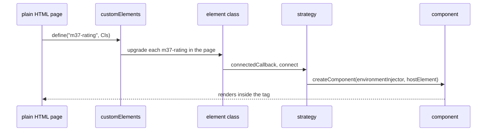

What to notice: the page never mentions Angular after loading the bundle, and the class creates the component only on connection, not on definition.

### How it actually works

**Why the element needs an injector.** Read from the `@angular/elements` 22.2.1 source (`fesm2022/elements.mjs`, `createCustomElement`): the class asks a strategy factory for a strategy (the object that creates, updates and destroys the component for the element, [§13](#13-under-the-hood-createcustomelements-strategy-and-the-service-workers-driver)) built from `config.injector`. On connection the strategy's internal `initializeComponent` calls `createComponent` with `environmentInjector: this.injector` and `hostElement: element`, so the component renders in the tag the browser already made. Without an injector the component could not resolve `HttpClient`, the router or your tokens (read, not run).

**One component per `define`.** Each call wraps one component. Inputs become `observedAttributes` and property accessors, and outputs become `CustomEvent`s (the next section).

**Properties set early.** A property assigned to an element before its class is defined is an own property of that element. Read from the same file: the first access to `ngElementStrategy` finds it with `Object.hasOwn`, deletes it and applies it as an input, so the early value is not lost (`Section 1: a property set before define reaches the component after upgrade`).

**When to use it.** Widgets in non-Angular pages, CMS embeds, gradual migration of a server-rendered app. Not for a component inside one Angular app (use the component), and not a micro-frontend architecture by itself ([38](38-architecture-and-production-structure.md#8-micro-frontends-module-federation-native-federation-and-when-they-are-justified)). A bundle carries `@angular/core` and the application's providers once per application, and separately built bundles each carry their own ([§3](#3-elements-at-run-time-lifecycle-change-detection-without-zonejs-styles-and-several-apps-on-one-page)). Drilled in [Q37.01](#q37-01) and [Q37.07](#q37-07).

> [!NOTE]
> **Framework vs platform.** Tags, `customElements.define`, upgrade, attributes and `CustomEvent` are the browser's. Angular adds the strategy that creates the component, maps inputs and outputs, and runs change detection for it.

### Code

The lab's `m37-rating` shows a value and emits it when its button is pressed:

1. A component with a string `value` input and a `rated` output.
2. A guarded `define` in `define.ts`, run once the application exists.
3. A plain HTML page that loads the bundle and holds the tag.

```ts
// Excerpt of labs/angular/projects/elements-lab/src/elements/section-1/rating.ts
@Component({
  selector: 'lab-m37-rating',
  template: `
    <span data-testid="rating">Rating: {{ value() }}</span>
    <button type="button" (click)="rated.emit(value())">Rate</button>
  `,
})
export class LabRatingElement {
  readonly value = input('0');
  readonly rated = output<string>();
}
```

```ts
// Excerpt of labs/angular/projects/elements-lab/src/elements/define.ts
if (!customElements.get('m37-rating')) {
  customElements.define('m37-rating', createCustomElement(LabRatingElement, { injector }));
}
```

The `customElements.get` guard skips a name that is already registered.

```html
<!-- Excerpt of labs/e2e/server/elements-host/section-1.html -->
<m37-rating value="3"></m37-rating>
<script type="module" src="/widgets/main.js"></script>
```

In Chromium the page shows "Rating: 3" with no Angular root element, changing the attribute to 5 updates the text, and pressing the button fires `rated` with detail "5" (`Section 1: a plain HTML page renders the Angular element without an Angular root`). Under jsdom, `customElements.define` accepts the returned class (`Section 1: createCustomElement returns a class the registry accepts`), and an element made with `document.createElement` renders only once connected (`Section 1: an element created with document.createElement renders the component once connected`).

### Best practices and anti-patterns

- **Define elements from one `defineLabElements`-style function**, because it holds the injector and the `customElements.get` guards in one place.
- **Prefix every tag, as `m37-` does**, because a custom element name needs a hyphen and a prefix avoids clashes with other widgets on the page.
- **Avoid an element for a component used only inside your Angular app**, because plain components keep typing, DI scope and no extra bundle.

### Misconceptions and traps

- *"Angular Elements turns the whole app into a web component."* It wraps one component per `define`. The myth exists because of the name.
- *"A custom element built with Angular has no Angular runtime cost."* The bundle carries `@angular/core` and the application's providers. The myth exists because the result looks like a native tag.
- *"Use the component's selector as the tag."* The docs warn that it creates two instances where Angular also matches the selector (`guide/elements.md`, read 2026-10-17). The myth exists because it is the obvious name; the lab's selector is `lab-m37-rating` and its tag `m37-rating`.

## 2. The element's public contract: attributes, properties, events, projected content and typings

### The problem it solves

`<m37-rating max-stars="5">` reaches the component as the string `"5"`. A React wrapper listening for `rating-changed` hears nothing, a parent `div` listener never fires, and children added after connect never appear.

### Mental model

The element has four doors. **Attributes** are strings in kebab-case, mapped from each input's template name. **Properties** take any value and use the input's own name. **Events** are one `CustomEvent` per output, named exactly like the output, with the value in `detail`, and they do not bubble. **Children** are projected into `<ng-content>` once, when the component is created ([content projection](19-component-communication-and-projection.md#3-content-projection-ng-content-slots-ngprojectas-fallback-content-and-the-lifecycle-trap)).

Think of a vending machine: a coin slot taking one shape (attributes), a card reader (properties), the tray (events) and stock loaded once at installation (children).

An **attribute** is text in the markup and a **property** a value on the JavaScript object ([08 §5](08-browser-rendering-dom-events.md#5-web-components-custom-elements-shadow-dom-and-templates)). A **`CustomEvent`** [Baseline 2015: widely available, per MDN] is the browser's event class for application events, with its payload in **`detail`**. An event **bubbles** when it also reaches its ancestors' listeners; one created without `bubbles: true` stops at its target.

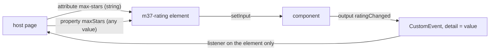

What to notice: both ways in end at one `setInput`, but the way out reaches only listeners on the element itself.

### How it actually works

**Why `maxStars` is `max-stars` but the event is `ratingChanged`.** Read from the `@angular/elements` 22.2.1 source (`fesm2022/elements.mjs`, `createCustomElement`): `observedAttributes` holds `camelToDashCase(templateName)` for every input, and `attributeChangedCallback` passes the attribute's string to `setInputValue`. Each input's prototype accessor calls the same `setInputValue`. For outputs, the strategy emits `{ name: templateName, value }` and the internal `subscribeToEvents` runs `new CustomEvent(e.name, { detail: e.value })` with no `bubbles`, so nothing kebab-cases the name (read, not run). In the lab, `max-stars` is in `observedAttributes` and sets the input (`Section 2: an attribute reaches a camelCase input through its kebab-case name`); the listener for `ratingChanged` fires once, the one for `rating-changed` never, and `detail` is the value (`Section 2: an output is dispatched as a CustomEvent named after the output with the value in detail`); a parent `div` listener sees nothing (`Section 2: the output event does not bubble to a parent listener`).

**Why `"5"` is a string.** The callback forwards the text. An `input<unknown>()` saw `string`, and an input with `transform: numberAttribute` saw `number` (`Section 2: an attribute arrives as a string unless the input has a transform`).

**Why late children never appear.** In the same file the internal `initializeComponent` calls the internal `extractProjectableNodes` once, at creation (read, not run). A `span` present at connect lands in the slot; one appended afterwards stays a direct child of the element, outside it (`Section 2: children present at connect are projected and children appended later are not`).

**Typings.** The constructor builds `NgElement & WithProperties<P>` (`types/elements.d.ts`, read, not run). The docs offer casting with those two types, or augmenting `HTMLElementTagNameMap` so TypeScript infers the type from the tag (`angular.dev/guide/elements`, read 2026-10-17).

**The consumer side.** In another app, **`CUSTOM_ELEMENTS_SCHEMA`** in a component's `schemas` lets its template use non-Angular elements named with a dash, and dash-named properties (`angular.dev/api/core/CUSTOM_ELEMENTS_SCHEMA`, read 2026-10-17). An unknown tag with a `[score]` binding compiles and sets `score` on the element (`Section 2: a component with CUSTOM_ELEMENTS_SCHEMA compiles a template with an unknown element and property`; [15 §2](15-standalone-and-ngmodules.md#2-standalone-components-and-the-imports-array)). Every dash-named tag passes, a misspelled one included. Drilled in [Q37.02](#q37-02), [Q37.03](#q37-03), [Q37.04](#q37-04) and [Q37.05](#q37-05).

### Code

The lab specs read the element from outside:

1. A component with a `maxStars` input and a `ratingChanged` output.
2. An input with `numberAttribute` next to one without a transform.
3. A consumer component with `CUSTOM_ELEMENTS_SCHEMA`.

```ts
// Excerpt of labs/angular/src/app/modules/37-elements-pwa-errors-ecosystem/concepts/section-2-contract.spec.ts
class LabM37S2Rating {
  readonly maxStars = input('0');
  readonly ratingChanged = output<string>();
}
```

```ts
// Excerpt of labs/angular/src/app/modules/37-elements-pwa-errors-ecosystem/concepts/section-2-contract.spec.ts
  readonly raw = input<unknown>();
  readonly num = input(0, { transform: numberAttribute });
```

```ts
// Excerpt of labs/angular/src/app/modules/37-elements-pwa-errors-ecosystem/concepts/section-2-schema.spec.ts
@Component({
  selector: 'lab-m37-s2-consumer',
  schemas: [CUSTOM_ELEMENTS_SCHEMA],
  template: `<m37-s2-unknown-widget [score]="3"></m37-s2-unknown-widget>`,
})
```

### Best practices and anti-patterns

- **Give an input a transform when its attribute is a number or boolean**, because attributes arrive as strings.
- **Listen on the element itself**, because the `CustomEvent` does not bubble.
- **Avoid relying on later children**; pass changing data through a property, because projection happens once.
- **Keep `CUSTOM_ELEMENTS_SCHEMA` to one component**, because it accepts misspelled tags.

### Misconceptions and traps

- *"Outputs become kebab-case DOM events."* The event keeps the output's template name (`ratingChanged`). The myth exists because inputs are kebab-cased.
- *"A parent can listen for the element's event."* It cannot, because `new CustomEvent` without `bubbles: true` does not bubble. The myth exists because click events do.
- *"`CUSTOM_ELEMENTS_SCHEMA` is needed to define an element."* It only relaxes consumers' templates. The myth exists because both mention custom elements.
- *"Children update like `<ng-content>` does."* Elements extracts the nodes once. The myth exists because projection looks live inside Angular.

## 3. Elements at run time: lifecycle, change detection without zone.js, styles and several apps on one page

### The problem it solves

An element moved inside a sortable list should keep its state. A property set from the host page should re-render in an app with no zone.js. A host page with its own `p { color: blue }` rule should not recolor the widget, and the widget's rules should not recolor the page.

### Mental model

The element's lifecycle drives the component's. Connecting creates the component, or cancels a destruction already scheduled. Disconnecting only **schedules** the destruction, 10 ms later, so a move within one task keeps the same component. A value set on the element calls `setInput` and notifies the scheduler, so change detection runs without zone.js ([21 §5](21-change-detection.md#5-zoneless-change-detection-the-scheduler-its-triggers-and-pendingtasks)).

Think of a hotel room held for a few minutes after checkout: come back quickly and your things are still there.

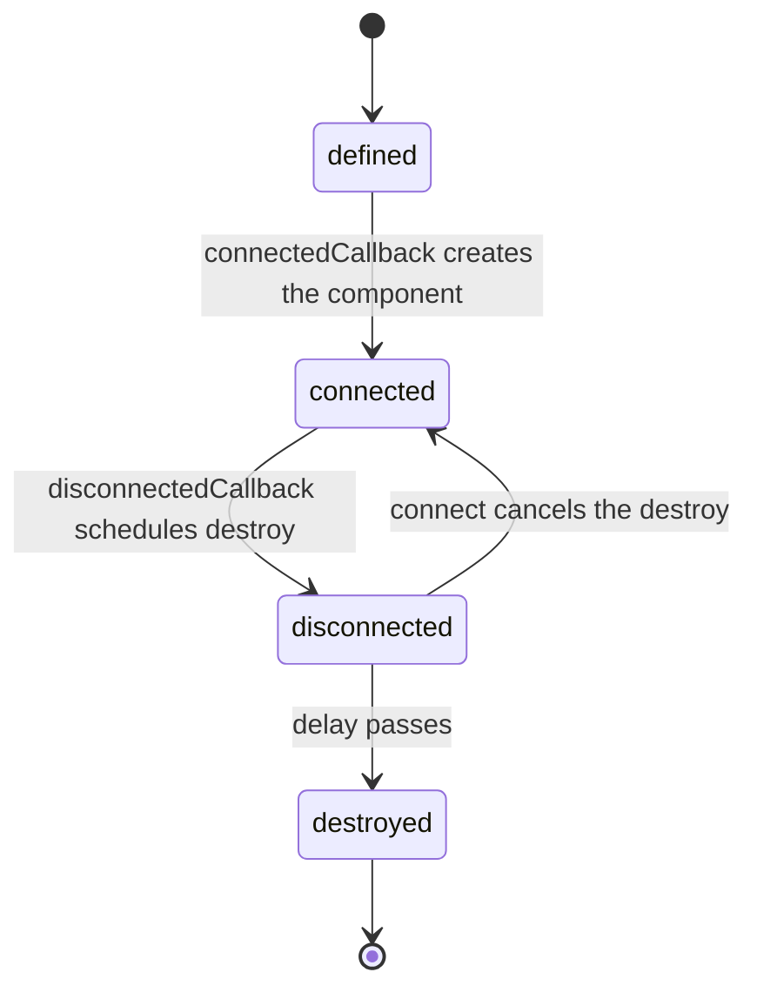

What to notice: the only way back from `disconnected` is a connect that arrives before the delay ends.

### How it actually works

**Why a moved element keeps its state.** Read from the `@angular/elements` 22.2.1 source (`fesm2022/elements.mjs`). The default strategy class, `ComponentNgElementStrategy`, is internal and never imported by the lab; so is its constant `DESTROY_DELAY = 10`. `connect` calls the scheduled-destroy function if there is one and returns, and only otherwise creates the component. `disconnect` stores a scheduled call to `componentRef.destroy()` with that delay. The **destroy delay** is therefore a grace period for re-connection. In the lab, `Section 3: removing and re-adding the element within the delay keeps the same component instance` removes the element, advances fake timers (a clock the test moves by hand, [29 §10](29-testing-angular.md#10-async-tests-vitest-fake-timers-versus-fakeasync-and-waitforasync)) by 5, appends it again, and finds one construction and no destruction. `Section 3: the component is destroyed after the destroy delay` advances the timers by 10 and finds `ngOnDestroy` called once. No test measures time.

**Why a zoneless element updates.** In the same file `setInputValue` calls `componentRef.setInput`, and when the view is dirty it marks it for refresh and calls `cdScheduler.notify(6)`, a notification to the internal scheduler. The internal `runInZone` enters the zone only when `Zone` is defined (read, not run). In the lab, the app is created with `provideZonelessChangeDetection()`, `Zone` is undefined, and setting `value` on the element re-renders after `whenStable` (the promise that resolves once the app has no pending work, [29 §5](29-testing-angular.md#5-zoneless-fixtures-whenstable-testbedtick-detectchanges-and-automatic-change-detection)) (`Section 3: a property set on the element re-renders without zone.js`).

**Re-attaching after the delay.** The Elements guide warns: "Care should be taken when destroying and then re-attaching custom elements created with" (abridged), and lists "Manually detaching and re-attaching an element to the DOM" (`angular.dev/guide/elements`, read 2026-10-17). The lab shows only the case inside the delay, which keeps the component. After the delay, the source shows `componentRef` set to `null`, so the next `connect` calls `initializeComponent` and builds a new component, and the old instance's state is gone (read, not run).

**Styles.** An element whose component uses **`ViewEncapsulation.ShadowDom`** renders into a shadow root, so its CSS lives there ([13 §9](13-components-and-templates.md#9-view-encapsulation-emulated-shadowdom-and-none-and-what-the-compiler-does-to-your-css)). On a plain HTML page whose own rule colors every `p` blue, the element's `p` is red and the page's `p` is still blue (`Section 3: an element with ShadowDom keeps its styles out of the host page`).

**Several applications on one page.** Each `createCustomElement` call takes its own `injector` (read, not run), so two elements built from different applications use different injectors. The tag registry is the page's, shared by all of them ([08 §5](08-browser-rendering-dom-events.md#5-web-components-custom-elements-shadow-dom-and-templates)). Drilled in [Q37.06](#q37-06) and [Q37.08](#q37-08); practised in [Exercise 37.2](#ex37-2).

### Code

The lab files do the work:

1. A component counts constructions and destructions in a shared object.
2. The element is connected with real timers, then fake timers cover the removal.
3. The ShadowDom component styles a `p` inside its root.

```ts
// Excerpt of labs/angular/src/app/modules/37-elements-pwa-errors-ecosystem/concepts/section-3-runtime.spec.ts
  constructor() {
    lifecycle.created += 1;
  }

  ngOnDestroy(): void {
    lifecycle.destroyed += 1;
  }
```

```ts
// Excerpt of labs/angular/src/app/modules/37-elements-pwa-errors-ecosystem/concepts/section-3-runtime.spec.ts
    element.remove();
    vi.advanceTimersByTime(5);
    document.body.append(element);
    vi.advanceTimersByTime(20);
```

```ts
// Excerpt of labs/angular/projects/elements-lab/src/elements/section-3/shadow-note.ts
  encapsulation: ViewEncapsulation.ShadowDom,
  template: `<p class="m37-note">Inside the shadow root</p>`,
```

### Best practices and anti-patterns

- **Re-attach an element in the same task** when you move it, because a later connect creates a new component.
- **Pass changing data through properties**, because the setter notifies the scheduler.
- **Use ShadowDom for widgets dropped into pages you do not own**, because page rules cannot reach the widget's `p`.

### Misconceptions and traps

- *"Removing an element destroys its component immediately."* The destruction is scheduled 10 ms later. The myth exists because `disconnectedCallback` runs at once.
- *"Elements need zone.js."* The lab's zoneless app updated the element. The myth exists because the strategy wraps work in the zone when `Zone` exists.
- *"Two separately built widgets share one Angular."* Each bundle calls its own `createApplication`, and its elements use that application's injector; only elements defined from one application share it, as the lab's `define.ts` does with one `injector`. The myth exists because both tags sit on one page.

## 4. `@angular/service-worker`: registration, `ngsw-config.json` and the generated `ngsw.json`

### The problem it solves

A hand-written service worker caches `main.js` forever, so users keep running last month's build. Another app registers its worker during startup and slows the first load. Both come from writing by hand what the build already knows: every file it produced and the hash of each.

### Mental model

A **service worker** [Baseline 2018: widely available, per MDN] is a script the browser runs apart from the page, and a **registration** is the browser's record that a script serves a **scope**, the URLs it may control ([09 §9](09-web-networking-storage-security.md#9-service-workers-and-the-pwa-manifest) owns the lifecycle, scope and Cache API). `@angular/service-worker` adds a build step and a ready-made worker. The build reads `ngsw-config.json` and writes **`ngsw.json`**, the manifest of every listed file with its hash plus the config's `appData`, and copies the prebuilt `ngsw-worker.js`. The app registers that worker with `provideServiceWorker` [Added in v16.0]. The worker installs an **app version**, one `ngsw.json` and the files it names, and serves requests from it. **`appData`** is free-form data from the config that travels inside the manifest.

Think of a librarian with a catalog card for each book's exact edition: when the edition changes, the card changes.

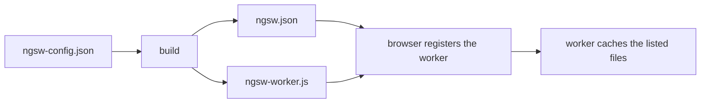

What to notice: the worker reads the generated `ngsw.json`, never `ngsw-config.json`, and registration is a step of its own after the build.

> [!NOTE]
> **Framework vs platform.** The service worker, its lifecycle and the Cache API are the browser's. `@angular/service-worker` adds the generated manifest of hashed files, versioning and the worker script that applies them ([09 §9](09-web-networking-storage-security.md#9-service-workers-and-the-pwa-manifest)).

### How it actually works

**Why the default waits for stability.** Read from the `@angular/service-worker` 22.2.1 source (`fesm2022/service-worker.mjs`, `provideServiceWorker` and its internal app initializer `ngswAppInitializer`, read, not run). The initializer returns without registering when the app runs on the server, when `'serviceWorker' in navigator` is false, or when `enabled` is `false`. Otherwise it splits `registrationStrategy`, default `registerWhenStable:30000`, and for `registerWhenStable` runs `Promise.race([appRef.whenStable(), delayWithTimeout(+args[0])])`. Registration therefore starts when the app is stable or after 30 000 ms, whichever comes first. `registerImmediately`, `registerWithDelay:<ms>` and an Observable factory are the other forms, and an unknown name throws a `RuntimeError` coded 5600. A failed `register` call is only a `console.error` coded 5604. The options also pass `scope`, and `type` and `updateViaCache` [Added in v20.2], to `navigator.serviceWorker.register`. The messages are development-mode text; production prints the code ([12 §3](12-angular-how-it-works.md#3-building-the-application-builder-output-layout-and-budgets)).

**Why the lab has no worker in development.** The lab passes `enabled: !isDevMode()`, and the builder's `serviceWorker` option names `ngsw-config.json` only in the production configuration (`labs/angular/angular.json`). Under jsdom the browser has no worker at all: `Section 4: SwUpdate reports isEnabled false where the browser has no service worker`.

**What the build produces.** `@angular/build` 22.2.1 (`src/utils/service-worker.js`, read, not run) writes `ngsw.json` from the config and copies `ngsw-worker.js` from the package, plus `safety-worker.js`. In the lab's production build, `Section 4: ngsw.json lists hashed files and the appData from the config` fetches `/ngsw.json` and finds `configVersion` 1, `appData.version` `v1`, `/index.html` in the hash table and a 40-hex hash for every file. `Section 4: the production build registers ngsw-worker.js and controls the page after a reload` shows the controller's `scriptURL` is `/ngsw-worker.js`, and only after a reload: the first load registers, the second is controlled. `Section 4: a context with service workers blocked serves the same page without a controller` shows the page works without it.

**Where it runs.** The docs say: "If you are not using HTTPS, the service worker will only be registered when accessing the application on `localhost`." (`angular.dev/ecosystem/service-workers/getting-started`, read 2026-10-17).

### Code

The lab file lists the groups, and one line of configuration registers the worker.

1. `ngsw-config.json` names the index, the `appData` and the asset groups.
2. The app config registers `ngsw-worker.js` outside development.
3. The e2e test fetches the generated `ngsw.json`.

```json
// Excerpt of labs/angular/projects/elements-lab/ngsw-config.json
  "index": "/index.html",
  "appData": { "version": "v1" },
```

```ts
// Excerpt of labs/angular/projects/elements-lab/src/app/app.config.ts
provideServiceWorker('ngsw-worker.js', { enabled: !isDevMode(), registrationStrategy: 'registerWhenStable:30000' }),
```

```ts
// Excerpt of labs/e2e/tests/37-elements-pwa-errors-ecosystem/concepts/section-4-registration.spec.ts
  expect(manifest.configVersion).toBe(1);
  expect(manifest.appData.version).toBe('v1');
```

#### Legacy

`ServiceWorkerModule.register(script, options)` is the NgModule form. In the source it returns `providers: [provideServiceWorker(script, options)]`, so it does the same work and is imported in an `NgModule`'s `imports`. New code calls `provideServiceWorker` in the application config.

### Best practices and anti-patterns

- **Tie `enabled` to production**, because `enabled` is the switch that keeps the worker out of development, as the lab does.
- **Put a version label in `appData`**, because the next sections read it to tell builds apart.
- **Keep the default strategy** unless a page needs the worker earlier, because the default registers only once the app is stable (or after 30 s).

### Misconceptions and traps

- *"The service worker runs during `ng serve`."* The lab's `enabled: !isDevMode()` and the builder's `serviceWorker` option leave it off. The myth exists because the provider sits in the app config.
- *"`ngsw-config.json` is the worker's runtime config."* The worker reads the generated `ngsw.json`. The myth exists because the config's name suggests it ships.
- *"Registration happens at bootstrap."* The default waits for stability or 30 s. The myth exists because `provideServiceWorker` sits next to the other providers.

## 5. Caching with asset and data groups, navigation requests and the app shell

### The problem it solves

An offline user opens a deep link and sees the browser's dinosaur. A product list is served a day old because someone cached "the API". Both treat "cache" as one switch, when the worker needs a rule per kind of request.

### Mental model

An **asset group** is a set of the app's own files, listed in `ngsw-config.json` and versioned with the app. Its **`installMode`** says when the worker downloads them: `prefetch` while installing a version, `lazy` only when a file is first requested. Its **`updateMode`** says what happens to files changed in a newer version: `prefetch` downloads them at once, `lazy` waits for the next request (`config/schema.json`, `@angular/service-worker` 22.2.1, read 2026-10-17). A **data group** holds API responses instead, with a `performance` or `freshness` strategy ([09 §9](09-web-networking-storage-security.md#9-service-workers-and-the-pwa-manifest) and [Q09.22](09-web-networking-storage-security.md#q09-22) own the strategies themselves). A **navigation request** is the browser asking for a page: a `GET` with mode `navigate` that accepts HTML and matches `navigationUrls`.

Think of a pantry restocked when the menu changes (asset groups) beside a newspaper rack that keeps papers for a set time (data groups).

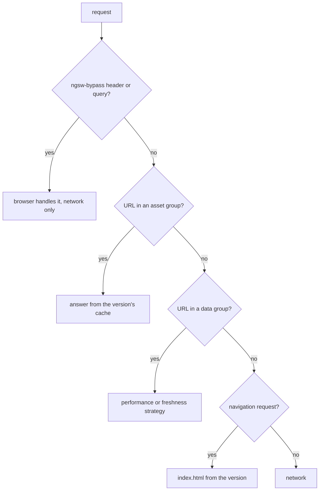

What to notice: the groups are tried in order, so only a request that matches nothing reaches the network.

### How it actually works

**Why a deep link works offline.** In `ngsw-worker.js` (22.2.1, read, not run) the version's internal `handleFetch` tries the asset groups, then the data groups, then a navigation check: a request that is not the index itself but passes the internal `isNavigationRequest` is answered with `handleFetch` for the index URL. The default `navigationUrls` include every path except those with a file extension or `__` (`ngsw-config.js`), so `/m37/caching` qualifies and `/main.js` does not. The cached `index.html` boots the app: `Section 5: a deep link loads offline from the cached index.html`.

**Data groups.** `performance` answers from the cache while the entry is within `maxAge`; `Section 5: a performance data group answers offline from the cache without reaching the server` shows the offline load returning the online answer, while a bypassed request fails. `freshness` goes to the network and uses the cache only after the `timeout` or a failure (read, not run); `Section 5: a freshness data group goes to the network while online` shows the second load with a higher server hit number. A group's cache name uses the group's own `version`, default 1, not the app's manifest hash, so deploying does not empty it (`ngsw-config.js`, `ngsw-worker.js`, read, not run). `refreshAhead` and `applicationMaxAge` [Added in v19.0] refresh an old entry in the background and bypass an old version (`ngsw-worker.js`, read, not run).

**What is not cached.** A request in no group goes to the network: `Section 5: a request outside every data group fails offline`. A request with an `ngsw-bypass` header or query parameter is not handled by the worker at all (the driver's internal `onFetch`, read): `Section 5: a request with ngsw-bypass skips the worker`. The tests go offline with `context.setOffline(true)`, which fails the worker's own fetches (`Section 5: a request outside every data group fails offline`).

**The app shell.** The docs say it "is a way to render a portion of your application using a route at build time" and name `ng generate app-shell` (`angular.dev/ecosystem/service-workers/app-shell`, read 2026-10-17). Documented only; build-time rendering is [32](32-ssr-ssg-hydration.md#1-why-render-on-the-server-csr-ssr-ssg-and-hybrid-rendering-and-what-each-costs)'s. Drilled in [Q37.10](#q37-10) and [Q37.11](#q37-11).

### Code

The page `/m37/caching` calls the endpoints; the config decides what the worker does.

1. Two data groups give the catalog and prices their strategies.
2. The bypass button adds the header the worker checks.
3. The test goes offline once the entry is cached, then loads the catalog again.

```json
// Excerpt of labs/angular/projects/elements-lab/ngsw-config.json
"name": "catalog",
"cacheConfig": { "strategy": "performance", "maxSize": 10, "maxAge": "1d" }
"name": "prices",
"cacheConfig": { "strategy": "freshness", "maxSize": 10, "maxAge": "1h", "timeout": "2s" }
```

```ts
// Excerpt of labs/angular/projects/elements-lab/src/app/m37/caching/caching.ts
const headers = bypass ? { 'ngsw-bypass': 'true' } : undefined;
```

```ts
// Excerpt of labs/e2e/tests/37-elements-pwa-errors-ecosystem/concepts/section-5-caching.spec.ts
await waitForCached(page, '/api/m37/catalog');
await goOffline(context);
```

### Best practices and anti-patterns

- **Cache a data group only for data that may be stale**, because `performance` returns the entry until `maxAge` without asking the server.
- **Use `freshness` with a `timeout` for current data**, because it falls back to the cache when the network is slow or down.
- **In tests, compare the hit number each answer carries, not a shared server counter**, because a cached answer repeats its number while parallel runs move the shared counter (the `Section 5` tests do this).

### Misconceptions and traps

- *"Data groups are refreshed with each deployment."* Only asset groups follow the version; a data group's cache is named by its own `version`. The myth exists because both sit in one config file.
- *"`freshness` means never stale."* After the `timeout` or a network failure the worker serves the cache. The myth exists because of the strategy's name.
- *"The service worker caches every API call."* It intercepts every request, but only URLs in a data group are cached: `Section 5: a request outside every data group fails offline`. The myth exists because the worker sees all traffic.

## 6. Updates: versions, `SwUpdate`, prompting a reload, unrecoverable states and the kill switch

### The problem it solves

After a deploy, a support agent's tab keeps the old version for days. Another app calls `activateUpdate()` and a lazy route fails on a missing chunk. The worker only prepares an update; the app decides when a tab switches.

### Mental model

The worker holds several app versions at once, each named by its **version hash**, the SHA-1 of its `ngsw.json` (any file or `appData` change makes a new one). **Each tab stays on the version it loaded.** A check that finds a new hash downloads and verifies the files, then posts **`VERSION_READY`**: the `SwUpdate.versionUpdates` event saying a newer version is cached while this tab runs an older one. The app then chooses: reload (the safe default) or `activateUpdate()`. An **unrecoverable state** is a tab whose version can no longer be served; only a reload helps.

Think of a theatre: tonight's audience sees the old script to the end; the next performance uses the new one.

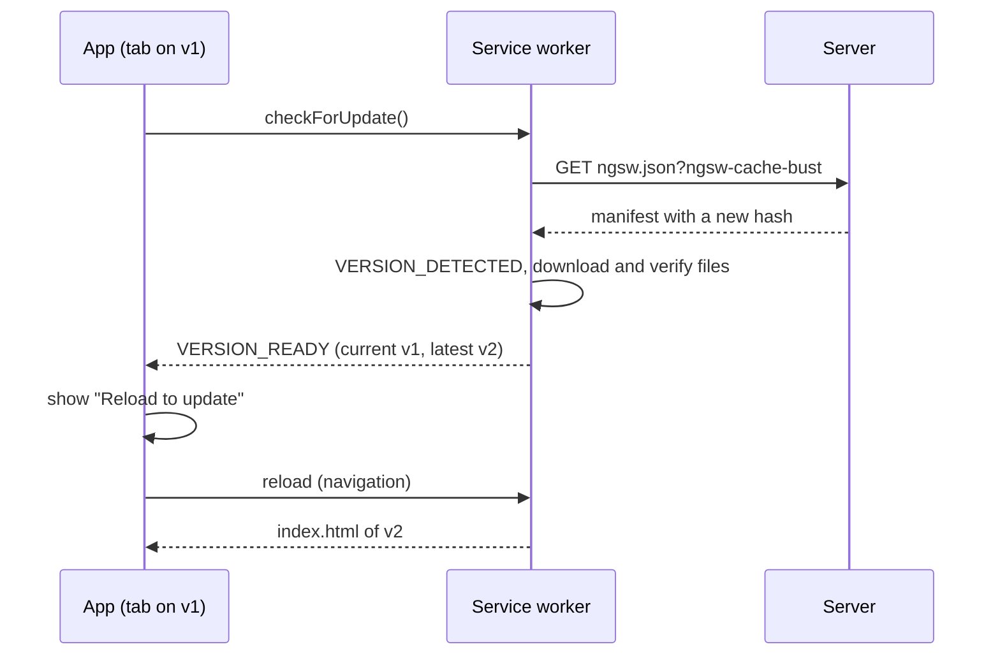

What to notice: the worker only reports; nothing changes in the tab until it navigates.

### How it actually works

**Why an open tab keeps v1.** The driver (the worker's internal main class, `ngsw-worker.js` 22.2.1, read, not run) keeps an internal `clientVersionMap` from each tab's client ID to a version hash, and its internal `assignVersion` answers each request from that version. Only a navigation in the `NORMAL` state, or a new client, gets the latest. In the lab, `Section 6: the open tab keeps showing v1 until it reloads` shows the worker still serving that tab v1's `index.html` while the server sends v2's. `Section 6: after a reload the tab shows v2`; `Section 6: a second tab opened after the update gets v2` runs beside it.

**The check.** The driver fetches `ngsw.json?ngsw-cache-bust=<random>`. A known hash posts `NO_NEW_VERSION_DETECTED`; a new one posts `VERSION_DETECTED`, installs the version and posts `VERSION_READY` only to tabs on an older version. A file whose content misses its hash raises the internal `SwCriticalError`; a failed install posts `VERSION_INSTALLATION_FAILED` and leaves the state `EXISTING_CLIENTS_ONLY`. `Section 6: after deploying v2 a checkForUpdate emits VERSION_READY with both appData versions` shows `VERSION_DETECTED v2`, then `VERSION_READY v1 -> v2`, and the promise resolving `true`. Unasked, it checks after a navigation once idle for 5 s (at most 30 s) through the internal `IdleScheduler` (read, not run). `SwUpdate.checkForUpdate` (`fesm2022/service-worker.mjs`) reuses an ongoing check and rejects when the worker is off: `Section 6: checkForUpdate rejects when service workers are disabled`.

**Broken versions.** A hashed file missing from both cache and server (a 404) throws the internal `SwUnrecoverableStateError`, and the driver posts `UNRECOVERABLE_STATE` with a `reason` to that version's tabs (read, not run). **`SAFE_MODE`** is the state after the driver's own initialization fails: "All traffic will be served from the network, running as little service worker code as possible." (`angular.dev/ecosystem/service-workers/devops`, read 2026-10-17).

**The kill switch.** A **safety worker** is the package's `safety-worker.js`: on activation it claims the tabs, unregisters itself and deletes every `ngsw:` cache (read). You serve it "at the URL of the Service Worker script you are trying to unregister" (same page). Documented only; the lab does not deploy it.

**Polling.** An interval started too early "prevents the application from stabilizing" (`angular.dev/ecosystem/service-workers/communications`, read 2026-10-17), so registration waits the full 30 s; start polling after stability ([21 §5](21-change-detection.md#5-zoneless-change-detection-the-scheduler-its-triggers-and-pendingtasks)). Drilled in [Q37.12](#q37-12), [Q37.13](#q37-13) and [Q37.14](#q37-14); practised in [Exercise 37.4](#ex37-4).

### Code

The page `/m37/updates` lists every version event and offers a reload; each test deploys v2 for its own context.

1. Subscribe to `versionUpdates` when the page is created, and turn on the reload prompt at `VERSION_READY`.
2. Tell the user when the tab's version is broken.
3. Reload the whole document, not just the router state.
4. In the test, check that the worker still serves this tab v1's files.

```ts
// Excerpt of labs/angular/projects/elements-lab/src/app/m37/updates/updates.ts
this.updates.versionUpdates.pipe(takeUntilDestroyed()).subscribe((event) => {
  this.events.update((lines) => [...lines, describe(event)]);
  if (event.type === 'VERSION_READY') this.ready.set(true);
});
this.updates.unrecoverable.pipe(takeUntilDestroyed()).subscribe((event) => {
  this.unrecoverable.set(`This page cannot continue (${event.reason}). Reload it.`);
});
```

```ts
// Excerpt of labs/angular/projects/elements-lab/src/app/m37/updates/updates.ts
protected reload(): void {
  document.location.reload();
}
```

```ts
// Excerpt of labs/e2e/tests/37-elements-pwa-errors-ecosystem/concepts/section-6-updates.spec.ts
await expect(page.getByTestId('running')).toHaveText('This tab runs v1');
const v1Main = await loadedMain(page);
expect(await mainServedToTab(page)).toBe(v1Main);
expect(await mainOnServer(context)).not.toBe(v1Main);
```

### Best practices and anti-patterns

- **Prompt, then reload**, because only a reload takes the page code and every lazy chunk from one version.
- **Avoid `activateUpdate()` without a reload**, because its doc comment warns of "a version mismatch between the application shell and other page resources, such as lazy-loaded chunks" (`types/service-worker.d.ts`, read).
- **Subscribe to `unrecoverable`**, because a broken version cannot heal while the tab stays open.

### Misconceptions and traps

- *"A new deployment reaches users on their next request."* The worker keeps each tab on its version until it navigates: `Section 6: the open tab keeps showing v1 until it reloads`. The myth exists because of HTTP caching intuition.
- *"`activateUpdate()` is the update."* It moves the tab's future requests to the new version (the driver's internal `updateClient`, read), but the code already running stays old. The myth exists because of its name.
- *"The worker checks for updates continuously."* It "checks for updates during initialization and on each navigation request" (communications page), and when asked. The myth exists because it is always installed.

## 7. Push notifications and installability: `SwPush`, notification clicks and the manifest

### The problem it solves

A team asks for push "like a mobile app" and learns late that it needs a subscription, a server holding keys and the user's permission. A click then opens a blank tab, because nothing said what a click should do.

### Mental model

A **push service** is the browser vendor's server that delivers messages to a browser; your backend never talks to the page. A **subscription** is the push service's record for one worker: an endpoint URL plus keys, which your backend stores and sends to (MDN, Push API [Baseline 2023: widely available, per MDN], read 2026-10-17: "an endpoint and the encryption key needed for sending data"). A **VAPID key** is the P-256 public key you pass at subscription time, which the push service uses to authenticate your application server; [43](43-fullstack-realtime.md#1-choosing-a-transport-polling-long-polling-server-sent-events-websockets-and-web-push-when-no-tab-is-open) owns sending from the server. A **notification payload** is the JSON the backend sends, with a `notification` field.

Think of a doorbell: the courier rings, and the house (worker) answers with no one in the room.

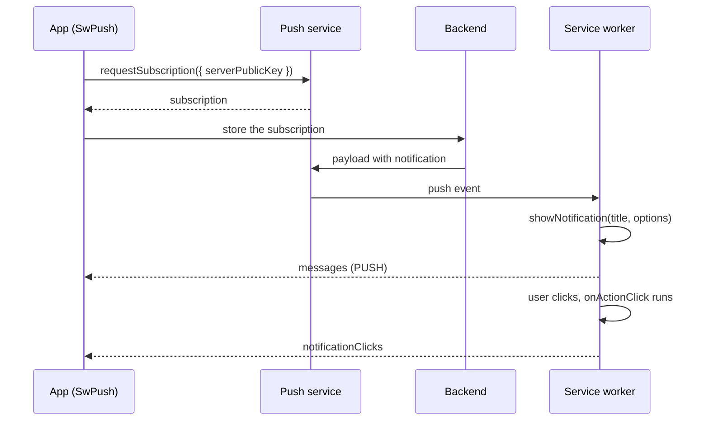

What to notice: the worker, not the app, receives the push and shows the notification.

### How it actually works

**Who shows the notification.** The `push` listener calls the driver's internal `handlePush` (`ngsw-worker.js` 22.2.1, read, not run): it first posts `{ type: 'PUSH', data }` to every client, which `SwPush.messages` exposes (`service-worker.mjs`, read). Only with a `data.notification.title` does it call `registration.showNotification(title, options)`. Without it, open tabs hear and nothing shows. Whether `showNotification` succeeds headless is not tested.

**What the lab proves.** `Section 7: a push message delivered to the worker reaches SwPush.messages in the page` hands the worker a JSON payload through the DevTools Protocol command `ServiceWorker.deliverPushMessage` and finds the same payload on the page `/m37/push`. That is a Chromium-only test harness, not a real push service, so subscription, keys and delivery stay documented only. `Section 7: SwPush reports isEnabled false and requestSubscription rejects without a worker` shows `requestSubscription` rejecting with "Service workers are disabled or not supported by this browser"; with a worker it calls `pushManager.subscribe` with `userVisibleOnly: true` and your decoded key (read, not run).

**Clicks.** The internal `handleClick` closes the notification, looks up `data.onActionClick[action]` (the entry `default` when the user clicked the body), and resolves its `url` against the scope. Its operations are `openWindow`, `focusLastFocusedOrOpen`, `navigateLastFocusedOrOpen` and `sendRequest`; then it posts `NOTIFICATION_CLICK`, which `SwPush.notificationClicks` exposes (read, not run). Without an entry the notification is closed and open clients are told (push-notifications page, read 2026-10-17); an entry is how a click works with no tab open. `notificationCloses` and `pushSubscriptionChanges` [Added in v20.1] expose the close and subscription-change events the same way.

**Not in the package.** The driver registers listeners for `install`, `activate`, `fetch`, `message`, `push`, `notificationclick`, `notificationclose`, `pushsubscriptionchange`, `messageerror` and `unhandledrejection`, and none for `sync` or `periodicsync` (read), so the package has no background sync. The platform lifecycle is [09 §9](09-web-networking-storage-security.md#9-service-workers-and-the-pwa-manifest).

**Installability.** A **web app manifest** is the JSON file describing an installable site. `Section 7: the lab serves a manifest linked from index.html` reads the `<link rel="manifest">` of the lab's page and fetches the file, whose `display` is `standalone`. Install prompts are not exercised. Drilled in [Q37.15](#q37-15).

### Code

The page `/m37/push` shows the last payload `SwPush.messages` delivered.

1. Subscribe to `messages` and keep the last payload.
2. Collect the worker's registration id from the protocol.
3. Deliver a JSON string to it.
4. Wait for the page to show the payload.

```ts
// Excerpt of labs/angular/projects/elements-lab/src/app/m37/push/push.ts
this.push.messages.pipe(takeUntilDestroyed()).subscribe((message) => {
  this.last.set(JSON.stringify(message));
});
```

```ts
// Excerpt of labs/e2e/tests/37-elements-pwa-errors-ecosystem/concepts/section-7-push.spec.ts
const payload = { notification: { title: 'Module 37 push', body: 'delivered through the protocol' }, id: 'm37-push-1' };
await cdp.send('ServiceWorker.deliverPushMessage', { origin: ORIGIN, registrationId: registrations[0] ?? '', data: JSON.stringify(payload) });

await expect(page.getByTestId('last-push')).toHaveText(JSON.stringify(payload));
```

### Best practices and anti-patterns

- **Put `data.onActionClick` in the payload**, because a click with no open tab can only open a window if the worker is told to.
- **Avoid promising background sync**, because the package has no listener.

### Misconceptions and traps

- *"Push works with the app closed because the app listens."* `SwPush.messages` lives in the page; the worker receives the push and shows the notification (`handlePush`, read). The myth exists because the app code subscribes.
- *"The Angular service worker supports background sync."* Its listener list has no `sync` (read). The myth exists because PWAs and sync are discussed together.
- *"A manifest makes the app work offline."* The lab's manifest has names, colors, `display` and icons and no cache rule; offline answers come from `ngsw-config.json` ([§5](#5-caching-with-asset-and-data-groups-navigation-requests-and-the-app-shell)). The myth exists because installability and offline caching are both sold as PWA features.

## 8. `ErrorHandler` and global listeners: what reaches the handler and what does not

### The problem it solves

An error in a `setTimeout` callback never shows in the team's error log, and an unhandled promise rejection shows up only in the console. Both come from one question: which code does Angular call, and which code only the browser calls?

### Mental model

An **`ErrorHandler`** is the one class with a `handleError(error)` method that Angular asks for every error it catches; you replace it by providing your own class under the `ErrorHandler` token. The docs (angular.dev, error handling, read 2026-10-17): "Angular does not catch errors inside of APIs that are called directly by your code." Code Angular invokes itself, such as templates, lifecycle methods and listeners, is caught: "Angular catches errors and sends them to the ErrorHandler."

Everything else is the browser's. A **`window` `error` event** reports an uncaught exception; an **unhandled rejection** is a promise that rejects with no handler ([04 §8](04-js-async-event-loop.md#8-unhandled-rejections-queuemicrotask-and-starvation)). `provideBrowserGlobalErrorListeners()` [Stable since v20.0] is an **environment initializer**, a function run when the environment injector is created ([16 §7](16-dependency-injection.md#7-injectiontoken-multi-providers-environment-providers-and-initializers)), that registers listeners for both events and forwards them.

Think of a front desk that takes every complaint from staff (Angular-called code); the listeners add a public phone line to the same desk.

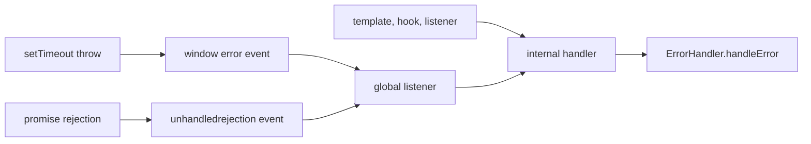

What to notice: both global routes join the framework's route, so one `handleError` sees all three.

> [!NOTE]
> **Framework vs platform.** The `window` `error` and `unhandledrejection` events are the platform's. Angular adds a handler you replace through dependency injection and listeners that forward both events into it ([04 §8](04-js-async-event-loop.md#8-unhandled-rejections-queuemicrotask-and-starvation), [05 §6](05-js-modules-memory-modern-features.md#6-errors-subclasses-causes-aggregation-and-global-handlers)).

> [!TIP]
> **Coming from the backend.** Spring's reference (read 2026-10-17) says `@ExceptionHandler` methods in a `@ControllerAdvice` class "apply to any controller", one place for many sources, like `ErrorHandler`. **Where the analogy breaks:** a request ends after the advice runs; the page keeps running with whatever state the error left.

### How it actually works

**Why one handler sees everything.** In `@angular/core` 22.2.1 (`fesm2022/_pending_tasks-chunk.mjs`, read, not run), the internal `INTERNAL_APPLICATION_ERROR_HANDLER` token produces a function that runs inside `zone.runOutsideAngular`, looks up `ErrorHandler` with `injector.get` on the first error and keeps it. If the injector is destroyed and no handler was resolved, it rethrows in a `setTimeout`. It has no `try`/`catch` around `handleError`; what follows a throwing handler is not run.

**Why the console report is missing.** The same file builds the listeners (internal `globalErrorListeners`, read, not run). The rejection listener passes `e.reason` to the handler; the error listener passes `e.error`, or a new `Error` wrapping `e.message` when there is none. Both then call `e.preventDefault()`. They are removed when the injector is destroyed. The default `ErrorHandler` only calls `console.error('ERROR', error)` (same file).

**What the lab proves.** `Section 8: an error thrown in a click listener reaches the custom ErrorHandler` and `Section 8: an error thrown in a template expression reaches the custom ErrorHandler` run with `rethrowApplicationErrors: false`. `Section 8: an error in a setTimeout callback does not reach ErrorHandler without global listeners` shows that, with none registered, the error is thrown out of the timer and the handler receives nothing. In the browser, `Section 8: a setTimeout error reaches the error log through the global listener` and `Section 8: an unhandled rejection reaches the error log with its reason` show the log entries `Error: m37 timeout error` and `Error: m37 rejection reason`. `Section 8: the browser console shows no uncaught error for a forwarded error` records no `pageerror` and no console error with that message.

**Testing.** The 20.0.0 changelog (read 2026-10-17): "For tests, this means that the error will be rethrown by default rather than only logging the error." `rethrowApplicationErrors: false` is its "last resort" ([29 §4](29-testing-angular.md#4-testbed-the-testing-module-inject-runininjectioncontext-overrides-and-teardown)).

#### Legacy

Per the same changelog, `ApplicationRef.tick` no longer catches and reports errors; it throws them out of the method. Before 20.0, Zone-based `AsyncPipe` errors "would have been caught by ZoneJS".

### Code

The page `/m37/errors` has three buttons; the error log lists what the `ErrorHandler` received.

1. Throw inside `setTimeout`, where only the browser sees it.
2. Reject a promise nobody handles.
3. Read the entries in the error log.

```ts
// Excerpt of labs/angular/projects/elements-lab/src/app/m37/errors/errors.ts
protected throwInTimeout(): void {
  setTimeout(() => {
    throw new Error('m37 timeout error');
  });
}

protected rejectPromise(): void {
  void Promise.reject(new Error('m37 rejection reason'));
}
```

```ts
// Excerpt of labs/e2e/tests/37-elements-pwa-errors-ecosystem/concepts/section-8-global.spec.ts
await page.getByRole('button', { name: 'Throw in setTimeout' }).click();

await expect(page.getByTestId('error-log').getByRole('listitem')).toHaveText(['Error: m37 timeout error']);
```

### Best practices and anti-patterns

- **Keep `provideBrowserGlobalErrorListeners()` in the config**, because without it a timer error never reaches your handler.
- **Keep `handleError` free of work that can throw**, because the internal function does not guard the call.

### Misconceptions and traps

- *"`ErrorHandler` catches every error in the app."* Code Angular does not call reaches it only through the global listeners. The myth exists because of its name.
- *"The default handler reports errors somewhere."* It only calls `console.error` (source, read). The myth exists because production apps usually add tracking.
- *"A handler that throws is safe, being the last line."* The internal call has no `try`/`catch` (source, read). The myth exists because the handler feels like the chain's end.

Drilled in [Q37.16](#q37-16), [Q37.17](#q37-17) and [Q37.18](#q37-18).

## 9. Error boundaries: `@boundary`, `@error`, `$reset`, `onViewError` and `onError`

### The problem it solves

One chart throwing on bad data blanks a whole dashboard; `try` in its methods misses the throw Angular hits while checking its template.

### Mental model

An **error boundary** is a template region that contains a failure. `@boundary` [Developer preview since v22.2] wraps part of a template; if that content throws while created or checked, Angular removes it and renders a **fallback**, the `@error` block, and the page keeps working. **Developer preview** APIs, per the [release policy](https://angular.dev/reference/releases) (read 2026-10-17), "can change at any time, even in new patch versions of the framework" ([12 §1](12-angular-how-it-works.md#1-what-a-framework-does-and-angulars-philosophy)).

Inside `@error`, **`$error`** is the caught error (typed `Error` by the template type checker) and **`$reset`** is a function that clears it and renders the original content again. With `@error (when expr)` the first true condition wins; one `@error` without `when` may come last ("Unconditional @error block must be the last @error block in the boundary chain", `@angular/compiler` 22.2.1, `createBoundaryBlock`, read).

Think of a circuit breaker per room: one appliance trips its room's breaker, not the house's, and `$reset` flips it back.

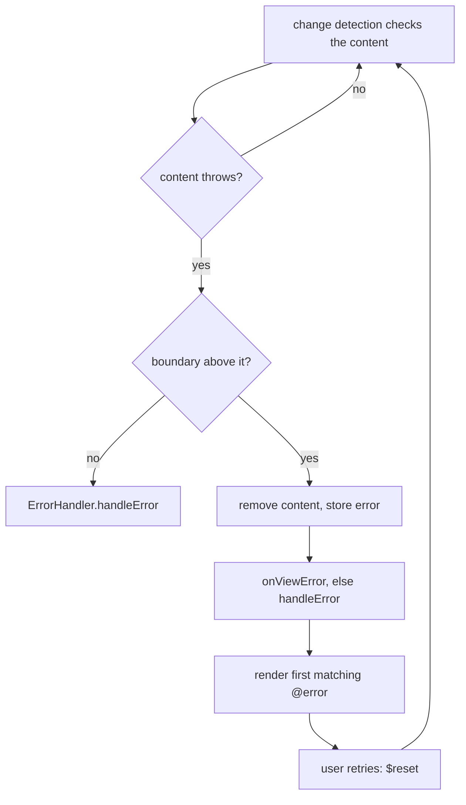

What to notice: both paths report to the `ErrorHandler`; the boundary adds a fallback, not silence.

### How it actually works

**Why a template error finds the boundary.** In `@angular/core` 22.2.1 (`fesm2022/_debug_node-chunk.mjs`, read, not run), the internal instruction `ɵɵboundaryUpdate` creates the content as an embedded view with a callback in its internal `ON_ERROR` slot. When the internal `refreshView` throws, its `catch` walks the `PARENT` chain to the nearest `ON_ERROR`, wrapping a non-error value in the internal `ErrorBoundaryWrappedError`. The callback stores the error, calls `onViewError(error, details)` (else `handleError`), removes the content and marks the host for refresh. A creation error is caught inside `ɵɵboundaryUpdate` and reported the same way; if no `@error` matches, it throws "Unhandled error in @boundary fell through." Only the internal `LBoundary.reset()` clears the error.

**Why a listener error shows no fallback.** Listeners run outside `refreshView`; the internal `executeListenerWithErrorHandling` sends the throw to the handler of [§8](#8-errorhandler-and-global-listeners-what-reaches-the-handler-and-what-does-not), which never reads `ON_ERROR`.

**`ErrorDetails`** [Developer preview since v22.2] carries `declarationType` and `declarationInstance` (the component whose view threw), `boundary` (`type`, the component holding the `@boundary`, and `reset`) and `caughtBy`. `ErrorHandler.onViewError` and the `onError` options carry no developer-preview tag in the 22.2.1 typings.

**What the lab proves** (`section-9-boundary.spec.ts`):
- `Section 9: a child that throws during change detection shows the @error block and leaves siblings rendered`: `Chart failed: bad data` between the untouched header and footer; `handleError` got `bad data`.
- `Section 9: $reset re-creates the content after the cause is fixed`: fixed data leaves the fallback; only Try again brings `Total: 9` back.
- `Section 9: the first matching when block wins and the unconditional block catches the rest`: `network`, matching two conditions, renders the first; `parse failure` the catch-all.
- `Section 9: onViewError receives the error with boundary details`: the chart as `declarationType`, the dashboard as `boundary.type`, no `handleError` call.
- `Section 9: an error in a click listener inside the boundary reaches ErrorHandler and keeps the content`: `handleError` got `listener boom`; the button stayed.

**The programmatic form.** `createComponent`, `ViewContainerRef.createComponent` and `createEmbeddedView` accept `onError(error, details)` ([19 §7](19-component-communication-and-projection.md#7-dynamic-components-viewcontainerrefcreatecomponent-createcomponent-and-bindings)). The [programmatic rendering guide](https://angular.dev/guide/components/programmatic-rendering#handling-rendering-errors) (read 2026-10-17): "It does not catch errors that occur during component instantiation (for example, in the constructor)." `Section 9: createComponent with onError reports a creation error to the callback` agrees: a first-render error went to `onError`; a constructor error was thrown by `createComponent`, which stores `onError` only afterwards (`core.mjs`).

**What it does not catch.** The [error boundaries guide](https://angular.dev/guide/templates/error-boundaries) (read 2026-10-17; read, not run): wrapping `<ng-content>` "does not catch errors from projected content", and if an `@error` block throws, "the error propagates to the next outer `@boundary`". A `resource` "presents the error in the `status` and `error` properties" ([error handling](https://angular.dev/best-practices/error-handling), [17 §6](17-signals.md#6-resources-async-data-as-signals)); navigation failures belong to `withNavigationErrorHandler` ([24 §6](24-routing.md#6-resolvers-and-route-data-resolvefn-failures-and-router-resources)).

### Code

1. Wrap the risky child in `@boundary`.
2. Show `$error.message` in the fallback, with a button calling `$reset()`.
3. Order conditional fallbacks specific first.

```ts
// Excerpt of labs/angular/src/app/modules/37-elements-pwa-errors-ecosystem/concepts/section-9-boundary.spec.ts
@boundary {
  <lab-m37-s9-chart [data]="data()" />
} @error {
  <p role="alert">Chart failed: {{ $error.message }}</p>
  <button type="button" (click)="$reset()">Try again</button>
}
```

```ts
// Excerpt of labs/angular/src/app/modules/37-elements-pwa-errors-ecosystem/concepts/section-9-boundary.spec.ts
} @error (let err; reset = $reset; when err.message === 'network') {
  <p role="alert">first: {{ err.message }}</p>
} @error (when $error.message.startsWith('net')) {
  <p role="alert">second: {{ $error.message }}</p>
} @error {
  <p role="alert">catch-all: {{ $error.message }}</p>
```

### Best practices and anti-patterns

- **One boundary per independent widget, not one per page**, because a boundary removes all of its content when any part throws.
- **Report from `onViewError`, not the fallback**, because Angular calls it for every caught error.
- **Fix the cause before `$reset`**, because fixed data alone does not clear the error.

### Misconceptions and traps

- *"`@boundary` catches every error inside it."* Only creation and check errors; a listener error goes to `ErrorHandler`. The myth exists because the block visually wraps everything.
- *"`@boundary` replaces `ErrorHandler`."* Every caught error is still reported, to `onViewError` or `handleError`. The myth exists because both handle errors.
- *"`@defer`'s `@error` is the same feature."* That one shows a failed load of deferred dependencies ([18 §5](18-control-flow-and-defer.md#5-defer-blocks-and-states-placeholder-loading-error-minimum-and-after)). The myth exists because both blocks are named `@error`.

Drilled in [Q37.19](#q37-19) and [Q37.20](#q37-20); practised in [Exercise 37.3](#ex37-3).

## 10. Error UX: expected and unexpected errors, HTTP failures, offline state and route errors

### The problem it solves

Every failed request shows the same red "Something went wrong" toast, including a 404 the screen expected. An offline user is told the server is down. A failed route leaves a blank page.

### Mental model

Split errors by **who can act**. An **expected error** is a failure the screen that made the call can name and recover from (validation, not found, conflict): it gets a specific message next to its cause. An **unexpected error** is one nobody on that screen can fix (a bug, a 5xx): it goes to the `ErrorHandler` of [§8](#8-errorhandler-and-global-listeners-what-reaches-the-handler-and-what-does-not), the user sees a generic message. Turning an `HttpErrorResponse` into one or the other is the **error mapping layer**, owned by [27 §5](27-http-client.md#5-errors-httperrorresponse-an-error-mapping-layer-and-retry-with-backoff-and-jitter) ([Q27.16](27-http-client.md#q27-16)).

Being offline is not an error. The **offline state** is the browser's report of no network, shown as a banner while the app keeps working. MDN's page on `navigator.onLine` (https://developer.mozilla.org/en-US/docs/Web/API/Navigator/onLine, read 2026-10-17) says it "returns whether the device is connected to the network, with `true` meaning online and `false` meaning offline", and "In general, connection to LAN is considered online, even though the LAN may not have Internet access." A request that fails without a response has status 0 ([27 §5](27-http-client.md#5-errors-httperrorresponse-an-error-mapping-layer-and-retry-with-backoff-and-jitter), module 27's `Section 5: a rejected fetch has status 0 and the thrown error`); route failures belong to `withNavigationErrorHandler` ([24 §6](24-routing.md#6-resolvers-and-route-data-resolvefn-failures-and-router-resources)).

Think of a hospital triage desk: some cases go to the ward that expected them, the rest to emergency.

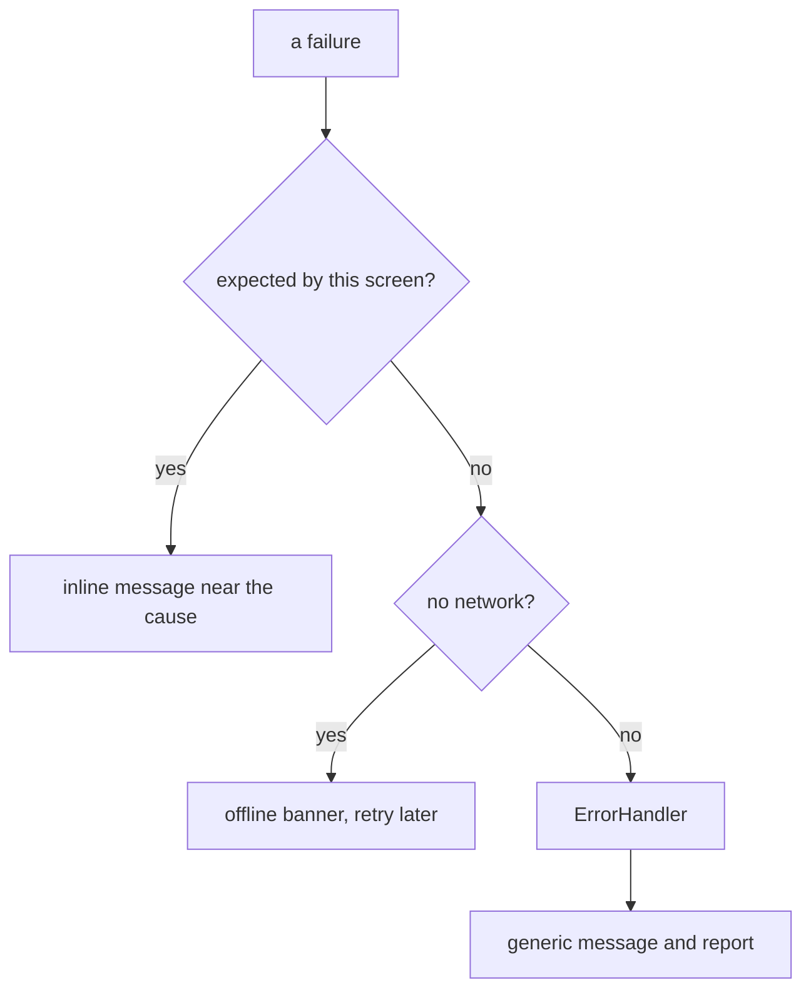

What to notice: only the last branch reaches the `ErrorHandler`.

### How it actually works

**Why the 500 reaches the handler in the lab.** The component forwards it: the mapping function makes a `NotFound` for a 404 and a `ServerFault` otherwise, and the component calls `handleError` itself for the second.

**Why a resource error never reaches the handler.** Read, not run, in `@angular/core` 22.2.1 (`fesm2022/_resource-chunk.mjs`): the internal load function runs the loader inside a `try`, and its `catch` stores the error in the resource's internal state (the internal `encapsulateResourceError` keeps an `Error` and wraps any other value in an internal `ResourceWrappedError`); that path never calls `handleError`. The [error handling guide](https://angular.dev/best-practices/error-handling) (read 2026-10-17): "`resource` presents the error in the `status` and `error` properties." One trap, also read, not run: while the resource is in error, its internal `value` computed throws an internal `ResourceValueError`, so read `status()` before `value()`.

**Why the banner follows events.** The page keeps a signal that starts at `navigator.onLine` and is set by the window `online` and `offline` events, through host listeners. The status region exists before its text ([11 §5](11-accessibility.md#5-focus-management-in-spas-and-live-regions), [Q11.17](11-accessibility.md#q11-17)).

**What the lab proves:**
- `Section 10: a 404 for an optional resource shows an inline message and does not reach ErrorHandler`: `No avatar yet`, handler got nothing.
- `Section 10: a 500 after the mapping layer reaches ErrorHandler once`: one `ServerFault`, `server answered 500`.
- `Section 10: a resource error stays in the resource state`: an `httpResource` (a `resource` that loads through `HttpClient`, [27 §10](27-http-client.md#10-httpresource-signal-driven-requests-and-when-to-prefer-it-over-httpclient)) answered with a 500 has status `error`, an `HttpErrorResponse` in `error()`, and the handler got nothing.
- `Section 10: going offline shows the offline banner and coming back hides it`: in Chromium, `context.setOffline(true)` shows the banner and `false` removes it; this is Playwright's emulation, not a real outage.

### Code

1. Map the failure once, at the edge of the call.
2. Handle the expected case on the screen and forward the rest.
3. Render the connection state in an always-present live region.

```ts
// Excerpt of labs/angular/src/app/modules/37-elements-pwa-errors-ecosystem/concepts/section-10-ux.spec.ts
function toDomainError(error: unknown): unknown {
  if (!(error instanceof HttpErrorResponse)) return error;
  if (error.status === 404) return new NotFound('not found', { cause: error });
  return new ServerFault(`server answered ${error.status}`, { cause: error });
}
```

```ts
// Excerpt of labs/angular/src/app/modules/37-elements-pwa-errors-ecosystem/concepts/section-10-ux.spec.ts
  private fail(error: unknown): void {
    if (error instanceof NotFound) {
      this.message.set('No avatar yet');
      return;
    }
    this.message.set('Something went wrong');
    this.handler.handleError(error);
  }
```

```ts
// Excerpt of labs/angular/projects/elements-lab/src/app/m37/offline/offline.ts
      @if (!online()) {
        <p data-testid="offline-banner">You are offline. Changes will be sent when the connection returns.</p>
      }
```

### Best practices and anti-patterns

- **Map errors once, in one function**, because ten components checking `status` differently drift apart ([27 §5](27-http-client.md#5-errors-httperrorresponse-an-error-mapping-layer-and-retry-with-backoff-and-jitter)).
- **Forward only unexpected errors**, because expected 404s bury real bugs.
- **Show a fixed generic message, never the server's text**, because that text can name internals ([33 §1](33-security.md#1-threat-model-of-an-angular-single-page-app-what-the-attacker-controls-what-runs-where-and-where-each-defense-lives)).

### Misconceptions and traps

- *"A global interceptor should toast every HTTP error."* The screen that expected a 404 loses control. The myth exists because one place feels tidy.
- *"`navigator.onLine === true` means the server is reachable."* It reports the network connection, not your server. The myth exists because of the property's name.
- *"Showing the server's error message is helpful."* It can leak internals ([33 §1](33-security.md#1-threat-model-of-an-angular-single-page-app-what-the-attacker-controls-what-runs-where-and-where-each-defense-lives)). The myth exists because specific text feels more honest.

Drilled in [Q37.21](#q37-21).

## 11. Logging and error tracking: a reporter port, context, privacy, source maps and sampling

### The problem it solves

The tracking dashboard shows 40,000 copies of one error, minified stack traces nobody can read, and a user's e-mail address inside a URL.

### Mental model

The `ErrorHandler` of [§8](#8-errorhandler-and-global-listeners-what-reaches-the-handler-and-what-does-not) should not know any vendor. It calls a **reporter port**: an injection token with one method, `send`, as in [16 §7](16-dependency-injection.md#7-injectiontoken-multi-providers-environment-providers-and-initializers). The **adapter** behind the token sends the report to a vendor SDK or to your own backend. Before the port, the handler normalizes the error, **scrubs** it of **PII** (personally identifiable information: anything that points at one person, such as an e-mail address), and **de-duplicates** it: the same error inside a time window is sent once. **Sampling**, keeping only a fraction of reports, is the same idea applied to volume. Each report carries context: a build version, the route, and nothing that identifies the user unless it is hashed.

Think of a flight recorder: it records what matters, compactly, and only investigators can read it.

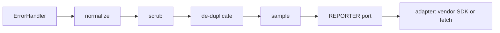

What to notice: the port is the last step the app owns; everything after it is the adapter's. Pipelines, dashboards and alerting belong to [44](44-fullstack-delivery-and-operations.md#9-frontend-error-tracking-and-real-user-monitoring-releases-source-maps-beacons-and-sampling).

### How it actually works

**Why a tracker can read a minified stack without public maps.** Read, not run, in the `@angular/build` 22.2.1 schema (`src/builders/application/schema.json`): `sourceMap` takes an object with `scripts`, `styles`, `hidden` and `vendor`, and `hidden` is described as "Output source maps used for error reporting tools." (default `false`). A **hidden source map** is therefore a map the build writes for such tools; this guide did not run a build with it or a tracker, so what a given tool does with the maps is that tool's documentation to say.

**Why a vendor SDK is only an example.** `npm view @sentry/angular version peerDependencies --json`, read 2026-10-17: version `11.8.0`, with `@angular/core`, `@angular/common` and `@angular/router` all `>= 14.x <= 22.x`. That is registry metadata about one package, named as one example, not installed and not judged.

**What the lab proves.** The reporter, token and handler are written inside the spec; the reporter is a fake that records reports.
- `Section 11: the handler sends one report per distinct error within a window`: with fake timers, `boom`, `boom`, `other` sends two reports; after the 1,000 ms window passes, `boom` is sent again.
- `Section 11: a report carries the build version and route and no e-mail address`: the report holds `1.4.0-lab` and the route, and `ana@example.com` is replaced by `[redacted]` in both message and route.
- `Section 11: a failing reporter does not throw from handleError`: the reporter was called once and `handleError` returned normally.
- `Section 11: scrub removes e-mail addresses and tokens from messages and URLs` (Vitest): e-mail addresses (also as `%40`), `access_token=` and `id_token=` values, `Bearer` tokens and JWT-shaped strings become `[redacted]`; a message without them is unchanged.

Sampling is described here, not run: no test covers it.

### Code

1. Declare the port as a token and keep the handler vendor-free.
2. Scrub, then compare against the last time this message was sent.
3. Catch inside the handler, so a broken reporter cannot raise a second error.

```ts
// Excerpt of labs/angular/src/app/modules/37-elements-pwa-errors-ecosystem/concepts/section-11-reporter.spec.ts
  handleError(error: unknown): void {
    try {
      const message = scrub(error instanceof Error ? `${error.name}: ${error.message}` : String(error));
      const now = Date.now();
      const previous = this.lastSent.get(message);
      if (previous !== undefined && now - previous < WINDOW_MS) {
        return;
      }
      this.lastSent.set(message, now);
      this.reporter.send({ message, version: this.version, route: scrub(this.route()) });
    } catch {
      // A failing reporter must not turn a reported error into a second error.
    }
  }
```

```ts
// Excerpt of labs/ts-js/src/modules/37-elements-pwa-errors-ecosystem/scrub.ts
export function scrub(text: string): string {
  return text
    .replace(BEARER, `Bearer ${REDACTED}`)
    .replace(JWT, REDACTED)
    .replace(SECRET_PARAM, (_match, name: string) => `${name}=${REDACTED}`)
    .replace(EMAIL, REDACTED);
}
```

### Best practices and anti-patterns

- **Scrub before de-duplicating**, because two messages that differ only by an e-mail address are the same error.
- **Send a build version with every report**, because an error without its release cannot be matched to a fix.
- **Hide the vendor behind the port**, because swapping the adapter then touches no component.
- **Do not put personal data in messages or URLs and rely on the SDK**, because what you write there is yours to protect ([Q33.23](33-security.md#q33-23)).

### Misconceptions and traps

- *"Public source maps are needed for readable stack traces."* The build can write maps meant only for error reporting tools. The myth exists because browser DevTools read public maps.
- *"Report every error."* Duplicates hide new errors and use up quota. The myth exists because more data feels safer.
- *"The vendor SDK makes the app's errors private."* The text you put in messages and URLs is yours ([Q33.23](33-security.md#q33-23)). The myth exists because SDKs advertise scrubbing of some fields.

Drilled in [Q37.22](#q37-22).

## 12. The production ecosystem and how to evaluate a library

### The problem it solves

A team adds two libraries in one sprint. The toast library's latest release, ngx-toastr 20.0.5, declares `@angular/core` `^21.0.0` while the app runs 22.2.1. The lifecycle helper's newest version, @ngneat/until-destroy 10.0.0, was published in August 2023. Nobody read the registry before the pull request.

### Mental model

First ask what Angular or the platform already gives. Then hire: the CV is the registry metadata, the reference check is the issues and releases, the trial day is a **spike** (a throwaway branch that adds the library to your real build to measure it).

Packages from `npm view <pkg> name version peerDependencies license --json`, read 2026-10-17; a map, not a ranking. A dash: nothing built in named here.

| Need | First, from Angular or the platform | Packages (`@angular/core` peer) |
|---|---|---|
| UI kit | Material and the CDK ([36 §1](36-material-and-cdk.md#1-material-the-cdk-and-angular-aria-styled-components-behavior-primitives-and-headless-patterns)) | primeng 22.1.2 `^22.1.0`; ng-zorro-antd 22.1.2 `^22.0.0`; @taiga-ui/core 5.28.0 `>=19.0.0`; @spartan-ng/brain 1.8.0 `>=21.0.0 <23.0.0` |
| Charts | - | ngx-echarts 22.0.0 `>=22.0.0`; ng2-charts 11.0.0 `>=22.0.0`; @swimlane/ngx-charts 25.0.3 `^21.2.0 \|\| ^22.0.0`; highcharts-angular 5.4.1 `>=19.0.0` |
| Data grid | `CdkTable` ([36 §7](36-material-and-cdk.md#7-tables-and-long-lists-cdktable-datasource-mattable-and-virtual-scrolling)) | ag-grid-angular 36.2.0 `>= 20.0.0` |
| Form helpers | Signal Forms ([26 §1](26-signal-forms.md#1-why-a-third-forms-api-model-first-signals-end-to-end)) | @ngx-formly/core 10.0.1 (`@angular/forms` `>=21.0.0`) |
| Dates | `Intl` ([34 §2](34-i18n.md#2-the-platforms-intl-apis-dates-numbers-plurals-lists-collation-and-display-names)) | date-fns 4.4.0, luxon 3.7.2, dayjs 1.11.23 (none) |
| i18n | `@angular/localize` | runtime libraries ([Q34.19](34-i18n.md#q34-19)) |
| State | signals and services | store libraries ([28 §11](28-state-management.md#11-alternatives-and-the-decision-framework-ngxs-elf-tanstack-query-and-when-a-store-library-is-justified), [Q28.32](28-state-management.md#q28-32)) |
| Testing | `TestBed` ([29 §4](29-testing-angular.md#4-testbed-the-testing-module-inject-runininjectioncontext-overrides-and-teardown)) | Playwright ([30 §2](30-e2e-and-testing-strategy.md#2-playwright-and-cypress-architecture-ng-e2e-and-the-end-of-protractor)) |
| Lint | - | angular-eslint 22.6.0 (rules: [38](38-architecture-and-production-structure.md#9-linting-and-formatting-angular-eslint-prettier-import-ordering-and-commit-hooks)) |

All are MIT except primeng ("SEE LICENSE IN LICENSE.md") and @taiga-ui/core ("Apache-2.0").

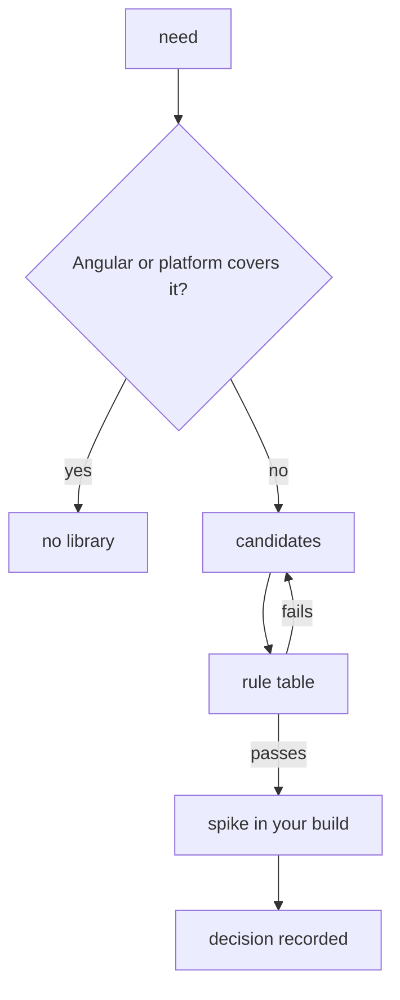

What to notice: the rule table runs before the spike, so you only measure what your policy could accept.

### How it actually works

**Why ngx-toastr 20.0.5 does not fit Angular 22.** A **peer dependency** is a package a library expects the app to install, within its `peerDependencies` range. `^21.0.0` allows 21.x only, so 22.2.1 is outside. npm's docs (read 2026-10-17): a conflicting requirement "may cause an error if the tree cannot be resolved correctly"; this guide did not run that install. `--legacy-peer-deps` "Causes npm to completely ignore `peerDependencies` when building a package tree".

**The same rule on Angular's own packages.** The installed `@angular/elements` and `@angular/service-worker` 22.2.1 name `@angular/core` `"22.2.1"` exactly, and `"sideEffects": false`: a hint that files are "pure" and "safe to prune if unused" (webpack tree-shaking guide, read 2026-10-17). Its effect is measured in your build ([31 §6](31-performance.md#6-bundle-analysis-budgets-and-tree-shaking-pitfalls)).

**The rule table.** A **license allow-list** is the licenses your legal team approved.

| Rule | In the lab |
|---|---|
| `peerDependencies` include your Angular version | yes |
| `license` on the allow-list | yes |
| `time[<version>]` within 12 months | yes |
| Maintainers, issue response | read, not scored |
| `exports`, `sideEffects`, standalone APIs | no |
| Bundle impact in your build | no |
| Install scripts ([33 §11](33-security.md#11-dependency-and-supply-chain-security-lockfiles-npm-audit-install-scripts-and-subresource-integrity)) | no |

**Why `time[<version>]`.** For @ngneat/until-destroy, `time.modified` is 2024-08-06 but `time[10.0.0]`, its latest, is 2023-08-03: `modified` is not a publish date.

**What the lab proves** (Vitest on recorded fixtures, age measured from `_readAt` 2026-10-17):
- `Section 12: the rule table flags a peer range that excludes Angular 22.2.1`: ngx-toastr gives only `peer-range`; the matcher accepts 22.2.1 for `>= 14.x <= 22.x`.
- `Section 12: the rule table flags a package with no publish in the last 12 months`: @ngneat/until-destroy fails only `last-publish`.
- `Section 12: the rule table passes a package whose peer, license and date are within the rules`: ng-zorro-antd gives no finding.

### Code

The rules are data, so a new rule is a row, not a branch.

1. Each row returns a message, or `null`.
2. `evaluate` runs the rows in order and keeps the messages.
3. The policy (`Rules`) is a separate object another team can swap.

```ts
// Excerpt of labs/ts-js/src/modules/37-elements-pwa-errors-ecosystem/rules-table.ts
export const RULE_TABLE: readonly Rule[] = [
  {
    id: 'peer-range',
    check: (pkg, rules) =>
      pkg.corePeer === undefined || satisfies(rules.angularVersion, pkg.corePeer)
        ? null
        : `${CORE} peer "${pkg.corePeer}" excludes ${rules.angularVersion}`,
  },
];

export function evaluate(pkg: PackageFacts, rules: Rules): Finding[] {
  return RULE_TABLE.flatMap((rule) => {
    const message = rule.check(pkg, rules);
    return message === null ? [] : [{ rule: rule.id, message }];
  });
}
```

### Best practices and anti-patterns

- **Read the peer range before installing**, because one `npm view` answers it.
- **Keep the policy as data**, because reviewers read it without reading code.
- **Measure in a spike, not the demo**, because only your build shows what it adds.
- **Date the reads in the decision**, because the next release changes them.

### Misconceptions and traps

- *"The most downloaded library is the safest."* Downloads do not show your version in the peer range or a recent release. The myth exists because popularity signals adoption.
- *"A UI kit saves time on every screen."* Theming and upgrading it cost later ([36 §12](36-material-and-cdk.md#12-a-design-system-on-the-cdk-and-angular-aria-or-a-wrapper-around-material)). The myth exists because demos are fast.
- *"`--legacy-peer-deps` fixes a peer conflict."* npm ignores the range; the version is still unsupported. The myth exists because the install then proceeds.

Drilled in [Q37.23](#q37-23) and [Q37.24](#q37-24); practised in [Exercise 37.1](#ex37-1).

## 13. Under the hood: `createCustomElement`'s strategy and the service worker's driver

### The problem it solves

"The widget in our virtual list forgets what I typed" and "this user still has last week's build" are both answered by code you never call: the object behind every Angular element and the main class of `ngsw-worker.js`.

### Mental model

An Angular element hands every callback to a **strategy**, the object that creates, updates and destroys its component through `connect`, `disconnect`, `setInputValue`, `getInputValue` and `events`. A **strategy factory** builds one strategy per element, and you can pass your own as `strategyFactory`. The worker's **driver** is its main class (internal, like every unexported name below: it may change in any release). It keeps a **version map** from each tab's client ID to a version hash ([§6](#6-updates-versions-swupdate-prompting-a-reload-unrecoverable-states-and-the-kill-switch)), and it has one of three states.

Think of a stage manager between actors and audience, and a signal box sending each train (a tab) down its own track.

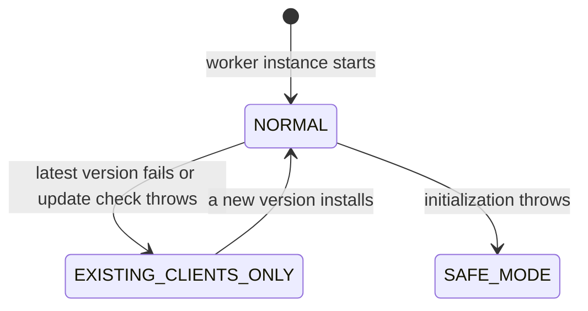

What to notice: nothing leaves `SAFE_MODE`; only a new worker instance starts at `NORMAL`.

### How it actually works

**The element only delegates.** Read from `@angular/elements` 22.2.1 (`fesm2022/elements.mjs`): `createCustomElement` uses `config.strategyFactory`, or else the internal `ComponentNgElementStrategyFactory`. `observedAttributes` come from the component's inputs, not the strategy. `Section 13: a custom strategyFactory receives connect and disconnect calls` records `create`, `set tone=cool`, `connect m37-s13-recorded`, `get label`, `disconnect`, observed attributes `['label', 'tone']`, and no component or children: your strategy owns creation.

**Inputs before the component.** The default strategy (internal `ComponentNgElementStrategy`) keeps inputs in a map while there is no component. On `connect`, the internal `initializeComponent` creates a child injector and collects children once with the internal `extractProjectableNodes` ([§2](#2-the-elements-public-contract-attributes-properties-events-projected-content-and-typings)). Then it calls `createComponent`, replays the stored inputs, pushes the outputs into a `ReplaySubject(1)` that `events` switches to, attaches the view and runs `detectChanges` (read, not run). In `Section 13: inputs set before connect are applied when the component is created`, the property reads back `queued` before any component exists; after connecting, one component shows the property and the `tone` attribute.

**Which version a tab gets.** Read from `@angular/service-worker` 22.2.1 (`ngsw-worker.js`): the driver's `onFetch` leaves `ngsw-bypass` requests to the browser, answers `/ngsw/state`, and only then leaves everything else to the network in `SAFE_MODE`. Its `handleFetch` uses the network if initialization throws. A navigation schedules an idle update check, then the internal `assignVersion` picks the version:

- a known client gets its mapped hash;
- in `NORMAL`, a navigation from an older hash moves the client to the latest;
- a new client gets the latest only in `NORMAL`, otherwise `null`, which means the network.

A critical error calls the internal `versionFailed`, which degrades the driver to `EXISTING_CLIENTS_ONLY` only if the broken version is the latest. The docs: "existing tabs continue to run from cache, but new loads of the application will be served from the network" (`angular.dev/ecosystem/service-workers/devops`, read 2026-10-17). The driver's `sync` persists the manifests, version map and latest hash, not the state, and the page adds: "The new instance starts in the `NORMAL` mode, regardless of the state of the previous instance."

**The debug page.** The internal `hashManifest` is the SHA-1 of `JSON.stringify(manifest)`. `Section 13: the ngsw/state page reports the driver state and the active version hash` reads `Driver version: 22.2.1`, `Driver state: NORMAL ((nominal))`, a latest hash equal to the served `ngsw.json`'s SHA-1, one version block and a non-empty `Clients:` line. Drilled in [Q37.25](#q37-25).

### Code

1. A recording strategy implements the public `NgElementStrategy` and logs each call.
2. The test checks the order.
3. The e2e test recomputes the version hash from `ngsw.json` and finds it on `/ngsw/state`.

```ts
// Excerpt of labs/angular/src/app/modules/37-elements-pwa-errors-ecosystem/concepts/section-13-internals.spec.ts
  connect(element: HTMLElement): void {
    this.calls.push(`connect ${element.localName}`);
  }
    expect(factory.calls).toEqual(['create', 'set tone=cool', 'connect m37-s13-recorded', 'get label', 'disconnect']);
```

```ts
// Excerpt of labs/e2e/tests/37-elements-pwa-errors-ecosystem/concepts/section-13-driver.spec.ts
  const expectedHash = createHash('sha1').update(JSON.stringify(JSON.parse(manifestText))).digest('hex');
  await expect.poll(() => swState(page)).toContain(`Latest manifest hash: ${expectedHash}`);
  const lines = (await swState(page)).split('\n');
  expect(lines).toContain('Driver state: NORMAL ((nominal))');
```

### Best practices and anti-patterns

- **Open `/ngsw/state` in the user's tab first**, because it shows the state, its reason and each hash's clients.
- **Write a custom strategy only to wrap the default one**, because a strategy of your own must create the component itself.
- **Fix `EXISTING_CLIENTS_ONLY` with a new deploy**, because only a successful install returns the driver to `NORMAL`.

### Misconceptions and traps

- *"Activation swaps every tab to the new version."* The version map keeps each tab on its hash until it navigates (`Section 6: the open tab keeps showing v1 until it reloads`). The myth exists because the platform's `clients.claim()` takes control of every tab.
- *"Elements re-renders synchronously on each attribute change."* The strategy calls `setInput`, marks the view and notifies the scheduler ([§3](#3-elements-at-run-time-lifecycle-change-detection-without-zonejs-styles-and-several-apps-on-one-page)). The myth exists because `attributeChangedCallback` itself runs synchronously.
- *"`SAFE_MODE` means the worker is gone."* It is still registered and still serves `/ngsw/state`, but it leaves fetches to the network and ignores app messages (`onMessage`, read). The myth exists because of the name.

## Summary

Angular Elements wraps one component per `createCustomElement` call and ships the Angular runtime with it, so the tag is not the component's selector ([§1](#1-angular-elements-turning-a-component-into-a-custom-element)). Attributes reach inputs as strings, an output becomes a `CustomEvent` that does not bubble unless you build it so, and projected children are read once ([§2](#2-the-elements-public-contract-attributes-properties-events-projected-content-and-typings)). Removal destroys the component 10 ms later, the element works without zone.js, and elements from different applications use different injectors ([§3](#3-elements-at-run-time-lifecycle-change-detection-without-zonejs-styles-and-several-apps-on-one-page)).

The service worker is the browser's, and Angular adds a generated `ngsw.json` of hashed files that it reads instead of `ngsw-config.json`; it is off in `ng serve` ([§4](#4-angularservice-worker-registration-ngsw-configjson-and-the-generated-ngswjson)). Only asset groups follow the app version, a data group is cached by its own `version`, and a request outside every group fails offline ([§5](#5-caching-with-asset-and-data-groups-navigation-requests-and-the-app-shell)). An open tab stays on its version until it navigates, and `activateUpdate()` is not the reload ([§6](#6-updates-versions-swupdate-prompting-a-reload-unrecoverable-states-and-the-kill-switch)). The worker, not the page, receives a push and shows the notification, and a manifest gives installability, not offline ([§7](#7-push-notifications-and-installability-swpush-notification-clicks-and-the-manifest)).

`ErrorHandler` only logs by default, sees what Angular calls or the global listeners forward, and must not throw ([§8](#8-errorhandler-and-global-listeners-what-reaches-the-handler-and-what-does-not)). `@boundary` catches creation and change-detection errors, not listener errors, and still reports them ([§9](#9-error-boundaries-boundary-error-reset-onviewerror-and-onerror)). Expected errors belong to the screen that expected them, and `navigator.onLine` is not server reachability ([§10](#10-error-ux-expected-and-unexpected-errors-http-failures-offline-state-and-route-errors)). A report is deduplicated, sampled and scrubbed before it leaves ([§11](#11-logging-and-error-tracking-a-reporter-port-context-privacy-source-maps-and-sampling)). Judge a library by your version in its peer range, its license and its last release, not by downloads ([§12](#12-the-production-ecosystem-and-how-to-evaluate-a-library)). Underneath, the Elements strategy maps connect and disconnect to a `ComponentRef`, and the worker's driver keeps a version map per tab ([§13](#13-under-the-hood-createcustomelements-strategy-and-the-service-workers-driver)).

## Question bank

Each answer has five parts. Each Output answer names the run asserted in `labs/angular/src/app/modules/37-elements-pwa-errors-ecosystem/outputs/q37-outputs.spec.ts` (`ng test`, jsdom, no layout) or the Playwright spec under `labs/e2e/tests/37-elements-pwa-errors-ecosystem/outputs/`; shown snippets are the code those tests run.

<a id="q37-01"></a>
### Q37.01 · Concept · What is Angular Elements, what does `createCustomElement` give you, and when is a custom element the right way to ship an Angular component?

<details>
<summary>Answer</summary>

**Short answer (30 seconds).** Angular Elements is the `@angular/elements` package. `createCustomElement(Component, { injector })` returns a class you register with `customElements.define`, so one Angular component becomes a plain HTML tag that any page can use. Choose it to put an Angular widget into a page you do not own or a non-Angular app, not for a component inside one Angular app.

**Full explanation.** The class maps the component's contract onto the browser's: each input becomes an observed attribute plus a property, each output a `CustomEvent`, and the component is created when the tag connects, using the `injector` you pass (`@angular/elements@22.2.1`, `fesm2022/elements.mjs`, `createCustomElement` and the strategy's internal `initializeComponent`; read, not run). That injector comes from `createApplication`, an application without a root component ([12 §6](12-angular-how-it-works.md#6-bootstrapping-bootstrapapplication-the-platform-and-initializers)); the browser side, upgrade and lifecycle, is owned by [08 §5](08-browser-rendering-dom-events.md#5-web-components-custom-elements-shadow-dom-and-templates). The price is a runtime per bundle and a contract made of strings, properties and events instead of typed bindings.

**Follow-ups an interviewer will ask.**
- *Does it wrap the whole app?* No, one component per `define`.
- *When is a plain component better?* Whenever the consumer is Angular: it keeps typed inputs, scoped DI and no second runtime.
- *What destroys the component?* Disconnecting the tag schedules `componentRef.destroy()` after `DESTROY_DELAY = 10` ms (internal), so a move within one task keeps it (read, not run).

**Trap to avoid.** Treating the result as free of Angular: the bundle still carries `@angular/core` and your providers.

</details>

<a id="q37-02"></a>
### Q37.02 · Output · A `<m37-q02-rating>` element is created with the attribute `max-stars="5"`, then its `maxStars` property is set to `7`, then the attribute is changed to `"3"`: what value and type does the component's `maxStars` input hold after each step, with and without `numberAttribute`?

```ts
// Partial: `injector` comes from createApplication(); await appRef.whenStable() after each step and read the element's text.
@Component({ selector: 'lab-m37-q02-raw', template: `{{ maxStars() }}:{{ typeOf(maxStars()) }}` })
class LabM37Q02Raw {
  readonly maxStars = input<unknown>(); // second run: input(0, { transform: numberAttribute })
  typeOf(value: unknown): string {
    return typeof value;
  }
}
customElements.define('m37-q02-rating', createCustomElement(LabM37Q02Raw, { injector }));
const element = document.createElement('m37-q02-rating');
element.setAttribute('max-stars', '5'); // step 1
document.body.append(element);
Object.assign(element, { maxStars: 7 }); // step 2
element.setAttribute('max-stars', '3'); // step 3
```

<details>
<summary>Answer</summary>

**Short answer (30 seconds).** Without a transform: `5:string`, `7:number`, `3:string`. With `numberAttribute`: `5:number`, `7:number`, `3:number`. An attribute is always text and reaches the input as that text; a property keeps whatever type you assign; a transform runs on every `setInput`, so it converts both.

**Full explanation.** `attributeChangedCallback` forwards the attribute's string to `setInputValue`, and the prototype accessor for `maxStars` forwards the assigned value to the same function, which calls `ComponentRef.setInput` (`@angular/elements@22.2.1`, `fesm2022/elements.mjs`, `createCustomElement`; read, not run). The final `"3"` therefore overwrites the number `7` with a string. The run is `Q37.02 without a transform: "5" string, 7 number, "3" string` and `Q37.02 with numberAttribute: 5, 7, 3, all numbers` in `labs/angular/src/app/modules/37-elements-pwa-errors-ecosystem/outputs/q37-outputs.spec.ts` (`ng test`, jsdom, passed). The second run defines its own tag, `m37-q02-rating-num`.

**Follow-ups an interviewer will ask.**
- *How does `maxStars` become `max-stars`?* `observedAttributes` holds the kebab-case of each input's template name.
- *Why use `input<unknown>()`?* So the template shows the real runtime type; a `string` input would hide it.
- *Where would `"5" + 1` bite?* Arithmetic on an untransformed attribute gives `"51"`.

**Trap to avoid.** Assuming the last writer's type survives: after the attribute write, the input is a string again, so give numeric or boolean inputs a transform.

</details>

<a id="q37-03"></a>
### Q37.03 · Output · The component has `ratingChanged = output<number>()` and emits `4`: what event name, `detail`, `bubbles` and `composed` does a listener on the element see, and does a listener on its parent `div` fire?

```ts
// Partial: `injector` comes from createApplication(); the element sits in a div attached to document.body; the button is clicked, then await appRef.whenStable().
@Component({
  selector: 'lab-m37-q03-rating',
  template: `<button type="button" (click)="ratingChanged.emit(4)">Rate</button>`,
})
class LabM37Q03Rating {
  readonly ratingChanged = output<number>();
}
customElements.define('m37-q03-rating', createCustomElement(LabM37Q03Rating, { injector }));
element.addEventListener('ratingChanged', (event) => {
  if (event instanceof CustomEvent) {
    log.push(`${event.type} ${event.detail} ${event.bubbles} ${event.composed}`);
  }
});
parent.addEventListener('ratingChanged', () => log.push('parent'));
```

<details>
<summary>Answer</summary>

**Short answer (30 seconds).** `log` is `['ratingChanged 4 false false']`: name `ratingChanged`, `detail` `4`, `bubbles` false, `composed` false, and the parent `div` listener never fires. The element dispatches `new CustomEvent(name, { detail })` with default options, so the event stays on its target.

**Full explanation.** The strategy emits `{ name: templateName, value }`, and the element runs `new CustomEvent(e.name, { detail: e.value })` with no `bubbles` or `composed` (`@angular/elements@22.2.1`, `fesm2022/elements.mjs`, `createCustomElement`; read, not run). The name is the output's template name, untouched, so it is not `rating-changed`. The run is `Q37.03 ratingChanged, detail 4, bubbles false, composed false, the parent listener does not fire` in the same outputs spec (`ng test`, jsdom, passed).

**Follow-ups an interviewer will ask.**
- *How does a host listen on a parent?* It cannot with this event; listen on the element, or wrap the element and re-dispatch a bubbling event.
- *What would `composed` add?* Crossing a shadow root; with `bubbles` false the event still stops at its target ([08 §5](08-browser-rendering-dom-events.md#5-web-components-custom-elements-shadow-dom-and-templates) owns shadow DOM).

**Trap to avoid.** Event delegation on a container: it works for clicks but never for these events.

</details>

<a id="q37-04"></a>
### Q37.04 · Bug hunt · An element defined with the component's own selector as its tag, a host page that appends the element's children after inserting it, and a React wrapper listening for `rating-changed`: what is wrong in each?

```ts
// Partial: `injector` comes from createApplication(); the component's selector is 'm37-rating'.
customElements.define('m37-rating', createCustomElement(RatingComponent, { injector }));
```

```js
// Partial: `element` and `labelSpan` are DOM nodes, `ref` and `onChange` come from a React wrapper component.
document.body.append(element);
element.append(labelSpan); // added after the element was inserted
ref.current.addEventListener('rating-changed', onChange);
```

<details>
<summary>Answer</summary>

**Short answer (30 seconds).** Three bugs. The tag equals the component selector, so Angular also matches the tag and two instances exist. `labelSpan` is added after creation, so it is never projected. The event is named `ratingChanged`, so the `rating-changed` listener never fires.

**Full explanation.** The docs warn against the component's selector as the tag because of the two instances (`angular.dev/guide/elements`, read 2026-10-17); use a different tag, as the lab's `lab-m37-rating` and `m37-rating` do. Projection runs once: in `Section 2: children present at connect are projected and children appended later are not` the late `span` stayed a direct child outside the slot, while the early one was projected. In `Section 2: an output is dispatched as a CustomEvent named after the output with the value in detail` only `ratingChanged` fired.

**Follow-ups an interviewer will ask.**
- *How do you feed changing data?* Through a property on the element.
- *Does listening on a React parent help?* No; the event does not bubble (Q37.03).

**Trap to avoid.** Kebab-casing event names by habit: only attributes are kebab-cased.

</details>

<a id="q37-05"></a>
### Q37.05 · Difference · `CUSTOM_ELEMENTS_SCHEMA`, `NO_ERRORS_SCHEMA` and declaring a typed wrapper: what does each let the compiler accept, and what checking does each give up?

<details>
<summary>Answer</summary>

**Short answer (30 seconds).** A **schema** tells the template compiler which unknown names to accept. `CUSTOM_ELEMENTS_SCHEMA` accepts non-Angular elements and properties named with a dash and gives up spell-checking of those names. `NO_ERRORS_SCHEMA` accepts any element and property and gives up unknown-name checking entirely. A typed wrapper lets TypeScript check the code that creates or reads the element and gives up nothing, but the template checker never reads it: a template that uses the tag still needs a schema.

**Full explanation.** The core typings describe the first as allowing "non-Angular elements named with dash case" and dash-named properties, and the second as "any property on any element", discouraged because it "prevents useful validation" (`@angular/core@22.2.1`, `types/_debug_node-chunk.d.ts`, `SchemaMetadata` doc comments; read, not run). `Section 2: a component with CUSTOM_ELEMENTS_SCHEMA compiles a template with an unknown element and property` shows an unknown dash tag with `[score]` compiling; a misspelled dash tag passes too. A typed wrapper declares the element's properties, with `NgElement & WithProperties<P>` or an `HTMLElementTagNameMap` entry (`@angular/elements@22.2.1`, `types/elements.d.ts`; docs read 2026-10-17), for code such as `document.createElement`. The template checker tests each tag against its own DOM schema and reports "is not a known element" when no schema allows it (`@angular/compiler-cli@22.2.1`, `RegistryDomSchemaChecker.checkElement` in `src/ngtsc/typecheck/src/dom.js`; read, not run). Schemas are per component or module ([15 §2](15-standalone-and-ngmodules.md#2-standalone-components-and-the-imports-array)).

**Follow-ups an interviewer will ask.**
- *Is a schema needed to define the element?* No, it only relaxes consumers' templates.
- *Which for one third-party widget?* `CUSTOM_ELEMENTS_SCHEMA` on the one component that uses it.

**Trap to avoid.** Reaching for `NO_ERRORS_SCHEMA` to silence one error: it hides every typo in that template.

</details>

<a id="q37-06"></a>
### Q37.06 · Output · An element is removed from the DOM and re-appended 5 ms later, then removed and left out for 20 ms: how many times do the component's constructor and `ngOnDestroy` run?

```ts
// Partial: `injector` comes from createApplication(); fake timers are on (vi.useFakeTimers()).
@Component({ selector: 'lab-m37-q06-widget', template: `widget` })
class LabM37Q06Widget implements OnDestroy {
  static log: string[] = [];
  constructor() {
    LabM37Q06Widget.log.push('constructor');
  }
  ngOnDestroy(): void {
    LabM37Q06Widget.log.push('ngOnDestroy');
  }
}
customElements.define('m37-q06-widget', createCustomElement(LabM37Q06Widget, { injector }));
const element = document.createElement('m37-q06-widget');
document.body.append(element);

element.remove();
vi.advanceTimersByTime(5);
document.body.append(element);
console.log(LabM37Q06Widget.log);

element.remove();
vi.advanceTimersByTime(20);
console.log(LabM37Q06Widget.log);
```

<details>
<summary>Answer</summary>

**Short answer (30 seconds).** Once each. The first `console.log` prints `['constructor']` and the second `['constructor', 'ngOnDestroy']`. Removing the element only schedules the destroy, 10 ms later; appending it again at 5 ms cancels that, so the first component lives on. The second removal outlasts the 10 ms, so the destroy runs.

**Full explanation.** `disconnect` stores a `setTimeout` of `DESTROY_DELAY`, which is 10, that calls `componentRef.destroy()`. `connect` first looks for that stored call, runs its cancel function and returns without creating anything (`@angular/elements@22.2.1`, `fesm2022/elements.mjs`, internal `ComponentNgElementStrategy`; read, not run). The test uses fake timers, so it never measures time: `Q37.06 constructor once, ngOnDestroy once, only after the second removal outlasts the delay` in `labs/angular/src/app/modules/37-elements-pwa-errors-ecosystem/outputs/q37-outputs.spec.ts` (`ng test`, jsdom, passed) found exactly those two logs.

**Follow-ups an interviewer will ask.**
- *What if the second wait were 5 ms?* The destroy is still pending, so `ngOnDestroy` has not run yet (read, not run).
- *What state survives a longer gap?* None: after the delay `componentRef` is `null`, so the next connect builds a new component.

**Trap to avoid.** Expecting `disconnectedCallback` to destroy the component at once: the browser calls it at once, the strategy defers.

</details>

<a id="q37-07"></a>
### Q37.07 · Trade-off · One Angular widget inside a server-rendered page: an Angular Elements bundle, a `createApplication` mounted on a `div`, or a framework-free web component; what does each cost in bundle, isolation and upgrades?

<details>
<summary>Answer</summary>

**Short answer (30 seconds).** An Elements bundle gives the page a plain tag with attributes, properties and events, but carries its own Angular runtime and wraps one component per tag. A `createApplication` mounted on a `div` keeps the whole Angular API and lets several widgets share one runtime, but the page needs a script that calls it. A framework-free web component carries no Angular and its upgrades are the platform's, but you rewrite the widget. No sizes are claimed: none is measured here.

**Full explanation.** *Bundle:* an Elements bundle contains `@angular/core` and your providers once per application, and separately built bundles each carry their own ([§1](#1-angular-elements-turning-a-component-into-a-custom-element), [§3](#3-elements-at-run-time-lifecycle-change-detection-without-zonejs-styles-and-several-apps-on-one-page)). *Isolation:* an element whose component uses `ViewEncapsulation.ShadowDom` keeps its CSS and the page's apart (`Section 3: an element with ShadowDom keeps its styles out of the host page`); this guide does not test that choice for a mounted component, and a plain component shares the page's CSS. *Upgrades:* each separately built Angular bundle is upgraded with its own build; the mounted widget is built into the page's script; the plain component needs no Angular upgrade. Mounting is what the strategy does inside: `createComponent` with a `hostElement`, then `appRef.attachView` (read, not run). Cooperating bundles are an architecture question ([38](38-architecture-and-production-structure.md#8-micro-frontends-module-federation-native-federation-and-when-they-are-justified)).

**Follow-ups an interviewer will ask.**
- *Which when a CMS author writes only HTML?* Elements: the tag is the whole contract.
- *Can two Elements bundles share one Angular?* Not by default: each has its own runtime and injector.

**Trap to avoid.** Choosing Elements for a component used only inside one Angular app: use the component.

</details>

<a id="q37-08"></a>
### Q37.08 · Concept · How does change detection reach an element's component when the host page sets a property, with zone.js and without it?

<details>
<summary>Answer</summary>

**Short answer (30 seconds).** The property setter calls the strategy's `setInputValue`, which calls `ComponentRef.setInput`. If the view is now dirty, it marks it for refresh and notifies Angular's scheduler, so a refresh is scheduled. With zone.js the call also runs inside Angular's zone; without zone.js the notification alone does the job, so the element needs no zone.

**Full explanation.** In `@angular/elements@22.2.1` (`fesm2022/elements.mjs`, internal `setInputValue` and `runInZone`; read, not run), `runInZone` enters the zone only when `Zone` is defined and the current zone differs, and the notification is sent in both cases, so the render is never synchronous in the setter. Values set before the component exists wait in a map until creation. The lab shows the zoneless case: the app uses `provideZonelessChangeDetection()`, `Zone` is undefined, and setting `value` re-renders after `whenStable` (`Section 3: a property set on the element re-renders without zone.js`). The scheduler is the one of [21 §5](21-change-detection.md#5-zoneless-change-detection-the-scheduler-its-triggers-and-pendingtasks).

**Follow-ups an interviewer will ask.**
- *Is the text updated when the setter returns?* No; the tests wait for `appRef.whenStable()`.
- *When is no notification sent?* When `setInput` leaves the view clean, because the notification sits behind the dirty check (`@angular/elements@22.2.1`, `fesm2022/elements.mjs`, `setInputValue`; read, not run).

**Trap to avoid.** Calling `detectChanges` on the element's component from the host: set the property and let the scheduler run.

</details>

<a id="q37-09"></a>
### Q37.09 · Concept · What does `@angular/service-worker` add on top of the browser's service worker, and what do `ngsw-config.json`, `ngsw.json` and `ngsw-worker.js` each do?

<details>
<summary>Answer</summary>

**Short answer (30 seconds).** The browser provides the worker mechanism: registration, lifecycle and the Cache API ([09 §9](09-web-networking-storage-security.md#9-service-workers-and-the-pwa-manifest)). The package adds a ready-made worker and the build step around it. You write `ngsw-config.json`, the rules. The build turns it into `ngsw.json`, the manifest of every listed file with its hash plus `appData`. `ngsw-worker.js` is the prebuilt worker that reads `ngsw.json`, installs versions and serves requests from them.

**Full explanation.** The worker never reads `ngsw-config.json`, only the generated manifest, and a changed hash is how a new version is noticed. The page side adds `provideServiceWorker`, `SwUpdate` and `SwPush`. The lifecycle that makes an old worker keep control is the browser's ([Q09.21](09-web-networking-storage-security.md#q09-21)). In the lab's production build `Section 4: ngsw.json lists hashed files and the appData from the config` finds `configVersion` 1, `appData.version` `v1` and a 40-hex hash per file, and `Section 4: the production build registers ngsw-worker.js and controls the page after a reload` shows the controller is `/ngsw-worker.js`, but only after a reload ([§4](#4-angularservice-worker-registration-ngsw-configjson-and-the-generated-ngswjson)).

**Follow-ups an interviewer will ask.**
- *Where does it not register?* Off HTTPS except on `localhost` (`angular.dev/ecosystem/service-workers/getting-started`, read 2026-10-17); the lab also passes `enabled: !isDevMode()`.
- *Why hashes?* Each file's hash decides whether it changed, so a deploy becomes a new version.

**Trap to avoid.** Editing `ngsw-config.json` on the server: only the build's `ngsw.json` reaches the worker.

</details>

<a id="q37-10"></a>
### Q37.10 · Difference · Asset groups versus data groups, `prefetch` versus `lazy`, and `performance` versus `freshness`: what is versioned with the app, and what is served when the network is down?

<details>
<summary>Answer</summary>

**Short answer (30 seconds).** Asset groups hold the app's own files and are versioned with the app: they come from `ngsw.json`'s hashes. `prefetch` downloads every file while the version installs, so all of them work offline. `lazy` caches a file only once it is requested, so one never requested is missing offline. Data groups hold API responses in caches with their own `version`, not the manifest hash, so a deploy does not empty them. `performance` answers from the cache within `maxAge`; `freshness` tries the network first and uses the cache after the `timeout` or a failure. Offline you get cached assets, plus cached data entries.

**Full explanation.** The options and their meanings are in the package's `config/schema.json` (`@angular/service-worker@22.2.1`, read 2026-10-17, read, not run); a request in no group goes to the network. `Section 5: a performance data group answers offline from the cache without reaching the server` shows the offline answer equal to the online one, and `Section 5: a request outside every data group fails offline` shows the uncached endpoint failing ([§5](#5-caching-with-asset-and-data-groups-navigation-requests-and-the-app-shell)). The strategies themselves are [Q09.22](09-web-networking-storage-security.md#q09-22)'s.

**Follow-ups an interviewer will ask.**
- *Does a deploy clear a data group?* No, only a change of its own `version`.
- *`freshness` offline with no cached entry?* The request fails, since there is nothing to fall back to (`@angular/service-worker@22.2.1`, `ngsw-worker.js`, `freshness` handling; read, not run).

**Trap to avoid.** Assuming a `lazy` image works offline because it is listed: only requested files are cached.

</details>

<a id="q37-11"></a>
### Q37.11 · Output · With the lab's config, the user loads the app once, goes offline and reloads a deep link, the catalog list and the prices list, and an uncached endpoint: which load, which fail, and what does the page show for each?

```ts
// Excerpt of labs/angular/projects/elements-lab/src/app/m37/outputs/q11.ts
    try {
      const body = await firstValueFrom(this.http.get<ApiBody>(`/api/m37/${endpoint}`));
      text = `${body.name} hit ${body.hit}`;
    } catch {
      text = `${endpoint} failed`;
    }
```

```ts
// Excerpt of labs/e2e/tests/37-elements-pwa-errors-ecosystem/outputs/q37-outputs.spec.ts
    await context.setOffline(true);
    await page.goto(`${ORIGIN}/m37/outputs/q11`);
    await expect(page.getByRole('heading', { name: 'Offline outputs lab' })).toBeVisible();
    await page.getByRole('button', { name: 'Load all three' }).click();
    await expect(page.getByTestId('uncached-result')).toHaveText('uncached failed');
    await expect(page.getByTestId('catalog-result')).toHaveText(`catalog hit ${catalogOnline}`);
    await expect(page.getByTestId('prices-result')).toHaveText(`prices hit ${pricesOnline}`);
```

<details>
<summary>Answer</summary>

**Short answer (30 seconds).** The deep link, the catalog and the prices load; the uncached endpoint fails. Offline, the page shows the same hit numbers it showed online, `catalog hit N` and `prices hit M`, and `uncached failed`. The number is the server's counter, so a cached answer repeats it and a network answer would show a larger one.

**Full explanation.** A navigation request is answered from the cached `index.html` and the router renders the route ([§5](#5-caching-with-asset-and-data-groups-navigation-requests-and-the-app-shell)). The catalog is in a `performance` group, so the cache answers. The prices are in a `freshness` group: the network is tried first, fails offline, and the entry stored during the online visit answers. The uncached URL is in no group, so it goes to the network and fails. The run is `Q37.11 the deep link, the catalog and the prices load offline; the uncached endpoint fails` in `labs/e2e/tests/37-elements-pwa-errors-ecosystem/outputs/q37-outputs.spec.ts` (Chromium, `context.setOffline(true)`; passed 5 of 5). It compares the page's numbers and counts no server requests, because parallel runs share the counters.

**Follow-ups an interviewer will ask.**
- *What if the user goes offline before the first visit finished?* The test waits until both entries are cached; without an entry the prices fail too (`@angular/service-worker@22.2.1`, `ngsw-worker.js`, internal `DataGroup.handleFetchWithFreshness`; read, not run, [Q37.10](#q37-10)).
- *Would a request with `ngsw-bypass` be served from the cache offline?* No: `Section 5: a request with ngsw-bypass skips the worker`, so it goes to the network and fails like the uncached one.

**Trap to avoid.** Expecting the worker to rescue every API call: only URLs listed in a data group are cached.

</details>

<a id="q37-12"></a>
### Q37.12 · Output · Tab A is open on v1; v2 is deployed; tab A calls `checkForUpdate()`, then tab B opens, then tab A reloads: which `versionUpdates` events does A see, with which `appData`, and which version does each tab show at each step?

```ts
// Excerpt of labs/e2e/tests/37-elements-pwa-errors-ecosystem/outputs/q37-outputs.spec.ts
    await deploy(context, 'v2');
    await tabA.getByRole('button', { name: 'Check for update' }).click();
    await expect(tabA.getByTestId('check-result')).toHaveText('check true');
    await expect.poll(() => updateEvents(tabA)).toEqual(['VERSION_DETECTED v2', 'VERSION_READY v1 -> v2']);
    await expect(tabA.getByTestId('running')).toHaveText('This tab runs v1');
    const tabB = await context.newPage();
    await tabB.goto(`${ORIGIN}/m37/outputs/q12`);
    await expect(tabB.getByTestId('running')).toHaveText('This tab runs v2');
    await tabA.reload();
    await expect(tabA.getByTestId('running')).toHaveText('This tab runs v2');
```

<details>
<summary>Answer</summary>

**Short answer (30 seconds).** A sees `VERSION_DETECTED` for `appData.version` `v2`, then `VERSION_READY` with `currentVersion.appData.version` `v1` and `latestVersion.appData.version` `v2`; the check resolves `true`. A shows v1 before, during and after the check. B opens on v2. A still shows v1 until its reload, then shows v2. B stays on v2. The spec filters out `NO_NEW_VERSION_DETECTED` lines, which A may also receive.

**Full explanation.** Each tab stays on the version it loaded; a new navigation gets the latest. The driver (internal) posts `VERSION_READY` only to tabs whose version is not the latest, so B, which starts on v2, gets none (`@angular/service-worker@22.2.1`, `ngsw-worker.js`, `notifyClientsAboutVersionReady`; read, not run). A known hash posts `NO_NEW_VERSION_DETECTED` to every tab, as the idle check after a navigation does, so the spec filters those lines ([§6](#6-updates-versions-swupdate-prompting-a-reload-unrecoverable-states-and-the-kill-switch)). The run `Q37.12 tab A sees DETECTED then READY and stays on v1; tab B opens on v2; A shows v2 after its reload` in the same spec passed 5 of 5 and also asserts A's two events are unchanged after B opens.

**Follow-ups an interviewer will ask.**
- *Where does "v2" come from?* From `appData` in `ngsw-config.json`.
- *What if A called `activateUpdate()` instead?* Its later requests would come from v2 while its code stays v1 (`@angular/service-worker@22.2.1`, `ngsw-worker.js`, `Driver.updateClient`; read, not run).

**Trap to avoid.** Reading `VERSION_READY` as "this tab now runs the new version": it says one is cached.

</details>

<a id="q37-13"></a>
### Q37.13 · Bug hunt · An update flow that calls `activateUpdate()` without reloading, a CDN that caches `ngsw.json` for a day, and an `interval(60_000)` started in the root component's constructor: what goes wrong in each?

```ts
// Partial: `updates` is the injected SwUpdate and the component is the root component.
updates.versionUpdates
  .pipe(filter((event) => event.type === 'VERSION_READY'))
  .subscribe(() => updates.activateUpdate());

@Component({ selector: 'app-root', imports: [RouterOutlet], template: `<router-outlet />` })
class App {
  private readonly updates = inject(SwUpdate);
  constructor() {
    interval(60_000).subscribe(() => this.updates.checkForUpdate());
  }
}
```

<details>
<summary>Answer</summary>

**Short answer (30 seconds).** Three bugs. `activateUpdate()` moves the tab's later requests to v2 while the running code stays v1, so a lazy chunk can come from the wrong version. A CDN serving stale content can break the hash check. The interval can keep the app from becoming stable, so registration waits the full 30 s.

**Full explanation.** Its doc comment warns of "a version mismatch between the application shell and other page resources, such as lazy-loaded chunks" (`@angular/service-worker@22.2.1`, `types/service-worker.d.ts`; read). The DevOps page lists "Caching layers between the origin server and the end user could serve stale content." as a cause of hash mismatches (`angular.dev/ecosystem/service-workers/devops`, read 2026-10-17); a mismatch fails the version ([§6](#6-updates-versions-swupdate-prompting-a-reload-unrecoverable-states-and-the-kill-switch)). The lab's server sends `Cache-Control: no-cache` for `ngsw.json` (`labs/e2e/server/elements-server.mjs`). The default registration races `appRef.whenStable()` against 30 000 ms ([§4](#4-angularservice-worker-registration-ngsw-configjson-and-the-generated-ngswjson)); the docs say an early interval "prevents the application from stabilizing" (`angular.dev/ecosystem/service-workers/communications`, read 2026-10-17). Whether that holds in a zoneless app, where stability follows pending tasks ([21 §5](21-change-detection.md#5-zoneless-change-detection-the-scheduler-its-triggers-and-pendingtasks)), was not run. None has a test.

**Follow-ups an interviewer will ask.**
- *What is the safe ending of the flow?* Prompt, then reload ([§6](#6-updates-versions-swupdate-prompting-a-reload-unrecoverable-states-and-the-kill-switch)).
- *How do you start polling safely?* After `appRef.whenStable()` resolves, the call the registration strategy itself uses.

**Trap to avoid.** Treating `activateUpdate()` as the update.

</details>

<a id="q37-14"></a>
### Q37.14 · Design · Design the update strategy for an internal support-agent app that stays open all day: when to check, how to prompt, when to force a reload, and what to do on an unrecoverable state.

<details>
<summary>Answer</summary>

**Short answer (30 seconds).** Check with `checkForUpdate()` on an interval you choose. Prompt with a banner that names the new version from `latestVersion.appData` and has a Reload button, so the agent finishes the call first. Force a reload only when the agent is idle or the version is too old: `applicationMaxAge` makes the worker stop serving a version past that age. On an unrecoverable state, show the `reason`, ask for a reload and report it.

**Full explanation.** Design reason for the interval: the driver schedules its own check on document navigation requests (`@angular/service-worker@22.2.1`, `ngsw-worker.js`, internal `Driver.handleFetch`, `mode === "navigate"`; read, not run), and an app open all day may make few. The approach is [Exercise 37.4](#ex37-4)'s: public `SwUpdate` streams, an injected reload token, a failed installation reported. A real worker drives the banner and the reload in the exercise's Playwright spec; a fake `SwUpdate` drives the failure and the unrecoverable state, which a real worker emits only after a broken deploy. Until the reload the tab keeps its version (`Section 6: the open tab keeps showing v1 until it reloads`). `applicationMaxAge` is [Added in v19.0]; the age check is in the same function (read, not run).

**Follow-ups an interviewer will ask.**
- *Why not reload on `VERSION_READY`?* Unsent work is lost.
- *Last resort?* The safety worker, documented only (§6).

**Trap to avoid.** Forcing the reload while the agent has an open form.

</details>

<a id="q37-15"></a>
### Q37.15 · Concept · How do push notifications work with `SwPush`: who subscribes, who sends, who shows the notification, and what happens on a click when no tab is open?

<details>
<summary>Answer</summary>

**Short answer (30 seconds).** The app subscribes: `SwPush.requestSubscription({ serverPublicKey })` asks the browser's push service for a subscription, and the app hands it to your backend. The backend sends the payload to the push service, which wakes the service worker. The worker, not the app, shows the notification from the payload's `notification` field. On a click the worker runs the payload's `data.onActionClick` entry, for example `openWindow`, which needs no open tab.

**Full explanation.** `requestSubscription` calls `pushManager.subscribe` with `userVisibleOnly: true` and the decoded key, and the user must allow notifications ([§7](#7-push-notifications-and-installability-swpush-notification-clicks-and-the-manifest)). The driver's internal `handlePush` first posts the payload to every open tab, which `SwPush.messages` exposes, and calls `showNotification` only when `data.notification.title` exists. `handleClick` reads `onActionClick[action]`, `default` for a click on the body, runs `openWindow`, `focusLastFocusedOrOpen`, `navigateLastFocusedOrOpen` or `sendRequest`, then posts `NOTIFICATION_CLICK` (`ngsw-worker.js` 22.2.1; read, not run). The lab runs the worker-to-page half only, `Section 7: a push message delivered to the worker reaches SwPush.messages in the page`, through a Chromium test command, not a real push service. Sending is [module 43](43-fullstack-realtime.md#1-choosing-a-transport-polling-long-polling-server-sent-events-websockets-and-web-push-when-no-tab-is-open).

**Follow-ups an interviewer will ask.**
- *A payload without `notification`?* Tabs hear it; nothing is shown.
- *Does the package do background sync?* No: the driver has no `sync` listener (§7).

**Trap to avoid.** Thinking the app must be running to receive the push.

</details>

<a id="q37-16"></a>
### Q37.16 · Concept · Which errors reach Angular's `ErrorHandler` by default, which need `provideBrowserGlobalErrorListeners()`, and which reach neither?

<details>
<summary>Answer</summary>

**Short answer (30 seconds).** Errors in code Angular calls reach `ErrorHandler` by default: template expressions, lifecycle hooks and event listeners. A throw in a `setTimeout` callback or an unhandled promise rejection reaches it only with `provideBrowserGlobalErrorListeners()` [Stable since v20.0], which forwards the `window` `error` and `unhandledrejection` events. Neither reaches it when your own code absorbs the failure, or when the API keeps it in state, as a `resource` does.

**Full explanation.** The docs (angular.dev, error handling, read 2026-10-17): "Angular does not catch errors inside of APIs that are called directly by your code." The listeners pass `e.reason` and `e.error` to the internal handler function that looks `ErrorHandler` up (`@angular/core@22.2.1`, `fesm2022/_pending_tasks-chunk.mjs`, `globalErrorListeners`, `INTERNAL_APPLICATION_ERROR_HANDLER`; read, not run). The lab shows both halves: `Section 8: an error in a setTimeout callback does not reach ErrorHandler without global listeners` and the browser tests that log both forwarded errors ([§8](#8-errorhandler-and-global-listeners-what-reaches-the-handler-and-what-does-not)). The platform side of rejections is [Q04.27](04-js-async-event-loop.md#q04-27).

**Follow-ups an interviewer will ask.**
- *Does a listener error reach the handler in a test?* Yes, and `TestBed` rethrows it by default; `rethrowApplicationErrors: false` opts out (20.0.0 changelog; `Section 8: an error thrown in a click listener reaches the custom ErrorHandler`).
- *What if `handleError` throws?* The internal call has no `try`/`catch` around it (source, read).

**Trap to avoid.** Assuming `ErrorHandler` sees every error in the app.

</details>

<a id="q37-17"></a>
### Q37.17 · Output · With a recording `ErrorHandler` and global listeners on, a click handler throws, a `setTimeout` throws, a promise rejects unhandled and a template expression throws: which calls does the handler record, in what order, and what reaches the console?

```ts
// Excerpt of labs/angular/projects/elements-lab/src/app/m37/outputs/q17.ts
  protected throwInTimeout(): void {
    setTimeout(() => {
      throw new Error('q17 timeout boom');
    });
  }

  protected rejectPromise(): void {
    void Promise.reject('q17 rejection reason');
  }
```

```ts
// Excerpt of labs/e2e/tests/37-elements-pwa-errors-ecosystem/outputs/q37-outputs.spec.ts
    await page.getByRole('button', { name: 'Q17 throw in setTimeout' }).click();
    await expect(log).toHaveText(['Error: q17 click boom', 'Error: q17 timeout boom']);
    await page.getByRole('button', { name: 'Q17 reject a promise' }).click();
    await expect(log).toHaveText(['Error: q17 click boom', 'Error: q17 timeout boom', 'string: q17 rejection reason']);
```

<details>
<summary>Answer</summary>

**Short answer (30 seconds).** The handler records each error once, in the order thrown: in Chromium the click error, the timer error and the rejection's reason (the string itself, not an `Error`); under jsdom the click error, then the template error. The console shows nothing for them. The handler replaces the default `console.error('ERROR', error)`, and the run saw no `pageerror` and no console error containing `q17`.

**Full explanation.** Angular sends the click and template errors to the handler, and the listeners forward the other two with `preventDefault()` (`@angular/core@22.2.1`, `_pending_tasks-chunk.mjs`, internal `globalErrorListeners`; read, not run). The rejection listener passes `e.reason` unwrapped, so the log shows `string: q17 rejection reason`. Two runs assert it, a browser run and a jsdom run: `Q37.17 click, setTimeout and rejection reach the handler in order, the reason unwrapped, and the console shows no uncaught error` (Chromium, `labs/e2e/tests/37-elements-pwa-errors-ecosystem/outputs/q37-outputs.spec.ts`, 5 of 5) and `Q37.17 a click error, then a template error: the handler records each once, in the order thrown` (`ng test`, `labs/angular/src/app/modules/37-elements-pwa-errors-ecosystem/outputs/q37-outputs.spec.ts`). The order holds within each run; the four are not thrown in one run.

**Follow-ups an interviewer will ask.**
- *Why does the `ng test` half set `rethrowApplicationErrors: false`?* `TestBed` rethrows application errors by default (20.0.0 changelog).
- *What if the promise had a `catch`?* Then no `unhandledrejection` event fires and the handler records nothing.

**Trap to avoid.** Expecting the default `ERROR` line while a custom handler is installed.

</details>

<a id="q37-18"></a>
### Q37.18 · Bug hunt · A custom `ErrorHandler` that injects `Router` and navigates to `/error` on every error, shows a toast for each `HttpErrorResponse`, and calls an HTTP endpoint that can itself fail: what is wrong?

```ts
// Partial: provided as { provide: ErrorHandler, useClass: NavigatingErrorHandler }; ToastService is the app's own.
@Injectable()
class NavigatingErrorHandler extends ErrorHandler {
  private readonly router = inject(Router);
  private readonly toasts = inject(ToastService);
  private readonly http = inject(HttpClient);

  override handleError(error: unknown): void {
    if (error instanceof HttpErrorResponse) {
      this.toasts.show(error.message);
    }
    this.http.post('/api/errors', { message: String(error) }).subscribe();
    void this.router.navigateByUrl('/error');
  }
}
```

<details>
<summary>Answer</summary>

**Short answer (30 seconds).** Four faults. It builds `Router` while the application is being created. A failure in its own report call or in the `/error` page is one more error for it to handle. It toasts every `HttpErrorResponse` although most are expected. It sends everyone to `/error`, so one bad widget leaves the page.

**Full explanation.** Core creates the handler eagerly: an environment initializer injects `ErrorHandler` when the app injector is built, while the internal function resolves it again lazily on the first error (`@angular/core@22.2.1`, `_pending_tasks-chunk.mjs`, internal `errorHandlerEnvironmentInitializer` and `INTERNAL_APPLICATION_ERROR_HANDLER`; read, not run). A constructor `inject(Router)` therefore runs at startup. I found no `ErrorHandler` injection in `Router`'s fields (`@angular/router@22.2.1`, `_router-chunk.mjs`, `Router`), so no cycle is shown. As a design choice, resolving `Router` with `Injector.get` inside `handleError` keeps startup free of it. The call has no `try`/`catch` around `handleError`, so a throw leaves it. Failures a call site can name belong to the mapping layer, not here ([27 §5](27-http-client.md#5-errors-httperrorresponse-an-error-mapping-layer-and-retry-with-backoff-and-jitter)).

**Code.** A design sketch, not run.

```ts
// Partial: same provider; Reporter is the app's own.
@Injectable()
class SafeErrorHandler extends ErrorHandler {
  private readonly injector = inject(Injector);

  override handleError(error: unknown): void {
    super.handleError(error);
    void this.injector.get(Reporter).send(error).catch(() => undefined);
  }
}
```

**Follow-ups an interviewer will ask.**
- *Where should a reporter's own failure go?* Nowhere: swallow it inside the reporter ([Exercise 37.3](#ex37-3)).
- *When is a redirect right?* For navigation errors, through `withNavigationErrorHandler` ([Q37.20](#q37-20)).

**Trap to avoid.** Treating the handler as a place for app logic.

</details>

<a id="q37-19"></a>
### Q37.19 · Output · A `@boundary` with `@error (when isNetwork($error))` and a final `@error` wraps two children; the first throws a `TypeError` during change detection: what renders, what does `onViewError` receive, and what happens after `$reset` once the cause is fixed?

```ts
// Excerpt of labs/angular/src/app/modules/37-elements-pwa-errors-ecosystem/outputs/q37-outputs.spec.ts
    <p>Before boundary</p>
    @boundary {
      <lab-m37-q19-first [broken]="broken()" />
      <lab-m37-q19-second />
    } @error (when isNetwork($error)) {
      <p role="alert">Offline: try again later</p>
    } @error {
      <p role="alert">Unexpected: {{ $error.name }}</p>
      <button type="button" (click)="$reset()">Retry</button>
    }
    <p>After boundary</p>
```

<details>
<summary>Answer</summary>

**Short answer (30 seconds).** `@boundary` [Developer preview since v22.2] renders the final `@error`, because a `TypeError` is not a network error: `Before boundary`, `Unexpected: TypeError`, `After boundary`. Both children are gone, not only the first. `onViewError` receives the `TypeError` and `details` naming the first child as `declarationType`, the host as `boundary.type` and a `reset` function; `handleError` is not called. After the cause is fixed, Retry (`$reset`) renders both children again.

**Full explanation.** The boundary's content is one view: on an error Angular stores the error, calls `onViewError` (else `handleError`) with `details.boundary`, removes that view and marks the host for refresh (`@angular/core@22.2.1`, `fesm2022/_debug_node-chunk.mjs`, `ɵɵboundaryUpdate`, internal; read, not run). The run is `Q37.19 the final @error renders, onViewError gets the TypeError and boundary details, $reset after the fix re-creates both children` in `labs/angular/src/app/modules/37-elements-pwa-errors-ecosystem/outputs/q37-outputs.spec.ts` (`ng test`; the siblings outside the boundary stayed). After `$reset` it asserted both children, no alert and one `onViewError` call in total ([§9](#9-error-boundaries-boundary-error-reset-onviewerror-and-onerror)).

**Follow-ups an interviewer will ask.**
- *Does fixing the input alone bring the content back?* No: `Section 9: $reset re-creates the content after the cause is fixed` kept the fallback until Try again.
- *Which `@error` wins when two match?* The first in source order (`Section 9: the first matching when block wins and the unconditional block catches the rest`).

**Trap to avoid.** Expecting the healthy sibling inside the boundary to stay.

</details>

<a id="q37-20"></a>
### Q37.20 · Difference · `@boundary` with `@error`, `@defer`'s `@error`, a `resource`'s `error()`, and `withNavigationErrorHandler`: what failure does each handle and where does it show?

<details>
<summary>Answer</summary>

**Short answer (30 seconds).**

| Feature | Failure it handles | Where it shows |
| --- | --- | --- |
| `@boundary` with `@error` | A throw while its content is created or checked | The `@error` block, in place of the content |
| `@defer`'s `@error` | A failed load of the deferred dependencies | Its `@error` block, in place of the defer block |
| `resource`'s `error()` | A failed loader | The signal state: `status()` and `error()` |
| `withNavigationErrorHandler` | An error during a navigation | A redirect, or nothing on screen |

**Full explanation.** The boundary reports to `ErrorHandler` and renders a fallback ([§9](#9-error-boundaries-boundary-error-reset-onviewerror-and-onerror)); `@defer` without `@error` leaves the placeholder and reports one error to `ErrorHandler` ([18 §5](18-control-flow-and-defer.md#5-defer-blocks-and-states-placeholder-loading-error-minimum-and-after)). A resource "presents the error in the `status` and `error` properties" (angular.dev, error handling, read 2026-10-17), ([17 §6](17-signals.md#6-resources-async-data-as-signals)). The navigation handler runs in the router's injector, and a returned `RedirectCommand` starts a redirect (`@angular/router@22.2.1`, `_router-chunk.mjs`, the transition's `navigationErrorHandler` call; read, not run; [24 §6](24-routing.md#6-resolvers-and-route-data-resolvefn-failures-and-router-resources)).

**Follow-ups an interviewer will ask.**
- *Can one cover another?* In the error state `value()` throws the internal `ResourceValueError` (`@angular/core@22.2.1`, `_resource-chunk.mjs`, the internal `ResourceImpl`'s value computation; read, not run); a throw while a template is checked is what a boundary catches ([§9](#9-error-boundaries-boundary-error-reset-onviewerror-and-onerror)).
- *Which fits a failed save click?* None: the listener error goes to `ErrorHandler`.

**Trap to avoid.** Using `@defer`'s `@error` for a render error.

</details>

<a id="q37-21"></a>
### Q37.21 · Design · Design the error UX for an orders screen: validation, not found, conflict, server error, offline, and a broken widget; what the user sees for each and what is reported.

<details>
<summary>Answer</summary>

**Short answer (30 seconds).** Split by who can act. Validation, not found and conflict are expected: a specific message next to the cause, nothing reported. A server error is unexpected: a generic message and one report through `ErrorHandler`. Offline is a state: a banner while the screen keeps working, nothing reported. A broken widget gets a `@boundary` fallback and its error goes to `ErrorHandler`.

**Full explanation.** One mapping function at the call's edge decides expected or not ([27 §5](27-http-client.md#5-errors-httperrorresponse-an-error-mapping-layer-and-retry-with-backoff-and-jitter), [Q27.16](27-http-client.md#q27-16)). The lab runs two: `Section 10: a 404 for an optional resource shows an inline message and does not reach ErrorHandler` (handler got nothing) and `Section 10: a 500 after the mapping layer reaches ErrorHandler once` (one `ServerFault`). Validation and conflict follow the 404's rule by design; not run. Offline is `Section 10: going offline shows the offline banner and coming back hides it` (Chromium emulation); announce it from a status region ([Q11.17](11-accessibility.md#q11-17)). The widget case is `Section 9: $reset re-creates the content after the cause is fixed` ([§9](#9-error-boundaries-boundary-error-reset-onviewerror-and-onerror)).

**Follow-ups an interviewer will ask.**
- *Is `navigator.onLine === true` proof the API is up?* No: MDN says a LAN "is considered online, even though the LAN may not have Internet access" (read 2026-10-17).
- *Does a failed `resource` reach the handler?* No (`Section 10: a resource error stays in the resource state`).

**Trap to avoid.** A global interceptor that toasts every HTTP error.

</details>

<a id="q37-22"></a>
### Q37.22 · Design · Design error tracking for a production Angular app: what goes in a report, how you de-duplicate, sample and scrub, how stack traces stay readable, and where 44's pipeline takes over.

<details>
<summary>Answer</summary>

**Short answer (30 seconds).** A report carries a scrubbed message, the build version and the route, and nothing that identifies the user. The handler normalizes, scrubs, de-duplicates in a time window and samples, then calls a reporter port (an injection token), so it knows no vendor. Stacks stay readable through hidden source maps for the tool. From the port on, pipelines, dashboards and alerting belong to [module 44](44-fullstack-delivery-and-operations.md#9-frontend-error-tracking-and-real-user-monitoring-releases-source-maps-beacons-and-sampling).

**Full explanation.** The lab's handler scrubs first, then compares with the last send: `Section 11: the handler sends one report per distinct error within a window` (`boom`, `boom`, `other` sends two; `boom` again after the 1,000 ms window). `Section 11: a report carries the build version and route and no e-mail address` shows `ana@example.com` replaced by `[redacted]`; `Section 11: scrub removes e-mail addresses and tokens from messages and URLs` covers tokens. Messages and URLs are yours to protect ([Q33.23](33-security.md#q33-23)). `@angular/build@22.2.1`'s `schema.json` describes `sourceMap.hidden` as "Output source maps used for error reporting tools." (read, not run); what a tool does with them is its documentation. Sampling: not run. `@sentry/angular` 11.8.0 (`npm view`, read 2026-10-17) is one example, not installed.

**Follow-ups an interviewer will ask.**
- *If the reporter throws?* `Section 11: a failing reporter does not throw from handleError`: called once, `handleError` returned.
- *Why scrub before de-duplicating?* Messages differing only by an e-mail address are then one error.

**Trap to avoid.** Sending raw messages and URLs and relying on the SDK to scrub them.

</details>

<a id="q37-23"></a>
### Q37.23 · Trade-off · Material and the CDK, a third-party UI kit such as PrimeNG or ng-zorro-antd, or a headless kit such as spartan/ui: what decides it for a new product?

<details>
<summary>Answer</summary>

**Short answer (30 seconds).** Facts and constraints decide; this answer ranks none. First: must the product look like Material Design, or does the brand own every element? That fork is [36 §12](36-material-and-cdk.md#12-a-design-system-on-the-cdk-and-angular-aria-or-a-wrapper-around-material) and [Q36.24](36-material-and-cdk.md#q36-24). Then read the same registry facts per candidate (peer range, license, last publish) and spike it in your build.

**Full explanation.** Facts from `npm view`, read 2026-10-17: `primeng` 22.1.2 peers `@angular/core` `^22.1.0` and its license field is "SEE LICENSE IN LICENSE.md", so a person reads that file; `ng-zorro-antd` 22.1.2 peers `^22.0.0`; `@spartan-ng/brain` 1.8.0 peers `>=21.0.0 <23.0.0`. A range is a version policy: `Section 12: the rule table flags a peer range that excludes Angular 22.2.1` flags ngx-toastr's `^21.0.0`, and `Section 12: the rule table passes a package whose peer, license and date are within the rules` passes the recorded `ng-zorro-antd` fixture. The guide ran none of these kits, so size, theming effort and accessibility are for your spike.

**Follow-ups an interviewer will ask.**
- *Which is best?* Nothing here measures that.
- *The range excludes your version?* `--legacy-peer-deps` "Causes npm to completely ignore `peerDependencies`" (npm docs, read 2026-10-17); the version stays unsupported.

**Trap to avoid.** Choosing from a fast demo or download counts.

</details>

<a id="q37-24"></a>
### Q37.24 · Concept · How do you evaluate an Angular library before adding it: which facts do you check, where do you read them, and what would make you say no?

<details>
<summary>Answer</summary>

**Short answer (30 seconds).** Ask first whether Angular or the platform already covers the need. Then read the registry: `npm view <pkg> name version peerDependencies license time --json`. Say no when the peer range excludes your Angular version, the license is not on your allow-list, or the latest version is older than your policy allows. Check install scripts as [33 §11](33-security.md#11-dependency-and-supply-chain-security-lockfiles-npm-audit-install-scripts-and-subresource-integrity) does, then spike it in your build.

**Full explanation.** The lab's rule table is data: `peer-range`, `license` and `last-publish` rows; maintainers and issue response are "read, not scored" ([§12](#12-the-production-ecosystem-and-how-to-evaluate-a-library)). Vitest runs it on recorded registry fixtures: `Section 12: the rule table flags a peer range that excludes Angular 22.2.1` (ngx-toastr 20.0.5 declares `^21.0.0`) and `Section 12: the rule table flags a package with no publish in the last 12 months` (`@ngneat/until-destroy` 10.0.0, published 2023-08-03; the 12 months is this lab's policy). Read `time[<version>]`: that package's `time.modified` is 2024-08-06, not a publish date.

**Follow-ups an interviewer will ask.**
- *Is an old publish date always a no?* The fixture only flags it; the policy decides.
- *Why peer ranges on Angular's own packages?* `@angular/elements` and `@angular/service-worker` 22.2.1 name `@angular/core` `"22.2.1"` exactly (`package.json`, read).

**Trap to avoid.** Treating the most downloaded library as safe.

</details>

<a id="q37-25"></a>
### Q37.25 · Concept · Under the hood: how does `createCustomElement`'s strategy map the element's lifecycle to a `ComponentRef`, and how does the service worker's driver decide which version serves a tab?

<details>
<summary>Answer</summary>

**Short answer (30 seconds).** Each callback goes to a strategy. In the default one `connect` creates the component, or cancels a pending destroy; `disconnect` schedules `componentRef.destroy()` after 10 ms; `setInputValue` calls `setInput`; outputs become events. The driver maps each tab to a version hash: a known tab keeps its hash, in `NORMAL` a navigation from an older hash moves to the latest, and a new tab gets the latest only in `NORMAL`, else the network.

**Full explanation.** Read in `@angular/elements@22.2.1` (`fesm2022/elements.mjs`, internal `ComponentNgElementStrategy`; read, not run) and run in `Section 3: removing and re-adding the element within the delay keeps the same component instance` and `Section 3: the component is destroyed after the destroy delay`. Early inputs wait: `Section 13: inputs set before connect are applied when the component is created`. Your own strategy owns creation: `Section 13: a custom strategyFactory receives connect and disconnect calls` ([§13](#13-under-the-hood-createcustomelements-strategy-and-the-service-workers-driver)). The driver rules are the internal `assignVersion` (`@angular/service-worker@22.2.1`, `ngsw-worker.js`; read, not run), run in `Section 6: the open tab keeps showing v1 until it reloads` and `Section 6: a second tab opened after the update gets v2`.

**Follow-ups an interviewer will ask.**
- *How do you see the state?* `Section 13: the ngsw/state page reports the driver state and the active version hash`.
- *What does a reload do?* `Section 6: after a reload the tab shows v2`.

**Trap to avoid.** Thinking activation swaps every tab to the new version.

</details>

## Hands-on exercises

Four exercises close the module, each with criteria written as tests over a solution and an alternative. Exercise 37.1 runs in Node under Vitest on recorded registry data; it never touches the network.

<a id="ex37-1"></a>
### Exercise 37.1 · A library evaluator that checks registry metadata against your rules

**Problem.** Your team wants one answer to "may we add this library?" from recorded `npm view` output: a verdict per package and a ranking of the ones that pass ([section 12](#12-the-production-ecosystem-and-how-to-evaluate-a-library)). The policy is data: target Angular 22.2.1, a license allow-list and a maximum age of the last publish, 12 months.

**Constraints.** No `semver` package: reuse the shared matcher `range.ts` from section 12. No `Date.now()`: the evaluation date is an argument. Not covered: bundle size, quality, install scripts.

**Acceptance criteria.**
- [ ] flags a peer range that excludes the target Angular version
- [ ] flags a license outside the allow-list
- [ ] flags a package with no publish in the 12 months before the evaluation date
- [ ] reports whether the package declares `exports` and `sideEffects`
- [ ] ranks the accepted candidates and gives a reason for each rejection

<details><summary>Hint 1</summary>

Which publish time does the registry give for one version, and which field is not a publish date? ([section 12](#12-the-production-ecosystem-and-how-to-evaluate-a-library), "Why `time[<version>]`")

</details>

<details><summary>Hint 2</summary>

Compute the cutoff from the evaluation date (minus 12 calendar months), never from the clock, so the same record gives different answers on different dates.

</details>

<details><summary>Worked solution</summary>

The approach: normalize each record once, run rules over the normalized facts, rank the packages with no finding.

1. `fromNpmView` reads `name`, `version`, the `@angular/core` peer, `license`, `time[<version>]`, and whether `exports` and `sideEffects` exist.
2. A rule returns a message or nothing; `rules.ts` holds the policy.
3. `rank` keeps packages with no finding, orders them by publish date (newest first) and lists each other package with its messages as reasons.

```ts
// Excerpt of labs/ts-js/src/modules/37-elements-pwa-errors-ecosystem/exercise-1-evaluator/a/evaluate.ts
export function licenseFinding(pkg: PackageFacts, rules: Rules): Finding | null {
  if (rules.licenseAllowList.includes(pkg.license)) return null;
  return { rule: 'license', message: `license "${pkg.license}" is not on the allow-list` };
}
```

```ts
// Excerpt of labs/ts-js/src/modules/37-elements-pwa-errors-ecosystem/exercise-1-evaluator/a/evaluate.ts
export const evaluate: Evaluate = (pkg, rules, today) =>
  [peerRangeFinding(pkg, rules), licenseFinding(pkg, rules), lastPublishFinding(pkg, rules, today)].reduce<Finding[]>(
    (findings, finding) => (finding === null ? findings : [...findings, finding]),
    [],
  );
```

**How each criterion is met.** One test per criterion, titled with its text, runs for both variants over six fixtures recorded 2026-10-17 (`npm view <pkg>@<version> name version peerDependencies license exports sideEffects 'time[<version>]' --json`).
- Peer: ngx-toastr 20.0.5 (`^21.0.0`) gets only `peer-range`; evaluated against 21.2.0 it passes.
- License: primeng 22.1.2 ("SEE LICENSE IN LICENSE.md") gets only `license`.
- Age: @ngneat/until-destroy 10.0.0 (`time[10.0.0]` 2023-08-03) is flagged on 2026-10-17 and passes on 2024-06-01; ng-zorro-antd 22.1.2 (2026-10-10) passes on 2027-10-09 and is flagged on 2027-10-11.
- Fields: the six records all declare both; a copy of the ng-zorro-antd record without them reports neither.
- Ranking: @spartan-ng/brain, ng-zorro-antd, @swimlane/ngx-charts; rejected with reasons: ngx-toastr (peer), @ngneat/until-destroy (age), primeng (license).

**Alternative approach:** `b/evaluate.ts` is a rule table, `{ id, check }` rows iterated in order, the shape of section 12. **Trade-offs:** in a, each rule is a named function you can test alone, and a new rule means a function and an entry in the reducer's list; in b a new rule is one row. Both variants pass all five tests, and a separate test shows identical findings for every fixture on 2026-10-17 and 2028-01-01.

**Interviewer follow-ups.**
- *"Why is the evaluation date a parameter?"* The same record changes verdict with the date (until-destroy above), so a test that read the clock would break on its own.
- *"Why not read `time.modified`?"* For until-destroy it is 2024-08-06 while its latest version, 10.0.0, was published 2023-08-03; the age rule uses `time[<version>]`.

**Tests:** [exercise-1-evaluator.test.ts](../labs/ts-js/src/modules/37-elements-pwa-errors-ecosystem/exercise-1-evaluator/exercise-1-evaluator.test.ts); the code is [facts.ts](../labs/ts-js/src/modules/37-elements-pwa-errors-ecosystem/exercise-1-evaluator/facts.ts), [rules.ts](../labs/ts-js/src/modules/37-elements-pwa-errors-ecosystem/exercise-1-evaluator/rules.ts), [rank.ts](../labs/ts-js/src/modules/37-elements-pwa-errors-ecosystem/exercise-1-evaluator/rank.ts), [a/evaluate.ts](../labs/ts-js/src/modules/37-elements-pwa-errors-ecosystem/exercise-1-evaluator/a/evaluate.ts) and [b/evaluate.ts](../labs/ts-js/src/modules/37-elements-pwa-errors-ecosystem/exercise-1-evaluator/b/evaluate.ts); the matcher is [range.ts](../labs/ts-js/src/modules/37-elements-pwa-errors-ecosystem/range.ts).

</details>

<a id="ex37-2"></a>
### Exercise 37.2 · A rating widget shipped as a custom element on a plain HTML page

**Problem.** A marketing page is plain HTML with no Angular. It needs a star rating it can drop in as a tag: `max-stars` sets how many stars, the page sets `value`, and the page listens for `ratingChange` ([section 1](#1-angular-elements-turning-a-component-into-a-custom-element), [section 2](#2-the-elements-public-contract-attributes-properties-events-projected-content-and-typings)). One component, `LabRating`, ships under two tags: `m37-ex2-rating-a` and `m37-ex2-rating-b`.

**Constraints.** The component is standalone and uses `ViewEncapsulation.ShadowDom`. The keyboard follows the radio-group pattern with a roving tabindex ([module 11, section 4](11-accessibility.md#4-keyboard-focus-order-roving-tabindex-and-focus-traps)). The host page may move the element. Not covered: projected content, forms, theming.

**Acceptance criteria.**
- [ ] renders the number of stars given by the `max-stars` attribute
- [ ] shows the value the host page sets through the `value` property
- [ ] dispatches a `ratingChange` event with the chosen value in `detail`
- [ ] lets the user choose a rating with the keyboard
- [ ] keeps its value when the host page moves it to another container

<details><summary>Hint 1</summary>

An attribute is text; which input option turns `"4"` into a number ([section 2](#2-the-elements-public-contract-attributes-properties-events-projected-content-and-typings))?

</details>

<details><summary>Hint 2</summary>

A move runs `disconnectedCallback`, then `connectedCallback`, in one task. What must not happen between them ([section 3](#3-elements-at-run-time-lifecycle-change-detection-without-zonejs-styles-and-several-apps-on-one-page))?

</details>

<details><summary>Worked solution</summary>

The approach: one component, two wrappers, and a counter on the host.

1. `LabRating` has inputs `maxStars` and `value`, each with a `numberAttribute` transform, and the output `ratingChange`.
2. The template is a `radiogroup` of `radio` buttons named "N of M stars"; only the checked star (or the first, if none) has `tabindex` 0, and the arrow keys check and focus the neighbor.
3. The host shows `data-instance`, taken from a counter when the component is constructed.

```ts
// Excerpt of labs/angular/projects/elements-lab/src/elements/exercise-2-rating/rating.ts
readonly maxStars = input(5, { transform: (v: unknown) => numberAttribute(v, 5) });
readonly value = input(0, { transform: (v: unknown) => numberAttribute(v, 0) });
readonly ratingChange = output<number>();
```

**How each criterion is met.** One test per criterion, titled with its text, runs for both variants against `ex2-a.html` and `ex2-b.html`.
- Stars: `max-stars="4"` gives four radios.
- Value: the page sets `value = 2` after `customElements.whenDefined`; the radio "2 of 4 stars" is checked.
- Event: clicking "4 of 4 stars" adds `ratingChange 4` to the page's log.
- Keyboard: from the focused star 2, ArrowRight checks and focuses star 3; two ArrowLeft presses reach star 1; the log lists 3, 2, 1.
- Move: after choosing 3, the Move button puts the element in `#second`; star 3 is still checked and `data-instance` is unchanged. A new component would carry a higher number and show 2 again.

**Alternative approach:** `b/define.ts` is a hand-written `HTMLElement` over `createComponent(LabRating, { environmentInjector, hostElement })`. It lists `max-stars` and `value` in `observedAttributes`, hands attribute strings to `setInput` (the transform converts them), keeps early values until the component exists, re-dispatches the output as a `CustomEvent`, and destroys after a microtask unless the element is connected again. **Trade-offs:** `createCustomElement` is one call; the hand-written class is longer but its rules are yours. Both variants pass the same five tests. Read, not run: re-creating a component on a host that already has a shadow root would call `attachShadow` twice (`@angular/platform-browser` 22.2.1, `_dom_renderer-chunk.mjs`, `ShadowDomRenderer` constructor).

**Interviewer follow-ups.**
- *"Why does the move not lose the value?"* Disconnect only schedules the destroy and connect cancels it, so the same instance stays; the counter shows it.
- *"Why does `maxStars` need a transform when the page writes `max-stars="4"`?"* The attribute reaches the input as the string `"4"`; `numberAttribute` converts it on every `setInput` (`Section 2: an attribute arrives as a string unless the input has a transform`).

**Tests:** [exercise-2.spec.ts](../labs/e2e/tests/37-elements-pwa-errors-ecosystem/exercise-2-element/exercise-2.spec.ts); the code is [rating.ts](../labs/angular/projects/elements-lab/src/elements/exercise-2-rating/rating.ts), [a/define.ts](../labs/angular/projects/elements-lab/src/elements/exercise-2-rating/a/define.ts), [b/define.ts](../labs/angular/projects/elements-lab/src/elements/exercise-2-rating/b/define.ts), [ex2-a.html](../labs/e2e/server/elements-host/ex2-a.html) and [ex2-b.html](../labs/e2e/server/elements-host/ex2-b.html).

</details>

<a id="ex37-3"></a>
### Exercise 37.3 · An error pipeline for a dashboard: fallbacks, retry and a reporter

**Problem.** A dashboard shows a chart, a list and a profile. Bad data makes the chart throw while rendering; the rest must keep working, the user must be able to retry, and the team must get one report per distinct failure ([section 8](#8-errorhandler-and-global-listeners-what-reaches-the-handler-and-what-does-not), [section 9](#9-error-boundaries-boundary-error-reset-onviewerror-and-onerror)). The profile call answers 404 when there is no profile yet; that is normal and must not be reported ([section 10](#10-error-ux-expected-and-unexpected-errors-http-failures-offline-state-and-route-errors)).

**Constraints.** The widgets are shared; only the dashboard differs. The reporter is a fake ([section 11](#11-logging-and-error-tracking-a-reporter-port-context-privacy-source-maps-and-sampling)).

**Acceptance criteria.**
- [ ] shows a fallback in place of a widget that throws while rendering
- [ ] keeps the other widgets rendered when one fails
- [ ] re-creates the widget when the user presses Retry after the data is fixed
- [ ] reports each distinct error once with the widget name and build version
- [ ] does not report the expected 404 from the profile widget

<details><summary>Hint 1</summary>

Which `ErrorHandler` method learns which component threw ([section 9](#9-error-boundaries-boundary-error-reset-onviewerror-and-onerror))?

</details>

<details><summary>Hint 2</summary>

A widget can throw again on every Retry. What must the reporter remember?

</details>

<details><summary>Worked solution</summary>

The approach: shared widgets, one handler that names the widget.

1. `ReportingErrorHandler` extends `ErrorHandler`. `onViewError(error, details)` and `handleError(error)` both build a message from the error, remove e-mail addresses and call `REPORTER.report` with `widget` and `buildVersion`, all inside a `try`, so a failing reporter never throws.
2. A report is skipped when the same widget and message were sent less than the **de-duplication window** ago, the time during which a repeat counts as the same error.
3. The profile widget shows "No profile yet" for a 404 and calls `handleError` for any other failure ([27 §5](27-http-client.md#5-errors-httperrorresponse-an-error-mapping-layer-and-retry-with-backoff-and-jitter) owns the mapping layer).
4. Variant a wraps each widget in `@boundary`; its `@error` block holds the message and a Retry button calling `$reset`.

```ts
// Excerpt of labs/angular/src/app/modules/37-elements-pwa-errors-ecosystem/exercise-3-errors/reporter.ts
override onViewError(error: Error, details: ErrorDetails): void {
  this.send(error, widgetName(details.declarationType));
}
```

**How each criterion is met.** One test per criterion, titled with its text, runs for both variants.
- Fallback: with a negative number in the data, the chart section shows "Chart is unavailable." and no chart.
- Others: the list still shows Ada, Grace and Linus, the profile "No profile yet".
- Retry: fixing the data alone leaves the fallback; Retry shows "Total: 9".
- Report: the first failure gives `{ message: 'Error: Bad chart data', widget: 'chart', buildVersion: '1.4.0-lab' }`; a repeat on Retry adds nothing; empty data adds a second message; after the fake clock passes the window that error is reported again.
- 404: the profile shows "No profile yet" and the recorded entries are empty.

**Alternative approach:** `b/dashboard.ts` has a slot component that calls `ViewContainerRef.createComponent(widget, { onError })` and shows its own fallback and Retry button; Retry creates the widget again. **Trade-offs:** `@boundary` removes the view and reports for you; `onError` fits widgets chosen at run time, but you do both yourself. Read, not run (`@angular/core` 22.2.1, `fesm2022/_debug_node-chunk.mjs`): the callback set in the boundary update function removes the view and calls `onViewError`, while `refreshView`'s `catch` calls a programmatic `onError` and does neither; `types/core.d.ts` notes it "will not catch errors thrown during the component's construction".

**Interviewer follow-ups.**
- *"Why not read `declarationType.name`?"* A name read from the class depends on how the build compiles and minifies it; a map keyed by the class reference gives `'chart'` in every build.
- *"Why does fixing the data not bring the chart back?"* Variant a's boundary keeps its error until `$reset`, and variant b's slot keeps its fallback until Retry creates the widget again; the test `re-creates the widget when the user presses Retry after the data is fixed` asserts no chart after the fix alone, in both variants.

**Tests:** [exercise-3-errors.spec.ts](../labs/angular/src/app/modules/37-elements-pwa-errors-ecosystem/exercise-3-errors/exercise-3-errors.spec.ts); code: [reporter.ts](../labs/angular/src/app/modules/37-elements-pwa-errors-ecosystem/exercise-3-errors/reporter.ts), [widgets.ts](../labs/angular/src/app/modules/37-elements-pwa-errors-ecosystem/exercise-3-errors/widgets.ts), [a/dashboard.ts](../labs/angular/src/app/modules/37-elements-pwa-errors-ecosystem/exercise-3-errors/a/dashboard.ts) and [b/dashboard.ts](../labs/angular/src/app/modules/37-elements-pwa-errors-ecosystem/exercise-3-errors/b/dashboard.ts).

</details>

<a id="ex37-4"></a>
### Exercise 37.4 · An update-aware PWA shell: update banner, failures, unrecoverable state and offline

**Problem.** A shell shows an **update banner**, a notice that a new version is ready with a button that loads it ([section 6](#6-updates-versions-swupdate-prompting-a-reload-unrecoverable-states-and-the-kill-switch)). It reports a failed installation ([section 11](#11-logging-and-error-tracking-a-reporter-port-context-privacy-source-maps-and-sampling)), asks for a reload when the worker cannot serve the tab, and says when the network is down ([section 10](#10-error-ux-expected-and-unexpected-errors-http-failures-offline-state-and-route-errors)). The lab builds it as v1 and v2, differing only in `appData` ([section 4](#4-angularservice-worker-registration-ngsw-configjson-and-the-generated-ngswjson)).

**Constraints.** Public `SwUpdate` streams only; the reload goes through an injected `RELOAD` token; reports go to the `REPORTER` of [Exercise 37.3](#ex37-3).

**Acceptance criteria.**
- [ ] shows an update banner with the new version when a new version is ready
- [ ] shows the new version after the user accepts the reload
- [ ] reports a failed version installation to the error reporter
- [ ] tells the user to reload when the service worker reports an unrecoverable state
- [ ] shows an offline indicator while the network is down

<details><summary>Hint 1</summary>

Where does "v2" come from?

</details>

<details><summary>Hint 2</summary>

`navigator.onLine` is read once. What tells the page it changed?

</details>

<details><summary>Worked solution</summary>

The approach: shared helpers, one component per variant.

1. `update-shell.ts` declares `RELOAD` (default `document.location.reload()`), event type guards and `connectivity()`, merging the window's `online` and `offline` events.
2. Variant a shows "Version v2 is ready" from `latestVersion.appData`, with a Reload button.
3. A failed installation sets a notice and calls `REPORTER.report` with the running build as `buildVersion`.
4. `unrecoverable` shows an alert with its `reason` and "Reload page"; `connectivity()` drives "You are offline".
5. Subscriptions end with `takeUntilDestroyed`. A "Check for update" button calls `checkForUpdate()` for tests; its rejection is caught, so nothing reaches the global listeners ([section 8](#8-errorhandler-and-global-listeners-what-reaches-the-handler-and-what-does-not)).

```ts
// Excerpt of labs/angular/projects/elements-lab/src/app/m37/exercise-4-update/a/update-banner.ts
this.updates.versionUpdates.pipe(filter(isInstallationFailed), takeUntilDestroyed()).subscribe((event) => {
  this.failedVersion.set(versionOf(event.version.appData));
  this.reporter.report(installationFailure(event));
});
```

**How each criterion is met.** Criteria 1, 2 and 5 run in Chromium with Playwright; criteria 3 and 4 in `ng test` with a fake `SwUpdate`, whose `versionUpdates` and `unrecoverable` are `Subject`s. Each runs for both variants.
- Banner (real worker): on a controlled v1 tab, the deploy helper serves v2; Check shows the banner while the tab still runs v1.
- Reload: after Reload the tab says "This tab runs v2" and the banner is gone.
- Failure: one `VERSION_INSTALLATION_FAILED` event gives exactly one entry with `buildVersion: 'v1'`. The error and reason strings pushed into the fake are lab values, not worker output.
- Unrecoverable: the alert shows the reason; "Reload page" calls the fake reload once.
- Offline (worker blocked): `context.setOffline(true)` fires `offline` and the indicator appears; `setOffline(false)` removes it.

**Alternative approach:** `b/update-banner.ts` turns each stream into a signal with `toSignal` and derives the texts in one `computed`; both variants pass the same five tests. **Trade-offs:** RxJS keeps each reaction beside its stream; signals give one view state and nothing to unsubscribe. Variant b reports in a `tap` before `toSignal` by design, because an `effect` sees only the latest value and the shell wants one report per event.

**Interviewer follow-ups.**
- *"Why not `activateUpdate()` instead of a reload?"* Its doc comment (`@angular/service-worker` 22.2.1) warns it can break lazy chunks whose file names changed ([section 6](#6-updates-versions-swupdate-prompting-a-reload-unrecoverable-states-and-the-kill-switch)).
- *"Why a fake for criteria 3 and 4?"* A real worker emits them only after a broken deploy; the component reads only public streams, so a fake drives them on demand.

**Tests:** [Playwright spec](../labs/e2e/tests/37-elements-pwa-errors-ecosystem/exercise-4-update/exercise-4.spec.ts), [`ng test` spec](../labs/angular/src/app/modules/37-elements-pwa-errors-ecosystem/exercise-4-update/exercise-4.spec.ts); code in [exercise-4-update/](../labs/angular/projects/elements-lab/src/app/m37/exercise-4-update/).

</details>

## Check your understanding

**Explain it back.**
1. Explain to a front-end developer on a server-rendered site why an Angular widget ships as a custom element and what it still carries.
2. Explain to a product owner why users keep seeing the old version after a deployment.
3. Explain to a backend developer why `ErrorHandler` is not a `@ControllerAdvice` that ends the request.
4. Explain to a tech lead how you decide whether to add a library.

**Flashcards.**

<details><summary>Predict: a parent listens for an element's `ratingChanged` event. Does it fire?</summary>

Only if the event was created with `bubbles: true`; otherwise just the element's own listeners see it.

</details>

<details><summary>Predict: an element is removed and re-appended 5 ms later. Is the component rebuilt?</summary>

No; destruction waits 10 ms, so a quick re-append keeps it.

</details>

<details><summary>Predict: v2 is deployed and a tab has not navigated. Which version does it show?</summary>

v1, until it reloads.

</details>

<details><summary>Apply: where do you put a URL's cache rule for the API?</summary>

In a data group of `ngsw-config.json`; a request outside every group fails offline.

</details>

<details><summary>Apply: a listener inside `@boundary` throws. Where does it go?</summary>

To `ErrorHandler`, not the fallback.

</details>

<details><summary>Does a manifest make an app work offline?</summary>

No; offline comes from the cache rules.

</details>

## Connections

- **Builds on:** [04 §8](04-js-async-event-loop.md#8-unhandled-rejections-queuemicrotask-and-starvation) and [05 §6](05-js-modules-memory-modern-features.md#6-errors-subclasses-causes-aggregation-and-global-handlers) (listeners and error types), [08 §5](08-browser-rendering-dom-events.md#5-web-components-custom-elements-shadow-dom-and-templates) (custom elements), [09 §9](09-web-networking-storage-security.md#9-service-workers-and-the-pwa-manifest) (the browser's service worker), [12 §6](12-angular-how-it-works.md#6-bootstrapping-bootstrapapplication-the-platform-and-initializers) (`createApplication`), [16 §7](16-dependency-injection.md#7-injectiontoken-multi-providers-environment-providers-and-initializers) (tokens and initializers), [21 §5](21-change-detection.md#5-zoneless-change-detection-the-scheduler-its-triggers-and-pendingtasks) and [27 §5](27-http-client.md#5-errors-httperrorresponse-an-error-mapping-layer-and-retry-with-backoff-and-jitter) (the mapping layer under the error UX).
- **Read next:** [38. Architecture and production structure](38-architecture-and-production-structure.md#8-micro-frontends-module-federation-native-federation-and-when-they-are-justified) (micro-frontends, where Elements is one integration option) and [44. Full-stack delivery and operations](44-fullstack-delivery-and-operations.md#9-frontend-error-tracking-and-real-user-monitoring-releases-source-maps-beacons-and-sampling) (the logging pipeline behind the reporter in §11).
- **Uses these ideas later:** [38](38-architecture-and-production-structure.md#8-micro-frontends-module-federation-native-federation-and-when-they-are-justified) (Elements as an integration), [39](39-version-history-and-migrations.md#3-how-angular-ships-semantic-versioning-the-release-cadence-support-windows-and-the-deprecation-policy), [43](43-fullstack-realtime.md) (sending Web Push from the server) and [44](44-fullstack-delivery-and-operations.md) (alerting on the reports).
- **Comparisons:** [Q09.22](09-web-networking-storage-security.md#q09-22) (caching strategies), [Q27.16](27-http-client.md#q27-16) (the mapping layer) and [Q36.24](36-material-and-cdk.md#q36-24) (a design system or a UI kit).
