# 38. Architecture and production structure

> **What this covers:** how a production Angular codebase is organized and kept healthy: folders by feature with core, shared and feature boundaries; containers, presentational components, facades and a data-access layer; library types and dependency rules; Angular CLI libraries built with ng-packagr and their public API; Nx monorepos with tags, module boundaries, affected commands and caching; micro-frontends with Module Federation or Native Federation; linting, formatting and commit hooks; Storybook; a CI pipeline; and a complete production folder tree with the reason for every folder.
> **Prerequisites:** [15. Legacy NgModule patterns: `SharedModule` and `CoreModule`](15-standalone-and-ngmodules.md#5-legacy-ngmodule-patterns-declarations-exports-forrootforchild-sharedmodule-and-coremodule), [28. The service-with-signals store](28-state-management.md#2-the-service-with-signals-store-state-shape-derived-selectors-methods-and-async-loads), [29. What to test where](29-testing-angular.md#1-what-to-test-where-unit-integration-component-and-end-to-end-tests-the-pyramid-and-the-trophy)
> **Leads to:** [39. Version history and migrations](39-version-history-and-migrations.md), [44. Full-stack delivery and operations](44-fullstack-delivery-and-operations.md), [45. Front-end system design method](45-frontend-system-design-method.md)
> **Applies to:** Angular 22.2 (CLI 22.2.1), ng-packagr 22.2.1, Prettier 3.9.9, TypeScript 6.0, Node 24; `ng test` with jsdom and Vitest in Node for everything observed; documented only: Nx 23.3, angular-eslint 22.6, ESLint 10, Storybook 10.6, Module Federation and Native Federation, commit hooks and CI services
> **Study time:** ~4 hours reading + ~4 hours exercises
> **Short on time:** read [§1](#1-folder-structures-that-scale-by-feature-domain-slices-and-core-shared-and-feature-boundaries), [§3](#3-facades-and-the-data-access-layer), [§5](#5-angular-cli-libraries-ng-generate-library-ng-packagr-and-consuming-the-build) and [§7](#7-nx-monorepos-the-project-graph-tags-nxenforce-module-boundaries-affected-commands-and-caching), then [Q38.02](#q38-02), [Q38.07](#q38-07), [Q38.12](#q38-12), [Q38.18](#q38-18), [Q38.23](#q38-23) and [Q38.28](#q38-28), then the [Summary](#summary).
> **Labs:** [`labs/angular/projects/ui-lib/`](../labs/angular/projects/ui-lib/), [`labs/angular/src/app/modules/38-architecture-and-production-structure/`](../labs/angular/src/app/modules/38-architecture-and-production-structure/) and [`labs/ts-js/src/modules/38-architecture-and-production-structure/`](../labs/ts-js/src/modules/38-architecture-and-production-structure/). Run (Node 24): from `labs/angular`, `npx ng build ui-lib`, then `npx ng test --watch=false --include='src/app/modules/38-architecture-and-production-structure/**/*.spec.ts'`; from `labs/ts-js`, `npx vitest run src/modules/38-architecture-and-production-structure`.

## Contents

1. [Folder structures that scale: by feature, domain slices, and core, shared and feature boundaries](#1-folder-structures-that-scale-by-feature-domain-slices-and-core-shared-and-feature-boundaries)
2. [Smart (container) and presentational components](#2-smart-container-and-presentational-components)
3. [Facades and the data-access layer](#3-facades-and-the-data-access-layer)
4. [Layers, library types and dependency rules](#4-layers-library-types-and-dependency-rules)
5. [Angular CLI libraries: `ng generate library`, ng-packagr and consuming the build](#5-angular-cli-libraries-ng-generate-library-ng-packagr-and-consuming-the-build)
6. [Public API surfaces: `public-api.ts`, `exports`, secondary entry points and versioning](#6-public-api-surfaces-public-apits-exports-secondary-entry-points-and-versioning)
7. [Nx monorepos: the project graph, tags, `@nx/enforce-module-boundaries`, affected commands and caching](#7-nx-monorepos-the-project-graph-tags-nxenforce-module-boundaries-affected-commands-and-caching)
8. [Micro-frontends: Module Federation, Native Federation, and when they are justified](#8-micro-frontends-module-federation-native-federation-and-when-they-are-justified)
9. [Linting and formatting: angular-eslint, Prettier, import ordering and commit hooks](#9-linting-and-formatting-angular-eslint-prettier-import-ordering-and-commit-hooks)
10. [Storybook for component development](#10-storybook-for-component-development)
11. [A CI pipeline for a front end: lint, test, build, end-to-end and deploy previews](#11-a-ci-pipeline-for-a-front-end-lint-test-build-end-to-end-and-deploy-previews)
12. [A complete production folder tree, folder by folder](#12-a-complete-production-folder-tree-folder-by-folder)
13. [Under the hood: ng-packagr's build graph and how Nx computes affected projects and task hashes](#13-under-the-hood-ng-packagrs-build-graph-and-how-nx-computes-affected-projects-and-task-hashes)
- [Summary](#summary)
- [Question bank](#question-bank)
- [Hands-on exercises](#hands-on-exercises)
- [Check your understanding](#check-your-understanding)
- [Connections](#connections)

**How this module was checked.** Run: `ng test` (jsdom 30.1.1) for the sample app, containers, presentational components and facades; `ng build ui-lib` with ng-packagr 22.2.1, then Vitest in Node reading `dist/ui-lib` and the sample tree's sources. Read from installed source: `@angular/cli`, `@schematics/angular` and `@angular/build` 22.2.1, ng-packagr 22.2.1 and Prettier 3.9.9. Read from packed sources, READMEs and the npm registry on the dates in [SOURCES.md](../SOURCES.md): Nx 23.3.0, angular-eslint 22.6.0, Storybook 10.6.2, Native Federation 22.2.2 and Module Federation 22.0.0. Every third-party tool and CI service is documented only, never observed.

## 1. Folder structures that scale: by feature, domain slices, and core, shared and feature boundaries

### The problem it solves

A two-year-old app has `components/`, `services/` and `models/` folders of 200 files each. A change to orders touches seven folders, nobody can say which service a feature owns, and deleting a feature leaves orphans that nothing flags.

### Mental model

Group code by **feature area** (what the user does: orders, catalog, account), then by role inside the feature. Three kinds of top-level folder cover everything:

- **`core/`**: app-wide singletons and setup (providers, interceptors, the layout shell), configured once.
- **`shared/`**: code with no feature knowledge (ui primitives, pipes, utilities).
- **`features/<name>/`**: one **lazy route** each, a route whose code the browser downloads only when the user navigates there ([24 §4](24-routing.md#4-lazy-loading-in-depth-loaders-canmatch-and-route-injectors)).

A bigger area, say billing, becomes a **domain slice**: a folder with its own sub-features inside. Think of a department store: floors by department (features), a back office (core), shared fittings (shared), never "all the shelves on floor 2".

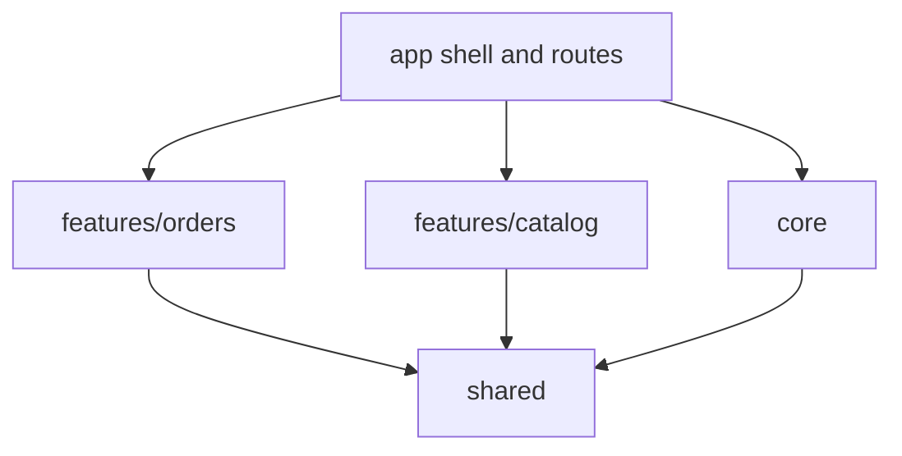

What to notice: every arrow is an allowed import, `shared` imports nothing from the others, and no arrow joins `orders` to `catalog`.

A **boundary** is the line a folder draws around code: outside files may use only what the folder exposes, such as its route file or an `index.ts` (a **barrel file**, one that re-exports the folder's public names). Sections [4](#4-layers-library-types-and-dependency-rules) and [6](#6-public-api-surfaces-public-apits-exports-secondary-entry-points-and-versioning) enforce boundaries.

### How it actually works

**Why the style guide forbids folders by type.** Read on angular.dev/style-guide, 2026-10-17: "Organize your project into subdirectories based on the features of your application or common themes to the code in those directories." and "Avoid creating subdirectories based on the type of code that lives in those directories." It adds "Unit tests should live in the same directory as the code-under-test." The reason is change locality: a feature change then lands in one folder, and a feature deletion is one folder deletion.

**What makes a folder a boundary here.** The shell's routes reach each feature only through a `loadChildren` loader that imports the feature's route file, and a feature imports only `shared`. The first fact is asserted by `Section 1: each feature folder is reached only through its lazy route`, the second by `Section 1: no file in one feature folder imports from another feature folder`, which reads the import specifiers with the TypeScript compiler API (read-only).

Standalone components removed the need for `SharedModule`: a component lists what it uses in its own `imports` ([15 §5](15-standalone-and-ngmodules.md#5-legacy-ngmodule-patterns-declarations-exports-forrootforchild-sharedmodule-and-coremodule)). Drilled in [Q38.01](#q38-01), [Q38.02](#q38-02) and [Q38.03](#q38-03).

### Code

The lab's sample app (`sample-app/`) is the smallest tree with all three kinds. Approach: one shell route, two lazy children, and each feature page built from a shared heading.

1. Lay out the folders.
2. Register the features as lazy children of the shell.
3. Navigate in a test and read the heading.

```text
sample-app/
  app-shell.ts
  routes.ts
  core/sample-app.config.ts
  shared/ui/page-heading.ts
  shared/util/page-title.ts
  features/orders/{routes.ts, feature/orders-home.ts}
  features/catalog/{routes.ts, feature/catalog-home.ts}
```

```ts
// Excerpt of labs/angular/src/app/modules/38-architecture-and-production-structure/sample-app/routes.ts
    children: [
      { path: 'orders', loadChildren: () => import('./features/orders/routes') },
      { path: 'catalog', loadChildren: () => import('./features/catalog/routes') },
    ],
```

`Section 1: each feature folder is reached only through its lazy route` navigates to `/orders` and `/catalog` and reads `Orders` and `Catalog` from the rendered `h2`.

#### Legacy

Pre-standalone apps kept a `shared/shared.module.ts` that re-exported common declarations and a `core/core.module.ts` guarded against a second import. Standalone components replace both with folders: `core/` holds providers registered once in the application config, and `shared/` holds components imported one by one. The migration and the `forRoot` guard are in [15 §5](15-standalone-and-ngmodules.md#5-legacy-ngmodule-patterns-declarations-exports-forrootforchild-sharedmodule-and-coremodule) and [Q15.15](15-standalone-and-ngmodules.md#q15-15).

### Best practices and anti-patterns

- **Group by feature first, role second**, because a change then touches one folder.
- **Keep `shared/` free of feature imports**, because one such import makes every feature depend on the feature it names.
- **Keep tests beside the code they test**, because the style guide says so and a deleted feature takes its tests along.
- **Avoid feature-to-feature imports**, because two features that import each other can no longer be deleted or changed separately, and loading one pulls in the other's code; move the common piece to `shared/` or to a facade ([§3](#3-facades-and-the-data-access-layer)).

### Misconceptions and traps

- *"`shared/` is where anything used twice goes."* Code with feature knowledge there makes every feature depend on every other. Move it into the feature, or into a ui or util library with no domain imports. The myth exists because of the folder's name.
- *"`core/` is a module you import once."* In a standalone app `core/` is a folder whose providers go into the application config. The myth comes from the NgModule-era `CoreModule` with its `forRoot` guard ([15 §5](15-standalone-and-ngmodules.md#5-legacy-ngmodule-patterns-declarations-exports-forrootforchild-sharedmodule-and-coremodule)).
- *"Folders by type are easier to find things in."* True of a small app, which is why the habit lasts; the style guide's reason against it is that a change then touches several folders.

## 2. Smart (container) and presentational components

### The problem it solves

An order table injects the store, the router and `HttpClient`. It cannot be reused on the dashboard, its test needs five providers, and a change in the API shape breaks a table that was supposed to be "dumb".

### Mental model

A **presentational component** knows nothing about where data comes from: **signal inputs** (inputs read as signals) bring data in, **outputs** (events the parent listens to) send intent out, and it injects no data services ([19 §1](19-component-communication-and-projection.md#1-inputs-outputs-and-two-way-binding-the-parent-and-child-contract)). A **container component** (also called smart) injects the facade ([§3](#3-facades-and-the-data-access-layer)), reads its signals, passes them down, and turns outputs into facade calls. Think of a TV screen and its set-top box: the screen shows whatever arrives on its input, and the box knows the channels.

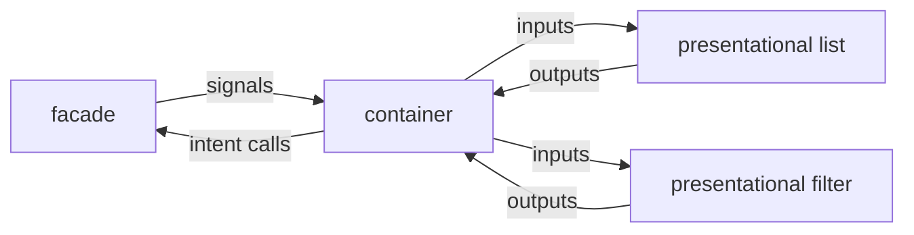

What to notice: data flows down as inputs and intent flows up as outputs, and only the container touches the facade.

### How it actually works

**Why the split fits v22.** A component without a `changeDetection` property is **OnPush** [Changed in v22.0: components without `changeDetection` are OnPush]: its template is re-checked when an input changes, an event fires in it, or a signal it reads changes ([21 §2](21-change-detection.md#2-onpush-and-eager-strategies-and-what-marks-a-view-dirty)). A signal input is a signal whose value is replaced through `signalSetFn`, and `@angular/core` 22.2.1 gives it `defaultEquals`, which is `Object.is(a, b)` (`fesm2022/_effect-chunk.mjs`, `SIGNAL_NODE`, `defaultEquals`; `fesm2022/_debug_node-chunk.mjs`, `INPUT_SIGNAL_NODE`; internal names, read, not run). So passing the same array again does not notify the template, and a presentational component fits immutable inputs. `Section 2: an in-place mutation of the input array is not rendered until the container passes a new array` asserts exactly that: after `push` and a `setInput` with the same array the list shows `Ada` only, and after `setInput` with a copy it shows `Ada` and `Grace`.

**Why lint no longer asks for `OnPush`.** Read in angular-eslint 22.6.0 (`dist/rules/prefer-on-push-component-change-detection.js`, via unpkg, 2026-10-17; VERSIONS.md lists 22.5.0): the rule's description is "Ensures components do not opt out of the default `ChangeDetectionStrategy.OnPush` change detection strategy". It flags opting out, not omitting. This tool is documented, not run.

**Testing.** A presentational component needs no providers, only `setInput` and an output subscription ([29 §7](29-testing-angular.md#7-test-doubles-fakes-stubs-spies-and-mocks-vifn-provider-overrides-and-over-mocking)). Reuse by inheritance is the other route to shared behavior; [Q20.18](20-lifecycle-and-render-hooks.md#q20-18) prefers composition. Drilled in [Q38.04](#q38-04), [Q38.05](#q38-05) and [Q38.06](#q38-06).

### Code

Approach: a list that only renders and emits, and a page that connects it to the facade's contract.

1. Write `LabM38OrderList` with an `orders` input and a `select` output.
2. Write `LabM38OrdersPage`, which injects `OrdersFacadePort` (the facade's shape; [§3](#3-facades-and-the-data-access-layer) implements it).
3. Test the list with no providers and the page with a fake facade.

```ts
// Excerpt of labs/angular/src/app/modules/38-architecture-and-production-structure/sample-app/features/orders/ui/order-list.ts
export class LabM38OrderList {
  readonly orders = input.required<readonly OrderRow[]>();
  readonly select = output<number>();
}
```

```ts
// Excerpt of labs/angular/src/app/modules/38-architecture-and-production-structure/sample-app/features/orders/feature/orders-page.ts
template: `<lab-m38-order-list [orders]="facade.orders()" (select)="facade.select($event)" />`,
```

`Section 2: the presentational list renders only from its inputs and has no injected services` renders the list with an empty `providers` list and reads two rows. `Section 2: the presentational list emits select with the row id` clicks a row and gets its id. `Section 2: the container passes the facade's signals to the list and calls the facade on select` uses a fake facade and sees the list update when the signal changes.

### Best practices and anti-patterns

- **Give presentational components inputs and outputs only**, because then the dashboard can reuse them and their tests need no providers.
- **Pass new arrays and objects, never mutate them**, because an unchanged reference does not notify the template.
- **Let one container own the facade**, because several containers calling it for one screen scatter the intent.
- **Avoid a container around a leaf used once**, because the extra layer adds files and no reuse.

### Misconceptions and traps

- *"Presentational components may not inject anything."* Injecting a presentational helper such as `LiveAnnouncer` or `ElementRef` is fine; injecting state or data access is not. The myth comes from stating the rule too strictly.
- *"Smart and dumb is a React idea that signals made obsolete."* The split is about who knows the data source, and signals do not change that. The myth exists because React hooks blurred the pattern.
- *"Every component needs a container."* A leaf used once that will never be reused can read the facade directly. The myth comes from over-applying the pattern.

## 3. Facades and the data-access layer

### The problem it solves

Five components call `HttpClient` for orders, each handling errors its own way. After a failed refresh one shows "Server error" and another blanks the table, because nobody owns that decision. Adding a cache means editing all five, and every test fakes `HttpClient`.

### Mental model

The **data-access layer** is the part of a feature that knows where data comes from: HTTP services, the store and the mapping from a **DTO** (the shape the server sends) to a **view model** (the shape the screens use). A **facade** is one class in front of several services ([16 §9](16-dependency-injection.md#9-di-patterns-testing-and-the-spring-container)); here it fronts the store and the API with read-only signals (`orders`, `loading`, `error`) and **intent methods** (named for what the user wants: `load()`, `select(id)`). It reaches the API through a **port**, a token naming what it needs (`ORDERS_API`), filled by an **adapter**, a class that gives one source that shape (`HttpOrdersApi`). Think of a waiter: you order from the menu and never walk into the kitchen.

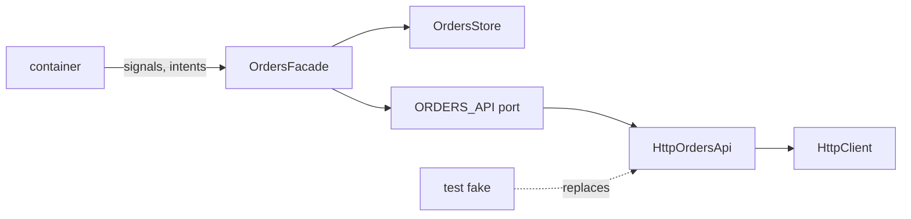

What to notice: only the facade faces the container, and a fake swaps in at the port.

### How it actually works

**State.** The store is a **service-with-signals store**: private state in a `signal`, `computed` selectors, methods as the only writers ([28 §2](28-state-management.md#2-the-service-with-signals-store-state-shape-derived-selectors-methods-and-async-loads); [Q28.04](28-state-management.md#q28-04) designs one). The facade hands out those read-only signals.

**Errors are mapped once, at the edge.** `HttpOrdersApi` turns every failure into `OrdersError`, status 0 into `offline` ([27 §5](27-http-client.md#5-errors-httperrorresponse-an-error-mapping-layer-and-retry-with-backoff-and-jitter); [Q27.16](27-http-client.md#q27-16) designs such a layer). Caught inside `switchMap` (the operator that switches to each new inner stream and cancels the previous one, [23 §1](23-rxjs-in-depth.md#1-higher-order-observables-switchmap-mergemap-concatmap-and-exhaustmap)), the error becomes state, the next `load()` still works, and `setError` keeps the orders shown.

**Why the page and a test share one facade.** `provideOrdersDataAccess()` aliases `OrdersFacadePort` to `OrdersFacade` with `useExisting` and binds the token `ORDERS_API` to `HttpOrdersApi` ([16 §7](16-dependency-injection.md#7-injectiontoken-multi-providers-environment-providers-and-initializers)). In `@angular/core` 22.2.1 the internal `providerToFactory` (`fesm2022/_pending_tasks-chunk.mjs`) turns `useExisting` into a factory that injects the other token, so both names give one object (read, not run). The orders route lists these providers, so they live in its route injector, created once and kept ([24 §4](24-routing.md#4-lazy-loading-in-depth-loaders-canmatch-and-route-injectors)).

**When a facade is overhead.** It earns its place when a container would otherwise inject more than four services. One component making one call should inject the service directly. Drilled in [Q38.07](#q38-07), [Q38.08](#q38-08) and [Q38.09](#q38-09); practised in [Exercise 38.1](#ex38-1).

> [!TIP]
> **Coming from the backend.** In hexagonal architecture (ports and adapters) the application defines ports and adapters implement them at the edge; Alistair Cockburn's intent: "Allow an application to equally be driven by users, programs, automated test or batch scripts" ([Hexagonal architecture](https://alistair.cockburn.us/hexagonal-architecture/), read 2026-10-17). Against a layered Spring service (controller → service → repository), the facade is the application service, `HttpOrdersApi` the adapter in the repository's place, and `ORDERS_API` the port. See the [root guide's Facade](../../Backend%20Study%20Guide%20-%20Security%2C%20JPA%2C%20Design%20Patterns%20%26%20Spring.md#facade) and [Q16.35](16-dependency-injection.md#q16-35) (the two containers). **Where the analogy breaks:** the front end's "domain" is mostly server state cached for display ([28 §1](28-state-management.md#1-kinds-of-state-server-cache-ui-form-url-and-session-state-and-where-each-belongs)); the facade outlives requests and pushes changes through signals; and no Maven module stops a component importing `HttpClient`, so import rules enforce the direction ([§4](#4-layers-library-types-and-dependency-rules)).

### Code

Approach: three `data-access/` classes registered on the orders route, then tests that swap the port's adapter.

1. Write `HttpOrdersApi`, which maps DTOs and errors.
2. Write `OrdersStore` and `OrdersFacade`, which extends `OrdersFacadePort`, the class [§2](#2-smart-container-and-presentational-components)'s page injects.
3. Add `provideOrdersDataAccess()` to the orders route.
4. Test with `HttpTestingController` (a testing backend answered by hand), then with a fake `ORDERS_API`.

```ts
// Excerpt of labs/angular/src/app/modules/38-architecture-and-production-structure/sample-app/features/orders/data-access/orders-api.ts
export class HttpOrdersApi implements OrdersApi {
  list(): Observable<readonly Order[]> {
    return this.#http.get<OrderDto[]>(ORDERS_URL).pipe(
      map((dtos) => dtos.map((dto) => ({ id: dto.order_id, customer: dto.customer_name }))),
      catchError((err: unknown) => throwError(() => toOrdersError(err))),
    );
  }
}
```

```ts
// Excerpt of labs/angular/src/app/modules/38-architecture-and-production-structure/sample-app/features/orders/routes.ts
export default [{ path: '', component: LabM38OrdersHome, providers: [provideOrdersDataAccess()] }] satisfies Routes;
```

`Section 3: the facade exposes orders loaded through the data-access service` flushes one DTO and reads `[{ id: 1, customer: 'Ada' }]`. `Section 3: the facade maps an HTTP error to an error state and keeps the previous orders` answers a second load with a 500 and reads `{ kind: 'server', status: 500 }` with Ada's order kept. `Section 3: replacing the API token with a fake changes no component code` renders the §2 page with a fake `ORDERS_API`, sees `Fake Ltd`, and after a click reads `selectedId` 9 from `OrdersFacade`.

### Best practices and anti-patterns

- **Expose read-only signals and intent methods**, because components then cannot write state.
- **Map DTOs and errors in the adapter**, because a renamed field or new status then changes one file.
- **Provide data access on the feature route**, because the feature gets its own instance.
- **Avoid a facade for one component making one call**, because the extra class hides nothing.

### Misconceptions and traps

- *"A facade is just a store wrapper with extra boilerplate."* Its value is a narrower, intent-shaped API and a swap point. The myth comes from pass-through facades that forward every store method one-to-one.
- *"The facade should expose Observables so components can compose."* Read-only signals keep OnPush templates simple, and `toSignal` belongs at the edge ([28 §2](28-state-management.md#2-the-service-with-signals-store-state-shape-derived-selectors-methods-and-async-loads)). The myth is a pre-signal habit.
- *"Data access means only HTTP."* It also holds the store, caching and DTO mapping. The myth comes from the name.

## 4. Layers, library types and dependency rules

### The problem it solves

A `ui` button imports a store selector, a utility imports a component, a feature reaches into another feature's file with `../../`. Nothing fails until a refactor breaks three teams. Folders ([§1](#1-folder-structures-that-scale-by-feature-domain-slices-and-core-shared-and-feature-boundaries)) say where code lives, not who may depend on whom.

### Mental model

A **library type** says what code does: `feature` (screens and routes), `ui` (presentational pieces, no data), `data-access` ([§3](#3-facades-and-the-data-access-layer)) and `util` (pure functions and types). A **scope** says who owns it: `orders`, `catalog` or `shared`. A **dependency rule** is a direction: `feature` may import `ui`, `data-access` and `util`; `ui` only `ui` and `util`; `data-access` only `data-access` and `util`; `util` only `util`; a scope imports itself and `shared`. Think of one-way streets: traffic flows downhill, never back.

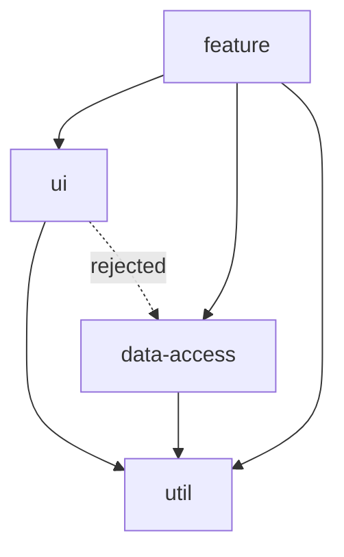

What to notice: every solid arrow points toward `util`, which imports nothing above it, and the dotted arrow from `ui` to `data-access` is the one a lint rule must reject.

Shared directives and pipes ([14 §5](14-directives-and-pipes.md#5-pipes-pure-and-impure-custom-pipes-injection-and-imports)) go in `shared/ui` when they render or touch the DOM, and in `shared/util` when they only compute.

### How it actually works

Without Nx, two tools enforce the direction. A folder convention (`features/<scope>/{feature,ui,data-access}`, as in the sample tree) makes a violation visible in the path. ESLint's `no-restricted-imports` rule, whose `patterns` option takes `group` entries of "`gitignore`-style patterns" and a custom `message` ([ESLint docs](https://eslint.org/docs/latest/rules/no-restricted-imports), read 2026-10-17), bans paths such as one scope's `ui` folder from another's files. A custom checker works too, as in [Exercise 38.3](#ex38-3).

With Nx, each project carries **tags** (labels such as `type:ui` and `scope:orders`) and `@nx/enforce-module-boundaries` compares them with `depConstraints` ([§7](#7-nx-monorepos-the-project-graph-tags-nxenforce-module-boundaries-affected-commands-and-caching) owns the project graph). Nx is documented here, not run.

**Why a `../../` import into another project is reported even when the tags allow it.** Read, not run, in `@nx/eslint-plugin` 23.3.0, `dist/src/rules/enforce-module-boundaries.js`: the first message is "Projects cannot be imported by a relative or absolute path, and must begin with a npm scope". A **relative import** names a file by its position, so it bypasses the project's public entry. The rule still resolves it to the project that owns the file (the internal `getTargetProjectBasedOnRelativeImport`) and reports it whenever that project is not the importer's, before any tag is compared.

Cycles break the direction itself. In `ng-packagr` 22.2.1 entry points are built in topological order with `new DepGraph({ circular: false })` (`ng-package/package.transform.js`), and a cycle throws `DepGraphCycleError` with "Dependency Cycle Found: a -> b -> a" (`dependency-graph` 1.0.0, `lib/dep_graph.js`; read, not run).

### Code

Approach: the rules as a table, then three checks against it.

1. Write the type table `allowedTypes` and the scope function `allowedScopes`.
2. Combine them in `mayImport`.
3. Assert allowed and rejected pairs.

```ts
// Excerpt of labs/ts-js/src/modules/38-architecture-and-production-structure/concepts/rules.ts
export const allowedTypes: Record<LibraryType, readonly LibraryType[]> = {
  feature: ['feature', 'ui', 'data-access', 'util'],
  ui: ['ui', 'util'],
  'data-access': ['data-access', 'util'],
  util: ['util'],
};
```

`Section 4: the rule table allows feature to ui, data-access and util` reads `true` for all three. `Section 4: the rule table rejects ui to data-access and util to ui` reads `false` for both. `Section 4: the rule table rejects a scope importing another scope except shared` reads `false` for an `orders` feature importing a `catalog` `ui`, and `true` for `shared`. The table models the rules; it does not scan the tree.

### Best practices and anti-patterns

- **Keep `util` free of Angular components and stores**, because every consumer then inherits that rendering code.
- **Import another scope only through its public entry**, because a `../../` path survives renames until it breaks.
- **Put the rule in lint, not in review**, because a violation then fails before merge.
- **Avoid a `shared` that imports a feature**, because every scope then depends on it.

### Misconceptions and traps

- *"Boundaries need Nx."* Folder rules plus `no-restricted-imports` or a checker enforce the same direction in a CLI workspace. The myth comes from Nx making tags popular.
- *"A `util` may import anything if it is small."* A `util` that imports a component pulls rendering into every consumer and invites cycles. The myth comes from size feeling harmless.
- *"A cycle between two libraries only matters for the build."* Bundlers tolerate many cycles, but ng-packagr refuses them between entry points and initialization order gets fragile. The myth comes from bundlers hiding the problem.

Drilled in [Q38.10](#q38-10) and [Q38.11](#q38-11).

## 5. Angular CLI libraries: `ng generate library`, ng-packagr and consuming the build

### The problem it solves

Two apps copy the same forty components. A fix lands in one copy, and the other drifts. Moving the components into a **library project** ([12 §2](12-angular-how-it-works.md#2-the-cli-and-the-workspace-angularjson-projects-schematics-and-ng-update); [Q12.04](12-angular-how-it-works.md#q12-04)) removes the copies, but an app that imports the library's source compiles it with the app's own settings.

### Mental model

**ng-packagr** is the build tool behind `ng build ui-lib`. It writes the **Angular Package Format** (APF): a `package.json` with an `exports` map, one **FESM** (flat ES module) bundle per **entry point** (a folder with its own public surface), and one bundled typings file. An app in the same workspace reads the *built* folder through a **`paths` mapping**, a `tsconfig` entry that maps an import name to a location. Think of a printing press: the app reads the printed book, never the manuscript.

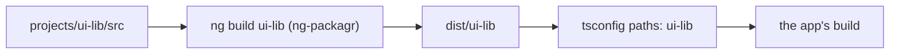

What to notice: the only arrow into the app starts at `dist`, so an edit in `src` reaches the app after the build box runs again.

### How it actually works

**Why the app does not see a library edit until you rebuild.** Read, not run, in `@schematics/angular` 22.2.1, `library/index.js`: the internal function `updateTsConfig` writes `compilerOptions.paths["ui-lib"]` as `./dist/ui-lib`. The lab's `tsconfig.json` holds that entry, plus the `ui-lib/*` wildcard that [Exercise 38.2](#ex38-2) needs for subpaths; both point at `dist`. The Angular docs state the rule: an app "should only use TypeScript path mappings that point to the built library" and the mappings "should not point to the library source .ts files" (emphasis omitted; [creating libraries](https://angular.dev/tools/libraries/creating-libraries), read 2026-10-17). `ng build ui-lib --watch` rebuilds on each save.

**What the build wrote.** The test `Section 5: the build writes package.json, a fesm2022 bundle and a bundled types file` found `README.md`, `fesm2022/ui-lib.mjs`, `fesm2022/ui-lib.mjs.map`, `package.json` and `types/ui-lib.d.ts` among the output (2026-10-17; the later entry points add their own files). Compiling in **partial compilation** mode ([12 §8](12-angular-how-it-works.md#8-under-the-hood-what-the-compiler-emits-and-what-the-runtime-does-with-it); [Q12.28](12-angular-how-it-works.md#q12-28)) is what `tsconfig.lib.prod.json` sets, and `Section 5: the built bundle contains a partial declaration, not a full definition` observed the internal name `ɵɵngDeclareComponent` in the bundle and no `ɵɵdefineComponent`.

**What ng-packagr enforces**, read, not run, in `ng-packagr` 22.2.1, `ng-package/entry-point/write-package.transform.js`: `dependencies` other than `tslib` throw "Dependency X must be explicitly allowed using the "allowedNonPeerDependencies" option."; `scripts` is deleted unless `keepLifecycleScripts` is true; a build that is not partial gets a `prepublishOnly` script that fails `npm publish`. Angular packages belong in **peer dependencies** (a range the consumer's app must also install), which the docs say for every `@angular/*` package.

**Where the library's specs run.** `ng test` is a multi-target command: it runs every project that has a `test` target (`@angular/cli` 22.2.1, `architect-command-module.js`, read, not run), and the lab's `ui-lib` has none, so its consumer spec lives in the `labs` project.

### Code

Approach: build the library, then import it by name.

1. Run `npx ng build ui-lib` from `labs/angular`.
2. Import `UiBadge` from `'ui-lib'`, not from a relative path.
3. Render it and read the DOM.

```json
// Partial: the paths entry of labs/angular/tsconfig.json, as the generator wrote it
{ "compilerOptions": { "paths": { "ui-lib": ["./dist/ui-lib"] } } }
```

```ts
// Excerpt of labs/angular/src/app/modules/38-architecture-and-production-structure/concepts/section-5-consumer.spec.ts
import { UiBadge } from 'ui-lib';
    const fixture = TestBed.createComponent(UiBadge);
    fixture.componentRef.setInput('label', 'in stock');
    await fixture.whenStable();
```

`Section 5: the labs app imports UiBadge by package name from the built library` reads `in stock` in `span.ui-badge`.

### Best practices and anti-patterns

- **Point `paths` at `dist`**, because the app then compiles the same form a consumer would install.
- **List `@angular/*` as peers and keep `dependencies` to `tslib`**, because a second copy of Angular in a consumer breaks injection.
- **Run `ng build ui-lib --watch` beside `ng serve`**, because the app reads only the built folder.
- **Avoid publishing a full-compilation build**, because it ties consumers to one Angular patch.

### Misconceptions and traps

- *"Point `paths` at the library source for a faster loop."* The docs forbid it for CLI libraries: the app would compile the library with the app's settings, not the published form. The myth comes from Nx and many blogs doing it for non-buildable libraries, a deliberate choice in an Nx workspace ([§7](#7-nx-monorepos-the-project-graph-tags-nxenforce-module-boundaries-affected-commands-and-caching)).
- *"A library needs an NgModule."* The schematic generates a `module` only when `standalone` is false (`library/index.js`, read, not run); [Q15.19](15-standalone-and-ngmodules.md#q15-19) owns the choice. The myth comes from libraries written before standalone components.
- *"`dependencies` in a library's `package.json` is fine."* ng-packagr throws unless the name is allowed. The myth comes from application habits.

Drilled in [Q38.12](#q38-12), [Q38.13](#q38-13) and [Q38.14](#q38-14).

## 6. Public API surfaces: `public-api.ts`, `exports`, secondary entry points and versioning

### The problem it solves

A consumer imports `ui-lib/src/lib/internal/date-utils` because it compiled once. Now the library cannot rename that file without breaking them. A testing helper has the opposite problem: it sits in the main bundle and drags test-only imports into production code.

### Mental model

The **public API surface** is everything a consumer can import and rely on. For `ui-lib` it is what `public-api.ts` exports, made binding by two files the build generates: the **`exports` map** in `package.json` (only the listed **subpaths**, such as `./testing`, resolve) and the **bundled typings** (one `.d.ts` per entry point, holding only exported names). A **secondary entry point** is a sub-folder with its own `ng-package.json`, so it gets its own bundle and its own subpath. Think of a shop window: customers buy what is in the window, and the storeroom is not for sale.

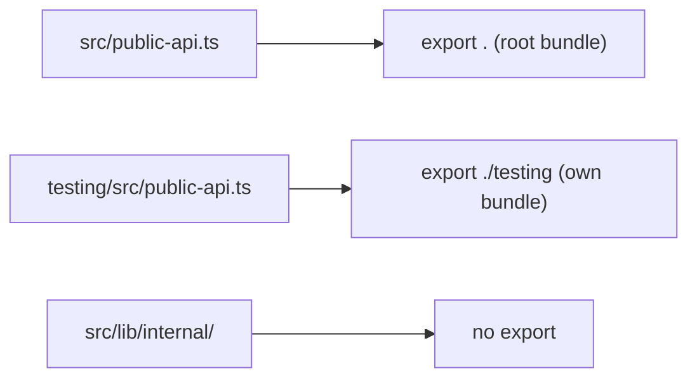

What to notice: `internal/` has no arrow to an export, so the badge uses `formatCount` but no consumer can name it.

### How it actually works

**Why a consumer cannot deep-import a file.** Read, not run, in `ng-packagr` 22.2.1: the internal function `generatePackageExports` (`src/lib/utils/package-json.js`) writes `./package.json`, then `.` for the primary entry point and `./<folder>` for each secondary one, each as `{ types, default }`. Node then refuses what is not listed: "When the "exports" field is defined, all subpaths of the package are encapsulated and no longer available to importers", and `require('pkg/subpath.js')` throws `ERR_PACKAGE_PATH_NOT_EXPORTED` ([Node packages docs](https://nodejs.org/api/packages.html), read 2026-10-17). The same page calls it "not a strong encapsulation" for absolute file paths.

**How a folder becomes an entry point.** Read, not run, in `src/lib/ng-package/discover-packages.js` (the internal `findSecondaryPackagesPaths`): the build globs for `**/ng-package.json` under the library and treats each folder as a secondary entry point. A secondary `lib.entryFile` defaults to `src/public_api.ts` (`ng-entrypoint.schema.json`), and the schematic's primary file is `public-api.ts`, so the lab names the file explicitly.

**What the lab observed** (2026-10-17, after `npx ng build ui-lib`):

- `Section 6: exports lists the package, the root and the testing subpath only` read exactly `.`, `./package.json` and `./testing` (Exercise 38.2 later adds its own `./ex2-a` and `./ex2-b`, which the test leaves out).
- `Section 6: an internal helper's name is absent from the root types file` found `UiBadge` and no `formatCount` in the root typings, and `formatCount` still inside the root bundle: unexported, not removed.
- `Section 6: the testing entry point has its own bundle and types file` found the `./testing` entry pointing at files different from the root's, both containing `UiBadgeHarnessLite`, which the root typings lack.

**Versioning is the promise about that surface.** Use **semantic versioning**: a breaking change to an export needs a new major. A **deprecation** marks an export with the `@deprecated` JSDoc tag for one major before removal, and the peer ranges in `package.json` state which Angular versions you support. Migrations ship as `ng update` schematics ([module 39](39-version-history-and-migrations.md#7-updating-in-practice-ng-update-migration-schematics-and-the-update-guide)). Configuration belongs behind a `provide*` function ([Q16.33](16-dependency-injection.md#q16-33)), so options can grow without new exports.

### Code

Approach: keep the helper internal, export the component, and put the test helper in its own entry point.

1. Write `format-count.ts` under `internal/` and import it in `badge.ts` by relative path.
2. Leave `public-api.ts` exporting only the badge.
3. Add `testing/ng-package.json` naming its entry file.

```ts
// Excerpt of labs/angular/projects/ui-lib/src/lib/internal/format-count.ts (internal: not exported)
export function formatCount(count: number): string {
  return count > 99 ? '99+' : String(count);
}
```

```json
// Excerpt of labs/angular/projects/ui-lib/testing/ng-package.json
{
  "lib": {
    "entryFile": "src/public-api.ts"
  }
}
```

```ts
// Excerpt of labs/angular/projects/ui-lib/testing/src/public-api.ts
export class UiBadgeHarnessLite {
  constructor(private readonly root: HTMLElement) {}
}
```

The helper needs no `@angular/core/testing` import, so the entry point is plain TypeScript.

### Best practices and anti-patterns

- **Export names one by one, or review every barrel**, because `export *` publishes whatever the barrel re-exports.
- **Put test helpers and optional integrations in a secondary entry point**, because consumers who do not import them never load them.
- **Name `lib.entryFile` in every secondary `ng-package.json`**, because the default differs from the primary's file name.
- **Deprecate for one major before removing**, because consumers need a release to migrate.

### Misconceptions and traps

- *"`export *` in `public-api.ts` is harmless."* It publishes every name the barrel re-exports, so an internal file added to a barrel becomes public API. The myth comes from the convenience of one line.
- *"A secondary entry point is only about tree shaking."* It does help shaking, but the larger reason is a separate, optional dependency surface such as testing helpers. The myth comes from the shaking benefit being the easiest to measure.
- *"Deep imports are just bad style."* With the generated map they fail to resolve. The myth comes from the time before `exports` existed, when they worked.

Drilled in [Q38.15](#q38-15), [Q38.16](#q38-16) and [Q38.17](#q38-17); practised in [Exercise 38.2](#ex38-2).

## 7. Nx monorepos: the project graph, tags, `@nx/enforce-module-boundaries`, affected commands and caching

### The problem it solves

A workspace has 60 libraries, and every pull request runs every test. Worse, a `ui` library quietly imports a feature, and nothing stops it.

### Mental model

A **monorepo** is one repository holding many projects. An **Nx workspace** adds tooling on top of it, and an Angular CLI workspace with libraries is a monorepo too, without that tooling. Nx builds a **project graph** from imports and configuration. Each project carries **tags**, plain strings in its `project.json` or `package.json`. A **dependency constraint** says which tags a tagged project may depend on, and a lint rule enforces it. An **affected project** is a touched project or anything that reaches one. The **computation cache** replays a task whose inputs hashed the same before. Think of a city map with district labels (tags), road closures (rules), and a traffic report that reroutes only the districts downstream of a roadwork (affected).

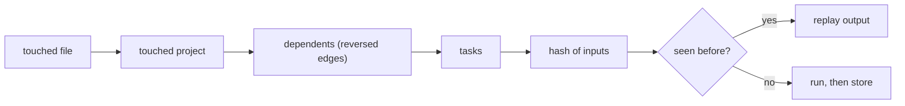

What to notice: affected narrows the tasks, and the hash narrows them again.

### How it actually works

Everything here is documented only: the lab has no Nx workspace, and no Nx command was run. The facts come from `nx` 23.3.0 and `@nx/eslint-plugin` 23.3.0 (VERSIONS.md lists `nx` 23.2.1), read from the packed packages on 2026-10-18. Function names below are internal, not API.

**Tags and the rule.** Read, not run, in `@nx/eslint-plugin` 23.3.0 (`dist/src/rules/enforce-module-boundaries.js`, `dist/src/utils/runtime-lint-utils.js`):

- A constraint selects its source projects with `sourceTag`, or with `allSourceTags` (all must match). Tags can be `*`, a regex between slashes, or a glob (`hasTag`).
- `onlyDependOnLibsWithTags` passes when the target has any one of the tags. `notDependOnLibsWithTags` is checked with `findDependenciesWithTags`, which collects every project reachable from the target, so it reports transitive dependencies, not only direct imports.
- Once any constraint exists, a project whose tags match none of them, an untagged one included, is reported on each import of another project: "A project without tags matching at least one constraint cannot depend on any libraries".
- Relative imports are reported before any tag is read, as [section 4](#4-layers-library-types-and-dependency-rules) showed.

The docs describe tags as "a generic mechanism for expressing constraints on project dependencies" and the rule as checking "TypeScript imports and `package.json` dependencies during linting" ([Nx, enforce module boundaries](https://nx.dev/docs/features/enforce-module-boundaries), read 2026-10-18).

**Affected.** Read, not run, in `nx` 23.3.0 (`dist/src/project-graph/affected/affected-project-graph.js`): the internal `filterAffected` finds touched projects from touched files, reverses the graph, and adds every project reachable from them. `--base` and `--head` choose the files (the internal `parseFiles`); the base falls back to `defaultBase` in `nx.json`, then `affected.defaultBase`, then `main`, and `NX_BASE` is read when `--base` is absent (`dist/src/utils/command-line-utils.js`).

**The cache.** In `dist/src/hasher/task-hasher.js` the default **named input** (a reusable input list that `nx.json` declares under `namedInputs`) is `{projectRoot}/**/*`, and the default task inputs are that fileset plus the same for dependencies. `targetDefaults` in `nx.json` set `cache`, `inputs`, `outputs` and `dependsOn` per target. Nx "restores both the terminal output and the files created from running the task" ([Nx, cache task results](https://nx.dev/docs/features/cache-task-results), read 2026-10-18). A **remote cache** shares those results between machines.

**What the lab observed** (2026-10-18, our own code, "the algorithm read from `nx` 23.3.0, run on our code"; it is not Nx):

- `Section 7: a change to a util project affects every project that reaches it` returned all seven projects of the test graph.
- `Section 7: a change to an app affects only that app` returned only the app, since nothing imports an app.

`@nx/angular` 23.3.0 peers Angular build packages `< 23.0.0`, so its Angular plugin covers v22.

### Code

Approach: tag each project twice, by type and by scope, then constrain by tag.

1. Give each project a `type:` and a `scope:` tag in its `project.json`.
2. List in `depConstraints`, per source tag, the tags it may import.
3. Make `build` cacheable in `targetDefaults` and build dependencies first with `^build`.

```js
// Partial: the rest of the flat config and the plugin registration are omitted
// (shape of the options read in @nx/eslint-plugin 23.3.0)
const depConstraints = [
  { sourceTag: 'type:feature', onlyDependOnLibsWithTags: ['type:ui', 'type:data-access', 'type:util'] },
  { sourceTag: 'type:ui', onlyDependOnLibsWithTags: ['type:ui', 'type:util'] },
  { sourceTag: 'scope:orders', onlyDependOnLibsWithTags: ['scope:orders', 'scope:shared'] },
];
```

```json
// Partial: one target default of nx.json, other keys omitted
{ "targetDefaults": { "build": { "cache": true, "dependsOn": ["^build"], "outputs": ["{projectRoot}/dist"] } } }
```

Exercises [38.3](#ex38-3) and [38.4](#ex38-4) implement these rules as their own code.

### Best practices and anti-patterns

- **Tag by type and by scope**, because one dimension cannot express both "ui never imports a feature" and "orders never imports catalog".
- **Start with a deny-by-default constraint list**, because a project with no matching constraint is reported rather than silently allowed.
- **Declare every input a task reads**, because an undeclared input (an environment variable or a root config file) gives a stale cache hit.

### Misconceptions and traps

- *"Affected means projects whose files changed."* It also includes every dependent, because the walk follows reversed edges. The myth comes from the word.
- *"`notDependOnLibsWithTags` only checks direct imports."* The 23.3.0 source checks every reachable project. The name reads like `onlyDependOnLibsWithTags`, which checks one.
- *"Nx is required for an Angular monorepo."* A CLI workspace with libraries is one too, without the graph tooling ([Q38.21](#q38-21)). The myth comes from Nx's visibility.

Drilled in [Q38.18](#q38-18), [Q38.19](#q38-19), [Q38.20](#q38-20) and [Q38.21](#q38-21).

## 8. Micro-frontends: Module Federation, Native Federation, and when they are justified

### The problem it solves

Six teams ship one app; each release waits for everyone's tests, and one bad merge blocks all six. Leadership asks for "micro-frontends" without naming the problem.

### Mental model

A **micro-frontend** is a separately built and deployed part of the UI, loaded at run time. The **host** (**shell**) loads a **remote**, which publishes **exposed modules** under keys such as `./Component`. The hard part is a **shared dependency** such as Angular, which separately built apps must load once, as a **singleton**. **Module Federation** is a webpack (or rspack) runtime that loads a remote's `remoteEntry.js` and negotiates shared packages. **Native Federation** keeps that model, builds remotes as plain ES modules and resolves them through an **import map**, a JSON table from import names to URLs ([05 §3](05-js-modules-memory-modern-features.md#3-import-maps-importmeta-and-import-attributes), [Q05.09](05-js-modules-memory-modern-features.md#q05-09)). Think of a food court: separate kitchens under one roof must agree on the plates and the till.

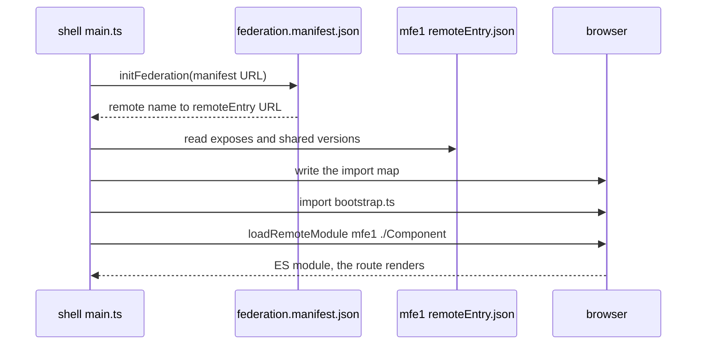

What to notice: `bootstrap.ts` loads only after `initFederation` settles, so Angular itself resolves through the map.

### How it actually works

Documented only: this module builds no federated app. Facts come from the packed `@angular-architects/native-federation` 22.2.2, `@softarc/native-federation` 4.7.1 and `@angular-architects/module-federation` 22.0.0, and native-federation.com, all read 2026-10-18.

**Why Native Federation fits v22.** Its `package.json` peers only `@angular/build ~22.2.0`, and its README says it "delegates to Angular's esbuild-based ApplicationBuilder and dev server". The Module Federation plugin's README sends "the esbuild/ApplicationBuilder route" there.

**The build.** The internal `shareCore` (`dist/lib/config/share-utils.js`) turns `requiredVersion: "auto"` into the closest `package.json`'s version. The build writes `remoteEntry.json` (`exposes`, plus each shared package's flags and versions; `write-federation-info.js`) and `importmap.json` (`write-import-map.js`). The docs define `singleton` as "Only one instance of this package is ever loaded at runtime" and `strictVersion` as "Throw at runtime instead of falling back when a version mismatch is detected" ([Sharing dependencies](https://native-federation.com/docs/v4/core/sharing/)); the generated config turns both on.

**Run time.** The adapter's `initFederation` (`src/index.js`) hands over to `@softarc/native-federation-orchestrator` (not read) with an import-map provider, es-module-shims unless `shimMode` is `false`. A dynamic host passes `federation.manifest.json`, mapping remote names to `remoteEntry.json` URLs (the init schematic's internal `generate-remote-map.js`).

**Justified** for autonomous teams that must deploy on their own cadence. Costs, as mechanisms:

- With `strictVersion` off, a mismatch falls back to another copy: the sharing page's example takes a remote's own `rxjs-interop` and splits Angular across two versions. With it on, the app throws.
- In Module Federation "sharing … is always an opt-in" per micro frontend (README, abridged).
- Cross-app state and auth, one design system ([36 §12](36-material-and-cdk.md#12-a-design-system-on-the-cdk-and-angular-aria-or-a-wrapper-around-material)), testing the composed app ([30 §1](30-e2e-and-testing-strategy.md#1-what-belongs-at-the-end-to-end-level-journeys-cost-and-a-strategy-across-levels)) and routing remotes in production ([module 44](44-fullstack-delivery-and-operations.md#5-runtime-configuration-without-rebuilding-configjson-environment-substitution-at-container-start-and-provideappinitializer)) become contracts between teams.

Cheaper first: a **modular monolith** (one deployable with libraries and enforced boundaries, [§4](#4-layers-library-types-and-dependency-rules) to [§7](#7-nx-monorepos-the-project-graph-tags-nxenforce-module-boundaries-affected-commands-and-caching)), lazy routes ([24 §4](24-routing.md#4-lazy-loading-in-depth-loaders-canmatch-and-route-injectors)), or, for one widget in a foreign page, Angular Elements, a component wrapped as a custom element ([37 §1](37-elements-pwa-errors-ecosystem.md#1-angular-elements-turning-a-component-into-a-custom-element), [Q37.07](37-elements-pwa-errors-ecosystem.md#q37-07)).

> [!NOTE]
> **Framework vs platform.** ES modules, dynamic `import()` and import maps are the browser's. Native Federation adds a build step and a runtime that writes the import map. Module Federation is a webpack runtime, not a browser feature. Angular itself adds nothing to federation.

### Code

Approach: make one project a remote and another a dynamic host.

1. `ng g @angular-architects/native-federation:init --project mfe1 --port 4201 --type remote`; the shell uses `--type dynamic-host` (README).
2. The remote's `federation.config.mjs` names what it exposes and shares.
3. The shell's `main.ts` awaits `initFederation`, then imports `bootstrap.ts`.
4. A route's `loadComponent` calls the `loadRemoteModule` the `initFederation` promise returns (the top-level one is `@deprecated`, `src/index.d.ts`).

```js
// Partial: federation.config.mjs from the 22.2.2 README; skip and features omitted
import { withNativeFederation, fromPackageJson } from '@angular-architects/native-federation/config';

export default withNativeFederation({
  name: 'mfe1',
  exposes: { './Component': './projects/mfe1/src/app/app.component.ts' },
  shared: fromPackageJson({ singleton: true, strictVersion: true, requiredVersion: 'auto', build: 'package' }),
});
```

```ts
// Partial: the shell's main.ts in the shape the 22.2.2 init schematic writes for a dynamic host; first catch omitted
import { initFederation } from '@angular-architects/native-federation';

initFederation('federation.manifest.json', { hostRemoteEntry: { url: './remoteEntry.json' } })
  .then(() => import('./bootstrap'))
  .catch((err: unknown) => console.error(err));
```

#### Legacy

Module Federation runs on webpack (rspack is "experimental", README). The CLI's webpack builders, `@angular-devkit/build-angular` [Deprecated since v22.0 — use `@angular/build`], are deprecated (VERSIONS.md); since Angular 22 the plugin uses `@angular-builders/custom-webpack` (README). Its config "is a **partial** webpack configuration" whose remote file defaults to `remoteEntry.js` (`src/utils/with-mf-plugin.js`). To migrate, move `exposes` and `shared` into `federation.config.mjs` and run the init schematic.

```js
// Partial: a remote's webpack.config.js in the 22.0.0 README's shape; name and exposes assumed
const { shareAll, withModuleFederationPlugin } = require('@angular-architects/module-federation/webpack');

module.exports = withModuleFederationPlugin({
  name: 'mfe1',
  exposes: { './Component': './projects/mfe1/src/app/app.ts' },
  shared: { ...shareAll({ singleton: true, strictVersion: true, requiredVersion: 'auto' }) },
});
```

### Best practices and anti-patterns

- **Enforce boundaries before splitting deployment**, because no compiler checks the shell's imports of a separately built remote.
- **Keep `singleton` and `strictVersion` on for Angular**, because the sharing page says stateful packages such as Angular need one instance, and a strict mismatch fails loudly instead of loading a second copy.
- **Use `requiredVersion: "auto"`**, because the range then comes from `package.json`, not from a hand-copied string.

### Misconceptions and traps

- *"Micro-frontends make an app faster."* The user loads the shell plus each remote, and a failed share loads a second copy. The myth comes from smaller per-team bundles.
- *"Native Federation is a different idea from Module Federation."* Its README calls it "the mental model of Module Federation, implemented on browser standards". The myth comes from the different tools.
- *"Micro-frontends fix a tangled codebase."* They split deployment; a tangled graph becomes a tangled run-time contract, so boundaries ([§4](#4-layers-library-types-and-dependency-rules)) come first. The myth comes from the word "micro".

Drilled in [Q38.22](#q38-22) and [Q38.23](#q38-23).

## 9. Linting and formatting: angular-eslint, Prettier, import ordering and commit hooks

### The problem it solves

Reviews spend half their comments on quotes and import order, and a deprecated API slips in unnoticed.

### Mental model

A **formatter** rewrites layout only. A **linter** reports code that is probably wrong, through **rules** set in a **flat config**, the `eslint.config.js` array of file patterns and rules. Prettier formats, ESLint with angular-eslint lints, and **import ordering** is one more lint rule. A **pre-commit hook** is a script Git runs before it records a commit, on the **staged files** added for it. **Conventional commits** are messages shaped `<type>[optional scope]: <description>` ([spec](https://www.conventionalcommits.org/en/v1.0.0/), read 2026-10-18). Prettier is a spell checker and lint is an editor: one fixes spacing, the other asks whether the sentence is right.

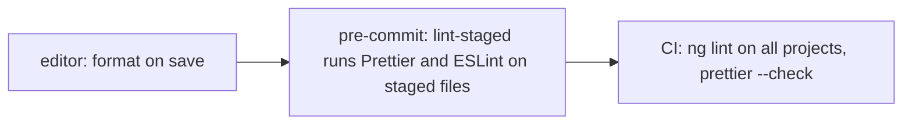

What to notice: each step runs the same tools on a wider set of files, the cheapest first.

### How it actually works

ESLint, angular-eslint and the hooks are documented only: none ran in the lab. Module 17 names angular-eslint 22.5; the packages read here are 22.6.0 (2026-10-18).

**What `ng add angular-eslint` writes.** In `@angular-eslint/schematics` 22.6.0, `dist/utils.js`, the internal `createStringifiedRootESLintConfig` returns the text of a root `eslint.config.js`. For `**/*.ts` it extends `eslint.configs.recommended`, a typescript-eslint preset and `angular.configs.tsRecommended`, sets `processor: angular.processInlineTemplates` (a **processor** hands inline templates to the HTML rules), and, with a prefix, adds `component-selector` and `directive-selector` rules. For `**/*.html` it extends `templateRecommended` and `templateAccessibility`.

**Why lint no longer asks for `OnPush`.** In `@angular-eslint/eslint-plugin` 22.6.0, `dist/rules/prefer-on-push-component-change-detection.js` describes the rule as "Ensures components do not opt out of the default `ChangeDetectionStrategy.OnPush` change detection strategy". It reports a `changeDetection` value other than `OnPush`; an explicit `OnPush` is allowed unless `allowExplicitOnPush` is false (default true). OnPush became the default in v22 ([21 §2](21-change-detection.md#2-onpush-and-eager-strategies-and-what-marks-a-view-dirty)).

**Rules worth switching on.** The plugin ships `prefer-signals`, `no-uncalled-signals`, `no-developer-preview` and `no-experimental`; `@angular-eslint/eslint-plugin-template` ships `prefer-control-flow` (read as rule files; whether a preset enables them was not read).

**Prettier.** `ng new` writes `.prettierrc`, and the CLI formats generated files with Prettier when the workspace resolves it (`@angular/cli` 22.2.1, `src/utilities/prettier.js`); `ng lint` without a `lint` target only offers angular-eslint (`commands/lint/cli.js`, `missingTargetChoices`). Prettier's `"angular"` parser is the `"html"` parser "but also formats angular-specific syntax" ([Prettier options](https://prettier.io/docs/options#parser), read 2026-10-18). `Section 9: Prettier with the workspace .prettierrc formats a template with the angular parser` runs Prettier 3.9.9 (`prettier/standalone` with the `angular`, `html`, `estree` and `typescript` plugins) inside `ng test`, with `printWidth: 100`, `singleQuote: true` and the angular parser, copied from `labs/angular/.prettierrc`; it does not read the file. It passes: a one-line `@if` block with `<a>` and four attributes prints with each attribute on its own line, indented under `@if`, and the closing `>` moves onto the content line (`>{{ u.name }}</a`, then `>`).

**Import order and hooks.** `eslint-plugin-simple-import-sort` 14.0.0 ("Easy autofixable import sorting", run by `eslint --fix`; rules `imports` and `exports`). husky 9.1.7 sets `core.hooksPath` to `.husky/_` and writes a stub per Git hook (`index.js`). lint-staged 17.6.0 passes the staged files matching each glob to a command. commitlint's guide extends `@commitlint/config-conventional` ([guide](https://commitlint.js.org/guides/getting-started), read 2026-10-18).

### Code

Approach: the schematic's shape for the root config, plus one import rule; then the staged-file runner and its hook.

1. Root config (the TypeScript block only):

```js
// Partial: shape from @angular-eslint/schematics 22.6.0 createStringifiedRootESLintConfig; HTML block omitted; not run
export default defineConfig([
  {
    files: ['**/*.ts'],
    extends: [eslint.configs.recommended, tseslint.configs.recommended, angular.configs.tsRecommended],
    processor: angular.processInlineTemplates,
    rules: { 'simple-import-sort/imports': 'error' }, // plugin registration omitted
  },
]);
```

2. `.lintstagedrc`, from the README's `"*.ts": ["eslint --fix", "prettier --write"]` pattern:

```json
// Partial: .lintstagedrc, README pattern of lint-staged 17.6.0; not run
{ "*.ts": ["eslint --fix", "prettier --write"], "*.html": "prettier --write" }
```

3. `.husky/pre-commit`, as the README shows it:

```shell
# Partial: .husky/pre-commit from the lint-staged 17.6.0 README; not run
npx lint-staged
```

### Best practices and anti-patterns

- **Let Prettier own layout and ESLint own correctness**, because two tools editing the same line loop.
- **Run staged files before a commit and everything in CI**, because lint-staged's README says a whole-project run "can be slow".
- **Turn on `no-developer-preview` and `no-experimental`**, because a preview API then fails lint, not production. Accessibility lint is one layer ([Q11.19](11-accessibility.md#q11-19)).

### Misconceptions and traps

- *"Prettier and ESLint do the same job."* One formats layout and the other checks correctness. The myth comes from ESLint's old formatting rules.
- *"`ng lint` works out of the box."* Without a `lint` target the CLI only offers to add angular-eslint. The myth comes from `lint` being a CLI command.
- *"Lint `OnPush` everywhere."* In v22 the 22.6.0 rule flags opting out of the default. The myth comes from pre-v22 advice.

Drilled in [Q38.24](#q38-24) and [Q38.25](#q38-25).

## 10. Storybook for component development

### The problem it solves

A designer wants to see the badge with no count, a count of 7 and a count of 120, and has to click through the app to find each state. The edge cases of a presentational component ([§2](#2-smart-container-and-presentational-components)) go untested, and a visual regression is found in production.

### Mental model

A **story** is one component rendered in one state, outside the app: "A story captures the rendered state of a UI component" ([Storybook, What's a story](https://storybook.js.org/docs/get-started/whats-a-story), read 2026-10-18). **Args** are the component's inputs gathered in one object ("Storybook uses the generic term arguments (args for short)", [Writing stories](https://storybook.js.org/docs/writing-stories), read 2026-10-18). A **decorator** here is Storybook's: a wrapper around the rendered story ("a mechanism to wrap a component in arbitrary markup", same page). It is not the TypeScript or Angular `@Decorator` syntax ([07 §7](07-ts-advanced-types-and-decorators.md#7-decorators-tc39-standard-versus-experimentaldecorators-and-what-angular-does-with-them)). Think of a fashion catalog: each item photographed in every color, away from the store.

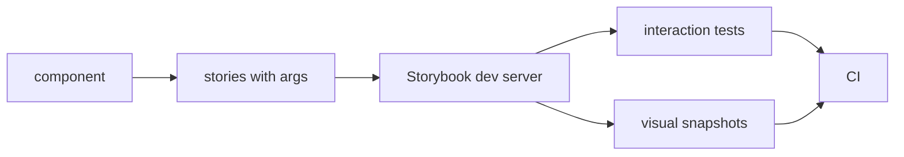

What to notice: the same story feeds the catalog and both kinds of test, so one fixture serves three readers.

### How it actually works

Storybook is documented only: nothing here was installed or run in the lab. The package read is `@storybook/angular` 10.6.2 (VERSIONS.md lists 10.6.1), read 2026-10-18.

**Why a v22 workspace pays for a webpack package.** `builders.json` declares two builders, `build-storybook` and `start-storybook`. `package.json` depends on `@storybook/builder-webpack5` and `webpack` 5, and its peers include `@angular-devkit/build-angular` [Deprecated since v22.0 — use `@angular/build`] (`>=18.0.0 < 23.0.0`) and `@angular/platform-browser-dynamic` [Deprecated since v20.0 — use `@angular/platform-browser`] (same range). Only `zone.js`, `@angular/animations` and `@angular/cli` are marked optional, so the webpack-based devkit package is a required peer. A workspace on the application builder therefore adds a deprecated package for Storybook alone; this is a cost read from the manifest, not a size measured. In `dist/builders/start-storybook/index.js` the option `experimentalZoneless` defaults to true when the Angular major is 21 or higher, so a zoneless v22 app needs no `zone.js` there.

Stories suit presentational components best, because args are all they need. An **interaction test** is a story with a `play` function that clicks and types, to "test component scenarios that otherwise require user intervention" ([Writing stories](https://storybook.js.org/docs/writing-stories), read 2026-10-18). A **visual regression test** compares screenshots of stories with stored ones; [30 §6](30-e2e-and-testing-strategy.md#6-visual-regression-and-accessibility-checks-in-end-to-end-tests) owns that topic.

### Code

Approach: one meta object for `UiBadge`, one story per state.

1. Import `Meta` and `StoryObj` from `@storybook/angular` (both exported by its `index.d.ts`).
2. Put the component and default args in `meta`; `label` is required, so every story has it.
3. Export one named story per state.

```ts
// Partial: Storybook 10.6 CSF; not installed in the labs
import type { Meta, StoryObj } from '@storybook/angular';
import { UiBadge } from './badge';

const meta: Meta<UiBadge> = { title: 'ui-lib/Badge', component: UiBadge, args: { label: 'Orders' } };
export default meta;
type Story = StoryObj<UiBadge>;

export const NoCount: Story = {};
export const WithCount: Story = { args: { count: 7 } };
export const Capped: Story = { args: { count: 120 } };
```

The shape follows the Storybook 10.6.2 docs snippet `button-story-with-args` (`Button.stories.ts`, CSF 3 tab; fetched 2026-10-18); the `args`, `UiBadge` and story names are ours. The snippet was not type-checked, and the "99+" cap in `Capped` comes from `formatCount`, not from Storybook.

### Best practices and anti-patterns

- **Write stories for presentational components, not containers**, because a container needs the store and router that a story would have to fake.
- **Name one story per state the design lists**, because the story list then reads as the component's contract.
- **Keep stories next to the component**, because a moved component then takes its fixtures along.

### Misconceptions and traps

- *"Storybook runs on the Angular application builder."* 10.6.2 builds with webpack 5 and requires `@angular-devkit/build-angular`. The myth comes from running inside the Angular CLI.
- *"Stories are documentation only."* They are also fixtures for interaction and visual tests. The myth comes from their origin as a catalog.
- *"Storybook replaces component tests."* Stories check how a component looks and behaves in isolation; component tests ([29 §1](29-testing-angular.md#1-what-to-test-where-unit-integration-component-and-end-to-end-tests-the-pyramid-and-the-trophy)) assert behavior in CI without a browser UI. The myth comes from both rendering the component.

Drilled in [Q38.26](#q38-26).

## 11. A CI pipeline for a front end: lint, test, build, end-to-end and deploy previews

### The problem it solves

The pipeline runs the end-to-end suite first, so a missing semicolon costs 25 minutes before anyone sees it. The budget check runs only on release, so a doubled bundle is found a week late. Previews are built by hand, so reviewers read screenshots.

### Mental model

**Continuous integration (CI)** is a server that runs the same checks on every change. Each check is a **pipeline stage**, and a **gate** is the rule that a later stage starts only if the earlier one passed. Order the stages **cheapest and most likely to fail first**. Think of an airport: nobody reaches the gate without a boarding pass.

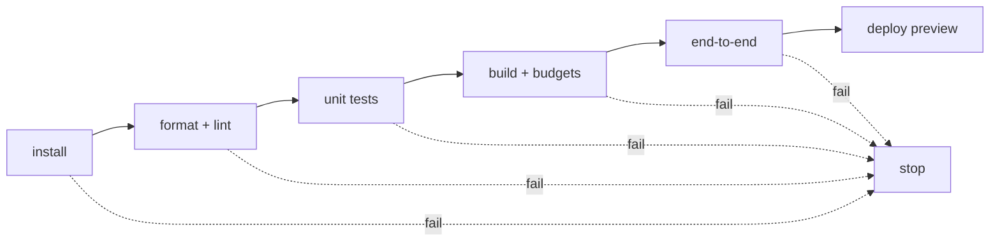

What to notice: every stage has a fail exit, and the slowest sit last.

### How it actually works

The **install** stage runs `npm ci` (lockfile rules: [33 §11](33-security.md#11-dependency-and-supply-chain-security-lockfiles-npm-audit-install-scripts-and-subresource-integrity)). A **cache key** is the label a saved folder is stored under; the same key restores them instead of fetching again. Builds that produce files for a later stage hand them over as an **artifact**, a named file set stored by the CI service. A **deploy preview** is a build of the change published at its own address for review (deploys belong to [44](44-fullstack-delivery-and-operations.md#7-cicd-for-both-layers-one-image-promoted-through-stages-a-monorepo-or-separate-repositories-and-versioning-the-contract)).

| Stage | Catches | Misses |
| --- | --- | --- |
| Format check and lint | layout drift, rule violations ([§9](#9-linting-and-formatting-angular-eslint-prettier-import-ordering-and-commit-hooks)) | wrong behavior |
| Unit tests | logic and template bindings; the v22 runner is Vitest with jsdom ([29 §2](29-testing-angular.md#2-the-runner-vitest-through-angularbuildunit-test-jsdom-and-browser-mode)) | real-browser layout |
| Build with budgets | compile errors; a budget over its error threshold ([12 §3](12-angular-how-it-works.md#3-building-the-application-builder-output-layout-and-budgets), [Q31.05](31-performance.md#q31-05)) | runtime failures |
| End-to-end | wiring of the deployed app ([30 §8](30-e2e-and-testing-strategy.md#8-ci-strategy-for-end-to-end-tests-workers-sharding-retries-policy-and-test-data)) | exhaustive logic cases |
| Preview | a human's judgment of the real build | anything nobody opens |

**Why `ng test` and `ng lint` cover every project but `ng build` needs a name.** Read, not run, in `@angular/cli` 22.2.1, `src/command-builder/architect-command-module.js`, method `getProjectNamesByTarget` (internal name). If the command's `multiTarget` flag is true, it returns "all projects that have the target"; `commands/test/cli.js`, `lint/cli.js` and `e2e/cli.js` set it true, `build`, `serve`, `deploy` and `extract-i18n` set it false. A false flag with several candidate projects falls back to the internal `getProjectByCwd` in `src/utilities/config.js`, which picks the project whose `root` contains the working directory, and only if none does throws "Cannot determine project for command."

In this workspace of eight projects, `npx ng build` at the workspace root resolves to `labs`: the internal `findProjectByPath` (`src/utilities/config.js`) keeps the projects whose `root` contains the working directory, and only `labs` has the workspace root as `root` (read, not run). That is also why the generated `test` target of `ui-lib` was removed: `ng test` would have run it. The lab's standard checks run `npx ng build ui-lib` first, because `tsconfig.json` maps `ui-lib` to `./dist/ui-lib` and the spec compile and `ng test` need it ([Q12.04](12-angular-how-it-works.md#q12-04)). Backend counterpart: [delivery path](../../Architect-Level%20Production%20%26%20Architect.md#q29--the-delivery-path-what-the-pipeline-contains-and-what-one-commits-journey-looks-like). In a monorepo, affected-only runs shrink every stage ([§7](#7-nx-monorepos-the-project-graph-tags-nxenforce-module-boundaries-affected-commands-and-caching)).

### Code

Approach: one job per gate, ordered with `needs`, using the lab's command order.

1. Check out, install Node 24 with npm caching, run `npm ci`.
2. Format and lint, then unit tests with `--watch=false`.
3. Build the library, then the app; the budgets fail the build.
4. Run end-to-end only after the build job passes.

```yaml
# Partial: illustrative; not run, no CI file exists in the repository
name: ci
on: pull_request
jobs:
  check:
    runs-on: ubuntu-latest
    defaults: { run: { working-directory: labs/angular } }
    steps:
      - uses: actions/checkout@v7
      - uses: actions/setup-node@v7
        with: { node-version: 24, cache: npm, cache-dependency-path: labs/angular/package-lock.json }
      - run: npm ci
      - run: npx prettier --check .
      - run: npx ng lint            # needs a lint target (section 9)
      - run: npx ng build ui-lib
      - run: npx ng test --watch=false
      - run: npx ng build
  e2e:
    needs: check
    runs-on: ubuntu-latest
    steps:
      - run: echo "install, build and run the end-to-end suite here"
```

Majors are the newest major tag each repository lists, read 2026-10-18: `actions/checkout`, `actions/setup-node` and `actions/upload-artifact` are at `v7`. The `setup-node` README documents `cache-dependency-path` for a lockfile outside the repository root, as here. Prettier's docs say `--check` exits with code 1 for unformatted files.

### Best practices and anti-patterns

- **Put independent cheap checks in the first stage, and order dependent stages**, because a stage that needs the build cannot start before it.
- **Run `ng test` without watch mode in CI**, because a watching runner never exits.
- **Leave retry policy to the e2e owners** ([Q30.17](30-e2e-and-testing-strategy.md#q30-17)), because retrying until green hides flaky tests.

### Misconceptions and traps

- *"Run everything in parallel and fail fast."* Cheap independent checks can share a stage, but a build-dependent stage must wait, so order still matters. The myth comes from parallel looking faster.
- *"Unit tests in CI need a browser."* The v22 default runs Vitest with jsdom. The myth comes from Karma.
- *"Retry e2e failures until green."* Retries hide flakiness; the retry policy is owned by section 8 of module 30. The myth comes from suites that are already flaky.

Drilled in [Q38.27](#q38-27); practised in [Exercise 38.4](#ex38-4).

## 12. A complete production folder tree, folder by folder

### The problem it solves

"Show me how you would structure a real app" is a standard architect question. Folder names alone fail it: the follow-up is "why is the interceptor there and not in the feature?"

### Mental model

The **sample tree** is the lab's `sample-app/` folder, the smallest tree with every folder kind. Read it as a building plan where every room is labeled with who may use it. The **layout shell** is the component that draws the frame around every feature (`app-shell.ts`).

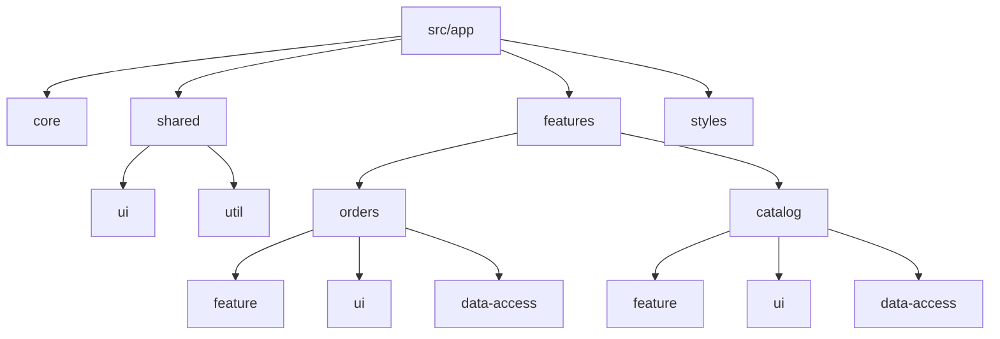

What to notice: both features repeat the same three folders; these arrows show containment, while [§1](#1-folder-structures-that-scale-by-feature-domain-slices-and-core-shared-and-feature-boundaries)'s show imports.

### How it actually works

| Folder | Contents | Imported by | Reason |
|---|---|---|---|
| `src/app/` | `app.ts`, `app.config.ts`, `app.routes.ts` | `main.ts` | what `@schematics/angular` 22.2.1 generates |
| `core/` | interceptors, error handler, `provide*` function | the application config | registered once ([§1](#1-folder-structures-that-scale-by-feature-domain-slices-and-core-shared-and-feature-boundaries)) |
| `shared/{ui,util}/` | primitives, pure functions | everyone | no domain imports ([§4](#4-layers-library-types-and-dependency-rules)) |
| `features/<name>/` | `routes.ts`, one lazy route | the app routes | [24 §4](24-routing.md#4-lazy-loading-in-depth-loaders-canmatch-and-route-injectors) |
| `…/feature/`, `…/ui/` | containers, presentational components | `routes.ts`, `feature/` | [§2](#2-smart-container-and-presentational-components) |
| `…/data-access/` | API port, store, facade | `feature/` | store behind the facade ([§3](#3-facades-and-the-data-access-layer), [28 §2](28-state-management.md#2-the-service-with-signals-store-state-shape-derived-selectors-methods-and-async-loads)) |
| `…/util/` | feature helpers | the feature's folders | §4; the sample needs none |
| `styles/` | global styles, **design tokens** (design decisions stored once as custom properties, [10 §6](10-css-essentials.md#6-custom-properties-theming-and-color-scheme)) | `angular.json` | component styles stay local ([13 §8](13-components-and-templates.md#8-styling-strategies-component-styles-global-styles-css-variables-and-tailwind)) |
| `public/` | static files | none | the generated `assets` input |
| `src/locale/` | translation files | i18n options | [34 §6](34-i18n.md#6-extraction-and-translation-files-ng-extract-i18n-formats-and-message-ids) |
| beside the code | `*.spec.ts` | none | the style guide |
| e2e project | end-to-end tests | none | [30 §1](30-e2e-and-testing-strategy.md#1-what-belongs-at-the-end-to-end-level-journeys-cost-and-a-strategy-across-levels) |
| `projects/ui-lib/` | design-system library | apps, by name | [§5](#5-angular-cli-libraries-ng-generate-library-ng-packagr-and-consuming-the-build), [36 §12](36-material-and-cdk.md#12-a-design-system-on-the-cdk-and-angular-aria-or-a-wrapper-around-material) |

The style guide (angular.dev/style-guide, read 2026-10-18): "Unit tests should live in the same directory as the code-under-test." `Section 12: every folder in the sample tree is one of the documented kinds` fails on any of the 14 sample folders without a row.

**Why core goes in the application config once.** Read from `@angular/router` 22.2.1, `getOrCreateRouteInjectorIfNeeded` (internal): a route with `providers` gets `createEnvironmentInjector(route.providers, currentInjector, …)`, a child of the injector above. A lookup that misses there climbs to the root, so one registration serves every feature. `Section 12: core providers are registered once in the application config` gets the same `LabM38ErrorHandler` from the root and from the lazy orders feature, and the feature's request carries the interceptor's header once. The handler is [37 §8](37-elements-pwa-errors-ecosystem.md#8-errorhandler-and-global-listeners-what-reaches-the-handler-and-what-does-not)'s; interceptors are [27 §4](27-http-client.md#4-interceptors-the-functional-chain-order-and-next-and-class-interceptors-through-withinterceptorsfromdi)'s.

**Growth.** A feature folder becomes a library when a second app or a team boundary appears ([§7](#7-nx-monorepos-the-project-graph-tags-nxenforce-module-boundaries-affected-commands-and-caching)). Drilled in [Q38.28](#q38-28); [Exercise 38.3](#ex38-3) checks such a tree.

### Code

Approach: one `provide*` function in `core/`, merged into the config.

1. Write the interceptor and error handler in `core/`.
2. Group them in `provideSampleCore()`.
3. Merge with `mergeApplicationConfig`, which concatenates `providers` (read from `@angular/core` 22.2.1).

```ts
// Excerpt of labs/angular/src/app/modules/38-architecture-and-production-structure/sample-app/core/core-providers.ts
export function provideSampleCore(): EnvironmentProviders {
  return makeEnvironmentProviders([
    provideHttpClient(withInterceptors([clientHeaderInterceptor])),
    { provide: ErrorHandler, useClass: LabM38ErrorHandler },
  ]);
}
```

`Section 12: the sample app renders the shell and both lazy features` reads the shell line, each heading, and the catalog rows.

### Best practices and anti-patterns

- **Give every folder a one-line reason**, because the interviewer asks about the one you cannot explain.
- **Keep DTOs private to data-access** (`OrderDto` is not exported), because a server change then touches one file.
- **Avoid re-registering core providers in a feature route**, because its child injector creates a second instance.

### Misconceptions and traps

- *"There is one correct folder structure."* The style guide fixes principles, not names; the tree follows from §4's rules. The myth exists because blog posts present their tree as the standard.
- *"Put all models in `models/`."* That is a folder by type: DTOs belong to data-access, row shapes to their component (`ProductRow` in `ui/`). The myth comes from backend domain-model packages.
- *"End-to-end tests go next to components."* The style guide's sentence covers unit tests; end-to-end tests drive the deployed app from their own project. The myth comes from reading "tests next to code" as all tests.

## 13. Under the hood: ng-packagr's build graph and how Nx computes affected projects and task hashes

### The problem it solves

"Why did my new secondary entry point fail with a cycle error?", "why did CI rebuild a library nobody touched?" and "why did the cache replay a build with last week's API address?" Each answer is an algorithm inside the tool.

### Mental model

ng-packagr keeps a **build graph** (the internal `BuildGraph`): a map of nodes keyed by URL, where each entry point is an `ng://` node and an edge means "imports". It builds entry points in **topological order**, an order in which every node comes after everything it depends on. A **dependency cycle** (A needs B, B needs A) has no such order. Nx gives each task a **task hash**, a digest of everything the task reads, and uses it as the task's **cache key** ([§11](#11-a-ci-pipeline-for-a-front-end-lint-test-build-end-to-end-and-deploy-previews)'s term). Think of a print shop that queues a cover after the pages it wraps, and a cloakroom ticket: the same ticket returns the same coat, even if someone swapped the coat's contents.

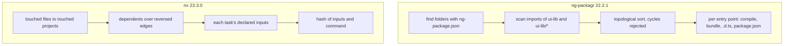

What to notice: both lanes walk a graph before any work; ng-packagr draws its edges from import specifiers, Nx from its project graph.

### How it actually works

Read, not run, in `ng-packagr` 22.2.1 and `nx` 23.3.0 (VERSIONS.md lists `nx` 23.2.1), read 2026-10-18. Every function named is internal.

**Edges come from import specifiers.** After `findSecondaryPackagesPaths` finds the entry points ([§6](#6-public-api-surfaces-public-apits-exports-secondary-entry-points-and-versioning)), `analyseEntryPoint` (`analyse-sources.transform.js`) reads each source file with TypeScript's `preProcessFile` and keeps every non-relative import equal to the primary name or starting with it plus `/`. Relative imports are followed as files, never as edges. A direct pair is caught here, before any sort: `Entry point <name> has a circular dependency on <id>.`

**Order.** `scheduleEntryPoints` (`package.transform.js`) puts every entry point into `new DepGraph({ circular: false })`, whose `overallOrder()` throws on any longer cycle ([§4](#4-layers-library-types-and-dependency-rules) quotes the message). It then counts each pending entry point's unbuilt dependencies and starts those at zero, several at once, so independent entry points build in parallel, not in folder order. Each entry point runs `entryPointTransformFactory`: compile, `writeBundles` (rolldown with `rolldown-plugin-dts`), `writePackage`, then it is marked done.

**In the lab** (2026-10-18), `Section 13: the library's entry points are built dependencies first` finds the graph `{ 'ui-lib': [], 'ui-lib/testing': [] }` (Exercise 38.2's entry points left out): `testing` imports nothing from the root, so no order is forced. Our sort (`concepts/toposort.ts`, mirroring the count above; it is not ng-packagr) puts `ui-lib` first once `testing` imports it, and `Section 13: a cycle between two entry points is reported by our topological sort` throws "Dependency cycle among: ui-lib/a, ui-lib/b".

**Affected, then the hash.** [§7](#7-nx-monorepos-the-project-graph-tags-nxenforce-module-boundaries-affected-commands-and-caching) covered the reversed walk. For each remaining task, `task-hasher.js` takes the target's `inputs`, or `DEFAULT_INPUTS`: the project's `default` named input (`{projectRoot}/**/*`) plus the same input of every dependency. `createHashDetails` hashes that value with `hashCommand`: project, target, configuration and the sorted overrides. Besides `fileset`, an input can be `env` ("The name of the env var which value is added to the hash", `schemas/nx-schema.json`), `runtime` or `externalDependencies`.

**The stale-cache bug.** A build that reads `process.env.API_URL` or a root `tsconfig.base.json`, while its inputs name neither, hashes the same after either changes, so the cache replays the old output. A correct key holds every input that can change the output.

### Code

Approach: Kahn's sort over §7's graph shape.

1. Count each node's dependencies.
2. Emit the nodes at zero; each emission lowers its dependents' counts.
3. Nodes left over sit on a cycle.

```ts
// Excerpt of labs/ts-js/src/modules/38-architecture-and-production-structure/concepts/toposort.ts
  for (let name = ready.shift(); name !== undefined; name = ready.shift()) {
    order.push(name);
    pending.delete(name);
    for (const dependent of dependents[name] ?? []) {
      const count = (pending.get(dependent) ?? 0) - 1;
      pending.set(dependent, count);
      if (count === 0) ready.push(dependent);
    }
  }
  if (pending.size > 0) throw new Error(`Dependency cycle among: ${[...pending.keys()].join(', ')}`);
```

Drilled in [Q38.29](#q38-29); practised in [Exercise 38.4](#ex38-4).

### Best practices and anti-patterns

- **Import another entry point by its package name** (`ui-lib`), because a relative import never becomes an edge the sort can see.
- **Break an entry-point cycle with a third entry point both import**, because `DepGraph` is created with `circular: false`.
- **Declare an `env` input for every variable a build reads**, because the default input sees only files under the project root.

### Misconceptions and traps

- *"ng-packagr builds entry points in folder order."* It sorts by imports, rejects cycles and runs independent ones in parallel. The myth comes from the alphabetical output folders.
- *"The Nx cache keys on the git commit."* It hashes the declared inputs and the command, so an undeclared input gives a stale hit. The myth comes from CI caches that do key on commits.
- *"Affected uses the files in the last commit."* It diffs `--base` against `--head`, or, with no head, against `HEAD` plus uncommitted and untracked files (§7). The myth comes from local habits.

## Summary

A feature folder holds everything one user task needs, `core/` is app-wide setup, and `shared/` has no feature knowledge, so a feature never imports another feature ([§1](#1-folder-structures-that-scale-by-feature-domain-slices-and-core-shared-and-feature-boundaries)). A container knows the data source and a presentational component only takes inputs and emits outputs, which keeps OnPush and tests simple ([§2](#2-smart-container-and-presentational-components)). A facade gives components an intent-shaped, read-only API over a store and a data-access service, and it is a swap point, not a store wrapper ([§3](#3-facades-and-the-data-access-layer)). Library types and scope tags turn folders into a direction of dependency, and a cycle is a design error, not only a build error ([§4](#4-layers-library-types-and-dependency-rules)).

A CLI library is built by ng-packagr, and an app consumes the build output through `paths`, not the source ([§5](#5-angular-cli-libraries-ng-generate-library-ng-packagr-and-consuming-the-build)). Its public API is what `public-api.ts` exports and the generated `exports` map allows, so `export *` and deep imports are the traps ([§6](#6-public-api-surfaces-public-apits-exports-secondary-entry-points-and-versioning)). Nx adds a project graph, tags and `@nx/enforce-module-boundaries`, runs only affected projects (changed ones plus their dependents) and replays cached results by task hash; a CLI workspace is a monorepo too ([§7](#7-nx-monorepos-the-project-graph-tags-nxenforce-module-boundaries-affected-commands-and-caching)). Micro-frontends split deployment, not a tangled graph, and cost versions, shared state and operations, so cheaper options come first ([§8](#8-micro-frontends-module-federation-native-federation-and-when-they-are-justified)).

Prettier formats and ESLint checks, staged files run before a commit and everything in CI, and `ng lint` needs a `lint` target ([§9](#9-linting-and-formatting-angular-eslint-prettier-import-ordering-and-commit-hooks)). A story is an isolated state of a component, and Storybook 10.6.2 builds with webpack ([§10](#10-storybook-for-component-development)). A pipeline orders cheap checks before the build, the build before end-to-end tests, and gates with budgets before a deploy preview ([§11](#11-a-ci-pipeline-for-a-front-end-lint-test-build-end-to-end-and-deploy-previews)). A production tree follows from those rules, and there is no single correct tree ([§12](#12-a-complete-production-folder-tree-folder-by-folder)). Underneath, ng-packagr sorts entry points by their imports and rejects cycles, and Nx hashes the declared inputs and the command, so an undeclared input yields a stale cache hit ([§13](#13-under-the-hood-ng-packagrs-build-graph-and-how-nx-computes-affected-projects-and-task-hashes)).

## Question bank

Each answer has five parts. Each Output answer names the run asserted in `labs/angular/src/app/modules/38-architecture-and-production-structure/outputs/q38-outputs.spec.ts` (`ng test`, jsdom) or `labs/ts-js/src/modules/38-architecture-and-production-structure/outputs/q38-outputs.test.ts` (Vitest); shown snippets are the code those tests run.

<a id="q38-01"></a>
### Q38.01 · Concept · What does architecture mean for an Angular front end, and which decisions does it fix: structure, dependency direction and the unit of deployment?

<details>
<summary>Answer</summary>

**Short answer (30 seconds).** Architecture is the set of decisions that are expensive to change later. For a front end they are three: **structure** (where code lives), **dependency direction** (which code may import which) and the **unit of deployment** (what is built, shipped and loaded together). A component's template is not one of them.

**Full explanation.** Structure is the folder rule of [§1](#1-folder-structures-that-scale-by-feature-domain-slices-and-core-shared-and-feature-boundaries): features first, with `core/` and `shared/` beside them. Direction is the one-way rule of [§4](#4-layers-library-types-and-dependency-rules): `feature` may import `ui`, `data-access` and `util`, never the reverse. The unit of deployment is one application with lazy routes, a library ([§5](#5-angular-cli-libraries-ng-generate-library-ng-packagr-and-consuming-the-build)) or separately deployed micro-frontends ([§8](#8-micro-frontends-module-federation-native-federation-and-when-they-are-justified)). A decision counts only while something enforces it. Choosing a framework or libraries is a decision of the same kind ([Q12.02](12-angular-how-it-works.md#q12-02)).

**Follow-ups an interviewer will ask.**
- *How do you know it holds?* A check fails, not a review: `Section 1: no file in one feature folder imports from another feature folder` reads the imports.
- *When do you change the unit of deployment?* When teams must release independently; until then lazy routes are cheaper.

**Trap to avoid.** Calling a diagram "the architecture". Without enforcement the tree drifts.

</details>

<a id="q38-02"></a>
### Q38.02 · Difference · Folders by type (`components/`, `services/`) versus folders by feature: what does each optimize for, and what does the Angular style guide recommend?

<details>
<summary>Answer</summary>

**Short answer (30 seconds).** Folders by type optimize for finding a kind of file: every service is in one place. Folders by feature optimize for changing or deleting a feature: its components, services and tests sit together. The style guide recommends features: "Organize your project by feature areas" and "Avoid creating subdirectories based on the type of code that lives in those directories."

**Full explanation.** By type is easy while the app is small. At 200 files per folder a change to orders touches several folders, and deleting a feature leaves orphans. By feature, a change or deletion stays in one folder. The quotes were read on angular.dev/style-guide on 2026-10-18; it adds "Unit tests should live in the same directory as the code-under-test." Inside a feature, folders by role are fine. Standalone components removed the `SharedModule` ([15 §5](15-standalone-and-ngmodules.md#5-legacy-ngmodule-patterns-declarations-exports-forrootforchild-sharedmodule-and-coremodule)); `Section 1: each feature folder is reached only through its lazy route` loads each feature of the lab's tree from its own route file.

**Follow-ups an interviewer will ask.**
- *Where do shared pieces go?* In `shared/` if they have no feature knowledge, else in their feature.
- *Is by-type ever right?* Inside a feature.

**Trap to avoid.** A `shared/` full of feature code. It recreates the by-type problem under a new name.

</details>

<a id="q38-03"></a>
### Q38.03 · Bug hunt · A `shared/` folder that imports from `features/orders`, a `core/` folder full of UI components, and a feature that reaches into another feature's internals: what goes wrong in each?

<details>
<summary>Answer</summary>

**Short answer (30 seconds).** `shared/` importing `features/orders` makes every consumer of `shared/` depend on orders, and the folder stops being shared. A `core/` of UI components has no owner and becomes a dump. A feature importing another feature's internals ties the two together, so neither can change or be deleted alone. Each is a dependency pointing the wrong way.

**Full explanation.** `shared/` sits at the bottom of the arrows in [§1](#1-folder-structures-that-scale-by-feature-domain-slices-and-core-shared-and-feature-boundaries): one orders import there makes catalog depend on orders. `core/` holds app-wide singletons and setup; a widget there has no owner. A cross-feature import such as `../../orders/data-access/orders-store` skips the route file, so it survives a rename until it breaks. The NgModule-era versions are in [Q15.14](15-standalone-and-ngmodules.md#q15-14). The fixes: move orders code out of `shared/`, the UI to `shared/ui` or its feature, and use a facade between features. Then add the rule ([§4](#4-layers-library-types-and-dependency-rules)): `Section 1: no file in one feature folder imports from another feature folder` fails on the first crossing.

**Follow-ups an interviewer will ask.**
- *Is importing only a type a violation?* Yes; give `shared/ui` its own row shape.
- *How do two features talk?* Through a facade or the router, never through files.

**Trap to avoid.** Fixing it by moving the file to `shared/`, which then holds feature knowledge.

</details>

<a id="q38-04"></a>
### Q38.04 · Concept · What makes a component presentational, what makes it a container, and why does the split make the v22 OnPush default and testing simpler?

<details>
<summary>Answer</summary>

**Short answer (30 seconds).** A presentational component gets data through signal inputs, sends intent through outputs and injects no data services. A container injects the facade, passes its signals down and turns outputs into facade calls. The split helps because a component that only reads inputs depends only on their references under OnPush, and it needs no providers in a test.

**Full explanation.** A component without `changeDetection` is OnPush in v22 [Changed in v22.0: components without `changeDetection` are OnPush]. Its template is checked when an input changes by reference, an event fires in it, or a signal it reads changes ([21 §2](21-change-detection.md#2-onpush-and-eager-strategies-and-what-marks-a-view-dirty)). A list fed new arrays by its container fits that rule. In a test it needs only `setInput` and an output subscription: `Section 2: the presentational list renders only from its inputs and has no injected services` uses an empty `providers` list.

**Follow-ups an interviewer will ask.**
- *Why does lint no longer ask for OnPush?* It flags opting out. The `@angular-eslint` 22.6.0 rule `prefer-on-push-component-change-detection` "Ensures components do not opt out of the default `ChangeDetectionStrategy.OnPush` change detection strategy" and leaves a component with no property alone (`dist/rules/prefer-on-push-component-change-detection.js`, read 2026-10-18; documented, not run).
- *Can it inject anything?* A helper such as `ElementRef`, not data access.

**Trap to avoid.** Calling a component presentational because it is small. What counts is that it does not know where data comes from.

</details>

<a id="q38-05"></a>
### Q38.05 · Output · A presentational list receives a new array from its container, then the container mutates that array in place: what does the list render after each step under the v22 default?

```ts
// Partial: the container and its three steps from the test.
@Component({
  selector: 'lab-m38-q05-container',
  imports: [LabM38OrderList],
  template: `<lab-m38-order-list [orders]="orders()" />`,
})
class Container {
  readonly orders = signal<OrderRow[]>([{ id: 1, customer: 'Ada' }]);
}
// 1: orders.set([Ada, Grace])  2: orders().push(Linus)  3: orders.update((list) => [...list])
```

<details>
<summary>Answer</summary>

**Short answer (30 seconds).** After step 1 the list shows `Ada`, `Grace`. After step 2 it still shows `Ada`, `Grace`: Linus is in the array but not on screen. After step 3 it shows `Ada`, `Grace`, `Linus`. Under the OnPush default an input marks the view for checking only when its reference changes, and `push` changes the contents of the same array.

**Full explanation.** Step 1 passes a new reference. Step 2 changes the array the signal holds: no `set`, so no notification, and the input's `Object.is` check sees the same reference. Step 3 builds a copy, so every row appears. The run is `Q38.05: a presentational list shows a new array, then keeps the old rows after an in-place push until a new array arrives` in `labs/angular/src/app/modules/38-architecture-and-production-structure/outputs/q38-outputs.spec.ts` (`ng test`, jsdom, passed); it asserts `['Ada']`, `['Ada','Grace']`, `['Ada','Grace']`, `['Ada','Grace','Linus']`. The rule is in [21 §2](21-change-detection.md#2-onpush-and-eager-strategies-and-what-marks-a-view-dirty).

**Code.** The fix is to write immutably:

```ts
// Partial: step 2 written immutably, inside the container
this.orders.update((list) => [...list, { id: 3, customer: 'Linus' }]);
```

**Follow-ups an interviewer will ask.**
- *Would a click inside the list fix it?* It marks the view dirty, so the rows then show; the bug hides until a click.
- *Does `fixture.detectChanges()` force it?* No: the test calls it after the `push` and the rows stay old.

**Trap to avoid.** Mutating in a container and trusting the screen: the same object asks for no check.

</details>

<a id="q38-06"></a>
### Q38.06 · Trade-off · Split every screen into containers and presentational components, or split only where reuse appears: when is the split overhead?

<details>
<summary>Answer</summary>

**Short answer (30 seconds).** Split where a piece is reused, has its own tests, or sits under a screen that reads several sources. Skip the split for a leaf used once under one container: it adds a file, an input and an output and buys nothing. Default to one container per route and extract when a second use asks.

**Full explanation.** The split pays in three cases ([§2](#2-smart-container-and-presentational-components)): the piece appears twice (the dashboard reuses the order table), its test then needs no providers, or its data comes from several places the container combines. It costs a second file, an input and output per value, and a hop when reading. A one-use leaf pays that with no return. Splitting everything up front also guesses the reuse boundary early, and a wrong guess costs more than extracting when the second consumer arrives. The rule that stays: one owner talks to the facade.

**Follow-ups an interviewer will ask.**
- *Where does shared container code go?* In a function or service the containers compose, not a base class ([Q20.18](20-lifecycle-and-render-hooks.md#q20-18) prefers composition).
- *What signals that a split is due?* A second screen needs the same view, or a test needs providers only to render it; the list test in [§2](#2-smart-container-and-presentational-components) needs none.

**Trap to avoid.** Splitting by a rule ("every template gets a container"), which produces pass-through containers.

</details>

<a id="q38-07"></a>
### Q38.07 · Design · Design a facade for an orders feature over a signal store and an HTTP data-access service: what does it expose, and what does it hide?

<details>
<summary>Answer</summary>

**Short answer (30 seconds).** Expose read-only signals (`orders`, `loading`, `error`, `selectedId`) and intent methods (`load()`, `select(id)`). Hide the store's writers, the API port and its HTTP adapter, the DTO mapping, and the stream that runs each load. A container then depends on one class it can fake.

**Full explanation.** The lab's facade ([§3](#3-facades-and-the-data-access-layer)) injects `OrdersStore` and `ORDERS_API` and hands out the store's read-only signals, so nothing outside can write them. `load()` marks the store as loading and pushes into a `Subject`; a `switchMap` runs the API call, so a newer load replaces one still in flight. A failure is caught inside the `switchMap` and written with `setError`, so the stream survives. The page injects the narrower `OrdersFacadePort`.

```ts
// Excerpt of labs/angular/src/app/modules/38-architecture-and-production-structure/sample-app/features/orders/data-access/orders-facade.ts
export abstract class OrdersFacadePort {
  abstract readonly orders: Signal<readonly Order[]>;
  abstract select(id: number): void;
}
```

**Follow-ups an interviewer will ask.**
- *Where does caching go?* Behind the facade, in the store or the adapter.
- *How is the store designed?* As a service with signals: [Q28.04](28-state-management.md#q28-04).
- *Is it the DI chapter's facade?* Yes, one class in front of several services ([16 §9](16-dependency-injection.md#9-di-patterns-testing-and-the-spring-container)), here with read-only signals.

**Trap to avoid.** A pass-through facade that forwards every store method one to one, or hands out the store itself: it hides nothing and renames the problem.

</details>

<a id="q38-08"></a>
### Q38.08 · Difference · Coming from the backend: a hexagonal (ports and adapters) or layered Spring service versus a front-end feature split into ui, feature, data-access and util: what maps, and where does the analogy break?

<details>
<summary>Answer</summary>

**Short answer (30 seconds).** The facade maps to the application service, the `ORDERS_API` token to a port, `HttpOrdersApi` to an adapter in the repository's place, and the one-way arrows to the layer rule. It breaks in four places: the client holds cached server state that outlives a request, `ui` has no backend twin, nothing in the build stops a wrong import, and lifetimes differ.

**Full explanation.** What maps: the adapter converts a DTO to a view model and an HTTP failure to `OrdersError`, as a repository converts rows to entities; `feature` plays the controller. Where it breaks. First, the front end's "domain" is mostly server state kept for display ([28 §1](28-state-management.md#1-kinds-of-state-server-cache-ui-form-url-and-session-state-and-where-each-belongs)), so the facade has no business invariants to protect and pushes changes through signals. Second, `ui` has no layer in a Spring service. Third, Maven modules stop a controller importing a driver; an Angular component can import `HttpClient` freely, so lint enforces the direction ([§4](#4-layers-library-types-and-dependency-rules)). Fourth, lifetimes: the facade lives with its route injector, and the two containers differ ([Q16.35](16-dependency-injection.md#q16-35)).

**Follow-ups an interviewer will ask.**
- *Is the facade a port?* No: the port is `ORDERS_API`, what the facade needs; the facade is what components need.
- *Where does a use case with real business rules go?* In the facade, or in a pure function in a util library that the facade calls, so the rule tests without Angular.

**Trap to avoid.** Copying a hexagon onto the front end for what is a cache and a few screens.

</details>

<a id="q38-09"></a>
### Q38.09 · Output · A container injects the facade, and the test replaces the data-access service with a fake through a provider override that fails the second call: which calls reach the fake, and what does the container render after each?

```ts
// Partial: the fake and the override from the test.
const fake: OrdersApi = {
  list() {
    calls.push(calls.length + 1);
    return calls.length === 1
      ? of([{ id: 1, customer: 'Ada' }, { id: 2, customer: 'Grace' }])
      : throwError(() => ({ kind: 'server', status: 503 }));
  },
};
providers: [...provideOrdersDataAccess(), { provide: ORDERS_API, useValue: fake }],
```

<details>
<summary>Answer</summary>

**Short answer (30 seconds).** Each `load()` reaches the fake once, so two calls reach it in two loads. After the first the container lists `Ada` and `Grace` and shows no error. After the second it still lists `Ada` and `Grace` and also shows `Orders failed: server`. The failed refresh sets the error and leaves the orders alone.

**Full explanation.** Before the first `load()` nothing reaches the fake and no rows render. The later `ORDERS_API` provider wins over the one `provideOrdersDataAccess()` listed, so `HttpOrdersApi` is never created. Call 1 stores two orders. Call 2 errors; the facade catches it inside its `switchMap` and calls `setError`, which sets `error` and `loading` and leaves `orders`. The fake throws an `OrdersError` itself, since the port promises that type; the adapter's mapping is bypassed. The run is `Q38.09: the second load reaches the fake and fails; the container shows the error and still lists the first orders` in `labs/angular/src/app/modules/38-architecture-and-production-structure/outputs/q38-outputs.spec.ts` (`ng test`, jsdom, passed): `calls` `[]`, `[1]`, `[1, 2]`, rows unchanged, alert `Orders failed: server`.

**Follow-ups an interviewer will ask.**
- *Is a third `load()` possible after the failure?* Yes: the catch sits inside the `switchMap`, so the stream lives ([§3](#3-facades-and-the-data-access-layer)).
- *Why does the adapter not throw to the container?* The facade turns the failure into state once, so every view reads one error signal instead of each handling its own exception.

**Trap to avoid.** Expecting a blank list after the failure: the facade keeps the last good orders.

</details>

<a id="q38-10"></a>
### Q38.10 · Concept · What are library types (feature, ui, data-access, util) and scope tags, and which dependency rules follow from them?

<details>
<summary>Answer</summary>

**Short answer (30 seconds).** A library type says what code does: `feature` (screens), `ui` (presentational pieces), `data-access` (HTTP, store, mapping) and `util` (pure code). A scope tag says who owns it, such as `orders` or `shared`. The rules: `feature` may use `ui`, `data-access` and `util`; `ui` only `ui` and `util`; `data-access` only itself and `util`; `util` only `util`; a scope imports itself and `shared`.

**Full explanation.** Every library has a type and a scope, and a rule is a sentence over both ([§4](#4-layers-library-types-and-dependency-rules)). Arrows run toward `util`, which imports nothing above it. The type rule keeps rendering free of data access and pure code free of components; the scope rule keeps `catalog` out of `orders`. In Nx the labels are `tags` such as `type:ui`, and each rule is a `depConstraints` entry with `sourceTag` and `onlyDependOnLibsWithTags` (`@nx/eslint-plugin` 23.3.0, read, not run, [§7](#7-nx-monorepos-the-project-graph-tags-nxenforce-module-boundaries-affected-commands-and-caching)). `Section 4: the rule table rejects ui to data-access and util to ui` checks the table in the lab; it does not scan files.

**Follow-ups an interviewer will ask.**
- *Does this need Nx?* No: folders plus `no-restricted-imports` or a custom checker enforce it ([Exercise 38.3](#ex38-3)).
- *May `shared` import a feature?* No: every scope would then depend on it.

**Trap to avoid.** Treating tags as documentation: without a lint rule that reads them, nothing stops a `ui` library importing `data-access`.

</details>

<a id="q38-11"></a>
### Q38.11 · Bug hunt · A ui library injects `HttpClient`, a util library imports a component, and a data-access library imports a ui file through `../../`: which rules break, and what does each break cost?

<details>
<summary>Answer</summary>

**Short answer (30 seconds).** Three different rules. The ui library breaks the intent of the type rule: `ui` holds no data access, and `HttpClient` is data access. The util library breaks "`util` imports only `util`". The data-access library breaks two: `data-access` may not import `ui`, and a relative path into another project bypasses its public entry. Costs: a ui piece that cannot render without HTTP, rendering code pulled into every consumer of the util, and a path that breaks when the other project renames a folder.

**Full explanation.** The type table ([§4](#4-layers-library-types-and-dependency-rules)) allows `ui` only `ui` and `util`; `Section 4: the rule table rejects ui to data-access and util to ui` reads `false` for the util case. The table models library-to-library imports, so `HttpClient` from `@angular/common/http` needs its own ban in `ui` (`no-restricted-imports`, or Nx's `bannedExternalImports`, read, not run, [§7](#7-nx-monorepos-the-project-graph-tags-nxenforce-module-boundaries-affected-commands-and-caching)). For `../../`, `@nx/eslint-plugin` 23.3.0 reports "Projects cannot be imported by a relative or absolute path, and must begin with a npm scope" (read, not run), even when the tags allow it.

**Follow-ups an interviewer will ask.**
- *Which break is worst?* The util one: `ui` imports `util`, so a cycle forms, and ng-packagr refuses cycles between entry points.
- *How does the ui piece get its data?* Through inputs from a container ([§2](#2-smart-container-and-presentational-components)).

**Trap to avoid.** Reading the type table as complete: external packages and relative paths need their own lint rules.

</details>

<a id="q38-12"></a>
### Q38.12 · Concept · What does `ng generate library` create in v22, and what does ng-packagr do when you run `ng build` on the library?

<details>
<summary>Answer</summary>

**Short answer (30 seconds).** The schematic creates a library project under `projects/<name>/` and wires it into the workspace; it builds nothing. `ng build <name>` hands the project to ng-packagr, which compiles in partial mode, bundles one FESM file and one typings file per entry point, and writes a publishable `dist/<name>` with a generated `package.json`.

**Full explanation.** Read, not run, in `@schematics/angular` 22.2.1 (`library/schema.json`, `index.js`): the schematic writes `ng-package.json`, a `package.json` (version `0.0.1`, Angular peers, `tslib`, `sideEffects: false`), the tsconfig files (`tsconfig.lib.prod.json` sets `compilationMode: "partial"`), `README.md`, `src/public-api.ts` and a standalone component (`standalone` defaults to `true`). It adds `build` and `test` targets to `angular.json`, a `paths` entry to `./dist/<name>` and `ng-packagr` as a dev dependency. The build then follows [§5](#5-angular-cli-libraries-ng-generate-library-ng-packagr-and-consuming-the-build): the run observed `fesm2022/ui-lib.mjs`, `types/ui-lib.d.ts` and `package.json` in `dist/ui-lib`. Workspace files: [Q12.04](12-angular-how-it-works.md#q12-04).

**Follow-ups an interviewer will ask.**
- *Why partial mode?* The docs say it "is stable between patch versions of Angular", so a consumer's compiler finishes the job.
- *Is `ng-packagr` always there?* No: the schematic adds it to a workspace that lacks it.

**Trap to avoid.** Expecting to configure the bundler: ng-packagr's steps are fixed, steered only by `ng-package.json` and the tsconfig files.

</details>

<a id="q38-13"></a>
### Q38.13 · Output · After `ng build ui-lib`, what are the `name`, `module`, `typings`, `exports`, `sideEffects` and `dependencies` fields of `dist/ui-lib/package.json`, and which source fields are gone?

```json
// Partial: the fields the test asserts in labs/angular/dist/ui-lib/package.json
{
  "name": "ui-lib",
  "module": "fesm2022/ui-lib.mjs",
  "typings": "types/ui-lib.d.ts",
  "type": "module",
  "sideEffects": false,
  "dependencies": { "tslib": "^2.3.0" },
  "exports": {
    ".": { "types": "./types/ui-lib.d.ts", "default": "./fesm2022/ui-lib.mjs" },
    "./package.json": { "…": "…" },
    "./testing": { "…": "…" }
  }
}
```

<details>
<summary>Answer</summary>

**Short answer (30 seconds).** `name` is `ui-lib`; `module` is `fesm2022/ui-lib.mjs`; `typings` is `types/ui-lib.d.ts`; `sideEffects` is `false`; `dependencies` is `{ "tslib": "^2.3.0" }`; `exports` lists `./package.json`, `.` (`types`, `default`) and `./testing`. No source field is gone: the source holds only `name`, `version`, two Angular peers, `tslib` and `sideEffects`, and all survive. ng-packagr adds `module`, `typings`, `type: "module"` and `exports`.

**Full explanation.** The run is `Q38.13: the built package.json keeps the source fields and adds module, typings, type and exports` in `labs/ts-js/src/modules/38-architecture-and-production-structure/outputs/q38-outputs.test.ts` (Vitest, Node 24.21.0, passed 2026-10-18, after `npx ng build ui-lib`). `exports` also holds `./ex2-a` and `./ex2-b`, the entry points of [Exercise 38.2](#ex38-2) in the same library; the test does not assert them. Deletions are read, not run: `ng-packagr` 22.2.1 removes `scripts` unless `keepLifecycleScripts`, and deletes `devDependencies`, `prettier`, `husky` and similar keys (`write-package.transform.js`). This source has none of them.

**Follow-ups an interviewer will ask.**
- *Why `sideEffects: false`?* It tells bundlers unused exports can be dropped.
- *Why only `tslib` in `dependencies`?* ng-packagr throws on any other unless allowed.

**Trap to avoid.** Hand-editing `dist/ui-lib/package.json`: the next build regenerates it from the source file.

</details>

<a id="q38-14"></a>
### Q38.14 · Trade-off · Consume an in-repository library through its build output (a `paths` mapping to `dist`) or through its source files: what do you gain and lose with each?

<details>
<summary>Answer</summary>

**Short answer (30 seconds).** Through `dist` you gain the consumer's view: the app compiles the published form and reaches only the public API. You lose a step: an edit arrives after a rebuild. Through source you gain an instant loop and no build order, and lose that fidelity: the app compiles the library with its own settings and can import any file. For a CLI library the docs choose `dist`.

**Full explanation.** The docs say "an application that depends on a library should only use TypeScript path mappings that point to the _built library_" and "TypeScript path mappings should _not_ point to the library source `.ts` files" ([creating libraries](https://angular.dev/tools/libraries/creating-libraries), read 2026-10-17). In this lab the cost is real: `tsconfig.json` maps `ui-lib` to `./dist/ui-lib`, so `npx ng build ui-lib` must run before `ng test` and the Vitest files that read `dist`; without it they fail with "run `npx ng build ui-lib` in labs/angular first". Source mapping removes that order but hides problems that show only in the partial-compiled bundle, and deep imports compile. Nx makes source consumption a deliberate choice for non-buildable libraries ([§7](#7-nx-monorepos-the-project-graph-tags-nxenforce-module-boundaries-affected-commands-and-caching)); a lint rule then guards the boundary.

**Follow-ups an interviewer will ask.**
- *How do you shorten the loop?* Run `ng build ui-lib --watch` beside `ng serve`.
- *When is source right?* For libraries never published, in tooling that rebuilds only what changed.

**Trap to avoid.** Mapping to source "temporarily": the deep imports it allows spread, and the first `dist` build then breaks.

</details>

<a id="q38-15"></a>
### Q38.15 · Concept · What is a library's public API surface, and which mechanisms enforce it: `public-api.ts`, the `exports` map, the bundled `.d.ts` and peer dependencies?

<details>
<summary>Answer</summary>

**Short answer (30 seconds).** The public API surface is everything a consumer may import and rely on. `public-api.ts` decides the names, the bundled `.d.ts` shows the compiler only those names, and the `exports` map lets Node and bundlers resolve only listed subpaths. Peer dependencies hide nothing: they state which Angular versions the surface was built for.

**Full explanation.** [§6](#6-public-api-surfaces-public-apits-exports-secondary-entry-points-and-versioning) shows each layer. `Section 6: an internal helper's name is absent from the root types file` found `UiBadge` and no `formatCount` in the root typings, and `formatCount` still inside the bundle. `Section 6: exports lists the package, the root and the testing subpath only` read `.`, `./package.json` and `./testing`. The internal `generatePackageExports` writes that map (read, not run, `ng-packagr` 22.2.1), and Node rejects unlisted subpaths with `ERR_PACKAGE_PATH_NOT_EXPORTED` ([Node packages docs](https://nodejs.org/api/packages.html), read 2026-10-17). The Angular docs add that `@angular/*` packages belong in peers.

**Follow-ups an interviewer will ask.**
- *Does `export *` change this?* Yes: every name the barrel re-exports becomes public.
- *Why a secondary entry point?* It is its own subpath, bundle and types file, such as `./testing`.

**Trap to avoid.** Believing a name missing from the `.d.ts` is private at run time: the bundle holds it, and only `exports` blocks the path.

</details>

<a id="q38-16"></a>
### Q38.16 · Output · A component used inside `ui-lib` but not exported from `public-api.ts`, and a secondary entry point `ui-lib/testing`: which names appear in each bundled `.d.ts`, and which `exports` subpaths exist?

<details>
<summary>Answer</summary>

**Short answer (30 seconds).** The root `.d.ts` declares only `UiBadge`. The internal `UiBadgeDot`, which `UiBadge` renders, is absent from it but compiled into the bundle, because the types file holds what each entry file exports, while the bundle keeps what that code uses. `ui-lib-testing.d.ts` declares only `UiBadgeHarnessLite`. `exports` lists `.`, `./package.json` and `./testing`, plus the two Exercise 38.2 entry points.

**Full explanation.** `Q38.16: an internal component is compiled into the bundle but absent from the root types; testing and exports list only their own names` read `dist/ui-lib` after `npx ng build ui-lib` (Node 24.21.0, run 2026-10-18). The root types contain `UiBadge` and no `UiBadgeDot`; the root bundle `fesm2022/ui-lib.mjs` contains it; the testing types contain `UiBadgeHarnessLite` and no `UiBadgeDot`. The test leaves the `./ex2-*` keys out. The bundle's partial declaration of `UiBadge` lists `imports: [UiBadgeDot]` ([Q12.28](12-angular-how-it-works.md#q12-28)), while its type declaration names no dependency (read in `dist/ui-lib`, not asserted).

**Follow-ups an interviewer will ask.**
- *Can a consumer use `<ui-badge-dot>`?* Not by import. The bundle holds it, but nothing exports it.
- *Does `ui-lib/testing` see `UiBadge`?* Only through its own imports. Its types file declares one class.

**Trap to avoid.** Assuming `export *` in a barrel is safe: add `badge-dot.ts` to the barrel and `UiBadgeDot` is public API at once.

</details>

<a id="q38-17"></a>
### Q38.17 · Design · Evolve a shared library without breaking twelve consumer teams: semantic versions, deprecations, peer ranges, secondary entry points and a migration schematic.

<details>
<summary>Answer</summary>

**Short answer (30 seconds).** Treat the public surface as a contract with a clock. Additions ship in minors, removals wait one major behind `@deprecated`, peer ranges state the supported Angular versions, optional areas become secondary entry points, and a migration schematic rewrites consumers for a break.

**Full explanation.** Only what `public-api.ts` exports and the `exports` map lists is promised ([section 6](#6-public-api-surfaces-public-apits-exports-secondary-entry-points-and-versioning)), so keep internals out of the barrel. Then run a cadence. A new input is a minor. A rename ships the new name beside the old one, the old one carries `@deprecated` with its replacement for one major, and the next major removes it. Widen peer ranges when you verify a new Angular major; drop one only in a major. Configuration goes behind a `provide*` function ([Q16.33](16-dependency-injection.md#q16-33)), so options grow without new exports. Optional extras, such as test helpers, become secondary entry points, so teams pull in only what they use. For a break, ship an `ng update` migration schematic with the major ([module 39](39-version-history-and-migrations.md#7-updating-in-practice-ng-update-migration-schematics-and-the-update-guide)), so teams run one command.

**Follow-ups an interviewer will ask.**
- *How do teams find out?* The deprecation shows in their editors a major before removal.
- *When is a peer change breaking?* When it drops a version a consumer runs.

**Trap to avoid.** Removing a deprecated export in a minor "because nobody uses it". You cannot see twelve repositories.

</details>

<a id="q38-18"></a>
### Q38.18 · Concept · What is an Nx project graph, where are tags declared, and what does `@nx/enforce-module-boundaries` check besides tags?

<details>
<summary>Answer</summary>

**Short answer (30 seconds).** The project graph is Nx's map of projects and the dependencies between them, built from imports and configuration. Tags are plain strings declared on each project in `project.json` or `package.json`. Besides tag constraints, the rule reports relative imports across projects, circular dependencies, imports of apps and e2e projects, static imports of lazy-loaded libraries, buildable libraries importing non-buildable ones, transitive dependencies missing from `package.json`, and banned external packages. Read from `@nx/eslint-plugin` 23.3.0, not run.

**Full explanation.** Affected commands, task ordering and the lint rule share that one model ([section 7](#7-nx-monorepos-the-project-graph-tags-nxenforce-module-boundaries-affected-commands-and-caching)). A constraint in `depConstraints` selects source projects by tag and limits targets by tag. The rule's message table (`dist/src/rules/enforce-module-boundaries.js`) holds the other checks, verbatim: "Projects cannot be imported by a relative or absolute path, and must begin with a npm scope", "Circular dependency between …", "Imports of apps are forbidden", "Imports of e2e projects are forbidden", "Static imports of lazy-loaded libraries are forbidden.", "Buildable libraries cannot import or export from non-buildable libraries", "Only packages defined in the "package.json" can be imported." (abridged; `banTransitiveDependencies`), and "A project tagged with "{{sourceTag}}" is not allowed to import "{{imp}}"".

**Follow-ups an interviewer will ask.**
- *Does the graph need tags?* No; tags only feed constraints.
- *Can a relative import pass if the tags allow it?* No. The relative-import check runs first ([section 4](#4-layers-library-types-and-dependency-rules)).

**Trap to avoid.** Calling the rule a "tag linter". Without tags it still catches cycles and cross-project relative paths.

</details>

<a id="q38-19"></a>
### Q38.19 · Bug hunt · A `depConstraints` list where `type:ui` may depend on `*`, a new project has no tags, and a ban is written with `onlyDependOnLibsWithTags: []`: which imports get through, and which are reported with which message?

<details>
<summary>Answer</summary>

**Short answer (30 seconds).** `type:ui` may import any project, tagged or not, because `*` matches everything. The new untagged project is reported on any library import: "A project without tags matching at least one constraint cannot depend on any libraries". The ban with `[]` reports only imports of tagged targets, so an untagged project slips through. Read from `@nx/eslint-plugin` 23.3.0, not run.

**Full explanation.** In `enforce-module-boundaries.js`, the internal `findConstraintsFor` picks the constraints whose `sourceTag` the importing project has. If none match, the rule reports `projectWithoutTagsCannotHaveDependencies` and stops: an untagged source matches no `sourceTag`, so every library import fails. For `type:ui`, `onlyDependOnLibsWithTags: ['*']` passes because the internal `hasNoneOfTheseTags` is false when `hasTag` returns true for `*`. The empty list is a separate branch: it reports only `if targetProject.data.tags.length !== 0`, with "A project tagged with "type:util" cannot depend on any libs with tags". The untagged library is the hole in the ban.

```js
// Partial: shape of the options read in @nx/eslint-plugin 23.3.0
const depConstraints = [
  { sourceTag: 'type:ui', onlyDependOnLibsWithTags: ['*'] },
  { sourceTag: 'type:util', onlyDependOnLibsWithTags: [] },
];
```

**Follow-ups an interviewer will ask.**
- *How do you close the hole?* Write the ban as `notDependOnLibsWithTags: ['*']`: `hasTag` matches `*` on every project the target reaches, tagged or not. A `sourceTag: '*'` constraint does the opposite: it matches every source, so none is reported as unconstrained.
- *Does `*` weaken `notDependOnLibsWithTags`?* No, that list is checked separately.

**Trap to avoid.** Trusting `[]` as "depends on nothing". It means "no tagged libraries".

</details>

<a id="q38-20"></a>
### Q38.20 · Concept · How do `nx affected` and the computation cache decide what to run: touched files, touched projects, dependents, task inputs and outputs?

<details>
<summary>Answer</summary>

**Short answer (30 seconds).** Affected narrows by project. Nx maps touched files to touched projects, then adds every project that depends on one, transitively. The cache narrows by task. Nx hashes the task's declared inputs and command, and a matching hash replays the stored outputs instead of running. Read from `nx` 23.3.0, not run.

**Full explanation.** The internal `filterAffected` (`dist/src/project-graph/affected/affected-project-graph.js`) runs touched-project locators over the changed files, reverses the graph, and walks from each touched project to its dependents. `--base` and `--head` choose the files; with no `--head`, the diff from the base to `HEAD` plus uncommitted and untracked files (the internal `parseFiles`, `command-line-utils.js`); the base falls back to `defaultBase` in `nx.json`, then `affected.defaultBase`, then `main` ([section 7](#7-nx-monorepos-the-project-graph-tags-nxenforce-module-boundaries-affected-commands-and-caching)). Then each target's hash covers its inputs. With no `inputs`, `DEFAULT_INPUTS` in `task-hasher.js` use the project's `{projectRoot}/**/*` fileset plus the same for its dependencies; `targetDefaults` can add `env` or other inputs. `outputs` say which files to store and restore. The lab's `Section 7` tests ran our own reversed-graph walk, "the algorithm read from `nx` 23.3.0, run on our code": it is not Nx ([section 13](#13-under-the-hood-ng-packagrs-build-graph-and-how-nx-computes-affected-projects-and-task-hashes)).

**Follow-ups an interviewer will ask.**
- *What if `--base` is missing?* `NX_BASE` is read, then the configured default base.
- *Why can a cache hit be wrong?* An input the task reads but nobody declared.

**Trap to avoid.** Treating affected and cache as one feature. Affected skips projects; the cache skips work inside a project that did run.

</details>

<a id="q38-21"></a>
### Q38.21 · Trade-off · An Nx monorepo, an Angular CLI workspace with libraries, or several repositories with published packages: what decides it for a growing product?

<details>
<summary>Answer</summary>

**Short answer (30 seconds).** Three things decide it: whether projects change together, whether a tool must enforce boundaries, and whether other teams consume the code by version. A CLI workspace with libraries fits projects that change together. Nx earns its place for enforced tags, affected runs and a task cache. Separate repositories fit teams that release on their own cadence. Nx facts are read from `nx` 23.3.0, not run.

**Full explanation.** A CLI workspace already gives libraries, ng-packagr builds and a `paths` entry that points at the built library ([section 5](#5-angular-cli-libraries-ng-generate-library-ng-packagr-and-consuming-the-build)). `ng test` and `ng lint` run every project that has the target, while `ng build` runs one (`@angular/cli` 22.2.1, `src/commands/*/cli.js`, `multiTarget`). It lacks a rule that fails an import and a way to run only what a change reaches; Nx adds both ([section 7](#7-nx-monorepos-the-project-graph-tags-nxenforce-module-boundaries-affected-commands-and-caching)). The price is one more tool to configure and upgrade (`@nx/angular` 23.3.0 peers Angular build packages `< 23.0.0`). Several repositories turn every cross-cutting change into a publish, a version bump and a consumer update, in return for independent release.

**Follow-ups an interviewer will ask.**
- *When is a CLI workspace not enough?* When every pull request runs every project's tests, or forbidden imports slip past review.
- *Can a CLI workspace be a monorepo?* Yes; Nx is not what makes it one.

**Trap to avoid.** Splitting repositories to enforce boundaries.

</details>

<a id="q38-22"></a>
### Q38.22 · Difference · Module Federation versus Native Federation: build tool, how remotes load at run time, how dependencies are shared, and how each fits the v22 application builder.

<details>
<summary>Answer</summary>

**Short answer (30 seconds).** Module Federation is a webpack (or rspack) runtime: the remote ships a `remoteEntry.js` and webpack negotiates shared packages. Native Federation keeps the model but builds with the esbuild-based application builder: remotes are plain ES modules, and an import map points the browser at them. Native Federation fits the v22 application builder; Module Federation stays on the deprecated webpack builder. Read from the packed packages, not run.

**Full explanation.**

| | Module Federation | Native Federation |
|---|---|---|
| Package read | `@angular-architects/module-federation` 22.0.0 | `@angular-architects/native-federation` 22.2.2 |
| Build | webpack, rspack "experimental"; config is "a **partial** webpack configuration" | "delegates to Angular's esbuild-based ApplicationBuilder" |
| Remote at run time | `remoteEntry.js` | `remoteEntry.json`, then an import map |
| Sharing | "always an opt-in" per micro frontend | `shared` in `federation.config.mjs`, with `singleton` and `strictVersion` |
| v22 fit | `@angular-builders/custom-webpack` since Angular 22; webpack builders are deprecated (VERSIONS.md) | peer `@angular/build ~22.2.0` |

The mechanics are in [section 8](#8-micro-frontends-module-federation-native-federation-and-when-they-are-justified). The import map is the browser feature from [05 §3](05-js-modules-memory-modern-features.md#3-import-maps-importmeta-and-import-attributes).

**Follow-ups an interviewer will ask.**
- *Which for a new v22 project?* The one that matches its builder: on the application builder, Native Federation.
- *How does either avoid loading Angular twice?* Both let a shared package be marked `singleton`, so one copy serves the shell and every remote; [section 8](#8-micro-frontends-module-federation-native-federation-and-when-they-are-justified) quotes the `singleton` and `strictVersion` definitions.

**Trap to avoid.** Treating them as unrelated ideas. Native Federation's README calls itself "the mental model of Module Federation, implemented on browser standards".

</details>

<a id="q38-23"></a>
### Q38.23 · Trade-off · When are micro-frontends justified, what do they cost (versions, shared state, consistency, testing, operations), and what are the cheaper alternatives?

<details>
<summary>Answer</summary>

**Short answer (30 seconds).** They are justified when autonomous teams must deploy on their own cadence and a shared release train is the bottleneck. They cost run-time contracts that no compiler checks: versions, shared state, consistency, composed testing and operations. For a tangled codebase or slow merges, a modular monolith, lazy routes or one Angular Elements widget are cheaper.

**Full explanation.** *Versions:* with `strictVersion` off a mismatch falls back to another copy of the package, so Angular can load twice; with it on, the app throws ([section 8](#8-micro-frontends-module-federation-native-federation-and-when-they-are-justified)). *Shared state and auth:* two separately built apps share no injector, so state travels through an agreed contract such as a URL, an event or a shared service package. *Consistency:* each team can ship its own copy of the design system. *Testing:* each remote passes alone; only the composed app shows an integration break. *Operations:* the shell must load and roll back several deployments. The cheaper options keep one deployable: libraries with enforced boundaries ([section 4](#4-layers-library-types-and-dependency-rules)), lazy routes, or a custom element ([Q37.07](37-elements-pwa-errors-ecosystem.md#q37-07)).

**Follow-ups an interviewer will ask.**
- *What first?* Enforce boundaries in one repository; if releases still block each other, split deployment.
- *Which signal says "not yet"?* Teams that cannot name their contract.

**Trap to avoid.** Adopting micro-frontends to fix a tangled codebase. The tangle becomes a run-time contract.

</details>

<a id="q38-24"></a>
### Q38.24 · Design · Set up linting and formatting for a team: the angular-eslint flat config, Prettier, import ordering and commit hooks; what runs in the editor, before a commit and in CI?

<details>
<summary>Answer</summary>

**Short answer (30 seconds).** Split by cost. The editor runs Prettier on save and ESLint on the open file. A pre-commit hook runs both on staged files only. CI runs `ng lint` on every project and `prettier --check` on everything, because a hook is local and CI is the gate. Prettier owns layout; ESLint owns correctness, including import order. Documented only: none ran in the lab.

**Full explanation.** `ng add angular-eslint` writes a flat `eslint.config.js` (`@angular-eslint/schematics` 22.6.0): for `**/*.ts` the ESLint, typescript-eslint and `angular.configs.tsRecommended` presets with `processor: angular.processInlineTemplates`; for `**/*.html`, `templateRecommended` and `templateAccessibility`. Import ordering is one more rule, such as `simple-import-sort/imports` from `eslint-plugin-simple-import-sort`. husky runs a script per Git hook, lint-staged passes it the staged files matching each glob, and commitlint checks the message against `@commitlint/config-conventional`. Accessibility lint is one layer only ([Q11.19](11-accessibility.md#q11-19)). These tools are dependencies too ([Q33.28](33-security.md#q33-28)).

**Code.**

```shell
# Partial: the CI lint steps, shape only; not run
ng lint
npx prettier --check .
```

**Follow-ups an interviewer will ask.**
- *Why not lint everything in the hook?* lint-staged's README calls a whole-project run slow.
- *Where do the Prettier options live?* One `.prettierrc` that editor, hook and CI all read.

**Trap to avoid.** Trusting the hook alone: it runs on one machine, so CI must repeat every check.

</details>

<a id="q38-25"></a>
### Q38.25 · Output · Prettier 3.9 with the `.prettierrc` that `ng new` writes formats a long template line with an `@if` block and four attributes: what does it print?

```ts
// Partial: the input of the test, one line, and the options it copies from labs/angular/.prettierrc.
const source = `@if (order(); as o) {<a class="nav-link" [routerLink]="['/orders', o.id]" [class.active]="isActive()" (click)="open(o)">{{ o.name }}</a>}`;
// printWidth: 100, singleQuote: true, and the *.html override's parser: 'angular'
```

<details>
<summary>Answer</summary>

**Short answer (30 seconds).** Prettier prints this, each attribute on its own line:

```html
@if (order(); as o) {
  <a
    class="nav-link"
    [routerLink]="['/orders', o.id]"
    [class.active]="isActive()"
    (click)="open(o)"
    >{{ o.name }}</a
  >
}
```

The anchor tag alone is longer than the 100-column `printWidth`, so Prettier breaks every attribute onto its own line. The `@if` braces stay because the `angular` parser reads `@if` as a block and prints its braces around the indented content.

**Full explanation.** The run is `Q38.25: Prettier with the ng new .prettierrc breaks the four attributes of a long line onto their own lines and keeps the @if braces` in `labs/angular/src/app/modules/38-architecture-and-production-structure/outputs/q38-outputs.spec.ts` (`ng test`, jsdom, Prettier 3.9.9 through `prettier/standalone` with the `angular`, `html`, `estree` and `typescript` plugins; passed). It asserts that exact string, with a final newline. The test inlines the options instead of reading the file ([section 9](#9-linting-and-formatting-angular-eslint-prettier-import-ordering-and-commit-hooks)). In the output the text `{{ o.name }}` stays directly against the tags, so the closing `>` of the opening tag moves down to the content line.

**Follow-ups an interviewer will ask.**
- *What if the line fit in 100 columns?* Prettier would keep it on one line; width decides the break.
- *Why does the `*.html` override matter?* Without the `angular` parser, `@if` is not Angular syntax to Prettier.

**Trap to avoid.** Expecting `>` to stay beside the last attribute.

</details>

<a id="q38-26"></a>
### Q38.26 · Concept · What does Storybook give an Angular team (stories, args, isolated development, interaction and visual tests), and what does its Angular framework require in a v22 workspace?

<details>
<summary>Answer</summary>

**Short answer (30 seconds).** Storybook renders one component at a time, outside the app, in each state the design lists. A story is a named set of args (the component's inputs); the same stories feed interaction tests (a `play` function that clicks and types) and visual tests (screenshots compared with stored ones). The Angular framework package builds with webpack 5 and requires `@angular-devkit/build-angular`, so a v22 workspace adds that deprecated package for Storybook alone. Documented only: nothing ran in the lab.

**Full explanation.** Args are the only input a story needs, so presentational components suit it and containers do not ([§2](#2-smart-container-and-presentational-components)). `@storybook/angular` 10.6.2 declares the `start-storybook` and `build-storybook` builders, depends on `@storybook/builder-webpack5`, and lists `@angular-devkit/build-angular` and `@angular/platform-browser-dynamic` as peers (`>=18.0.0 < 23.0.0`); only `zone.js`, `@angular/animations` and `@angular/cli` are optional. `experimentalZoneless` defaults to true from Angular 21, so a zoneless v22 app needs no `zone.js` there ([§10](#10-storybook-for-component-development)). Visual regression as a discipline: [30 §6](30-e2e-and-testing-strategy.md#6-visual-regression-and-accessibility-checks-in-end-to-end-tests).

**Code.**

```ts
// Partial: Storybook 10.6 CSF, shape only; not installed in the labs
const meta: Meta<UiBadge> = { title: 'ui-lib/Badge', component: UiBadge, args: { label: 'Orders' } };
export const Capped: StoryObj<UiBadge> = { args: { count: 120 } };
```

**Follow-ups an interviewer will ask.**
- *Does Storybook replace component tests?* No; tests assert behavior in CI without a browser UI, and stories show appearance.
- *Why does Storybook still need `@angular-devkit/build-angular`?* It is a non-optional peer (`>=18.0.0 < 23.0.0`) of `@storybook/angular` 10.6.2, whose webpack 5 build compiles the stories.

**Trap to avoid.** Assuming Storybook rides the application builder: it brings webpack 5 beside it.

</details>

<a id="q38-27"></a>
### Q38.27 · Design · Design the CI pipeline for a front end: lint, unit tests, build, end-to-end tests and deploy previews, with caching, affected runs and the budget gate; what fails the run at each stage?

<details>
<summary>Answer</summary>

**Short answer (30 seconds).** Order stages cheapest and most likely to fail first: install, format and lint, unit tests, build with budgets, end-to-end, then the preview. Each stage is a gate: a non-zero exit stops every later stage. Cache the npm download folder by lockfile hash, and in a monorepo run only affected projects.

**Full explanation.** `prettier --check` exits with code 1 for an unformatted file, and `ng lint` fails on a rule error, which needs a lint target ([§9](#9-linting-and-formatting-angular-eslint-prettier-import-ordering-and-commit-hooks)). Unit tests run with `--watch=false`, because a watching runner never exits. The build fails on a compile error or a budget over its error threshold ([Q31.05](31-performance.md#q31-05) owns what budgets and Lighthouse each catch). End-to-end runs against the built app, after the build job, and the e2e stage's workers, shards and retries are [Q30.16](30-e2e-and-testing-strategy.md#q30-16)'s. The preview passes when published; a reviewer judges it. `setup-node` with `cache-dependency-path` keys the npm cache on `package-lock.json`. Affected runs shrink every stage ([§7](#7-nx-monorepos-the-project-graph-tags-nxenforce-module-boundaries-affected-commands-and-caching), [§11](#11-a-ci-pipeline-for-a-front-end-lint-test-build-end-to-end-and-deploy-previews)).

**Code.**

```yaml
# Partial: gate order with `needs`, shape only; not run
jobs:
  check: { steps: [install, format-check, lint, test, build] }
  e2e: { needs: check }
  preview: { needs: e2e }
```

**Follow-ups an interviewer will ask.**
- *Why not run everything in parallel?* A stage that needs the build cannot start before it; only cheap independent checks share a stage.
- *What does the cache key on?* The lockfile's hash, so a dependency change misses the cache.

**Trap to avoid.** Putting the budget check only in the release job, so a doubled bundle surfaces a week late.

</details>

<a id="q38-28"></a>
### Q38.28 · Design · Walk an interviewer through a production folder tree for an app with eight feature areas and three teams: what lives in each folder, and why?

<details>
<summary>Answer</summary>

**Short answer (30 seconds).** Four top-level folders under `src/app/`: `core/` for app-wide providers registered once, `shared/{ui,util}/` for domain-free primitives, `features/<name>/` for each of the eight areas, and `styles/` for global tokens. Each feature repeats `feature/`, `ui/` and `data-access/`, with `routes.ts` as its one lazy route. Teams own feature folders, not layers.

**Full explanation.** The lab's `sample-app/` has fourteen folders and two features; eight repeat the shape. `Section 12: every folder in the sample tree is one of the documented kinds` fails on any folder without a row in [§12](#12-a-complete-production-folder-tree-folder-by-folder)'s table. `feature/` holds containers, `ui/` presentational components, `data-access/` the API port, store and facade. `core/` holds the interceptor, error handler and a `provideSampleCore()` function registered once (`Section 12: core providers are registered once in the application config`). Specs sit beside the code; end-to-end tests live in their own project. With three teams, assign each team whole feature folders and let the dependency rules of [§4](#4-layers-library-types-and-dependency-rules) forbid cross-feature imports. When a second app or a team boundary appears, promote a feature to a library ([§7](#7-nx-monorepos-the-project-graph-tags-nxenforce-module-boundaries-affected-commands-and-caching)).

**Code.**

```text
# Partial: the sample tree's shape, from §12; eight features would repeat the three-folder block
src/app/
  core/   shared/ui/   shared/util/   styles/
  features/orders/{feature,ui,data-access}/ ...
```

**Follow-ups an interviewer will ask.**
- *Where do models go?* DTOs in data-access, row shapes beside their component, not a `models/` folder.
- *Where do translation files go?* In `src/locale/`, the folder [34 §6](34-i18n.md#6-extraction-and-translation-files-ng-extract-i18n-formats-and-message-ids) uses for `ng extract-i18n` output.

**Trap to avoid.** Re-registering a core provider in a feature route, which builds a second instance.

</details>

<a id="q38-29"></a>
### Q38.29 · Concept · Under the hood: what does ng-packagr do between `ng-package.json` and a publishable folder, and how does Nx compute affected projects and a task hash?

<details>
<summary>Answer</summary>

**Short answer (30 seconds).** ng-packagr finds every folder with an `ng-package.json`, reads each entry point's imports to draw edges, sorts the entry points so dependencies build first, and rejects cycles. Each entry point is compiled, bundled and given a `package.json`. Nx finds touched projects and their dependents, then hashes each task's declared inputs plus its command. Read, not run: ng-packagr 22.2.1, nx 23.3.0.

**Full explanation.** Every function named here is internal. `analyseEntryPoint` reads each source file with TypeScript's `preProcessFile` and keeps imports equal to the primary name or starting with it plus `/`; relative imports are never edges. `scheduleEntryPoints` puts the entry points in `new DepGraph({ circular: false })`, so a cycle throws, and starts those with no unbuilt dependencies together, so independent ones build in parallel. `writeBundles` (rolldown) and `writePackage` finish each one. Nx's `task-hasher.js` takes the target's `inputs`, or by default the project's `{projectRoot}/**/*` plus each dependency's; `hashCommand` adds project, target, configuration and overrides. In the lab, `Section 13: a cycle between two entry points is reported by our topological sort` throws "Dependency cycle among: ui-lib/a, ui-lib/b"; that sort is ours, not ng-packagr's ([§13](#13-under-the-hood-ng-packagrs-build-graph-and-how-nx-computes-affected-projects-and-task-hashes)).

**Code.**

```json
// Partial: nx.json shape per its schema, not run; the env input names a variable the build reads
{ "targetDefaults": { "build": { "cache": true, "inputs": ["default", "^default", { "env": "API_URL" }] } } }
```

**Follow-ups an interviewer will ask.**
- *Why did the cache replay an old build?* An input the build reads was not declared, so the hash did not change.
- *Why does ng-packagr report no cycle for a relative import between entry points?* A relative import is not an edge in its graph; only imports of an entry point's name are.

**Trap to avoid.** Believing the Nx cache keys on the git commit; it keys on declared inputs and the command.

</details>

## Hands-on exercises

Four exercises close the module, each with criteria written as tests over a solution and an alternative. Exercise 38.1 runs under `ng test` in jsdom, with `HttpTestingController` standing in for the server.

<a id="ex38-1"></a>
### Exercise 38.1 · Split an orders screen into a container, presentational components and a facade

**Problem.** `start/orders-page.ts` fetches orders, holds the state, filters and renders in one component that injects `HttpClient`. Split it into a container, two presentational components and a facade that the container receives through a token ([section 2](#2-smart-container-and-presentational-components), [section 3](#3-facades-and-the-data-access-layer)).

**Constraints.** The container injects only the facade token. The presentational components inject nothing. No `HttpClient` outside the data-access class. Not covered: routing, pagination.

**Acceptance criteria.**
- [ ] renders the order list from inputs alone, with no injected services
- [ ] filters the list when the filter emits a status
- [ ] loads orders through the facade when the container starts
- [ ] shows an error message and keeps the previous orders when a reload fails
- [ ] lets a test replace the HTTP service without changing the container

<details><summary>Hint 1</summary>

Write the facade's public API as an interface first: what does the container read, and what can it ask for?

</details>

<details><summary>Hint 2</summary>

On failure, set only the error message; never reset the orders signal in the error branch.

</details>

<details><summary>Worked solution</summary>

The approach: a port for the HTTP service, a facade API both variants implement, and a container that sees only that API.

1. `data-access/orders-api.ts` holds the `ORDERS_API` port and `HttpOrdersApi`, the only `HttpClient` user.
2. `ui/order-list.ts` and `ui/order-filter.ts` take signal inputs; the filter emits `statusChange`.
3. A facade implements the interface in `orders-facade.token.ts`; `orders-container.ts` injects `ORDERS_FACADE` and calls `load()` in `ngOnInit`.

```ts
// Excerpt of labs/angular/src/app/modules/38-architecture-and-production-structure/exercise-1-orders/orders-facade.token.ts
export interface OrdersFacade {
  /** Orders matching the current filter. */
  readonly visibleOrders: Signal<readonly Order[]>;
  readonly status: Signal<OrderStatus | null>;
  readonly error: Signal<string | null>;
  load(): void;
  setStatus(status: OrderStatus | null): void;
}
```

```ts
// Excerpt of labs/angular/src/app/modules/38-architecture-and-production-structure/exercise-1-orders/a/orders-facade.ts
catchError(() => {
  this.#error.set(LOAD_ERROR_MESSAGE);
  return of(null);
}),
```

**How each criterion is met.** One test per criterion, titled with its text; the first runs alone, the other four run for both variants through `describe.each` (nine tests, all passing in `ng test`).
- List: with an empty `TestBed`, two orders render as `Ada (open)` and `Bob (shipped)`.
- Filter: clicking the shipped button leaves `Bob (shipped)`; "All" restores both rows.
- Load: one `GET /api/orders` after the first render, and both rows after `flush`.
- Reload failure: a 500 shows `Could not load orders` in the `role="alert"` paragraph and both rows stay.
- Replacement: a fake `ORDERS_API` with no `HttpClient` provided gives one call and the row `Fake Ltd (open)`.

**Alternative approach:** `b/orders-facade.ts` is a `signalStore` (`@ngrx/signals` 22.0.1) with `withState`, `withComputed` and an `rxMethod` for `load`; the store instance is the facade. **Trade-offs:** in a, the class is plain Angular and the reader sees every write; in b, state changes only through `patchState` and `rxMethod` handles cancelling a pending load, at the cost of a dependency. Both pass the same four shared tests.

**Interviewer follow-ups.**
- *"Why does the replacement test need no `HttpClient`?"* The container injects only `ORDERS_FACADE`, and the facade only `ORDERS_API`; the fake fills that port.
- *"Why does a failed reload keep the old orders?"* The error branch writes the message and returns no orders, so the orders signal is never touched.

**Tests:** [exercise-1.spec.ts](../labs/angular/src/app/modules/38-architecture-and-production-structure/exercise-1-orders/exercise-1.spec.ts); the code is [orders-api.ts](../labs/angular/src/app/modules/38-architecture-and-production-structure/exercise-1-orders/data-access/orders-api.ts), [orders-facade.token.ts](../labs/angular/src/app/modules/38-architecture-and-production-structure/exercise-1-orders/orders-facade.token.ts), [order-list.ts](../labs/angular/src/app/modules/38-architecture-and-production-structure/exercise-1-orders/ui/order-list.ts), [order-filter.ts](../labs/angular/src/app/modules/38-architecture-and-production-structure/exercise-1-orders/ui/order-filter.ts), [a/orders-facade.ts](../labs/angular/src/app/modules/38-architecture-and-production-structure/exercise-1-orders/a/orders-facade.ts), [b/orders-facade.ts](../labs/angular/src/app/modules/38-architecture-and-production-structure/exercise-1-orders/b/orders-facade.ts) and [orders-container.ts](../labs/angular/src/app/modules/38-architecture-and-production-structure/exercise-1-orders/orders-container.ts).

</details>

<a id="ex38-2"></a>
### Exercise 38.2 · Ship a component library with a curated public API and secondary entry points

**Problem.** `ui-lib` needs two secondary entry points, each shipping a `UiStatusPill` component and a `provideUiStatus(config)` function, and a formatter that must stay private ([section 5](#5-angular-cli-libraries-ng-generate-library-ng-packagr-and-consuming-the-build), [section 6](#6-public-api-surfaces-public-apits-exports-secondary-entry-points-and-versioning)). Build both entry points and consume them by package name.

**Constraints.** The entry point's `public-api.ts` decides the surface; the formatter and the config token live under `src/internal/`. Consumers import `ui-lib/ex2-a` and `ui-lib/ex2-b`, never a file path. Not covered: versioning.

**Acceptance criteria.**
- [ ] exposes the entry point as its own subpath in the package exports
- [ ] declares only the documented names in the entry point types
- [ ] keeps the internal formatter out of the public types
- [ ] renders the status pill in an app that imports the entry point by package name
- [ ] applies the configuration given to the provide function

<details><summary>Hint 1</summary>

A secondary entry point is a folder with an `ng-package.json` whose `lib.entryFile` names its public file. Start there, then decide what that file exports.

</details>

<details><summary>Hint 2</summary>

If `ui-lib/ex2-a` is not found, check whether the `paths` pattern in `tsconfig.json` matches a subpath.

</details>

<details><summary>Worked solution</summary>

The approach: list every public name by hand in the entry point's file, keep helpers in `internal/`, and let the build turn the folder into a subpath.

1. Create `projects/ui-lib/ex2-a/ng-package.json` with `{"lib":{"entryFile":"src/public-api.ts"}}`.
2. Put `UiStatusPill` and `provideUiStatus` in their own files; the component reads `labels[status]` from an injected config and falls back to the internal `formatStatus`.
3. In `src/public-api.ts`, re-export the two names (`UiStatusConfig` and `formatStatus` stay unexported).
4. Run `npx ng build ui-lib`, then import from `'ui-lib/ex2-a'`.

```ts
// Excerpt of labs/angular/projects/ui-lib/ex2-a/src/public-api.ts
export { UiStatusPill } from './status-pill';
export { provideUiStatus } from './provide-status';
```

**How each criterion is met.** Three criteria run in Vitest over `dist/ui-lib` and two under `ng test`, each for both entry points through `describe.each` (six Vitest tests and four `ng test` tests, all passing).
- Subpath: `exports` has `./ex2-a` and `./ex2-b`, each pointing at its own `ui-lib-ex2-a` or `ui-lib-ex2-b` bundle and types file.
- Names: the TypeScript compiler API finds exactly `UiStatusPill` and `provideUiStatus` exported from each types file.
- Formatter: `formatStatus` is absent from the types and present in the bundle: unexported, not removed.
- Rendering: `ready` renders `Ready` in `span.ui-status-pill`.
- Configuration: with `provideUiStatus({ labels: { ready: 'Listo' } })` the same input renders `Listo`.

**Why the consumer needs a second `paths` entry.** A `paths` key without `*` matches only that exact specifier (`typescript` 6.0.3, `matchPatternOrExact`, internal; read, not run), so `"ui-lib"` alone cannot resolve `ui-lib/ex2-a`. The lab's `tsconfig.json` therefore also maps `"ui-lib/*": ["./dist/ui-lib/*"]`. It reaches the stub `package.json` (`module` and `typings` only) that ng-packagr writes in each secondary entry point's folder (`write-package.transform.js`, read, not run).

**Alternative approach:** `ex2-b` keeps `src/public-api.ts` as `export * from './api'`, where `api/index.ts` re-exports only the curated files and `internal/` sits outside `api/`. **Trade-offs:** in a, each name is written once in a visible list, so a new file never widens the API silently; in b, the surface is a folder, which is shorter to maintain but makes `export *` the gate. Both pass the same tests, with no extra ng-packagr configuration.

**Interviewer follow-ups.**
- *"Why does the consumer need a `ui-lib/*` path?"* The `ui-lib` entry matches only the bare name; the wildcard lets TypeScript find each subpath's stub folder.
- *"Why do `formatStatus` and `UiStatusConfig` stay out of the public types?"* They are internal; the test `keeps the internal formatter out of the public types` fails if the declarations expose them.

**Tests:** [exercise-2.test.ts](../labs/ts-js/src/modules/38-architecture-and-production-structure/exercise-2-library/exercise-2.test.ts) and [exercise-2.spec.ts](../labs/angular/src/app/modules/38-architecture-and-production-structure/exercise-2-library/exercise-2.spec.ts) (both need `npx ng build ui-lib` first); the code is [ex2-a](../labs/angular/projects/ui-lib/ex2-a/src/public-api.ts) and [ex2-b](../labs/angular/projects/ui-lib/ex2-b/src/public-api.ts).

</details>

<a id="ex38-3"></a>
### Exercise 38.3 · A module-boundary checker for a feature-sliced folder tree

**Problem.** Write a checker that reads a folder tree of `.ts` files, groups folders into tagged projects, and reports every import that breaks the dependency rules ([section 1](#1-folder-structures-that-scale-by-feature-domain-slices-and-core-shared-and-feature-boundaries), [section 4](#4-layers-library-types-and-dependency-rules), [section 12](#12-a-complete-production-folder-tree-folder-by-folder)). It must pass the real `sample-app` tree and fail a tree built to break each rule.

**Constraints.** Read specifiers with `ts.preProcessFile`, not a regular expression. The rules are data (`sourceTag`, `onlyDependOnLibsWithTags`, `notDependOnLibsWithTags`, `*`), modeled on, not a copy of, Nx's `depConstraints` ([section 7](#7-nx-monorepos-the-project-graph-tags-nxenforce-module-boundaries-affected-commands-and-caching)). Not covered: Nx itself, `tsconfig.json` path mappings.

**Acceptance criteria.**
- [ ] reports a ui project that imports a data-access project
- [ ] reports a relative import that crosses into another project
- [ ] reports a dependency on a banned tag reached through another project
- [ ] reports a project whose tags match no constraint when it has dependencies
- [ ] finds no violation in the sample app's tree

<details><summary>Hint 1</summary>

Turn each import into an edge between two projects first; rules then talk about edges, not file names.

</details>

<details><summary>Hint 2</summary>

A direct rule looks at one edge; a tag ban must look at everything the target reaches.

</details>

<details><summary>Worked solution</summary>

The approach: resolve every specifier to a project, then test each edge against its constraints.

1. Give each project a `name`, `root`, `tags` and optional `alias`; a file belongs to the longest matching root.
2. Resolve relative specifiers by folder, aliased ones by alias; ignore the rest.
3. For each edge, apply every constraint whose `sourceTag` the source carries: the target needs one of `onlyDependOnLibsWithTags` (or `*`).
4. Apply `notDependOnLibsWithTags` to the target and everything it reaches.
5. Report a relative import into an aliased project, and a project with dependencies that no constraint matches.

```ts
// Excerpt of labs/ts-js/src/modules/38-architecture-and-production-structure/exercise-3-boundaries/constraints.ts
const only = (sourceTag: string, ...tags: string[]): Constraint => ({ sourceTag, onlyDependOnLibsWithTags: tags });
  { ...only('type:ui', 'type:ui', 'type:util'), notDependOnLibsWithTags: ['type:data-access'] },
```

**How each criterion is met.** Five tests run for both variants through `describe.each`, plus one that both agree on the bad tree (eleven tests, all passing).
- Ui to data-access: `only-depend: orders-ui -> orders-data`; the good tree returns nothing.
- Relative import: `relative-import: orders-feature -> orders-ui`, because that project has an alias.
- Banned tag: `catalog-ui` imports a util that imports `orders-data`, giving `banned-tag: catalog-ui -> orders-data (type:data-access)` and no `only-depend` for `catalog-ui`.
- No constraint: `no-constraint: tools`; the good tree's `docs` matches nothing but imports nothing, so it passes.
- Sample app: zero findings from both variants.

**What the lab observed** (2026-10-18). The sample app has no `tags.json` files, so the test assigns tags by folder. Two rules follow the code, not the ideal: `core/sample-app.config.ts` imports `../routes`, so `type:core` may depend on `type:app`; each feature's `routes.ts` is a `<scope>-routes` project.

**Alternative approach:** variant b builds the project graph once, then checks each edge and a breadth-first reachable set. **Trade-offs:** a is shorter but re-reads files for reachability on every import; b separates reading from judging, so a new rule is one more loop.

**Interviewer follow-ups.**
- *"Why report a relative import the tags allow?"* A relative path skips the project's public entry, so the rule cannot be enforced; Nx reports it too ([section 7](#7-nx-monorepos-the-project-graph-tags-nxenforce-module-boundaries-affected-commands-and-caching)).
- *"Why does the banned-tag check cover reachable projects, not only direct imports?"* A banned project can sit behind an allowed one; `reports a dependency on a banned tag reached through another project` pins it, as `notDependOnLibsWithTags` does ([section 7](#7-nx-monorepos-the-project-graph-tags-nxenforce-module-boundaries-affected-commands-and-caching)).

**Tests:** [exercise-3.test.ts](../labs/ts-js/src/modules/38-architecture-and-production-structure/exercise-3-boundaries/exercise-3.test.ts); the code and both fixture trees are in the same [folder](../labs/ts-js/src/modules/38-architecture-and-production-structure/exercise-3-boundaries/).

</details>

<a id="ex38-4"></a>
### Exercise 38.4 · A pipeline planner: affected projects, task order and a computation cache

**Problem.** Plan an affected CI run ([section 7](#7-nx-monorepos-the-project-graph-tags-nxenforce-module-boundaries-affected-commands-and-caching), [section 11](#11-a-ci-pipeline-for-a-front-end-lint-test-build-end-to-end-and-deploy-previews), [section 13](#13-under-the-hood-ng-packagrs-build-graph-and-how-nx-computes-affected-projects-and-task-hashes)): `lint`, `test` and `build` per affected project and `e2e` per affected app, in dependency order, skipping cached tasks and stopping at the first failure.

**Constraints.** The changed files, their contents, the cache and the failing tasks are parameters: no `git`, file system or clock. A **global input**, a file outside every project such as the root `package.json`, touches every project. Hashes are SHA-256 from `node:crypto` over contents. Order twice: Kahn's algorithm, then a recursive depth-first walk. Modeled on, not a copy of, Nx's `task-hasher.js`. Not covered: restoring outputs, parallel runs.

**Acceptance criteria.**
- [ ] plans tasks only for projects affected by the changed files
- [ ] plans every project when a global input changes
- [ ] orders a library's build before the builds that depend on it
- [ ] skips a task whose input hash is already in the cache
- [ ] stops the plan at the first failing stage and reports it

<details><summary>Hint 1</summary>

Build a task graph, not a project graph: `p:test` waits for `p:lint`, and `p:build` waits for `p:test` and each affected dependency's `build`.

</details>

<details><summary>Worked solution</summary>

The approach: affected projects, a task graph, an order, a hash per task.

1. Map changed files to touched projects, then add their dependents (`concepts/affected.ts`).
2. Build the task graph for those projects.
3. Order it in **waves**: wave 0 waits for nothing; each later wave holds the tasks whose last dependency was in the previous wave, so one wave could run in parallel.
4. Hash project, target, global inputs, the project's sorted files and its dependencies' hashes, as Nx's internal `DEFAULT_INPUTS` adds each dependency's input.
5. Skip a cached hash; stop at a failing task and report the rest as not run.

```ts
// Excerpt of labs/ts-js/src/modules/38-architecture-and-production-structure/exercise-4-pipeline/hash.ts
    const own = contents(Object.keys(files).filter((path) => path.startsWith(`${project.root}/`)));
    const deps = [...project.deps].sort().map((dep) => [dep, projectHash(dep)]);
    const hash = sha256(JSON.stringify([own, deps]));
```

**How each criterion is met.** Five tests per variant through `describe.each`, plus two more (twelve passing, 2026-10-18).
- Affected: a `data-access-orders` change plans ten tasks across it, `feature-orders` and `app-shop`, without `app-admin:e2e`; `README.md` plans nothing.
- Global input: `package.json` plans all 20 tasks.
- Order: `lint`, `test`, `build` per project, dependencies' builds first, the same order in both variants.
- Cache: rerunning with the stored hashes caches every task; new `util` contents change every hash.
- Failure: with `ui:test` and `util:build` failing, the report names `ui:test` and no build ran.

**Alternative approach:** variant b memoizes each task's level (one more than its deepest dependency's) recursively, then sorts by level and name. **Trade-offs:** a shows the waves and detects a cycle from leftovers; b needs no reversed graph, but its recursion grows with the longest chain.

**Interviewer follow-ups.**
- *"When does the cache replay a wrong result?"* When an input is undeclared: `an input missing from the declared inputs leaves the hash unchanged, so the cache would replay a stale result` drops `tsconfig.base.json` from the global inputs, edits it, and `app-shop:build` hashes the same, [section 13](#13-under-the-hood-ng-packagrs-build-graph-and-how-nx-computes-affected-projects-and-task-hashes)'s stale-cache bug.
- *"Why stop everything at the first failure?"* Section 11's gate: later stages would only check a change already known to be broken.

**Tests:** [exercise-4.test.ts](../labs/ts-js/src/modules/38-architecture-and-production-structure/exercise-4-pipeline/exercise-4.test.ts); the code is in the same [folder](../labs/ts-js/src/modules/38-architecture-and-production-structure/exercise-4-pipeline/).

</details>

## Check your understanding

**Explain it back.**
1. Explain to a backend developer who knows Spring why a front-end feature is split into ui, feature, data-access and util, and where the analogy to hexagonal architecture breaks.
2. Explain to a new teammate why a component that injects `HttpClient` does not belong in a `ui` library, and what a facade changes.
3. Explain to a team lead why an app imports a library's `dist` output through `paths` and why `export *` in `public-api.ts` is risky.
4. Explain to a product owner when micro-frontends are worth their cost and what to try first.
5. Explain to an engineer who owns the CI how `nx affected` and the cache decide what runs, and what makes a hit stale.

**Flashcards.**

<details><summary>Predict: a container mutates the array it passed to an OnPush list in place. Does the list update?</summary>

No; the input reference is the same, so the view is not marked dirty.

</details>

<details><summary>Which folder holds code that has no feature knowledge?</summary>

`shared/`; anything that knows a feature belongs in that feature or in a library with no domain imports.

</details>

<details><summary>Where do consumers import a CLI library from during development?</summary>

From its build output through a `paths` mapping to `dist`, so the app uses the published form.

</details>

<details><summary>Apply: a library needs a runtime package. Where does it go?</summary>

In `peerDependencies`; `dependencies` makes ng-packagr throw unless the name is allowed.

</details>

<details><summary>What does "affected" include besides changed projects?</summary>

Every project that depends on a changed one, found by walking the graph's reversed edges.

</details>

<details><summary>Why can an Nx cache replay a stale build?</summary>

An input that is not declared does not enter the task hash.

</details>

<details><summary>Do micro-frontends make an app faster?</summary>

No; they split deployment, and the user loads the shell plus each remote.

</details>

## Connections

- **Builds on:** [15 §5](15-standalone-and-ngmodules.md#5-legacy-ngmodule-patterns-declarations-exports-forrootforchild-sharedmodule-and-coremodule) (the folders that replace `SharedModule`), [28 §2](28-state-management.md#2-the-service-with-signals-store-state-shape-derived-selectors-methods-and-async-loads) (the store behind a facade), [29 §1](29-testing-angular.md#1-what-to-test-where-unit-integration-component-and-end-to-end-tests-the-pyramid-and-the-trophy) (what the layers test), [12 §2](12-angular-how-it-works.md#2-the-cli-and-the-workspace-angularjson-projects-schematics-and-ng-update) (projects in the workspace), [16 §9](16-dependency-injection.md#9-di-patterns-testing-and-the-spring-container) (the facade in DI), [21 §2](21-change-detection.md#2-onpush-and-eager-strategies-and-what-marks-a-view-dirty) (OnPush), [24 §4](24-routing.md#4-lazy-loading-in-depth-loaders-canmatch-and-route-injectors) (a feature as a lazy route) and [05 §3](05-js-modules-memory-modern-features.md#3-import-maps-importmeta-and-import-attributes) (import maps).
- **Read next:** [39. Version history and migrations](39-version-history-and-migrations.md#7-updating-in-practice-ng-update-migration-schematics-and-the-update-guide) (keeping the workspace current across majors) and [44. Full-stack delivery and operations](44-fullstack-delivery-and-operations.md#7-cicd-for-both-layers-one-image-promoted-through-stages-a-monorepo-or-separate-repositories-and-versioning-the-contract) (deploying what [§11](#11-a-ci-pipeline-for-a-front-end-lint-test-build-end-to-end-and-deploy-previews)'s pipeline builds).
- **Uses these ideas later:** [39](39-version-history-and-migrations.md#12-under-the-hood-how-ng-update-selects-migrations-and-how-the-update-guide-builds-its-checklist) (migrating libraries), [44](44-fullstack-delivery-and-operations.md) (deploy previews), [45](45-frontend-system-design-method.md) (boundaries in a design answer) and [46](46-system-design-case-studies.md) (structure in case studies).
- **Comparisons:** [Q15.19](15-standalone-and-ngmodules.md#q15-19) (how a library ships its API), [Q28.32](28-state-management.md#q28-32) (when a store library is justified), [Q36.24](36-material-and-cdk.md#q36-24) (a design-system library) and [Q37.07](37-elements-pwa-errors-ecosystem.md#q37-07) (Elements versus a micro-frontend).
