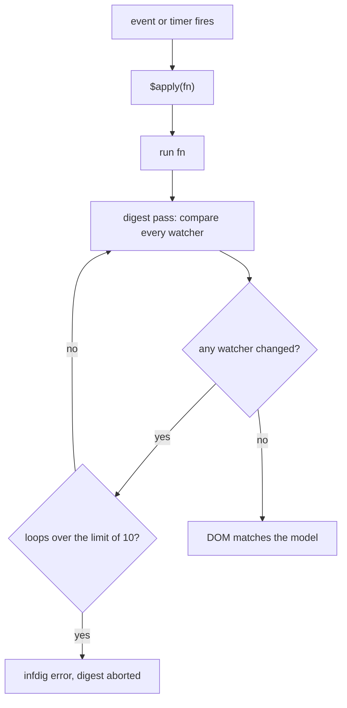
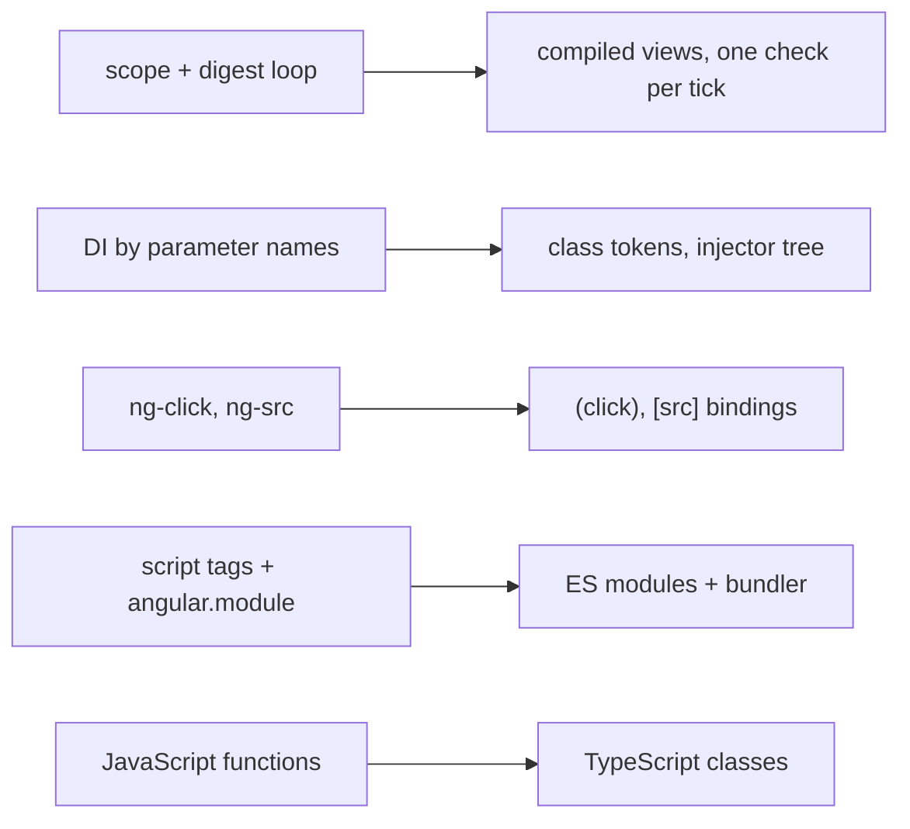
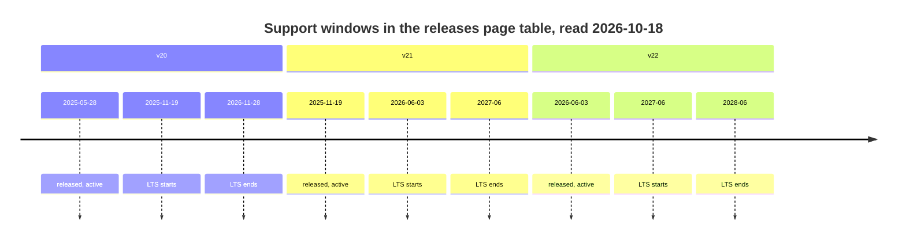
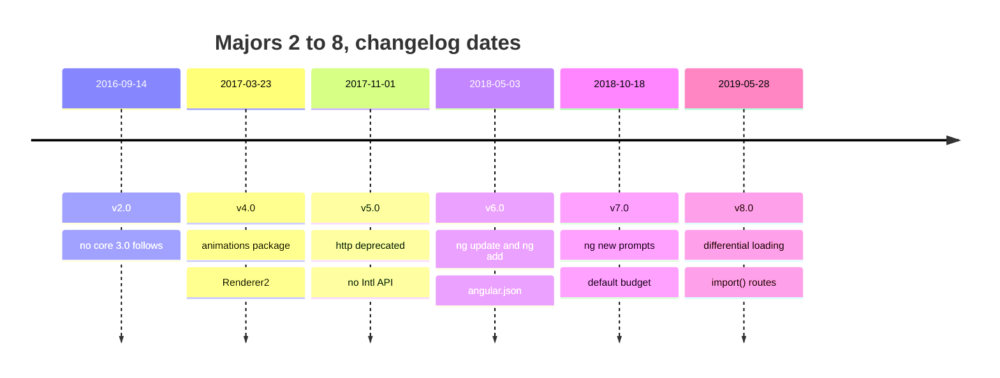
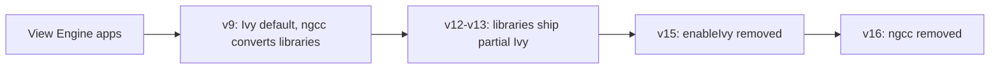
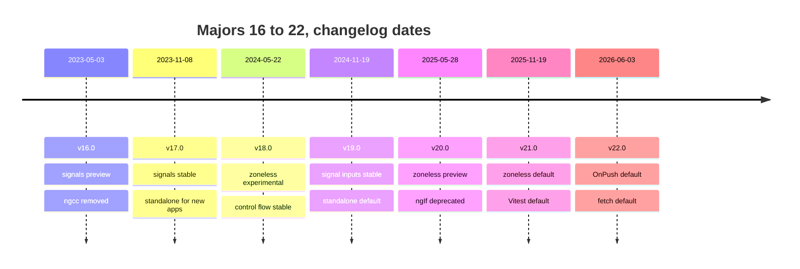
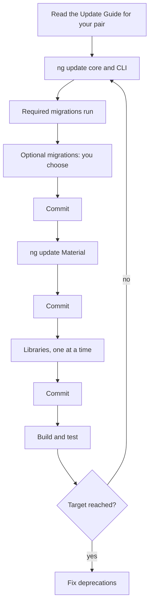
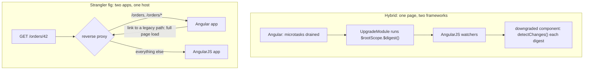

# 39. Version history and migrations

> **What this covers:** where Angular came from and how to move a codebase forward: AngularJS scopes and the digest cycle, and why Angular was rewritten; how Angular versions, ships and deprecates; the version matrix from v2 to v22, with what each major changed and why; updating with `ng update`, its migration schematics and the Update Guide, one major at a time; moving an AngularJS application with ngUpgrade or a strangler fig; and planning the modernization of an old Angular codebase (standalone, control flow, signal APIs, zoneless, Vitest, the application builder) in a safe order.
> **Prerequisites:** [15. Migrating with `ng generate @angular/core:standalone`](15-standalone-and-ngmodules.md#7-migrating-with-ng-generate-angularcorestandalone-three-passes-hybrid-apps-and-common-failures), [21. Migrating a zone-based app to zoneless](21-change-detection.md#6-migrating-a-zone-based-app-to-zoneless), [12. The CLI and the workspace: schematics and `ng update`](12-angular-how-it-works.md#2-the-cli-and-the-workspace-angularjson-projects-schematics-and-ng-update)
> **Leads to:** [40. Framework comparisons](40-framework-comparisons.md), [44. Full-stack delivery and operations](44-fullstack-delivery-and-operations.md)
> **Applies to:** <!-- PLACEHOLDER: Applies to (CLOSE-M39) -->
> **Study time:** ~4 hours reading + ~4 hours exercises
> **Short on time:** <!-- PLACEHOLDER: Short on time: 2-4 section links, 3-6 question IDs, then the Summary (CLOSE-M39) -->
> **Labs:** `labs/angular/src/app/modules/39-version-history-and-migrations/` and `labs/ts-js/src/modules/39-version-history-and-migrations/` <!-- relink: ../labs/angular/src/app/modules/39-version-history-and-migrations/ and ../labs/ts-js/src/modules/39-version-history-and-migrations/ (CLOSE-M39 turns both paths into links and writes the run commands: from labs/angular, npx ng test --watch=false --include='src/app/modules/39-version-history-and-migrations/**/*.spec.ts'; from labs/ts-js, npx vitest run src/modules/39-version-history-and-migrations) -->

## Contents

1. [AngularJS: scopes, watchers and the digest cycle](#1-angularjs-scopes-watchers-and-the-digest-cycle)
2. [Why Angular was rewritten, and what carried over](#2-why-angular-was-rewritten-and-what-carried-over)
3. [How Angular ships: semantic versioning, the release cadence, support windows and the deprecation policy](#3-how-angular-ships-semantic-versioning-the-release-cadence-support-windows-and-the-deprecation-policy)
4. [The version matrix, part 1: v2 to v8](#4-the-version-matrix-part-1-v2-to-v8)
5. [The version matrix, part 2: v9 to v15, from Ivy to standalone](#5-the-version-matrix-part-2-v9-to-v15-from-ivy-to-standalone)
6. [The version matrix, part 3: v16 to v22, from signals to OnPush by default](#6-the-version-matrix-part-3-v16-to-v22-from-signals-to-onpush-by-default)
7. [Updating in practice: `ng update`, migration schematics and the Update Guide](#7-updating-in-practice-ng-update-migration-schematics-and-the-update-guide)
8. [Skipping versions safely: one major per hop, Node and TypeScript ranges, and libraries that block a hop](#8-skipping-versions-safely-one-major-per-hop-node-and-typescript-ranges-and-libraries-that-block-a-hop)
9. [From AngularJS to Angular: ngUpgrade hybrids, the strangler fig and rewrites](#9-from-angularjs-to-angular-ngupgrade-hybrids-the-strangler-fig-and-rewrites)
10. [A migration program for an old Angular codebase: order, dependencies and checkpoints](#10-a-migration-program-for-an-old-angular-codebase-order-dependencies-and-checkpoints)
11. [The v22 upgrade: what `ng update` changes and why each migration keeps the old behavior](#11-the-v22-upgrade-what-ng-update-changes-and-why-each-migration-keeps-the-old-behavior)
12. [Under the hood: how `ng update` selects migrations and how the Update Guide builds its checklist](#12-under-the-hood-how-ng-update-selects-migrations-and-how-the-update-guide-builds-its-checklist)
- [Summary](#summary)
- [Question bank](#question-bank)
- [Hands-on exercises](#hands-on-exercises)
- [Check your understanding](#check-your-understanding)
- [Connections](#connections)

**How this module was checked.** Run: `ng test` (jsdom 30.1.1) for the legacy and migrated features and the strangler routing; Vitest in Node for our digest model, hop planner and program scheduler, and for the installed migration files in `labs/angular/node_modules`; the v22 core migrations in memory through `@angular-devkit/schematics` 22.2.1's `SchematicTestRunner` where a section says so. Read, not run: the source of `@angular/cli`, `@angular/core` and `@schematics/angular` 22.2.1, of `angular` 1.8.3 and `@angular/upgrade` 22.2.1 from npm tarballs; the Angular, CLI and Components changelogs and angular.dev sources, on the dates in [SOURCES.md](../SOURCES.md). AngularJS and ngUpgrade are documented only, never observed.

## 1. AngularJS: scopes, watchers and the digest cycle

### The problem it solves

An AngularJS screen with 3,000 bindings lags on every keystroke. A value assigned in a `setTimeout` never appears. Another page dies with "10 $digest() iterations reached. Aborting!". Interviewers ask why Angular left this model.

**AngularJS** is the 1.x framework, whose support officially ended in January 2022 (npm deprecation notice for `angular`, read 2026-10-18; documented only, never run here). A **digest** is the loop behind that error.

### Mental model

A **scope** is a plain object that holds the model for a part of the page; **`$rootScope`** is the one scope every other scope descends from. Each binding in a template registers a **watcher**: a function that reads a value, plus a listener that runs when the value differs from the last one seen. **`$apply(fn)`** runs your code and then a digest, which compares every watcher's value with its last one and calls the listeners of those that changed. **Dirty checking** is that compare-everything step, and the digest repeats it until a full pass changes nothing. **Two-way binding** means a template edit writes the model and a model change rewrites the template. A night guard walks every door after any noise, and again if he found one open, until a round finds all closed.



What to notice: success needs a pass where nothing changed, so a listener that writes the model costs one more full pass.

### How it actually works

**Why a change outside `$apply` is not shown.** Read, not run, in `angular` 1.8.3 (`angular.js`, `$RootScopeProvider`): `$apply` calls `beginPhase('$apply')` (internal), evaluates your function, and in a `finally` calls `$rootScope.$digest()`. Nothing else starts a digest, so an assignment in a bare timer waits for the next one; the scope guide says code outside "the AngularJS execution context" needs `$apply` (read 2026-10-18).

**Why the loop is bounded.** `var TTL = 10` (**TTL** here means the loop limit) sits in `$RootScopeProvider`. In `$digest`, `if ((dirty || asyncQueue.length) && !(ttl--))` throws the `infdig` error "{0} $digest() iterations reached. Aborting!" with 10 filled in. Because `ttl` starts at 10, the throw comes at the end of an eleventh dirty pass.

**How `ng-model` uses it.** One watcher (the internal `ngModelWatch`) copies model to view; a DOM listener goes back through the internal `$$debounceViewValueCommit`, which calls `$apply` unless a phase is running. A child scope inherits prototypally; an **isolate scope** does not (scope guide).

**What our model shows.** `mini-digest.ts` is our model of the 1.8.3 loop, not AngularJS: one scope, no `$evalAsync` queue.

- `Section 1: our model runs a second loop when a listener changes another watched value` finds three passes where a lone change takes two.
- `Section 1: our model stops after 10 unstable loops with an infdig-style error` finds the watcher read 11 times before the throw.
- `Section 1: our model does not see a change made outside apply until the next digest` finds the listener silent until `apply` runs.

**Against Angular.** Its templates compile to code checked from the root on a tick, with zone.js as the noise detector ([21 §3](21-change-detection.md#3-zonejs-and-ngzone-how-changes-used-to-be-detected-and-why-zone-left-the-default)).

### Code

Approach: show the bug and its fix in AngularJS, then the loop of our model.

1. A controller assigns inside a timer, so no digest follows:

```js
// Partial: AngularJS 1.8 (not run in the labs); module and template omitted
function ClockCtrl($scope) {
  setTimeout(function () {
    $scope.status = 'ready'; // no digest runs, the page keeps the old text
  }, 1000);
  setTimeout(function () {
    $scope.$apply(function () { $scope.status = 'ready'; }); // fn, then a digest
  }, 2000);
}
```

2. Our model repeats passes while any watcher is dirty and throws when the budget is spent:

```ts
// Excerpt of labs/ts-js/src/modules/39-version-history-and-migrations/concepts/mini-digest.ts
  digest(): number {
    let ttl = TTL;
    let passes = 0;
    let dirty: boolean;
    do {
      dirty = false;
      passes++;
      for (const watcher of this.watchers) {
        const value = watcher.get();
        if (value !== watcher.last) {
          const previous = watcher.last === unset ? value : watcher.last;
          watcher.last = value;
          dirty = true;
          watcher.listener(value, previous);
        }
      }
      if (dirty && !(ttl--)) {
        throw new Error(`${TTL} $digest() iterations reached. Aborting!`);
      }
    } while (dirty);
    return passes;
  }
```

### Best practices and anti-patterns

- **Pass the change to `$apply(fn)`**, because a throw in `fn` goes to the exception handler and the digest still runs.
- **Keep watcher functions cheap**, because every pass calls every one.
- **Bind to an object property (`controller as`)**, because a primitive bound in a child scope gets hidden (the `ngIf` doc comment: "will override (hide) the value in the parent scope").
- **Avoid listeners that keep changing another watched value**, because each write forces a pass until the limit throws.

### Misconceptions and traps

- *"AngularJS re-renders the whole page on every change."* It compares watcher values, and only a changed binding's listener touches the DOM. The myth comes from "checks everything" being heard as "repaints everything".
- *"Dirty checking is the same as Angular's change detection."* AngularJS loops until stable and lets listeners write the model; Angular checks top-down once per tick and, in development mode, throws `ExpressionChangedAfterItHasBeenChecked` when a check changes a bound value ([21 §1](21-change-detection.md#1-the-synchronization-problem-dirty-checking-and-fine-grained-reactivity)). The myth comes from both being called change detection.
- *"`$scope.$apply()` everywhere fixes missing updates."* It fixes code outside the context, but inside a digest it throws: `beginPhase` builds "{0} already in progress" from the running phase, giving "$digest already in progress". The myth comes from the fix working in the timer case.

Drilled in Q39.01 <!-- relink: #q39-01 --> and Q39.02 <!-- relink: #q39-02 -->; practised in Exercise 39.1 <!-- relink: #ex39-1 -->.

## 2. Why Angular was rewritten, and what carried over

### The problem it solves

"Why did Google rewrite AngularJS?" Folklore answers cite nothing; a team with a 1.x app needs the differences that rule out upgrading in place. A **rewrite** here means a new framework with no in-place upgrade path: Angular 2.0.0 (2016-09-14, Angular changelog) gives each 1.x feature a new syntax or mechanism (the official quick reference). No official text read here states the motives, so this section reports mechanisms.

### Mental model

Both frameworks have templates with directives and dependency injection, but share almost no code. Two cars with the same badge: the driver and the route carry over, the engine does not.



What to notice: each arrow replaces a mechanism, not a name, so no step is a find-and-replace.

### How it actually works

**Change detection.** A 1.8.3 digest re-walks every watcher until stable (§1). The angular.io upgrade guide (16.2.0 source, read 2026-10-18) says that in Angular "no one needs to call `scope.$apply()`": **zone.js**, a library that patches the browser's async APIs, told Angular when code finished ([21 §3](21-change-detection.md#3-zonejs-and-ngzone-how-changes-used-to-be-detected-and-why-zone-left-the-default)). Templates compile to code with **one-way data flow**: property bindings carry values from component to DOM, event bindings from DOM to component, checked once per tick.

**Dependency injection.** Read, not run, in 1.8.3 (`angular.js`): with no `$inject` list, the internal `extractArgs` matches the parameter list in `Function.prototype.toString`'s output, and `annotate` (public as `$injector.annotate`) records each name. Its doc comment warns this "does not work with minification, and obfuscation tools since these tools change the argument names" (**minification**: shrinking code by renaming locals). A **minification-safe DI annotation** lists the names as strings (`fn.$inject`, or an array ending with the function), because strings survive renaming. The upgrade guide contrasts tokens that "are always strings" in "exactly one injector" with Angular tokens that "are often classes" in "a tree hierarchy of injectors" ([16 §2](16-dependency-injection.md#2-providers-and-tokens-useclass-usevalue-usefactory-and-useexisting)).

**Templates.** The quick reference says AngularJS's event directives "do not exist in Angular": `ng-click` becomes `(click)` and `ng-src` becomes `[src]`, bindings to any event or property ([13 §4](13-components-and-templates.md#4-property-attribute-class-and-style-bindings)).

**Modules and language.** `angular.module` is "a global place for creating, registering and retrieving AngularJS modules"; the source stores them by name and loads no file, so `<script>` tags had to stay "in the correct order" (upgrade guide). An **ES module** is a file whose `import` and `export` declarations the engine links before running it ([05 §1](05-js-modules-memory-modern-features.md#1-es-modules-static-structure-linking-and-live-bindings)). Angular is TypeScript classes in ES modules (`@angular/core` 22.2.1 declares `"type": "module"`), built by the CLI (1.0.0, 2017-03-24, npm registry).

**What carried over.** Ideas, not code: DI is "front and center in both" (upgrade guide); per the quick reference, modules group features, filters became pipes with the same `|`, `ng-class` became `ngClass`, and controllers became component classes.

> [!NOTE]
> **Framework vs platform.** Modules and classes are JavaScript's: ECMA-262 6th Edition (June 2015) lists "modules, class declarations" among its major enhancements. `angular.module`'s registry and the digest are AngularJS's own code, not platform features. Angular adds NgModules, a compiler and its own change detection on top.

### Code

Approach: one dependency in two 1.8.3 styles, then in Angular.

1. Inferred names break once a minifier renames `movieService`.
2. Array notation keeps them as strings.
3. Angular injects by class token.

```js
// Partial: AngularJS 1.8 (not run in the labs); movieService registration and templates omitted
angular.module('movies', [])
  .controller('InferredCtrl', function (movieService) {}) // 1. name read from the source text
  .controller('ArrayCtrl', ['movieService', function (m) {}]); // 2. string survives renaming
// minified, step 1 becomes function (a) {} and the injector fails with "Unknown provider: …" (abridged)
```

```ts
// Partial: Angular 22; MovieService is assumed to be an @Injectable({ providedIn: 'root' }) class with nextPoster(): string
import { Component, inject, signal } from '@angular/core';
import { MovieService } from './movie-service';

@Component({
  selector: 'app-movie-list',
  template: `<button (click)="next()">Next</button>`,
})
export class MovieList {
  private readonly movies = inject(MovieService); // 3. the class is the token
  protected readonly poster = signal('');

  protected next(): void {
    this.poster.set(this.movies.nextPoster());
  }
}
```

### Best practices and anti-patterns

- **Turn on `ng-strict-di` in a 1.x app**, because inferred names fail only after minification and strict mode fails at once.
- **Answer "why the rewrite" with mechanisms and sources**, because a motive without an official text is folklore.

### Misconceptions and traps

- *"Angular 2 was AngularJS 2.0 with breaking changes."* It is a separate framework (`@angular/core`, not `angular`), reached through a hybrid running both ([§9](#9-from-angularjs-to-angular-ngupgrade-hybrids-the-strangler-fig-and-rewrites)). The myth comes from the version number continuing the name.
- *"The rewrite was only about performance."* DI, templates, modules and language changed too, and no official text read here names a single cause. The myth comes from the digest being the best-known pain.
- *"AngularJS is still supported."* Support ended in January 2022 and the npm package is deprecated (§1). The myth comes from `npm install angular` still working.

Drilled in Q39.03 <!-- relink: #q39-03 -->.

## 3. How Angular ships: semantic versioning, the release cadence, support windows and the deprecation policy

### The problem it solves

A team asks: how long can we stay on v20, will a minor release break us, is a developer preview API safe? The releases page (angular.dev, read 2026-10-18) ends v20's long-term support on 2026-11-28 and says "Angular versions v2 to v19 are no longer supported."

### Mental model

**Semantic versioning** numbers a release `major.minor.patch`. A major release may break code, a minor release adds features and is "fully backward-compatible", and a patch fixes bugs. Each major is **active** (regular updates and patches) for 12 months, then in **LTS**, long-term support (only critical fixes and security patches), for 12 months. The **deprecation period** is how long a deprecated API stays present, at least 12 months. **Developer preview** APIs (working, not yet stabilized) and **experimental** APIs (may never become stable) fall outside all of this. Think of a lease, plus a "beta" room that can be rearranged any day.



What to notice: v20's and v21's LTS start the day the next major is released, so only one major is active at a time.

### How it actually works

**Support windows.** Majors are "typically supported for 24 months", but the table gives v22 24 months and v20 and v21 18 and 19, so plan from the table. An LTS fix needs a newly found security vulnerability or a regression caused since LTS began by a third party, such as a new browser version.

**How a deprecation reaches you.** It is announced in the changelog, struck through in the API docs, and marked with the **`@deprecated` JSDoc tag**, which editors read to flag uses. Removal happens only in a major, and the API stays "in at least the next major". In the installed `@angular/core` 22.2.1 typings, `ChangeDetectionStrategy.Default` is deprecated and "due to be removed"; `Eager` is its alias, added in 21.2.0 (changelog). The changelog names no release for the tag, so no version marker is shown.

**Why not jump from v19 to v22.** `ng update` needs a supported target and a source "within one major version" of it; v19 is unsupported and three majors back. The policy keeps a deprecated API only through the next major, so one hop is what it covers (our reading; the page gives no reason). Hops: [§8](#8-skipping-versions-safely-one-major-per-hop-node-and-typescript-ranges-and-libraries-that-block-a-hop); mechanics: [12 §2](12-angular-how-it-works.md#2-the-cli-and-the-workspace-angularjson-projects-schematics-and-ng-update).

**Compiler ABI.** The **compiler ABI** is the internal runtime API (the `ɵɵ`-prefixed names, internal) that the compiler's generated code calls. The page promises it "across patch versions of the same minor version", not across minors, so builds that share one Angular runtime ([38 §8](38-architecture-and-production-structure.md#8-micro-frontends-module-federation-native-federation-and-when-they-are-justified)) should match on the minor. Your own library should make the same promise ([38 §6](38-architecture-and-production-structure.md#6-public-api-surfaces-public-apits-exports-secondary-entry-points-and-versioning)).

**Statuses.** The guide marks these at first mention ([STYLE-GUIDE §3](../STYLE-GUIDE.md#3-accuracy-rules)), for example `@boundary` [Developer preview since v22.2] ([37 §9](37-elements-pwa-errors-ecosystem.md#9-error-boundaries-boundary-error-reset-onviewerror-and-onerror)).

### Code

Approach: ask the typings whether a member is deprecated, and ask our table for a version's stage on a date you pass in.

1. Find the `types/*.d.ts` file that declares `enum ChangeDetectionStrategy`, read-only, and keep the doc comment above each member.
2. Only `Default`'s comment holds the tag.
3. Compare the date with the row's dates; a month-only value counts as that month's first day.

```ts
// Excerpt of labs/ts-js/src/modules/39-version-history-and-migrations/concepts/section-3-support.test.ts
    const body = text.slice(start + header.length, text.indexOf('\n}', start));
    const docs = new Map<string, string>();
    for (const match of body.matchAll(/\/\*\*((?:(?!\*\/)[\s\S])*)\*\/\s*(\w+) = \d+/g)) {
      docs.set(match[2] ?? '', match[1] ?? '');
    }
```

```ts
// Excerpt of labs/ts-js/src/modules/39-version-history-and-migrations/concepts/section-3-support.test.ts
const asDay = (date: string): string => (date.length === 7 ? `${date}-01` : date);

function stageOn(row: SupportRow, date: string): Stage {
  if (date < row.released) return 'unreleased';
  if (date < asDay(row.activeEnds)) return 'active';
  if (date < asDay(row.ltsEnds)) return 'lts';
  return 'unsupported';
}
```

`Section 3: the installed @angular/core 22.2.1 marks ChangeDetectionStrategy.Default as deprecated in its typings` finds ``@deprecated Use `Eager` instead.`` on `Default` only. `Section 3: our support table puts v22 in active support and v20 and v21 in LTS on 2026-10-18` returns active, LTS, LTS, and 24, 19 and 18 months.

### Best practices and anti-patterns

- **Plan from the support table, not from "24 months"**, because v20 and v21 get 18 and 19.
- **Fix deprecations within one major**, because the policy keeps an API only "in at least the next major".
- **Wrap developer preview and experimental APIs in one file you own**, because they "can change at any time, even in new patch versions".

### Misconceptions and traps

- *"Angular releases a major every six months."* Once true: every 6 months with 1-3 minors, until v22. Now: every 12 months with 4-6 minors, v23.0 about June 2027 ("subject to change"). Older material repeats the old rhythm.
- *"LTS means new features are backported."* LTS gets only critical fixes and security patches. The word "support" sounds like active-phase care.
- *"A developer preview API follows semantic versioning."* The policies do not apply to it, and it can change in a patch. It ships in a stable release, so the version looks like a promise.

Drilled in Q39.04 <!-- relink: #q39-04 --> and Q39.05 <!-- relink: #q39-05 -->.

## 4. The version matrix, part 1: v2 to v8

### The problem it solves

Interviewers ask "what changed in Angular 4?" and "why is there no Angular 3?" to see whether you know the platform's history or only today's API. Old code sets the same test: a 2018 project imports `@angular/http`, calls `Renderer` and writes `loadChildren: './admin/admin.module#AdminModule'`.

### Mental model

Read the matrix as the service log of a long-running machine: each entry says what was replaced. The "why" column holds only what the changelog or release notes say, and reads "none stated" where they are silent. Dates are release days from the changelog headings ([`angular/angular` CHANGELOG_ARCHIVE.md](https://raw.githubusercontent.com/angular/angular/main/CHANGELOG_ARCHIVE.md), read 2026-10-18).



What to notice: majors come five to seven months apart, and the only gap in the numbers is between v2 and v4.

### How it actually works

| Version (release day) | What changed | Why, from the entry |
|---|---|---|
| v2 (2016-09-14) | 2.4.0 (2016-12-20): RxJS updated to 5.0.1, peer range `^5.0.1` | none stated |
| v3 | no `@angular/core` 3.0.0 | see below |
| v4 (2017-03-23) | 4.0.0-beta.0 (2016-12-15): `ngIf` supports `else`; `@angular/animations` split from core; `RendererV2` renamed `Renderer2`, `Renderer` [Deprecated since v4.0 — use `Renderer2`] · [Removed in v9.0]; smaller AOT (ahead-of-time compiled) output; `WeakMap` polyfill needed on old browsers; 4.3.0 (2017-07-14): `HttpClient` | animations: "if you don't use Animations, this extra code will not end up in your production bundles"; AOT code "by more than half in some cases" |
| v5 (2017-11-01) | `@angular/http` [Deprecated since v5.0 — use `@angular/common/http`]; `@angular/common` drops the `Intl` API | `Intl`: "to improve browser support"; http: none stated |
| v6 (2018-05-03) | `ng update`, `ng add` and `angular.json` replacing `.angular-cli.json` ([CLI v6.0.0 notes](https://github.com/angular/angular-cli/releases/tag/v6.0.0)); `@Injectable()` supports tree-shakeable tokens; `enableIvy` option; `@angular/elements` first stable | "the first release of Angular that unifies the Framework, Material and CLI"; `ng update` "to help simplify keeping your projects up to date" |
| v7 (2018-10-18) | `@schematics/angular` adds "several prompts to ng-new" and a "default budget of 2mb/5mb" ([CLI v7.0.1 notes](https://github.com/angular/angular-cli/releases/tag/v7.0.1)) | none stated |
| v8 (2019-05-28) | differential loading; `loadChildren` strings [Deprecated since v8.0 — use dynamic `import()`], rewritten by `ng update`; `TestBed.get(…): any` [Deprecated since v8.0 — use the typed overload] ([CLI v8.0.0 notes](https://github.com/angular/angular-cli/releases/tag/v8.0.0)) | modern bundle "10-30% smaller" with "fewer required polyfills"; `import()` "aligns Angular with the JavaScript specification"; `TestBed`: all use "should go through the typed API" |

**Why no v3.** The `ng update` source (`@angular/cli` 22.2.1, `src/commands/update/cli.js`) says "Before version 6, the major versions were not always sequential. Example @angular/core skipped version 3, @angular/cli skipped versions 2-5." The registry agrees: `@angular/core` goes from 2.4.10 (2017-03-17) to 4.0.0, `@angular/cli` from 1.0.0 to 6.0.0, while `@angular/router` has a 3.x line, 3.0.0 (2016-09-15) to 3.4.10. No changelog gives a reason, so none is claimed.

**Terms.** A **tree-shakeable provider** is one the bundler drops when nothing uses it. **`Renderer2`** is the service components call to change DOM nodes. **`HttpClient`** is Angular's HTTP service ([27 §1](27-http-client.md#1-httpclient-versus-fetch-what-the-framework-adds-over-the-platform)). **String-based lazy loading** is a `loadChildren` string, `path/to/module#ModuleName`, that the build resolves. **Differential loading** builds two bundles, one for modern browsers and one for older ones; the v8 notes enable it by default through `target: es2015` in `tsconfig.json`. A **budget** is a bundle size limit in the build configuration. `ng update` and `ng add` mechanics: [12 §2](12-angular-how-it-works.md#2-the-cli-and-the-workspace-angularjson-projects-schematics-and-ng-update); `@angular/elements`: [37 §1](37-elements-pwa-errors-ecosystem.md#1-angular-elements-turning-a-component-into-a-custom-element).

**Legacy code.** `@angular/http` has no release after 7.2.16 (2020-01-08) and no 8.x; the registry notice reads "Package no longer supported. Use @angular/common instead". `Renderer` code moves to `Renderer2`; the 9.0.0 entry is "remove deprecated Renderer".

### Code

Approach: date a legacy file by its signatures, then replace each with what its row names.

1. Read the `@angular/core` version in `package.json` and find its row.
2. Search for `@angular/http`, `Renderer` without the `2`, `loadChildren: '` and `TestBed.get(`.
3. Replace each as the table says.

```ts
// Partial: two route objects; the first form is the one the v8.0.0 CLI notes call string-based, the second is the dynamic import() form (our example).
const before = { path: 'admin', loadChildren: './admin/admin.module#AdminModule' };
const after = {
  path: 'admin',
  loadChildren: () => import('./admin/admin.module').then((m) => m.AdminModule),
};
```

### Best practices and anti-patterns

- **Date legacy code by its signatures first**, because each maps to a row naming its replacement.
- **Quote a "why" only from its entry**, because retellings add motives no changelog states.
- **Replace `@angular/http` before any later major**, because the package has no release after 7.2.16 while `HttpClient` has existed since 4.3.0.

### Misconceptions and traps

- *"Angular 3 was skipped because of a big breaking change."* The CLI source says only that early majors "were not always sequential", and the registry shows `@angular/router` kept a 3.x line. A skipped number sounds dramatic, so people supply a drama.
- *"`HttpClient` arrived in v5."* It shipped in 4.3.0 (2017-07-14); v5 deprecated `@angular/http`, so the two get merged in memory.
- *"Animations were removed from Angular."* They moved to `@angular/animations` in v4, and that package is itself [Deprecated since v20.2 — use `animate.enter` and `animate.leave`] ([35 §9](35-animations.md#9-migrating-from-angularanimations-to-native-css-and-animateenteranimateleave)), and "moved out of core" sounds like removal.

Drilled in Q39.06 <!-- relink: #q39-06 --> and Q39.10 <!-- relink: #q39-10 -->.

## 5. The version matrix, part 2: v9 to v15, from Ivy to standalone

### The problem it solves

Interviewers ask what **Ivy** was (the compiler and runtime that replaced **View Engine**, the pair before v9; internals in [12 §8](12-angular-how-it-works.md#8-under-the-hood-what-the-compiler-emits-and-what-the-runtime-does-with-it)), why old libraries break on v16 and when standalone arrived. Code that compiled through v21 can still fail in v22: an injected `ComponentFactoryResolver` no longer exists (Legacy below).

### Mental model

The engine was swapped like a foundation under an occupied building: new floors first (applications), then a converter for old furniture (**`ngcc`**, the Angular compatibility compiler, which CLI commands run "as needed" during a build, per the 9.1.0 guide), then the converter is removed. Dates are release days ([`angular/angular` CHANGELOG.md](https://raw.githubusercontent.com/angular/angular/main/CHANGELOG.md) and [CHANGELOG_ARCHIVE.md](https://raw.githubusercontent.com/angular/angular/main/CHANGELOG_ARCHIVE.md), read 2026-10-18).



What to notice: every arrow keeps old libraries working until the last one, which removes the converter.

### How it actually works

**Terms.** **Partial compilation** is the library publishing format: an intermediate form that the application's build finishes (mechanism: 12 §8, above). The **Angular Package Format** is the layout `ng-packagr` writes ([38 §5](38-architecture-and-production-structure.md#5-angular-cli-libraries-ng-generate-library-ng-packagr-and-consuming-the-build)). **MDC** is the `material-components-web` package the components changelog names in its `mdc-list` fix (13.2.2).

| Version (release day) | What changed | Why, from the entry |
|---|---|---|
| v9 (2020-02-06) | Ivy is the default for applications; library authors keep View Engine; `TestBed.get` [Deprecated since v9.0 — use `TestBed.inject`] · [Removed in v20.0] | View Engine libraries stay compatible "with default v9 applications that use Ivy" |
| v10 (2020-06-24) | `ModuleWithProviders` needs its type argument; a `--strict` option and an `angular.json` "strict setting" | the generic "has always been required" for Ivy; a v10 migration fixes application code |
| v11 (2020-11-11) | `ViewEncapsulation.Native` removed | none stated; `ng update` rewrites it to `ShadowDom` |
| v12 (2021-05-12) | `@schematics/angular`: "strict mode by default"; "remove usage of deprecated View Engine compiler"; new libraries "published in Ivy partial mode"; `??` in templates | none stated |
| v13 (2021-11-03) | libraries migrated "from ViewEngine to Ivy Partial compilation"; IE 11 polyfills and differential loading removed; 13.2.0: `ComponentFactoryResolver` [Deprecated since v13.2 — use `createComponent`] · [Removed in v22.0] | "Since Ivy, there is no need to resolve Component factories"; "no browsers officially supported by Angular … require ES5 code" |
| v14 (2022-06-02) | standalone components and directives [Developer preview since v14.0]; typed forms ([25 §3](25-forms-reactive-and-template-driven.md#3-typed-forms-formbuilder-and-nonnullableformbuilder)); 14.1.0: `inject()` options object [Added in v14.1], `canMatch` [Added in v14.1] | untyped classes remain "to opt-out of the new, stricter behavior" |
| v15 (2022-11-16) | standalone [Stable since v15.0]; `enableIvy` removed; directive composition enabled; Material components "re-implemented based on MDC"; 15.1.0: `canLoad` [Deprecated since v15.1 — use `canMatch`]; 15.2.0: standalone schematics ([15 §7](15-standalone-and-ngmodules.md#7-migrating-with-ng-generate-angularcorestandalone-three-passes-hybrid-apps-and-common-failures)) | "Ivy is the only rendering engine"; "Use CanMatch" |

**Why View Engine libraries fail after v16.** The 16.0.0 entries say "(ngcc) has been removed and as a result Angular View Engine libraries will no longer work", and the Update Guide repeats it for "projects on v16 and later". Nothing converts such a library any more. Libraries published in partial compilation (new ones from v12, migrated ones in v13) are not View Engine libraries. The same release deleted `entryComponents`, which "weren't doing anyting" (sic) [Removed in v16.0].

**Standalone and locality.** Standalone sits on Ivy compiling each class on its own, drilled in [Q12.26](12-angular-how-it-works.md#q12-26). The v15 entry adds that the rewritten components' DOM and CSS classes changed.

### Code

Approach: date a legacy codebase by its Ivy-era leftovers, then remove what each row names.

1. Delete `enableIvy` from `tsconfig.json`, as the Update Guide's v15 step says.
2. Delete `entryComponents` and `ANALYZE_FOR_ENTRY_COMPONENTS` from application code.
3. Replace each `ComponentFactoryResolver` with the component class passed to `createComponent`.
4. Replace or upgrade any dependency still published for View Engine, because v16 has no converter.

#### Legacy

Through v21 the factory form compiled; the 22.0.0 entry says `ComponentFactoryResolver` is "no longer available" and [19 §7](19-component-communication-and-projection.md#7-dynamic-components-viewcontainerrefcreatecomponent-createcomponent-and-bindings) records the compile error. The snippet does not compile under v22.

```ts
// Partial: removed API, does not compile under v22; the injected resolver, the component and the container are omitted
const factory = resolver.resolveComponentFactory(Dyn);
container.createComponent(factory);
// Migrate by passing the class: container.createComponent(Dyn);
```

### Best practices and anti-patterns

- **Date a codebase by `enableIvy`, `entryComponents` and `ComponentFactoryResolver`**, because each maps to a row and a removal version.
- **Check a library's compile format before a hop past v15**, because the 16.0.0 entry says View Engine libraries stop working.

### Misconceptions and traps

- *"Ivy is a v9 feature you can still turn off."* Once true: through v11, `enableIvy: false` built an app with View Engine. Now: the CLI 12.0.0 entry removes "usage of deprecated View Engine compiler", and the 15.0.0 entry removes the option because "Ivy is the only rendering engine". Old `tsconfig.json` files keep the line.
- *"Partial compilation is for apps."* It is the library publishing format, finished by the app build. The word "compilation" suggests the app's own.
- *"`ComponentFactoryResolver` still works in v22."* Once true: it compiled through v21 (deprecated since v13.2). Now it is removed. Tutorials written before v22 still use it.

Drilled in Q39.07 <!-- relink: #q39-07 -->, Q39.08 <!-- relink: #q39-08 --> (the v14 and v15 half) and Q39.10 <!-- relink: #q39-10 -->.

## 6. The version matrix, part 3: v16 to v22, from signals to OnPush by default

### The problem it solves

Candidates say "signals came with zoneless" or "OnPush is how Angular works now" and are a year or two off. Three questions hide in one: when a feature appeared, when it became stable, and when new projects began using it by default. An old project gets none of the third kind unprompted: after the v22 update its components keep their old checking.

### Mental model

A feature has up to three dates: **introduced** (first release, perhaps as a developer preview), **stable** (preview label dropped) and **default** (`ng new` or the compiler switched to it). A **default for new projects** is what you get when you set nothing; existing projects keep their behavior until the update or you change it. A city changes the rules for new buildings each year but grandfathers old ones unless the owner renovates. Dates are release days from the changelog headings ([Angular](https://raw.githubusercontent.com/angular/angular/main/CHANGELOG.md), [CLI](https://raw.githubusercontent.com/angular/angular-cli/main/CHANGELOG.md) and [Components](https://raw.githubusercontent.com/angular/components/main/CHANGELOG.md), read 2026-10-18); from v22 a major ships every 12 months ([§3](#3-how-angular-ships-semantic-versioning-the-release-cadence-support-windows-and-the-deprecation-policy)).



What to notice: a default arrives one to three majors after a feature (zoneless: experimental in v18, default in v21), and only v22 changes a default old code already uses.

### How it actually works

A **signal** is a value that tracks its readers ([17](17-signals.md#1-why-signals-exist)). **Zoneless** change detection runs without zone.js ([21 §5](21-change-detection.md#5-zoneless-change-detection-the-scheduler-its-triggers-and-pendingtasks); why zone left the default: [Q21.12](21-change-detection.md#q21-12)). **OnPush** checks a component only when something marks it dirty ([21 §2](21-change-detection.md#2-onpush-and-eager-strategies-and-what-marks-a-view-dirty)). **Signal Forms** build a form from a model signal ([26](26-signal-forms.md#1-why-a-third-forms-api-model-first-signals-end-to-end)). The **application builder** is `@angular/build:application` ([12 §3](12-angular-how-it-works.md#3-building-the-application-builder-output-layout-and-budgets)).

| Version | Introduced | Stable | Default for new projects | Deprecated or removed |
|---|---|---|---|---|
| v16 | `signal` [Developer preview since v16]; `DestroyRef` [Added in v16.0] | none | none | `ngcc`; `entryComponents` |
| v17 | built-in control flow | `signal`, `computed` [Stable since v17] | `ng new`: application builder, standalone, `--ssr` | Material legacy components |
| v18 | zoneless provider, "experimental" | control flow [Stable since v18]; Material 3 ([36 §3](36-material-and-cdk.md#3-theming-with-material-3-mattheme-system-variables-and-light-and-dark-with-color-scheme)) | none | `HttpClientModule` [Deprecated since v18 — use `provideHttpClient`] |
| v19 | `linkedSignal` | `input()`, `output()`, signal queries, `@let` [Stable since v19.0] | `standalone` is `true` [Changed in v19.0] | `APP_INITIALIZER` [Deprecated since v19 — use `provideAppInitializer`]; Protractor |
| v20 | zoneless [Developer preview since v20.0] | `linkedSignal`, `toSignal`, incremental hydration [Stable since v20.0]; zoneless [Stable since v20.2] | file names drop `.component` [Changed in v20.0] | `*ngIf`, `*ngFor`, `*ngSwitch` [Deprecated since v20.0 — use `@if`, `@for`, `@switch`]; `@angular/animations` [Deprecated since v20.2 — use `animate.enter`, `animate.leave`] ([35 §9](35-animations.md#9-migrating-from-angularanimations-to-native-css-and-animateenteranimateleave)) |
| v21 | Signal Forms [Experimental since v21.0]; `ChangeDetectionStrategy.Eager` (21.2.0) | none | zoneless [Changed in v21.0]; Vitest | none |
| v22 | `@Service` [Added in v22.0] | Signal Forms [Stable since v22.0] | OnPush [Changed in v22.0]; fetch backend; `strictTemplates` [Changed in v22] | `ChangeDetectionStrategy.Default` (deprecated in the 22.2.1 typings); `provideRoutes()`; HammerJS; webpack builders; TypeScript before 6.0 |

Each cell rests on a changelog entry under that version's heading ([SOURCES.md](../SOURCES.md)); the rest come from owners ([17](17-signals.md), [15](15-standalone-and-ngmodules.md#2-standalone-components-and-the-imports-array), [12 §2](12-angular-how-it-works.md#2-the-cli-and-the-workspace-angularjson-projects-schematics-and-ng-update)).

**New default versus what `ng update` keeps.** The 22.0.0 entry says "Component with undefined `changeDetection` property are now `OnPush` by default. Specify `changeDetection: ChangeDetectionStrategy.Eager` to keep the previous behavior." The installed `@angular/core` 22.2.1 `schematics/migrations.json` holds eight migrations, all at 22.0.0, among them `change-detection-eager` ("Adds `ChangeDetectionStrategy.Eager` to all components.") and `strict-templates-default` ("Adds 'strictTemplates: false' in tsconfig.json when not set."). A new default therefore applies to new code, while the update writes the old value into old code ([§11](#11-the-v22-upgrade-what-ng-update-changes-and-why-each-migration-keeps-the-old-behavior) says what each migration writes; `ng update` itself: [Q12.05](12-angular-how-it-works.md#q12-05)).

**What the installed packages require.** `Section 6: the installed 22.2.1 packages require the Node and TypeScript ranges of the 22.0.x compatibility row` reads the manifests: both packages declare Node `^22.22.3 || ^24.15.0 || >=26.0.0`, and `@angular/compiler-cli` peers on TypeScript `>=6.0 <6.1`. The compatibility page (read 2026-10-18) writes `^26.0.0` and `>=6.0.0 <6.1.0`; the test expects the package values.

### Code

Approach: answer "since when?" from the matrix, then check what an update does to your copy.

1. Find the feature's row and the column your claim belongs to.
2. For a default, find its 22.0.0 migration in `migrations.json`.
3. Date the entry by the version heading above it.

```ts
// Partial: two components (our example; selectors, templates and imports omitted). The second is what `ng update` leaves in an older project.
@Component({ selector: 'app-new-row', template: '' })
export class NewRow {} // no changeDetection: OnPush since v22

@Component({ selector: 'app-old-row', changeDetection: ChangeDetectionStrategy.Eager, template: '' })
export class OldRow {} // after the update: checked as before
```

### Best practices and anti-patterns

- **Give three dates for "since when"**, because `signal` was a preview in v16 and stable only in v17.
- **Date an entry by the heading above it**, because the changelog lists 20.3.34 between 22.3.0-next.2 and 22.3.0-next.1.
- **Keep the added `Eager` lines until each component is reviewed**, because a component that mutates plain fields may stop refreshing.

### Misconceptions and traps

- *"Signals replaced zone.js in v16."* Signals were a v16 preview, stable in v17; zoneless was experimental in v18, stable in 20.2, the default in v21. Both are "the new change detection", so their dates merge.
- *"Standalone is mandatory since v17."* The v17 CLI entry says "enable standalone by default in new applications"; `standalone: false` and NgModules still compile in v22 ([15](15-standalone-and-ngmodules.md#5-legacy-ngmodule-patterns-declarations-exports-forrootforchild-sharedmodule-and-coremodule)). New projects show no NgModule.
- *"`*ngIf` was removed in v20."* It is [Deprecated since v20.0 — use `@if`] and still present in 22.2.1 ([18 §1](18-control-flow-and-defer.md#1-built-in-blocks-versus-directives-and-the-if-family-with-as)); a deprecation notice sounds like removal.
- *"v22 makes every existing component OnPush."* The default changed for components with no `changeDetection`, and `ng update` adds `Eager` to them. Headlines omit the migration.

Drilled in Q39.08 <!-- relink: #q39-08 --> (the v16-v17 half), Q39.09 <!-- relink: #q39-09 --> and Q39.10 <!-- relink: #q39-10 -->.

## 7. Updating in practice: `ng update`, migration schematics and the Update Guide

### The problem it solves

A team sets `@angular/core` to 22 in `package.json` and runs `npm install`. The app builds, but no **migration** ran (a schematic that rewrites code for one version step, [12 §2](12-angular-how-it-works.md#2-the-cli-and-the-workspace-angularjson-projects-schematics-and-ng-update)), so the code silently takes the new defaults. Another `ng update` stops on a **peer dependency** error: a library's `package.json` lists a range, such as `^21.0.0`, for a package you provide, and 22 is outside it. Someone adds `--force`; the tree is now unchecked.

### Mental model

An update is a checklist in a fixed order with a commit after each step. Angular's packages go first: `@angular/core` and the CLI, each with its **package group**, the packages released and updated together ([12 §1](12-angular-how-it-works.md#1-what-a-framework-does-and-angulars-philosophy)), listed in the `ng-update.packageGroup` field of its `package.json`. Material and the CDK follow, then third-party libraries. A migration is **required** when `ng update` runs it unasked and **optional** when it asks first. The **Update Guide** ([update.angular.dev](https://update.angular.dev/)) turns a from-version, a to-version and an app level into a before, during and after checklist. A building inspection by trade: structure, wiring, furniture, each signed off first.



What to notice: each step that changes the tree ends in a commit, so a failure reverts one commit, and the loop repeats for each major.

### How it actually works

**Why this order.** Each step rests on the one before through a peer range. `@angular/material` 22.2.1 peers on `@angular/core` `^22.0.0 || ^23.0.0` (its `package.json`), so Material 22 beside core 21 is outside its own range: core goes first. An invented library range `"@angular/core": "^21.0.0"` rejects 22 the same way; the fixes are its next major or waiting ([§8](#8-skipping-versions-safely-one-major-per-hop-node-and-typescript-ranges-and-libraries-that-block-a-hop)).

**Why `ng update` prompts** (read in `@angular/cli` 22.2.1, `migration.js`; mechanism: [Q12.05](12-angular-how-it-works.md#q12-05)). `Section 7: @angular/core 22.2.1 ships eight migrations, all for 22.0.0 and none optional`: all run unasked. `Section 7: @angular/cli 22.2.1 takes its migrations from @schematics/angular, two of them optional and one recommended`: three run unasked; the prompt "Select the migrations that you'd like to run" ticks an item when it is `recommended`, here `use-application-builder`, not `migrate-karma-to-vitest`. `Section 7: core, common, router, forms and upgrade are in one package group`: core's list names 16 packages, and the installed `common`, `router` and `forms` carry it too.

**What `--force` changes** (read, not run, `@angular/cli` 22.2.1). Its text is "Ignore peer dependency version mismatches." In `update-resolver.js`, the internal `_validateUpdatePackages` logs each mismatch as an error and throws "Incompatible peer dependencies found" only when `force` is false. `--force` removes the stop, not the mismatch: the library is installed outside its own range. It does not lift the refusal to cross several majors, which `cli.js` checks first. For npm 7 and later, the internal `shouldForcePackageManager` already makes the install ignore peer ranges (a source comment blames npm "incorrectly resolving peer dependencies").

**What the Update Guide adds.** Its source ([update.component.ts](https://raw.githubusercontent.com/angular/angular/main/adev/src/app/features/update/update.component.ts), read 2026-10-18) asks for an app level (basic, medium or advanced) and options such as `ngUpgrade`; how it picks steps: [§12](#12-under-the-hood-how-ng-update-selects-migrations-and-how-the-update-guide-builds-its-checklist). A library can ship its own migrations in the same `ng-update` field ([38 §6](38-architecture-and-production-structure.md#6-public-api-surfaces-public-apits-exports-secondary-entry-points-and-versioning)).

### Code

Approach: follow the diagram, one named step at a time, so each commit holds one cause.

1. Start clean and read the Update Guide for your pair.
2. Update core and the CLI, answer the prompt, and let `--create-commits` record each step.
3. Update Material, then each library; build and test.
4. Repeat for the next major.

```sh
# Partial: illustrative; options as read in @angular/cli 22.2.1, src/commands/update/cli.js (not run)
ng update @angular/cli@^22 @angular/core@^22 --create-commits
ng update @angular/material@^22 --create-commits
```

The lab lists the migrations of a target package like this:

```ts
// Excerpt of labs/ts-js/src/modules/39-version-history-and-migrations/concepts/section-7-migrations.test.ts
function migrationsOf(collection: unknown): MigrationRow[] {
  return jsonEntries(jsonField(collection, 'schematics')).map(([name, entry]) => ({
    name,
    version: jsonField(entry, 'version'),
    optional: jsonField(entry, 'optional'),
    recommended: jsonField(entry, 'recommended'),
  }));
}
```

### Best practices and anti-patterns

- **Take the latest patch of the next major** (`@^22`), because it carries the fixes made since the initial release (the CLI's description).
- **Commit after each step, lockfile included**, because `--create-commits` makes one commit per update and per migration, so a bad one reverts alone, and `npm ci` installs exactly the lockfile ([33 §11](33-security.md#11-dependency-and-supply-chain-security-lockfiles-npm-audit-install-scripts-and-subresource-integrity)).
- **Keep `--force` out of CI**, because it skips the check and leaves the conflict.

### Misconceptions and traps

- *"`npm install @angular/core@22` is an update."* It changes the version and runs no migration; the version is the visible part.
- *"`ng update` updates every dependency."* It updates the packages you name and their package group; with no names it only reports what could be updated. The name suggests everything.
- *"Optional migrations are unimportant."* `use-application-builder` is optional and recommended, and §6 lists the webpack builders as deprecated in v22. The word "optional" reads as "skip".

Drilled in Q39.11 <!-- relink: #q39-11 -->, Q39.12 <!-- relink: #q39-12 -->, Q39.13 <!-- relink: #q39-13 --> and Q39.14 <!-- relink: #q39-14 -->; practised in Exercise 39.2 <!-- relink: #ex39-2 -->.

## 8. Skipping versions safely: one major per hop, Node and TypeScript ranges, and libraries that block a hop

### The problem it solves

An application on v13 must reach v22. `ng update` to 22 gets the refusal quoted below, the next row refuses the installed Node, and a library has no release for v16.

### Mental model

A **hop** is one `ng update` from one major to the next: you can skip a version in the calendar, not in the update. The **compatibility table** is angular.dev's "Version compatibility" page ([versions.md](https://raw.githubusercontent.com/angular/angular/main/adev/src/content/reference/versions.md), read 2026-10-18), listing the Node.js, TypeScript and RxJS each Angular minor requires; the lab copies rows 13.0.x to 22.0.x. A **blocking library** cannot be installed beside the next major: its peer range excludes it, or it cannot run there. A canal's locks: you cannot skip one, but you can pass several in a day when the water levels (Node, TypeScript) match.


What to notice: every arrow is one major with a higher TypeScript floor, and Node loses a major on five of nine.

### How it actually works

**The refusal** (read, not run: `@angular/cli` 22.2.1, `src/commands/update/cli.js`). For an `@angular/…` package, when the target major minus the installed major exceeds 1, the command logs "Updating multiple major versions of '${name}' at once is not supported. Please migrate each major version individually." and returns 1. From installed v6 on it adds "Run 'ng update ${name}@${nextMajorVersionFromCurrent}' in your workspace directory to update to latest '${nextMajorVersionFromCurrent}.x' version of '${name}'." (abridged: placeholders, then a link). The check never reads `force` ([§7](#7-updating-in-practice-ng-update-migration-schematics-and-the-update-guide)). Each hop installs its own major because `@angular/core` 22.2.1 ships only 22.0.0 migrations ([§6](#6-the-version-matrix-part-3-v16-to-v22-from-signals-to-onpush-by-default), [§12](#12-under-the-hood-how-ng-update-selects-migrations-and-how-the-update-guide-builds-its-checklist)),.

**Node and TypeScript per hop.** `Section 8: v13 to v22 takes nine hops in our planner` returns hops to 14 through 22, and our range check on the copied rows drops Node 12 at the 14.0.x row, Node 14 at 16.0.x, Node 16 at 17.0.x, Node 18 at 20.0.x and Node 20 at 22.0.x, and raises the TypeScript lower bound on every hop, 4.4.3 to 6.0.0. `Section 8: the Node baseline of the 22.0 row excludes Node 20` returns false, in our check, for Node 20.19.0 against `^22.22.3 || ^24.15.0 || ^26.0.0`, though the 21.0.x row accepts it.

**Libraries that block a hop.** The CLI's 16.0.0 entry says "NGCC integration has been removed and as a result Angular View Engine libraries will no longer work."; the Components 17.0.0 entry lists "prevent updates to v17 if project uses legacy components" (read 2026-10-18). A library whose peer range excludes the next major blocks it too. No source read here says how soon libraries follow a major; the options:

| Option | What it costs |
|---|---|
| Replace it | Rewrite and retest every call site before the hop. |
| Fork it | You can widen its peer range, and you own every later hop. |
| Wrap it | A later swap touches one file, but it must still install, so a wrapper alone does not clear a peer conflict. |
| Wait | The current major stays, and its support window runs out ([§3](#3-how-angular-ships-semantic-versioning-the-release-cadence-support-windows-and-the-deprecation-policy)). |

**Where to stop (our recommendation).** Build, test and deploy at the diagram's stops, so a regression has a short suspect list.

### Code

Approach: plan before touching the repository.

1. List one hop per major from your version to the target.
2. For each hop, compare your Node and TypeScript with the target row.
3. Read each library's peer range for the target major and mark the blockers.
4. Run one hop, build, test and commit; repeat.

```ts
// Excerpt of labs/ts-js/src/modules/39-version-history-and-migrations/concepts/section-8-hops.test.ts
function planHops(from: number, to: number): Hop[] {
  const hops: Hop[] = [];
  for (let major = from + 1; major <= to; major++) {
    const row = compatTable.find((candidate) => candidate.major === major);
    if (row === undefined) throw new Error(`the fixture has no row for ${major}.0.x`);
    hops.push({ from: major - 1, to: major, row });
  }
  return hops;
}
```

```sh
# Partial: illustrative, not run; the first two hops, after Node and TypeScript match the 14.0.x and 15.0.x rows
ng update @angular/cli@^14 @angular/core@^14 --create-commits
ng update @angular/cli@^15 @angular/core@^15 --create-commits
```

### Best practices and anti-patterns

- **Move Node and TypeScript to the target row first**, because the target's packages declare a Node `engines` range and the compiler peers on one TypeScript range.
- **Read each library's peer range before the first hop**, because a peer conflict otherwise stops the hop partway ([§7](#7-updating-in-practice-ng-update-migration-schematics-and-the-update-guide)).

### Misconceptions and traps

- *"`--force` lets you jump several majors."* The refusal never reads `force`, and skipped majors' migrations are not in the target's packages. The flag's text, "Ignore peer dependency version mismatches.", sounds general.
- *"You must install every minor."* The check compares majors only; the CLI recommends the next major's latest patch. "One at a time" is heard as every release.
- *"A fresh `ng new` and a copy is always faster."* The copy leaves behind each migration's rewrite and your history. A clean start looks cheap; Q39.16 weighs both.

Drilled in Q39.15 <!-- relink: #q39-15 --> and Q39.16 <!-- relink: #q39-16 -->; practised in Exercise 39.2 <!-- relink: #ex39-2 -->.

## 9. From AngularJS to Angular: ngUpgrade hybrids, the strangler fig and rewrites

### The problem it solves

An AngularJS application (support ended January 2022, §1) still takes the orders. A rebuild stops features until the switch; a piecemeal move runs two frameworks, or two apps, until the last piece moves.

### Mental model

Three strategies. A **hybrid application** runs AngularJS and Angular in one page. **ngUpgrade** (`@angular/upgrade/static`) builds it: to **downgrade** wraps an Angular component or service for AngularJS; to **upgrade** (in ngUpgrade's sense) is the reverse. The **strangler fig** grows a new system around the old one, moving traffic route by route until the old one can be removed; a **reverse proxy**, a server in front of both apps forwarding each request by path, splits it. A **rewrite** rebuilds, then switches at a **cut-over**, the moment all traffic moves to the new system. Renovate room by room while living in, build next door and move room by room, or move out to rebuild.



What to notice: the hybrid couples two change-detection loops in one page; the strangler's only coupling is a URL that must go back through the proxy.

### How it actually works

**What a hybrid bridges** (read, not run: `@angular/upgrade` 22.2.1, `types/static.d.ts`). `UpgradeModule` boots both; `downgradeComponent` and `downgradeInjectable` downgrade; `UpgradeComponent` is a base class for a directive wrapping an AngularJS component. The `UpgradeModule` doc comment: "Each DOM element on the page is owned exactly by one framework." Why hybrid: the angular.io upgrade guide (16.2.0, read 2026-10-18) says "do it incrementally, by running the two frameworks side by side".

**Why the two loops stay in step** (`fesm2022/static.mjs`, `UpgradeModule.bootstrap`). A local `synchronize` callback runs `$rootScope.$digest()` inside `ngZone.run`, subscribed to `ngZone.onMicrotaskEmpty`, or to the internal `applicationRef.afterTick` when the zone is the internal `ɵNoopNgZone`. If a digest is running (the internal `$$phase`), development mode warns "A digest was triggered while one was already in progress." (abridged) and queues `$evalAsync()` instead. Conversely, `downgradeComponent` (`propagateDigest` defaults to `true`) adds a watcher calling `detectChanges()` every digest. The typings name the cost: `UpgradeModule` apps "will run change detection more frequently"; `downgradeModule` boots Angular lazily, runs no `$digest()` for you, and cannot share an app with `UpgradeModule`.

**What staying hybrid costs.** The package peers on `@angular/platform-browser-dynamic` at exactly 22.2.1, which npm marks "deprecated. Use `@angular/platform-browser` instead." (`npm view`, read 2026-10-18), though `static.mjs` imports only `platformBrowser`. The Update Guide's `ngUpgrade` option ("to combine AngularJS & Angular"; [update.component.ts](https://raw.githubusercontent.com/angular/angular/main/adev/src/app/features/update/update.component.ts), read 2026-10-18) adds hybrid-only steps.

**What a strangler costs.** A cookie without `Domain` goes only to the host that set it, and `Path` defaults to the request's directory ([MDN Set-Cookie](https://developer.mozilla.org/en-US/docs/Web/HTTP/Reference/Headers/Set-Cookie), read 2026-10-18), so a shared session needs one host and `Path=/`. Layout and styles are duplicated until the old app goes. Links across the boundary need a full page load (callout).

**What the lab shows** (no AngularJS). `Section 9: the migrated paths render Angular components` finds both pages and no handoff. `Section 9: every other path is handed to the legacy navigator with its full URL` records `/customers/42?tab=notes#top`, `/` and `/orders/42/edit`: one segment past a migrated route is still the old app's.

> [!NOTE]
> **Framework vs platform.** The Angular router changes the URL with `history.pushState` (`BrowserPlatformLocation`, `@angular/common` 22.2.1), and the browser "won't attempt to load this URL" ([MDN pushState](https://developer.mozilla.org/en-US/docs/Web/API/History/pushState)). Reaching the other app takes a document load, such as `Location.assign()` ([MDN](https://developer.mozilla.org/en-US/docs/Web/API/Location/assign)), so the proxy sees the request.

### Code

Approach: route migrated paths in Angular and hand every other URL to an injected navigator, which tests replace, so nothing touches `window.location`.

1. Declare the `LEGACY_NAVIGATOR` token.
2. Map `orders` and `orders/:id` to lazily loaded migrated pages.
3. Send `**` to a component that hands `Router.url` to the navigator.
4. In production, provide a navigator that loads the URL as a new document.

```ts
// Excerpt of labs/angular/src/app/modules/39-version-history-and-migrations/concepts/section-9-strangler.ts
export const LEGACY_NAVIGATOR = new InjectionToken<LabM39LegacyNavigator>('LEGACY_NAVIGATOR');

export class LabM39LegacyHandoff {
  constructor() {
    inject(LEGACY_NAVIGATOR).handOff(inject(Router).url);
  }
}

export const labM39StranglerRoutes: Routes = [
  {
    path: 'orders',
    loadComponent: () =>
      import('../migrated/order-list-page').then((m) => m.LabM39OrderListPage),
  },
  {
    path: 'orders/:id',
    loadComponent: () =>
      import('../migrated/order-detail-page').then((m) => m.LabM39OrderDetailPage),
  },
  { path: '**', component: LabM39LegacyHandoff },
];

export function provideLabM39BrowserNavigator(): Provider {
  return {
    provide: LEGACY_NAVIGATOR,
    useFactory: (): LabM39LegacyNavigator => {
      const location = inject(DOCUMENT).location;
      return { handOff: (url) => location.assign(url) };
    },
  };
}
```

A hybrid registers a downgraded component as an AngularJS directive:

```js
// Partial: AngularJS 1.8 with @angular/upgrade 22.2.1 (not run in the labs); OrderBadge is an Angular component
import { downgradeComponent } from '@angular/upgrade/static';
angular.module('shop').directive('orderBadge', downgradeComponent({ component: OrderBadge }));
```

### Best practices and anti-patterns

- **Give each path one owner at the proxy**, because a reload sends the pushed URL to the server.
- **Write the exit criteria first** (last route moved, AngularJS and `@angular/upgrade` removed), because a hybrid keeps the deprecated peer while it lives.

### Misconceptions and traps

- *"ngUpgrade translates AngularJS code into Angular."* It runs both frameworks side by side and bridges components, services and change detection. The myth comes from the package name.
- *"A hybrid app can run zoneless."* 22.2.1's `UpgradeModule` provides zone change detection (the internal `ɵinternalProvideZoneChangeDetection`) and has a `NoopNgZone` branch that syncs on `afterTick`; nothing read here says more. The myth comes from zoneless being the v22 default ([§6](#6-the-version-matrix-part-3-v16-to-v22-from-signals-to-onpush-by-default)).
- *"The strangler fig needs micro-frontends."* Two whole apps behind one reverse proxy need no runtime composition ([38 §8](38-architecture-and-production-structure.md#8-micro-frontends-module-federation-native-federation-and-when-they-are-justified)). The myth comes from both splitting one product into several apps.

Drilled in Q39.17 <!-- relink: #q39-17 -->, Q39.18 <!-- relink: #q39-18 --> and Q39.19 <!-- relink: #q39-19 -->.

## 10. A migration program for an old Angular codebase: order, dependencies and checkpoints

<!-- TASK: SEC-M39-10 -->

### The problem it solves

### Mental model

### How it actually works

### Code

### Best practices and anti-patterns

### Misconceptions and traps

## 11. The v22 upgrade: what `ng update` changes and why each migration keeps the old behavior

<!-- TASK: SEC-M39-11 -->

### The problem it solves

### Mental model

### How it actually works

### Code

### Best practices and anti-patterns

### Misconceptions and traps

## 12. Under the hood: how `ng update` selects migrations and how the Update Guide builds its checklist

<!-- TASK: SEC-M39-12 -->

### The problem it solves

### Mental model

### How it actually works

### Code

### Best practices and anti-patterns

### Misconceptions and traps

## Summary

<!-- TASK: CLOSE-M39 -->

## Question bank

<!-- PLACEHOLDER: bank intro, at most 40 words (QB-M39-01) -->

<!-- TASK: QB-M39-01 -->

<a id="q39-01"></a>
### Q39.01 · Concept · What were scopes, watchers and the digest cycle in AngularJS, and how did two-way binding depend on them?

<a id="q39-02"></a>
### Q39.02 · Bug hunt · An AngularJS controller sets the model in a `setTimeout`, a watcher keeps changing its own input, and a child scope binds `ng-model` to a primitive: what goes wrong in each?

<a id="q39-03"></a>
### Q39.03 · Difference · AngularJS versus Angular: change detection, dependency injection, templates, modules, language and tooling. What changed, and why?

<a id="q39-04"></a>
### Q39.04 · Concept · How does Angular version and support its releases: semantic versioning, a major every 12 months since v22, active and LTS windows, and the deprecation policy?

<a id="q39-05"></a>
### Q39.05 · Difference · Stable, developer preview, experimental and deprecated: what does each status promise, and how should a production codebase treat each?

<!-- TASK: QB-M39-02 -->

<a id="q39-06"></a>
### Q39.06 · Concept · Walk through v2 to v8: why there was no Angular 3, and what v4, v5, v6, v7 and v8 changed that interviewers still ask about.

<a id="q39-07"></a>
### Q39.07 · Concept · From View Engine to Ivy: what changed for applications in v9, for libraries in v12 and v13, and why did View Engine libraries stop working in v16?

<a id="q39-08"></a>
### Q39.08 · Concept · v14 to v17: typed forms, `inject()`, standalone, directive composition, signals, built-in control flow, `@defer` and the application builder. Which version brought each, and in which status?

<a id="q39-09"></a>
### Q39.09 · Difference · v18 to v22: what changed for new projects (zoneless, Vitest, OnPush, fetch) versus what `ng update` keeps for existing ones?

<a id="q39-10"></a>
### Q39.10 · Bug hunt · Five claims from an interview: "Angular 3 rewrote the router", "signals replaced zone.js in v16", "standalone is mandatory since v17", "`*ngIf` was removed in v20" and "v22 components still default to `Default` change detection". Correct each with its version and status.

<!-- TASK: QB-M39-03 -->

<a id="q39-11"></a>
### Q39.11 · Trade-off · Update every major, every other major, or only when support ends: what does each cost, given the support windows and one-major-at-a-time updates?

<a id="q39-12"></a>
### Q39.12 · Design · Plan the update of one application from v21 to v22: what you do before, during and after `ng update`, and what you check at each step.

<a id="q39-13"></a>
### Q39.13 · Bug hunt · An update log: `ng update` refuses with "Updating multiple major versions … is not supported", `npm install` fails on a third-party peer range, and someone reran it with `--force`. What went wrong, and what is the fix?

<a id="q39-14"></a>
### Q39.14 · Output · Updating `@angular/cli` from 21.2.x to 22.2.1: which of its migrations run without a prompt, which are offered, which are pre-selected, and in what order?

<a id="q39-15"></a>
### Q39.15 · Design · Bring a v13 application to v22: the hop plan, the Node and TypeScript changes, libraries that block a hop, and where to stop and stabilize.

<!-- TASK: QB-M39-04 -->

<a id="q39-16"></a>
### Q39.16 · Trade-off · Update hop by hop in place, or generate a fresh v22 workspace and move the code across: when does each win?

<a id="q39-17"></a>
### Q39.17 · Concept · How does ngUpgrade run AngularJS and Angular in one page: `UpgradeModule`, `downgradeComponent`, `downgradeInjectable`, `UpgradeComponent` and `downgradeModule`?

<a id="q39-18"></a>
### Q39.18 · Trade-off · An AngularJS application in 2026: an ngUpgrade hybrid, a strangler fig by route, or a rewrite. Which, and when?

<a id="q39-19"></a>
### Q39.19 · Design · Strangle an AngularJS application route by route: the routing split, the shared session, shared styles, and the exit criteria.

<a id="q39-20"></a>
### Q39.20 · Design · Modernize a 300-component v15 NgModule application: in which order do you run standalone, control flow, `inject()`, signal inputs and queries, OnPush, zoneless, Vitest and the application builder, and why?

<!-- TASK: QB-M39-05 -->

<a id="q39-21"></a>
### Q39.21 · Bug hunt · A migration pull request ran six schematics in one commit, removed zone.js while code still waits on `NgZone.onStable`, and moved from Karma to Vitest together with the builder change. What goes wrong, and how do you split it?

<a id="q39-22"></a>
### Q39.22 · Output · The v22 `change-detection-eager` and `strict-templates-default` migrations run on a v21 workspace: what changes in a component with no `changeDetection`, in one with `ChangeDetectionStrategy.Default`, and in `tsconfig.json`?

<a id="q39-23"></a>
### Q39.23 · Output · The v22 `incremental-hydration` and `safe-optional-chaining` migrations run on a v21 application: what do `provideClientHydration()` and a template's `user?.name` become, and why?

<a id="q39-24"></a>
### Q39.24 · Output · The Update Guide from v19.0 to v21.0 for a medium application: given five steps with `possibleIn`, `necessaryAsOf` and `level`, which land before, during and after the update?

<a id="q39-25"></a>
### Q39.25 · Concept · Under the hood: how does `ng update` choose the packages that move together and the migrations that run, and why does an installed `@angular/core` carry only its own major's migrations?

## Hands-on exercises

<!-- PLACEHOLDER: exercise intro, at most 40 words (EX-M39-01) -->

<!-- TASK: EX-M39-01 -->

<a id="ex39-1"></a>
### Exercise 39.1 · A dirty-checking digest loop in the AngularJS style

<!-- TASK: EX-M39-02 -->

<a id="ex39-2"></a>
### Exercise 39.2 · An upgrade path planner: one major per hop, with the Node and TypeScript each hop needs

<!-- TASK: EX-M39-03 -->

<a id="ex39-3"></a>
### Exercise 39.3 · A migration program scheduler: prerequisites, pull-request batches and checkpoints

<!-- TASK: EX-M39-04 -->

<a id="ex39-4"></a>
### Exercise 39.4 · Modernize a legacy feature with the official schematics, run in a test

## Check your understanding

<!-- PLACEHOLDER: Explain it back (3-6 prompts naming a listener) and Flashcards (5-10) (CLOSE-M39) -->

## Connections

<!-- PLACEHOLDER: Builds on, Read next, Uses these ideas later, Comparisons (CLOSE-M39) -->
