# 39. Version history and migrations

> **What this covers:** where Angular came from and how to move a codebase forward: AngularJS scopes and the digest cycle, and why Angular was rewritten; how Angular versions, ships and deprecates; the version matrix from v2 to v22, with what each major changed and why; updating with `ng update`, its migration schematics and the Update Guide, one major at a time; moving an AngularJS application with ngUpgrade or a strangler fig; and planning the modernization of an old Angular codebase (standalone, control flow, signal APIs, zoneless, Vitest, the application builder) in a safe order.
> **Prerequisites:** [15. Migrating with `ng generate @angular/core:standalone`](15-standalone-and-ngmodules.md#7-migrating-with-ng-generate-angularcorestandalone-three-passes-hybrid-apps-and-common-failures), [21. Migrating a zone-based app to zoneless](21-change-detection.md#6-migrating-a-zone-based-app-to-zoneless), [12. The CLI and the workspace: schematics and `ng update`](12-angular-how-it-works.md#2-the-cli-and-the-workspace-angularjson-projects-schematics-and-ng-update)
> **Leads to:** [40. Framework comparisons](40-framework-comparisons.md), [44. Full-stack delivery and operations](44-fullstack-delivery-and-operations.md)
> **Applies to:** Angular 22.2 (CLI 22.2.1), `@angular-devkit/schematics` 22.2.1, TypeScript 6.0, Node 24; `ng test` with jsdom and Vitest in Node for everything observed; documented only: AngularJS 1.8.3, `@angular/upgrade` 22.2.1, every version before 22.2.1 through its changelog, the Update Guide
> **Study time:** ~4 hours reading + ~4 hours exercises
> **Short on time:** read [§3](#3-how-angular-ships-semantic-versioning-the-release-cadence-support-windows-and-the-deprecation-policy), [§6](#6-the-version-matrix-part-3-v16-to-v22-from-signals-to-onpush-by-default), [§7](#7-updating-in-practice-ng-update-migration-schematics-and-the-update-guide) and [§10](#10-a-migration-program-for-an-old-angular-codebase-order-dependencies-and-checkpoints), then [Q39.04](#q39-04), [Q39.09](#q39-09), [Q39.12](#q39-12), [Q39.15](#q39-15), [Q39.18](#q39-18) and [Q39.20](#q39-20), then the [Summary](#summary).
> **Labs:** [`labs/angular/src/app/modules/39-version-history-and-migrations/`](../labs/angular/src/app/modules/39-version-history-and-migrations/) and [`labs/ts-js/src/modules/39-version-history-and-migrations/`](../labs/ts-js/src/modules/39-version-history-and-migrations/). Run (Node 24): from `labs/angular`, `npx ng test --watch=false --include='src/app/modules/39-version-history-and-migrations/**/*.spec.ts'`; from `labs/ts-js` (after `npm ci` in `labs/angular`, which its tests read), `npx vitest run src/modules/39-version-history-and-migrations`.

## Contents

1. [AngularJS: scopes, watchers and the digest cycle](#1-angularjs-scopes-watchers-and-the-digest-cycle)
2. [Why Angular was rewritten, and what carried over](#2-why-angular-was-rewritten-and-what-carried-over)
3. [How Angular ships: semantic versioning, the release cadence, support windows and the deprecation policy](#3-how-angular-ships-semantic-versioning-the-release-cadence-support-windows-and-the-deprecation-policy)
4. [The version matrix, part 1: v2 to v8](#4-the-version-matrix-part-1-v2-to-v8)
5. [The version matrix, part 2: v9 to v15, from Ivy to standalone](#5-the-version-matrix-part-2-v9-to-v15-from-ivy-to-standalone)
6. [The version matrix, part 3: v16 to v22, from signals to OnPush by default](#6-the-version-matrix-part-3-v16-to-v22-from-signals-to-onpush-by-default)
7. [Updating in practice: `ng update`, migration schematics and the Update Guide](#7-updating-in-practice-ng-update-migration-schematics-and-the-update-guide)
8. [Skipping versions safely: one major per hop, Node and TypeScript ranges, and libraries that block a hop](#8-skipping-versions-safely-one-major-per-hop-node-and-typescript-ranges-and-libraries-that-block-a-hop)
9. [From AngularJS to Angular: ngUpgrade hybrids, the strangler fig and rewrites](#9-from-angularjs-to-angular-ngupgrade-hybrids-the-strangler-fig-and-rewrites)
10. [A migration program for an old Angular codebase: order, dependencies and checkpoints](#10-a-migration-program-for-an-old-angular-codebase-order-dependencies-and-checkpoints)
11. [The v22 upgrade: what `ng update` changes and why each migration keeps the old behavior](#11-the-v22-upgrade-what-ng-update-changes-and-why-each-migration-keeps-the-old-behavior)
12. [Under the hood: how `ng update` selects migrations and how the Update Guide builds its checklist](#12-under-the-hood-how-ng-update-selects-migrations-and-how-the-update-guide-builds-its-checklist)
- [Summary](#summary)
- [Question bank](#question-bank)
- [Hands-on exercises](#hands-on-exercises)
- [Check your understanding](#check-your-understanding)
- [Connections](#connections)

**How this module was checked.** Run: `ng test` (jsdom 30.1.1) for the legacy and migrated features and the strangler routing; Vitest in Node for our digest model, hop planner and program scheduler, and for the installed migration files in `labs/angular/node_modules`; the v22 core migrations in memory through `@angular-devkit/schematics` 22.2.1's `SchematicTestRunner` where a section says so. Read, not run: the source of `@angular/cli`, `@angular/core` and `@schematics/angular` 22.2.1, of `angular` 1.8.3 and `@angular/upgrade` 22.2.1 from npm tarballs; the Angular, CLI and Components changelogs and angular.dev sources, on the dates in [SOURCES.md](../SOURCES.md). AngularJS and ngUpgrade are documented only, never observed.

## 1. AngularJS: scopes, watchers and the digest cycle

### The problem it solves

An AngularJS screen with 3,000 bindings lags on every keystroke. A value assigned in a `setTimeout` never appears. Another page dies with "10 $digest() iterations reached. Aborting!". Interviewers ask why Angular left this model.

**AngularJS** is the 1.x framework, whose support officially ended in January 2022 (AngularJS `README.md` and its version-support page, read 2026-10-18; npm marks `angular` deprecated; documented only, never run here). A **digest** is the loop behind that error.

### Mental model

A **scope** is a plain object that holds the model for a part of the page; **`$rootScope`** is the one scope every other scope descends from. Each binding in a template registers a **watcher**: a function that reads a value, plus a listener that runs when the value differs from the last one seen. **`$apply(fn)`** runs your code and then a digest, which compares every watcher's value with its last one and calls the listeners of those that changed. **Dirty checking** is that compare-everything step, and the digest repeats it until a full pass changes nothing. **Two-way binding** means a template edit writes the model and a model change rewrites the template. A night guard walks every door after any noise, and again if he found one open, until a round finds all closed.

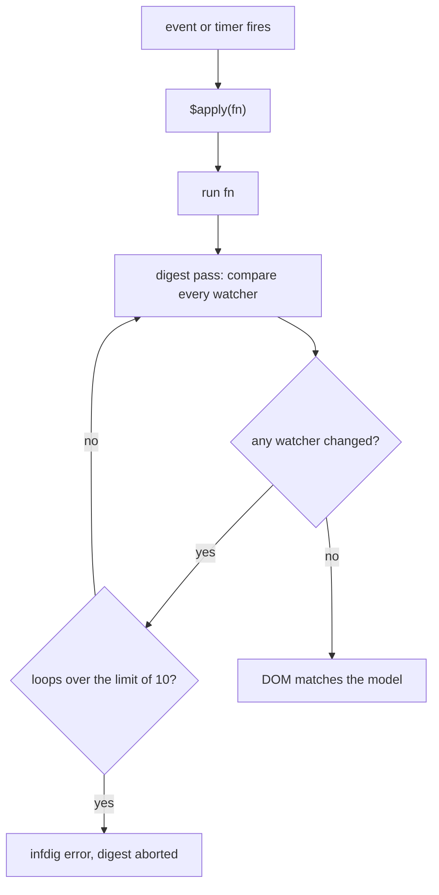

What to notice: success needs a pass where nothing changed, so a listener that writes the model costs one more full pass.

### How it actually works

**Why a change outside `$apply` is not shown.** Read, not run, in `angular` 1.8.3 (`angular.js`, `$RootScopeProvider`): `$apply` calls `beginPhase('$apply')` (internal), evaluates your function, and in a `finally` calls `$rootScope.$digest()`. Nothing else starts a digest, so an assignment in a bare timer waits for the next one; the scope guide says code outside "the AngularJS execution context" needs `$apply` (read 2026-10-18).

**Why the loop is bounded.** `var TTL = 10` (**TTL** here means the loop limit) sits in `$RootScopeProvider`. In `$digest`, `if ((dirty || asyncQueue.length) && !(ttl--))` throws the `infdig` error "{0} $digest() iterations reached. Aborting!" with 10 filled in. Because `ttl` starts at 10, the throw comes at the end of an eleventh dirty pass.

**How `ng-model` uses it.** One watcher (the internal `ngModelWatch`) copies model to view; a DOM listener goes back through the internal `$$debounceViewValueCommit`, which calls `$apply` unless a phase is running. A child scope inherits prototypally; an **isolate scope** does not (scope guide).

**What our model shows.** `mini-digest.ts` is our model of the 1.8.3 loop, not AngularJS: one scope, no `$evalAsync` queue.

- `Section 1: our model runs a second loop when a listener changes another watched value` finds three passes where a lone change takes two.
- `Section 1: our model stops after 10 unstable loops with an infdig-style error` finds the watcher read 11 times before the throw.
- `Section 1: our model does not see a change made outside apply until the next digest` finds the listener silent until `apply` runs.

**Against Angular.** Its templates compile to code checked from the root on a tick, with **zone.js**, a library that patches the browser's async APIs, as the noise detector ([21 §3](21-change-detection.md#3-zonejs-and-ngzone-how-changes-used-to-be-detected-and-why-zone-left-the-default)).

### Code

Approach: show the bug and its fix in AngularJS, then the loop of our model.

1. A controller assigns inside a timer, so no digest follows:

```js
// Partial: AngularJS 1.8 (not run in the labs); module and template omitted
function ClockCtrl($scope) {
  setTimeout(function () {
    $scope.status = 'ready'; // no digest runs, the page keeps the old text
  }, 1000);
  setTimeout(function () {
    $scope.$apply(function () { $scope.status = 'ready'; }); // fn, then a digest
  }, 2000);
}
```

2. Our model repeats passes while any watcher is dirty and throws when the budget is spent:

```ts
// Excerpt of labs/ts-js/src/modules/39-version-history-and-migrations/concepts/mini-digest.ts
  digest(): number {
    let ttl = TTL;
    let passes = 0;
    let dirty: boolean;
    do {
      dirty = false;
      passes++;
      for (const watcher of this.watchers) {
        const value = watcher.get();
        if (value !== watcher.last) {
          const previous = watcher.last === unset ? value : watcher.last;
          watcher.last = value;
          dirty = true;
          watcher.listener(value, previous);
        }
      }
      if (dirty && !(ttl--)) {
        throw new Error(`${TTL} $digest() iterations reached. Aborting!`);
      }
    } while (dirty);
    return passes;
  }
```

### Best practices and anti-patterns

- **Pass the change to `$apply(fn)`**, because a throw in `fn` goes to the exception handler and the digest still runs.
- **Keep watcher functions cheap**, because every pass calls every one.
- **Bind to an object property (`controller as`)**, because a primitive bound in a child scope gets hidden (the `ngIf` doc comment: "will override (hide) the value in the parent scope").
- **Avoid listeners that keep changing another watched value**, because each write forces a pass until the limit throws.

### Misconceptions and traps

- *"AngularJS re-renders the whole page on every change."* It compares watcher values, and only a changed binding's listener touches the DOM. The myth comes from "checks everything" being heard as "repaints everything".
- *"Dirty checking is the same as Angular's change detection."* AngularJS loops until stable and lets listeners write the model; Angular checks top-down once per tick and, in development mode, throws `ExpressionChangedAfterItHasBeenChecked` when a check changes a bound value ([21 §1](21-change-detection.md#1-the-synchronization-problem-dirty-checking-and-fine-grained-reactivity)). The myth comes from both being called change detection.
- *"`$scope.$apply()` everywhere fixes missing updates."* It fixes code outside the context, but inside a digest it throws: `beginPhase` builds "{0} already in progress" from the running phase, giving "$digest already in progress". The myth comes from the fix working in the timer case.

Drilled in [Q39.01](#q39-01) and [Q39.02](#q39-02); practised in [Exercise 39.1](#ex39-1).

## 2. Why Angular was rewritten, and what carried over

### The problem it solves

"Why did Google rewrite AngularJS?" Folklore answers cite nothing; a team with a 1.x app needs the differences that rule out upgrading in place. A **rewrite** here means a new framework with no in-place upgrade path: Angular 2.0.0 (2016-09-14, Angular changelog) gives each 1.x feature a new syntax or mechanism (the official quick reference). No official text read here states the motives, so this section reports mechanisms.

### Mental model

Both frameworks have templates with directives and dependency injection, but share almost no code. Two cars with the same badge: the driver and the route carry over, the engine does not.

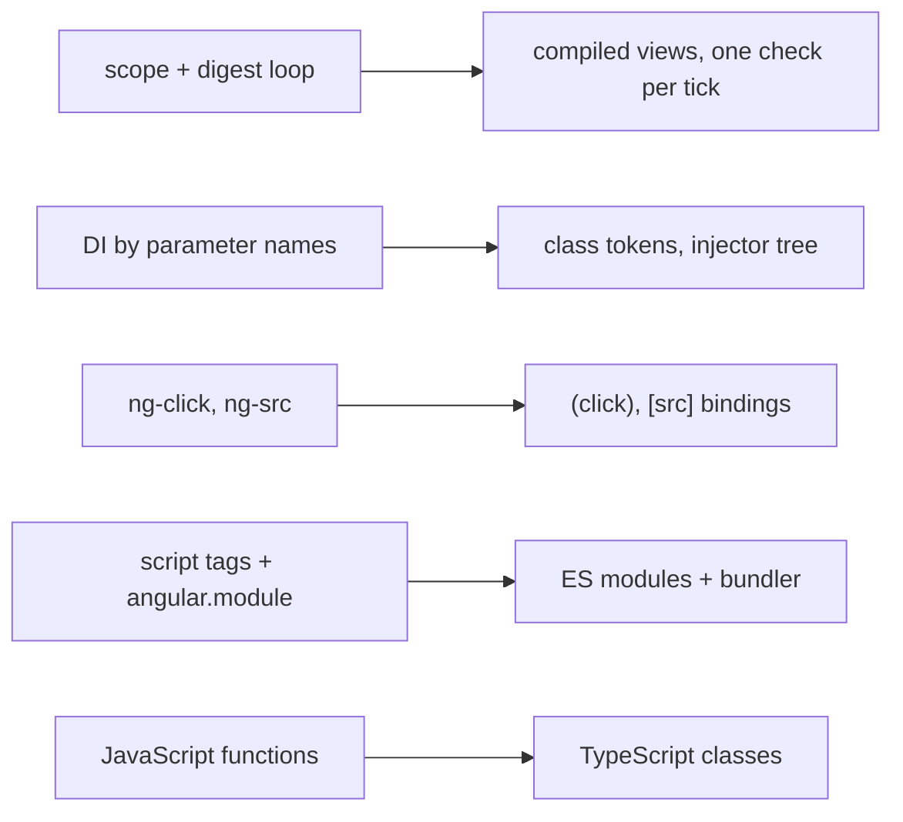

What to notice: each arrow replaces a mechanism, not a name, so no step is a find-and-replace.

### How it actually works

**Change detection.** A 1.8.3 digest re-walks every watcher until stable (§1). The angular.io upgrade guide (16.2.0 source, read 2026-10-18) says that in Angular "no one needs to call `scope.$apply()`": zone.js told Angular when code finished ([21 §3](21-change-detection.md#3-zonejs-and-ngzone-how-changes-used-to-be-detected-and-why-zone-left-the-default)). Templates compile to code with **one-way data flow**: property bindings carry values from component to DOM, event bindings from DOM to component, checked once per tick.

**Dependency injection.** Read, not run, in 1.8.3 (`angular.js`): with no `$inject` list, the internal `extractArgs` matches the parameter list in `Function.prototype.toString`'s output, and `annotate` (public as `$injector.annotate`) records each name. Its doc comment warns this "does not work with minification, and obfuscation tools since these tools change the argument names" (**minification**: shrinking code by renaming locals). A **minification-safe DI annotation** lists the names as strings (`fn.$inject`, or an array ending with the function), because strings survive renaming. The upgrade guide contrasts tokens that "are always strings" in "exactly one injector" with Angular tokens that "are often classes" in "a tree hierarchy of injectors" ([16 §2](16-dependency-injection.md#2-providers-and-tokens-useclass-usevalue-usefactory-and-useexisting)).

**Templates.** The quick reference says AngularJS's event directives "do not exist in Angular": `ng-click` becomes `(click)` and `ng-src` becomes `[src]`, bindings to any event or property ([13 §4](13-components-and-templates.md#4-property-attribute-class-and-style-bindings)).

**Modules and language.** `angular.module` is "a global place for creating, registering and retrieving AngularJS modules"; the source stores them by name and loads no file, so `<script>` tags had to stay "in the correct order" (upgrade guide). An **ES module** is a file whose `import` and `export` declarations the engine links before running it ([05 §1](05-js-modules-memory-modern-features.md#1-es-modules-static-structure-linking-and-live-bindings)). Angular is TypeScript classes in ES modules (`@angular/core` 22.2.1 declares `"type": "module"`), built by the CLI (1.0.0, 2017-03-24, npm registry).

**What carried over.** Ideas, not code: DI is "front and center in both" (upgrade guide); per the quick reference, modules group features, filters became pipes with the same `|`, `ng-class` became `ngClass`, and controllers became component classes.

> [!NOTE]
> **Framework vs platform.** Modules and classes are JavaScript's: ECMA-262 6th Edition (June 2015) lists "modules, class declarations" among its major enhancements. `angular.module`'s registry and the digest are AngularJS's own code, not platform features. Angular adds NgModules, a compiler and its own change detection on top.

### Code

Approach: one dependency in two 1.8.3 styles, then in Angular.

1. Inferred names break once a minifier renames `movieService`.
2. Array notation keeps them as strings.
3. Angular injects by class token.

```js
// Partial: AngularJS 1.8 (not run in the labs); movieService registration and templates omitted
angular.module('movies', [])
  .controller('InferredCtrl', function (movieService) {}) // 1. name read from the source text
  .controller('ArrayCtrl', ['movieService', function (m) {}]); // 2. string survives renaming
// minified, step 1 becomes function (a) {} and the injector fails with "Unknown provider: …" (abridged)
```

```ts
// Partial: Angular 22; MovieService is assumed to be an @Injectable({ providedIn: 'root' }) class with nextPoster(): string
import { Component, inject, signal } from '@angular/core';
import { MovieService } from './movie-service';

@Component({
  selector: 'app-movie-list',
  template: `<button (click)="next()">Next</button>`,
})
export class MovieList {
  private readonly movies = inject(MovieService); // 3. the class is the token
  protected readonly poster = signal('');

  protected next(): void {
    this.poster.set(this.movies.nextPoster());
  }
}
```

### Best practices and anti-patterns

- **Turn on `ng-strict-di` in a 1.x app**, because inferred names fail only after minification and strict mode fails at once.
- **Answer "why the rewrite" with mechanisms and sources**, because a motive without an official text is folklore.

### Misconceptions and traps

- *"Angular 2 was AngularJS 2.0 with breaking changes."* It is a separate framework (`@angular/core`, not `angular`), reached through a hybrid running both ([§9](#9-from-angularjs-to-angular-ngupgrade-hybrids-the-strangler-fig-and-rewrites)). The myth comes from the version number continuing the name.
- *"The rewrite was only about performance."* DI, templates, modules and language changed too, and no official text read here names a single cause. The myth comes from the digest being the best-known pain.
- *"AngularJS is still supported."* Support ended in January 2022 and the npm package is deprecated (§1). The myth comes from `npm install angular` still working.

Drilled in [Q39.03](#q39-03).

## 3. How Angular ships: semantic versioning, the release cadence, support windows and the deprecation policy

### The problem it solves

A team asks: how long can we stay on v20, will a minor release break us, is a developer preview API safe? The releases page (angular.dev, read 2026-10-18) ends v20's long-term support on 2026-11-28 and says "Angular versions v2 to v19 are no longer supported."

### Mental model

**Semantic versioning** numbers a release `major.minor.patch`. A major release may break code, a minor release adds features and is "fully backward-compatible", and a patch fixes bugs. Each major is **active** (regular updates and patches) for 12 months, then in **LTS**, long-term support (only critical fixes and security patches), for 12 months. The **deprecation period** is how long a deprecated API stays present, at least 12 months. **Developer preview** APIs (working, not yet stabilized) and **experimental** APIs (may never become stable) fall outside all of this. Think of a lease, plus a "beta" room that can be rearranged any day.

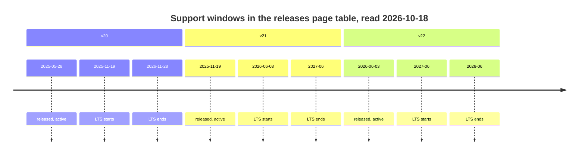

What to notice: v20's and v21's LTS start the day the next major is released, so only one major is active at a time.

### How it actually works

**Support windows.** Majors are "typically supported for 24 months", but the table gives v22 24 months and v20 and v21 18 and 19, so plan from the table. An LTS fix needs a newly found security vulnerability or a regression caused since LTS began by a third party, such as a new browser version.

**How a deprecation reaches you.** It is announced in the changelog, struck through in the API docs, and marked with the **`@deprecated` JSDoc tag**, which editors read to flag uses. Removal happens only in a major, and the API stays "in at least the next major". In the installed `@angular/core` 22.2.1 typings, `ChangeDetectionStrategy.Default` is deprecated and "due to be removed"; `Eager` [Added in v21.2] is its alias (21.2.0 changelog). The changelog names no release for the tag, so no version marker is shown.

**Why not jump from v19 to v22.** `ng update` needs a supported target and a source "within one major version" of it; v19 is unsupported and three majors back. The policy keeps a deprecated API only through the next major, so one hop is what it covers (our reading; the page gives no reason). Hops: [§8](#8-skipping-versions-safely-one-major-per-hop-node-and-typescript-ranges-and-libraries-that-block-a-hop); mechanics: [12 §2](12-angular-how-it-works.md#2-the-cli-and-the-workspace-angularjson-projects-schematics-and-ng-update).

**Compiler ABI.** The **compiler ABI** is the internal runtime API (the `ɵɵ`-prefixed names, internal) that the compiler's generated code calls. The page promises it "across patch versions of the same minor version", not across minors, so builds that share one Angular runtime ([38 §8](38-architecture-and-production-structure.md#8-micro-frontends-module-federation-native-federation-and-when-they-are-justified)) should match on the minor. Your own library should make the same promise ([38 §6](38-architecture-and-production-structure.md#6-public-api-surfaces-public-apits-exports-secondary-entry-points-and-versioning)).

**Statuses.** The guide marks these at first mention ([STYLE-GUIDE §3](../STYLE-GUIDE.md#3-accuracy-rules)), for example `@boundary` [Developer preview since v22.2] ([37 §9](37-elements-pwa-errors-ecosystem.md#9-error-boundaries-boundary-error-reset-onviewerror-and-onerror)).

### Code

Approach: ask the typings whether a member is deprecated, and ask our table for a version's stage on a date you pass in.

1. Find the `types/*.d.ts` file that declares `enum ChangeDetectionStrategy`, read-only, and keep the doc comment above each member.
2. Only `Default`'s comment holds the tag.
3. Compare the date with the row's dates; a month-only value counts as that month's first day.

```ts
// Excerpt of labs/ts-js/src/modules/39-version-history-and-migrations/concepts/section-3-support.test.ts
    const body = text.slice(start + header.length, text.indexOf('\n}', start));
    const docs = new Map<string, string>();
    for (const match of body.matchAll(/\/\*\*((?:(?!\*\/)[\s\S])*)\*\/\s*(\w+) = \d+/g)) {
      docs.set(match[2] ?? '', match[1] ?? '');
    }
```

```ts
// Excerpt of labs/ts-js/src/modules/39-version-history-and-migrations/concepts/section-3-support.test.ts
const asDay = (date: string): string => (date.length === 7 ? `${date}-01` : date);

function stageOn(row: SupportRow, date: string): Stage {
  if (date < row.released) return 'unreleased';
  if (date < asDay(row.activeEnds)) return 'active';
  if (date < asDay(row.ltsEnds)) return 'lts';
  return 'unsupported';
}
```

`Section 3: the installed @angular/core 22.2.1 marks ChangeDetectionStrategy.Default as deprecated in its typings` finds ``@deprecated Use `Eager` instead.`` on `Default` only. `Section 3: our support table puts v22 in active support and v20 and v21 in LTS on 2026-10-18` returns active, LTS, LTS, and 24, 19 and 18 months.

### Best practices and anti-patterns

- **Plan from the support table, not from "24 months"**, because v20 and v21 get 18 and 19.
- **Fix deprecations within one major**, because the policy keeps an API only "in at least the next major".
- **Wrap developer preview and experimental APIs in one file you own**, because they "can change at any time, even in new patch versions".

### Misconceptions and traps

- *"Angular releases a major every six months."* Once true: every 6 months with 1-3 minors, until v22. Now: every 12 months with 4-6 minors, v23.0 about June 2027 ("subject to change"). Older material repeats the old rhythm.
- *"LTS means new features are backported."* LTS gets only critical fixes and security patches. The word "support" sounds like active-phase care.
- *"A developer preview API follows semantic versioning."* The policies do not apply to it, and it can change in a patch. It ships in a stable release, so the version looks like a promise.

Drilled in [Q39.04](#q39-04) and [Q39.05](#q39-05); practised in [Exercise 39.2](#ex39-2).

## 4. The version matrix, part 1: v2 to v8

### The problem it solves

Interviewers ask "what changed in Angular 4?" and "why is there no Angular 3?" to see whether you know the platform's history or only today's API. Old code sets the same test: a 2018 project imports `@angular/http`, calls `Renderer` and writes `loadChildren: './admin/admin.module#AdminModule'`.

### Mental model

Read the matrix as the service log of a long-running machine: each entry says what was replaced. The "why" column holds only what the changelog or release notes say, and reads "none stated" where they are silent. Dates are release days from the changelog headings ([`angular/angular` CHANGELOG_ARCHIVE.md](https://raw.githubusercontent.com/angular/angular/main/CHANGELOG_ARCHIVE.md), read 2026-10-18).

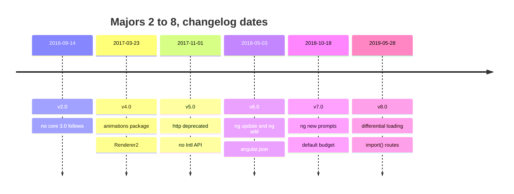

What to notice: majors come about six months apart (five and a half to seven and a half), and the only gap in the numbers is between v2 and v4.

### How it actually works

| Version (release day) | What changed | Why, from the entry |
|---|---|---|
| v2 (2016-09-14) | 2.4.0 (2016-12-20): RxJS updated to 5.0.1, peer range `^5.0.1` | none stated |
| v3 | no `@angular/core` 3.0.0 | see below |
| v4 (2017-03-23) | 4.0.0-beta.0 (2016-12-15): `ngIf` supports `else`; `@angular/animations` split from core; `RendererV2` renamed `Renderer2`, `Renderer` [Deprecated since v4.0 — use `Renderer2`] · [Removed in v9.0]; smaller AOT (ahead-of-time compiled) output; `WeakMap` polyfill needed on old browsers; 4.3.0 (2017-07-14): `HttpClient` | animations: "if you don't use Animations, this extra code will not end up in your production bundles"; AOT code "by more than half in some cases" |
| v5 (2017-11-01) | `@angular/http` [Deprecated since v5.0 — use `@angular/common/http`]; `@angular/common` drops the `Intl` API | `Intl`: "to improve browser support"; http: none stated |
| v6 (2018-05-03) | `ng update`, `ng add` and `angular.json` replacing `.angular-cli.json` ([CLI v6.0.0 notes](https://github.com/angular/angular-cli/releases/tag/v6.0.0)); `@Injectable()` supports tree-shakeable tokens; `enableIvy` option; `@angular/elements` first stable | "the first release of Angular that unifies the Framework, Material and CLI"; `ng update` "to help simplify keeping your projects up to date" |
| v7 (2018-10-18) | `@schematics/angular` adds "several prompts to ng-new" and a "default budget of 2mb/5mb" ([CLI v7.0.1 notes](https://github.com/angular/angular-cli/releases/tag/v7.0.1)) | none stated |
| v8 (2019-05-28) | differential loading; `loadChildren` strings [Deprecated since v8.0 — use dynamic `import()`], rewritten by `ng update`; `TestBed.get(…): any` [Deprecated since v8.0 — use the typed overload] ([CLI v8.0.0 notes](https://github.com/angular/angular-cli/releases/tag/v8.0.0)) | modern bundle "10-30% smaller" with "fewer required polyfills"; `import()` "aligns Angular with the JavaScript specification"; `TestBed`: all use "should go through the typed API" |

**Why no v3.** The `ng update` source (`@angular/cli` 22.2.1, `src/commands/update/cli.js`) says "Before version 6, the major versions were not always sequential. Example @angular/core skipped version 3, @angular/cli skipped versions 2-5." The registry agrees: `@angular/core` goes from 2.4.10 (2017-03-17) to 4.0.0, `@angular/cli` from 1.0.0 to 6.0.0, while `@angular/router` has a 3.x line, 3.0.0 (2016-09-15) to 3.4.10. No changelog gives a reason, so none is claimed.

**Terms.** A **tree-shakeable provider** is one the bundler drops when nothing uses it. **`Renderer2`** is the service components call to change DOM nodes. **`HttpClient`** is Angular's HTTP service ([27 §1](27-http-client.md#1-httpclient-versus-fetch-what-the-framework-adds-over-the-platform)). **String-based lazy loading** is a `loadChildren` string, `path/to/module#ModuleName`, that the build resolves. **Differential loading** builds two bundles, one for modern browsers and one for older ones; the v8 notes enable it by default through `target: es2015` in `tsconfig.json`. A **budget** is a bundle size limit in the build configuration. `ng update` and `ng add` mechanics: [12 §2](12-angular-how-it-works.md#2-the-cli-and-the-workspace-angularjson-projects-schematics-and-ng-update); `@angular/elements`: [37 §1](37-elements-pwa-errors-ecosystem.md#1-angular-elements-turning-a-component-into-a-custom-element).

**Legacy code.** `@angular/http` has no release after 7.2.16 (2020-01-08) and no 8.x; the registry notice reads "Package no longer supported. Use @angular/common instead". `Renderer` code moves to `Renderer2`; the 9.0.0 entry is "remove deprecated Renderer".

### Code

Approach: date a legacy file by its signatures, then replace each with what its row names.

1. Read the `@angular/core` version in `package.json` and find its row.
2. Search for `@angular/http`, `Renderer` without the `2`, `loadChildren: '` and `TestBed.get(`.
3. Replace each as the table says.

```ts
// Partial: two route objects; the first form is the one the v8.0.0 CLI notes call string-based, the second is the dynamic import() form (our example).
const before = { path: 'admin', loadChildren: './admin/admin.module#AdminModule' };
const after = {
  path: 'admin',
  loadChildren: () => import('./admin/admin.module').then((m) => m.AdminModule),
};
```

### Best practices and anti-patterns

- **Date legacy code by its signatures first**, because each maps to a row naming its replacement.
- **Quote a "why" only from its entry**, because retellings add motives no changelog states.
- **Replace `@angular/http` before any later major**, because the package has no release after 7.2.16 while `HttpClient` has existed since 4.3.0.

### Misconceptions and traps

- *"Angular 3 was skipped because of a big breaking change."* The CLI source says only that early majors "were not always sequential", and the registry shows `@angular/router` kept a 3.x line. A skipped number sounds dramatic, so people supply a drama.
- *"`HttpClient` arrived in v5."* It shipped in 4.3.0 (2017-07-14); v5 deprecated `@angular/http`, so the two get merged in memory.
- *"Animations were removed from Angular."* They moved to `@angular/animations` in v4, and that package is itself [Deprecated since v20.2 — use `animate.enter` and `animate.leave`] ([35 §9](35-animations.md#9-migrating-from-angularanimations-to-native-css-and-animateenteranimateleave)), and "moved out of core" sounds like removal.

Drilled in [Q39.06](#q39-06) and [Q39.10](#q39-10).

## 5. The version matrix, part 2: v9 to v15, from Ivy to standalone

### The problem it solves

Interviewers ask what **Ivy** was (the compiler and runtime that replaced **View Engine**, the pair before v9; internals in [12 §8](12-angular-how-it-works.md#8-under-the-hood-what-the-compiler-emits-and-what-the-runtime-does-with-it)), why old libraries break on v16 and when **standalone** components (listing their own imports instead of being declared in an NgModule, [15 §2](15-standalone-and-ngmodules.md#2-standalone-components-and-the-imports-array)) arrived. Code that compiled through v21 can still fail in v22: an injected `ComponentFactoryResolver` no longer exists (Legacy below).

### Mental model

The engine was swapped like a foundation under an occupied building: new floors first (applications), then a converter for old furniture (**`ngcc`**, the Angular compatibility compiler, which CLI commands run "as needed" during a build, per the 9.1.0 guide), then the converter is removed. Dates are release days ([`angular/angular` CHANGELOG.md](https://raw.githubusercontent.com/angular/angular/main/CHANGELOG.md) and [CHANGELOG_ARCHIVE.md](https://raw.githubusercontent.com/angular/angular/main/CHANGELOG_ARCHIVE.md), read 2026-10-18).

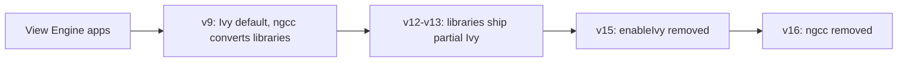

What to notice: every arrow keeps old libraries working until the last one, which removes the converter.

### How it actually works

**Terms.** **Partial compilation** is the library publishing format: an intermediate form that the application's build finishes (mechanism: 12 §8, above). The **Angular Package Format** is the layout `ng-packagr` writes ([38 §5](38-architecture-and-production-structure.md#5-angular-cli-libraries-ng-generate-library-ng-packagr-and-consuming-the-build)). **MDC** is the `material-components-web` package the components changelog names in its `mdc-list` fix (13.2.2).

| Version (release day) | What changed | Why, from the entry |
|---|---|---|
| v9 (2020-02-06) | Ivy is the default for applications; library authors keep View Engine; `TestBed.get` [Deprecated since v9.0 — use `TestBed.inject`] · [Removed in v20.0] | View Engine libraries stay compatible "with default v9 applications that use Ivy" |
| v10 (2020-06-24) | `ModuleWithProviders` needs its type argument; a `--strict` option and an `angular.json` "strict setting" | the generic "has always been required" for Ivy; a v10 migration fixes application code |
| v11 (2020-11-11) | `ViewEncapsulation.Native` [Removed in v11.0] | none stated; `ng update` rewrites it to `ShadowDom` |
| v12 (2021-05-12) | `@schematics/angular`: "strict mode by default"; "remove usage of deprecated View Engine compiler"; new libraries "published in Ivy partial mode"; `??` in templates | none stated |
| v13 (2021-11-03) | libraries migrated "from ViewEngine to Ivy Partial compilation"; IE 11 polyfills and differential loading removed; 13.2.0: `ComponentFactoryResolver` [Deprecated since v13.2 — use `createComponent`] · [Removed in v22.0] | "Since Ivy, there is no need to resolve Component factories"; "no browsers officially supported by Angular … require ES5 code" |
| v14 (2022-06-02) | standalone components and directives [Developer preview since v14.0]; typed forms ([25 §3](25-forms-reactive-and-template-driven.md#3-typed-forms-formbuilder-and-nonnullableformbuilder)); 14.1.0: `inject()` options object [Added in v14.1], `canMatch` [Added in v14.1] | untyped classes remain "to opt-out of the new, stricter behavior" |
| v15 (2022-11-16) | standalone [Stable since v15.0]; `enableIvy` removed; directive composition enabled; Material components "re-implemented based on MDC"; 15.1.0: `canLoad` [Deprecated since v15.1 — use `canMatch`]; 15.2.0: standalone schematics ([15 §7](15-standalone-and-ngmodules.md#7-migrating-with-ng-generate-angularcorestandalone-three-passes-hybrid-apps-and-common-failures)) | "Ivy is the only rendering engine"; "Use CanMatch" |

**Why View Engine libraries fail after v16.** The 16.0.0 entries say "(ngcc) has been removed and as a result Angular View Engine libraries will no longer work", and the Update Guide repeats it for "projects on v16 and later". Nothing converts such a library any more. Libraries published in partial compilation (new ones from v12, migrated ones in v13) are not View Engine libraries. The same release deleted `entryComponents`, which "weren't doing anyting" (sic) [Removed in v16.0].

**Standalone and locality.** Standalone sits on Ivy compiling each class on its own, drilled in [Q12.26](12-angular-how-it-works.md#q12-26). The v15 entry adds that the rewritten components' DOM and CSS classes changed.

### Code

Approach: date a legacy codebase by its Ivy-era leftovers, then remove what each row names.

1. Delete `enableIvy` from `tsconfig.json`, as the Update Guide's v15 step says.
2. Delete `entryComponents` and `ANALYZE_FOR_ENTRY_COMPONENTS` from application code.
3. Replace each `ComponentFactoryResolver` with the component class passed to `createComponent`.
4. Replace or upgrade any dependency still published for View Engine, because v16 has no converter.

#### Legacy

Through v21 the factory form compiled; the 22.0.0 entry says `ComponentFactoryResolver` is "no longer available" and [19 §7](19-component-communication-and-projection.md#7-dynamic-components-viewcontainerrefcreatecomponent-createcomponent-and-bindings) records the compile error. The snippet does not compile under v22.

```ts
// Partial: removed API, does not compile under v22; the injected resolver, the component and the container are omitted
const factory = resolver.resolveComponentFactory(Dyn);
container.createComponent(factory);
// Migrate by passing the class: container.createComponent(Dyn);
```

### Best practices and anti-patterns

- **Date a codebase by `enableIvy`, `entryComponents` and `ComponentFactoryResolver`**, because each maps to a row and a removal version.
- **Check a library's compile format before a hop past v15**, because the 16.0.0 entry says View Engine libraries stop working.

### Misconceptions and traps

- *"Ivy is a v9 feature you can still turn off."* Once true: through v11, `enableIvy: false` built an app with View Engine. Now: the CLI 12.0.0 entry removes "usage of deprecated View Engine compiler", and the 15.0.0 entry removes the option because "Ivy is the only rendering engine". Old `tsconfig.json` files keep the line.
- *"Partial compilation is for apps."* It is the library publishing format, finished by the app build. The word "compilation" suggests the app's own.
- *"`ComponentFactoryResolver` still works in v22."* Once true: it compiled through v21 (deprecated since v13.2). Now it is removed. Tutorials written before v22 still use it.

Drilled in [Q39.07](#q39-07), [Q39.08](#q39-08) (the v14 and v15 half) and [Q39.10](#q39-10).

## 6. The version matrix, part 3: v16 to v22, from signals to OnPush by default

### The problem it solves

Candidates say "signals came with zoneless" or "OnPush is how Angular works now" and are a year or two off. Three questions hide in one: when a feature appeared, when it became stable, and when new projects began using it by default. An old project gets none of the third kind unprompted: after the v22 update its components keep their old checking.

### Mental model

A feature has up to three dates: **introduced** (first release, perhaps as a developer preview), **stable** (preview label dropped) and **default** (`ng new` or the compiler switched to it). A **default for new projects** is what you get when you set nothing; existing projects keep their behavior until the update or you change it. A city changes the rules for new buildings each year but grandfathers old ones unless the owner renovates. Dates are release days from the changelog headings ([Angular](https://raw.githubusercontent.com/angular/angular/main/CHANGELOG.md), [CLI](https://raw.githubusercontent.com/angular/angular-cli/main/CHANGELOG.md) and [Components](https://raw.githubusercontent.com/angular/components/main/CHANGELOG.md), read 2026-10-18); from v22 a major ships every 12 months ([§3](#3-how-angular-ships-semantic-versioning-the-release-cadence-support-windows-and-the-deprecation-policy)).

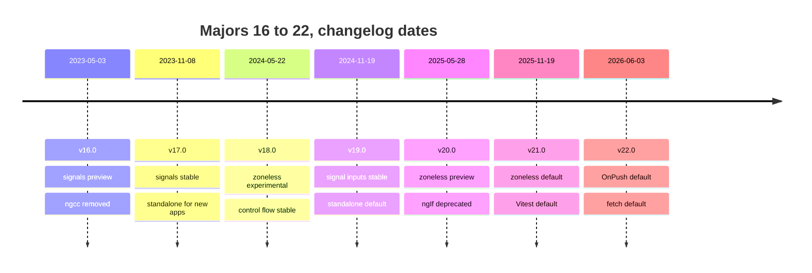

What to notice: a default arrives one to three majors after a feature (zoneless: experimental in v18, default in v21), and v19 (`standalone`) and v22 (OnPush, `strictTemplates`) also flip defaults that old code relies on, with `ng update` writing the old value back both times.

### How it actually works

A **signal** is a value that tracks its readers ([17](17-signals.md#1-why-signals-exist)). **Zoneless** change detection runs without zone.js ([21 §5](21-change-detection.md#5-zoneless-change-detection-the-scheduler-its-triggers-and-pendingtasks); why zone left the default: [Q21.12](21-change-detection.md#q21-12)). **OnPush** checks a component only when something marks it dirty ([21 §2](21-change-detection.md#2-onpush-and-eager-strategies-and-what-marks-a-view-dirty)). **Signal Forms** build a form from a model signal ([26](26-signal-forms.md#1-why-a-third-forms-api-model-first-signals-end-to-end)). The **application builder** is `@angular/build:application` ([12 §3](12-angular-how-it-works.md#3-building-the-application-builder-output-layout-and-budgets)). A **migration** is a schematic `ng update` runs to rewrite code for one version step ([12 §2](12-angular-how-it-works.md#2-the-cli-and-the-workspace-angularjson-projects-schematics-and-ng-update)). **Incremental hydration** keeps parts of the server-rendered page dehydrated until a trigger ([32 §6](32-ssr-ssg-hydration.md#6-incremental-hydration-defer-blocks-with-hydrate-triggers)). **`strictTemplates`** turns on full type checking of templates ([12 §7](12-angular-how-it-works.md#7-aot-versus-jit-and-template-type-checking)).

| Version | Introduced | Stable | Default for new projects | Deprecated or removed |
|---|---|---|---|---|
| v16 | `signal` [Developer preview since v16]; `DestroyRef` [Added in v16.0] | none | none | `ngcc`; `entryComponents` |
| v17 | built-in control flow | `signal`, `computed` [Stable since v17] | `ng new`: application builder, standalone, `--ssr` | Material legacy components |
| v18 | zoneless provider [Experimental since v18.0] | control flow [Stable since v18]; Material 3 ([36 §3](36-material-and-cdk.md#3-theming-with-material-3-mattheme-system-variables-and-light-and-dark-with-color-scheme)) | none | `HttpClientModule` [Deprecated since v18 — use `provideHttpClient`] |
| v19 | `linkedSignal` | `input()`, `output()`, signal queries, `@let` [Stable since v19.0] | `standalone` is `true` [Changed in v19.0: components are standalone unless `standalone: false`] | `APP_INITIALIZER` [Deprecated since v19 — use `provideAppInitializer`]; Protractor |
| v20 | zoneless [Developer preview since v20.0] | `linkedSignal`, `toSignal`, incremental hydration [Stable since v20.0]; zoneless [Stable since v20.2] | file names drop `.component` [Changed in v20.0: generated file names have no `.component` suffix] | `*ngIf`, `*ngFor`, `*ngSwitch` [Deprecated since v20.0 — use `@if`, `@for`, `@switch`]; `@angular/animations` [Deprecated since v20.2 — use `animate.enter` and `animate.leave`] ([35 §9](35-animations.md#9-migrating-from-angularanimations-to-native-css-and-animateenteranimateleave)) |
| v21 | Signal Forms [Experimental since v21.0]; `ChangeDetectionStrategy.Eager` [Added in v21.2] | none | zoneless [Changed in v21.0: new applications are zoneless]; Vitest | none |
| v22 | `@Service` [Added in v22.0] | Signal Forms [Stable since v22.0] | OnPush [Changed in v22.0: a component without `changeDetection` is OnPush]; fetch backend; `strictTemplates` [Changed in v22.0: defaults to `true`] | `ChangeDetectionStrategy.Default` (deprecated in the 22.2.1 typings); `provideRoutes()` [Removed in v22.0]; HammerJS integration [Removed in v22.0]; webpack builders [Deprecated since v22.0 — use `@angular/build`]; TypeScript before 6.0 |

A cell rests on a changelog entry under that version's heading ([SOURCES.md](../SOURCES.md)) or, where none was read, on its owner ([17](17-signals.md), [15](15-standalone-and-ngmodules.md#2-standalone-components-and-the-imports-array), [12 §2](12-angular-how-it-works.md#2-the-cli-and-the-workspace-angularjson-projects-schematics-and-ng-update)).

**New default versus what `ng update` keeps.** The 22.0.0 entry says "Component with undefined `changeDetection` property are now `OnPush` by default. Specify `changeDetection: ChangeDetectionStrategy.Eager` to keep the previous behavior." The installed `@angular/core` 22.2.1 `schematics/migrations.json` holds eight migrations, all at 22.0.0, among them `change-detection-eager` ("Adds `ChangeDetectionStrategy.Eager` to all components.") and `strict-templates-default` ("Adds 'strictTemplates: false' in tsconfig.json when not set."; the run writes the build target's tsconfig, [§11](#11-the-v22-upgrade-what-ng-update-changes-and-why-each-migration-keeps-the-old-behavior)). A new default therefore applies to new code, while the update writes the old value into old code ([§11](#11-the-v22-upgrade-what-ng-update-changes-and-why-each-migration-keeps-the-old-behavior) says what each migration writes; `ng update` itself: [Q12.05](12-angular-how-it-works.md#q12-05)).

**What the installed packages require.** `Section 6: the installed 22.2.1 packages require the Node and TypeScript ranges of the 22.0.x compatibility row` reads the manifests: both packages declare Node `^22.22.3 || ^24.15.0 || >=26.0.0`, and `@angular/compiler-cli` peers on TypeScript `>=6.0 <6.1`. The compatibility page (read 2026-10-18) writes `^26.0.0` and `>=6.0.0 <6.1.0`; the test expects the package values.

### Code

Approach: answer "since when?" from the matrix, then check what an update does to your copy.

1. Find the feature's row and the column your claim belongs to.
2. For a default, find its 22.0.0 migration in `migrations.json`.
3. Date the entry by the version heading above it.

```ts
// Partial: two components (our example; selectors, templates and imports omitted). The second is what `ng update` leaves in an older project.
@Component({ selector: 'app-new-row', template: '' })
export class NewRow {} // no changeDetection: OnPush since v22

@Component({ selector: 'app-old-row', changeDetection: ChangeDetectionStrategy.Eager, template: '' })
export class OldRow {} // after the update: checked as before
```

### Best practices and anti-patterns

- **Give three dates for "since when"**, because `signal` was a preview in v16 and stable only in v17.
- **Date an entry by the heading above it**, because the changelog lists 20.3.34 between 22.3.0-next.2 and 22.3.0-next.1.
- **Keep the added `Eager` lines until each component is reviewed**, because a component that mutates plain fields may stop refreshing.

### Misconceptions and traps

- *"Signals replaced zone.js in v16."* Signals were a v16 preview, stable in v17; zoneless was experimental in v18, stable in 20.2, the default in v21. Both are "the new change detection", so their dates merge.
- *"Standalone is mandatory since v17."* The v17 CLI entry says "enable standalone by default in new applications"; `standalone: false` and NgModules still compile in v22 ([15](15-standalone-and-ngmodules.md#5-legacy-ngmodule-patterns-declarations-exports-forrootforchild-sharedmodule-and-coremodule)). New projects show no NgModule.
- *"`*ngIf` was removed in v20."* It is [Deprecated since v20.0 — use `@if`] and still present in 22.2.1 ([18 §1](18-control-flow-and-defer.md#1-built-in-blocks-versus-directives-and-the-if-family-with-as)); a deprecation notice sounds like removal.
- *"v22 makes every existing component OnPush."* The default changed for components with no `changeDetection`, and `ng update` adds `Eager` to them. Headlines omit the migration.

Drilled in [Q39.08](#q39-08) (the v16-v17 half), [Q39.09](#q39-09) and [Q39.10](#q39-10).

## 7. Updating in practice: `ng update`, migration schematics and the Update Guide

### The problem it solves

A team sets `@angular/core` to 22 in `package.json` and runs `npm install`. The app builds, but no **migration** ran (a schematic that rewrites code for one version step, [12 §2](12-angular-how-it-works.md#2-the-cli-and-the-workspace-angularjson-projects-schematics-and-ng-update)), so the code silently takes the new defaults. Another `ng update` stops on a **peer dependency** error: a library's `package.json` lists a range, such as `^21.0.0`, for a package you provide, and 22 is outside it. Someone adds `--force`; the tree is now unchecked.

### Mental model

An update is a checklist in a fixed order with a commit after each step. Angular's packages go first: `@angular/core` and the CLI, each with its **package group**, the packages released and updated together ([12 §1](12-angular-how-it-works.md#1-what-a-framework-does-and-angulars-philosophy)), listed in the `ng-update.packageGroup` field of its `package.json`. Material and the CDK follow, then third-party libraries. A migration is **required** when `ng update` runs it unasked and **optional** when it asks first. The **Update Guide** ([update.angular.dev](https://update.angular.dev/)) turns a from-version, a to-version and an app level into a before, during and after checklist. A building inspection by trade: structure, wiring, furniture, each signed off first.

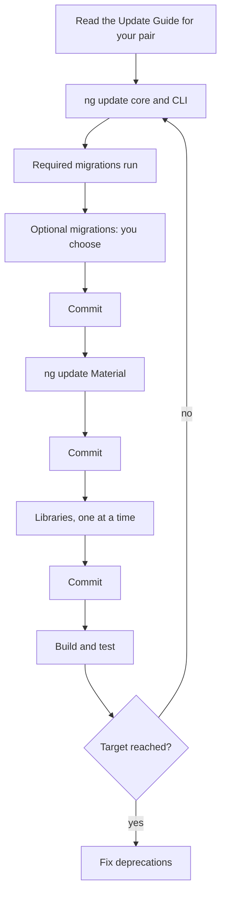

What to notice: each step that changes the tree ends in a commit, so a failure reverts one commit, and the loop repeats for each major.

### How it actually works

**Why this order.** Each step rests on the one before through a peer range. `@angular/material` 22.2.1 peers on `@angular/core` `^22.0.0 || ^23.0.0` (its `package.json`), so Material 22 beside core 21 is outside its own range: core goes first. An invented library range `"@angular/core": "^21.0.0"` rejects 22 the same way; the fixes are its next major or waiting ([§8](#8-skipping-versions-safely-one-major-per-hop-node-and-typescript-ranges-and-libraries-that-block-a-hop)).

**Why `ng update` prompts** (read in `@angular/cli` 22.2.1, `migration.js`; mechanism: [Q12.05](12-angular-how-it-works.md#q12-05)). `Section 7: @angular/core 22.2.1 ships eight migrations, all for 22.0.0 and none optional`: all run unasked. `Section 7: @angular/cli 22.2.1 takes its migrations from @schematics/angular, two of them optional and one recommended`: three run unasked; the prompt "Select the migrations that you'd like to run" ticks an item when it is `recommended`, here `use-application-builder`, not `migrate-karma-to-vitest`. `Section 7: core, common, router, forms and upgrade are in one package group`: core's list names 16 packages, and the installed `common`, `router` and `forms` carry it too.

**What `--force` changes** (read, not run, `@angular/cli` 22.2.1). Its text is "Ignore peer dependency version mismatches." In `update-resolver.js`, the internal `_validateUpdatePackages` has its peer checks log each mismatch as an error, then throws "Incompatible peer dependencies found" only when `force` is false. `--force` removes the stop, not the mismatch: the library is installed outside its own range. It does not lift the refusal to cross several majors, which `cli.js` checks first. For npm 7 and later, the internal `shouldForcePackageManager` already makes the install ignore peer ranges (a source comment blames npm "incorrectly resolving peer dependencies").

**What the Update Guide adds.** Its source ([update.component.ts](https://raw.githubusercontent.com/angular/angular/main/adev/src/app/features/update/update.component.ts), read 2026-10-18) asks for an app level (basic, medium or advanced) and options such as `ngUpgrade`; how it picks steps: [§12](#12-under-the-hood-how-ng-update-selects-migrations-and-how-the-update-guide-builds-its-checklist). A library can ship its own migrations in the same `ng-update` field ([38 §6](38-architecture-and-production-structure.md#6-public-api-surfaces-public-apits-exports-secondary-entry-points-and-versioning)).

### Code

Approach: follow the diagram, one named step at a time, so each commit holds one cause.

1. Start clean and read the Update Guide for your pair.
2. Update core and the CLI, answer the prompt, and let `--create-commits` record each step.
3. Update Material, then each library; build and test.
4. Repeat for the next major.

```sh
# Partial: illustrative; options as read in @angular/cli 22.2.1, src/commands/update/cli.js (not run)
ng update @angular/cli@^22 @angular/core@^22 --create-commits
ng update @angular/material@^22 --create-commits
```

The lab lists the migrations of a target package like this:

```ts
// Excerpt of labs/ts-js/src/modules/39-version-history-and-migrations/concepts/section-7-migrations.test.ts
function migrationsOf(collection: unknown): MigrationRow[] {
  return jsonEntries(jsonField(collection, 'schematics')).map(([name, entry]) => ({
    name,
    version: jsonField(entry, 'version'),
    optional: jsonField(entry, 'optional'),
    recommended: jsonField(entry, 'recommended'),
  }));
}
```

### Best practices and anti-patterns

- **Take the latest patch of the next major** (`@^22`), because it carries the fixes made since the initial release (the CLI's description).
- **Commit after each step, lockfile included**, because `--create-commits` makes one commit per update and per migration, so a bad one reverts alone, and `npm ci` installs exactly the lockfile ([33 §11](33-security.md#11-dependency-and-supply-chain-security-lockfiles-npm-audit-install-scripts-and-subresource-integrity)).
- **Keep `--force` out of CI**, because it skips the check and leaves the conflict.

### Misconceptions and traps

- *"`npm install @angular/core@22` is an update."* It changes the version and runs no migration; the version is the visible part.
- *"`ng update` updates every dependency."* It updates the packages you name and their package group; with no names it only reports what could be updated. The name suggests everything.
- *"Optional migrations are unimportant."* `use-application-builder` is optional and recommended, and §6 lists the webpack builders as deprecated in v22. The word "optional" reads as "skip".

Drilled in [Q39.11](#q39-11), [Q39.12](#q39-12), [Q39.13](#q39-13) and [Q39.14](#q39-14); practised in [Exercise 39.2](#ex39-2).

## 8. Skipping versions safely: one major per hop, Node and TypeScript ranges, and libraries that block a hop

### The problem it solves

An application on v13 must reach v22. `ng update` to 22 gets the refusal quoted below, the next row refuses the installed Node, and a library has no release for v16.

### Mental model

A **hop** is one `ng update` from one major to the next: you can skip a version in the calendar, not in the update. The **compatibility table** is angular.dev's "Version compatibility" page ([versions.md](https://raw.githubusercontent.com/angular/angular/main/adev/src/content/reference/versions.md), read 2026-10-18), listing the Node.js, TypeScript and RxJS each Angular minor requires; the lab copies rows 13.0.x to 22.0.x. A **blocking library** cannot be installed beside the next major: its peer range excludes it, or it cannot run there. A canal's locks: you cannot skip one, but you can pass several in a day when the water levels (Node, TypeScript) match.

```mermaid
flowchart LR
  v13["v13"] -->|"Node 12 out · TS 4.6.2+"| v14["v14"]
  v14 -->|"TS 4.8.2+"| v15["v15"]
  v15 -->|"Node 14 out · TS 4.9.3+"| v16(["v16 · stop: View Engine libraries"])
  v16 -->|"Node 16 out · TS 5.2.0+"| v17(["v17 · stop: Material legacy components"])
  v17 -->|"TS 5.4.0+"| v18["v18"]
  v18 -->|"TS 5.5.0+"| v19["v19"]
  v19 -->|"Node 18 out · TS 5.8.0+"| v20["v20"]
  v20 -->|"TS 5.9.0+"| v21["v21"]
  v21 -->|"Node 20 out · TS 6.0.0+"| v22(["v22 · stop: OnPush default"])
```

What to notice: every arrow is one major with a higher TypeScript floor, and Node loses a major on five of nine.

### How it actually works

**The refusal** (read, not run: `@angular/cli` 22.2.1, `src/commands/update/cli.js`). For an `@angular/…` package, when the target major minus the installed major exceeds 1, the command logs "Updating multiple major versions of '${name}' at once is not supported. Please migrate each major version individually." and returns 1. From installed v6 on it adds "Run 'ng update ${name}@${nextMajorVersionFromCurrent}' in your workspace directory to update to latest '${nextMajorVersionFromCurrent}.x' version of '${name}'." (abridged: placeholders, then a link). The check never reads `force` ([§7](#7-updating-in-practice-ng-update-migration-schematics-and-the-update-guide)). Each hop installs its own major because `@angular/core` 22.2.1 ships only 22.0.0 migrations ([§6](#6-the-version-matrix-part-3-v16-to-v22-from-signals-to-onpush-by-default), [§12](#12-under-the-hood-how-ng-update-selects-migrations-and-how-the-update-guide-builds-its-checklist)).

**Node and TypeScript per hop.** `Section 8: v13 to v22 takes nine hops in our planner` returns hops to 14 through 22, and our range check on the copied rows drops Node 12 at the 14.0.x row, Node 14 at 16.0.x, Node 16 at 17.0.x, Node 18 at 20.0.x and Node 20 at 22.0.x, and raises the TypeScript lower bound on every hop, 4.4.3 to 6.0.0. `Section 8: the Node baseline of the 22.0 row excludes Node 20` returns false, in our check, for Node 20.19.0 against `^22.22.3 || ^24.15.0 || ^26.0.0`, though the 21.0.x row accepts it.

**Libraries that block a hop.** The CLI's 16.0.0 entry says "NGCC integration has been removed and as a result Angular View Engine libraries will no longer work."; the Components 17.0.0 entry lists "prevent updates to v17 if project uses legacy components" (read 2026-10-18). A library whose peer range excludes the next major blocks it too. No source read here says how soon libraries follow a major; the options:

| Option | What it costs |
|---|---|
| Replace it | Rewrite and retest every call site before the hop. |
| Fork it | You can widen its peer range, and you own every later hop. |
| Wrap it | A later swap touches one file, but it must still install, so a wrapper alone does not clear a peer conflict. |
| Wait | The current major stays, and its support window runs out ([§3](#3-how-angular-ships-semantic-versioning-the-release-cadence-support-windows-and-the-deprecation-policy)). |

**Where to stop (our recommendation).** Build, test and deploy at the diagram's stops, so a regression has a short suspect list.

### Code

Approach: plan before touching the repository.

1. List one hop per major from your version to the target.
2. For each hop, compare your Node and TypeScript with the target row.
3. Read each library's peer range for the target major and mark the blockers.
4. Run one hop, build, test and commit; repeat.

```ts
// Excerpt of labs/ts-js/src/modules/39-version-history-and-migrations/concepts/section-8-hops.test.ts
function planHops(from: number, to: number): Hop[] {
  const hops: Hop[] = [];
  for (let major = from + 1; major <= to; major++) {
    const row = compatTable.find((candidate) => candidate.major === major);
    if (row === undefined) throw new Error(`the fixture has no row for ${major}.0.x`);
    hops.push({ from: major - 1, to: major, row });
  }
  return hops;
}
```

```sh
# Partial: illustrative, not run; the first two hops, after Node and TypeScript match the 14.0.x and 15.0.x rows
ng update @angular/cli@^14 @angular/core@^14 --create-commits
ng update @angular/cli@^15 @angular/core@^15 --create-commits
```

### Best practices and anti-patterns

- **Move Node and TypeScript to the target row first**, because the target's packages declare a Node `engines` range and the compiler peers on one TypeScript range.
- **Read each library's peer range before the first hop**, because a peer conflict otherwise stops the hop partway ([§7](#7-updating-in-practice-ng-update-migration-schematics-and-the-update-guide)).

### Misconceptions and traps

- *"`--force` lets you jump several majors."* The refusal never reads `force`, and skipped majors' migrations are not in the target's packages. The flag's text, "Ignore peer dependency version mismatches.", sounds general.
- *"You must install every minor."* The check compares majors only; the CLI recommends the next major's latest patch. "One at a time" is heard as every release.
- *"A fresh `ng new` and a copy is always faster."* The copy leaves behind each migration's rewrite and your history. A clean start looks cheap; Q39.16 weighs both.

Drilled in [Q39.15](#q39-15) and [Q39.16](#q39-16); practised in [Exercise 39.2](#ex39-2).

## 9. From AngularJS to Angular: ngUpgrade hybrids, the strangler fig and rewrites

### The problem it solves

An AngularJS application (support ended January 2022, §1) still takes the orders. A rebuild stops features until the switch; a piecemeal move runs two frameworks, or two apps, until the last piece moves.

### Mental model

Three strategies. A **hybrid application** runs AngularJS and Angular in one page. **ngUpgrade** (`@angular/upgrade/static`) builds it: to **downgrade** wraps an Angular component or service for AngularJS; to **upgrade** (in ngUpgrade's sense) is the reverse. The **strangler fig** grows a new system around the old one, moving traffic route by route until the old one can be removed; a **reverse proxy**, a server in front of both apps forwarding each request by path, splits it. A **rewrite** rebuilds, then switches at a **cut-over**, the moment all traffic moves to the new system. Renovate room by room while living in, build next door and move room by room, or move out to rebuild.

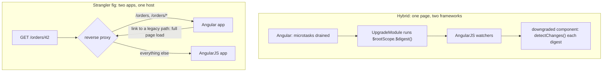

What to notice: the hybrid couples two change-detection loops in one page; the strangler's only coupling is a URL that must go back through the proxy.

### How it actually works

**What a hybrid bridges** (read, not run: `@angular/upgrade` 22.2.1, `types/static.d.ts`). `UpgradeModule` boots both; `downgradeComponent` and `downgradeInjectable` downgrade; `UpgradeComponent` is a base class for a directive wrapping an AngularJS component. The `UpgradeModule` doc comment: "Each DOM element on the page is owned exactly by one framework." Why hybrid: the angular.io upgrade guide (16.2.0, read 2026-10-18) says "do it incrementally, by running the two frameworks side by side".

**Why the two loops stay in step** (`fesm2022/static.mjs`, `UpgradeModule.bootstrap`). A local `synchronize` callback runs `$rootScope.$digest()` inside `ngZone.run`, subscribed to `ngZone.onMicrotaskEmpty`, or to the internal `applicationRef.afterTick` when the zone is the internal `ɵNoopNgZone`. If a digest is running (the internal `$$phase`), development mode warns "A digest was triggered while one was already in progress." (abridged) and queues `$evalAsync()` instead. Conversely, `downgradeComponent` (`propagateDigest` defaults to `true`) adds a watcher calling `detectChanges()` every digest. The typings name the cost: `UpgradeModule` apps "will run change detection more frequently"; `downgradeModule` boots Angular lazily, runs no `$digest()` for you, and cannot share an app with `UpgradeModule`.

**What staying hybrid costs.** The package peers on `@angular/platform-browser-dynamic` at exactly 22.2.1, which npm marks "deprecated. Use `@angular/platform-browser` instead." (`npm view`, read 2026-10-18), though `static.mjs` imports only `platformBrowser`. The Update Guide's `ngUpgrade` option ("to combine AngularJS & Angular"; [update.component.ts](https://raw.githubusercontent.com/angular/angular/main/adev/src/app/features/update/update.component.ts), read 2026-10-18) adds hybrid-only steps.

**What a strangler costs.** A cookie without `Domain` goes only to the host that set it, and `Path` defaults to the request's directory ([MDN Set-Cookie](https://developer.mozilla.org/en-US/docs/Web/HTTP/Reference/Headers/Set-Cookie), read 2026-10-18), so a shared session needs one host and `Path=/`. Layout and styles are duplicated until the old app goes. Links across the boundary need a full page load (callout).

**What the lab shows** (no AngularJS). `Section 9: the migrated paths render Angular components` finds both pages and no handoff. `Section 9: every other path is handed to the legacy navigator with its full URL` records `/customers/42?tab=notes#top`, `/` and `/orders/42/edit`: one segment past a migrated route is still the old app's.

> [!NOTE]
> **Framework vs platform.** The Angular router changes the URL with `history.pushState` (`BrowserPlatformLocation`, `@angular/common` 22.2.1), and the browser "won't attempt to load this URL" ([MDN pushState](https://developer.mozilla.org/en-US/docs/Web/API/History/pushState)). Reaching the other app takes a document load, such as `Location.assign()` ([MDN](https://developer.mozilla.org/en-US/docs/Web/API/Location/assign)), so the proxy sees the request.

### Code

Approach: route migrated paths in Angular and hand every other URL to an injected navigator, which tests replace, so nothing touches `window.location`.

1. Declare the `LEGACY_NAVIGATOR` token.
2. Map `orders` and `orders/:id` to lazily loaded migrated pages.
3. Send `**` to a component that hands `Router.url` to the navigator.
4. In production, provide a navigator that loads the URL as a new document.

```ts
// Excerpt of labs/angular/src/app/modules/39-version-history-and-migrations/concepts/section-9-strangler.ts
export const LEGACY_NAVIGATOR = new InjectionToken<LabM39LegacyNavigator>('LEGACY_NAVIGATOR');

export class LabM39LegacyHandoff {
  constructor() {
    inject(LEGACY_NAVIGATOR).handOff(inject(Router).url);
  }
}

export const labM39StranglerRoutes: Routes = [
  {
    path: 'orders',
    loadComponent: () =>
      import('../migrated/order-list-page').then((m) => m.LabM39OrderListPage),
  },
  {
    path: 'orders/:id',
    loadComponent: () =>
      import('../migrated/order-detail-page').then((m) => m.LabM39OrderDetailPage),
  },
  { path: '**', component: LabM39LegacyHandoff },
];

export function provideLabM39BrowserNavigator(): Provider {
  return {
    provide: LEGACY_NAVIGATOR,
    useFactory: (): LabM39LegacyNavigator => {
      const location = inject(DOCUMENT).location;
      return { handOff: (url) => location.assign(url) };
    },
  };
}
```

A hybrid registers a downgraded component as an AngularJS directive:

```js
// Partial: AngularJS 1.8 with @angular/upgrade 22.2.1 (not run in the labs); OrderBadge is an Angular component
import { downgradeComponent } from '@angular/upgrade/static';
angular.module('shop').directive('orderBadge', downgradeComponent({ component: OrderBadge }));
```

### Best practices and anti-patterns

- **Give each path one owner at the proxy**, because a reload sends the pushed URL to the server.
- **Write the exit criteria first** (last route moved, AngularJS and `@angular/upgrade` removed), because a hybrid keeps the deprecated peer while it lives.

### Misconceptions and traps

- *"ngUpgrade translates AngularJS code into Angular."* It runs both frameworks side by side and bridges components, services and change detection. The myth comes from the package name.
- *"A hybrid app can run zoneless."* 22.2.1's `UpgradeModule` provides zone change detection (the internal `ɵinternalProvideZoneChangeDetection`) and has a `NoopNgZone` branch that syncs on `afterTick`; nothing read here says more. The myth comes from zoneless being the v22 default ([§6](#6-the-version-matrix-part-3-v16-to-v22-from-signals-to-onpush-by-default)).
- *"The strangler fig needs micro-frontends."* Two whole apps behind one reverse proxy need no runtime composition ([38 §8](38-architecture-and-production-structure.md#8-micro-frontends-module-federation-native-federation-and-when-they-are-justified)). The myth comes from both splitting one product into several apps.

Drilled in [Q39.17](#q39-17), [Q39.18](#q39-18) and [Q39.19](#q39-19).

## 10. A migration program for an old Angular codebase: order, dependencies and checkpoints

### The problem it solves

A 300-component v15 app has reached v22 hop by hop ([§8](#8-skipping-versions-safely-one-major-per-hop-node-and-typescript-ranges-and-libraries-that-block-a-hop)), but it still has NgModules, `*ngIf`, decorator inputs, zone.js, Karma and the webpack builder. One pull request that runs every schematic is a diff nobody can review. Order matters too: lazy-route conversion run first converts nothing, and code waiting on `NgZone.onStable` never continues once zone.js is gone.

### Mental model

A **migration program** runs migrations as small changes in a planned order. A **dependency edge** says one migration needs another's result first. A **track** is an independent sequence with its own pull requests. A **checkpoint** follows each batch: build, tests, a render check, a commit. A **codemod** is a program that rewrites source code, and a schematic is the CLI's codemod ([18 §8](18-control-flow-and-defer.md#8-migrating-with-ng-generate-angularcorecontrol-flow)). A **standalone** component lists its own imports instead of being declared in an NgModule ([15 §2](15-standalone-and-ngmodules.md#2-standalone-components-and-the-imports-array)). Think of a renovation: plumbing before tiles, each room inspected.

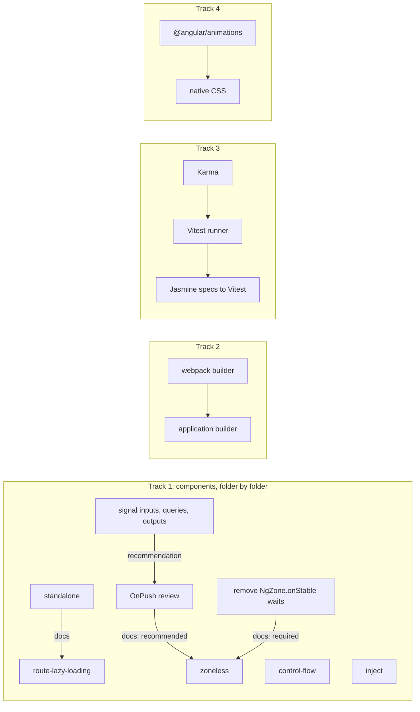

What to notice: only two edges are required; control flow, `inject()` and tracks 2 to 4 have none.

### How it actually works

**The hard edges come from the migration docs** (angular.dev sources on GitHub, read 2026-10-19). `route-lazy-loading` will "check if they are standalone and eagerly loaded, and if so, it will convert them", so standalone comes first. The zoneless guide says apps "need to remove uses of" `NgZone.onMicrotaskEmpty`, `onUnstable` and `onStable`: "These observables will never emit". OnPush is "a recommended step". [21 §6](21-change-detection.md#6-migrating-a-zone-based-app-to-zoneless) owns the steps.

**Our one recommendation edge.** The same guide names "using signals, `AsyncPipe`" among the ways a component asks to be checked, so signal APIs go before the OnPush review. No schematic requires it. On v22 the review deletes, component by component, the `ChangeDetectionStrategy.Eager` that `ng update` added ([§11](#11-the-v22-upgrade-what-ng-update-changes-and-why-each-migration-keeps-the-old-behavior)).

**Batches.** The standalone `path` option lets you "migrate sections of your project incrementally", and its steps end with "fix any failures, and commit the result". The other component schematics take a path too; the input migration still analyzes the whole workspace "regardless of the `--path` option". Folder by folder: [Q15.22](15-standalone-and-ngmodules.md#q15-22) and [Q18.23](18-control-flow-and-defer.md#q18-23).

**The tools** (22.2.1, read 2026-10-19): aliases from `@angular/core`'s `schematics/collection.json` (`signals` defaults to inputs, outputs and queries); `@schematics/angular`'s `migration-collection.json` offers `use-application-builder` (optional, recommended) and `migrate-karma-to-vitest` (optional).

| Step | Run | After | Checkpoint | Owner |
|---|---|---|---|---|
| Standalone | `ng g @angular/core:standalone`, three modes | — | builds after each mode (docs) | [15 §7](15-standalone-and-ngmodules.md#7-migrating-with-ng-generate-angularcorestandalone-three-passes-hybrid-apps-and-common-failures) |
| Lazy routes | `…:route-lazy-loading` | standalone (docs) | each route renders | here |
| Control flow | `…:control-flow` | — | `@for` view reuse (docs) | [18 §8](18-control-flow-and-defer.md#8-migrating-with-ng-generate-angularcorecontrol-flow) |
| `inject()` | `…:inject` | — | build, tests | here |
| Signal APIs | `…:signals --insert-todos` | — | the TODOs | [19 §6](19-component-communication-and-projection.md#6-decorator-based-inputs-outputs-and-queries-and-the-migration-schematics), [Q17.40](17-signals.md#q17-40) |
| OnPush review | delete `Eager` | signal APIs (recommendation) | screens refresh | [21 §2](21-change-detection.md#2-onpush-and-eager-strategies-and-what-marks-a-view-dirty) |
| Zoneless | provider, `polyfills` | no `NgZone` waits (docs) | 21 §6's checks | [Q21.22](21-change-detection.md#q21-22) |
| Builder | `use-application-builder` | — | `ng build`, `ng serve` | [Q12.09](12-angular-how-it-works.md#q12-09) |
| Tests | `migrate-karma-to-vitest`, then specs | — | suite passes | [29 §3](29-testing-angular.md#3-karma-jasmine-and-jest-the-legacy-and-alternative-runners-and-migrating-to-vitest) |
| Animations | by hand | — | animations run | [35 §9](35-animations.md#9-migrating-from-angularanimations-to-native-css-and-animateenteranimateleave) |

### Code

Approach: migrate one folder, one schematic per commit, then prove the feature behaves the same.

1. Run each schematic with `--path`; commit.
2. Build, test and compare behavior.
3. Scan for leftovers.

```shell
# Partial: illustrative folder; schematic aliases read from @angular/core 22.2.1 schematics/collection.json
ng generate @angular/core:standalone --path src/app/orders   # three runs, one mode each, a commit after each
ng generate @angular/core:route-lazy-loading --path src/app/orders
ng generate @angular/core:control-flow --path src/app/orders
ng generate @angular/core:inject --path src/app/orders
ng generate @angular/core:signals --path src/app/orders --insert-todos
```

We wrote the lab's migrated panel by hand; running the schematics on the legacy one is [Exercise 39.4](#ex39-4).

```ts
// Excerpt of labs/angular/src/app/modules/39-version-history-and-migrations/migrated/order-panel.ts
export class LabM39OrderPanel {
  readonly orders = input.required<readonly LabM39Order[]>();
  readonly selected = output<string>();
  protected readonly selection = inject(LabM39OrderSelection);

  protected choose(id: string): void {
    this.selection.select(id);
    this.selected.emit(id);
  }
}
```

`Section 10: the legacy and the migrated panels render the same rows for the same orders` and `Section 10: both panels emit the selected order id when a row is clicked` show that behavior survived; `Section 10: the migrated folder has no NgModule, structural directive, decorator input or constructor injection` scans both folders, the legacy one as the control.

#### Legacy

Before the program, `LabM39LegacyOrdersModule` declares the panel ([15 §5](15-standalone-and-ngmodules.md#5-legacy-ngmodule-patterns-declarations-exports-forrootforchild-sharedmodule-and-coremodule)); the lab compiles it with `strictTemplates: true`.

```ts
// Excerpt of labs/angular/src/app/modules/39-version-history-and-migrations/legacy/legacy-order-panel.ts
@Component({
  selector: 'lab-m39-legacy-order-panel',
  standalone: false,
  changeDetection: ChangeDetectionStrategy.Default,
  template: `
    <ul *ngIf="orders.length; else empty">
      <li *ngFor="let order of orders">
        <button type="button" (click)="choose(order.id)">{{ order.id }} · {{ order.customer }}</button>
      </li>
    </ul>
    <ng-template #empty><p>No orders</p></ng-template>
    <p *ngIf="ordersService.selectedId$ | async as id">Selected {{ id }}</p>
  `,
})
export class LabM39LegacyOrderPanel {
  @Input({ required: true }) orders!: LabM39LegacyOrder[];
  @Output() selected = new EventEmitter<string>();

  constructor(protected readonly ordersService: LabM39LegacyOrdersService) {}
}
```

### Best practices and anti-patterns

- **Make one schematic run one commit, batched by folder**, because a failing test then points at one rewrite.
- **Give the builder and the test runner their own pull requests**, because each changes how everything builds or runs.
- **End each track with a leftover scan**, because the input and query migrations skip what "cannot be safely migrated" (docs).

### Misconceptions and traps

- *"Run every schematic at once to get it over with."* The standalone docs run its three steps in order, "verifying that your code builds and runs between each step"; one schematic per commit applies that to the program (our recommendation), and a combined run hides which step broke a test. The myth comes from schematics being automatic, so batching looks free.
- *"Zoneless is just removing zone.js from polyfills."* Code waiting on `NgZone.onStable` never continues, and silent updates stop rendering (21 §6). The myth comes from the removal being the docs' last step.
- *"The order does not matter."* Run standalone first: `route-lazy-loading` converts only standalone components, so run first it changes nothing. The myth comes from each schematic being runnable alone.

Drilled in [Q39.20](#q39-20) and [Q39.21](#q39-21); practised in [Exercise 39.3](#ex39-3) and [39.4](#ex39-4).

## 11. The v22 upgrade: what `ng update` changes and why each migration keeps the old behavior

### The problem it solves

You update a healthy v21 app to v22 and read the diff. Every component says `changeDetection: ChangeDetectionStrategy.Eager`, `tsconfig.app.json` says `strictTemplates: false`, `provideClientHydration()` ends in `withNoIncrementalHydration()`, and some templates wrap `?.` in `$safeNavigationMigration(…)`. Delete them as noise and you ship what the migrations held back: components that stop refreshing, template errors, a new hydration behavior. Keep them forever and the app never gets the v22 defaults.

### Mental model

A **behavior-preserving migration** rewrites your code so the program does the same thing under the new version. When a major flips a default, the migration writes the old value into your code. Removing it later is a separate decision, one setting or component at a time ([§10](#10-a-migration-program-for-an-old-angular-codebase-order-dependencies-and-checkpoints)). Think of a moving company that labels every box "fragile, as before": nothing changes on arrival, and unpacking differently is your call.

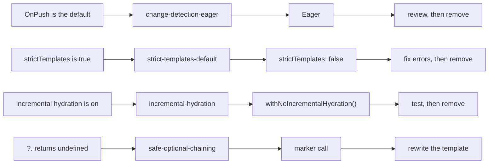

What to notice: every row ends in a step you schedule; no migration takes it for you.

### How it actually works

**Why `Eager` and not nothing.** The 22.2.1 typings say "NOTE: OnPush is enabled by default." on `OnPush`, so a component with no `changeDetection` is now OnPush. Only an explicit `Eager` keeps the old checking, and `Default` is the same value (`Default = 1`, "@deprecated Use `Eager` instead"). The run in `Section 11: change-detection-eager adds Eager to a component with no changeDetection` added the import and put the property before the component's last one; `Section 11: change-detection-eager rewrites ChangeDetectionStrategy.Default to Eager` shows only the member name changing. Read, not run: the migration skips a `@Component` whose argument is not one object literal. [21 §2](21-change-detection.md#2-onpush-and-eager-strategies-and-what-marks-a-view-dirty) owns what OnPush marks dirty.

**`strictTemplates`.** `Section 11: strict-templates-default writes strictTemplates false only when it is not set` shows `angularCompilerOptions.strictTemplates: false` written into the build target's tsconfig, not necessarily `tsconfig.json`, unless the file or one it extends already sets it; a file without `compilerOptions` is skipped. Keep or fix: [Q12.22](12-angular-how-it-works.md#q12-22).

**Hydration.** A `provideClientHydration(…)` call with neither `withIncrementalHydration()` nor the opt-out gets `withNoIncrementalHydration()` [Added in v22.0] appended, an **opt-out provider**: a feature you pass to a provider function to switch a default off. The 22.0.0 changelog lists "make incremental hydration default behavior" (read 2026-10-19); the test is `Section 11: incremental-hydration adds withNoIncrementalHydration to provideClientHydration`. Hydrate triggers: [32 §6](32-ssr-ssg-hydration.md#6-incremental-hydration-defer-blocks-with-hydrate-triggers).

**The marker.** `safe-optional-chaining` wraps a template `?.` in `$safeNavigationMigration(…)` (internal), a **compiler marker function**: a call the compiler rewrites, never run. Its source comment says it "doesn't exist at runtime" and keeps "the legacy behavior of returning `null`", because the 22.0.0 changelog says optional chaining now returns `undefined`. Read, not run.

**The rest** (read from `migrations.json`): `http-xhr-backend` adds `withXhr` ([Q27.05](27-http-client.md#q27-05)); `can-match-snapshot-required` adds `canMatch`'s third argument ([24 §5](24-routing.md#5-functional-guards-canmatch-canactivate-candeactivate-and-redirectcommand)); `strict-safe-navigation-narrow` disables two extended diagnostics; `model-output` fixes "broken duplicate outputs". The CLI adds five 22.0.0 migrations (two optional) and Material `migration-v22`.

### Code

Approach: after the update, find what each migration wrote, then remove one opt-out at a time with the tests green.

1. Commit the update.
2. Search for `Eager`, `strictTemplates`, `withNoIncrementalHydration` and `$safeNavigationMigration`.
3. Remove one kind per pull request and run the tests.

```ts
// Partial: the component of the Section 11 test, after the run
import { Component, ChangeDetectionStrategy } from '@angular/core';
@Component({
  selector: 'lab-m39-plain',
  changeDetection: ChangeDetectionStrategy.Eager,
  template: '<p>plain</p>',
})
export class LabM39PlainComponent {}
```

```ts
// Partial: the application config of the Section 11 test, after the run
export const appConfig: ApplicationConfig = {
  providers: [provideClientHydration(withEventReplay(), withNoIncrementalHydration())],
};
```

```jsonc
// Partial: tsconfig.app.json after strict-templates-default (written by the Section 11 test)
{ "extends": "./tsconfig.json", "compilerOptions": { "outDir": "./out" }, "angularCompilerOptions": { "strictTemplates": false } }
```

### Best practices and anti-patterns

- **Review the migration commits separately**, because each one holds a different default.
- **Remove `Eager` per component, with tests**, because a component that mutates fields stops refreshing under OnPush.
- **Never import `$safeNavigationMigration`**, because it does not exist at runtime.

### Misconceptions and traps

- *"The migrations modernize your code."* They write the old behavior back (22.2.1 `migrations.json`); the name suggests progress.
- *"`$safeNavigationMigration` is a runtime helper to import."* It is a compiler marker that does not exist at runtime. The myth comes from it reading like a call.
- *"Delete the `Eager` lines right after updating."* OnPush is the new default, so review each component first ([21 §2](21-change-detection.md#2-onpush-and-eager-strategies-and-what-marks-a-view-dirty)); the lines look like noise.

Drilled in [Q39.22](#q39-22) and [Q39.23](#q39-23); practised in [Exercise 39.4](#ex39-4).

## 12. Under the hood: how `ng update` selects migrations and how the Update Guide builds its checklist

### The problem it solves

"Which migrations run if I update from 21.2 to 22.2?", "why did the migration I expected not run?" and "why does the Update Guide put this step under 'before'?" Two functions answer them; guess, and you expect v21's migrations in a v22 update, or a CI prompt that never comes.

### Mental model

`ng update` turns installed and target versions into a **semver range**, a version condition (`>from <=to`), and runs the target's migrations whose `version` is inside, **prerelease** versions included (builds before a release, such as `22.0.0-next.1`, below `22.0.0`). Required ones run by version; optional ones are offered, a **recommended** one (flag `recommended`) ticked. Each Update Guide step has **`possibleIn`**, the first version allowing the change, and **`necessaryAsOf`**, the version requiring it; the Guide keeps steps still due after `from` and files them before, during or after. A timetable lists only your stops, in order; a packing list sorts tasks by when they are due.

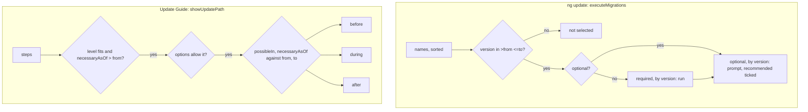

What to notice: both lanes compare only version numbers; neither reads your code.

### How it actually works

Read, not run: `@angular/cli` 22.2.1 (`update-resolver.js`, `utilities/migration.js`) and `@angular-devkit/schematics` 22.2.1, read 2026-10-19.

**The range.** For each updated package with `ng-update.migrations`, `from` is the installed version, `to` the target, and the collection comes from the new install. `executeMigrations` (internal) builds `new semver.Range('>' + from + ' <=' + to)`, turning a prerelease `from` into `<base>-0` and dropping `to`'s prerelease, and tests each version with `includePrerelease: true`.

**Why only one major's migrations.** The range filters the target's own collection, and `@angular/core` 22.2.1 ships only `22.0.0` entries ([§7](#7-updating-in-practice-ng-update-migration-schematics-and-the-update-guide)): from 20.x, no 21 entry exists to match, which is why [§8](#8-skipping-versions-safely-one-major-per-hop-node-and-typescript-ranges-and-libraries-that-block-a-hop) installs each major in turn.

**Order.** The engine's `listSchematicNames` drops `hidden` and `private` entries and sorts the names. The matches split by `optional`, each list sorted by `compareMigrations` (internal; `semver.compare` on `version`); ECMA-262 makes `Array.prototype.sort` stable (read 2026-10-19), so equal versions keep name order, not JSON order. Required ones run first; `getOptionalMigrationsToRun` (internal) prompts "Select the migrations that you'd like to run" with `checked: migration.recommended`, or, when stdout is not a terminal or `CI` is set, prints `ng update <package> --name <migration>` for each and runs none.

**Why a migration did not run.** Its version is outside `(from, to]`, its package was not updated, or it was optional and unselected, or the run was not interactive. Replay with `--migrate-only --from` or `--name` ([Q12.05](12-angular-how-it-works.md#q12-05)).

**The Guide** ([update.component.ts](https://raw.githubusercontent.com/angular/angular/main/adev/src/app/features/update/update.component.ts), read 2026-10-19). `showUpdatePath` (internal) refuses downgrades ("We do not support downgrading versions of Angular.") and writes 21.0 as 2100. A step stays when its `level` is at most yours (default 1) and `necessaryAsOf > from`, unless an option rules it out: of `ngUpgrade`, `material` and `windows`, one it needs and you lack, or one marked `false` that you chose. Then **before** if `possibleIn <= from`, else **during** if `necessaryAsOf <= to`, else **after** if `possibleIn <= to` (the source's other tests are then always true); a step possible only after `to` lands nowhere.

**In the lab.** Our selector mirrors `executeMigrations`, without `semver`. `Section 12: our selector keeps 22.0.0 migrations for 21.2.3 to 22.2.1 and none for 22.0.0 to 22.2.1`: ours returns core's eight in name order, then none. `Section 12: our selector puts required migrations before optional ones, each sorted by version`: on invented entries, ours returns `21.0.1`, `21.1.0`, `21.2.0-next.1`, then the optional `21.0.5` (ticked) and `21.2.0`. `Section 12: our classifier drops a step whose necessaryAsOf is not after the from version`: our classifier, mirroring `showUpdatePath`, drops a step due at 1900 when `from` is 1900.

### Code

Approach: our selector writes each CLI rule as one comparison.

1. Leave out hidden and private entries; sort by name.
2. Keep versions in `>from <=to`.
3. Split by `optional`; sort each list by version.

```ts
// Excerpt of labs/ts-js/src/modules/39-version-history-and-migrations/concepts/select-migrations.ts
/** The range `>from <=to`: a prerelease `from` becomes `<base>-0`, and `to` loses its prerelease (as in migration.js). */
export function inMigrationRange(versionText: string, from: string, to: string): boolean {
  const version = parseVersion(versionText);
  if (version === undefined) return false;
  const fromVersion = mustParse(from);
  const lower: Version = fromVersion.pre.length > 0 ? { main: fromVersion.main, pre: ['0'] } : fromVersion;
  const upper: Version = { main: mustParse(to).main, pre: [] };
  // includePrerelease: true, so a prerelease version needs no prerelease bound with the same major.minor.patch
  return compare(version, lower) > 0 && compare(version, upper) <= 0;
}

/**
 * Selects the migrations `ng update` would run for one package moving from `from` to `to`.
 * 1. Names as the schematic engine lists them: hidden and private entries left out, sorted by name.
 * 2. Keep the entries whose version is in `>from <=to`.
 * 3. Split by `optional`, then sort each list by version; ties keep the name order (the sort is stable).
 */
export function selectMigrations(entries: readonly MigrationEntry[], from: string, to: string): Selection {
  const listed = entries.filter((entry) => !entry.hidden && !entry.private).sort((a, b) => compareText(a.name, b.name));
  const matching = listed.filter((entry) => inMigrationRange(entry.version, from, to));
  const required = matching.filter((entry) => !entry.optional).sort(byVersion);
  const optional = matching.filter((entry) => entry.optional === true).sort(byVersion);
  return {
    required: required.map((entry) => entry.name),
    optional: optional.map((entry) => ({ name: entry.name, checked: entry.recommended === true })),
  };
}
```

### Best practices and anti-patterns

- **In CI, run each optional migration with `--name`**, because there they are only listed.
- **Give the Update Guide your real level and options**, because it leaves other steps out of every list.

### Misconceptions and traps

- *"`ng update` runs the migrations of every version you skipped."* The range filters the target's collection, which holds only its own major's entries; `>from` sounds open-ended.
- *"Migrations run in file order."* They run sorted by version, required first, ties in name order; the JSON reads like a script.
- *"The Update Guide lists every change between two versions."* It filters by level, options and `from`. The myth comes from a long checklist looking exhaustive.

Drilled in [Q39.14](#q39-14), [Q39.24](#q39-24) and [Q39.25](#q39-25).

## Summary

A scope holds the model, each binding is a watcher, and a digest re-checks every watcher until a full pass changes nothing, at most 10 loops ([§1](#1-angularjs-scopes-watchers-and-the-digest-cycle)). Angular was a rewrite with no in-place path: change detection, injection and templates each got a new mechanism, and the sources give mechanisms, not motives ([§2](#2-why-angular-was-rewritten-and-what-carried-over)). Versions are `major.minor.patch`; the policy gives a major 12 months active and 12 in LTS, but v20 and v21 got 18 and 19 months, so plan from the table; a deprecated API stays through at least the next major ([§3](#3-how-angular-ships-semantic-versioning-the-release-cadence-support-windows-and-the-deprecation-policy)).

The matrix reads in time order: v2 to v8 has no v3 and brings `Renderer2` and `HttpClient` ([§4](#4-the-version-matrix-part-1-v2-to-v8)); v9 to v15 swaps View Engine for Ivy and adds standalone ([§5](#5-the-version-matrix-part-2-v9-to-v15-from-ivy-to-standalone)); v16 to v22 gives each feature an introduced, a stable and a default date, and v22 makes OnPush the default for components with no strategy ([§6](#6-the-version-matrix-part-3-v16-to-v22-from-signals-to-onpush-by-default)).

`ng update` moves packages in order with a commit per step, runs required migrations unasked and offers optional ones, and `--force` ignores a peer mismatch without fixing it ([§7](#7-updating-in-practice-ng-update-migration-schematics-and-the-update-guide)). A hop is one major, with its own Node and TypeScript range, and a blocking library stops it ([§8](#8-skipping-versions-safely-one-major-per-hop-node-and-typescript-ranges-and-libraries-that-block-a-hop)). An AngularJS app moves by hybrid, strangler fig or rewrite ([§9](#9-from-angularjs-to-angular-ngupgrade-hybrids-the-strangler-fig-and-rewrites)).

A migration program splits the work into small changes; only standalone before lazy routes and no `NgZone` stability code before zoneless are required edges ([§10](#10-a-migration-program-for-an-old-angular-codebase-order-dependencies-and-checkpoints)). The v22 migrations write the old behavior back, so the diff is a choice list, not noise ([§11](#11-the-v22-upgrade-what-ng-update-changes-and-why-each-migration-keeps-the-old-behavior)). Underneath, `ng update` keeps the target's migrations in `>from <=to`, and the Update Guide filters steps by level, options and `from` ([§12](#12-under-the-hood-how-ng-update-selects-migrations-and-how-the-update-guide-builds-its-checklist)).

## Question bank

Twenty-five questions run from AngularJS and the rewrite, through versions and the version matrix, to updating and modernizing real codebases. Each answer is collapsible: try the question first, then open it.

<a id="q39-01"></a>
### Q39.01 · Concept · What were scopes, watchers and the digest cycle in AngularJS, and how did two-way binding depend on them?

<details>
<summary>Answer</summary>

**Short answer (30 seconds).** A scope is an object holding the model for part of the page, and each template binding registers a watcher on it. After code runs inside `$apply`, a digest compares every watcher's value with its last one, calls the listeners of changed ones, and repeats until a full pass changes nothing. Two-way binding adds an `ng-model` watcher and a DOM listener to that loop.

**Full explanation.** Read, not run, in `angular` 1.8.3: `$apply` runs your function, then `$rootScope.$digest()`, which loops while any watcher changed and aborts after 10 loops ([§1](#1-angularjs-scopes-watchers-and-the-digest-cycle)). `ng-model` adds a model-to-view watcher, and a DOM event goes back through `$apply`. A listener may write the model, so a pass that changed anything forces another: our model makes three passes when a listener changes a second watched value, two for a lone change (`Section 1: our model runs a second loop when a listener changes another watched value`). Angular instead checks top-down once per tick ([21 §3](21-change-detection.md#3-zonejs-and-ngzone-how-changes-used-to-be-detected-and-why-zone-left-the-default)).

**Follow-ups an interviewer will ask.**
- *Why does a listener that writes the model cost a pass?* Only a pass with no change proves stability.
- *What stops a loop that never settles?* `var TTL = 10`: after 10 loops the digest throws.

**Trap to avoid.** Saying AngularJS repaints the page on every change: only a changed binding's listener touches the DOM.

</details>

<a id="q39-02"></a>
### Q39.02 · Bug hunt · An AngularJS controller sets the model in a `setTimeout`, a watcher keeps changing its own input, and a child scope binds `ng-model` to a primitive: what goes wrong in each?

```js
// Partial: AngularJS 1.8 (not run in the labs); module registration omitted
function BadgeCtrl($scope) {
  $scope.count = 0;
  setTimeout(function () { $scope.label = 'ready'; }, 1000);      // 1
  $scope.$watch('count', function (n) { $scope.count = n + 1; }); // 2
}
// template: <div ng-if="show"><input ng-model="name"></div>      // 3
```

<details>
<summary>Answer</summary>

**Short answer (30 seconds).** (1) The timer assigns outside a digest, so no watcher runs and the page stays stale. (2) The listener changes the value its own watcher reads, so every pass is dirty and the digest aborts with "10 $digest() iterations reached. Aborting!". (3) Inside `ng-if` the input writes `name` on the child scope, hiding the parent's.

**Full explanation.** (1) Only `$apply` ends in a digest (read, not run). (2) A digest stops only on a pass with no change; here every pass adds 1, and our model reads the watcher 11 times before throwing (`Section 1: our model stops after 10 unstable loops with an infdig-style error`). (3) A child scope inherits prototypally: reading `name` finds the parent's value, assigning creates it on the child, and the `ngIf` doc comment says it "will override (hide) the value in the parent scope" ([§1](#1-angularjs-scopes-watchers-and-the-digest-cycle)).

**Code.** The fixes:

```js
// Partial: AngularJS 1.8, not run; template: <input ng-model="form.name">
$scope.form = { name: '' };                                        // 3
setTimeout(function () { $scope.$apply(function () { $scope.label = 'ready'; }); }, 1000); // 1
$scope.$watch('count', function (n) { $scope.doubled = n * 2; });  // 2
```

**Follow-ups an interviewer will ask.**
- *How do you find the looping watcher?* The `infdig` message adds "Watchers fired in the last 5 iterations" (read, not run).
- *Why not wrap every assignment in `$apply`?* Inside a digest it throws "$digest already in progress".

**Trap to avoid.** Adding `$scope.$apply()` everywhere: it fixes only bug 1.

</details>

<a id="q39-03"></a>
### Q39.03 · Difference · AngularJS versus Angular: change detection, dependency injection, templates, modules, language and tooling. What changed, and why?

<details>
<summary>Answer</summary>

**Short answer (30 seconds).** Each layer kept its idea and changed its mechanism: a loop over every watcher became compiled templates checked once per tick, names read from parameters became class tokens, `ng-click` became `(click)`, script order became ES modules, and JavaScript became TypeScript built by the CLI. No official text read for this guide states one motive, so the "why" is mechanism.

**Full explanation.** *Change detection:* a 1.8.3 digest re-walks every watcher until stable; Angular compiles templates to code and checks once per tick, with zone.js once the trigger ([21 §3](21-change-detection.md#3-zonejs-and-ngzone-how-changes-used-to-be-detected-and-why-zone-left-the-default)). *Injection:* with no `$inject` list, 1.8.3 reads parameter names from the function's text, which its doc comment says "does not work with minification"; Angular tokens are often classes ([16 §2](16-dependency-injection.md#2-providers-and-tokens-useclass-usevalue-usefactory-and-useexisting)). *Templates:* the quick reference says AngularJS's event directives "do not exist in Angular" ([13 §4](13-components-and-templates.md#4-property-attribute-class-and-style-bindings)). *Modules:* `angular.module` is a name registry that loads no file, so script order mattered ([§2](#2-why-angular-was-rewritten-and-what-carried-over)).

**Follow-ups an interviewer will ask.**
- *Was Angular 2 an upgrade of AngularJS?* No: a separate package (`@angular/core`, not `angular`), meeting AngularJS only in a hybrid ([§9](#9-from-angularjs-to-angular-ngupgrade-hybrids-the-strangler-fig-and-rewrites)).
- *What carried over?* Ideas: injection is "front and center in both" (upgrade guide), and filters became pipes.

**Trap to avoid.** Giving a motive or speed number as fact ("rewritten for performance"): none was read.

</details>

<a id="q39-04"></a>
### Q39.04 · Concept · How does Angular version and support its releases: semantic versioning, a major every 12 months since v22, active and LTS windows, and the deprecation policy?

<details>
<summary>Answer</summary>

**Short answer (30 seconds).** Semantic versioning: a major may break code, a minor adds backward-compatible features, a patch fixes bugs. Since v22 a major arrives every 12 months with 4-6 minors; before, every 6 months with 1-3. The policy gives a major 12 months active, then 12 in LTS with only critical and security fixes; the table gives v20 and v21 less. A deprecated API stays for at least the next major.

**Full explanation.** The releases page (angular.dev, read 2026-10-18) says "typically supported for 24 months", but its table gives v22 24 months, v21 19 and v20 18, so plan from the table (`Section 3: our support table puts v22 in active support and v20 and v21 in LTS on 2026-10-18`). A deprecation is announced in the changelog, struck through in the API docs and tagged `@deprecated`; removal comes only in a major, after 12 months or more. Preview and experimental APIs sit outside these promises ([§3](#3-how-angular-ships-semantic-versioning-the-release-cadence-support-windows-and-the-deprecation-policy)).

**Follow-ups an interviewer will ask.**
- *Is a minor release safe to take?* For stable APIs, "fully backward-compatible"; a developer preview API can still change in a patch.
- *Can you go from v19 straight to v22?* No: `ng update` needs a source within one major of the target ([§8](#8-skipping-versions-safely-one-major-per-hop-node-and-typescript-ranges-and-libraries-that-block-a-hop)).

**Trap to avoid.** Planning from "24 months" or the old six-month rhythm: v20 and v21 get less, and the rhythm ended at v22.

</details>

<a id="q39-05"></a>
### Q39.05 · Difference · Stable, developer preview, experimental and deprecated: what does each status promise, and how should a production codebase treat each?

<details>
<summary>Answer</summary>

**Short answer (30 seconds).** Stable APIs follow semantic versioning and the deprecation policy. Developer preview APIs work but can change in any release, even a patch. Experimental APIs may never become stable. Deprecated APIs still work for at least the next major. In production, keep preview and experimental calls in one file you own and schedule each deprecation within one major.

**Full explanation.** The releases page (read 2026-10-18) puts developer preview and experimental APIs outside its policies; they "can change at any time, even in new patch versions". Signals were developer preview in v16 and stable in v17 ([VERSIONS.md](../VERSIONS.md)). A deprecation also shows in the typings: `ChangeDetectionStrategy.Default` carries ``@deprecated Use `Eager` instead.`` in 22.2.1 (`Section 3: the installed @angular/core 22.2.1 marks ChangeDetectionStrategy.Default as deprecated in its typings`). Your libraries should do the same ([38 §6](38-architecture-and-production-structure.md#6-public-api-surfaces-public-apits-exports-secondary-entry-points-and-versioning)).

**Follow-ups an interviewer will ask.**
- *Does a deprecated API still work?* Yes, for at least the next major: it is a deadline, not a bug.
- *How do you spot a status?* The changelog, the API docs' strikethrough and `@deprecated` in the typings; previews carry `@developerPreview`, as `withViewTransitions` does (`19.0`, read in `router.d.ts` 22.2.1, not run).

**Trap to avoid.** Treating a developer preview API as safe because it ships in a stable release: the API is outside the version's promise.

</details>

<a id="q39-06"></a>
### Q39.06 · Concept · Walk through v2 to v8: why there was no Angular 3, and what v4, v5, v6, v7 and v8 changed that interviewers still ask about.

<details>
<summary>Answer</summary>

**Short answer (30 seconds).** `@angular/core` has no 3.0.0; no source read says why. v4 split out `@angular/animations`, renamed `Renderer2` and gave `ngIf` an `else`; v5 deprecated `@angular/http`; v6 added `ng update`, `ng add` and `angular.json`; v7 added `ng new` prompts and default budgets; v8 added differential loading and `import()` routes.

**Full explanation.** The `ng update` source says that before version 6 "the major versions were not always sequential", and the registry shows core going from 2.4.10 to 4.0.0 while `@angular/router` ran 3.0.0 to 3.4.10. *v4* (2017-03-23) moved animations out: "if you don't use Animations, this extra code will not end up in your production bundles"; `HttpClient` came in 4.3.0, not v5. *v5* made `@angular/http` [Deprecated since v5.0 — use `@angular/common/http`]. *v6* added `ng update` "to help simplify keeping your projects up to date". *v7* added a "default budget of 2mb/5mb". *v8* made `loadChildren` strings [Deprecated since v8.0 — use dynamic `import()`]. Entries: [§4](#4-the-version-matrix-part-1-v2-to-v8), read 2026-10-18.

**Follow-ups an interviewer will ask.**
- *Which still appear in old code?* `Renderer`, `@angular/http`, string `loadChildren` and `TestBed.get(…)`; §4 names each replacement.
- *Why was 3 skipped?* No changelog or release note read says. The router's 3.x line shows only that the number was used elsewhere.

**Trap to avoid.** Supplying a reason for the missing 3, or dating `HttpClient` to v5: it shipped in 4.3.0, and v5 only deprecated its predecessor.

</details>

<a id="q39-07"></a>
### Q39.07 · Concept · From View Engine to Ivy: what changed for applications in v9, for libraries in v12 and v13, and why did View Engine libraries stop working in v16?

<details>
<summary>Answer</summary>

**Short answer (30 seconds).** View Engine was the compiler and runtime before v9. In v9 Ivy became the default for applications, library authors kept publishing View Engine, and `ngcc` converted those libraries during the build. v12 set new libraries to Ivy partial compilation, v13 migrated libraries, and v16 removed `ngcc`, leaving View Engine libraries no converter.

**Full explanation.** Read, not run ([§5](#5-the-version-matrix-part-2-v9-to-v15-from-ivy-to-standalone), read 2026-10-18). The 9.1.0 Ivy guide says CLI commands run `ngcc` "as needed" and tells library authors to keep using View Engine. CLI 12.0.0 configures new libraries "in Ivy partial mode" and removes "usage of deprecated View Engine compiler"; CLI 13.0.0 migrates libraries "from ViewEngine to Ivy Partial compilation". The 16.0.0 core and CLI entries say View Engine libraries "will no longer work", and the Update Guide repeats it: `ngcc` was the only bridge, and it was deleted. A partial-compiled library ships an intermediate form that the application's build finishes ([12 §8](12-angular-how-it-works.md#8-under-the-hood-what-the-compiler-emits-and-what-the-runtime-does-with-it); per-class compilation: [Q12.26](12-angular-how-it-works.md#q12-26)).

**Follow-ups an interviewer will ask.**
- *Did v9 remove View Engine?* No. The build stopped using it in v12, and `enableIvy` was removed in v15 because "Ivy is the only rendering engine".
- *What about a View Engine-only dependency before a v16 hop?* Upgrade or replace it first ([§8](#8-skipping-versions-safely-one-major-per-hop-node-and-typescript-ranges-and-libraries-that-block-a-hop)).

**Trap to avoid.** Saying Ivy ended View Engine in v9: the compiler left the build in v12, the option in v15 and the converter in v16.

</details>

<a id="q39-08"></a>
### Q39.08 · Concept · v14 to v17: typed forms, `inject()`, standalone, directive composition, signals, built-in control flow, `@defer` and the application builder. Which version brought each, and in which status?

<details>
<summary>Answer</summary>

**Short answer (30 seconds).** v14: typed forms and standalone as a developer preview. v15: standalone stable and directive composition. v16: signals as a developer preview, stable in v17. v17: built-in control flow (stable in v18), deferred blocks and the esbuild application builder in `ng new`. `inject()` gained its options object in v14.1.

**Full explanation.** Changelog headings, read 2026-10-18 and 2026-10-19 ([§5](#5-the-version-matrix-part-2-v9-to-v15-from-ivy-to-standalone), [§6](#6-the-version-matrix-part-3-v16-to-v22-from-signals-to-onpush-by-default)). 14.0.0: "Forms classes accept a generic" and "initial implementation of standalone components" [Developer preview since v14.0]; 14.1.0: `inject()` options object [Added in v14.1]. 15.0.0: standalone [Stable since v15.0] ([15 §2](15-standalone-and-ngmodules.md#2-standalone-components-and-the-imports-array)) and "enable the new directive composition API". 16.0.0: "add Angular Signals to the public API" [Developer preview since v16]; 17.0.0: "mark core signal APIs as stable" [Stable since v17]. 17.0.0 also lists "conditional built-in control flow" [Stable since v18] ([18 §1](18-control-flow-and-defer.md#1-built-in-blocks-versus-directives-and-the-if-family-with-as)), and the deferred triggers; `@defer` carries no stable marker in these reads (status: module 18). CLI 17.0.0 moved `ng new` to "the esbuild application builder".

**Follow-ups an interviewer will ask.**
- *Was `inject()` new in v14.1?* Only the options object: the entry deprecates the old "bit field signature", so the function predates it; its first version was not read.
- *Did stable mean new projects used it?* No: `standalone` became the default in v19 [Changed in v19.0: standalone by default]; introduced, stable and default are three dates.

**Trap to avoid.** Calling v17 the stable control-flow release: v18 stabilized it.

</details>

<a id="q39-09"></a>
### Q39.09 · Difference · v18 to v22: what changed for new projects (zoneless, Vitest, OnPush, fetch) versus what `ng update` keeps for existing ones?

<details>
<summary>Answer</summary>

**Short answer (30 seconds).** New projects get zoneless and Vitest from v21, and OnPush components and the fetch backend from v22. Existing projects keep old behavior where a migration pins it: the 22.0.0 core migrations write `Eager` into components, `strictTemplates: false` where unset and an XHR opt-out. Karma to Vitest is optional.

**Full explanation.** Read 2026-10-19 ([§6](#6-the-version-matrix-part-3-v16-to-v22-from-signals-to-onpush-by-default), [§11](#11-the-v22-upgrade-what-ng-update-changes-and-why-each-migration-keeps-the-old-behavior)). CLI 21.0.0: "Applications are zoneless by default" and "configure Vitest for new projects and allow runner choice". Core 22.0.0: "Use `FetchBackend` as default for the `HttpBackend` implementation", OnPush by default, and the breaking-change text names the way back: `ChangeDetectionStrategy.Eager`, `provideHttpClient(withXhr)` for upload progress. Installed 22.2.1 `migrations.json` holds eight migrations, all 22.0.0 and none optional. `migrate-karma-to-vitest` in `@schematics/angular` is `optional` ([Q29.06](29-testing-angular.md#q29-06)). Run mechanics: [Q12.05](12-angular-how-it-works.md#q12-05); fetch versus XHR: [Q27.05](27-http-client.md#q27-05).

**Follow-ups an interviewer will ask.**
- *Which 22.0.0 change has no pinning migration?* The router's `paramsInheritanceStrategy` now defaults to `'always'` (breaking-change text). No migration touches it: no file under `@angular/core` 22.2.1 `schematics/` or `@schematics/angular` 22.2.1 contains `paramsInheritanceStrategy`, and `@angular/router` ships no schematics (read, not run, 2026-10-19), so check route parameters yourself.
- *Is OnPush required for zoneless?* No: the guide calls it "not required" but recommended (read 2026-10-19). Zoneless migration: [Q21.22](21-change-detection.md#q21-22).

**Trap to avoid.** Reading a new default as a change to your project: the update writes the old value into old code, while new projects get the new one.

</details>

<a id="q39-10"></a>
### Q39.10 · Bug hunt · Five claims from an interview: "Angular 3 rewrote the router", "signals replaced zone.js in v16", "standalone is mandatory since v17", "`*ngIf` was removed in v20" and "v22 components still default to `Default` change detection". Correct each with its version and status.

<details>
<summary>Answer</summary>

**Short answer (30 seconds).** (1) No core 3.0.0 exists; the router's 3.x numbers were its own line. (2) Signals are separate from zone.js: [Developer preview since v16], [Stable since v17]. (3) v17 made standalone the `ng new` default; `standalone` defaults to `true` from v19, and NgModules still compile. (4) `*ngIf` is [Deprecated since v20.0 — use `@if`], not removed. (5) v22 components with no `changeDetection` are OnPush.

**Full explanation.** (1) The `ng update` source says early majors were "not always sequential"; the registry has no core 3.0.0 ([§4](#4-the-version-matrix-part-1-v2-to-v8)). (2) 16.0.0 "add Angular Signals to the public API", 17.0.0 "mark core signal APIs as stable"; zoneless is another feature: "experimental" in 18.0.0, [Stable since v20.2], default in CLI 21.0.0. (3) CLI 17.0.0: "enable standalone by default in new applications"; 19.0.0: components "are now standalone by default. Specify `standalone: false`" for declarations in modules, with a schematic that writes it. (4) 20.0.0: "`ngIf`/`ngFor`/`ngSwitch` are deprecated"; still present in 22.2.1. (5) The 22.0.0 entry ([§6](#6-the-version-matrix-part-3-v16-to-v22-from-signals-to-onpush-by-default)); the typings say OnPush is "enabled by default".

**Follow-ups an interviewer will ask.**
- *Can a v22 component still say `Default`?* Yes; it equals `Eager`, and the typings tag it `@deprecated`. The migration rewrites such initializers to `.Eager`; no changelog line announces the deprecation.
- *How do you answer "since when"?* Give the introduced, stable and default versions ([§6](#6-the-version-matrix-part-3-v16-to-v22-from-signals-to-onpush-by-default)).

**Trap to avoid.** Correcting a version with another remembered one: quote the heading.

</details>

<a id="q39-11"></a>
### Q39.11 · Trade-off · Update every major, every other major, or only when support ends: what does each cost, given the support windows and one-major-at-a-time updates?

<details>
<summary>Answer</summary>

**Short answer (30 seconds).** Every major costs one hop a year, inside support. Every other major is still two hops, with no stop between. Waiting for the end of support turns them into a program with a deadline. Skipping removes no hop: the CLI refuses to cross two majors.

**Full explanation.** The releases page table (read 2026-10-18; `Section 3: our support table puts v22 in active support and v20 and v21 in LTS on 2026-10-18`) ends v20's LTS on 2026-11-28. Since v22 a major comes yearly. *Every other major* saves no `ng update`, and a deprecated API is promised only "in at least the next major", so a warning ignored in the middle can be a removal at the end ([§3](#3-how-angular-ships-semantic-versioning-the-release-cadence-support-windows-and-the-deprecation-policy)). *Only at the end* piles hops up: after 2026-11-28 a v20 application is unsupported and still two majors behind v22, and each hop raises a Node or TypeScript floor (`Section 8: v13 to v22 takes nine hops in our planner`; [§8](#8-skipping-versions-safely-one-major-per-hop-node-and-typescript-ranges-and-libraries-that-block-a-hop)).

**Follow-ups an interviewer will ask.**
- *Does skipping skip migrations?* They never run: the target ships only its own, and `@angular/core` 22.2.1 ships only 22.0.0 ones (`Section 7: @angular/core 22.2.1 ships eight migrations, all for 22.0.0 and none optional`).
- *What if a library lags?* Its peer range, say an invented `^21.0.0`, rejects 22.

**Trap to avoid.** Calling "every other major" a skip: only the checkpoints are gone.

</details>

<a id="q39-12"></a>
### Q39.12 · Design · Plan the update of one application from v21 to v22: what you do before, during and after `ng update`, and what you check at each step.

<details>
<summary>Answer</summary>

**Short answer (30 seconds).** Before: read the Update Guide for 21.0 to 22.0, move Node and TypeScript to the 22.0.x row (Node 20 is out), check each library's peer range, and start from green tests. During: update the CLI and core, answer the prompt, then Material and each library, one commit per step. After: review the migration commits and remove one opt-out kind per pull request.

**Full explanation.** *Before.* The 22.0.x row needs Node `^22.22.3 || ^24.15.0 || ^26.0.0` and TypeScript `>=6.0.0 <6.1.0` (`Section 8: the Node baseline of the 22.0 row excludes Node 20`). Material 22.2.1 peers on core `^22.0.0 || ^23.0.0`, so core goes first ([§7](#7-updating-in-practice-ng-update-migration-schematics-and-the-update-guide)). *During.* The prompt ticks only `use-application-builder`, not `migrate-karma-to-vitest` (`Section 7: @angular/cli 22.2.1 takes its migrations from @schematics/angular, two of them optional and one recommended`); build and test after each commit. *After.* The core migrations write v21 behavior back ([§11](#11-the-v22-upgrade-what-ng-update-changes-and-why-each-migration-keeps-the-old-behavior)): search for `Eager`, `strictTemplates: false`, `withNoIncrementalHydration()` and the `?.` marker. `strictTemplates` errors: [Q12.22](12-angular-how-it-works.md#q12-22).

**Code.**

```sh
# Partial: illustrative, not run; options as read in @angular/cli 22.2.1, src/commands/update/cli.js
ng update @angular/cli@^22 @angular/core@^22 --create-commits
ng update @angular/material@^22 --create-commits
```

**Follow-ups an interviewer will ask.**
- *What if it stops on a peer error?* Take the library's next major, replace it or wait; not `--force` ([Q39.13](#q39-13)).
- *Why not delete `Eager` at once?* A component that mutates fields stops refreshing under the OnPush default.

**Trap to avoid.** Running `npm install @angular/core@22` and calling it an update: no migration runs.

</details>

<a id="q39-13"></a>
### Q39.13 · Bug hunt · An update log: `ng update` refuses with "Updating multiple major versions … is not supported", `npm install` fails on a third-party peer range, and someone reran it with `--force`. What went wrong, and what is the fix?

<details>
<summary>Answer</summary>

**Short answer (30 seconds).** Three faults. The jump crossed more than one major, which the CLI refuses whatever the flags. A library's peer range excludes the target. And `--force` skips only the peer check, so the library is installed outside its range and the refusal stays. The fix: one hop per major, then the library's next major, a replacement or waiting.

**Full explanation.** Read, not run, 2026-10-19: `@angular/cli` 22.2.1, `cli.js` and `update-resolver.js`. (1) For `@angular/…` packages, a target more than one major ahead logs "Updating multiple major versions of '${name}' at once is not supported. Please migrate each major version individually." and returns 1, never reading `force`. (2) The peer checks under the internal `_validateUpdatePackages` log `Package "<library>" has an incompatible peer dependency to "@angular/core" (requires "^21.0.0", would install "22.2.1").` (invented range) and throws "Incompatible peer dependencies found. See above for details. You can bypass this check using the --force option." only when `force` is false. (3) So `--force` removes the stop, not the mismatch ([§7](#7-updating-in-practice-ng-update-migration-schematics-and-the-update-guide)).

**Follow-ups an interviewer will ask.**
- *Did `--force` fix the first error?* No: that check runs before resolution and never reads the flag ([§8](#8-skipping-versions-safely-one-major-per-hop-node-and-typescript-ranges-and-libraries-that-block-a-hop)).
- *Is a library outside its range broken?* No source read says so; the range is its author's declaration, and your tests now carry the proof.

**Trap to avoid.** Treating `--force` as a fix: it silences the check, and the conflict stays.

</details>

<a id="q39-14"></a>
### Q39.14 · Output · Updating `@angular/cli` from 21.2.x to 22.2.1: which of its migrations run without a prompt, which are offered, which are pre-selected, and in what order?

<details>
<summary>Answer</summary>

**Short answer (30 seconds).** Our selector, which mirrors the CLI's `executeMigrations`, over the installed `@schematics/angular` 22.2.1 collection runs three unasked, in this order: `add-istanbul-instrumenter`, `trust-proxy-headers`, `update-workspace-config`. It offers `migrate-karma-to-vitest` (not pre-selected), then `use-application-builder` (pre-selected). All five are `22.0.0`, inside `(21.2.x, 22.2.1]`; required ones run first, and only `recommended` ones are ticked.

**Full explanation.** `@angular/cli` 22.2.1 names the collection in `ng-update.migrations`, `@schematics/angular/migrations/migration-collection.json` (`Q39.14 our selector runs three migrations unasked and offers two, with use-application-builder pre-selected`). Read, not run, 2026-10-19: `executeMigrations` (internal) keeps versions in `>from <=to` and sorts each list with `compareMigrations`: `return semver.compare(a.version, b.version);`. Names come from `listSchematicNames`, `@angular-devkit/schematics` 22.2.1 `src/engine/engine.js`: `return [...new Set(names)].sort();`. The sort is stable, so equal versions keep name order ([§12](#12-under-the-hood-how-ng-update-selects-migrations-and-how-the-update-guide-builds-its-checklist)); the file lists `use-application-builder` first (`Q39.14 the ties among the 22.0.0 entries follow name order, not the order of the collection file`). `getOptionalMigrationsToRun` (internal) prompts only when `isTTY` is true, and `src/utilities/tty.js` says "In a CI environment, this will also be `false` unless `NG_FORCE_TTY` is set"; otherwise it prints `ng update @angular/cli --name <migration>` for each and runs none.

**Code.**

```ts
// Excerpt of labs/ts-js/src/modules/39-version-history-and-migrations/outputs/q39-outputs.test.ts
    const selection = selectMigrations(entries, '21.2.3', '22.2.1');
    expect(selection.required).toEqual(['add-istanbul-instrumenter', 'trust-proxy-headers', 'update-workspace-config']);
    expect(selection.optional).toEqual([
      { name: 'migrate-karma-to-vitest', checked: false },
      { name: 'use-application-builder', checked: true },
    ]);
```

**Follow-ups an interviewer will ask.**
- *What runs in CI?* The three required ones; the optional two are only listed.
- *Does updating `@angular/core` run these?* No: its eight come from its own collection ([§7](#7-updating-in-practice-ng-update-migration-schematics-and-the-update-guide)).

**Trap to avoid.** Reading the order from the JSON file: it differs, and the recommended one is ticked.

</details>

<a id="q39-15"></a>
### Q39.15 · Design · Bring a v13 application to v22: the hop plan, the Node and TypeScript changes, libraries that block a hop, and where to stop and stabilize.

<details>
<summary>Answer</summary>

**Short answer (30 seconds).** Nine hops, 14 through 22, each an `ng update`, then build, tests and a commit. In the compatibility table Node 12 leaves at the 14.0.x row, 14 at 16.0.x, 16 at 17.0.x, 18 at 20.0.x and 20 at 22.0.x, and the TypeScript floor rises each hop, from 4.4.3 to 6.0.0. View Engine libraries block the hop to 16, Material legacy components the hop to 17. Stabilize at v16, v17, v22.

**Full explanation.** The table is angular.dev's "Version compatibility" (read 2026-10-18), read by our planner and range check, not npm's (`Section 8: v13 to v22 takes nine hops in our planner`). Move Node and TypeScript to each target row first ([§8](#8-skipping-versions-safely-one-major-per-hop-node-and-typescript-ranges-and-libraries-that-block-a-hop)). The CLI's 16.0.0 entry says "NGCC integration has been removed and as a result Angular View Engine libraries will no longer work."; the Components 17.0.0 entry lists "prevent updates to v17 if project uses legacy components"; read each library's peer range before the first hop. The stops are our recommendation. Practise: [Exercise 39.2](#ex39-2).

**Follow-ups an interviewer will ask.**
- *Can one `ng update` reach 22?* No: the CLI refuses ([Q39.13](#q39-13)).
- *A library has no v16 release?* Replace it before the hop; a fork leaves you every later hop.

**Trap to avoid.** Planning by calendar: majors fix the hops; Node and TypeScript decide when each can run.

</details>

<a id="q39-16"></a>
### Q39.16 · Trade-off · Update hop by hop in place, or generate a fresh v22 workspace and move the code across: when does each win?

<details>
<summary>Answer</summary>

**Short answer (30 seconds).** In place wins when the app mostly builds: each hop runs that major's migrations, which exist only in that major's packages. A fresh workspace wins when the app is small and its configuration is the larger job. Copying skips every migration, so you find each changed default and removed API by hand.

**Full explanation.** `@angular/core` 22.2.1 ships only 22.0.0 migrations (`Section 7: @angular/core 22.2.1 ships eight migrations, all for 22.0.0 and none optional`), so earlier majors' migrations come only from a hop through each ([§8](#8-skipping-versions-safely-one-major-per-hop-node-and-typescript-ranges-and-libraries-that-block-a-hop)). Code copied from v13 takes the new defaults unrewritten: components are standalone by default since 19.0.0 ("Specify `standalone: false`", changelog read 2026-10-19), so one declared in an NgModule needs the flag, and one with no `changeDetection` is OnPush in v22, where an update would have written `Eager` ([§11](#11-the-v22-upgrade-what-ng-update-changes-and-why-each-migration-keeps-the-old-behavior)). `ComponentFactoryResolver` is removed in v22 (VERSIONS.md). A fresh workspace does give today's `angular.json` and builder (`@schematics/angular` 22.2.1 `application/index.js` writes `@angular/build:application`, read, not run). Which wins is our judgement.

**Follow-ups an interviewer will ask.**
- *Which wins for a v21 app?* In place: one hop, and the 22.0.0 migrations run.
- *Does a fresh workspace remove a blocking library?* No: its peer range still applies.

**Trap to avoid.** Treating a fresh workspace as clean: old code carries old behavior, and nothing rewrites it.

</details>

<a id="q39-17"></a>
### Q39.17 · Concept · How does ngUpgrade run AngularJS and Angular in one page: `UpgradeModule`, `downgradeComponent`, `downgradeInjectable`, `UpgradeComponent` and `downgradeModule`?

<details>
<summary>Answer</summary>

**Short answer (30 seconds).** `UpgradeModule` boots AngularJS inside the Angular zone and runs a `$digest` after Angular work. `downgradeComponent` and `downgradeInjectable` expose Angular pieces to AngularJS; `UpgradeComponent` is the base of a directive wrapping an AngularJS component for Angular templates. `downgradeModule` boots Angular lazily and keeps no digest in step.

**Full explanation.** Read, not run (C14): `@angular/upgrade` 22.2.1, `types/static.d.ts` and `fesm2022/static.mjs`, read 2026-10-19. `@angular/upgrade/static` exports `UpgradeComponent`, `UpgradeModule`, `downgradeComponent`, `downgradeInjectable`, `downgradeModule`, `getAngularJSGlobal` and `setAngularJSGlobal`; `ɵ` exports are internal. In `UpgradeModule.bootstrap` a `synchronize` function runs `$rootScope.$digest()` inside `ngZone.run`, subscribed to `onMicrotaskEmpty`, or to `applicationRef.afterTick` for a `NoopNgZone`. If `$rootScope.$$phase` (AngularJS-internal) is set, it logs "A digest was triggered while one was already in progress. This may mean that something is triggering digests outside the Angular zone." in development, then calls `$evalAsync()`. In the other direction `downgradeComponent` defaults `propagateDigest` to `true` and adds a scope watcher calling `detectChanges`. Of `downgradeModule` the typings say it does not bootstrap inside the zone or run a `$digest()`, and "You cannot use `downgradeModule()` and `UpgradeModule` in the same hybrid application." ([§9](#9-from-angularjs-to-angular-ngupgrade-hybrids-the-strangler-fig-and-rewrites)).

**Follow-ups an interviewer will ask.**
- *Who owns a DOM element?* "Each DOM element on the page is owned exactly by one framework."
- *What does it cost?* The typings say `UpgradeModule` apps "will run change detection more frequently".

**Trap to avoid.** Expecting `downgradeModule` to keep both loops in step: it does not, and syncing is yours.

</details>

<a id="q39-18"></a>
### Q39.18 · Trade-off · An AngularJS application in 2026: an ngUpgrade hybrid, a strangler fig by route, or a rewrite. Which, and when?

<details>
<summary>Answer</summary>

**Short answer (30 seconds).** AngularJS support ended in January 2022, so every option ends with it gone. A hybrid fits when screens share components inside one page. A strangler fig fits when routes separate cleanly behind a reverse proxy. A rewrite fits a small or short-lived app, because nothing ships from it until the cut-over. This is our judgement; no source ranks them.

**Full explanation.** The AngularJS docs (`misc/version-support-status.ngdoc`, read 2026-10-18) say "AngularJS support has officially ended as of January 2022", and `npm view angular` marks the package deprecated (read 2026-10-18; [§9](#9-from-angularjs-to-angular-ngupgrade-hybrids-the-strangler-fig-and-rewrites)). *Hybrid:* two change-detection loops in one page, and `@angular/upgrade` 22.2.1 peers on the deprecated `@angular/platform-browser-dynamic` at exactly 22.2.1 (read, not run). *Strangler:* each route has one owner at the proxy, but a shared session needs one host and `Path=/`, styles are duplicated, and links across the boundary load a page. *Rewrite:* no coupling, and no new features until the switch.

**Follow-ups an interviewer will ask.**
- *Does a hybrid get you off AngularJS?* Only when its last piece moves; until then the unsupported framework stays in the page.
- *What do you write first?* The exit criteria: last route moved, AngularJS and `@angular/upgrade` removed. Route-by-route detail: [Q39.19](#q39-19).

**Trap to avoid.** Picking a hybrid to avoid choosing: it is the only option that couples two frameworks in one page.

</details>

<a id="q39-19"></a>
### Q39.19 · Design · Strangle an AngularJS application route by route: the routing split, the shared session, shared styles, and the exit criteria.

<details>
<summary>Answer</summary>

**Short answer (30 seconds).** A reverse proxy sends migrated paths to the Angular app and everything else to AngularJS. One host and a cookie at `Path=/` share the session. Styles are duplicated until the old app goes. Exit when the last route has moved and the catch-all is gone.

**Full explanation.** *Routing.* The lab maps `orders` and `orders/:id` to migrated pages and sends `**` to a component that hands `Router.url` to an injected navigator. `Section 9: the migrated paths render Angular components` finds both pages and no handoff; `Section 9: every other path is handed to the legacy navigator with its full URL` records `/customers/42?tab=notes#top`, `/` and `/orders/42/edit`. *Session.* A cookie without `Domain` goes only to the host that set it, and `Path` defaults to the request's directory (MDN Set-Cookie, read 2026-10-18), so use one host and `Path=/`. *Styles.* Each app ships its own; the lab does not test this. *Exit.* The catch-all has no traffic and AngularJS is removed ([§9](#9-from-angularjs-to-angular-ngupgrade-hybrids-the-strangler-fig-and-rewrites)).

**Code.**

```ts
// Excerpt of labs/angular/src/app/modules/39-version-history-and-migrations/concepts/section-9-strangler.ts
  { path: '**', component: LabM39LegacyHandoff },
```

**Follow-ups an interviewer will ask.**
- *How does Angular reach a legacy page?* `pushState` does not load the URL (MDN, read 2026-10-18), so hand off with a document load such as `Location.assign()`.
- *How do you test the split?* Provide a recording navigator instead of touching `window.location`, as the lab does.

**Trap to avoid.** Navigating to a legacy path with the Angular router: the proxy never sees it.

</details>

<a id="q39-20"></a>
### Q39.20 · Design · Modernize a 300-component v15 NgModule application: in which order do you run standalone, control flow, `inject()`, signal inputs and queries, OnPush, zoneless, Vitest and the application builder, and why?

<details>
<summary>Answer</summary>

**Short answer (30 seconds).** First reach v22, one hop per major. Then run standalone, then lazy-route conversion. Control flow and `inject()` have no prerequisite. Run the signal schematics, then review OnPush, remove `NgZone` waits, then go zoneless. Move the builder and the test runner in their own pull requests.

**Full explanation.** Read 2026-10-19 ([§10](#10-a-migration-program-for-an-old-angular-codebase-order-dependencies-and-checkpoints)): only two edges are required. `route-lazy-loading` converts only standalone components, so standalone first ([Q15.22](15-standalone-and-ngmodules.md#q15-22) for folders). Zoneless needs the app to "remove uses of" `NgZone.onStable` and its siblings, and OnPush is "a recommended step" ([Q21.22](21-change-detection.md#q21-22)). Signals before OnPush is our recommendation, since signals are one way a component asks to be checked. `signals` runs the input, output and query migrations ([Q19.23](19-component-communication-and-projection.md#q19-23)); folder-by-folder control flow: [Q18.23](18-control-flow-and-defer.md#q18-23). On v22 the OnPush review deletes the `Eager` that the update added. `use-application-builder` and `migrate-karma-to-vitest` are optional ([Q12.09](12-angular-how-it-works.md#q12-09), [Q29.06](29-testing-angular.md#q29-06)). `Section 10: the migrated folder has no NgModule, structural directive, decorator input or constructor injection` is the leftover scan.

**Follow-ups an interviewer will ask.**
- *Which order is free?* Control flow, `inject()`, builder and tests have no edge; keep one schematic per commit.
- *Why separate pull requests for the builder and the runner?* Each changes how everything builds or runs, so a failure should point at one change.

**Trap to avoid.** Running every schematic in one commit: nothing says which step broke a test.

</details>

<a id="q39-21"></a>
### Q39.21 · Bug hunt · A migration pull request ran six schematics in one commit, removed zone.js while code still waits on `NgZone.onStable`, and moved from Karma to Vitest together with the builder change. What goes wrong, and how do you split it?

<details>
<summary>Answer</summary>

**Short answer (30 seconds).** Three faults. Six schematics in one commit leave a failing test with six suspects, and the order has hard edges. Removing zone.js while code waits on `NgZone.onStable` means that code never continues. Changing the test runner and the builder together makes one red suite ambiguous. Split into one schematic per commit, remove the `NgZone` waits before zoneless, and give the builder and the runner their own pull requests.

**Full explanation.** Read 2026-10-19 ([§10](#10-a-migration-program-for-an-old-angular-codebase-order-dependencies-and-checkpoints)). The standalone docs verify the build "between each step" of their own three steps; one schematic per commit applies that to the program (our recommendation). Two edges are required: `route-lazy-loading` converts only standalone components, so run first it changes nothing, and the zoneless guide says apps "need to remove uses of" `NgZone.onMicrotaskEmpty`, `onUnstable` and `onStable`: "These observables will never emit", so a waiter never resumes ([21 §6](21-change-detection.md#6-migrating-a-zone-based-app-to-zoneless)). `use-application-builder` and `migrate-karma-to-vitest` are separate optional migrations in `@schematics/angular` 22.2.1, and each changes how everything builds or runs ([29 §3](29-testing-angular.md#3-karma-jasmine-and-jest-the-legacy-and-alternative-runners-and-migrating-to-vitest)).

**Follow-ups an interviewer will ask.**
- *Which order is fixed?* Standalone before lazy routes, and the `NgZone` waits removed before zoneless; signals before the OnPush review is our recommendation.
- *What does each commit need?* A build, the tests and a render check, then a commit: the checkpoint of §10.

**Trap to avoid.** Treating "automatic" as "safe in bulk": even the standalone docs verify the build between their own three steps.

</details>

<a id="q39-22"></a>
### Q39.22 · Output · The v22 `change-detection-eager` and `strict-templates-default` migrations run on a v21 workspace: what changes in a component with no `changeDetection`, in one with `ChangeDetectionStrategy.Default`, and in `tsconfig.json`?

<details>
<summary>Answer</summary>

**Short answer (30 seconds).** In our in-memory run (`@angular/core` 22.2.1) a component with no `changeDetection` gains `changeDetection: ChangeDetectionStrategy.Eager,` before its last decorator property, and `ChangeDetectionStrategy` joins its `@angular/core` import. One with `ChangeDetectionStrategy.Default` now reads `ChangeDetectionStrategy.Eager`, and nothing else moves. `strictTemplates: false` goes under `angularCompilerOptions` in the build `tsconfig.app.json`, and `tsconfig.json` is unchanged. v22 made OnPush and `strictTemplates` the defaults; each migration writes the old value back.

**Full explanation.** `Q39.22 change-detection-eager and strict-templates-default write the v21 behavior back into code and the build tsconfig` runs both on a workspace of ours: two components, and a `tsconfig.app.json` extending `tsconfig.json`. Read 2026-10-19 (`schematics/bundles/*.cjs`): the component migration inserts `.Eager` where `changeDetection` is missing and rewrites a `Default` initializer; the two are the same value. `strict-templates-default` walks the tsconfig of each Angular-builder target, skips a file with no `compilerOptions`, and writes only when `strictTemplates` is set nowhere in the `extends` chain, so the file the question names is read, not changed ([§11](#11-the-v22-upgrade-what-ng-update-changes-and-why-each-migration-keeps-the-old-behavior)).

**Code.**

```ts
// Excerpt of labs/ts-js/src/modules/39-version-history-and-migrations/outputs/q39-outputs.test.ts
    expect(angularCompilerOptions(after['/tsconfig.app.json'])).toEqual({ strictTemplates: false });
    expect(after['/tsconfig.json']).toBe(workspace['/tsconfig.json']);
```

**Follow-ups an interviewer will ask.**
- *What if the app already sets `strictTemplates`?* Nothing is written, in the file or in one it extends (`Section 11: strict-templates-default writes strictTemplates false only when it is not set`).
- *Is the component now OnPush-safe?* No: `Eager` keeps the old checking; remove it per component, with tests.

**Trap to avoid.** Expecting the migrations to modernize: they pin the old behavior until you remove it. Nor look for `strictTemplates: false` in `tsconfig.json`: it lands in the build target's tsconfig.

</details>

<a id="q39-23"></a>
### Q39.23 · Output · The v22 `incremental-hydration` and `safe-optional-chaining` migrations run on a v21 application: what do `provideClientHydration()` and a template's `user?.name` become, and why?

<details>
<summary>Answer</summary>

**Short answer (30 seconds).** In our in-memory run `provideClientHydration()` becomes `provideClientHydration(withNoIncrementalHydration())`, with `withNoIncrementalHydration` added to the `@angular/platform-browser` import. In a template, `{{ user?.name }}` is unchanged, and `{{ user?.name === null }}` becomes `{{ $safeNavigationMigration(user?.name) === null }}`. v22 made incremental hydration the default and `?.` return `undefined`; both migrations keep the v21 behavior, and only a comparison with `null` can tell the two results apart.

**Full explanation.** `Q39.23 incremental-hydration adds the opt-out and safe-optional-chaining wraps only the null-sensitive user?.name` runs both on an application of ours. Read 2026-10-19 (`schematics/bundles/*.cjs`): `incremental-hydration` appends the opt-out to a `provideClientHydration(…)` call that has neither `withIncrementalHydration` nor `withNoIncrementalHydration`. `safe-optional-chaining` wraps a `?.` only where its consumer is null-sensitive; the source comment on interpolation says it "coerces to string, so null and undefined produce identical output", while a strict comparison with a nullish literal is sensitive. The 22.0.0 changelog (read 2026-10-19) lists incremental hydration as the default and `?.` returning `undefined`. `$safeNavigationMigration` (internal) is a compiler marker that "doesn't exist at runtime" ([§11](#11-the-v22-upgrade-what-ng-update-changes-and-why-each-migration-keeps-the-old-behavior)).

**Code.**

```ts
// Excerpt of labs/ts-js/src/modules/39-version-history-and-migrations/outputs/q39-outputs.test.ts
    expect(config).toContain('providers: [provideClientHydration(withNoIncrementalHydration())],');
    expect(user).toContain("template: '<p>{{ user?.name }}</p><p>{{ $safeNavigationMigration(user?.name) === null }}</p>',");
```

**Follow-ups an interviewer will ask.**
- *Which other positions are wrapped?* The source treats a regular property binding such as `[title]="user?.name"` as null-sensitive (read, not run).
- *Do you import the marker?* No: it exists only for the compiler.

**Trap to avoid.** Removing the opt-out or the marker straight after the update: each restores a v22 behavior your code may not expect.

</details>

<a id="q39-24"></a>
### Q39.24 · Output · The Update Guide from v19.0 to v21.0 for a medium application: given five steps with `possibleIn`, `necessaryAsOf` and `level`, which land before, during and after the update?

<details>
<summary>Answer</summary>

**Short answer (30 seconds).** Our classifier, which mirrors the Guide's `showUpdatePath` and is not the Guide, files step A before, B during and C after; D and E are dropped. It keeps a step whose level fits and whose `necessaryAsOf` is after `from`: before if `possibleIn <= from`, during if `possibleIn > from` and `necessaryAsOf <= to`, after if `possibleIn <= to`.

**Full explanation.** `Q39.24 our classifier files the five invented steps from 19.0 to 21.0 at the medium level` uses `from` 1900, `to` 2100 and level 2. A (1800, 2000) was possible by `from` and is due after it: before. B (2000, 2100) becomes possible after `from` and is due by `to`: during. C (2100, 2200) is possible by `to` and due later: after. D is level 3, above medium: dropped. E (1700, 1900) is due at `from`, not after it: dropped. The rules are read from `update.component.ts` (read 2026-10-19), not a run of the Guide ([§12](#12-under-the-hood-how-ng-update-selects-migrations-and-how-the-update-guide-builds-its-checklist)).

**Code.**

```ts
// Excerpt of labs/ts-js/src/modules/39-version-history-and-migrations/outputs/update-guide-steps.ts
export const guideSteps: readonly GuideStep[] = [
  { step: 'A: possible in 18.0, due in 20.0', possibleIn: 1800, necessaryAsOf: 2000, level: 2 },
  { step: 'B: possible in 20.0, due in 21.0', possibleIn: 2000, necessaryAsOf: 2100, level: 2 },
  { step: 'C: possible in 21.0, due in 22.0', possibleIn: 2100, necessaryAsOf: 2200, level: 2 },
  { step: 'D: advanced only', possibleIn: 2000, necessaryAsOf: 2100, level: 3 },
  { step: 'E: possible in 17.0, due in 19.0', possibleIn: 1700, necessaryAsOf: 1900, level: 2 },
];
```

**Follow-ups an interviewer will ask.**
- *What else drops a step?* An option it needs and you did not select, such as `ngUpgrade`; the Section 12 test has such a step absent.
- *Where does a step possible only after `to` land?* Nowhere: none of the three tests passes.

**Trap to avoid.** Reading `necessaryAsOf` as when a step becomes possible: it is when the change becomes required.

</details>

<a id="q39-25"></a>
### Q39.25 · Concept · Under the hood: how does `ng update` choose the packages that move together and the migrations that run, and why does an installed `@angular/core` carry only its own major's migrations?

<details>
<summary>Answer</summary>

**Short answer (30 seconds).** `ng update` adds the members of each named package's `ng-update.packageGroup` that are in your dependencies, at the target version, so core, common, router and forms move together. It then runs each updated package's migrations whose version is in `>from <=to`. Core carries only its own major's because its collection lists only that release's: 22.2.1 has eight, all `22.0.0`.

**Full explanation.** Read, not run, 2026-10-19: `@angular/cli` 22.2.1, `update-resolver.js` and `cli.js`. The internal `_addPackageGroup` gives each name of a list-form group the target version (an object-form group names each member's version) and adds a member only when it is in your dependencies. `cli.js` resolves each package's migration collection and calls `executeMigrations` with `from` and `to` ([§12](#12-under-the-hood-how-ng-update-selects-migrations-and-how-the-update-guide-builds-its-checklist)). `Section 7: core, common, router, forms and upgrade are in one package group` shows the 16-name list. From 20.x no 21 entry exists to match, which is why each major is installed in turn ([§8](#8-skipping-versions-safely-one-major-per-hop-node-and-typescript-ranges-and-libraries-that-block-a-hop)). No source read says why older entries are not kept.

**Follow-ups an interviewer will ask.**
- *Why did a migration not run?* Its version is outside `(from, to]`, its package was not updated, or it was optional and unselected; replay with `--migrate-only` ([Q12.05](12-angular-how-it-works.md#q12-05)).
- *Does updating core touch Material?* No: Material has its own group.

**Trap to avoid.** Expecting `ng update` to replay the migrations of every version you skipped: the target never ships them.

</details>

## Hands-on exercises

Four exercises close the module, each running five criteria over a solution and an alternative. Exercise 39.1 models AngularJS's digest loop in plain TypeScript, under Vitest.

<a id="ex39-1"></a>
### Exercise 39.1 · A dirty-checking digest loop in the AngularJS style

**Problem.** Write a scope that watches model keys and digests in the AngularJS style: a change made in `apply` calls the listeners of changed watchers, and the loop repeats until a full loop finds nothing changed ([section 1](#1-angularjs-scopes-watchers-and-the-digest-cycle)). Build it twice behind one contract.

**Constraints.** Plain TypeScript. The loop limit is 10, as `TTL` in `angular` 1.8.3 (read, not run). Both loops are our code modeled on that source, not AngularJS. Not covered: child scopes, `$applyAsync`, deep equality.

**Acceptance criteria.**
- [ ] calls a listener once when its watched value changes during apply
- [ ] runs another loop when a listener changes a value another watcher reads
- [ ] throws an infdig error after ten unstable loops
- [ ] runs queued evalAsync work before the loop ends
- [ ] stops calling a listener after its watcher is deregistered

<details><summary>Hint 1</summary>

A loop is dirty when a listener ran, not when a value was written.

</details>

<details><summary>Hint 2</summary>

Drain the async queue at the top of every loop.

</details>

<details><summary>Worked solution</summary>

The approach: one shared comparison; each variant chooses which watchers to compare.

1. A `Watcher` holds a `read` function, a `listener` and its last value; `check` calls the listener on a change.
2. `digest` repeats: drain the async queue, check the watchers, and mark the loop dirty if a listener ran.
3. Each dirty loop spends one unit of `ttl`; at none left it throws the infdig message, as `!(ttl--)` does in 1.8.3.
4. `watch` returns a function that removes its watcher.

```ts
// Excerpt of labs/ts-js/src/modules/39-version-history-and-migrations/exercise-1-digest/a/digest-scope.ts
  function digest(): number {
    let ttl = TTL;
    let passes = 0;
    let dirty: boolean;
    do {
      passes++;
      dirty = false;
      drain(asyncQueue);
      for (const run of [...checks]) {
        if (run()) dirty = true;
      }
      if ((dirty || asyncQueue.length > 0) && !(ttl--)) throw infdig();
    } while (dirty || asyncQueue.length > 0);
    return passes;
  }
```

**How each criterion is met.** Ten tests run, five per variant through `describe.each`.
- Once on change: after the first digest, `apply` records one call, `['grace', 'ada']`.
- Another loop: with `b` watched before `a`, changing `a` takes three loops, and `b`'s listener sees 10.
- Infdig: a listener that increments its own value is called 11 times, then the loop throws "10 $digest() iterations reached. Aborting!".
- evalAsync: the log is `b=0, a, async, b=7`, so the queued write ran in the next loop and reached `b` before `digest` returned.
- Deregistered: after the returned function runs, the seen list stays `['ada', 'linus']`.

**Alternative approach:** variant b wraps the model in a `Proxy` whose `set` trap adds the key to a dirty set, so a loop checks only watchers on changed keys. **Trade-offs:** a pays for every watcher in every loop; b pays only for changed keys, but a write that bypasses `scope.model` is never seen. Both pass the same five tests.

**Interviewer follow-ups.**
- *"Why does `evalAsync` wait for the next loop?"* Read, not run: in 1.8.3 `$evalAsync` pushes onto `asyncQueue` and `$digest` drains it at the top of each loop, before the watchers are compared; `runs queued evalAsync work before the loop ends` pins that order in our copy.
- *"Does `scope.model.user.name = 'x'` reach a watcher on `user`?"* Neither variant sees it: the `set` trap fires only for top-level keys, and both compare with `===`. Read, not run: 1.8.3's `$watch` takes an `objectEquality` flag, and the digest then compares with `equals` and stores a `copy`.

**Tests:** [exercise-1.test.ts](../labs/ts-js/src/modules/39-version-history-and-migrations/exercise-1-digest/exercise-1.test.ts); the code is in the same [folder](../labs/ts-js/src/modules/39-version-history-and-migrations/exercise-1-digest/).

</details>

<a id="ex39-2"></a>
### Exercise 39.2 · An upgrade path planner: one major per hop, with the Node and TypeScript each hop needs

**Problem.** Write a planner that takes a start major, a target major and the Node version you run, and returns one hop per major with the Node and TypeScript ranges that hop needs ([section 3](#3-how-angular-ships-semantic-versioning-the-release-cadence-support-windows-and-the-deprecation-policy), [section 7](#7-updating-in-practice-ng-update-migration-schematics-and-the-update-guide), [section 8](#8-skipping-versions-safely-one-major-per-hop-node-and-typescript-ranges-and-libraries-that-block-a-hop)). Build it twice behind one contract, and make it say what the CLI says to a direct jump.

**Constraints.** The data is a fixture of rows 9.0.x to 22.0.x copied from angular.dev's compatibility page (read 2026-10-19); no network, no clock. The range check is ours, not npm's, and the refusal models `@angular/cli` 22.2.1 (read, not run). Not covered: libraries, RxJS.

**Acceptance criteria.**
- [ ] refuses a direct jump of more than one major with the CLI wording
- [ ] plans one hop per major from the start version to the target
- [ ] reports the hops where the current Node version is outside the target row
- [ ] reports the TypeScript range each hop requires
- [ ] rejects a downgrade

<details><summary>Hint 1</summary>

The refusal checks one pair of majors; the planner makes every pair a step of one.

</details>

<details><summary>Hint 2</summary>

A major has several rows; let the choice of row be the only thing that differs.

</details>

<details><summary>Worked solution</summary>

The approach: one loop over majors, one injected choice of row.

1. `refuseJump` returns the message when the target minus the installed major exceeds 1.
2. `planWith` throws for a downgrade, then walks `from + 1` to `to`.
3. Each major's rows go to the variant's choice of one.
4. A hop copies the row's ranges and sets `nodeFits` from our range check.

```ts
// Excerpt of labs/ts-js/src/modules/39-version-history-and-migrations/exercise-2-hops/hops.ts
  for (let major = from + 1; major <= to; major++) {
    const row = choose(compat.filter((candidate) => candidate.major === major));
    if (row === undefined) throw new Error(`the fixture has no row for ${major}.0.x`);
    hops.push({ from: major - 1, to: major, angular: row.angular, node: row.node, typescript: row.typescript, nodeFits: satisfies(node, row.node) });
  }
```

**How each criterion is met.** Ten tests run, five per variant through `describe.each`.
- Refusal: 13 to 22 names `ng update @angular/core@14` and the link `?v=13.0-14.0`; 13 to 14 gives nothing.
- One hop per major: 13 to 22 returns hops to 14 through 22, each passing the refusal.
- Node: from 13 to 22 with Node 18.19.1, hops 14, 20, 21 and 22 are outside their rows; from 20 to 22 with Node 22.12.0, only hop 22 (the 21.x row accepts `^22.12.0`).
- TypeScript: hop 17 is `>=5.2.0 <5.3.0` in a and `>=5.2.0 <5.5.0` in b; hop 20 differs the same way.
- Downgrade: 15 to 13 throws, while the CLI's own check lets it pass.

**Alternative approach:** variant b reads the last row of each major. **Trade-offs:** a gives the range a major started with, the safe floor; b gives the widest upper bound the page lists, which fits a project on a late minor. Both pass the same five tests, each with its own TypeScript ranges as expected values.

**Interviewer follow-ups.**
- *"Why can't `--force` skip a major?"* Read, not run: in 22.2.1 the multiple-major check never reads `force` ([section 7](#7-updating-in-practice-ng-update-migration-schematics-and-the-update-guide)); `refuses a direct jump of more than one major with the CLI wording` pins the check.
- *"Why is Node 18.19.1 outside the 14.0.x row?"* A row bounds Node from above too: `^14.15.0 || ^16.10.0` names no 18, so a hop can ask you to move Node down; `reports the hops where the current Node version is outside the target row` pins it.

**Tests:** [exercise-2.test.ts](../labs/ts-js/src/modules/39-version-history-and-migrations/exercise-2-hops/exercise-2.test.ts); the code and the fixture are in the same [folder](../labs/ts-js/src/modules/39-version-history-and-migrations/exercise-2-hops/).

</details>

<a id="ex39-3"></a>
### Exercise 39.3 · A migration program scheduler: prerequisites, pull-request batches and checkpoints

**Problem.** Write a scheduler that takes a migration program (migrations with prerequisites, folders with component counts, a cap per pull request) and returns the pull requests in run order, each with a checkpoint ([section 10](#10-a-migration-program-for-an-old-angular-codebase-order-dependencies-and-checkpoints)). Build it twice behind one contract: Kahn's algorithm and a depth-first order.

**Constraints.** Plain TypeScript. The fixture is ours: 11 migrations, five folders of 127 components, a cap of 50, and section 10's four edges. Three come from angular.dev's migration and zoneless docs (read 2026-10-19) and carry `docs`, one of them the zoneless guide's "recommended step"; signal APIs before the OnPush review is our `recommendation`. No clock, no `git`. Not covered: unknown ids, folders above the cap.

**Acceptance criteria.**
- [ ] schedules every migration after its prerequisites
- [ ] reports a cycle in the prerequisites
- [ ] splits a migration into batches that stay within the component cap
- [ ] adds a checkpoint after every batch
- [ ] keeps independent tracks in separate pull requests

<details><summary>Hint 1</summary>

A migration is ready when what it needs is scheduled.

</details>

<details><summary>Hint 2</summary>

Only the order differs; pack the folders once.

</details>

<details><summary>Worked solution</summary>

The approach: each variant orders the migrations; one shared module turns an order into pull requests.

1. `order` puts each prerequisite first, or throws `CycleError`.
2. A folder migration packs its folders in order, closing a group when the next folder would pass the cap.
3. A workspace migration (zoneless, the builder, tests, animations) is one pull request without folders.
4. Every pull request gets section 10's checks: build, tests, render check, commit.

```ts
// Excerpt of labs/ts-js/src/modules/39-version-history-and-migrations/exercise-3-program/a/schedule.ts
  while (unmet.size > 0) {
    const next = program.migrations.find((m) => unmet.get(m.id)?.size === 0);
    if (next === undefined) throw new CycleError(program.migrations.filter((m) => unmet.has(m.id)).map((m) => m.id));
    unmet.delete(next.id);
    for (const waiting of unmet.values()) waiting.delete(next.id);
    ordered.push(next);
  }
```

**How each criterion is met.** Ten tests run, five per variant through `describe.each`.
- Order: a starts `control-flow, application-builder, standalone`; b starts `signal-apis, onpush-review, no-ngzone-waits, zoneless`. Both put every prerequisite earlier; the program holds three `docs` edges and one `recommendation`.
- Cycle: with `a` needing `b`, `b` needing `a` and `c` needing `a`, a names `a, b, c` and b names `a, b`.
- Cap: at 50 each folder migration makes four pull requests (`orders`; `billing`; `shared` and `admin`; `reports`) of 40, 25, 42 and 20 components; at 60, three; at 30 the run throws for `orders`.
- Checkpoint: all 32 pull requests (seven folder migrations times four, plus four workspace ones) carry the four checks.
- Tracks: builder, tests and animations are one folderless pull request each, and each pull request's track is its migration's.

**Alternative approach:** variant b visits migrations as declared, emitting each after its prerequisites, with a `done` memo and a `path`. **Trade-offs:** a keeps declaration order among independent work and reports every stuck migration; b keeps a chain together and names exactly the cycle, but recurses as deep as the longest chain. Both pass the same five tests, each with its own expected order.

**Interviewer follow-ups.**
- *"Why must `standalone` come before `route-lazy-loading`?"* Read, not run: the schematic converts only components that are standalone and eagerly loaded ([section 10](#10-a-migration-program-for-an-old-angular-codebase-order-dependencies-and-checkpoints)); `schedules every migration after its prerequisites` pins `standalone` first.
- *"Why do the variants name different cycle members?"* a reports what it could not schedule, `c` included; b reports the path it was on when it met `a` again; `reports a cycle in the prerequisites` pins each.

**Tests:** [exercise-3.test.ts](../labs/ts-js/src/modules/39-version-history-and-migrations/exercise-3-program/exercise-3.test.ts); the code and the fixture are in the same [folder](../labs/ts-js/src/modules/39-version-history-and-migrations/exercise-3-program/).

</details>

<a id="ex39-4"></a>
### Exercise 39.4 · Modernize a legacy feature with the official schematics, run in a test

**Problem.** Run `@angular/core` 22.2.1's own schematics on the lab's legacy order panel ([section 10](#10-a-migration-program-for-an-old-angular-codebase-order-dependencies-and-checkpoints)) inside a Vitest test, then report what they left. Build it twice behind one contract: one schematic per step, and the combined `signals` schematic. [19 §6](19-component-communication-and-projection.md#6-decorator-based-inputs-outputs-and-queries-and-the-migration-schematics) owns what each converts.

**Constraints.** The runner is `support/run-schematic.ts` ([section 11](#11-the-v22-upgrade-what-ng-update-changes-and-why-each-migration-keeps-the-old-behavior)) over an in-memory tree: the text of `legacy/`, read-only, plus our `angular.json` and tsconfig files. No disk write, clock, `git` or `ng`. Not covered: `control-flow` ([18 §8](18-control-flow-and-defer.md#8-migrating-with-ng-generate-angularcorecontrol-flow)) and `inject`. Read, not run, from the 22.2.1 bundles: both call the internal `createMigrationProgram`, whose internal `parseTsconfigFile` reads the tsconfig through `ts.sys.readFile`, from disk relative to `process.cwd()`; the input and output schematics read the tree through the internal `runMigrationInDevkit`.

**Acceptance criteria.**
- [ ] replaces decorator outputs with output()
- [ ] keeps a decorator input that *ngIf narrows, with the reason as a TODO
- [ ] replaces decorator inputs with signal inputs in best-effort mode
- [ ] leaves the structural directives, constructor injection and NgModule to the scanner
- [ ] changes nothing when the same steps run a second time

<details><summary>Hint 1</summary>

Pass the tree each step returns to the next step.

</details>

<details><summary>Hint 2</summary>

Run once per option, then parse what came back.

</details>

<details><summary>Worked solution</summary>

The approach: one workspace builder, two variants from tree to tree, and a scanner over the result.

1. `legacyWorkspace` copies the three legacy files under `/src/app/legacy/` and adds a `main.ts` importing the NgModule.
2. Variant a runs `signal-input-migration` with the caller's options, then `output-migration` on the returned tree.
3. `scanLeftovers` parses each legacy file with TypeScript's compiler API and lists NgModules, `*ng…` templates, `@Input` decorators and constructors with parameters.

```ts
// Excerpt of labs/ts-js/src/modules/39-version-history-and-migrations/exercise-4-schematics/a/modernize.ts
export const modernize: Modernize = async (files, options = {}) => {
  const withInputs = await runSchematic(coreCollection, 'signal-input-migration', files, options);
  return runSchematic(coreCollection, 'output-migration', withInputs);
};
```

**How each criterion is met.** Ten tests run, five per variant through `describe.each`.
- Outputs: only the panel changes; `@Output() selected = new EventEmitter<string>();` becomes `readonly selected = output<string>();`, and the import trades `EventEmitter, Input, Output` for `Input, output`.
- TODO: with `insertTodos`, `orders` keeps its decorator under a TODO ending "migrating would break narrowing currently". Read, not run: the analysis marks a template read likely to narrow as the internal `PotentiallyNarrowedInTemplateButNoSupportYet`.
- Best effort: `bestEffortMode` drops that incompatibility; the field becomes `readonly orders = input.required<LabM39LegacyOrder[]>();` and the template reads `orders()`.
- Scanner: the untouched feature shows all four kinds; after best effort, the NgModule, constructor injection and structural directives remain.
- Second run: the default pass applied again returns an identical tree.

**Alternative approach:** variant b runs `signals`, which (read in `signals.cjs`) sorts its `migrations` list and chains the input, output and query schematics with the same options. **Trade-offs:** a gives one commit per schematic and a smaller diff; b is one command, but also runs queries. Both pass the same five tests.

**Interviewer follow-ups.**
- *"Why does the default run keep the `orders` input?"* It is read inside `*ngIf`, and migrating would break template narrowing; `keeps a decorator input that *ngIf narrows, with the reason as a TODO` pins the message.
- *"Why not run control-flow and inject in this test?"* They read the tsconfig from disk (read, not run), so in memory their result depends on the starting folder. Run them in the workspace with `--path` (section 10); `leaves the structural directives, constructor injection and NgModule to the scanner` lists what they must still remove.

**Tests:** [exercise-4.test.ts](../labs/ts-js/src/modules/39-version-history-and-migrations/exercise-4-schematics/exercise-4.test.ts); the code is in the same [folder](../labs/ts-js/src/modules/39-version-history-and-migrations/exercise-4-schematics/).

</details>

## Check your understanding

**Explain it back.**
1. Explain to a colleague who maintains an AngularJS app why a value set in a `setTimeout` never appears and what the "10 $digest() iterations" error means.
2. Explain to a manager who wants to go from v19 to v22 in one step why `ng update` refuses and what the plan is.
3. Explain to a new teammate why the v22 diff is full of `ChangeDetectionStrategy.Eager` and `strictTemplates: false`, and whether to delete them.
4. Explain to a product owner with an AngularJS app in 2026 how a hybrid, a strangler fig and a rewrite differ.

**Flashcards.**

<details><summary>Predict: a digest whose listener always changes the model. When does it throw?</summary>

At the end of the eleventh dirty pass, because the limit is 10.

</details>

<details><summary>Why does a View Engine library fail from v16?</summary>

v16 removed `ngcc`, the converter, so nothing makes it usable.

</details>

<details><summary>How many majors may one `ng update` cross?</summary>

One; it refuses a larger gap, so a v13 app takes nine hops.

</details>

<details><summary>Does `--force` fix a peer-range mismatch?</summary>

No; it installs the library outside its range and does not lift the multi-major refusal.

</details>

<details><summary>What does `change-detection-eager` write, and why?</summary>

`Eager` on components with no strategy, so they keep the old checking under v22's OnPush default.

</details>

<details><summary>Which migration-order edges are required?</summary>

Standalone before lazy-route conversion, and no `NgZone` stability code once zone.js is gone.

</details>

## Connections

- **Builds on:** [15 §7](15-standalone-and-ngmodules.md#7-migrating-with-ng-generate-angularcorestandalone-three-passes-hybrid-apps-and-common-failures) (standalone schematic), [21 §6](21-change-detection.md#6-migrating-a-zone-based-app-to-zoneless) (zoneless steps), [12 §2](12-angular-how-it-works.md#2-the-cli-and-the-workspace-angularjson-projects-schematics-and-ng-update) (`ng update` basics), [18 §8](18-control-flow-and-defer.md#8-migrating-with-ng-generate-angularcorecontrol-flow) (control flow), [19 §6](19-component-communication-and-projection.md#6-decorator-based-inputs-outputs-and-queries-and-the-migration-schematics) (signal APIs) and [29 §3](29-testing-angular.md#3-karma-jasmine-and-jest-the-legacy-and-alternative-runners-and-migrating-to-vitest) (Vitest).
- **Read next:** [40. Framework comparisons](40-framework-comparisons.md#7-ecosystem-size-release-policies-and-breaking-changes) (how other frameworks handled breaking changes) and [44. Full-stack delivery and operations](44-fullstack-delivery-and-operations.md#7-cicd-for-both-layers-one-image-promoted-through-stages-a-monorepo-or-separate-repositories-and-versioning-the-contract) (automating updates in CI).
- **Uses these ideas later:** [40](40-framework-comparisons.md#8-choosing-a-framework-balanced-trade-offs-and-how-to-answer-why-angular) (migration cost), [44](44-fullstack-delivery-and-operations.md) (update pipelines) and [46](46-system-design-case-studies.md) (legacy modernization).
- **Comparisons:** [Q12.05](12-angular-how-it-works.md#q12-05) (the mechanism under [§7](#7-updating-in-practice-ng-update-migration-schematics-and-the-update-guide)), [Q15.22](15-standalone-and-ngmodules.md#q15-22) and [Q18.23](18-control-flow-and-defer.md#q18-23) (batching one migration), [Q21.22](21-change-detection.md#q21-22) (the zoneless plan) and [Q38.17](38-architecture-and-production-structure.md#q38-17) (shipping migrations with a library).
