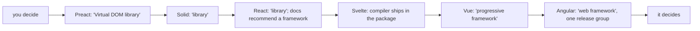
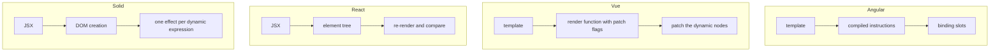
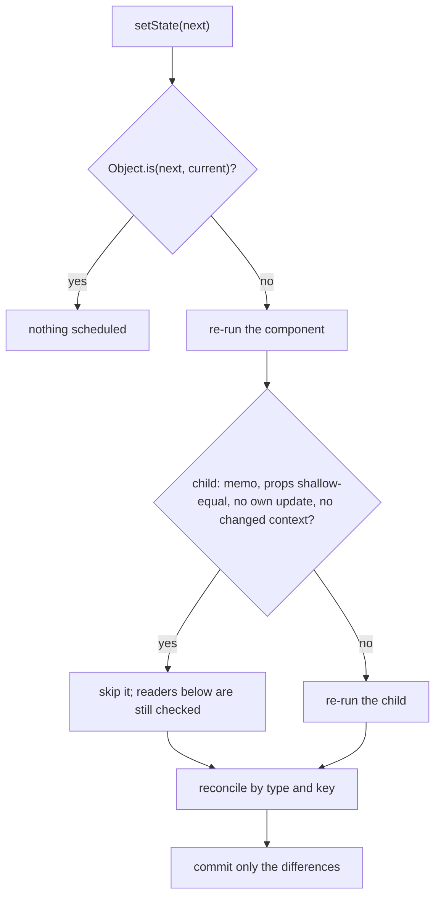
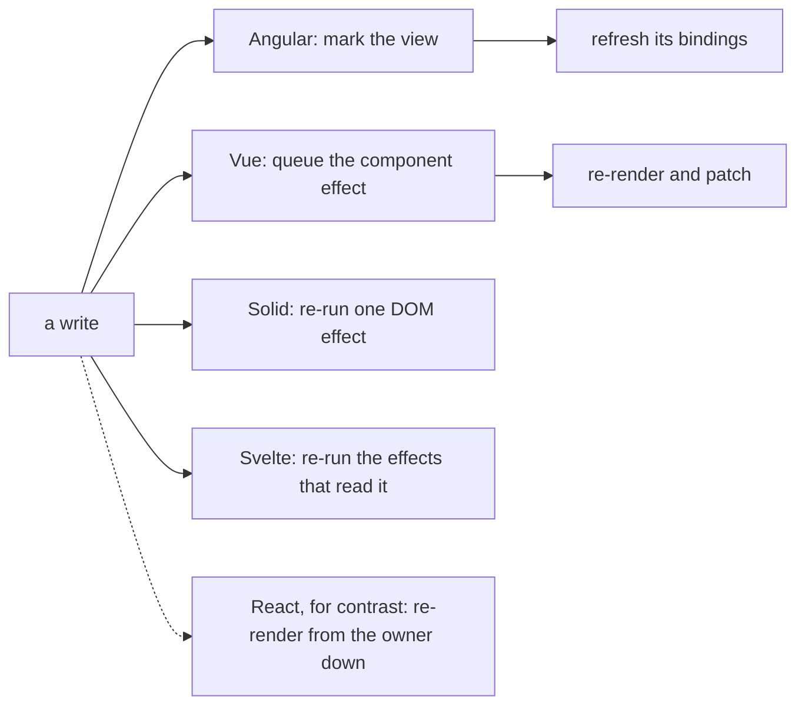
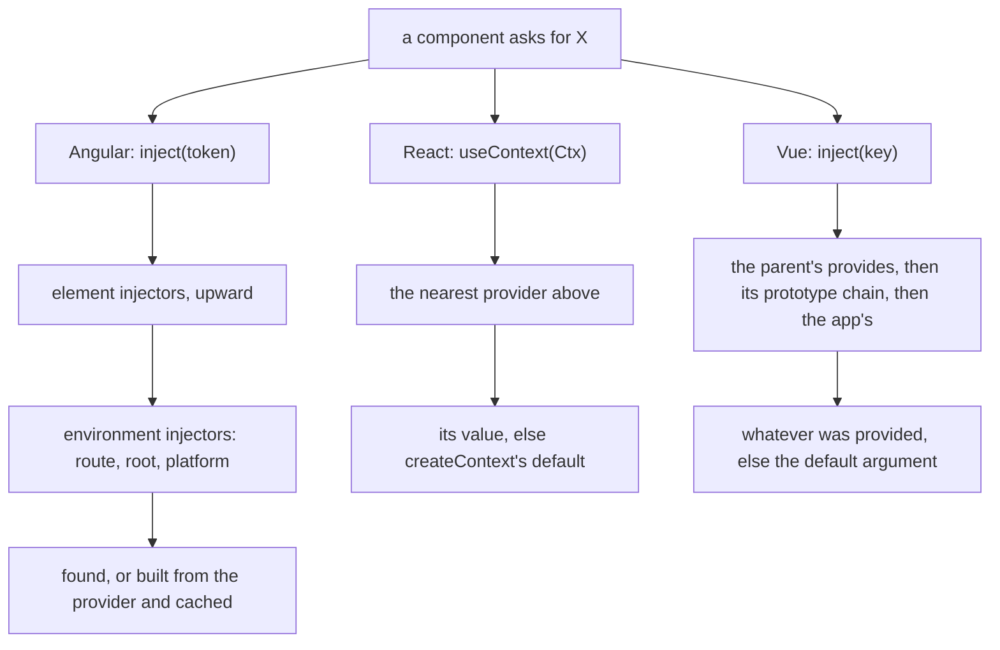
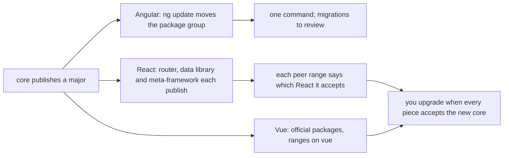
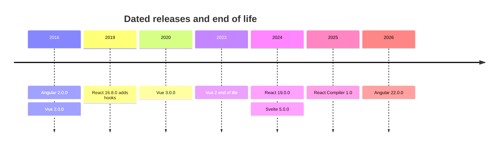
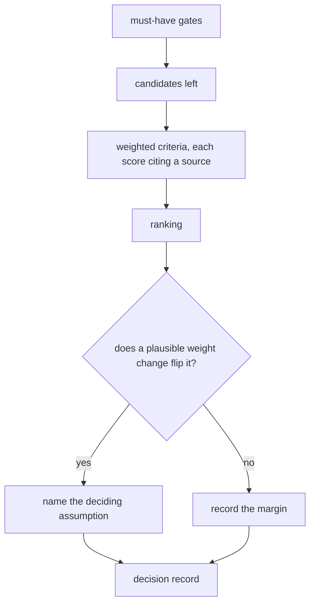
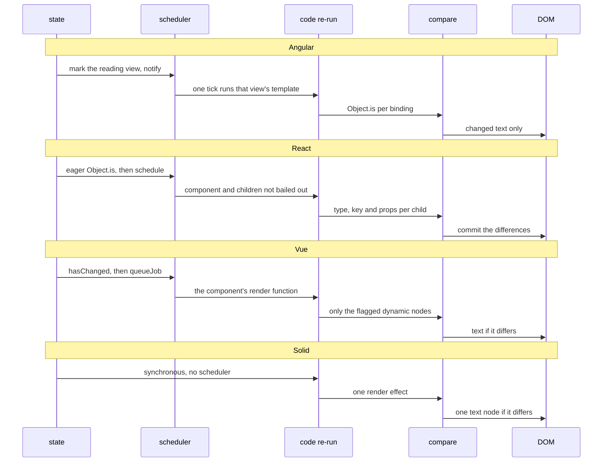

# 40. Framework comparisons: Angular, React, Vue and others

> **What this covers:** how Angular compares with React, Vue, Svelte, Solid, Preact and Qwik, from the evidence each project ships: what a library, a framework and a progressive framework decide for you; compiled templates versus JSX; React's re-render and reconciliation model and the React Compiler, next to the signal systems of Angular, Vue, Solid and Svelte; dependency injection, routing, forms, tooling, testing and the size of each ecosystem; release policies and breaking changes; and how to choose, with balanced trade-offs and an honest answer to "why Angular?".
> **Prerequisites:** [17. Under the hood: the reactive graph](17-signals.md#9-under-the-hood-the-reactive-graph), [21. The synchronization problem: dirty checking and fine-grained reactivity](21-change-detection.md#1-the-synchronization-problem-dirty-checking-and-fine-grained-reactivity), [12. What a framework does, and Angular's philosophy](12-angular-how-it-works.md#1-what-a-framework-does-and-angulars-philosophy)
> **Leads to:** [45. Frontend system design method](45-frontend-system-design-method.md), [47. Behavioral interviews and interview craft](47-behavioral-and-interview-craft.md)
> **Applies to:** Angular 22.2 (the owners' labs); documented only: `react` and `react-dom` 19.3.1, `babel-plugin-react-compiler` 1.0.0, `vue` 3.5.44, `solid-js` 1.9.17, `svelte` 5.57.2, `@preact/signals-core` 1.14.4, `@builder.io/qwik` 1.20.2; Vitest in Node with jsdom for our models; registry reads 2026-10-19 and 2026-10-20
> **Study time:** ~3 hours reading + ~2 hours exercises
> **Short on time:** read [§1](#1-library-framework-progressive-framework-what-each-project-decides-for-you), [§3](#3-reacts-model-re-rendering-reconciliation-memoization-and-the-react-compiler), [§4](#4-signals-beyond-angular-vue-refs-solid-svelte-runes-preact-and-qwik) and [§8](#8-choosing-a-framework-balanced-trade-offs-and-how-to-answer-why-angular), then [Q40.01](#q40-01), [Q40.03](#q40-03), [Q40.06](#q40-06), [Q40.12](#q40-12), [Q40.13](#q40-13) and [Q40.16](#q40-16), then the [Summary](#summary).
> **Labs:** [`labs/ts-js/src/modules/40-framework-comparisons/`](../labs/ts-js/src/modules/40-framework-comparisons/) and [`labs/ts-js/src/outputs/40-framework-comparisons/`](../labs/ts-js/src/outputs/40-framework-comparisons/). Run (Node 24): from `labs/ts-js`, `npx vitest run src/modules/40-framework-comparisons src/outputs/40-framework-comparisons`.

## Contents

1. [Library, framework, progressive framework: what each project decides for you](#1-library-framework-progressive-framework-what-each-project-decides-for-you)
2. [Templates, JSX and single-file components: what the compiler knows](#2-templates-jsx-and-single-file-components-what-the-compiler-knows)
3. [React's model: re-rendering, reconciliation, memoization and the React Compiler](#3-reacts-model-re-rendering-reconciliation-memoization-and-the-react-compiler)
4. [Signals beyond Angular: Vue refs, Solid, Svelte runes, Preact and Qwik](#4-signals-beyond-angular-vue-refs-solid-svelte-runes-preact-and-qwik)
5. [Dependency injection and shared state: injectors, context and provide/inject](#5-dependency-injection-and-shared-state-injectors-context-and-provideinject)
6. [Routing, forms, data fetching, tooling and testing: first-party or ecosystem](#6-routing-forms-data-fetching-tooling-and-testing-first-party-or-ecosystem)
7. [Ecosystem size, release policies and breaking changes](#7-ecosystem-size-release-policies-and-breaking-changes)
8. [Choosing a framework: balanced trade-offs and how to answer "why Angular?"](#8-choosing-a-framework-balanced-trade-offs-and-how-to-answer-why-angular)
9. [Under the hood: one state change traced through Angular, React, Vue and Solid](#9-under-the-hood-one-state-change-traced-through-angular-react-vue-and-solid)
- [Summary](#summary)
- [Question bank](#question-bank)
- [Hands-on exercises](#hands-on-exercises)
- [Check your understanding](#check-your-understanding)
- [Connections](#connections)

**How this module was checked.** Run: Vitest in Node (jsdom where a test needs a DOM) for our models of React's render rules, of Solid-style fine-grained updates, of two keyed-reconciliation algorithms and of a decision record; Angular's side links its owners' committed tests ([21](21-change-detection.md), [16](16-dependency-injection.md), [29](29-testing-angular.md)). Read, not run: `react` and `react-dom` 19.3.1, `babel-plugin-react-compiler` 1.0.0, `@vue/reactivity`, `@vue/runtime-core` and `@vue/shared` 3.5.44, `solid-js` 1.9.17, `svelte` 5.57.2 and `@preact/signals-core` 1.14.4, plus `vue` 3.5.44, `@vue/compiler-core` 3.5.44, `react-router` 8.5.0, `vue-router` 5.4.0 and `@vue/test-utils` 2.5.1, from npm tarballs; the react.dev, vuejs.org, svelte.dev, qwik.dev, angular.dev, npm and Spring Boot sources and the npm registry, on the dates in [SOURCES.md](../SOURCES.md). No other framework is installed or run.

## 1. Library, framework, progressive framework: what each project decides for you

### The problem it solves

"Angular is a framework and React is a library: what does that mean in practice?" A team that picks React expecting a router, forms and a test runner in the box finds each one is a separate decision. A team that picks Angular expecting to swap its router finds they ship as one release group. This section sorts the projects by what each decides for you, in each project's own words (read 2026-10-19).

### Mental model

A **UI library** renders components into a root you give it and leaves routing, data, forms, build and tests to you. A **framework** owns the entry point and the update loop and calls your code ([inversion of control](12-angular-how-it-works.md#1-what-a-framework-does-and-angulars-philosophy), owned by module 12). A **progressive framework** can be dropped into a page as a library and grows by adding official pieces. A **meta-framework** is a framework built on a UI library. A **compiler-first framework** moves much of its work to build time. A **first-party package** is one the project's own team maintains. Kitchens: a knife set (library), cabinets added one by one (progressive), a fitted kitchen (framework).



What to notice: the order is ours, from each project's self-description and what its core package ships, not a ranking by the projects; Next.js, Nuxt and SvelteKit are frameworks sitting on the library boxes.

### How it actually works

The projects' own words (npm `description` read with `npm view`; docs read from their GitHub sources; 2026-10-19):

- React: "React is a JavaScript library for building user interfaces." react.dev: "If you want to build a new app or website with React, we recommend starting with a framework."
- Vue: "a framework that can grow with you and adapt to your needs" (abridged).
- Angular: "Angular is a web framework that empowers developers to build fast, reliable applications" (abridged).
- Solid: "A declarative JavaScript library for building user interfaces." Svelte: "Cybernetically enhanced web apps", which names neither category.

**Why do people call React a library and Vue a framework?** Read, not run, in the tarballs. `react` 19.3.1 declares no `dependencies`, and its CommonJS build exports components, hooks and context (`Component`, `createContext`, `useState`, `memo`) with no routing, forms or HTTP name. Routing is another package: `react-router` 8.5.0 needs `react` `>=19.2.7` as a peer (a package the app installs once and shares, §6). `vue` 3.5.44 declares five dependencies (step 2 below), so compiler, DOM runtime and server renderer arrive in one install; its docs still call Vue Router "officially-supported". `svelte` 5.57.2 exports `./compiler`, `./store`, `./transition` and `./motion` from one package. Angular's packages move together through `ng-update.packageGroup` (module 12 §1, linked above).

**Meta-frameworks are frameworks built on libraries.** `next` 16.4.2 ("The React Framework") peers on `react`; `nuxt` 4.6.2 depends on `vue` and `vue-router`; `@sveltejs/kit` 3.1.0 peers on `svelte`. react.dev lists Next.js, React Router (v7) and Expo as "Full-stack frameworks", and says starting from scratch "does require that you make choices on which tools to use for routing, data fetching, and other common usage patterns." The boundary moved; it did not vanish.

### Code

Approach: read what one install brings; nothing is run.

1. `react` 19.3.1's `package.json` has no `dependencies` field.
2. `vue` 3.5.44's `package.json`, verbatim:

```json
"dependencies": {
  "@vue/shared": "3.5.44",
  "@vue/compiler-dom": "3.5.44",
  "@vue/runtime-dom": "3.5.44",
  "@vue/compiler-sfc": "3.5.44",
  "@vue/server-renderer": "3.5.44"
}
```

3. List the concerns you need (routing, forms, HTTP, build, tests) and write down who owns each.

### Best practices and anti-patterns

- Ask "what is decided for me?", not "library or framework?", because the slogan hides who owns the router, the forms and the upgrade order.
- Quote the project's own description when asked its category, because `react` calls itself a library while react.dev recommends a framework.
- Compare Angular with a meta-framework, not only the bare library, because the meta-framework is the layer that owns the entry point.

### Misconceptions and traps

- "React is a library, so a React app has no framework." Correction: react.dev recommends "starting with a framework" and lists three. Cause: the npm description, which describes the `react` package, not the recommended starting point.
- "A framework is just a library with more features." Correction: the difference is who owns the entry point and the update loop ([Q12.01](12-angular-how-it-works.md#q12-01) owns that answer). Cause: feature lists show size and hide control.
- "Vue is a smaller Angular." Correction: Vue's docs call it "flexible and incrementally adoptable", with use "without a build step" among its ways of use, while Angular ships as one release group. Cause: both have templates and an official router.

Drilled in [Q40.01](#q40-01).

## 2. Templates, JSX and single-file components: what the compiler knows

### The problem it solves

"Templates or JSX?" turns into taste, and the real difference goes unsaid: what each format lets a compiler see. A React list allocates a callback per row on every render, and an Angular template cannot express the loop a team needs; neither can say why. Sources read 2026-10-19.

### Mental model

A **template** is a restricted language the compiler parses ahead of time, so it knows which nodes are static and which bindings can change. A **render function** is a function that returns a description of the UI. A **virtual DOM** is that description kept as a tree of plain objects, which the runtime diffs against the previous tree to find the DOM writes. **JSX** is a syntax extension of JavaScript that compiles to function calls, so the render function is ordinary code that the runtime re-runs and compares. A **single-file component** (SFC: a `.vue` or `.svelte` file) keeps template, script and style together, and the compiler splits them. A **patch flag** is a number Vue's compiler attaches to a node to say which parts can change. Analogy: a printed form with blanks against a letter written fresh each time.



What to notice: in the template lanes the compiler leaves hints before the program runs; the React lane has none, so the runtime compares what it is handed. Angular's lane is owned by [12 §8](12-angular-how-it-works.md#8-under-the-hood-what-the-compiler-emits-and-what-the-runtime-does-with-it), and its template checking by [12 §7](12-angular-how-it-works.md#7-aot-versus-jit-and-template-type-checking).

### How it actually works

**Why can a virtual DOM skip static nodes?** Read, not run, in `@vue/compiler-core` and `@vue/runtime-core` 3.5.44. `@vue/shared`'s `PatchFlagNames` maps `TEXT` 1, `CLASS` 2, `STYLE` 4, `PROPS` 8, `FULL_PROPS` 16 and `CACHED` -1 (internal names). In `runtime-core`'s `patchElement` (internal), `patchFlag & 2` compares only `class`, `patchFlag & 4` writes `style`, `patchFlag & 8` visits only the listed `dynamicProps`, and `patchFlag & 1` replaces the text only if it differs. **Static hoisting** builds constant parts once instead of on every render. In 3.5 the internal `walk` in `compiler-core` marks a fully constant element `CACHED` (`patchFlag` -1) and caches its vnode (`context.cache`); an element whose only dynamic part is its text keeps its constant props hoisted (`context.hoist`). Vue's guide calls this a "Compiler-Informed Virtual DOM" and says the virtual DOM in React and most others is "purely runtime" (rendering-mechanism guide).

**What JSX gives.** It is the full language for conditions and loops. React's guide: "JSX looks like HTML, but under the hood it is transformed into plain JavaScript objects", and "JSX is a syntax extension, while React is a JavaScript library." `react` 19.3.1 exports `createElement`, and `react/jsx-runtime` exports `jsx`, `jsxs` and `Fragment`. Q12.27 owns instructions versus a virtual DOM ([Q12.27](12-angular-how-it-works.md#q12-27)); §3 covers React's compiler.

**Solid differs from both.** Read, not run, in `solid-js` 1.9.17: `createComponent` returns `untrack(() => Comp(props || {}))`, so a component body runs once and is not tracked, and `solid-js/web`'s `insert` wraps a dynamic child in `createRenderEffect`. An update reaches that one expression.

**SFCs.** Vue's guide says an SFC "must be pre-compiled by @vue/compiler-sfc into standard JavaScript and CSS"; `vue` 3.5.44 depends on that package. Svelte's guide says components are written in `.svelte` files "using a superset of HTML"; `svelte` 5.57.2 exports `./compiler`.

### Code

Approach: put a template's compiled call next to a JSX component, and see what each hands the runtime.

1. Vue's guide compiles `<div :class="{ active }"></div>` to a call whose last argument is the flag:

```js
// Partial: Vue 3 compiled render call, quoted from the Vue rendering-mechanism guide (not run in the labs)
createElementVNode("div", {
  class: _normalizeClass({ active: _ctx.active })
}, null, 2 /* CLASS */)
```

2. A JSX component carries no flags, and its arrow function is new on every call:

```jsx
// Partial: React 19.3.1 component (not run in the labs)
function List({ items, onPick }) {
  return <ul>{items.map(i => <li key={i.id} onClick={() => onPick(i.id)}>{i.name}</li>)}</ul>;
}
```

3. Ask of each: which part can change, and who knows it, the compiler or the runtime?

### Best practices and anti-patterns

- Pick by what you need the compiler to know, not taste, because templates buy static analysis and JSX buys the whole language.
- Avoid "templates are slower" claims without a measurement, because only mechanisms were read here.

### Misconceptions and traps

- "JSX is HTML in JavaScript." Correction: it becomes function calls and objects, and attributes become props. Cause: it looks like markup.
- "Templates are less powerful, so they are slower." Correction: the restriction lets Angular's and Vue's compilers mark static parts (patch flags and hoisting above). Cause: fewer constructs read as less capability.
- "Solid is React with signals." Correction: a Solid component runs once and its JSX becomes DOM operations. Cause: both use JSX.

Drilled in [Q40.02](#q40-02).

## 3. React's model: re-rendering, reconciliation, memoization and the React Compiler

### The problem it solves

A React developer on an Angular team asks why typing in a search box re-runs every row, why `memo` did nothing for a child given `style={{ gap: 4 }}`, and whether the React Compiler makes React "like signals". A comparison needs React's model stated precisely. Sources read 2026-10-19.

### Mental model

**Component state** is data a component owns through a hook like `useState`. Setting it schedules a **re-render**, a new call of the component function: "when a component's state changes, React will re-render that component _and all of its children_". **Reconciliation** pairs the new element tree with the old: a child with the same type and **key** (its identity among its siblings) keeps its instance and state; any other is replaced. The **commit** writes to the DOM: "React only changes the DOM nodes if there's a difference between renders". A **bailout** is React skipping work. **`memo`** wraps a component so it is skipped when its new props are **shallow-equal** to the old (same keys, each value equal by `Object.is`). **Context** is a value a provider hands to descendants that read it. Analogy: a newspaper reprints the page on any correction, a proofreader replaces only changed lines, and `memo` is a "column unchanged" stamp.



What to notice: only the last box touches the DOM, and a child is skipped only when four conditions hold at once.

### How it actually works

Read, not run, in `react-dom` 19.3.1, `cjs/react-dom-client.development.js`; every function named here is internal. Our model, `mini-rerender.ts`, mirrors four of the rules.

**Why does a child without `memo` re-render when its props did not change?** `beginWork` marks an update when `current.memoizedProps !== workInProgress.pendingProps`: the props *object* by identity, and a parent's render creates a new one for every child. In the lab, our model re-runs `Plain` with an unchanged `label` (`Section 3: our model re-runs a child without memo whenever its parent re-renders`).

**What `memo` compares.** `updateMemoComponent` and `updateSimpleMemoComponent` use `shallowEqual` (or a custom `compare`): key count, then `hasOwnProperty` and `objectIs` (`Object.is`) per key. If equal, with no own update or changed context (`checkScheduledUpdateOrContext`), `bailoutOnAlreadyFinishedWork` skips it. In the lab, our model skips `MemoLabel` given `label: 'total'` (`Section 3: our model skips a memo child whose props are shallow-equal`) and re-runs `MemoBox` given `style: { gap: 4 }` (`Section 3: our model re-renders a memo child that receives a new inline object`).

**The equal-state bailout.** With no update pending, `dispatchSetStateInternal` computes the next state eagerly and returns without scheduling when `objectIs(eagerState, currentState)`. The 16.8.0 changelog (February 6, 2019) added it: "Bail out of rendering on identical values for `useState` and `useReducer` Hooks". In the lab, our model's setter returns `false` and the next pass renders nothing (`Section 3: our model schedules nothing for a setState with an Object.is-equal value`).

**Context passes through `memo`.** A provider compares its new `value` with `objectIs`; if it differs, `propagateContextChanges` marks each reader, which re-renders below a parent that bailed out. In the lab, our model renders `Parent` and `Reader` but not `MemoShell` (`Section 3: our model re-renders a context reader below a skipped memo parent`).

**Keys.** `updateSlot` reuses an old child only when the key matches, and `placeChild` moves one whose old index is below `lastPlacedIndex`; the warning: "Keys should be unique so that components maintain their identity across updates."

**The React Compiler**, the Babel plugin `babel-plugin-react-compiler` (1.0, "the compiler's first stable release", react.dev blog, 2025-10-07), "automatically applies the equivalent of manual memoization". Read, not run, in 1.0.0's `dist/index.js` (internal names): a compiled component starts with `const $ = _c(N)`, `_c` from `react/compiler-runtime`, which calls `useMemoCache(size)` in `react` 19.3.1. That array is the **memo cache**: per component instance, slots for each memoized block's dependencies and results; `codegenReactiveScope` guards a block with `$[i] !== dependency` and otherwise reads its results back. The component still re-runs.

Angular instead marks the one view whose template read a changed signal ([Q21.34](21-change-detection.md#q21-34)) and writes only changed bindings ([21 §1](21-change-detection.md#1-the-synchronization-problem-dirty-checking-and-fine-grained-reactivity), `Section 1: a changed binding is the only DOM write`).

### Code

Approach: one parent with two `memo` children, then our model's rule.

1. `setCount` re-runs `Parent`; `MemoLabel` is skipped and `MemoBox` re-runs:

```jsx
// Partial: React 19.3.1 components, imports omitted (not run in the labs)
const MemoLabel = memo(function MemoLabel({ label }) { return <span>{label}</span>; });
const MemoBox = memo(function MemoBox({ style }) { return <div style={style} />; });

function Parent() {
  const [count, setCount] = useState(0);
  return (
    <>
      <button onClick={() => setCount(count + 1)}>{count}</button>
      <MemoLabel label="total" />
      <MemoBox style={{ gap: 4 }} />
    </>
  );
}
```

2. Our model: a new type replaces; equal props, no own update and no changed context bail out; anything else re-runs:

```ts
// Excerpt of labs/ts-js/src/modules/40-framework-comparisons/concepts/mini-rerender.ts
function update(inst: Instance | undefined, element: Element, log: string[]): Instance {
  const { type, props } = element;
  const fresh: Instance = { type, props, cells: [], scheduled: false, children: [] };
  if (inst === undefined || inst.type !== type) return run(fresh, log); // a new type replaces the subtree
  const contextChanged = inst.reads !== undefined && !Object.is(inst.reads.current, inst.seen);
  const equal = inst.props === props || (typeof type === 'object' && 'memo' in type && shallowEqual(inst.props, props));
  // Bailout: each child instance is passed back as its own element, so it keeps the props object it holds.
  if (equal && !inst.scheduled && !contextChanged) return visit(inst, inst.children, log);
  inst.props = props;
  return run(inst, log);
}
```

### Best practices and anti-patterns

- Give a `memo` child primitives or references kept with `useMemo` and `useCallback`, because `shallowEqual` compares each prop with `Object.is`.
- Key list items by a stable id, not the index, because state follows the key.
- Without good test coverage, pin the compiler's exact version, because the 1.0 post recommends it over "a SemVer range" (such as `^1.0.0`, which accepts later compatible releases).

### Misconceptions and traps

- "React re-renders the whole DOM on every change." Correction: it re-runs component functions and commits only the differences. Cause: "render" sounds like painting.
- "`memo` updates a component only when its props change." Correction: its own state and a changed context also re-render it, and a new object prop counts as changed. Cause: the name.
- "The React Compiler turns React into signals." Correction: components still re-run; the compiler reuses values inside them. Cause: the docs call the result "sometimes referred to as \"fine-grained reactivity\"".
- "Keys are only a performance hint." Correction: a key is the child's identity; a changed key replaces the child and drops its state. Cause: React warns about keys only in lists.

Drilled in [Q40.03](#q40-03), [Q40.04](#q40-04) and [Q40.05](#q40-05); practised in [Exercise 40.1](#ex40-1).

## 4. Signals beyond Angular: Vue refs, Solid, Svelte runes, Preact and Qwik

### The problem it solves

"Angular adopted signals, so it works like Solid now." "Vue has had signals for years." Interviewers test what "signal" means in each, where a write lands, and which habits break. Sources read 2026-10-19.

### Mental model

A **signal** is a value container that records who reads it and notifies them on write ([17 §1](17-signals.md#1-why-signals-exist)). Vue's docs: "Fundamentally, signals are the same kind of reactivity primitive as Vue refs"; a **ref** is Vue's container, read and written through `.value`. A **rune** is a Svelte 5 keyword such as `$state`. A **render effect** writes to the DOM and re-runs when what it read changes. **Granularity** is the unit a write re-runs; **fine-grained reactivity** makes that unit a single DOM expression. Analogy: five makers' thermostats all report changes, but one rings the house, one each room, one each radiator.



What to notice: the container is shared; the box after the arrow differs, and only Solid and Svelte stop at a DOM expression.

### How it actually works

Read, not run, in the tarballs and docs named.

| Axis | Angular (owner modules) | Vue 3.5.44 | Solid 1.9.17 | Svelte 5.57.2 |
|---|---|---|---|---|
| Read / write | `count()`, `set` (17) | `.value` getter `track`s, setter `trigger`s (`RefImpl`, internal) | `[get, set]` from `createSignal` | a plain variable: "`count` is just a number" (`$state` docs) |
| Equality | `Object.is` (17) | `hasChanged`: `!Object.is` | `equalFn`: `a === b` | `equals`: `value === this.v` (internal) |
| Deep | shallow: new reference only (17) | object becomes a `reactive` Proxy (`toReactive`) | shallow; docs point nested updates to stores | arrays and simple objects become a "deeply reactive _state proxy_" |
| Granularity | one view (module 21) | the component (`setupRenderEffect`, internal) | one expression (`insert`) | "anything in your UI that depends on that specific property" |
| Scheduling | Angular's scheduler ([21 §5](21-change-detection.md#5-zoneless-change-detection-the-scheduler-its-triggers-and-pendingtasks)) | `queueJob`, flushed in `resolvedPromise.then(flushJobs)`, a microtask (internal) | synchronous, in `writeSignal`'s `runUpdates` (internal) | a `Batch` (internal); not traced |

A **`reactive` Proxy**, Vue's deep wrapper, tracks property access ([03 §5](03-js-objects-prototypes-classes.md#5-proxy-and-reflect), [Q03.14](03-js-objects-prototypes-classes.md#q03-14)). Preact's `@preact/signals-core` 1.14.4 uses `.value` and writes only when `i!==this.v` (minified); Vue's docs call Preact and Qwik signals "very similar to Vue's shallowRef".

**Why does a Solid component body run once while a Vue component re-renders?** Solid's `createComponent` returns `untrack(() => Comp(props || {}))`, so the body subscribes to nothing, and `insert` wraps a function child in `createRenderEffect` but inserts any other value once. Vue's `setupRenderEffect` runs the whole render in `new ReactiveEffect(componentUpdateFn)` (`componentUpdateFn` internal), so every read during render subscribes the component. In the lab, our fine-grained model runs `Counter` once over two writes (`Section 4: our fine-grained model calls the component function once`), a write changes one text node only (`Section 4: our fine-grained model writes only the text node bound to the changed signal`), and a value read into a constant stays `'0'` (`Section 4: a value read into a constant in the component body never updates in our fine-grained model`).

**Vue's computed pulls by version**, as Angular's does ([Q17.33](17-signals.md#q17-33)): `refreshComputed` returns at once when `computed.globalVersion === globalVersion`, and otherwise `isDirty` compares each dependency link's `version` with its dep's (internal).

**Qwik**'s signals serve **resumability**: "pausing execution on the server and resuming execution on the client" (abridged, Qwik docs). On npm, v1 is `@builder.io/qwik` 1.20.2; `@qwik.dev/core`'s `latest` is 2.0.0-rc.3.

> [!NOTE]
> **Framework vs platform.** None of these is a JavaScript feature; each ships its own code. The TC39 Signals proposal's README reads "Stage 1"; what that means is [Q17.38](17-signals.md#q17-38)'s. RxJS is not part of React or Vue either (neither package depends on it, §1); Angular's interop is [17 §8](17-signals.md#8-interop-with-rxjs).

### Code

Approach: model Solid's path, then see the porting trap.

1. A signal notifies its observers synchronously when `===` says the value changed.
2. A function child becomes one render effect over one text node; any other value is written once:

```ts
// Excerpt of labs/ts-js/src/modules/40-framework-comparisons/concepts/mini-fine-grained.ts
export function insertText(parent: Node, child: Child): Text {
  const node = parent.appendChild(document.createTextNode(''));
  if (typeof child === 'function') createRenderEffect(() => { node.data = String(child()); });
  else node.data = String(child);
  return node;
}
```

3. A React habit breaks: a read in the body captures a value.

```jsx
// Partial: Solid 1.9.17 component (not run in the labs)
function Label() {
  const [count, setCount] = createSignal(0);
  const snapshot = count();               // read once, untracked
  return <p>{snapshot} / {count()}</p>;   // only the second updates
}
```

### Best practices and anti-patterns

- Ask "what re-runs on a write?" before porting, because it varies.
- Replace objects in Angular and Solid signals instead of mutating them, because `Object.is` and `===` see only a new reference.
- In Solid, read signals inside JSX or effects, because the component body is untracked.

### Misconceptions and traps

- "Signals are an idea Angular introduced." Correction: Vue's docs trace them to "Knockout observables" and "Meteor Tracker". Cause: Angular's launch made the word popular.
- "All signal frameworks update the same unit." Correction: Vue re-renders a component, Angular refreshes a view, Solid re-runs one expression. Cause: one word covers several designs.
- "A Vue `ref` and an Angular signal treat objects alike." Correction: a `ref` makes an object a deep Proxy; an Angular signal notifies only on a new reference. Cause: both wrap a value.
- "Svelte 5 runes are React hooks." Correction: `$state` declares a plain variable, and "every reference to `count` is transformed by the Svelte compiler" into signal `get` and `set` calls (`$state` docs); nothing is called per render. Cause: both arrived as "the new way" in a major.

Drilled in [Q40.06](#q40-06) and [Q40.07](#q40-07).

## 5. Dependency injection and shared state: injectors, context and provide/inject

### The problem it solves

"React has no dependency injection, so how do you swap a service in a test?" and "isn't Vue's `provide`/`inject` Angular's DI?" assume one mechanism. There are three; they differ in who builds the object, how the lookup runs and what a change does. Read 2026-10-20.

### Mental model

**Dependency injection** is a class declaring what it needs and something else deciding what it gets ([16 §1](16-dependency-injection.md#1-why-dependency-injection-containers-constructor-injection-and-inject)). In Angular an **injector** resolves a **token** (the key a consumer asks for) through a provider (the recipe), caches the instance and belongs to a tree ([16 §5](16-dependency-injection.md#5-the-injector-tree-platform-root-route-and-element-injectors-and-the-modifiers)). A React **provider** is the element `<SomeContext value={…}>`: it hands one value to the readers below it ([context, §3](#3-reacts-model-re-rendering-reconciliation-memoization-and-the-react-compiler)) and builds nothing. Vue's **`provide`/`inject`** store a value under a key in a component and read it from an ancestor. Analogy: Angular is a company directory that also hires the person you ask for; context is a note passed down the org chart saying whom to call.



What to notice: only Angular's providers describe how to build the object; React and Vue return what someone put there, and Vue's lookup starts at the parent, not at the asking component.

### How it actually works

Read, not run, in `react`, `react-dom` 19.3.1 and `@vue/runtime-core` 3.5.44; names below other than public hooks are internal. Angular's side is module 16's: element injectors answer before environment ones (`Section 5: the element tree is searched before the environment tree`); Spring's container is [Q16.35](16-dependency-injection.md#q16-35)'s.

**Why does a context with an object-literal value re-render every reader?** `createContext` returns a plain object whose `Provider` is itself (`defaultValue.Provider = defaultValue`), so `<SomeContext>` is a provider. While React renders a provider's subtree, `pushProvider` sets `context._currentValue` to its `value`; a reader returns that slot and records it (`readContextForConsumer`). `propagateParentContextChanges` compares each provider's new `value` with the old by `objectIs` (`Object.is`); if they differ, `propagateContextChanges` marks every reader. The docs agree: values "are compared with the `Object.is` comparison" (abridged). `value={{ currentUser, login }}` is a new object on each render, so every reader runs; the docs' remedy is `useMemo` and `useCallback`.

**Vue: the lookup is a prototype chain.** An instance's `provides` starts as its parent's object; its first `provide()` call replaces it with `Object.create(parentProvides)`. `inject` tests `key in` the parent's `provides` (for the root, the app's), so the nearest ancestor shadows the rest and a component never injects its own `provide`. A missing key returns the default argument or warns. The stored value comes back untouched, so a provided `ref` stays a `ref`.

**Testing.** Angular overrides a provider in `TestBed` ([29 §4](29-testing-angular.md#4-testbed-the-testing-module-inject-runininjectioncontext-overrides-and-teardown), `Section 4: overrideProvider replaces a dependency of a root service`). Vue Test Utils 2.5.1's `mount` calls `app.provide(key, …)` for each `global.provide` key. A React test wraps the reader in a provider with the replacement.

### Code

Approach: provide one value, then swap it.

1. React: memoize the object, so `value` keeps its identity until `currentUser` changes:

```jsx
// Partial: React 19.3.1 components (not run in the labs)
const AuthContext = createContext(null);

function MyApp() {
  const [currentUser, setCurrentUser] = useState(null);
  const login = useCallback((user) => setCurrentUser(user), []);
  const auth = useMemo(() => ({ currentUser, login }), [currentUser, login]);
  return <AuthContext value={auth}><Page /></AuthContext>;
}
```

2. Vue: provide the `ref`, not its `.value`:

```vue
<!-- Partial: Vue 3.5.44 component (not run in the labs) -->
<script setup>
import { ref, provide } from 'vue'
const count = ref(0)
provide('count', count)
</script>
```

3. Vue test, from the Vue Test Utils API docs:

```js
// Partial: Vue Test Utils 2.5.1 test (not run in the labs)
const wrapper = mount(Component, { global: { provide: { Theme: 'dark' } } })
```

4. For each dependency, write who builds it, how long it lives and what notifies readers.

### Best practices and anti-patterns

- Memoize an object given to a React provider, because a fresh literal changes `Object.is`.
- Provide a `ref` in Vue, because `inject` returns whatever was stored.
- Before porting a service, ask who builds it, because only Angular's injector does.

### Misconceptions and traps

- "React context is dependency injection." Correction: context passes a value you already built; an injector builds from a provider and caches per injector. Cause: both hand a dependency down a tree without props.
- "Vue's `provide`/`inject` is reactive." Correction: `inject` returns what was stored; a provided `ref` stays reactive, a plain value does not. Cause: the API page's example provides a `ref` beside a static path.
- "Putting a service in React context is free." Correction: every reader re-renders when the provided value changes identity, as an object literal does each render. Cause: context looks like a global.

Drilled in [Q40.08](#q40-08).

## 6. Routing, forms, data fetching, tooling and testing: first-party or ecosystem

### The problem it solves

"What do we get in the box?" is answered with package names, and the useful question is who maintains each piece and what happens to it when the core has a major release. A team that assembles a stack owns that matrix; a team on Angular inherits one. Read 2026-10-20.

### Mental model

A **first-party package** (§1) is one the project's team maintains; a **data-fetching library** loads and caches server data for components; a **test runner** finds and runs your tests. A **peer dependency** is a package the consumer installs, shared rather than bundled ([39 §7](39-version-history-and-migrations.md#7-updating-in-practice-ng-update-migration-schematics-and-the-update-guide)); its version range states which core versions a package accepts. Analogy: a car with the maker's service plan against parts from several suppliers, each with its own warranty.



What to notice: Angular's side is one step because the packages are one release group; the other two sides depend on several projects' ranges.

### How it actually works

Maintainers come from each project's own text, or from the `repository` field of the registry entry (`npm view`, read 2026-10-20); Angular's cells are its owners'. Read, not run.

| Concern | Angular | React | Vue |
|---|---|---|---|
| Router | `@angular/router` ([24 §1](24-routing.md#1-router-configuration-providerouter-route-matching-redirects-and-the-wildcard)) | `react-router` 8.5.0, repository `remix-run/react-router` | Vue Router 5.4.0, "officially-supported" (docs) |
| Forms | `@angular/forms`; Signal Forms [Stable since v22.0] ([25 §1](25-forms-reactive-and-template-driven.md#1-two-forms-apis-template-driven-and-reactive-and-the-control-directive-and-accessor-triangle), [26 §1](26-signal-forms.md#1-why-a-third-forms-api-model-first-signals-end-to-end)) | form actions only: `useActionState`, `useOptimistic`, `useFormStatus`, `requestFormReset` | none in the sources read |
| HTTP and data | `HttpClient` (module 27) | none in `react`; `@tanstack/react-query` 5.104.5, repository `TanStack/query` | none in the sources read |
| State | signals in core; store libraries by [28 §11](28-state-management.md#11-alternatives-and-the-decision-framework-ngxs-elf-tanstack-query-and-when-a-store-library-is-justified) | `useState`, `useReducer` and context in `react`; stores are other packages | Pinia, "maintained by the Vue core team" (docs) |
| Build | `@angular/build`, one release group (12 §1) | chosen with the framework react.dev recommends (§1) | Vite, "created by Evan You, who is also the author of Vue" (docs) |
| Unit tests | Vitest through `@angular/build:unit-test` (module 29) | no recommendation read | Vitest, "created and maintained by Vue / Vite team members" (docs) |
| Server rendering | `@angular/ssr` ([32 §1](32-ssr-ssg-hydration.md#1-why-render-on-the-server-csr-ssr-ssg-and-hybrid-rendering-and-what-each-costs)) | `next` 16.4.2, repository `vercel/next.js` | `nuxt` 4.6.2, repository `nuxt/nuxt` |

**Why can a library's release gate your upgrade?** Read in `package.json` files. `react-router` 8.5.0 peers on `react` and `react-dom` at `>=19.2.7` (`react-dom` optional), a range open upward. `vue-router` 5.4.0 requires `vue` at `^3.5.34 || ^4.0.0`; `pinia`, `vite`, `@vue/compiler-sfc` and `@pinia/colada` are optional peers. `@angular/router` 22.2.1 needs `@angular/core` at exactly `22.2.1` (module 12 §1), which is why `ng update` moves the group, and migrations still need review.

**Motion.** Vue's docs list `<Transition>` as a built-in "for applying animations when an element or component is entering and leaving the DOM". React 19.3.1 exports `ViewTransition`; its docs page opens "`<ViewTransition>` lets you animate a component tree with Transitions and Suspense" and, as read, carries no canary or experimental label, though its sandboxes pin `19.3.0-canary-f1f7ed2a-20260904`. Svelte's `transition:` directive is "triggered by an element entering or leaving the DOM as a result of a state change". Angular's `animate.enter` and `animate.leave` [Stable since v20.2] are [35 §1](35-animations.md#1-motion-in-a-ui-what-to-animate-the-browsers-three-animation-mechanisms-and-where-angular-fits)'s.

### Code

Approach: read what a router asks of its core.

1. `react-router` 8.5.0's `peerDependencies` and `peerDependenciesMeta`, abridged:

```json
"peerDependencies": { "react": ">=19.2.7", "react-dom": ">=19.2.7" },
"peerDependenciesMeta": { "react-dom": { "optional": true } }
```

2. `vue-router` 5.4.0's `vue` peer: `"vue": "^3.5.34 || ^4.0.0"`.
3. For each concern in your stack, write the package, its maintainer and its peer range.

### Best practices and anti-patterns

- Compare stacks by who maintains each concern, because "has a router" hides whether it is first-party.
- Read peer ranges before a core upgrade, because they say what each package accepts.
- Treat `ng update` as the start of an upgrade, because migrations still need review.

### Misconceptions and traps

- "React has no forms support." Correction: `react` exports `useActionState` and `useOptimistic`, `react-dom` exports `useFormStatus` and `requestFormReset`; a field model with validation is not among them. Cause: there is no forms library.
- "Vue's router and store are third-party." Correction: the docs call Vue Router "officially-supported" and Pinia "maintained by the Vue core team". Cause: they are separate packages.
- "First-party means no upgrade work." Correction: one command moves the group, but migrations still need review (39 §7, linked above). Cause: it is one command.

Drilled in [Q40.09](#q40-09).

## 7. Ecosystem size, release policies and breaking changes

### The problem it solves

"React has the biggest ecosystem" ends many discussions without asking what is counted, and "Angular breaks everything every six months" is repeated while Vue 2's end of life and React's move from classes to hooks stay out of the comparison. Two things can be measured: size, as a dated download count, and policy, as each project's own text. Read 2026-10-20.

### Mental model

A **download count** is npm's tally of tarball downloads of a package in a period. A **transitive dependency** is a dependency of a dependency, so installing one package can download many. **End of life** is the date a version stops receiving fixes; **long-term support** (LTS) is a window of critical fixes only ([39 §3](39-version-history-and-migrations.md#3-how-angular-ships-semantic-versioning-the-release-cadence-support-windows-and-the-deprecation-policy)); a **deprecation policy** says how long a deprecated feature keeps working. Analogy: city populations (downloads) against the building code (policy): size says how many live there, the code says how often you must renovate.



What to notice: dates are npm publish times (`npm view <pkg> time`), except Vue 2's end of life (Vue's page) and Angular 2.0.0 (2016-09-14 in [39 §2](39-version-history-and-migrations.md#2-why-angular-was-rewritten-and-what-carried-over); npm lists 2016-09-15 UTC).

### How it actually works

**Size, as one week.** `api.npmjs.org/downloads/point/last-week/<pkg>`, which the registry docs define as "the last 7 available days", returned for 2026-10-12 to 2026-10-18 (read 2026-10-20):

| Package | Downloads |
|---|---|
| `react` | 116,163,376 |
| `preact` | 23,228,055 |
| `vue` | 10,175,328 |
| `solid-js` | 4,649,796 |
| `svelte` | 4,210,714 |
| `@angular/core` | 3,415,695 |
| `@builder.io/qwik` | 25,721 |

npm's own post says the stats are "naïve by design": "a count of the number of HTTP 200 responses we served that were tarball files", including "automated build servers" and "downloads by mirrors". So the table counts tarballs in one week; it is not users, apps or quality, and it ranks nothing. How to evaluate a library is [37 §12](37-elements-pwa-errors-ecosystem.md#12-the-production-ecosystem-and-how-to-evaluate-a-library)'s.

**Policy, in each project's words.** Angular: "predictable, time-based release schedule", with LTS windows and migration schematics (`what-is-angular.md`); the numbers are module 39's. Vue: "Vue does not have a fixed release cycle", minors "a typical time frame of 3~6 months", and deprecated features "will be removed in the next major release after it entered deprecated status"; "Vue 2 has reached End of Life on December 31st, 2023. It no longer receives new features, updates, or fixes." React: `CHANGELOG.md` 16.8.0 (February 6, 2019) says "Add Hooks — a way to use state and other React features without writing a class"; react.dev says "Class components are still supported by React, but we don't recommend using them in new code", and `react` 19.3.1 still exports `Component` and `PureComponent`.

**What differs between hooks and Vue 2 to 3?** From those reads only: hooks arrived in a minor, 16.8.0, and classes were kept; Vue 3.0.0 was a new major (2020-09-18), and the 2.x line reached end of life on the date above. Why each project chose so is not stated in the pages read.

### Code

Approach: put the two React styles side by side, since both still work.

1. A class component:

```jsx
// Partial: React 19.3.1 components (not run in the labs)
class CounterClass extends Component {
  state = { count: 0 };
  render() {
    return <button onClick={() => this.setState({ count: this.state.count + 1 })}>{this.state.count}</button>;
  }
}
```

2. The function component react.dev recommends:

```jsx
// Partial: React 19.3.1 component (not run in the labs)
function Counter() {
  const [count, setCount] = useState(0);
  return <button onClick={() => setCount(count + 1)}>{count}</button>;
}
```

3. Ask of each policy: how long does a deprecated thing keep working, and where is that written?

### Best practices and anti-patterns

- Quote a download count with its week and what it includes, because it counts tarballs.
- Compare policies from each project's own page, because "breaks often" is folklore without a date.
- Check a version's end of life before choosing it, because Vue 2 stopped receiving fixes on a stated day.

### Misconceptions and traps

- "More downloads means more users." Correction: the count is tarball downloads, including build servers and mirrors. Cause: the number is public and large.
- "Angular breaks compatibility more than React and Vue." Correction: no page read measures that; Angular removes deprecated APIs only in a major and ships migrations (39 §3), Vue removes them in the next major, and Vue 2 reached end of life. Cause: the AngularJS to Angular rewrite (39 §2).
- "React hooks replaced classes." Correction: `Component` and `PureComponent` are still exported and supported, though not recommended for new code. Cause: the docs recommend functions.

Drilled in [Q40.10](#q40-10) and [Q40.11](#q40-11).

## 8. Choosing a framework: balanced trade-offs and how to answer "why Angular?"

### The problem it solves

"Why Angular?" gets a sales pitch or an apology; teams choose by fashion or the last project's pain, and a move away is proposed with no cost model. Here §1-§7 become a defensible decision. Read 2026-10-20.

### Mental model

A **must-have gate** is a requirement an option passes or fails; failing removes it before scoring. A **weighted criterion** is a property every remaining option is scored on, with a team-set weight. A **sensitivity analysis** asks which plausible weight change flips the winner. A **decision record** keeps gates, weights, sourced scores and the deciding assumption. Analogy: a building's structure, not its paint: expensive to undo, so test it against the loads.



What to notice: popularity has no box; at most it is one weighted criterion (§7 says what its count measures).

### How it actually works

**Gates.** [Q12.02](12-angular-how-it-works.md#q12-02) owns integrated versus assembled and is not re-asked; it weighs "the number of teams, the expected lifetime, the upgrade budget, and any requirement the framework does not ship." Add rendering needs (32 §1), existing code and the team's skills. No market figure was read, so hiring rests on the team's own evidence.

**Criteria** (our recommended starting list; weights are the team's): integration of the stack (§6), upgrade cost (§6's peer ranges, §7's policies), reactivity model (§3, §4), ecosystem fit (§7's caveated count; the libraries you need), learning curve (§1, §2, §5). Scoring a must-have instead of gating it lets other points outvote it (our judgment).

**"Why Angular?"** in that structure (our recommendation):

1. Context: the gates that left Angular in.
2. For it: one release group moved by `ng update` (§6, module 12 §1); first-party router, forms, HTTP, SSR and test runner (§6); DI (§5); a "predictable, time-based release schedule" with LTS (§7); `ng update` "runs automated code transformations that automatically handle routine breaking changes" (angular.dev).
3. Costs: more to learn first (templates and compiler, §2; DI, §5); one shared calendar, Q12.02's "The price is freedom"; `@angular/router` 22.2.1 accepts only `@angular/core` 22.2.1 (§6); a library whose Angular peer range lags holds an upgrade back ([39 §8](39-version-history-and-migrations.md#8-skipping-versions-safely-one-major-per-hop-node-and-typescript-ranges-and-libraries-that-block-a-hop)).
4. When another wins (our judgment): a React-skilled team with a working Next.js stack; a page enhanced "without a build step" (Vue's docs, §1); one widget in someone else's page.
5. What would flip it: the sensitivity result.

**A switch is a migration program**, priced like [39 §10](39-version-history-and-migrations.md#10-a-migration-program-for-an-old-angular-codebase-order-dependencies-and-checkpoints)'s plus retraining; modernizing in place keeps code and skills, so switch when a gate fails, not when a weight is marginal (our judgment). A **portable domain core** (framework-free state and rules) lowers the cost: each framework reads it through an **adapter**, a thin layer in that framework's shape (in Angular, a [facade](38-architecture-and-production-structure.md#3-facades-and-the-data-access-layer)). Shared widgets become custom elements ([37 §1](37-elements-pwa-errors-ecosystem.md#1-angular-elements-turning-a-component-into-a-custom-element), [08 §5](08-browser-rendering-dom-events.md#5-web-components-custom-elements-shadow-dom-and-templates)).

**Why must the core return the same snapshot?** React reads an **external store** (state outside React) with `useSyncExternalStore(subscribe, getSnapshot, getServerSnapshot?)`. Its page (read 2026-10-20): "While the store has not changed, repeated calls to `getSnapshot` must return the same value"; a value different by `Object.is` re-renders, so a new object per call loops ("The result of `getSnapshot` should be cached"). Its cost: "When possible, we recommend using built-in React state" (abridged).

> [!TIP]
> **Coming from the backend.** Spring Boot takes "an opinionated view of the Spring platform and third-party libraries", and "When you upgrade Spring Boot itself, these dependencies are upgraded as well in a consistent way" (Spring Boot reference, read 2026-10-20): Angular is that choice for the front end. **Where the analogy breaks:** Boot lets you "override Spring Boot’s recommendations", while Angular's packages require exact versions (§6); its template compiler (§2) has no Boot counterpart; its injectors differ from Spring's container ([16 §9](16-dependency-injection.md#9-di-patterns-testing-and-the-spring-container)).

### Code

Approach: one framework-free store, one adapter per framework; not run.

1. The core replaces its snapshot only on change:

```ts
// Partial: a framework-free domain core in TypeScript (not run in the labs)
export interface Cart { readonly items: readonly string[] }

function createCartStore() {
  let snapshot: Cart = { items: [] };
  const listeners = new Set<() => void>();
  return {
    getSnapshot: (): Cart => snapshot, // the same object until a change
    subscribe: (listener: () => void): (() => void) => {
      listeners.add(listener);
      return () => { listeners.delete(listener); };
    },
    add: (item: string): void => {
      snapshot = { items: [...snapshot.items, item] }; // a new object per change
      listeners.forEach((notify) => notify());
    },
  };
}

export const cart = createCartStore();
```

2. React subscribes:

```jsx
// Partial: React 19.3.1 component, imports omitted (not run in the labs)
function CartBadge() {
  const { items } = useSyncExternalStore(cart.subscribe, cart.getSnapshot);
  return <span>{items.length}</span>;
}
```

3. Angular copies each snapshot into a signal and unsubscribes on destroy:

```ts
// Partial: Angular 22.2 adapter service; imports from @angular/core and the core module omitted (not run in the labs)
@Injectable({ providedIn: 'root' })
export class CartState {
  private readonly snapshot = signal(cart.getSnapshot());
  readonly count = computed(() => this.snapshot().items.length);

  constructor() {
    const unsubscribe = cart.subscribe(() => this.snapshot.set(cart.getSnapshot()));
    inject(DestroyRef).onDestroy(unsubscribe);
  }

  add(item: string): void { cart.add(item); }
}
```

4. Record gates, weights, sourced scores and the flipping assumption.

### Best practices and anti-patterns

- Set weights before scoring, because weights set after bend toward the favorite.
- Cite a section or dated read for every score, because an unsourced score is a preference.
- Name Angular's costs when asked "why Angular?", because an answer without costs sounds like a pitch.

### Misconceptions and traps

- "The most popular framework is the safe choice." Correction: popularity is one weighted criterion at most, and §7's count is tarball downloads, not users or fit. Cause: the numbers are public and large.
- "Angular is only for large enterprises." Correction: nothing in the packages limits app size; a small team pays the same learning and calendar costs. Cause: angular.dev promises apps that "scale with both the size of your team and the size of your codebase".
- "A rewrite in a new framework fixes a slow or messy app." Correction: no page read shows a switch making an app faster; structure problems move with the code, and 39 §10's costs apply. Cause: old problems are visible, new ones are not.

Drilled in [Q40.12](#q40-12), [Q40.13](#q40-13), [Q40.14](#q40-14) and [Q40.15](#q40-15); practised in [Exercise 40.2](#ex40-2).

## 9. Under the hood: one state change traced through Angular, React, Vue and Solid

### The problem it solves

"A counter in the header changes. In each framework, what is marked, what code re-runs, what is compared, and when does the DOM change?" Most answers stop at "virtual DOM versus signals", yet all four compare something. Read 2026-10-20.

### Mental model

A **notification** is what a write does to tell the runtime. **Scheduling** decides when the follow-up work runs. The **unit of re-execution** is the code that runs again: a view, a component subtree, a component, or one expression. A **trace table** follows one change through each runtime, column by column. Analogy: four ways to fix a newspaper typo: reprint the section (React), reprint the column with a list of words that may differ (Vue), reset the line on the plate (Angular's view), or paste a sticker on the word (Solid).



What to notice: every row reaches a comparison; the rows differ in how much code runs before it.

### How it actually works

Read, not run: `react-dom` 19.3.1 (`cjs/react-dom-client.development.js`), `@vue/reactivity` and `@vue/runtime-core` 3.5.44, `solid-js` 1.9.17 (`dist/solid.js`, `web/dist/web.js`). Every function named below is internal except Solid's public `insert` and `createRenderEffect`. Angular's row is module 21's ([21 §9](21-change-detection.md#9-under-the-hood-the-notification-the-dirty-flags-and-the-refresh), 21 §1, Q21.34).

| | Notify | Schedule | Re-run | Compare | Write |
|---|---|---|---|---|---|
| Angular 22.2 | the template's consumer goes dirty; `markAncestorsForTraversal` flags the ancestors | one scheduler tick (21 §5) | that view's template function | `bindingUpdated`: `Object.is` per binding | the changed binding |
| React 19.3.1 | `dispatchSetStateInternal`: eager `Object.is` bailout, else `scheduleUpdateOnFiber` | a microtask (`scheduleImmediateRootScheduleTask`); sync lanes (React's internal priority bits for urgent updates) flush there, others go to `scheduler` | the component and each child not bailed out | type, key and props per child; text by `!==` | `commitTextUpdate` sets `nodeValue` |
| Vue 3.5.44 | `RefImpl` setter: `hasChanged`, then `trigger` | `queueJob`, flushed in a microtask | `componentUpdateFn` re-runs the render function | `patchElement` on the flagged nodes; text: `n1.children !== n2.children` | `hostSetElementText` |
| Solid 1.9.17 | `writeSignal`: `===`, observers marked `STALE` | synchronous, in `runUpdates` | the one render effect `insert` created | `insertExpression`: `value === current` | the text node's `data` |

**Why does Solid never compare trees, and why does Angular compare bindings even with signals?** Solid's `insert` attaches a render effect to each dynamic expression, so the write already knows its target, and `insertExpression` only checks the new value against the last. Angular's signal marks a view, not a binding: the template's reactive consumer belongs to the whole view, so the refresh evaluates every binding of that view and `bindingUpdated` filters the writes (21 §1's `Section 1: a changed binding is the only DOM write`, run in module 21, not here). React's unit is the subtree under the component that set state, narrowed by bailouts (§3). Vue's unit is the component, narrowed by patch flags (§2).

**Our two models, one change.** Our model of React's bailout rules mounts `Header` (holding `count`) with `Title`, `Count` and a `memo` `Nav`; setting `count` to 1 re-runs `Header`, `Title` and `Count` and skips `Nav` (`Section 9: one counter change re-runs the header and its non-memo children in our re-render model`). Our fine-grained model builds the same header: the write calls no component function, runs the bound effect once more (two runs in all), and the `MutationObserver` sees one record, on the count's text node (`Section 9: the same change runs one bound effect and no component function in our fine-grained model`). Dirty checking versus fine-grained reactivity in general is [Q21.01](21-change-detection.md#q21-01)'s.

### Code

Approach: run one write through our re-render model and read the log.

1. Mount `Header`; all four components render.
2. Set `count` to 1; the setter returns `true` because `Object.is(1, 0)` is false.
3. Flush: the plain children re-run with new props objects, and `Nav` is skipped:

```ts
// Excerpt of labs/ts-js/src/modules/40-framework-comparisons/concepts/section-9-one-change.test.ts
const app = mount(el(Header));
expect(app.rendered).toEqual(['Header', 'Title', 'Count', 'Nav']);
expect(setCount(1)).toBe(true);
expect(app.flush()).toEqual(['Header', 'Title', 'Count']);
```

### Best practices and anti-patterns

- Answer "what happens on a write?" in the five columns, because the frameworks differ column by column.
- Name the unit of re-execution before optimizing, because `memo` narrows a React subtree, while an Angular view already refreshes alone.
- Keep expensive work out of code that re-runs (a React component body, an Angular template expression), because it runs before any comparison.

### Misconceptions and traps

- "Signals make change detection unnecessary in Angular." Correction: the signal marks the view, and the refresh still evaluates and compares its bindings (21 §1, Q21.34). Cause: in Solid a signal reaches one expression, and the word is shared.
- "Vue diffs the whole virtual DOM on each change." Correction: only the component whose render effect read the ref re-renders, and patch flags limit the diff to its dynamic nodes. Cause: Vue has a virtual DOM.
- "Solid has no runtime." Correction: `solid-js` ships the reactive runtime the compiled code calls (`createRenderEffect`, `runUpdates`). Cause: its JSX compiles to DOM operations.

Drilled in [Q40.16](#q40-16) and [Q40.04](#q40-04).

## Summary

A library, a framework and a progressive framework differ in who owns the entry point and the update loop; react.dev itself recommends starting with a framework, so "React is a library" describes one package ([§1](#1-library-framework-progressive-framework-what-each-project-decides-for-you)). Angular's and Vue's template compilers can mark static parts before the program runs, while a JSX render function hands the runtime objects it can only compare ([§2](#2-templates-jsx-and-single-file-components-what-the-compiler-knows)). In React, a state change re-runs component functions, a child is skipped only when four conditions hold, and the React Compiler reuses values inside components without making them signals ([§3](#3-reacts-model-re-rendering-reconciliation-memoization-and-the-react-compiler)).

Signal systems share a word, not a design: Vue re-renders a component, Angular refreshes a view and Solid re-runs one expression, and a Vue `ref` makes an object deep where an Angular signal notifies on a new reference ([§4](#4-signals-beyond-angular-vue-refs-solid-svelte-runes-preact-and-qwik)). Angular's injector builds from providers; React context and Vue's `provide`/`inject` return what someone stored ([§5](#5-dependency-injection-and-shared-state-injectors-context-and-provideinject)). Angular ships routing, forms, tooling and testing as one release group, and React and Vue lean on first-party or ecosystem packages that move on their own calendars ([§6](#6-routing-forms-data-fetching-tooling-and-testing-first-party-or-ecosystem)). Download counts measure tarball downloads, not users, and each project keeps or breaks compatibility by its own policy ([§7](#7-ecosystem-size-release-policies-and-breaking-changes)).

Choosing is a decision with gates, weighted criteria and a sensitivity check, never "the most popular is safe"; an honest "why Angular?" names the evidence and Angular's costs, and a rewrite does not fix a messy app by itself ([§8](#8-choosing-a-framework-balanced-trade-offs-and-how-to-answer-why-angular)). Traced through four runtimes, one change is a mark in Angular, a re-run of component functions in React, a re-run of one component's render effect in Vue and a re-run of one expression in Solid; the signal never replaces the comparison of bindings in Angular ([§9](#9-under-the-hood-one-state-change-traced-through-angular-react-vue-and-solid)). Everything about other frameworks here is read from their packages and docs, and our models are ours.

## Question bank

Sixteen questions move from where each framework stands, through React's re-render model, to signals, shared state, ecosystems, choosing and internals. Each answer is collapsible: try the question first, then open it.

<a id="q40-01"></a>
### Q40.01 · Concept · Library, framework, progressive framework or compiler: where do React, Vue, Svelte, Solid and Angular stand, and what does each position decide for you?

<details>
<summary>Answer</summary>

**Short answer (30 seconds).** In each project's own words (read 2026-10-19), React and Solid are libraries: you pick the router, data layer and build, though react.dev recommends starting with a framework. Vue is "the progressive framework", Angular "a web framework", and Svelte's description names neither, but its package ships the compiler. Angular decides the most: entry point, update loop, router, forms and upgrades.

**Full explanation.** The line is control: a framework owns the entry point and calls your code ([12 §1](12-angular-how-it-works.md#1-what-a-framework-does-and-angulars-philosophy)). Read, not run, in the tarballs: `react` 19.3.1 declares no `dependencies` and exports no router; `react-router` 8.5.0 needs `react` as a peer. `vue` 3.5.44 depends on five packages, including the template compiler and server renderer. `svelte` 5.57.2 exports `./compiler`. Meta-frameworks close the gap: `next` peers on `react`, `nuxt` depends on `vue`, `@sveltejs/kit` peers on `svelte`: compare Angular with the meta-framework ([§1](#1-library-framework-progressive-framework-what-each-project-decides-for-you)).

**Follow-ups an interviewer will ask.**
- *What does Angular decide that React leaves to you?* Router, forms, HTTP and one release group ([Q12.01](12-angular-how-it-works.md#q12-01) owns this).
- *Is Vue a smaller Angular?* No: its docs say "flexible and incrementally adoptable", while Angular ships one release group.
- *Does the npm description settle it?* No: it describes the `react` package, not the recommended starting point.

**Trap to avoid.** Stopping at "React is a library, Angular is a framework": say who owns the router and upgrades.

</details>

<a id="q40-02"></a>
### Q40.02 · Difference · Compiled templates versus JSX: what does Angular's or Vue's template compiler know that a JSX render function hides, and what does JSX give back?

<details>
<summary>Answer</summary>

**Short answer (30 seconds).** A template is a restricted language parsed before the program runs, so the compiler knows which nodes are static and which bindings can change. JSX is JavaScript that becomes function calls, so React's runtime receives a fresh tree and compares it unhinted. JSX gives back the whole language.

**Full explanation.** Vue's compiler leaves hints. Read, not run, in 3.5.44 (internal names): `@vue/shared` maps `CLASS` to 2 and `PROPS` to 8, and `runtime-core`'s `patchElement` uses `patchFlag & 2` to compare only `class` and `patchFlag & 8` to visit only the listed `dynamicProps`. Vue's guide calls this a "Compiler-Informed Virtual DOM" and React's "purely runtime". Angular's compiler emits instructions with binding slots ([12 §8](12-angular-how-it-works.md#8-under-the-hood-what-the-compiler-emits-and-what-the-runtime-does-with-it)) and checks templates at build time ([12 §7](12-angular-how-it-works.md#7-aot-versus-jit-and-template-type-checking)). `react/jsx-runtime` 19.3.1 exports `jsx` and `jsxs`. `solid-js` 1.9.17 runs a component body once (`createComponent` uses `untrack`), and `insert` wraps each dynamic child in `createRenderEffect` ([§2](#2-templates-jsx-and-single-file-components-what-the-compiler-knows)).

**Follow-ups an interviewer will ask.**
- *Which is faster?* No benchmark was read; only the mechanism is claimed.
- *Instructions or a virtual DOM on update?* [Q12.27](12-angular-how-it-works.md#q12-27) owns it.
- *What does JSX give back?* Loops and conditions are ordinary code, where a template needs syntax.

**Trap to avoid.** "Templates are slower because less powerful": the restriction is what lets the compiler mark static parts.

</details>

<a id="q40-03"></a>
### Q40.03 · Concept · What happens in React after `setState`: which components re-render, how does reconciliation keep or replace DOM, and where do `memo`, keys and the `Object.is` bailout come in?

<details>
<summary>Answer</summary>

**Short answer (30 seconds).** React re-runs the component whose state changed and, by default, every component it returns, since each render hands every child a new props object. Reconciliation pairs new elements with old by type and key: a match keeps instance and state, anything else is replaced; the commit writes only differences. A `memo` child is skipped when its props are shallow-equal (`Object.is` per key) and nothing else changed. An `Object.is`-equal `setState` schedules nothing.

**Full explanation.** Read, not run, in `react-dom` 19.3.1 (internal names): `beginWork` compares the props object by identity, `updateSimpleMemoComponent` calls `shallowEqual`, and `dispatchSetStateInternal` returns early on an equal eager state, as the 16.8.0 changelog states. Our model mirrors them (`Section 3: our model schedules nothing for a setState with an Object.is-equal value`). A changed key replaces the child and drops its state ([§3](#3-reacts-model-re-rendering-reconciliation-memoization-and-the-react-compiler)). Angular refreshes only the view that read a changed signal ([Q21.34](21-change-detection.md#q21-34)).

**Follow-ups an interviewer will ask.**
- *Does a skipped `memo` parent hide a context change?* No: readers below it re-render (`Section 3: our model re-renders a context reader below a skipped memo parent`).
- *Does `memo` stop a re-render from own state?* No: react.dev says it "will still re-render when its own state changes".

**Trap to avoid.** "`memo` re-renders only when props change": own state, a changed context or a new object prop also count.

</details>

<a id="q40-04"></a>
### Q40.04 · Output · In our model of React's render rules, a parent's state changes: which component functions run for a plain child, a `memo` child with a primitive prop, a `memo` child with an inline object prop, and a context consumer under a `memo` parent?

```ts
const CountContext = createContext(-1);
function Reader(): readonly Element[] {
  useContext(CountContext);
  return [];
}
function Plain(): readonly Element[] {
  return [];
}
const MemoLabel = memo(function MemoLabel(): readonly Element[] {
  return [];
});
const MemoBox = memo(function MemoBox(): readonly Element[] {
  return [];
});
const MemoShell = memo(function MemoShell(): readonly Element[] {
  return [el(Reader)];
});
let setCount: (next: number) => boolean = () => false;
function Parent(): readonly Element[] {
  const [count, set] = useState(0);
  setCount = set;
  return [
    el(Plain),
    el(MemoLabel, { label: 'total' }),
    el(MemoBox, { style: { gap: 4 } }),
    el(CountContext, { value: count }, el(MemoShell)),
  ];
}
const app = mount(el(Parent));
setCount(1);
for (const name of app.flush()) console.log(name);
```

<details>
<summary>Answer</summary>

**Short answer (30 seconds).** Our model prints `Parent`, `Plain`, `MemoBox`, `Reader`, not `MemoLabel` or `MemoShell`. It mirrors `react-dom` 19.3.1 (read, not run): a re-render gives every child a new props object, so `Plain` runs. `memo` compares each prop with `Object.is`: `'total'` is equal, `{ gap: 4 }` is a new object. `MemoShell` is skipped, but the context changed, so `Reader` below it runs.

**Full explanation.** `Q40.04 our model re-runs Plain, MemoBox and the context reader, and skips MemoLabel and MemoShell` in [`q40-04.test.ts`](../labs/ts-js/src/outputs/40-framework-comparisons/q40-04.test.ts) asserts these lines. `Parent` has its own update. `Plain` gets a new props object, as `beginWork` sees it. `MemoLabel` passes `shallowEqual` with no update or changed context, so it bails out; `MemoBox` fails it. `MemoShell` has no props and bails out, yet `Reader` read `CountContext`, which went from 0 to 1, so it runs, as `propagateContextChanges` does in React ([§3](#3-reacts-model-re-rendering-reconciliation-memoization-and-the-react-compiler), [§9](#9-under-the-hood-one-state-change-traced-through-angular-react-vue-and-solid)).

**Follow-ups an interviewer will ask.**
- *How does `MemoBox` skip?* Pass an equal prop, a constant or `useMemo(() => ({ gap: 4 }), [])`: react.dev's `memo` page says a new object each render counts as changed.
- *Does real React print these lines?* Not claimed: only our model ran.

**Trap to avoid.** Reading "memo skips unless props change" into it: a `memo` child ran on an unstable object, and a reader ran below a skipped one.

</details>

<a id="q40-05"></a>
### Q40.05 · Concept · What does the React Compiler do, what does it leave unchanged in React's model, and how does it compare with Angular's signals?

<details>
<summary>Answer</summary>

**Short answer (30 seconds).** `babel-plugin-react-compiler` is a build-time Babel plugin, stable since 1.0 (2025-10-07); it "automatically applies the equivalent of manual memoization": values and JSX are reused when their inputs did not change. It leaves React's model alone: a state or context change still re-runs component functions. Angular's signals differ in the unit of update: reads are recorded at runtime, so a write refreshes the view that read it.

**Full explanation.** Read, not run, in `babel-plugin-react-compiler` 1.0.0, `dist/index.js` (internal names): a compiled component calls `_c(N)` from `react/compiler-runtime`, which calls `useMemoCache(size)` in `react` 19.3.1, and `codegenReactiveScope` guards each block with a `!==` check on its dependencies. The cache is per component instance, and the function still runs ([§3](#3-reacts-model-re-rendering-reconciliation-memoization-and-the-react-compiler)). The docs call the effect "sometimes referred to as \"fine-grained reactivity\"". A signal write instead pushes a dirty mark and readers pull the value ([Q17.33](17-signals.md#q17-33)); the compiler infers dependencies from code at build time.

**Follow-ups an interviewer will ask.**
- *Can I delete my `useMemo` and `memo`?* The 1.0 post advises leaving them or testing first, since removing them "can change compilation output".
- *How do I adopt it safely?* Without good tests, pin the exact version (`--save-exact`), not a SemVer range.
- *Can one component opt out?* Yes: `"use no memo"`.

**Trap to avoid.** "The compiler turns React into signals": components still re-run; only their inner work is reused.

</details>

<a id="q40-06"></a>
### Q40.06 · Difference · Angular signals, Vue refs, Solid signals and Svelte 5 runes: how do reading, writing, equality, deep reactivity and update granularity differ?

<details>
<summary>Answer</summary>

**Short answer (30 seconds).** All four record readers and notify them on a write; the surface differs. Angular: call `count()`, write with `set`. Vue: `.value`. Solid: a getter and setter pair. Svelte: a plain variable. Equality is `Object.is` in Angular and Vue and `===` in Solid. Vue and Svelte make objects deeply reactive; Angular and Solid see only a new reference. The unit that re-runs is a view, a component, one expression, or the effects that read it.

**Full explanation.** Read, not run, in [§4](#4-signals-beyond-angular-vue-refs-solid-svelte-runes-preact-and-qwik) (internal names). Vue's `RefImpl` setter uses `hasChanged`, and a ref holding an object stores a `reactive` Proxy ([Q03.14](03-js-objects-prototypes-classes.md#q03-14) owns Proxy reactivity). Solid's `signalOptions.equals` is `a === b`. Svelte's `$state` docs call arrays and plain objects a "deeply reactive _state proxy_". Angular's graph is module 17's. Our fine-grained model asserts one text-node write (`Section 4: our fine-grained model writes only the text node bound to the changed signal`).

**Follow-ups an interviewer will ask.**
- *Are Angular signals the TC39 signals?* No: the proposal's README reads "Stage 1" ([Q17.38](17-signals.md#q17-38) owns it).
- *Do Preact signals differ?* They also use `.value`; Vue's docs call them "very similar to Vue's shallowRef".
- *Which updates fewer nodes?* No benchmark was read.

**Trap to avoid.** "A signal is a signal everywhere": the word fixes the container, not what re-runs.

</details>

<a id="q40-07"></a>
### Q40.07 · Bug hunt · Four porting habits: a destructured Vue `reactive` object, a Solid component that reads a signal into a constant, an Angular signal whose array is mutated in place, and a React state object mutated before `setState`. What breaks in each, and why?

<details>
<summary>Answer</summary>

**Short answer (30 seconds).** Each hides a change from the listener. Destructuring copies a Vue property into a plain variable nothing tracks. A Solid body runs once, so a read into a constant is a snapshot. An Angular signal compares by reference, so the same array looks unchanged. React compares new and old state by `Object.is`, so a mutated object is "equal" and nothing is scheduled.

**Full explanation.** Vue's guide, read 2026-10-20 (`reactivity-fundamentals.md`, "Limitations of `reactive()`"): "Not destructure-friendly: when we destructure a reactive object's primitive type property into local variables … we will lose the reactivity connection" (abridged). Solid: the body runs under `untrack`, so `const n = count()` never updates (`Section 4: a value read into a constant in the component body never updates in our fine-grained model`). Angular: `update((l) => { l.push(x); return l; })` returns the same array, so `Object.is` holds and nobody is notified ([Q17.04](17-signals.md#q17-04)). React, read in `react-dom` 19.3.1: `dispatchSetStateInternal` schedules nothing when the eager state is `objectIs`-equal; our model does the same (`Section 3: our model schedules nothing for a setState with an Object.is-equal value`). The fix in Angular and React is a new value.

**Follow-ups an interviewer will ask.**
- *Does the React bailout always apply?* Only when the component's fiber, React's internal record of that instance, has no pending update.
- *Does mutation work in Vue?* Yes, on the Proxy: the docs say "you can expect changes to be detected even when you mutate nested objects or arrays".

**Trap to avoid.** Calling mutation always wrong: it is Vue's update API and the bug in Angular and React.

</details>

<a id="q40-08"></a>
### Q40.08 · Difference · Angular's injector tree, React context and Vue's `provide`/`inject`: what does each resolve, from where, and what happens when the provided value changes?

<details>
<summary>Answer</summary>

**Short answer (30 seconds).** Angular's injector resolves a token through a provider, searching element injectors, then environment ones, and builds and caches the instance. React context returns the value from the nearest provider above, else the default, and builds nothing. Vue's `inject` returns whatever an ancestor stored under a key. When the value changes, React re-renders every reader if the new value is not `Object.is`-equal; Vue readers update only if the stored value is reactive, such as a `ref`.

**Full explanation.** Read, not run, in `react-dom` 19.3.1 and `@vue/runtime-core` 3.5.44 (internal names), as in [§5](#5-dependency-injection-and-shared-state-injectors-context-and-provideinject). `propagateParentContextChanges` compares a provider's old and new `value` by `objectIs`, so an object literal re-renders every reader on each parent render. Vue's `provide` uses `Object.create(parentProvides)`; `inject` looks through that chain from the parent. Angular's order is module 16's (`Section 5: the element tree is searched before the environment tree`). [Q16.35](16-dependency-injection.md#q16-35) compares it with Spring's container.

**Follow-ups an interviewer will ask.**
- *How do I swap a dependency in a test?* Angular: override the provider in `TestBed`; React: wrap the reader in a provider; Vue: `global.provide`.
- *How do I stop context re-renders?* Memoize the provided object with `useMemo`, as the React docs advise.
- *Can a Vue component inject its own `provide`?* No: the lookup starts at the parent.

**Trap to avoid.** "Context is dependency injection": it passes a built value; only Angular's injector builds.

</details>

<a id="q40-09"></a>
### Q40.09 · Difference · Routing, forms, data fetching, builds and tests in Angular, React and Vue: what ships first-party, who maintains the rest, and what does that change for upgrades?

<details>
<summary>Answer</summary>

**Short answer (30 seconds).** Angular ships a router, forms, `HttpClient`, a build and a test integration as one release group. Vue's docs name Vue Router "officially-supported", Pinia "maintained by the Vue core team" and Vite and Vitest as team-made tools; they are separate packages. `react` itself has no router, data library or build, and the sources read name other projects for each. Upgrading Angular is `ng update` plus migration review; the others mean checking every package's peer range.

**Full explanation.** Read 2026-10-20 in `package.json` files and docs ([§6](#6-routing-forms-data-fetching-tooling-and-testing-first-party-or-ecosystem)). `react-router` 8.5.0 peers on `react` at `>=19.2.7`, an open-ended range. `vue-router` 5.4.0 requires `vue` at `^3.5.34 || ^4.0.0`. `@angular/router` 22.2.1 needs `@angular/core` at exactly `22.2.1`, which is why one command moves the group ([12 §1](12-angular-how-it-works.md#1-what-a-framework-does-and-angulars-philosophy)). Routing, forms and testing are owned by modules 24 to 29.

**Follow-ups an interviewer will ask.**
- *Does React have forms support?* Form actions only: `useActionState`, `useOptimistic`, `useFormStatus`; no field model.
- *Does first-party mean no upgrade work?* No: migrations still need review ([39 §7](39-version-history-and-migrations.md#7-updating-in-practice-ng-update-migration-schematics-and-the-update-guide)).
- *Is first-party better?* Not claimed: it moves the compatibility work to the maintainer.

**Trap to avoid.** Comparing "has a router": ask who maintains it and what range it accepts.

</details>

<a id="q40-10"></a>
### Q40.10 · Concept · How big is each ecosystem, and what do npm download counts measure and miss?

<details>
<summary>Answer</summary>

**Short answer (30 seconds).** Size can be stated as one dated number: downloads of each package's tarball in the week 2026-10-12 to 2026-10-18 (read 2026-10-20): `react` 116,163,376, `preact` 23,228,055, `vue` 10,175,328, `solid-js` 4,649,796, `svelte` 4,210,714, `@angular/core` 3,415,695, `@builder.io/qwik` 25,721. That counts tarballs, not users, apps or quality, and ranks nothing.

**Full explanation.** The registry docs define `last-week` as "the last 7 available days". npm's own post calls the stats "naïve by design": "a count of the number of HTTP 200 responses we served that were tarball files", including "automated build servers" and "downloads by mirrors". So repeated CI runs weigh as much as new users ([§7](#7-ecosystem-size-release-policies-and-breaking-changes)). How to evaluate a library is [37 §12](37-elements-pwa-errors-ecosystem.md#12-the-production-ecosystem-and-how-to-evaluate-a-library)'s.

**Follow-ups an interviewer will ask.**
- *Does more downloads mean more users?* No: build servers and mirrors count.
- *Why is `@builder.io/qwik` so small?* No page read says; do not infer a reason from the count.
- *What would a fair comparison need?* The same week, the same package role, and the caveats stated; here, no survey or star count was read.

**Trap to avoid.** "React has the biggest ecosystem" without a unit: say tarball downloads, one week, and stop there.

</details>

<a id="q40-11"></a>
### Q40.11 · Difference · Vue 2 to 3, React classes to hooks, AngularJS to Angular: how did each project break or keep compatibility, and how does each version, deprecate and support its releases?

<details>
<summary>Answer</summary>

**Short answer (30 seconds).** From the pages read (2026-10-20): React added hooks in a minor, 16.8.0 (2019-02-06), and kept classes. Vue 3.0.0 (2020-09-18) was a new major, and Vue 2 reached end of life on 2023-12-31. AngularJS had no in-place path to Angular: module 39 reports a rewrite, though apps can move piece by piece as ngUpgrade hybrids ([39 §9](39-version-history-and-migrations.md#9-from-angularjs-to-angular-ngupgrade-hybrids-the-strangler-fig-and-rewrites)). Angular dates its support windows, Vue has "no fixed release cycle", and no React policy page was read.

**Full explanation.** React's changelog says 16.8.0 added "Hooks — a way to use state and other React features without writing a class"; `react` 19.3.1 still exports `Component` and `PureComponent`, and react.dev calls them "still supported". Vue's releases page says deprecated features "will be removed in the next major release after it entered deprecated status"; Vue's end-of-life page says Vue 2 "no longer receives new features, updates, or fixes" ([§7](#7-ecosystem-size-release-policies-and-breaking-changes)). Angular maps each AngularJS feature to a new mechanism ([39 §2](39-version-history-and-migrations.md#2-why-angular-was-rewritten-and-what-carried-over)); within Angular, minors are "fully backward-compatible" and removal happens in a major ([39 §3](39-version-history-and-migrations.md#3-how-angular-ships-semantic-versioning-the-release-cadence-support-windows-and-the-deprecation-policy)).

**Follow-ups an interviewer will ask.**
- *Did hooks end class components?* No: 19.3.1 still exports them.
- *Is Vue's policy Angular's?* Both remove deprecated features in a major; Angular adds dated LTS windows.
- *Is Angular riskier than React?* No page read measures it: compare policy text and dates.

**Trap to avoid.** "Angular breaks everything, React never does": name the version, date and policy sentence behind each claim.

</details>

<a id="q40-12"></a>
### Q40.12 · Trade-off · Angular, React or Vue for three projects: a long-lived enterprise back office built by several teams, a content-heavy marketing site, and a small product team that must hire fast. Which, and why?

<details>
<summary>Answer</summary>

**Short answer (30 seconds).** No winner without gates; this is our judgment from [§8](#8-choosing-a-framework-balanced-trade-offs-and-how-to-answer-why-angular), with no market data read. Back office: Angular, since several teams over years gain one structure and upgrade path, and pay with a shared calendar. Marketing site: per-route static output, which each ecosystem offers. Small team that must hire fast: the stack it already knows, since no hiring figure was read.

**Full explanation.** The integrated-versus-assembled trade is [Q12.02](12-angular-how-it-works.md#q12-02)'s; here it becomes gates. For the back office, Angular's router, forms, HTTP and test runner are first-party and move as one release group ([§6](#6-routing-forms-data-fetching-tooling-and-testing-first-party-or-ecosystem)). For the marketing site, ask where the HTML is built: Angular can prerender or server-render per route ([32 §1](32-ssr-ssg-hydration.md#1-why-render-on-the-server-csr-ssr-ssg-and-hybrid-rendering-and-what-each-costs)); React and Vue have `next` and `nuxt` ([§6](#6-routing-forms-data-fetching-tooling-and-testing-first-party-or-ecosystem)). For hiring, name the candidates' skills: a download count measures tarballs ([Q40.10](#q40-10)).

**Follow-ups an interviewer will ask.**
- *What flips the back-office answer?* A team skilled in React with a working Next.js stack: a skills gate fails Angular, whatever the weights.
- *Is a download count a hiring signal?* No: it counts tarballs, and no hiring figure was read.
- *Why do rendering choices matter?* Link previews receive the server's HTML, not a client-built page.

**Trap to avoid.** One framework for all three, or "it is the most popular": state the gate that decides each.

</details>

<a id="q40-13"></a>
### Q40.13 · Design · "Why Angular?": structure an answer for a team that already uses Angular and for one that is still choosing, with the evidence and the costs you would admit.

<details>
<summary>Answer</summary>

**Short answer (30 seconds).** Five steps, our recommendation from [§8](#8-choosing-a-framework-balanced-trade-offs-and-how-to-answer-why-angular): the gates that left Angular in, what it gives, what it costs, when another framework wins, and what would flip the answer. A team already on Angular asks how to lower its costs; one still choosing starts from its gates. Costs are as plain as strengths.

**Full explanation.** *Gives:* one release group moved by `ng update`, which "runs automated code transformations that automatically handle routine breaking changes" (angular.dev); first-party router, forms, HTTP, SSR and test runner ([§6](#6-routing-forms-data-fetching-tooling-and-testing-first-party-or-ecosystem)); a "predictable, time-based release schedule" ([§7](#7-ecosystem-size-release-policies-and-breaking-changes)). *Costs:* more to learn first (templates and compiler, injectors); one shared calendar, "The price is freedom" ([Q12.02](12-angular-how-it-works.md#q12-02)); `@angular/router` 22.2.1 accepts only `@angular/core` 22.2.1; a library whose Angular peer range lags holds an upgrade back; migrations still need review. *Another wins:* a React-skilled team with a working Next.js stack. No popularity claim is used.

**Follow-ups an interviewer will ask.**
- *Which evidence is fact?* Versions, ranges and quotes are dated reads; the criteria order is the team's.
- *What to tell a team already on Angular?* Which migrations remove costs it pays ([39 §7](39-version-history-and-migrations.md#7-updating-in-practice-ng-update-migration-schematics-and-the-update-guide)).
- *Is "Angular is for enterprises" an answer?* No: nothing in the packages limits size.

**Trap to avoid.** A pitch with no costs: an interviewer hears advocacy.

</details>

<a id="q40-14"></a>
### Q40.14 · Trade-off · Rewrite an Angular application in another framework, or modernize it in place: when does a framework switch pay off?

<details>
<summary>Answer</summary>

**Short answer (30 seconds).** Switch when a must-have gate fails, not when a weight is marginal (our judgment, [§8](#8-choosing-a-framework-balanced-trade-offs-and-how-to-answer-why-angular)). A switch is a migration program plus retraining; modernizing in place keeps code and skills and moves in small, checked steps. No page read shows a rewrite making an app faster or cleaner.

**Full explanation.** Price both. In place, [39 §10](39-version-history-and-migrations.md#10-a-migration-program-for-an-old-angular-codebase-order-dependencies-and-checkpoints) orders schematics into tracks with a build, test and render checkpoint after each. A switch needs that discipline for the moved code, plus a learning curve. What you can keep: a framework-free domain core, and data access behind a facade with ports and adapters ([38 §3](38-architecture-and-production-structure.md#3-facades-and-the-data-access-layer)), so only the thin framework layer is rewritten (our judgment). A widget can cross frameworks as a custom element ([37 §1](37-elements-pwa-errors-ecosystem.md#1-angular-elements-turning-a-component-into-a-custom-element)).

**Follow-ups an interviewer will ask.**
- *Which gates justify a switch?* A requirement the framework cannot meet, or a team that cannot be retrained; messy code is not one.
- *Can both coexist?* Widgets can, as custom elements.
- *Where does a rewrite go wrong?* Structure problems move with the code, and old problems are visible while new ones are not.

**Trap to avoid.** Proposing a rewrite with no cost model, or refusing one when a gate fails.

</details>

<a id="q40-15"></a>
### Q40.15 · Design · Keep a domain core portable across frameworks: what goes in the framework-free core, what goes in each adapter, and how do Angular signals and React's `useSyncExternalStore` consume it?

<details>
<summary>Answer</summary>

**Short answer (30 seconds).** The core holds state and rules, imports no framework, and exposes `subscribe` (returning an unsubscribe) and `getSnapshot` (the same immutable object until a change). Each adapter is a thin layer in its framework's shape: React calls `useSyncExternalStore(subscribe, getSnapshot, getServerSnapshot?)`; Angular copies each snapshot into a `signal` and unsubscribes through `DestroyRef`. The cost is one adapter per framework ([§8](#8-choosing-a-framework-balanced-trade-offs-and-how-to-answer-why-angular), code not run).

**Full explanation.** react.dev (read 2026-10-20): "While the store has not changed, repeated calls to `getSnapshot` must return the same value"; a value different by `Object.is` re-renders, and the snapshot "must be immutable". A snapshot built fresh on every call loops, with the error "The result of `getSnapshot` should be cached". Angular's `signal` also ignores an identical value ([Q17.04](17-signals.md#q17-04)), so replacing the snapshot only on change serves both. The page adds "When possible, we recommend using built-in React state": a portable core pays off when logic outlives one framework.

**Follow-ups an interviewer will ask.**
- *What if the core mutates its state in place?* Neither framework sees it: both compare references.
- *What does server rendering need?* `getServerSnapshot`, matching the client's first render; omitting it throws.
- *And a Vue adapter?* Assign each snapshot to a `ref`; its setter compares with `Object.is` (`@vue/reactivity` 3.5.44, read).

**Trap to avoid.** Putting hooks, signals or decorators in the core: it stops being portable.

</details>

<a id="q40-16"></a>
### Q40.16 · Concept · Under the hood: trace one state change through Angular, React, Vue and Solid. What is marked, what re-runs, what is compared, and when is the DOM written?

<details>
<summary>Answer</summary>

**Short answer (30 seconds).** All four compare something before writing; they differ in how much code runs first. Angular marks the reading view, re-runs its template and compares each binding. React checks the value eagerly, schedules a microtask, re-runs the component and children not bailed out, and compares type, key and props. Vue re-runs the component's render function and patches flagged nodes. Solid writes synchronously to one expression.

**Full explanation.** Read, not run: `react-dom` 19.3.1, `@vue/runtime-core` 3.5.44, `solid-js` 1.9.17; function names are internal ([§9](#9-under-the-hood-one-state-change-traced-through-angular-react-vue-and-solid)). Angular: `bindingUpdated` compares with `Object.is` and only a changed binding is written ([Q21.34](21-change-detection.md#q21-34)). React: `dispatchSetStateInternal` bails out on an equal value, otherwise schedules. Vue: the ref setter calls `trigger`, `queueJob` flushes in a microtask. Solid: `writeSignal` marks observers and runs them in the writing call, and `insertExpression` compares the new value with the last. Our model of React's rules skips a `memo` `Nav` (`Section 9: one counter change re-runs the header and its non-memo children in our re-render model`).

**Follow-ups an interviewer will ask.**
- *Does Angular with signals compare trees?* No: it compares the bindings of the refreshed view.
- *Who writes synchronously?* Solid always, in the writing call; React only inside `flushSync`, which `react-dom` 19.3.1 exports; otherwise it renders from the root-schedule microtask or a `scheduler` task (read, not run).
- *Is it just "virtual DOM versus signals"?* No: [Q21.01](21-change-detection.md#q21-01) separates dirty checking from fine-grained reactivity.

**Trap to avoid.** Answering "virtual DOM versus signals" without naming the unit of re-execution and the compare step.

</details>

## Hands-on exercises

Two exercises close the module, under Vitest. Not rebuilt here: the instruction model ([Exercise 12.4](12-angular-how-it-works.md#ex12-4)), a signal graph ([Exercise 17.6](17-signals.md#ex17-6)) and a change-tracking Proxy ([Exercise 03.2](03-js-objects-prototypes-classes.md#ex03-2)).

<a id="ex40-1"></a>
### Exercise 40.1 · A miniature virtual-DOM runtime: render functions, keyed reconciliation and memo bailouts

**Problem.** A **virtual DOM** is a tree of plain objects, **vnodes**, from render functions; the runtime diffs new against old and writes the differences ([section 3](#3-reacts-model-re-rendering-reconciliation-memoization-and-the-react-compiler), [section 9](#9-under-the-hood-one-state-change-traced-through-angular-react-vue-and-solid)). Build one, with components and `memo`, twice: only keyed moves differ.

**Constraints.** jsdom; a `MutationObserver` counts DOM writes. Variant a follows `react-dom` 19.3.1's `placeChild` and `lastPlacedIndex`; variant b keeps a **longest increasing subsequence** (the longest run whose old positions already increase) in place, as `@vue/runtime-core` 3.5.44's `patchKeyedChildren` and `getSequence` do (internal names; read, not run). Both are our code, not React or Vue.

**Acceptance criteria.**
- [ ] mounts a nested tree of elements, text and components into the container
- [ ] writes only the text node whose value changed on an update
- [ ] keeps every keyed row's DOM node when the rows are reordered
- [ ] replaces a row whose key changed and discards its component state
- [ ] skips a memo component whose props are shallow-equal
- [ ] moves the last row to the front with the number of moves its algorithm predicts

<details><summary>Hint 1</summary>

A vnode with the same kind, tag or component, and key keeps its node and state.

</details>

<details><summary>Hint 2</summary>

A move re-inserts an existing node.

</details>

<details><summary>Worked solution</summary>

`renderer.ts` is shared; each variant passes its keyed strategy.

1. Unkeyed children patch by index; text writes `data` only when changed.
2. A component keeps its state; `memo` with shallow-equal props (`Object.is` per key) skips the call.
3. Variant a walks the new children in order, marking a reused child whose old index is below `lastPlacedIndex`; otherwise that index becomes `lastPlacedIndex`. In 19.3.1: `newIndex < lastPlacedIndex ? ((newFiber.flags |= 2), lastPlacedIndex) : newIndex`, `newIndex` holding the old index.
4. Deletions run, then each marked child goes before its next unmarked sibling (`getHostSibling`, internal).

```ts
// Excerpt of labs/ts-js/src/modules/40-framework-comparisons/exercise-1-vdom/a/runtime.ts
  let lastPlacedIndex = 0;

  // Render phase: match by key and mark what the commit must insert.
  const marked = next.map((v) => {
    const oldIndex = oldIndexByKey.get(v.key) ?? -1;
    const previous = old[oldIndex];
    if (previous === undefined || !isSameVNode(previous, v)) {
      host.mount(v, staging, null); // a new child: built now, inserted at commit
      return true;
    }
    reused.add(oldIndex);
    host.patch(previous, v, parent);
    if (oldIndex < lastPlacedIndex) return true; // placeChild: it sat before a child already kept in place
    lastPlacedIndex = oldIndex;
    return false;
  });
```

**How each criterion is met.** Six tests per variant (`describe.each`), on our runtimes.
- Mount: `innerHTML` equals `<main><h1>Shop</h1><ul><li>pen</li><li>ink</li></ul></main>`.
- Text: `items: 1` to `items: 2` yields one `characterData` record, though `Total` re-ran.
- Reorder: after `c a d b`, each `li` is the same object.
- Key change: the row keyed `x` gets a new node and stamp (`a#1`, `b#4`, `c#3`).
- Memo: two equal renders call `Label` once, `Plain` twice.
- Moves: five rows, `e` to the front. Our variant a moves 4 (n − 1): `e` sets `lastPlacedIndex` to 4, so `a` to `d` fall below it. Our variant b moves 1: the old-index map `[5, 1, 2, 3, 4]` has the sequence `a` to `d`, leaving `e`.

**Alternative approach:** variant b patches the common prefix and suffix, maps the rest to old index + 1 (0: new), then walks backwards, moving only children outside the sequence (Vue: `move` when `j < 0 || i !== increasingNewIndexSequence[j]`).

```ts
// Excerpt of labs/ts-js/src/modules/40-framework-comparisons/exercise-1-vdom/b/runtime.ts
  const sequence = moved ? getSequence(newIndexToOldIndex) : [];
  let j = sequence.length - 1;
  for (let i = newIndexToOldIndex.length - 1; i >= 0; i--) {
    const child = must(next[start + i]);
    const after = next[start + i + 1];
    const anchor = after === undefined ? null : domOf(after);
    if (newIndexToOldIndex[i] === 0) host.mount(child, parent, anchor);
    else if (sequence[j] === i) j--;
    else if (moved) parent.insertBefore(domOf(child), anchor);
  }
```

**Trade-offs:** a is one forward pass, but a row moved forward moves every row it jumps; b adds an O(n log n) search and makes the fewest moves. Both pass the same six tests.

**Interviewer follow-ups.**
- *"Does variant a always lose?"* No: by the same rule, moving the first row to the end marks only that row.
- *"Why do index keys lose state?"* After a front insert, each index key names the previous item's instance; state follows the key ([section 3](#3-reacts-model-re-rendering-reconciliation-memoization-and-the-react-compiler)).

**Tests:** [exercise-1.test.ts](../labs/ts-js/src/modules/40-framework-comparisons/exercise-1-vdom/exercise-1.test.ts); code in the same [folder](../labs/ts-js/src/modules/40-framework-comparisons/exercise-1-vdom/).

</details>

<a id="ex40-2"></a>
### Exercise 40.2 · A framework decision record: must-have gates, weighted criteria, ties and sensitivity

**Problem.** A **decision record** keeps a choice's gates, ranking and deciding assumption ([section 8](#8-choosing-a-framework-balanced-trade-offs-and-how-to-answer-why-angular)). Build the tool twice over one example team's judgments of Angular, React and Vue, with sections 1 to 7 as evidence.

**Constraints.** Six criteria: integration, upgrade cost, reactivity, ecosystem fit, tooling, learning curve. The fixture states one team's judgments, not facts about the frameworks; each score cites a section anchor. Variant a is a **weighted sum** (score times weight, shown over the weight total). Variant b is a **Borda count**: per criterion, a point for each candidate scored strictly lower and half a point per tie, times the weight, so only order counts. Both are our rules.

**Acceptance criteria.**
- [ ] eliminates a candidate that fails a must-have before any scoring
- [ ] rejects evidence that cites no source
- [ ] ranks the remaining candidates from best to worst
- [ ] reports a tie instead of picking one silently
- [ ] reports the smallest single weight change that flips the winner
- [ ] writes a decision record that lists the gates, the ranking and the flipping assumption

<details><summary>Hint 1</summary>

Only survivors reach the scorer; a total is the sum of weight times points.

</details>

<details><summary>Hint 2</summary>

One weight moves each total by the change times that candidate's points.

</details>

<details><summary>Worked solution</summary>

`decision.ts` is shared; each variant supplies only its `points`.

1. A candidate without a `true` for every gate is out; missing evidence or a blank source throws.
2. Totals are sums of weight times points; equal totals share a place.
3. Per challenger and criterion, the change is the gap over the points difference; keep it if the weight stays at or above 0 and the challenger tops the field, then take the smallest.

```ts
// Excerpt of labs/ts-js/src/modules/40-framework-comparisons/exercise-2-decision/decision.ts
      const diff = cell(points, x, j) - cell(points, w, j);
      if (diff === 0) return;
      const change = ((totals[w] ?? 0) - (totals[x] ?? 0)) / diff;
      const reached = (totals[x] ?? 0) + change * cell(points, x, j);
      const tops = totals.every((t, i) => t + change * cell(points, i, j) <= reached + EPSILON);
      if (criterion.weight + change < 0 || !tops) return;
```

**How each criterion is met.** Six tests per variant (`describe.each`), values worked out by hand.
- Gate: a router gate that React fails drops it before scoring, even with its evidence deleted. Then a: Angular 72, Vue 66; b: a tie at 10.
- Source: a blank source throws `cites no source`.
- Ranking: a: Angular 72, Vue 66, React 62. b: Vue 21, Angular 20, React 19, since Angular's wide leads count as places.
- Tie: Vue given Angular's scores ties at 72 in a (places 1, 1, 3); all three tie at 20 in b.
- Flip: a, integration 4 to 1 ties Vue with Angular at 57. b, upgrade cost 2 to 2.5 ties Angular with Vue at 21.
- Record: the gate lines, the ranking and the flip line.

**Alternative approach:** variant b changes only `points`; both pass the six tests, each with its own values.

```ts
// Excerpt of labs/ts-js/src/modules/40-framework-comparisons/exercise-2-decision/b/decide.ts
function bordaPoints(column: readonly number[], score: number): number {
  const below = column.filter((other) => other < score).length;
  const ties = column.filter((other) => other === score).length - 1;
  return below + ties / 2;
}
```

**Trade-offs:** a keeps distances, so one extreme score can outvote the rest; b ignores them, and dropping a candidate can change its result, as the gate test shows.

**Interviewer follow-ups.**
- *"Which method decides?"* Neither alone: Angular wins a by 6, Vue wins b by 1, so the record says whether the team trusts margins or places.
- *"Why gate a must-have instead of scoring it?"* A high total can outvote a failed requirement ([section 8](#8-choosing-a-framework-balanced-trade-offs-and-how-to-answer-why-angular), our judgment).

**Tests:** [exercise-2.test.ts](../labs/ts-js/src/modules/40-framework-comparisons/exercise-2-decision/exercise-2.test.ts); code in the same [folder](../labs/ts-js/src/modules/40-framework-comparisons/exercise-2-decision/).

</details>

## Check your understanding

**Explain it back.**
1. Explain to a React developer who asks why Angular needs a compiler what a template lets the compiler mark before the program runs.
2. Explain to a Vue developer why an Angular signal holding an object does not notify when a field changes.
3. Explain to a team lead who wants "the most popular framework" what an npm download count measures and what it misses.
4. Explain to a manager who proposes a framework rewrite what the rewrite would and would not fix.

**Flashcards.**

<details><summary>Who owns the entry point and update loop in a framework but not in a library?</summary>

The framework; the library is called by your code.

</details>

<details><summary>Does the React Compiler make components signals?</summary>

No; components still re-run, and the compiler reuses values inside them.

</details>

<details><summary>What unit does each system update: Vue, Angular, Solid?</summary>

A component, a view and one expression.

</details>

<details><summary>What does React context pass that an Angular injector does not?</summary>

A value someone already built; an injector builds from a provider.

</details>

<details><summary>What does an npm download count measure?</summary>

Tarball downloads in a week, including build servers and mirrors, not users.

</details>

<details><summary>What does a decision record add to a preference?</summary>

Gates, weighted criteria and a sensitivity check that shows which change flips the result.

</details>

## Connections

- **Builds on:** [17 §9](17-signals.md#9-under-the-hood-the-reactive-graph) (the reactive graph), [21 §1](21-change-detection.md#1-the-synchronization-problem-dirty-checking-and-fine-grained-reactivity) (dirty checking versus fine-grained), [12 §1](12-angular-how-it-works.md#1-what-a-framework-does-and-angulars-philosophy) (what a framework does), [12 §8](12-angular-how-it-works.md#8-under-the-hood-what-the-compiler-emits-and-what-the-runtime-does-with-it) (compiler output), [16 §5](16-dependency-injection.md#5-the-injector-tree-platform-root-route-and-element-injectors-and-the-modifiers) (the injector tree) and [39 §3](39-version-history-and-migrations.md#3-how-angular-ships-semantic-versioning-the-release-cadence-support-windows-and-the-deprecation-policy) (release policy).
- **Read next:** [45. Frontend system design method](45-frontend-system-design-method.md#4-component-architecture-data-model-and-data-flow-from-screens-to-a-component-tree-and-a-client-side-model) (a framework choice inside a design answer) and [47. Behavioral interviews and interview craft](47-behavioral-and-interview-craft.md#7-under-the-hood-how-one-story-is-drilled-into-numbers-you-can-defend-and-telling-a-design-or-a-migration-as-your-own-project) (telling the "why Angular" story).
- **Uses these ideas later:** [45](45-frontend-system-design-method.md) (rendering and state choices), [46](46-system-design-case-studies.md) (case studies) and [47](47-behavioral-and-interview-craft.md) (migration stories), all file-level.
- **Comparisons:** [Q12.02](12-angular-how-it-works.md#q12-02) (integrated versus assembled), [Q12.27](12-angular-how-it-works.md#q12-27) (instructions versus a virtual DOM), [Q03.14](03-js-objects-prototypes-classes.md#q03-14) (Proxy reactivity), [Q17.38](17-signals.md#q17-38) (the TC39 proposal) and [Q21.01](21-change-detection.md#q21-01) (dirty checking versus fine-grained).
