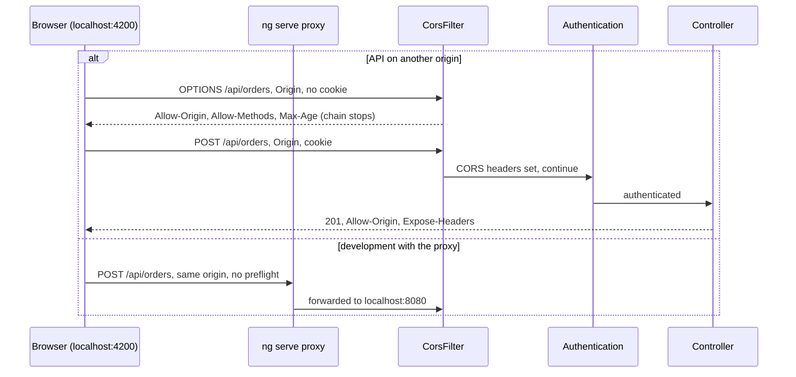
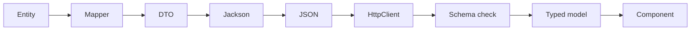
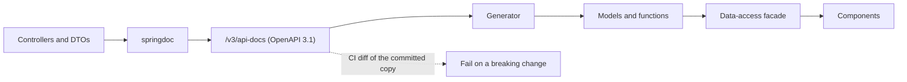
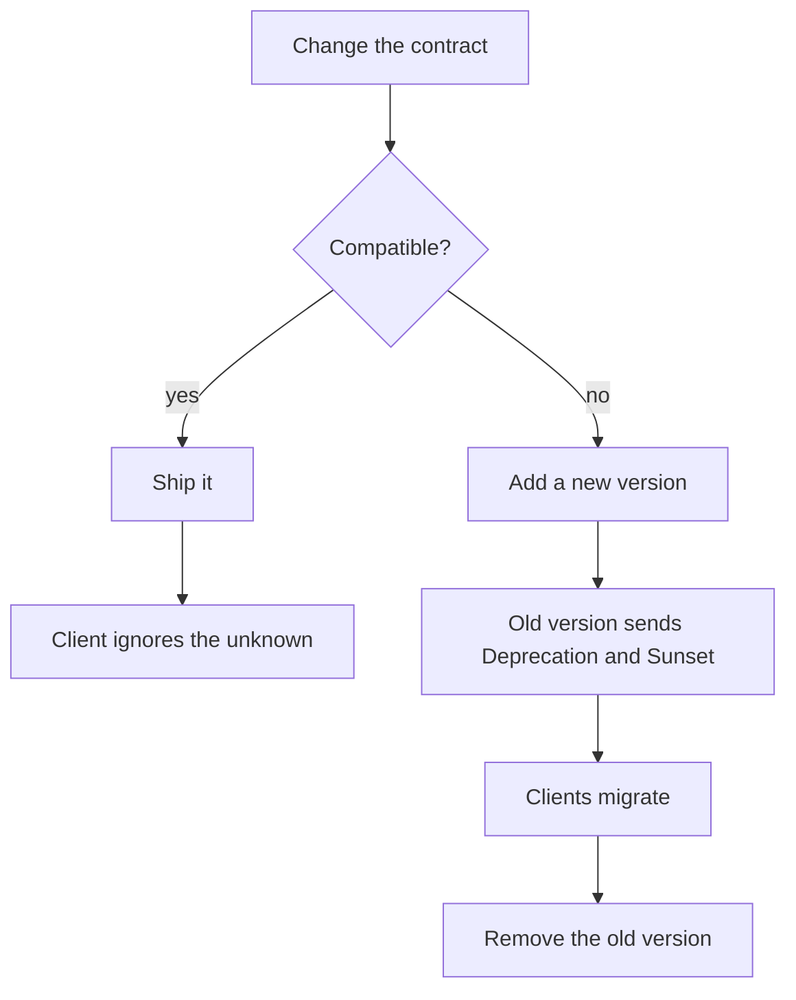
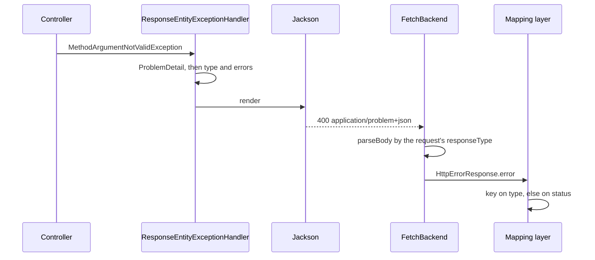
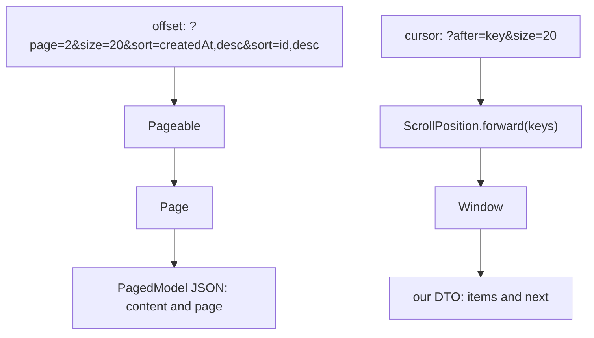
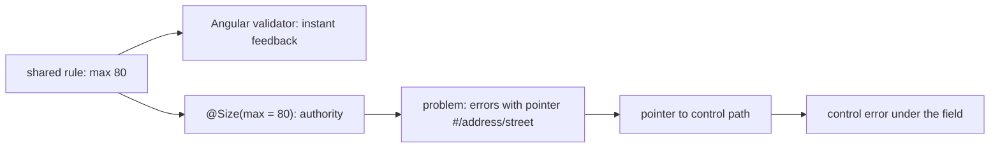
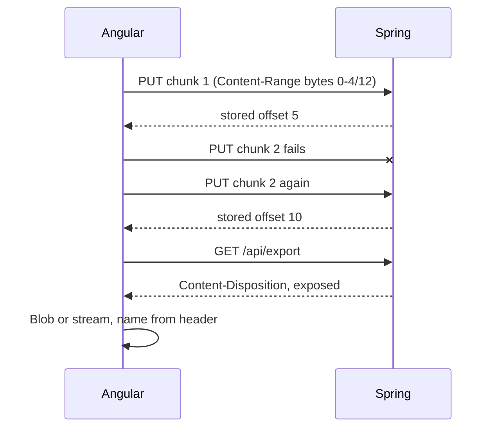
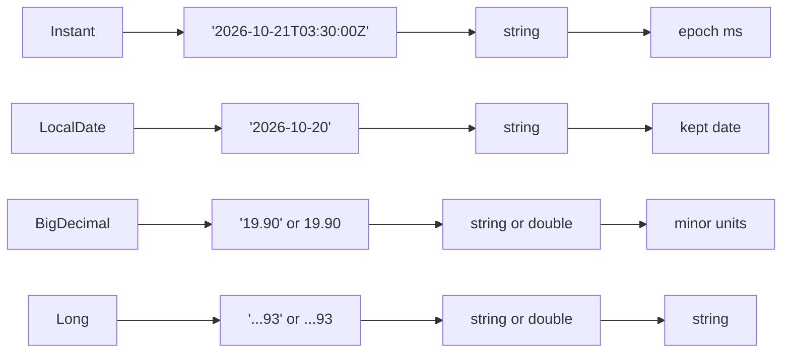
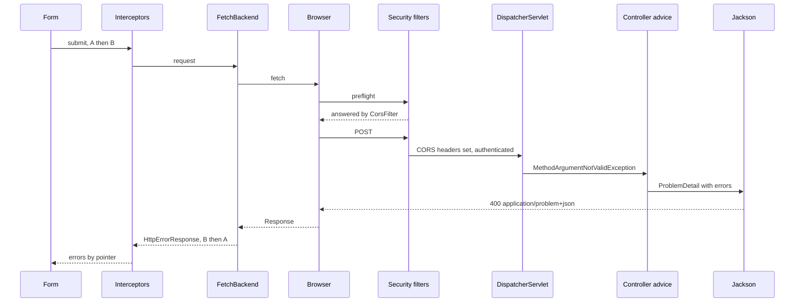

# 41. Full-stack API contracts: Angular and Spring Boot

> **What this covers:** the contract between an Angular client and a Spring Boot API, from both sides: CORS in Spring and Spring Security, and the dev-server proxy as the alternative; DTOs, OpenAPI from springdoc and generated TypeScript clients; evolving and versioning the contract; error bodies as RFC 9457 problem details and how Angular reads them; pagination, sorting and filtering, and how Spring Data serializes a page; validation on both layers with server errors routed to form fields; file uploads and downloads; and dates, time zones, decimals and money on the wire.
> **Prerequisites:** [27. Errors: `HttpErrorResponse`, an error mapping layer, and retry](27-http-client.md#5-errors-httperrorresponse-an-error-mapping-layer-and-retry-with-backoff-and-jitter), [27. Making requests: typed responses, `observe`, `responseType`, params and headers](27-http-client.md#3-making-requests-typed-responses-observe-responsetype-immutable-params-and-headers-and-httpcontext), [09. The same-origin policy and CORS](09-web-networking-storage-security.md#5-the-same-origin-policy-and-cors)
> **Leads to:** [42. Full-stack authentication](42-fullstack-authentication.md), [43. Real-time communication](43-fullstack-realtime.md), [44. Full-stack delivery and operations](44-fullstack-delivery-and-operations.md)
> **Applies to:** Angular 22.2 (labs); Vitest and Zod 4.6.5 in Node; documented only: Spring Boot 4.1.1, Framework 7.0.9, Security 7.1.1, Data Commons 4.1.1, Jackson 3.1.5, springdoc 3.1.1, `ng-openapi-gen` 1.1.0, `@orval/angular` 8.43.0, `@openapitools/openapi-generator-cli` 2.42.0; reads 2026-10-20
> **Study time:** ~3 hours reading + ~3 hours exercises
> **Short on time:** read [§1](#1-cors-on-both-sides-springs-corsconfigurationsource-spring-security-preflight-caching-credentials-and-the-dev-proxy), [§5](#5-error-contracts-with-problemdetail-rfc-9457-and-mapping-them-in-angular), [§9](#9-dates-time-zones-decimals-and-money-across-the-wire) and [§10](#10-under-the-hood-one-failed-request-through-springs-filters-and-handlers-and-angulars-backend), then [Q41.01](#q41-01), [Q41.07](#q41-07), [Q41.11](#q41-11), [Q41.12](#q41-12) and [Q41.19](#q41-19), then the [Summary](#summary).
> **Labs:** [`labs/angular/src/app/modules/41-fullstack-api-contracts/`](../labs/angular/src/app/modules/41-fullstack-api-contracts/) and [`labs/ts-js/src/modules/41-fullstack-api-contracts/`](../labs/ts-js/src/modules/41-fullstack-api-contracts/). Run (Node 24): from `labs/angular`, `npx ng test --watch=false --include='src/app/modules/41-fullstack-api-contracts/**/*.spec.ts'`; from `labs/ts-js`, `npx vitest run src/modules/41-fullstack-api-contracts src/outputs/41-fullstack-api-contracts`.

## Contents

1. [CORS on both sides: Spring's `CorsConfigurationSource`, Spring Security, preflight caching, credentials and the dev proxy](#1-cors-on-both-sides-springs-corsconfigurationsource-spring-security-preflight-caching-credentials-and-the-dev-proxy)
2. [DTO contracts: what crosses the wire, absent versus `null`, and checking responses at the boundary](#2-dto-contracts-what-crosses-the-wire-absent-versus-null-and-checking-responses-at-the-boundary)
3. [OpenAPI with springdoc and generated TypeScript clients: openapi-generator, orval and ng-openapi-gen](#3-openapi-with-springdoc-and-generated-typescript-clients-openapi-generator-orval-and-ng-openapi-gen)
4. [Evolving the contract: compatible changes, API versioning in Spring Framework 7 and deprecation headers](#4-evolving-the-contract-compatible-changes-api-versioning-in-spring-framework-7-and-deprecation-headers)
5. [Error contracts with `ProblemDetail` (RFC 9457) and mapping them in Angular](#5-error-contracts-with-problemdetail-rfc-9457-and-mapping-them-in-angular)
6. [Pagination, sorting and filtering: offset versus cursor, and how Spring Data serializes a `Page`](#6-pagination-sorting-and-filtering-offset-versus-cursor-and-how-spring-data-serializes-a-page)
7. [Validation on both layers: Bean Validation, Angular validators and server errors on form fields](#7-validation-on-both-layers-bean-validation-angular-validators-and-server-errors-on-form-fields)
8. [Files: multipart and chunked uploads, progress, and downloads with `Content-Disposition` and streaming](#8-files-multipart-and-chunked-uploads-progress-and-downloads-with-content-disposition-and-streaming)
9. [Dates, time zones, decimals and money across the wire](#9-dates-time-zones-decimals-and-money-across-the-wire)
10. [Under the hood: one failed request through Spring's filters and handlers and Angular's backend](#10-under-the-hood-one-failed-request-through-springs-filters-and-handlers-and-angulars-backend)
- [Summary](#summary)
- [Question bank](#question-bank)
- [Hands-on exercises](#hands-on-exercises)
- [Check your understanding](#check-your-understanding)
- [Connections](#connections)

**How this module was checked.** Run: `ng test` with `HttpTestingController` or the real fetch backend over a stubbed `fetch` returning our Spring-shaped responses; Vitest in Node for the boundary schema, our OpenAPI drift checker and the wire codecs. Read, not run: Spring Boot 4.1.1, Framework 7.0.9, Security 7.1.1, Data Commons 4.1.1, Jackson 3.1.5 and springdoc-openapi 3.1.1 at their release tags; the `ng-openapi-gen` 1.1.0, `@orval/angular` 8.43.0 and `@openapitools/openapi-generator-cli` 2.42.0 tarballs; RFCs 9457, 9745, 6266 and 6901; dates in [SOURCES.md](../SOURCES.md). Java is illustrative, not compiled.

## 1. CORS on both sides: Spring's `CorsConfigurationSource`, Spring Security, preflight caching, credentials and the dev proxy

### The problem it solves

`localhost:4200` calls `localhost:8080/api/orders`: curl works, the browser shows a CORS error. `@CrossOrigin` fixes the GET; behind Spring Security, every POST's preflight gets 401.

### Mental model

The server declares, the browser enforces ([09 §5](09-web-networking-storage-security.md#5-the-same-origin-policy-and-cors) defines **origin**, **preflight** and the cookie-carrying **credentialed request**). Spring's **`CorsConfigurationSource`** maps URL patterns to `CorsConfiguration` rules that MVC and Security share. Analogy: the venue writes the guest list, the door checks it; the dev proxy is a staff entrance.



What to notice: the preflight ends at the CORS filter, before authentication.

### How it actually works

- **Why 401?** MVC checks `@CrossOrigin` only "after successfully mapping a request to a handler" (Framework 7.0.9 `webmvc-cors.adoc`); security filters run first (Security 7.1.1 `architecture.adoc`), and the preflight "does not contain any cookies" (`cors.adoc`). `.cors(…)` adds a `CorsFilter` that ends the preflight (`CorsFilter.java`), with the bean *named* `corsConfigurationSource`, else MVC's rules (`CorsConfigurer.java`). Security 7.1.1 also applies `.cors(withDefaults())` itself, Boot's default chain included, when a `UrlBasedCorsConfigurationSource` bean exists (`HttpSecurityConfiguration.java`; "only if a `UrlBasedCorsConfigurationSource` instance is present", `cors.adoc`); calling it keeps the chain explicit.
- **Credentials.** With `allowCredentials`, `"*"` origins throw when a request is checked: `allowedOrigins cannot contain the special value "*"` (abridged, `CorsConfiguration.java`). An **origin pattern**, a wildcard host such as `https://*.example.com`, is the alternative.
- **Caching.** `maxAge` starts `null`; `DefaultCorsProcessor` sends no `Max-Age`, so the browser's default applies.
- **Exposed headers**, listed in `Access-Control-Expose-Headers`, are the only headers beyond the seven **CORS-safelisted** ones (such as `Content-Type`) that script reads cross-origin (Fetch Standard).
- **The dev-server proxy** (`ng serve` forwarding `/api/**`, `serve.md`) gives one origin; production uses a **reverse proxy** in front of both ([44](44-fullstack-delivery-and-operations.md#1-where-the-api-calls-go-direct-calls-a-same-origin-reverse-proxy-an-api-gateway-or-a-backend-for-frontend)).

### Code

1. Declare the source; 2. enable `.cors(withDefaults())`:

```java
// Spring Boot 4.1 — illustrative, not compiled in labs
@Bean
UrlBasedCorsConfigurationSource corsConfigurationSource() {
    CorsConfiguration config = new CorsConfiguration();
    config.setAllowedOrigins(List.of("https://app.example.com"));
    config.setAllowedMethods(List.of("GET", "POST", "PUT", "DELETE"));
    config.setAllowedHeaders(List.of("Content-Type"));
    config.setAllowCredentials(true);
    config.setExposedHeaders(List.of("Content-Disposition", "ETag"));
    config.setMaxAge(3600L);
    UrlBasedCorsConfigurationSource source = new UrlBasedCorsConfigurationSource();
    source.registerCorsConfiguration("/api/**", config);
    return source;
}

@Bean
SecurityFilterChain filterChain(HttpSecurity http) throws Exception {
    http.cors(withDefaults()); // authorization and CSRF: module 42
    return http.build();
}
```

3. Point the `serve` target's `proxyConfig` at `src/proxy.conf.json`:

```json
{
  "/api/**": { "target": "http://localhost:8080", "secure": false }
}
```

4. Call relative URLs:

```ts
// Excerpt of labs/angular/src/app/modules/41-fullstack-api-contracts/concepts/section-1-cors.spec.ts
const orders = await firstValueFrom(http.get<LabM41Order[]>('/api/orders'));
expect(String(stub.mock.calls[0][0])).toBe('/api/orders');
```

In the lab, `withCredentials: true` reaches `fetch` as `'include'` (`Section 1: withCredentials makes the fetch backend send credentials include`), its absence as `undefined`, leaving fetch's `same-origin` default (`Section 1: without withCredentials the request leaves the credentials mode to fetch's default`).

> [!TIP]
> **Coming from the backend.** `CorsFilter` and its source replace a hand-written servlet `Filter` setting `Access-Control-*` headers: both run before any controller and answer the preflight themselves. **Where the analogy breaks:** `CorsFilter` acts only on requests with an `Origin` header (`CorsUtils.isCorsRequest`), so curl's requests pass untouched, and the browser, not the filter, enforces the answer.

### Best practices and anti-patterns

- **List exact origins**, because credentials forbid `"*"`.
- **Return `UrlBasedCorsConfigurationSource` from a bean named `corsConfigurationSource`**, because Security turns CORS on by that type and reads the source by that name.

### Misconceptions and traps

- "`@CrossOrigin` is enough." Security rejects the preflight. Cause: it works without Spring Security.
- "`*` with credentials is fine in dev." Spring throws; browsers reject it. Cause: `*` works for anonymous calls.
- "CORS secures the API." Browsers enforce it; curl ignores it. Cause: it is configured on the server.
- "The proxy works in production." `ng serve` is a development server. Cause: it answers real API calls locally, so it looks like part of the stack.

Drilled in [Q41.01](#q41-01), [Q41.02](#q41-02) and [Q41.03](#q41-03); browser side: [Q09.12](09-web-networking-storage-security.md#q09-12), [Q09.13](09-web-networking-storage-security.md#q09-13), [Q09.14](09-web-networking-storage-security.md#q09-14); cookies and CSRF: [42](42-fullstack-authentication.md#6-csrf-with-cookiecsrftokenrepository-and-angulars-xsrf-support-csrfspa-in-spring-security-7).

## 2. DTO contracts: what crosses the wire, absent versus `null`, and checking responses at the boundary

### The problem it solves

A controller returns the JPA (Jakarta Persistence) **entity** (the class mapped to a table), so a new `passwordHash` column ships to browsers. A PATCH with `{ "note": null }` and one without `note` both clear it.

### Mental model

A **DTO** (data transfer object) is a class made only for the wire, filled by a **mapper** (copy code) at the controller edge. The JSON is the **contract**, not either class. Analogy: a shipping manifest, not the inventory.



What to notice: only the JSON is the contract, and the schema is the step that checks it.

### How it actually works

- **Tolerant reader.** `FAIL_ON_UNKNOWN_PROPERTIES` is `false` by default as of Jackson 3.0 (`DeserializationFeature.java`, 3.1.5), so Spring is a **tolerant reader** that ignores unknown fields; Boot 4.1.1 only disables it again under `useJackson2Defaults` (`JacksonAutoConfiguration.java`).
- **Absent versus `null`.** A missing constructor-bound property becomes `null` for object types unless `FAIL_ON_MISSING_CREATOR_PROPERTIES` (off by default) is on, so an omitted `note` and `"note": null` can bind alike; `null` for an `int` fails (`FAIL_ON_NULL_FOR_PRIMITIVES`, `true`).
- **JSON Merge Patch** (RFC 7386, read 2026-10-20) keeps both: a member left out stays, `null` means removal. `JsonNode.has` is true "including null value" ([01 §7](01-js-values-types-coercion.md#7-null-undefined-and-the-nullish-operators) lists other options). `JSON.stringify` drops `undefined` members and [Zod](07-ts-advanced-types-and-decorators.md#8-runtime-validation-with-zod-4-schema-first-types) checks the body.

### Code

1. DTO and mapper (`OrderEntity` is ours):

```java
// Spring Boot 4.1 — illustrative, not compiled in labs
public record OrderDto(String id, String status, int quantity, String note) {

    static OrderDto from(OrderEntity order) {
        return new OrderDto(String.valueOf(order.getId()), order.getStatus().name(), order.getQuantity(), order.getNote());
    }
}
```

2. Schema, edge check and PATCH body (our contract):

```ts
import { z } from 'zod';

/** The response contract of our example `GET /api/orders/{id}`: the JSON is the contract, this schema is its TypeScript side. */
export const OrderDto = z.object({
  id: z.string(),
  status: z.string(),
  quantity: z.number().int(),
  note: z.string().nullable(),
});

export type OrderDto = z.infer<typeof OrderDto>;

/** Checks a decoded body where it enters the app; throws a `ZodError` that names the path of each problem. */
export function parseOrder(json: unknown): OrderDto {
  return OrderDto.parse(json);
}

/** The fields a client may change in our example `PATCH /api/orders/{id}`. */
export type OrderPatch = Partial<Omit<OrderDto, 'id'>>;

/** Serializes only what the user touched: `JSON.stringify` drops `undefined` members and keeps an explicit `null`. */
export function toPatchBody(edits: OrderPatch): string {
  return JSON.stringify(edits);
}
```

<sub>Source: [labs/ts-js/src/modules/41-fullstack-api-contracts/concepts/order-dto.ts](../labs/ts-js/src/modules/41-fullstack-api-contracts/concepts/order-dto.ts)</sub>

3. Assert the states:

```ts
// Excerpt of labs/ts-js/src/modules/41-fullstack-api-contracts/concepts/section-2-dto-boundary.test.ts
expect(toPatchBody({ note: null, quantity: undefined })).toBe('{"note":null}');
expect(toPatchBody({})).toBe('{}');
```

Verified: the four `Section 2:` tests in [`section-2-dto-boundary.test.ts`](../labs/ts-js/src/modules/41-fullstack-api-contracts/concepts/section-2-dto-boundary.test.ts).

> [!TIP]
> **Coming from the backend.** `@JsonInclude(Include.NON_NULL)` (`jackson-annotations` 2.21) omits null properties from the output. **Where the analogy breaks:** JSON has `null` or no member, while JavaScript has two empty values, `undefined` and `null`.

### Best practices and anti-patterns

- **Return DTOs, never entities**, because every entity column becomes public API.
- **Parse at the edge**, because `get<T>()` checks nothing.
- **Send IDs as strings**, because JSON numbers lose digits in JavaScript ([01 §2](01-js-values-types-coercion.md#2-numbers)).

### Misconceptions and traps

- "Returning the entity saves a mapping layer." Only at first. Cause: it works, then every column ships.
- "TypeScript types validate the response." They are erased. Cause: `http.get<Order>()` looks like a checked cast.
- "`null` and missing mean the same to Jackson." Both can bind to `null`. Cause: a plain DTO has one empty value.

Drilled in [Q41.04](#q41-04); owners: [Q07.16](07-ts-advanced-types-and-decorators.md#q07-16) and [Q07.17](07-ts-advanced-types-and-decorators.md#q07-17).

## 3. OpenAPI with springdoc and generated TypeScript clients: openapi-generator, orval and ng-openapi-gen

### The problem it solves

The backend renames `customerName` to `customer.name`. The build stays green: the hand-written interface still says `customerName`. Production shows blank cells; a mocked end-to-end test cannot notice ([30 §5](30-e2e-and-testing-strategy.md#5-api-mocking-at-the-network-layer-and-where-contract-tests-take-over)).

### Mental model

**springdoc** reads controllers and DTOs and publishes an **OpenAPI description**: paths and schemas as JSON. A **code generator** turns it into a **generated client** (models plus request code). A **drift check** (a build step comparing client schemas with the description) or a **consumer-driven contract** test catches disagreement. Analogy: builder and electrician share the architect's drawings.



What to notice: components see only the facade, one service in front of the generated code; only the dashed edge fails builds.

### How it actually works

- **springdoc-openapi 3.1.1** serves `/v3/api-docs` (`README.md`) and defaults `springdoc.api-docs.version` to "3.1.0" (`SpringDocConfigProperties.java`).
- **Generators**, read, not run:

| | Needs | Angular output | `date-time` |
|---|---|---|---|
| ng-openapi-gen 1.1.0 | Node (`package.json`) | a function per operation over `HttpClient`, an injectable `Api` (`fn.handlebars`, `apiService.handlebars`) | `string` (`README.md`) |
| orval 8.43.0 | Node (`npm view`) | `HttpClient` services by default; `httpResource()` [Stable since v22.0] for GETs with `retrievalClient: 'httpResource'` (`orval` defaults it to `'httpClient'`); optional Zod (`@orval/angular`) | `string`; `useDates` only retypes (`@orval/core`) |
| openapi-generator `typescript-angular` | JDK 11+ or Docker; npm CLI 2.42.0 runs a JAR (`README.md`) | services in `root` (docs page) | not stated |

- **Why `string`?** ng-openapi-gen's README: "No data transformation is ever performed" (abridged), since converting walks every object graph; do it at the boundary ([§9](#9-dates-time-zones-decimals-and-money-across-the-wire)).
- **1.0 defaults**: `services: false` and `promises: true`, so `Api.invoke` returns a `Promise` (`ng-openapi-gen-schema.json`).
- **Placement**: behind a facade ([38 §3](38-architecture-and-production-structure.md#3-facades-and-the-data-access-layer)), never in components.
- **Contract tests**: in a consumer-driven contract the frontend's tests record interactions; **provider verification** replays them in the backend's build.

### Code

1. A controller (`@Operation` from swagger-core 2.2.55):

```java
// Spring Boot 4.1 — illustrative, not compiled in labs
@RestController
class OrderController {

    private final OrderService orders; // ours

    OrderController(OrderService orders) {
        this.orders = orders;
    }

    @Operation(summary = "Read one order", operationId = "getOrder")
    @GetMapping("/api/orders/{id}")
    OrderDto getOrder(@PathVariable String id) {
        return orders.find(id);
    }
}
```

2. Our fixture in springdoc's 3.1.0 shape (excerpt):

```json
"OrderDto": {
  "type": "object",
  "properties": {
    "customerName": { "type": "string" },
    "createdAt": { "type": "string", "format": "date-time" }
  },
  "required": ["id", "customerName", "status", "quantity", "createdAt"]
}
```

3. ng-openapi-gen's output shape:

```ts
// Partial: the shape of ng-openapi-gen 1.1.0's fn.handlebars for our getOrder (read, not run); imports and the generated RequestBuilder, StrictHttpResponse and OrderDto omitted
export interface GetOrder$Params {
  id: string;
}

export function getOrder(http: HttpClient, rootUrl: string, params: GetOrder$Params, context?: HttpContext): Observable<StrictHttpResponse<OrderDto>> {
  const rb = new RequestBuilder(rootUrl, getOrder.PATH, 'get');
  // … rb.path('id', …), then http.request(rb.build({ responseType, accept, context })) filtered to the HttpResponse
}

getOrder.PATH = '/api/orders/{id}';
```

4. Our drift check (a wire sample per field):

```ts
// Excerpt of labs/ts-js/src/modules/41-fullstack-api-contracts/concepts/contract-drift.ts
export function contractDrift(component: ComponentSchema, client: { readonly shape: Record<string, z.ZodType> }): string[] {
  const problems: string[] = [];
  for (const [name, { type, format }] of Object.entries(component.properties)) {
    const field = client.shape[name];
    const required = component.required.includes(name);
    if (!field) {
      if (required) problems.push(`${name}: required in the description, missing in the client`);
      continue;
    }
    if (!required && !field.safeParse(undefined).success) {
      problems.push(`${name}: optional in the description, required in the client`);
    }
    if (!field.safeParse(wireSample(type, format)).success) {
      problems.push(`${name}: the client rejects a ${format ?? type} value from the wire`);
    }
  }
  for (const name of Object.keys(client.shape)) {
    if (!(name in component.properties)) problems.push(`${name}: in the client, not in the description`);
  }
  return problems;
}
```

Verified: the three `Section 3:` tests in [`section-3-contract-drift.test.ts`](../labs/ts-js/src/modules/41-fullstack-api-contracts/concepts/section-3-contract-drift.test.ts).

### Best practices and anti-patterns

- **Diff the committed description in CI**, because breaks then fail a pull request ([44](44-fullstack-delivery-and-operations.md#7-cicd-for-both-layers-one-image-promoted-through-stages-a-monorepo-or-separate-repositories-and-versioning-the-contract)).
- **Never edit generated files**, because ng-openapi-gen's templates mark them "DO NOT EDIT".

### Misconceptions and traps

- "A generated client makes the contract safe." Only if regenerated and diffed. Cause: types appear for free.
- "Generators turn `date-time` into `Date`." ng-openapi-gen and orval keep `string` by default. Cause: the format sounds typed.
- "openapi-generator is an npm tool." It runs a JAR. Cause: it installs from npm.
- "Contract tests replace end-to-end tests." They check shapes, not journeys ([Q30.10](30-e2e-and-testing-strategy.md#q30-10)). Cause: both exercise the API.

Drilled in [Q41.05](#q41-05), [Q41.06](#q41-06) and [Q41.07](#q41-07).

## 4. Evolving the contract: compatible changes, API versioning in Spring Framework 7 and deprecation headers

### The problem it solves

A new `REFUNDED` status trips an exhaustive `never` check in production. A required field breaks week-old tabs ([37 §6](37-elements-pwa-errors-ecosystem.md#6-updates-versions-swupdate-prompting-a-reload-unrecoverable-states-and-the-kill-switch)). Copied `/v2` controllers cannot announce `/v1`'s end.

### Mental model

A **backward-compatible change** keeps deployed clients working: an optional field, a new endpoint. A **breaking change** does not: removing, renaming, optional becoming required, a new enum value. A **tolerant reader** ([§2](#2-dto-contracts-what-crosses-the-wire-absent-versus-null-and-checking-responses-at-the-boundary)) ignores unknown members and keeps a fallback. An **API version** names the contract a request expects. Analogy: a power socket standard; a new plug shape needs an adapter period.



What to notice: only the "no" branch costs a version.

### How it actually works

- **Resolve.** Spring Framework 7.0.9 resolves the version from a header, query parameter, path segment or media type parameter; `SemanticApiVersionParser` makes it comparable; an unsupported or missing version raises an exception that gives 400 (`webmvc-versioning.adoc`).
- **Which method?** A **baseline version** (`"1.2+"`) matches 1.2 and the supported versions above it; `"1.2"` only itself. Among methods at or below the request version, the highest wins (`ann-requestmapping.adoc`).
- **Retiring.** `Deprecation` marks a version deprecated (RFC 9745: a Date such as `@1688169599`); **sunset** (the `Sunset` header) says when it stops responding (RFC 8594). `StandardApiVersionDeprecationHandler` sets both.
- **Cross-origin**, scripts read `Deprecation` only if exposed ([§1](#1-cors-on-both-sides-springs-corsconfigurationsource-spring-security-preflight-caching-credentials-and-the-dev-proxy)).

### Code

1. Map the method, pick the header (documented):

```java
// Spring Boot 4.1 — illustrative, not compiled in labs
@GetMapping(path = "/orders/{id}", version = "1.2+")
OrderDto getOrder(@PathVariable String id) {
    return orders.find(id); // orders is ours
}
```

```yaml
spring:
  mvc:
    apiversion:
      use:
        header: X-Version
```

2. Deprecate 1.2:

```java
// Spring Boot 4.1 — illustrative, not compiled in labs
@Override
public void configureApiVersioning(ApiVersionConfigurer configurer) {
    StandardApiVersionDeprecationHandler handler = new StandardApiVersionDeprecationHandler();
    handler.configureVersion("1.2")
        .setDeprecationDate(ZonedDateTime.parse("2027-01-01T00:00:00Z"))
        .setSunsetDate(ZonedDateTime.parse("2027-07-01T00:00:00Z"));
    configurer.useRequestHeader("X-Version").setDeprecationHandler(handler);
}
```

3. Version API URLs, report `Deprecation` once:

```ts
import { HttpResponse, type HttpInterceptorFn } from '@angular/common/http';
import { Injectable, inject, signal } from '@angular/core';
import { tap } from 'rxjs';

/** The version our example client asks for; Spring's `ApiVersionStrategy` reads it from the `X-Version` header. */
export const LAB_M41_API_VERSION = '1.2';

/** Our example's convention: API calls are relative `/api/` URLs, so the dev proxy serves them. */
const API_PREFIX = '/api/';

export interface LabM41Deprecation {
  readonly endpoint: string;
  readonly deprecation: string;
}

/** Keeps one entry per endpoint whose responses carried a `Deprecation` header. */
@Injectable({ providedIn: 'root' })
export class LabM41DeprecationLog {
  private readonly reported = signal<readonly LabM41Deprecation[]>([]);
  readonly entries = this.reported.asReadonly();

  report(entry: LabM41Deprecation): void {
    if (this.reported().some((known) => known.endpoint === entry.endpoint)) return;
    this.reported.update((known) => [...known, entry]);
  }
}

/** Adds `X-Version` to API requests only and reports a `Deprecation` response header once per endpoint. */
export const apiVersionInterceptor: HttpInterceptorFn = (req, next) => {
  if (!req.url.startsWith(API_PREFIX)) return next(req);
  const log = inject(LabM41DeprecationLog);
  return next(req.clone({ setHeaders: { 'X-Version': LAB_M41_API_VERSION } })).pipe(
    tap((event) => {
      const deprecation = event instanceof HttpResponse ? event.headers.get('Deprecation') : null;
      if (deprecation !== null) log.report({ endpoint: `${req.method} ${req.url}`, deprecation });
    }),
  );
};
```

<sub>Source: [labs/angular/src/app/modules/41-fullstack-api-contracts/concepts/api-version.interceptor.ts](../labs/angular/src/app/modules/41-fullstack-api-contracts/concepts/api-version.interceptor.ts)</sub>

4. Fall back on unknown values:

```ts
// Excerpt of labs/angular/src/app/modules/41-fullstack-api-contracts/concepts/section-4-versioning.spec.ts
/** Our example's tolerant mapping: a status this client has never seen gets a neutral label. */
const STATUS_LABELS = new Map([
  ['PLACED', 'Placed'],
  ['SHIPPED', 'Shipped'],
]);

function statusLabel(status: string): string {
  return STATUS_LABELS.get(status) ?? 'Unknown status';
}
```

Verified by the three `Section 4:` tests in [`section-4-versioning.spec.ts`](../labs/angular/src/app/modules/41-fullstack-api-contracts/concepts/section-4-versioning.spec.ts).

> [!TIP]
> **Coming from the backend.** A Maven version is read by a build ([Q38.17](38-architecture-and-production-structure.md#q38-17)); an API version, per request. **Where the analogy breaks:** old tabs keep old requests until reloaded.

### Best practices and anti-patterns

- **Keep an enum fallback**, because the server may add values.
- **Version only unavoidable breaks**, because each version is code to run.

### Misconceptions and traps

- "A new enum value is compatible." A closed enum breaks. Cause: it is additive on the server.
- "Put `/v1` in every URL." Spring also resolves headers. Cause: public APIs copy each other.
- "Once true: Spring had no built-in API versioning." Framework 7.0 added it (`@since 7.0`). Cause: older guides.

Drilled in [Q41.08](#q41-08) and [Q41.09](#q41-09).

## 5. Error contracts with `ProblemDetail` (RFC 9457) and mapping them in Angular

### The problem it solves

With ad hoc error JSON, the mapping layer ([27 §5](27-http-client.md#5-errors-httperrorresponse-an-error-mapping-layer-and-retry-with-backoff-and-jitter)) needs a branch per endpoint. Spring's validation 400 names no field. A failed PDF download shows `[object Blob]`.

### Mental model

A **problem detail** (RFC 9457) is one error shape, `application/problem+json`: `type`, `title`, `status`, `detail`, `instance`. Its **problem type URI**, `type`, names the kind; absent, it is `about:blank`: just the status. An **extension member** adds data, such as `errors` entries locating fields by **JSON Pointer** (RFC 6901: a path, `#/quantity`). Spring renders it in a `@ControllerAdvice` extending **`ResponseEntityExceptionHandler`**. A **conditional request** sends `If-Match` with the read `ETag` ([09 §4](09-web-networking-storage-security.md#4-http-caching)) and gets 412 (`mvc-caching.adoc`), not a **lost update** (overwriting a newer change); an **idempotency key** ([Q27.18](27-http-client.md#q27-18)), our example `Idempotency-Key` header, makes a retried POST apply once. Analogy: one incident form, an appendix per kind.



What to notice: the request, not `Content-Type`, picks the body's form.

### How it actually works

- **No field list.** `MethodArgumentNotValidException`'s body is `forStatusAndDetail(…, "Invalid request content.")`, and `type` "is not set" (`spring-web` 7.0.9). Spring's `ProblemDetailJacksonMixin` writes `setProperty` members at top level (`mvc-ann-rest-exceptions.adoc`). Boot's `spring.mvc.problemdetails.enabled` defaults to `false`.
- **Why key on `type`?** Consumers "MUST use the "type" URI … as the problem type's primary identifier" (abridged); `status` "is only advisory" (RFC 9457).
- **Why a `Blob`?** The internal `FetchBackend.parseBody` (`@angular/common` 22.2.1) switches on the request's `responseType`: `'blob'` gives a `Blob` typed by `Content-Type`; `'json'` keeps the text when a non-2xx parse fails.
- 27's `fields` ([Q27.16](27-http-client.md#q27-16)) is this contract's `errors`.

### Code

1. Add `type` and `errors`:

```java
// Spring Boot 4.1 — illustrative, not compiled in labs
@RestControllerAdvice
class ApiExceptionHandler extends ResponseEntityExceptionHandler {

    @Override
    protected @Nullable ResponseEntity<Object> handleMethodArgumentNotValid(
            MethodArgumentNotValidException ex, HttpHeaders headers, HttpStatusCode status, WebRequest request) {
        ProblemDetail body = ex.getBody();
        body.setType(URI.create("https://api.example.com/problems/validation")); // our type URI
        body.setProperty("errors", ex.getFieldErrors().stream()
            .map(error -> Map.of("pointer", "#/" + error.getField(), // flat fields; nested paths: section 7
                "detail", String.valueOf(error.getDefaultMessage())))
            .toList());
        return handleExceptionInternal(ex, body, headers, status, request);
    }
}
```

2. Read any error body:

```ts
/** RFC 9457's default problem type: the problem means no more than its HTTP status. */
export const ABOUT_BLANK = 'about:blank';

/** One entry of our `errors` extension member, shaped like RFC 9457's validation example. */
export interface FieldProblem {
  readonly pointer: string;
  readonly detail: string;
}

/** A problem detail as our client reads it: `type` defaulted, unknown members ignored. */
export interface Problem {
  readonly type: string;
  readonly title: string | undefined;
  readonly status: number | undefined;
  readonly detail: string | undefined;
  readonly instance: string | undefined;
  readonly errors: readonly FieldProblem[];
}

function isRecord(value: unknown): value is Record<string, unknown> {
  return typeof value === 'object' && value !== null && !Array.isArray(value);
}

function optionalString(value: unknown): string | undefined {
  return typeof value === 'string' ? value : undefined;
}

function optionalNumber(value: unknown): number | undefined {
  return typeof value === 'number' ? value : undefined;
}

function isFieldProblem(entry: unknown): entry is FieldProblem {
  return isRecord(entry) && typeof entry['pointer'] === 'string' && typeof entry['detail'] === 'string';
}

/** True for a JSON object with a numeric `status` or a string `title`, and a string `type` when present. */
export function isProblemDetail(body: unknown): body is Record<string, unknown> {
  if (!isRecord(body)) return false;
  const typeOk = body['type'] === undefined || typeof body['type'] === 'string';
  return typeOk && (typeof body['status'] === 'number' || typeof body['title'] === 'string');
}

function parseJson(text: string): unknown {
  try {
    return JSON.parse(text);
  } catch {
    return null;
  }
}

/** `HttpErrorResponse.error` follows the request's `responseType`: an object, a string or a `Blob`. */
async function decode(body: unknown): Promise<unknown> {
  if (body instanceof Blob) return parseJson(await body.text());
  return typeof body === 'string' ? parseJson(body) : body;
}

/** Reads a problem detail from any error body, or returns `null` when the body is not one. */
export async function readProblem(body: unknown): Promise<Problem | null> {
  const decoded = await decode(body);
  if (!isProblemDetail(decoded)) return null;
  const errors = decoded['errors'];
  return {
    type: optionalString(decoded['type']) ?? ABOUT_BLANK,
    title: optionalString(decoded['title']),
    status: optionalNumber(decoded['status']),
    detail: optionalString(decoded['detail']),
    instance: optionalString(decoded['instance']),
    errors: Array.isArray(errors) ? errors.filter(isFieldProblem) : [],
  };
}

/** The key a mapping layer switches on: the type URI, or the response status when the type is `about:blank`. */
export function problemKey(problem: Problem, httpStatus: number): string {
  return problem.type === ABOUT_BLANK ? String(httpStatus) : problem.type;
}
```

<sub>Source: [labs/angular/src/app/modules/41-fullstack-api-contracts/concepts/problem-details.ts](../labs/angular/src/app/modules/41-fullstack-api-contracts/concepts/problem-details.ts)</sub>

3. Stub `fetch` with our Spring-shaped bodies:

```ts
// Excerpt of labs/angular/src/app/modules/41-fullstack-api-contracts/concepts/section-5-problem-details.spec.ts
function answerWith(status: number, body: unknown, contentType = 'application/problem+json') {
  return vi.fn<typeof fetch>(
    async () => new Response(JSON.stringify(body), { status, headers: { 'content-type': contentType } }),
  );
}
```

Verified by the five `Section 5:` tests in [`section-5-problem-details.spec.ts`](../labs/angular/src/app/modules/41-fullstack-api-contracts/concepts/section-5-problem-details.spec.ts).

> [!NOTE]
> **Framework vs platform.** With `fetch` you pick `.json()` or `.blob()` after seeing the status; `HttpClient` picks by `responseType` first.

> [!TIP]
> **Coming from the backend.** `@RestControllerAdvice` maps exceptions to bodies; an **interceptor** (a function every `HttpClient` request and response passes through, [27 §4](27-http-client.md#4-interceptors-the-functional-chain-order-and-next-and-class-interceptors-through-withinterceptorsfromdi)) maps bodies to UI errors. **Where the analogy breaks:** the client never sees the exception, so `type` is its only stable key.

### Best practices and anti-patterns

- **One type URI per problem kind**, because `detail` changes with the locale.
- **Send `If-Match` on edits**, because otherwise the last write wins ([Q28.28](28-state-management.md#q28-28)).

### Misconceptions and traps

- "Spring lists field errors by default." Add `errors` yourself. Cause: the exception holds them (`getFieldErrors()`).
- "Map on `detail`." Map on `type`. Cause: `detail` is the readable text.
- "`HttpErrorResponse.error` is parsed JSON." It follows `responseType`. Cause: most requests use `'json'`.
- "Once true: RFC 7807." RFC 9457 obsoletes it (July 2023). Cause: little changed (Appendix D).

Drilled in [Q41.10](#q41-10), [Q41.11](#q41-11) and [Q41.12](#q41-12); practised in [Exercise 41.1](#ex41-1); other failures: [Q27.15](27-http-client.md#q27-15).

## 6. Pagination, sorting and filtering: offset versus cursor, and how Spring Data serializes a `Page`

### The problem it solves

An orders table shows a row twice when someone inserts mid-paging. Page 5,000 is slow. After an upgrade the paginator shows "page undefined": the client read a Java class's JSON.

### Mental model

**Offset pagination** asks for page N plus a total; it can jump, but inserts shift pages and most databases build the whole result first (`scrolling.adoc`). **Cursor (keyset) pagination** returns the position after the last item: stable under inserts, cheap when deep, but no jumps and usually no total. Both need a **stable sort**, ended by a **tiebreaker** (a unique key, such as `id`). A **`Window`** is one scroll result; its **scroll position** starts the next. **`PagedModel`** is the DTO for a `Page`: `content` plus `page`. Analogy: phone-book pages versus a bookmark.



What to notice: the cursor shape is ours.

### How it actually works

- **Why can the JSON change?** `pageSerializationMode()` defaults to `DIRECT` "for backward compatibility reasons": `PageImpl` renders as is, "discouraged" since its API may change. `VIA_DTO`, or `new PagedModel<>(page)`, renders `content` and `page` (`size`, `number`, `totalElements`, `totalPages`). Boot's `spring.data.web.pageable.serialization-mode` defaults to `DIRECT` too.
- **Unchecked sort:** `sort` repeats per order and is not validated.
- `append` repeats a key on immutable `HttpParams` ([27 §3](27-http-client.md#3-making-requests-typed-responses-observe-responsetype-immutable-params-and-headers-and-httpcontext)).

### Code

1. Render a stable page:

```java
// Spring Boot 4.1 — illustrative, not compiled in labs
@Configuration
@EnableSpringDataWebSupport(pageSerializationMode = VIA_DTO)
class WebConfig { }

@RestController
class OrderController {
    private final OrderService orders;

    OrderController(OrderService orders) { this.orders = orders; }

    @GetMapping("/api/orders")
    PagedModel<OrderDto> list(Pageable pageable) {
        return new PagedModel<>(orders.find(pageable)); // find returns Page<OrderDto>
    }
}
```

2. Build the query:

```ts
import { HttpParams } from '@angular/common/http';

export type SortDirection = 'asc' | 'desc';

/** One sort order: Spring Data's `sort` parameter reads it as `property,direction`. */
export interface SortOrder {
  readonly property: string;
  readonly direction: SortDirection;
}

/** What an offset-paged list asks for; `page` is zero-based, as Spring Data's `page` parameter is. */
export interface PageRequest {
  readonly page: number;
  readonly size: number;
  readonly sort: readonly SortOrder[];
  readonly filters: Readonly<Record<string, string | undefined>>;
}

/** Builds the query: `page`, `size`, one `sort` per order, and a named parameter per non-empty filter. */
export function toPageParams(request: PageRequest): HttpParams {
  let params = new HttpParams().set('page', request.page).set('size', request.size);
  for (const order of request.sort) {
    params = params.append('sort', `${order.property},${order.direction}`);
  }
  for (const [name, value] of Object.entries(request.filters)) {
    if (value !== undefined && value !== '') params = params.set(name, value);
  }
  return params;
}
```

<sub>Source: [labs/angular/src/app/modules/41-fullstack-api-contracts/concepts/page-params.ts](../labs/angular/src/app/modules/41-fullstack-api-contracts/concepts/page-params.ts)</sub>

3. Map both responses:

```ts
// Excerpt of labs/angular/src/app/modules/41-fullstack-api-contracts/concepts/section-6-pagination.spec.ts
function fromPagedModel<T>(body: PagedModel<T>): OffsetPage<T> {
  return {
    items: body.content,
    pageIndex: body.page.number,
    totalElements: body.page.totalElements,
    hasNext: body.page.number + 1 < body.page.totalPages,
  };
}

function fromWindow<T>(body: CursorWindow<T>): CursorPage<T> {
  return { items: body.items, nextCursor: body.next };
}
```

Verified by four `Section 6:` tests in [`section-6-pagination.spec.ts`](../labs/angular/src/app/modules/41-fullstack-api-contracts/concepts/section-6-pagination.spec.ts); Spring is read.

> [!TIP]
> **Coming from the backend.** In Java a caller passes a `Pageable` and gets a typed `Page`, and the compiler checks every use. **Where the analogy breaks:** the client sees only the JSON Jackson writes from `PageImpl`'s getters, so a getter changed in a Spring Data release changes the contract with no compile error; `PagedModel` fixes that shape.

### Best practices and anti-patterns

- **Return `PagedModel` or set `VIA_DTO`**, because `PageImpl` is a domain type.
- **Allow-list sort properties and add a tiebreaker**, because `Pageable` binds any name and ties leave order undefined.

### Misconceptions and traps

- "Returning `Page<T>` is the Spring Data way." Its docs recommend against it (warning log since 3.1). Cause: it serializes, so tutorials show it.
- "Cursor pagination is always better." It loses jumps and totals. Cause: it fixes duplicates.
- "Sort by any column." Allow-list. Cause: `Pageable` binds any name.

Drilled in [Q41.13](#q41-13) and [Q41.14](#q41-14); practised in [Exercise 41.3](#ex41-3).

## 7. Validation on both layers: Bean Validation, Angular validators and server errors on form fields

### The problem it solves

The form allows 100 characters and the server `@Size(max = 80)`, so users fix errors twice. "Email already used" is a toast, not a field error. A nested address error never shows.

### Mental model

**Bean Validation** (Jakarta Validation) checks objects with **constraint annotations** such as `@NotBlank`, `@Size` and `@Email`. A **syntactic rule** (required, length, pattern) needs only the value, so the client mirrors it. A **semantic rule** (uniqueness, stock) needs server data, so it stays on the server. The server is the authority ([33 §10](33-security.md#10-route-guards-are-ux-authorization-belongs-on-the-server)): its 400 or 422 problem ([§5](#5-error-contracts-with-problemdetail-rfc-9457-and-mapping-them-in-angular)) names fields with **JSON Pointers**, and the client routes each to a control: a **server error on a field** ([26 §7](26-signal-forms.md#7-submission-submit-formroot-submitting-and-server-errors)). Analogy: a clerk checks blanks; the registry decides whether the name is taken.



What to notice: the pointer carries the answer back.

### How it actually works

- **Two exceptions.** `@Valid` on a `@RequestBody` raises `MethodArgumentNotValidException`; a constraint on a parameter raises `HandlerMethodValidationException`. "Applications should handle both" (`ann-validation.adoc`).
- **One place for the number.** swagger-core 2.2.55's `ModelResolver` writes `@Size` as `minLength` and `maxLength`, `@Pattern` as `pattern` and `@NotBlank` as `minLength` 1, so the schema can hold the `80`; springdoc 3.1.1 builds on it.
- **Decoding:** `~1` becomes `/` first, then `~0` becomes `~` (RFC 6901 §4).
- **Routing.** `control.get(tokens)` walks groups and array indexes; `setErrors` lasts until the next run ([25 §5](25-forms-reactive-and-template-driven.md#5-validators-built-in-custom-and-cross-field)).

### Code

1. Constrain the DTO:

```java
// Spring Boot 4.1 — illustrative, not compiled in labs
record CustomerRequest(
        @NotBlank @Email @Size(max = 80) String email,
        @Valid AddressDto address) { }

record AddressDto(@NotBlank @Size(max = 80) String street) { }

@PostMapping("/api/customers")
ResponseEntity<Void> create(@Valid @RequestBody CustomerRequest body) { /* ... */ }
```

2. Decode a pointer:

```ts
/** RFC 6901 §4: decode `~1` to `/` first, then `~0` to `~`, so that `~01` becomes `~1`. */
function unescapeToken(token: string): string {
  return token.replace(/~1/g, '/').replace(/~0/g, '~');
}

/**
 * Splits a JSON Pointer into its decoded reference tokens. Accepts the string form (`/address/street`)
 * and the URI fragment form (`#/address/street`, percent-decoded first, RFC 6901 §6); the empty
 * pointer (the whole document) gives no tokens.
 */
export function parsePointer(pointer: string): readonly string[] {
  const path = pointer.startsWith('#') ? decodeURIComponent(pointer.slice(1)) : pointer;
  if (path === '') return [];
  if (!path.startsWith('/')) throw new Error(`Not a JSON Pointer: ${pointer}`);
  return path.slice(1).split('/').map(unescapeToken);
}
```

<sub>Source: [labs/angular/src/app/modules/41-fullstack-api-contracts/concepts/json-pointer.ts](../labs/angular/src/app/modules/41-fullstack-api-contracts/concepts/json-pointer.ts)</sub>

3. Put each error on its control:

```ts
// Excerpt of labs/angular/src/app/modules/41-fullstack-api-contracts/concepts/section-7-validation.spec.ts
function applyServerErrors(form: AbstractControl, problem: Problem): FieldProblem[] {
  const unmatched: FieldProblem[] = [];
  for (const entry of problem.errors) {
    const control = form.get([...parsePointer(entry.pointer)]);
    if (control) control.setErrors({ server: entry.detail });
    else unmatched.push(entry);
  }
  return unmatched;
}
```

Verified by four `Section 7:` tests in [`section-7-validation.spec.ts`](../labs/angular/src/app/modules/41-fullstack-api-contracts/concepts/section-7-validation.spec.ts); Spring is read.

> [!TIP]
> **Coming from the backend.** `@Size` and `@Pattern` correspond to `Validators.maxLength` and `Validators.pattern`. **Where the analogy breaks:** curl skips client rules and server messages cost a round trip, so the layers have different jobs.

### Best practices and anti-patterns

- **Mirror only syntactic rules, from one place**, because copied limits drift.
- **Show unmatched pointers**, because a dropped error leaves the form stuck.

### Misconceptions and traps

- "Client validation makes server validation optional." The server must still check every request. Cause: the UI blocks bad input; curl does not.
- "Copy every rule by hand." Mirror syntactic rules from one source, such as the OpenAPI constraints. Cause: it feels safest; copies drift.
- "`setErrors` is enough." It lasts only until the next validator run. Cause: the message shows at first.

Drilled in [Q41.15](#q41-15) and [Q41.16](#q41-16); practised in [Exercise 41.2](#ex41-2).

## 8. Files: multipart and chunked uploads, progress, and downloads with `Content-Disposition` and streaming

### The problem it solves

A 5 MB upload gets a 413 on a default Boot app. A 2 GB upload restarts after a blip. A CSV export saves as `download`, or freezes the tab as a whole-file `Blob`.

### Mental model

A **multipart/form-data** body carries a file and its metadata as **parts**, each with its own headers. A **chunked upload** sends slices with their byte ranges; a **resumable upload** also asks what the server holds. Ours is a private protocol: `PUT` each chunk with a **`Content-Range`** value; the server answers its stored offset (RFC 9110 §14.4 allows that header in a request only "based on private agreements"). **`Content-Disposition`** names the saved file; **`filename*`** is its RFC 5987 form for non-Latin names. A **streaming response** is written as it is produced. Analogy: one truck versus numbered boxes.



What to notice: only the failed chunk travels again.

### How it actually works

- **Limits.** Under `spring.servlet.multipart`, `max-file-size` defaults to 1MB and `max-request-size` to 10MB (`MultipartProperties`, Boot 4.1.1); beyond them `MaxUploadSizeExceededException` carries a 413 problem (`spring-web` 7.0.9, [§5](#5-error-contracts-with-problemdetail-rfc-9457-and-mapping-them-in-angular)).
- **Why can't Angular tell me the name?** `@angular/common` 22.2.1 has no `Content-Disposition` code; `FetchBackend`'s internal `doRequest` reads the stream to the end, then `parseBody` builds one `Blob`. The header is not CORS-safelisted, so expose it ([§1](#1-cors-on-both-sides-springs-corsconfigurationsource-spring-security-preflight-caching-credentials-and-the-dev-proxy); Fetch Standard, 2026-10-20).
- **How Spring writes it.** With a charset, `ContentDisposition` emits a transliterated `filename` plus `filename*=UTF-8''…` (7.0.9); recipients "SHOULD pick" `filename*` and keep only the last path segment (RFC 6266 §4.3).
- Progress: [27 §9](27-http-client.md#9-progress-events-reportuploadprogress-reportdownloadprogress-and-why-upload-progress-needs-xhr); pushed events: [43](43-fullstack-realtime.md#3-server-sent-events-in-spring-sseemitter-in-spring-mvc-and-a-flux-of-serversentevent-in-webflux).

### Code

1. Receive a part and stream a download:

```java
// Spring Boot 4.1 — illustrative, not compiled in labs
@PostMapping("/api/files")
ResponseEntity<Void> upload(@RequestPart("file") MultipartFile file) {
    storage.save(file);
    return ResponseEntity.status(201).build();
}

@GetMapping("/api/export")
ResponseEntity<StreamingResponseBody> export() {
    ContentDisposition disposition = ContentDisposition.attachment()
            .filename("résumé.csv", StandardCharsets.UTF_8).build();
    StreamingResponseBody body = out -> exports.writeCsv(out);
    return ResponseEntity.ok().headers(h -> h.setContentDisposition(disposition)).body(body);
}
```

2. Raise the limits:

```yaml
spring:
  servlet:
    multipart:
      max-file-size: 50MB
      max-request-size: 55MB
```

3. Read the name:

```ts
/** The name used when a header carries no usable file name. */
export const FALLBACK_FILE_NAME = 'download';

/** What the client needs from a `Content-Disposition` value: its type and a file name it may show or save. */
export interface DispositionInfo {
  readonly type: string;
  readonly filename: string;
}

/** Splits on `;` outside double quotes, so a quoted file name may contain a semicolon. */
function splitParams(header: string): string[] {
  const parts: string[] = [];
  let current = '';
  let quoted = false;
  let escaped = false;
  for (const ch of header) {
    if (ch === ';' && !quoted) {
      parts.push(current.trim());
      current = '';
      continue;
    }
    if (ch === '"' && !escaped) quoted = !quoted;
    escaped = ch === '\\' && !escaped;
    current += ch;
  }
  parts.push(current.trim());
  return parts.filter((part) => part !== '');
}

/** Removes the surrounding quotes of a quoted-string and the backslash of each quoted pair. */
function unquote(value: string): string {
  if (value.length < 2 || !value.startsWith('"') || !value.endsWith('"')) return value;
  return value.slice(1, -1).replace(/\\(.)/g, '$1');
}

/** Decodes an RFC 5987 value, `UTF-8'language'percent-encoded`; any other charset or bad escape gives `undefined`. */
function decodeExtended(value: string): string | undefined {
  const match = /^([^']*)'[^']*'(.*)$/.exec(value);
  if (!match || match[1].toLowerCase() !== 'utf-8') return undefined;
  try {
    return decodeURIComponent(match[2]);
  } catch {
    return undefined;
  }
}

/** RFC 6266 §4.3: never trust folder information, so keep only the last segment after `/` or `\`. */
function lastSegment(name: string): string {
  return name.slice(Math.max(name.lastIndexOf('/'), name.lastIndexOf('\\')) + 1).trim();
}

/**
 * Reads the type and file name from a `Content-Disposition` value. When both `filename*` and `filename` are
 * present, `filename*` wins (RFC 6266 §4.3). A missing header or a missing or empty name gives the fallback.
 */
export function parseContentDisposition(header: string | null): DispositionInfo {
  const [type = '', ...params] = splitParams(header ?? '');
  const values = new Map<string, string>();
  for (const param of params) {
    const eq = param.indexOf('=');
    if (eq > 0) values.set(param.slice(0, eq).trim().toLowerCase(), param.slice(eq + 1).trim());
  }
  const extended = decodeExtended(values.get('filename*') ?? '');
  const plain = unquote(values.get('filename') ?? '');
  const name = lastSegment(extended ?? plain);
  return { type: type.toLowerCase(), filename: name === '' ? FALLBACK_FILE_NAME : name };
}
```

<sub>Source: [labs/angular/src/app/modules/41-fullstack-api-contracts/concepts/content-disposition.ts](../labs/angular/src/app/modules/41-fullstack-api-contracts/concepts/content-disposition.ts)</sub>

4. Plan the chunks:

```ts
// Excerpt of labs/angular/src/app/modules/41-fullstack-api-contracts/concepts/chunk-plan.ts
/** Splits `totalBytes` into consecutive ranges of at most `chunkBytes`; an empty file has no chunks. */
export function planChunks(totalBytes: number, chunkBytes: number): readonly ChunkRange[] {
  if (!Number.isInteger(totalBytes) || totalBytes < 0) throw new RangeError(`Bad file size: ${totalBytes}`);
  if (!Number.isInteger(chunkBytes) || chunkBytes < 1) throw new RangeError(`Bad chunk size: ${chunkBytes}`);
  const ranges: ChunkRange[] = [];
  for (let start = 0; start < totalBytes; start += chunkBytes) {
    ranges.push({ index: ranges.length, start, end: Math.min(start + chunkBytes, totalBytes) - 1 });
  }
  return ranges;
}

/** The `Content-Range` value for one chunk: `bytes first-last/complete-length`, the syntax of RFC 9110 §14.4. */
export function contentRangeFor(range: ChunkRange, totalBytes: number): string {
  return `bytes ${range.start}-${range.end}/${totalBytes}`;
}
```

Verified by five `Section 8:` tests in [`section-8-files.spec.ts`](../labs/angular/src/app/modules/41-fullstack-api-contracts/concepts/section-8-files.spec.ts); exposure is read, not run.

> [!NOTE]
> **Framework vs platform.** `fetch` hands you `response.body`, a stream you can read as chunks arrive; `HttpClient`'s `Blob` arrives whole.

### Best practices and anti-patterns

- **Chunk large files**, because one failure restarts everything.
- **Send both `filename` and `filename*`**, because older recipients ignore `filename*`.

### Misconceptions and traps

- "A larger limit handles any file." One blip still restarts the whole upload; chunk large files. Cause: it works in tests.
- "`responseType: 'blob'` is how to download." It holds the whole file. Cause: it gives you the data.
- "`HttpClient` reads `Content-Disposition`." It is only data. Cause: navigations do.

Drilled in [Q41.17](#q41-17) and [Q41.18](#q41-18); exposed header: [Q41.03](#q41-03); progress bar: [Exercise 27.5](27-http-client.md#ex27-5), [Q27.29](27-http-client.md#q27-29).

## 9. Dates, time zones, decimals and money across the wire

### The problem it solves

A 23:30 order in New York shows the next day in Madrid. A delivery date shows a day early. A total `12345678901234567.89` arrives rounded; a 64-bit ID loses digits.

### Mental model

Pick a type per meaning. An **instant** is **ISO 8601** text ending in `Z` or an **offset** (`+02:00`, from UTC). A **calendar date** is `YYYY-MM-DD`, with no zone. An **IANA time zone** (`Europe/Madrid`) is sent when the user's zone matters. **Money** is a **decimal string** or **minor units** ([34 §10](34-i18n.md#10-dates-times-numbers-and-money-time-zones-currency-codes-and-minor-units)) plus an **ISO 4217 currency code** (`EUR`); in memory: [Q01.09](01-js-values-types-coercion.md#q01-09). Analogy: an invite says "15:00 UTC", a birthday card "October 20"; make the card a time and it moves.



What to notice: a JSON number becomes a double on arrival.

### How it actually works

- **Why did older apps send dates as numbers?** `WRITE_DATES_AS_TIMESTAMPS` is off: "Feature is disabled by default as of Jackson 3.0 (in 2.x it was enabled)" (`DateTimeFeature.java`, `jackson-databind` 3.1.5; its `java.time` serializers write text unless it is on). Boot 4.1.1 configures a Jackson 3 `JsonMapper` (`features/json.adoc`).
- **Why do numbers lose digits?** `NumberSerializer` writes a `BigDecimal` as a number and `LongSerializer` a `Long`; `JSON.parse` makes a double ([01 §2](01-js-values-types-coercion.md#2-numbers)). `@JsonFormat(shape = STRING)` makes `createContextual` pick a string writer.

### Code

1. The DTO:

```java
// Spring Boot 4.1 — illustrative, not compiled in labs
public record OrderDto(
        String id,
        Instant placedAt,
        LocalDate deliveryDate,
        @JsonFormat(shape = JsonFormat.Shape.STRING) BigDecimal total,
        String currency) {
}
```

2. The client codecs:

```ts
/** The 64-bit signed range of a Java `long`, as the bounds a `Long` ID must stay inside. */
const LONG_MIN = -(2n ** 63n);
const LONG_MAX = 2n ** 63n - 1n;

const INSTANT_PATTERN = /^(\d{4})-(\d{2})-(\d{2})T(\d{2}):(\d{2}):(\d{2})(?:\.(\d{1,9}))?(Z|[+-]\d{2}:\d{2})$/;
const DATE_PATTERN = /^(\d{4})-(\d{2})-(\d{2})$/;
const DECIMAL_PATTERN = /^(-?)(\d+)(?:\.(\d+))?$/;

/** Days in a month of the proleptic Gregorian calendar, without a `Date`, so no zone can touch it. */
function daysInMonth(year: number, month: number): number {
  if (month === 2) return year % 4 === 0 && (year % 100 !== 0 || year % 400 === 0) ? 29 : 28;
  return [4, 6, 9, 11].includes(month) ? 30 : 31;
}

function isCalendarDate(year: number, month: number, day: number): boolean {
  return month >= 1 && month <= 12 && day >= 1 && day <= daysInMonth(year, month);
}

/**
 * Reads an instant written as ISO 8601 with `Z` or an offset, such as Jackson 3 writes an `Instant` or an
 * `OffsetDateTime`, and returns epoch milliseconds. A text without an offset names no instant, so it throws, and so does
 * a date that does not exist (a `Date` would roll `2026-02-30` over to March). Digits below the millisecond are dropped.
 */
export function parseInstant(text: string): number {
  const match = INSTANT_PATTERN.exec(text);
  if (match === null) throw new SyntaxError(`Not an ISO 8601 instant with Z or an offset: "${text}"`);
  const [, year = '', month = '', day = '', hour = '', minute = '', second = '', fraction = '', zone = ''] = match;
  const offsetHours = zone === 'Z' ? 0 : Number(zone.slice(1, 3));
  const offsetMinutes = zone === 'Z' ? 0 : Number(zone.slice(4, 6));
  const valid =
    isCalendarDate(Number(year), Number(month), Number(day)) &&
    Number(hour) <= 23 && Number(minute) <= 59 && Number(second) <= 59 &&
    offsetHours <= 23 && offsetMinutes <= 59;
  if (!valid) throw new RangeError(`Not a real instant: "${text}"`);
  const millis = fraction.padEnd(3, '0').slice(0, 3);
  return Date.parse(`${year}-${month}-${day}T${hour}:${minute}:${second}.${millis}${zone}`);
}

/** A calendar date with no time and no zone, as Jackson 3 writes a `LocalDate`: the same three numbers everywhere. */
export interface LocalDate {
  readonly year: number;
  readonly month: number;
  readonly day: number;
}

/** Keeps a `YYYY-MM-DD` string as a date. It never builds a `Date` at midnight, so no zone can shift it; a date that does not exist throws. */
export function keepLocalDate(text: string): LocalDate {
  const match = DATE_PATTERN.exec(text);
  if (match === null) throw new SyntaxError(`Not a YYYY-MM-DD date: "${text}"`);
  const [year, month, day] = [Number(match[1]), Number(match[2]), Number(match[3])];
  if (!isCalendarDate(year, month, day)) throw new RangeError(`Not a real date: "${text}"`);
  return { year, month, day };
}

/** Writes a kept date back as `YYYY-MM-DD`, the form the server reads. */
export function formatLocalDate({ year, month, day }: LocalDate): string {
  return [String(year).padStart(4, '0'), String(month).padStart(2, '0'), String(day).padStart(2, '0')].join('-');
}

/** Shows a kept date for a locale. The formatter runs in UTC on the same UTC fields, so the shown day is the stored day. */
export function displayLocalDate({ year, month, day }: LocalDate, locale: string): string {
  const atUtcNoon = new Date(Date.UTC(2000, month - 1, day, 12));
  atUtcNoon.setUTCFullYear(year);
  return new Intl.DateTimeFormat(locale, { dateStyle: 'long', timeZone: 'UTC' }).format(atUtcNoon);
}

/**
 * Converts a plain decimal string such as `"19.90"` to a count of minor units, with `BigInt`, so the amount never
 * passes through a `number`. More fraction digits than the currency has throws, because rounding is a domain decision.
 */
export function decimalToMinor(text: string, fractionDigits: number): bigint {
  if (!Number.isInteger(fractionDigits) || fractionDigits < 0) throw new RangeError(`Bad digit count: ${fractionDigits}`);
  const match = DECIMAL_PATTERN.exec(text);
  if (match === null) throw new SyntaxError(`Not a plain decimal string: "${text}"`);
  const [, sign = '', whole = '0', fraction = ''] = match;
  if (fraction.length > fractionDigits) throw new RangeError(`"${text}" has more than ${fractionDigits} fraction digits`);
  const magnitude = BigInt(whole + fraction.padEnd(fractionDigits, '0'));
  return sign === '-' ? -magnitude : magnitude;
}

/** The reverse of `decimalToMinor`: minor units back to the plain decimal string a server parses into a `BigDecimal`. */
export function minorToDecimal(minor: bigint, fractionDigits: number): string {
  const digits = (minor < 0n ? -minor : minor).toString().padStart(fractionDigits + 1, '0');
  const cut = digits.length - fractionDigits;
  const text = fractionDigits === 0 ? digits : `${digits.slice(0, cut)}.${digits.slice(cut)}`;
  return minor < 0n ? `-${text}` : text;
}

/**
 * Reads a 64-bit ID from a decoded JSON value. A string keeps every digit. A number is accepted only while it is a
 * safe integer, because above 2^53 the digits were already lost inside `JSON.parse`.
 */
export function readLongId(value: unknown): string {
  if (typeof value === 'number') {
    if (!Number.isSafeInteger(value)) throw new RangeError(`The number ${value} lost digits in JSON.parse; send the ID as a string`);
    return String(value);
  }
  if (typeof value !== 'string' || !/^-?\d+$/.test(value)) throw new SyntaxError('An ID must be a string of digits');
  const id = BigInt(value);
  if (id < LONG_MIN || id > LONG_MAX) throw new RangeError(`"${value}" does not fit a 64-bit Long`);
  return id.toString();
}
```

<sub>Source: [labs/ts-js/src/modules/41-fullstack-api-contracts/concepts/wire-codecs.ts](../labs/ts-js/src/modules/41-fullstack-api-contracts/concepts/wire-codecs.ts)</sub>

3. Assert the lost digits:

```ts
// Excerpt of labs/ts-js/src/modules/41-fullstack-api-contracts/concepts/section-9-wire-codecs.test.ts
    const asNumber: { id: number } = JSON.parse('{"id":9007199254740993}');
    const asString: { id: string } = JSON.parse('{"id":"9007199254740993"}');
    expect(asNumber.id).toBe(9007199254740992);
    expect(readLongId(asString.id)).toBe('9007199254740993');
```

Tests: the four `Section 9:` tests in [`section-9-wire-codecs.test.ts`](../labs/ts-js/src/modules/41-fullstack-api-contracts/concepts/section-9-wire-codecs.test.ts). Jackson: read, not run.

> [!TIP]
> **Coming from the backend.** `java.time` has a type per meaning (`Instant`, `LocalDate`, `OffsetDateTime`) and `BigDecimal` keeps every digit, so the compiler stops you mixing an instant with a date. **Where the analogy breaks:** JavaScript has one `Date` and one double, so the client keeps strings and converts at the edge.

### Best practices and anti-patterns

- **Keep a calendar date as `YYYY-MM-DD`**, because a `Date` at midnight UTC is the day before in New York.
- **Send money and IDs as strings**, because a number becomes a double.

### Misconceptions and traps

- "Epoch numbers avoid time-zone bugs." A calendar date has no instant. Cause: numbers look unambiguous.
- "`BigDecimal` is safe because Java keeps it exact." Only the server is. Cause: `JSON.parse` is not.
- "Jackson sends `java.time` values as numbers." Once true: Jackson 2 enabled `WRITE_DATES_AS_TIMESTAMPS`, until Jackson 3.0. Cause: that was the 2.x default.

Drilled in [Q41.19](#q41-19) and [Q41.20](#q41-20); [Q34.23](34-i18n.md#q34-23).

## 10. Under the hood: one failed request through Spring's filters and handlers and Angular's backend

### The problem it solves

"Trace an invalid email posted cross-origin." Skip a hop and a CORS error, a 401, a field-less 400 or `[object Blob]` has no explanation.

### Mental model

A **trace table** lists each hop, what it reads and returns: a parcel's tracking history. Spring: a **filter chain** (servlet filters, each able to answer), the **`DispatcherServlet`** (MVC's servlet), a **handler mapping** (picks the method), an **argument resolver** (builds a parameter) and an **exception resolver** (exception to response).



What to notice: only hops after the filters write a problem.

| Hop | Reads | Can return |
|---|---|---|
| `fetch` | request | `Response` or `TypeError` |
| `CorsFilter` | `CorsConfigurationSource` | preflight answer, rejection or headers |
| Authentication | cookie, token | 401 |
| Handler mapping | path, version ([§4](#4-evolving-the-contract-compatible-changes-api-versioning-in-spring-framework-7-and-deprecation-headers)) | method or 404 |
| `RequestResponseBodyMethodProcessor` | body, `@Valid` | `MethodArgumentNotValidException` |
| Our advice | exception | `ProblemDetail` with `errors` ([§5](#5-error-contracts-with-problemdetail-rfc-9457-and-mapping-them-in-angular)) |
| `parseBody` (internal) | `responseType` | object, text or `Blob` |
| Interceptors, reversed | `HttpErrorResponse` | mapped error |
| Form | pointers ([§7](#7-validation-on-both-layers-bean-validation-angular-validators-and-server-errors-on-form-fields)) | control errors |

### How it actually works

Spring: read, not run (Framework 7.0.9, Security 7.1.1); Angular: tested.

- **Why no controller sees the preflight.** The internal (package-private) `FilterOrderRegistration` puts `CorsFilter` before `CsrfFilter` and authentication; it ends a preflight or a rejected origin.
- **Why a problem only with the advice.** Resolvers run in order: `ExceptionHandlerExceptionResolver` (our advice), then `DefaultHandlerExceptionResolver`, whose `sendError(400, …)` leaves the body to the container.
- **Why status 0.** A failed CORS check is "a network error" and `fetch` rejects "with a TypeError" (Fetch Standard); the internal `FetchBackend.doRequest` wraps it as status 0 ([Q27.15](27-http-client.md#q27-15)).
- **Why reversed.** Each interceptor wraps the rest ([27 §4](27-http-client.md#4-interceptors-the-functional-chain-order-and-next-and-class-interceptors-through-withinterceptorsfromdi)).

### Code

1. Log both directions; 2. map problems, passing status 0 unread; 3. list the mapper first:

```ts
// Excerpt of labs/angular/src/app/modules/41-fullstack-api-contracts/concepts/section-10-trace.spec.ts
function logging(log: string[], name: string): HttpInterceptorFn {
  return (req, next) => {
    log.push(`${name} req`);
    return next(req).pipe(
      tap({
        error: (error: unknown) =>
          log.push(`${name} error ${error instanceof HttpErrorResponse ? error.status : 'other'}`),
      }),
    );
  };
}

async function toProblemError(error: unknown): Promise<unknown> {
  if (!(error instanceof HttpErrorResponse) || error.status === 0) return error;
  const problem = await readProblem(error.error);
  return problem ? new ProblemError(problem, error.status) : error;
}

const mapProblems: HttpInterceptorFn = (req, next) =>
  next(req).pipe(
    catchError((error: unknown) => from(toProblemError(error)).pipe(switchMap((mapped) => throwError(() => mapped)))),
  );
```

```ts
// Excerpt of labs/angular/src/app/modules/41-fullstack-api-contracts/concepts/section-10-trace.spec.ts
    providers: [provideHttpClient(withInterceptors([mapProblems, logging(log, 'A'), logging(log, 'B')]))],
```

Verified by the three `Section 10:` tests in [`section-10-trace.spec.ts`](../labs/angular/src/app/modules/41-fullstack-api-contracts/concepts/section-10-trace.spec.ts), over our Spring-shaped 400.

### Best practices and anti-patterns

- **List the error mapper first**, because it then sees each failure last.
- **Check status 0 before reading a body**, because a blocked request has none.

### Misconceptions and traps

- "A CORS error means the server refused." A simple request may have run; the browser hid it ([09 §5](09-web-networking-storage-security.md#5-the-same-origin-policy-and-cors)). Cause: the console says "blocked".
- "The advice handles every error." Filter rejections precede MVC. Cause: "advice" sounds global.
- "Interceptors unwind in list order." Responses return reversed. Cause: `withInterceptors` takes one list.

Drilled in [Q41.21](#q41-21).

## Summary

The server declares CORS and the browser enforces it; Security must answer the cookie-less preflight, and the dev proxy only hides the mistake ([§1](#1-cors-on-both-sides-springs-corsconfigurationsource-spring-security-preflight-caching-credentials-and-the-dev-proxy)). A DTO fixes the JSON, a missing member differs from `null`, and a generated client checks nothing at runtime ([§2](#2-dto-contracts-what-crosses-the-wire-absent-versus-null-and-checking-responses-at-the-boundary), [§3](#3-openapi-with-springdoc-and-generated-typescript-clients-openapi-generator-orval-and-ng-openapi-gen)). Compatible changes add; removals, renames and new enum values break ([§4](#4-evolving-the-contract-compatible-changes-api-versioning-in-spring-framework-7-and-deprecation-headers)).

A problem detail is the shared error body, and `responseType` decides how Angular parses it ([§5](#5-error-contracts-with-problemdetail-rfc-9457-and-mapping-them-in-angular)). Offset pages jump and shift; cursors stay stable ([§6](#6-pagination-sorting-and-filtering-offset-versus-cursor-and-how-spring-data-serializes-a-page)). Mirror syntactic rules and route pointers to controls ([§7](#7-validation-on-both-layers-bean-validation-angular-validators-and-server-errors-on-form-fields)). Uploads go in chunks under Spring's limits ([§8](#8-files-multipart-and-chunked-uploads-progress-and-downloads-with-content-disposition-and-streaming)). Decimals and instants travel as strings, with a currency code ([§9](#9-dates-time-zones-decimals-and-money-across-the-wire)); one failed request crosses filters, handler and fetch backend ([§10](#10-under-the-hood-one-failed-request-through-springs-filters-and-handlers-and-angulars-backend)). Java is read, not run; fixtures are ours.

## Question bank

Twenty-one questions follow the sections, from CORS to internals. Each answer is collapsible: try the question first, then open it.

<a id="q41-01"></a>
### Q41.01 · Concept · A cross-origin Angular app calls a Spring Boot API: what must the Spring side configure, and why must the preflight be answered before authentication?

<details>
<summary>Answer</summary>

**Short answer (30 seconds).** Declare a `UrlBasedCorsConfigurationSource` with exact origins, methods and headers, and enable `.cors(withDefaults())`. The preflight carries no cookies, so authentication would reject it.

**Full explanation.** MVC checks CORS only after mapping a handler, but security filters run first, so `@CrossOrigin` never sees the preflight (`architecture.adoc`). `.cors(…)` adds a filter that ends it (`CorsFilter.java`); Security also applies it when a `UrlBasedCorsConfigurationSource` bean exists; calling it keeps that visible ([§1](#1-cors-on-both-sides-springs-corsconfigurationsource-spring-security-preflight-caching-credentials-and-the-dev-proxy)).

**Follow-ups an interviewer will ask.**
- *Does it stop curl?* No: only requests with an `Origin` are checked ([Q09.12](09-web-networking-storage-security.md#q09-12), [Q09.13](09-web-networking-storage-security.md#q09-13)).
- *What does the answer carry?* Allowed origin, methods, `Max-Age`.

**Trap to avoid.** `@CrossOrigin` works until Spring Security arrives; then every POST preflight is a 401.

</details>

<a id="q41-02"></a>
### Q41.02 · Trade-off · The dev-server proxy (`proxy.conf.json`) or CORS on the API: which for local development, which for production, and what does each hide?

<details>
<summary>Answer</summary>

**Short answer (30 seconds).** Proxy in development: one origin, so no preflight. In production only a reverse proxy serving both gives that; otherwise the API needs real CORS. The proxy hides every CORS mistake until deployment.

**Full explanation.** `ng serve` forwards `/api/**` through `proxyConfig` (`serve.md`), so relative URLs stay same-origin. Credentials, exposed headers and a 401 preflight appear only across origins; gateways: [44](44-fullstack-delivery-and-operations.md#1-where-the-api-calls-go-direct-calls-a-same-origin-reverse-proxy-an-api-gateway-or-a-backend-for-frontend).

**Follow-ups an interviewer will ask.**
- *Does `/api` match `/api-docs`?* Yes; `/api/**` does not.
- *How do you test CORS locally?* Call the API's origin directly, since a proxied call is same-origin.

**Trap to avoid.** "Works with the proxy" says nothing about the deployed origin.

</details>

<a id="q41-03"></a>
### Q41.03 · Bug hunt · Three CORS setups: origins `"*"` with credentials, a preflight that Spring Security answers 401, and a download whose `Content-Disposition` the client reads as `null`. What is wrong in each?

<details>
<summary>Answer</summary>

**Short answer (30 seconds).** (1) A wildcard origin cannot go with credentials: use exact origins or patterns. (2) Security rejects the cookie-less preflight: add `.cors(withDefaults())`. (3) `Content-Disposition` is not safelisted: expose it.

**Full explanation.** (1) A checked request throws: "When allowCredentials is true, allowedOrigins cannot contain the special value "*" …" (abridged, 7.0.9). (2) The preflight "does not contain any cookies" (`cors.adoc`). (3) Only seven response headers are readable by default (Fetch Standard), read, not run: our stub enforces no CORS ([§8](#8-files-multipart-and-chunked-uploads-progress-and-downloads-with-content-disposition-and-streaming)).

**Code.**

```java
// Spring Boot 4.1 — illustrative, not compiled in labs
config.setAllowedOriginPatterns(List.of("https://*.example.com"));
config.setExposedHeaders(List.of("Content-Disposition", "ETag"));
```

**Follow-ups an interviewer will ask.**
- *Why "CORS error" for a 401?* The failed preflight blocks the request ([Q09.14](09-web-networking-storage-security.md#q09-14)).
- *Does curl reproduce them?* No `Origin`, no check.

**Trap to avoid.** Debugging with curl: all three pass.

</details>

<a id="q41-04"></a>
### Q41.04 · Difference · An entity or a DTO on the wire: what leaks, what breaks when the schema changes, and how does a PATCH tell "leave unchanged" from "clear"?

<details>
<summary>Answer</summary>

**Short answer (30 seconds).** An entity makes every column public API: a new `passwordHash` ships, a rename breaks clients. A DTO fixes the JSON. A PATCH follows JSON Merge Patch: a missing member stays, `null` clears.

**Full explanation.** A plain DTO binds an omitted `note` and `"note": null` alike, so a PATCH needs a type that tells them apart, such as `JsonNode` (`has` is true "including null value"). `JSON.stringify` drops `undefined`, keeps `null` ([§2](#2-dto-contracts-what-crosses-the-wire-absent-versus-null-and-checking-responses-at-the-boundary)).

**Code.**

```ts
// Excerpt of labs/ts-js/src/modules/41-fullstack-api-contracts/concepts/section-2-dto-boundary.test.ts
expect(toPatchBody({ note: null, quantity: undefined })).toBe('{"note":null}');
```

**Follow-ups an interviewer will ask.**
- *Should the client reject an added field?* No: a tolerant reader drops it.
- *Other options?* [01 §7](01-js-values-types-coercion.md#7-null-undefined-and-the-nullish-operators).

**Trap to avoid.** "`null` and missing mean the same": only in a plain DTO.

</details>

<a id="q41-05"></a>
### Q41.05 · Concept · From a Spring controller to a TypeScript client: what does springdoc publish, and what does a generator emit from it?

<details>
<summary>Answer</summary>

**Short answer (30 seconds).** springdoc reads controllers and DTOs and serves an OpenAPI description at `/v3/api-docs` (3.1.0 by default). A generator emits models and request code; ng-openapi-gen emits one `HttpClient` function per operation.

**Full explanation.** The description is the contract; the client is a derived copy, stale unless diffed. Our drift checker, not a generator, flags a renamed property (`Section 3: our drift check reports a renamed required property`). ng-openapi-gen is read, not run ([§3](#3-openapi-with-springdoc-and-generated-typescript-clients-openapi-generator-orval-and-ng-openapi-gen)).

**Follow-ups an interviewer will ask.**
- *Where does it live?* Behind a facade ([38 §3](38-architecture-and-production-structure.md#3-facades-and-the-data-access-layer)).
- *Does a mocked end-to-end test prove sync?* No: a mock echoes the frontend's belief ([Q30.10](30-e2e-and-testing-strategy.md#q30-10)).

**Trap to avoid.** "Free types make the contract safe": only if diffed in CI.

</details>

<a id="q41-06"></a>
### Q41.06 · Difference · openapi-generator, orval and ng-openapi-gen: what each needs to run, what it emits for Angular, and how each treats `date-time`.

<details>
<summary>Answer</summary>

**Short answer (30 seconds).** Read, not run: ng-openapi-gen needs Node and emits a function per operation plus an `Api` service. orval needs Node and emits `HttpClient` services, or `httpResource()` for GETs when configured. openapi-generator needs JDK 11+ or Docker, emits services. `date-time` stays `string` in the first two; the third's page is silent.

**Full explanation.** Read from ng-openapi-gen's `README.md`, `@orval/core` (`useDates` retypes, `useDatesTransform` converts, default `false`), openapi-generator-cli's README (invokes `java`) and the `typescript-angular` page ([§3](#3-openapi-with-springdoc-and-generated-typescript-clients-openapi-generator-orval-and-ng-openapi-gen)).

**Follow-ups an interviewer will ask.**
- *Why keep `string`?* Convert at the boundary instead ([§9](#9-dates-time-zones-decimals-and-money-across-the-wire)).
- *What decides?* The toolchain, in our judgment: a build that already has a JDK can run openapi-generator; a Node-only frontend build avoids Java with ng-openapi-gen or orval.

**Trap to avoid.** "Generators emit `Date`": these two do not by default.

</details>

<a id="q41-07"></a>
### Q41.07 · Trade-off · A generated client, a hand-written client with runtime checks, or consumer-driven contract tests: how do you keep an Angular app and a Spring API in sync?

<details>
<summary>Answer</summary>

**Short answer (30 seconds).** A generated client is cheap but checks nothing at runtime. A hand-written client with a schema parse catches a lying server, at the cost of upkeep. Consumer-driven contract tests catch a break in the backend's build. Combine: diff in CI, parse at the edge, contract-test critical endpoints.

**Full explanation.** Generated types are erased like any `get<T>()`; only a parse rejects a bad body. Our drift check compares client schemas with the description at build time. Provider verification replays recorded interactions in the backend build. Contracts check shapes, not journeys ([Q30.10](30-e2e-and-testing-strategy.md#q30-10); [§3](#3-openapi-with-springdoc-and-generated-typescript-clients-openapi-generator-orval-and-ng-openapi-gen)).

**Follow-ups an interviewer will ask.**
- *Which fails first on a rename?* The CI diff, before deployment.
- *Where does it sit?* Behind a facade ([38 §3](38-architecture-and-production-structure.md#3-facades-and-the-data-access-layer)).

**Trap to avoid.** Trusting one layer alone: a generated client still accepts a lying server, and a runtime parse alone finds a rename only in production.

</details>

<a id="q41-08"></a>
### Q41.08 · Concept · Which contract changes can a deployed Angular client survive, and which break it?

<details>
<summary>Answer</summary>

**Short answer (30 seconds).** It survives an optional field and a new endpoint. It breaks on a removed, renamed or newly required member, or a new enum value in a closed union.

**Full explanation.** A tolerant reader ignores unknown members; Jackson 3.1.5's `FAIL_ON_UNKNOWN_PROPERTIES` is `false` too. Old tabs keep old requests ([37 §6](37-elements-pwa-errors-ecosystem.md#6-updates-versions-swupdate-prompting-a-reload-unrecoverable-states-and-the-kill-switch)), so a break needs a version ([§4](#4-evolving-the-contract-compatible-changes-api-versioning-in-spring-framework-7-and-deprecation-headers)).

**Follow-ups an interviewer will ask.**
- *Is a new enum value compatible?* Only with a fallback (`Section 4: an unknown status value maps to the fallback label instead of throwing`).
- *Does an added field fail a schema check?* Not ours: it drops it.

**Trap to avoid.** "Adding is always safe": a closed `switch` breaks.

</details>

<a id="q41-09"></a>
### Q41.09 · Difference · Versioning in the path, a header, a query parameter or the media type: how does Spring Framework 7 resolve each, and how do you retire an old version?

<details>
<summary>Answer</summary>

**Short answer (30 seconds).** Each is a resolver on `ApiVersionConfigurer`: `usePathSegment`, `useRequestHeader`, `useQueryParam`, `useMediaTypeParameter`. The version selects `@GetMapping(version = …)`. Retire one with `Deprecation` and `Sunset`, then delete its mapping.

**Full explanation.** The one-argument `usePathSegment` resolver never returns `null`, so it cannot yield to another; 7.0.6 added a predicate overload that can (`ApiVersionConfigurer.java`, 7.0.9). An unsupported or missing version gives 400, unless a default is set. `StandardApiVersionDeprecationHandler` writes the headers ([§4](#4-evolving-the-contract-compatible-changes-api-versioning-in-spring-framework-7-and-deprecation-headers)).

**Code.**

```java
// Spring Boot 4.1 — illustrative, not compiled in labs
configurer.useRequestHeader("X-Version").setDefaultVersion("1.2");
```

**Follow-ups an interviewer will ask.**
- *What does `"1.2+"` match?* 1.2 and the supported versions above it.
- *Can the client read `Deprecation`?* Cross-origin, if exposed ([Q41.03](#q41-03)).

**Trap to avoid.** "No version means the newest": it is a 400.

</details>

<a id="q41-10"></a>
### Q41.10 · Concept · What is a problem detail (RFC 9457), what does Spring's `ProblemDetail` render by default, and what must you add for validation errors?

<details>
<summary>Answer</summary>

**Short answer (30 seconds).** RFC 9457's JSON error, `application/problem+json`: `type`, `title`, `status`, `detail`, `instance`. Spring renders the status, its reason phrase as `title`, a detail and `instance`, with `type` unset. Validation lists no fields: add a `type` and an `errors` member.

**Full explanation.** `MethodArgumentNotValidException`'s body is `forStatusAndDetail(…, "Invalid request content.")` (7.0.9). Override `handleMethodArgumentNotValid` in a `ResponseEntityExceptionHandler` advice: `setType`, `setProperty("errors", …)`. Boot's `spring.mvc.problemdetails.enabled` defaults to `false` ([§5](#5-error-contracts-with-problemdetail-rfc-9457-and-mapping-them-in-angular)).

**Follow-ups an interviewer will ask.**
- *Must clients know every extension?* No: they "MUST ignore" others.
- *Where is it mapped?* In 27's mapping layer ([Q27.16](27-http-client.md#q27-16)).

**Trap to avoid.** "Spring lists field errors by default": it does not.

</details>

<a id="q41-11"></a>
### Q41.11 · Output · On Angular's default fetch backend, a JSON request gets a 400 `application/problem+json`, a blob download gets the same, and a JSON request gets a 502 HTML page: what is `error` in each `HttpErrorResponse`?

With `fetch` stubbed as commented:

```ts
// Partial: runs in a spec with provideHttpClient() and `http` injected; the stub answers /api/orders/1 and /api/orders/1/invoice with 400 application/problem+json and {"title":"Bad Request","status":400,"detail":"Invalid request content.","instance":"/api/orders/1"}, and /api/orders with 502 text/html and <html>Bad gateway</html>
const show = (e: HttpErrorResponse): void => console.log(e.error);
http.get('/api/orders/1').subscribe({ error: show });
http.get('/api/orders/1/invoice', { responseType: 'blob' }).subscribe({ error: show });
http.get('/api/orders').subscribe({ error: show });
```

<details>
<summary>Answer</summary>

**Short answer (30 seconds).** The parsed object `{ title: "Bad Request", status: 400, detail: "Invalid request content.", instance: "/api/orders/1" }`; a `Blob` typed `application/problem+json`; the string `<html>Bad gateway</html>`. The `responseType` decides, not `Content-Type`.

**Full explanation.** Asserted by `Q41.11 error is a parsed object, a Blob and a string by the request responseType`. The internal `FetchBackend.parseBody` (`@angular/common` 22.2.1) switches on `responseType`: `'json'` parses any content type, keeping the text when a non-2xx parse fails; `'blob'` wraps the bytes.

**Follow-ups an interviewer will ask.**
- *How is the `Blob` read?* `await blob.text()`, then parse (`readProblem`, [§5](#5-error-contracts-with-problemdetail-rfc-9457-and-mapping-them-in-angular)).
- *Other failures?* [Q27.15](27-http-client.md#q27-15).

**Trap to avoid.** `err.error.detail` on a download: a `Blob`.

</details>

<a id="q41-12"></a>
### Q41.12 · Design · Design the error contract an Angular app and a Spring API share: problem types, extension members, statuses, lost updates and retried writes.

<details>
<summary>Answer</summary>

**Short answer (30 seconds).** RFC 9457 everywhere: a `type` URI per kind, field data in `errors`. Answer a stale `If-Match` with 412. Make a retried POST safe with a key: our example contract's `Idempotency-Key` header, not a standard.

**Full explanation.** The client keys on `type`, else the status ([Q27.16](27-http-client.md#q27-16)). Spring's 412 stops concurrent modification; the UI rolls back ([Q28.28](28-state-management.md#q28-28)). The server keeps the first result per key; retries: [Q27.18](27-http-client.md#q27-18) ([§5](#5-error-contracts-with-problemdetail-rfc-9457-and-mapping-them-in-angular)).

**Follow-ups an interviewer will ask.**
- *Why not just the status?* Several kinds share one status, such as two different 409 conflicts, so only `type` picks the message.
- *Unknown type?* The status decides (`Section 5: a 412 from a stale If-Match maps to a conflict problem`).

**Trap to avoid.** Retrying a keyless POST: it may apply twice.

</details>

<a id="q41-13"></a>
### Q41.13 · Difference · Offset or cursor (keyset) pagination: consistency under inserts, cost on deep pages, and what the Angular list needs from each.

<details>
<summary>Answer</summary>

**Short answer (30 seconds).** Offset can jump and gives a total, but inserts shift pages and deep pages build the whole result first. Cursor (keyset) continues after the last item: stable and cheap deep, but no jumps or total. The list needs `totalElements`, or `next`.

**Full explanation.** `Page` is offset; a `Window` from `ScrollPosition.keyset()` is a cursor, needing a stable sort and a unique tiebreaker. `{ items, next }` is our DTO. Exercise 41.3 counts repeats ([§6](#6-pagination-sorting-and-filtering-offset-versus-cursor-and-how-spring-data-serializes-a-page)).

**Follow-ups an interviewer will ask.**
- *Can a cursor jump to page 50?* No: page 50 starts after page 49's last key, which only loading page 49 gives.
- *Tied sort values?* Order is undefined without a tiebreaker.

**Trap to avoid.** "Cursor is always better": it loses jumps and totals.

</details>

<a id="q41-14"></a>
### Q41.14 · Bug hunt · A controller returns `Page<OrderDto>` and the Angular client reads `totalElements`, `pageable.pageNumber` and `sort`: what is fragile, and what do `PagedModel` and `VIA_DTO` change?

<details>
<summary>Answer</summary>

**Short answer (30 seconds).** The client reads `PageImpl`'s JSON; changes to that domain type "might alter the resulting JSON representation in a breaking way". `DIRECT` is the default. `PagedModel` or `VIA_DTO` fixes the shape: `content` plus `page` (`size`, `number`, `totalElements`, `totalPages`).

**Full explanation.** Spring Data "strongly recommend[s] against" returning `Page`. `DIRECT` is the default "for backward compatibility reasons", in Boot's `spring.data.web.pageable.serialization-mode` too. Read `page.number` and `page.totalElements` ([§6](#6-pagination-sorting-and-filtering-offset-versus-cursor-and-how-spring-data-serializes-a-page)).

**Code.**

```java
// Spring Boot 4.1 — illustrative, not compiled in labs
return new PagedModel<>(orders.find(pageable)); // find returns Page<OrderDto>
```

**Follow-ups an interviewer will ask.**
- *Does `PagedModel` validate `sort`?* No: allow-list it.
- *Is `page` one-based?* No, unless `one-indexed-parameters`.

**Trap to avoid.** "`Page<T>` is the Spring Data way": the docs advise against it.

</details>

<a id="q41-15"></a>
### Q41.15 · Trade-off · Mirror the validation rules in Angular, derive them from the OpenAPI constraints, or validate only on the server: which rules belong where?

<details>
<summary>Answer</summary>

**Short answer (30 seconds).** Mirror only syntactic rules (required, length, pattern) for instant feedback; keep semantic ones (uniqueness, stock) on the server, which always validates. Deriving it from the OpenAPI description keeps each limit in one place.

**Full explanation.** swagger-core 2.2.55, pinned by springdoc 3.1.1, writes `@Size` as `minLength` and `maxLength`, `@Pattern` as `pattern`, `@NotBlank` as `minLength` 1 ([§7](#7-validation-on-both-layers-bean-validation-angular-validators-and-server-errors-on-form-fields)); springdoc's use was not read.

**Follow-ups an interviewer will ask.**
- *Uniqueness in the form?* A hint; the server decides.
- *One schema for both?* [Q26.12](26-signal-forms.md#q26-12).

**Trap to avoid.** "The form validates, so the API need not": curl skips the form ([33 §10](33-security.md#10-route-guards-are-ux-authorization-belongs-on-the-server)).

</details>

<a id="q41-16"></a>
### Q41.16 · Design · Route a 400 problem with an `errors` array to the right controls: JSON pointers, nested groups and arrays, unknown fields and focus, in reactive forms and Signal Forms.

<details>
<summary>Answer</summary>

**Short answer (30 seconds).** Decode each `pointer` (RFC 6901) into tokens and walk the form: `control.get(tokens)` in reactive forms, an error targeting a `fieldTree` in Signal Forms [Stable since v22.0]. Unmatched pointers become form-level messages.

**Full explanation.** `get` walks groups and arrays: `Section 7: #/items/1/quantity resolves to the second row of a FormArray`. `setErrors` lasts until the next validator run ([25 §5](25-forms-reactive-and-template-driven.md#5-validators-built-in-custom-and-cross-field)); Signal Forms: [Q26.21](26-signal-forms.md#q26-21).

**Follow-ups an interviewer will ask.**
- *Unknown pointer?* Show it; dropping it leaves the form stuck.
- *Focus?* The first failing field in form order ([Exercise 41.2](#ex41-2)).

**Trap to avoid.** Splitting on `.`: tokens are `/`-separated.

</details>

<a id="q41-17"></a>
### Q41.17 · Difference · Downloading a file: a link the browser follows, a `Blob` through `HttpClient`, or a streamed response. What changes for memory, auth headers, progress and the file name?

<details>
<summary>Answer</summary>

**Short answer (30 seconds).** A link keeps the file out of script memory and the browser names it, but no interceptor adds auth. A `Blob` through `HttpClient` gets interceptors and progress ([Q27.29](27-http-client.md#q27-29)), but holds the whole file and leaves the name to you. A stream reads `response.body` chunk by chunk.

**Full explanation.** `FetchBackend` (22.2.1) builds one `Blob` in its internal `parseBody`; parse the name yourself (`Section 8: filename* wins over filename and is percent-decoded as UTF-8`).

**Follow-ups an interviewer will ask.**
- *Why is the name `null`?* Expose the header ([Q41.03](#q41-03)).
- *Which for 2 GB?* A link or a stream.

**Trap to avoid.** `responseType: 'blob'` for every export.

</details>

<a id="q41-18"></a>
### Q41.18 · Design · Upload a 2 GB video from Angular to Spring Boot: multipart limits, chunked and resumable upload, progress, and retrying a failed chunk.

<details>
<summary>Answer</summary>

**Short answer (30 seconds).** Boot allows 1MB per file and 10MB per request, then Spring answers 413: do not raise limits to 2 GB. `PUT` chunks with a `Content-Range`; the server answers its stored offset; a retry resends only the rest. Upload progress needs `withXhr()` ([Exercise 27.5](27-http-client.md#ex27-5)).

**Full explanation.** The protocol is ours: RFC 9110 §14.4 allows a request `Content-Range` only "based on private agreements". `Section 8: a file is planned into chunks whose byte ranges cover it exactly once`.

**Follow-ups an interviewer will ask.**
- *Which chunk?* The failed one, after asking the offset.
- *Is this tus?* Not read here.

**Trap to avoid.** "A bigger `max-file-size` fixes it": one blip restarts all.

</details>

<a id="q41-19"></a>
### Q41.19 · Output · `JSON.parse` on a payload with an `Instant`, a `LocalDate`, a `Long` above 2^53 and a `BigDecimal` written as a number: what values does the Angular side get?

Our payload, shaped like Jackson 3's defaults:

```ts
const payload =
  '{"placedAt":"2026-10-20T21:30:00Z","deliveryDate":"2026-10-21","id":9007199254740993,"total":12345678901234567.89,"price":19.90}';
const order: { placedAt: string; deliveryDate: string; id: number; total: number; price: number } = JSON.parse(payload);
console.log(typeof order.placedAt);
console.log(order.deliveryDate);
console.log(order.id);
console.log(order.total);
console.log(order.price);
```

<details>
<summary>Answer</summary>

**Short answer (30 seconds).** `string`, `2026-10-21`, `9007199254740992`, `12345678901234568`, `19.9`. JSON has no date type, so ISO strings stay strings; every number becomes a double, so the ID and long decimal round and `19.90` loses its zero.

**Full explanation.** Asserted by `Q41.19 JSON.parse keeps both dates as strings and rounds the Long and the BigDecimal to doubles`. Jackson 3 writes `java.time` as text, `Long` and `BigDecimal` as numbers (read, not run); doubles: [01 §2](01-js-values-types-coercion.md#2-numbers), [§9](#9-dates-time-zones-decimals-and-money-across-the-wire).

**Follow-ups an interviewer will ask.**
- *Keep the digits?* Send strings, then `BigInt('…')` ([Q01.08](01-js-values-types-coercion.md#q01-08)).
- *Does an exact `BigDecimal` on the server help?* No: `JSON.parse` turns the number into a double before any Angular code runs.

**Trap to avoid.** "`BigDecimal` is exact": only on the server.

</details>

<a id="q41-20"></a>
### Q41.20 · Design · A money and time contract: decimal strings or minor units with a currency code, instants in UTC, dates without a zone, and the user's time zone. Which goes where?

<details>
<summary>Answer</summary>

**Short answer (30 seconds).** Money: a decimal string (`"19.90"`) or integer minor units, plus an ISO 4217 code, never a float. Instant: ISO 8601 with `Z` or an offset. Calendar date: `YYYY-MM-DD`, no zone. The user's IANA zone is for display.

**Full explanation.** `@JsonFormat(shape = STRING)` writes text; the client converts with `BigInt` (`Section 9: a decimal string converts to minor units without float drift`). In memory: [Q01.09](01-js-values-types-coercion.md#q01-09).

**Follow-ups an interviewer will ask.**
- *Minor units?* They need the currency's digit count.
- *The zone?* Into formatting ([Q34.23](34-i18n.md#q34-23)).

**Trap to avoid.** A date as midnight UTC: a day early in New York.

</details>

<a id="q41-21"></a>
### Q41.21 · Concept · Under the hood: trace one invalid POST through Spring's CORS and security filters, the handler, `@Valid`, `ResponseEntityExceptionHandler` and Jackson, then back through Angular's fetch backend, the interceptors and the form.

<details>
<summary>Answer</summary>

**Short answer (30 seconds).** `CorsFilter` answers the preflight before authentication; `@Valid` raises `MethodArgumentNotValidException`, and the advice returns a `ProblemDetail` with `errors`: a 400 `application/problem+json`. Angular's `parseBody` decodes it by `responseType`, interceptors see it in reverse, and the form gets field errors.

**Full explanation.** Filter rejections never reach the advice; a failed CORS check is a `TypeError`, status 0. `Section 10: the interceptors see the request in order and the error in reverse order` ([§10](#10-under-the-hood-one-failed-request-through-springs-filters-and-handlers-and-angulars-backend)); Spring is read, not run.

**Follow-ups an interviewer will ask.**
- *Mapper first?* Each interceptor wraps the rest ([27 §4](27-http-client.md#4-interceptors-the-functional-chain-order-and-next-and-class-interceptors-through-withinterceptorsfromdi)).
- *Why status 0?* Script got no response: `fetch` rejected with a `TypeError`, so Angular has no status to report.

**Trap to avoid.** "The advice handles every error": filters run first.

</details>

## Hands-on exercises

Try each exercise before the hints. Not rebuilt here: [Exercise 27.1](27-http-client.md#ex27-1) (error mapping), [Exercise 26.4](26-signal-forms.md#ex26-4) (submission errors) and [Exercise 27.5](27-http-client.md#ex27-5) (upload progress).

<a id="ex41-1"></a>
### Exercise 41.1 · A problem-details client: read `application/problem+json` from JSON and `Blob` error bodies and map problem types to UI errors

**Problem.** An orders screen shows one UI error per failure, whether the error body is JSON or the `Blob` of a failed download ([section 5](#5-error-contracts-with-problemdetail-rfc-9457-and-mapping-them-in-angular), [section 10](#10-under-the-hood-one-failed-request-through-springs-filters-and-handlers-and-angulars-backend)).

**Constraints.** Import `readProblem` from the section 5 lab, read-only. Our catalogue (ours, not a standard) maps six type URIs to `validation`, `conflict`, `not-found`, `too-large`, `forbidden` or `unavailable`; the rest is `unknown`. Not covered: field pointers ([Exercise 41.2](#ex41-2)).

**Acceptance criteria.**
- [ ] reads a problem from a parsed JSON error body
- [ ] reads the same problem from the Blob error body of a download
- [ ] maps a non-problem body (an HTML 502) to an unavailable error with its status
- [ ] maps each catalogued problem type to its UI error kind
- [ ] falls back on the status when the problem has no type
- [ ] ignores unrecognized extension members without failing

<details><summary>Hint 1</summary>

Which `responseType` makes the error body a `Blob`, and which section 5 function accepts both shapes, and what decides the kind for an HTML page?

</details>

<details><summary>Worked solution</summary>

The approach: normalize in one function, then choose its call site.

1. `problem.ts` holds `UiError`, the catalogue and `toUiError`.
2. `toUiError` reads the body with `readProblem`, then tries the `type`, the status and `unknown`.
3. `rethrowAsUiError` rethrows the result inside `catchError`.

```ts
// Excerpt of labs/angular/src/app/modules/41-fullstack-api-contracts/exercise-1-problem-details/problem.ts
/** Reads the error body (object, text or `Blob`) and returns one `UiError`; extension members are dropped. */
export async function toUiError(err: HttpErrorResponse): Promise<UiError> {
  const problem = await readProblem(err.error);
  const kind = (problem && PROBLEM_TYPES.get(problem.type)) ?? STATUS_KINDS.get(err.status) ?? 'unknown';
  if (kind === 'validation') return { kind, status: err.status, fields: problem?.errors ?? [] };
  return { kind, status: err.status, detail: problem?.detail };
}

/** For `catchError`: rethrows an `HttpErrorResponse` as a `UiError`, and anything else unchanged. */
export function rethrowAsUiError(err: unknown): Observable<never> {
  if (!(err instanceof HttpErrorResponse)) return throwError(() => err);
  return from(toUiError(err)).pipe(switchMap((uiError) => throwError(() => uiError)));
}
```

**How each criterion is met.** Each criterion titles one `it` in `describe.each(['a', 'b'])`.
- JSON and `Blob`: one 400 gives `validation` with the `#/quantity` field from both bodies.
- HTML 502: no problem, so the status gives `unavailable`.
- Catalogue: all six URIs come with status 400, which the status table lacks, so only the type gives the kind.
- No type: 412, 404 and 413 give `conflict`, `not-found` and `too-large`.
- Extensions: a 409 carrying `traceId` and `retryAfterSeconds` gives `conflict` with its `detail`, and the extras are dropped.

**Alternative approach:** `problemInterceptor` applies the same `catchError(rethrowAsUiError)` to every request. **Trade-offs:** the spec runs every criterion against both and both pass. Variant a is explicit but can be forgotten; variant b covers every call but hides the `HttpErrorResponse` from later interceptors, so list it first.

**Interviewer follow-ups.**
- *"Why `type` before `status`?"* RFC 9457 makes `type` the primary identifier and `status` advisory.
- *"Why drop extension members?"* Clients "MUST ignore" unrecognized ones (abridged).
- *"A network failure?"* Status 0, no body: `unknown` here (design, not run); add an offline branch.

**Tests:** [exercise-1.spec.ts](../labs/angular/src/app/modules/41-fullstack-api-contracts/exercise-1-problem-details/exercise-1.spec.ts); the code is [problem.ts](../labs/angular/src/app/modules/41-fullstack-api-contracts/exercise-1-problem-details/problem.ts), [problem-mapper.ts](../labs/angular/src/app/modules/41-fullstack-api-contracts/exercise-1-problem-details/a/problem-mapper.ts) and [problem.interceptor.ts](../labs/angular/src/app/modules/41-fullstack-api-contracts/exercise-1-problem-details/b/problem.interceptor.ts).

</details>

<a id="ex41-2"></a>
### Exercise 41.2 · Server errors on form fields: resolve RFC 9457 pointers onto a nested reactive form and a Signal Forms submission

**Problem.** A 400 problem names a customer form's fields by JSON Pointer ([section 7](#7-validation-on-both-layers-bean-validation-angular-validators-and-server-errors-on-form-fields), [section 5](#5-error-contracts-with-problemdetail-rfc-9457-and-mapping-them-in-angular)). Put each message under its field in a reactive form and in Signal Forms.

**Constraints.** Import `parsePointer` from the section 7 lab, read-only. Both forms use one model (ours) in one field order; a fake send answers.

**Acceptance criteria.**
- [ ] puts a pointer's message on the matching top-level field
- [ ] puts a pointer into a nested group on the nested field
- [ ] puts a pointer into an array on the right row's field
- [ ] collects pointers that match no field as form-level errors
- [ ] clears a field's server error when the user edits that field
- [ ] reports the first field with a server error in form order, for focus

<details><summary>Hint 1</summary>

Pointer tokens are a control path. Where does form order come from?

</details>

<details><summary>Worked solution</summary>

The approach: one function builds the result; each variant places one message.

1. `applyFieldErrors` sends empty and unmatched pointers to `formLevel` and takes `firstInvalid` in the value's key order.
2. Variant a calls `form.get(tokens)` and `setErrors({ server })`.
3. Variant b walks the field tree in the `submit()` action and returns the errors.

```ts
// Excerpt of labs/angular/src/app/modules/41-fullstack-api-contracts/exercise-2-form-errors/b/apply-to-signal-forms.ts
/** Walks a field tree by pointer tokens; a missing key or row gives `undefined`. */
export function fieldAt(root: unknown, tokens: readonly string[]): FieldTree<unknown> | undefined {
  const found = tokens.reduce<unknown>((node, token) => (isFieldTree(node) ? Reflect.get(node, token) : undefined), root);
  return isFieldTree(found) ? found : undefined;
}

export async function submitWithServerErrors(
  tree: FieldTree<Customer>,
  send: (value: Customer) => Promise<readonly FieldError[]>,
): Promise<ApplyResult> {
  let result: ApplyResult = { applied: [], formLevel: [], firstInvalid: null };
  await submit(tree, async (field) => {
    const value = field().value();
    const onFields: ValidationError.WithOptionalFieldTree[] = [];
    result = applyFieldErrors(await send(value), fieldOrder(value), (tokens, detail) => {
      const fieldTree = fieldAt(field, tokens);
      if (fieldTree) onFields.push({ kind: SERVER_ERROR, message: detail, fieldTree });
      return fieldTree !== undefined;
    });
    return [...onFields, ...result.formLevel.map((message) => ({ kind: SERVER_ERROR, message }))];
  });
  return result;
}
```

**How each criterion is met.** Each criterion titles one `it` in `describe.each(['a', 'b'])`.
- Top-level, nested, row: `#/email`, `#/address/street` and `#/items/1/quantity` land on their fields only.
- No field: `#/nickname`, a sixth row and `#` end in `formLevel`; variant b returns them without a `fieldTree`, which 22.2.1's `submit()` files on the form (read, not run).
- Edit: the email's error clears, the street's stays. Reactive forms rerun validators; Signal Forms drops submission errors when the field's value changes ([26 §7](26-signal-forms.md#7-submission-submit-formroot-submitting-and-server-errors)).
- Focus: the row's error arrives first, yet `firstInvalid` is `address.street`.

**Alternative approach:** variant b returns `{ kind: 'server', message, fieldTree }` per error; `isFieldTree` [Added in v22.1] checks each step. **Trade-offs:** the spec runs every criterion against both and both pass. Variant a fits any request code; variant b ties errors to `submitting()`, but its walk is untyped.

**Interviewer follow-ups.**
- *"Why not the server's first error?"* Our contract fixes no order; focus follows the screen.
- *"The row was deleted meanwhile?"* Its pointer resolves to nothing and becomes form-level.

**Tests:** [exercise-2.spec.ts](../labs/angular/src/app/modules/41-fullstack-api-contracts/exercise-2-form-errors/exercise-2.spec.ts); the code is [server-errors.ts](../labs/angular/src/app/modules/41-fullstack-api-contracts/exercise-2-form-errors/server-errors.ts), [apply-to-reactive.ts](../labs/angular/src/app/modules/41-fullstack-api-contracts/exercise-2-form-errors/a/apply-to-reactive.ts) and [apply-to-signal-forms.ts](../labs/angular/src/app/modules/41-fullstack-api-contracts/exercise-2-form-errors/b/apply-to-signal-forms.ts).

</details>

<a id="ex41-3"></a>
### Exercise 41.3 · A list client for two pagination contracts: offset pages and cursor windows, with sort, filter and checked responses

**Problem.** One orders store reads offset pages (`PagedModel`) or our cursor windows `{ items, next }` ([section 6](#6-pagination-sorting-and-filtering-offset-versus-cursor-and-how-spring-data-serializes-a-page)), checks each item ([section 2](#2-dto-contracts-what-crosses-the-wire-absent-versus-null-and-checking-responses-at-the-boundary)) and shows failures as problems ([section 5](#5-error-contracts-with-problemdetail-rfc-9457-and-mapping-them-in-angular)). Not rebuilt: `httpResource` ([27 §10](27-http-client.md#10-httpresource-signal-driven-requests-and-when-to-prefer-it-over-httpclient), [Exercise 27.6](27-http-client.md#ex27-6)).

**Constraints.** Import `toPageParams` and `readProblem` read-only; signals, `inject()`, at most four injected dependencies; `placedAt` stays a string ([section 9](#9-dates-time-zones-decimals-and-money-across-the-wire)).

**Acceptance criteria.**
- [ ] sends the page size, the sort orders and the non-empty filters as query parameters
- [ ] shows the first page's items and whether more exist
- [ ] counts the items seen twice when a row is inserted between two page loads
- [ ] resets to the first page when the sort or a filter changes
- [ ] turns a page response that fails the item check into a contract error instead of rendering it
- [ ] cancels the in-flight page request when a filter changes

<details><summary>Hint 1</summary>

What can a source return so the store never knows the contract?

</details>

<details><summary>Worked solution</summary>

The approach: each source returns items and an opaque `next`; the store appends pages over one subscription.

1. `checkOrders` throws a `ContractError` pointing at the first bad item.
2. Variant a derives `next` from `number` and `totalPages`.
3. `fetch` cancels the previous request, then appends or sets `error`.

```ts
// Excerpt of labs/angular/src/app/modules/41-fullstack-api-contracts/exercise-3-paged-list/order-list.store.ts
  private fetch(position: string | null, kept: readonly Order[]): void {
    this.inFlight?.unsubscribe();
    this.errorState.set(null);
    this.inFlight = this.source.page(this.query(), position).subscribe({
      next: (page) => {
        this.itemsState.set([...kept, ...page.items]);
        this.position.set(page.next);
      },
      error: (err: unknown) => this.fail(err),
    });
  }
```

**How each criterion is met.** Each criterion titles one `it` in `describe.each(['a', 'b'])`.
- Parameters: `size`, both `sort` values and `status` go out; the empty `customer` does not.
- First page: `[5, 4]`, `hasMore()` true.
- Duplicates: after inserting row 6, offset page 1 starts at row 4 (a: 1); the cursor resumes after key 4, exclusive as in Spring Data (b: 0).
- Reset: `page=0` (a) or no `after` (b); only that page remains.
- Contract: a numeric `placedAt` leaves `items()` empty; `error()` holds our `contract-violation` problem at `#/content/1` or `#/items/1`.
- Cancel: the testing backend marks the unsubscribed request `cancelled`.

**Alternative approach:** `CursorOrderSource` drops `page` and adds `after`; the store is unchanged. **Trade-offs:** the spec runs every criterion against both and both pass. Offset jumps to page N with a total; the cursor cannot, but repeats nothing after an insert.

**Interviewer follow-ups.**
- *"Why not drop repeats by id?"* It hides the symptom; a delete between loads still skips a row (design, not run).
- *"Why can a cursor not open page 7?"* Its position is a key, and page 7's key comes from page 6.

**Tests:** [exercise-3.spec.ts](../labs/angular/src/app/modules/41-fullstack-api-contracts/exercise-3-paged-list/exercise-3.spec.ts); the code is [list-source.ts](../labs/angular/src/app/modules/41-fullstack-api-contracts/exercise-3-paged-list/list-source.ts), [order-list.store.ts](../labs/angular/src/app/modules/41-fullstack-api-contracts/exercise-3-paged-list/order-list.store.ts), [order.schema.ts](../labs/angular/src/app/modules/41-fullstack-api-contracts/exercise-3-paged-list/order.schema.ts), [offset-source.ts](../labs/angular/src/app/modules/41-fullstack-api-contracts/exercise-3-paged-list/a/offset-source.ts) and [cursor-source.ts](../labs/angular/src/app/modules/41-fullstack-api-contracts/exercise-3-paged-list/b/cursor-source.ts).

</details>

## Check your understanding

**Explain it back.**
1. Explain to a Spring developer why Angular's browser blocks a call that curl completes, and where the fix lives.
2. Explain to a teammate who trusts the generated client why a lying server still breaks the app.
3. Explain to a product owner why a price travels as `"19.90"` with a currency code.

**Flashcards.**

<details><summary>Why does Security reject the preflight?</summary>

It carries no cookies; enable `.cors(withDefaults())`.

</details>

<details><summary>What does `null` mean in a PATCH?</summary>

Clear the field; a missing member stays.

</details>

<details><summary>What decides the `error` shape in `HttpErrorResponse`?</summary>

The `responseType`, not `Content-Type`.

</details>

<details><summary>Offset or cursor for a feed with inserts?</summary>

Cursor: stable, no jumps or total.

</details>

<details><summary>Why is a `Long` above 2^53 risky?</summary>

JSON numbers become doubles and round.

</details>

## Connections

- **Builds on:** [09 §5](09-web-networking-storage-security.md#5-the-same-origin-policy-and-cors) (CORS), [27 §5](27-http-client.md#5-errors-httperrorresponse-an-error-mapping-layer-and-retry-with-backoff-and-jitter) (errors) and [27 §3](27-http-client.md#3-making-requests-typed-responses-observe-responsetype-immutable-params-and-headers-and-httpcontext) (typed responses).
- **Read next:** [42. Full-stack authentication](42-fullstack-authentication.md) (cookies, CSRF).
- **Uses these ideas later:** [43](43-fullstack-realtime.md) (streams) and [44](44-fullstack-delivery-and-operations.md) (CI contract checks), file-level.
- **Comparisons:** [Q27.16](27-http-client.md#q27-16) (mapping layer), [Q30.10](30-e2e-and-testing-strategy.md#q30-10) (mocks versus contracts) and [Q07.16](07-ts-advanced-types-and-decorators.md#q07-16) (guards versus schemas).
