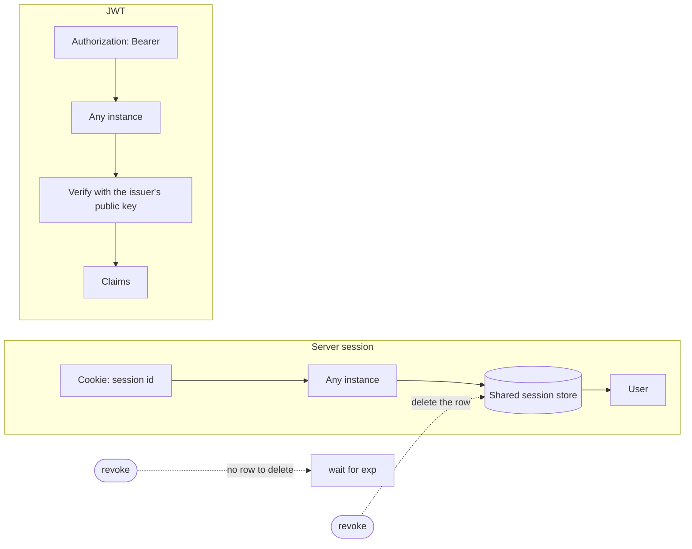
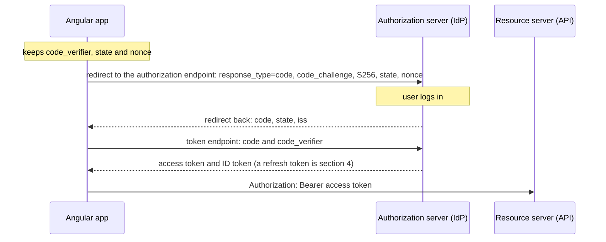
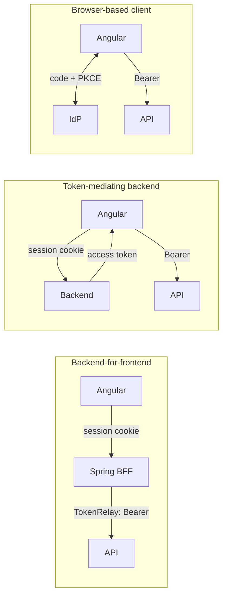
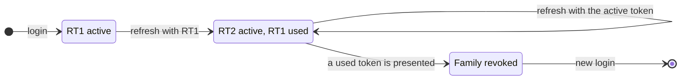
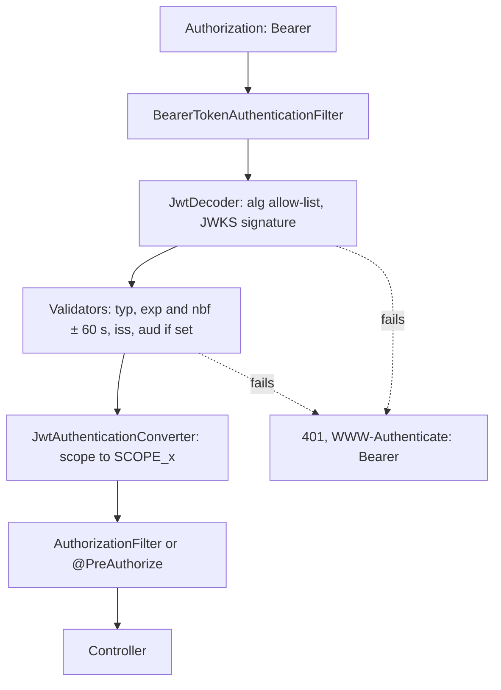
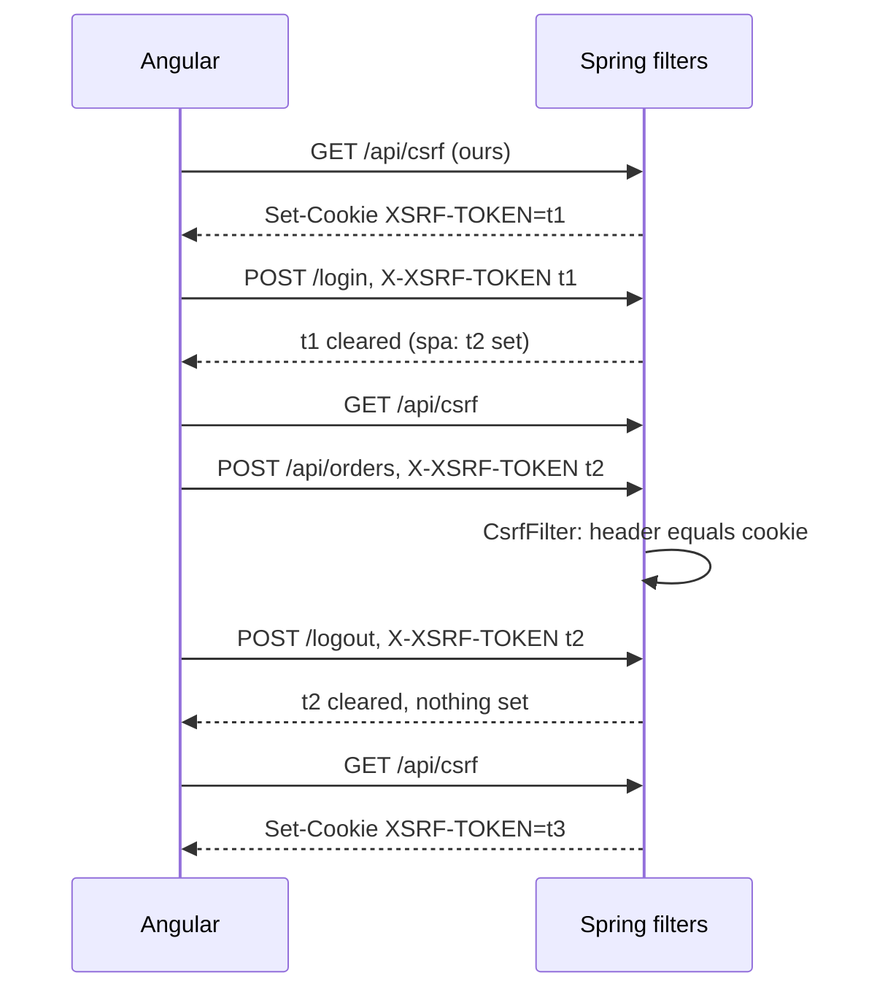
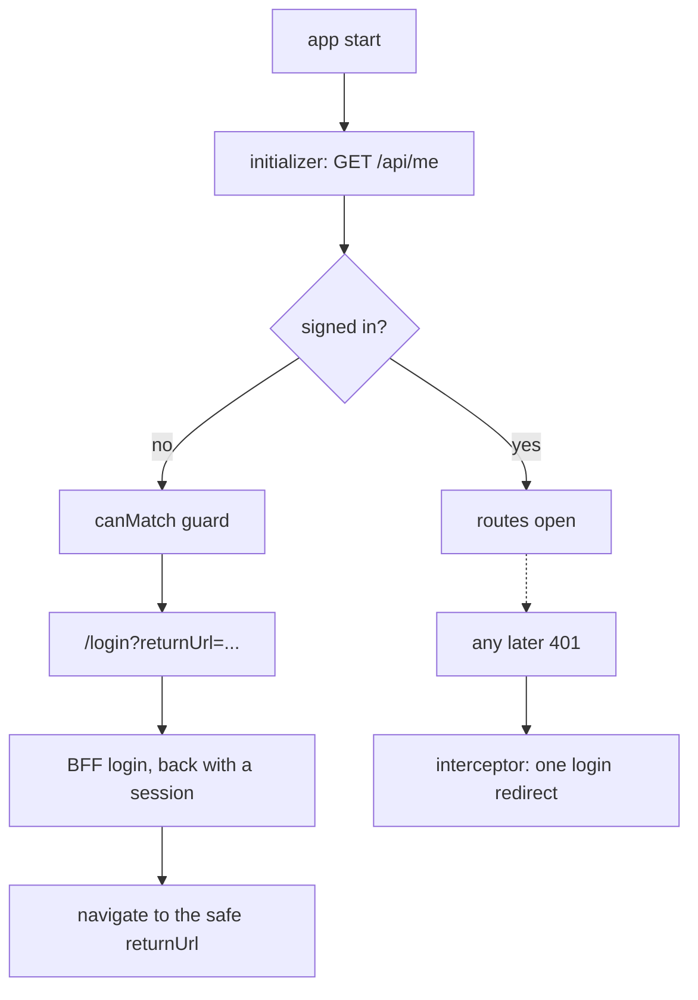
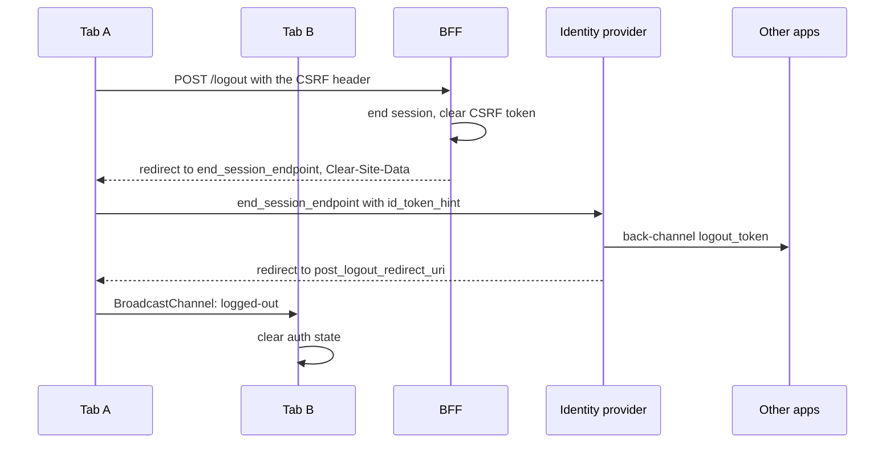
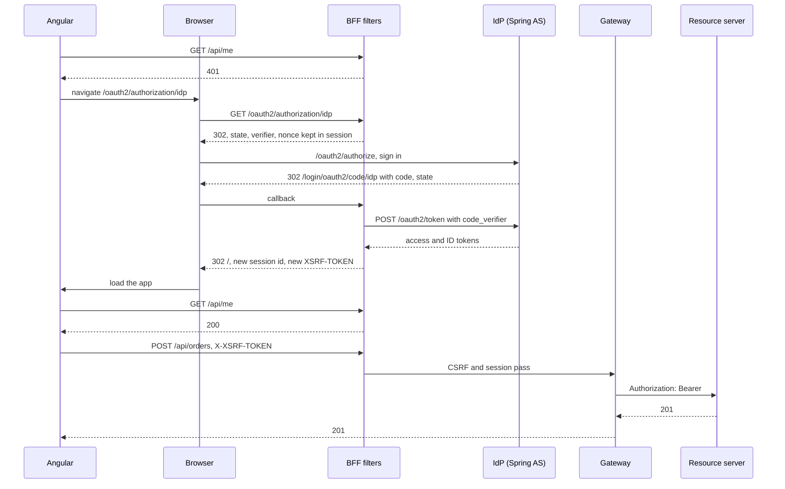

# 42. Full-stack authentication: Angular and Spring Security

> **What this covers:** authentication and authorization between an Angular client and Spring Boot services, end to end: server sessions versus self-contained tokens; OAuth 2.0 and OpenID Connect with the Authorization Code flow and PKCE, and why the implicit flow is gone; where the OAuth client should run, up to a backend-for-frontend built with Spring Security's OAuth2 client and Spring Cloud Gateway; refresh token rotation, reuse detection and silent renew; Spring Security as a resource server that validates JWTs and turns scopes into authorities; CSRF protection with `CookieCsrfTokenRepository` and Angular's XSRF support; the Angular side (startup checks, guards, interceptors and the two OIDC client libraries); and logging out everywhere with a usable session timeout.
> **Prerequisites:** [33. Where the token lives: memory, Web Storage, `HttpOnly` cookies and a backend-for-frontend](33-security.md#8-where-the-token-lives-memory-web-storage-httponly-cookies-and-a-backend-for-frontend), [33. CSRF in single-page apps](33-security.md#9-csrf-in-single-page-apps-when-cookies-make-you-vulnerable-samesite-and-angulars-xsrf-support), [41. CORS on both sides](41-fullstack-api-contracts.md#1-cors-on-both-sides-springs-corsconfigurationsource-spring-security-preflight-caching-credentials-and-the-dev-proxy), [27. Authentication: attaching tokens and refreshing on 401](27-http-client.md#7-authentication-attaching-tokens-refreshing-on-401-with-a-request-queue-and-avoiding-refresh-loops)
> **Leads to:** [43. Real-time communication](43-fullstack-realtime.md), [44. Full-stack delivery and operations](44-fullstack-delivery-and-operations.md), [46. System design case studies](46-system-design-case-studies.md)
> **Applies to:** Angular 22.2 (labs); TypeScript 6.0 and Node 24 WebCrypto in `labs/ts-js`; documented only: Spring Boot 4.1.1, Spring Security 7.1.1 (with Spring Authorization Server 7.1.1), Spring Session 4.1.1, Spring Cloud 2025.1.3 (Gateway 5.0.3), `angular-oauth2-oidc` 22.0.2, `angular-auth-oidc-client` 22.0.2; reads 2026-10-20
> **Study time:** ~3 hours reading + ~3 hours exercises
> **Short on time:** read [§2](#2-oauth-20-and-openid-connect-for-a-single-page-app-authorization-code-with-pkce-and-why-the-implicit-flow-is-gone), [§3](#3-where-the-oauth-client-runs-a-browser-only-client-a-token-mediating-backend-or-a-backend-for-frontend-with-spring) and [§6](#6-csrf-with-cookiecsrftokenrepository-and-angulars-xsrf-support-csrfspa-in-spring-security-7), then [Q42.02](#q42-02), [Q42.04](#q42-04), [Q42.08](#q42-08), [Q42.13](#q42-13), [Q42.17](#q42-17) and [Q42.21](#q42-21), then the [Summary](#summary).
> **Labs:** [`labs/angular/src/app/modules/42-fullstack-authentication/`](../labs/angular/src/app/modules/42-fullstack-authentication/) and [`labs/ts-js/src/modules/42-fullstack-authentication/`](../labs/ts-js/src/modules/42-fullstack-authentication/). Run (Node 24): from `labs/angular`, `npx ng test --watch=false --include='src/app/modules/42-fullstack-authentication/**/*.spec.ts'`; from `labs/ts-js`, `npx vitest run src/modules/42-fullstack-authentication src/outputs/42-fullstack-authentication`.

## Contents

1. [Sessions versus tokens: what the server keeps, what each request carries, revocation and scaling](#1-sessions-versus-tokens-what-the-server-keeps-what-each-request-carries-revocation-and-scaling)
2. [OAuth 2.0 and OpenID Connect for a single-page app: Authorization Code with PKCE, and why the implicit flow is gone](#2-oauth-20-and-openid-connect-for-a-single-page-app-authorization-code-with-pkce-and-why-the-implicit-flow-is-gone)
3. [Where the OAuth client runs: a browser-only client, a token-mediating backend or a backend-for-frontend with Spring](#3-where-the-oauth-client-runs-a-browser-only-client-a-token-mediating-backend-or-a-backend-for-frontend-with-spring)
4. [Refresh tokens: rotation, reuse detection, silent renew and refreshing across tabs](#4-refresh-tokens-rotation-reuse-detection-silent-renew-and-refreshing-across-tabs)
5. [Spring Security as a resource server: validating JWTs and turning scopes into authorities](#5-spring-security-as-a-resource-server-validating-jwts-and-turning-scopes-into-authorities)
6. [CSRF with `CookieCsrfTokenRepository` and Angular's XSRF support: `csrf.spa()` in Spring Security 7](#6-csrf-with-cookiecsrftokenrepository-and-angulars-xsrf-support-csrfspa-in-spring-security-7)
7. [The Angular side: an auth state at startup, guards as UX, interceptors, and `angular-oauth2-oidc` versus `angular-auth-oidc-client`](#7-the-angular-side-an-auth-state-at-startup-guards-as-ux-interceptors-and-angular-oauth2-oidc-versus-angular-auth-oidc-client)
8. [Logout everywhere and session timeout UX](#8-logout-everywhere-and-session-timeout-ux)
9. [Under the hood: one BFF login and the first API call through Spring Security's filters](#9-under-the-hood-one-bff-login-and-the-first-api-call-through-spring-securitys-filters)
- [Summary](#summary)
- [Question bank](#question-bank)
- [Hands-on exercises](#hands-on-exercises)
- [Check your understanding](#check-your-understanding)
- [Connections](#connections)

**How this module was checked.** Run: Vitest in Node 24 for our JWT signer and verifier, PKCE, our token-family and XOR mask models and cross-tab logout; `ng test` for the BFF session, the XSRF refresh and the idle warning. Read, not run: Spring Security 7.1.1, Spring Boot 4.1.1, Spring Session 4.1.1 and Spring Cloud Gateway 5.0.3 at their release tags; the two OIDC libraries' 22.0.2 tarballs; the RFCs and OpenID specs cited, dated in [SOURCES.md](../SOURCES.md). Java is illustrative, not compiled.

## 1. Sessions versus tokens: what the server keeps, what each request carries, revocation and scaling

### The problem it solves

A support engineer disables a compromised account and the attacker keeps calling the API. A second instance logs every other request out. After a move to "stateless JWTs", logout ends nothing.

### Mental model

**Authentication** is who is calling; **authorization**, what they may do ([section 5](#5-spring-security-as-a-resource-server-validating-jwts-and-turning-scopes-into-authorities)). A **server session** keeps the login server-side under a **session id** that the browser holds in a cookie, an **ambient credential** it sends by itself ([33 §9](33-security.md#9-csrf-in-single-page-apps-when-cookies-make-you-vulnerable-samesite-and-angulars-xsrf-support)). More instances need a shared store or **sticky sessions** (one client, one instance). A signed **JWT**, a **self-contained token**, carries **claims** (statements, such as `exp`) and a **signature** (proof of origin) as **base64url** (URL-safe base64) text ([33 §8](33-security.md#8-where-the-token-lives-memory-web-storage-httponly-cookies-and-a-backend-for-frontend)): any instance verifies it. **Revocation** (ending a credential early) is a deleted row for a session; a JWT needs short lifetimes or a **deny list** (refused ids). Analogy: a cloakroom ticket against a signed boarding pass.



What to notice: one deleted row ends a session; a JWT has only `exp`.

### How it actually works

- **Why can't a second instance read my session?** Read from Spring Session 4.1.1 `index.adoc`: sessions are "typically stored on the server's memory". **Spring Session** moves them to "a shared database or Redis" (line 52).
- **Decode versus verify.** The signature covers the encoded header and payload ([RFC 7515](https://www.rfc-editor.org/rfc/rfc7515.html) §5.1), so a changed claim fails it; the time "MUST be before the expiration date/time" ([RFC 7519](https://www.rfc-editor.org/rfc/rfc7519.html) §4.1.4), so logout ends no token.

### Code

1. Java: `STATELESS` "will never create an HttpSession" (`SessionCreationPolicy.java`, Security 7.1.1); YAML: the timeout.
2. `decodeJwt` and `verifyJwt`: our model over WebCrypto.
3. `revoke` deletes the row.

```java
// Spring Boot 4.1 — illustrative, not compiled in labs
@Bean
SecurityFilterChain api(HttpSecurity http) throws Exception {
    http.sessionManagement((session) -> session
        .sessionCreationPolicy(SessionCreationPolicy.STATELESS));
    return http.build();
}
```

```yaml
# Spring Boot 4.1 — illustrative, not compiled in labs
server:
  servlet:
    session:
      timeout: 15m # the default is 30m
```

```ts
// Excerpt of labs/ts-js/src/modules/42-fullstack-authentication/concepts/jwt.ts
/** Reads the header and claims of a token. It takes no key, so it proves nothing about who wrote them. */
export function decodeJwt(token: string): DecodedJwt {
  const parts = token.split('.');
  if (parts.length !== 3) throw new MalformedJwtError('a compact JWT has three dot-separated parts');
  const [header = '', payload = '', signature = ''] = parts;
  try {
    return {
      header: readHeader(parseSegment(header)),
      claims: readClaims(parseSegment(payload)),
      signingInput: `${header}.${payload}`,
      signature: base64UrlDecode(signature),
    };
  } catch (error) {
    if (error instanceof MalformedJwtError) throw error;
    throw new MalformedJwtError('a part is not base64url-encoded JSON', { cause: error });
  }
}

/** Verifies the signature, then that `now` is before `exp` (RFC 7519 §4.1.4). `now` is epoch seconds. */
export async function verifyJwt(token: string, publicKey: CryptoKey, now: number): Promise<JwtVerification> {
  const decoded = tryDecode(token);
  if (decoded === undefined) return { valid: false, reason: 'malformed' };
  if (!(await signatureMatches(decoded, publicKey))) return { valid: false, reason: 'signature' };
  if (now >= decoded.claims.exp) return { valid: false, reason: 'expired' };
  return { valid: true, claims: decoded.claims };
}
```

```ts
// Excerpt of labs/ts-js/src/modules/42-fullstack-authentication/concepts/session-store.ts
  revoke(sessionId: string): boolean {
    return this.records.delete(sessionId);
  }
```

Tests: `Section 1: anyone can decode a JWT's claims without the key`, `Section 1: changing one claim makes the signature check fail`, `Section 1: a revoked session id is refused on the next request`, `Section 1: a JWT still verifies after logout until its exp`.

> [!TIP]
> **Coming from the backend.** `HttpSession` is a lookup by id; a JWT read by `BearerTokenAuthenticationFilter` is verified by signature, with no per-token lookup. **Where the analogy breaks:** a browser sends the session id by itself, so cookie sessions bring CSRF ([§6](#6-csrf-with-cookiecsrftokenrepository-and-angulars-xsrf-support-csrfspa-in-spring-security-7)); a script-readable token brings exfiltration.

### Best practices and anti-patterns

- **Pick by who must end a login**, because only a session ends by deleting a row.

### Misconceptions and traps

- "JWTs are encrypted." A signed one is readable by any holder; encryption is the separate JWE form (RFC 7519 §3). Cause: base64url looks opaque.
- "Stateless means logout works the same." No server record exists to delete, so the token lives until `exp`. Cause: with sessions, logout was a server action nobody saw.
- "Sessions don't scale." A shared store does. Cause: each container keeps its own.
- "A JWT in a cookie is CSRF-free." The cookie is still ambient. Cause: only the format changed.

Drilled in [Q42.01](#q42-01), [Q42.02](#q42-02) and [Q42.03](#q42-03).

## 2. OAuth 2.0 and OpenID Connect for a single-page app: Authorization Code with PKCE, and why the implicit flow is gone

### The problem it solves

An old Angular app gets `#access_token=…` in its address bar and the token reaches the browser history ([RFC 10017](https://www.rfc-editor.org/rfc/rfc10017.html) §7.2.3.2).

### Mental model

**OAuth 2.0** ([RFC 6749](https://www.rfc-editor.org/rfc/rfc6749.html) §1.1) lets a **client** (the app) reach an API for a user: an **authorization server** (the **IdP**, identity provider) issues an **access token** ([27 §7](27-http-client.md#7-authentication-attaching-tokens-refreshing-on-401-with-a-request-queue-and-avoiding-refresh-loops)) for the **resource server** (the API). **OpenID Connect** adds an **ID token**, a JWT about the login. A browser app is a **public client** (no secret, RFC 6749 §2.1), a Spring `oauth2Login` server a **confidential client**. The IdP sends an **authorization code** to the **redirect URI** (the callback). **PKCE** (Proof Key for Code Exchange) binds the code to the page that asked: the page keeps a random **`code_verifier`**, sends its hash as the **`code_challenge`** (method **`S256`**, SHA-256), and the token endpoint recomputes it. **`state`** ties the callback to the request, **`nonce`** the ID token to the login, comparing `iss` exposes a **mix-up attack** (a code sent to the wrong IdP, [RFC 9207](https://www.rfc-editor.org/rfc/rfc9207.html) §2.4). Analogy: a torn ticket, one half's fingerprint kept by the IdP.



What to notice: the verifier travels only in the token request.

### How it actually works

- **Why does a stolen code fail?** Read from RFC 7636 §4.6: the token endpoint hashes the received verifier, compares it with the stored challenge, and on a mismatch "an error response indicating "invalid_grant" … MUST be returned" (abridged).

### Code

1. `createPkcePair` takes random bytes as an argument.
2. `startAuthorization` builds the redirect.
3. `stateMatches` checks `state`.

```ts
// Section 2 model: PKCE and the Authorization Code request a single-page app builds. Our model, not Spring's code.
// It mirrors RFC 7636 §4.1-§4.3 and §4.6 (verifier, S256 challenge, the token endpoint's comparison), RFC 9700 §4.7.1
// (a random `state` ties the callback to the request) and OpenID Connect Core 1.0 §3.1.2.1 (`openid` scope, `nonce`).
// Spring Security 7.1.1 builds the same parameters in DefaultOAuth2AuthorizationRequestResolver (facts F4b, F5, F7, F8).
// Randomness is an argument and nothing here reads the clock or the network.
import { base64UrlEncode } from './jwt';

/** Source of random bytes, injected so that a test can supply a known sequence. */
export type RandomBytes = (length: number) => Uint8Array;

export interface PkcePair {
  readonly verifier: string;
  readonly challenge: string;
}

export interface AuthorizationConfig {
  readonly authorizationEndpoint: string;
  readonly clientId: string;
  readonly redirectUri: string;
  readonly scope: string;
}

/** What the page keeps across the redirect, and sends to the token endpoint only as `code_verifier`. */
export interface PendingAuthorization {
  readonly state: string;
  readonly nonce: string;
  readonly verifier: string;
}

/** RFC 7636 §4.1 NOTE: 32 random octets, base64url-encoded, make a 43-character verifier. */
const RANDOM_OCTETS = 32;
const textEncoder = new TextEncoder();

/** RFC 7636 §4.2: BASE64URL-ENCODE(SHA256(ASCII(code_verifier))). */
export async function challengeFor(verifier: string): Promise<string> {
  const digest = await crypto.subtle.digest('SHA-256', textEncoder.encode(verifier));
  return base64UrlEncode(new Uint8Array(digest));
}

export async function createPkcePair(random: RandomBytes): Promise<PkcePair> {
  const verifier = base64UrlEncode(random(RANDOM_OCTETS));
  return { verifier, challenge: await challengeFor(verifier) };
}

/** The token endpoint's check (RFC 7636 §4.6): hash the received verifier and compare it with the stored challenge. */
export async function verifyPkce(verifier: string, challenge: string): Promise<boolean> {
  return (await challengeFor(verifier)) === challenge;
}

/** Builds the redirect to the authorization endpoint and the record the page keeps for the callback. */
export async function startAuthorization(
  config: AuthorizationConfig,
  random: RandomBytes,
): Promise<{ readonly url: string; readonly pending: PendingAuthorization }> {
  const { verifier, challenge } = await createPkcePair(random);
  const pending = {
    state: base64UrlEncode(random(RANDOM_OCTETS)),
    nonce: base64UrlEncode(random(RANDOM_OCTETS)),
    verifier,
  };
  const url = new URL(config.authorizationEndpoint);
  url.search = new URLSearchParams({
    response_type: 'code',
    client_id: config.clientId,
    redirect_uri: config.redirectUri,
    scope: config.scope,
    state: pending.state,
    nonce: pending.nonce,
    code_challenge: challenge,
    code_challenge_method: 'S256',
  }).toString();
  return { url: url.toString(), pending };
}

/** True only when the callback carries the `state` this page sent; a missing or different value is refused. */
export function stateMatches(callbackUrl: string, pending: PendingAuthorization): boolean {
  return new URL(callbackUrl).searchParams.get('state') === pending.state;
}
```

<sub>Source: [labs/ts-js/src/modules/42-fullstack-authentication/concepts/pkce.ts](../labs/ts-js/src/modules/42-fullstack-authentication/concepts/pkce.ts)</sub>

```yaml
# Spring Boot 4.1 — illustrative, not compiled in labs
spring:
  security:
    oauth2:
      client:
        registration:
          spa:
            provider: idp
            client-id: angular-app
            client-authentication-method: none # a public client: Spring enables PKCE (core.adoc, requireProofKey)
            authorization-grant-type: authorization_code
            scope: openid,profile
        provider:
          idp:
            issuer-uri: https://idp.example.com
```

Tests: four `Section 2: …` tests, ours, in [section-2-pkce.test.ts](../labs/ts-js/src/modules/42-fullstack-authentication/concepts/section-2-pkce.test.ts).

> [!TIP]
> **Coming from the backend.** An `oauth2Login` registration holds a `client-secret`. **Where the analogy breaks:** a browser keeps none, so the verifier protects the exchange; Spring still sends PKCE to confidential clients (`requireProofKey`, Security 7.1.1 `core.adoc`).

### Best practices and anti-patterns

- **Send `code_challenge_method=S256`**, because it "defaults to "plain" if not present" (RFC 7636 §4.3).

### Misconceptions and traps

- "PKCE replaces `state`." Only if the IdP supports it, else "state or nonce MUST be used for CSRF protection" (RFC 9700 §4.7.1). Cause: PKCE stops CSRF "as a side effect" (§2.1.1).
- "The app validates the access token." The API does; the app checks the ID token's `aud` for its `client_id` ([OpenID Connect Core](https://openid.net/specs/openid-connect-core-1_0.html) §3.1.3.7). Cause: it can be a JWT too ([RFC 9068](https://www.rfc-editor.org/rfc/rfc9068.html)).
- "Once true: the **implicit flow**, tokens in the redirect, was the single-page flow." Until RFC 9700 (January 2025) said "SHOULD NOT" (§2.1.2) and RFC 10017 (August 2026) "MUST NOT" (§7.2). Cause: before CORS spread, it needed none (§7.2.1).

Drilled in [Q42.04](#q42-04), [Q42.05](#q42-05), [Q42.06](#q42-06) and [Q42.07](#q42-07); practised in [Exercise 42.1](#ex42-1).

## 3. Where the OAuth client runs: a browser-only client, a token-mediating backend or a backend-for-frontend with Spring

### The problem it solves

Nobody knows what script steals per design; the BFF cookie sits on `.example.com`; Angular gets a 302, not 401.

### Mental model

[RFC 10017](https://www.rfc-editor.org/rfc/rfc10017.html) §6 ranks three OAuth client placements "in decreasing order of security". A **backend-for-frontend (BFF)** ([33 §8](33-security.md#8-where-the-token-lives-memory-web-storage-httponly-cookies-and-a-backend-for-frontend)) is the confidential client that keeps the tokens and proxies API calls; the browser holds a **session cookie** ([09 §6](09-web-networking-storage-security.md#6-cookies)). A **token-mediating backend** hands the page the access token; a **browser-based OAuth client** does everything there. Spring's **authorized client** holds a user's tokens; **token relay** forwards its access token. Analogy: concierge, key desk, master keys.



What to notice: only the BFF keeps tokens out of Angular.

### How it actually works

- **Exposure.** From a BFF, "there are simply no tokens to be stolen" (§6.1.4.2); from a token-mediating backend, the access token (§6.2.4.1); from a browser client, all (§6.3.4.1). **Client hijacking**, script calling the API through the page, survives each (§6.1.4.1).
- **The cookie** follows §6.1.3.2, quoted in the YAML.
- **Spring's state** (Security 7.1.1): `state`, verifier and `nonce` wait in the HTTP session, so a `Strict` cookie misses a cross-site IdP's callback (`authorization_request_not_found`); tokens sit in an `InMemoryOAuth2AuthorizedClientService`.
- **Why a 302?** `oauth2Login` redirects requests lacking `X-Requested-With: XMLHttpRequest` whose `Accept` names HTML or `text/plain` (`AbstractAuthenticationFilterConfigurer`); Angular's `FetchBackend` sends `text/plain` (`@angular/common` 22.2.1).
- **`TokenRelay`** (Gateway 5.0.3) sets `Authorization: Bearer` from the `OAuth2AuthorizedClientManager`, or forwards without one.

### Code

1. An **authentication entry point** (what answers an unauthenticated request) returns 401 for `/api/**`; `csrf.spa()` is [§6](#6-csrf-with-cookiecsrftokenrepository-and-angulars-xsrf-support-csrfspa-in-spring-security-7)'s.
2. The cookie and a `TokenRelay` route.
3. Relative `/api` URLs, so no CORS ([41 §1](41-fullstack-api-contracts.md#1-cors-on-both-sides-springs-corsconfigurationsource-spring-security-preflight-caching-credentials-and-the-dev-proxy)), and login by navigation.

```java
// Spring Boot 4.1 — illustrative, not compiled in labs
@Bean
SecurityFilterChain bff(HttpSecurity http) throws Exception {
    http
        .authorizeHttpRequests((authorize) -> authorize
            .requestMatchers("/api/**").authenticated()
            .anyRequest().permitAll())
        .oauth2Login(withDefaults()) // one registration: redirects pages to /oauth2/authorization/{registrationId}
        .csrf((csrf) -> csrf.spa()) // @since 7.0; section 6
        // added before oauth2Login's entry point, which is registered at build time, so /api/** matches first
        .exceptionHandling((exceptions) -> exceptions.defaultAuthenticationEntryPointFor(
            new HttpStatusEntryPoint(HttpStatus.UNAUTHORIZED), PathPatternRequestMatcher.pathPattern("/api/**")));
    return http.build();
}
```

```yaml
# Spring Boot 4.1 — illustrative, not compiled in labs
server:
  servlet:
    session:
      cookie:
        # RFC 10017 §6.1.3.2, every quote below
        name: __Host-Http-SESSION # "SHOULD start the name of its cookie with a prefix" (abridged); renamed, back-channel logout needs setSessionCookieName (section 8)
        http-only: true # "MUST enable the HttpOnly flag"
        secure: true # "MUST enable the Secure flag"
        same-site: strict # "SHOULD enable the SameSite=Strict flag"; lax if the IdP is on another site (its callback is cross-site)
        path: / # "SHOULD set its cookie path to /"
        # no domain: "SHOULD NOT set the Domain attribute"
spring:
  cloud:
    gateway:
      server:
        webmvc:
          routes:
            - id: orders
              uri: https://orders.internal.example.com
              predicates:
                - Path=/api/orders/**
              filters:
                - TokenRelay= # the signed-in user's access token; needs section 2's registration, with a client-secret
```

```ts
// Section 3 model: the browser half of two RFC 10017 §6 architectures. Our model, not Spring's code.
// A backend-for-frontend (§6.1) keeps every token, so the page calls relative /api URLs and starts login by
// navigating the whole page to /oauth2/authorization/{registrationId}, the base URI Spring Security 7.1.1 sets in
// DefaultOAuth2AuthorizationRequestResolver (facts F8, C5). A token-mediating backend (§6.2) hands the page an
// access token, which the page attaches itself. Every server answer in the tests is our stub.
import { HttpClient } from '@angular/common/http';
import { DOCUMENT, Injectable, InjectionToken, inject, signal } from '@angular/core';
import { type Observable, firstValueFrom } from 'rxjs';

/** A full-page navigation, injected so that a test records it instead of leaving the page. */
export const LAB_M42_NAVIGATE = new InjectionToken<(url: string) => void>('LAB_M42_NAVIGATE', {
  providedIn: 'root',
  factory: () => {
    const location = inject(DOCUMENT).location;
    return (url: string) => location.assign(url);
  },
});

/** Our BFF's registration id: the `{registrationId}` segment of Spring's login URL. */
export const LAB_M42_REGISTRATION_ID = 'idp';

export interface LabM42User {
  readonly name: string;
}

/** BFF: the browser holds only the session cookie, which it sends to its own origin by itself. */
@Injectable({ providedIn: 'root' })
export class LabM42BffClient {
  private readonly http = inject(HttpClient);
  private readonly navigate = inject(LAB_M42_NAVIGATE);

  me(): Observable<LabM42User> {
    return this.http.get<LabM42User>('/api/me');
  }

  orders(): Observable<readonly string[]> {
    return this.http.get<readonly string[]>('/api/orders');
  }

  login(): void {
    this.navigate(`/oauth2/authorization/${LAB_M42_REGISTRATION_ID}`);
  }
}

/** Token-mediating backend: its session endpoint answers with an access token for the page to send. */
@Injectable({ providedIn: 'root' })
export class LabM42TokenMediatedClient {
  private readonly http = inject(HttpClient);
  private readonly accessToken = signal<string | null>(null);

  async resumeSession(): Promise<void> {
    const session = await firstValueFrom(this.http.get<{ readonly accessToken: string }>('/bff/session'));
    this.accessToken.set(session.accessToken);
  }

  orders(): Observable<readonly string[]> {
    const token = this.accessToken();
    const headers: Record<string, string> = token === null ? {} : { Authorization: `Bearer ${token}` };
    return this.http.get<readonly string[]>('https://api.example.com/orders', { headers });
  }
}
```

<sub>Source: [labs/angular/src/app/modules/42-fullstack-authentication/concepts/bff-client.ts](../labs/angular/src/app/modules/42-fullstack-authentication/concepts/bff-client.ts)</sub>

Tests: [section-3-bff.spec.ts](../labs/angular/src/app/modules/42-fullstack-authentication/concepts/section-3-bff.spec.ts).

> [!TIP]
> **Coming from the backend.** A BFF is `oauth2Login` plus an API proxy. **Where the analogy breaks:** browsers send the cookie unasked, so CSRF returns ([§6](#6-csrf-with-cookiecsrftokenrepository-and-angulars-xsrf-support-csrfspa-in-spring-security-7)), and all API traffic crosses it ([44](44-fullstack-delivery-and-operations.md#1-where-the-api-calls-go-direct-calls-a-same-origin-reverse-proxy-an-api-gateway-or-a-backend-for-frontend)).

### Best practices and anti-patterns

- **Prefer a BFF for personal-data apps**, because no token reaches script (§6.1.4.3); hijacking remains.
- **Store authorized clients centrally**, because the default is one instance's memory.

### Misconceptions and traps

- "A BFF needs no CSRF defense." It "MUST implement a proper CSRF defense" (§6.1.3.3). Cause: no token is in the page.
- "Token-mediating equals BFF." Script takes the access token. Cause: the refresh token stays server-side.
- "Set the cookie on the parent domain." §6.1.3.2 rejects `Domain`; `__Host-` forbids it. Cause: sharing is convenient.
- "`TokenRelay` makes the gateway the resource server." Each API still validates it ([§5](#5-spring-security-as-a-resource-server-validating-jwts-and-turning-scopes-into-authorities)). Cause: it sits in front.

Drilled in [Q42.08](#q42-08) and [Q42.09](#q42-09); practised in [Exercise 42.3](#ex42-3), the browser half (Spring is documented, not run).

## 4. Refresh tokens: rotation, reuse detection, silent renew and refreshing across tabs

### The problem it solves

A copied refresh token mints access tokens for hours; two tabs refresh at once, logging the user out; silent renew fails where third-party cookies are blocked.

### Mental model

A **refresh token** ([27 §7](27-http-client.md#7-authentication-attaching-tokens-refreshing-on-401-with-a-request-queue-and-avoiding-refresh-loops)) buys new access tokens. **Rotation** replaces it at each use; one login's tokens form a **token family**. With **reuse detection**, a replayed one makes the server "revoke the active refresh token" ([RFC 9700](https://www.rfc-editor.org/rfc/rfc9700.html) §4.14.2). Public clients' refresh tokens "MUST be sender-constrained or use refresh token rotation" (§2.2.2); **sender-constrained**: bound to a client key (DPoP, RFC 9449). **Silent renew** reruns login in a hidden iframe on the IdP's cookie, there a **third-party cookie** ([09 §6](09-web-networking-storage-security.md#6-cookies)). Analogy: a key card re-coded per use; an old card cancels the room's.



What to notice: any replay, attacker's or racing tab's, ends the family.

### How it actually works

- **Spring Authorization Server 7.1.1, read:** when rotating, `OAuth2RefreshTokenAuthenticationProvider` overwrites the stored token, so an old one gets `invalid_grant`; nothing is revoked. Its default `OAuth2RefreshTokenGenerator` gives public clients none on the code grant (internal `isPublicClientForAuthorizationCodeGrant`).
- **Why refresh tokens now?** "in light of the impact of third-party cookie-blocking mechanisms, the use of refresh tokens has become significantly more attractive" (RFC 10017 §6.3.2.3).
- **Across tabs**, one tab's rotation makes the other's refresh a replay ([Q27.23](27-http-client.md#q27-23)'s single flight covers one tab). `angular-auth-oidc-client` 22.0.2's `useRefreshTokenLock` (default off) locks with the **Web Locks API** [Baseline 2022: widely available, per MDN] (**Baseline**: [MDN's label](https://developer.mozilla.org/en-US/docs/Glossary/Baseline/Compatibility)), named locks an origin's tabs share, then reuses another tab's result if storage is shared (its default `sessionStorage` is not). Read, not run.

### Code

1. `refresh`: rotation and reuse detection.
2. Locked, reuse another tab's result.
3. YAML: rotation for the BFF.

```ts
// Excerpt of labs/ts-js/src/modules/42-fullstack-authentication/concepts/token-family.ts
  /** The refresh token grant. A used token presented again revokes the family: the server cannot tell who sent it. */
  refresh(refreshToken: string, now: number): RefreshResult {
    const family = this.familyOf.get(refreshToken);
    if (family === undefined) return refused('unknown');
    if (family.revoked) return refused('revoked');
    if (now >= family.expiresAt) return refused('expired');
    if (refreshToken !== family.active) {
      family.revoked = true;
      return refused('reused');
    }
    if (this.options.rotate) {
      family.active = this.newToken();
      this.familyOf.set(family.active, family);
    }
    return { ok: true, tokens: { accessToken: this.newToken(), refreshToken: family.active } };
  }
```

```ts
// Excerpt of labs/ts-js/src/modules/42-fullstack-authentication/concepts/section-4-refresh.test.ts
async function refreshUnderLock(lockName: string, session: SharedSession): Promise<string> {
  const seenBeforeLock = session.tokens.accessToken;
  return navigator.locks.request(lockName, async () => {
    if (session.tokens.accessToken !== seenBeforeLock) return session.tokens.accessToken;
    session.tokens = tokensOf(await session.endpoint(session.tokens.refreshToken));
    return session.tokens.accessToken;
  });
}
```

```yaml
# Spring Boot 4.1 — illustrative, not compiled in labs
spring:
  security:
    oauth2:
      authorizationserver:
        client:
          bff:
            registration:
              client-id: bff
              client-secret: "{noop}change-me" # a confidential client: a public one gets no refresh token
              client-authentication-methods:
                - client_secret_basic
              authorization-grant-types:
                - authorization_code
                - refresh_token
              redirect-uris:
                - https://app.example.com/login/oauth2/code/idp
              scopes:
                - openid
            token:
              reuse-refresh-tokens: false # rotate on every use; Boot and TokenSettings default to true
              refresh-token-time-to-live: 8h # the default is 60 minutes
```

Tests (ours): [section-4-refresh.test.ts](../labs/ts-js/src/modules/42-fullstack-authentication/concepts/section-4-refresh.test.ts).

> [!NOTE]
> **Framework vs platform.** Rotation and reuse detection are the server's; the library stores, locks and sends; Web Locks are the browser's.

> [!TIP]
> **Coming from the backend.** Rotation is optimistic locking: the active token is the version, an old one a stale update. **Where the analogy breaks:** a stale update retries; a stale token revokes the family, since the server cannot tell attacker from client.

### Best practices and anti-patterns

- **Set `reuse-refresh-tokens: false`**, because otherwise a copy works beside the original.

### Misconceptions and traps

- "Rotation alone stops theft." Stealing the newest token, then waiting for the app to stop, leaves no reuse (RFC 10017 §5.1.2). Cause: old tokens die.
- "Spring Authorization Server rotates by default." `TokenSettings` defaults to `reuseRefreshTokens(true)`. Cause: RFC 9700 recommends rotation, so people assume the default follows it.

Drilled in [Q42.10](#q42-10), [Q42.11](#q42-11) and [Q42.12](#q42-12); practised in [Exercise 42.2](#ex42-2).

## 5. Spring Security as a resource server: validating JWTs and turning scopes into authorities

### The problem it solves

The orders API accepts billing's tokens and one expired 30 seconds ago. An upgraded IdP's `at+jwt` tokens get 401. `hasRole('ADMIN')` never matches `roles: ["admin"]`.

### Mental model

The **resource server** checks tokens itself: a `JwtDecoder` enforces an **algorithm allow-list** (accepted `alg` values) and verifies the signature with the issuer's **JWKS** key (JSON Web Key Set, [RFC 7517](https://www.rfc-editor.org/rfc/rfc7517.html) §5; ours picks it by **`kid`**, key id). Validators check `typ`, `exp` and `nbf` within the **clock skew** (tolerated clock drift), the **issuer** (`iss`) and, if configured, the **audience** (`aud`, intended APIs). Each **scope** (a granted permission, `scope` or `scp`) becomes an **authority** (a string Spring checks) with the **`SCOPE_` prefix**. An **opaque token** (no readable claims) needs **introspection**, asking the IdP ([RFC 7662](https://www.rfc-editor.org/rfc/rfc7662.html) §2). Analogy: a border officer checks the passport, then the visa stamps.



What to notice: only a fully checked token yields authorities.

### How it actually works

Read, not run (Security 7.1.1, Boot 4.1.1):

- **Why does a token expired 30 seconds ago pass?** `JwtTimestampValidator` refuses only when now minus 60 seconds "isAfter" `exp`; "Implementers MAY provide for some small leeway" ([RFC 7519](https://www.rfc-editor.org/rfc/rfc7519.html) §4.1.4, abridged).
- **Why is `aud` ignored?** Boot's internal (package-private) `JwtDecoderConfiguration` checks it only when `audiences` is set, yet a relying party of a multi-API issuer "MUST validate the audience value" ([RFC 8725](https://www.rfc-editor.org/rfc/rfc8725.html) §3.9).
- **Why does `at+jwt` fail?** `JwtTypeValidator.jwt()` accepts `JWT` or no `typ`, while "The resource server MUST verify that the "typ" header value is "at+jwt" or "application/at+jwt"" ([RFC 9068](https://www.rfc-editor.org/rfc/rfc9068.html) §4, abridged).

### Code

1. YAML: name the issuer and the audience, so `iss` and `aud` are both checked.
2. Java: map `roles` to `ROLE_`, enable method security, and accept RFC 9068's `at+jwt`.
3. Our validator and scope mapper, mirroring those defaults.

```yaml
# Spring Boot 4.1 — illustrative, not compiled in labs
spring:
  security:
    oauth2:
      resourceserver:
        jwt:
          issuer-uri: https://idp.example.com # discovery, the JWKS and the iss check (jwt.adoc)
          audiences:
            - orders-api # without it, aud is not checked (JwtDecoderConfiguration)
          # jws-algorithms (default RS256) applies with jwk-set-uri; with only issuer-uri, the JWKS keys' algorithms
          # are trusted (their alg, else every RSA or EC algorithm: internal JwtDecoderProviderConfigurationUtils)
```

```java
// Spring Boot 4.1 — illustrative, not compiled in labs
@Configuration
@EnableMethodSecurity // "Spring Boot Starter Security does not activate method-level authorization by default"
class ResourceServerConfig {

    // oauth2ResourceServer's jwt() finds this bean by type; Boot's own converter backs off (@ConditionalOnMissingBean).
    @Bean
    JwtAuthenticationConverter jwtAuthenticationConverter() {
        JwtGrantedAuthoritiesConverter roles = new JwtGrantedAuthoritiesConverter();
        roles.setAuthoritiesClaimName("roles"); // instead of scope, then scp
        roles.setAuthorityPrefix("ROLE_"); // instead of SCOPE_
        JwtAuthenticationConverter converter = new JwtAuthenticationConverter();
        converter.setJwtGrantedAuthoritiesConverter(
                new DelegatingJwtGrantedAuthoritiesConverter(new JwtGrantedAuthoritiesConverter(), roles));
        return converter; // SCOPE_ and ROLE_ authorities, plus the FACTOR_BEARER it always adds
    }

    // RFC 9068 tokens: Boot hands OAuth2TokenValidator beans to the decoder, and
    // JwtValidators.createDefaultWithValidators then skips its JwtTypeValidator.jwt(); JWT-typed and untyped tokens now fail.
    @Bean
    JwtTypeValidator accessTokenType() {
        return new JwtTypeValidator("at+jwt", "application/at+jwt");
    }
}

@Service
public class OrderService {

    @PreAuthorize("hasAuthority('SCOPE_orders:read')")
    public List<OrderSummary> list() { ... }

    @PreAuthorize("hasRole('admin')") // hasRole adds ROLE_; ROLE_admin, case included
    public void refund(long orderId) { ... }
}
```

```ts
// Excerpt of labs/ts-js/src/modules/42-fullstack-authentication/concepts/jwt-validator.ts
/** Our mirror of Boot's defaults with only `issuer-uri`, for an issuer whose JWKS holds RS256 keys. */
export function springDefaults(issuer: string): ResourceServerPolicy {
  return { issuer, audiences: [], algorithms: ['RS256'], clockSkewSeconds: 60, types: ['JWT'], allowMissingType: true };
}

/** Like `JwtTimestampValidator`: refuses only when `now` minus the skew is after `exp`, or plus the skew before `nbf`. */
function checkTimestamps({ claims, policy, now }: CheckInput): RejectReason | undefined {
  const exp = claims['exp'];
  const nbf = claims['nbf'];
  if (typeof exp === 'number' && now - policy.clockSkewSeconds > exp) return 'expired';
  if (typeof nbf === 'number' && now + policy.clockSkewSeconds < nbf) return 'not-yet-valid';
  return undefined;
}

/** Boot adds this check only when `audiences` is non-empty; then `aud` (a string or a list) must share a value. */
function checkAudience({ claims, policy }: CheckInput): RejectReason | undefined {
  if (policy.audiences.length === 0) return undefined;
  const aud = claims['aud'];
  const values: readonly unknown[] = Array.isArray(aud) ? aud : [aud];
  return values.some((value) => typeof value === 'string' && policy.audiences.includes(value)) ? undefined : 'audience';
}

/** In `createDefaultWithValidators` order: type, timestamps, issuer, audience (its certificate-binding check is not modelled). */
const CHECKS = [checkType, checkTimestamps, checkIssuer, checkAudience] as const;

/** Decodes, checks the algorithm and the signature, then runs the claim checks. `now` is epoch seconds. */
export async function validate(
  token: string,
  keys: KeySet,
  policy: ResourceServerPolicy,
  now: number,
): Promise<TokenValidation> {
  const parsed = parse(token);
  if (parsed === undefined) return { valid: false, reason: 'malformed' };
  const { header, claims } = parsed;
  if (header.alg === UNSIGNED || !policy.algorithms.includes(header.alg)) return { valid: false, reason: 'algorithm' };
  if (!(await signatureMatches(parsed, keys))) return { valid: false, reason: 'signature' };
  const reason = CHECKS.map((check) => check({ header, claims, policy, now })).find((found) => found !== undefined);
  return reason === undefined ? { valid: true, header, claims } : { valid: false, reason };
}
```

```ts
// Section 5 model: Spring Security 7.1.1's JwtGrantedAuthoritiesConverter as a function. Our model, not Spring's code.
// Defaults (fact F15): the first claim present of `scope`, then `scp`; a string is split on one space, a list is
// taken as it is, anything else gives nothing; each value gets the prefix `SCOPE_`. Naming a claim replaces both
// defaults, as `setAuthoritiesClaimName` does. Spring's delimiter is a regular expression; ours is plain text.

export interface AuthorityMapping {
  readonly claimNames: readonly string[];
  readonly prefix: string;
  readonly delimiter: string;
}

export const SCOPE_MAPPING: AuthorityMapping = { claimNames: ['scope', 'scp'], prefix: 'SCOPE_', delimiter: ' ' };

function valuesOf(claim: unknown, delimiter: string): readonly string[] {
  if (typeof claim === 'string') return claim.trim() === '' ? [] : claim.split(delimiter);
  if (Array.isArray(claim)) return claim.filter((value): value is string => typeof value === 'string');
  return [];
}

/** The authorities a verified token's claims grant under `mapping`, in claim order. */
export function authoritiesFrom(claims: Readonly<Record<string, unknown>>, mapping = SCOPE_MAPPING): string[] {
  const name = mapping.claimNames.find((claimName) => Object.hasOwn(claims, claimName));
  const values: readonly string[] = name === undefined ? [] : valuesOf(claims[name], mapping.delimiter);
  return values.map((value) => `${mapping.prefix}${value}`);
}
```

<sub>Source: [labs/ts-js/src/modules/42-fullstack-authentication/concepts/authorities.ts](../labs/ts-js/src/modules/42-fullstack-authentication/concepts/authorities.ts)</sub>

Tests (ours): [section-5-resource-server.test.ts](../labs/ts-js/src/modules/42-fullstack-authentication/concepts/section-5-resource-server.test.ts).

> [!TIP]
> **Coming from the backend.** Form login loads `GrantedAuthority`s once from a `UserDetailsService`; a resource server rebuilds them per token. **Where the analogy breaks:** nothing is looked up, so a revoked role lasts until expiry ([§1](#1-sessions-versus-tokens-what-the-server-keeps-what-each-request-carries-revocation-and-scaling)) unless the API introspects.

### Best practices and anti-patterns

- **Set `audiences`**, because otherwise billing's tokens open orders.
- **Reuse this decoder for WebSocket handshakes** ([43](43-fullstack-realtime.md#7-authentication-on-the-handshake-cookies-tokens-in-the-connect-frame-origin-checks-and-csrf-in-spring-security)), because attackers take the weaker path.

### Misconceptions and traps

- "`aud` is checked by default." `issuer-uri` adds `iss`, not `aud`. Cause: `issuer-uri` seems complete.
- "Seconds past `exp` must fail." Spring allows 60 s. Cause: `exp` reads as exact.
- "Signed roles are trustworthy." Signed means unaltered, not meant for you: check `aud`; map claims you control. Cause: a signature feels like approval.
- "`hasRole('ADMIN')` reads `roles`." The default converter reads `scope` or `scp`; `hasRole` wants `ROLE_ADMIN`, case included. Cause: both say "roles".

Drilled in [Q42.13](#q42-13), [Q42.14](#q42-14), [Q42.15](#q42-15) and [Q42.16](#q42-16).

## 6. CSRF with `CookieCsrfTokenRepository` and Angular's XSRF support: `csrf.spa()` in Spring Security 7

### The problem it solves

With CSRF on a session cookie, every Angular POST gets 403 though `XSRF-TOKEN` is set; after logout, the next POST fails once. Someone suggests `csrf.disable()` "because `SameSite`".

### Mental model

Angular copies the `XSRF-TOKEN` cookie into `X-XSRF-TOKEN`: the **CSRF token** of [27 §8](27-http-client.md#8-xsrf-protection-how-httpclient-reads-the-cookie-and-sets-the-header-and-when-it-does-not); who is vulnerable: [33 §9](33-security.md#9-csrf-in-single-page-apps-when-cookies-make-you-vulnerable-samesite-and-angulars-xsrf-support). Spring's **`CookieCsrfTokenRepository`** writes that cookie, reads that header. Against **BREACH**, an HTTPS compression attack ([Wikipedia](https://en.wikipedia.org/wiki/BREACH)), Spring by default expects a **masked token**, XORed with fresh random bytes; script has the raw cookie, which **`csrf.spa()`** (`@since 7.0`) accepts. Login and logout clear it. Analogy: a hand stamp checked against your ticket stub, restamped at sign-in and sign-out.



What to notice: the client must hold a current cookie before each POST.

### How it actually works

Read, not run (Security 7.1.1):

- **Why 403 without `spa()`?** The default `XorCsrfTokenRequestAttributeHandler` expects twice the token's bytes; a 36-character UUID decodes to 27. `spa()` sets `CookieCsrfTokenRepository.withHttpOnlyFalse()` and the internal `SpaCsrfTokenRequestHandler`: a header is compared as sent; a `_csrf` form parameter must still be masked, and the XOR handler unmasks it.
- A **deferred token** loads only when needed; `spa()` loads it on every request through `CsrfFilter`, so the first response sets the cookie.
- **Why refresh after logout?** `CsrfLogoutHandler` clears the cookie. At sign-in, `CsrfAuthenticationStrategy` acts only if the request carried a token: it clears it and, under `spa()`, sets the next in the same response. The reference says to refresh after both.
- **Login CSRF** (signing a victim into the attacker's account) is why `POST /login` needs it.

### Code

1. Java: `spa()` and our 204 token endpoint.
2. The client refetches the cookie after login and logout.
3. Our model of the XOR mask, to see why a raw value fails.

```java
// Spring Boot 4.1 — illustrative, not compiled in labs
@Bean
SecurityFilterChain app(HttpSecurity http) throws Exception {
    http
        .authorizeHttpRequests((authorize) -> authorize
            .requestMatchers("/api/csrf").permitAll() // needed before signing in (csrf.adoc)
            .requestMatchers("/api/**").authenticated()
            .anyRequest().permitAll())
        .formLogin(withDefaults()) // POST /login; a BFF signs in by navigation instead (section 3)
        .csrf((csrf) -> csrf.spa()); // readable cookie, raw header value accepted
    return http.build();
}

// Ours: CsrfFilter wrote the cookie before this runs. A CsrfToken parameter here would hold the masked value.
@RestController
class CsrfController {

    @GetMapping("/api/csrf")
    ResponseEntity<Void> csrf() {
        return ResponseEntity.noContent().build();
    }
}
```

```ts
// Section 6 model: the client half of Spring Security 7.1.1's csrf.spa() (facts F3, F16, C2). Our model, not Spring's code.
// Spring clears XSRF-TOKEN when sign-in succeeds (CsrfAuthenticationStrategy) and on logout (CsrfLogoutHandler), and the
// reference says to fetch a fresh token after both. Under spa() every request through CsrfFilter writes a missing
// cookie, so our GET /api/csrf only has to reach it. Angular's XSRF interceptor copies the cookie into X-XSRF-TOKEN.
import { HttpClient, HttpParams } from '@angular/common/http';
import { Injectable, inject } from '@angular/core';
import { type Observable, switchMap } from 'rxjs';

export interface LabM42Credentials {
  readonly username: string;
  readonly password: string;
}

@Injectable({ providedIn: 'root' })
export class LabM42CsrfSession {
  private readonly http = inject(HttpClient);

  /** Our endpoint answers 204; the token arrives in its Set-Cookie header, never in the body. */
  refresh(): Observable<unknown> {
    return this.http.get('/api/csrf');
  }

  /** Spring's form login (POST /login with username and password); the body is read as text and ignored. */
  login(credentials: LabM42Credentials): Observable<unknown> {
    const body = new HttpParams({ fromObject: { username: credentials.username, password: credentials.password } });
    return this.http.post('/login', body, { responseType: 'text' }).pipe(switchMap(() => this.refresh()));
  }

  /** POST /logout needs the token too; afterwards no cookie exists until the next request sets one. */
  logout(): Observable<unknown> {
    return this.http.post('/logout', null, { responseType: 'text' }).pipe(switchMap(() => this.refresh()));
  }
}
```

<sub>Source: [labs/angular/src/app/modules/42-fullstack-authentication/concepts/csrf-session.ts](../labs/angular/src/app/modules/42-fullstack-authentication/concepts/csrf-session.ts)</sub>

```ts
// Excerpt of labs/ts-js/src/modules/42-fullstack-authentication/concepts/csrf-mask.ts
/** The value a response body may carry for `token`: different on every call, because `random` is. */
export function maskToken(token: string, random: RandomBytes): string {
  const tokenBytes = encoder.encode(token);
  const randomBytes = random(tokenBytes.length);
  const combined = new Uint8Array(tokenBytes.length * 2);
  combined.set(randomBytes);
  combined.set(xor(randomBytes, tokenBytes), tokenBytes.length);
  return base64UrlEncode(combined);
}

/** The XOR handler's resolver: the token hidden in `sent`, or `null` when `sent` is not a mask of `stored`'s length. */
export function resolveMasked(sent: string, stored: string): string | null {
  const size = encoder.encode(stored).length;
  const bytes = decodeOrNull(sent);
  if (bytes === null || bytes.length !== size * 2) return null;
  return decoder.decode(xor(bytes.subarray(0, size), bytes.subarray(size)));
}
```

Tests (ours): [section-6-csrf.spec.ts](../labs/angular/src/app/modules/42-fullstack-authentication/concepts/section-6-csrf.spec.ts), [section-6-csrf-mask.test.ts](../labs/ts-js/src/modules/42-fullstack-authentication/concepts/section-6-csrf-mask.test.ts).

> [!TIP]
> **Coming from the backend.** Server-rendered forms keep the token in the session (the default `HttpSessionCsrfTokenRepository`) and write it masked into a hidden `_csrf` input. **Where the analogy breaks:** an SPA never renders it; Angular sends the raw cookie.

### Best practices and anti-patterns

- **Send the cookie, not a `CsrfToken` body**, because under `spa()` the body is masked and headers are compared as sent.

### Misconceptions and traps

- "`SameSite` replaces tokens." The server's check decides. Cause: browsers default to `Lax`, yet in 33 §9 a cookie without it rode a cross-site post.
- "An `HttpOnly` XSRF cookie is safer." Angular cannot read it, so no header is sent. Cause: `HttpOnly` is the right advice for session cookies.
- "A 403 after logout means a broken session." The token was cleared. Cause: the same request passed a moment earlier, so the change looks like a fault.
- "SPAs need a custom handler." Once true until Spring Security 7.0 (the 6.5.0 reference); now `spa()`. Cause: older answers copy it.

Drilled in [Q42.17](#q42-17) and [Q42.18](#q42-18); [Exercise 33.3](33-security.md#ex33-3) stops a forged post.

## 7. The Angular side: an auth state at startup, guards as UX, interceptors, and `angular-oauth2-oidc` versus `angular-auth-oidc-client`

### The problem it solves

A deep link to `/orders/42` flashes the login page before the check answers, then lands on home after login. Parallel 401s start three logins. A README's setup sends no token.

### Mental model

The **auth state** is session state ([28 §1](28-state-management.md#1-kinds-of-state-server-cache-ui-form-url-and-session-state-and-where-each-belongs)), loaded once from our `/api/me` by an **app initializer**, a function awaited at startup ([16 §7](16-dependency-injection.md#7-injectiontoken-multi-providers-environment-providers-and-initializers)). A **`canMatch` guard** ([24 §5](24-routing.md#5-functional-guards-canmatch-canactivate-candeactivate-and-redirectcommand)) sends a signed-out visitor to `/login` with a **return URL** (the path asked for). A 401 interceptor ([27 §4](27-http-client.md#4-interceptors-the-functional-chain-order-and-next-and-class-interceptors-through-withinterceptorsfromdi)) starts one login on the first 401. An **OIDC client library** runs OAuth in the page; a BFF ([section 3](#3-where-the-oauth-client-runs-a-browser-only-client-a-token-mediating-backend-or-a-backend-for-frontend-with-spring)) needs none. A receptionist checks the list once; locks decide.



What to notice: the check runs once, before routing; later 401s take their own path.

### How it actually works

Read, not run (22.0.2, npm `latest`, 2026-10-20). **Why does the README's setup send no token?** `provideOAuthClient` registers `DefaultOAuthInterceptor`, a **class interceptor** (legacy form) under `HTTP_INTERCEPTORS`, which runs only with `withInterceptorsFromDi()`; the README's `provideHttpClient()` lacks it. It also needs `sendAccessToken`; unset `allowedUrls` means every URL.

| | `angular-oauth2-oidc` | `angular-auth-oidc-client` |
|---|---|---|
| Flow | implicit until `responseType: 'code'` | `code` |
| Token sent by | class `DefaultOAuthInterceptor` (`allowedUrls`) | functional `authInterceptor()` (`secureRoutes`) |
| Storage | `sessionStorage` | `sessionStorage` |
| Renewal | refresh token on code flow, unless `useSilentRefresh` | `silentRenew`, `useRefreshToken`: default false |

### Code

1. Our session.
2. Guards.
3. The 401 interceptor.
4. Library setups.

```ts
// Section 7 model: the browser's view of a BFF session (RFC 10017 §6.1). Our model, not a library's code.
// The page cannot read the HttpOnly session cookie, so it asks our GET /api/me once, at startup: 200 means signed in,
// 401 means anonymous. Every answer in the tests is our stub; the check decides what the screens offer, never what
// the API allows.
import { HttpClient, HttpContext, HttpContextToken, HttpErrorResponse } from '@angular/common/http';
import { Injectable, computed, inject, signal } from '@angular/core';
import { firstValueFrom } from 'rxjs';
import { LAB_M42_NAVIGATE, LAB_M42_REGISTRATION_ID, type LabM42User } from './bff-client';

const LOGIN_URL = `/oauth2/authorization/${LAB_M42_REGISTRATION_ID}`;
const ME_URL = '/api/me';

export type LabM42AuthState =
  | { readonly status: 'unknown' }
  | { readonly status: 'anonymous' }
  | { readonly status: 'signed-in'; readonly user: LabM42User };

/** Marks a request whose 401 is an expected answer, so the 401 interceptor leaves it alone. */
export const LAB_M42_EXPECT_401 = new HttpContextToken<boolean>(() => false);

/** True when `error` is an HTTP error response with status 401; any other value is false. */
export function isUnauthorized(error: unknown): boolean {
  return error instanceof HttpErrorResponse && error.status === 401;
}

@Injectable({ providedIn: 'root' })
export class LabM42AuthSession {
  private readonly http = inject(HttpClient);
  private readonly navigate = inject(LAB_M42_NAVIGATE);
  private readonly current = signal<LabM42AuthState>({ status: 'unknown' });
  private loginStarted = false;

  readonly state = this.current.asReadonly();
  readonly signedIn = computed(() => this.current().status === 'signed-in');

  /** The startup check: a 401 here is the answer "anonymous", any other failure stays an error. */
  async load(): Promise<void> {
    try {
      const context = new HttpContext().set(LAB_M42_EXPECT_401, true);
      const user = await firstValueFrom(this.http.get<LabM42User>(ME_URL, { context }));
      this.current.set({ status: 'signed-in', user });
    } catch (error: unknown) {
      if (!isUnauthorized(error)) throw error;
      this.current.set({ status: 'anonymous' });
    }
  }

  /** Leaves the page for the BFF's login URL, once; the flag is never reset because the page is gone. */
  startLogin(): void {
    if (this.loginStarted) return;
    this.loginStarted = true;
    this.navigate(LOGIN_URL);
  }
}
```

<sub>Source: [labs/angular/src/app/modules/42-fullstack-authentication/concepts/auth-session.ts](../labs/angular/src/app/modules/42-fullstack-authentication/concepts/auth-session.ts)</sub>

```ts
// Excerpt of labs/angular/src/app/modules/42-fullstack-authentication/concepts/auth.guard.ts
/**
 * The path, query and fragment of `raw` when it stays on our origin; otherwise the home path.
 * @param raw - The untrusted `returnUrl` value, or null when the parameter is absent.
 */
export function safeReturnUrl(raw: string | null): string {
  if (raw === null) return HOME;
  try {
    const url = new URL(raw, PLACEHOLDER_ORIGIN);
    return url.origin === PLACEHOLDER_ORIGIN ? `${url.pathname}${url.search}${url.hash}` : HOME;
  } catch {
    return HOME;
  }
}

/** A `canMatch` guard: signed-out visitors go to our /login route, carrying the URL they asked for. */
export const requireSession: CanMatchFn = () => {
  const session = inject(LabM42AuthSession);
  const router = inject(Router);
  if (session.signedIn()) return true;
  const requested = router.currentNavigation()?.extractedUrl;
  const returnUrl = requested ? router.serializeUrl(requested) : HOME;
  return router.createUrlTree([LOGIN_ROUTE], { queryParams: { [RETURN_URL_PARAM]: returnUrl } });
};
```

```ts
// Excerpt of labs/angular/src/app/modules/42-fullstack-authentication/concepts/auth.interceptor.ts
/** A functional interceptor: the first unexpected 401 starts the login; every caller still gets its error. */
export const redirectOn401: HttpInterceptorFn = (req, next) => {
  const session = inject(LabM42AuthSession);
  return next(req).pipe(
    tap({
      error: (error: unknown) => {
        if (isUnauthorized(error) && !req.context.get(LAB_M42_EXPECT_401)) session.startLogin();
      },
    }),
  );
};
```

```ts
// Partial: app config only; the libraries are read, not run, in this lab (22.0.2 typings). Placeholder values are ours.
import { provideHttpClient, withInterceptors, withInterceptorsFromDi } from '@angular/common/http';
import { authInterceptor, provideAuth, withAppInitializerAuthCheck } from 'angular-auth-oidc-client';
import { provideOAuthClient } from 'angular-oauth2-oidc';

// angular-oauth2-oidc: the class interceptor runs only with withInterceptorsFromDi(); the app must also
// call OAuthService.configure(...) with responseType 'code' at startup (omitted).
export const oauth2OidcProviders = [
  provideHttpClient(withInterceptorsFromDi()),
  provideOAuthClient({ resourceServer: { allowedUrls: ['https://api.example.com/'], sendAccessToken: true } }),
];

// angular-auth-oidc-client: a functional interceptor, the code flow and refresh tokens.
export const authOidcClientProviders = [
  provideHttpClient(withInterceptors([authInterceptor()])),
  provideAuth(
    {
      config: {
        authority: 'https://idp.example.com',
        redirectUrl: 'https://app.example.com/',
        clientId: 'spa',
        scope: 'openid profile offline_access',
        responseType: 'code',
        useRefreshToken: true,
        secureRoutes: ['https://api.example.com/'],
      },
    },
    withAppInitializerAuthCheck(),
  ),
];
```

Tests (ours): [section-7-angular-side.spec.ts](../labs/angular/src/app/modules/42-fullstack-authentication/concepts/section-7-angular-side.spec.ts).

> [!TIP]
> **Coming from the backend.** Spring's `ExceptionTranslationFilter` saves the denied request in a `RequestCache` before login and replays it after (7.1.1, read): `returnUrl` does that job. **Where the analogy breaks:** Spring keeps it in the session; `returnUrl` is in the address bar, so anyone can craft one, and following a foreign one is an **open redirect** (to an attacker's site).

### Best practices and anti-patterns

- **Parse the return URL**, because string checks miss `/\evil.example`.
- **Settle the state first**, because a pending one redirects a signed-in user.

### Misconceptions and traps

- "The guard protects the data." The API decides ([33 §10](33-security.md#10-route-guards-are-ux-authorization-belongs-on-the-server), [Q33.26](33-security.md#q33-26)). Cause: a redirect looks like a refusal.
- "An OIDC library is required." A BFF needs `/api/me` and a login link. Cause: tutorials start with a library.
- "The library uses the code flow." `angular-oauth2-oidc` runs implicit until `responseType: 'code'`. Cause: PKCE is on, but only code flow uses it.
- "`provideHttpClient()` runs the library's interceptor." It needs `withInterceptorsFromDi()`. Cause: the README shows that call.

Drilled in [Q42.19](#q42-19) and [Q42.20](#q42-20); practised in [Exercise 42.3](#ex42-3).

## 8. Logout everywhere and session timeout UX

### The problem it solves

Logout leaves a second tab working. "Sign in" signs the user straight back in: the provider's session survives. A form typed for 40 minutes meets a 401.

### Mental model

**Local logout** ends our session (`POST /logout`). **RP-initiated logout** (RP: our app) sends the browser to the provider's **end-session endpoint**, its logout URL. **Back-channel logout**: the provider POSTs each app a **logout token**, a signed JWT naming a user (`sub`) or provider session (`sid`). **Token revocation** (RFC 7009) invalidates one token. **`Clear-Site-Data`** [Baseline 2023: widely available, per MDN] clears an origin's cookies, storage and cache. Tabs use **`BroadcastChannel`** [Baseline 2022: widely available, per MDN]. An **idle timeout** ends a session after no requests. Like a hotel checkout: key, loyalty account, other hotels. ([Part I](../../Backend%20Study%20Guide%20-%20Security%2C%20JPA%2C%20Design%20Patterns%20%26%20Spring.md#part-i--web-application-security-owasp), A07:2021).



What to notice: only tab A tells tab B.

### How it actually works

Read, not run (7.1.1, Boot 4.1.1, 2026-10-20). **Why does app logout leave the provider's session?** Two sessions: `POST /logout` ends ours; only the redirect `OidcClientInitiatedLogoutSuccessHandler` builds, to `end_session_endpoint` with `id_token_hint`, ends the provider's. The timeout is 30 minutes (`server.servlet.session.timeout`), counted between requests (`setMaxInactiveInterval`), so typing never extends it and our timer restarts on responses ([29 §10](29-testing-angular.md#10-async-tests-vitest-fake-timers-versus-fakeasync-and-waitforasync)). A 401 mid-form: [37 §10](37-elements-pwa-errors-ecosystem.md#10-error-ux-expected-and-unexpected-errors-http-failures-offline-state-and-route-errors).

### Code

1. Spring: local, provider and back-channel logout, plus `Clear-Site-Data`.
2. An idle timer restarted on responses, and a draft saved before the POST.
3. The channel that tells other tabs.

```java
// Spring Boot 4.1 — illustrative, not compiled in labs
@Bean
SecurityFilterChain security(HttpSecurity http, ClientRegistrationRepository registrations) throws Exception {
    OidcClientInitiatedLogoutSuccessHandler oidcLogout = new OidcClientInitiatedLogoutSuccessHandler(registrations);
    oidcLogout.setPostLogoutRedirectUri("{baseUrl}");
    // ClearSiteDataHeaderWriter writes the header only when the request is secure.
    HeaderWriterLogoutHandler clearSiteData =
        new HeaderWriterLogoutHandler(new ClearSiteDataHeaderWriter(Directive.COOKIES));
    http
        .oauth2Login(Customizer.withDefaults())
        .logout((logout) -> logout.logoutSuccessHandler(oidcLogout).addLogoutHandler(clearSiteData))
        .oidcLogout((logout) -> logout.backChannel(Customizer.withDefaults()));
    return http.build();
}

@Bean
OidcSessionRegistry oidcSessionRegistry() {
    return new InMemoryOidcSessionRegistry(); // the default; a cluster needs a shared registry
}

@Bean
OidcBackChannelLogoutHandler oidcBackChannelLogoutHandler(OidcSessionRegistry registry) {
    OidcBackChannelLogoutHandler handler = new OidcBackChannelLogoutHandler(registry);
    // A logout token with sid ends one session, with only sub all of the user's. The handler finds the session by
    // the cookie named JSESSIONID: the renamed cookie of section 3 needs its name here.
    handler.setSessionCookieName("__Host-Http-SESSION");
    return handler;
}

@Bean
HttpSessionEventPublisher sessionEventPublisher() {
    return new HttpSessionEventPublisher();
}
```

```yaml
# Spring Boot 4.1 — illustrative, not compiled in labs
server:
  servlet:
    session:
      timeout: 15m
```

```ts
// Excerpt of labs/angular/src/app/modules/42-fullstack-authentication/concepts/idle-timer.ts
@Injectable({ providedIn: 'root' })
export class LabM42IdleTimer {
  private readonly options = inject(LAB_M42_IDLE_OPTIONS);
  private readonly current = signal<LabM42IdlePhase>('active');
  private warnTimer: ReturnType<typeof setTimeout> | undefined;
  private expireTimer: ReturnType<typeof setTimeout> | undefined;

  readonly phase = this.current.asReadonly();

  /** Restarts the countdown. Call it when the server has seen a request: keystrokes never reach its clock. */
  restart(): void {
    this.stop();
    this.current.set('active');
    const { timeoutMs, warnBeforeMs } = this.options;
    this.warnTimer = setTimeout(() => this.current.set('warning'), timeoutMs - warnBeforeMs);
    this.expireTimer = setTimeout(() => this.current.set('expired'), timeoutMs);
  }

  stop(): void {
    clearTimeout(this.warnTimer);
    clearTimeout(this.expireTimer);
  }
}

/** Every successful response proves the server saw a request, so the countdown starts over; a 401 does not. */
export const restartIdleOnResponse: HttpInterceptorFn = (req, next) => {
  const timer = inject(LabM42IdleTimer);
  return next(req).pipe(
    tap((event) => {
      if (event instanceof HttpResponse) timer.restart();
    }),
  );
};

@Injectable({ providedIn: 'root' })
export class LabM42DraftSubmit {
  private readonly http = inject(HttpClient);
  private readonly storage = inject(LAB_M42_DRAFT_STORAGE);

  /** Saves the draft before sending, so a login redirect started by a 401 cannot lose it; the server's yes removes it. */
  async submit(key: string, url: string, draft: string): Promise<void> {
    this.storage.setItem(key, draft);
    await firstValueFrom(this.http.post(url, { draft }));
    this.storage.removeItem(key);
  }

  /** The draft left behind by a failed submit, or null when there is none. */
  restore(key: string): string | null {
    return this.storage.getItem(key);
  }
}
```

```ts
// Section 8 model: telling the other tabs of one origin that the user signed out. Our model, not a library's code.
// A BroadcastChannel (MDN, read 2026-10-20) lets same-origin tabs exchange messages by channel name; each tab hears
// every message except the ones its own channel object sent. The message carries the event only, never a token, and
// a tab that hears it clears its own page state. The server session is ended by the BFF's POST /logout, not here.

export const LOGGED_OUT = 'logged-out';

export interface LogoutMessage {
  readonly type: typeof LOGGED_OUT;
}

/** True only for our own message; anything else posted on the channel is ignored. */
export function isLogoutMessage(data: unknown): data is LogoutMessage {
  return typeof data === 'object' && data !== null && 'type' in data && data.type === LOGGED_OUT;
}

export class TabLogout {
  /**
   * @param channel - One tab's channel object; the page creates it with the shared channel name.
   * @param onLoggedOut - Runs in this tab when another tab announces a logout.
   */
  constructor(
    private readonly channel: BroadcastChannel,
    onLoggedOut: () => void,
  ) {
    channel.addEventListener('message', (event) => {
      if (isLogoutMessage(event.data)) onLoggedOut();
    });
  }

  /** Tells every other tab; call it after this tab's own logout has started. */
  announce(): void {
    this.channel.postMessage({ type: LOGGED_OUT } satisfies LogoutMessage);
  }

  close(): void {
    this.channel.close();
  }
}
```

<sub>Source: [labs/ts-js/src/modules/42-fullstack-authentication/concepts/tab-logout.ts](../labs/ts-js/src/modules/42-fullstack-authentication/concepts/tab-logout.ts)</sub>

Tests (ours): [timeout](../labs/angular/src/app/modules/42-fullstack-authentication/concepts/section-8-timeout.spec.ts), [tabs](../labs/ts-js/src/modules/42-fullstack-authentication/concepts/section-8-tab-logout.test.ts).

> [!NOTE]
> **Framework vs platform.** Angular has no logout or idle API; channel, header and timers are the platform's.

> [!TIP]
> **Coming from the backend.** `HttpSession` timeouts and `SessionRegistry.getAllSessions` list and end a user's sessions. **Where the analogy breaks:** the page cannot read the server's clock.

### Best practices and anti-patterns

- **Restart on responses**, because the server counts requests, not keystrokes.
- **Save the draft first**, because the login redirect leaves the page.
- **Post only the event**, because any same-origin script can post there.

### Misconceptions and traps

- "Deleting the token is logging out." Server and provider sessions live on. Cause: the screen looks signed out.
- "`GET /logout` works." With CSRF on only `POST` does, so no site forces it ([§6](#6-csrf-with-cookiecsrftokenrepository-and-angulars-xsrf-support-csrfspa-in-spring-security-7)). Cause: links are simpler.
- "An idle timer ends the session." Only the server's timeout or a logout does. Cause: it locks the screen.
- "Back-channel logout reaches the browser." It is server to server; a tab learns on its next request. Cause: "logout" sounds like something the screen shows.

Drilled in [Q42.21](#q42-21) and [Q42.22](#q42-22); practised in [Exercise 42.3](#ex42-3).

## 9. Under the hood: one BFF login and the first API call through Spring Security's filters

### The problem it solves

"A signed-out deep link behind a Spring BFF: trace every hop to the first API answer." Answers skip the new session id, the CSRF reset or who checks the token.

### Mental model

A **trace table** lists a request's hops, what each reads and writes ([41 §10](41-fullstack-api-contracts.md#10-under-the-hood-one-failed-request-through-springs-filters-and-handlers-and-angulars-backend)). The **filter order** is each Spring Security filter's fixed place in the chain, set by the internal `FilterOrderRegistration`. A **saved request** is kept in the session to resume after login. **Session fixation**: an attacker plants a session id before the victim signs in. Analogy: a parcel's tracking history.



What to notice: redirects cross the browser; tokens never do.

Spring rows: read, not run (Security 7.1.1; Gateway 5.0.3). Ours: the `Section 9:` tests.

| Hop | Reads | Writes |
|---|---|---|
| Our initializer | | `GET /api/me` |
| `ExceptionTranslationFilter` | anonymous | 401 ([§3's entry point](#3-where-the-oauth-client-runs-a-browser-only-client-a-token-mediating-backend-or-a-backend-for-frontend-with-spring)) |
| `startLogin()` | | full-page navigation |
| `OAuth2AuthorizationRequestRedirectFilter` | `idp` | session: `state`, verifier, `nonce`; 302 |
| `OAuth2LoginAuthenticationFilter` | `code`, `state` | token request; tokens in memory |
| Session strategies | session, `XSRF-TOKEN` | new session id, new token |
| Success handler | saved request: none | 302 to `/` |
| `CsrfFilter` | header, cookie | pass or 403 |
| `TokenRelay` | authorized client | `Authorization: Bearer` |
| `BearerTokenAuthenticationFilter` | JWT | authorities ([§5](#5-spring-security-as-a-resource-server-validating-jwts-and-turning-scopes-into-authorities)) |

### How it actually works

Read, not run (Security 7.1.1):

- **Why does login land on `/`?** The default request cache skips an `Accept` naming `application/json`, which Angular sends (`@angular/common` 22.2.1), so `ExceptionTranslationFilter` saves nothing and the success handler falls back to `/`.
- **Why a new session id?** Against fixation, `ChangeSessionIdAuthenticationStrategy` runs before the success handler.
- **Why a new CSRF token?** The callback carried the old `XSRF-TOKEN`, so `CsrfAuthenticationStrategy` replaces it in that response ([§6](#6-csrf-with-cookiecsrftokenrepository-and-angulars-xsrf-support-csrfspa-in-spring-security-7)).
- **Why can't an old ID token be replayed?** Spring keeps a random `nonce` in the session and sends its SHA-256 hash; the ID token's `nonce` must equal that hash, else `invalid_nonce` (`OidcAuthorizationCodeAuthenticationProvider`).

### Code

1. One `TestBed` per page load.
2. Stubbed answers and cookie.
3. Assert navigation and headers.

```ts
// Excerpt of labs/angular/src/app/modules/42-fullstack-authentication/concepts/section-9-trace.spec.ts
/** One page load: the app initializer asks our /api/me before the first route. */
function loadPage() {
  const navigate = vi.fn<(url: string) => void>();
  TestBed.configureTestingModule({
    providers: [
      provideHttpClient(),
      provideHttpClientTesting(),
      { provide: LAB_M42_NAVIGATE, useValue: navigate },
      provideAppInitializer(() => inject(LabM42AuthSession).load()),
    ],
  });
```

Tests (ours): [section-9-trace.spec.ts](../labs/angular/src/app/modules/42-fullstack-authentication/concepts/section-9-trace.spec.ts).

### Best practices and anti-patterns

- **Keep the deep link yourself** ([§7](#7-the-angular-side-an-auth-state-at-startup-guards-as-ux-interceptors-and-angular-oauth2-oidc-versus-angular-auth-oidc-client); not modelled here), because Spring saved no request.

### Misconceptions and traps

- "The BFF validates the JWT." It relays; the resource server validates. Cause: it holds the token.
- "Login keeps the session." Its id changes. Cause: the cookie name stays.
- "The IdP talks to Angular." The code exchange is server to server. Cause: its page fills the tab.

Drilled in [Q42.23](#q42-23).

## Summary

A session keeps the login on the server and a JWT carries it, so logout and revocation cost a record or a short lifetime ([§1](#1-sessions-versus-tokens-what-the-server-keeps-what-each-request-carries-revocation-and-scaling)). The code flow with PKCE replaced the implicit flow; `state` and `nonce` still guard the redirect ([§2](#2-oauth-20-and-openid-connect-for-a-single-page-app-authorization-code-with-pkce-and-why-the-implicit-flow-is-gone)). A backend-for-frontend keeps tokens off the page, and its cookie still needs CSRF defense ([§3](#3-where-the-oauth-client-runs-a-browser-only-client-a-token-mediating-backend-or-a-backend-for-frontend-with-spring)). Rotation catches a replayed token only if the server kept the family; Spring does not by default ([§4](#4-refresh-tokens-rotation-reuse-detection-silent-renew-and-refreshing-across-tabs)).

The resource server validates, and `aud` is checked only when configured ([§5](#5-spring-security-as-a-resource-server-validating-jwts-and-turning-scopes-into-authorities)). `csrf.spa()` accepts the raw cookie value in the header, and logout clears it ([§6](#6-csrf-with-cookiecsrftokenrepository-and-angulars-xsrf-support-csrfspa-in-spring-security-7)). Guards and interceptors are UX; the API decides ([§7](#7-the-angular-side-an-auth-state-at-startup-guards-as-ux-interceptors-and-angular-oauth2-oidc-versus-angular-auth-oidc-client)). Deleting a token is not logging out ([§8](#8-logout-everywhere-and-session-timeout-ux)). One login crosses the filters in a fixed order, and the session id changes ([§9](#9-under-the-hood-one-bff-login-and-the-first-api-call-through-spring-securitys-filters)). Java is read, not run; models are ours.

## Question bank

Twenty-three questions follow the sections, from sessions to the login trace. Each answer is collapsible: try the question first, then open it.

<a id="q42-01"></a>
### Q42.01 · Concept · Authentication versus authorization, and a session cookie versus a bearer token: what does the server keep, and what does each request carry?

<details>
<summary>Answer</summary>

**Short answer (30 seconds).** Authentication proves who is calling; authorization decides what they may do. A session cookie carries an id for a server-side record; a bearer token is the credential itself, checked and not stored.

**Full explanation.** The browser sends the cookie by itself, an ambient credential ([33 §9](33-security.md#9-csrf-in-single-page-apps-when-cookies-make-you-vulnerable-samesite-and-angulars-xsrf-support)); the app adds a bearer token, which serves whoever holds it ([§1](#1-sessions-versus-tokens-what-the-server-keeps-what-each-request-carries-revocation-and-scaling)).

**Follow-ups an interviewer will ask.**
- *Idle timeout in Boot?* 30 minutes (`server.servlet.session.timeout`), counted between requests, so typing alone does not extend it.
- *A JWT in a cookie: a session?* No: the server keeps no record, so logout cannot end it.

**Trap to avoid.** "Bearer beats cookies": only the sender differs.

</details>

<a id="q42-02"></a>
### Q42.02 · Trade-off · Server sessions or self-contained JWTs for an Angular app and a Spring API: revocation, scaling across instances, size, and what logout can do

<details>
<summary>Answer</summary>

**Short answer (30 seconds).** Sessions when logout must work now; JWTs when many services verify without a lookup and a short lifetime suffices. Sessions cost a shared store; JWTs cost revocation.

**Full explanation.** Deleting the row ends a login; a JWT stays valid until `exp` (RFC 7519 §4.1.4). Introspection restores revocation: [Q42.16](#q42-16).

**Follow-ups an interviewer will ask.**
- *No store?* Sticky sessions; a restart ends them, as sessions sit "typically" in server memory (Spring Session 4.1.1).
- *A deny list?* It restores revocation but brings back a lookup on every request, the cost JWTs were chosen to avoid.

**Trap to avoid.** "Sessions don't scale": a shared store does ([§1](#1-sessions-versus-tokens-what-the-server-keeps-what-each-request-carries-revocation-and-scaling)).

</details>

<a id="q42-03"></a>
### Q42.03 · Bug hunt · "Stateless JWTs" in production: a 24-hour access token, a role change that takes a day to apply, a logout that only deletes the token in the browser, and a token the server decodes but never verifies. What is wrong in each?

<details>
<summary>Answer</summary>

**Short answer (30 seconds).** Nothing stops a token before `exp`. Use short access tokens with [refresh](#4-refresh-tokens-rotation-reuse-detection-silent-renew-and-refreshing-across-tabs), re-check roles or introspect, revoke server-side, and verify instead of decoding.

**Full explanation.** Claims are fixed at issue, so a role change waits for `exp` and a copied token survives logout. Only the signature check catches a changed claim ([§1](#1-sessions-versus-tokens-what-the-server-keeps-what-each-request-carries-revocation-and-scaling)); Spring also checks `exp`, `nbf`, `iss` ([§5](#5-spring-security-as-a-resource-server-validating-jwts-and-turning-scopes-into-authorities)).

**Follow-ups an interviewer will ask.**
- *Expired 30 seconds ago, still accepted?* Default skew is 60 seconds (Security 7.1.1).
- *Memory storage and logout?* No help: a copy taken before logout stays valid until `exp` ([33 §8](33-security.md#8-where-the-token-lives-memory-web-storage-httponly-cookies-and-a-backend-for-frontend)).

**Trap to avoid.** "Logout deletes the token": only the browser's copy.

</details>

<a id="q42-04"></a>
### Q42.04 · Concept · Walk through the Authorization Code flow with PKCE for a single-page app: who talks to whom, and what do `state`, `nonce`, `code_verifier` and `code_challenge` each protect?

<details>
<summary>Answer</summary>

**Short answer (30 seconds).** Redirect to the IdP with `code_challenge`, `state` and `nonce`; back comes `code`; the app posts it with `code_verifier` to the token endpoint. The verifier stops a stolen code, `state` a forged callback, `nonce` a replayed ID token.

**Full explanation.** A mismatch gets "invalid_grant" (RFC 7636 §4.6, abridged); the app checks `nonce` in the ID token (OpenID Connect Core 1.0 §3.1.2.1; [§2](#2-oauth-20-and-openid-connect-for-a-single-page-app-authorization-code-with-pkce-and-why-the-implicit-flow-is-gone)).

**Follow-ups an interviewer will ask.**
- *PKCE instead of `state`?* Only if the IdP supports PKCE (RFC 9700 §4.7.1).
- *Why compare `iss`?* To catch a mix-up ([RFC 9207](https://www.rfc-editor.org/rfc/rfc9207.html) §2.4).

**Trap to avoid.** "PKCE replaces `nonce`": PKCE guards the code exchange; only `nonce` ties the ID token to this login.

</details>

<a id="q42-05"></a>
### Q42.05 · Output · PKCE with `S256` for the verifier from RFC 7636's example: what `code_challenge` is sent, and what does the token endpoint compare?

Our `pkce.ts` from section 2, with RFC 7636 Appendix B's verifier:

```ts
const verifier = 'dBjftJeZ4CVP-mB92K27uhbUJU1p1r_wW1gFWFOEjXk';
const challenge = await challengeFor(verifier);
console.log(challenge);
console.log(await verifyPkce(verifier, challenge));
console.log(await verifyPkce(`${verifier.slice(0, -1)}A`, challenge));
```

<details>
<summary>Answer</summary>

**Short answer (30 seconds).** `E9Melhoa2OwvFrEMTJguCHaoeK1t8URWbuGJSstw-cM`, `true`, `false`. `S256` is the unpadded base64url of SHA-256 over the verifier's ASCII bytes; the endpoint recomputes it from the received `code_verifier` and compares it with the stored `code_challenge`.

**Full explanation.** Asserted by `Q42.05 S256 challenge, right verifier, changed verifier`; `verifyPkce` is our model of RFC 7636 §4.6, not Spring's code ([§2](#2-oauth-20-and-openid-connect-for-a-single-page-app-authorization-code-with-pkce-and-why-the-implicit-flow-is-gone)).

**Follow-ups an interviewer will ask.**
- *No `code_challenge_method`?* It "defaults to "plain"" (§4.3), compared directly (§4.6): the redirect shows the verifier.
- *Error on mismatch?* `invalid_grant`, which §4.6 requires, so a stolen code is spent for nothing.

**Trap to avoid.** "The IdP stores the verifier": only the challenge.

</details>

<a id="q42-06"></a>
### Q42.06 · Difference · OAuth 2.0 versus OpenID Connect: the access token, the ID token and the userinfo endpoint, and which one the API should accept

<details>
<summary>Answer</summary>

**Short answer (30 seconds).** OAuth 2.0 grants API access via an access token. OpenID Connect adds login: the ID token says who signed in, the userinfo endpoint returns claims for an access token. The API takes the access token only.

**Full explanation.** The ID token's `aud` is the app's `client_id` (OpenID Connect Core 1.0 §3.1.3.7). A JWT access token whose `aud` omits the API "MUST be rejected" (RFC 9068 §4; [§2](#2-oauth-20-and-openid-connect-for-a-single-page-app-authorization-code-with-pkce-and-why-the-implicit-flow-is-gone)).

**Follow-ups an interviewer will ask.**
- *Always a JWT?* No: it may be opaque ([Q42.16](#q42-16)); RFC 9068 profiles only the JWT form.
- *Does Spring check `aud`?* Only once `audiences` is set ([§5](#5-spring-security-as-a-resource-server-validating-jwts-and-turning-scopes-into-authorities)).

**Trap to avoid.** Sending the ID token to the API: its `aud` is the app, so a correct API refuses it.

</details>

<a id="q42-07"></a>
### Q42.07 · Concept · Why is the implicit flow gone for single-page apps, and what replaced it?

<details>
<summary>Answer</summary>

**Short answer (30 seconds).** It put the access token in the redirect URL, readable from history and logs. Authorization Code with PKCE replaced it: tokens come only from the token endpoint.

**Full explanation.** Clients "SHOULD NOT use the implicit grant" (RFC 9700 §2.1.2, abridged). "Browser-based clients MUST use the Authorization Code grant type and MUST NOT use the Implicit grant type" (RFC 10017 §7.2, abridged; [§2](#2-oauth-20-and-openid-connect-for-a-single-page-app-authorization-code-with-pkce-and-why-the-implicit-flow-is-gone)).

**Follow-ups an interviewer will ask.**
- *Why did it exist?* Pre-CORS pages could not call a token endpoint (§7.2.1).
- *A library default?* `angular-oauth2-oidc` 22.0.2 until `responseType: 'code'` (read, not run; [§7](#7-the-angular-side-an-auth-state-at-startup-guards-as-ux-interceptors-and-angular-oauth2-oidc-versus-angular-auth-oidc-client)).

**Trap to avoid.** "No secret, so implicit": PKCE lets a public client use the code flow without one.

</details>

<a id="q42-08"></a>
### Q42.08 · Trade-off · A browser-only OAuth client, a token-mediating backend or a backend-for-frontend: what can injected script steal in each, and what does each cost to run?

<details>
<summary>Answer</summary>

**Short answer (30 seconds).** Browser-only: every token. Token-mediating backend: the access token. Backend-for-frontend (BFF): none, though script can still call the API as the user. A BFF costs most: a session and a proxy.

**Full explanation.** With a BFF "there are simply no tokens to be stolen" (RFC 10017 §6.1.4.2); a mediating backend exposes the access token (§6.2.4.1), a browser client all (§6.3.4.1). A BFF also needs CSRF defense ([§3](#3-where-the-oauth-client-runs-a-browser-only-client-a-token-mediating-backend-or-a-backend-for-frontend-with-spring)).

**Follow-ups an interviewer will ask.**
- *Does a BFF stop XSS?* No: client hijacking remains (§6.1.4.1).
- *Token storage?* [Q33.21](33-security.md#q33-21); what script reads: [Q33.22](33-security.md#q33-22).

**Trap to avoid.** "A BFF solves XSS."

</details>

<a id="q42-09"></a>
### Q42.09 · Design · Build a backend-for-frontend for an Angular app with Spring: `oauth2Login`, the session cookie and its attributes, `TokenRelay` in Spring Cloud Gateway, and what the browser never sees

<details>
<summary>Answer</summary>

**Short answer (30 seconds).** `oauth2Login` runs the code flow in Spring, a confidential client with PKCE on. The browser holds only a session cookie; `TokenRelay` adds `Authorization: Bearer` to proxied `/api` calls. No token reaches the browser.

**Full explanation.** The cookie is `Secure`, `HttpOnly`, `SameSite=Strict` (lax for a cross-site IdP), no `Domain` (RFC 10017 §6.1.3.2; [§3](#3-where-the-oauth-client-runs-a-browser-only-client-a-token-mediating-backend-or-a-backend-for-frontend-with-spring)). Tokens sit in an in-memory store by default (read, not run).

**Follow-ups an interviewer will ask.**
- *Cookie name?* A `__Host-` prefix: [09 §6](09-web-networking-storage-security.md#6-cookies).
- *CORS?* None: relative `/api` ([41 §1](41-fullstack-api-contracts.md#1-cors-on-both-sides-springs-corsconfigurationsource-spring-security-preflight-caching-credentials-and-the-dev-proxy)).

**Trap to avoid.** "The cookie holds the token": a session id.

</details>

<a id="q42-10"></a>
### Q42.10 · Concept · Refresh token rotation and reuse detection: what does the authorization server keep, and what happens when a stolen refresh token is replayed?

<details>
<summary>Answer</summary>

**Short answer (30 seconds).** Rotation replaces the refresh token at each use. With reuse detection, a retired token replayed makes the server "revoke the active refresh token" (RFC 9700 §4.14.2).

**Full explanation.** Spring Authorization Server 7.1.1 rotates only with `reuse-refresh-tokens: false`, keeps one token and answers an old one `invalid_grant`, revoking nothing (read, not run). Our `TokenFamilies` revokes: `Section 4: replaying a used refresh token revokes the whole family` ([§4](#4-refresh-tokens-rotation-reuse-detection-silent-renew-and-refreshing-across-tabs)).

**Follow-ups an interviewer will ask.**
- *Without rotation?* A copy works beside the original until it expires, because nothing shows the server two clients share it.
- *Rotation enough?* No: a thief with the newest token leaves no reuse (RFC 10017 §5.1.2).

**Trap to avoid.** "Spring revokes the family": 7.1.1 refuses only the old token; the newest keeps working.

</details>

<a id="q42-11"></a>
### Q42.11 · Difference · Silent renew in a hidden iframe versus refresh tokens: why did third-party cookie blocking move single-page apps to refresh tokens, and what does each need from the authorization server?

<details>
<summary>Answer</summary>

**Short answer (30 seconds).** Silent renew reruns the login in a hidden iframe on the IdP's cookie, third-party there, so blocking breaks it. A refresh token needs no cookie, only the token endpoint; the server must issue it and rotate or sender-constrain it.

**Full explanation.** "in light of the impact of third-party cookie-blocking mechanisms, the use of refresh tokens has become significantly more attractive" (RFC 10017 §6.3.2.3; [§4](#4-refresh-tokens-rotation-reuse-detection-silent-renew-and-refreshing-across-tabs)).

**Follow-ups an interviewer will ask.**
- *Why third-party?* The iframe's site differs from the page's: [Q09.17](09-web-networking-storage-security.md#q09-17).
- *Library defaults?* `angular-auth-oidc-client` 22.0.2: both off (read, not run).

**Trap to avoid.** "Refresh tokens are safer": only more attractive.

</details>

<a id="q42-12"></a>
### Q42.12 · Bug hunt · Two tabs refresh at once and one is logged out, a refresh token sits in `localStorage`, and a public client never receives a refresh token from Spring Authorization Server. What is going on in each?

<details>
<summary>Answer</summary>

**Short answer (30 seconds).** (1) The slower tab replays a rotated token, revoking the family: serialize. (2) Any script reads `localStorage`: keep the token server-side. (3) Spring issues none to a `none`-authenticated client: use a confidential one.

**Full explanation.** One Web Lock makes two tabs one call (`Section 4: two tabs refreshing under one Web Lock make one refresh call`); the library's lock is off by default ([§4](#4-refresh-tokens-rotation-reuse-detection-silent-renew-and-refreshing-across-tabs)). Spring's generator checks the client authentication method (read, not run).

**Follow-ups an interviewer will ask.**
- *Two 401s, one tab?* One shared refresh, so the second request waits instead of replaying: [Q27.23](27-http-client.md#q27-23).
- *Storage risk?* Injected script reads `localStorage` and can replay the token from anywhere: [Q33.23](33-security.md#q33-23).

**Trap to avoid.** "Turn rotation off": copies then work.

</details>

<a id="q42-13"></a>
### Q42.13 · Concept · What does Spring Security's resource server check on a JWT by default, and how do the token's scopes become authorities?

<details>
<summary>Answer</summary>

**Short answer (30 seconds).** With `issuer-uri`: the JWKS signature, `typ` (`JWT` or absent), `exp` and `nbf` within 60 seconds of skew, and `iss`; `aud` only when `audiences` is set. Each `scope` or `scp` value becomes a `SCOPE_` authority.

**Full explanation.** Boot's internal `JwtDecoderConfiguration` assembles the validators (Boot 4.1.1; read, not run; [§5](#5-spring-security-as-a-resource-server-validating-jwts-and-turning-scopes-into-authorities)). [Q42.14](#q42-14) runs our mirror.

**Follow-ups an interviewer will ask.**
- *Why does `hasRole('ADMIN')` fail?* It wants `ROLE_ADMIN`, not `SCOPE_…`.
- *Key rotation?* Automatic: keys come from the issuer's JWKS, so new ones need no redeploy (`jwt.adoc`).

**Trap to avoid.** "`issuer-uri` also checks `aud`": it adds only the `iss` validator; set `audiences`.

</details>

<a id="q42-14"></a>
### Q42.14 · Output · Our verifier, configured like a Boot resource server with only `issuer-uri`, checks five tokens: a valid one, one expired 30 seconds ago, one for another audience, one with `alg: none`, and one signed by an unknown key. Which pass, and why?

Our `jwt-validator.ts` from section 5; the test signs the tokens with a generated RSA key:

```ts
const policy = springDefaults('https://idp.example.com');
for (const [label, token] of tokens) {
  const result = await validate(token, jwks, policy, NOW);
  console.log(`${label}: ${result.valid ? 'accepted' : `rejected (${result.reason})`}`);
}
```

<details>
<summary>Answer</summary>

**Short answer (30 seconds).** `valid: accepted`, `expired 30 s ago: accepted`, `other audience: accepted`, `alg none: rejected (algorithm)`, `unknown key: rejected (signature)`. Skew is 60 seconds, `aud` needs `audiences`, `none` is off the allow-list, and a stranger's signature fails.

**Full explanation.** Asserted by `Q42.14 valid, expired 30 s ago, other audience, alg none, unknown key`; our model, not Spring's code ([§5](#5-spring-security-as-a-resource-server-validating-jwts-and-turning-scopes-into-authorities); [Q42.13](#q42-13)).

**Follow-ups an interviewer will ask.**
- *Reject billing's token?* Set `audiences`: Boot then adds an `aud` validator (§5's audience test).
- *An `at+jwt` token?* Spring's default refuses it (read, not run).

**Trap to avoid.** "A valid signature means it is for this API": it proves who issued the token; `aud` says for whom.

</details>

<a id="q42-15"></a>
### Q42.15 · Design · Map roles from a custom claim to authorities and enforce them with `@PreAuthorize`, without trusting what the Angular client believes the role is

<details>
<summary>Answer</summary>

**Short answer (30 seconds).** Map `roles` to `ROLE_` authorities in a `JwtAuthenticationConverter`, enable method security, and put `@PreAuthorize("hasRole('admin')")` on the service. The server decides from the verified token; Angular's idea of the role only hides buttons.

**Full explanation.** `hasRole('admin')` matches `ROLE_admin`, case included; Boot does not enable method security itself (7.1.1 docs; [§5](#5-spring-security-as-a-resource-server-validating-jwts-and-turning-scopes-into-authorities)).

**Follow-ups an interviewer will ask.**
- *Hide the admin route?* Yes, for UX: the chunk still downloads and the API still decides: [Q33.26](33-security.md#q33-26).
- *Role removed?* The token keeps it until `exp` unless the API introspects ([Q42.16](#q42-16)).

**Trap to avoid.** "The guard checks, so the API need not": anyone can call the API without the app.

</details>

<a id="q42-16"></a>
### Q42.16 · Difference · Validating JWTs locally versus introspecting opaque tokens: latency, revocation, and what the resource server must be able to reach

<details>
<summary>Answer</summary>

**Short answer (30 seconds).** Local validation checks the signature with the issuer's keys: no call per token, but a revoked token lives until `exp`. Introspection asks the IdP each time (RFC 7662 §2); `active: false` ends it at once, for latency and a reachable IdP.

**Full explanation.** A JWT server reaches the issuer for keys; an opaque-token one needs the introspection endpoint and credentials, and Spring rejects an inactive one (7.1.1, read, not run; [§5](#5-spring-security-as-a-resource-server-validating-jwts-and-turning-scopes-into-authorities)).

**Follow-ups an interviewer will ask.**
- *Introspect a JWT?* Yes: RFC 7662 accepts any token string, buying revocation for a call.
- *Opaque from Spring Authorization Server?* `REFERENCE` format (`access-token-format: reference` per client); the default is `SELF_CONTAINED`.

**Trap to avoid.** "Introspection is slower validation": only it sees revocation.

</details>

<a id="q42-17"></a>
### Q42.17 · Concept · What does Spring Security 7's `csrf.spa()` configure, why does BREACH protection make a plain cookie value fail without it, and why must the client fetch a new token after login and logout?

<details>
<summary>Answer</summary>

**Short answer (30 seconds).** `spa()` (`@since 7.0`) accepts the raw header token; otherwise Spring expects a masked value and Angular's copy gets 403. Login and logout clear the cookie.

**Full explanation.** Against BREACH, a compression attack, Spring wants the token XORed with random bytes; a UUID decodes to 27 bytes, not 72 (`Section 6: the raw cookie value fails the masked resolver and passes the raw one`; 7.1.1, read, not run; [§6](#6-csrf-with-cookiecsrftokenrepository-and-angulars-xsrf-support-csrfspa-in-spring-security-7)).

**Follow-ups an interviewer will ask.**
- *Who copies it?* Angular; the server checks ([Q27.26](27-http-client.md#q27-26)).
- *Token from an endpoint?* A `CsrfToken` body is masked, and `spa()` compares a header as sent, so copying it fails.

**Trap to avoid.** No refresh after logout: the next POST fails.

</details>

<a id="q42-18"></a>
### Q42.18 · Bug hunt · After moving to a backend-for-frontend every POST gets 403 from Spring Security: the raw cookie value is sent, the token was read before login, and someone suggests `csrf.disable()` "because we use cookies now". Find each bug.

<details>
<summary>Answer</summary>

**Short answer (30 seconds).** (1) No `csrf.spa()`: the raw value is rejected. (2) Login cleared the token read before it: refetch after login and logout. (3) `csrf.disable()` removes the defence; the session cookie is what a forged post rides.

**Full explanation.** `CsrfAuthenticationStrategy` clears the cookie at sign-in, `CsrfLogoutHandler` at logout (7.1.1, read, not run). Cookies are ambient credentials: keep the check ([§6](#6-csrf-with-cookiecsrftokenrepository-and-angulars-xsrf-support-csrfspa-in-spring-security-7)).

**Follow-ups an interviewer will ask.**
- *Another origin?* Angular sends no header: [Q27.27](27-http-client.md#q27-27).
- *When may CSRF be off?* With no ambient credential, such as a script-set bearer header ([Q33.24](33-security.md#q33-24)).

**Trap to avoid.** `csrf.disable()` for a 403: it removes the check instead of fixing which token is sent.

</details>

<a id="q42-19"></a>
### Q42.19 · Design · The Angular side of a BFF login: an auth state from `/api/me` at startup, a `canMatch` guard with a return URL, a 401 interceptor, and why none of it is security

<details>
<summary>Answer</summary>

**Short answer (30 seconds).** An initializer loads `/api/me` before routing; 401 means anonymous. A `canMatch` guard returns a `UrlTree` to `/login?returnUrl`; an interceptor starts one login on other 401s.

**Full explanation.** `returnUrl` is parsed against our origin: a crafted one is an open redirect (`Section 7: a returnUrl pointing to another origin is replaced by the home path`; [§7](#7-the-angular-side-an-auth-state-at-startup-guards-as-ux-interceptors-and-angular-oauth2-oidc-versus-angular-auth-oidc-client)).

**Follow-ups an interviewer will ask.**
- *Guard returns?* A boolean, `UrlTree`, `RedirectCommand` ([Q24.14](24-routing.md#q24-14)).
- *Protects data?* No: the API decides ([Q24.19](24-routing.md#q24-19)).
- *Attach a token?* Not with a BFF; a token client checks the URL first, or the token leaks to other hosts ([Q27.22](27-http-client.md#q27-22)).

**Trap to avoid.** A hidden menu as access control: the API must refuse the call itself.

</details>

<a id="q42-20"></a>
### Q42.20 · Difference · `angular-oauth2-oidc` versus `angular-auth-oidc-client` on Angular 22: setup, the default flow, storage, how the token is attached, and renewal

<details>
<summary>Answer</summary>

**Short answer (30 seconds).** Read, not run (22.0.2): `angular-oauth2-oidc` is implicit until `responseType: 'code'`; `angular-auth-oidc-client` defaults to `code`. Both use `sessionStorage`. Tokens: a class interceptor versus `authInterceptor()`. Renewal: refresh token versus `silentRenew` and `useRefreshToken` off.

**Full explanation.** The class interceptor needs `withInterceptorsFromDi()` and `sendAccessToken`; no `allowedUrls` means every URL ([§7](#7-the-angular-side-an-auth-state-at-startup-guards-as-ux-interceptors-and-angular-oauth2-oidc-versus-angular-auth-oidc-client)).

**Follow-ups an interviewer will ask.**
- *README sends no token?* `provideHttpClient()` alone ignores class interceptors ([27 §4](27-http-client.md#4-interceptors-the-functional-chain-order-and-next-and-class-interceptors-through-withinterceptorsfromdi)).
- *For a BFF?* Neither: the server holds the tokens, so `/api/me` and a login link suffice.

**Trap to avoid.** "Both use the code flow": `angular-oauth2-oidc` runs implicit until `responseType: 'code'`.

</details>

<a id="q42-21"></a>
### Q42.21 · Design · "Log out everywhere": local logout, RP-initiated logout, back-channel logout, token revocation, the other tabs and the other devices

<details>
<summary>Answer</summary>

**Short answer (30 seconds).** `POST /logout` ends our session; a redirect to `end_session_endpoint` ends the provider's; back-channel logout has it POST each app a logout token; revocation kills one token. Tabs: `BroadcastChannel`.

**Full explanation.** `OidcClientInitiatedLogoutSuccessHandler` sends `id_token_hint` but needs an `OidcUser` and `end_session_endpoint`, else the provider's session survives (7.1.1, read, not run). `Section 8: a logout posted in one tab clears the session in another` ([§8](#8-logout-everywhere-and-session-timeout-ux)).

**Follow-ups an interviewer will ask.**
- *Revocation 200 proves it was live?* No: also for "an invalid token" (RFC 7009 §2.2).
- *Other devices?* Back-channel logout, server to server: no `BroadcastChannel` reaches another device.

**Trap to avoid.** "`POST /logout` is enough": it ends only our session; the provider's signs the user straight back in.

</details>

<a id="q42-22"></a>
### Q42.22 · Design · Session timeout UX: an idle warning, server-side expiry, a request that fails with 401 in the middle of a form, and keeping the user's unsaved work

<details>
<summary>Answer</summary>

**Short answer (30 seconds).** The server owns expiry: 30 minutes without a request by default; typing never reaches that clock. The client may warn, save the draft first, and treat a 401 as "sign in, retry".

**Full explanation.** Our idle timer, restarted on responses, is advisory; the draft is stored before the POST (`Section 8: a 401 on submit keeps the draft for after login`; [§8](#8-logout-everywhere-and-session-timeout-ux)).

**Follow-ups an interviewer will ask.**
- *The 401?* An expected failure with a way back ([37 §10](37-elements-pwa-errors-ecosystem.md#10-error-ux-expected-and-unexpected-errors-http-failures-offline-state-and-route-errors)).
- *Keep-alive ping?* A request, so it defeats the timeout.

**Trap to avoid.** Restarting the warning on keystrokes: the server never sees them, so the session ends anyway.

</details>

<a id="q42-23"></a>
### Q42.23 · Concept · Under the hood: trace one BFF login and the first API call through Spring Security's filters, the authorization server, Spring Cloud Gateway and the resource server

<details>
<summary>Answer</summary>

**Short answer (30 seconds).** `/api/me` gets 401; the page navigates to `/oauth2/authorization/idp`; Spring keeps `state`, verifier and `nonce` in the session. The callback swaps the code for tokens server to server; the session id changes. `TokenRelay` adds the Bearer.

**Full explanation.** Tokens never cross the browser (`Section 9: the first POST carries the sign-in XSRF-TOKEN and no Authorization header`). Angular's `Accept` names `application/json`, so nothing is saved and login lands on `/` (7.1.1, read, not run; [§9](#9-under-the-hood-one-bff-login-and-the-first-api-call-through-spring-securitys-filters)).

**Follow-ups an interviewer will ask.**
- *Who validates the JWT?* The resource server: the gateway only relays it, so each API checks signature, `iss` and `aud` itself.
- *And a request that fails?* The same filters, ending in a problem detail: [41 §10](41-fullstack-api-contracts.md#10-under-the-hood-one-failed-request-through-springs-filters-and-handlers-and-angulars-backend).

**Trap to avoid.** "The IdP talks to Angular."

</details>

## Hands-on exercises

Not rebuilt here: [Exercise 27.4](27-http-client.md#ex27-4) (refresh on 401), [Exercise 33.4](33-security.md#ex33-4) (tokens out of Web Storage) and [Exercise 24.3](24-routing.md#ex24-3) (a guard with a login redirect).

<a id="ex42-1"></a>
### Exercise 42.1 · An Authorization Code + PKCE client core: the authorization URL, the callback checks and the ID token's `nonce`

**Problem.** Start a PKCE login and check what comes back, with no library ([section 2](#2-oauth-20-and-openid-connect-for-a-single-page-app-authorization-code-with-pkce-and-why-the-implicit-flow-is-gone)).

**Constraints.** Import `startAuthorization` and `verifyJwt` read-only. The token endpoint is a function, randomness and `now` are injected, keys are generated in the test. Variant a stores the pending request by `state`; variant b keeps one in memory. Not covered: the ID token's `aud` and `iss`.

**Acceptance criteria.**
- [ ] builds an authorization URL with `response_type=code`, `code_challenge_method=S256`, `state` and `nonce`
- [ ] rejects a callback whose `state` does not match a pending request
- [ ] rejects a callback whose `iss` differs from the configured issuer
- [ ] turns an `error=access_denied` callback into an error result without calling the token endpoint
- [ ] sends the stored `code_verifier` with the code to the token endpoint
- [ ] rejects an ID token whose `nonce` differs from the one sent

<details><summary>Hint 1</summary>

Which three values must outlive the redirect, and which checks need no request?

</details>

<details><summary>Worked solution</summary>

The approach: free checks first, the request last.

1. `begin` saves the pending request.
2. `handleCallback` takes it by `state`, compares `iss`, reads `error`.
3. Then it sends the code and verifier and compares the `nonce`.

```ts
// Excerpt of labs/ts-js/src/modules/42-fullstack-authentication/exercise-1-pkce-client/oidc-client.ts
async function handleCallback(callbackUrl: string, now: number): Promise<CallbackResult> {
  const params = new URL(callbackUrl).searchParams;
  const state = params.get('state');
  const pending = state === null ? undefined : store.take(state);
  if (pending === undefined) return failure('state_mismatch');
  if (params.get('iss') !== config.issuer) return failure('issuer_mismatch');
  const code = params.get('code');
  const providerError = params.get('error');
  if (providerError !== null || code === null) {
    return { ok: false, reason: 'authorization_error', providerError: providerError ?? 'invalid_response' };
  }
  return exchange(code, pending, now);
}
```

**How each criterion is met.** Each criterion titles one `it` in `describe.each(['a', 'b'])`.
- URL: a fixed random sequence gives known `state` and `nonce`.
- `state`: a forged value finds no entry.
- `iss`: RFC 9207 §2.4: clients "MUST reject" a mismatch (our client also rejects a missing `iss`, from code, untested; §2.4 requires that only for a server configured as sending it).
- `error`: it is read before any code.
- Verifier: the stub gets the first random value, which `verifyPkce` matches to the URL's challenge.
- `nonce`: OpenID Connect Core §3.1.3.7: "MUST be present and its value checked" (abridged).

**Alternative approach:** variant b holds one pending request in memory. **Trade-offs:** both pass every criterion. A reload loses b's request; a could survive it with `sessionStorage` (design, not run).

**Interviewer follow-ups.**
- *"Why check `iss` with PKCE on?"* In a mix-up the client sends code and verifier to the attacker's token endpoint (RFC 9700 §4.4.1).
- *"Must the client verify the signature?"* Not for a token straight from the token endpoint (§3.1.3.7, "MAY"); `aud` and `iss` are the missing "MUST"s.
- *"A second login start?"* b replaces its request, so the first callback fails on `state`; a keeps both (from code, untested).

**Tests:** [exercise-1.test.ts](../labs/ts-js/src/modules/42-fullstack-authentication/exercise-1-pkce-client/exercise-1.test.ts); code in [oidc-client.ts](../labs/ts-js/src/modules/42-fullstack-authentication/exercise-1-pkce-client/oidc-client.ts), [a/client.ts](../labs/ts-js/src/modules/42-fullstack-authentication/exercise-1-pkce-client/a/client.ts) and [b/client.ts](../labs/ts-js/src/modules/42-fullstack-authentication/exercise-1-pkce-client/b/client.ts).

</details>

<a id="ex42-2"></a>
### Exercise 42.2 · Refresh token rotation with reuse detection, and a client that refreshes once for many callers

**Problem.** Against the [section 4](#4-refresh-tokens-rotation-reuse-detection-silent-renew-and-refreshing-across-tabs) server, refresh once per expiry however many callers ask, in one tab or two. Refreshing on 401 is [27 §7](27-http-client.md#7-authentication-attaching-tokens-refreshing-on-401-with-a-request-queue-and-avoiding-refresh-loops)'s ([Exercise 27.4](27-http-client.md#ex27-4)).

**Constraints.** `TokenFamilies` read-only, rotation on; the endpoint returns RFC 6749 §5.1 tokens or §5.2 `invalid_grant`; `now` passed in. a: one promise per client; b: `navigator.locks`. Two clients over one store are two tabs.

**Acceptance criteria.**
- [ ] returns the cached access token without a refresh while it is valid
- [ ] makes one refresh call for five concurrent callers when the token has expired
- [ ] stores the rotated refresh token and never sends the old one again
- [ ] treats `invalid_grant` as signed out instead of retrying
- [ ] a replayed old refresh token revokes the family, so the next legitimate refresh fails too
- [ ] two clients sharing one store make one refresh call between them

<details><summary>Hint 1</summary>

A promise lives in one tab, a Web Lock in the origin. What does the lock holder check first?

</details>

<details><summary>Worked solution</summary>

The approach: refresh after expiry, spend each token once, never retry a refusal.

1. `validAccessToken` checks expiry.
2. `refreshStored` stores the rotated pair, or clears the store on `invalid_grant`.
3. a shares `inFlight` until it settles.

```ts
// Excerpt of labs/ts-js/src/modules/42-fullstack-authentication/exercise-2-refresh-rotation/refresh-client.ts
/** Spends the stored refresh token once. `invalid_grant` is final: retrying would only replay a dead token. */
export async function refreshStored({ store, refresh }: ClientDeps, now: number): Promise<string | undefined> {
  const tokens = store.read();
  if (tokens === undefined) return undefined;
  const response = await refresh(tokens.refreshToken, now);
  if ('error' in response) {
    store.write(undefined);
    return undefined;
  }
  store.write(storedTokens(response, now));
  return response.access_token;
}
```

**How each criterion is met.** Each criterion titles one `it` in `describe.each(['a', 'b'])`.
- Cached: no call before expiry.
- Five callers: a shares `inFlight`; b's waiters find the new token inside the lock.
- Rotation: the client "MUST discard the old refresh token" (RFC 6749 §6).
- `invalid_grant` covers "invalid, expired, revoked" tokens (§5.2): a retry is one more replay.
- Replay: the server "will revoke the active refresh token" (RFC 9700 §4.14.2).
- Two clients: a sends the token twice, signing tab two out by replay; b once.

**Alternative approach:** b takes the lock, then reads the store again.

```ts
// Excerpt of labs/ts-js/src/modules/42-fullstack-authentication/exercise-2-refresh-rotation/b/locked-client.ts
  async function accessToken(now: number): Promise<string | undefined> {
    const valid = validAccessToken(deps.store, now);
    if (valid !== undefined) return valid;
    return navigator.locks.request(lockName, async () => validAccessToken(deps.store, now) ?? refreshStored(deps, now));
  }
```

**Trade-offs:** both pass five criteria; across tabs a makes 2 calls, b 1. b needs shared storage (`localStorage`, readable by injected script, [33 §8](33-security.md#8-where-the-token-lives-memory-web-storage-httponly-cookies-and-a-backend-for-frontend)); over `sessionStorage` the lock cannot share the result.

**Interviewer follow-ups.**
- *"Spring Authorization Server?"* 7.1.1 overwrites the rotated token: a replay gets `invalid_grant`, nothing is revoked, the family lives on.
- *"Stealing the newest token?"* If the app never uses it, there is "no detectable refresh token reuse" (RFC 10017 §5.1.2); only the family's lifetime bounds it.

**Tests:** [exercise-2.test.ts](../labs/ts-js/src/modules/42-fullstack-authentication/exercise-2-refresh-rotation/exercise-2.test.ts); code in [token-endpoint.ts](../labs/ts-js/src/modules/42-fullstack-authentication/exercise-2-refresh-rotation/token-endpoint.ts), [refresh-client.ts](../labs/ts-js/src/modules/42-fullstack-authentication/exercise-2-refresh-rotation/refresh-client.ts), [a/single-flight-client.ts](../labs/ts-js/src/modules/42-fullstack-authentication/exercise-2-refresh-rotation/a/single-flight-client.ts) and [b/locked-client.ts](../labs/ts-js/src/modules/42-fullstack-authentication/exercise-2-refresh-rotation/b/locked-client.ts).

</details>

<a id="ex42-3"></a>
### Exercise 42.3 · A BFF session in Angular: a startup check, a guard with a return URL, one redirect on 401 and logout across tabs

**Problem.** Build the browser half of [section 3](#3-where-the-oauth-client-runs-a-browser-only-client-a-token-mediating-backend-or-a-backend-for-frontend-with-spring)'s BFF: know the session before routing, return signed-out visitors after login, survive a burst of 401s, refresh the CSRF token ([section 6](#6-csrf-with-cookiecsrftokenrepository-and-angulars-xsrf-support-csrfspa-in-spring-security-7)) and follow another tab's logout ([section 8](#8-logout-everywhere-and-session-timeout-ux)).

**Constraints.** Sections 6 and 7's lab code is read-only. One **login entry**, our `/login` route, serves guard and interceptor; its button calls the injected full-page `LOGIN_NAVIGATION`. A **tab channel** is our `TabChannel` over `BroadcastChannel`, faked in the test. a: a store `provideAppInitializer` [Added in v19.0] awaits; b: `httpResource` [Stable since v22.0] ([27 §10](27-http-client.md#10-httpresource-signal-driven-requests-and-when-to-prefer-it-over-httpclient)). Not covered: keeping `returnUrl` through the provider round trip.

**Acceptance criteria.**
- [ ] loads the session before the first route is matched
- [ ] redirects a signed-out user to the login entry with the requested URL as `returnUrl`
- [ ] ignores a `returnUrl` that is not a same-origin path
- [ ] turns several concurrent 401 responses into one login navigation
- [ ] fetches a fresh CSRF token after the session comes back
- [ ] clears the session when another tab posts a logout

<details><summary>Hint 1</summary>

What tells the first 401 from the rest?

</details>

<details><summary>Worked solution</summary>

The approach: one state signal decides; guards wait for it.

1. The guards await `whenKnown()`, then read `state()`.
2. Only the 401 whose `expire()` flipped the state navigates.
3. Signed in, `whenKnown()` awaits the CSRF token.
4. `logged-out` clears the state.

```ts
// Excerpt of labs/angular/src/app/modules/42-fullstack-authentication/exercise-3-bff-session/session.ts
  expire(): boolean {
    if (this.state().status !== 'signed-in') return false;
    this.markSignedOut();
    return true;
  }
```

```ts
// Excerpt of labs/angular/src/app/modules/42-fullstack-authentication/exercise-3-bff-session/unauthorized.interceptor.ts
export const expireOn401: HttpInterceptorFn = (req, next) => {
  const session = inject(Session);
  const router = inject(Router);
  return next(req).pipe(
    tap({
      error: (error: unknown) => {
        if (!isUnauthorized(error) || req.context.get(LAB_M42_EXPECT_401)) return;
        if (session.expire()) void router.navigateByUrl(loginTree(router, router.url));
      },
    }),
  );
};
```

**How each criterion is met.** Each criterion titles one `it` in `describe.each(['a', 'b'])`.
- Startup: at `RoutesRecognized` the state was signed in.
- Redirect: `returnUrl` was `/orders/42?tab=notes`; the button navigated to `/oauth2/authorization/idp`.
- `returnUrl`: `https://evil.example/steal`, `//evil.example/x` and `javascript:alert(1)` landed on `/`.
- 401s: three errors, one `NavigationStart`.
- CSRF: `GET /api/csrf` left only after `/api/me`'s 200 (section 6: refresh after login).
- Tabs: only `logged-out` cleared it, sending nothing.

**Alternative approach:** b's guards wait through `toObservable` [Stable since v20.0]: a resource offers no promise (`ResourceRef`, 22.2.1 typings).

```ts
// Excerpt of labs/angular/src/app/modules/42-fullstack-authentication/exercise-3-bff-session/b/session.resource.ts
  private async settle(): Promise<void> {
    const first = await firstValueFrom(this.changes.pipe(filter((state) => state.status !== 'unknown')));
    if (first.status === 'signed-in') await firstValueFrom(this.csrf.refresh());
  }
```

**Trade-offs:** both pass all six. a's initializer holds startup until `/api/me` answers ([16 §7](16-dependency-injection.md#7-injectiontoken-multi-providers-environment-providers-and-initializers)); b's returns at once; guarded routes wait.

**Interviewer follow-ups.**
- *"How does `returnUrl` survive login?"* It does not: Spring lands on `/`, having saved no request ([section 9](#9-under-the-hood-one-bff-login-and-the-first-api-call-through-spring-securitys-filters)). Keep it in `sessionStorage` and re-check it with `safeReturnUrl` (design, not run).
- *"Does the message log the other tab out?"* No: tab A's `POST /logout` ended the server session; the message only updates tab B's screens sooner, in this browser ([section 8](#8-logout-everywhere-and-session-timeout-ux)).

**Tests:** [exercise-3.spec.ts](../labs/angular/src/app/modules/42-fullstack-authentication/exercise-3-bff-session/exercise-3.spec.ts); [session.ts](../labs/angular/src/app/modules/42-fullstack-authentication/exercise-3-bff-session/session.ts), [guard.ts](../labs/angular/src/app/modules/42-fullstack-authentication/exercise-3-bff-session/guard.ts), [unauthorized.interceptor.ts](../labs/angular/src/app/modules/42-fullstack-authentication/exercise-3-bff-session/unauthorized.interceptor.ts), [a/session.store.ts](../labs/angular/src/app/modules/42-fullstack-authentication/exercise-3-bff-session/a/session.store.ts) and [b/session.resource.ts](../labs/angular/src/app/modules/42-fullstack-authentication/exercise-3-bff-session/b/session.resource.ts).

</details>

## Check your understanding

**Explain it back.**
1. Explain to a Spring developer who thinks a JWT makes logout free what a server must still do.
2. Explain to a teammate who stores tokens in `localStorage` why a backend-for-frontend changes what script can steal.
3. Explain to a security reviewer why `csrf.disable()` is wrong once cookies authenticate.

**Flashcards.**

<details><summary>Why PKCE for a public client?</summary>

A stolen code is useless without the `code_verifier`.

</details>

<details><summary>Does `issuer-uri` check `aud`?</summary>

No; set `audiences`.

</details>

<details><summary>What does reuse detection need?</summary>

A server that remembers the token family.

</details>

<details><summary>Why does the first POST after logout fail?</summary>

Logout clears the CSRF token; fetch a new one.

</details>

<details><summary>Is a route guard security?</summary>

No, UX; the API decides.

</details>

<details><summary>Does an idle timer end the session?</summary>

No; the server's timeout does.

</details>

## Connections

- **Builds on:** [33 §8](33-security.md#8-where-the-token-lives-memory-web-storage-httponly-cookies-and-a-backend-for-frontend), [33 §9](33-security.md#9-csrf-in-single-page-apps-when-cookies-make-you-vulnerable-samesite-and-angulars-xsrf-support), [27 §7](27-http-client.md#7-authentication-attaching-tokens-refreshing-on-401-with-a-request-queue-and-avoiding-refresh-loops), [27 §8](27-http-client.md#8-xsrf-protection-how-httpclient-reads-the-cookie-and-sets-the-header-and-when-it-does-not), [41 §1](41-fullstack-api-contracts.md#1-cors-on-both-sides-springs-corsconfigurationsource-spring-security-preflight-caching-credentials-and-the-dev-proxy), [24 §5](24-routing.md#5-functional-guards-canmatch-canactivate-candeactivate-and-redirectcommand), [09 §6](09-web-networking-storage-security.md#6-cookies) and [32 §8](32-ssr-ssg-hydration.md#8-data-across-the-boundary-the-http-transfer-cache-transferstate-and-resource-ids) (the transfer cache and `Authorization`).
- **Read next:** [43](43-fullstack-realtime.md#7-authentication-on-the-handshake-cookies-tokens-in-the-connect-frame-origin-checks-and-csrf-in-spring-security) (auth on a WebSocket handshake) and [44](44-fullstack-delivery-and-operations.md#1-where-the-api-calls-go-direct-calls-a-same-origin-reverse-proxy-an-api-gateway-or-a-backend-for-frontend) (gateway versus BFF, the proxy in front).
- **Uses these ideas later:** [46](46-system-design-case-studies.md) (login in a design), file-level.
- **Comparisons:** [Q33.21](33-security.md#q33-21) (where the token lives), [Q27.23](27-http-client.md#q27-23) (one refresh), [Q24.19](24-routing.md#q24-19) (a guard the API trusts), [Q41.01](41-fullstack-api-contracts.md#q41-01) (the preflight) and [Q32.23](32-ssr-ssg-hydration.md#q32-23) (cached `Authorization`).
