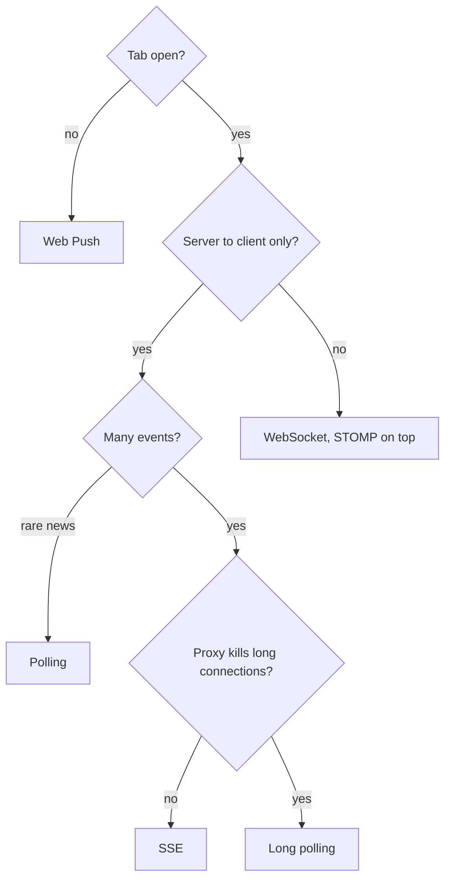
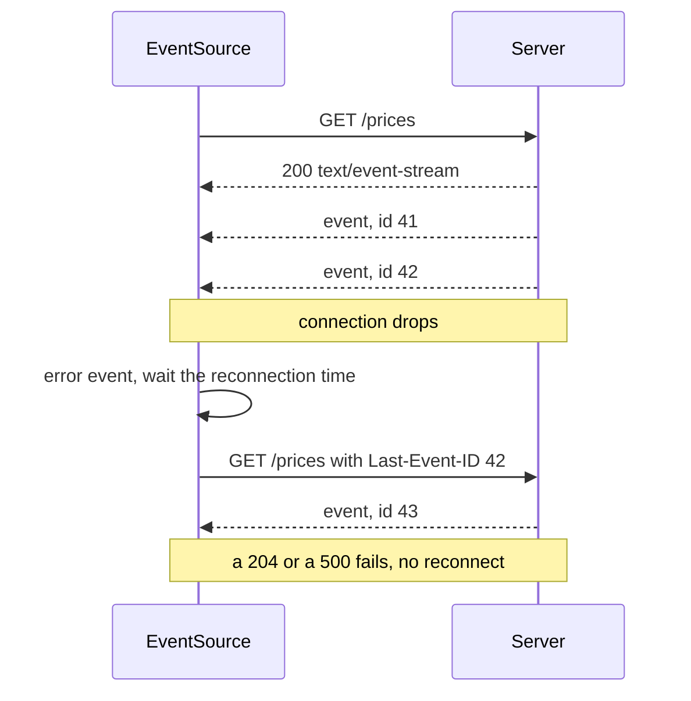
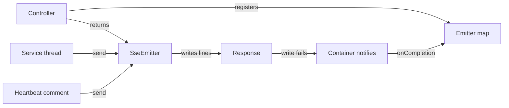
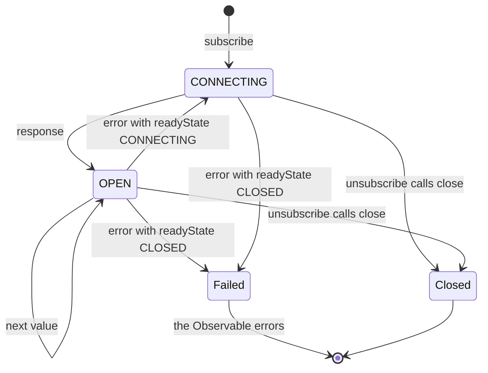
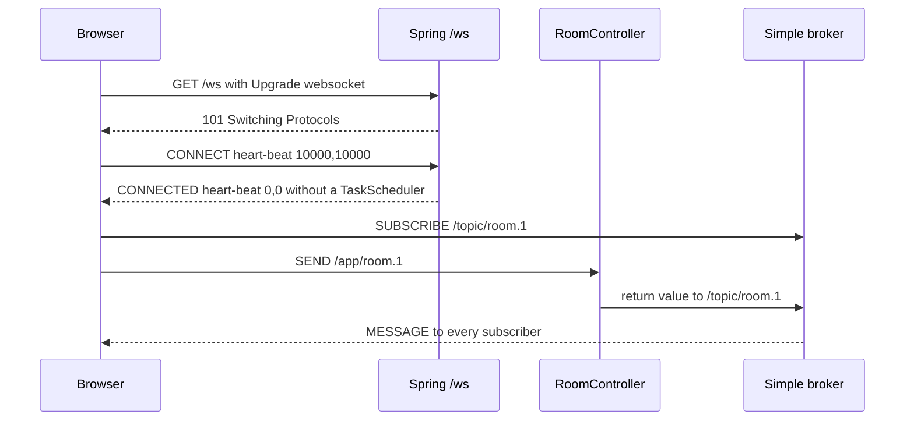
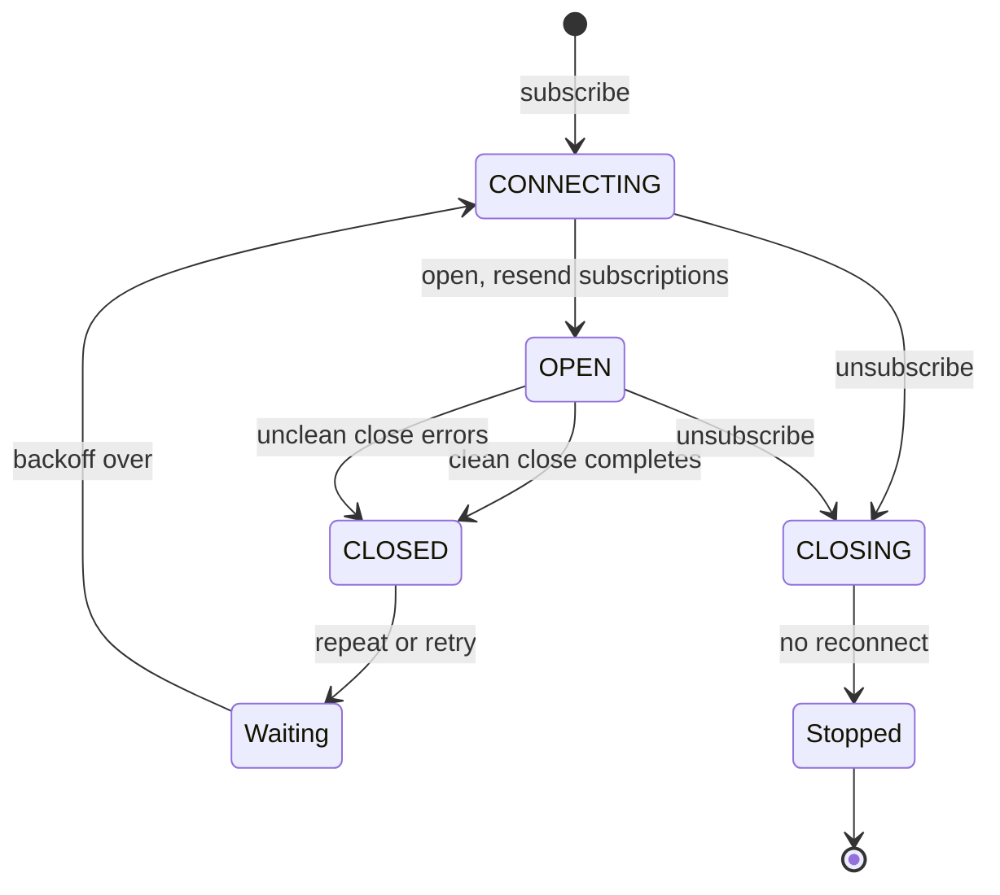
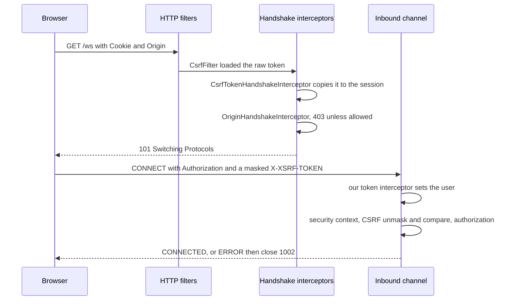
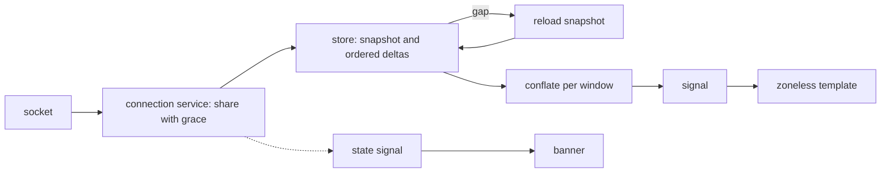
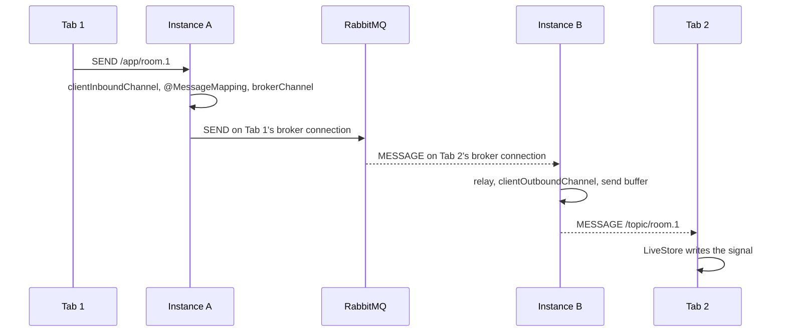

# 43. Full-stack real time: polling, Server-Sent Events and WebSockets with Angular and Spring

> **What this covers:** pushing data from Spring Boot services to an Angular client as it happens: choosing among polling, long polling, Server-Sent Events, WebSockets and Web Push; the `text/event-stream` format and `EventSource` reconnection; `SseEmitter` and `Flux<ServerSentEvent>`; an Angular SSE client; STOMP over WebSocket with `@stomp/rx-stomp` and RxJS `webSocket`; authentication on the handshake; streams into signals; and scaling out with a broker relay and backpressure.
> **Prerequisites:** [23. Retrying and repeating](23-rxjs-in-depth.md#4-retrying-and-repeating-retry-with-backoff-and-repeat), [23. Multicasting in depth](23-rxjs-in-depth.md#5-multicasting-in-depth-share-configuration-sharereplay-and-connect), [23. RxJS and signals](23-rxjs-in-depth.md#7-rxjs-and-signals-decision-rules-tosignal-toobservable-and-rxresource), [23. Angular patterns: polling](23-rxjs-in-depth.md#8-angular-patterns-typeahead-polling-cache-then-network-and-racing-requests), [41. CORS on both sides](41-fullstack-api-contracts.md#1-cors-on-both-sides-springs-corsconfigurationsource-spring-security-preflight-caching-credentials-and-the-dev-proxy)
> **Leads to:** [44. Full-stack delivery and operations](44-fullstack-delivery-and-operations.md), [46. System design case studies](46-system-design-case-studies.md)
> **Applies to:** Angular 22.2 (`@angular/core` and `@angular/common` 22.2.1, RxJS 7.8.2 in `labs/angular`); TypeScript 6.0 and Node 24 streams in `labs/ts-js`; documented only: Spring Boot 4.1.1, Spring Framework 7.0.9, Spring Security 7.1.1, `@stomp/rx-stomp` 2.4.0, `@stomp/stompjs` 7.5.0; the WHATWG HTML Living Standard, RFC 6455 and STOMP 1.2; reads 2026-10-21
> **Study time:** ~3 hours reading + ~3 hours exercises
> **Short on time:** read [§1](#1-choosing-a-transport-polling-long-polling-server-sent-events-websockets-and-web-push-when-no-tab-is-open), [§2](#2-server-sent-events-on-the-wire-the-textevent-stream-format-and-how-eventsource-reconnects) and [§7](#7-authentication-on-the-handshake-cookies-tokens-in-the-connect-frame-origin-checks-and-csrf-in-spring-security), then [Q43.01](#q43-01), [Q43.05](#q43-05), [Q43.11](#q43-11), [Q43.15](#q43-15), [Q43.18](#q43-18) and [Q43.19](#q43-19), then the [Summary](#summary).
> **Labs:** [`labs/angular/src/app/modules/43-fullstack-realtime/`](../labs/angular/src/app/modules/43-fullstack-realtime/) and [`labs/ts-js/src/modules/43-fullstack-realtime/`](../labs/ts-js/src/modules/43-fullstack-realtime/). Run (Node 24): from `labs/angular`, `npx ng test --watch=false --include='src/app/modules/43-fullstack-realtime/**/*.spec.ts'`; from `labs/ts-js`, `npx vitest run src/modules/43-fullstack-realtime src/outputs/43-fullstack-realtime`.

## Contents

1. [Choosing a transport: polling, long polling, Server-Sent Events, WebSockets, and Web Push when no tab is open](#1-choosing-a-transport-polling-long-polling-server-sent-events-websockets-and-web-push-when-no-tab-is-open)
2. [Server-Sent Events on the wire: the `text/event-stream` format and how `EventSource` reconnects](#2-server-sent-events-on-the-wire-the-textevent-stream-format-and-how-eventsource-reconnects)
3. [Server-Sent Events in Spring: `SseEmitter` in Spring MVC and a `Flux` of `ServerSentEvent` in WebFlux](#3-server-sent-events-in-spring-sseemitter-in-spring-mvc-and-a-flux-of-serversentevent-in-webflux)
4. [The Angular SSE client: `EventSource` or a `fetch` stream as an Observable, and when `HttpClient` fits](#4-the-angular-sse-client-eventsource-or-a-fetch-stream-as-an-observable-and-when-httpclient-fits)
5. [WebSockets and STOMP in Spring: the handshake, frames, `@MessageMapping`, brokers, user destinations and heart-beats](#5-websockets-and-stomp-in-spring-the-handshake-frames-messagemapping-brokers-user-destinations-and-heart-beats)
6. [The Angular WebSocket client: RxJS `webSocket`, `@stomp/rx-stomp` and reconnecting without losing subscriptions](#6-the-angular-websocket-client-rxjs-websocket-stomprx-stomp-and-reconnecting-without-losing-subscriptions)
7. [Authentication on the handshake: cookies, tokens in the `CONNECT` frame, origin checks and CSRF in Spring Security](#7-authentication-on-the-handshake-cookies-tokens-in-the-connect-frame-origin-checks-and-csrf-in-spring-security)
8. [From streams to signals: one shared connection, `toSignal` and `rxResource`, bursts and connection state](#8-from-streams-to-signals-one-shared-connection-tosignal-and-rxresource-bursts-and-connection-state)
9. [Scaling out and under the hood: sticky sessions, the broker relay, backpressure, and one message traced across two instances](#9-scaling-out-and-under-the-hood-sticky-sessions-the-broker-relay-backpressure-and-one-message-traced-across-two-instances)
- [Summary](#summary)
- [Question bank](#question-bank)
- [Hands-on exercises](#hands-on-exercises)
- [Check your understanding](#check-your-understanding)
- [Connections](#connections)

**How this module was checked.** Run: Vitest in Node 24 for our transport model, event-stream parser, STOMP codec, handshake guard and broker; `ng test` (jsdom, fake timers) for the SSE client over a fake `EventSource`, RxJS `webSocket` and the stream-to-signal store. Read, not run: Spring Framework 7.0.9, Boot 4.1.1 and Security 7.1.1 at their tags; `@stomp/rx-stomp` 2.4.0 and `@stomp/stompjs` 7.5.0; the WHATWG, RFC, STOMP and Web Push specifications, dated in [SOURCES.md](../SOURCES.md). No test opens a real connection.

## 1. Choosing a transport: polling, long polling, Server-Sent Events, WebSockets, and Web Push when no tab is open

### The problem it solves

A badge polls every two seconds and 90% of the answers are empty. A one-way feed gets WebSockets and hand-built reconnection. A closed tab sees no alert.

### Mental model

**Polling** asks every N seconds ([23 §8](23-rxjs-in-depth.md#8-angular-patterns-typeahead-polling-cache-then-network-and-racing-requests)). **Long polling** holds a request until news or a timeout. **Server-Sent Events (SSE)** keep one HTTP response open for the server to write into. A **WebSocket** is one upgraded request that becomes a **full duplex** channel: both sides send freely. A radio against a shared phone line.

**Web Push** reaches a closed tab through the **push service**, the browser vendor's server ([37 §7](37-elements-pwa-errors-ecosystem.md#7-push-notifications-and-installability-swpush-notification-clicks-and-the-manifest)). `EventSource` [Baseline 2020: widely available, per MDN] and `WebSocket` [Baseline 2015: widely available, per MDN] (*widely available*: all major browsers, 2.5+ years, [MDN](https://developer.mozilla.org/en-US/docs/Glossary/Baseline/Compatibility)).



What to notice: most one-way feeds end at SSE.

### How it actually works

- **Why is long polling slower than it looks?** RFC 6202 §2.2: after each answer the server waits for the next request, so latency peaks "over three" transits.
- **What comes free?** WHATWG §9.2: the browser reconnects with `Last-Event-ID`. RFC 6455 §1.5: a WebSocket, beyond origin, framing and closing, "adds nothing".

### Code

1. Our `longPolling` needs two transits to get the next request, so an event in that gap waits; `stream` costs one request.
2. The endpoint answers an empty list on timeout, otherwise a timeout is a 503. Its 30 seconds is explicit, not the server's (Tomcat 11: 30,000 ms).
3. Web Push, read not run, is plain HTTP: `TTL` (lifetime in seconds; 400 without it, RFC 8030 §5.2), an `aes128gcm` body (RFC 8291) and a VAPID (voluntary application server identification) JWT whose `exp` is within 24 hours (RFC 8292 §2).

```ts
// Excerpt of labs/ts-js/src/modules/43-fullstack-realtime/concepts/transport-model.ts
/**
 * The server holds each request until an event or the timeout. After an answer leaves, the client's next request
 * needs two more transits to arrive, and an event in that gap waits for it (RFC 6202 section 2.2, "Maximal Latency").
 * An answer carries every event that has happened by then, as the RFC allows ("delivered in a batch").
 */
function longPolling(scenario: Scenario): Cost {
  const { durationSeconds, eventTimes, transitSeconds, longPollTimeoutSeconds } = scenario;
  const latencies: number[] = [];
  let requests = 0;
  let emptyAnswers = 0;
  let next = 0;
  let arrivesAt = transitSeconds;
  for (;;) {
    const deadline = arrivesAt + longPollTimeoutSeconds;
    const pending = eventTimes[next];
    const hasNews = pending !== undefined && pending <= deadline;
    const answersAt = hasNews ? Math.max(pending, arrivesAt) : deadline;
    if (answersAt > durationSeconds) break;
    requests += 1;
    if (!hasNews) emptyAnswers += 1;
    for (let at = eventTimes[next]; at !== undefined && at <= answersAt; at = eventTimes[next]) {
      latencies.push(answersAt + transitSeconds - at);
      next += 1;
    }
    arrivesAt = answersAt + 2 * transitSeconds;
  }
  return { requests, emptyAnswers, latencies };
}

/** One request opens the stream (an SSE response, or the WebSocket upgrade); each event then travels one way. */
function stream(scenario: Scenario): Cost {
  const { durationSeconds, eventTimes, transitSeconds } = scenario;
  const inWindow = eventTimes.filter((at) => at <= durationSeconds);
  return { requests: 1, emptyAnswers: 0, latencies: inWindow.map(() => transitSeconds) };
}
```

```java
// Spring Boot 4.1 — illustrative, not compiled in labs
@RestController
class NotificationController {

    private final Queue<DeferredResult<List<Notification>>> waiting = new ConcurrentLinkedQueue<>();

    @GetMapping("/notifications/poll")
    DeferredResult<List<Notification>> poll() {
        DeferredResult<List<Notification>> result = new DeferredResult<>(30_000L);
        result.onTimeout(() -> result.setResult(List.of()));
        result.onCompletion(() -> waiting.remove(result));
        waiting.add(result);
        return result;
    }

    void publish(List<Notification> news) {
        waiting.forEach((result) -> result.setResult(news));
    }
}
```

```text
POST /push/JzLQ3raZJfFBR0aqvOMsLrt54w4rJUsV HTTP/1.1
Host: push.example.net
TTL: 30
Content-Encoding: aes128gcm
Authorization: vapid t=<ES256 JWT with aud, exp, sub>, k=<public key>

<encrypted payload>

HTTP/1.1 201 Created
Location: https://push.example.net/message/qDIYHNcfAIPP_5ITvURr-d6BGt
```

Tests: `Section 1: polling every 2 s for an hour makes 1800 requests whatever the number of events`, `Section 1: long polling makes one request per delivered event plus one per timeout`, `Section 1: an event that arrives while a long poll is re-requesting waits for the next request`, `Section 1: a stream pays one request for any number of events`.

### Best practices and anti-patterns

- **Ask who must send**, because a one-way feed needs no WebSocket extras.

### Misconceptions and traps

- "WebSockets are always the modern choice." SSE resumes for one-way feeds. Cause: they are the best-known push technology.
- "SSE allows six connections." Only under HTTP/1.1, where browsers cap each server at 6 or 8, the **per-host connection limit** (RFC 6202 §5.1); HTTP/2 multiplexes ([09 §3](09-web-networking-storage-security.md#3-http11-http2-and-http3)). Cause: MDN's warning is prominent.
- "Long polling is slow polling." It answers at once. Cause: both re-request.
- "Web Push replaces a live connection." It needs permission, passes through the push service and may arrive late, up to its `TTL`. Cause: it reaches closed tabs, so it looks like a superset.

Drilled in [Q43.01](#q43-01), [Q43.02](#q43-02) and [Q43.03](#q43-03).

## 2. Server-Sent Events on the wire: the `text/event-stream` format and how `EventSource` reconnects

### The problem it solves

An event without a blank line never fires. A deploy's 500 ends every client; a drop reconnects. `retry: 5s` does nothing.

### Mental model

An **event stream** is UTF-8 `name: value` lines (**fields**). `data` appends a line to the **data buffer**; `event` sets the **event type** (default `message`); a blank line **dispatches**. `id` sets the **last event ID**, sent back as **`Last-Event-ID`** on reconnect; `retry` sets the **reconnection time** (ms). A `:` **comment line** "every 15 seconds or so" is a **heartbeat** for proxies (§9.2.7). A ticker tape: gaps end messages, numbers resume.



What to notice: the client carries the resume point.

### How it actually works

- **Why does a 500 stop `EventSource`, but a drop does not?** WHATWG HTML §9.2.2: a network error or the body's end "reestablish[es] the connection"; response step 3, a non-200 status or another `Content-Type`, "fail[s] the connection", then "does not attempt to reconnect" (§9.2.3). After `error`, **`readyState`** reads `CONNECTING` (retrying) or `CLOSED` (failed).

### Code

1. The spec's example (§9.2.6): a bare `id` resets the last event ID; one space is stripped; the last block needs a blank line.
2. Our `createSseParser` keeps the partial line and a trailing CR, because a chunk may split a CRLF.
3. Our `nextStep` is pure, so it is testable without a socket.

```text
: test stream

data: first event
id: 1

data:second event
id

data:  third event
```

```ts
// Excerpt of labs/ts-js/src/modules/43-fullstack-realtime/concepts/sse-parser.ts
  function processField(field: string, value: string): void {
    if (field === 'event') eventType = value;
    else if (field === 'data') data += value + LF;
    else if (field === 'id' && !value.includes('\0')) idBuffer = value;
    else if (field === 'retry' && DIGITS_ONLY.test(value)) reconnectionTime = Number.parseInt(value, 10);
  }

  function push(chunk: string): void {
    if (chunk === '') return;
    let text = started || !chunk.startsWith(BOM) ? chunk : chunk.slice(1);
    started = true;
    // A CR that ended the previous chunk already ended its line, so an LF here is the rest of that CRLF, not a
    // blank line (which would dispatch).
    if (afterCr && text.startsWith(LF)) text = text.slice(1);
    afterCr = false;
    let lineStart = 0;
    for (let i = 0; i < text.length; i += 1) {
      const char = text[i];
      if (char !== CR && char !== LF) continue;
      processLine(partialLine + text.slice(lineStart, i));
      partialLine = '';
      if (char === CR && text[i + 1] === LF) i += 1;
      else afterCr = char === CR && i === text.length - 1;
      lineStart = i + 1;
    }
    partialLine += text.slice(lineStart);
  }
```

```ts
// Excerpt of labs/ts-js/src/modules/43-fullstack-realtime/concepts/sse-reconnect.ts
function onResponse(status: number, contentType: string | null): NextStep {
  // A 204 takes the same step as a 500: "fail the connection". Only the reason we record differs.
  if (status === NO_CONTENT) return fail('stop-requested');
  if (status !== OK) return fail('status');
  if (mimeEssence(contentType) !== EVENT_STREAM) return fail('content-type');
  return { action: 'open', readyState: 'OPEN' };
}

function reconnect(state: SourceState): NextStep {
  const headers: Record<string, string> = state.lastEventId === '' ? {} : { 'Last-Event-ID': state.lastEventId };
  return { action: 'reconnect', readyState: 'CONNECTING', afterMs: state.reconnectionTime, headers };
}
```

Tests: `Section 2: the WHATWG example stream dispatches three events and the bare id resets the last event ID`, `Section 2: a CRLF split across two chunks ends one line, not two`, `Section 2: an event with no blank line before the end of the stream is discarded`, `Section 2: retry with a non-digit value is ignored`, `Section 2: a dropped connection reconnects with Last-Event-ID, a 204 stops and a 500 fails without reconnecting`.

### Best practices and anti-patterns

- **Give every event an `id`**, because resuming starts from it ([§3](#3-server-sent-events-in-spring-sseemitter-in-spring-mvc-and-a-flux-of-serversentevent-in-webflux)).
- **Recreate a `CLOSED` source with backoff** ([23 §4](23-rxjs-in-depth.md#4-retrying-and-repeating-retry-with-backoff-and-repeat)), because the browser will not.

### Misconceptions and traps

- "Each `data` line is an event." They join until a blank line. Cause: demos send one line per event.
- "`EventSource` retries every error." Non-200 fails for good. Cause: development shows drops, which reconnect.
- "`retry: 5s` is five seconds." Digits only, milliseconds. Cause: other configurations take units.
- "Resuming needs a server session." The client sends `Last-Event-ID`. Cause: "resume" sounds like a session.

Drilled in [Q43.04](#q43-04) and [Q43.05](#q43-05); practised in [Exercise 43.1](#ex43-1).

## 3. Server-Sent Events in Spring: `SseEmitter` in Spring MVC and a `Flux` of `ServerSentEvent` in WebFlux

### The problem it solves

An `SseEmitter` endpoint works locally; staging clients are cut at 30 seconds. Emitters pile up. Closed tabs go unnoticed. After a deploy, `Last-Event-ID` is ignored.

### Mental model

A controller returns an **`SseEmitter`**: the request goes **async** (the thread returns, the response stays open) and any thread calls `send`. The **async request timeout** is the emitter's, else MVC's, else the container's. **WebFlux**, the reactive stack, returns a `Flux` of **`ServerSentEvent`**. A presenter learns a listener left only when a broadcast fails.



What to notice: a write shows a gone client.

### How it actually works

- **Why is a closed tab invisible?** "The Servlet API does not provide any notification when a remote client goes away" (`mvc-ann-async.adoc`), so a **heartbeat comment** (a comment-only event) forces a failing write; WebFlux's reference agrees.
- **Why 30 seconds?** Unset, MVC's timeout (`spring.mvc.async.request-timeout`), else the server's: Tomcat 11, 30000 ms (`asyncTimeout`).
- **Not a download.** A streamed file ([41 §8](41-fullstack-api-contracts.md#8-files-multipart-and-chunked-uploads-progress-and-downloads-with-content-disposition-and-streaming)) ends when its bytes do; an event stream stays open for events that have not happened yet, so it needs ids, heartbeats and reconnection.

### Code

1. MVC: an explicit timeout, because the container's default decides; an **emitter registry** (a map) cleaned in `onCompletion`, because reloads pile up; a comment heartbeat.
2. WebFlux: `ServerSentEvent.builder`; only the comment event appears, as the docs show no merge.
3. `formatEvent` mirrors the internal `SseEventBuilderImpl` and `SseUtils`: a `data` line break starts another `data:` line. The **event log** (a replay buffer) returns events or `too-old`, never a gap.

```java
// Spring Boot 4.1 — illustrative, not compiled in labs
@RestController
class PriceStreamController {

    private final PriceEventLog log; // ours: a bounded log, like event-log.ts
    private final Map<String, SseEmitter> emitters = new ConcurrentHashMap<>();

    PriceStreamController(PriceEventLog log) {
        this.log = log;
    }

    @GetMapping(path = "/prices/stream", produces = MediaType.TEXT_EVENT_STREAM_VALUE)
    SseEmitter stream(@RequestHeader(name = "Last-Event-ID", required = false) String lastEventId)
            throws IOException {
        SseEmitter emitter = new SseEmitter(300_000L); // explicit: the container's default does not decide
        String key = UUID.randomUUID().toString();
        emitters.put(key, emitter);
        emitter.onCompletion(() -> emitters.remove(key)); // also runs after a timeout or a network error
        // Not shown: order replay before live sends (hold a lock, or queue live events until replay ends).
        if (log.isTooOld(lastEventId)) {
            emitter.send(SseEmitter.event().name("reload").data(""));
        } else {
            for (PriceEvent event : log.since(lastEventId)) {
                emitter.send(SseEmitter.event().id(event.id()).name("price").data(event.price()));
            }
        }
        return emitter;
    }

    void publish(PriceEvent event) {
        log.append(event);
        sendToAll(() -> SseEmitter.event().id(event.id()).name("price").data(event.price()));
    }

    @Scheduled(fixedRate = 15_000)
    void heartbeat() {
        sendToAll(() -> SseEmitter.event().comment("keepalive"));
    }

    // One builder per emitter: build() appends to the builder's own state.
    private void sendToAll(Supplier<SseEmitter.SseEventBuilder> event) {
        emitters.values().forEach((emitter) -> {
            try {
                emitter.send(event.get());
            }
            catch (IOException | IllegalStateException ex) {
                // A failed write is how a gone client shows: the container's notification completes the request.
            }
        });
    }
}
```

```java
// Spring Boot 4.1 — illustrative, not compiled in labs
@RestController
class PriceFluxController {

    // A comment-only event. The docs advise sending one periodically; merging it into the flux is not shown.
    static final ServerSentEvent<Price> HEARTBEAT = ServerSentEvent.<Price>builder().comment("keepalive").build();

    private final PriceFeed feed; // ours: a Flux of PriceEvent, the log's missed events first

    PriceFluxController(PriceFeed feed) {
        this.feed = feed;
    }

    @GetMapping(path = "/prices/flux", produces = MediaType.TEXT_EVENT_STREAM_VALUE)
    Flux<ServerSentEvent<Price>> stream(@RequestHeader(name = "Last-Event-ID", required = false) String lastEventId) {
        return feed.since(lastEventId).map((event) ->
                ServerSentEvent.builder(event.price()).id(event.id()).event("price").build());
    }
}
```

```ts
// Excerpt of labs/ts-js/src/modules/43-fullstack-realtime/concepts/sse-format.ts
function fieldLines(field: string, value: string): string {
  return `${field}:${value.split(LINE_BREAK).join(`\n${field}:`)}`;
}

export function formatEvent(event: EmitterEvent): string {
  const { id, name, reconnectTimeMs, comment, data } = event;
  const lines: string[] = [];
  if (id !== undefined) lines.push(`id:${singleLine(id)}`);
  if (name !== undefined) lines.push(`event:${singleLine(name)}`);
  if (reconnectTimeMs !== undefined) lines.push(`retry:${reconnectTimeMs}`);
  if (comment !== undefined) lines.push(fieldLines('', comment));
  if (data !== undefined) lines.push(fieldLines('data', data));
  return lines.length === 0 ? '' : `${lines.join('\n')}\n\n`;
}
```

```ts
// Excerpt of labs/ts-js/src/modules/43-fullstack-realtime/concepts/event-log.ts
  since(lastEventId: string): Replay {
    if (lastEventId === '') return { kind: 'events', events: [] };
    const seen = Number(lastEventId);
    const oldestKept = this.lastId - this.events.length + 1;
    const complete = /^\d+$/.test(lastEventId) && seen >= oldestKept - 1 && seen <= this.lastId;
    if (!complete) return { kind: 'too-old' };
    return { kind: 'events', events: this.events.filter((event) => Number(event.id) > seen) };
  }

export function resume(log: EventLog, lastEventId: string): string {
  const replay = log.since(lastEventId);
  if (replay.kind === 'too-old') return formatEvent({ name: 'reload', data: '' });
  return replay.events.map((event) => formatEvent(event)).join('');
}
```

```text
id:42
event:price
data:{"symbol":"ACME","price":101.5}

:keepalive

```

Tests: `Section 3: our SseEmitter-style lines parse back into the same id, event and data`, `Section 3: a multi-line data value becomes several data lines and parses back to one value`, `Section 3: the event log replays only events after Last-Event-ID`, `Section 3: a Last-Event-ID older than the log returns too-old instead of a partial replay`.

> [!TIP]
> **Coming from the backend.** The handler wraps each `SseEmitter` in a `DeferredResult` with its timeout ([§1](#1-choosing-a-transport-polling-long-polling-server-sent-events-websockets-and-web-push-when-no-tab-is-open)): many writes, one completion. **Where the analogy breaks:** the browser reconnects with `Last-Event-ID`, so the server tolerates a repeated id, and a proxy may cut the stream ([44](44-fullstack-delivery-and-operations.md#4-nginx-as-the-reverse-proxy-proxy_pass-forwarded-headers-into-spring-boot-and-sse-or-websocket-connections-through-the-proxy)).

### Best practices and anti-patterns

- **Heartbeat every 15 seconds**, because a write is the only test.

### Misconceptions and traps

- "No timeout means no limit." The default applies. Cause: "unset" reads as infinite.
- "The server sees the tab close." Only a failed write shows it. Cause: TCP closes, so it feels observable.
- "Spring handles `Last-Event-ID`." The handler must replay. Cause: browsers send it unprompted.

Drilled in [Q43.06](#q43-06), [Q43.07](#q43-07) and [Q43.08](#q43-08).

## 4. The Angular SSE client: `EventSource` or a `fetch` stream as an Observable, and when `HttpClient` fits

### The problem it solves

A component opens an `EventSource` in `ngOnInit` and never closes it: without HTTP/2 the sixth stalls the app ([§1](#1-choosing-a-transport-polling-long-polling-server-sent-events-websockets-and-web-push-when-no-tab-is-open)). The endpoint needs `Authorization: Bearer`, which `EventSource` cannot send. `HttpClient` streaming grows memory. Plain fields never render without zone.js ([21 §5](21-change-detection.md#5-zoneless-change-detection-the-scheduler-its-triggers-and-pendingtasks)).

### Mental model

Angular has no SSE API (`@angular/common` and `@angular/core` 22.2.1 never mention `EventSource`). The client wraps a platform source in a cold Observable ([22 §3](22-rxjs-foundations.md#3-cold-and-hot-unicast-and-multicast)): each subscriber opens one, teardown closes it. **`EventSource`** reconnects itself but sends no headers, only cookies (`withCredentials`). **`fetch`** ([09 §2](09-web-networking-storage-security.md#2-fetch-xhr-and-the-request-lifecycle)) sends any header and stops through an `AbortController` [Baseline 2019: widely available, per MDN], but reconnecting is yours. **`HttpClient` progress** ([27 §9](27-http-client.md#9-progress-events-reportuploadprogress-reportdownloadprogress-and-why-upload-progress-needs-xhr)) holds the body. A radio re-tunes alone; a call you dial lets you say who you are.



What to notice: `error` alone emits nothing; only `CLOSED` errors the Observable.

### How it actually works

- **Why not `HttpClient`?** `FetchBackend` (read) keeps every chunk and parses at the end; `partialText` is the text so far, so memory grows.
- **Why no headers?** WHATWG HTML §9.2 (read 2026-10-21): the constructor takes a URL and `{ withCredentials }`.
- **Why abort ourselves?** RxJS 7.8.2 (`innerFrom.ts` and `isReadableStreamLike.ts`, read): `from(stream)`'s reader path never calls `cancel()`.

### Code

1. `fromEventSource` builds the source inside `subscribe`, so each subscriber owns one, listens for `message` and listed **named events** (an `event:` field reaches only its own listeners), errors only at `CLOSED`, and closes in teardown.

```ts
// Excerpt of labs/angular/src/app/modules/43-fullstack-realtime/concepts/sse-client.ts
export function fromEventSource(url: string, options: EventSourceOptions = {}): Observable<SseMessage> {
  const { withCredentials = false, events = [], factory = browserSource } = options;
  return new Observable<SseMessage>((subscriber) => {
    const source = factory(url, { withCredentials });
    for (const type of ['message', ...events]) {
      source.addEventListener(type, (event) => {
        if (event instanceof MessageEvent) {
          subscriber.next({ type: event.type, data: String(event.data), lastEventId: event.lastEventId });
        }
      });
    }
    // `error` fires for a reconnect and for a failure; only CLOSED means the browser gave up.
    source.addEventListener('error', () => {
      if (source.readyState === CLOSED) subscriber.error(new Error(`EventSource to ${url} failed`));
    });
    return () => source.close();
  });
}
```

2. `fromFetchStream` sends headers and an abort signal, decodes with a `TextDecoderStream` [Baseline 2022: widely available, per MDN] (bytes in, text out) and parses with an LF-only subset of §2's parser. Teardown aborts the request.

```ts
// Excerpt of labs/angular/src/app/modules/43-fullstack-realtime/concepts/sse-client.ts
export function fromFetchStream(fetchFn: FetchFn, url: string, headers: Record<string, string> = {}): Observable<SseMessage> {
  return new Observable<SseMessage>((subscriber) => {
    const aborter = new AbortController();
    pump(fetchFn, url, headers, aborter.signal, (message) => subscriber.next(message)).then(
      () => subscriber.complete(),
      (error: unknown) => {
        if (!aborter.signal.aborted) subscriber.error(error);
      },
    );
    return () => aborter.abort();
  });
}

async function pump(
  fetchFn: FetchFn,
  url: string,
  headers: Record<string, string>,
  signal: AbortSignal,
  onMessage: (message: SseMessage) => void,
): Promise<void> {
  const response = await fetchFn(url, { headers, signal });
  if (!response.ok || response.body === null) throw new Error(`SSE request failed with status ${response.status}`);
  const reader = response.body.pipeThrough(new TextDecoderStream()).getReader();
  const parse = lineParser(onMessage);
  for (let chunk = await reader.read(); !chunk.done; chunk = await reader.read()) parse(chunk.value);
}
```

3. The component opens it in `afterNextRender` ([32 §7](32-ssr-ssg-hydration.md#7-platform-safe-code-browser-apis-afternextrender-document-request-and-response_init)), so a server render builds no `EventSource`, and reads it with `toSignal`.

```ts
// Excerpt of labs/angular/src/app/modules/43-fullstack-realtime/concepts/sse-client.ts
/** Opens the stream after the first render, so a server render never constructs an `EventSource`. */
@Component({ selector: 'lab-m43-live-value', template: `<p>{{ latest()?.data ?? 'waiting' }}</p>` })
export class LabM43LiveValue {
  private readonly injector = inject(Injector);
  private readonly factory = inject(LAB_M43_SSE_FACTORY);
  private readonly source = signal<Signal<SseMessage | undefined> | undefined>(undefined);
  protected readonly latest = computed(() => this.source()?.());

  constructor() {
    afterNextRender(() => {
      const stream = fromEventSource('/api/prices', { events: ['price'], factory: this.factory });
      this.source.set(toSignal(stream, { injector: this.injector }));
    });
  }
}
```

Tests (our `FakeEventSource`; jsdom has none): `Section 4: unsubscribing closes the EventSource`, `Section 4: a named event reaches the subscriber only when it is listed`, `Section 4: an error while reconnecting emits nothing and a closed source errors the Observable`, `Section 4: the fetch stream sends the Authorization header and aborts on unsubscribe` and `Section 4: a value from the stream updates a zoneless component's signal`.

> [!NOTE]
> **Framework vs platform.** `fetch` [Baseline 2017: widely available, per MDN] and `ReadableStream` [Baseline 2019: widely available, per MDN] are the platform's (MDN, read 2026-10-21); Angular adds progress events and `toSignal`.

### Best practices and anti-patterns

- **Create the source inside `subscribe`**, because one made outside is never closed.

### Misconceptions and traps

- "`EventSource` takes headers." Only `withCredentials`. Cause: every other request API does.
- "`error` means dead." Only `CLOSED`. Cause: elsewhere an error ends a request, but here the browser retries.
- "`HttpClient` streams like `fetch`." Its text is cumulative. Cause: progress events look like chunks.
- "A destroyed component unsubscribes." Only `async` and `toSignal` ([23 §6](23-rxjs-in-depth.md#6-unsubscription-strategies-in-angular-and-finding-leaks)). Cause: they hide the cleanup.

Drilled in [Q43.09](#q43-09) and [Q43.10](#q43-10); practised in [Exercise 43.1](#ex43-1).

## 5. WebSockets and STOMP in Spring: the handshake, frames, `@MessageMapping`, brokers, user destinations and heart-beats

### The problem it solves

Raw WebSocket chat grows a home-made `type` field and router. A reply for one user reaches the room. A dead connection goes unnoticed after `heart-beat:0,0`.

### Mental model

The **opening handshake** is a `GET` with `Upgrade: websocket` answered **`101 Switching Protocols`** (RFC 6455 §1.3). **Frames** (units of data) then flow: "a client MUST mask all frames" (**masking**: XOR with a random key); "A server MUST NOT mask" (§5.1, abridged). A **close code** (1000: normal, §7.4.1) ends it. **STOMP** 1.2 wraps a command, headers and a NULL-ended body, addressed by a **destination** header. Line, envelope, sorting office: WebSocket, STOMP, Spring.



What to notice: the client asked for heart-beats; the server's answer cancelled them.

### How it actually works

- **Routing.** `/app`, the **application destination prefix**, goes (stripped) to **`@MessageMapping`** methods, chosen by destination; `/topic` and `/queue` go to the **simple broker**: in memory, no "acks, receipts", one instance (Spring docs, v7.0.9); the broker relay ([§9](#9-scaling-out-and-under-the-hood-sticky-sessions-the-broker-relay-backpressure-and-one-message-traced-across-two-instances)) replaces it. A **user destination** (`/user/queue/errors`) means one per session of the user; **`@SendToUser`** targets it.
- **Why `0,0`?** A **heart-beat** is a bare EOL; each direction runs every "MAX(<cx>,<sy>)", none if either is 0 (STOMP 1.2). Without a `TaskScheduler`, `SimpleBrokerMessageHandler` has no value, so `StompSubProtocolHandler` answers `0,0`. stompjs 7.5.0 (read, not run) sends every max(own out, server in), closes once silence passes max(own in, server out) × 2, checked once per interval; Spring waits 3× ([Q43.12](#q43-12)).
- **Sizes.** Spring accepts STOMP messages up to 64 KiB (`messageSizeLimit`) and reassembles split ones; its performance page says stompjs splits at 16K, but stompjs 7.5.0 splits only with `splitLargeFrames: true` (default `false`), into 8 KiB chunks.

### Code

1. Prefixes route; the broker gets Spring's `TaskScheduler` (`@Lazy` breaks a configuration cycle), or it sends no heart-beats. Origins: [§7](#7-authentication-on-the-handshake-cookies-tokens-in-the-connect-frame-origin-checks-and-csrf-in-spring-security).

```java
// Spring Boot 4.1 — illustrative, not compiled in labs
@Configuration
@EnableWebSocketMessageBroker
public class StompConfig implements WebSocketMessageBrokerConfigurer {

  private TaskScheduler messageBrokerTaskScheduler;

  @Autowired
  public void setMessageBrokerTaskScheduler(@Lazy TaskScheduler taskScheduler) {
    this.messageBrokerTaskScheduler = taskScheduler;
  }

  @Override
  public void registerStompEndpoints(StompEndpointRegistry registry) {
    registry.addEndpoint("/ws").setAllowedOriginPatterns("https://app.example.com");
  }

  @Override
  public void configureMessageBroker(MessageBrokerRegistry registry) {
    registry.setApplicationDestinationPrefixes("/app");
    registry.enableSimpleBroker("/topic", "/queue")
        .setTaskScheduler(this.messageBrokerTaskScheduler)
        .setHeartbeatValue(new long[] {10000, 10000});
  }
}
```

2. `@DestinationVariable` binds `id`; `@SendTo` broadcasts to `/topic/room.1`, also the default; the error handler answers only the sender.

```java
// Spring Boot 4.1 — illustrative, not compiled in labs
@Controller
public class RoomController {

  @MessageMapping("/room.{id}")
  @SendTo("/topic/room.{id}")
  public ChatMessage post(@DestinationVariable String id, ChatMessage message) {
    return message;
  }

  @MessageExceptionHandler
  @SendToUser(destinations = "/queue/errors", broadcast = false)
  public String onError(IllegalArgumentException error) {
    return error.getMessage();
  }
}
```

3. A `CONNECT` and a `MESSAGE` show that a frame is plain text a codec can read (`^@` is NULL):

```text
CONNECT
accept-version:1.2,1.1,1.0
host:app.example.com
heart-beat:10000,10000

^@
MESSAGE
destination:/topic/room.1
message-id:m-1
subscription:sub-0
content-type:application/json

{"text":"hi"}^@
```

4. Our codec (ours, not stompjs's or Spring's) applies the max rule:

```ts
// Excerpt of labs/ts-js/src/modules/43-fullstack-realtime/concepts/stomp-frame.ts
// One direction: none when the sender cannot send or the receiver does not want any, otherwise "MAX(<cx>,<sy>)".
function interval(senderCanSend: number, receiverWants: number): number {
  return senderCanSend === 0 || receiverWants === 0 ? 0 : Math.max(senderCanSend, receiverWants);
}

/** The STOMP 1.2 rule per direction; `tolerance` is stompjs's `heartbeatToleranceMultiplier` (default 2). */
export function negotiateHeartBeat(client: HeartBeat, server: HeartBeat, tolerance = 2): HeartBeatAgreement {
  const clientSendsEvery = interval(client[0], server[1]);
  const serverSendsEvery = interval(server[0], client[1]);
  return { clientSendsEvery, serverSendsEvery, clientGivesUpAfter: serverSendsEvery * tolerance };
}
```

Tests: the five `Section 5: …` cases in `section-5-stomp.test.ts`.

> [!TIP]
> **Coming from the backend.** `@MessageMapping` is `@RequestMapping` for messages; the simple broker is an in-process **fan-out** (a copy to every subscriber), like application events. **Where the analogy breaks:** no per-message request to load-balance, and a session stays on one instance for its socket's life ([§9](#9-scaling-out-and-under-the-hood-sticky-sessions-the-broker-relay-backpressure-and-one-message-traced-across-two-instances)).

### Best practices and anti-patterns

- **Give the simple broker a `TaskScheduler`**, because otherwise neither side detects a dead connection.

### Misconceptions and traps

- "WebSocket routes typed messages." Frames are opaque; STOMP adds destinations. Cause: tutorials add a JSON `type` field, so routing looks built in.
- "The simple broker is production-ready." No acks, one instance. Cause: it needs no setup.
- "Both sides heart-beat because the client asked." The server's answer decides. Cause: stompjs sends `10000,10000` by default.
- "`@SendTo` replies to the caller." It broadcasts. Cause: a return value feels like a response.
- Once true: **SockJS** (a fallback transport) covered browsers without WebSocket, which is widely available since 2015 (MDN); `sockjs-client` last shipped in 2022 (npm). Cause: Spring's docs still show `withSockJS()`.

Drilled in [Q43.11](#q43-11) and [Q43.12](#q43-12); practised in [Exercise 43.2](#ex43-2).

## 6. The Angular WebSocket client: RxJS `webSocket`, `@stomp/rx-stomp` and reconnecting without losing subscriptions

### The problem it solves

A deploy closes every socket and prices go stale: `webSocket` reconnects nothing and a clean close only completes the stream, so `retry` never fires. Reconnecting without resubscribing leaves a silent socket.

### Mental model

RxJS **`webSocket`** returns a **`WebSocketSubject`**, one Subject that is both ends of a socket. A **clean close** (the closing handshake finished, RFC 6455 §7.1.4) completes it; anything else errors it. A **close code** says why; 1006 is only reported locally, never sent (§7.4.1). **Reconnecting** is `retry` after an error and `repeat` after a complete, each after a **backoff** ([23 §4](23-rxjs-in-depth.md#4-retrying-and-repeating-retry-with-backoff-and-repeat)), plus **resubscription**: resending on every open what the server must know. `@stomp/rx-stomp` does this for STOMP (read, not run). A walkie-talkie versus a dispatcher's console.



What to notice: both closes return to `CONNECTING`; only an unsubscribe leaves.

### How it actually works

- **Why both operators?** RxJS 7.8.2 `WebSocketSubject.ts` (read): `onclose` completes when `wasClean`, else errors; `onerror` errors with its own `Event`.
- **Why our own counter?** `resetOnSuccess` resets on a value and `repeat` never resets (`retry.ts`, `repeat.ts`), so a quiet server keeps lengthening the wait.
- **rx-stomp 2.4.0** (`rx-stomp.ts`, read): `watch` re-subscribes on each connect, though gaps remain ([Q43.14](#q43-14)).

### Code

1. `liveSocket` resends `resubscribe()` in `openObserver` and resets the counter there, because an open is the success that matters. Frames sent before the open replay after `openObserver`, so the resubscription comes last. The four `Section 6: …` cases run it over our fake socket on fake timers.

```ts
// Excerpt of labs/angular/src/app/modules/43-fullstack-realtime/concepts/live-socket.ts
export function liveSocket<T>(config: LiveSocketConfig<T>): LiveSocket<T> {
  let attempt = 0;
  const subject = webSocket<T>({
    url: config.url,
    WebSocketCtor: config.WebSocketCtor,
    openObserver: {
      next: () => {
        attempt = 0;
        for (const message of config.resubscribe?.() ?? []) subject.next(message);
      },
    },
  });
  const wait = () => timer(backoffDelay(++attempt, config.backoff, config.random));
  return {
    messages$: subject.pipe(retry({ delay: wait }), repeat({ delay: wait })),
    send: (message) => subject.next(message),
  };
}
```

2. The rx-stomp setup leaves reconnecting, queueing and resubscribing to the library:

```ts
// Partial: read, not run (rx-stomp is not installed); `tokens` is an assumed service.
const rxStomp = new RxStomp();
rxStomp.configure({
  brokerURL: 'wss://app.example.com/ws',
  // A fresh token before every connection attempt, sent in the CONNECT frame (§7).
  beforeConnect: async (client) => client.configure({ connectHeaders: { Authorization: `Bearer ${await tokens.fresh()}` } }),
  reconnectDelay: 5000, // stompjs 7.5.0's default, written down so the policy is visible
  heartbeatIncoming: 10000, // only active when the server's CONNECTED answers non-zero (§5)
  heartbeatOutgoing: 10000,
});
rxStomp.activate();
rxStomp.watch({ destination: '/topic/prices' }).subscribe((frame) => render(frame.body)); // re-subscribes on each connect
rxStomp.publish({ destination: '/app/room.1', body: '{"text":"hi"}' }); // queued while offline
rxStomp.connectionState$.subscribe((state) => console.log(RxStompState[state])); // CONNECTING, OPEN, CLOSING, CLOSED
```

> [!NOTE]
> **Framework vs platform.** The browser's `WebSocket` queues and resubscribes nothing; RxJS or rx-stomp does. Angular has no WebSocket API (`core`, `common` and `platform-browser` 22.2.1 never mention it).

### Best practices and anti-patterns

- **Reconnect after a random, growing wait**, because RFC 6455 §7.2.3 says the first attempt "SHOULD be delayed by a random amount of time", so a deploy does not return every client at once.

### Misconceptions and traps

- "`retry` reconnects a WebSocket." Only after an error; a clean server close completes, so `repeat` is needed. Cause: over HTTP only failures end a request.
- "The error carries the close code." Only when no `error` event came first. Cause: `onclose` errors with the `CloseEvent`, so it seems the only path.

Drilled in [Q43.13](#q43-13) and [Q43.14](#q43-14); practised in [Exercise 43.2](#ex43-2).

## 7. Authentication on the handshake: cookies, tokens in the `CONNECT` frame, origin checks and CSRF in Spring Security

### The problem it solves

Angular's `Authorization` header skips the handshake; URL tokens land in logs. `CONNECT` gets "Invalid CSRF Token" despite `X-XSRF-TOKEN`. Other sites open sockets with the user's cookie; sockets outlive tokens.

### Mental model

`new WebSocket(url, protocols)` takes no headers (WebSockets Standard §3.1). A cookie gives the **handshake principal** (the upgrade request's user, kept per session); a query parameter "may be inadvertently logged" (Spring docs); a `CONNECT` header is read by a **`ChannelInterceptor`** (an inbound-message hook). Browsers exempt WebSocket from the same-origin policy (Security docs), so cookies ([33 §9](33-security.md#9-csrf-in-single-page-apps-when-cookies-make-you-vulnerable-samesite-and-angulars-xsrf-support)) allow **cross-site WebSocket hijacking**, another site opening the user's socket, unless the server runs an **origin check** (it "SHOULD verify the |Origin| field", RFC 6455 §10.2) and wants a **CSRF token on `CONNECT`**. Door ticket, hand stamp, origin-checking bouncer.



What to notice: only `CONNECT` carries the masked token.

### How it actually works

Read, not run (Security 7.1.1, Framework 7.0.9):

- **Why does the cookie value fail?** `XorCsrfChannelInterceptor.preSend` unmasks `X-XSRF-TOKEN` (`XorCsrfTokenUtils.getTokenValue`), then compares with the raw token `CsrfTokenHandshakeInterceptor` copied: `CONNECT` needs the **masked token** ([42 §6](42-fullstack-authentication.md#6-csrf-with-cookiecsrftokenrepository-and-angulars-xsrf-support-csrfspa-in-spring-security-7)), unlike `csrf.spa()` on HTTP. A raw UUID decodes to 27 bytes, not 72.
- **Docs versus source.** The reference: "CSRF is not configurable"; the internal `WebSocketMessageBrokerSecurityConfiguration` uses a `csrfChannelInterceptor` bean instead, which bearer-only APIs need, because without HTTP CSRF nothing is copied, so `CONNECT` fails.
- **Why `HIGHEST_PRECEDENCE + 99`?** Security's interceptors read the user, so yours is "ordered ahead" (Framework token docs).
- **Origin** must match the request's scheme, host and port unless allowed, so a TLS proxy needs `ForwardedHeaderFilter`; other clients fake it (Spring docs).

### Code

1. **`@EnableWebSocketSecurity`** (Spring Security for messages) swaps the default "authenticated" for **message authorization** (type and destination rules; first match wins); the docs' `CsrfToken` endpoint returns the masked token.

```java
// Spring Boot 4.1 — illustrative, not compiled in labs
@Configuration
@EnableWebSocketSecurity
public class StompSecurityConfig {

  @Bean
  AuthorizationManager<Message<?>> messageAuthorizationManager(
      MessageMatcherDelegatingAuthorizationManager.Builder messages) {
    messages
        .nullDestMatcher().authenticated() // anything but MESSAGE and SUBSCRIBE (Spring docs)
        .simpSubscribeDestMatchers("/user/queue/errors", "/topic/prices").authenticated()
        .simpDestMatchers("/app/**").hasRole("USER")
        .simpTypeMatchers(MESSAGE, SUBSCRIBE).denyAll() // no SEND straight to the broker
        .anyMessage().denyAll(); // no match also denies; this makes it explicit
    return messages.build();
  }
}

@RestController
class CsrfController {

  @GetMapping("/api/csrf")
  CsrfToken csrf(CsrfToken token) {
    return token; // masked by the XOR request handler, with or without csrf.spa()
  }
}
```

```ts
// Partial: read, not run; `http` is an injected HttpClient and `rxStomp` is section 6's, for a cookie session (this beforeConnect replaces the token one).
rxStomp.configure({
  beforeConnect: async (client) => {
    const csrf = await firstValueFrom(http.get<{ headerName: string; token: string }>('/api/csrf'));
    client.configure({ connectHeaders: { [csrf.headerName]: csrf.token } }); // X-XSRF-TOKEN: the masked value
  },
});
```

2. The `CONNECT` interceptor reuses the API's `JwtDecoder` ([42 §5](42-fullstack-authentication.md#5-spring-security-as-a-resource-server-validating-jwts-and-turning-scopes-into-authorities)), because `decode` rejects expired tokens; the empty bean overrides CSRF.

```java
// Spring Boot 4.1 — illustrative, not compiled in labs
@Configuration
@Order(Ordered.HIGHEST_PRECEDENCE + 99) // before Spring Security's interceptors read the user
public class StompTokenConfig implements WebSocketMessageBrokerConfigurer {

  private final JwtDecoder jwtDecoder;
  private final JwtAuthenticationConverter converter = new JwtAuthenticationConverter();

  StompTokenConfig(JwtDecoder jwtDecoder) {
    this.jwtDecoder = jwtDecoder;
  }

  @Override
  public void configureClientInboundChannel(ChannelRegistration registration) {
    registration.interceptors(new ChannelInterceptor() {
      @Override
      public Message<?> preSend(Message<?> message, MessageChannel channel) {
        StompHeaderAccessor accessor = MessageHeaderAccessor.getAccessor(message, StompHeaderAccessor.class);
        String header = accessor.getFirstNativeHeader("Authorization");
        if (StompCommand.CONNECT.equals(accessor.getCommand()) && header != null) {
          // Without an error handler, a JwtException here becomes an ERROR frame and close 1002.
          accessor.setUser(converter.convert(jwtDecoder.decode(header.substring("Bearer ".length()))));
        }
        return message;
      }
    });
  }

  // Only when no cookie authenticates the socket: this bean name replaces XorCsrfChannelInterceptor.
  @Bean
  ChannelInterceptor csrfChannelInterceptor() {
    return new ChannelInterceptor() {};
  }
}
```

3. Our model unmasks, then compares; four `Section 7: …` tests run it.

```ts
// Excerpt of labs/ts-js/src/modules/43-fullstack-realtime/concepts/handshake-guard.ts
/** OriginHandshakeInterceptor: 403 unless the handshake is same-origin or its origin is allowed. */
export function checkOrigin(request: HandshakeRequest, allowedOrigins: readonly string[]): 101 | 403 {
  return sameOrigin(request) || allowedOrigins.includes(request.origin ?? '') ? 101 : 403;
}

/** XorCsrfTokenUtils.getTokenValue: the token hidden in `sent`, or `null` when `sent` is not twice its length. */
export function unmaskToken(sent: string, expected: string): string | null {
  const size = encoder.encode(expected).length;
  const bytes = fromBase64Url(sent);
  if (bytes === null || bytes.length !== size * 2) return null;
  return decoder.decode(xor(bytes.subarray(0, size), bytes.subarray(size)));
}

/** XorCsrfChannelInterceptor on CONNECT: unmask the header value, then compare it with the expected raw token. */
export function checkConnectCsrf(masked: string | undefined, expected: string | undefined): void {
  if (expected === undefined) throw new Error(MISSING_CSRF);
  if (masked !== undefined && unmaskToken(masked, expected) === expected) return;
  throw new Error(`Invalid CSRF Token '${masked}'`);
}

/** Our token interceptor (HIGHEST_PRECEDENCE + 99): on CONNECT, verify `Authorization: Bearer …` and set the user. */
export function authenticateConnect(message: InboundMessage, verify: VerifyToken): InboundMessage {
  const header = message.frame.headers['Authorization'];
  if (message.frame.command !== 'CONNECT' || header === undefined) return message;
  return { ...message, user: verify(header.replace(BEARER, '')) };
}
```

> [!TIP]
> **Coming from the backend.** The handshake is a filtered request, `SecurityContext` included. **Where the analogy breaks:** after `101` no request follows, so no filter reruns.

### Best practices and anti-patterns

- **Close sessions at `exp`**, because nothing re-checks the token after `CONNECT`.

### Misconceptions and traps

- "`Authorization` reaches the socket." `HttpClient` never sends the handshake. Cause: every other request gets it.
- "CORS protects WebSocket." The server checks `Origin`. Cause: cross-origin rules guard `fetch`.
- "Angular's XSRF cookie works on `CONNECT`." It must be masked. Cause: same header as `csrf.spa()`.
- "Authentication ends with the token." The session lives on. Cause: HTTP checks each request.

Drilled in [Q43.15](#q43-15) and [Q43.16](#q43-16).

## 8. From streams to signals: one shared connection, `toSignal` and `rxResource`, bursts and connection state

### The problem it solves

Two components building a `liveSocket` ([§6](#6-the-angular-websocket-client-rxjs-websocket-stomprx-stomp-and-reconnecting-without-losing-subscriptions)) open two sockets, and `shareReplay(1)` keeps one open after both leave. A 500-message burst copies the table 500 times; after a reconnect, old prices look live.

### Mental model

A **connection service** shares one socket and exposes a **connection-state signal** (`connecting`, `open`, `reconnecting`, `closed`). `share` with `resetOnRefCountZero: () => timer(grace)` ([23 §5](23-rxjs-in-depth.md#5-multicasting-in-depth-share-configuration-sharereplay-and-connect)) closes it a **grace period** after the last reader. A **snapshot** is the state loaded over HTTP; a **delta** is a later change with a **sequence number** (a counter); a **gap** is a skipped number, so the store reloads. **Conflation** merges a burst into one update. Readers use `toSignal` or `rxResource({ stream })` [Stable since v22.0] ([23 §7](23-rxjs-in-depth.md#7-rxjs-and-signals-decision-rules-tosignal-toobservable-and-rxresource)). One roof antenna.



What to notice: a gap loops back; only conflated output renders.

### How it actually works

- **Why a grace period?** RxJS 7.8.2 `share.js` (read): a returning reader cancels the pending reset, so a route change keeps the socket.
- **Why NG0991?** An `rxResource` stream that completes with no value reports it (22.2.1 `rxjs-interop.mjs`, read; run in 23 §7).

### Code

One service holds the socket; one store, the state.

1. `liveConnection` builds the socket in `defer` (nothing opens early); `tracked` reports `open` and `close`, since `liveSocket` has no state.

```ts
// Excerpt of labs/angular/src/app/modules/43-fullstack-realtime/concepts/live-store.ts
export function liveConnection<T>(config: LiveConnectionConfig): LiveConnection<T> {
  const state = signal<ConnectionState>('closed');
  const messages$ = defer(() => {
    // Built per run, so nothing touches `WebSocket` until the first reader subscribes.
    state.set('connecting');
    const WebSocketCtor = tracked(config.WebSocketCtor ?? WebSocket, state);
    return liveSocket<T>({ ...config, WebSocketCtor }).messages$;
  }).pipe(
    finalize(() => state.set('closed')),
    share({ resetOnRefCountZero: () => timer(config.graceMs) }),
  );
  return { messages$, state: state.asReadonly() };
}
```

2. `applyDelta` ignores numbers the snapshot holds, applies the next, and queues a gap behind one `reload`, since a lost delta makes later ones wrong. `connect` publishes once per `auditTime` window (`audit.js`, read).

```ts
// Excerpt of labs/angular/src/app/modules/43-fullstack-realtime/concepts/live-store.ts
  applyDelta(delta: Delta<R>): void {
    if (this.reloading) {
      this.queued.push(delta);
    } else if (delta.seq <= this.lastSeq) {
      return; // already in the snapshot, or a duplicate
    } else if (delta.seq > this.lastSeq + 1) {
      this.queued.push(delta);
      this.reload().catch(() => undefined); // `stale` stays true; the next gap tries again
    } else {
      this.byId.set(delta.row.id, delta.row);
      this.lastSeq = delta.seq;
      this.dirty = true;
    }
  }

  async reload(): Promise<void> {
    if (this.reloading) return;
    this.reloading = true;
    this.stale.set(true);
    try {
      this.applySnapshot(await this.loadSnapshot());
    } finally {
      this.reloading = false;
    }
    const waiting = this.queued.sort((a, b) => a.seq - b.seq);
    this.queued = [];
    for (const delta of waiting) this.applyDelta(delta);
    this.stale.set(this.reloading);
    this.flush();
  }

  /** Publishes the map as one array and one signal write, when something changed. */
  flush(): void {
    if (!this.dirty) return;
    this.dirty = false;
    this.publishCount++;
    this.published.set([...this.byId.values()]);
  }

  /** Applies every delta at once, but publishes at most once per window. */
  connect(deltas$: Observable<Delta<R>>, windowMs: number): Subscription {
    return deltas$.pipe(tap((delta) => this.applyDelta(delta)), auditTime(windowMs)).subscribe(() => this.flush());
  }
```

3. Components read after the first render ([32 §7](32-ssr-ssg-hydration.md#7-platform-safe-code-browser-apis-afternextrender-document-request-and-response_init)), so a server render opens nothing; `undefined` `params` keep `rxResource` `idle` (`_resource-chunk.mjs`, read).

```ts
// Excerpt of labs/angular/src/app/modules/43-fullstack-realtime/concepts/live-store.ts
/** Reads the latest message and the state after the first render, so a server render opens no socket. */
@Component({
  selector: 'lab-m43-live-latest',
  template: `<p>{{ connection.state() }}: {{ latest()?.price ?? 'waiting' }}</p>`,
})
export class LabM43LiveLatest {
  private readonly injector = inject(Injector);
  protected readonly connection = inject(LAB_M43_CONNECTION);
  private readonly source = signal<Signal<PriceTick | undefined> | undefined>(undefined);
  protected readonly latest = computed(() => this.source()?.());

  constructor() {
    afterNextRender(() => this.source.set(toSignal(this.connection.messages$, { injector: this.injector })));
  }
}

/** The same stream through `rxResource`: `undefined` params keep it idle until the first render. */
@Component({
  selector: 'lab-m43-live-topic',
  template: `<p>{{ latest.value()?.price ?? latest.status() }}</p>`,
})
export class LabM43LiveTopic {
  private readonly connection = inject(LAB_M43_CONNECTION);
  private readonly rendered = signal(false);
  protected readonly latest = rxResource({
    params: () => (this.rendered() ? 'AAA' : undefined),
    stream: ({ params }) => this.connection.messages$.pipe(filter((tick) => tick.id === params)),
  });

  constructor() {
    afterNextRender(() => this.rendered.set(true));
  }
}
```

Tests: `section-8-signals.spec.ts`, five `Section 8:` cases.

### Best practices and anti-patterns

- **Reload on a gap instead of patching**, because a lost change cannot be guessed.

### Misconceptions and traps

- "`shareReplay(1)` closes the socket when nobody listens." Its `refCount` defaults to `false` (`shareReplay.js`, read). Cause: the name suggests `share` plus a buffer.
- "Zoneless rendering makes bursts free." It coalesces renders, not store work ([21 §5](21-change-detection.md#5-zoneless-change-detection-the-scheduler-its-triggers-and-pendingtasks)). Cause: three writes giving one render looks free.
- "A reconnect means the data is current." Messages sent meanwhile are lost; the next delta shows it as a gap. Cause: messages flow again, so nothing looks wrong.
- "`toSignal` closes the connection." It only unsubscribes on destroy (`rxjs-interop.mjs`, read); a shared socket closes when its last reader leaves and the grace period ends. Cause: it hides the subscription, so its end looks like the connection's.

Drilled in [Q43.17](#q43-17) and [Q43.18](#q43-18); practised in [Exercise 43.3](#ex43-3).

## 9. Scaling out and under the hood: sticky sessions, the broker relay, backpressure, and one message traced across two instances

### The problem it solves

Two instances: Tab 2 on B misses Tab 1's message to A; a slow phone is closed (4500).

### Mental model

Sockets stay on their instance. The **broker relay** forwards `/topic` and `/queue` to a STOMP broker (RabbitMQ): a TCP connection per client session, plus one **system connection** for application code. Two post offices, one sorting hub.



What to notice: instances meet only in the broker.

### How it actually works

Read, not run (spring-framework v7.0.9):

- **Why a relay?** The simple broker's fan-out stays in one JVM: "Currently, you cannot do that with the simple broker" (`configuration-performance.adoc`).
- **Users elsewhere.** A **user registry broadcast** shares registries every 10 s (`UserRegistryMessageHandler`), so B finds Alice's session on A; the unresolved-message broadcast lets others try (`UserDestinationMessageHandler`).
- **Slow clients.** Mid-send, messages wait in the **send buffer**; a send stuck past the **send time limit** (10 s) closes it, and past 512 KiB the **overflow strategy** closes (`TERMINATE`, default, 4500) or drops oldest (`DROP`) (`ConcurrentWebSocketSessionDecorator`).

### Code

1. The relay and both broadcasts, because registries are otherwise local.

```java
// Spring Boot 4.1 — illustrative, not compiled in labs
@Configuration
@EnableWebSocketMessageBroker
public class RelayConfig implements WebSocketMessageBrokerConfigurer {

  private final String passcode; // app.relay.passcode is this application's own property

  public RelayConfig(@Value("${app.relay.passcode}") String passcode) {
    this.passcode = passcode;
  }

  @Override
  public void registerStompEndpoints(StompEndpointRegistry registry) {
    registry.addEndpoint("/ws").setAllowedOriginPatterns("https://app.example.com");
  }

  @Override
  public void configureMessageBroker(MessageBrokerRegistry registry) {
    registry.setApplicationDestinationPrefixes("/app");
    registry.enableStompBrokerRelay("/topic", "/queue")
        .setRelayHost("rabbitmq.internal")
        .setRelayPort(61613)
        .setClientLogin("chat-client")
        .setClientPasscode(this.passcode)
        .setSystemLogin("chat-system")
        .setSystemPasscode(this.passcode)
        .setUserDestinationBroadcast("/topic/unresolved-user")
        .setUserRegistryBroadcast("/topic/user-registry");
  }

  @Override
  public void configureWebSocketTransport(WebSocketTransportRegistration registry) {
    registry.setSendTimeLimit(10 * 1000).setSendBufferSizeLimit(512 * 1024);
  }
}
```

2. `DROP` needs a subclass, because `decorateSession` builds `TERMINATE`.

```java
// Spring Boot 4.1 — illustrative, not compiled in labs
// Takes effect only as the subProtocolWebSocketHandler bean of WebSocketMessageBrokerConfigurationSupport (not shown).
public class DroppingSubProtocolHandler extends SubProtocolWebSocketHandler {

  public DroppingSubProtocolHandler(MessageChannel clientInbound, SubscribableChannel clientOutbound) {
    super(clientInbound, clientOutbound);
  }

  @Override
  protected WebSocketSession decorateSession(WebSocketSession session) {
    return new ConcurrentWebSocketSessionDecorator(session, getSendTimeLimit(), getSendBufferSizeLimit(),
        ConcurrentWebSocketSessionDecorator.OverflowStrategy.DROP);
  }
}
```

3. Our model checks the limit only mid-send, like Spring (`section-9-scaling.test.ts`, hops included).

```ts
// Excerpt of labs/ts-js/src/modules/43-fullstack-realtime/concepts/broker-model.ts
export class ClientSession {
  /** Buffers the frame, then flushes it, or, while a send is in progress, checks the limit (as Spring does). */
  send(frame: StompFrame): void {
    if (!this.open) return;
    const text = encodeFrame(frame);
    this.buffer.push(text);
    this.bufferSize += text.length;
    if (this.slow) this.checkLimit();
    else this.flush();
  }

  private checkLimit(): void {
    if (this.bufferSize <= this.limits.bufferSizeLimit) return;
    if (this.limits.overflow === 'terminate') {
      this.closeCode = SESSION_NOT_RELIABLE; // nothing buffered reaches the client
      return;
    }
    while (this.bufferSize > this.limits.bufferSizeLimit) {
      const oldest = this.buffer.shift() ?? ''; // DROP: "Drop the oldest messages from the buffer"
      this.bufferSize -= oldest.length;
      this.dropped += 1;
    }
  }
}

export class Instance {
  private toBroker(destination: string, body: string, connection: string): void {
    this.hops.push(`${this.name} brokerChannel`);
    if (this.cluster.config.mode === 'relay') this.hops.push(`${this.name} relay, ${connection}`);
    this.broker.publish(destination, body);
  }
}
```

4. The trace, hop by hop, since instances meet only in the broker (read, not run):

| Hop: component | Reads | Writes |
|---|---|---|
| 1: A `clientInboundChannel` | `SEND /app/room.1` | message, `s1` |
| 2: `@MessageMapping` | payload | return value |
| 3: A relay | session `s1` | `SEND`, `s1`'s connection |
| 4: RabbitMQ | destination | `MESSAGE` per subscriber |
| 5: B relay, `clientOutboundChannel` | `s2`'s connection | frame, send buffer |
| 6: `LiveStore` ([§8](#8-from-streams-to-signals-one-shared-connection-tosignal-and-rxresource-bursts-and-connection-state)) | delta | one signal write |

> [!TIP]
> **Coming from the backend.** An in-JVM event bus becoming a cluster's broker. **Where the analogy breaks:** pinned clients dropped by a deploy return in a **reconnect storm**; **jitter** (random waits, [§6](#6-the-angular-websocket-client-rxjs-websocket-stomprx-stomp-and-reconnecting-without-losing-subscriptions)) spreads it. Proxies must pass upgrades and idle sockets ([44](44-fullstack-delivery-and-operations.md#4-nginx-as-the-reverse-proxy-proxy_pass-forwarded-headers-into-spring-boot-and-sse-or-websocket-connections-through-the-proxy)).

### Best practices and anti-patterns

- **Listen for `BrokerAvailabilityEvent`** (system connection lost or back), because application sends fail meanwhile.

### Misconceptions and traps

- "Sticky sessions make WebSockets scale." **Sticky sessions** (one client, one instance; [42 §1](42-fullstack-authentication.md#1-sessions-versus-tokens-what-the-server-keeps-what-each-request-carries-revocation-and-scaling)) serve SockJS's HTTP fallbacks (`sessionCookieNeeded`); sockets are already pinned. Cause: affinity fixed stateful HTTP apps.
- "The server waits for a slow client." It buffers, then closes or drops. Cause: TCP flow control sounds end to end.
- "RxJS handles backpressure." Neither it ([22 §3](22-rxjs-foundations.md#3-cold-and-hot-unicast-and-multicast), [Q22.14](22-rxjs-foundations.md#q22-14)) nor `WebSocket` (MDN) has a demand channel; conflate. Cause: Reactor has one.

Drilled in [Q43.19](#q43-19), [Q43.20](#q43-20) and [Q43.21](#q43-21); practised in [Exercise 43.3](#ex43-3).

## Summary

Polling pays a request per answer, long polling a re-request, SSE one open response and a WebSocket both directions; most one-way feeds end at SSE ([§1](#1-choosing-a-transport-polling-long-polling-server-sent-events-websockets-and-web-push-when-no-tab-is-open)). An event stream dispatches at a blank line, and `EventSource` resumes with `Last-Event-ID` unless the response is not a 200 event stream ([§2](#2-server-sent-events-on-the-wire-the-textevent-stream-format-and-how-eventsource-reconnects)). An `SseEmitter` learns a client left only when a write fails, and the container's timeout applies unless set ([§3](#3-server-sent-events-in-spring-sseemitter-in-spring-mvc-and-a-flux-of-serversentevent-in-webflux)). The Angular client wraps `EventSource` or a `fetch` stream in an Observable; only `fetch` sends headers ([§4](#4-the-angular-sse-client-eventsource-or-a-fetch-stream-as-an-observable-and-when-httpclient-fits)).

STOMP gives a WebSocket destinations; the simple broker is one instance and sends no heart-beats without a `TaskScheduler` ([§5](#5-websockets-and-stomp-in-spring-the-handshake-frames-messagemapping-brokers-user-destinations-and-heart-beats)). `webSocket` reconnects nothing: `retry` and `repeat` after a backoff, then resubscribe ([§6](#6-the-angular-websocket-client-rxjs-websocket-stomprx-stomp-and-reconnecting-without-losing-subscriptions)). The handshake carries no header, `CONNECT` needs the masked CSRF token, and the server checks `Origin` ([§7](#7-authentication-on-the-handshake-cookies-tokens-in-the-connect-frame-origin-checks-and-csrf-in-spring-security)). One shared connection feeds a store that reloads on a gap ([§8](#8-from-streams-to-signals-one-shared-connection-tosignal-and-rxresource-bursts-and-connection-state)). Sticky sessions do not scale sockets: a relay joins instances, and a slow client is buffered, then closed ([§9](#9-scaling-out-and-under-the-hood-sticky-sessions-the-broker-relay-backpressure-and-one-message-traced-across-two-instances)).

## Question bank

Twenty-one questions follow the sections, from transports to one message traced across two instances.

<a id="q43-01"></a>
### Q43.01 · Concept · Polling, long polling, Server-Sent Events and WebSockets: what does each keep open, who may send, and what does one message cost?

<details>
<summary>Answer</summary>

**Short answer (30 seconds).** Polling asks every N seconds; long polling holds a request until news; SSE keeps one response open; a WebSocket carries both ways. Polls pay a request per message.

**Full explanation.** Each poll "is a complete HTTP message" both ways (RFC 6202 §2.2): 1,800 an hour at 2 s in our model ([§1](#1-choosing-a-transport-polling-long-polling-server-sent-events-websockets-and-web-push-when-no-tab-is-open)).

**Follow-ups an interviewer will ask.**
- *HTTP/2 and SSE?* Because streams share one connection, none uses one of the 6 ([09 §3](09-web-networking-storage-security.md#3-http11-http2-and-http3)).
- *WebSocket reconnection?* Because it "adds nothing" beyond framing (RFC 6455 §1.5), the client reconnects ([§6](#6-the-angular-websocket-client-rxjs-websocket-stomprx-stomp-and-reconnecting-without-losing-subscriptions)).

**Trap to avoid.** "Idle connections are free": because each holds a slot (RFC 6202 §5.1).

</details>

<a id="q43-02"></a>
### Q43.02 · Trade-off · A notification badge, a live dashboard, a chat and an alert for a user with no tab open: which transport for each, and when does plain polling still win?

<details>
<summary>Answer</summary>

**Short answer (30 seconds).** Badge: polling if rare, else SSE. Dashboard: SSE, because only the server sends. Chat: WebSocket, because both send. No tab: Web Push, because only it reaches closed browsers.

**Full explanation.** Ask who sends, and whether a tab is open ([§1](#1-choosing-a-transport-polling-long-polling-server-sent-events-websockets-and-web-push-when-no-tab-is-open)); push needs permission ([Q37.15](37-elements-pwa-errors-ecosystem.md#q37-15)).

**Follow-ups an interviewer will ask.**
- *When does polling win?* When news is rare, because caches and proxies handle it ([Q23.29](23-rxjs-in-depth.md#q23-29)).
- *`TTL`?* "An application server MUST include the TTL (Time-To-Live) header field" (RFC 8030 §5.2), because the push service must know how long to hold it.

**Trap to avoid.** "WebSockets for everything": because SSE covers a one-way feed and resumes itself.

</details>

<a id="q43-03"></a>
### Q43.03 · Bug hunt · Long polling in Spring MVC: a `DeferredResult` that nobody completes on timeout, a client that re-requests at once after every error, and a sixth tab that hangs. What goes wrong in each?

<details>
<summary>Answer</summary>

**Short answer (30 seconds).** An unhandled timeout is a 503; instant re-asks after errors hammer the server; held polls fill the 6 connections. Answer empty, back off, use HTTP/2.

**Full explanation.** Without `onTimeout`, Spring answers "a 503 error". After an answer, ask at once; after an error, wait. Browsers allow 6 or 8 connections per host (RFC 6202 §5.1).

**Code.**

```java
// Spring Boot 4.1 — illustrative, not compiled in labs
DeferredResult<List<Notification>> result = new DeferredResult<>(30_000L);
result.onTimeout(() -> result.setResult(List.of())); // "no news", not a failure
result.onCompletion(() -> waiting.remove(result));
waiting.add(result);
return result;
```

```ts
// Partial: inside an async function; poll() fetches, render() shows, sleep() waits.
let failures = 0;
for (;;) {
  try {
    render(await poll());
    failures = 0; // an answer, even an empty one: ask again at once
  } catch {
    failures += 1;
    await sleep(Math.random() * Math.min(30_000, 1_000 * 2 ** failures));
  }
}
```

**Follow-ups an interviewer will ask.**
- *Why an empty list?* Because nothing broke: the client re-asks.
- *Why jitter?* Because without it a deploy brings every client back together ([23 §4](23-rxjs-in-depth.md#4-retrying-and-repeating-retry-with-backoff-and-repeat)).

**Trap to avoid.** "A long poll blocks a thread": it returns, because the response alone stays open (`mvc-ann-async.adoc`).

</details>

<a id="q43-04"></a>
### Q43.04 · Output · An event stream with a comment, two `id` lines, a bare `id`, a `retry` line and a block with no blank line after it: which events does `onmessage` receive, with which `data` and `lastEventId`?

Our `sse-parser.ts` from section 2 reads the stream:

```ts
const stream = [
  ': test stream',
  '',
  'data: first event',
  'id: 1',
  '',
  'data:second event',
  'id',
  '',
  'data:  third event',
  'id: 3',
  'retry: 5000',
  '',
  'data: lost',
].join('\n');
const parser = createSseParser((event) =>
  console.log(event.type, JSON.stringify(event.data), 'lastEventId', JSON.stringify(event.lastEventId)),
);
parser.push(stream);
parser.end();
console.log('reconnection time', parser.reconnectionTime);
```

<details>
<summary>Answer</summary>

**Short answer (30 seconds).** `message "first event" lastEventId "1"`, `message "second event" lastEventId ""`, `message " third event" lastEventId "3"`, `reconnection time 5000`; nothing for `lost`. One space is stripped, so the third keeps one; a bare `id` resets the last event ID; an unterminated block is discarded.

**Full explanation.** Asserted by `Q43.04 events, reconnection time, discarded block` ([§2](#2-server-sent-events-on-the-wire-the-textevent-stream-format-and-how-eventsource-reconnects)). WHATWG HTML §9.2.6: "any pending data must be discarded".

**Follow-ups an interviewer will ask.**
- *Why `" third event"` with a space?* Because only one space is removed, and `data:  third event` has two.
- *A later event without `id`?* It reports "3", because that ID persists.

**Trap to avoid.** "A cut stream delivers its last event": it does not, because dispatch happens at the blank line.

</details>

<a id="q43-05"></a>
### Q43.05 · Concept · How does `EventSource` reconnect: the reconnection time, the `retry` field, the `Last-Event-ID` header, and which responses stop it for good?

<details>
<summary>Answer</summary>

**Short answer (30 seconds).** After a drop it waits the reconnection time (a few seconds, or `retry`) and reconnects with `Last-Event-ID`. A non-200, a wrong `Content-Type` or a 204 stops it, because the spec fails that connection.

**Full explanation.** A drop "reestablish[es] the connection"; a bad status "fail[s] the connection" (WHATWG HTML §9.2.2) ([§2](#2-server-sent-events-on-the-wire-the-textevent-stream-format-and-how-eventsource-reconnects)).

**Follow-ups an interviewer will ask.**
- *Why 204 to stop?* Because the non-normative §9.2.1 names it the stop signal, and, as a non-200, it takes §9.2.2's "fail the connection" step like a 500.
- *After a bare `id`?* No `Last-Event-ID` header, because the reset left the ID empty and the browser sends it only when it is not ([Q43.04](#q43-04)).

**Trap to avoid.** "A 503 makes it retry": it fails for good, because only a drop reconnects.

</details>

<a id="q43-06"></a>
### Q43.06 · Difference · `SseEmitter` in Spring MVC versus `Flux<ServerSentEvent>` in WebFlux: threads, timeouts, completion, and noticing that the client has gone

<details>
<summary>Answer</summary>

**Short answer (30 seconds).** `SseEmitter` returns at once and any thread writes, blocking; WebFlux returns a `Flux`, non-blocking. The timeout is the emitter's, MVC's, then the container's. Both notice a gone client only by a failed write, because the Servlet API sends no notice.

**Full explanation.** `onCompletion` runs "for any reason including timeout and network error" (`ResponseBodyEmitter`; [§3](#3-server-sent-events-in-spring-sseemitter-in-spring-mvc-and-a-flux-of-serversentevent-in-webflux)).

**Follow-ups an interviewer will ask.**
- *A `Flux` returned from MVC?* Adapted like an `SseEmitter`, but its writes "remain blocking (and are performed on a separate thread)" (`mvc-ann-async.adoc`), because the Servlet response is blocking I/O.
- *Heartbeat in WebFlux?* Yes, a periodic comment-only event, because there too only a failed write reveals a gone client (`reactive-spring.adoc`).

**Trap to avoid.** "WebFlux sees the tab close": it too needs a heartbeat, because only a failed write shows it.

</details>

<a id="q43-07"></a>
### Q43.07 · Bug hunt · An `SseEmitter` endpoint keeps every emitter in a list it never cleans, sends nothing for minutes behind a proxy, relies on a timeout nobody set, and sends events without ids. Find each problem.

<details>
<summary>Answer</summary>

**Short answer (30 seconds).** Emitters pile up, a proxy cuts the quiet stream, the container sets the timeout, reconnects lose events. Fix: `onCompletion` removal, 15-second comments, an explicit timeout, ids.

**Full explanation.** WHATWG HTML §9.2.7 suggests a comment "every 15 seconds or so" against proxies that drop idle streams. Unset, the timeout is 30 seconds (Tomcat 11). Without ids no `Last-Event-ID` is sent ([§3](#3-server-sent-events-in-spring-sseemitter-in-spring-mvc-and-a-flux-of-serversentevent-in-webflux)).

**Code.**

```java
// Spring Boot 4.1 — illustrative, not compiled in labs
SseEmitter emitter = new SseEmitter(300_000L);    // explicit, not the container's 30 s
emitters.put(key, emitter);
emitter.onCompletion(() -> emitters.remove(key)); // timeout, network error or complete
emitter.send(SseEmitter.event().id(event.id()).name("price").data(event.price()));
// every 15 s: emitter.send(SseEmitter.event().comment("keepalive"));
```

**Follow-ups an interviewer will ask.**
- *Why `onCompletion`, not a `catch`?* Because a timeout involves no send.
- *Do comments disturb clients?* No, because parsers skip them.

**Trap to avoid.** `completeWithError` after a failed `send`: needless, because the Servlet container notifies.

</details>

<a id="q43-08"></a>
### Q43.08 · Design · Resume an SSE stream after a disconnect: event ids, a replay buffer on the server, reading `Last-Event-ID` in Spring, and what to do when the client is too far behind

<details>
<summary>Answer</summary>

**Short answer (30 seconds).** Give events increasing `id`s, keep a bounded log, replay what follows `Last-Event-ID`, and send `reload` when it is older than the log, because a partial replay hides a gap.

**Full explanation.** The browser sends it only when its last event ID is not empty (WHATWG HTML §9.2.3); the handler reads it with `@RequestHeader` ([§3](#3-server-sent-events-in-spring-sseemitter-in-spring-mvc-and-a-flux-of-serversentevent-in-webflux)).

**Follow-ups an interviewer will ask.**
- *Why bound the log?* Because an unbounded one exhausts memory.
- *Why `reload`?* Because a partial list has a silent hole.

**Trap to avoid.** "Spring replays for me": because the header is only a request, the handler must honour it.

</details>

<a id="q43-09"></a>
### Q43.09 · Trade-off · `EventSource`, `fetch` with a stream reader, or `HttpClient` with download progress, for an SSE endpoint that needs an `Authorization` header: which, and what do you give up with each?

<details>
<summary>Answer</summary>

**Short answer (30 seconds).** `fetch` with a reader, because it sends any header; reconnecting becomes yours. `EventSource` sends only cookies. `HttpClient` progress keeps the whole body.

**Full explanation.** `EventSource` takes a URL and `{ withCredentials }` (WHATWG HTML §9.2.2); body reading is [Q09.04](09-web-networking-storage-security.md#q09-04); `partialText` is cumulative ([27 §9](27-http-client.md#9-progress-events-reportuploadprogress-reportdownloadprogress-and-why-upload-progress-needs-xhr)). See [§4](#4-the-angular-sse-client-eventsource-or-a-fetch-stream-as-an-observable-and-when-httpclient-fits).

**Follow-ups an interviewer will ask.**
- *When does `EventSource` win?* With a cookie session, because `withCredentials` sends it.
- *Why does `HttpClient` leak?* Because it keeps every chunk of a body that never ends.

**Trap to avoid.** A token in the query string: it reaches logs, because URLs are logged.

</details>

<a id="q43-10"></a>
### Q43.10 · Design · Wrap a server-sent event stream in an Observable for Angular: teardown on unsubscribe, named events, a reconnect versus a fatal error, and rendering without zone.js

<details>
<summary>Answer</summary>

**Short answer (30 seconds).** Create the source inside `subscribe`, close it in teardown, listen per named event, error only at `CLOSED`, read with `toSignal`, because a signal write schedules a zoneless render.

**Full explanation.** `error` also fires on a reconnect; only `CLOSED` means "does not attempt to reconnect" ([§4](#4-the-angular-sse-client-eventsource-or-a-fetch-stream-as-an-observable-and-when-httpclient-fits)).

**Follow-ups an interviewer will ask.**
- *Why list named events?* Because an `event:` field never reaches `onmessage`.
- *Who unsubscribes?* `toSignal` and `async` ([23 §6](23-rxjs-in-depth.md#6-unsubscription-strategies-in-angular-and-finding-leaks)), because they own the subscription.

**Trap to avoid.** A plain field in a callback: it never renders, because only signals schedule zoneless rendering ([Q21.17](21-change-detection.md#q21-17)).

</details>

<a id="q43-11"></a>
### Q43.11 · Concept · Why STOMP over WebSocket: frames and destinations, `/app` versus `/topic` and `/queue`, and how Spring routes a `SEND` to an `@MessageMapping` method and a broker

<details>
<summary>Answer</summary>

**Short answer (30 seconds).** STOMP adds a `destination` to opaque WebSocket frames, so Spring can route: `/app` to `@MessageMapping` methods, `/topic` and `/queue` to the broker, because the prefix says who handles it.

**Full explanation.** A `SEND` to `/app/room.1` reaches the method; its `@SendTo` return goes to `/topic/room.1` and the broker fans it out ([§5](#5-websockets-and-stomp-in-spring-the-handshake-frames-messagemapping-brokers-user-destinations-and-heart-beats)).

**Follow-ups an interviewer will ask.**
- *Why two prefixes?* Because `/app` runs code and `/topic` only delivers.
- *Why `@SendToUser` for errors?* Because `@SendTo` reaches the room, and an error belongs to one session.

**Trap to avoid.** "`@SendTo` replies to the caller": it broadcasts, because its destination is a `/topic` every subscriber receives; reply to one session with `@SendToUser`.

</details>

<a id="q43-12"></a>
### Q43.12 · Output · STOMP heart-beats: the client sends `heart-beat:10000,10000`, and the server answers `heart-beat:0,0` in one run and `heart-beat:10000,10000` in another. How often does each side send and check in each run?

Our `stomp-frame.ts` applies the rule (`0` means none):

```ts
const client = parseHeartBeat('10000,10000');
for (const answer of ['0,0', '10000,10000']) {
  const agreed = negotiateHeartBeat(client, parseHeartBeat(answer), 2);
  console.log(
    `server ${answer}: client sends ${agreed.clientSendsEvery}, server sends ${agreed.serverSendsEvery}, ` +
      `client gives up after ${agreed.clientGivesUpAfter}`,
  );
}
```

<details>
<summary>Answer</summary>

**Short answer (30 seconds).** `server 0,0: client sends 0, server sends 0, client gives up after 0`, then `server 10000,10000: client sends 10000, server sends 10000, client gives up after 20000`. A 0 disables a direction; otherwise the larger number wins.

**Full explanation.** "…there will be none; otherwise … every MAX(`<cx>`,`<sy>`) milliseconds" (STOMP 1.2, Heart-beating, abridged). stompjs 7.5.0 tolerates twice that of silence, Spring three times (read, not run). Test: `Q43.12 heart-beat intervals for a server answering 0,0 and 10000,10000` ([§5](#5-websockets-and-stomp-in-spring-the-handshake-frames-messagemapping-brokers-user-destinations-and-heart-beats)).

**Follow-ups an interviewer will ask.**
- *Why `0,0`?* Because without a `TaskScheduler` the server has no interval to offer ([§5](#5-websockets-and-stomp-in-spring-the-handshake-frames-messagemapping-brokers-user-destinations-and-heart-beats)).
- *Why tolerate silence?* Because timers drift: "because of timing inaccuracies, the receiver SHOULD be tolerant" (STOMP 1.2, Heart-beating).

**Trap to avoid.** "The client asked, so both beat": the server's answer decides, because a `0` from it turns that direction off.

</details>

<a id="q43-13"></a>
### Q43.13 · Output · RxJS `webSocket` over a fake socket: two messages sent before the socket opens, then a clean close, then an unclean close under `retry(1)`. What does the socket receive, and what does the subscriber see?

Over our `FakeWebSocket`:

```ts
// Partial: runs in a test; `FakeWebSocket` is our fake (the browser's opens a real connection) and `socketAt(i)` returns its i-th instance.
const config = { url: 'wss://app.example.com/ws', WebSocketCtor: FakeWebSocket };

const clean = webSocket<{ n: number }>(config);
clean.subscribe({ complete: () => console.log('complete') });
clean.next({ n: 1 });
clean.next({ n: 2 });
socketAt(0).open();
console.log('sent', socketAt(0).sent.join(' '));
socketAt(0).closeFromServer(1000, true);

FakeWebSocket.instances.length = 0;
const unclean = webSocket<{ n: number }>(config).pipe(retry(1));
unclean.subscribe({ error: (error: unknown) => console.log('error', error instanceof CloseEvent ? error.code : 'other') });
socketAt(0).closeFromServer(1006, false);
socketAt(1).closeFromServer(1006, false);
console.log('sockets', FakeWebSocket.instances.length);
```

<details>
<summary>Answer</summary>

**Short answer (30 seconds).** `sent {"n":1} {"n":2}`, `complete`, `error 1006`, `sockets 2`. Early `next` calls wait in a `ReplaySubject` until open; a clean close completes; an unclean one errors, and `retry(1)` builds one more socket.

**Full explanation.** RxJS 7.8.2 (read) completes on `wasClean`, else errors with the `CloseEvent`; the second error outlasts `retry(1)`. Test: `Q43.13 sent before open, a clean close completes, an unclean close errors after one retry` ([§6](#6-the-angular-websocket-client-rxjs-websocket-stomprx-stomp-and-reconnecting-without-losing-subscriptions)).

**Follow-ups an interviewer will ask.**
- *Does a server send 1006?* No, because an endpoint "MUST NOT" (RFC 6455 §7.4.1); the user agent reports it for "no Close frame".
- *`retry` or `repeat` after a clean close?* `repeat`, because `retry` sees only errors ([Q23.16](23-rxjs-in-depth.md#q23-16)).

**Trap to avoid.** "`retry` reconnects any close": only errors reach it, because a clean close completes.

</details>

<a id="q43-14"></a>
### Q43.14 · Difference · RxJS `webSocket` versus `@stomp/rx-stomp`: framing, reconnection, resubscription after a reconnect, heart-beats and messages sent while offline

<details>
<summary>Answer</summary>

**Short answer (30 seconds).** `webSocket` is a socket as a Subject: no framing, reconnecting, resubscription or heart-beats. rx-stomp (read, not run) wraps stompjs and adds all four plus a `publish` queue.

**Full explanation.** rx-stomp 2.4.0 `watch` re-subscribes on connect and `publish` queues; stompjs 7.5.0 reconnects every 5000 ms. With `webSocket` you add backoff ([23 §4](23-rxjs-in-depth.md#4-retrying-and-repeating-retry-with-backoff-and-repeat)) and resubscription ([§6](#6-the-angular-websocket-client-rxjs-websocket-stomprx-stomp-and-reconnecting-without-losing-subscriptions)).

**Follow-ups an interviewer will ask.**
- *Why is `watch` shared?* Because `share()` keeps one STOMP subscription for all subscribers.
- *Can messages be lost?* Yes: "Messages may be missed during broker-side reconnect windows", because the broker skips an absent client.

**Trap to avoid.** "rx-stomp makes delivery reliable": the gap stays, because the broker keeps nothing.

</details>

<a id="q43-15"></a>
### Q43.15 · Concept · A browser cannot set headers on the WebSocket handshake: where can the credential go (a session cookie, a query parameter, the STOMP `CONNECT` frame), and what does each cost?

<details>
<summary>Answer</summary>

**Short answer (30 seconds).** A session cookie, because the browser sends it on the handshake. A query parameter reaches logs. A `CONNECT` header needs your own interceptor.

**Full explanation.** RFC 6455 §10.5 "doesn't prescribe any particular way that servers can authenticate clients". A cookie needs the origin check and the `CONNECT` token ([33 §9](33-security.md#9-csrf-in-single-page-apps-when-cookies-make-you-vulnerable-samesite-and-angulars-xsrf-support)); neither stops a stolen cookie. A header token needs a decoder ([42 §5](42-fullstack-authentication.md#5-spring-security-as-a-resource-server-validating-jwts-and-turning-scopes-into-authorities)) ([§7](#7-authentication-on-the-handshake-cookies-tokens-in-the-connect-frame-origin-checks-and-csrf-in-spring-security)).

**Follow-ups an interviewer will ask.**
- *A query token?* It leaks, because servers log URLs.
- *The API's decoder?* Because both doors then share one expiry rule.
- *STOMP's `login` and `passcode`?* Ignored: "by default, Spring ignores authentication headers at the STOMP protocol level" (`authentication.adoc`), because it expects the handshake to carry the user.

**Trap to avoid.** `HttpClient`'s `Authorization` never reaches the handshake, because `new WebSocket` takes no headers.

</details>

<a id="q43-16"></a>
### Q43.16 · Bug hunt · Spring Security on a STOMP endpoint: `CONNECT` fails with an invalid CSRF token although Angular sends `X-XSRF-TOKEN`, any client can `SEND` to `/topic/prices`, and a socket outlives its access token by hours. Find each cause.

<details>
<summary>Answer</summary>

**Short answer (30 seconds).** `CONNECT` needs the masked token, not the raw cookie, because the interceptor unmasks first. No rule denies `MESSAGE` to topics. Nothing re-checks the token after `CONNECT`; close at `exp`.

**Full explanation.** `XorCsrfChannelInterceptor` (Security 7.1.1, read, not run) checks "a CSRF token masked by the XorCsrfTokenRequestAttributeHandler in the header of any CONNECT message"; it unmasks, then compares with the raw token the handshake copied, unlike `csrf.spa()` ([Q42.17](42-fullstack-authentication.md#q42-17)) ([§7](#7-authentication-on-the-handshake-cookies-tokens-in-the-connect-frame-origin-checks-and-csrf-in-spring-security)). A client `SEND` has type `MESSAGE`; without `simpTypeMatchers(MESSAGE, SUBSCRIBE).denyAll()` after the `/app/**` rule it reaches the broker. The token is decoded once, at `CONNECT`.

**Follow-ups an interviewer will ask.**
- *Why deny `MESSAGE`?* Because a client could "impersonate the system" (`websocket.adoc`).
- *"Not configurable"?* Because the page lags the source's `csrfChannelInterceptor` bean.

**Trap to avoid.** "CSRF off means `CONNECT` passes": it fails, because nothing is copied to compare.

</details>

<a id="q43-17"></a>
### Q43.17 · Design · From a socket to the screen in a zoneless app: one shared connection, `toSignal` or `rxResource` with `stream`, conflating bursts, and a connection-state signal

<details>
<summary>Answer</summary>

**Short answer (30 seconds).** One service shares the socket and exposes a state signal. Readers use `toSignal` or `rxResource({ stream })`; a store writes one signal per window, because a signal write schedules a zoneless render.

**Full explanation.** `toSignal` needs an `initialValue` or `requireSync` ([Q23.24](23-rxjs-in-depth.md#q23-24)); `rxResource` makes errors state and empty completion NG0991 ([Q23.26](23-rxjs-in-depth.md#q23-26)) ([§8](#8-from-streams-to-signals-one-shared-connection-tosignal-and-rxresource-bursts-and-connection-state)).

**Follow-ups an interviewer will ask.**
- *`rxResource` for a topic?* Because new `params` restart the stream.
- *A state signal?* Because a reconnect looks like silence.

**Trap to avoid.** `toSignal(socket$)` per component opens a socket each, because the source is cold.

</details>

<a id="q43-18"></a>
### Q43.18 · Bug hunt · A live list: `shareReplay(1)` keeps the socket open after the last component leaves, two components open two connections, and a burst of 500 messages a second freezes the page. What is wrong in each?

<details>
<summary>Answer</summary>

**Short answer (30 seconds).** `shareReplay(1)` has `refCount: false`, so it never lets go; each component builds its own cold socket; each message copies the list. Fix: one `share` with a grace period, plus conflation.

**Full explanation.** Without `refCount` the last unsubscribe leaves the source running ([Q23.17](23-rxjs-in-depth.md#q23-17)). Zoneless coalesces renders, not store work ([21 §5](21-change-detection.md#5-zoneless-change-detection-the-scheduler-its-triggers-and-pendingtasks)) ([§8](#8-from-streams-to-signals-one-shared-connection-tosignal-and-rxresource-bursts-and-connection-state)).

**Code.**

```ts
// Partial: inside one service; `liveSocket` is section 6's and `Tick` is ours.
readonly messages$ = liveSocket<Tick>(config).messages$.pipe(
  share({ resetOnRefCountZero: () => timer(5_000) }), // a route change returns within the grace
);
```

**Follow-ups an interviewer will ask.**
- *A grace period?* Because a route change drops the last reader before the next arrives.
- *Not debounce?* Because a steady burst never goes quiet.

**Trap to avoid.** Unsubscribing in `ngOnDestroy` closes the socket: it drops only your subscription, because the share keeps its own.

</details>

<a id="q43-19"></a>
### Q43.19 · Trade-off · Scaling real time on Spring: sticky sessions, the simple broker, a STOMP broker relay to RabbitMQ, and user destinations across instances. What does each buy, and what breaks without it?

<details>
<summary>Answer</summary>

**Short answer (30 seconds).** Sticky sessions serve SockJS's HTTP fallbacks; a socket is pinned anyway. The simple broker cannot cluster. The relay adds fan-out across instances. Registry broadcasts add user delivery.

**Full explanation.** "Currently, you cannot do that" (`configuration-performance.adoc`). A `@SendTo` result keeps its session id, so the relay sends it on the sender's connection; session-less messages use the system connection (Framework 7.0.9, read, not run). **Presence** (who is connected where) stays local until broadcast ([§9](#9-scaling-out-and-under-the-hood-sticky-sessions-the-broker-relay-backpressure-and-one-message-traced-across-two-instances)).

**Follow-ups an interviewer will ask.**
- *System connection lost?* Application sends fail, because they have no client connection.
- *Always a relay?* No, because a relay needs a STOMP broker to run and one instance does without.

**Trap to avoid.** "Sticky sessions make WebSockets scale": they route clients, not messages, because sockets are already pinned.

</details>

<a id="q43-20"></a>
### Q43.20 · Concept · Backpressure end to end: why the browser's `WebSocket` has none, Spring's send-time and buffer limits, `TERMINATE` versus `DROP`, and what the Angular client does under a burst

<details>
<summary>Answer</summary>

**Short answer (30 seconds).** The browser socket has no demand signal. Spring closes a slow session after 10 s of one send or 512 KiB buffered (`TERMINATE`, default) or drops the oldest (`DROP`). Clients conflate.

**Full explanation.** "The WebSocket API has no way to apply backpressure" (MDN, `WebSocket`, read 2026-10-22); RxJS has none either ([Q22.14](22-rxjs-foundations.md#q22-14)); Spring's limits are read, not run ([§9](#9-scaling-out-and-under-the-hood-sticky-sessions-the-broker-relay-backpressure-and-one-message-traced-across-two-instances)).

**Follow-ups an interviewer will ask.**
- *`TERMINATE` by default?* Because one slow client must not hold memory, and `DROP` leaves a silent hole.
- *After a close?* Reload, because the buffer was lost.

**Trap to avoid.** "TCP gives it end to end": it blocks the send only, because Spring queues behind it.

</details>

<a id="q43-21"></a>
### Q43.21 · Concept · Under the hood: trace one message from a browser's `SEND` frame through Spring's channels, the `@MessageMapping` method and the broker relay to a signal in another user's tab on another instance

<details>
<summary>Answer</summary>

**Short answer (30 seconds).** A's inbound channel runs the `@MessageMapping` method; the result goes via `brokerChannel` and A's relay to RabbitMQ, B's relay and `clientOutboundChannel`, then the store's signal write.

**Full explanation.** Read, not run ([§9](#9-scaling-out-and-under-the-hood-sticky-sessions-the-broker-relay-backpressure-and-one-message-traced-across-two-instances), [§8](#8-from-streams-to-signals-one-shared-connection-tosignal-and-rxresource-bursts-and-connection-state)). Service messages have no session id and use the system connection. A `@SendToUser` reply also needs the registry broadcast.

**Follow-ups an interviewer will ask.**
- *Which broker connection carries it?* Tab 1's, because the `@SendTo` result keeps Tab 1's session id and the relay sends on that session's TCP connection.
- *Where can it vanish?* In a closed slow session, because the broker keeps nothing for it.

**Trap to avoid.** "Instances send to each other": they meet only in RabbitMQ, because no relay connects to an instance.

</details>

## Hands-on exercises

Three exercises, from a stream client to an Angular board. Not rebuilt: [Exercise 23.6](23-rxjs-in-depth.md#ex23-6), polling with backoff.

<a id="ex43-1"></a>
### Exercise 43.1 · A resumable SSE client: parse the stream, reconnect with `Last-Event-ID` and honour `retry`

**Problem.** Write an SSE client over `fetch` that parses the stream and resumes after a drop ([section 2](#2-server-sent-events-on-the-wire-the-textevent-stream-format-and-how-eventsource-reconnects), [section 4](#4-the-angular-sse-client-eventsource-or-a-fetch-stream-as-an-observable-and-when-httpclient-fits)).

**Constraints.** Only the test imports the section 2 parser, as an oracle. `fetch` is injected; timers are fake. Variant a splits lines over `TextDecoder`; variant b uses `TextDecoderStream` and a `TransformStream`.

**Acceptance criteria.**
- [ ] dispatches the events of the WHATWG example stream with their data and last event IDs
- [ ] handles a line and a CRLF split across chunk boundaries
- [ ] reconnects after the body ends and sends the last event ID as `Last-Event-ID`
- [ ] waits the reconnection time set by `retry` before reconnecting
- [ ] stops without reconnecting on a 204, on any other non-200 status and on a wrong content type
- [ ] `close()` aborts the request and schedules no reconnection

<details><summary>Hint 1</summary>

A chunk can end inside a character or between CR and LF. What must the splitter keep?

</details>

<details><summary>Worked solution</summary>

1. `readLines` decodes with `{ stream: true }` and keeps the partial line, because chunks may end mid-character.
2. It remembers a trailing CR, because the next chunk's LF belongs to that CRLF; alone it would dispatch.
3. The builder sets `lastEventId` at the blank line and drops a half-built event at the end, as §9.2.6 says.
4. `connect` sends `Last-Event-ID` only when not empty (§9.2.3) and waits `retryMs`, set by an all-digit `retry`.
5. Any other status or type, a 204 included, ends in `closed`: the spec "fails the connection" (§9.2.2).
6. `close()` aborts and clears the timer, because a close while waiting has no request to abort.

```ts
// Excerpt of labs/ts-js/src/modules/43-fullstack-realtime/exercise-1-resumable-sse/sse-client.ts
  async function connect(): Promise<void> {
    timer = undefined;
    const headers = { Accept: EVENT_STREAM, ...options.headers, ...(lastEventId === '' ? {} : { 'Last-Event-ID': lastEventId }) };
    try {
      const response = await options.fetch(options.url, { headers, signal: abort.signal });
      const body = streamOf(response);
      if (body === undefined) return setState('closed');
      setState('open');
      await read(body);
    } catch {
      // A network error reconnects like a body that ends.
    }
    if (abort.signal.aborted) return;
    setState('connecting');
    timer = setTimeout(() => void connect(), retryMs);
  }
```

**How each criterion is met.** Each titles one `it` in both variants.
- Example and split: the oracle's events, cutting at every byte of a text with `é`, CRLF and CR.
- Reconnect: the second request carries `1`, because event 2 had no blank line.
- `retry`: no request at 2,999 ms, one at 3,000.
- Stop: five replies, one request each.
- `close()`: the signal aborts; closing during the wait leaves one request.

**Alternative approach:** variant b pipes the body through both streams. **Trade-offs:** both pass; b holds no decoder state; a is easier to step through.

**Interviewer follow-ups.**
- *"Add backoff."* Use a capped, jittered delay ([23 §4](23-rxjs-in-depth.md#4-retrying-and-repeating-retry-with-backoff-and-repeat)), because a constant wait reconnects every client at once after a deploy.
- *"Does `Last-Event-ID` prevent gaps?"* No: it reports only the client's position, so the server needs a log keyed by id ([section 3](#3-server-sent-events-in-spring-sseemitter-in-spring-mvc-and-a-flux-of-serversentevent-in-webflux)).

**Tests:** [exercise-1.test.ts](../labs/ts-js/src/modules/43-fullstack-realtime/exercise-1-resumable-sse/exercise-1.test.ts); code in [exercise-1-resumable-sse/](../labs/ts-js/src/modules/43-fullstack-realtime/exercise-1-resumable-sse/).

</details>

<a id="ex43-2"></a>
### Exercise 43.2 · A resilient WebSocket channel with RxJS: backoff, resubscription, an outgoing queue and a heart-beat timeout

**Problem.** Build a channel that survives drops, deploys and silent deaths ([section 5](#5-websockets-and-stomp-in-spring-the-handshake-frames-messagemapping-brokers-user-destinations-and-heart-beats), [section 6](#6-the-angular-websocket-client-rxjs-websocket-stomprx-stomp-and-reconnecting-without-losing-subscriptions)).

**Constraints.** Our fake socket and timers, an injected `random`.

**Acceptance criteria.**
- [ ] reconnects after an unclean close with delays of 1, 2 and 4 seconds, capped at the maximum, with the injected jitter
- [ ] reconnects after a server close with code 1001 but not after the client's own `close()`
- [ ] resends every active subscription after reconnecting
- [ ] queues messages sent while disconnected and flushes them in order after reconnecting
- [ ] treats two missed heart-beat intervals as a dead connection and reconnects
- [ ] resets the backoff after a connection stays open for one heart-beat interval

<details><summary>Hint 1</summary>

Which operator sees a clean 1001 close?

</details>

<details><summary>Worked solution</summary>

1. `ChannelSession` keeps topics and queue, because a new socket starts empty; subscriptions go first, so replies find a subscriber.
2. Waits double to the cap from a random upper half, because reconnects "SHOULD be delayed by a random amount of time" (RFC 6455 §7.2.3).
3. `timeout` allows two silent intervals: STOMP 1.2's receiver "SHOULD be tolerant"; stompjs 7.5.0 multiplies by 2.
4. `repeat` handles 1001, because a clean close completes.
5. The backoff resets one interval after the open, because an accept-then-drop server would otherwise be retried every second.

```ts
// Excerpt of labs/angular/src/app/modules/43-fullstack-realtime/exercise-2-resilient-socket/a/rx-channel.ts
  const wait = () => timer(session.dropped());
  const subscription = socket
    .pipe(timeout({ each: 2 * config.heartbeatMs }), retry({ delay: wait }), repeat({ delay: wait }))
    .subscribe((data) => session.received(data));
  return session.channel(() => subscription.unsubscribe());
```

**How each criterion is met.** One `it` each, both variants.
- Backoff: draws `1, 1, 1, 1, 0` wait 1, 2, 4, 4, 2 s.
- 1001: a socket after 1 s; after `close()`, none.
- Resubscription, queue: `prices`, `alerts`, then `two`, `three`.
- Heart-beat: closed at 20,000 ms of silence, not 19,999.
- Reset: next wait 4 s after 9,999 ms open, 1 s after 10,000.

**Alternative approach:** variant b, a hand-written Observable, owns the socket, a **watchdog** (a timer each frame restarts) and a reconnect timer, handling only `close`, which follows every failure (WebSockets Standard). **Trade-offs:** both pass; b shows every timer.

**Compared with rx-stomp** 2.4.0 (read, not run): it also resubscribes first, but waits a fixed 5 s without jitter, resets on `CONNECTED`, and notices silence after two to three intervals.

**Interviewer follow-ups.**
- *"Does the server notice a dead client?"* Only if the client heart-beats too, because Spring times out only a non-zero agreed interval ([section 5](#5-websockets-and-stomp-in-spring-the-handshake-frames-messagemapping-brokers-user-destinations-and-heart-beats)).
- *"Was a message delivered?"* Unknown, because `send` only queues bytes for the network (`bufferedAmount`); ask a full broker behind the relay for a STOMP `RECEIPT`; the simple broker does not support receipts (`handle-broker-relay.adoc`) and sends one only for `DISCONNECT`.

**Tests:** [exercise-2.spec.ts](../labs/angular/src/app/modules/43-fullstack-realtime/exercise-2-resilient-socket/exercise-2.spec.ts); code in [exercise-2-resilient-socket/](../labs/angular/src/app/modules/43-fullstack-realtime/exercise-2-resilient-socket/).

</details>

<a id="ex43-3"></a>
### Exercise 43.3 · A live board in a zoneless component: a snapshot, ordered deltas, gap recovery and one shared connection

**Problem.** Keep a board live: an HTTP snapshot, then numbered deltas over one shared socket ([section 4](#4-the-angular-sse-client-eventsource-or-a-fetch-stream-as-an-observable-and-when-httpclient-fits), [section 6](#6-the-angular-websocket-client-rxjs-websocket-stomprx-stomp-and-reconnecting-without-losing-subscriptions), [section 8](#8-from-streams-to-signals-one-shared-connection-tosignal-and-rxresource-bursts-and-connection-state)).

**Constraints.** Our fakes, fake timers ([29 §10](29-testing-angular.md#10-async-tests-vitest-fake-timers-versus-fakeasync-and-waitforasync)), a zoneless `TestBed`; variant a uses a signals service with `toSignal`, b `rxResource({ stream })`.

**Acceptance criteria.**
- [ ] shows the snapshot, then applies deltas in sequence order
- [ ] ignores deltas whose sequence is not newer than the snapshot's
- [ ] reloads the snapshot once when a sequence gap appears
- [ ] opens one connection for two components and closes it after the last leaves and the grace period ends
- [ ] applies a burst of deltas as at most one update per conflation window
- [ ] shows a reconnecting state while the connection is down

<details><summary>Hint 1</summary>

Deltas can arrive before the snapshot. Which starts first?

</details>

<details><summary>Worked solution</summary>

1. `sequenced` subscribes before loading the snapshot and buffers deltas, because changes made in between would otherwise surface only as a later gap.
2. `advance` ignores numbers the board holds; a skipped one starts one reload, because a lost change cannot be guessed.
3. `auditTime` emits once per window, because zoneless coalesces renders, not signal writes ([21 §5](21-change-detection.md#5-zoneless-change-detection-the-scheduler-its-triggers-and-pendingtasks)).
4. `share` with a timer reset closes the socket a grace period after the last reader ([23 §5](23-rxjs-in-depth.md#5-multicasting-in-depth-share-configuration-sharereplay-and-connect)).
5. Readers subscribe in `afterNextRender`, which the server skips.

```ts
// Excerpt of labs/angular/src/app/modules/43-fullstack-realtime/exercise-3-live-board/board.ts
  readonly board$ = this.source.deltas$.pipe(
    sequenced(() => this.source.snapshot()),
    auditTime(this.options.windowMs),
    share({ resetOnRefCountZero: () => timer(this.options.graceMs) }),
  );
```

**How each criterion is met.** One `it` each, both variants.
- Order: A ends `done`.
- Not newer: 9, 10 and a duplicate 10 change nothing.
- Gap: two loads in all.
- One connection: none before the first render; closed at 5,000 ms, not 4,999.
- Burst: 500 deltas, one board.
- Reconnecting: shown until the next open.

**Alternative approach:** variant b gives each component `rxResource` over `board$`; `undefined` params wait for the render, and destroying the component aborts the stream ([23 §7](23-rxjs-in-depth.md#7-rxjs-and-signals-decision-rules-tosignal-toobservable-and-rxresource)). **Trade-offs:** both pass; b adds `status` and `error`, while reading a `toSignal` signal throws its error (`rxjs-interop.mjs`, read, not run).

**Interviewer follow-ups.**
- *"One `rxResource` in a root service, `params` undefined when nobody reads?"* The socket would stay open, because the load effect returns before aborting on `undefined` params (22.2.1 `_resource-chunk.mjs`, read, not run).
- *"Quiet after a reconnect: current?"* Not necessarily, because a gap shows only with the next delta; reload the snapshot on every open.

**Tests:** [exercise-3.spec.ts](../labs/angular/src/app/modules/43-fullstack-realtime/exercise-3-live-board/exercise-3.spec.ts); code in [exercise-3-live-board/](../labs/angular/src/app/modules/43-fullstack-realtime/exercise-3-live-board/).

</details>

## Check your understanding

**Explain it back.**
1. Explain to a Spring developer who thinks sticky sessions make WebSockets scale what a broker relay adds.
2. Explain to a teammate who adds `Authorization` in an interceptor why the socket handshake never carries it and where the credential goes.
3. Explain to a product owner who wants everything "live" why a one-way feed should use SSE.

**Flashcards.**

<details><summary>Does a 500 stop `EventSource`?</summary>

Yes, for good; only a drop reconnects.

</details>

<details><summary>Why does `CONNECT` reject Angular's XSRF cookie?</summary>

It needs the masked token.

</details>

<details><summary>Does `retry` reopen a socket the server closed cleanly?</summary>

No, the stream completes; `repeat` does.

</details>

<details><summary>What does `heart-beat:0,0` mean?</summary>

Neither side checks; give the broker a `TaskScheduler`.

</details>

<details><summary>What happens to a slow client?</summary>

Spring buffers, then closes it (4500) or drops the oldest.

</details>

## Connections

- **Builds on:** [23 §4](23-rxjs-in-depth.md#4-retrying-and-repeating-retry-with-backoff-and-repeat), [23 §5](23-rxjs-in-depth.md#5-multicasting-in-depth-share-configuration-sharereplay-and-connect), [23 §7](23-rxjs-in-depth.md#7-rxjs-and-signals-decision-rules-tosignal-toobservable-and-rxresource), [23 §8](23-rxjs-in-depth.md#8-angular-patterns-typeahead-polling-cache-then-network-and-racing-requests), [41 §1](41-fullstack-api-contracts.md#1-cors-on-both-sides-springs-corsconfigurationsource-spring-security-preflight-caching-credentials-and-the-dev-proxy), [42 §5](42-fullstack-authentication.md#5-spring-security-as-a-resource-server-validating-jwts-and-turning-scopes-into-authorities), [42 §6](42-fullstack-authentication.md#6-csrf-with-cookiecsrftokenrepository-and-angulars-xsrf-support-csrfspa-in-spring-security-7) and [09 §2](09-web-networking-storage-security.md#2-fetch-xhr-and-the-request-lifecycle).
- **Read next:** [44](44-fullstack-delivery-and-operations.md#4-nginx-as-the-reverse-proxy-proxy_pass-forwarded-headers-into-spring-boot-and-sse-or-websocket-connections-through-the-proxy) (proxies and idle timeouts in front of long-lived connections) and [46](46-system-design-case-studies.md#6-a-real-time-operations-dashboard-aggregation-per-widget-staleness-hidden-tabs-and-screens-left-open-for-days) (real-time case studies).
- **Uses these ideas later:** [44](44-fullstack-delivery-and-operations.md) and [46](46-system-design-case-studies.md), file-level.
- **Comparisons:** [Q23.29](23-rxjs-in-depth.md#q23-29) (polling versus pushing), [Q22.14](22-rxjs-foundations.md#q22-14) (backpressure in RxJS versus Reactor), [Q42.17](42-fullstack-authentication.md#q42-17) (CSRF on HTTP versus on `CONNECT`) and [Q37.15](37-elements-pwa-errors-ecosystem.md#q37-15) (subscribing to push versus sending it).
