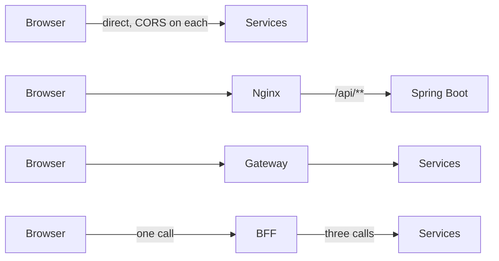
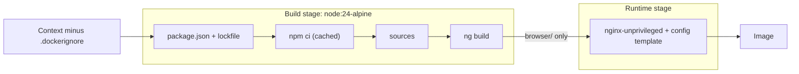
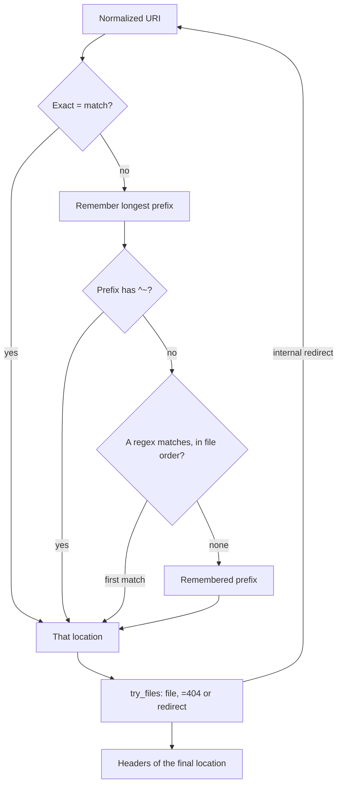
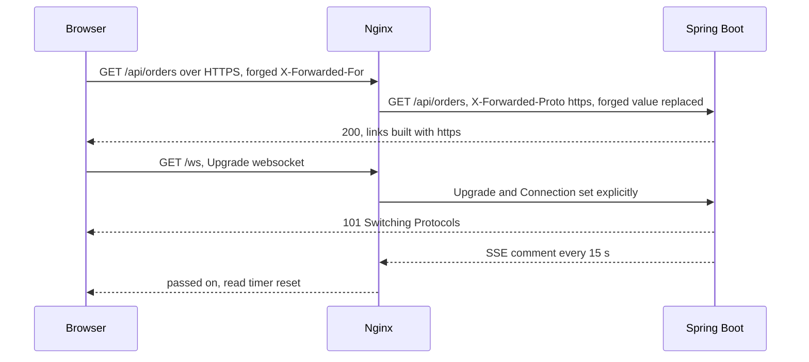
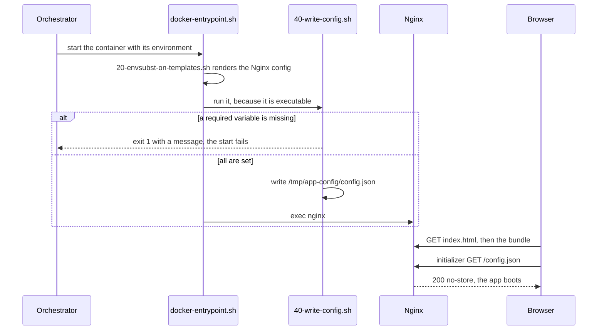
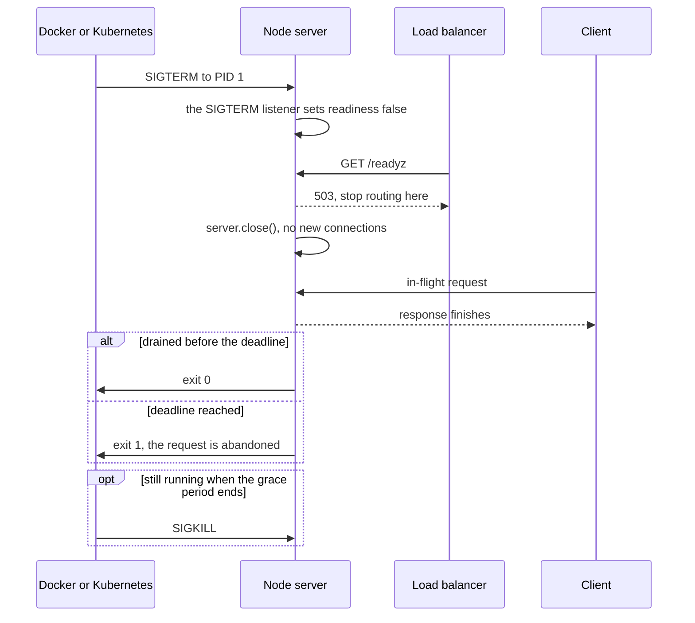
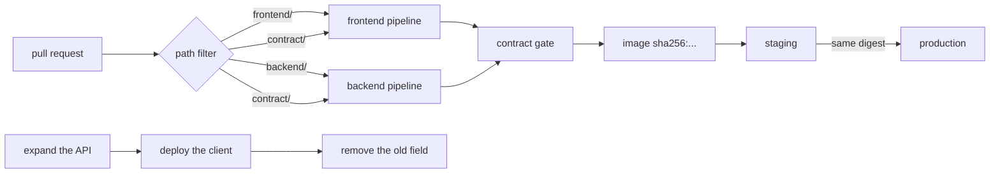
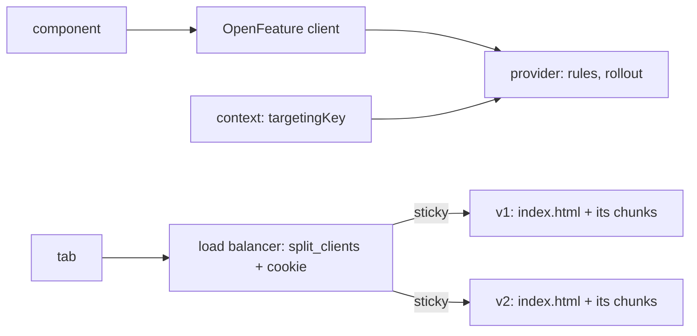
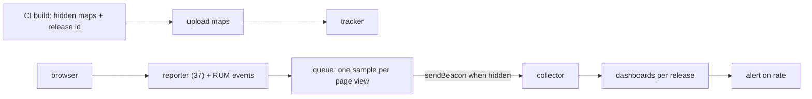
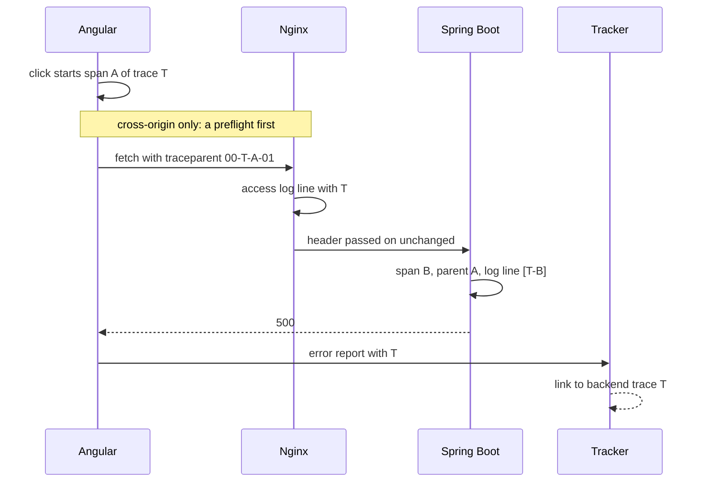

# 44. Full-stack delivery and operations: Docker, Nginx, runtime configuration, observability and safe releases for Angular and Spring Boot

> **What this covers:** getting an Angular app and its Spring Boot API to production and keeping them healthy there: where the API calls go (direct, a reverse proxy, a gateway or a backend-for-frontend); a Docker multi-stage build and an Nginx configuration with the SPA fallback, caching headers and compression; one image for every environment through runtime configuration; server-rendered apps in containers; error tracking, real user monitoring and traces that join the browser to the backend; feature flags and canary releases; and CI/CD for both layers with a versioned contract.
> **Prerequisites:** [32. Deploying SSR](32-ssr-ssg-hydration.md#9-deploying-ssr-node-and-other-runtimes-static-output-caching-rendered-pages-and-allowed-hosts), [41. CORS on both sides and the dev proxy](41-fullstack-api-contracts.md#1-cors-on-both-sides-springs-corsconfigurationsource-spring-security-preflight-caching-credentials-and-the-dev-proxy), [41. Evolving the contract](41-fullstack-api-contracts.md#4-evolving-the-contract-compatible-changes-api-versioning-in-spring-framework-7-and-deprecation-headers), [12. Environments and configuration](12-angular-how-it-works.md#4-environments-and-configuration-build-time-versus-run-time), [09. HTTP caching](09-web-networking-storage-security.md#4-http-caching)
> **Leads to:** [45. Front-end system design method](45-frontend-system-design-method.md), [46. System design case studies](46-system-design-case-studies.md)
> **Applies to:** Angular 22.2 (`@angular/core`, `@angular/build`, `@angular/ssr` 22.2.1 in `labs/angular`); TypeScript 6.0 and Node 24 in `labs/ts-js`; documented only: Nginx 1.30.6 and 1.31.8, the nginx and Node images, Spring Boot 4.1.1, Spring Framework 7.0.9, Spring Cloud Gateway 5.0.3, OpenTelemetry JS `sdk-trace-web` 2.12.0, `@openfeature/web-sdk` 1.10.0, `@sentry/angular` 11.8.0; W3C Trace Context (2021); reads 2026-10-22
> **Study time:** ~3 hours reading + ~3 hours exercises
> **Short on time:** read [§1](#1-where-the-api-calls-go-direct-calls-a-same-origin-reverse-proxy-an-api-gateway-or-a-backend-for-frontend), [§3](#3-nginx-for-a-single-page-app-location-matching-the-try_files-fallback-caching-headers-for-hashed-assets-and-gzip-or-brotli) and [§6](#6-serving-ssr-apps-in-containers-the-node-server-as-pid-1-graceful-shutdown-health-probes-and-what-nginx-or-a-cdn-still-serves), then [Q44.01](#q44-01), [Q44.05](#q44-05), [Q44.09](#q44-09), [Q44.11](#q44-11), [Q44.17](#q44-17) and [Q44.21](#q44-21), then the [Summary](#summary).
> **Labs:** [`labs/ts-js/src/modules/44-fullstack-delivery-and-operations/`](../labs/ts-js/src/modules/44-fullstack-delivery-and-operations/), [`labs/angular/src/app/modules/44-fullstack-delivery-and-operations/`](../labs/angular/src/app/modules/44-fullstack-delivery-and-operations/) and [`labs/angular/deploy/`](../labs/angular/deploy/) (documented only: Docker is not run). Run (Node 24): from `labs/ts-js`, `npx vitest run src/modules/44-fullstack-delivery-and-operations src/outputs/44-fullstack-delivery-and-operations`; from `labs/angular`, `npx ng test --watch=false --include='src/app/modules/44-fullstack-delivery-and-operations/**/*.spec.ts'`.

## Contents

1. [Where the API calls go: direct calls, a same-origin reverse proxy, an API gateway or a backend-for-frontend](#1-where-the-api-calls-go-direct-calls-a-same-origin-reverse-proxy-an-api-gateway-or-a-backend-for-frontend)
2. [A Docker multi-stage build for Angular: build and runtime stages, layer caching, `.dockerignore` and a non-root image](#2-a-docker-multi-stage-build-for-angular-build-and-runtime-stages-layer-caching-dockerignore-and-a-non-root-image)
3. [Nginx for a single-page app: `location` matching, the `try_files` fallback, caching headers for hashed assets, and gzip or Brotli](#3-nginx-for-a-single-page-app-location-matching-the-try_files-fallback-caching-headers-for-hashed-assets-and-gzip-or-brotli)
4. [Nginx as the reverse proxy: `proxy_pass`, forwarded headers into Spring Boot, and SSE or WebSocket connections through the proxy](#4-nginx-as-the-reverse-proxy-proxy_pass-forwarded-headers-into-spring-boot-and-sse-or-websocket-connections-through-the-proxy)
5. [Runtime configuration without rebuilding: `config.json`, environment substitution at container start and `provideAppInitializer`](#5-runtime-configuration-without-rebuilding-configjson-environment-substitution-at-container-start-and-provideappinitializer)
6. [Serving SSR apps in containers: the Node server as PID 1, graceful shutdown, health probes and what Nginx or a CDN still serves](#6-serving-ssr-apps-in-containers-the-node-server-as-pid-1-graceful-shutdown-health-probes-and-what-nginx-or-a-cdn-still-serves)
7. [CI/CD for both layers: one image promoted through stages, a monorepo or separate repositories, and versioning the contract](#7-cicd-for-both-layers-one-image-promoted-through-stages-a-monorepo-or-separate-repositories-and-versioning-the-contract)
8. [Feature flags with OpenFeature and canary releases: providers, evaluation context, sticky rollout, kill switches and version skew](#8-feature-flags-with-openfeature-and-canary-releases-providers-evaluation-context-sticky-rollout-kill-switches-and-version-skew)
9. [Frontend error tracking and real user monitoring: releases, source maps, beacons and sampling](#9-frontend-error-tracking-and-real-user-monitoring-releases-source-maps-beacons-and-sampling)
10. [Under the hood: OpenTelemetry for the web, `traceparent`, and one click traced to a Spring Boot span and log line](#10-under-the-hood-opentelemetry-for-the-web-traceparent-and-one-click-traced-to-a-spring-boot-span-and-log-line)
- [Summary](#summary)
- [Question bank](#question-bank)
- [Hands-on exercises](#hands-on-exercises)
- [Check your understanding](#check-your-understanding)
- [Connections](#connections)

**How this module was checked.** Run: Vitest in Node 24 for our models of Docker's build cache, Nginx's static-file and proxy rules, the nginx image's template step, graceful shutdown, releases, flags and `traceparent`; `ng test` for the beacon queue and Angular exercises. Read, not run: Docker, Nginx 1.30/1.31 and the nginx and Node images (`deploy/` documented only); Spring Boot 4.1.1, Framework 7.0.9 and Cloud Gateway 5.0.3 at their tags; OpenTelemetry, OpenFeature, Sentry and `web-vitals` from their tarballs; W3C Trace Context; dates in SOURCES.md.

## 1. Where the API calls go: direct calls, a same-origin reverse proxy, an API gateway or a backend-for-frontend

### The problem it solves

The app on `app.example.com` calls `api.example.com` directly: every write pays a preflight and six services need CORS rules. A gateway added "to fix CORS" collects business logic; a sign-in BFF becomes the bottleneck.

### Mental model

A **direct call** goes browser to service, cross-origin unless the host matches ([09 §5](09-web-networking-storage-security.md#5-the-same-origin-policy-and-cors)). A **reverse proxy** forwards requests for a server; a **same-origin deployment** serves the app and `/api/**` from one host. An **API gateway** is the **edge** (entry point) for many services, handling **cross-cutting concerns** (routing, TLS, rate limits). A **backend-for-frontend (BFF)** serves one front end, **aggregates** (merges calls), holds the session ([42 §3](42-fullstack-authentication.md#3-where-the-oauth-client-runs-a-browser-only-client-a-token-mediating-backend-or-a-backend-for-frontend-with-spring)). Each adds a **hop** (network step) and a deployment. Analogy: reception, a switchboard, an assistant.



What to notice: only lane two keeps one origin with no new backend.

### How it actually works

- **No CORS behind the proxy**: a request to the page's own origin needs no CORS header ([41 §1](41-fullstack-api-contracts.md#1-cors-on-both-sides-springs-corsconfigurationsource-spring-security-preflight-caching-credentials-and-the-dev-proxy); the dev proxy is the same pattern, [Q41.02](41-fullstack-api-contracts.md#q41-02)).
- **Gateway versus BFF**: Spring Cloud Gateway 5.0.3 matches routes by predicates; its filters treat every match alike (`glossary.adoc`, read 2026-10-22); a BFF is shaped by one client ([Q42.09](42-fullstack-authentication.md#q42-09)).
- **Starters**: `-webmvc` "works with traditional Servlet runtimes"; `-webflux` "does not work in a traditional Servlet Container" (`starter.adoc`, abridged).

### Code

1. `requestPlan` counts one request per call, one per screen for a BFF, because aggregation is its gain.
2. The route forwards one path, because a gateway's value is declarative routing.
3. The Nginx line is read, not run; [§4](44-fullstack-delivery-and-operations.md#4-nginx-as-the-reverse-proxy-proxy_pass-forwarded-headers-into-spring-boot-and-sse-or-websocket-connections-through-the-proxy) owns its rules.

```ts
// Excerpt of labs/ts-js/src/modules/44-fullstack-delivery-and-operations/concepts/topology-model.ts
/** The requests the browser sends: a BFF turns the screen's reads into one request shaped for that screen. */
function requestsSent(topology: Topology, screen: Screen): readonly Call[] {
  switch (topology) {
    case 'direct':
      return screen.calls;
    case 'proxy':
      return screen.calls.map((call) => ({ ...call, origin: screen.pageOrigin }));
    case 'gateway':
      return screen.calls.map((call) => ({ ...call, origin: screen.edgeOrigin }));
    case 'bff':
      return screen.calls.length === 0 ? [] : [{ origin: screen.edgeOrigin, method: 'GET' }];
  }
}

/** Counts what the browser pays for one screen under one topology. */
export function requestPlan(topology: Topology, screen: Screen): Plan {
  const sent = requestsSent(topology, screen);
  const crossOrigin = sent.filter((call) => !sameOrigin(call.origin, screen.pageOrigin));
  const preflights = crossOrigin.filter(isPreflighted).length;
  return {
    requests: sent.length,
    preflights,
    roundTrips: sent.length + preflights,
    corsRequiredOn: Array.from(new Set(crossOrigin.map((call) => new URL(call.origin).origin))),
    browserHolds: topology === 'bff' ? 'session cookie' : 'bearer token',
  };
}
```

```yaml
# Illustrative, not run
spring:
  cloud:
    gateway:
      server:
        webmvc:
          routes:
            - id: orders
              uri: https://orders.internal.example.com
              predicates:
                - Path=/api/orders/**
```

```nginx
# Illustrative, not run
location /api/ { proxy_pass http://api:8080; }
```

Our model's four `Section 1:` tests ([file](../labs/ts-js/src/modules/44-fullstack-delivery-and-operations/concepts/section-1-topologies.test.ts)) assert this.

> [!TIP]
> **Coming from the backend.** A gateway is the HTTP edge you may run. **Where the analogy breaks:** the browser is a client you do not control, so CORS, cookies and CSRF ([33 §8](33-security.md#8-where-the-token-lives-memory-web-storage-httponly-cookies-and-a-backend-for-frontend)) depend on the origin it sees.

### Best practices and anti-patterns

- **Test CORS on the deployed topology**, because the dev proxy hides missing headers.

### Misconceptions and traps

- "A gateway fixes CORS." Only if it also serves the app's origin. Cause: in front, it often makes the app same-origin.
- "A BFF is just a gateway." A BFF is shaped for one client and may aggregate. Cause: both proxy; Spring Cloud Gateway can be either.
- "Direct calls are always faster." A cold cross-origin JSON write adds a preflight; three calls cost three trips. Cause: one hop fewer looks cheaper.
- "The dev proxy shows production." Production needs its own origin. Cause: in development the proxy supplies it.

Drilled in [Q44.01](#q44-01) and [Q44.02](#q44-02).

## 2. A Docker multi-stage build for Angular: build and runtime stages, layer caching, `.dockerignore` and a non-root image

### The problem it solves

A first Dockerfile reruns `npm ci` on every edit, runs Nginx as root and passes the API URL as a build argument ([12 §4](12-angular-how-it-works.md#4-environments-and-configuration-build-time-versus-run-time); fixed in [§5](44-fullstack-delivery-and-operations.md#5-runtime-configuration-without-rebuilding-configjson-environment-substitution-at-container-start-and-provideappinitializer)).

### Mental model

An **image** is a stack of **layers** (one per instruction) on a **base image**; a **container** runs it. The **build context** is the folder sent to the builder, minus what `.dockerignore` lists. A **multi-stage build** has several `FROM`s: the **build stage** (`npm ci`, `ng build`) passes only what `COPY --from=build` names to the **runtime stage**. The **layer cache** reuses unchanged layers; a **cache mount** keeps npm's downloads. Analogy: workshop, shop window.



What to notice: only `browser/` crosses.

### How it actually works

- **Why one edit reruns `npm ci`**: "If a layer changes, all other layers that come after it are also affected" (docs.docker.com), so sources copied before `npm ci` rerun it on every edit.
- **Non-root**: the nginx image has no `USER`; its Hub text says it needs write access to `/var/cache/nginx` and `/var/run`; the **unprivileged image** runs non-root as UID 101 on 8080.
- **Spring Boot**: `-Djarmode=tools … extract --layers` splits a **layered jar**, so dependencies cache (`dockerfiles.adoc`, `v4.1.1`).

### Code

1. Copy the lockfile, then `npm ci` with a cache mount, so the install reruns only when it changes.
2. Then copy the sources and build, because they change most ([12 §3](12-angular-how-it-works.md#3-building-the-application-builder-output-layout-and-budgets)).
3. Copy only `browser/`, with no `ARG`, so no API URL is baked in ([§5](44-fullstack-delivery-and-operations.md#5-runtime-configuration-without-rebuilding-configjson-environment-substitution-at-container-start-and-provideappinitializer)).
4. `rebuiltSteps` models Docker's rule: a step reruns when its inputs or an earlier step changed, so tests can show the saving.

```dockerfile
# labs/angular/deploy/Dockerfile — documented only, not built: Docker is not run in the labs
FROM node:24-alpine AS build
WORKDIR /app
COPY package.json package-lock.json ./
RUN --mount=type=cache,target=/root/.npm npm ci
COPY . .
RUN npx ng build

FROM nginx/nginx-unprivileged:1.31.8
COPY --from=build /app/dist/labs/browser/ /usr/share/nginx/html/
# ... template and script copies of sections 3 and 5 ...
USER 101
EXPOSE 8080
```

```text
# labs/angular/deploy/Dockerfile.dockerignore — documented only, not built: Docker is not run in the labs
node_modules
dist
.angular
.git
.env*
```

```ts
// Excerpt of labs/ts-js/src/modules/44-fullstack-delivery-and-operations/concepts/docker-cache-model.ts
/** True when a changed file lies inside a `COPY` source: the source itself, a folder holding it, or `.`. */
function covers(source: string, file: string): boolean {
  const root = normalize(source);
  return root === '.' || file === root || file.startsWith(`${root}/`);
}

/**
 * The steps Docker rebuilds: a step is rebuilt when a file it copies changed or when any earlier step was rebuilt,
 * because a changed layer invalidates every layer after it.
 */
export function rebuiltSteps(steps: readonly Step[], changed: readonly string[]): readonly string[] {
  let invalidated = false;
  const rebuilt: string[] = [];
  for (const step of steps) {
    invalidated = invalidated || step.sources.some((source) => changed.some((file) => covers(source, file)));
    if (invalidated) {
      rebuilt.push(step.instruction);
    }
  }
  return rebuilt;
}
```

```dockerfile
# Illustrative, not run
FROM bellsoft/liberica-openjre-debian:25-cds AS builder
WORKDIR /builder
ARG JAR_FILE=target/*.jar
COPY ${JAR_FILE} application.jar
RUN java -Djarmode=tools -jar application.jar extract --layers --destination extracted

FROM bellsoft/liberica-openjre-debian:25-cds
WORKDIR /application
COPY --from=builder /builder/extracted/dependencies/ ./
COPY --from=builder /builder/extracted/spring-boot-loader/ ./
COPY --from=builder /builder/extracted/snapshot-dependencies/ ./
COPY --from=builder /builder/extracted/application/ ./
ENTRYPOINT ["java", "-jar", "application.jar"]
```

Tests: [section-2-docker.test.ts](../labs/ts-js/src/modules/44-fullstack-delivery-and-operations/concepts/section-2-docker.test.ts).

### Best practices and anti-patterns

- **Pin the base image by digest**, because tags move.

### Misconceptions and traps

- "A multi-stage build is slower." The runtime stage only copies files, and only a lockfile change reruns `npm ci`. Cause: more stages look like more work.
- "`.dockerignore` only shrinks the image." It shrinks the context, keeping `.env` out of `COPY . .`. Cause: the name says image.
- "A build argument passes the API URL." It bakes the URL in, blocking promotion. Cause: it works in one environment.
- "Nginx needs root for port 80." The unprivileged image is non-root on 8080. Cause: the default image runs as root on 80.

Drilled in [Q44.03](#q44-03), [Q44.04](#q44-04); practised in [Exercise 44.1](#ex44-1).

## 3. Nginx for a single-page app: `location` matching, the `try_files` fallback, caching headers for hashed assets, and gzip or Brotli

### The problem it solves

Refreshing `/orders/42` answers 404; after a deploy, a deleted chunk returns `index.html` (200), a MIME error ([Q05.08](05-js-modules-memory-modern-features.md#q05-08)); security headers and gzip skip JavaScript.

### Mental model

A **`location`** configures matching URIs: **exact match** (`=`), **prefix location** (a string) or **regex location** (`~`, `~*` caseless), against the **normalized URI** (`%XX` decoded, `.`/`..` resolved, slashes merged). **`try_files`** takes the first existing file, else a status or an **internal redirect**. Analogy: a mail room's most specific rule wins.



What to notice: redirects search again.

### How it actually works

- **Precedence** (nginx.org, `location`, read 2026-10-22): an exact match ends the search; else the longest matching prefix is remembered, and used if it has `^~`; else the first matching regex in file order; else the remembered prefix.
- **Headers** (`ngx_http_headers_module`): an **`add_header` level** inherits the parent's only if it has no `add_header` itself, so levels replace; **`always`** adds them to errors too; **`add_header_inherit`** `merge` (since 1.29.3) appends the parent's.
- **Compression**: **`gzip_types`** defaults to `text/html`; `gzip_vary` adds **`Vary: Accept-Encoding`** ([09 §4](09-web-networking-storage-security.md#4-http-caching)). **`gzip_static`** sends a **precompressed file** (a `.gz` copy), "not built by default" but in nginx.org's packages. **Brotli** needs the third-party **`ngx_brotli`** modules.
- Nginx sends what [Q09.11](09-web-networking-storage-security.md#q09-11) chooses; angular.dev's example maps `Accept-Language` to a locale folder ([34 §7](34-i18n.md#7-compile-time-localization-one-build-per-locale-subpath-lang-and-dir)) via `try_files $uri /$1/index.html?$args`. `frame-ancestors` [Baseline 2018: widely available, per MDN] works only as a header; `Reporting-Endpoints` [Baseline 2024: newly available, per MDN] names CSP's report target ([33 §5](33-security.md#5-content-security-policy-with-angular-nonces-csp_nonce-and-autocsp); [Baseline](https://developer.mozilla.org/en-US/docs/Glossary/Baseline/Compatibility)).

### Code

1. Security headers once, with `always` and `merge`, because each location adds `Cache-Control`.
2. Routes get the **SPA fallback** `try_files $uri $uri/ /index.html`, so the router answers; hashed names (8-character hash, `@angular/build`) get `immutable` and `=404`, so deleted chunks fail cleanly.
3. `selectLocation` applies that order, because nginx.org documents it.

```nginx
# labs/angular/deploy/nginx/default.conf.template — documented only, not built: Docker is not run in the labs
# (abridged: section 4's map and proxy locations and the file's comments, which give each line's reason, are left out)
server {
    listen 8080;
    root /usr/share/nginx/html;
    add_header X-Content-Type-Options "nosniff" always;
    add_header Content-Security-Policy "frame-ancestors 'self'" always;
    add_header_inherit merge;
    gzip on;
    gzip_types text/css application/javascript application/json image/svg+xml;
    gzip_vary on;
    gzip_static on;

    location = /index.html { add_header Cache-Control "no-cache"; }
    location ~ "^/(?:[^/]+-[A-Za-z0-9_-]{8}\.(?:js|css)|media/[^/]+-[A-Za-z0-9_-]{8}\.[A-Za-z0-9]+)$" {
        add_header Cache-Control "public, max-age=31536000, immutable";
        try_files $uri =404;
    }
    location = /config.json { alias /tmp/app-config/config.json; add_header Cache-Control "no-store"; }
    location / {
        add_header Cache-Control "no-cache";
        try_files $uri $uri/ /index.html;
    }
}
```

```ts
// Excerpt of labs/ts-js/src/modules/44-fullstack-delivery-and-operations/concepts/nginx-model.ts
/**
 * The location that serves a normalized URI, in nginx.org's order: an exact `=` match ends the search; the longest
 * matching prefix is remembered, and if it has `^~` it wins; otherwise the first regular expression that matches, in
 * file order; otherwise the remembered prefix. Undefined when nothing matches.
 */
export function selectLocation(server: Server, uri: string): Location | undefined {
  const exact = server.locations.find((location) => location.modifier === '=' && location.pattern === uri);
  if (exact) {
    return exact;
  }
  const prefix = longestPrefix(server.locations, uri);
  if (prefix?.modifier === '^~') {
    return prefix;
  }
  return server.locations.find((location) => isRegex(location) && regexMatches(location, uri)) ?? prefix;
}
```

Tests: [section-3-nginx-static.test.ts](../labs/ts-js/src/modules/44-fullstack-delivery-and-operations/concepts/section-3-nginx-static.test.ts).

> [!NOTE]
> **Framework vs platform.** Hashes come from the production configuration's `outputHashing: "all"` (schema default `none`, `@angular/build` 22.2.1); the builder writes no compressed files; Nginx decides headers and encoding.

### Best practices and anti-patterns

- **Precompress in the release step**, because `gzip_static` serves only existing files.

### Misconceptions and traps

- "`try_files $uri /index.html` everywhere." Deleted chunks then get HTML with 200. Cause: it is the tutorials' one-liner.
- "`server` headers apply everywhere." A location's `add_header` drops them. Cause: they apply until a location adds one.
- "`gzip on` compresses JavaScript." Only `text/html` by default. Cause: the directive's name.
- "Nginx supports Brotli." Only with `ngx_brotli`. Cause: CDNs offer it.
- "Once true: the remembered prefix came right after regexes." Mainline 1.31.5 inserts **predicate locations** (variable tests). Cause: older guides predate it.

Drilled in [Q44.05](#q44-05), [Q44.06](#q44-06); practised in [Exercise 44.1](#ex44-1).

## 4. Nginx as the reverse proxy: `proxy_pass`, forwarded headers into Spring Boot, and SSE or WebSocket connections through the proxy

### The problem it solves

`/api/orders` reaches Spring as `/orders`; redirects say `http://`; a WebSocket handshake fails; an SSE stream dies after a minute ([Q43.07](43-fullstack-realtime.md#q43-07)); a limiter trusts any `X-Forwarded-For`.

### Mental model

Nginx sends its own request to an **upstream** (the server behind it), so it chooses the URI, headers and allowed silence.



What to notice: Nginx rewrites each request.

### How it actually works

- **URI rule** (nginx.org, read 2026-10-22; canonical): with a URI, the matched part of the normalized request URI "is replaced by a URI specified in the directive"; without one, "the request URI is passed to the server in the same form as sent by a client".
- **Headers**: Nginx does not pass the client's `Host` and `Connection`; it sends `Host: $proxy_host` and `Connection: close`. `proxy_http_version` is 1.1 since 1.29.7, 1.0 before.
- **Streams**: `Upgrade` is **hop-by-hop** (not forwarded), so WebSockets set it and `Connection`. `proxy_read_timeout` is 60 s "between two successive read operations" (canonical): a stream silent that long closes unless [43 §3](43-fullstack-realtime.md#3-server-sent-events-in-spring-sseemitter-in-spring-mvc-and-a-flux-of-serversentevent-in-webflux)'s heartbeat intervenes. `proxy_buffering off` or `X-Accel-Buffering: no` ends **proxy buffering**.
- **Forwarded headers**: after **TLS termination** (HTTPS ends at the proxy) the proxy sets `X-Forwarded-Proto`, `-Host`, `-For`. Boot 4.1.1 reads them only with `server.forward-headers-strategy` `NATIVE` or `FRAMEWORK` (default `NONE` outside cloud platforms); the edge proxy must "drop forwarded headers from the outside".

### Code

1. No URI after the address keeps `/api/orders`; each location repeats all `proxy_set_header` lines, because any drops inherited ones; `$remote_addr` replaces a client's `X-Forwarded-For`.
2. Streams disable buffering and raise the timeout, so quiet events still arrive; `/ws` sets `Upgrade` and `Connection`, because Nginx does not forward them.
3. `resolveClient` ignores forwarded headers from unlisted peers, because anyone can send them.

```nginx
# labs/angular/deploy/nginx/default.conf.template — documented only, not built: Docker is not run in the labs
# (abridged: section 3's lines and the file's comments, which give each line's reason, are left out)
map $http_upgrade $connection_upgrade {
    default upgrade;
    ''      close;
}
server {
    # ...
    location ^~ /api/ {
        proxy_pass http://spring:8080;
        proxy_set_header Host $host;
        proxy_set_header X-Forwarded-Proto $scheme;
        proxy_set_header X-Forwarded-Host $host;
        proxy_set_header X-Forwarded-For $remote_addr;
        proxy_set_header Forwarded "";
    }
    location ^~ /api/events {
        # the same proxy_pass and five proxy_set_header lines, then:
        proxy_buffering off;
        proxy_read_timeout 1h;
    }
    location ^~ /ws {
        # the same proxy_pass and five proxy_set_header lines, then:
        proxy_set_header Upgrade $http_upgrade;
        proxy_set_header Connection $connection_upgrade;
        proxy_read_timeout 1h;
    }
}
```

```yaml
# Illustrative, not run: application.yml for Spring Boot 4.1
server:
  # NATIVE: the container reads X-Forwarded-For and X-Forwarded-Proto (webserver.adoc). FRAMEWORK uses ForwardedHeaderFilter.
  forward-headers-strategy: native
  tomcat:
    # With TLS ended at the proxy, honour X-Forwarded-Proto before Tomcat redirects (webserver.adoc).
    redirect-context-root: false
```

```ts
// Excerpt of labs/ts-js/src/modules/44-fullstack-delivery-and-operations/concepts/proxy-model.ts
/**
 * The request URI the upstream receives. With a URI in `proxy_pass`, the part of the normalized URI that the location
 * matched is replaced by it; without one, the URI goes on as the client sent it. A regular-expression location cannot
 * say what to replace (nginx.org), so it must have no URI and the request goes on unchanged.
 */
export function upstreamUri(location: Location, proxyPass: string, requestUri: string): string {
  const replacement = targetUri(proxyPass);
  if (replacement === undefined || location.modifier === '~' || location.modifier === '~*') {
    return requestUri;
  }
  return `${replacement}${normalizeUri(requestUri).slice(location.pattern.length)}`;
}

/**
 * Forwarded headers count only when the direct peer is a trusted proxy, because the application cannot tell a
 * proxy's header from a client's. From any other peer they are ignored and the connection itself is the truth.
 */
export function resolveClient(request: ReceivedRequest, trustedProxies: readonly string[]): ClientView {
  const direct: ClientView = { clientIp: request.peer, scheme: request.scheme, host: header(request.headers, 'Host') };
  if (!isTrusted(request.peer, trustedProxies)) {
    return direct;
  }
  return {
    clientIp: clientFrom(header(request.headers, 'X-Forwarded-For'), request.peer, trustedProxies),
    scheme: header(request.headers, 'X-Forwarded-Proto') || direct.scheme,
    host: header(request.headers, 'X-Forwarded-Host') || direct.host,
  };
}
```

Tests: [section-4-reverse-proxy.test.ts](../labs/ts-js/src/modules/44-fullstack-delivery-and-operations/concepts/section-4-reverse-proxy.test.ts).

> [!TIP]
> **Coming from the backend.** This is `ForwardedHeaderFilter` or Tomcat's `RemoteIpValve`. **Where the analogy breaks:** streams cross this proxy, so its timeouts reach users ([43 §9](43-fullstack-realtime.md#9-scaling-out-and-under-the-hood-sticky-sessions-the-broker-relay-backpressure-and-one-message-traced-across-two-instances)'s reconnect storm).

### Best practices and anti-patterns

- **Overwrite forwarded headers at the edge**, because Spring cannot verify them.

### Misconceptions and traps

- "A trailing `/` in `proxy_pass` is cosmetic." Any URI replaces the matched prefix. Cause: URLs tolerate it.
- "Spring sees the original host and scheme." Not by default. Cause: `ng serve`'s proxy supplies them.
- "`X-Forwarded-For` is the client IP." Any client can send it. Cause: the name says "for".
- "`proxy_read_timeout` caps a stream's life." It counts silence between reads. Cause: the name says "timeout".
- "Once true: Nginx speaks HTTP/1.0 upstream." Since 1.29.7 it is 1.1. Cause: guides keep `proxy_http_version 1.1`.

Drilled in [Q44.07](#q44-07), [Q44.08](#q44-08).

## 5. Runtime configuration without rebuilding: `config.json`, environment substitution at container start and `provideAppInitializer`

### The problem it solves

Four environments mean four builds, and staging's image is not production's ([12 §4](12-angular-how-it-works.md#4-environments-and-configuration-build-time-versus-run-time)). A federation manifest of remote URLs ([38 §8](38-architecture-and-production-structure.md#8-micro-frontends-module-federation-native-federation-and-when-they-are-justified)) is runtime configuration too.

### Mental model

The bundle reads configuration after it starts ([12 §6](12-angular-how-it-works.md#6-bootstrapping-bootstrapapplication-the-platform-and-initializers), [Exercise 12.2](12-angular-how-it-works.md#ex12-2)); the deployment writes the file. An **entrypoint script** (a shell file in **`/docker-entrypoint.d`**, run before Nginx) renders a **config template**, a file of `${NAME}` placeholders.



What to notice: a missing variable stops startup.

### How it actually works

- **Template step** (`20-envsubst-on-templates.sh`, read 2026-10-22): **`envsubst`** (GNU's tool) replaces only the names the script lists, as `$NAME` or `${NAME}`: defined variables matching **`NGINX_ENVSUBST_FILTER`**, the **variable filter**. `$uri` is no defined variable, so it survives; run bare, `envsubst` blanks it.
- **Start order**: only executable `*.sh` files run, in `sort -V` order, so ours is `40-write-config.sh` (`--chmod=755`).
- **Where** (unprivileged Dockerfile, read 2026-10-22): UID 101, and no chown of `/usr/share/nginx/html`, so the script writes under `/tmp` and `location = /config.json` serves it with `alias` and `no-store` ([§3](#3-nginx-for-a-single-page-app-location-matching-the-try_files-fallback-caching-headers-for-hashed-assets-and-gzip-or-brotli), [09 §4](09-web-networking-storage-security.md#4-http-caching)).
- To **fail fast** is to stop at the first misconfiguration: an unset **required variable** makes the script exit 1, so the orchestrator sees the failure; a bad browser value is invisible.

### Code

1. List every missing name, then exit 1, because one failed start should report all; render four named variables, so nothing else enters the file.
2. The template feeds [§1](#1-where-the-api-calls-go-direct-calls-a-same-origin-reverse-proxy-an-api-gateway-or-a-backend-for-frontend), [§8](#8-feature-flags-with-openfeature-and-canary-releases-providers-evaluation-context-sticky-rollout-kill-switches-and-version-skew), [§9](#9-frontend-error-tracking-and-real-user-monitoring-releases-source-maps-beacons-and-sampling) and [§10](#10-under-the-hood-opentelemetry-for-the-web-traceparent-and-one-click-traced-to-a-spring-boot-span-and-log-line); JSON allows no comment.
3. `writeConfig` repeats this in TypeScript, so tests need no shell; [Exercise 12.2](12-angular-how-it-works.md#ex12-2) is the Angular side.

```sh
# labs/angular/deploy/docker-entrypoint.d/40-write-config.sh — documented only, not built: Docker is not run in the labs
# (abridged: the shebang and the file's comments, which give each line's reason, are left out)
set -eu
TEMPLATE=/opt/app/config.json.template
OUTPUT_DIR=/tmp/app-config
missing=""
check() {
  [ -n "$2" ] || missing="$missing $1"
}
check API_URL "${API_URL:-}"
check FEATURE_FLAGS_URL "${FEATURE_FLAGS_URL:-}"
check RELEASE "${RELEASE:-}"
check TRACE_SAMPLE_RATE "${TRACE_SAMPLE_RATE:-}"
if [ -n "$missing" ]; then
  echo "40-write-config.sh: required variables not set or empty:$missing" >&2
  exit 1
fi
mkdir -p "$OUTPUT_DIR"
envsubst '${API_URL} ${FEATURE_FLAGS_URL} ${RELEASE} ${TRACE_SAMPLE_RATE}' < "$TEMPLATE" > "$OUTPUT_DIR/config.json"
```

```json
{
  "apiUrl": "${API_URL}",
  "featureFlagsUrl": "${FEATURE_FLAGS_URL}",
  "release": "${RELEASE}",
  "traceSampleRate": ${TRACE_SAMPLE_RATE}
}
```

```ts
// Excerpt of labs/ts-js/src/modules/44-fullstack-delivery-and-operations/concepts/envsubst-model.ts
/**
 * `envsubst "${A} ${B}"`: replaces `$NAME` and `${NAME}` for the defined, filtered names; any other text, `$uri` and an
 * unset `${UNSET}` included, stays as written.
 */
export function renderTemplate(text: string, env: Environment, filter = ''): string {
  const listed = new Set(definedNames(env, filter));
  return text.replace(REFERENCE, (reference, braced: string | undefined, bare: string | undefined) => {
    const name = nameOf(braced, bare);
    return listed.has(name) ? (env[name] ?? '') : reference;
  });
}

export function writeConfig(template: string, env: Environment, required: readonly string[]): WriteResult {
  const missing = missingVariables(env, required);
  if (missing.length > 0) {
    return { kind: 'refused', missing, message: `40-write-config.sh: required variables not set or empty: ${missing.join(' ')}` };
  }
  const listed = Object.fromEntries(required.map((name) => [name, env[name] ?? '']));
  return { kind: 'written', body: renderTemplate(template, listed) };
}
```

Tests: [section-5-runtime-config.test.ts](../labs/ts-js/src/modules/44-fullstack-delivery-and-operations/concepts/section-5-runtime-config.test.ts).

> [!NOTE]
> **Framework vs platform.** Angular offers the initializer and the token ([12 §6](12-angular-how-it-works.md#6-bootstrapping-bootstrapapplication-the-platform-and-initializers), [Q12.17](12-angular-how-it-works.md#q12-17), [16 §7](16-dependency-injection.md#7-injectiontoken-multi-providers-environment-providers-and-initializers); [Q12.10](12-angular-how-it-works.md#q12-10), [Q12.18](12-angular-how-it-works.md#q12-18)); the container writes the file. Spring's analogue: externalized configuration.

### Best practices and anti-patterns

- **Require every variable**, because a gap should stop a rollout.

### Misconceptions and traps

- "`envsubst` breaks Nginx configs." Only run bare, with no list; the image's step lists names. Cause: run by hand without a list, it blanks `$uri`.
- "Runtime configuration can hold secrets." Nothing secret belongs in it: every visitor downloads it ([12 §4](12-angular-how-it-works.md#4-environments-and-configuration-build-time-versus-run-time)). Cause: it is outside the build.
- "The initializer makes the config fresh." A cached response is reused unless `no-store`. Cause: the name suggests a new request.
- "SSR apps need `config.json` too." The server reads its environment ([§6](#6-serving-ssr-apps-in-containers-the-node-server-as-pid-1-graceful-shutdown-health-probes-and-what-nginx-or-a-cdn-still-serves)). Cause: the browser cannot read an environment.

Drilled in [Q44.09](#q44-09), [Q44.10](#q44-10).

## 6. Serving SSR apps in containers: the Node server as PID 1, graceful shutdown, health probes and what Nginx or a CDN still serves

### The problem it solves

`docker stop` kills the SSR container mid-request; a rendering liveness check restarts it under load. `NG_ALLOWED_HOSTS` stays [32 §9](32-ssr-ssg-hydration.md#9-deploying-ssr-node-and-other-runtimes-static-output-caching-rendered-pages-and-allowed-hosts)'s.

### Mental model

A **signal** notifies a process: **SIGTERM** asks it to stop, **SIGKILL** ends it. `docker stop` sends the **stop signal** (SIGTERM by default) to **PID 1**, the container's first process, then SIGKILL after a **grace period** (10 s on Linux). **Graceful shutdown** order (canonical): mark not ready → the load balancer stops routing → stop accepting → **drain** in-flight requests → exit before the deadline.



What to notice: readiness fails before the listener closes.

### How it actually works

- **Forms** (Docker references, read 2026-10-22): the **exec form** (`CMD ["node", …]`) runs Node itself; the **shell form** (`CMD node …`) runs it under `/bin/sh -c`, "which does not pass signals". docker-node: `npm start` swallows them.
- **PID 1** "ignores any signal with the default action", so Node needs a SIGTERM listener; the generated `server.ts` (22.2.1) has none and listens on `PORT`, default 4000.
- `--init` makes an **init process** (tini) PID 1; it "forwards signals and reaps processes".
- A **readiness probe** answers "send traffic?", a **liveness probe** "restart?"; `HEALTHCHECK` only marks a container `unhealthy` (Dockerfile reference); restarting it is an orchestrator's call. Liveness must not render, or slow renders become restarts.

### Code

1. Exec form, so SIGTERM reaches Node; `/livez` skips rendering, so load cannot fail it.
2. Readiness fails first, so routing stops before connections are refused.
3. The listener replaces Node's default exit (Node 24 docs), so draining can finish.

```dockerfile
# labs/angular/deploy/Dockerfile.ssr — documented only, not built: Docker is not run in the labs
# (abridged: the build stage, section 2's order for ssr-lab, and most comments are left out)
FROM node:24-alpine
ENV NODE_ENV=production
ENV PORT=4000
WORKDIR /app
COPY --from=build /app/dist/ssr-lab/ ./dist/ssr-lab/
USER node
EXPOSE 4000
# Docker's defaults (Dockerfile reference): --interval=30s --timeout=30s --start-period=0s --start-interval=5s --retries=3.
HEALTHCHECK --interval=10s --timeout=2s --start-period=10s --retries=3 \
  CMD ["node", "-e", "fetch('http://127.0.0.1:4000/livez').then((r) => process.exit(r.ok ? 0 : 1), () => process.exit(1))"]
# Exec form: the image's docker-entrypoint.sh ends with exec "$@", so Node replaces it and receives the stop signal itself.
# A shell-form CMD runs under /bin/sh -c: a shell that forks stays PID 1 and Node never gets the signal; busybox ash (Alpine's shell) execs a lone command instead, so rely on neither.
# npm start would put npm and a shell between the signal and Node: npm 11 forwards SIGTERM to that shell, and what the shell does varies the same way.
CMD ["node", "dist/ssr-lab/server/server.mjs"]
```

```ts
// Excerpt of labs/ts-js/src/modules/44-fullstack-delivery-and-operations/concepts/graceful-shutdown.ts
/**
 * The shutdown order: mark not ready, keep accepting for `drainDelayMs` so the load balancer stops routing, stop
 * accepting, let the requests in flight finish, exit 0; at the deadline, exit 1 and abandon what still runs.
 */
export function createShutdown(options: ShutdownOptions): Shutdown {
  const { server, readiness, clock, drainDelayMs, deadlineMs } = options;
  const steps: ShutdownStep[] = [];
  let startedAt: number | undefined;
  let exitCode: 0 | 1 | undefined;

  const begin = (): void => {
    if (startedAt !== undefined) {
      return;
    }
    startedAt = clock.now();
    readiness.markNotReady();
    steps.push('not ready');
  };

  const decide = (elapsed: number): 0 | 1 | undefined => {
    if (server.listening() && elapsed >= drainDelayMs) {
      server.close();
      steps.push('stopped accepting');
    }
    if (!server.listening() && server.inFlight() === 0) {
      steps.push('drained', 'exit 0');
      return 0;
    }
    if (elapsed >= deadlineMs) {
      steps.push('exit 1');
      return 1;
    }
    return undefined;
  };
```

```ts
// Partial: not applied to projects/ssr-lab (module 32's file); `app` is the generated server.ts's Express app, and these lines replace its listen call
let ready = true;
// Registered before the render handler, so neither probe renders.
app.get('/livez', (_req, res) => {
  res.sendStatus(200);
});
app.get('/readyz', (_req, res) => {
  res.sendStatus(ready ? 200 : 503);
});
// ... the generated express.static and render handlers ...
const server = app.listen(process.env['PORT'] || 4000);
process.on('SIGTERM', () => {
  ready = false;
  // Drain delay: the load balancer sees 503 before connections are refused.
  setTimeout(() => server.close(() => process.exit(0)), 3_000);
  // Deadline, below docker stop's 10-second default.
  setTimeout(() => process.exit(1), 9_000);
});
```

```yaml
# Illustrative, not run: application.yml for Spring Boot 4.1
server:
  shutdown: graceful # the default (ServerProperties); "immediate" turns it off
spring:
  lifecycle:
    timeout-per-shutdown-phase: 30s # the default (LifecycleProperties)
management:
  endpoint:
    health:
      probes:
        # The default. AvailabilityProbesAutoConfiguration (internal) checks only this flag and Actuator on the
        # classpath, no Kubernetes condition, so /actuator/health/liveness and /readiness exist anywhere.
        enabled: true
        add-additional-paths: true # /livez and /readyz on the main port (default false)
```

Tests: [section-6-ssr-containers.test.ts](../labs/ts-js/src/modules/44-fullstack-delivery-and-operations/concepts/section-6-ssr-containers.test.ts).

> [!TIP]
> **Coming from the backend.** Boot 4.1.1 defaults `server.shutdown` to `GRACEFUL`, 30 s per phase; readiness turns `REFUSING_TRAFFIC` and "New requests are rejected". **Where the analogy breaks:** Express has neither: you write the handler, and PID 1 rules bind Node as any script-launched JVM.

### Best practices and anti-patterns

- **Exit before the grace period ends**, because SIGKILL does not wait.

### Misconceptions and traps

- "Node exits on SIGTERM by default." Not as PID 1. Cause: outside a container it does.
- "`CMD npm start` equals `node server.mjs`." npm sits between the signal and Node. Cause: both start the server.
- "Liveness and readiness are one check." Failed liveness means a restart. Cause: both are health endpoints.
- "The SSR server should serve static files." Nginx ([§3](#3-nginx-for-a-single-page-app-location-matching-the-try_files-fallback-caching-headers-for-hashed-assets-and-gzip-or-brotli)) or a CDN serves `browser/`; Node renders. Cause: the generated server does (`maxAge: '1y'`).

Drilled in [Q44.11](#q44-11), [Q44.12](#q44-12).

## 7. CI/CD for both layers: one image promoted through stages, a monorepo or separate repositories, and versioning the contract

### The problem it solves

Staging tests commit A's image; production rebuilds the tag and gets other dependencies.

### Mental model

**Continuous delivery** extends [38 §11](38-architecture-and-production-structure.md#11-a-ci-pipeline-for-a-front-end-lint-test-build-end-to-end-and-deploy-previews)'s stages and previews. **Build once, promote by digest:** an **image tag** is a movable label; an **image digest** is the SHA-256 of the image's content, so a tag can move and a digest cannot (Docker docs, 2026-10-22). **Promotion** deploys that digest to the next stage, never a rebuild. A **path filter** (or Nx affected, [38 §7](38-architecture-and-production-structure.md#7-nx-monorepos-the-project-graph-tags-nxenforce-module-boundaries-affected-commands-and-caching)) selects a pipeline by folder; an OpenAPI description change runs both.



What to notice: the digest never changes.

### How it actually works

- **Contract gate:** a breaking description change fails the pull request ([41 §4](41-fullstack-api-contracts.md#4-evolving-the-contract-compatible-changes-api-versioning-in-spring-framework-7-and-deprecation-headers)'s rules).
- **Expand and contract:** deploy the API accepting old and new, then the client, then drop the old field after the **support window**, as long as old tabs and cached bundles run ([37 §6](37-elements-pwa-errors-ecosystem.md#6-updates-versions-swupdate-prompting-a-reload-unrecoverable-states-and-the-kill-switch)).
- A **monorepo** changes the contract in one pull request; a **polyrepo**, separate repositories, needs a published contract and a **compatibility matrix** of client and API versions.
- **Gates:** a budget error fails `ng build` ([12 §3](12-angular-how-it-works.md#3-building-the-application-builder-output-layout-and-budgets)); e2e is [30 §8](30-e2e-and-testing-strategy.md#8-ci-strategy-for-end-to-end-tests-workers-sharding-retries-policy-and-test-data)'s; update bots ([39 §7](39-version-history-and-migrations.md#7-updating-in-practice-ng-update-migration-schematics-and-the-update-guide)) meet them too.

### Code

1. The YAML filters by path and passes only the digest between jobs, so production cannot rebuild.
2. Our `breakingChanges` checks what deployed clients read and send; `promote` refuses a skipped stage, since a rebuild is another artifact.
3. `frontend-maven-plugin` 2.0.2 installs Node in a Maven build (read, not run), so one Maven pipeline can build both layers.

```yaml
# Illustrative, not run: .github/workflows/frontend.yml (backend.yml has the same shape for backend/**)
name: frontend
on:
  pull_request:
    paths: ['frontend/**', 'contract/**']
  push:
    branches: [main]
    paths: ['frontend/**', 'contract/**']
env:
  IMAGE: registry.example.com/shop/web # registry login omitted
jobs:
  contract:
    if: github.event_name == 'pull_request'
    runs-on: ubuntu-latest
    steps:
      - uses: actions/checkout@v7
        with: { fetch-depth: 0 } # the base branch's copy must be present
      - uses: actions/setup-node@v7
        with: { node-version: 24 }
      - env: { BASE: '${{ github.base_ref }}' }
        run: git show "origin/$BASE:contract/openapi.yaml" > /tmp/before.yaml
      # Ours: runs breakingChanges on both files and exits 1 when it lists any.
      - run: node tools/contract-gate.mjs /tmp/before.yaml contract/openapi.yaml
  build:
    if: github.event_name == 'push'
    runs-on: ubuntu-latest
    outputs:
      digest: ${{ steps.image.outputs.digest }}
    steps:
      - uses: actions/checkout@v7
      - uses: actions/setup-node@v7
        with: { node-version: 24 }
      # The Dockerfile's build stage runs the production ng build, so a budget error fails this step.
      - id: image
        run: |
          docker buildx build --push --metadata-file meta.json -t "$IMAGE:${{ github.sha }}" frontend
          echo "digest=$(node -p "require('./meta.json')['containerimage.digest']")" >> "$GITHUB_OUTPUT"
  staging:
    needs: build
    environment: staging
    runs-on: ubuntu-latest
    steps:
      - uses: actions/checkout@v7
      - run: ./deploy.sh staging "$IMAGE@${{ needs.build.outputs.digest }}" # ours; e2e runs against it
  production:
    needs: staging
    environment: production
    runs-on: ubuntu-latest
    steps:
      - uses: actions/checkout@v7
      - run: ./deploy.sh production "$IMAGE@${{ needs.build.outputs.digest }}" # the digest staging passed
```

```ts
// Excerpt of labs/ts-js/src/modules/44-fullstack-delivery-and-operations/concepts/release-model.ts
/** A deployed client sends the request it knew, so a newly required property or a changed type breaks it. */
function requestBreaks(before: Bodies, after: Bodies): string[] {
  const problems: string[] = [];
  for (const [name, old] of Object.entries(before)) {
    const next: ObjectSchema | undefined = after[name];
    if (!next) {
      problems.push(`requests.${name}: removed`);
      continue;
    }
    for (const [property, type] of Object.entries(next.properties)) {
      const oldType: string | undefined = old.properties[property];
      const wasRequired = old.required.includes(property);
      if (next.required.includes(property) && !wasRequired) {
        problems.push(`requests.${name}.${property}: now required`);
      } else if (oldType !== undefined && oldType !== type) {
        problems.push(`requests.${name}.${property}: ${oldType} became ${type}`);
      }
    }
  }
  return problems;
}

/** Lists what the new description breaks for clients built against the old one; an empty list passes the gate. */
export function breakingChanges(before: Description, after: Description): string[] {
  return [...responseBreaks(before.responses, after.responses), ...requestBreaks(before.requests, after.requests)];
}
```

```ts
// Excerpt of labs/ts-js/src/modules/44-fullstack-delivery-and-operations/concepts/release-model.ts
/** Records that this exact digest passed the stage; refuses it unless it passed the previous stage first. */
export function promote(passed: Passed, digest: string, stage: Stage): Passed {
  const previous = STAGES[STAGES.indexOf(stage) - 1];
  const done = passed[digest] ?? [];
  if (previous !== undefined && !done.includes(previous)) {
    throw new Error(`${digest} did not pass ${previous}, so it cannot reach ${stage}`);
  }
  return { ...passed, [digest]: [...done.filter((known) => known !== stage), stage] };
}
```

```text
one repository              two repositories
repo/                       web/                              api/
  frontend/                   src/                              src/
  backend/                    package.json                      contract/openapi.yaml
  contract/openapi.yaml         "@shop/orders-client": "2.3.0"    (published from api/)
```

Tests: [section-7-cicd.test.ts](../labs/ts-js/src/modules/44-fullstack-delivery-and-operations/concepts/section-7-cicd.test.ts).

> [!TIP]
> **Coming from the backend.** A Maven release promotes one artifact. **Where it breaks:** browsers keep the old client for days, not seconds.

### Best practices and anti-patterns

- **Deploy by digest**, since a tag moves.

### Misconceptions and traps

- "Tagging `:prod` is promotion." A tag can point at a rebuilt image; a digest cannot. Cause: the name says production.
- "A monorepo couples the deploys." Path filters keep two cadences. Cause: one repository suggests one release.
- "Contract tests replace versioning." Tests catch breaks before merge; the window protects deployed clients. Cause: both guard the contract.
- "A deploy updates every user." Open tabs keep the old bundle. Cause: the HTML is `no-cache`.

Drilled in [Q44.13](#q44-13), [Q44.14](#q44-14), [Q44.15](#q44-15).

## 8. Feature flags with OpenFeature and canary releases: providers, evaluation context, sticky rollout, kill switches and version skew

### The problem it solves

A hard-coded flag check needs a deploy to change, and a canary can split one tab across versions.

### Mental model

A **feature flag** switches a code path at run time. **OpenFeature** is a vendor-neutral API: a **client** asks for a typed value and a default; a **provider** resolves it from the **evaluation context**, whose **targeting key** names the user. Browsers use the **static-context paradigm** (one user), servers the **dynamic-context paradigm** (a context per request). A **percentage rollout** gives some users one **variant** by **bucket**, a hash slot, so the **sticky assignment** survives reloads. A flag **kill switch** turns it off without a deploy ([37 §6](37-elements-pwa-errors-ecosystem.md#6-updates-versions-swupdate-prompting-a-reload-unrecoverable-states-and-the-kill-switch)'s is another). A **canary release** sends a slice of traffic to a new version; **blue-green deployment** flips all of it between two environments.



What to notice: the canary picks the release, and a tab must keep it.

### How it actually works

- Evaluate after the provider is ready (`setProviderAndWait`, README).
- A failed evaluation returns the default value with a **resolution reason** `ERROR` and an error code (specification 1.4.8-1.4.10).
- `split_clients` hashes with MurmurHash2 (nginx.org), storing no state.
- **Version skew** is one tab's `index.html` and chunks from two releases, so keep the old chunks ([Q05.08](05-js-modules-memory-modern-features.md#q05-08), [§3](#3-nginx-for-a-single-page-app-location-matching-the-try_files-fallback-caching-headers-for-hashed-assets-and-gzip-or-brotli)).
- `InMemoryProvider` is deprecated for `TypedInMemoryProvider`; `@openfeature/angular-sdk` 1.3.2 has directives and Observables, no signals.

### Code

1. `bucketOf` hashes the flag key too, so one salt cannot put the same 10% in every experiment.
2. The Partial setup waits for the provider, because earlier evaluations return defaults.
3. The cookie overrides the split, so a tab keeps its release.

```ts
// Excerpt of labs/ts-js/src/modules/44-fullstack-delivery-and-operations/concepts/flag-model.ts
/** The user's bucket for one flag: the flag key is part of the hash, so two flags split the same users differently. */
export function bucketOf(flagKey: string, targetingKey: string): number {
  return hash32(`${flagKey}\u0000${targetingKey}`) % BUCKETS;
}

function failure(flagKey: string, defaultValue: boolean, errorCode: ErrorCode): Details {
  return { flagKey, value: defaultValue, reason: 'ERROR', errorCode };
}

/** Resolves one flag; every failure returns the caller's default value with reason ERROR and an error code. */
export function evaluate(
  flags: Readonly<Record<string, FlagDefinition>>,
  providerReady: boolean,
  flagKey: string,
  defaultValue: boolean,
  context: EvaluationContext,
): Details {
  const flag = flags[flagKey];
  if (!providerReady) return failure(flagKey, defaultValue, 'PROVIDER_NOT_READY');
  if (flag === undefined) return failure(flagKey, defaultValue, 'FLAG_NOT_FOUND');
  if (flag.disabled) return { flagKey, value: defaultValue, reason: 'DISABLED' };
  if (flag.rollout === undefined) {
    const variant = flag.defaultVariant;
    return { flagKey, value: flag.variants[variant] ?? defaultValue, variant, reason: 'STATIC' };
  }
  if (context.targetingKey === undefined) return failure(flagKey, defaultValue, 'TARGETING_KEY_MISSING');
  const inside = bucketOf(flagKey, context.targetingKey) < flag.rollout.percent * (BUCKETS / 100);
  const chosen = inside ? flag.rollout.variant : flag.defaultVariant;
  return { flagKey, value: flag.variants[chosen] ?? defaultValue, variant: chosen, reason: 'SPLIT' };
}
```

```ts
// Partial: shapes read from @openfeature/web-sdk 1.10.0 types, not run; `provider` is a vendor's or our own
await OpenFeature.setProviderAndWait(provider, { targetingKey: userId });
const checkout = OpenFeature.getClient().getBooleanValue('new-checkout', false);
await OpenFeature.setContext({ targetingKey: nextUserId }); // after a login, the one user changes
```

```nginx
# Illustrative, not run: the cookie, once set, beats the address-based split
split_clients "${remote_addr}" $split { 10% v2; * v1; }
map $cookie_canary $release { v1 v1; v2 v2; default $split; }   # a forged value falls to the split
upstream v1 { server 10.0.0.11:8080; }
upstream v2 { server 10.0.0.12:8080; }
# in location /: add_header Set-Cookie "canary=$release; Path=/"; proxy_pass http://$release;
```

Tests: [section-8-flags.test.ts](../labs/ts-js/src/modules/44-fullstack-delivery-and-operations/concepts/section-8-flags.test.ts).

### Best practices and anti-patterns

- **Wrap the client once**, so no vendor import spreads.

### Misconceptions and traps

- "A rollout is `Math.random() < 0.1`." A user flips between loads. Cause: the average is right.
- "Flags and canaries are the same." A flag turns off without a deploy; a canary routes releases. Cause: both expose a change to few users.
- "OpenFeature is a flag service." The provider evaluates. Cause: the name.
- "A tested canary is safe for an SPA." A tab mixes requests, so it needs stickiness and old chunks. Cause: backend canaries are per request.

Drilled in [Q44.16](#q44-16), [Q44.17](#q44-17); practised in [Exercise 44.3](#ex44-3).

## 9. Frontend error tracking and real user monitoring: releases, source maps, beacons and sampling

### The problem it solves

Stacks stay minified under the wrong release, public maps expose code, `unload` loses metrics, and counts alarm on traffic.

### Mental model

A **release identifier** is one string in the build, tracker and every report ([§5](#5-runtime-configuration-without-rebuilding-configjson-environment-substitution-at-container-start-and-provideappinitializer)'s `release`). [37 §11](37-elements-pwa-errors-ecosystem.md#11-logging-and-error-tracking-a-reporter-port-context-privacy-source-maps-and-sampling) owns the client half; this section, the pipeline. A **source-map upload** files the build's maps under that release; a **debug ID** inserted into a minified file and its map matches them without a public URL. **RUM** (real user monitoring) sends to a **RUM collector** ([08 §6](08-browser-rendering-dom-events.md#6-core-web-vitals-lcp-inp-and-cls) owns the metrics); a **page-view id** names one document load, and **per-page-view sampling** draws once at its start. A **beacon**, `navigator.sendBeacon` [Baseline 2018: widely available, per MDN] ([Baseline](https://developer.mozilla.org/en-US/docs/Glossary/Baseline/Compatibility): 2.5 years in every major browser), is a `POST` that does not delay page exit. `visibilitychange` fires when a tab hides; the **bfcache** restores pages on Back.



What to notice: one release id joins both lanes.

### How it actually works

- **Maps:** `sourceMap.hidden` is "Output source maps used for error reporting tools." (`@angular/build` 22.2.1). CI uploads them with `--release` ("the same value specified in your SDK options", docs.sentry.io), then deletes them before deploy ([Exercise 44.1](#ex44-1)).
- **Debug IDs:** `@sentry/cli` 3.8.2 `sourcemaps inject` gives "every minified JS source file" "a debug id", also put in its local map.
- **Hide:** MDN calls `visibilitychange` "the most reliable" moment; `unload` is "unreliable" and breaks the bfcache.
- **Sampling** multiplies with trace sampling ([§10](#10-under-the-hood-opentelemetry-for-the-web-traceparent-and-one-click-traced-to-a-spring-boot-span-and-log-line)).
- **Alerts** use the **error rate**, errors per 1,000 page views per release, because traffic moves counts.

### Code

1. `BeaconQueue` stamps each event, draws the sample once and sends one beacon on hide; a refused batch stays queued, because the page may hide again.
2. The Partial wiring feeds `web-vitals` 6.2.3 callbacks in, so metrics and errors share one stamped batch.
3. CI uploads, then deletes, because the upload needs the maps and the public folder must not hold them.

```ts
// Excerpt of labs/angular/src/app/modules/44-fullstack-delivery-and-operations/concepts/beacon-queue.ts
/**
 * Batches events for one page view. The sampling decision is drawn once, when the page view starts, so a sampled
 * page view sends every event and any other sends none. The batch leaves in one beacon when the page becomes hidden.
 */
@Injectable({ providedIn: 'root' })
export class BeaconQueue implements OnDestroy {
  private readonly beacon = inject(BEACON);
  private readonly document = inject(DOCUMENT);
  private readonly config = inject(RUM_CONFIG);
  private readonly random = inject(RUM_RANDOM);

  readonly pageViewId = `pv-${this.random().toString(36).slice(2, 10)}`;
  readonly sampled = this.random() < this.config.sampleRate;

  private route = '/';
  private events: StampedEvent[] = [];
  private readonly onVisibilityChange = (): void => {
    if (this.document.visibilityState === 'hidden') this.flush();
  };

  constructor() {
    this.document.addEventListener('visibilitychange', this.onVisibilityChange);
  }

  setRoute(route: string): void {
    this.route = route;
  }

  track(event: RumEvent): void {
    if (!this.sampled) return;
    this.events.push({ ...event, route: this.route, release: this.config.release, pageViewId: this.pageViewId });
  }

  /** Sends the batch in one beacon; if the browser refuses it, the events stay for the next flush. */
  flush(): boolean {
    if (this.events.length === 0) return false;
    const accepted = this.beacon(this.config.url, JSON.stringify(this.events));
    if (accepted) this.events = [];
    return accepted;
  }

  ngOnDestroy(): void {
    this.document.removeEventListener('visibilitychange', this.onVisibilityChange);
  }
}
```

<sub>Source: [labs/angular/src/app/modules/44-fullstack-delivery-and-operations/concepts/beacon-queue.ts](../labs/angular/src/app/modules/44-fullstack-delivery-and-operations/concepts/beacon-queue.ts)</sub>

```ts
// Partial: `queue` is the injected BeaconQueue; web-vitals 6.2.3 shapes read from its typings, not run
import { onCLS, onINP, onLCP, type MetricType } from 'web-vitals';

const track = (metric: MetricType): void => queue.track({ kind: 'metric', name: metric.name, value: metric.value });
onCLS(track);
onINP(track);
onLCP(track);
```

```yaml
# Illustrative, not run: commands as docs.sentry.io shows them; RELEASE is the id the app reports (angular.json: "sourceMap": { "scripts": true, "hidden": true })
- run: |
    sentry-cli sourcemaps inject dist/labs/browser
    sentry-cli sourcemaps upload --release="$RELEASE" dist/labs/browser
    find dist/labs/browser -name '*.map' -delete
```

Tests: [section-9-rum.spec.ts](../labs/angular/src/app/modules/44-fullstack-delivery-and-operations/concepts/section-9-rum.spec.ts)

### Best practices and anti-patterns

- **Upload under the reported release**, because matching uses that value.
- **Flush on `visibilitychange`**, because `unload` may never fire.

### Misconceptions and traps

- "Send in `unload`." It is unreliable and incompatible with the bfcache. Cause: the classic last-moment hook.
- "Stacks need public maps." [37 §11](37-elements-pwa-errors-ecosystem.md#11-logging-and-error-tracking-a-reporter-port-context-privacy-source-maps-and-sampling) answers; upload them with the release. Cause: DevTools reads public maps.
- "Sample each event." A view keeps half its events. Cause: it seems fairer.
- "Alert on counts." Traffic raises counts without a regression. Cause: dashboards show counts.

Drilled in [Q44.18](#q44-18), [Q37.22](37-elements-pwa-errors-ecosystem.md#q37-22), [Q08.17](08-browser-rendering-dom-events.md#q08-17); practised in [Exercise 44.2](#ex44-2).

## 10. Under the hood: OpenTelemetry for the web, `traceparent`, and one click traced to a Spring Boot span and log line

### The problem it solves

Each tier logs its own request ID, so support joins logs by time.

### Mental model

A **distributed trace** is the tree of **spans** (timed operations) sharing a **trace ID**. **Propagation** sends it in **`traceparent`** (W3C Trace Context, Recommendation 2021, §3.2.2): `00-<32 hex trace-id>-<16 hex parent-id>-<2 hex trace-flags>`. The **parent ID** is the caller's **span ID**; all-zero IDs are invalid; **trace flags** `01` is the **sampled flag**. **`tracestate`** carries vendor data.



What to notice: one T, a new span per hop.

### How it actually works

- Receivers "MUST ignore the traceparent" with an invalid ID (§3.2.2.3, §3.2.2.4).
- OpenTelemetry's fetch instrumentation sends it to same-origin URLs always, cross-origin ones only if listed in `propagateTraceHeaderCorsUrls`.
- It is not CORS-safelisted (Fetch §2.2.2): cross-origin calls get preflighted ([41 §1](41-fullstack-api-contracts.md#1-cors-on-both-sides-springs-corsconfigurationsource-spring-security-preflight-caching-credentials-and-the-dev-proxy)).
- A **context manager** holds the active span. The default, **`StackContextManager`**, loses it after `await`; **`ZoneContextManager`** (`@opentelemetry/context-zone`) needs zone.js, so zoneless apps pass spans.
- Spring Boot 4.1.1 by default consumes W3C, B3 and B3 multi, produces W3C, and "samples only 10% of requests" (**head sampling**: decided at the start); logs get "`traceId` and `spanId` MDC values" (**MDC**: per-thread log context).

### Code

1. `parseTraceparent` returns `null` where §3.2 says ignore, because a broken header must restart the trace.
2. `childOf` draws a new span ID from an injected source, because each hop is a new span.
3. `shouldPropagate` mirrors the rule the Partial setup configures, because cross-origin headers need consent.

```ts
// Excerpt of labs/ts-js/src/modules/44-fullstack-delivery-and-operations/concepts/trace-context.ts
/** Formats version 00: `00-<32 hex trace-id>-<16 hex parent-id>-<2 hex flags>`. */
export function formatTraceparent(context: Pick<TraceContext, 'traceId' | 'parentId' | 'sampled'>): string {
  return `00-${context.traceId}-${context.parentId}-${context.sampled ? '01' : '00'}`;
}

/**
 * Parses a header per §3.2.2 and §3.2.4. Returns null for anything a receiver must ignore: a bad version, version
 * `ff`, uppercase or non-hex characters, all-zero IDs, or extra fields on version 00.
 */
export function parseTraceparent(header: string): TraceContext | null {
  const [version = '', traceId = '', parentId = '', flags = '', ...extra] = header.split('-');
  const knownVersion = version === '00';
  const versionOk = isHex(version, 2) && version !== 'ff';
  const shapeOk = knownVersion ? extra.length === 0 : header.length >= 55;
  const fieldsOk = isNonZeroHex(traceId, 32) && isNonZeroHex(parentId, 16) && isHex(flags, 2);
  if (!versionOk || !shapeOk || !fieldsOk) return null;
  const bits = Number.parseInt(flags, 16);
  return { version, traceId, parentId, flags: bits, sampled: (bits & SAMPLED) === SAMPLED };
}

export function childOf(parent: TraceContext, random: Random): TraceContext & { callerSpanId: string } {
  return { ...parent, version: '00', parentId: nonZeroId(random, 8), callerSpanId: parent.parentId };
}

/** Our mirror of OpenTelemetry's rule: same origin always; other origins only when a list entry matches the URL. */
export function shouldPropagate(url: string, pageOrigin: string, allowList: readonly (string | RegExp)[]): boolean {
  if (new URL(url, pageOrigin).origin === pageOrigin) return true;
  return allowList.some((entry) => (typeof entry === 'string' ? entry === url : entry.test(url)));
}
```

```ts
// Partial: shapes read from @opentelemetry/sdk-trace-web 2.12.0, instrumentation 0.300.0 and instrumentation-fetch 0.300.0, not run
// instrumentation-fetch's README: "is deprecated" (successor: @opentelemetry/browser-instrumentation/experimental/fetch,
// whose telemetry "differs significantly"); sdk-trace-web 2.12.0 declares the peer @opentelemetry/api ">=1.0.0 <1.10.0",
// which excludes the current api 1.10.0. Context: StackContextManager's with() restores the previous context in a finally
// block, so after an await the span is gone; a zoneless app passes it on by hand.
import { WebTracerProvider } from '@opentelemetry/sdk-trace-web';
import { registerInstrumentations } from '@opentelemetry/instrumentation';
import { FetchInstrumentation } from '@opentelemetry/instrumentation-fetch';

const provider = new WebTracerProvider(); // span processors and the OTLP exporter to a collector left out
provider.register(); // defaults: W3C trace-context + baggage propagators and StackContextManager
registerInstrumentations({
  tracerProvider: provider,
  instrumentations: [
    // the deprecated helper shouldPropagateTraceHeaders (@opentelemetry/web-common) applies this list:
    // a RegExp must match the URL, a string must equal the whole URL; the span is created either way
    new FetchInstrumentation({ propagateTraceHeaderCorsUrls: [/^https:\/\/api\.example\.com\//] }),
  ],
});
```

```yaml
# Illustrative, not run: application.yml for Spring Boot 4.1; the values shown are the defaults (TracingProperties, v4.1.1)
management:
  tracing:
    sampling:
      probability: 0.10 # "By default, Spring Boot samples only 10% of requests" (tracing.adoc)
    propagation:
      consume: [W3C, B3, B3_MULTI] # what incoming requests may carry
      produce: [W3C] # what outgoing calls send; `type` would set both
# logging.pattern.correlation has no single default: it "varies according to the logging system" (metadata);
# tracing.adoc's example output is [803B448A0489F84084905D3093480352-3425F23BB2432450]
```

```nginx
# Illustrative, not run: log_format belongs in the http context; $http_traceparent is the request header (ngx_http_core_module)
log_format trace '$remote_addr "$request" $status traceparent="$http_traceparent"';
access_log /var/log/nginx/access.log trace;
```

Tests: [section-10-tracing.test.ts](../labs/ts-js/src/modules/44-fullstack-delivery-and-operations/concepts/section-10-tracing.test.ts).

Trace (read, not run): span A starts trace T; `fetch` sends `00-T-A-01`; Nginx logs it; Spring's span B logs `[T-B]`; the error report carries T.

> [!TIP]
> **Coming from the backend.** Micrometer's log IDs. **Where it breaks:** the browser is untrusted; flags are "recommendations given by the caller" (§3.2.2.5).

> [!NOTE]
> **Framework vs platform.** `fetch` and CORS are the platform's; Angular propagates nothing ([Exercise 44.2](#ex44-2) adds an interceptor).

### Best practices and anti-patterns

- **Allow `traceparent` in CORS for every listed origin**, because otherwise requests fail.

### Misconceptions and traps

- "A trace ID is a request ID." It spans every hop. Cause: both are opaque header IDs.
- "Send `traceparent` everywhere." Cross-origin it forces preflights and leaks IDs. Cause: more seems better.
- "OpenTelemetry follows `await`." The default manager does not. Cause: zone.js apps did.
- "Spring traces every request." It samples 10%. Cause: tracing is on by default.
- "Once true: `@opentelemetry/instrumentation-fetch` was the way to trace `fetch`. Now: its README says it "is deprecated"." Cause: tutorials still use it.

Drilled in [Q44.19](#q44-19), [Q44.20](#q44-20), [Q44.21](#q44-21); practised in [Exercise 44.2](#ex44-2).

## Summary

A same-origin proxy removes CORS; a gateway treats every client alike and a BFF serves one ([§1](#1-where-the-api-calls-go-direct-calls-a-same-origin-reverse-proxy-an-api-gateway-or-a-backend-for-frontend)). A multi-stage build keeps the lockfile layer before the sources and copies only `browser/`, with no API URL baked in ([§2](#2-a-docker-multi-stage-build-for-angular-build-and-runtime-stages-layer-caching-dockerignore-and-a-non-root-image)). Nginx picks one location by a fixed precedence; a location's `add_header` replaces the parent's, and a deleted hashed chunk must be a 404 ([§3](#3-nginx-for-a-single-page-app-location-matching-the-try_files-fallback-caching-headers-for-hashed-assets-and-gzip-or-brotli)). A `proxy_pass` with a URI replaces the matched prefix, and Spring reads forwarded headers only when told to, from a trusted proxy ([§4](#4-nginx-as-the-reverse-proxy-proxy_pass-forwarded-headers-into-spring-boot-and-sse-or-websocket-connections-through-the-proxy)).

An entrypoint script renders `config.json` at start so one image serves every environment, and a missing variable stops it ([§5](#5-runtime-configuration-without-rebuilding-configjson-environment-substitution-at-container-start-and-provideappinitializer)). Node as PID 1 needs an exec-form command and its own SIGTERM handler, and readiness fails first ([§6](#6-serving-ssr-apps-in-containers-the-node-server-as-pid-1-graceful-shutdown-health-probes-and-what-nginx-or-a-cdn-still-serves)). Build once and promote the digest; expand and contract keeps old tabs working ([§7](#7-cicd-for-both-layers-one-image-promoted-through-stages-a-monorepo-or-separate-repositories-and-versioning-the-contract)). A flag is a sticky bucket and a canary a routed release, so a tab must not mix versions ([§8](#8-feature-flags-with-openfeature-and-canary-releases-providers-evaluation-context-sticky-rollout-kill-switches-and-version-skew)). Upload source maps under the reported release and flush beacons on hide ([§9](#9-frontend-error-tracking-and-real-user-monitoring-releases-source-maps-beacons-and-sampling)). One trace ID joins a click, `fetch`, Nginx and a Spring log line, but Spring samples 10% ([§10](#10-under-the-hood-opentelemetry-for-the-web-traceparent-and-one-click-traced-to-a-spring-boot-span-and-log-line)).

## Question bank

Twenty-one questions follow the sections: topologies, Docker, Nginx, configuration, containers, delivery, flags, monitoring and tracing. Every follow-up and trap gives its reason.

<a id="q44-01"></a>
### Q44.01 · Concept · Direct calls, a same-origin reverse proxy, an API gateway and a backend-for-frontend: what does each put between Angular and Spring Boot, and what does each cost?

<details>
<summary>Answer</summary>

**Short answer (30 seconds).** Direct: nothing, but CORS and preflights. Proxy: Nginx serves app and `/api/**` from one origin, so no CORS. Gateway: one edge for many services. BFF: one server for one front end. Each box is a hop and a deployment.

**Full explanation.** One origin means no preflight; a gateway applies routing, TLS and limits to every client; a BFF aggregates three reads into one browser round trip. Our `Section 1:` tests assert it ([§1](#1-where-the-api-calls-go-direct-calls-a-same-origin-reverse-proxy-an-api-gateway-or-a-backend-for-frontend)).

**Follow-ups an interviewer will ask.**
- *Why does the proxy remove CORS?* Because no cross-origin request exists ([41 §1](41-fullstack-api-contracts.md#1-cors-on-both-sides-springs-corsconfigurationsource-spring-security-preflight-caching-credentials-and-the-dev-proxy)).
- *Why is a gateway platform-owned?* Because every client's traffic crosses its shared rules.

**Trap to avoid.** "A gateway fixes CORS": only if it serves the app's origin, because it often sits in front.

</details>

<a id="q44-02"></a>
### Q44.02 · Trade-off · A public SPA with one API, a product with six services and a mobile app, and an OAuth app that must keep tokens out of the browser: direct calls, a gateway or a BFF?

<details>
<summary>Answer</summary>

**Short answer (30 seconds).** Direct calls, a gateway, a BFF, in that order, because each hop must buy something the case needs.

**Full explanation.** Six services and a mobile app share routing and limits, applied once by a gateway. With a BFF the browser holds a session cookie, never a token (`Section 1:` test, [§1](#1-where-the-api-calls-go-direct-calls-a-same-origin-reverse-proxy-an-api-gateway-or-a-backend-for-frontend)).

**Follow-ups an interviewer will ask.**
- *Why a BFF for OAuth?* Because tokens stay server-side ([Q42.09](42-fullstack-authentication.md#q42-09)).
- *When do direct calls win?* With one API and no shared concerns, because a hop only adds latency.

**Trap to avoid.** "A gateway can be the BFF": its filters treat every match alike, but a BFF serves one client.

</details>

<a id="q44-03"></a>
### Q44.03 · Design · Write the Dockerfile for an Angular app served by Nginx: the stages, the layer order, what the final image contains and which user runs it

<details>
<summary>Answer</summary>

**Short answer (30 seconds).** Build on `node:24-alpine` (lockfile, `npm ci`, sources, `ng build`), then copy only `browser/` into `nginx-unprivileged`, run as UID 101 on 8080. No Node, sources or API URL ships.

**Full explanation.** Rarely changing steps come first, because a change invalidates later layers ([§2](#2-a-docker-multi-stage-build-for-angular-build-and-runtime-stages-layer-caching-dockerignore-and-a-non-root-image); [12 §3](12-angular-how-it-works.md#3-building-the-application-builder-output-layout-and-budgets) owns `browser/`).

**Code.**

```dockerfile
# labs/angular/deploy/Dockerfile — documented only, not built: Docker is not run in the labs
FROM node:24-alpine AS build
WORKDIR /app
COPY package.json package-lock.json ./
RUN --mount=type=cache,target=/root/.npm npm ci
COPY . .
RUN npx ng build

FROM nginx/nginx-unprivileged:1.31.8
COPY --from=build /app/dist/labs/browser/ /usr/share/nginx/html/
# ... template and script copies of sections 3 and 5 ...
USER 101
EXPOSE 8080
```

**Follow-ups an interviewer will ask.**
- *Why the cache mount?* Because npm's download cache survives builds.
- *Why the unprivileged image?* Because it runs non-root on 8080 unconfigured.

**Trap to avoid.** Plain `nginx` plus `USER` fails, because it needs write access to `/var/cache/nginx` and `/var/run`.

</details>

<a id="q44-04"></a>
### Q44.04 · Bug hunt · A Dockerfile review: `COPY . .` before `npm ci`, no `.dockerignore`, `ng serve` as the command, and the API URL passed as a build argument. What does each cost?

<details>
<summary>Answer</summary>

**Short answer (30 seconds).** Each edit reruns `npm ci`: copy the lockfile first. `.env` enters the context: add `.dockerignore`. A dev server runs: serve `browser/` with Nginx. The URL is baked in: load `config.json` at start ([§5](#5-runtime-configuration-without-rebuilding-configjson-environment-substitution-at-container-start-and-provideappinitializer)).

**Full explanation.** `ng serve` defaults to the development configuration ([12 §5](12-angular-how-it-works.md#5-the-dev-loop-ng-serve-hot-module-replacement-and-angular-devtools)).

**Follow-ups an interviewer will ask.**
- *Why not `ng serve` in production?* Because it is a dev server serving a development build.
- *Why does the argument block promotion?* Because each stage needs its own build ([Q12.11](12-angular-how-it-works.md#q12-11)).

**Trap to avoid.** "`.dockerignore` only shrinks the image": it also keeps `.env` out of `COPY . .`, because its name says image.

</details>

<a id="q44-05"></a>
### Q44.05 · Output · Our location model on the lab's Nginx config: which location answers `/orders/42`, a deleted `/main-OLDHASH1.js`, `/favicon.ico`, `/config.json` and `/index.html`, with which status and `Cache-Control`?

Our `nginx-model.ts` reads the committed `default.conf.template`; the site holds `index.html`, `main-NEWHASH1.js`, `favicon.ico` and the written `config.json`:

```ts
for (const uri of ['/orders/42', '/main-OLDHASH1.js', '/favicon.ico', '/config.json', '/index.html']) {
  const response = respond(server, { uri }, files);
  const location = describeLocation(response.location);
  console.log(uri, '→', location.startsWith('~') ? 'hashed-file regex' : location, '→', response.status,
    headerValues(response, 'Cache-Control').join(' | ') || '(none)');
}
```

<details>
<summary>Answer</summary>

**Short answer (30 seconds).**

```text
/orders/42 → = /index.html → 200 no-cache
/main-OLDHASH1.js → hashed-file regex → 404 (none)
/favicon.ico → / → 200 no-cache
/config.json → = /config.json → 200 no-store
/index.html → = /index.html → 200 no-cache
```

An exact location ends the search and a regex beats `/`.

**Full explanation.** Asserted by `Q44.05 location, status and Cache-Control for five requests` ([§3's precedence](#3-nginx-for-a-single-page-app-location-matching-the-try_files-fallback-caching-headers-for-hashed-assets-and-gzip-or-brotli)). `/orders/42` falls back to `/index.html`; the internal redirect searches again.

**Follow-ups an interviewer will ask.**
- *Why no `Cache-Control` on the 404?* Because `add_header` without `always` skips error codes; the security headers have it.
- *Why is `/favicon.ico` not immutable?* Because its name has no hash.

**Trap to avoid.** "`/` answers `/orders/42`": `try_files` ends in an internal redirect, so the search repeats.

</details>

<a id="q44-06"></a>
### Q44.06 · Bug hunt · An Nginx review: security headers missing on JavaScript files, `index.html` cached for a year, no CSP on error pages, and JavaScript sent uncompressed although `gzip on` is set. Find each cause.

<details>
<summary>Answer</summary>

**Short answer (30 seconds).** The JavaScript location's own `add_header` drops the server's: use `add_header_inherit merge`. A broad `expires 1y` catches `index.html`: add an exact `no-cache` location. Without `always`, errors get no header. `gzip_types` defaults to `text/html`.

**Full explanation.** A level inherits `add_header` "if and only if there are no `add_header` directives defined on the current level" (nginx.org, 2026-10-22; [§3](#3-nginx-for-a-single-page-app-location-matching-the-try_files-fallback-caching-headers-for-hashed-assets-and-gzip-or-brotli)).

**Follow-ups an interviewer will ask.**
- *Why `always` for CSP?* Because error pages are HTML an attacker may target ([33 §5](33-security.md#5-content-security-policy-with-angular-nonces-csp_nonce-and-autocsp)).
- *Why not `expires` on hashed files?* Because it never writes `immutable` ([Q09.11](09-web-networking-storage-security.md#q09-11)).

**Trap to avoid.** "`gzip on` compresses JavaScript": only `text/html` is compressed, because the name suggests more.

</details>

<a id="q44-07"></a>
### Q44.07 · Bug hunt · Behind the proxy: `/api/orders` reaches Spring Boot as `/orders`, redirects point at `http://`, WebSocket upgrades fail, and an SSE stream arrives in bursts and drops after a minute. What is wrong in each?

<details>
<summary>Answer</summary>

**Short answer (30 seconds).** A URI on `proxy_pass` replaces the prefix: drop it. Spring never learns the scheme: forward it, set `forward-headers-strategy: native`. `Upgrade` is not forwarded: set it. Stream buffered: `proxy_buffering off`, heartbeat.

**Full explanation.** Without a URI the path is unchanged ([§4](#4-nginx-as-the-reverse-proxy-proxy_pass-forwarded-headers-into-spring-boot-and-sse-or-websocket-connections-through-the-proxy)). `Upgrade` is hop-by-hop, so it must be set.

**Follow-ups an interviewer will ask.**
- *Why a heartbeat under 60 seconds?* Because the timeout counts between reads ([§4](#4-nginx-as-the-reverse-proxy-proxy_pass-forwarded-headers-into-spring-boot-and-sse-or-websocket-connections-through-the-proxy)).
- *Who sends it?* The app, because only it knows the stream is idle ([43 §3](43-fullstack-realtime.md#3-server-sent-events-in-spring-sseemitter-in-spring-mvc-and-a-flux-of-serversentevent-in-webflux)).

**Trap to avoid.** "A trailing `/` is cosmetic": it is a URI, so it rewrites the path.

</details>

<a id="q44-08"></a>
### Q44.08 · Concept · How do the client's scheme, host and address survive a reverse proxy into Spring Boot, and why may only a trusted proxy set those headers?

<details>
<summary>Answer</summary>

**Short answer (30 seconds).** TLS ends at the proxy, which sends `X-Forwarded-Proto`, `-Host`, `-For`. Boot honors them only with `server.forward-headers-strategy` `NATIVE` or `FRAMEWORK` (default `NONE`). Only a trusted proxy may set them: the app cannot tell them from a client's.

**Full explanation.** With `NATIVE`, Tomcat's automatic `RemoteIpValve` rewrites scheme, host and client address; with `FRAMEWORK`, `ForwardedHeaderFilter` wraps the request (`webserver.adoc`, `v4.1.1`). Our resolver trusts only listed peers (`Section 4: our resolver trusts X-Forwarded-Proto only from a listed proxy address`).

**Follow-ups an interviewer will ask.**
- *Why does Tomcat's `server.tomcat.remoteip.internal-proxies` default to private ranges?* Because your proxy sits on your network, so a forwarded header from a public address is a client's.
- *Why drop client headers at the edge?* Because the filter's javadoc: "an application cannot know" who added them (SSR's switch: [32 §9](32-ssr-ssg-hydration.md#9-deploying-ssr-node-and-other-runtimes-static-output-caching-rendered-pages-and-allowed-hosts)).

**Trap to avoid.** "`X-Forwarded-For` is the client IP": any client can send it, because the name says "for".

</details>

<a id="q44-09"></a>
### Q44.09 · Design · One image for four environments: who writes `config.json`, when, how it is cached, what may go in it, and what the user sees when it is wrong

<details>
<summary>Answer</summary>

**Short answer (30 seconds).** The deployment renders it at start, exiting 1 if a variable is missing; Nginx serves it `no-store`; an initializer fetches it. Only public values go in; a failed fetch leaves a blank page.

**Full explanation.** Values are fixed at start ([Q12.10](12-angular-how-it-works.md#q12-10)); the page is blank because bootstrap waits ([Q12.18](12-angular-how-it-works.md#q12-18)); the file is public ([§5](#5-runtime-configuration-without-rebuilding-configjson-environment-substitution-at-container-start-and-provideappinitializer)).

**Follow-ups an interviewer will ask.**
- *Why fail at start?* Because the orchestrator stops the rollout.
- *Why `no-store`?* Because a changed URL must reach the next load.

**Trap to avoid.** "The API key can go in it": it is public, because every visitor downloads it.

</details>

<a id="q44-10"></a>
### Q44.10 · Output · Our model of the Nginx image's template step renders a template holding `${API_URL}`, `$uri`, `${UNSET}` and `${HOME}` under a variable filter: what does the output contain?

Our `envsubst-model.ts` models the image's script:

```ts
const template = 'api=${API_URL} path=$uri missing=${UNSET} home=${HOME}';
const env = { API_URL: 'https://api.example.com', HOME: '/root' };
console.log('no filter:', renderTemplate(template, env));
console.log('filter ^API_:', renderTemplate(template, env, '^API_'));
```

<details>
<summary>Answer</summary>

**Short answer (30 seconds).**

```text
no filter: api=https://api.example.com path=$uri missing=${UNSET} home=/root
filter ^API_: api=https://api.example.com path=$uri missing=${UNSET} home=${HOME}
```

Only defined variables matching the filter are listed, so `$uri` and `${UNSET}` stay; `${HOME}` changes only when it matches.

**Full explanation.** Asserted by `Q44.10 only listed defined variables are substituted`: our model of `20-envsubst-on-templates.sh` (read 2026-10-22), not the script ([§5](#5-runtime-configuration-without-rebuilding-configjson-environment-substitution-at-container-start-and-provideappinitializer)).

**Follow-ups an interviewer will ask.**
- *Why does `$uri` survive?* Because `uri` is no defined variable, so the list omits it.
- *Why not run `envsubst` bare?* Because it blanks every unknown reference, `try_files $uri` included.

**Trap to avoid.** "`${UNSET}` becomes empty": it stays, because only defined names are listed.

</details>

<a id="q44-11"></a>
### Q44.11 · Concept · An SSR container receives SIGTERM: what happens with Node as PID 1, with a shell-form command and with `--init`, and in what order should the server stop?

<details>
<summary>Answer</summary>

**Short answer (30 seconds).** As PID 1, Node ignores SIGTERM without a listener, so `docker stop` ends in SIGKILL. Exec form delivers the signal, a shell form may not, `--init` forwards it. Stop in [§6's order](#6-serving-ssr-apps-in-containers-the-node-server-as-pid-1-graceful-shutdown-health-probes-and-what-nginx-or-a-cdn-still-serves).

**Full explanation.** Grace period: 10 seconds on Linux (docs.docker.com, 2026-10-22); the generated `server.ts` has no SIGTERM listener (read).

**Follow-ups an interviewer will ask.**
- *Why mark not ready first?* Because the load balancer needs time to stop routing.
- *Why exit 1 at the deadline?* Because the orchestrator records an unclean stop.

**Trap to avoid.** "Node exits on SIGTERM by default": as PID 1 it does not, because Linux ignores default-action signals.

</details>

<a id="q44-12"></a>
### Q44.12 · Bug hunt · An SSR container review: `npm start` as the command, no SIGTERM handler, a liveness probe that renders the home page, and the server running as root. What breaks, and when?

<details>
<summary>Answer</summary>

**Short answer (30 seconds).** `npm start` puts a shell before Node: use exec form. No listener: stops end in SIGKILL, cutting requests: add one. A rendering liveness probe restarts a busy server: serve `/livez` unrendered. Root: use `USER node`.

**Full explanation.** Port 4000 needs no privilege, so root buys nothing ([§6](#6-serving-ssr-apps-in-containers-the-node-server-as-pid-1-graceful-shutdown-health-probes-and-what-nginx-or-a-cdn-still-serves)).

**Follow-ups an interviewer will ask.**
- *Why two probes?* Because failing readiness only stops routing; liveness restarts.
- *Why exit below the grace period?* Because SIGKILL does not wait.

**Trap to avoid.** "A handler fixes `npm start`": the signal must reach Node first, because npm hands it to a shell.

</details>

<a id="q44-13"></a>
### Q44.13 · Design · Design CI/CD for an Angular app and a Spring Boot API: stages per layer, building once and promoting by digest, the deployment order and previews

<details>
<summary>Answer</summary>

**Short answer (30 seconds).** A path filter picks each layer's pipeline: lint, test, build, image. Build once; staging and production receive that digest. Deploy the expanded API, then the client; each pull request gets a preview.

**Full explanation.** Production deploys `image@sha256:…` from the build job, the bytes staging tested; a contract change runs both pipelines. Stages and previews are [Q38.27](38-architecture-and-production-structure.md#q38-27)'s, end-to-end runs [30 §8](30-e2e-and-testing-strategy.md#8-ci-strategy-for-end-to-end-tests-workers-sharding-retries-policy-and-test-data)'s ([§7](#7-cicd-for-both-layers-one-image-promoted-through-stages-a-monorepo-or-separate-repositories-and-versioning-the-contract)).

**Follow-ups an interviewer will ask.**
- *Why promote by digest?* Because a rebuild is a different artifact.
- *Why a preview per pull request?* Because reviewers test the real build.

**Trap to avoid.** "Tagging `:prod` is promotion": a tag can move to a rebuilt image, because it holds no content.

</details>

<a id="q44-14"></a>
### Q44.14 · Trade-off · One repository or two for an Angular app and its Spring Boot API: builds, contract changes, ownership and release cadence

<details>
<summary>Answer</summary>

**Short answer (30 seconds).** One repository: one pull request and one gate per contract change, with path filters for two cadences. Two: separate ownership and cadence, but a published, versioned contract and a compatibility matrix.

**Full explanation.** One repository changes the description, API and client in one reviewed pull request; two publish a versioned description or client, and each side tests the versions it supports. The wider choice is [Q38.21](38-architecture-and-production-structure.md#q38-21)'s; `frontend-maven-plugin` is [§7](#7-cicd-for-both-layers-one-image-promoted-through-stages-a-monorepo-or-separate-repositories-and-versioning-the-contract)'s.

**Follow-ups an interviewer will ask.**
- *Why publish the contract?* Because the client must pin a version.
- *Serve the build from Spring Boot's `static/`?* It works, but unknown routes such as `/orders/42` find no file, because Boot has no SPA fallback: its welcome page "only acts as a fallback for actual index routes" (`servlet.adoc`, `v4.1.1`).

**Trap to avoid.** "A monorepo couples the deploys": it does not, because filters choose the pipeline per folder.

</details>

<a id="q44-15"></a>
### Q44.15 · Concept · Versioning the contract across deploys: tabs still running the old bundle, expand and contract, a support window, and a contract check that fails the pull request

<details>
<summary>Answer</summary>

**Short answer (30 seconds).** Open tabs keep the old bundle. Expand: ship the API accepting old and new, then the client, and drop the old field after the support window. A contract check fails the pull request on a break.

**Full explanation.** The window is the longer of an open tab and a cached bundle (`Section 7:` test); [Q41.08](41-fullstack-api-contracts.md#q41-08) covers survivable changes, [Q41.09](41-fullstack-api-contracts.md#q41-09) retiring versions ([§7](#7-cicd-for-both-layers-one-image-promoted-through-stages-a-monorepo-or-separate-repositories-and-versioning-the-contract)).

**Follow-ups an interviewer will ask.**
- *Why days?* Because tabs and bundles outlive a deploy.
- *Why API first?* Because old clients still work against it.

**Trap to avoid.** "Contract tests replace versioning": they run before merge, so deployed clients stay unprotected.

</details>

<a id="q44-16"></a>
### Q44.16 · Concept · OpenFeature on the client: provider, client, evaluation context, the static-context paradigm, and what an evaluation returns when the provider fails

<details>
<summary>Answer</summary>

**Short answer (30 seconds).** A **provider** resolves flags, a **client** asks it for a typed value and default, the **evaluation context** says for whom. A browser serves one user (static-context paradigm). A failure returns the default, reason `ERROR`, plus an error code.

**Full explanation.** Before `READY` the SDK returns the default with `PROVIDER_NOT_READY` (1.10.0, read). Asserted by `Section 8: an evaluation error returns the default value with an error reason` ([§8](#8-feature-flags-with-openfeature-and-canary-releases-providers-evaluation-context-sticky-rollout-kill-switches-and-version-skew)).

**Follow-ups an interviewer will ask.**
- *Why wait for `READY`?* Because earlier evaluations return defaults.
- *Why vendor-neutral?* Because swapping providers changes one line.

**Trap to avoid.** "A missing flag throws": it returns the default, because a lookup must not break rendering.

</details>

<a id="q44-17"></a>
### Q44.17 · Trade-off · A risky checkout change: a feature flag, a canary release or blue-green? And what goes wrong when `index.html` and its chunks come from different versions?

<details>
<summary>Answer</summary>

**Short answer (30 seconds).** A flag, because it switches off without a deploy. A canary tries a version on a slice; blue-green flips everything. Mixed versions make chunks 404.

**Full explanation.** One release's `index.html` names chunks another lacks ([Q05.08](05-js-modules-memory-modern-features.md#q05-08), [§3](#3-nginx-for-a-single-page-app-location-matching-the-try_files-fallback-caching-headers-for-hashed-assets-and-gzip-or-brotli)). Keep old chunks, make the canary sticky (`Section 8:` tests); [37 §6](37-elements-pwa-errors-ecosystem.md#6-updates-versions-swupdate-prompting-a-reload-unrecoverable-states-and-the-kill-switch) owns the worker kill switch.

**Follow-ups an interviewer will ask.**
- *Why sticky?* Because a tab mixes requests over minutes.
- *Why keep old chunks?* Because open tabs request them ([Exercise 44.1](#ex44-1)).

**Trap to avoid.** "Blue-green removes skew": open tabs keep the old bundle, because tabs outlive the flip.

</details>

<a id="q44-18"></a>
### Q44.18 · Design · Real user monitoring and error tracking for an Angular app: what to send per page view and per error, when to send it, sampling, and matching a minified stack to its release

<details>
<summary>Answer</summary>

**Short answer (30 seconds).** Per page view: vitals, route, release; per error: scrubbed stack, release, trace ID. Sample once per page view, batch, beacon when the tab hides. Upload hidden maps under that release; alert on rates.

**Full explanation.** The release (or a debug ID) matches a minified stack to its map ([§9](#9-frontend-error-tracking-and-real-user-monitoring-releases-source-maps-beacons-and-sampling)). Reporter: [Q37.22](37-elements-pwa-errors-ecosystem.md#q37-22); metrics: [Q08.17](08-browser-rendering-dom-events.md#q08-17); trace sampling ([§10](#10-under-the-hood-opentelemetry-for-the-web-traceparent-and-one-click-traced-to-a-spring-boot-span-and-log-line)).

**Follow-ups an interviewer will ask.**
- *Why sample per view?* Because a view keeps all its events or none.
- *Why rates?* Because traffic moves counts.

**Trap to avoid.** "Send on `unload`": it may never fire and it disables the bfcache.

</details>

<a id="q44-19"></a>
### Q44.19 · Difference · A correlation ID such as `X-Request-ID`, W3C Trace Context and a vendor's own header: what does each identify, and which does Spring Boot read by default?

<details>
<summary>Answer</summary>

**Short answer (30 seconds).** A **correlation ID** such as `X-Request-ID` names one request, not a tree of spans. `traceparent` names a trace and the caller's span; Sentry's `sentry-trace` is private. Spring Boot 4.1.1 consumes W3C, B3 and B3 multi.

**Full explanation.** Neither `X-Request-ID` nor `sentry-trace` is listed. `@sentry/browser` 11.8.0 adds `traceparent` only with `propagateTraceparent: true` (default `false`), and, without `tracePropagationTargets`, attaches `sentry-trace` to same-origin requests only (`request.js` `shouldAttachHeaders`, read; [§10](#10-under-the-hood-opentelemetry-for-the-web-traceparent-and-one-click-traced-to-a-spring-boot-span-and-log-line)).

**Follow-ups an interviewer will ask.**
- *Why does Spring read B3?* Because its `consume` default lists it.
- *Why distrust a client's sampled flag?* Because anyone can send `-01`; §3.2.2.5.1 asks for "security considerations" against "abusive or malicious use of this flag".

**Trap to avoid.** "`X-Request-ID` is a trace ID": it has no parent field, so it forms no tree.

</details>

<a id="q44-20"></a>
### Q44.20 · Output · Our `traceparent` parser on five headers: a valid sampled one, an all-zero trace ID, uppercase hex, version `ff`, and a higher version with an extra field. Which are accepted, and with which flags?

Our `trace-context.ts` parses five headers built from one trace ID and one span ID:

```ts
for (const [name, header] of headers) {
  const parsed = parseTraceparent(header);
  console.log(name, '→', parsed === null ? 'ignored' : `accepted, version ${parsed.version}, flags ${parsed.flags}, sampled ${parsed.sampled}`);
}
```

<details>
<summary>Answer</summary>

**Short answer (30 seconds).**

```text
valid → accepted, version 00, flags 1, sampled true
all-zero trace ID → ignored
uppercase → ignored
version ff → ignored
version 01 plus field → accepted, version 01, flags 1, sampled true
```

Zero IDs, uppercase and `ff` are invalid.

**Full explanation.** Asserted by `Q44.20 five traceparent headers: which are accepted and with which flags` (§3.2.2); a higher version is read for its first four fields (§3.2.4; [§10](#10-under-the-hood-opentelemetry-for-the-web-traceparent-and-one-click-traced-to-a-spring-boot-span-and-log-line)).

**Follow-ups an interviewer will ask.**
- *Does OpenTelemetry's regex agree?* On all five, but it also accepts one leading or trailing space, unlike the grammar (`@opentelemetry/core` 2.12.0, read).
- *Why ignore, not repair?* Because receivers "MUST ignore" invalid IDs.

**Trap to avoid.** "`00` with an extra field passes": version `00` allows exactly four fields.

</details>

<a id="q44-21"></a>
### Q44.21 · Concept · Under the hood: trace one click from an Angular handler through `fetch` with `traceparent`, the CORS preflight, Nginx and Spring Boot's tracing to a log line, and back to the error report

<details>
<summary>Answer</summary>

**Short answer (30 seconds).** The click starts span A of trace T. `fetch` sends `00-T-A-01` (preflighted if cross-origin). Nginx logs it. Spring's span B, parent A, logs `[T-B]`. The 500 returns; the report carries T.

**Full explanation.** `traceparent` is not CORS-safelisted, so cross-origin calls are preflighted ([41 §1](41-fullstack-api-contracts.md#1-cors-on-both-sides-springs-corsconfigurationsource-spring-security-preflight-caching-credentials-and-the-dev-proxy)). Spring consumes it by default (read; [§10](#10-under-the-hood-opentelemetry-for-the-web-traceparent-and-one-click-traced-to-a-spring-boot-span-and-log-line)).

**Follow-ups an interviewer will ask.**
- *Why no same-origin preflight?* Because no CORS check applies.
- *Why does the report carry T?* Because support opens the backend trace ([Exercise 44.2](#ex44-2)).

**Trap to avoid.** "Nginx adds a span": here it only logs and proxies, because no tracer runs there; the separate `ngx_otel_module` (packaged as `nginx-module-otel`) would.

</details>

## Hands-on exercises

Three exercises, from a deploy function to an Angular feature. Not rebuilt: [Exercise 12.2](12-angular-how-it-works.md#ex12-2), the configuration loader.

<a id="ex44-1"></a>
### Exercise 44.1 · A release publisher for static hosting: precompress, upload in a safe order, keep the previous chunks and set headers per file

**Problem.** Write `publish(bucket, build, options)` for static hosting ([section 3](#3-nginx-for-a-single-page-app-location-matching-the-try_files-fallback-caching-headers-for-hashed-assets-and-gzip-or-brotli), [section 7](#7-cicd-for-both-layers-one-image-promoted-through-stages-a-monorepo-or-separate-repositories-and-versioning-the-contract), [section 9](#9-frontend-error-tracking-and-real-user-monitoring-releases-source-maps-beacons-and-sampling)).

**Constraints.** The in-memory bucket logs every operation; only the test imports `concepts/nginx-model.ts`, as the header oracle. `keepReleases` counts the new release. Variant a runs steps; b plans, then applies.

**Acceptance criteria.**
- [ ] uploads every hashed file before `index.html`, and `index.html` last
- [ ] sets `public, max-age=31536000, immutable` on hashed files and `no-cache` on `index.html` and every unhashed file
- [ ] writes `.gz` and `.br` variants only for compressible types at or above the minimum size, and only when the variant is smaller
- [ ] keeps the hashed files of the previous `keepReleases` releases and deletes older ones only after the new `index.html` is uploaded
- [ ] never uploads `.map` files and returns them for the tracker upload
- [ ] publishing the same release twice uploads nothing the second time

<details><summary>Hint 1</summary>

The old `index.html` may still be served, and open tabs still hold old chunks. What can the bucket change before the switch, and when?

</details>

<details><summary>Worked solution</summary>

1. Set `.map` files aside, because a public map exposes the source.
2. Return early when `index.html` has this `X-Release`: it goes up last, so the rest finished.
3. Upload hashed files first, copies before originals, because the old `index.html` names none of them and a `.gz` must not outlive a newer file.
4. Then the rest and `index.html`, whose put is the switch.
5. Write the **release manifest** (`releases.json`, each kept release with its hashed keys) before `index.html`, and delete last, only keys no kept release lists, because open tabs request old chunks.

```ts
// Excerpt of labs/ts-js/src/modules/44-fullstack-delivery-and-operations/exercise-1-release-publisher/a/publisher.ts
  // 1. Hashed files first: the old index.html may still be served, and it names none of them.
  files.filter(isHashed).forEach((file) => upload(file));
  // 2. Everything else except the page that names the hashed files.
  files.filter((file) => !isHashed(file) && file !== index).forEach((file) => upload(file));
  const { kept, stale } = splitReleases(readReleases(bucket), { id: options.releaseId, keys: hashedKeys }, options.keepReleases);
  bucket.put(MANIFEST, writeReleases(kept), { 'Cache-Control': NO_CACHE });
  uploaded.push(MANIFEST);
  // 4. index.html last: its put is the switch to the new release, and it carries the id a repeat run looks for.
  upload(index, { 'X-Release': options.releaseId });
  // 5. Old chunks go only now: tabs opened before the switch still request them.
  stale.forEach((key) => bucket.delete(key));
```

**How each criterion is met.** Each titles one `it` in both variants.
- Order: hashed keys precede `index.html`, the last put.
- Headers: each key matches the oracle's `Cache-Control`.
- Variants: 1,023 bytes get none, 1,024 both; a PNG and noise none.
- Keep: release three deletes release one's bundle after the `index.html` put.
- Maps, twice: returned, never stored; the second run logs nothing.

**Alternative approach:** `plan` lists the puts and deletes; `apply` runs them. **Trade-offs:** both pass; a plan can be dry-run.

**Interviewer follow-ups.**
- *"A delete fails halfway."* Leftovers cost only storage, because the manifest already dropped them.
- *"Upload faster."* Hashed files may go in parallel, because their order never matters; `index.html` waits, because it is the switch.

**Tests:** [exercise-1.test.ts](../labs/ts-js/src/modules/44-fullstack-delivery-and-operations/exercise-1-release-publisher/exercise-1.test.ts); code in [exercise-1-release-publisher/](../labs/ts-js/src/modules/44-fullstack-delivery-and-operations/exercise-1-release-publisher/).

</details>

<a id="ex44-2"></a>
### Exercise 44.2 · Correlate a failed request with the backend: propagate `traceparent` to allowed origins, report errors with the trace ID and flush beacons when the page hides

**Problem.** Make a failed request findable in the backend ([section 9](#9-frontend-error-tracking-and-real-user-monitoring-releases-source-maps-beacons-and-sampling), [section 10](#10-under-the-hood-opentelemetry-for-the-web-traceparent-and-one-click-traced-to-a-spring-boot-span-and-log-line)).

**Constraints.** `BEACON` and `RANDOM` are injected. Angular cannot import the ts-js codec, so `tracing.ts` re-implements section 10's format; the test checks it against W3C's. A `propagateTo` string is an origin. Variant a is an interceptor ([27 §2](27-http-client.md#2-setting-up-httpclient-providehttpclient-its-features-and-the-fetch-backend-default)); b decorates `HttpBackend`.

**Acceptance criteria.**
- [ ] adds a valid `traceparent` to same-origin and allow-listed URLs and none to other origins
- [ ] gives requests in one interaction the same trace ID and different parent IDs
- [ ] decides sampling once per interaction and sets the sampled flag to match
- [ ] turns a failed request (a 5xx or a network error) into one report with the trace ID, the release and the route
- [ ] queues reports and sends them in one beacon when the document becomes hidden
- [ ] keeps the batch for the next flush when the beacon refuses it

<details><summary>Hint 1</summary>

An **interaction** is one user action whose requests share a trace. What is drawn once per interaction, and what per request?

</details>

<details><summary>Worked solution</summary>

1. `startInteraction` draws the sample, then the trace ID, because every span must agree.
2. `traceRequest` draws a span ID per request and returns a header only for allowed origins, because others would get a preflight.
3. The interceptor reports errors with the trace ID, because support searches by it.
4. `ErrorReporter` keeps 5xx and status 0 (network errors) and flushes like section 9's queue.

```ts
// Excerpt of labs/angular/src/app/modules/44-fullstack-delivery-and-operations/exercise-2-trace-correlation/a/trace.interceptor.ts
export const traceRequests: HttpInterceptorFn = (req, next) => {
  const trace = inject(Tracer).traceRequest(req.urlWithParams);
  const reporter = inject(ErrorReporter);
  const traced = trace.traceparent === null ? req : req.clone({ setHeaders: { traceparent: trace.traceparent } });
  return next(traced).pipe(tap({ error: (error: unknown) => reporter.report(error, trace.traceId) }));
};
```

**How each criterion is met.** Each titles one `it` in both variants.
- Header: `api.example.com.evil.test` gets none.
- Trace: three requests, three parent IDs.
- Sampling: later draws above the rate leave `01`.
- Report: a 500 and a network error report; a 404 does not.
- Beacon: one on hiding; a refused batch waits.

**Alternative approach:** a **backend decorator**, `TracingBackend`, wraps `FetchBackend` and replaces `HttpBackend`, so it sees requests after every interceptor. **Trade-offs:** both pass; the decorator must be provided last, because the last `HttpBackend` provider wins.

**Interviewer follow-ups.**
- *"Why not OpenTelemetry's `propagateTraceHeaderCorsUrls`?"* It records spans too, but its string must equal the whole URL (`@opentelemetry/core` 2.12.0 `urlMatches`, read, not run); ours compares origins, because one entry should cover an API.
- *"Report errors from unsampled interactions?"* Yes, because dropping them would skew section 9's error rate.

**Tests:** [exercise-2.spec.ts](../labs/angular/src/app/modules/44-fullstack-delivery-and-operations/exercise-2-trace-correlation/exercise-2.spec.ts); code in [exercise-2-trace-correlation/](../labs/angular/src/app/modules/44-fullstack-delivery-and-operations/exercise-2-trace-correlation/).

</details>

<a id="ex44-3"></a>
### Exercise 44.3 · Feature flags in a zoneless app: an OpenFeature-shaped provider, sticky percentage rollout, re-evaluation after login and a kill switch

**Problem.** Flag a new checkout: 10% of users, re-evaluated at login, off without a reload ([section 8](#8-feature-flags-with-openfeature-and-canary-releases-providers-evaluation-context-sticky-rollout-kill-switches-and-version-skew)).

**Constraints.** Our types mirror OpenFeature's; a provider resolves synchronously and lists changed keys on `changes$`. Variant a uses signals; b an Observable read with `toSignal` ([23 §7](23-rxjs-in-depth.md#7-rxjs-and-signals-decision-rules-tosignal-toobservable-and-rxresource)).

**Acceptance criteria.**
- [ ] gives the same targeting key the same variant every time, and the rollout variant to its percentage of 10,000 keys within one point
- [ ] returns the default value with a reason naming the missing targeting key before login
- [ ] re-evaluates every flag the template reads once when the context changes after login
- [ ] turns a flag off without a reload when the provider reports it changed to disabled
- [ ] returns the default value with an error reason and code when the provider throws
- [ ] renders the new checkout only while its flag is on

<details><summary>Hint 1</summary>

A flag depends on two things that change at run time. Which?

</details>

<details><summary>Worked solution</summary>

1. `evaluateBoolean` returns the default, reason `ERROR` and the error's code or `GENERAL`, like `@openfeature/web-sdk` 1.10.0's client (read, not run), because a flag must never break the page.
2. A rollout without a targeting key throws `TARGETING_KEY_MISSING`, because no bucket exists.
3. Each flag is a `computed` over the context and a per-key version, so a login or a named change re-evaluates it once.

```ts
// Excerpt of labs/angular/src/app/modules/44-fullstack-delivery-and-operations/exercise-3-feature-flags/a/flag.service.ts
  constructor() {
    this.provider.changes$
      .pipe(takeUntilDestroyed())
      .subscribe((keys) => keys.forEach((key) => this.versionOf(key).update((version) => version + 1)));
  }

  details(key: string, defaultValue: boolean): Signal<ResolutionDetails<boolean>> {
    const version = this.versionOf(key);
    return computed(() => {
      version();
      return evaluateBoolean(this.provider, key, defaultValue, this.context());
    });
  }
```

**How each criterion is met.** Each titles one `it` in both variants.
- Sticky: `user-28` stays `on`; 10,000 keys within a point.
- Missing key, throws: the default with `TARGETING_KEY_MISSING`, `FLAG_NOT_FOUND` or `GENERAL`.
- Login: a spy counts one call per key.
- Kill switch, render: one fixture swaps sections.

**Alternative approach:** `FlagStore.details$` combines a context `BehaviorSubject` with `changes$` filtered to the key, like `@openfeature/angular-sdk` 1.3.2 (read, not run): its `getBooleanDetails` Observable re-evaluates on context changes and on configuration changes naming the key in `flagsChanged`; its `*booleanFeatureFlag` directive adds `else` and `reconciling` templates. **Trade-offs:** both pass; b needs an injection context and evaluates per subscription.

**Interviewer follow-ups.**
- *"Login must fetch the user's flags."* Return a promise from `onContextChange`: web-sdk 1.10.0 then marks the provider `RECONCILING` (new flags loading), because the old user's flags must not show meanwhile.
- *"Re-evaluate every flag on every change?"* Only named keys, because the rest would re-render for nothing.

**Tests:** [exercise-3.spec.ts](../labs/angular/src/app/modules/44-fullstack-delivery-and-operations/exercise-3-feature-flags/exercise-3.spec.ts); code in [exercise-3-feature-flags/](../labs/angular/src/app/modules/44-fullstack-delivery-and-operations/exercise-3-feature-flags/).

</details>

## Check your understanding

**Explain it back.**
1. Explain to a Spring developer who thinks `docker stop` lets requests finish what reaches Node as PID 1 and the stop order.
2. Explain to a teammate whose `proxy_pass http://api:8080/;` ends in a slash why `/api/orders` reaches Spring as `/orders`.
3. Explain to a product owner who wants `Math.random() < 0.1` for a 10% rollout why users would see it flicker.
4. Explain to a backend developer who logs one request ID per service how a trace ID ties a click to a Spring log line.

**Flashcards.**

<details><summary>Which `location` answers a request?</summary>

The one [§3](#3-nginx-for-a-single-page-app-location-matching-the-try_files-fallback-caching-headers-for-hashed-assets-and-gzip-or-brotli)'s precedence rule selects; [Q44.05](#q44-05) applies it.

</details>

<details><summary>Why do headers vanish in a nested location?</summary>

Its own `add_header` replaces the parent's; `add_header_inherit merge` appends them.

</details>

<details><summary>Who writes `config.json`?</summary>

The entrypoint script at container start, from a template.

</details>

<details><summary>Why an exec-form `CMD` for Node?</summary>

Otherwise npm or a shell sits between SIGTERM and Node, and PID 1 still needs a handler.

</details>

<details><summary>What does promotion deploy?</summary>

The same image digest; a tag can move.

</details>

<details><summary>Which `traceparent` field is the caller's span ID?</summary>

The parent ID, the third of four: `00-<trace>-<parent>-<flags>`.

</details>

## Connections

- **Builds on:** [32 §9](32-ssr-ssg-hydration.md#9-deploying-ssr-node-and-other-runtimes-static-output-caching-rendered-pages-and-allowed-hosts) (shipping SSR), [41 §1](41-fullstack-api-contracts.md#1-cors-on-both-sides-springs-corsconfigurationsource-spring-security-preflight-caching-credentials-and-the-dev-proxy) and [41 §4](41-fullstack-api-contracts.md#4-evolving-the-contract-compatible-changes-api-versioning-in-spring-framework-7-and-deprecation-headers) (CORS, contract changes), [12 §4](12-angular-how-it-works.md#4-environments-and-configuration-build-time-versus-run-time) (run-time configuration), [09 §4](09-web-networking-storage-security.md#4-http-caching) (header choice), [37 §11](37-elements-pwa-errors-ecosystem.md#11-logging-and-error-tracking-a-reporter-port-context-privacy-source-maps-and-sampling) (the reporter), [38 §11](38-architecture-and-production-structure.md#11-a-ci-pipeline-for-a-front-end-lint-test-build-end-to-end-and-deploy-previews) (the pipeline) and [42 §3](42-fullstack-authentication.md#3-where-the-oauth-client-runs-a-browser-only-client-a-token-mediating-backend-or-a-backend-for-frontend-with-spring) (the BFF).
- **Read next:** [45](45-frontend-system-design-method.md#8-under-the-hood-failure-modes-observability-offline-levels-and-consistency-choices) (system-design answers) and [46](46-system-design-case-studies.md#6-a-real-time-operations-dashboard-aggregation-per-widget-staleness-hidden-tabs-and-screens-left-open-for-days) (deployment in case studies).
- **Uses these ideas later:** [45](45-frontend-system-design-method.md) and [46](46-system-design-case-studies.md), file-level.
- **Comparisons:** [Q09.11](09-web-networking-storage-security.md#q09-11) (choosing versus delivering headers), [Q12.10](12-angular-how-it-works.md#q12-10) (build-time versus deploy-time configuration), [Q32.25](32-ssr-ssg-hydration.md#q32-25) (SSR targets), [Q37.22](37-elements-pwa-errors-ecosystem.md#q37-22) (the reporter versus the pipeline) and [Q42.09](42-fullstack-authentication.md#q42-09) (the OAuth BFF versus the topology choice).
