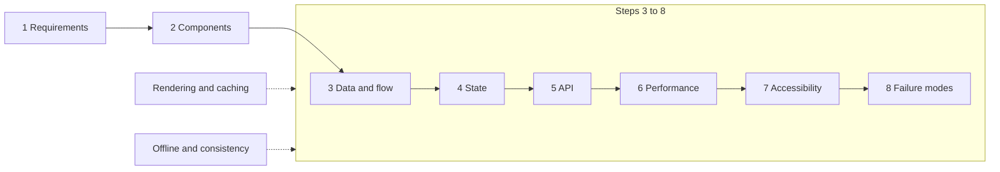
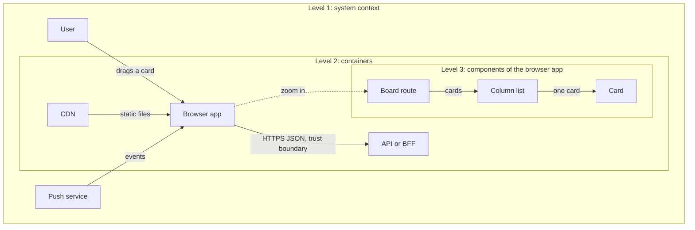
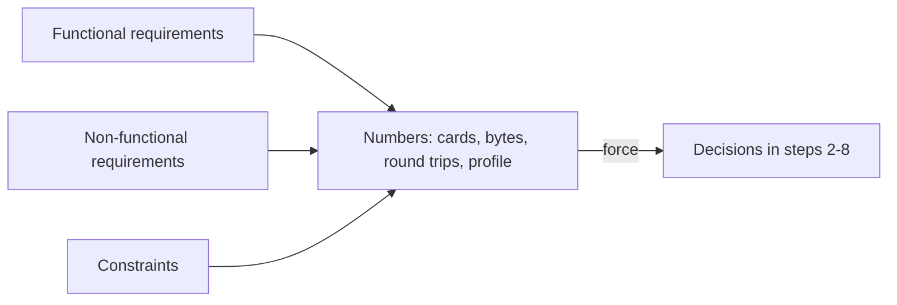
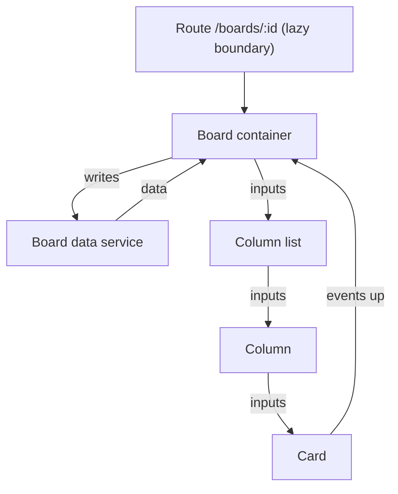
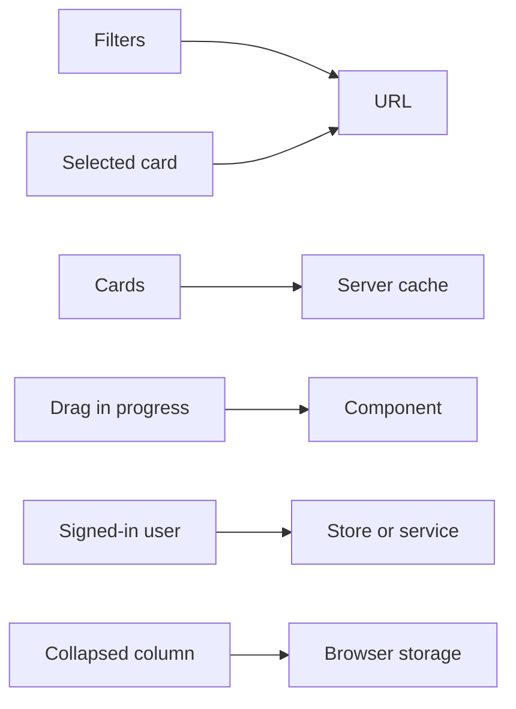
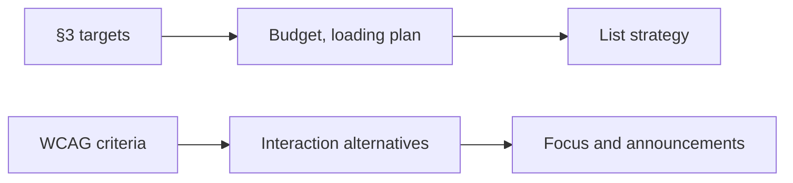
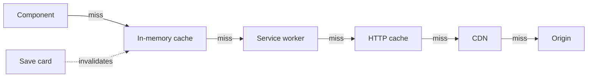
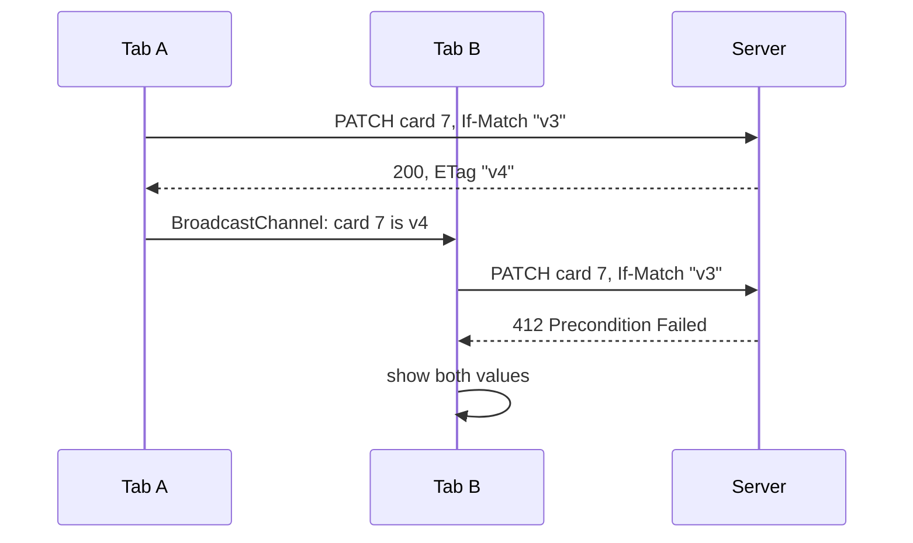

# 45. Front-end system design method: requirements, architecture, state, APIs, performance, accessibility, failure modes and communicating trade-offs

> **What this covers:** how to answer a front-end system design question: what the round evaluates and how it differs from a backend design round; a method that runs from requirements through the component architecture, the data model and flow, state, the API, performance and accessibility, to failure modes and observability; the rendering, caching, offline and consistency choices inside it; and how to state trade-offs and draw diagrams when the clock is running. One running example, a team task board, carries every step.
> **Prerequisites:** [28. Kinds of state](28-state-management.md#1-kinds-of-state-server-cache-ui-form-url-and-session-state-and-where-each-belongs), [31. Measure first](31-performance.md#1-measure-first-the-loop-lab-versus-field-and-what-each-tool-answers), [31. Rendering strategy as a performance decision](31-performance.md#10-rendering-strategy-as-a-performance-decision-csr-ssr-and-ssg)
> **Leads to:** [46. System design case studies](46-system-design-case-studies.md), [47. Behavioral interviews and interview craft](47-behavioral-and-interview-craft.md)
> **Applies to:** Angular 22.2 facts as their owner modules state them, `@angular/ssr` 22.2.1 `RenderMode` typings; TypeScript 6.0 and Node 24 in `labs/ts-js`; documented only: Lighthouse 13.5.0 throttling profiles, WCAG 2.2, RFC 9110, MDN, the C4 model; reads 2026-10-22
> **Study time:** ~2.5 hours reading + ~2.5 hours exercises
> **Short on time:** read [§1](#1-the-front-end-system-design-interview-what-it-evaluates-its-formats-and-how-it-differs-from-a-backend-design-round), [§3](#3-requirements-first-functional-and-non-functional-requirements-constraints-and-back-of-envelope-numbers) and [§8](#8-under-the-hood-failure-modes-observability-offline-levels-and-consistency-choices), then [Q45.01](#q45-01), [Q45.03](#q45-03), [Q45.06](#q45-06), [Q45.13](#q45-13) and [Q45.16](#q45-16), then the [Summary](#summary).
> **Labs:** [`labs/ts-js/src/modules/45-frontend-system-design-method/`](../labs/ts-js/src/modules/45-frontend-system-design-method/) Run (Node 24): from `labs/ts-js`, `npx vitest run src/modules/45-frontend-system-design-method src/outputs/45-frontend-system-design-method`.

## Contents

1. [The front-end system design interview: what it evaluates, its formats, and how it differs from a backend design round](#1-the-front-end-system-design-interview-what-it-evaluates-its-formats-and-how-it-differs-from-a-backend-design-round)
2. [Communicating under time pressure: a time plan, complete trade-off statements and diagrams at three zoom levels](#2-communicating-under-time-pressure-a-time-plan-complete-trade-off-statements-and-diagrams-at-three-zoom-levels)
3. [Requirements first: functional and non-functional requirements, constraints and back-of-envelope numbers](#3-requirements-first-functional-and-non-functional-requirements-constraints-and-back-of-envelope-numbers)
4. [Component architecture, data model and data flow: from screens to a component tree and a client-side model](#4-component-architecture-data-model-and-data-flow-from-screens-to-a-component-tree-and-a-client-side-model)
5. [State and API design: where each piece of state lives and the API the screens need](#5-state-and-api-design-where-each-piece-of-state-lives-and-the-api-the-screens-need)
6. [Performance and accessibility as design steps: budgets, a loading plan, long lists, and keyboard and pointer paths](#6-performance-and-accessibility-as-design-steps-budgets-a-loading-plan-long-lists-and-keyboard-and-pointer-paths)
7. [Rendering strategy and caching layers: a rendering choice per route, and every cache from the CDN to the component](#7-rendering-strategy-and-caching-layers-a-rendering-choice-per-route-and-every-cache-from-the-cdn-to-the-component)
8. [Under the hood: failure modes, observability, offline levels and consistency choices](#8-under-the-hood-failure-modes-observability-offline-levels-and-consistency-choices)
- [Summary](#summary)
- [Question bank](#question-bank)
- [Hands-on exercises](#hands-on-exercises)
- [Check your understanding](#check-your-understanding)
- [Connections](#connections)

**How this module was checked.** Run: Vitest in Node 24 for our own models (time plan, transfer-time estimator, client model, state placement, bytes budget, cache layers, write policies) and both exercises. Read, not run: Lighthouse 13.5.0's throttling profiles, `@angular/ssr` 22.2.1 typings, WCAG 2.2, RFC 9110, MDN, c4model.com and one named third-party prep site. Angular facts link to their owner module. Advice is labeled. Dates are in [SOURCES.md](../SOURCES.md).

## 1. The front-end system design interview: what it evaluates, its formats, and how it differs from a backend design round

### The problem it solves

Asked to "design a team task board", one candidate draws shards and names no requirement; another spends the round choosing a framework.

A **system design round** is an open question about a whole product, answered by talking and drawing. The **running example** is a team task board, not one of the [46](46-system-design-case-studies.md) case studies. A **machine-coding round** has you build one component live; [47](47-behavioral-and-interview-craft.md#4-live-coding-an-angular-task-clarify-say-the-plan-build-in-working-increments-narrate-and-recover-when-stuck) owns it.

### Mental model

Think of an architect's first client meeting: needs, then sketches.

This repository's backend guide says: "The evaluation is almost never about arriving at the "right" architecture; it's about whether you establish requirements before designing, name trade-offs, and notice your own design's failure modes." ([§ 7. System design](../../Backend%20Interview%20Study%20Guide%20-%20Data%20storage%2C%20behavioral%20%26%20concurrency.md)). One third-party prep site, greatfrontend.com (read 2026-10-22), lists six evaluation axes, including "Exploration and tradeoffs" and "Communication and collaboration", and says: "If you thought about a tradeoff but never verbalized it, it did not happen as far as the evaluation is concerned." Both are one source's view, not a company's.

The **method** is eight steps; dashed boxes are choices made inside steps 3 to 8.



What to notice: each step needs the one before it, and none is "choose a framework", one sentence of an answer ([40 §8](40-framework-comparisons.md#8-choosing-a-framework-balanced-trade-offs-and-how-to-answer-why-angular)). The dashed choices are [§7](#7-rendering-strategy-and-caching-layers-a-rendering-choice-per-route-and-every-cache-from-the-cdn-to-the-component) and [§8](#8-under-the-hood-failure-modes-observability-offline-levels-and-consistency-choices).

### How it actually works

Why requirements first? A design is only good against a requirement, so without one it cannot be judged. A **functional requirement** says what the product does; a **non-functional requirement** says how well ([§3](#3-requirements-first-functional-and-non-functional-requirements-constraints-and-back-of-envelope-numbers)).

A **failure mode** is a way it breaks; **observability**, how you notice ([44 §9](44-fullstack-delivery-and-operations.md#9-frontend-error-tracking-and-real-user-monitoring-releases-source-maps-beacons-and-sampling)).

### Code

Write this first. The headings fix the order the interviewer follows; each line ties a step to the board; the last keeps cross-cutting choices in view.

```text
# Our suggestion: the answer skeleton for the task board
1 Requirements    who, which devices, how fast, how many cards
2 Components      screens -> component tree
3 Data and flow   client entities, how data moves
4 State           which piece lives where
5 API             the calls the screens need
6 Performance     budget, loading plan, long lists
7 Accessibility   keyboard and pointer paths
8 Failure modes   what breaks, how we see it, what we do
Across steps      rendering + caching; offline + consistency
```

> [!TIP]
> **Coming from the backend.** Your method has this shape: requirements, rough numbers, the happy path, then where it breaks. **Where the analogy breaks:** the scale that matters is bytes, round trips and work on one device, not requests per second; the client is many untrusted copies of your code; state lives in the URL, caches, components and storage.

### Best practices and anti-patterns

- **Write the headings first**, because a visible order lets the interviewer steer you.

### Misconceptions and traps

- "The round is about picking a framework." The framework is one line; the design is the eight steps. Cause: front-end talk is framework-centred.
- "There is one right architecture." Per the backend guide, the evaluation is about requirements first, named trade-offs and your own failure modes. Cause: coding tests have right answers.
- "Machine coding is design." One builds a component; the other designs a client. Cause: both share a name.
- "The backend method carries over unchanged." The numbers become bytes, round trips and device work. Cause: the step names match.

Drilled in [Q45.01](#q45-01) and [Q45.02](#q45-02).

## 2. Communicating under time pressure: a time plan, complete trade-off statements and diagrams at three zoom levels

### The problem it solves

At minute 35 the candidate is still on the component tree, every choice gets "it depends", and one diagram of unlabeled arrows cannot be followed or interrupted.

A **time plan** splits the slot across the [method's steps](#1-the-front-end-system-design-interview-what-it-evaluates-its-formats-and-how-it-differs-from-a-backend-design-round). A **checkpoint** asks the interviewer where to go deeper; a **deep dive** explores one step past its share.

### Mental model

Think of a map app's zoom: you never draw every street on the country map. **C4**, on a site "written by its creator Simon Brown" (c4model.com, read 2026-10-22), has four levels: system context, containers, components and code. We use the first three as **zoom levels**: the **system context** shows the user and neighbouring systems, then containers, then a **component diagram** of one container.



What to notice: each level answers one question, and every arrow says what flows and which way.

C4 defines a container as "a runtime boundary around some code that is being executed or some data that is being stored". The browser app, the API and the CDN are C4 containers; an Angular container component ([38 §2](38-architecture-and-production-structure.md#2-smart-container-and-presentational-components)) is a component inside the browser app. Same word, different concepts.

### How it actually works

Why several small diagrams? C4 separates levels of detail and is "Notation independent", so labels carry the meaning. The **trust boundary** is where data reaches a more trusted side ([33 §1](33-security.md#1-threat-model-of-an-angular-single-page-app-what-the-attacker-controls-what-runs-where-and-where-each-defense-lives)).

Our suggestion: a weight per step, checkpoints after requirements and after the high-level diagram, and a deep dive that cuts the lowest-priority steps, never requirements or failure modes, which the backend guide says are scored. Voice your reasoning, as [§1](#mental-model) quotes.

A **trade-off statement** is complete with five parts: the axis, the options, the condition that decides, the cost you accept, and what would make you revisit it.

### Code

`planTime` is our model, not a published rubric:

1. Floor each share in integers, because floats drift.
2. Give leftover minutes to the largest remainders, because the plan must equal the slot.
3. Take the deep dive from unprotected steps, lowest priority first, because requirements and failure modes stay protected.

```ts
// Excerpt of labs/ts-js/src/modules/45-frontend-system-design-method/concepts/time-plan.ts
const floors = steps.map((step) => Math.floor((slotMinutes * step.weight) / total));
const byRemainder = steps
  .map((step, index) => ({ index, remainder: (slotMinutes * step.weight) % total }))
  .sort((a, b) => b.remainder - a.remainder || a.index - b.index);
for (const index of cutOrder(steps)) {
  const taken = Math.min(owed, minutes[index] ?? 0);
  minutes[index] = (minutes[index] ?? 0) - taken;
  owed -= taken;
}
```

In our model (see the [tests](../labs/ts-js/src/modules/45-frontend-system-design-method/concepts/section-2-time-plan.test.ts)), 45 minutes become 7, 7, 6, 5, 5, 5, 4 and 6; a 15-minute deep dive empties Performance, Accessibility and API, takes one minute from State, and spares requirements and failure modes.

```text
# Our template, filled for the task board
Axis:     where the cards live while a drag is in progress
Options:  component state, or a shared client store
Decides:  only the column list reads them, so component state
Cost:     a second reader later means lifting the state up
Revisit:  when a second screen needs the same cards
```

### Best practices and anti-patterns

- **Ask at both checkpoints**, because it lets the interviewer pick the deep dive.
- **Label every arrow**, because an unlabeled one hides direction.
- **End each decision with its revisit trigger**, because it shows the decision is conditional.

### Misconceptions and traps

- "One diagram with everything is most complete." Levels let the listener zoom, as in C4. Cause: one picture feels thorough.
- "Thinking silently is fine." In a design round the reasoning is the answer. Cause: coding rounds reward quiet focus.
- "'It depends' shows maturity." Name the condition and the cost you accept. Cause: context does decide.
- "The diagram must follow UML or C4 exactly." C4 calls itself notation independent; labels and direction matter more. Cause: formal notations exist.

Drilled in [Q45.03](#q45-03), [Q45.04](#q45-04) and [Q45.05](#q45-05).

## 3. Requirements first: functional and non-functional requirements, constraints and back-of-envelope numbers

### The problem it solves

The board is designed for office Wi-Fi. On phones the first screen waits on three sequential requests, drag-only cards exclude keyboard users, and nobody wrote down the card count.

A **functional requirement** says what users do (move a card, see teammates' changes). A **non-functional requirement** says how well (speed, accessibility, devices). A **constraint** is fixed from outside (team, deadline). A **back-of-envelope estimate** is arithmetic good to an order of magnitude.

### Mental model

A builder's survey comes before the plan: soil, budget, rooms. This is step 1 of [the method](#1-the-front-end-system-design-interview-what-it-evaluates-its-formats-and-how-it-differs-from-a-backend-design-round).



What to notice: numbers sit between requirements and decisions, so each decision can cite one.

Performance targets are the vitals' thresholds at the 75th percentile (**p75**; [08 §6](08-browser-rendering-dom-events.md#6-core-web-vitals-lcp-inp-and-cls)). Accessibility targets WCAG 2.2 AA ([11 §1](11-accessibility.md#1-why-accessibility-and-what-the-standards-require)); WCAG 2.2 is a "W3C Recommendation 12 December 2024" (w3.org/TR/WCAG22, read 2026-10-22).

### How it actually works

A **network profile** fixes a **round trip** time (**RTT**) and **throughput**. Lighthouse 13.5.0 defaults to `mobileSlow4G` with `throttlingMethod: 'simulate'` (`core/config/constants.js`); its desktop config uses `desktopDense4G`. `@paulirish/trace_engine@0.0.65` (`models/trace/lantern/simulation/Constants.js`, read 2026-10-22) defines them: `mobileSlow4G` is 150 ms and 1.6 × 1024 kbps, commented as WebPageTest's "Fast 3G" with "similar characteristics to roughly the 75th percentile of 4G connections"; `desktopDense4G` is 40 ms and 10 × 1024 kbps. **Simulated throttling** computes a load from a recorded trace: lab numbers, not [field data](31-performance.md#1-measure-first-the-loop-lab-versus-field-and-what-each-tool-answers).

Our unit is kilobits of 1,024 bits: the simulator multiplies `throughputKbps` by 1024 and `TCPConnection` divides bits by 8.

### Code

Approach: one formula, round trips × RTT + bytes ÷ throughput, because a design answer needs a defensible number.

1. `PROFILES` copies the read values.
2. `bytesPerMs` converts kilobits per second to bytes per millisecond, because bytes are what we divide.
3. `transferTime` adds the two terms; it ignores CPU, connection setup, slow start and parallel sharing.

```ts
// Excerpt of labs/ts-js/src/modules/45-frontend-system-design-method/concepts/estimate.ts
export const PROFILES = {
  mobileSlow4G: { name: 'mobileSlow4G', rttMs: 150, throughputKbps: 1.6 * 1024 },
  desktopDense4G: { name: 'desktopDense4G', rttMs: 40, throughputKbps: 10 * 1024 },
} as const satisfies Record<string, Profile>;
export function transferTime(profile: Profile, bytes: number, roundTrips: number): number {
  return roundTrips * profile.rttMs + bytes / bytesPerMs(profile);
}
```

In our estimator (see the [tests](../labs/ts-js/src/modules/45-frontend-system-design-method/concepts/section-3-estimates.test.ts)), on mobile two round trips cost 300 ms against 98 ms for 20 KB, and 2 MB costs 10,000 ms; one round trip fewer saves 150 ms (40 on desktop).

```text
# Assumptions for the task board (ours, used in later sections)
Functional:  view a board, move a card, edit, comment, see teammates' changes
Non-functional: LCP, INP, CLS good at field p75; first screen within budget on mobileSlow4G (lab); WCAG 2.2 AA; phones and desktops
Constraint:  existing REST API, team of four
Numbers:     200 cards per board, 1 KB per card, 3 sequential requests on the first screen
```

### Best practices and anti-patterns

- **Write the numbers first**, because later choices cite them.
- **Name the profile with every latency**, because "fast" is empty without one.

### Misconceptions and traps

- "Non-functional requirements are extras for later." They decide rendering, caching and component design ([§6](#6-performance-and-accessibility-as-design-steps-budgets-a-loading-plan-long-lists-and-keyboard-and-pointer-paths)). Cause: product owners list features.
- "'It should be fast' is a requirement." A requirement is a number: vitals at field p75, a lab budget on a named profile. Cause: vague words feel safe.
- "Accessibility is a post-launch audit." Criteria such as 2.5.7 change the interaction design. Cause: audits are separate tickets.
- "Estimates must be precise." An order of magnitude chooses between designs; our estimator lists what it ignores. Cause: capacity planning looks exact.

Drilled in [Q45.06](#q45-06), [Q45.07](#q45-07); practised in [Exercise 45.1](#ex45-1).

## 4. Component architecture, data model and data flow: from screens to a component tree and a client-side model

### The problem it solves

The board's component tree mirrors its folder tree, each card fetches its own comments, and the client keeps the API response as is.

A **component tree** shows which component renders which. A **container** reads state and passes it down; a **presentational component** takes inputs and emits outputs ([38 §2](38-architecture-and-production-structure.md#2-smart-container-and-presentational-components)). A **feature boundary** groups a feature's files ([38 §1](38-architecture-and-production-structure.md#1-folder-structures-that-scale-by-feature-domain-slices-and-core-shared-and-feature-boundaries), [§4](38-architecture-and-production-structure.md#4-layers-library-types-and-dependency-rules)); a **lazy boundary** is a route loaded on demand ([24 §4](24-routing.md#4-lazy-loading-in-depth-loaders-canmatch-and-route-injectors)). An **entity** is a thing with an id. The **client-side model** is how the browser keeps them: **nested** as the API returns them, or **normalized** into ids and entity maps. **Unidirectional data flow** is data down, events up. A **request waterfall** is requests that start only after earlier ones finish.

### Mental model

A newspaper: the editor (container) assigns; reporters (presentational) write what they get. Step 4 of [the method](#1-the-front-end-system-design-interview-what-it-evaluates-its-formats-and-how-it-differs-from-a-backend-design-round).



What to notice: data goes down, events go up, and only the container talks to the service.

### How it actually works

The framework choice is one line of a design answer ([40 §8](40-framework-comparisons.md#8-choosing-a-framework-balanced-trade-offs-and-how-to-answer-why-angular)); we assume Angular. A card fetching its own comments exists only after the list renders, so its fetch waits behind the list's: a waterfall.

Normalizing is [28 §10](28-state-management.md#10-optimistic-updates-normalization-and-undo)'s pair of `ids` and a map. Under immutable updates an unchanged part keeps its reference, which memoized selectors compare. In our model (see the [tests](../labs/ts-js/src/modules/45-frontend-system-design-method/concepts/section-4-board-model.test.ts)), a move replaces six objects in either shape and no card; a title edit replaces five nested (column and cards array too) and three normalized, leaving the column's id list untouched.

### Code

Approach: count replaced references, so each shape's cost shows.

1. `moveCardNested` copies only the path to the two columns, keeping untouched references.
2. `moveCardNormalized` replaces two id lists, so no card changes.
3. `replacedObjects` counts objects reachable from `after`, not `before`.

```ts
// Excerpt of labs/ts-js/src/modules/45-frontend-system-design-method/concepts/board-model.ts
export function moveCardNormalized(board: NormalizedBoard, { cardId, from, to }: Move): NormalizedBoard {
  const source = entity(board.columns, from);
  const target = entity(board.columns, to);
  const columns = {
    ...board.columns,
    [from]: { ...source, cardIds: source.cardIds.filter((id) => id !== cardId) },
    [to]: { ...target, cardIds: [...target.cardIds, cardId] },
  };
  return { ...board, columns };
}
```

```text
BoardPage          container, lazy route
  ColumnList       presentational
    Column         presentational
      Card         presentational
```

> [!TIP]
> **Coming from the backend.** Normalizing is a relational schema: rows and references by id. **Where the analogy breaks:** there is no join at query time; selectors join in memory and must be memoized.

### Best practices and anti-patterns

- **Normalize what is shared and edited often**, because each read costs a join.

### Misconceptions and traps

- "The component tree is the folder tree." It is who renders whom and who owns data. Cause: the CLI makes one folder per component.
- "Always normalize." It costs selectors and joins ([Q28.29](28-state-management.md#q28-29)). Cause: module 28 teaches it.
- "The client model should mirror the API." The view's reads and writes decide the shape. Cause: generated clients return API shapes ([41 §3](41-fullstack-api-contracts.md#3-openapi-with-springdoc-and-generated-typescript-clients-openapi-generator-orval-and-ng-openapi-gen)).
- "Each component should fetch its own data." It builds a waterfall. Cause: demos do it.

Drilled in [Q45.08](#q45-08); practised in [Exercise 45.1](#ex45-1).

## 5. State and API design: where each piece of state lives and the API the screens need

### The problem it solves

The board's filters live in a component, so reloads and links lose them. Cards copied into a global store go stale beside the server cache. The API exposes tables, so the first screen needs five requests.

**State placement** is choosing each item's home ([28 §1](28-state-management.md#1-kinds-of-state-server-cache-ui-form-url-and-session-state-and-where-each-belongs) owns the kinds). A **source of truth** is the one place whose value wins. **Shareable state** is what a link must restore; **ephemeral state** dies with the interaction. A **resource** is a thing the API names by URL. A **first-screen read** is what the first view needs; an **aggregated endpoint** returns several resources at once. A **cursor** marks the position after the last item ([41 §6](41-fullstack-api-contracts.md#6-pagination-sorting-and-filtering-offset-versus-cursor-and-how-spring-data-serializes-a-page)). A **live update** is a server push.

### Mental model

Steps 4 and 5 of [the method](#1-the-front-end-system-design-interview-what-it-evaluates-its-formats-and-how-it-differs-from-a-backend-design-round). A household: the door noticeboard (URL), the shop-restocked pantry (server cache), your hands (component).



What to notice: six items, five homes; the cards never reach the store.

### How it actually works

Ask in order: shareable? server-owned? survives reload? shared across features? The first yes decides, so a filter three features read still goes in the URL ([Exercise 28.2](28-state-management.md#ex28-2)). Server data keeps one source of truth, the server cache; a store copy goes stale ([Q28.03](28-state-management.md#q28-03)). In our model (see the [tests](../labs/ts-js/src/modules/45-frontend-system-design-method/concepts/section-5-state-placement.test.ts)) storage gets a lifetime, tab or until cleared ([09 §7](09-web-networking-storage-security.md#7-browser-storage-what-each-is-safe-for)).

For the API, a validator names one response's version ([09 §4](09-web-networking-storage-security.md#4-http-caching)), so per-resource reads revalidate independently. An aggregated response changes when any part does and fits one screen; it saves round trips and a BFF can build it ([44 §1](44-fullstack-delivery-and-operations.md#1-where-the-api-calls-go-direct-calls-a-same-origin-reverse-proxy-an-api-gateway-or-a-backend-for-frontend)). Pages use cursors, errors use problem details ([41 §5](41-fullstack-api-contracts.md#5-error-contracts-with-problemdetail-rfc-9457-and-mapping-them-in-angular)), and live updates take the transport [43 §1](43-fullstack-realtime.md#1-choosing-a-transport-polling-long-polling-server-sent-events-websockets-and-web-push-when-no-tab-is-open) chooses. Writes carry a version ([§8](#8-under-the-hood-failure-modes-observability-offline-levels-and-consistency-choices)).

### Code

Approach: a fixed order, so one answer decides.

1. `placeState` returns at the first true answer, because the order is the precedence.
2. The contract lists the reads, a versioned write and a stream, because the screens' calls shape it.

```ts
// Excerpt of labs/ts-js/src/modules/45-frontend-system-design-method/concepts/state-placement.ts
export function placeState(item: StateItem): Placement {
  if (item.shareable) return { home: 'url' };
  if (item.serverOwned) return { home: 'server-cache' };
  if (item.survives !== 'never') return { home: 'storage', lifetime: lifetimeOf(item.survives) };
  if (item.sharedAcrossFeatures) return { home: 'store' };
  return { home: 'component' };
}
```

```http
# Illustrative contract, not a lab API
GET /api/boards/42                  first screen: board, columns, first cards
GET /api/boards/42/cards?cursor=c9  next page
PATCH /api/cards/7
If-Match: "v3"                      stale version: refused
GET /api/boards/42/events           text/event-stream
```

### Best practices and anti-patterns

- **Name one source of truth per item**, because copies disagree.

### Misconceptions and traps

- "Put everything in a global store." Copied server data goes stale. Cause: store libraries make central state the default.
- "Filters belong in the component." Reloads and links lose them. Cause: it is the shortest code.
- "One endpoint per screen is always best." It couples the API to one screen and caches as one unit. Cause: it means fewer round trips.
- "The API is the backend team's job." The screen's reads and writes set the contract ([41](41-fullstack-api-contracts.md)). Cause: teams are split by layer.

Drilled in [Q45.09](#q45-09), [Q45.10](#q45-10) and [Q45.11](#q45-11).

## 6. Performance and accessibility as design steps: budgets, a loading plan, long lists, and keyboard and pointer paths

### The problem it solves

"Lazy-load everything" puts the board's route behind a chunk waterfall. "Virtual-scroll" skips asking how many cards a column holds. Cards only drag. Spinners shift layout.

A **performance budget** limits a screen's cost ([31 §6](31-performance.md#6-bundle-analysis-budgets-and-tree-shaking-pitfalls)). **Windowing** renders only visible rows; a **skeleton** reserves a loading area's size. A **single-pointer alternative** replaces a drag with clicks; **target size** is the clickable area; **focus restoration** returns focus; an **announcement** is spoken text ([11 §5](11-accessibility.md#5-focus-management-in-spas-and-live-regions)).

### Mental model

Steps 6 and 7 of [the method](#1-the-front-end-system-design-interview-what-it-evaluates-its-formats-and-how-it-differs-from-a-backend-design-round).



What to notice: both chains end before code.

### How it actually works

A time target becomes a byte budget after round trips and server time are subtracted. On the mobile profile ([§3](#3-requirements-first-functional-and-non-functional-requirements-constraints-and-back-of-envelope-numbers)), 2,500 ms, three round trips and 200 ms server time leave about 388,000 bytes; round trips beyond the target leave none ([tests](../labs/ts-js/src/modules/45-frontend-system-design-method/concepts/section-6-budget.test.ts)). Our model ignores CPU (Lighthouse's mobile profile slows it 4 times; desktop, not at all).

The **loading plan** puts the first route up front, the rest lazily ([31 §5](31-performance.md#5-loading-the-initial-bundle-lazy-routes-defer-and-preloading-as-one-plan), [18 §5](18-control-flow-and-defer.md#5-defer-blocks-and-states-placeholder-loading-error-minimum-and-after)). Windowing costs, so card count decides ([31 §4](31-performance.md#4-long-lists-track-virtual-scrolling-with-the-cdk-and-the-alternatives)); skeletons guard CLS ([08 §6](08-browser-rendering-dom-events.md#6-core-web-vitals-lcp-inp-and-cls)).

WCAG 2.2 SC 2.5.7 Dragging Movements (Level AA): "All functionality that uses a dragging movement for operation can be achieved by a single pointer without dragging, unless dragging is essential or the functionality is determined by the user agent and not modified by the author." A keyboard path is not enough: the non-normative Understanding page says it "does not automatically meet" 2.5.7. 2.1.1 Keyboard is separate, and CDK drag and drop has no keyboard path ([36 §6](36-material-and-cdk.md#6-drag-and-drop-sorting-transferring-between-lists-and-the-keyboard-gap)). SC 2.5.8 (AA) asks "at least 24 by 24 CSS pixels" (abridged; exceptions follow).

### Code

Approach: subtract the fixed costs first, because only the remainder buys bytes.

1. `maxBytes` clamps at zero, so an impossible target shows as none.
2. One move, three paths: no one input suits all ([11 §4](11-accessibility.md#4-keyboard-focus-order-roving-tabindex-and-focus-traps)).

```ts
// Excerpt of labs/ts-js/src/modules/45-frontend-system-design-method/concepts/budget.ts
export function maxBytes(targetMs: number, profile: Profile, roundTrips: number, serverMs: number): number {
  const transferMs = targetMs - roundTrips * profile.rttMs - serverMs;
  return Math.max(0, transferMs * bytesPerMs(profile));
}
```

```text
Move card 7 to "Done"
1. Drag: pointer down on the card, drop on the column.
2. Menu: "Move to…" button, one click opens a list, one click picks the column.
3. Keyboard: Tab to the card, arrows move focus among columns (roving focus), Enter drops.
After any path: focus returns to the card; live region says "Card 7 moved to Done".
```

### Best practices and anti-patterns

- **Derive the budget from the target**: a size without a time is a guess.
- **Give every drag a menu path.**

### Misconceptions and traps

- "Lazy-load everything." The first route then waits on an extra request, so plan it up front. Cause: it is the usual first advice.
- "Virtual scrolling fixes any long list." It fixes DOM size, at a cost ([Q31.10](31-performance.md#q31-10)). Cause: it is the famous fix.
- "Drag and drop with ARIA is accessible." 2.5.7 and 2.1.1 ask for other ways to operate. Cause: roles look like support.
- "A spinner is a fine loading state." Content arriving shifts layout, so reserve space. Cause: it is one line.

Drilled in [Q45.12](#q45-12); practised in [Exercise 45.1](#ex45-1).

## 7. Rendering strategy and caching layers: a rendering choice per route, and every cache from the CDN to the component

### The problem it solves

The logged-in board is server-rendered "for performance", yet changes every second. After an edit, a reload shows the old title; which layer answered?

A **rendering strategy** decides where and when HTML is built ([31 §10](31-performance.md#10-rendering-strategy-as-a-performance-decision-csr-ssr-and-ssg)); **prerendering** builds it at build time. A **caching layer** stores answers under a **cache key**: a **hit** answers, a **miss** asks deeper. **Staleness** is allowed age; **invalidation** removes an entry. A **shared cache** serves many users ([09 §4](09-web-networking-storage-security.md#4-http-caching)).

### Mental model

Inside steps 3 to 8 of [the method](#1-the-front-end-system-design-interview-what-it-evaluates-its-formats-and-how-it-differs-from-a-backend-design-round).



What to notice: a hit stops the walk; the save clears one layer.

### How it actually works

Canonical order, nearest first:

| Layer | Holds, key | Invalidated by | Stale up to |
|---|---|---|---|
| Component | fields | the component | its lifetime |
| In-memory cache ([27 §6](27-http-client.md#6-cancellation-and-caching-unsubscribing-aborts-cache-interceptors-sharereplay-and-the-ssr-transfer-cache)) | response, URL | your code | page lifetime |
| Service worker ([37 §5](37-elements-pwa-errors-ecosystem.md#5-caching-with-asset-and-data-groups-navigation-requests-and-the-app-shell)) | response, request | group `maxAge`, version | `maxAge` |
| HTTP cache | response, URL | expiry, validators | `max-age` |
| CDN | response, URL | expiry, its operator | `s-maxage` |

The first fresh entry answers; invalidating one leaves the rest. A reload can show old data when a cache-first layer (a `performance` data group within `maxAge`) or a fresh HTTP entry answers first ([09 §9](09-web-networking-storage-security.md#9-service-workers-and-the-pwa-manifest), [09 §4](09-web-networking-storage-security.md#4-http-caching)). Our model shows it ([tests](../labs/ts-js/src/modules/45-frontend-system-design-method/concepts/section-7-cache-layers.test.ts)).

Rendering is per route: `RenderMode.Prerender`, `Server` or `Client`, as [32 §3](32-ssr-ssg-hydration.md#3-server-routes-and-rendermode-per-route-rendering-getprerenderparams-fallbacks-headers-and-status) owns them; see [31 §10](31-performance.md#10-rendering-strategy-as-a-performance-decision-csr-ssr-and-ssg), [32 §1](32-ssr-ssg-hydration.md#1-why-render-on-the-server-csr-ssr-ssg-and-hybrid-rendering-and-what-each-costs), [Q31.26](31-performance.md#q31-26) and [Q32.09](32-ssr-ssg-hydration.md#q32-09).

> [!NOTE]
> **Framework vs platform.** Angular adds the transfer cache ([32 §8](32-ssr-ssg-hydration.md#8-data-across-the-boundary-the-http-transfer-cache-transferstate-and-resource-ids)), its service worker and `httpResource` ([27 §10](27-http-client.md#10-httpresource-signal-driven-requests-and-when-to-prefer-it-over-httpclient)); the browser owns the HTTP cache and Cache Storage; the CDN is infrastructure.

### Code

Approach: model the order.

1. `lookup` skips entries past their maximum age, because a stale copy must not answer; a miss everywhere asks the origin and fills every layer.
2. A hit refills nearer layers, so the next read stops sooner.

```ts
// Excerpt of labs/ts-js/src/modules/45-frontend-system-design-method/concepts/cache-layers.ts
export function lookup(layers: readonly Layer[], key: string, now: number, origin: (key: string) => string): Lookup {
  const asked: string[] = [];
  for (const [index, layer] of layers.entries()) {
    asked.push(layer.name);
    const entry = layer.entries.get(key);
    if (entry !== undefined && isFresh(entry, now)) {
      layers.slice(0, index).forEach((nearer) => store(nearer, key, entry.value, now));
      return { layer: layer.name, value: entry.value, asked };
    }
  }
  const value = origin(key);
  layers.forEach((layer) => store(layer, key, value, now));
  return { layer: 'origin', value, asked };
}
```

```text
/            Prerender   same for every visitor
/sign-in     Client      no content to index
/boards/:id  Client      behind login, changes every second
```

### Best practices and anti-patterns

- **Name the layer first**, because purging another changes nothing.

### Misconceptions and traps

- "Server rendering is always faster." A logged-in board gains little, paying server time ([Q32.02](32-ssr-ssg-hydration.md#q32-02)). Cause: SSR is sold as the fast option.
- "There is one cache." Five layers answer in order. Cause: each team sees only its own.
- "A reload fetches fresh data." A service worker or fresh HTTP entry can still answer. Cause: reload revalidates the page.
- "CDNs cache only static files." Shared caches may store responses headers allow ([09 §4](09-web-networking-storage-security.md#4-http-caching), [32 §9](32-ssr-ssg-hydration.md#9-deploying-ssr-node-and-other-runtimes-static-output-caching-rendered-pages-and-allowed-hosts)). Cause: hashed assets are the usual example.

Drilled in [Q45.13](#q45-13) and [Q45.14](#q45-14).

## 8. Under the hood: failure modes, observability, offline levels and consistency choices

### The problem it solves

Concurrent edits vanish, offline moves die on reload, tabs lag, errors name no dependency.

A **degraded behavior** is a screen's fallback; a **signal** reports the failure. An **offline level** is what works offline. An **outbox** queues writes ([09 §7](09-web-networking-storage-security.md#7-browser-storage-what-each-is-safe-for)) with **operation ids**, so a **replay** may repeat. **Last-write-wins** keeps the latest save; a **conditional write** sends a **precondition** (`If-Match`, the read **entity tag**, [09 §4](09-web-networking-storage-security.md#4-http-caching)); a **field-level merge** refuses edits to changed fields. **Optimistic UI** applies before the answer, **pessimistic UI** after. **Read-your-writes**: the writer sees its change; **cross-tab sync** tells other tabs.

### Mental model

Step 8 of [the method](#1-the-front-end-system-design-interview-what-it-evaluates-its-formats-and-how-it-differs-from-a-backend-design-round). A shared calendar: edit only if the stamp you saw is still there.



What to notice: the stale tag changes nothing; A never hears itself.

### How it actually works

RFC 9110 §13.1.1 (read 2026-10-22): an origin server "MUST use the strong comparison function", "MUST NOT perform the requested method if the condition evaluates to false", "MAY indicate" failure "by responding with a 412", or, when the change "appears to have already been applied", "MAY respond with a 2xx" (abridged). §15.5.13: conditions "evaluated to false". 412 is optional; Spring sends it ([41 §5](41-fullstack-api-contracts.md#5-error-contracts-with-problemdetail-rfc-9457-and-mapping-them-in-angular)). Our model refuses stale writes; last-write-wins loses one ([tests](../labs/ts-js/src/modules/45-frontend-system-design-method/concepts/section-8-consistency.test.ts)).

`BroadcastChannel` [Baseline 2022: widely available, per MDN] reaches documents "of the same origin", every listener "except the object that sent the message" (MDN, read 2026-10-22; [Baseline](https://developer.mozilla.org/en-US/docs/Glossary/Baseline/Compatibility) is MDN's status). The writer updates itself, as [42 §8](42-fullstack-authentication.md#8-logout-everywhere-and-session-timeout-ux)'s logout does; other devices need a live stream ([43 §1](43-fullstack-realtime.md#1-choosing-a-transport-polling-long-polling-server-sent-events-websockets-and-web-push-when-no-tab-is-open)).

Offline levels: none, cached reads, queued writes. Background Synchronization [Baseline: limited availability, per MDN] lists Chrome and Edge in MDN's compatibility data (read 2026-10-22); Angular's service worker has no `sync` listener ([37 §7](37-elements-pwa-errors-ecosystem.md#7-push-notifications-and-installability-swpush-notification-clicks-and-the-manifest)), that package's gap, so replay on `online` or at start. `navigator.onLine` "returns whether the device is connected to the network", not your API ([37 §10](37-elements-pwa-errors-ecosystem.md#10-error-ux-expected-and-unexpected-errors-http-failures-offline-state-and-route-errors)).

Per interaction ([28 §10](28-state-management.md#10-optimistic-updates-normalization-and-undo)): a reversible move goes optimistic; irreversible or money actions pessimistic ([46](46-system-design-case-studies.md#8-under-the-hood-a-money-transfer-with-idempotency-keys-optimistic-ui-that-never-claims-success-and-the-unknown-outcome)). Signals: RUM and errors ([44 §9](44-fullstack-delivery-and-operations.md#9-frontend-error-tracking-and-real-user-monitoring-releases-source-maps-beacons-and-sampling)), traces ([44 §10](44-fullstack-delivery-and-operations.md#10-under-the-hood-opentelemetry-for-the-web-traceparent-and-one-click-traced-to-a-spring-boot-span-and-log-line)), skew ([44 §8](44-fullstack-delivery-and-operations.md#8-feature-flags-with-openfeature-and-canary-releases-providers-evaluation-context-sticky-rollout-kill-switches-and-version-skew)).

### Code

Approach: one interleaving, every policy, so losses compare.

1. `decide` applies every write under last-write-wins; under the conditional and field policies it never performs a stale one, because §13.1.1 says MUST NOT.
2. `replay` keeps order, because order is intent; seen ids are skipped.
3. One behavior and signal per failure, because a failure with no signal goes unseen.

```ts
// Excerpt of labs/ts-js/src/modules/45-frontend-system-design-method/concepts/consistency.ts
function decide(policy: Policy, stored: Stored, write: Write): Outcome {
  if (policy === 'last-write-wins') return 'applied';
  const holds =
    policy === 'conditional'
      ? strongMatch(entityTag(write.baseVersion), entityTag(stored.version))
      : fieldsOf(write.changes).every((field) => stored.changedAt[field] <= write.baseVersion);
  if (holds) return 'applied';
  return alreadyApplied(stored, write.changes) ? 'already applied 2xx' : 'refused 412';
}
```

```ts
// Excerpt of labs/ts-js/src/modules/45-frontend-system-design-method/concepts/consistency.ts
  receive(operation: Operation): Delivery {
    if (this.seen.has(operation.id)) return 'duplicate';
    this.seen.add(operation.id);
    const card = this.cards.get(operation.cardId);
    if (card !== undefined) this.cards.set(operation.cardId, { ...card, ...operation.changes });
    return 'applied';
  }

export function replay(outbox: readonly Operation[], server: OutboxServer): Delivery[] {
  return outbox.map((operation) => server.receive(operation));
}
```

```text
Dependency       User sees                          Signal                      Owner
Network          offline banner, queued moves       outbox length, beacons      37 §10
API 5xx/timeout  retry message, card unchanged      error report, trace         44 §9, 44 §10
Session expired  sign-in prompt, draft kept         401 count                   42 §8
Conflict         both values, choose one            412 count                   41 §5
Live stream      "reconnecting", stale marker       reconnect count             43 §2
New deploy       "reload for the new version"       release tag mismatch        44 §8
Broken widget    fallback in its box only           error with component        37 §9
```

### Best practices and anti-patterns

- **Send `If-Match` on edits**, because otherwise the last write wins.

### Misconceptions and traps

- "Offline-first is always better." Queued writes bring conflicts; pick the needed level. Cause: PWA advice makes it the goal.
- "`navigator.onLine` means the API is reachable." It reports a network. Cause: the name.
- "Optimistic UI is always better." Irreversible actions need confirmation. Cause: demos feel instant.
- "A stale `If-Match` always gets 412." It is never performed; 412 or 2xx may answer. Cause: 412 is common.
- "Background Sync replaces the outbox." You still need the outbox, replayed on `online`: the API has limited availability and Angular's service worker has no `sync` listener. Cause: the name promises it.

Drilled in [Q45.15](#q45-15), [Q45.16](#q45-16) and [Q45.17](#q45-17); practised in [Exercise 45.2](#ex45-2).

## Summary

The round rewards requirements first, named trade-offs and your own failure modes, not a framework choice ([§1](#1-the-front-end-system-design-interview-what-it-evaluates-its-formats-and-how-it-differs-from-a-backend-design-round)). State trade-offs completely, draw three zoom levels and protect requirements and failure modes in the time plan ([§2](#2-communicating-under-time-pressure-a-time-plan-complete-trade-off-statements-and-diagrams-at-three-zoom-levels)). Write requirements as numbers: vitals at field p75, budgets on a named lab profile ([§3](#3-requirements-first-functional-and-non-functional-requirements-constraints-and-back-of-envelope-numbers)). The component tree is who renders whom, not the folder tree ([§4](#4-component-architecture-data-model-and-data-flow-from-screens-to-a-component-tree-and-a-client-side-model)). Place state by a fixed order ([§5](#5-state-and-api-design-where-each-piece-of-state-lives-and-the-api-the-screens-need)).

A time target becomes a byte budget after fixed costs, and every drag needs a single-pointer path, which a keyboard path alone does not give ([§6](#6-performance-and-accessibility-as-design-steps-budgets-a-loading-plan-long-lists-and-keyboard-and-pointer-paths)). Rendering is chosen per route, and the nearest fresh cache layer answers, so a reload can show old data ([§7](#7-rendering-strategy-and-caching-layers-a-rendering-choice-per-route-and-every-cache-from-the-cdn-to-the-component)). A stale `If-Match` is never performed, `BroadcastChannel` skips the sender, and Background Sync has limited availability ([§8](#8-under-the-hood-failure-modes-observability-offline-levels-and-consistency-choices)).

## Question bank

Seventeen questions follow the method's order, from the interview to failure modes, all on the task board. Assumed numbers come from the sections; Output answers are asserted by tests.

<a id="q45-01"></a>
### Q45.01 · Concept · What does a front-end system design interview evaluate, and how does it differ from a backend design round?

<details>
<summary>Answer</summary>

**Short answer (30 seconds).** It judges requirements first, named trade-offs and noticing where your design breaks, not finding the "right" architecture. The front end differs in its numbers: bytes, round trips and one device's work ([§3](#3-requirements-first-functional-and-non-functional-requirements-constraints-and-back-of-envelope-numbers)).

**Full explanation.** The [backend guide](../../Backend%20Interview%20Study%20Guide%20-%20Data%20storage%2C%20behavioral%20%26%20concurrency.md) (§ 7. System design) calls the evaluation "almost never about arriving at the "right" architecture". greatfrontend.com, a third-party prep site (read 2026-10-22), says an unspoken trade-off "did not happen". Both are one source's view ([§1](#1-the-front-end-system-design-interview-what-it-evaluates-its-formats-and-how-it-differs-from-a-backend-design-round)).

**Follow-ups an interviewer will ask.**
- *Why requirements first?* A design is good only against a requirement.
- *Why name failure modes unprompted?* The backend guide asks for it: noticing your own weak points is judged.

**Trap to avoid.** Opening with a framework: it is one line ([40 §8](40-framework-comparisons.md#8-choosing-a-framework-balanced-trade-offs-and-how-to-answer-why-angular)) and skips requirements.

</details>

<a id="q45-02"></a>
### Q45.02 · Difference · Front-end system design, a machine-coding round and a walkthrough of a system you built: what does each round test, and how do you prepare differently?

<details>
<summary>Answer</summary>

**Short answer (30 seconds).** Our suggestion, as no official page was read: design tests the method on a whole client, machine coding one component built live, a walkthrough how you explain and measure a real system. Each asks for a different artifact.

**Full explanation.** Practise design aloud against a time plan ([§1](#1-the-front-end-system-design-interview-what-it-evaluates-its-formats-and-how-it-differs-from-a-backend-design-round), [§2](#2-communicating-under-time-pressure-a-time-plan-complete-trade-off-statements-and-diagrams-at-three-zoom-levels)), machine coding against the clock ([47](47-behavioral-and-interview-craft.md#4-live-coding-an-angular-task-clarify-say-the-plan-build-in-working-increments-narrate-and-recover-when-stuck) owns etiquette), and a walkthrough with numbers and a failure you fixed.

**Follow-ups an interviewer will ask.**
- *Why state assumptions in machine coding?* Our suggestion: an interviewer can credit only reasoning they hear; the prep site's "never verbalized" sentence ([§1](#1-the-front-end-system-design-interview-what-it-evaluates-its-formats-and-how-it-differs-from-a-backend-design-round)) is about design rounds.
- *Why numbers in a walkthrough?* A claim without a measurement cannot be checked ([31 §1](31-performance.md#1-measure-first-the-loop-lab-versus-field-and-what-each-tool-answers)).

**Trap to avoid.** One story for all three: the artifacts differ.

</details>

<a id="q45-03"></a>
### Q45.03 · Design · A 45-minute slot: plan your time across the method's steps, the checkpoints where you ask where to go deeper, and what you cut when one step runs long

<details>
<summary>Answer</summary>

**Short answer (30 seconds).** Our model for 45 minutes: requirements 7, components 7, data and flow 6, state 5, API 5, performance 5, accessibility 4, failure modes 6. Ask at two checkpoints; cut the lowest priorities, never requirements or failure modes.

**Full explanation.** The `Section 2:` tests' model ([§2](#2-communicating-under-time-pressure-a-time-plan-complete-trade-off-statements-and-diagrams-at-three-zoom-levels)), not a published rubric. Ask after requirements and the diagram. A 15-minute deep dive empties performance, accessibility and API, and takes one minute from state.

**Follow-ups an interviewer will ask.**
- *Why protect failure modes?* The backend guide says noticing them is judged.
- *Why checkpoints?* Asking lets the interviewer pick the deep dive, not you guess.

**Trap to avoid.** Finishing every step shallowly: it ignores the interviewer's interest.

</details>

<a id="q45-04"></a>
### Q45.04 · Concept · "It depends" is not an answer: what makes a trade-off statement complete, shown on one decision for a task board?

<details>
<summary>Answer</summary>

**Short answer (30 seconds).** Five parts: the axis, the options, the condition that decides, the cost you accept and what would make you revisit. "It depends" names none.

**Full explanation.** The decision is conditional, so say on what ([§2](#2-communicating-under-time-pressure-a-time-plan-complete-trade-off-statements-and-diagrams-at-three-zoom-levels)); pros and cons alone leave the choice to the interviewer. Another decision: [Q44.02](44-fullstack-delivery-and-operations.md#q44-02).

```text
# Our template, filled for another board decision
Axis:     how the first screen loads cards
Options:  one request for the board, or one per column
Decides:  200 cards of about 1 KB are small, so one request
Cost:     cards of hidden columns download too
Revisit:  when boards pass a thousand cards
```

**Follow-ups an interviewer will ask.**
- *Why a revisit trigger?* It shows when the choice flips.
- *Why name the cost?* Without one it is a preference.

**Trap to avoid.** "It depends on requirements": the deciding condition is the answer.

</details>

<a id="q45-05"></a>
### Q45.05 · Bug hunt · A whiteboard review: one box per file, unlabeled arrows, no line between browser and server, and a database drawn inside the browser. What does each cost the answer?

<details>
<summary>Answer</summary>

**Short answer (30 seconds).** Boxes per file show folders, not who renders what; unlabeled arrows hide direction; no browser-server line hides the trust boundary; a database in the browser mistakes a cache for the source of truth.

**Full explanation.** The tree is who renders whom and owns data ([§4](#4-component-architecture-data-model-and-data-flow-from-screens-to-a-component-tree-and-a-client-side-model)). Unlabeled arrows blur a request and an event. The browser runs untrusted copies, so validation belongs behind a visible [boundary](33-security.md#1-threat-model-of-an-angular-single-page-app-what-the-attacker-controls-what-runs-where-and-where-each-defense-lives). Storage can be evicted ([09 §7](09-web-networking-storage-security.md#7-browser-storage-what-each-is-safe-for)), so it is no database.

**Follow-ups an interviewer will ask.**
- *What do you draw instead?* Three levels, each answering one question ([§2](#2-communicating-under-time-pressure-a-time-plan-complete-trade-off-statements-and-diagrams-at-three-zoom-levels)).
- *Is a browser cache wrong?* No; calling it the source of truth is: clearing loses it.

**Trap to avoid.** More detail on one diagram: it is harder to follow.

</details>

<a id="q45-06"></a>
### Q45.06 · Design · The first five minutes of "design a team task board": which clarifying questions, which functional and non-functional requirements, and which numbers do you write down?

<details>
<summary>Answer</summary>

**Short answer (30 seconds).** Ask who uses it, on which devices and networks, how many cards, and what must update live. Write non-functional requirements as numbers: vitals at field p75, a lab budget on a named profile.

**Full explanation.** Functional: view, move, edit, comment. Assumed ([§3](#3-requirements-first-functional-and-non-functional-requirements-constraints-and-back-of-envelope-numbers) holds the profile numbers): 200 cards of about 1 KB, three sequential requests. Speed becomes "LCP, INP and CLS good at field p75" ([08 §6](08-browser-rendering-dom-events.md#6-core-web-vitals-lcp-inp-and-cls)) plus a first-screen budget on `mobileSlow4G`, a lab profile, where a load has no INP ([31 §1](31-performance.md#1-measure-first-the-loop-lab-versus-field-and-what-each-tool-answers)); accessibility, WCAG 2.2 AA.

**Follow-ups an interviewer will ask.**
- *Why devices and networks?* A profile fixes round-trip time and throughput, changing the byte budget ([§6](#6-performance-and-accessibility-as-design-steps-budgets-a-loading-plan-long-lists-and-keyboard-and-pointer-paths)).
- *Why the card count?* It decides windowing ([31 §4](31-performance.md#4-long-lists-track-virtual-scrolling-with-the-cdk-and-the-alternatives)).

**Trap to avoid.** "It should be fast": with no number on a named profile, no decision can cite it.

</details>

<a id="q45-07"></a>
### Q45.07 · Output · Our estimator on the board's first screen: payload, round trips and transfer time on the mobile and desktop profiles. What does it print?

Our `estimate.ts` ([§3](#3-requirements-first-functional-and-non-functional-requirements-constraints-and-back-of-envelope-numbers)); assumed, in KB of 1,024 bytes: `index.html` 4, `main.js` 180, `styles.css` 20, the board `GET` 30:

```ts
const bytes = (4 + 180 + 20 + 30) * 1024;
for (const profile of [PROFILES.mobileSlow4G, PROFILES.desktopDense4G]) {
  const ms = Math.round(transferTime(profile, bytes, 3));
  console.log(`${profile.name}: ${bytes} bytes, 3 round trips, ${ms} ms`);
}
```

<details>
<summary>Answer</summary>

**Short answer (30 seconds).**

```text
mobileSlow4G: 239616 bytes, 3 round trips, 1593 ms
desktopDense4G: 239616 bytes, 3 round trips, 303 ms
```

Our estimator adds round trips times round-trip time to bytes divided by throughput: mobile pays 450 ms for trips, 1,143 for bytes.

**Full explanation.** Asserted by `Q45.07 our estimate of the first screen on the mobile and desktop profiles`. It ignores CPU and connection setup: an order of magnitude only.

**Follow-ups an interviewer will ask.**
- *What helps mobile most?* Fewer bytes: 1,143 of 1,593 ms.
- *Why not trust 303 ms?* CPU is ignored.

**Trap to avoid.** Reading it as measured: it ignores CPU.

</details>

<a id="q45-08"></a>
### Q45.08 · Design · Draw the task board's component tree and client-side model: routes, containers, presentational components, lazy boundaries and the shape of the cards in memory

<details>
<summary>Answer</summary>

**Short answer (30 seconds).** A lazy route holds one container that loads the board and passes inputs down; cards emit events up. Cards stay normalized ([28 §10](28-state-management.md#10-optimistic-updates-normalization-and-undo)): ids per column, one map.

```text
/boards/:id (lazy)  BoardPage (container)
  ColumnList > Column > Card     inputs down, events up
Model: columns { todo: [7, 9] }, cards { 7: {...}, 9: {...} }
```

**Full explanation.** Only the container calls the service ([§4](#4-component-architecture-data-model-and-data-flow-from-screens-to-a-component-tree-and-a-client-side-model)), so no card fetches its comments and builds a waterfall.

**Follow-ups an interviewer will ask.**
- *Why a container per route?* It owns loading ([Q38.06](38-architecture-and-production-structure.md#q38-06)).
- *Why normalize?* A move replaces two id lists, not cards; selectors pay ([Q28.29](28-state-management.md#q28-29)).

**Trap to avoid.** Drawing the folder tree: it shows files.

</details>

<a id="q45-09"></a>
### Q45.09 · Output · Our state-placement function on six pieces of the board's state: the open card, the filters, the cards, a drag in progress, a draft comment and the theme. Where does each go?

Our `placeState` ([§5](#5-state-and-api-design-where-each-piece-of-state-lives-and-the-api-the-screens-need)):

```ts
for (const item of items) {
  const { home, lifetime } = placeState(item);
  console.log(`${item.name}: ${home}${lifetime ? ` (${lifetime})` : ''}`);
}
```

<details>
<summary>Answer</summary>

**Short answer (30 seconds).**

```text
open card: url
filters: url
cards: server-cache
drag in progress: component
draft comment: storage (tab)
theme: storage (until cleared)
```

The first true rule in the order shareable, server-owned, survives reload, shared across features decides, so the draft and theme go to storage.

**Full explanation.** Asserted by `Q45.09 our placement of six pieces of the board state`. A link must restore the open card and filters, so the URL wins; the cards' source of truth is the server cache; the drag dies with the gesture. Storage gets a lifetime ([09 §7](09-web-networking-storage-security.md#7-browser-storage-what-each-is-safe-for)); kinds: [28 §1](28-state-management.md#1-kinds-of-state-server-cache-ui-form-url-and-session-state-and-where-each-belongs), [Q28.01](28-state-management.md#q28-01).

**Follow-ups an interviewer will ask.**
- *Why not a store for the cards?* A copy goes stale.
- *Why the order?* A filter shared across features matches two rules; the earlier decides.

**Trap to avoid.** Asking only who reads it: sharing is the last rule.

</details>

<a id="q45-10"></a>
### Q45.10 · Trade-off · The board's first screen: one request per resource, one aggregated screen endpoint, or a query language such as GraphQL? Round trips, caching, coupling and who owns the shape

<details>
<summary>Answer</summary>

**Short answer (30 seconds).** Per resource when requests run in parallel; one aggregated endpoint when sequential round trips on a high-RTT profile dominate, accepting its coupling to the screen. A query language lets the client shape it.

**Full explanation.** Each resource has its own validator ([09 §4](09-web-networking-storage-security.md#4-http-caching)); a dependent chain costs 150 ms a hop on mobile ([§3](#3-requirements-first-functional-and-non-functional-requirements-constraints-and-back-of-envelope-numbers)). An aggregate changes when any part does; a BFF can build it ([Q44.02](44-fullstack-delivery-and-operations.md#q44-02)). GraphQL's HTTP behavior is unclaimed here: [Q32.23](32-ssr-ssg-hydration.md#q32-23).

**Follow-ups an interviewer will ask.**
- *Why cache per resource?* Each has its own key and invalidation.
- *When does the aggregate win?* On a high-RTT first screen: a trip is 150 ms.

**Trap to avoid.** "One endpoint per screen always wins": it caches as one unit.

</details>

<a id="q45-11"></a>
### Q45.11 · Design · Design the task board's API: resources, the first-screen read, pagination, the move-card write, errors and live updates

<details>
<summary>Answer</summary>

**Short answer (30 seconds).** Boards and cards are resources; the first screen is one read; later pages use cursors; a move is a conditional `PATCH`, refused when stale; errors are problem details; a stream pushes changes.

```http
# Illustrative contract, not a lab API
GET /api/boards/42                  board, columns, first 50 cards
GET /api/boards/42/cards?cursor=c9  next page
PATCH /api/cards/7
If-Match: "v3"                      body: {"column": "done"}
GET /api/boards/42/events           text/event-stream
```

**Full explanation.** One read saves round trips ([§5](#5-state-and-api-design-where-each-piece-of-state-lives-and-the-api-the-screens-need)). The write carries the version it read ([§8](#8-under-the-hood-failure-modes-observability-offline-levels-and-consistency-choices) holds the rules). Errors follow [problem details](41-fullstack-api-contracts.md#5-error-contracts-with-problemdetail-rfc-9457-and-mapping-them-in-angular); the stream follows [43 §1](43-fullstack-realtime.md#1-choosing-a-transport-polling-long-polling-server-sent-events-websockets-and-web-push-when-no-tab-is-open), [Q43.02](43-fullstack-realtime.md#q43-02).

**Follow-ups an interviewer will ask.**
- *Why cursors?* Inserts do not shift pages ([Q41.13](41-fullstack-api-contracts.md#q41-13)).
- *Why `If-Match`?* A stale write must not overwrite ([Q41.12](41-fullstack-api-contracts.md#q41-12)).

**Trap to avoid.** Exposing tables: the first screen needs five requests.

</details>

<a id="q45-12"></a>
### Q45.12 · Bug hunt · Performance and accessibility in a design answer: "lazy-load everything", "virtual-scroll the board", drag and drop as the only way to move a card, and a spinner for every request. What is wrong with each?

<details>
<summary>Answer</summary>

**Short answer (30 seconds).** Lazy-loading the first route delays everything: load it up front. Windowing costs, so card count decides. Drag-only excludes users who cannot drag: add a menu path. A spinner shifts layout: reserve space.

**Full explanation.** Lazy routes suit what is needed later ([Q31.12](31-performance.md#q31-12)); 200 cards skip windowing ([Q31.10](31-performance.md#q31-10)). SC 2.5.7 asks for a single-pointer path ([§6](#6-performance-and-accessibility-as-design-steps-budgets-a-loading-plan-long-lists-and-keyboard-and-pointer-paths)); a keyboard path alone does not meet it, and CDK drag and drop has none ([36 §6](36-material-and-cdk.md#6-drag-and-drop-sorting-transferring-between-lists-and-the-keyboard-gap)).

**Follow-ups an interviewer will ask.**
- *Why a keyboard path too?* 2.1.1 is a separate criterion.
- *When is windowing right?* With thousands of rows, as DOM size then outweighs windowing.

**Trap to avoid.** "ARIA makes drag accessible": roles add no way to operate.

</details>

<a id="q45-13"></a>
### Q45.13 · Concept · Every cache between the user and the database: what does each layer hold, who invalidates it, and how stale can it be?

<details>
<summary>Answer</summary>

**Short answer (30 seconds).** Five layers, nearest first ([§7](#7-rendering-strategy-and-caching-layers-a-rendering-choice-per-route-and-every-cache-from-the-cdn-to-the-component)): each holds a copy under a key, has its own invalidator and is stale at most its own age. The nearest fresh copy answers, so a write must clear deeper ones.

**Full explanation.** A write clears only the layer its code reaches; the rest answer until they expire. See [Q27.21](27-http-client.md#q27-21), [Q09.22](09-web-networking-storage-security.md#q09-22).

**Follow-ups an interviewer will ask.**
- *Why clear deeper layers?* A reload asks them first.
- *Why does `index.html` differ?* `no-cache` makes the HTTP cache revalidate it ([09 §4](09-web-networking-storage-security.md#4-http-caching)), so without a service worker a deploy shows on the next load; an installed worker keeps serving its own copy until it updates ([09 §9](09-web-networking-storage-security.md#9-service-workers-and-the-pwa-manifest)).

**Trap to avoid.** Clearing only memory after a save: the worker still holds the old copy.

</details>

<a id="q45-14"></a>
### Q45.14 · Output · Our cache-layer model: a user edits a card title, reloads and sees the old title. Which layer answered each of five requests?

`lookup` ([§7](#7-rendering-strategy-and-caching-layers-a-rendering-choice-per-route-and-every-cache-from-the-cdn-to-the-component)); assumed ages: hour, day, 60 s, none:

```ts
const key = 'GET /api/cards/7';
let title = 'Plan sprint';
const origin = (): string => title;
const sw = createLayer('service worker', DAY);
const http = createLayer('http', 60_000);
const cdn = createLayer('cdn', 0);
let memory = createLayer('memory', HOUR);
const ask = (step: string, now: number): void => {
  const { layer, value } = lookup([memory, sw, http, cdn], key, now, origin);
  console.log(`${step}: ${layer}, ${value}`);
};

lookup([memory, sw, http, cdn], key, 0, origin); // an earlier visit filled every layer
ask('1 before the edit', 1_000);
title = 'Plan the sprint';
memory.entries.set(key, { value: title, storedAt: 2_000, maxAgeMs: HOUR }); // the save refills memory only
ask('2 same tab, after the edit', 3_000);
memory = createLayer('memory', HOUR); // a reload empties memory
ask('3 after a reload', 4_000);
memory = createLayer('memory', HOUR);
ask('4 reload, 61 s later', 61_000);
invalidate([sw], key, 'service worker');
memory = createLayer('memory', HOUR);
ask('5 reload after clearing the worker', 62_000);
```

<details>
<summary>Answer</summary>

**Short answer (30 seconds).**

```text
1 before the edit: memory, Plan sprint
2 same tab, after the edit: memory, Plan the sprint
3 after a reload: service worker, Plan sprint
4 reload, 61 s later: service worker, Plan sprint
5 reload after clearing the worker: origin, Plan the sprint
```

The nearest fresh layer answers; the save refilled only memory, so a reload reaches the worker.

**Full explanation.** Asserted by `Q45.14 our cache layers answer five reads of one card after an edit and a reload`; our model. A reload empties memory; the worker's copy is fresh, so read 4's HTTP expiry changes nothing.

**Follow-ups an interviewer will ask.**
- *Why does read 5 reach the origin?* The HTTP entry is past 60 s and the CDN holds none.
- *Would a shorter worker age fix it?* It shrinks the window, never closes it.

**Trap to avoid.** Blaming the server: a nearer layer answered.

</details>

<a id="q45-15"></a>
### Q45.15 · Design · Failure modes and observability as the last step: list what breaks per dependency, choose the degraded behavior, and name the signal that tells you it happened

<details>
<summary>Answer</summary>

**Short answer (30 seconds).** One row per dependency (network, API, session, conflict, live stream, deploy, one widget), each with what the user sees and the signal that reports it; for the API: a retry message, card unchanged; an error report and trace.

**Full explanation.** Each failure needs a fallback the user can use and a signal a person can read. [§8](#8-under-the-hood-failure-modes-observability-offline-levels-and-consistency-choices) holds the table. Error UX per screen is [Q37.21](37-elements-pwa-errors-ecosystem.md#q37-21); the pipeline behind the signals is [Q44.18](44-fullstack-delivery-and-operations.md#q44-18).

**Follow-ups an interviewer will ask.**
- *Why a signal per row?* An unseen failure cannot be fixed.
- *Why degrade per widget?* An error boundary keeps the rest of the board usable ([37 §9](37-elements-pwa-errors-ecosystem.md#9-error-boundaries-boundary-error-reset-onviewerror-and-onerror)).

**Trap to avoid.** "We log errors": a log naming no dependency does not say what broke.

</details>

<a id="q45-16"></a>
### Q45.16 · Trade-off · Offline and write consistency per interaction for the task board: no offline, read-only offline or queued writes; optimistic, pessimistic or conditional writes

<details>
<summary>Answer</summary>

**Short answer (30 seconds).** Our suggestion: reads from cache offline; a card move is queued, optimistic and sent with `If-Match`; a title edit is conditional; deleting a board is pessimistic, online only. Queued writes cost an outbox and conflicts, so only moves earn them; revisit if users work offline.

**Full explanation.** A move can roll back ([Q28.28](28-state-management.md#q28-28)). A stale conditional write is refused, or may get 2xx ([§8](#8-under-the-hood-failure-modes-observability-offline-levels-and-consistency-choices)). Cached reads offline come from a data group ([Q37.11](37-elements-pwa-errors-ecosystem.md#q37-11)); with no `sync` listener, replay the outbox on `online`.

**Follow-ups an interviewer will ask.**
- *Why operation ids?* A replay after a lost response must not apply twice.
- *Why not optimistic for deleting a board?* It is irreversible, so confirm first; money likewise ([46](46-system-design-case-studies.md#8-under-the-hood-a-money-transfer-with-idempotency-keys-optimistic-ui-that-never-claims-success-and-the-unknown-outcome)).

**Trap to avoid.** "Offline-first everywhere": each queued write can conflict.

</details>

<a id="q45-17"></a>
### Q45.17 · Concept · Under the hood: consistency across tabs and devices: read-your-writes, last-write-wins versus `If-Match` and 412, and what `BroadcastChannel` and a live stream each add

<details>
<summary>Answer</summary>

**Short answer (30 seconds).** Read-your-writes: the writer sees its change. `BroadcastChannel` tells other same-origin tabs, never the sender; a live stream tells other devices. Last-write-wins silently loses an edit; `If-Match` stops a stale write, with 412 or a 2xx.

**Full explanation.** The writer applies its change, tabs get a message, devices need a push ([43 §1](43-fullstack-realtime.md#1-choosing-a-transport-polling-long-polling-server-sent-events-websockets-and-web-push-when-no-tab-is-open)); logout uses the same channel ([42 §8](42-fullstack-authentication.md#8-logout-everywhere-and-session-timeout-ux)). Rules: [§8](#8-under-the-hood-failure-modes-observability-offline-levels-and-consistency-choices).

**Follow-ups an interviewer will ask.**
- *Why does the writer apply its own change?* The sender gets no message (MDN; read, not run).
- *Why may a stale write get 2xx?* Its change already appears applied, which the RFC allows.

**Trap to avoid.** "`BroadcastChannel` syncs devices": it stays in one browser; the name suggests broadcast.

</details>

## Hands-on exercises

45.1 puts numbers on a request graph; 45.2 builds a data layer that survives failure. Not rebuilt: [Exercise 28.3](28-state-management.md#ex28-3), optimistic toggles with rollback.

<a id="ex45-1"></a>
### Exercise 45.1 · Put numbers on a screen: the critical request path, transfer time on two network profiles and a budget verdict

**Problem.** Write `estimateScreen(screen, budget)`: for a request graph, return the critical path, bytes, each profile's time and the profiles over budget ([section 3](#3-requirements-first-functional-and-non-functional-requirements-constraints-and-back-of-envelope-numbers), [section 4](#4-component-architecture-data-model-and-data-flow-from-screens-to-a-component-tree-and-a-client-side-model), [section 6](#6-performance-and-accessibility-as-design-steps-budgets-a-loading-plan-long-lists-and-keyboard-and-pointer-paths)).

**Constraints.** `concepts/estimate.ts` is read-only; time is `transferTime` plus `serverMs`; KB is 1,000 bytes. Variant a is depth-first; b is Kahn's.

**Acceptance criteria.**
- [ ] returns the longest dependency chain as the critical path and counts parallel requests once
- [ ] computes each profile's time with our estimator from the critical path's round trips, the screen's total bytes and the server time
- [ ] rejects a dependency cycle with an error that names the requests in it
- [ ] rejects a dependency on an unknown request with an error that names it
- [ ] reports every profile over the budget with the milliseconds over
- [ ] merging named requests into one aggregated request never lengthens the critical path

<details><summary>Hint 1</summary>

Requests that do not wait for each other overlap. What decides readiness?

</details>

<details><summary>Worked solution</summary>

1. Reject unknown ids first, so a typo is named, not ignored.
2. Take the longest chain, because overlapping requests cost one wait; only a chain adds round trips.
3. Add every request's bytes, because in our model parallel requests share one connection's throughput; CPU and connection setup are ignored, so the result is an order of magnitude.
4. Remember each request's longest chain, so shared prerequisites are not walked per path. A request met again while being walked is a cycle.

```ts
// Excerpt of labs/ts-js/src/modules/45-frontend-system-design-method/exercise-1-screen-estimate/a/estimate-screen.ts
    const known = chains.get(id);
    if (known) return known;
    const start = visiting.indexOf(id);
    if (start >= 0) throw new Error(`dependency cycle: ${[...visiting.slice(start), id].join(' -> ')}`);
    visiting.push(id);
    const before = longest((dependencies.get(id) ?? []).map(chainTo));
    visiting.pop();
```

**How each criterion is met.** One `it` each, in both variants.
- Path: three round trips for the assumed board; two for four parallel children.
- Times: 234,000 bytes (Q45.07's 239,616 counts KB as 1,024), three round trips, plus 100 ms.
- Errors: the cycle's members only; the missing id.
- Budget: 1,000 ms flags mobile only; 300 ms, both.
- Merge: fusing a chain shortens the path.

**Alternative approach:** Kahn's algorithm takes requests whose prerequisites are done; leftovers sit on a cycle. **Trade-offs:** both pass; b avoids recursion.

**Interviewer follow-ups.**
- *"Merge the calls into one endpoint?"* Fewer round trips, 150 ms each on mobile, but it waits for the slowest part ([Q45.10](#q45-10)).
- *"Why add every request's bytes?"* Off-path requests share the link in our model, so the path alone understates it.

**Tests:** [exercise-1.test.ts](../labs/ts-js/src/modules/45-frontend-system-design-method/exercise-1-screen-estimate/exercise-1.test.ts); code in [exercise-1-screen-estimate/](../labs/ts-js/src/modules/45-frontend-system-design-method/exercise-1-screen-estimate/).

</details>

<a id="ex45-2"></a>
### Exercise 45.2 · A task-board data layer that survives failure: optimistic moves, an offline outbox, conditional writes and a second tab

**Problem.** Write `createBoardSync(ports, options)`: optimistic moves and renames, an offline outbox, an operation id and known version per write, other tabs told ([section 5](#5-state-and-api-design-where-each-piece-of-state-lives-and-the-api-the-screens-need)'s contract, [section 8](#8-under-the-hood-failure-modes-observability-offline-levels-and-consistency-choices)).

**Constraints.** The test passes our in-memory fakes for server, channel, storage and connectivity. Server outcomes mirror [section 8](#8-under-the-hood-failure-modes-observability-offline-levels-and-consistency-choices)'s RFC 9110 statement (`conflict` not performed, `already-applied` its 2xx); our channel skips the sender. No clock, randomness or timers.

**Acceptance criteria.**
- [ ] shows a move at once and restores the previous column exactly when the server refuses it
- [ ] queues writes made offline and sends them in order when the connection returns
- [ ] sends every write with an operation id and does not apply a write twice when the server reports it already applied
- [ ] sends the version it knows with every write and, on a conflict, keeps the server's card and reports both versions instead of overwriting
- [ ] restores the outbox from storage after a reload, before any new write is sent
- [ ] applies a change broadcast by another tab once and does not broadcast it again

<details><summary>Hint 1</summary>

The screen is derivable: confirmed cards plus queued writes.

</details>

<details><summary>Worked solution</summary>

1. Derive the view, so a refusal rolls back by dropping one write.
2. Restore the outbox in the constructor, so a reload keeps order.
3. Send only the head, because order is intent; a lost response keeps it queued with its id, so the retry gets `already-applied`.
4. A confirmed write moves later writes on that card to its version, or they would conflict with ourselves.
5. Adopt a heard card if newer, never post it, so tabs cannot echo.

```ts
// Excerpt of labs/ts-js/src/modules/45-frontend-system-design-method/exercise-2-board-sync/a/board-sync.ts
  private settle(op: Op, result: ApplyResult): void {
    if (result.status === 'conflict') {
      this.found.push(conflictOf(this.confirmed.get(op.cardId), op, result.current));
      this.adopt(result.current);
      this.save(settleOutbox(this.outbox, op));
      return;
    }
    this.adopt(result.card);
    this.save(settleOutbox(this.outbox, op, result.card));
    this.ports.channel.post(encodeCard(result.card));
  }
```

**How each criterion is met.** One `it` each, both variants, checked against our server fake's log.

**Alternative approach:** b's pure `reduce(state, event)` returns state and effects; an **effect runner** performs them and feeds answers back. **Trade-offs:** both pass; b tests without fakes, a reads top to bottom.

**Interviewer follow-ups.**
- *"Background Sync instead?"* Limited availability, and Angular's service worker has no `sync` listener ([section 8](#8-under-the-hood-failure-modes-observability-offline-levels-and-consistency-choices), [37 §7](37-elements-pwa-errors-ecosystem.md#7-push-notifications-and-installability-swpush-notification-clicks-and-the-manifest); read, not run), so replay on reconnect.
- *"Read the version at send time?"* No: a version heard from another tab would hide that tab's change, a lost update.

**Tests:** [exercise-2.test.ts](../labs/ts-js/src/modules/45-frontend-system-design-method/exercise-2-board-sync/exercise-2.test.ts); code in [exercise-2-board-sync/](../labs/ts-js/src/modules/45-frontend-system-design-method/exercise-2-board-sync/).

</details>

## Check your understanding

**Explain it back.**
1. Explain to a backend engineer who opens with database sharding what scales in a front-end design.
2. Explain to a candidate who answers "it depends" how to state one board decision completely.
3. Explain to a teammate whose reload shows the old title which layer answered.
4. Explain to a colleague who trusts last-write-wins what `If-Match` prevents and why a 2xx can still be correct.

**Flashcards.**

<details><summary>Which numbers does a front-end estimate use?</summary>

Bytes, round trips and device work on a named profile ([§3](#3-requirements-first-functional-and-non-functional-requirements-constraints-and-back-of-envelope-numbers)).

</details>

<details><summary>What does SC 2.5.7 ask for?</summary>

A single-pointer way to do anything a drag does ([§6](#6-performance-and-accessibility-as-design-steps-budgets-a-loading-plan-long-lists-and-keyboard-and-pointer-paths)).

</details>

<details><summary>Which cache layer answers?</summary>

The nearest one holding a fresh entry ([§7](#7-rendering-strategy-and-caching-layers-a-rendering-choice-per-route-and-every-cache-from-the-cdn-to-the-component)).

</details>

<details><summary>What does the sending `BroadcastChannel` object not receive?</summary>

Its own message (MDN: every listener "except the object that sent the message"), so the writing tab applies its change itself.

</details>

<details><summary>What happens to a stale `If-Match` write?</summary>

It is not performed; [§8](#8-under-the-hood-failure-modes-observability-offline-levels-and-consistency-choices) lists the 412 and 2xx answers.

</details>

## Connections

- **Builds on:** [28 §1](28-state-management.md#1-kinds-of-state-server-cache-ui-form-url-and-session-state-and-where-each-belongs) (kinds §5 places), [31 §1](31-performance.md#1-measure-first-the-loop-lab-versus-field-and-what-each-tool-answers) (lab is not field data), [31 §10](31-performance.md#10-rendering-strategy-as-a-performance-decision-csr-ssr-and-ssg) (rendering trade-offs), [38 §2](38-architecture-and-production-structure.md#2-smart-container-and-presentational-components) (containers), [41 §5](41-fullstack-api-contracts.md#5-error-contracts-with-problemdetail-rfc-9457-and-mapping-them-in-angular) (412 and problem details) and [44 §9](44-fullstack-delivery-and-operations.md#9-frontend-error-tracking-and-real-user-monitoring-releases-source-maps-beacons-and-sampling) (signals).
- **Read next:** [46](46-system-design-case-studies.md) (the method on six full designs) and [47](47-behavioral-and-interview-craft.md#7-under-the-hood-how-one-story-is-drilled-into-numbers-you-can-defend-and-telling-a-design-or-a-migration-as-your-own-project) (telling it in a behavioral round).
- **Uses these ideas later:** [46](46-system-design-case-studies.md) and [47](47-behavioral-and-interview-craft.md), file-level.
- **Comparisons:** [Q28.01](28-state-management.md#q28-01) (kinds of state versus placing them), [Q31.26](31-performance.md#q31-26) (rendering per page versus per route), [Q27.21](27-http-client.md#q27-21) (one client cache versus every layer), [Q41.12](41-fullstack-api-contracts.md#q41-12) (412 versus the client's policy) and [Q37.21](37-elements-pwa-errors-ecosystem.md#q37-21) (error UX versus failure modes with signals).
