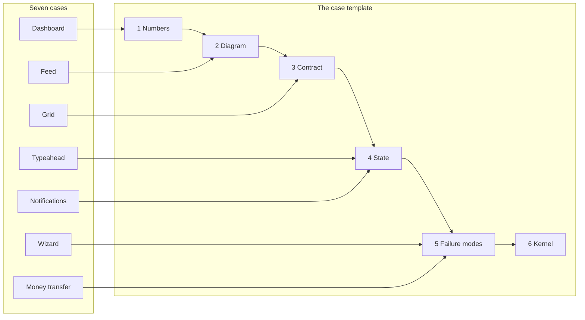
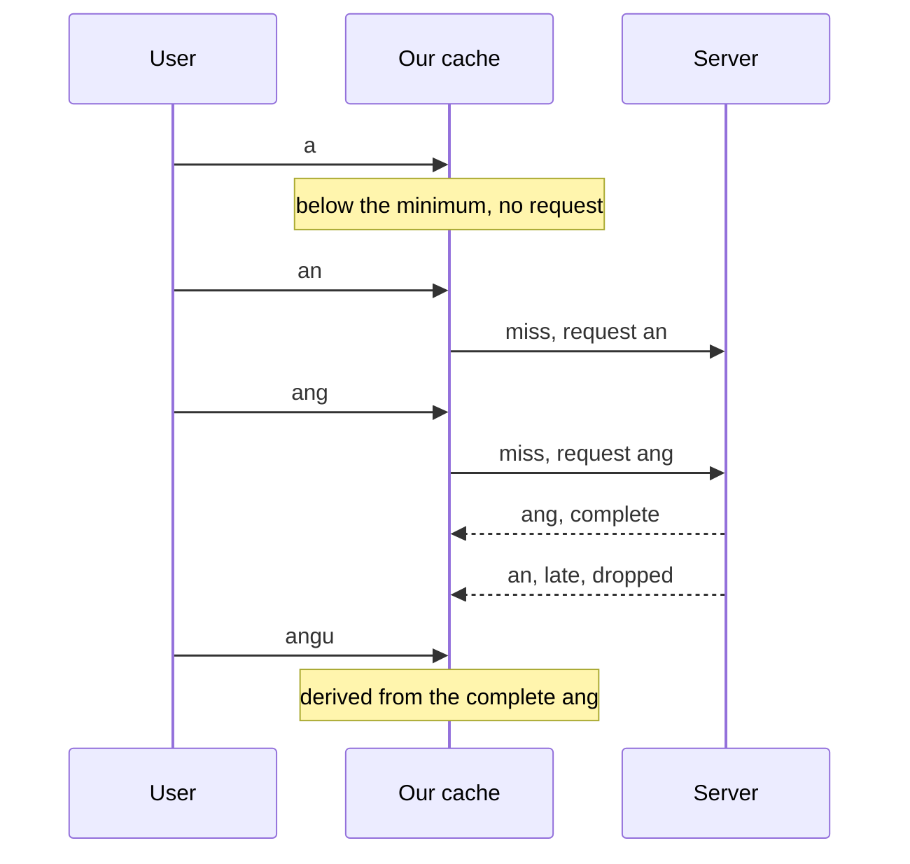
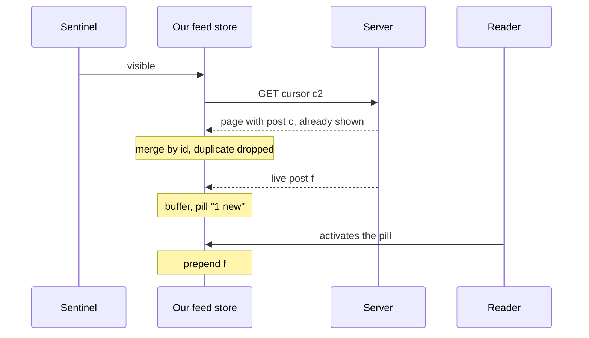
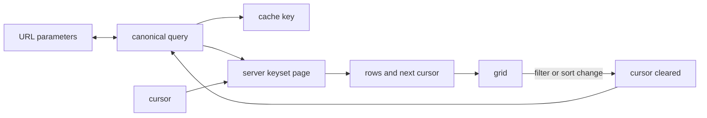
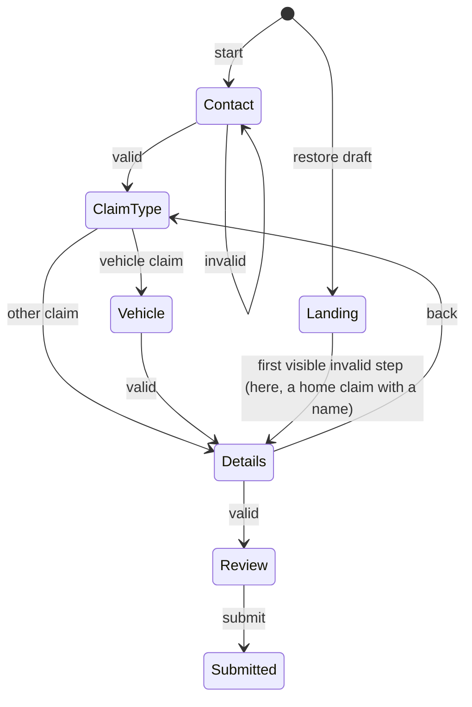
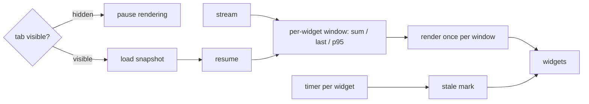
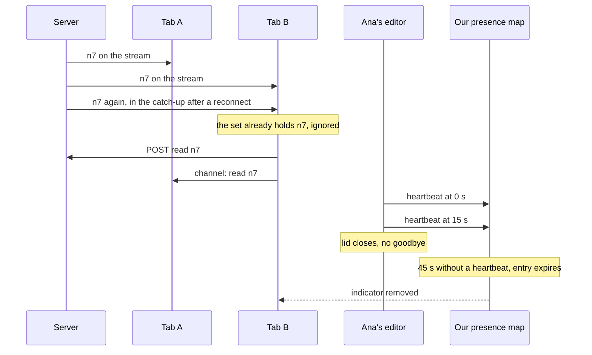
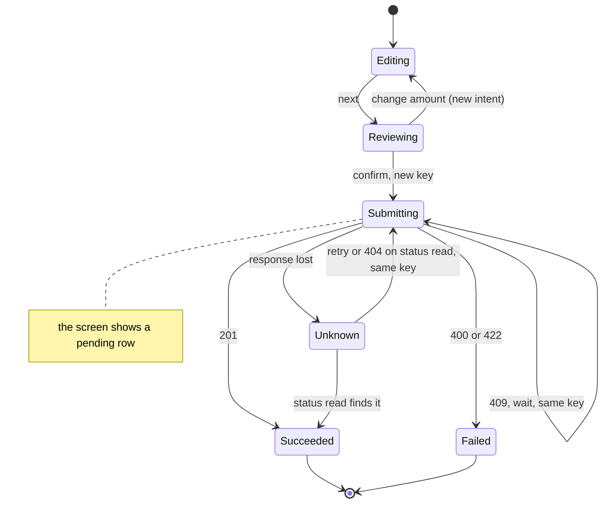

# 46. System design case studies: typeahead search, an infinite feed, a data grid, a form wizard, a live dashboard, notifications and a money transfer

> **What this covers:** the method of [module 45](45-frontend-system-design-method.md#1-the-front-end-system-design-interview-what-it-evaluates-its-formats-and-how-it-differs-from-a-backend-design-round) applied to seven designs that span the browser and the server: autocomplete search, an infinite-scroll feed, a large data grid with server-side filtering, sorting and pagination, a multi-step wizard with draft saving, a real-time operations dashboard, a notifications center with an editing indicator, and a money transfer with idempotency keys. Each case has its requirements and numbers, a diagram, the API, the state, its failure modes and a small code kernel that runs in the labs.
> **Prerequisites:** [45. The front-end system design method](45-frontend-system-design-method.md#1-the-front-end-system-design-interview-what-it-evaluates-its-formats-and-how-it-differs-from-a-backend-design-round), [42. Logout everywhere and session timeout UX](42-fullstack-authentication.md#8-logout-everywhere-and-session-timeout-ux), [43. Choosing a transport](43-fullstack-realtime.md#1-choosing-a-transport-polling-long-polling-server-sent-events-websockets-and-web-push-when-no-tab-is-open)
> **Leads to:** [47. Behavioral interviews and interview craft](47-behavioral-and-interview-craft.md)
> **Applies to:** Angular 22.2 and `@angular/aria` 22.2.1 facts as their owner modules state them; TypeScript 6.0 and Node 24 in `labs/ts-js`; documented only: the IETF Idempotency-Key Internet-Draft (draft-08), RFC 9110, Stripe's API docs (one vendor), the WAI-ARIA Authoring Practices (informative), MDN; reads 2026-10-22 and 2026-10-23
> **Study time:** ~3 hours reading + ~4 hours exercises
> **Short on time:** read [§1](#1-from-method-to-case-the-parts-every-case-study-carries-and-where-each-cases-difficulty-lies), [§4](#4-a-large-data-grid-server-side-filtering-sorting-and-pagination-the-query-in-the-url-and-keyset-cursors) and [§8](#8-under-the-hood-a-money-transfer-with-idempotency-keys-optimistic-ui-that-never-claims-success-and-the-unknown-outcome), then [Q46.01](#q46-01), [Q46.09](#q46-09), [Q46.16](#q46-16), [Q46.22](#q46-22) and [Q46.24](#q46-24), then the [Summary](#summary).
> **Labs:** [`labs/ts-js/src/modules/46-system-design-case-studies/`](../labs/ts-js/src/modules/46-system-design-case-studies/) Run (Node 24): from `labs/ts-js`, `npx vitest run src/modules/46-system-design-case-studies src/outputs/46-system-design-case-studies`.

## Contents

1. [From method to case: the parts every case study carries, and where each case's difficulty lies](#1-from-method-to-case-the-parts-every-case-study-carries-and-where-each-cases-difficulty-lies)
2. [Autocomplete and typeahead search: a request policy, a prefix cache, ranking on the server and an accessible combobox](#2-autocomplete-and-typeahead-search-a-request-policy-a-prefix-cache-ranking-on-the-server-and-an-accessible-combobox)
3. [An infinite-scroll feed: cursor pages, deduplication, new items without a jump, and a bounded window](#3-an-infinite-scroll-feed-cursor-pages-deduplication-new-items-without-a-jump-and-a-bounded-window)
4. [A large data grid: server-side filtering, sorting and pagination, the query in the URL, and keyset cursors](#4-a-large-data-grid-server-side-filtering-sorting-and-pagination-the-query-in-the-url-and-keyset-cursors)
5. [A multi-step form wizard with draft saving: a step model, per-step validation, and drafts that survive and migrate](#5-a-multi-step-form-wizard-with-draft-saving-a-step-model-per-step-validation-and-drafts-that-survive-and-migrate)
6. [A real-time operations dashboard: aggregation, per-widget staleness, hidden tabs and screens left open for days](#6-a-real-time-operations-dashboard-aggregation-per-widget-staleness-hidden-tabs-and-screens-left-open-for-days)
7. [A notifications center and an editing indicator: delivery, unread counts across tabs, and presence with a time-to-live](#7-a-notifications-center-and-an-editing-indicator-delivery-unread-counts-across-tabs-and-presence-with-a-time-to-live)
8. [Under the hood: a money transfer with idempotency keys, optimistic UI that never claims success, and the unknown outcome](#8-under-the-hood-a-money-transfer-with-idempotency-keys-optimistic-ui-that-never-claims-success-and-the-unknown-outcome)
- [Summary](#summary)
- [Question bank](#question-bank)
- [Hands-on exercises](#hands-on-exercises)
- [Check your understanding](#check-your-understanding)
- [Connections](#connections)

**How this module was checked.** Run: Vitest in Node 24 for our kernels (prefix cache, feed pager, grid query and keyset pages, wizard and draft migration, dashboard aggregation, unread counts and presence, the transfer and our idempotency server) and the five exercises. Read, not run: the IETF Idempotency-Key Internet-Draft (draft-08), RFC 9110, Stripe's API documentation (one vendor), the WAI-ARIA Authoring Practices (informative), MDN, `@angular/aria` 22.2.1 typings and this repository's architect guide. Owner modules hold the Angular and RxJS facts; the case numbers are assumed; [SOURCES.md](../SOURCES.md) has the dates.

## 1. From method to case: the parts every case study carries, and where each case's difficulty lies

### The problem it solves

Handed "design a data grid", a candidate can recite [module 45's method](45-frontend-system-design-method.md#1-the-front-end-system-design-interview-what-it-evaluates-its-formats-and-how-it-differs-from-a-backend-design-round) and never reach what makes this case hard. Another writes a perfect kernel and never says how it fails.

A **case study** here is one screen designed across the browser and the server: the syllabus's six plus a stretch case, notifications with an editing indicator.

### Mental model

A structural engineer's case files share headings, but the calculation that decides differs per building. The headings are our **case template**; the calculation is the **kernel**.



What to notice: each arrow ends where our suggestion puts that case's weight; every part is still written for every case.

### How it actually works

The case template, in order:

1. Requirements and **assumed numbers**, figures we label "assumed" ([45 §3](45-frontend-system-design-method.md#3-requirements-first-functional-and-non-functional-requirements-constraints-and-back-of-envelope-numbers)).
2. One diagram at the zoom level the case needs.
3. The **contract**: the calls and payloads between browser and server.
4. The state, placed by [45 §5](45-frontend-system-design-method.md#5-state-and-api-design-where-each-piece-of-state-lives-and-the-api-the-screens-need).
5. The failure modes, each with a **degraded behavior** and a **signal** ([45 §8](45-frontend-system-design-method.md#8-under-the-hood-failure-modes-observability-offline-levels-and-consistency-choices)).
6. The **kernel**: the smallest code whose correctness the design depends on, with tests.

The order stays followable, and module 45's [checkpoints](45-frontend-system-design-method.md#2-communicating-under-time-pressure-a-time-plan-complete-trade-off-statements-and-diagrams-at-three-zoom-levels) let the interviewer steer. The last part names a kernel because this repository's [architect guide](../../Architect-Level%20Production%20%26%20Architect.md) (Q26) says the key's insert "must be in the same transaction as the business write": correctness in one small mechanism.

Our suggestion per case:

| Case | Where it is hard | Kernel |
|---|---|---|
| [Typeahead](#2-autocomplete-and-typeahead-search-a-request-policy-a-prefix-cache-ranking-on-the-server-and-an-accessible-combobox) | request policy | prefix cache |
| [Feed](#3-an-infinite-scroll-feed-cursor-pages-deduplication-new-items-without-a-jump-and-a-bounded-window) | data flow over time | page merge and buffer |
| [Grid](#4-a-large-data-grid-server-side-filtering-sorting-and-pagination-the-query-in-the-url-and-keyset-cursors) | API and state | canonical query, keyset cursor |
| [Wizard](#5-a-multi-step-form-wizard-with-draft-saving-a-step-model-per-step-validation-and-drafts-that-survive-and-migrate) | state and failure | step machine, draft migration |
| [Dashboard](#6-a-real-time-operations-dashboard-aggregation-per-widget-staleness-hidden-tabs-and-screens-left-open-for-days) | performance under streams | aggregation, staleness |
| [Notifications](#7-a-notifications-center-and-an-editing-indicator-delivery-unread-counts-across-tabs-and-presence-with-a-time-to-live) | consistency across tabs | unread set, presence time-to-live |
| [Money transfer](#8-under-the-hood-a-money-transfer-with-idempotency-keys-optimistic-ui-that-never-claims-success-and-the-unknown-outcome) | failure and consistency | idempotency key per intent |

Rendering follows [45 §7](45-frontend-system-design-method.md#7-rendering-strategy-and-caching-layers-a-rendering-choice-per-route-and-every-cache-from-the-cdn-to-the-component): logged-in screens client-rendered, a public feed's first page prerendered or server-rendered. The framework is one line of each answer ([45 §4](45-frontend-system-design-method.md#4-component-architecture-data-model-and-data-flow-from-screens-to-a-component-tree-and-a-client-side-model)). A case may start from an existing app; its upgrade path is [module 39's](39-version-history-and-migrations.md). Kernel tests take time and ids as inputs, because a test that reads the clock is a flaky suite ([Q30.17](30-e2e-and-testing-strategy.md#q30-17)). Byte counts are plain numbers; "KB" means 1,000 bytes.

### Code

Fill the template once, for the grid.

```text
# Our suggestion: the case template, filled for the data grid (numbers assumed)
1 Numbers        2,000,000 orders, 12 columns, 50 rows a page
2 Diagram        containers: browser app -> API -> database
3 Contract       GET /api/orders with filters, sort, limit and a cursor
4 State          the query in the URL; pages in the request cache
5 Failure modes  slow count -> "more than N" (signal: count latency)
6 Kernel         keyset page: compare the sort values, then the id
```

1. Numbers come first, because every choice is judged against them.
2. One zoom level keeps the arrows followable.
3. One query form serves both layers.
4. Each piece of state gets one home.
5. A degraded behavior without a signal goes unseen.
6. The kernel is the code you can test.

### Best practices and anti-patterns

- **State the numbers first**, because a choice with no number cannot be judged.
- **Say what you skip**, because depth belongs where the case is hard.

### Misconceptions and traps

- "A case study is the method recited again." The steps are the frame; the answer is decided where this case is hard (the table). Cause: the steps fit any prompt.
- "The kernel is the answer." It proves one decision; the other parts carry the design. Cause: coding rounds reward working code.
- "Every case needs every layer at full depth." Spend depth where the case is hard. Cause: thoroughness feels safe.
- "Failure modes come last, so skip them." They decide some cases outright (feed duplicates, transfer retries), so name them for every case. Cause: they follow the happy-path parts.

Drilled in [Q46.01](#q46-01).

## 2. Autocomplete and typeahead search: a request policy, a prefix cache, ranking on the server and an accessible combobox

### The problem it solves

A **typeahead** (a search box that suggests while you type) sends a request per keystroke from the first letter. "Ang " and "ang" are two cache entries, "angu" goes to the server though "ang" holds its answer, a slow "an" response overwrites the one for "ang", a 429 empties the list, and the popup is a `div` no screen reader announces.

### Mental model

A librarian who pulled every book starting with "ang" skips the stacks for "angu", unless the cart was full. Parts in [§1's order](#1-from-method-to-case-the-parts-every-case-study-carries-and-where-each-cases-difficulty-lies).

```text
# Assumed numbers (ours, not measured)
Catalog   200,000 products
Limit     8 suggestions per request
Minimum   2 characters
Pause     250 ms without typing before a request
```

The request policy, in order: **normalize** (one key per meaning), check the **minimum query length**, debounce ([Q22.32](22-rxjs-foundations.md#q22-32)), look in the **prefix cache**, send, accept only the **latest** answer, as `switchMap` does in [23 §8](23-rxjs-in-depth.md#8-angular-patterns-typeahead-polling-cache-then-network-and-racing-requests). A **complete result** holds every match; a **truncated** one only the top ones that fit the limit.



What to notice: "ang" misses because "an" was cut off at the limit, "angu" never leaves the browser, and the late "an" answer is not shown.

### How it actually works

**Contract.** The server ranks and limits results (no engine is named: none was read) and says whether the answer is complete.

```http
# Illustrative contract, not a lab API
GET /api/search/suggest?q=ang&limit=8

200 OK
{ "items": ["Angle grinder", "Angular book"], "complete": true }

429 Too Many Requests
Retry-After: 30
```

**State** ([45 §5](45-frontend-system-design-method.md#5-state-and-api-design-where-each-piece-of-state-lives-and-the-api-the-screens-need)): the query in the component (the URL on a results page), results in the request cache. **Failure modes** ([45 §8](45-frontend-system-design-method.md#8-under-the-hood-failure-modes-observability-offline-levels-and-consistency-choices)):

- Slow: keep the last results, show "searching"; signal, latency.
- 429: back off, keep the last results; signal, 429 rate. A 429 "MAY include a Retry-After header" ([RFC 6585 §4](https://www.rfc-editor.org/rfc/rfc6585.html), read 2026-10-22); retries are [Q27.18](27-http-client.md#q27-18)'s.
- Down: the input still submits a full search; signal, error rate.

**Why only a complete result answers a longer query.** A truncated result keeps the top-ranked matches, so a lower-ranked match for "angu" may be missing (our model assumes prefix matching). Tests: `Section 2: a complete result for a prefix answers a longer query without a request`, `Section 2: a truncated result for a prefix does not answer a longer query`.

**Why a styled `div` list is not a combobox.** Read from the [APG combobox pattern](https://www.w3.org/WAI/ARIA/apg/patterns/combobox/) (2026-10-22): "A combobox is an input widget that has an associated popup." The input "has role combobox", with `aria-expanded`, `aria-controls` (the popup) and `aria-autocomplete` (here `list`, manual selection). "DOM Focus is maintained on the combobox and the assistive technology focus is moved within the listbox using aria-activedescendant" (the **active descendant**); Down Arrow "moves focus into the popup" if the popup is available, Escape "Dismisses the popup if it is visible." The APG is an ["informative" resource](https://www.w3.org/WAI/ARIA/apg/about/introduction/) that "does not specify normative requirements", so we call nothing here a requirement. [Exercise 36.2](36-material-and-cdk.md#ex36-2) builds one.

```html
<!-- Partial: illustrative markup after the APG combobox pattern, not a lab file -->
<label for="q">Search products</label>
<input id="q" role="combobox" aria-expanded="true" aria-controls="q-list"
       aria-autocomplete="list" aria-activedescendant="q-opt-2">
<ul id="q-list" role="listbox" aria-label="Suggestions">
  <li id="q-opt-1" role="option">Angular book</li>
  <li id="q-opt-2" role="option" aria-selected="true">Angle grinder</li>
</ul>
<p aria-live="polite">2 suggestions</p>
```

The count sits in a **live region**, text announced without moving focus ([11 §5](11-accessibility.md#5-focus-management-in-spas-and-live-regions)).

> [!NOTE]
> **Framework vs platform.** `@angular/aria` [Stable since v22.0] ships `Combobox`, `ComboboxWidget` and `ComboboxPopup` directives (22.2.1 typings; status per [36 §11](36-material-and-cdk.md#11-angular-aria-headless-signal-driven-aria-patterns)) that put ARIA state and keys on your markup. The browser exposes the roles. Neither ranks results.

### Code

Approach: two pure structures, so a test supplies the answers ([tests](../labs/ts-js/src/modules/46-system-design-case-studies/concepts/section-2-prefix-cache.test.ts)).

```ts
// Excerpt of labs/ts-js/src/modules/46-system-design-case-studies/concepts/prefix-cache.ts
    lookup(query) {
      const key = normalize(query);
      if (key.length < minLength) return { kind: 'skip' };
      const exact = touch(key);
      if (exact !== undefined) return { kind: 'hit', items: exact.items, complete: exact.complete };
      const found = derive(entries, key, minLength);
      if (found === undefined) return { kind: 'miss' };
      touch(found.prefix);
      return { kind: 'derived', items: found.entry.items.filter((item) => item.toLowerCase().startsWith(key)), from: found.prefix };
    },
    store(query, items, complete) {
      const key = normalize(query);
      entries.delete(key);
      entries.set(key, { items, complete: complete && items.length < limit });
      evict();
    },
```

1. `lookup` skips below the minimum, because one letter matches too much to rank usefully.
2. An exact key is a `hit`, even truncated (the same query); `touch` re-inserts it, and a `Map` iterates in insertion order, so the first key is the least recently used ([Q05.15](05-js-modules-memory-modern-features.md#q05-15)).
3. Otherwise `derive` takes the longest complete prefix, never a truncated one, and filters it; none is a `miss`.
4. `store` keeps `complete` only under `limit` items, because a full list may be cut off; `evict` then drops the oldest keys beyond `capacity`.

```ts
// Excerpt of labs/ts-js/src/modules/46-system-design-case-studies/concepts/prefix-cache.ts
    accept: (seq) => {
      if (seq <= applied) return false;
      applied = seq;
      return true;
    },
```

5. `accept` refuses a response not newer than the last applied, because responses arrive in any order (`Section 2: a response older than the last one applied is dropped`). Unlike `switchMap`, it cannot cancel the request.

### Best practices and anti-patterns

- **Key by the normalized query**, because "Ang " and "ang" mean one search.
- **Derive only from a complete result**, because a truncated one hides matches.
- **Bound the cache**, because every prefix is a new key.

### Misconceptions and traps

- "Debounce alone fixes typeahead." It lowers the request count; out-of-order answers still need latest-only. Cause: it is the first operator taught for search.
- "Cache every query string as typed." Normalize first, so "Ang " and "ang" share an entry. Cause: the input value is the obvious key.
- "A cached prefix can always filter longer queries." Only a complete result can, because a truncated one may miss matches the server would rank in. Cause: filtering locally looks free.
- "`role="listbox"` on the popup is enough." The input carries the combobox role and states, and `aria-activedescendant` names the active option. Cause: the popup looks like a list.

Drilled in [Q46.02](#q46-02), [Q46.03](#q46-03) and [Q46.04](#q46-04).

## 3. An infinite-scroll feed: cursor pages, deduplication, new items without a jump, and a bounded window

### The problem it solves

An **infinite-scroll feed** loads the next page as the reader nears the end. A new post shifts offset pages, so a post shows twice; live posts inserted above push the reader away; Back restarts at the top; the footer never arrives; 5,000 articles fill the DOM.

### Mental model

A reader keeps the page in hand while late editions stack on the table: the **new-items buffer**, opened by the "N new posts" button, the **pill**. Parts in [§1's order](#1-from-method-to-case-the-parts-every-case-study-carries-and-where-each-cases-difficulty-lies).

```text
# Assumed numbers (ours, not measured)
Page          50 posts
Live arrivals 3 posts a minute at peak, for one user
Session       30 pages
```

A **cursor page** continues after the last post seen, so an insert cannot shift it ([41 §6](41-fullstack-api-contracts.md#6-pagination-sorting-and-filtering-offset-versus-cursor-and-how-spring-data-serializes-a-page), [Q41.13](41-fullstack-api-contracts.md#q41-13)); `nextCursor: null` ends the feed. A **sentinel**, an empty element after the last post, loads one next page when it enters the viewport. **Deduplication** keeps one post per id. The **anchor post** is the id at the top of the viewport.



What to notice: the duplicate merges once, and the live post changes nothing the reader sees until the pill is activated.

### How it actually works

**Contract.** New posts arrive over [SSE](43-fullstack-realtime.md#1-choosing-a-transport-polling-long-polling-server-sent-events-websockets-and-web-push-when-no-tab-is-open).

```http
# Illustrative contract, not a lab API
GET /api/feed?cursor=c2&limit=50

200 OK
{ "items": [{ "id": "p91", "publishedAt": 1760000000 }], "nextCursor": "c3" }

GET /api/feed/stream
event: post
data: {"id": "p97", "publishedAt": 1760000100}
```

**State** ([45 §5](45-frontend-system-design-method.md#5-state-and-api-design-where-each-piece-of-state-lives-and-the-api-the-screens-need)): pages and buffer in the feed store, the anchor in history state. **Failure modes** ([45 §8](45-frontend-system-design-method.md#8-under-the-hood-failure-modes-observability-offline-levels-and-consistency-choices)): a failed page keeps the list and retries its cursor (signal: error rate); a dropped stream leaves the pill stale ([43 §2](43-fullstack-realtime.md#2-server-sent-events-on-the-wire-the-textevent-stream-format-and-how-eventsource-reconnects)).

**Why an observer triggers the load.** `IntersectionObserver` [Baseline 2019: widely available, per MDN] lets the page "asynchronously observe changes in the intersection of a target element" with the viewport (abridged), and [MDN](https://developer.mozilla.org/en-US/docs/Web/API/Intersection_Observer_API) lists "infinite scrolling" websites as a use (read 2026-10-22). The browser reports the sentinel, so no scroll listener runs ([08 §3](08-browser-rendering-dom-events.md#3-dom-apis-and-observers), [Q08.07](08-browser-rendering-dom-events.md#q08-07)); [`@defer (on viewport)`](18-control-flow-and-defer.md#5-defer-blocks-and-states-placeholder-loading-error-minimum-and-after) builds on it.

**Why the DOM stays bounded.** Virtual scrolling renders only visible rows ([31 §4](31-performance.md#4-long-lists-track-virtual-scrolling-with-the-cdk-and-the-alternatives), [Q31.10](31-performance.md#q31-10)); the alternative is a cap on retained pages ([Exercise 46.1](#ex46-1)). After Back, a client-rendered list shows its pages and scrolls to the anchor; the router restores scroll only under `withInMemoryScrolling` ([24 §9](24-routing.md#9-view-transitions-scroll-restoration-and-titles)).

**Why the feed marks itself busy.** The [APG feed pattern](https://www.w3.org/WAI/ARIA/apg/patterns/feed/) (read 2026-10-22; "informative", per the [APG introduction](https://www.w3.org/WAI/ARIA/apg/about/introduction/)) says: "A feed is a section of a page that automatically loads new sections of content as the user scrolls." The container has role `feed`; each `article` has `aria-labelledby`, `aria-posinset` and `aria-setsize`. When adding or removing articles takes several DOM operations, the feed has `aria-busy="true"` during the update, and "it is extremely important that aria-busy is set to false when the operation is complete or the changes may not become visible to some assistive technology users." "Control + End: Move focus to the first focusable element after the feed", so a keyboard user reaches the footer.

```html
<!-- Partial: illustrative markup after the APG feed pattern, not a lab file -->
<div role="feed" aria-busy="false" aria-label="Posts">
  <article aria-labelledby="t91" aria-posinset="1" aria-setsize="2" tabindex="0">
    <h3 id="t91">First post</h3>
  </article>
  <article aria-labelledby="t92" aria-posinset="2" aria-setsize="2" tabindex="0">
    <h3 id="t92">Second post</h3>
  </article>
</div>
<footer>...</footer>
```

> [!NOTE]
> **Framework vs platform.** `IntersectionObserver` is the browser's; `@defer (on viewport)` uses it to render a block, and CDK virtual scrolling decides which rows exist. None loads pages or dedupes posts: that is the feed store's job.

### Code

Approach: a pure merge and buffer ([tests](../labs/ts-js/src/modules/46-system-design-case-studies/concepts/section-3-feed-pager.test.ts)).

```ts
// Excerpt of labs/ts-js/src/modules/46-system-design-case-studies/concepts/feed-pager.ts
    addPage(page) {
      if (reachedEnd) return false;
      show(page.items);
      reachedEnd = page.nextCursor === null;
      return true;
    },
    receiveLive(post) {
      if (!shown.has(post.id)) waiting.set(post.id, post);
    },
    showNew() {
      const arrived = [...waiting.values()];
      show(arrived);
      return arrived.length;
    },
    view: () => [...shown.values()].sort(feedOrder),
```

1. `addPage` refuses a page after a `null` cursor; otherwise `show` keys posts by id, so a repeat appears once.
2. `receiveLive` buffers only an id not shown, in a map, so a repeated push counts once, and the list does not move.
3. `showNew` moves the buffer into the list; `view` sorts by `feedOrder`, time then id, because ties need a tiebreaker ([41 §6](41-fullstack-api-contracts.md#6-pagination-sorting-and-filtering-offset-versus-cursor-and-how-spring-data-serializes-a-page)).

```text
Tests in section-3-feed-pager.test.ts (our model)
Section 3: pages merge in feed order and a post seen twice appears once
Section 3: live arrivals wait in a buffer and do not shift the list
Section 3: showing new posts prepends the buffer in feed order and empties it
Section 3: a live arrival already in the list is not counted as new
Section 3: a null next cursor ends the feed and further loads are refused
```

### Best practices and anti-patterns

- **Merge by id**, because a page and a push can overlap.
- **Buffer live posts behind a pill**, because inserting above the reader moves their place.
- **Reset `aria-busy` on every path**, failures included, because a feed left busy may hide its changes from assistive technology.

### Misconceptions and traps

- "Infinite scroll is a scroll listener plus offset pages." An observer triggers the load, and cursor pages stay stable under inserts. Cause: early tutorials did that.
- "New posts belong at the top at once." Inserting above the reader moves their content, so buffer unless the product says otherwise. Cause: freshness feels like the feature.
- "Virtual scrolling solves infinite feeds." It bounds the DOM; it does not load, dedupe or restore position ([Q31.11](31-performance.md#q31-11)). Cause: it is the long-list tool.
- "The browser restores the feed on Back." It restores scroll after a full page load; a client-rendered list restores its own pages and anchor. Cause: Back looks the same everywhere.

Drilled in [Q46.05](#q46-05), [Q46.06](#q46-06), [Q46.07](#q46-07) and [Q46.08](#q46-08); practised in [Exercise 46.1](#ex46-1).

## 4. A large data grid: server-side filtering, sorting and pagination, the query in the URL, and keyset cursors

### The problem it solves

A grid over orders loads everything and sorts in the browser. Moved to the server, it fails in new ways: page 3 repeats two rows of page 2 because 40 orders share a timestamp; the same filters in another order are fetched twice; a sort change keeps the old cursor and shows an empty page; a reload loses the filters; the count is slower than the page; every cell is a tab stop. With **server-side filtering** (and sorting and paging) the browser sends the query and shows one page, because one page is all it holds.

### Mental model

A library catalog card says "continue after the book with call number X", not "start at the 101st book", so a book shelved earlier does not move your place. Parts in [§1's order](#1-from-method-to-case-the-parts-every-case-study-carries-and-where-each-cases-difficulty-lies).

```text
# Assumed numbers (ours, not measured)
Orders   2,000,000
Columns  12
Page     50 rows
Filters  status, date range, customer
```

The page size is a bytes-per-screen budget, set as [45 §3](45-frontend-system-design-method.md#3-requirements-first-functional-and-non-functional-requirements-constraints-and-back-of-envelope-numbers) sets one.

A **canonical query** is one written form: filters sorted by name, a sort list ending with the unique id, a page size and a cursor. One form gives one **cache key** ([45 §7](45-frontend-system-design-method.md#7-rendering-strategy-and-caching-layers-a-rendering-choice-per-route-and-every-cache-from-the-cdn-to-the-component)) and one URL. The id is the **tiebreaker**; this module's rule is [41 §6](41-fullstack-api-contracts.md#6-pagination-sorting-and-filtering-offset-versus-cursor-and-how-spring-data-serializes-a-page)'s: every sort ends with a unique tiebreaker, because "ties leave order undefined" (41 §6). A **keyset cursor** holds the last row's sort values and id, so the next page is the rows after that row; it needs "a stable sort and a unique tiebreaker" ([Q41.13](41-fullstack-api-contracts.md#q41-13)).



What to notice: one form feeds the URL, the key and the request, and a filter or sort change returns through a cleared cursor.

### How it actually works

**Contract.** The `total` says whether it is exact.

```http
# Illustrative contract, not a lab API
GET /api/orders?status=open&sort=createdAt,desc&sort=id,desc&limit=50&after=…

200 OK
{ "items": [ … ], "next": "…", "total": { "value": 1240, "exact": false } }
```

**State** ([45 §5](45-frontend-system-design-method.md#5-state-and-api-design-where-each-piece-of-state-lives-and-the-api-the-screens-need)): the query lives in the URL ([Exercise 28.2](28-state-management.md#ex28-2) builds filters in query parameters); pages live in the request cache. The grid keeps the previous page visible while the next loads and cancels the stale request ([27 §6](27-http-client.md#6-cancellation-and-caching-unsubscribing-aborts-cache-interceptors-sharereplay-and-the-ssr-transfer-cache)). **Failure modes** ([45 §8](45-frontend-system-design-method.md#8-under-the-hood-failure-modes-observability-offline-levels-and-consistency-choices)): a slow count shows "more than N" (signal: count latency); a shared link's filter value the server rejects returns problem details ([41 §5](41-fullstack-api-contracts.md#5-error-contracts-with-problemdetail-rfc-9457-and-mapping-them-in-angular)), and the grid keeps its last good query.

**Totals.** An exact total is one more query over the whole filter, so the choices are exact, estimated (`exact: false`, "about 1,240") or none, "more results". A keyset grid has Next and Previous, not page numbers, because page N starts after page N-1's last key. Order by locale is a collation ([34 §2](34-i18n.md#2-the-platforms-intl-apis-dates-numbers-plurals-lists-collation-and-display-names)) the sorting server applies; our fake compares code units.

**Why a table or a grid.** Read from the [APG grid pattern](https://www.w3.org/WAI/ARIA/apg/patterns/grid/) (read 2026-10-22; informative, per the [APG introduction](https://www.w3.org/WAI/ARIA/apg/about/introduction/)): "Only one of the focusable elements contained by the grid is included in the page tab sequence", while "All focusable elements contained in a table are included in the page tab sequence." So read-only cells keep table semantics (`CdkTable`: [36 §7](36-material-and-cdk.md#7-tables-and-long-lists-cdktable-datasource-mattable-and-virtual-scrolling), [Q36.14](36-material-and-cdk.md#q36-14)); interactive or editable cells fit the grid pattern, an ARIA pattern that is neither CSS Grid ([10](10-css-essentials.md)) nor `CdkTable`. "If the grid provides sort functions, aria-sort is set to an appropriate value on the header cell element for the sorted column or row."

> [!NOTE]
> **Coming from the backend.** Keyset pagination is `WHERE (created_at, id) < (?, ?) ORDER BY created_at DESC, id DESC`; PostgreSQL compares row constructors "left-to-right, stopping as soon as an unequal or null pair of elements is found" ([PostgreSQL 18 documentation](https://www.postgresql.org/docs/current/functions-comparisons.html), section 9.25.5, read 2026-10-22). Spring Data's `ScrollPosition.keyset()` is [41 §6](41-fullstack-api-contracts.md#6-pagination-sorting-and-filtering-offset-versus-cursor-and-how-spring-data-serializes-a-page)'s. **Where the analogy breaks:** a null in a pair makes that comparison unknown, and the browser holds the cursor in a URL a user can share or edit, so the server validates it and may reject a stale one.

### Code

Approach: one canonical form feeds the URL, key and request; the cursor is the last row's sort values ([tests](../labs/ts-js/src/modules/46-system-design-case-studies/concepts/section-4-grid-query.test.ts)).

```ts
// Excerpt of labs/ts-js/src/modules/46-system-design-case-studies/concepts/grid-query.ts
function withTiebreaker(sort: readonly SortKey[]): readonly SortKey[] {
  const at = sort.findIndex((key) => key.field === TIEBREAKER);
  if (at >= 0) return sort.slice(0, at + 1);
  return [...sort, { field: TIEBREAKER, direction: sort.at(-1)?.direction ?? 'asc' }];
}

export function canonical(query: GridQuery): GridQuery {
  const entries = Object.entries(query.filters)
    .map(([name, value]): [string, string] => [name, value.trim()])
    .filter(([, value]) => value !== '')
    .sort(([a], [b]) => compareCell(a, b));
  return { filters: Object.fromEntries(entries), sort: withTiebreaker(query.sort), limit: query.limit, after: query.after };
}

export function cacheKey(query: GridQuery): string {
  return `GET /api/orders?${toParams(query)}`;
}

export function withFilter(query: GridQuery, name: string, value: string): GridQuery {
  return canonical({ ...query, filters: { ...query.filters, [name]: value }, after: null });
}
```

1. `withTiebreaker` keeps the sort up to the first id, or appends the id in the last key's direction (ascending with no sort), so every sort is total.
2. `canonical` trims filter values, drops emptied ones and orders them by name, so any order gives one form; `toParams` writes it, `fromParams` reads it back through allow-lists, and `cacheKey` is that URL.
3. `withFilter` and `withSort` return a canonical query with `after: null`, because a cursor continues one filter and sort only.

```ts
// Excerpt of labs/ts-js/src/modules/46-system-design-case-studies/concepts/grid-query.ts
export function encodeCursor(row: Order, sort: readonly SortKey[]): string {
  return JSON.stringify(withTiebreaker(sort).map((key) => row[key.field]));
}

function compareToPosition(row: Order, position: readonly Cell[], sort: readonly SortKey[]): number {
  for (const [key, cell] of zip(sort, position)) {
    const result = sign(key) * compareCell(row[key.field], cell);
    if (result !== 0) return result;
  }
  return 0;
}

export function keysetPage(rows: readonly Order[], query: GridQuery): KeysetPage {
  const { filters, sort, limit, after } = canonical(query);
  const position = after === null ? [] : decodeCursor(after, sort);
  if (position === null) throw new RangeError('Cursor does not match this sort');
  const matching = rows
    .filter((row) => Object.entries(filters).every(([name, value]) => FILTERS.get(name)?.(row, value) ?? true))
    .sort((a, b) => compareRows(a, b, sort));
  const rest = after === null ? matching : matching.filter((row) => compareToPosition(row, position, sort) > 0);
  const items = rest.slice(0, limit);
  const last = items.at(-1);
  return { items, next: last !== undefined && rest.length > items.length ? encodeCursor(last, sort) : null };
}
```

4. `encodeCursor` keeps the row's value under each sort key, the id last (readable JSON here; a server may sign it).
5. `compareToPosition` compares key by key, the first difference deciding with the direction's sign, so it is zero only for the cursor's own row.
6. `keysetPage` filters and sorts, keeps only rows after the cursor when there is one, takes `limit` and returns `next` only while rows remain, so ties split by id neither repeat nor skip. A cursor that does not fit the sort throws (read, not run).

```text
Tests in section-4-grid-query.test.ts (our model)
Section 4: a query and its URL parameters round-trip to the same canonical query
Section 4: filters given in a different order produce one cache key
Section 4: changing a filter or the sort clears the cursor
Section 4: the sort always ends with the id, so rows with equal sort values keep one order
Section 4: keyset pages over tied values neither repeat nor skip a row
Section 4: parameters outside the allow-list are dropped when a URL is read
```

### Best practices and anti-patterns

- **Build the URL, key and request from one function**, because two forms of a query are fetched twice.
- **Clear the cursor on any filter or sort change**, because a cursor continues one result only.
- **Show "more than N" when the count is slow**, because the page is useful before the number is.

### Misconceptions and traps

- "Sort by the clicked column only." Ties leave order undefined, so the id ends every sort ([41 §6](41-fullstack-api-contracts.md#6-pagination-sorting-and-filtering-offset-versus-cursor-and-how-spring-data-serializes-a-page)). Cause: the screen shows one sorted column.
- "Client-side sorting is fine for big grids." The browser sees only the loaded page, so at this size the server sorts and filters. Cause: it is instant on demo data.
- "A grid of data needs `role="grid"`." A read-only table keeps table semantics; the grid pattern fits interactive cells. Cause: the word "grid".
- "The total is free." A count is one more query over the whole filter, so consider an estimate or "more results". Cause: offset APIs return it with the page.

Drilled in [Q46.09](#q46-09), [Q46.10](#q46-10) and [Q46.11](#q46-11); practised in [Exercise 46.2](#ex46-2).

## 5. A multi-step form wizard with draft saving: a step model, per-step validation, and drafts that survive and migrate

### The problem it solves

An insurance-claim wizard keeps the current step in a component, so a reload starts over and the browser's Back button leaves the wizard. A "vehicle details" step, meaningless for a home claim, still validates and blocks the submit. Autosave fires on every keystroke. A draft saved last month under an older form schema crashes the restore, and a session that expires on step 4 takes the answers with it. A **wizard** is a form split into **steps** shown one at a time; the **step model** is the data saying which steps exist, which are shown and which are valid, so the screen is only a view of it.

### Mental model

A tax form has a cover sheet listing which schedules apply to you; you fill only those, and the clerk files a dated copy each time you pause. The sheet is the step model, the copy is the **draft**. Parts in [§1's order](#1-from-method-to-case-the-parts-every-case-study-carries-and-where-each-cases-difficulty-lies).

```text
# Assumed numbers (ours, not measured)
Steps                  6
Fields                 40
Median time to finish  12 minutes
Finish elsewhere       30% of users
```

Each step has a **visibility rule** (a function of the earlier answers: is this step shown?) and a **validity rule** (are this step's answers acceptable?); a step with a visibility rule is a **conditional step**. A **schema version** is a number saved with the draft, naming the form's shape when it was written; a **migration** turns answers of one version into the next. The **landing step** is the step a restored draft opens on, and **resume** is opening it on another visit or device.



What to notice: the vehicle step sits on one branch only, Back moves without a validity check, and a restore enters through the landing step.

### How it actually works

**Contract.** The draft write names the version it saw; the final submit carries a key (its rules are [§8](#8-under-the-hood-a-money-transfer-with-idempotency-keys-optimistic-ui-that-never-claims-success-and-the-unknown-outcome)'s).

```http
# Illustrative contract, not a lab API
PUT /api/claims/drafts/c-81
If-Match: "7"

{ "schemaVersion": 2, "answers": { "name": "Ada", "claimType": "home" } }

POST /api/claims
Idempotency-Key: "3f2b8a52-7d1e-4c3a-9b64-0d5e6f7a8b9c"

{ "draftId": "c-81" }
```

**Steps.** The wizard leaves a step only when its validity rule holds; [36 §8](36-material-and-cdk.md#8-the-smaller-primitives-the-stepper-breakpointobserver-and-clipboard) states the same gate for a linear stepper, and our model mirrors it (tests). Hidden steps are skipped and never validated; how a form library hides a field is [26 §5](26-signal-forms.md#5-cross-field-and-conditional-logic-valueof-validatetree-applywhen-disabled-hidden-and-readonly)'s and [25 §9](25-forms-reactive-and-template-driven.md#9-dynamic-forms-formarray-patterns-and-config-driven-forms)'s. Back keeps the answers of later steps, so a changed mind costs nothing.

**State** ([45 §5](45-frontend-system-design-method.md#5-state-and-api-design-where-each-piece-of-state-lives-and-the-api-the-screens-need)): the step is in the URL (a route per step or a query parameter), so reload and the browser's Back work; the answers are the draft. The draft stores the schema version and the answers, not the step: the landing step is computed from the answers, so it cannot disagree with them. A guard that warns before leaving is [24 §5](24-routing.md#5-functional-guards-canmatch-canactivate-candeactivate-and-redirectcommand)'s ([Q24.20](24-routing.md#q24-20)).

**Saving.** Save after a pause in typing and when the page turns hidden. [MDN's `visibilitychange` page](https://developer.mozilla.org/en-US/docs/Web/API/Document/visibilitychange_event) [Baseline 2021: widely available, per MDN] (read 2026-10-22; [Baseline](https://developer.mozilla.org/en-US/docs/Glossary/Baseline/Compatibility) is MDN's status) says: "Transitioning to `hidden` is the last event that's reliably observable by the page" (abridged: it adds that developers should treat it as the likely end of the session). So the hidden transition is the last save point; how a last-chance send is made is [09 §2](09-web-networking-storage-security.md#2-fetch-xhr-and-the-request-lifecycle)'s. On the server the draft serves the users who finish elsewhere, and its write sends `If-Match`: only if the version is still the one read, the precondition rule of [45 §8](45-frontend-system-design-method.md#8-under-the-hood-failure-modes-observability-offline-levels-and-consistency-choices), not restated here. In browser storage it serves one device; what storage is safe for is [09 §7](09-web-networking-storage-security.md#7-browser-storage-what-each-is-safe-for)'s, and a draft may hold personal data, so the placement is argued in [Q46.14](#q46-14); this section names no regulation.

**Failure modes** (each with a degraded behavior and a signal; our suggestions). A save fails: keep editing, show "not saved", retry. A second tab saved first: show both versions instead of overwriting ([Exercise 46.3](#ex46-3)). A migration fails: start from the last valid step and keep the raw draft; our `restore` does not handle a failing migration (read, not run). The session expires on step 4: keep the draft and resume after sign-in ([42 §8](42-fullstack-authentication.md#8-logout-everywhere-and-session-timeout-ux), [Q42.22](42-fullstack-authentication.md#q42-22)). The final submit validates every visible step again (`landingStep` answers `review` only when all are valid, tests) and is one action with one key. Signals (ours): the rates of failed saves, conflicts, failed migrations and resumes after sign-in.

### Code

Approach: visibility is computed from the answers, so hidden steps stay out of validation without flags that drift; a draft outlives a release, so migrations run before anything reads it ([tests](../labs/ts-js/src/modules/46-system-design-case-studies/concepts/section-5-wizard.test.ts)).

```ts
// Excerpt of labs/ts-js/src/modules/46-system-design-case-studies/concepts/wizard.ts
export function visibleSteps(steps: readonly Step[], answers: Answers): readonly Step[] {
  return steps.filter((step) => step.visibleWhen?.(answers) ?? true);
}

function move(steps: readonly Step[], state: WizardState, offset: 1 | -1): WizardState {
  const visible = visibleSteps(steps, state.answers);
  const target = visible[visible.findIndex((step) => step.id === state.stepId) + offset];
  return target === undefined ? state : { ...state, stepId: target.id };
}

export function next(steps: readonly Step[], state: WizardState): WizardState {
  const current = steps.find((step) => step.id === state.stepId);
  return current?.isValid(state.answers) === true ? move(steps, state, 1) : state;
}

export function back(steps: readonly Step[], state: WizardState): WizardState {
  return move(steps, state, -1);
}
```

1. `visibleSteps` keeps a step with no visibility rule and any step whose rule holds, so every other function works on the visible list only.
2. `move` finds the current step among the visible ones and returns the neighbor, or the same state at either end, so a hidden step is never visited (a current step that has itself become hidden is not handled: read, not run), and `answers` is carried over by reference.
3. `next` moves only when the current step's validity rule holds, and otherwise returns the same state; `back` calls `move` with no check, so it never changes an answer.

```ts
// Excerpt of labs/ts-js/src/modules/46-system-design-case-studies/concepts/wizard.ts
export function landingStep(steps: readonly Step[], answers: Answers): string {
  const visible = visibleSteps(steps, answers);
  const open = visible.find((step) => !step.isValid(answers)) ?? visible.at(-1);
  return open?.id ?? '';
}

export function restore(draft: Draft, migrations: readonly Migration[]): Draft {
  const ordered = [...migrations].sort((a, b) => a.from - b.from);
  return ordered.reduce<Draft>(
    (current, migration) =>
      migration.from === current.schemaVersion
        ? { schemaVersion: migration.from + 1, answers: migration.migrate(current.answers) }
        : current,
    draft,
  );
}
```

4. `landingStep` returns the first visible step that is not valid, or the last visible step (the review) when all are valid, so a restore never opens on a hidden step.
5. `restore` sorts the migrations by version and applies each only when its `from` equals the draft's current version, so an old draft climbs one version at a time and a current draft passes through unchanged.

```text
Tests in section-5-wizard.test.ts (our model)
Section 5: the wizard advances only when the current step is valid
Section 5: a step hidden by an earlier answer is skipped and not validated
Section 5: going back keeps the answers of later steps
Section 5: a draft from an older schema version is migrated before it is restored
Section 5: a restored draft lands on the first visible step that is not yet valid
```

### Best practices and anti-patterns

- **Compute visibility from the answers**, because a stored "hidden" flag drifts from them.
- **Save after a pause and on hide, with one save in flight**, because every keystroke floods the server and races itself.
- **Store a schema version and migrate on restore**, because the form changes between releases.

### Misconceptions and traps

- "One big form with tabs is a wizard." A wizard gates progress per step and skips steps by earlier answers, so the step model is the design. Cause: both show one section at a time.
- "Validate everything on submit only." Per-step validation tells the user early, and hidden steps must stay out of it. Cause: one validation pass is simpler.
- "Autosave on every change." It floods the server and races itself, so save after a pause and on hide, with one save in flight ([Exercise 46.3](#ex46-3)). Cause: it loses nothing.
- "A draft can be restored as saved." The form schema changes between releases, so store a version and migrate. Cause: it is our own data.

Drilled in [Q46.12](#q46-12), [Q46.13](#q46-13), [Q46.14](#q46-14) and [Q46.15](#q46-15); practised in [Exercise 46.3](#ex46-3).

## 6. A real-time operations dashboard: aggregation, per-widget staleness, hidden tabs and screens left open for days

### The problem it solves

An **operations dashboard** is a screen of **widgets**, each a view of one metric. Rendering every event freezes the tab; a dead stream leaves its last number looking live; charts jump when a background tab returns; a screen open nine days runs an old release; one failing widget blanks the page.

### Mental model

A ship's bridge: each gauge has a light that goes amber when its sensor stops reporting. Parts in [§1's order](#1-from-method-to-case-the-parts-every-case-study-carries-and-where-each-cases-difficulty-lies).

```text
# Assumed numbers (ours, not measured)
Widgets                    30
Events at peak, all        2,000 a second
Render window              250 ms
Chart history              1 hour at 1 point a minute
```

At 250 ms a window holds about 500 events and the screen renders 4 times a second, not 2,000. Transport is [43 §1](43-fullstack-realtime.md#1-choosing-a-transport-polling-long-polling-server-sent-events-websockets-and-web-push-when-no-tab-is-open)'s and conflation into signals is [43 §8](43-fullstack-realtime.md#8-from-streams-to-signals-one-shared-connection-tosignal-and-rxresource-bursts-and-connection-state)'s. An **aggregation window** turns its events into one value per widget, by kind: a **counter** sums, a **gauge** keeps the last value, a latency widget shows a **percentile**, here our nearest-rank 95th (sort, take rank ceil(0.95 × n); other tools interpolate and differ). A **stale limit** is the silence after which a widget is marked stale, its value still shown. A **ring buffer** keeps the newest N points; **resync** reloads a snapshot instead of replaying.



What to notice: one render per window, and a return goes through a snapshot.

### How it actually works

**Contract.** Events arrive with a sequence number, and a snapshot carries the sequence it reflects (the rule is 43 §8's).

```http
# Illustrative contract, not a lab API
stream  { "widgetId": "orders", "value": 3, "at": 1760000000, "seq": 41 }

GET /api/dashboard/snapshot
200 OK  { "seq": 40, "values": { "orders": 118, "cpu": 62 } }
```

**State** ([45 §5](45-frontend-system-design-method.md#5-state-and-api-design-where-each-piece-of-state-lives-and-the-api-the-screens-need)): each widget's value, series and last-event time in one dashboard store. Where aggregation runs (server, BFF or browser) is [Q46.18](#q46-18). **Failure modes** ([45 §8](45-frontend-system-design-method.md#8-under-the-hood-failure-modes-observability-offline-levels-and-consistency-choices), ours): a dropped stream turns widgets stale, a throwing widget is caught by its boundary, a new release raises the prompt; signals: stale widgets, boundary errors, clients on an old release.

**Hidden tabs.** [MDN's Page Visibility API page](https://developer.mozilla.org/en-US/docs/Web/API/Page_Visibility_API) [Baseline 2015: widely available, per MDN] (read 2026-10-22; [Baseline](https://developer.mozilla.org/en-US/docs/Glossary/Baseline/Compatibility) is MDN's status), under "Policies in place to aid background page performance":

- "Most browsers stop sending `requestAnimationFrame()` callbacks to background tabs or hidden `<iframe>`s in order to improve performance and battery life."
- "Timers such as `setTimeout()` are throttled in background/inactive tabs to help improve performance."
- "Browsers implement budget-based background timeout throttling."
- "Tabs running code that's using real-time network connections (WebSockets and WebRTC) go unthrottled in order to avoid closing these connections timing out and getting unexpectedly closed."

So hidden timers slow, frames stop in most browsers and a `setTimeout` poll slows too. Among network connections MDN names only WebSockets and WebRTC (it also exempts IndexedDB, which is not a transport); nothing is claimed here about other transports. Pause rendering while hidden; on return load a snapshot and apply deltas by 43 §8's sequence rule, not a replay.

**Screens left open for days** meet version skew ([44 §8](44-fullstack-delivery-and-operations.md#8-feature-flags-with-openfeature-and-canary-releases-providers-evaluation-context-sticky-rollout-kill-switches-and-version-skew)); a prompt, or a reload at a quiet moment, is our advice, the mechanism is [37 §6](37-elements-pwa-errors-ecosystem.md#6-updates-versions-swupdate-prompting-a-reload-unrecoverable-states-and-the-kill-switch)'s. Each widget is a feature slice ([38 §1](38-architecture-and-production-structure.md#1-folder-structures-that-scale-by-feature-domain-slices-and-core-shared-and-feature-boundaries)) inside an error boundary ([37 §9](37-elements-pwa-errors-ecosystem.md#9-error-boundaries-boundary-error-reset-onviewerror-and-onerror)). Targets: LCP, INP and CLS good at field p75 ([08 §6](08-browser-rendering-dom-events.md#6-core-web-vitals-lcp-inp-and-cls)); separately, first screen within budget on `mobileSlow4G` (lab, [45 §3](45-frontend-system-design-method.md#3-requirements-first-functional-and-non-functional-requirements-constraints-and-back-of-envelope-numbers)).

```text
Widget        Kind     Stale limit  Source          Owner
orders/min    counter  10 s         order stream    43 §8
cpu           gauge    5 s          metrics stream  43 §8
api latency   latency  5 s          gateway stream  44 §1
```

### Code

Approach: one flush turns thousands of events into one value per widget, and a ring bounds memory ([tests](../labs/ts-js/src/modules/46-system-design-case-studies/concepts/section-6-aggregator.test.ts)).

```ts
// Excerpt of labs/ts-js/src/modules/46-system-design-case-studies/concepts/aggregator.ts
const reduce: Record<WidgetKind, (values: readonly number[]) => number> = {
  counter: (values) => values.reduce((sum, value) => sum + value, 0),
  gauge: (values) => values[values.length - 1] as number,
  latency: p95,
};

export function createAggregator(widgets: readonly WidgetSpec[]): Aggregator {
    status(widgetId, now) {
      const seen = lastSeen.get(widgetId);
      const limit = specs.get(widgetId)?.staleAfterMs ?? 0;
      return seen !== undefined && now - seen <= limit ? 'live' : 'stale';
    },
}
```

1. `reduce` maps each kind to its window rule; `flush` applies it per widget and empties the window, so a silent widget is absent from the result.
2. `status` compares silence with the limit; a widget that never reported is stale, and the next event clears it.

```ts
// Excerpt of labs/ts-js/src/modules/46-system-design-case-studies/concepts/aggregator.ts
export function createSeries(capacity: number): Series {
  const ring: number[] = [];
  let next = 0;
  return {
    add(value) {
      ring[next] = value;
      next = (next + 1) % capacity;
    },
    values() {
      return ring.length < capacity ? [...ring] : [...ring.slice(next), ...ring.slice(0, next)];
    },
  };
}
```

3. `add` overwrites the oldest slot once full; `values` returns the oldest first.

```text
Tests in section-6-aggregator.test.ts (our model)
Section 6: within one window a counter sums its events and a gauge keeps the last value
Section 6: a latency widget reports the nearest-rank 95th percentile of its window
Section 6: a widget with no event for longer than its stale limit is marked stale, and the next event clears it
Section 6: the series keeps the newest points up to its capacity and drops the oldest
```

### Best practices and anti-patterns

- **Aggregate per window by kind**, because a counter that does not sum loses events.
- **Give every widget a stale limit**, because silence must not look like zero.

### Misconceptions and traps

- "Render every event for accuracy." The eye reads a few updates a second, so aggregate per window by kind. Cause: real-time sounds like per-event.
- "A value on screen is a live value." Give each widget a stale limit and show staleness (`Section 6: a widget with no event for longer than its stale limit is marked stale, and the next event clears it`). Cause: nothing marks it otherwise.
- "A background tab keeps the dashboard current." Timers are throttled and frames stop in background tabs (MDN, above), so resync on return. Cause: the socket stays open.
- "A dashboard never needs a reload." The code does not update itself, and a screen open for days meets version skew (44 §8). Cause: the data updates itself.

Drilled in [Q46.16](#q46-16), [Q46.17](#q46-17) and [Q46.18](#q46-18); practised in [Exercise 46.4](#ex46-4).

## 7. A notifications center and an editing indicator: delivery, unread counts across tabs, and presence with a time-to-live

### The problem it solves

A **notifications center** is the bell and its list of unread items. The bell shows 3 in one tab and 5 in another; an item delivered twice (live, then by the **catch-up** after a reconnect) counts twice; a **read receipt** that arrives before its notification is lost; and "Ana is editing" stays an hour after she closed her laptop.

### Mental model

A hotel's message board: a numbered slip pinned twice is still one message, and the "do not disturb" sign falls off unless someone renews it. Parts in [§1's order](#1-from-method-to-case-the-parts-every-case-study-carries-and-where-each-cases-difficulty-lies).

```text
# Assumed numbers (ours, not measured)
Notifications        40 a day per user
Open tabs            3, on 2 devices
Heartbeat            every 15 seconds
Time-to-live         45 seconds
```

**Delivery**: while a tab is open, a live stream ([43 §1](43-fullstack-realtime.md#1-choosing-a-transport-polling-long-polling-server-sent-events-websockets-and-web-push-when-no-tab-is-open)) that resumes after a drop with `Last-Event-ID` ([43 §2](43-fullstack-realtime.md#2-server-sent-events-on-the-wire-the-textevent-stream-format-and-how-eventsource-reconnects)); with no tab open, Web Push ([37 §7](37-elements-pwa-errors-ecosystem.md#7-push-notifications-and-installability-swpush-notification-clicks-and-the-manifest), [Q37.15](37-elements-pwa-errors-ecosystem.md#q37-15)). The **unread set** holds ids; the count is derived ([45 §5](45-frontend-system-design-method.md#5-state-and-api-design-where-each-piece-of-state-lives-and-the-api-the-screens-need)); the transport choice is [Q43.02](43-fullstack-realtime.md#q43-02)'s. Across tabs a read travels through `BroadcastChannel` ([45 §8](45-frontend-system-design-method.md#8-under-the-hood-failure-modes-observability-offline-levels-and-consistency-choices) owns its sender exclusion); in our model each tab has its own channel object. Across devices the server is the source of truth, and its stream carries read receipts.

**Presence** says who is active in a document: a **heartbeat** is a small message from an active editor, the **time-to-live** is how long an entry survives without one, and the **editing indicator** shows the entries; it is not a **lock**, which refuses other edits.



What to notice: a repeat changes nothing, and silence removes the entry.

### How it actually works

**Contract.** Reads are posted to the server; the stream carries notifications and read receipts.

```http
# Illustrative contract, not a lab API
GET /api/notifications?after=n6

200 OK
{ "items": [{ "id": "n7", "title": "Invoice paid" }], "read": ["n3"] }

POST /api/notifications/read
{ "ids": ["n7"] }

GET /api/notifications/stream
Last-Event-ID: n7

event: notification
id: n8
data: {"id": "n8", "title": "Report ready"}

event: read
data: {"ids": ["n7"]}
```

A set makes a duplicate delivery and a repeated read no-ops, and a remembered receipt makes a late notification arrive read. Presence expires by time because a closed laptop sends no goodbye. A STOMP heart-beat ([43 §5](43-fullstack-realtime.md#5-websockets-and-stomp-in-spring-the-handshake-frames-messagemapping-brokers-user-destinations-and-heart-beats)) shows a connection is alive; a presence heartbeat shows a user is active. We read no presence standard: the time-to-live is our model.

**Failure modes** ([45 §8](45-frontend-system-design-method.md#8-under-the-hood-failure-modes-observability-offline-levels-and-consistency-choices), ours): a dropped stream catches up by `Last-Event-ID`; denied push permission leaves the badge updating in an open tab; a stale entry ends at the time-to-live; signals: reconnects with their catch-up size, push permission denials. Animating the list is [Q35.12](35-animations.md#q35-12)'s.

### Code

Approach: a set of ids and a map of times ([tests](../labs/ts-js/src/modules/46-system-design-case-studies/concepts/section-7-notifications.test.ts)).

```ts
// Excerpt of labs/ts-js/src/modules/46-system-design-case-studies/concepts/unread.ts
export function createUnread(): Unread {
  const delivered = new Set<string>();
  const read = new Set<string>();
    deliver(id) {
      delivered.add(id);
    },
    markRead(id) {
      read.add(id);
    },
    count() {
      return [...delivered].filter((id) => !read.has(id)).length;
    },
```

1. `deliver` and `markRead` only add to a set, so repeats and any order give one count, derived in `count`.

```ts
// Excerpt of labs/ts-js/src/modules/46-system-design-case-studies/concepts/presence.ts
export function createPresence(ttlMs: number): Presence {
  const lastBeat = new Map<string, number>();
    heartbeat(user, now) {
      lastBeat.set(user, now);
    },
    present(now) {
      return [...lastBeat].filter(([, at]) => now - at < ttlMs).map(([user]) => user);
    },
```

2. `heartbeat` renews an entry; `present` lists those younger than the time-to-live.

```text
Tests in section-7-notifications.test.ts (our model; our fake channel excludes the sender)
Section 7: a notification delivered twice counts once
Section 7: a read receipt that arrives before its notification still leaves it read
Section 7: marking as read twice changes the count once
Section 7: a read in one tab reaches the other tabs through our channel and not the sender
Section 7: a presence entry expires when no heartbeat arrives within its time-to-live
```

### Best practices and anti-patterns

- **Keep ids and derive the count**, because repeats cannot drift it.
- **Let presence expire by time**, because a closed laptop sends no goodbye.

### Misconceptions and traps

- "The badge is a counter you increment." Keep the unread ids and derive the count. Cause: it shows a number.
- "Every tab can fetch its own count." Tabs then disagree between fetches, so broadcast reads and let the server reconcile devices. Cause: each tab is an app.
- "Presence means the user is there." It means a heartbeat arrived within the time-to-live, a hint that can be seconds old (`Section 7: a presence entry expires when no heartbeat arrives within its time-to-live`). Cause: the indicator says so.
- "An editing indicator prevents conflicts." It only informs, and conflicts are still handled by versions, not by the indicator. Cause: it looks like a lock.

Drilled in [Q46.19](#q46-19), [Q46.20](#q46-20) and [Q46.21](#q46-21).

## 8. Under the hood: a money transfer with idempotency keys, optimistic UI that never claims success, and the unknown outcome

### The problem it solves

A user sends 250.00 EUR, the request times out, the app says "failed", and a second send moves the money twice; a double click or a new key per retry does the same. An **idempotency key** is a unique value the client sends so the server recognizes retries of one request.

### Mental model

A numbered cheque: cheque 1042 is cashed once however often it is presented, and a new amount needs a new cheque. Parts in [§1's order](#1-from-method-to-case-the-parts-every-case-study-carries-and-where-each-cases-difficulty-lies).

```text
# Assumed numbers (ours, not measured)
Transfers          4 a month per user
Request timeout    10 seconds
Key retention      longer than the client's retries, published by the API
```

An **intent** is one confirmed transfer: its key is made at confirm and reused by every **retry**, so a **double submit** stays one intent; a changed amount is a new intent. A **lost response** leaves an **unknown outcome**; **pending** shows until a final answer.



What to notice: only a confirm makes a key, and a lost response alone never leads to Failed; our model has no business rejection, so its status read finds only successes, while a real API may report a declined transfer.

### How it actually works

**The draft.** The header is an IETF Internet-Draft, [draft-ietf-httpapi-idempotency-key-header-08](https://datatracker.ietf.org/doc/draft-ietf-httpapi-idempotency-key-header/) (22 October 2026, read that day), not an RFC. The value "MUST be a String" (§2.1: a quoted **structured-field String**). §2.2: "The idempotency key MUST be unique and MUST NOT be reused with another request with a different request payload"; "Uniqueness of the key MUST be defined by the resource owner and MUST be implemented by the clients of the resource"; "It is RECOMMENDED that a UUID [RFC9562] or a similar random identifier be used". `crypto.randomUUID()` [Baseline 2022: widely available, per MDN] makes a v4 UUID, "only in secure contexts (HTTPS)" ([MDN](https://developer.mozilla.org/en-US/docs/Web/API/Crypto/randomUUID), read 2026-10-22). The resource SHOULD publish its key expiry policy (§2.3) and MAY compare a **fingerprint** it derives from the payload (§2.4).

The resource SHOULD answer (§2.6, §2.7): 400 when the key is missing on an operation requiring it; 422 when it is reused "with a different request payload"; 409 when a retry arrives "while the original request is still being processed" (§2.6, a concurrent request: "a resource conflict error"); after completion, "a response consistent with the request being completed according to the user's intent". And: "Clients MUST correct the requests (with the exception of 409 where no correction is required) before performing a retry operation, or the resource MUST fail the request and return one of the above errors." [RFC 9110](https://www.rfc-editor.org/rfc/rfc9110.html) (read 2026-10-22): 409 "indicates that the request could not be completed due to a conflict with the current state of the target resource" (§15.5.10); 422: the server "was unable to process the contained instructions" (§15.5.21, abridged); POST needs a key because "PUT, DELETE, and safe request methods are idempotent" (§9.2.2; [Q09.01](09-web-networking-storage-security.md#q09-01)).

**Replay is a choice.** Our server (`transfer.ts`, our model) replays the first response. [Stripe's docs](https://docs.stripe.com/api/idempotent_requests) (one vendor, read 2026-10-22): "For API v1, Stripe saves the status code and body of the first request made with a given idempotency key after endpoint execution begins. Retries with the same key return the saved response, including `500` errors." Its v1 keys may be removed once "at least 24 hours old".

**Contract.** Errors are problem details per [41 §5](41-fullstack-api-contracts.md#5-error-contracts-with-problemdetail-rfc-9457-and-mapping-them-in-angular); amounts per [41 §9](41-fullstack-api-contracts.md#9-dates-time-zones-decimals-and-money-across-the-wire) and [34 §10](34-i18n.md#10-dates-times-numbers-and-money-time-zones-currency-codes-and-minor-units).

```http
# Illustrative contract, not a lab API
POST /api/transfers
Idempotency-Key: "5b1e0c9a-6f2d-4e8b-a3c7-2d9f8e1b4a60"
Content-Type: application/json

{ "from": "acc-1", "to": "acc-2", "amountMinor": 25000, "currency": "EUR" }

201 Created
{ "id": "t1", "amountMinor": 25000, "currency": "EUR" }

400 Bad Request                       # no Idempotency-Key
Content-Type: application/problem+json
{ "type": "/problems/idempotency", "title": "Idempotency-Key is missing", "status": 400 }

422 Unprocessable Content             # same key, different payload
Content-Type: application/problem+json
{ "type": "/problems/idempotency", "title": "Idempotency-Key is already used", "status": 422 }

409 Conflict                          # same key, first request still processing
Content-Type: application/problem+json
{ "type": "/problems/idempotency", "title": "A request is outstanding for this Idempotency-Key", "status": 409 }

# Our status read by key; the draft defines no lookup
GET /api/transfers?idempotencyKey=5b1e0c9a-6f2d-4e8b-a3c7-2d9f8e1b4a60

200 OK                                # found: settled
404 Not Found                         # never arrived: send again with the same key
```

**Pending, never success** (canonical). On confirm the button disables and a pending row appears; "sent" and the new balance wait for the server. This agrees with [45 §8](45-frontend-system-design-method.md#8-under-the-hood-failure-modes-observability-offline-levels-and-consistency-choices)'s "irreversible or money actions pessimistic": only the acknowledgement is immediate ([28 §10](28-state-management.md#10-optimistic-updates-normalization-and-undo)'s rollback suits reversible moves). The key is neither that section's `If-Match` (a version precondition) nor its outbox operation id (that design's dedupe id).

**State** ([45 §5](45-frontend-system-design-method.md#5-state-and-api-design-where-each-piece-of-state-lives-and-the-api-the-screens-need)): the intent and its key in persistent browser storage, the ledger on the server. **Failure modes** ([45 §8](45-frontend-system-design-method.md#8-under-the-hood-failure-modes-observability-offline-levels-and-consistency-choices)): **unknown is not failed**; signal, intents still unknown after the last retry (ours). The money may have moved, so show "checking" and retry with the same key or make a **status read**; after a session expiry, sign in and re-send with that key ([42 §8](42-fullstack-authentication.md#8-logout-everywhere-and-session-timeout-ux)). The key carries no personal data (Stripe: "Avoid using sensitive data"; threat model: [Q33.02](33-security.md#q33-02)).

### Code

Approach: the server keeps each key's fingerprint and, once done, the transfer; the client keeps one key per intent ([tests](../labs/ts-js/src/modules/46-system-design-case-studies/concepts/section-8-transfer.test.ts)).

```ts
// Excerpt of labs/ts-js/src/modules/46-system-design-case-studies/concepts/transfer.ts
function answerFor(seen: Entry, fingerprint: string): Answer {
  if (seen.fingerprint !== fingerprint) return problem(422);
  return seen.transfer === undefined ? problem(409) : { status: 201, body: seen.transfer };
}
```

```ts
// Excerpt of labs/ts-js/src/modules/46-system-design-case-studies/concepts/transfer.ts
    async post(key, payload, now) {
      if (key === undefined || key === '') return problem(400);
      const fingerprint = fingerprintOf(payload);
      const seen = keys.get(key);
      if (seen !== undefined) return answerFor(seen, fingerprint);
      const entry: Entry = { fingerprint, transfer: undefined };
      keys.set(key, entry);
      entry.transfer = await apply(payload, now);
      return { status: 201, body: entry.transfer };
    },
```

1. `post` answers 400 without a key; `answerFor` gives a known key 422 for another fingerprint, even mid-flight (the client must correct it), else 409 in progress or the first 201 and body, our replay.
2. A new key is recorded before `apply` moves money, so a concurrent retry meets 409.

```ts
// Excerpt of labs/ts-js/src/modules/46-system-design-case-studies/concepts/transfer.ts
export function createIntent(payload: TransferPayload, newKey: () => string): Intent {
  return { key: newKey(), payload, state: 'submitting' };
}
export function settle(intent: Intent, response: Answer | StatusRead | typeof LOST): Intent {
  const status = response === LOST ? LOST : response.status;
  return { ...intent, state: NEXT_STATE[status] };
}
```

3. `createIntent` calls the generator once; `settle` keeps the key and maps by table: 201 or 200 `succeeded`, 409 or 404 `submitting` (same key), 400 or 422 `failed`, lost `unknown`.

```text
Tests in section-8-transfer.test.ts (our model)
Section 8: one intent keeps one key across every retry
Section 8: our server answers a repeated key with the first response and moves money once
Section 8: a repeated key with a different payload is refused with 422 and nothing moves
Section 8: a retry while the first request is still processing gets 409
Section 8: a request without a key is refused with 400
Section 8: a lost response leaves the transfer unknown, never failed, until a retry or a status read settles it
```

> [!TIP]
> **Coming from the backend.** The server half is the [architect guide](../../Architect-Level%20Production%20%26%20Architect.md)'s Q26: the key unique within the ledger write's transaction, in "a two-phase record" (`IN_PROGRESS`, then `COMPLETED`). **Where the analogy breaks:** the key must survive a reload, and a person sees the unknown state.

### Best practices and anti-patterns

- **Persist the key with the pending intent**, because a reload must retry with the same key.

### Misconceptions and traps

- "A timeout means failed." The money may have moved, so it is unknown until a retry or status read (tests). Cause: the request errored.
- "A key per request." The key names the intent: retries reuse it, a new amount gets a new one. Cause: keys look like request ids.
- "The standard makes the server replay the stored response." The Internet-Draft asks only for "a response consistent with the request being completed"; replay is ours and Stripe v1's. Cause: well-known APIs replay.
- "Optimistic UI is wrong for money." A pending acknowledgement is fine; the outcome waits. Cause: money actions are called pessimistic.
- "A disabled button stops double charges." Not across a reload, a tab or a timeout retry ([Q27.18](27-http-client.md#q27-18)); the key does. Cause: it stops the second click.

Drilled in [Q46.22](#q46-22), [Q46.23](#q46-23), [Q46.24](#q46-24), [Q46.25](#q46-25) and [Q46.26](#q46-26); practised in [Exercise 46.5](#ex46-5).

## Summary

Every case carries six parts; the answer is decided where it is hard ([§1](#1-from-method-to-case-the-parts-every-case-study-carries-and-where-each-cases-difficulty-lies)). Typeahead: normalize, then answer longer queries only from a complete result, and show only the latest answer ([§2](#2-autocomplete-and-typeahead-search-a-request-policy-a-prefix-cache-ranking-on-the-server-and-an-accessible-combobox)). Feed: cursor pages merged by id, live posts held behind a pill ([§3](#3-an-infinite-scroll-feed-cursor-pages-deduplication-new-items-without-a-jump-and-a-bounded-window)). Grid: one canonical query, a cursor cleared on change, and an id that ends every sort ([§4](#4-a-large-data-grid-server-side-filtering-sorting-and-pagination-the-query-in-the-url-and-keyset-cursors)).

Wizard: visibility computed from the answers, and a draft migrated before it is restored ([§5](#5-a-multi-step-form-wizard-with-draft-saving-a-step-model-per-step-validation-and-drafts-that-survive-and-migrate)). Dashboard: one render per window and a stale mark per widget ([§6](#6-a-real-time-operations-dashboard-aggregation-per-widget-staleness-hidden-tabs-and-screens-left-open-for-days)). Notifications: ids, not counters, and presence that expires ([§7](#7-a-notifications-center-and-an-editing-indicator-delivery-unread-counts-across-tabs-and-presence-with-a-time-to-live)). Money: one key per intent, pending until the server answers, a lost response unknown, not failed ([§8](#8-under-the-hood-a-money-transfer-with-idempotency-keys-optimistic-ui-that-never-claims-success-and-the-unknown-outcome)).

## Question bank

Seven questions on typeahead search ([§2](#2-autocomplete-and-typeahead-search-a-request-policy-a-prefix-cache-ranking-on-the-server-and-an-accessible-combobox)) and the infinite feed ([§3](#3-an-infinite-scroll-feed-cursor-pages-deduplication-new-items-without-a-jump-and-a-bounded-window)).

<a id="q46-01"></a>
### Q46.01 · Concept · A case-study answer in this module: which parts every design carries, which part each of the seven cases stresses, and what the code kernel adds

<details>
<summary>Answer</summary>

**Short answer (30 seconds).** Six parts in order: numbers, diagram, contract, state, failure modes, kernel ([§1](#1-from-method-to-case-the-parts-every-case-study-carries-and-where-each-cases-difficulty-lies)).

**Full explanation.** [Module 45's method](45-frontend-system-design-method.md#1-the-front-end-system-design-interview-what-it-evaluates-its-formats-and-how-it-differs-from-a-backend-design-round) is the frame; the template is what it yields for one screen. The kernel is the smallest code the design's correctness depends on. It proves one decision, so the other parts stay.

**Follow-ups an interviewer will ask.**
- *Why name the kernel?* Correctness in one mechanism must show it, or it is unchecked.
- *Why the same order?* The listener can interrupt at any part ([45's checkpoints](45-frontend-system-design-method.md#2-communicating-under-time-pressure-a-time-plan-complete-trade-off-statements-and-diagrams-at-three-zoom-levels)).

**Trap to avoid.** Equal depth everywhere: the hard part gets no time.

</details>

<a id="q46-02"></a>
### Q46.02 · Design · Design product search with autocomplete end to end: when a request goes out, what the client caches, the search API and its ranking, the combobox, and what happens when search is slow or down

<details>
<summary>Answer</summary>

**Short answer (30 seconds).** Assumed: 200,000 products, 8 suggestions, 2 characters minimum, 250 ms pause; only the latest answer shows.

**Full explanation.** Diagram: user, our cache, server. Contract: `GET /api/search/suggest?q=&limit=8` returns `items`, `complete`. State: results keyed by the normalized query. Failures: slow or 429 keeps the last results (signals: latency, 429 rate). Kernel: the prefix cache, answering longer queries only from complete results ([Q23.28](23-rxjs-in-depth.md#q23-28) has the pipeline). The input is an APG combobox (informative; [Exercise 36.2](36-material-and-cdk.md#ex36-2)).

**Follow-ups an interviewer will ask.**
- *Why a minimum length?* One letter matches too much to rank.
- *Why `aria-activedescendant`?* Focus stays in the input while the option is announced.

**Trap to avoid.** Naming a search engine: the client needs only the contract.

</details>

<a id="q46-03"></a>
### Q46.03 · Output · Our prefix cache on the typed sequence `a`, `an`, `ang`, `Ang `, `angu`, `an`: which entries send a request, and which are answered from the cache?

Our prefix cache ([§2](#2-autocomplete-and-typeahead-search-a-request-policy-a-prefix-cache-ranking-on-the-server-and-an-accessible-combobox)); our server cuts "an" off.

```ts
for (const typed of ['a', 'an', 'ang', 'Ang ', 'angu', 'an']) {
  const found = cache.lookup(typed);
  switch (found.kind) {
    case 'skip':
      console.log(`${JSON.stringify(typed)} -> skip`);
      break;
    case 'hit':
      console.log(`${JSON.stringify(typed)} -> hit`);
      break;
    case 'derived':
      console.log(`${JSON.stringify(typed)} -> derived from ${JSON.stringify(found.from)}: ${found.items.join(', ')}`);
      break;
    case 'miss': {
      const answer = SERVER.get(normalize(typed)) ?? NOTHING;
      requests += 1;
      cache.store(typed, answer.items, answer.complete);
      console.log(`${JSON.stringify(typed)} -> request, ${answer.items.length} items, complete ${answer.complete}`);
      break;
    }
  }
}
console.log(`requests: ${requests}`);
```

<details>
<summary>Answer</summary>

**Short answer (30 seconds).**

```text
"a" -> skip
"an" -> request, 3 items, complete false
"ang" -> request, 2 items, complete true
"Ang " -> hit
"angu" -> derived from "ang": Angular book
"an" -> hit
requests: 2
```

Normalization makes one key per meaning, and only a complete prefix result may answer a longer query.

**Full explanation.** Asserted by `Q46.03 our prefix cache sends two requests`. Normalization makes one key per meaning, and only a complete prefix result may answer a longer query. "a" is under the minimum; "an" was cut off, so "ang" misses; "Ang " is the stored "ang"; "angu" is filtered from "ang".

**Follow-ups an interviewer will ask.**
- *Why does the last "an" hit?* The same key answers itself, even cut off.
- *What if "ang" had been cut off?* "angu" would send a request: a cut-off result may lack matches.

**Trap to avoid.** Letting "an" answer "ang": lower-ranked matches are missing.

</details>

<a id="q46-04"></a>
### Q46.04 · Bug hunt · An autocomplete review: a request per keystroke from the first letter, a cache keyed by the raw input, a popup no screen reader hears about, and a 429 that empties the list

```ts
// Partial: a component with injected http, a cache Map and a results signal
onInput(value: string) {
  this.http.get<string[]>(`/api/search/suggest?q=${value}`).subscribe({
    next: (items) => { this.cache.set(value, items); this.results.set(items); },
    error: () => this.results.set([]),
  });
}
// template: <div class="popup">@for (r of results(); track r) { <div>{{ r }}</div> }</div>
```

<details>
<summary>Answer</summary>

**Short answer (30 seconds).** Four: no minimum or pause, a raw key, a `div` popup, a list cleared on error.

**Full explanation.** A request from "a" is too broad to rank; add a minimum and pause. Normalize the key, or "Ang " and "ang" are two entries. A `div` list has no combobox role, so a screen reader hears nothing ([§2](#2-autocomplete-and-typeahead-search-a-request-policy-a-prefix-cache-ranking-on-the-server-and-an-accessible-combobox)). On a 429, back off and keep the last results.

**Follow-ups an interviewer will ask.**
- *Why keep the last results?* An old list still lets the user pick while the limit clears ([Q27.18](27-http-client.md#q27-18)).
- *Why is the raw key a bug?* Two spellings miss each other, so the server answers repeats.

**Trap to avoid.** Fixing only the request count: late answers still overwrite newer ones.

</details>

<a id="q46-05"></a>
### Q46.05 · Design · Design an infinite-scroll feed: the cursor API, merging pages, posts that arrive while you read, a bounded DOM, scroll restoration on Back, and the end of the feed

<details>
<summary>Answer</summary>

**Short answer (30 seconds).** Assumed: 50 posts a page, 3 live posts a minute, 30 pages. Merge by id, a pill for live posts.

**Full explanation.** Diagram: sentinel, our feed store, server ([§3](#3-an-infinite-scroll-feed-cursor-pages-deduplication-new-items-without-a-jump-and-a-bounded-window)). Contract: `GET /api/feed?cursor=&limit=50` returns `items` and `nextCursor`. State: pages and buffer in the store, the anchor in history state. Failures: a failed page keeps the list and retries its cursor (signal, error rate). Kernel: merge by id; virtual scrolling ([Q31.10](31-performance.md#q31-10)) bounds the DOM.

**Follow-ups an interviewer will ask.**
- *Why cursor, not offset?* An insert shifts offset pages, so a post repeats ([Q41.13](41-fullstack-api-contracts.md#q41-13)).
- *Why restore by anchor?* Heights change between renders, so a pixel offset lands on another post.

**Trap to avoid.** Inserting live posts above the reader: their content moves.

</details>

<a id="q46-06"></a>
### Q46.06 · Output · Our feed pager over three pages that overlap and two live arrivals: how many posts, in which order, and what does the new-posts pill say?

Our feed pager ([§3](#3-an-infinite-scroll-feed-cursor-pages-deduplication-new-items-without-a-jump-and-a-bounded-window)); post `n` has id `p<n>` and time `n`.

```ts
pager.addPage({ items: range(30, 21), nextCursor: 'c2' });
pager.addPage({ items: range(21, 12), nextCursor: 'c3' });
pager.addPage({ items: range(12, 5), nextCursor: null });
pager.receiveLive(post(31));
pager.receiveLive(post(21));

const ids = pager.view().map((p) => p.id);
console.log(`after 3 pages: ${ids.length} posts, ${ids.at(0)} to ${ids.at(-1)}, p21 x${ids.filter((id) => id === 'p21').length}`);
console.log(`pill: ${pager.pendingCount()} new`);

pager.showNew();
const after = pager.view().map((p) => p.id);
console.log(`after showNew: ${after.length} posts, ${after.at(0)} to ${after.at(-1)}, pill ${pager.pendingCount()}`);
```

<details>
<summary>Answer</summary>

**Short answer (30 seconds).**

```text
after 3 pages: 26 posts, p30 to p5, p21 x1
pill: 1 new
after showNew: 27 posts, p31 to p5, pill 0
```

Merge dedupes by id, a live arrival already in the list is not new, and live items wait in the buffer.

**Full explanation.** Asserted by `Q46.06 our feed pager buffers one live post`. Merge dedupes by id, a live arrival already in the list is not new, and live items wait in the buffer. The overlapping 21 and 12 count once: 30 down to 5 is 26. So post 21 is ignored, and post 31 changes nothing until `showNew`.

**Follow-ups an interviewer will ask.**
- *Why is p21 not in the pill?* It is already shown, so it would be a duplicate.
- *Why does the list not move?* The buffer is separate state, so the reader's place stays.

**Trap to avoid.** Answering 28 or "2 new": repeats counted as if ids did not matter.

</details>

<a id="q46-07"></a>
### Q46.07 · Trade-off · New items in a feed: insert them live, hold them behind a "show N new" pill, or fetch only on request? Scroll stability, freshness, attention and announcements

<details>
<summary>Answer</summary>

**Short answer (30 seconds).** For a reading feed, the pill: the list stays still and freshness is one click away. Insert live where the newest item is what the user watches.

**Full explanation.** Live insertion is freshest but moves the reader's content. The pill keeps the list still and counts waiting posts. Fetch-on-request is cheapest but never says anything is new.

**Follow-ups an interviewer will ask.**
- *When insert live?* In a chat or a log, where the newest line is what is watched.
- *How to announce the pill?* A polite live region with the count, heard without moving focus ([11 §5](11-accessibility.md#5-focus-management-in-spas-and-live-regions)).

**Trap to avoid.** Freshness at any price: shoving the reader's place costs more than it saves.

</details>

<a id="q46-08"></a>
### Q46.08 · Bug hunt · Infinite scroll in production: the same post twice after a new one is published, a sentinel that loads pages in a loop, Back that returns to the top, and a footer nobody can reach

```ts
// Partial: a feed component with injected http, a posts signal and an observer on the sentinel
page = 0;
loadMore() {
  this.http.get<Post[]>(`/api/feed?page=${this.page++}`).subscribe((items) =>
    this.posts.update((all) => [...all, ...items]));
}
// observer callback: if (entry.isIntersecting) this.loadMore();
// template: @for (p of posts(); track p.id) { <article>{{ p.title }}</article> } <div #sentinel></div> <footer>...</footer>
```

<details>
<summary>Answer</summary>

**Short answer (30 seconds).** Four: offset pages, an unguarded load, component-only state, an endless sentinel.

**Full explanation.** An insert shifts offset pages, so an append repeats a post: use cursor pages and merge by id. Guard loads in flight and after a null `nextCursor`. Component state is rebuilt on Back, so keep pages and the anchor in the store. An endless sentinel buries the footer: Control + End jumps past the feed (APG); add a "load more" stop ([§3](#3-an-infinite-scroll-feed-cursor-pages-deduplication-new-items-without-a-jump-and-a-bounded-window)).

**Follow-ups an interviewer will ask.**
- *Does virtual scrolling fix Back?* No: it bounds the DOM, not position ([Q31.11](31-performance.md#q31-11)).
- *Does the router?* Only with `withInMemoryScrolling` ([24 §9](24-routing.md#9-view-transitions-scroll-restoration-and-titles)), and only to rows that exist again, because the list must show its pages before a scroll position means anything.

**Trap to avoid.** Fixing only the duplicates: the loop, the lost position and the buried footer have separate causes, so cursor pages alone leave three bugs.

</details>

<a id="q46-09"></a>
### Q46.09 · Design · Design a grid over two million orders with server-side filtering, sorting and pagination: the query contract, the URL, request coordination, the column model, and the table or grid pattern

<details>
<summary>Answer</summary>

**Short answer (30 seconds).** A canonical query in the URL, keyset pages ending in the id; assumed 2,000,000 orders.

**Full explanation.** Diagram: URL, query, cache, server ([§4](#4-a-large-data-grid-server-side-filtering-sorting-and-pagination-the-query-in-the-url-and-keyset-cursors)). Contract: `GET /api/orders?…&after=…` returns `items`, `next`, `total`. State: query in the URL, pages cached. Failures: a rejected shared filter keeps the last good query. Kernel: one canonical form, a cursor cleared on change, [§4's tiebreaker rule](#4-a-large-data-grid-server-side-filtering-sorting-and-pagination-the-query-in-the-url-and-keyset-cursors). Read-only cells fit a table ([Q36.14](36-material-and-cdk.md#q36-14)), interactive ones the grid pattern.

**Follow-ups an interviewer will ask.**
- *Why the URL?* Shared links and Back reproduce the view ([Exercise 28.2](28-state-management.md#ex28-2)).
- *Why no page numbers?* Page N starts after page N-1's last key.

**Trap to avoid.** Sorting by the clicked column only: ties leave the order undefined.

</details>

<a id="q46-10"></a>
### Q46.10 · Trade-off · An exact total, an estimated total or "more results": what does each cost the database and the user, and when does each fit a grid?

<details>
<summary>Answer</summary>

**Short answer (30 seconds).** Exact where the number is the answer; else an estimate or "more results", because a count is one more query over the whole filter.

**Full explanation.** [41 §6](41-fullstack-api-contracts.md#6-pagination-sorting-and-filtering-offset-versus-cursor-and-how-spring-data-serializes-a-page) says offset pages need a total and most databases build the whole result first. An estimate answers sooner. "More results" only asks whether a row follows, so it fits keyset Next ([§4](#4-a-large-data-grid-server-side-filtering-sorting-and-pagination-the-query-in-the-url-and-keyset-cursors)), at the cost of the number.

**Follow-ups an interviewer will ask.**
- *When is exact worth it?* When the number drives a decision, as in billing.
- *How to show an estimate?* As "about" or "more than", so users are not misled.

**Trap to avoid.** Page numbers on a keyset grid: the last page is unknown.

</details>

<a id="q46-11"></a>
### Q46.11 · Output · Our grid query: two URLs whose filters come in different orders, then a sort change on page three. Which cache keys, cursors and URLs result?

Our grid query ([§4](#4-a-large-data-grid-server-side-filtering-sorting-and-pagination-the-query-in-the-url-and-keyset-cursors)).

```ts
const one = fromParams('status=open&customer=7');
const other = fromParams('customer=7&status=open');
console.log(`same key: ${cacheKey(one) === cacheKey(other)}`);
console.log(cacheKey(one));

const pageThree: GridQuery = { ...withSort(one, [{ field: 'createdAt', direction: 'desc' }]), after: '[80,"o8"]' };
console.log(`page three: ${toParams(pageThree)}`);

const resorted = withSort(pageThree, [{ field: 'total', direction: 'desc' }]);
console.log(`after sort change: ${toParams(resorted)}`);
console.log(`cursor: ${resorted.after}`);
```

<details>
<summary>Answer</summary>

**Short answer (30 seconds).**

```text
same key: true
GET /api/orders?customer=7&status=open&sort=id,asc&limit=50
page three: customer=7&status=open&sort=createdAt,desc&sort=id,desc&limit=50&after=%5B80,%22o8%22%5D
after sort change: customer=7&status=open&sort=total,desc&sort=id,desc&limit=50
cursor: null
```

Canonical form sorts filters and appends the id, and a sort change clears the cursor.

**Full explanation.** Asserted by `Q46.11 our grid query`. Canonical form sorts filters and appends the id, and a sort change clears the cursor. Both URLs share one key; a cursor continues one filter and sort only.

**Follow-ups an interviewer will ask.**
- *Why is the old cursor wrong?* It holds the old sort's values.
- *Why one key?* Two spellings would be fetched twice.

**Trap to avoid.** Two keys or a kept cursor: a step was skipped, so the grid fetches twice or shows an empty page.

</details>

<a id="q46-12"></a>
### Q46.12 · Design · Design a multi-step claim wizard with draft saving: the step model, validation per step, conditional steps, where the draft lives, resuming on another device, and the final submit

<details>
<summary>Answer</summary>

**Short answer (30 seconds).** A step model from answers, a server draft with `If-Match`, one keyed submit; assumed 6 steps.

**Full explanation.** Diagram: step model, draft store, server ([§5](#5-a-multi-step-form-wizard-with-draft-saving-a-step-model-per-step-validation-and-drafts-that-survive-and-migrate)). Contract: save the draft with `If-Match` ([45 §8's rule](45-frontend-system-design-method.md#8-under-the-hood-failure-modes-observability-offline-levels-and-consistency-choices)), submit with an `Idempotency-Key` ([§8's rules](#8-under-the-hood-a-money-transfer-with-idempotency-keys-optimistic-ui-that-never-claims-success-and-the-unknown-outcome)). State: step in the URL, answers and version in the draft. Failures: a failed save keeps editing; an expired session keeps the draft ([Q42.22](42-fullstack-authentication.md#q42-22)); a guard warns on leaving ([Q24.20](24-routing.md#q24-20)). Kernel: `landingStep` and `restore`, which compute where to resume from the answers.

**Follow-ups an interviewer will ask.**
- *Why version the draft?* Two tabs can save, and `If-Match` refuses the stale write.
- *Why save on hide?* It is the last event the page reliably sees ([§5](#5-a-multi-step-form-wizard-with-draft-saving-a-step-model-per-step-validation-and-drafts-that-survive-and-migrate)).

**Trap to avoid.** Storing the step: it can disagree with the answers.

</details>

<a id="q46-13"></a>
### Q46.13 · Output · Our wizard over answers that hide a step and a draft saved by an older schema: which steps are visible, where does the user land, and what does the migrated draft hold?

Our wizard ([§5](#5-a-multi-step-form-wizard-with-draft-saving-a-step-model-per-step-validation-and-drafts-that-survive-and-migrate)); schema 1 named a field `fullName`.

```ts
const saved: Draft = { schemaVersion: 1, answers: { fullName: 'Ada', claimType: 'home' } };
const home: Answers = { name: 'Ada', claimType: 'home' };
console.log(`visible: ${visibleSteps(steps, home).map((step) => step.id).join(', ')}`);
console.log(`from claimType, next: ${next(steps, { stepId: 'claimType', answers: home }).stepId}`);

const restored = restore(saved, migrations);
console.log(`restored: v${restored.schemaVersion} ${JSON.stringify(restored.answers)}`);
console.log(`lands on: ${landingStep(steps, restored.answers)}`);
console.log(`unmigrated draft lands on: ${landingStep(steps, saved.answers)}`);
```

<details>
<summary>Answer</summary>

**Short answer (30 seconds).**

```text
visible: contact, claimType, details, review
from claimType, next: details
restored: v2 {"claimType":"home","name":"Ada"}
lands on: details
unmigrated draft lands on: contact
```

Visibility is computed from the answers, and migrations run in version order before restore.

**Full explanation.** Asserted by `Q46.13 our wizard`. Visibility is computed from the answers, and migrations run in version order before restore. A home claim has no `vehicle` step. The migration turns `fullName` into `name`, so the user lands on the first invalid visible step, `details`; unmigrated, `name` is missing and the landing is `contact`.

**Follow-ups an interviewer will ask.**
- *Why no vehicle error?* Hidden steps are never validated.
- *Why no step in the draft?* It is computed from the answers, so it cannot disagree.

**Trap to avoid.** Restoring before migrating: a valid answer looks missing.

</details>

<a id="q46-14"></a>
### Q46.14 · Trade-off · A wizard draft in browser storage, on the server, or both: privacy, resuming on another device, conflicts between tabs and schema changes

<details>
<summary>Answer</summary>

**Short answer (30 seconds).** Usually both: the browser for offline and anonymous use, the server for another device; keep only what each step needs.

**Full explanation.** Browser storage serves one device offline, but any script on the origin reads it and the browser may evict it ([09 §7](09-web-networking-storage-security.md#7-browser-storage-what-each-is-safe-for)). A server draft resumes elsewhere with one authority, but needs sign-in and a network. With both, write locally, then to the server with `If-Match`; on a conflict show both versions. Each copy carries a schema version, because drafts outlive releases ([§5](#5-a-multi-step-form-wizard-with-draft-saving-a-step-model-per-step-validation-and-drafts-that-survive-and-migrate)).

**Follow-ups an interviewer will ask.**
- *Why not only local?* Another device cannot read it.
- *Why not only server?* Offline or anonymous users have no account to save into.

**Trap to avoid.** Calling a draft harmless: it holds personal data.

</details>

<a id="q46-15"></a>
### Q46.15 · Bug hunt · A wizard review: the current step kept only in a component, Back that leaves the wizard, a save on every keystroke, and a hidden step's validation blocking submit

```ts
// Partial: a wizard component with an injected `form` (one group per step) and `http`
step = 0; // lives only in this component; the URL stays /claim on every step
ngOnInit() {
  this.form.valueChanges.subscribe((answers) => this.http.put('/api/claims/drafts/c-81', answers).subscribe());
}
submit() { if (this.form.valid) this.http.post('/api/claims', this.form.value).subscribe(); }
// the vehicle group stays in `form`, and stays invalid, for a home claim
```

<details>
<summary>Answer</summary>

**Short answer (30 seconds).** Step in the URL, saves after a pause and on hide, only visible steps validated.

**Full explanation.** A component's step is lost on reload, and with a fixed URL Back leaves. A save per keystroke races itself. A hidden step must be skipped, or a home claim never submits ([§5](#5-a-multi-step-form-wizard-with-draft-saving-a-step-model-per-step-validation-and-drafts-that-survive-and-migrate)).

**Follow-ups an interviewer will ask.**
- *Why not store the step?* It can disagree with the answers.
- *Why one save in flight?* Saves can finish out of order, so older answers win ([Exercise 46.3](#ex46-3)).

**Trap to avoid.** Fixing only validation: three other causes remain.

</details>

<a id="q46-16"></a>
### Q46.16 · Design · Design a real-time operations dashboard: thirty widgets, bursts of 2,000 events a second, the transport, where aggregation happens, the render cadence, staleness, and a screen left open for days

<details>
<summary>Answer</summary>

**Short answer (30 seconds).** Per-widget windows, stale marks, a snapshot on return; assumed 30 widgets, 2,000 events/s.

**Full explanation.** Diagram ([§6](#6-a-real-time-operations-dashboard-aggregation-per-widget-staleness-hidden-tabs-and-screens-left-open-for-days)): stream, window, render. Contract: [Q43.02](43-fullstack-realtime.md#q43-02)'s transport, sequenced snapshot. State: value, series, last event. Aggregation: browser here (the server: [Q46.18](#q46-18)). Failures: hidden tabs budget timers (MDN, read 2026-10-23): Firefox +50 to −150 ms, throttled after 30 s; Chrome's budget is in seconds, throttled after 10 s; timers run only at a non-negative budget, which regains 10 ms a second; audible tabs stay foreground, so pause rendering and resync. A screen open for days meets version skew: prompt for a reload ([44 §8](44-fullstack-delivery-and-operations.md#8-feature-flags-with-openfeature-and-canary-releases-providers-evaluation-context-sticky-rollout-kill-switches-and-version-skew)). Kernel: `createAggregator`.

**Follow-ups an interviewer will ask.**
- *Why mark stale, not hide?* A blank hides that the stream died.
- *Why keep the socket but pause rendering?* WebSockets go unthrottled while frames stop and timers slow ([§6](#6-a-real-time-operations-dashboard-aggregation-per-widget-staleness-hidden-tabs-and-screens-left-open-for-days)); closing adds a reconnect per return ([Exercise 46.4](#ex46-4)).

**Trap to avoid.** Trusting a shown value: a dead stream still looks live.

</details>

<a id="q46-17"></a>
### Q46.17 · Output · Our aggregator over one window of mixed events for a counter, a gauge and a latency widget, then a silent stream: what does each widget render, and when does each turn stale?

Our aggregator ([§6](#6-a-real-time-operations-dashboard-aggregation-per-widget-staleness-hidden-tabs-and-screens-left-open-for-days)); stale after 5,000 ms.

```ts
[3, 4, 5].forEach((value, i) => hub.push({ widgetId: 'orders', value, at: 10 + i * 10 }));
[70, 65].forEach((value, i) => hub.push({ widgetId: 'cpu', value, at: 15 + i * 10 }));
for (let i = 0; i < 20; i += 1) hub.push({ widgetId: 'api', value: 200 - i * 10, at: 10 + i * 10 });

const flushed = hub.flush(250);
console.log(`orders (counter): ${flushed['orders']}`);
console.log(`cpu (gauge): ${flushed['cpu']}`);
console.log(`api (latency): ${flushed['api']}`);
console.log(`next window: ${JSON.stringify(hub.flush(500))}`);
for (const id of ['orders', 'cpu', 'api']) console.log(`${id} stale from ${staleFrom(id)} ms`);
```

<details>
<summary>Answer</summary>

**Short answer (30 seconds).**

```text
orders (counter): 12
cpu (gauge): 65
api (latency): 190
next window: {}
orders stale from 5031 ms
cpu stale from 5026 ms
api stale from 5201 ms
```

A flush aggregates by kind, and staleness runs from each widget's last event.

**Full explanation.** Asserted by `Q46.17 our aggregator`. A flush aggregates by kind, and staleness runs from each widget's last event. Rank ceil(0.95 × 20) = 19 skips the maximum 200, and `cpu`, last heard at 25 ms, goes stale first.

**Follow-ups an interviewer will ask.**
- *Why no zero for silence?* A zero claims a measurement.
- *Why do tools differ?* Others interpolate between ranks, so the same data gives another number.

**Trap to avoid.** Calling 190 the slowest call: rank 19 skips the top.

</details>

<a id="q46-18"></a>
### Q46.18 · Trade-off · Aggregate on the server, in a BFF or in the browser: bandwidth, device CPU, per-user views, and what a reconnect costs

<details>
<summary>Answer</summary>

**Short answer (30 seconds).** Server for shared views, browser for per-user views, BFF for one front end.

**Full explanation.** In the browser, 2,000 raw events a second (assumed) cost bandwidth and phone CPU, but per-user filters stay local. On the server one window serves every viewer, but cannot differ per user. A [BFF](44-fullstack-delivery-and-operations.md#1-where-the-api-calls-go-direct-calls-a-same-origin-reverse-proxy-an-api-gateway-or-a-backend-for-frontend) merges calls for one front end; windowing there is ours. A gap after a reconnect reloads a snapshot ([43 §8](43-fullstack-realtime.md#8-from-streams-to-signals-one-shared-connection-tosignal-and-rxresource-bursts-and-connection-state)): small when aggregated upstream.

**Follow-ups an interviewer will ask.**
- *When the browser?* With per-user filters: one server window cannot fit different views.
- *When the server?* Many viewers of one view: one computation replaces many.

**Trap to avoid.** One answer for all: each only moves cost.

</details>

<a id="q46-19"></a>
### Q46.19 · Design · Design a notifications center: delivery while a tab is open and when none is, the unread count, mark as read across tabs and devices, and ordering

<details>
<summary>Answer</summary>

**Short answer (30 seconds).** A stream for open tabs, Web Push for none, ids behind the count; assumed 40 a day, 3 tabs.

**Full explanation.** Diagram: server, tab streams, a service worker for push ([§7](#7-a-notifications-center-and-an-editing-indicator-delivery-unread-counts-across-tabs-and-presence-with-a-time-to-live)). Contract: cursor `GET`, read-ids `POST`, a `Last-Event-ID` stream. State: delivered and read ids, count derived; order by server time, then id ([§3](#3-an-infinite-scroll-feed-cursor-pages-deduplication-new-items-without-a-jump-and-a-bounded-window)). Reads reach tabs by channel, devices by server. Failures: a catch-up repeats ids. Kernel: `createUnread`, a delivered set and a read set.

**Follow-ups an interviewer will ask.**
- *Why ids, not counts?* A delivery and its catch-up repeat an id, which a count adds twice.
- *Why a service worker for push?* No tab means no page code; [MDN](https://developer.mozilla.org/en-US/docs/Web/API/Push_API): an app "has to have an active service worker" (read 2026-10-23; [Q37.15](37-elements-pwa-errors-ecosystem.md#q37-15)).

**Trap to avoid.** Incrementing a counter: it records nothing of what it counted.

</details>

<a id="q46-20"></a>
### Q46.20 · Output · Our unread counter with a duplicate delivery, a read receipt that arrives before its notification, and a second tab: what count does each tab show after each event?

Our unread set ([§7](#7-a-notifications-center-and-an-editing-indicator-delivery-unread-counts-across-tabs-and-presence-with-a-time-to-live)) in two tabs; our fake channel carries A's reads.

```ts
// openTab and createChannelGroup are our fakes, in the test file
const a = openTab(group);
const b = openTab(group);
const show = (event: string) => console.log(`${event}: A ${a.unread.count()}, B ${b.unread.count()}`);

deliver('n1'); show('deliver n1');
deliver('n2'); show('deliver n2');
deliver('n2'); show('deliver n2 again');
readInA('n3'); show('read n3 (not delivered yet)');
deliver('n3'); show('deliver n3');
readInA('n1'); show('read n1');
```

<details>
<summary>Answer</summary>

**Short answer (30 seconds).**

```text
deliver n1: A 1, B 1
deliver n2: A 2, B 2
deliver n2 again: A 2, B 2
read n3 (not delivered yet): A 2, B 2
deliver n3: A 2, B 2
read n1: A 1, B 1
```

A set of ids makes the duplicate a no-op and the early receipt hold n3 read.

**Full explanation.** Asserted by `Q46.20 our unread set`. A set of ids makes the duplicate a no-op and the early receipt hold n3 read. The count is derived from delivered and read ids.

**Follow-ups an interviewer will ask.**
- *Why does B change?* A's read arrives by the channel, which skips its sender ([45 §8](45-frontend-system-design-method.md#8-under-the-hood-failure-modes-observability-offline-levels-and-consistency-choices)).
- *What if n3 never arrives?* Only delivered ids count, so the receipt idles.

**Trap to avoid.** Incrementing: a duplicate adds twice and an early read subtracts from nothing.

</details>

<a id="q46-21"></a>
### Q46.21 · Difference · An editing indicator or a lock: heartbeats and a time-to-live versus exclusive access, and what each does when a laptop lid closes

<details>
<summary>Answer</summary>

**Short answer (30 seconds).** An indicator informs and fades; a lock refuses until released.

**Full explanation.** A **heartbeat** keeps an entry alive one time-to-live ([§7](#7-a-notifications-center-and-an-editing-indicator-delivery-unread-counts-across-tabs-and-presence-with-a-time-to-live)): last beat 15 s, time-to-live 45 s (assumed), gone at 60 s. A lock blocks others, so a vanished holder needs a **lease**, a renewed time limit. A STOMP heart-beat ([43 §5](43-fullstack-realtime.md#5-websockets-and-stomp-in-spring-the-handshake-frames-messagemapping-brokers-user-destinations-and-heart-beats)) shows a connection alive, not a person typing.

**Follow-ups an interviewer will ask.**
- *Why not a goodbye message?* A closed lid sends nothing.
- *When a lock?* Edits that cannot merge, like a legal document; the lease frees it (advice).

**Trap to avoid.** Trusting the indicator as protection: it refuses nothing, but looks like a lock.

</details>

<a id="q46-22"></a>
### Q46.22 · Design · Design a money transfer flow end to end: the steps, the idempotency key's life, the transfer's states, what the screen shows while pending, and the confirmation

<details>
<summary>Answer</summary>

**Short answer (30 seconds).** Confirm makes one key; pending until a final answer; assumed 4 transfers a month.

**Full explanation.** Diagram: [§8](#8-under-the-hood-a-money-transfer-with-idempotency-keys-optimistic-ui-that-never-claims-success-and-the-unknown-outcome)'s states. Contract: `POST /api/transfers`, a quoted `Idempotency-Key`, a status read. State: `submitting`, `unknown`, `succeeded`, `failed`; "sent" and the balance wait for a 201 or a 200 read. Failure: a lost response is unknown, retried with the same key. Kernel: `createIntent`, one key made at confirm and kept by every retry.

**Follow-ups an interviewer will ask.**
- *Key across a reload?* Stored with the pending intent; a new key moves the money again.
- *On unknown?* "Checking" by retry or status read; "failed" invites a resend.

**Trap to avoid.** A key built from an email: intents share it, and Stripe says "Avoid using sensitive data" ([Q33.02](33-security.md#q33-02)).

</details>

<a id="q46-23"></a>
### Q46.23 · Concept · Under the hood: what the Idempotency-Key draft asks of client and server (a unique key; 400, 409 and 422; expiry), and why the key belongs to the intent, not the attempt

<details>
<summary>Answer</summary>

**Short answer (30 seconds).** One unique key per intent; the draft's statuses are SHOULDs.

**Full explanation.** Draft-08 ([§8](#8-under-the-hood-a-money-transfer-with-idempotency-keys-optimistic-ui-that-never-claims-success-and-the-unknown-outcome)), an Internet-Draft: the key "MUST be unique" (§2.2); the resource SHOULD answer 400 (no key), 422 (same key, other payload), 409 (original running); "Clients MUST correct the requests (with the exception of 409 …)" (§2.7). The key names the intent: a new amount, a new key. POST is not idempotent ([Q09.01](09-web-networking-storage-security.md#q09-01)). Keys MAY expire (§2.3); a purged key makes a retry a first request ([Exercise 46.5](#ex46-5)).

**Follow-ups an interviewer will ask.**
- *Why no correction on 409?* The original still runs; the same request later is right.
- *Why a fingerprint?* The same key with another body must not replay (§2.4).

**Trap to avoid.** Calling replay required: §2.6 asks only "a response consistent with the request being completed"; replay is Stripe v1's and ours.

</details>

<a id="q46-24"></a>
### Q46.24 · Trade-off · Optimistic UI for money: what may appear before the server confirms, what never does, and how that fits "money actions are pessimistic"

<details>
<summary>Answer</summary>

**Short answer (30 seconds).** The acknowledgement may be immediate; the outcome waits for the server.

**Full explanation.** A pending row may show at once; "sent" and the new balance never, since a rejection would have shown money that never moved. That is [45 §8](45-frontend-system-design-method.md#8-under-the-hood-failure-modes-observability-offline-levels-and-consistency-choices)'s "money actions pessimistic" ([§8](#8-under-the-hood-a-money-transfer-with-idempotency-keys-optimistic-ui-that-never-claims-success-and-the-unknown-outcome)): only the acknowledgement is optimistic; reversible moves roll back ([Q28.28](28-state-management.md#q28-28)).

**Follow-ups an interviewer will ask.**
- *Why not the balance early?* The user acts on it, and a rejection takes it back.
- *On 422?* A client bug: the key was reused with another payload; a new amount is a new intent.

**Trap to avoid.** "Optimistic is wrong for money": the pending row is safe; it sounds right because money is called pessimistic.

</details>

<a id="q46-25"></a>
### Q46.25 · Bug hunt · A transfer review: a key generated per HTTP attempt, a retry that edits the amount, a timeout shown as "failed", a double click that sends two keys, and a balance changed before confirmation

```ts
// Partial: a transfer component with an injected `http`; `amount` is a field the user can edit during a send
async send() {
  this.balance -= this.amount; // before any answer
  for (let attempt = 0; attempt < 3; attempt++) {
    const key = crypto.randomUUID(); // a new key per attempt
    try {
      await firstValueFrom(this.http.post('/api/transfers', { amount: this.amount }, { headers: { 'Idempotency-Key': `"${key}"` } }));
      return;
    } catch { /* retry with whatever `amount` holds now */ }
  }
  this.status = 'failed'; // the button stays enabled: every click calls send()
}
```

<details>
<summary>Answer</summary>

**Short answer (30 seconds).** One stored key per intent; unknown is not failed; balance after 201.

**Full explanation.** A key per attempt makes a retry a new transfer. An edited amount is another payload: 422 on the same key, a second sum on a new one. "Failed" after a timeout invites a resend of money that may have moved. A second click is a second key. A balance cut first shows money that may not have moved. Fix: one stored key, frozen payload, button disabled until settled ([§8](#8-under-the-hood-a-money-transfer-with-idempotency-keys-optimistic-ui-that-never-claims-success-and-the-unknown-outcome)).

**Follow-ups an interviewer will ask.**
- *Why not only disable the button?* A reload, tab or timeout retry ignores it ([Q27.18](27-http-client.md#q27-18)).
- *Why freeze the payload?* The same key with another payload is refused.

**Trap to avoid.** Fixing one defect: each of the others loses money alone.

</details>

<a id="q46-26"></a>
### Q46.26 · Output · Our transfer client when the first response is lost, the retry meets 409, and the next retry gets the stored result: which states and requests, in order?

Our transfer client and our server ([§8](#8-under-the-hood-a-money-transfer-with-idempotency-keys-optimistic-ui-that-never-claims-success-and-the-unknown-outcome)); the first request waits until `release()`.

```ts
// server, newKey, release, made and entries are our fakes, in the test file
let intent = createIntent(payload, newKey);
console.log(`confirm: ${intent.state}`);
const first = server.post(intent.key, intent.payload, 0); // its response is lost
intent = settle(intent, LOST);
console.log(`POST 1 ${intent.key}: response lost, ${intent.state}`);
const second = await server.post(intent.key, intent.payload, 10_000);
intent = settle(intent, second);
console.log(`POST 2 ${intent.key}: ${second.status}, ${intent.state}`);
release();
await first;
const third = await server.post(intent.key, intent.payload, 20_000);
intent = settle(intent, third);
console.log(`POST 3 ${intent.key}: ${third.status}, ${intent.state}`);
console.log(`keys made ${made}, ledger entries ${entries.length}`);
```

<details>
<summary>Answer</summary>

**Short answer (30 seconds).**

```text
confirm: submitting
POST 1 k1: response lost, unknown
POST 2 k1: 409, submitting
POST 3 k1: 201, succeeded
keys made 1, ledger entries 1
```

The key names the intent; 409 means the original still runs; the completed retry gets the first response.

**Full explanation.** Asserted by `Q46.26 our transfer client and our server`. The key names the intent; 409 means the original still runs; the completed retry gets the first response. The completed retry's replay is our choice; draft §2.6 asks only a consistent response. One entry: the key was recorded before the money moved.

**Follow-ups an interviewer will ask.**
- *Why is 409 no failure?* Nothing was rejected; the same request goes again.
- *Why one entry?* No retry reached `apply`.

**Trap to avoid.** Treating the lost response as failed: a new key would move the money twice.

</details>

## Hands-on exercises

46.1 builds section 3's feed store. Not rebuilt: [Exercise 23.5](23-rxjs-in-depth.md#ex23-5), [36.2](36-material-and-cdk.md#ex36-2), [41.3](41-fullstack-api-contracts.md#ex41-3) and [43.3](43-fullstack-realtime.md#ex43-3).

<a id="ex46-1"></a>
### Exercise 46.1 · A feed store: cursor pages merged without duplicates, live arrivals held behind a "new posts" pill, and a bounded window

**Problem.** Write `createFeedSession(api, { maxPages })` over a `FeedApi` whose `load(cursor)` returns `{ items, nextCursor }` ([section 3](#3-an-infinite-scroll-feed-cursor-pages-deduplication-new-items-without-a-jump-and-a-bounded-window)).

**Constraints.** `concepts/feed-pager.ts` is read-only (we import `feedOrder`); the API is our fake, with a page that fails once. Variant a is a class; b a reducer with an effect runner.

**Acceptance criteria.**
- [ ] loads the next page with the last cursor and starts no second load while one is in flight
- [ ] keeps the list and retries the same cursor after a failed page load
- [ ] holds live arrivals in a buffer, counts only posts not already listed, and prepends them in feed order when shown
- [ ] keeps at most the configured number of pages, dropping the page farthest from the anchor and keeping its cursor to reload it
- [ ] restores a snapshot to the same posts and anchor without a request
- [ ] stops loading after a page whose next cursor is null

<details><summary>Hint 1</summary>

The sentinel can fire twice before an answer arrives. What should the second call receive?

</details>

<details><summary>Hint 2</summary>

Which post is the user reading? Distance from it says which page is safe to lose.

</details>

<details><summary>Worked solution</summary>

1. Keep one promise for the load in flight and return it to every caller, because two loads with one cursor merge the same page twice.
2. On failure set `failed` and leave the cursor untouched, so the next call asks for the same page and the list stays.
3. Buffer a live post unless its id is listed or already buffered, because the pill must not promise posts the reader has. Showing moves the buffer into the list; `feedOrder` sorts it.
4. Drop the page whose load order is farthest from the anchor's page, because the anchor is where the user reads. Keep its cursor: the next cursor points forward, so it cannot ask for that page.
5. A snapshot holds ids and cursors, as history state would; bodies come from a cache, so a restore sends no request.

```ts
// Excerpt of labs/ts-js/src/modules/46-system-design-case-studies/exercise-1-feed-session/a/feed-session.ts
    this.inflight ??= this.fetchNext();
    return this.inflight;
      this.add(cursor, await this.api.load(cursor));
    } catch {
      this.current = 'failed';
    while (this.pages.length > this.maxPages) {
      const far = farthestPage(this.pages, this.anchorId);
      this.pages = this.pages.filter((page) => page !== far);
      this.dropped.push(far.cursor);
```

**How each criterion is met.** One `it` each, in both variants.
- Load: two calls make one request; the next asks `c2`; `p7`, on both pages, appears once.
- Failure: three posts stay; `c2` is asked twice.
- Buffer: `p10` sent twice counts once, listed `p7` not at all.
- Window: reading at the top drops `c3`; at the bottom, the first page.
- Snapshot: equal state, no request, loading continues at `c3`.
- End: after `c4` a fifth call sends nothing.

**Alternative approach:** `reduce(state, event)` returns the next state and a `load` effect; the runner turns the answer into an event. **Trade-offs:** both pass; b needs no fake to test but more types.

**Interviewer follow-ups.**
- *"Insert new posts at once when the reader is at the top?"* The view decides, because only it knows the scroll position ([Q46.07](#q46-07)).
- *"Why not offset pages?"* A post published between requests shifts page 2 and repeats one; a cursor continues after a known post ([41 §6](41-fullstack-api-contracts.md#6-pagination-sorting-and-filtering-offset-versus-cursor-and-how-spring-data-serializes-a-page)).
- *"Reload a dropped page?"* Not built: it needs a load of a given cursor that inserts by load order; `droppedCursors()` keeps the input.

**Tests:** [exercise-1.test.ts](../labs/ts-js/src/modules/46-system-design-case-studies/exercise-1-feed-session/exercise-1.test.ts); code in [exercise-1-feed-session/](../labs/ts-js/src/modules/46-system-design-case-studies/exercise-1-feed-session/).

</details>

<a id="ex46-2"></a>
### Exercise 46.2 · Grid selection that survives paging: explicit ids or "all matching except", and a bulk action on a filter snapshot

**Problem.** Write the selection of a paged grid ([section 4](#4-a-large-data-grid-server-side-filtering-sorting-and-pagination-the-query-in-the-url-and-keyset-cursors)): explicit ids, or "all matching" with exceptions, and the bulk request.

**Constraints.** `concepts/grid-query.ts` is read-only (we import `GridQuery` and the keyset fake); the total is `{ value, exact }`; the bulk endpoint is our fake. Variant a is immutable functions; b a class.

**Acceptance criteria.**
- [ ] keeps selected ids across page changes
- [ ] switching to "all matching" records the current filter and clears the explicit ids
- [ ] deselecting a row in "all matching" adds it to the exceptions
- [ ] changing the filter clears an "all matching" selection and keeps an explicit one
- [ ] reports the selected count from the total and the exceptions, and says when the total is an estimate
- [ ] builds a bulk request that sends the filter and exceptions for "all matching" and the ids otherwise

<details><summary>Hint 1</summary>

Which ids does the grid know after page 2?

</details>

<details><summary>Hint 2</summary>

The browser loaded 50 of 1,240 rows. What can a request name instead?

</details>

<details><summary>Worked solution</summary>

1. Hold ids, not rows, so a page change touches nothing.
2. "All matching" keeps the query's filters without its cursor (a cursor continues one page) and no ids; the exceptions say what is excluded.
3. One toggle serves both modes: it edits the ids, or the exceptions.
4. A new filter means different rows, so the old snapshot no longer describes the choice; explicit ids still name the same rows. A sort only reorders them.
5. The count is the total minus the exceptions; an estimate stays one, so the label says "about" ([Q46.10](#q46-10)).
6. "All matching" sends the filter and exceptions, never ids the browser never received.

```ts
// Excerpt of labs/ts-js/src/modules/46-system-design-case-studies/exercise-2-grid-selection/a/selection.ts
export function toggle(selection: Selection, id: string): Selection {
  return selection.mode === 'ids'
    ? { ...selection, ids: flip(selection.ids, id) }
    : { ...selection, except: flip(selection.except, id) };
export function filterChanged(selection: Selection, query: GridQuery): Selection {
  return selection.mode === 'all-matching' && !sameFilters(selection.filter, query) ? emptySelection : selection;
    : { action, filters: selection.filter.filters, except: [...selection.except].sort() };
```

**How each criterion is met.** One `it` each, in both variants.
- Pages: `o1` (page 1) and `o3` (page 2) stay selected.
- All matching: filter `status: open`, no cursor, no ids.
- Exceptions: deselecting `o2` adds it; again removes it.
- Filter: `closed` clears "all matching"; a sort does not; `o1` stays.
- Count: 4 minus `o2` is "3 selected"; an estimated 1,240 is "about 1239 selected".
- Request: ids `o1`, `o3`; or `status: open` except `o5`.

**Alternative approach:** one mutable set holds the ids, or the exceptions once a filter is held; `current()` returns copies. **Trade-offs:** both pass; a keeps old values for undo, b reads shorter but needs the copies.

**Interviewer follow-ups.**
- *"Rows matching the filter change before the bulk action runs?"* The request names the filter, so the server applies it at execution time: a row added meanwhile is included (the test adds `o7`), one removed is not. The design says so, and the count is "about".
- *"Why not send every id?"* It holds only the pages it loaded.
- *"Should a sort change clear the selection?"* No. The filter decides which rows; a sort only orders them.

**Tests:** [exercise-2.test.ts](../labs/ts-js/src/modules/46-system-design-case-studies/exercise-2-grid-selection/exercise-2.test.ts); code in [exercise-2-grid-selection/](../labs/ts-js/src/modules/46-system-design-case-studies/exercise-2-grid-selection/).

</details>

<a id="ex46-3"></a>
### Exercise 46.3 · A wizard draft saver: coalesced saves, one save in flight, versions with `If-Match`, and conflicts shown instead of overwritten

**Problem.** Write a `DraftSaver` for [section 5](#5-a-multi-step-form-wizard-with-draft-saving-a-step-model-per-step-validation-and-drafts-that-survive-and-migrate)'s wizard, saving to a server that versions the draft. The `If-Match` rule is [45 §8](45-frontend-system-design-method.md#8-under-the-hood-failure-modes-observability-offline-levels-and-consistency-choices)'s; the outbox is [Exercise 45.2](45-frontend-system-design-method.md#ex45-2)'s, not rebuilt.

**Constraints.** `concepts/wizard.ts` is read-only (we import `Draft`). The `DraftApi` is our fake: it can hold a save in flight, fail once or answer one conflict; `Visibility` is a flag with a listener. Variant a is a class under Vitest fake timers; b a reducer with a `Scheduler` the test advances.

**Acceptance criteria.**
- [ ] saves once after a pause in editing, with the latest answers
- [ ] keeps one save in flight and sends the newest answers once it settles
- [ ] sends the last saved version as `If-Match` and stores the new version after a save
- [ ] on a conflict, keeps the user's answers, exposes the server's draft, and does not save again until the user resolves it
- [ ] after a network error, marks the draft unsaved and retries on the next edit or an explicit retry
- [ ] saves immediately when the page becomes hidden

<details><summary>Hint 1</summary>

The timer fires while a save is in flight. Who sends what was typed meanwhile?

</details>

<details><summary>Hint 2</summary>

After a conflict the user's answers may be the only copy. What may the saver do with the server's?

</details>

<details><summary>Worked solution</summary>

1. Restart one timer on every edit, because only a pause should send ([Q22.32](22-rxjs-foundations.md#q22-32) names the RxJS operator).
2. `flush` returns while a save is in flight, and the answer that settles calls it again, so two requests never race one version.
3. Send the stored version as `If-Match`; store the one the server returns.
4. A conflict is a result, not an error: keep the answers, store the server's draft, stop sending. `keepMine` adopts the server's version and saves; `takeTheirs` replaces the answers.
5. A network error leaves the answers waiting; the next edit or `retry()` sends them.
6. Flush when the page turns hidden: MDN's `visibilitychange` page (read 2026-10-22) says "Transitioning to `hidden` is the last event that's reliably observable by the page".

```ts
// Excerpt of labs/ts-js/src/modules/46-system-design-case-studies/exercise-3-draft-saver/a/draft-saver.ts
    this.timer = setTimeout(() => this.flush(), this.options.pauseMs);
    if (this.status === 'conflict' || this.inflight || !this.dirty) return;
    this.inflight = true;
    this.dirty = false;
    void this.send(this.latest, this.base);
      this.base = result.version;
      this.flush();
```

**How each criterion is met.** One `it` each, in both variants.
- Pause: edits at 0 and 500 ms; nothing 999 ms later; then one save with `An`.
- In flight: with `n1` held, `n2` and `n3` send nothing; the second save carries `n3`.
- Version: `If-Match` `1`, then `2`; stored `3`.
- Conflict: `mine` stays, `theirs` is exposed, `retry()` sends nothing; `keepMine` sends with `If-Match` `2`; `takeTheirs` sends nothing.
- Error: no retry after five pauses; the next edit sends `n2`; `retry()` sends `n3`.
- Hidden: `n1` goes out with no pause.

**Alternative approach:** `reduce(state, event)` returns the next state and effects (`arm`, `disarm`, `send`) for a runner. **Trade-offs:** both pass; b tests decisions without a clock but needs more types.

**Interviewer follow-ups.**
- *"Why not save on every keystroke?"* Two requests with one `If-Match` race, and the slower is refused as stale.
- *"Why not overwrite on a conflict?"* The other tab may hold newer answers, and last-write-wins drops them silently.
- *"Does the hidden save reach the server?"* Our fake answers at once; a real request as the page goes away needs [09 §2](09-web-networking-storage-security.md#2-fetch-xhr-and-the-request-lifecycle)'s send, so the test proves only that the saver asks in time.

**Tests:** [exercise-3.test.ts](../labs/ts-js/src/modules/46-system-design-case-studies/exercise-3-draft-saver/exercise-3.test.ts); code in [exercise-3-draft-saver/](../labs/ts-js/src/modules/46-system-design-case-studies/exercise-3-draft-saver/).

</details>

<a id="ex46-4"></a>
### Exercise 46.4 · A dashboard data hub: per-widget aggregation windows, staleness, a pause while hidden, and a resync on return

**Problem.** Write a hub for [section 6](#6-a-real-time-operations-dashboard-aggregation-per-widget-staleness-hidden-tabs-and-screens-left-open-for-days)'s dashboard: one render per window, stale marks, no rendering while hidden, a snapshot resync on return. [43 §8](43-fullstack-realtime.md#8-from-streams-to-signals-one-shared-connection-tosignal-and-rxresource-bursts-and-connection-state) owns the snapshot and sequence rule; the delta store of [Exercise 43.3](43-fullstack-realtime.md#ex43-3) is not rebuilt.

**Constraints.** `concepts/aggregator.ts` is read-only. `FakeStream`, `FakeSnapshotApi` and `FakeVisibility` are ours; time is Vitest's fake timers. Variant a is a class; b a `visible | hidden | resyncing` machine with an effect runner. A failing snapshot request is not modeled.

**Acceptance criteria.**
- [ ] renders at most once per window with each widget's aggregate
- [ ] emits no render while the page is hidden
- [ ] on becoming visible, loads one snapshot and applies only events with a sequence above it
- [ ] marks a widget stale after its limit without events, keeps its last value, and clears the mark on the next event
- [ ] drops events older than the snapshot that arrive after the resync
- [ ] keeps each widget's series within its capacity

<details><summary>Hint 1</summary>

Events keep arriving while the snapshot request is out. Which may be applied?

</details>

<details><summary>Worked solution</summary>

1. One interval per window; a tick renders only if a widget had events.
2. Hidden stops the interval, discards the open window and ignores events; the snapshot replaces them.
3. Visible loads one snapshot and holds events meanwhile. On arrival: show it, set the floor to its sequence, apply held events above it, restart the interval.
4. `status` against the injected clock gives staleness; `view()` keeps the value.
5. Events at or below the floor are ignored; each flush feeds a `createSeries(capacity)`.

```ts
// Excerpt of labs/ts-js/src/modules/46-system-design-case-studies/exercise-4-dashboard-hub/a/hub.ts
if (this.mode === 'hidden' || event.seq <= this.floor) return;
this.mode = 'hidden';
this.board.discard();
this.mode = 'resyncing';
const snapshot = await this.options.snapshots.load();
this.floor = snapshot.seq;
this.board.show(snapshot);
for (const event of this.held) if (event.seq > snapshot.seq) this.board.push(event);
```

**How each criterion is met.** One `it` each, in both variants.
- Window: nothing at 249 ms; one render `{ orders: 12, cpu: 40 }` at 250 ms; none for a quiet window.
- Hidden: four windows, no render, no request.
- Snapshot: events 4 and 5 arrive during the request, the snapshot has sequence 4: renders are the snapshot, then `{ orders: 7 }`.
- Stale: live at 5,000 ms, stale at 5,001 ms, value kept, no render; the next event clears it.
- Late: snapshot sequence 10; event 9 ignored, 11 renders.
- Series: capacity 3, five windows: `[3, 4, 5]`.

**Alternative approach:** `reduce(state, message)` returns the next state and effects for a runner. **Trade-offs:** both pass; b's decisions are pure, at the cost of more types.

**Interviewer follow-ups.**
- *"Why pause rendering, not close the socket, while hidden?"* MDN (quoted in [section 6](#6-a-real-time-operations-dashboard-aggregation-per-widget-staleness-hidden-tabs-and-screens-left-open-for-days)): timers "are throttled" and frames stop, but WebSockets "go unthrottled". Rendering is the work worth stopping; closing adds a reconnect to every return (our advice). MDN names no other transport, so nothing is claimed for SSE or polling.
- *"Why drop events while hidden, not buffer them?"* A buffer grows without bound in a tab hidden for hours, and in our model the snapshot carries their effect.
- *"What if the snapshot request fails?"* Ours stays `resyncing`; a real hub needs a retry (advice, untested).

**Tests:** [exercise-4.test.ts](../labs/ts-js/src/modules/46-system-design-case-studies/exercise-4-dashboard-hub/exercise-4.test.ts); code in [exercise-4-dashboard-hub/](../labs/ts-js/src/modules/46-system-design-case-studies/exercise-4-dashboard-hub/).

</details>

<a id="ex46-5"></a>
### Exercise 46.5 · A transfer client: one idempotency key per intent, retries after a lost response, 409 while processing, and an unknown outcome resolved by a status read

**Problem.** Write the client for [section 8](#8-under-the-hood-a-money-transfer-with-idempotency-keys-optimistic-ui-that-never-claims-success-and-the-unknown-outcome)'s transfer and rules, amounts in [41 §9](41-fullstack-api-contracts.md#9-dates-time-zones-decimals-and-money-across-the-wire)'s minor units. [Exercise 45.2](45-frontend-system-design-method.md#ex45-2)'s outbox is not rebuilt.

**Constraints.** `concepts/transfer.ts` is read-only (`createIntent`, `settle`, our server). Our API loses responses or drops requests; storage, scheduler and keys are ours. Variant a is a class; b a reducer with an effect runner.

**Acceptance criteria.**
- [ ] creates one key per confirmed intent and reuses it for every retry of that intent
- [ ] ignores a second submit of the same intent while one is in flight
- [ ] after a timeout, shows unknown, never failed, and retries with the same key
- [ ] on 409, waits and retries with the same key without changing the payload
- [ ] when retries are exhausted, settles an unknown transfer by reading its status by key
- [ ] persists the pending intent and its key, so a reload resumes with the same key
- [ ] treats an edited amount as a new intent with a new key

<details><summary>Hint 1</summary>

A request times out. Did the money move?

</details>

<details><summary>Worked solution</summary>

1. Confirm calls `createIntent` once and stores the intent before posting, because a key per attempt, or lost on reload, makes a retry a second transfer.
2. While the intent has no final answer, confirm does nothing, so a double click sends once.
3. `settle` makes a post whose promise rejects `unknown`, because the server may have applied it; wait ([Q27.18](27-http-client.md#q27-18)'s policy), post the same key.
4. 409 means the first request still runs, the one answer a client retries uncorrected ([section 8](#8-under-the-hood-a-money-transfer-with-idempotency-keys-optimistic-ui-that-never-claims-success-and-the-unknown-outcome)).
5. After `maxAttempts`, read by key: 200 settles; 404 or 409, wait and post again. Ours alternates read and post with no cap; a real client stops after a few rounds and shows "contact support" with the key (advice; read, not run).
6. `resume()` loads the stored intent as `unknown`: the page cannot know whether its request arrived.
7. An edited amount is a new confirm, so a new key; the old key with a new payload gets 422 from our server.

```ts
// Excerpt of labs/ts-js/src/modules/46-system-design-case-studies/exercise-5-transfer-client/a/transfer-client.ts
  confirm(payload: TransferPayload): void {
    if (isUnsettled(this.intent)) return;
    this.begin(createIntent(payload, this.ports.newKey));
  }
    const answer = await this.ports.api.post(intent.key, intent.payload).catch((): typeof LOST => LOST);
    if (!this.settleWith(answer)) return;
    if (this.attempts < this.policy.maxAttempts) this.later(intent);
    else void this.read(intent);
```

**How each criterion is met.** One `it` each, in both variants.
- Key: three `k1` posts, then `k2`.
- Double submit: one post, one key.
- Timeout: `unknown`, then the replayed 201 at 1,000 ms.
- 409: `submitting`; released, `k1` gets 201.
- Exhausted: the read finds it, or answers 404 and `k1` goes again; never `failed`.
- Reload: `k1` again, no new key.
- Edit: `k1 25000`, `k2 30000`.

**Alternative approach:** `reduce(state, event)` returns state and effects; the runner makes the key, a side effect. **Trade-offs:** both pass; b tests decisions without an API but needs more types.

**Interviewer follow-ups.**
- *"Session expired while unknown: new key after sign-in?"* No: the lost request may have moved the money, and a new key would move it again. Re-send the stored key ([42 §8](42-fullstack-authentication.md#8-logout-everywhere-and-session-timeout-ux)).
- *"And once a key expires?"* Draft-08 §2.3 (read 2026-10-22): the resource MAY "purge or delete a key upon its expiry" (abridged) and SHOULD publish the policy. A purged key is unseen, so a retry is a first request (§2.6); Stripe's docs (one vendor, API v1, read 2026-10-22): "We generate a new request if a key is reused after the original is pruned." Our `resume()` re-sends the stored key, safe only inside that window; past it, show the transfer history instead (advice; read, not run).

**Tests:** [exercise-5.test.ts](../labs/ts-js/src/modules/46-system-design-case-studies/exercise-5-transfer-client/exercise-5.test.ts); code in [exercise-5-transfer-client/](../labs/ts-js/src/modules/46-system-design-case-studies/exercise-5-transfer-client/).

</details>

## Check your understanding

**Explain it back.**
1. Explain to a product manager who wants new posts inserted at the top why the feed holds them behind a pill.
2. Explain to a backend engineer why a transfer timeout is "unknown", not "failed", and which key the retry sends.
3. Explain to a teammate whose grid repeats rows on page 3 what the id at the end of the sort does.

**Flashcards.**

<details><summary>Which six parts does every case carry?</summary>

Numbers, diagram, contract, state, failure modes, kernel ([§1](#1-from-method-to-case-the-parts-every-case-study-carries-and-where-each-cases-difficulty-lies)).

</details>

<details><summary>When may a cached prefix answer a longer query?</summary>

Only when its result is complete ([§2](#2-autocomplete-and-typeahead-search-a-request-policy-a-prefix-cache-ranking-on-the-server-and-an-accessible-combobox)).

</details>

<details><summary>What does a filter or sort change do to the cursor?</summary>

Clears it, because a cursor continues one result ([§4](#4-a-large-data-grid-server-side-filtering-sorting-and-pagination-the-query-in-the-url-and-keyset-cursors)).

</details>

<details><summary>Why does a restored draft migrate first?</summary>

The form changes between releases ([§5](#5-a-multi-step-form-wizard-with-draft-saving-a-step-model-per-step-validation-and-drafts-that-survive-and-migrate)).

</details>

<details><summary>Does the Idempotency-Key draft require replaying the stored response?</summary>

No: it asks for a response consistent with the request being completed; replay is ours and Stripe v1's ([§8](#8-under-the-hood-a-money-transfer-with-idempotency-keys-optimistic-ui-that-never-claims-success-and-the-unknown-outcome)).

</details>

## Connections

- **Builds on:** [45 §1](45-frontend-system-design-method.md#1-the-front-end-system-design-interview-what-it-evaluates-its-formats-and-how-it-differs-from-a-backend-design-round) (the method the template applies), [45 §8](45-frontend-system-design-method.md#8-under-the-hood-failure-modes-observability-offline-levels-and-consistency-choices) (preconditions and money pessimism), [43 §8](43-fullstack-realtime.md#8-from-streams-to-signals-one-shared-connection-tosignal-and-rxresource-bursts-and-connection-state) (conflation the dashboard relies on), [41 §6](41-fullstack-api-contracts.md#6-pagination-sorting-and-filtering-offset-versus-cursor-and-how-spring-data-serializes-a-page) (cursor pages and the tiebreaker), [42 §8](42-fullstack-authentication.md#8-logout-everywhere-and-session-timeout-ux) (session expiry in the wizard and the transfer) and [23 §8](23-rxjs-in-depth.md#8-angular-patterns-typeahead-polling-cache-then-network-and-racing-requests) (the typeahead pipeline).
- **Read next:** [47](47-behavioral-and-interview-craft.md#7-under-the-hood-how-one-story-is-drilled-into-numbers-you-can-defend-and-telling-a-design-or-a-migration-as-your-own-project) (telling a case study in a behavioral round).
- **Uses these ideas later:** [47](47-behavioral-and-interview-craft.md) (a case told as a project story), file-level.
- **Comparisons:** [Q23.28](23-rxjs-in-depth.md#q23-28) (the client pipeline versus the whole search design), [Q41.13](41-fullstack-api-contracts.md#q41-13) (cursor versus offset versus the grid's keyset), [Q43.02](43-fullstack-realtime.md#q43-02) (transport choice versus dashboard and notifications), [Q27.18](27-http-client.md#q27-18) (retry policy versus the key's life per intent) and [Q45.16](45-frontend-system-design-method.md#q45-16) (consistency per interaction versus the money case).
