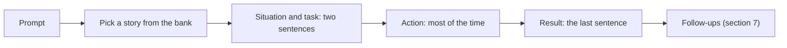
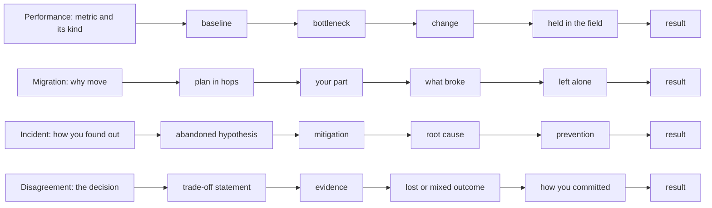
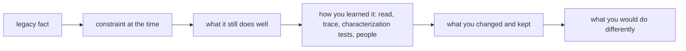
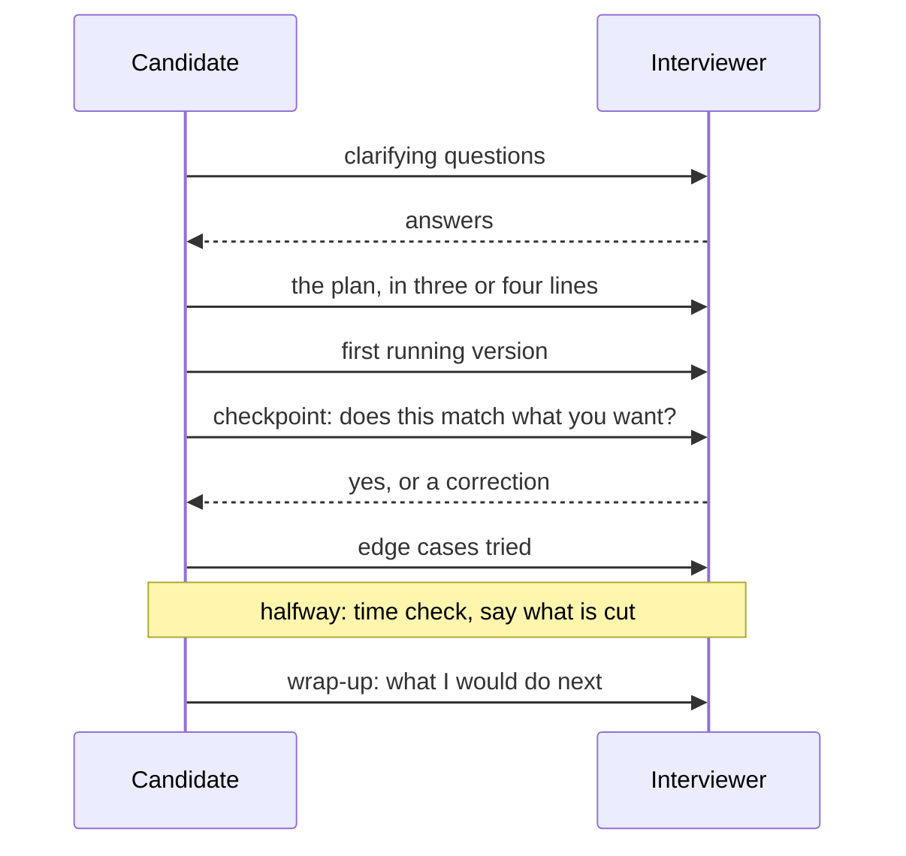
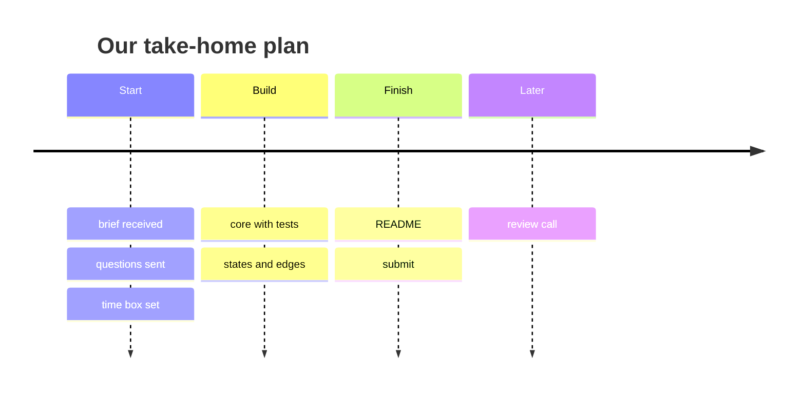
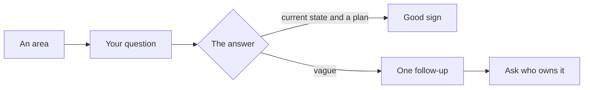
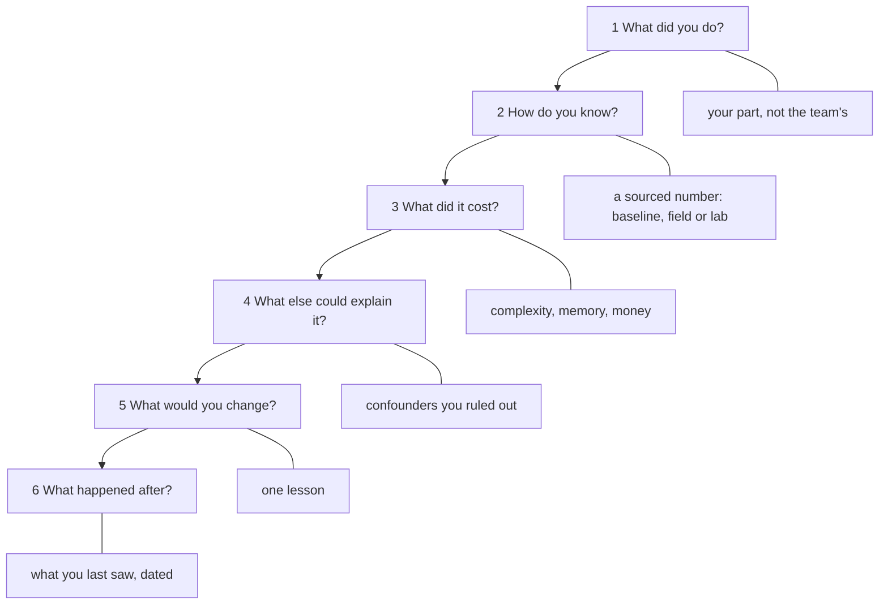

# 47. Behavioral interviews and interview craft: front-end stories, legacy without blame, live coding, take-homes and the questions you ask

> **What this covers:** the behavioral round for front-end and full-stack Angular roles: stories told in STAR with an explicit result, four front-end story types (a performance win, a migration, an incident and a disagreement over architecture), talking about legacy code and migrations without blame, live-coding etiquette for Angular tasks, take-home expectations, and the questions to ask about the team's front-end practice. Advice is worded as advice; the two exercises run in the labs.
> **Prerequisites:** none. Helpful for §2 and §7: [45. The front-end system design method](45-frontend-system-design-method.md#1-the-front-end-system-design-interview-what-it-evaluates-its-formats-and-how-it-differs-from-a-backend-design-round) and [46. From method to case](46-system-design-case-studies.md#1-from-method-to-case-the-parts-every-case-study-carries-and-where-each-cases-difficulty-lies)
> **Leads to:** [MOCK-INTERVIEWS.md](../MOCK-INTERVIEWS.md) (planned)
> **Applies to:** Angular 22.2 facts as their owner modules state them; TypeScript 6.0 and Node 24 in `labs/ts-js`; documented only: this repository's backend guide, the Google SRE book chapter "Postmortem Culture: Learning from Failure", the Retrospective Wiki's quote of the Prime Directive, Wikipedia on characterization tests; reads 2026-10-23
> **Study time:** ~2 hours reading + ~2 hours exercises and story practice
> **Short on time:** read [§1](#1-the-behavioral-round-what-a-story-is-evidence-of-star-with-the-weight-on-action-and-an-explicit-result-and-a-story-bank), [§2](#2-four-front-end-stories-a-performance-win-a-migration-a-production-incident-and-a-disagreement-over-architecture) and [§4](#4-live-coding-an-angular-task-clarify-say-the-plan-build-in-working-increments-narrate-and-recover-when-stuck), then [Q47.01](#q47-01), [Q47.03](#q47-03), [Q47.07](#q47-07), [Q47.10](#q47-10) and [Q47.15](#q47-15), then the [Summary](#summary).
> **Labs:** [`labs/ts-js/src/modules/47-behavioral-and-interview-craft/`](../labs/ts-js/src/modules/47-behavioral-and-interview-craft/) Run (Node 24): from `labs/ts-js`, `npx vitest run src/modules/47-behavioral-and-interview-craft src/outputs/47-behavioral-and-interview-craft`.

## Contents

1. [The behavioral round: what a story is evidence of, STAR with the weight on action and an explicit result, and a story bank](#1-the-behavioral-round-what-a-story-is-evidence-of-star-with-the-weight-on-action-and-an-explicit-result-and-a-story-bank)
2. [Four front-end stories: a performance win, a migration, a production incident and a disagreement over architecture](#2-four-front-end-stories-a-performance-win-a-migration-a-production-incident-and-a-disagreement-over-architecture)
3. [Legacy codebases and migrations without blame: the constraints of the time, how you learned the code before changing it, and words that explain instead of accuse](#3-legacy-codebases-and-migrations-without-blame-the-constraints-of-the-time-how-you-learned-the-code-before-changing-it-and-words-that-explain-instead-of-accuse)
4. [Live coding an Angular task: clarify, say the plan, build in working increments, narrate, and recover when stuck](#4-live-coding-an-angular-task-clarify-say-the-plan-build-in-working-increments-narrate-and-recover-when-stuck)
5. [Take-home assignments: scope and time-box, what the repository must show, the README, and the review call](#5-take-home-assignments-scope-and-time-box-what-the-repository-must-show-the-readme-and-the-review-call)
6. [Questions to ask about the front-end practice: versions and updates, testing, the design system and accessibility, performance, contracts and releases, and how to read the answers](#6-questions-to-ask-about-the-front-end-practice-versions-and-updates-testing-the-design-system-and-accessibility-performance-contracts-and-releases-and-how-to-read-the-answers)
7. [Under the hood: how one story is drilled into, numbers you can defend, and telling a design or a migration as your own project](#7-under-the-hood-how-one-story-is-drilled-into-numbers-you-can-defend-and-telling-a-design-or-a-migration-as-your-own-project)
- [Summary](#summary)
- [Question bank](#question-bank)
- [Hands-on exercises](#hands-on-exercises)
- [Check your understanding](#check-your-understanding)
- [Connections](#connections)

**How this module was checked.** Run: Vitest in Node 24 for Exercise 47.1 (characterization tests over our legacy function and two refactors), Exercise 47.2 (our list core in two designs) and Q47.09. Read, not run: this repository's backend guide (§6.5, §9, §10), the Google SRE book chapter on postmortem culture, the Retrospective Wiki's quote of the Prime Directive and Wikipedia on characterization tests. Every Angular fact is its owner module's, linked; every sample story is ours, with example numbers; [SOURCES.md](../SOURCES.md) has the dates.

## 1. The behavioral round: what a story is evidence of, STAR with the weight on action and an explicit result, and a story bank

### The problem it solves

Asked "tell me about a time you improved performance", a candidate spends ninety seconds on the product, says "we" throughout and stops without saying what changed. Another stretches one good story over five prompts.

### Mental model

A **behavioral question** asks for a past situation, because a past action is evidence of how you work (our framing). **STAR** is situation, task, action, result; we claim no origin for it. The **result sentence** is our term for the last sentence, with a number and its baseline where one exists. A **story bank** is our term for six to eight stories, each tagged with the **prompts** (questions) it answers. Think of a lab notebook entry: one line of setup, the procedure, the measured result at the bottom.



What to notice: the story is picked before it is told, and the result is the last step before the follow-ups.

### How it actually works

The weighting is [the backend guide's advice](../../Backend%20Interview%20Study%20Guide%20-%20Data%20storage%2C%20behavioral%20%26%20concurrency.md) (its §9), and we adopt it: "Situation and task should be *two sentences* — just enough context. Action is the substance. **Result is non-negotiable and must be stated explicitly as the last thing you say.**" It adds: "A negative result stated clearly beats a good result left implied." Its reason is its own claim, which we do not verify: "Interviewers write down outcomes. If your story has no ending, the note says "unclear impact.""

Practise aloud: its "How to use this" says "out loud, in English, as if someone were listening", because "the thing that fails in interviews is retrieval and articulation, not recognition". Its drill: a two-minute timer, the story told out loud, and a check "that you said a result sentence before time ran out". The seven prompts (§9.1 to §9.7) are not retold here; sections 2 and 7 give front-end versions.

### Code

Approach: the result first, then the rest around it.

```text
# An example story (ours, not a real project; every number is an example number)
Prompt   "Tell me about a problem users noticed that you fixed."
S and T  (2 sentences) Our checkout form lost what people had typed when the
         session expired. I owned the fix.
A        (about 150 words) I reproduced the loss, saved drafts on every change,
         restored them after sign-in, and told support what to expect. I did
         the restore myself; a colleague reviewed it.
R        (1 sentence) Lost-draft tickets fell from 40 a month to 6 in the two
         months after release; file fields were not restored, which I would
         fix first next time.
```

```text
# Our suggestion: a story bank (example stories; result sentences use example numbers)
Story                      Prompts it answers              Result sentence
Draft saver on expiry      user-noticed problem, ownership Tickets 40 -> 6 a month
Lazy routes for a catalog  performance win, a CV claim     Field LCP at p75 3.9 s -> 2.6 s
Standalone migration       migration, legacy code          Last NgModule removed in 3 releases
Cache-skew incident        incident, a mistake             Fixed in 25 minutes; deploys keep old chunks
Store-library debate       disagreement, lost or mixed     Team chose none; I committed and helped
Code-review coaching       mentoring, conflict             Review turnaround 3 days -> 1
```

1. Write the result first, because it is what the story is evidence of.
2. Cut the situation to two sentences, because more delays the action.
3. Mark each "we" with your part, because the follow-up asks for it.

### Best practices and anti-patterns

- **Hold a second story back per prompt**, because a story reused five times sounds rehearsed.
- **Say a negative result plainly, then what you would change**, because that is a complete ending.

Four ways it goes wrong, each with a cost and a signal (our suggestions):

- **No result.** Cost: no achievement to note. Signal: "and what happened?"
- **All "we".** Cost: your part is invisible. Signal: "what did you do?"
- **A long setup.** Cost: a rushed action. Signal: an interruption before it starts.
- **One story for every prompt.** Cost: answers blur. Signal: "a different example?"

### Misconceptions and traps

- "The situation is the interesting part." The action is the evidence, and the situation needs only the two sentences that make it understandable. Cause: it is the part you remember best.
- "A story without a happy ending should be avoided." A clearly stated negative result plus what you would change is a complete story. Cause: interviews feel like selling.
- "Say 'we' to sound like a team player." Name the team once, then say what you did, because the question is about you. Cause: sharing credit is a good habit at work.
- "Memorize stories word for word." Memorize the result sentence and the beats, and tell the rest freshly, because a recited story breaks at the first follow-up ([section 7](#7-under-the-hood-how-one-story-is-drilled-into-numbers-you-can-defend-and-telling-a-design-or-a-migration-as-your-own-project)). Cause: it feels safe.

Drilled in [Q47.01](#q47-01) and [Q47.02](#q47-02).

## 2. Four front-end stories: a performance win, a migration, a production incident and a disagreement over architecture

### The problem it solves

A candidate claims "we made the app faster" with no baseline and no word on field or lab, recites `ng update` commands as a migration, opens an incident with the fix, and ends a disagreement with "they agreed". None is evidence.

### Mental model

A **story skeleton** (our term) is the ordered beats one story type needs, like a clinic's case file with fields per complaint. A **baseline** is the measurement before the change. **Field data** comes from real users' browsers ([08 §6](08-browser-rendering-dom-events.md#6-core-web-vitals-lcp-inp-and-cls)); a **lab measurement** is one controlled run on a stated setup ([31 §1](31-performance.md#1-measure-first-the-loop-lab-versus-field-and-what-each-tool-answers)). The **bottleneck** limits the metric. **Mitigation** stops the pain; the **root cause** explains it. An **abandoned hypothesis** is an explanation you tested and dropped. **Version skew** is "one tab's `index.html` and chunks from two releases" ([44 §8](44-fullstack-delivery-and-operations.md#8-feature-flags-with-openfeature-and-canary-releases-providers-evaluation-context-sticky-rollout-kill-switches-and-version-skew)). To **commit to a decision** is to build the chosen option well after arguing against it.



What to notice: each row ends in [section 1](#1-the-behavioral-round-what-a-story-is-evidence-of-star-with-the-weight-on-action-and-an-explicit-result-and-a-story-bank)'s result sentence and has one beat the others lack.

### How it actually works

[The backend guide](../../Backend%20Interview%20Study%20Guide%20-%20Data%20storage%2C%20behavioral%20%26%20concurrency.md) gives each beat a reason (its claims, quoted). §9.2: "Include a **hypothesis you abandoned** — reasoning from evidence rather than ego is what a debugging-heavy team screens for, and a story where you were immediately right teaches them nothing." §9.4: "Pick a real one where you lost or the outcome was mixed", and "Stories where you were right and everyone agreed sound rehearsed; the signal is whether you can disagree without becoming difficult to work with." §9.5: "the baseline and how you measured it, what the bottleneck turned out to be, what you changed, how you verified the improvement held under production load", because "An unsupported metric is worse than no metric." §6.5: "Stabilize first, diagnose second" (abridged), because mitigation and root cause are different activities.

The front-end addition: vitals are judged on field data at the 75th percentile, and a lab run explains why, so a field "before" and a lab "after" do not compare.

### Code

Approach: the beats in order, result last. All four are example stories (ours, not real projects) with example numbers.

1. Name the metric's kind before the number, because the two kinds do not compare.
2. Put what you left alone just before the migration's result, because §9.3's follow-up is "What did you leave alone, and why?"
3. Put the abandoned hypothesis mid-incident, because the guide says a story where you were immediately right "teaches them nothing".
4. Put how you committed just before the disagreement's result, because it shows the guide's signal: "whether you can disagree without becoming difficult to work with".

```text
# Performance win: an example story (ours, not a real project; every number is an example number)
Metric      LCP at p75, field data from our RUM beacons on the catalog page
Baseline    Field: 3.9 s over the four weeks before. Lab: Lighthouse in CI, same
            settings, median of 3 runs, 5.2 s
Bottleneck  The build's stats file showed the admin area's chart library in the
            initial bundle, so every catalog visitor downloaded it first
Change      I moved the admin area behind a lazy route; nothing else in that release
Held        Field: 2.6 s over the four weeks after, read per release. Lab: 3.1 s
Cost        The first admin visit waits for its chunk, so we preload it later
Result      Field LCP at p75 went from 3.9 s to 2.6 s and held for four weeks; the
            admin area's first load got slower, which we accepted.
```

```text
# Migration: an example story (ours, not a real project; every number is an example number)
Why move    The admin app was on v19, which the releases page lists as no longer
            supported (39 §3)
Plan        One major per hop to v22, then standalone folder by folder, one schematic
            per commit, lazy routes only after standalone (39 §10)
My part     I ran the hops and the standalone passes for 4 of 9 feature folders, and
            wrote the checklist the others followed
What broke  After the first pass the build passed and the tests did not; the
            checkpoint (build and tests after every pass) caught it before merge
Left alone  Karma and the animations: nothing in the standalone work depends on
            them, so each became its own later track
Result      v22 with no NgModule left after 3 releases and no rollback; the test
            runner is still open, and next time I would start it in parallel.
```

```text
# Production incident: an example story (ours, not a real project; every number is an example number)
Found out   Ten minutes after a release, the alert on errors per 1,000 page views
            fired: chunk loads failing, an empty page after a menu click (44 §9)
Hypothesis  First: the new release broke the route. Abandoned: every failing report
            carried the previous release id, and a fresh tab worked
Mitigation  Stabilize first: I copied the previous release's chunks back to the
            server, and the errors stopped before we knew why
Root cause  The deploy replaced the asset folder, so open tabs' index.html named
            chunks that no longer existed: version skew (44 §8)
Prevention  Deploys keep the previous release's chunks; the service-worker app
            prompts a reload on an unrecoverable state (37 §6)
Result      Users hit the empty page for 25 minutes; six releases since, no chunk
            errors.
```

```text
# Disagreement over architecture: an example story (ours, not a real project; every number is an example number)
Decision    Cart state shared by three features: NgRx Store or signal services (28 §11)
My position "On traceability against learning cost, I'd pick NgRx Store over signal
            services if many features write the cart; we pay an action and a
            reducer per change; revisit if one feature stays the only writer."
Evidence    A two-day prototype of the cart in both, and a one-page comparison
Outcome     Lost: the team chose signal services, since only checkout wrote the cart
Committed   I built the cart service and its tests, and put the revisit condition
            in the design document
Result      The cart shipped in 2 sprints; a pricing bug later took 2 days to trace
            without an action log, a mixed outcome we now check against that condition.
```

Owners: the migration program ([39 §10](39-version-history-and-migrations.md#10-a-migration-program-for-an-old-angular-codebase-order-dependencies-and-checkpoints)), unrecoverable states ([37 §6](37-elements-pwa-errors-ecosystem.md#6-updates-versions-swupdate-prompting-a-reload-unrecoverable-states-and-the-kill-switch)) and when a store library pays off ([28 §11](28-state-management.md#11-alternatives-and-the-decision-framework-ngxs-elf-tanstack-query-and-when-a-store-library-is-justified)). The quoted position is a complete trade-off statement ([45 §2](45-frontend-system-design-method.md#2-communicating-under-time-pressure-a-time-plan-complete-trade-off-statements-and-diagrams-at-three-zoom-levels)); a micro-frontends ([Q38.23](38-architecture-and-production-structure.md#q38-23)) debate fits the same skeleton.

> [!TIP]
> **Coming from the backend.** The guide's incident (§9.2) and CV-claim (§9.5) stories keep their beats. **Where the analogy breaks:** a front-end failure runs in users' browsers, so users may see it before any server alert; one tab can run two releases; and "production load" means field data that real user monitoring collects ([44 §9](44-fullstack-delivery-and-operations.md#9-frontend-error-tracking-and-real-user-monitoring-releases-source-maps-beacons-and-sampling)), not server percentiles.

### Best practices and anti-patterns

- **Draft each story's distinctive beat first**, because first drafts leave it out (our suggestion).

### Misconceptions and traps

- "A performance story is a before-and-after number." It needs its kind, a baseline, the bottleneck and proof that it held, or it is an unsupported metric. Cause: numbers sound objective.
- "An incident story starts with the fix." It starts with how you found out, then mitigation before cause and an abandoned hypothesis. Cause: the fix is the proud part.
- "A migration story is the list of versions." It is the plan, the risk managed and your part; versions are context. Cause: version numbers are concrete.
- "Pick a disagreement you won." One you lost, or with a mixed outcome, shows how you argue and commit. Cause: winning sounds competent.

Drilled in [Q47.03](#q47-03), [Q47.04](#q47-04), [Q47.05](#q47-05) and [Q47.06](#q47-06).

## 3. Legacy codebases and migrations without blame: the constraints of the time, how you learned the code before changing it, and words that explain instead of accuse

### The problem it solves

Asked about an old Angular 8 app, a candidate says "the previous team wrote spaghetti" and "we had to rewrite everything". Another "fixes" a rounding quirk in a refactor and breaks the month-end totals a report depended on.

### Mental model

**Legacy code** (our working definition) still runs in production, and its current team did not write it or cannot change it safely. A **blame-free account** (our term) describes it through the **constraints of the time** (versions, tools, deadline, team size, what it still does well), then how you learned it before changing it and what you would do differently. A **quirk** is behavior that looks wrong but may be depended on; a **deliberate change** alters one on purpose, as its own visible step. Think of a surveyor's report on an old house: it says the wiring met the rules of its decade and what to replace first, and blames no electrician. [Wikipedia](https://en.wikipedia.org/wiki/Characterization_test) (read 2026-10-23): "a characterization test (also known as Golden Master Testing) is a means to describe (characterize) the actual behavior of an existing piece of software, and therefore protect existing behavior of legacy code against unintended changes via automated testing." "This term was coined by Michael Feathers." (his book was not read). It is not a component snapshot test, which stores a rendering and fails on any difference ([30 §6](30-e2e-and-testing-strategy.md#6-visual-regression-and-accessibility-checks-in-end-to-end-tests) owns screenshots); ours pins named inputs and results.



What to notice: the accusation has no box; every box is a fact, a constraint or your own action.

### How it actually works

Google SRE's postmortem practice ("Google's Postmortem Philosophy", [sre.google](https://sre.google/sre-book/postmortem-culture/), read 2026-10-23): "For a postmortem to be truly blameless, it must focus on identifying the contributing causes of the incident without indicting any individual or team for bad or inappropriate behavior. A blamelessly written postmortem assumes that everyone involved in an incident had good intentions and did the right thing with the information they had." Its reason: "If a culture of finger pointing and shaming individuals or teams for doing the "wrong" thing prevails, people will not bring issues to light for fear of punishment." Its remedy: "You can't "fix" people, but you can fix systems and processes to better support people making the right choices when designing and maintaining complex systems." That is about incidents; we apply the same principle to talking about code, as our advice. The [Retrospective Wiki](https://retrospectivewiki.org/index.php?title=The_Prime_Directive) (read 2026-10-23) quotes Norm Kerth (book not read): "Regardless of what we discover, we understand and truly believe that everyone did the best job they could, given what they knew at the time, their skills and abilities, the resources available, and the situation at hand."

To learn before changing, [the backend guide](../../Backend%20Interview%20Study%20Guide%20-%20Data%20storage%2C%20behavioral%20%26%20concurrency.md) §9.3 lists "reading, tracing requests, writing tests to probe behavior, talking to people" and asks "What did you leave alone, and why?" A characterization test describes "the actual behavior", so it pins what code does, not what it should do. Strategy is owned by [39 §9](39-version-history-and-migrations.md#9-from-angularjs-to-angular-ngupgrade-hybrids-the-strangler-fig-and-rewrites) (strangler fig), [39 §10](39-version-history-and-migrations.md#10-a-migration-program-for-an-old-angular-codebase-order-dependencies-and-checkpoints) and [Q40.14](40-framework-comparisons.md#q40-14) (rewrite or modernize).

```text
# Blame words and what to say instead (our suggestion)
"spaghetti"           -> "grew without a module boundary as features were added"
"they didn't test"    -> "the code had no tests, so we added characterization tests before changing it"
"stupid workaround"   -> "a workaround for <constraint> that is no longer needed since <version>"
"we had to rewrite"   -> "we chose to replace X because Y; we kept Z"
```

### Code

An excerpt of the test of [Exercise 47.1](#ex47-1).

1. The first test asserts what the legacy code returns now, `'USD 1.00'` even though `1.01` looks right, because the pin is a fact, not a judgment.
2. The second names the old and the new result in its title, because a reviewer must see the change was intended.

```ts
// Excerpt of labs/ts-js/src/modules/47-behavioral-and-interview-craft/exercise-1-legacy-refactor/exercise-1.test.ts
  { args: [1.005], legacy: 'USD 1.00', now: 'USD 1.01' },
  it('the characterization cases pass against the legacy function unchanged', () => {
    for (const row of PINNED) expect(legacyLabel(...row.args)).toBe(row.legacy);
  });
  it("the deliberate change rounds a half-cent amount up, from 'USD 1.00' to 'USD 1.01'", () => {
    expect(legacyLabel(1.005)).toBe('USD 1.00');
    expect(label(1.005)).toBe('USD 1.01');
  });
```

### Best practices and anti-patterns

- **Pin before you change.** Without a pin, a changed result goes unseen; the signal is a report total that moves (our suggestion).
- **Name what you left alone**, or the follow-up has no answer; the signal is the interviewer asking it twice (our suggestion).

### Misconceptions and traps

- "Honesty means saying the old code was bad." Candor is about facts and constraints; a judgment of people says nothing about the code and something about you. Cause: candor is valued.
- "A refactor must fix every bug it finds." Pin the current behavior, then change it as a separate, visible decision, because a consumer may depend on the quirk. Cause: leaving a known bug feels wrong.
- "Saying what you would do differently admits failure." It shows you learned, and the guide's §9.3 and §9.4 follow-ups ask for it. Cause: interviews feel like defending.
- "A rewrite story shows more skill than a migration." An incremental migration that kept the app shipping is, in our advice, the more credible story; Q40.14 owns when to rewrite. Cause: greenfield sounds bigger.

Drilled in [Q47.07](#q47-07), [Q47.08](#q47-08) and [Q47.09](#q47-09); practised in [Exercise 47.1](#ex47-1).

## 4. Live coding an Angular task: clarify, say the plan, build in working increments, narrate, and recover when stuck

### The problem it solves

Given "build a searchable, paginated list in 40 minutes", one candidate types silently, scaffolds an NgModule and a service layer, nests a `subscribe` inside a `subscribe`, first runs the code at minute 35 and guesses an API instead of asking.

### Mental model

A **live-coding round** is what [45 §1](45-frontend-system-design-method.md#1-the-front-end-system-design-interview-what-it-evaluates-its-formats-and-how-it-differs-from-a-backend-design-round) calls a **machine-coding round**: one component built live. Our **live-coding loop** (a suggestion) has seven steps: **clarify** (inputs, the data's shape, the loading, empty and error states, tests, whether documentation and AI assistants are allowed); **say the plan** in three or four lines; **build the smallest working version**, then add one **increment** (one running behavior) at a time; **narrate** decisions, not keystrokes; **try the edge cases** (empty, one item, a page past the end, whitespace in the query); **check time** at the halfway mark and say what you will cut; **wrap up** with what you would do next. Like a pilot's checklist read aloud, it lets the co-pilot catch a skipped step.



What to notice: each candidate message gives the interviewer a chance to correct a wrong assumption early.

### How it actually works

The interviewer can credit only what they see and hear (our advice). A running partial answer can be extended under follow-ups; one that does not run cannot be assessed. A **checkpoint** asks the interviewer a question at a working state. The narration script:

```text
# Narration, one line per loop step (our suggestion)
clarify:   "Is the data in memory? Do I need loading and error states? Are docs allowed?"
plan:      "A pure filter-sort-page function, then a component holding signals, then edges."
build:     "Rendering the unfiltered first page first, so there is something running."
narrate:   "I derive the visible rows with computed, so no state can drift."
edges:     "Empty result, one item, a page past the end, ' ' as the query."
halfway:   "Sorting works; I will cut the page-size selector and keep the edge cases."
wrap-up:   "Next: debounce the input, keep the query in the URL."
```

Modern defaults are less to type and read: a standalone component ([15 §2](15-standalone-and-ngmodules.md#2-standalone-components-and-the-imports-array)), `computed` for derived state ([17 §3](17-signals.md#3-computed-signals)), `@for` with `track` ([18 §2](18-control-flow-and-defer.md#2-for-track-context-variables-empty-and-what-angular-can-iterate)) and, when RxJS is used, flattening instead of nested subscriptions ([23 §2](23-rxjs-in-depth.md#2-choosing-a-flattening-operator-races-lost-writes-cancellation-and-recursion)). Ask whether documentation and AI assistants are allowed and say when you use them. When the task is a pure function, test it first: [29 §1](29-testing-angular.md#1-what-to-test-where-unit-integration-component-and-end-to-end-tests-the-pyramid-and-the-trophy) notes it needs no `TestBed`. **When stuck** (our suggestion): say what you are trying, reduce the case, write the failing input down and ask a specific question; the backend guide's §9.7 "ask people to repeat or rephrase" applies to the prompt too.

### Code

The component over [Exercise 47.2](#ex47-2)'s core:

```ts
// Partial: Angular imports and Exercise 47.2's core (Row, ListQuery, view, withText) are assumed
@Component({
  selector: 'app-row-list',
  template: `
    <input #q aria-label="Search by name" (input)="setText(q.value)" />
    <ul>
      @for (row of listView().items; track row.id) {
        <li>{{ row.name }}</li>
      } @empty {
        <li>No matching rows</li>
      }
    </ul>
    <button (click)="goTo(listView().page - 1)" [disabled]="listView().page <= 1">Previous</button>
    <span>{{ listView().page }} of {{ listView().pageCount }}</span>
    <button (click)="goTo(listView().page + 1)" [disabled]="listView().page >= listView().pageCount">Next</button>
  `,
})
export class RowListComponent {
  readonly rows = input.required<readonly Row[]>();
  private readonly query = signal<ListQuery>({ text: '', sort: 'name', dir: 'asc', page: 1, pageSize: 10 });
  protected readonly listView = computed(() => view(this.rows(), this.query()));

  protected setText(text: string): void {
    this.query.update((q) => withText(q, text));
  }

  protected goTo(page: number): void {
    this.query.update((q) => ({ ...q, page }));
  }
}
```

1. The core is a pure function, because it can be tested in seconds and survives any framework question.
2. The component holds only the query signal and calls the core inside `computed`, because derived state belongs there; a new `rows` array recomputes the view.
3. `@empty` and the disabled buttons show the empty result and both ends of the pages, because edges should be visible.

### Best practices and anti-patterns

Four ways it goes wrong, each with a cost and a signal (our suggestions):

- **Silence** costs the interviewer's evidence; the signal is "what are you doing?".
- **Over-scaffolding** (a store for one component, [28 §11](28-state-management.md#11-alternatives-and-the-decision-framework-ngxs-elf-tanstack-query-and-when-a-store-library-is-justified)) costs minutes; the signal is nothing rendering by the halfway mark.
- **No edges tried** leaves bugs; the signal is the interviewer typing an empty query.
- **Guessing an API** costs a debugging loop; the signal is an unexplained compile error, so ask whether docs are allowed.

### Misconceptions and traps

- "The interviewer wants to see you code fast." In our advice the round assesses how you reach and explain a working answer, so a plan and a running increment beat speed. Cause: the clock is visible.
- "Asking questions looks weak." Clarifying the prompt is part of the task, and a wrong assumption costs more time than a question. Cause: school tests forbid asking.
- "Show every Angular feature you know." The smallest modern solution is easier to finish and explain; a store or an NgModule for one component adds nothing. Cause: breadth looks thorough.
- "If stuck, keep quiet until it works." Saying what you try lets the interviewer help and gives them reasoning to credit. Cause: struggling feels embarrassing.

Drilled in [Q47.10](#q47-10) and [Q47.11](#q47-11); practised in [Exercise 47.2](#ex47-2).

## 5. Take-home assignments: scope and time-box, what the repository must show, the README, and the review call

### The problem it solves

A candidate spends twenty hours on a four-hour brief, adds NgRx, server-side rendering and Playwright to a two-screen app, ships no README, one giant commit and a failing test, and cannot explain a library choice in the review call.

### Mental model

A **take-home** is a scoped task done alone and reviewed later, for example in a call. Our suggestion: confirm the **time box** (the agreed time you stop at) and the **definition of done** (what counts as finished), then do less, well. **Gold-plating** (adding unasked features) a shed does not win the house.



What to notice: the README comes before the review call, which is a plan step.

### How it actually works

A reviewer sees only the repository and the README (our reasoning), so an unwritten decision does not exist for them. The repository must show, as our suggestions:

- it runs from a clean clone with one command, and the tests pass;
- the **commit history** tells the story in steps;
- the Angular code is modern by default, with no secrets;
- the required features have loading, empty and error states, the last as in [37 §10](37-elements-pwa-errors-ecosystem.md#10-error-ux-expected-and-unexpected-errors-http-failures-offline-state-and-route-errors).

The **review call** is the follow-up: walk through one decision, accept a change request live, and say what you would do differently. [The backend guide](../../Backend%20Interview%20Study%20Guide%20-%20Data%20storage%2C%20behavioral%20%26%20concurrency.md) advises, for a CV claim (its §9.5), to "have the mechanism ready". Ask whether AI assistants and documentation are allowed, and say when you used them. We state no time limit or pay; none was read.

### Code

Our suggested **README** skeleton, the canonical list of its contents:

```text
# Task board (our suggestion; example lines)
## Run and test
npm ci && npm start     # one command from a clean clone; npm test
## Implemented
Board, card form, filter; loading, empty and error states.
## Decisions and trade-offs
Signal service, not a store: state is per page, so a store adds a feature tree
and boilerplate; I would revisit if a second page writes the same cards.
## With more time
One end-to-end journey; keyboard drag and drop.
## Time spent
About the agreed time box; the rest is listed above.
```

1. Run and test come first, because a reviewer who cannot run the code stops.
2. Each decision names its cost, because without one it reads as advocacy; [45 §2](45-frontend-system-design-method.md#2-communicating-under-time-pressure-a-time-plan-complete-trade-off-statements-and-diagrams-at-three-zoom-levels)'s complete statement is the form, and [Q40.13](40-framework-comparisons.md#q40-13) shows the trap.
3. Time spent comes last, because it frames the cut scope.

### Best practices and anti-patterns

Four ways it goes wrong, each with a cost and a signal (our suggestions):

- **Overrunning the time box** costs trust in your scoping; the signal is a new library at hour three. A store for two screens is the trade-off of [Q28.32](28-state-management.md#q28-32), and end-to-end tests are worth one journey at most ([30 §1](30-e2e-and-testing-strategy.md#1-what-belongs-at-the-end-to-end-level-journeys-cost-and-a-strategy-across-levels)).
- **No README** costs the first impression; the signal is no one-line way to say how to run it.
- **Untestable code** costs credibility; the signal is a lone generated `should create`. [29 §1](29-testing-angular.md#1-what-to-test-where-unit-integration-component-and-end-to-end-tests-the-pyramid-and-the-trophy) says which tests a small app needs.
- **Unexplained choices** cost the review call; the signal is silence at "why this library?".

### Misconceptions and traps

- "More features show more skill." A reviewer sees a missed time box and less-tested code; a small, tested core with written trade-offs is easier to judge. Cause: more looks impressive.
- "The README is optional if the code is clean." The reasons and cut scope are not in the code. Cause: clean code feels self-explanatory.
- "The take-home is done when submitted." The review call is part of the task, so plan what you will walk through. Cause: it is a deliverable.
- "Use the newest experimental API to stand out." An experimental or developer preview API needs its status said and a reason; [Q39.05](39-version-history-and-migrations.md#q39-05) says what each status promises. Cause: novelty signals currency.

Drilled in [Q47.12](#q47-12) and [Q47.13](#q47-13).

## 6. Questions to ask about the front-end practice: versions and updates, testing, the design system and accessibility, performance, contracts and releases, and how to read the answers

### The problem it solves

At "do you have any questions?", a candidate asks "what's your tech stack?" when the job ad lists it, and learns nothing about a team on an old Angular major with no tests on pull requests.

### Mental model

The **candidate's questions** are the ones you ask at the end of a round. In our framing they do two jobs: they show what you care about, and they collect evidence about the team. [The backend guide's §10](../../Backend%20Interview%20Study%20Guide%20-%20Data%20storage%2C%20behavioral%20%26%20concurrency.md) says "These are scored. Generic questions produce generic impressions." That is the backend guide's claim, not a fact about interviews. Think of inspecting a used car: you ask for the service history, not the paint colour.



What to notice: a vague answer leads to one follow-up, then to the owner.

### How it actually works

A team's **practice** is how it routinely updates, tests and ships the front end. The backend guide's §10 gives general questions, so we repeat none of them and add front-end questions by area (ours). Each maps to a cost you would carry: an old major means a migration program ([39 §10](39-version-history-and-migrations.md#10-a-migration-program-for-an-old-angular-codebase-order-dependencies-and-checkpoints)), and no tests on pull requests means slow, risky changes.

The same guide's "The one worth asking everyone separately." is one question about what people learn only after joining; ask it of every interviewer and compare the answers.

**Reading the answers** is our advice: a current state and a plan is a good sign; "we're going to" with no date, or "it depends who you ask", calls for a follow-up.

### Code

Our suggested areas (every row is ours):

```text
Area            Ask                                        Good sign                  Follow up
Versions        Which Angular major are you on?            Current or supported one   When did you last update?
                How do you plan updates?                   A routine, owned           What blocked the last one?
Testing         What runs on every pull request?           Named checks that gate     What is not covered?
                What do you test at which level?           A reason per level         Which test do you trust most?
Design system   Is there a shared component library?       Owner and versioning       Who accepts a new component?
and a11y        How is accessibility checked?              Tooling plus manual        Who fixes a failure?
Performance     Do you measure real users?                 Field data, a target       Which page is worst?
                What happened after the last slow release? A fix with a number        How did you notice?
Contracts       How is an API change agreed?               A written, tested contract Who breaks a client first?
                How are old clients kept working?          A deprecation period       How long is it?
Releases        How often does the front end ship?         Small, frequent, routine   What was the last incident?
                How do you roll back?                      Tried, minutes             When did you last do it?
Ownership       Who decides front-end architecture?        A named group or process   Which decision was last reversed?
                How does a new idea get adopted?           A short written proposal   What was the last one?
```

Owners, one per area: [39 §3](39-version-history-and-migrations.md#3-how-angular-ships-semantic-versioning-the-release-cadence-support-windows-and-the-deprecation-policy) (the **support window**: how long a major gets fixes), [29 §1](29-testing-angular.md#1-what-to-test-where-unit-integration-component-and-end-to-end-tests-the-pyramid-and-the-trophy) and [30 §1](30-e2e-and-testing-strategy.md#1-what-belongs-at-the-end-to-end-level-journeys-cost-and-a-strategy-across-levels), [36 §12](36-material-and-cdk.md#12-a-design-system-on-the-cdk-and-angular-aria-or-a-wrapper-around-material) (the **design system**) with [11 §1](11-accessibility.md#1-why-accessibility-and-what-the-standards-require), [44 §9](44-fullstack-delivery-and-operations.md#9-frontend-error-tracking-and-real-user-monitoring-releases-source-maps-beacons-and-sampling) (**real-user monitoring**: field data from real visitors) with [08 §6](08-browser-rendering-dom-events.md#6-core-web-vitals-lcp-inp-and-cls), [41 §4](41-fullstack-api-contracts.md#4-evolving-the-contract-compatible-changes-api-versioning-in-spring-framework-7-and-deprecation-headers), [44 §7](44-fullstack-delivery-and-operations.md#7-cicd-for-both-layers-one-image-promoted-through-stages-a-monorepo-or-separate-repositories-and-versioning-the-contract) (a **rollback** returns users to the previous release) and [38 §1](38-architecture-and-production-structure.md#1-folder-structures-that-scale-by-feature-domain-slices-and-core-shared-and-feature-boundaries).

1. Choose two or three areas per interviewer, because a manager, a peer engineer and a designer answer different ones.
2. Ask one follow-up on a vague answer, because the first answer is often the official one.

### Best practices and anti-patterns

Four ways it goes wrong, each with a cost and a signal (our suggestions):

- **A generic question** costs you the evidence; the signal is a one-sentence answer.
- **Asking what the ad answers** costs credibility; the signal is "that's in the posting".
- **Reading out the whole table** costs time; the signal is a glance at the clock.
- **Taking the first answer** keeps the official version; the signal is no date or number.

### Misconceptions and traps

- "Having no questions shows you are satisfied." In our advice and the backend guide's §10, questions are part of the assessment and your chance to learn about the work. Cause: staying quiet seems polite.
- "Ask about the tech stack." The stack is in the job ad; ask how the team updates, tests and releases it. Cause: it is the obvious front-end topic.
- "A vague answer is a red flag." It may be a question this interviewer does not own, so ask who does, or follow up once. Cause: you want clarity.
- "Ask every interviewer the same list." Different roles answer different areas; only the "everyone separately" question is worth repeating. Cause: it is efficient.

Drilled in [Q47.14](#q47-14).

## 7. Under the hood: how one story is drilled into, numbers you can defend, and telling a design or a migration as your own project

### The problem it solves

A performance story collapses at "how did you measure that?": the CV's "40% faster" has no source. A built design comes out as a lecture, and "why Angular" as a pitch with no costs.

### Mental model

The **follow-up ladder** (our term, stated only here) is six questions that drill into one story; each **rung** asks for more specific evidence:

1. What did *you* do?
2. How do you know it worked? A measurement, field or lab.
3. What did it cost? [The backend guide's](../../Backend%20Interview%20Study%20Guide%20-%20Data%20storage%2C%20behavioral%20%26%20concurrency.md) §9.5: "What did it cost — complexity, memory, money?"
4. What else could explain it? Its §9.5: "How did you know that change caused the improvement and not something else?"
5. What would you do differently?
6. What happened after you moved on?

A **defensible number** has a source (a dashboard, a report, a test), a baseline and a kind. A **confounder** is another change that could explain the same result. A prepared witness under cross-examination has the receipts, and says "I don't know" when they don't.



What to notice: all six kinds of evidence exist before the round, or not at all.

### How it actually works

Our reasoning: each rung checks the one above (rung 2 that the action had an effect, 3 that it paid, 4 that the effect was the action's), so prepare every story to rung 4 at least.

The backend guide's §9.5 holds that "An unsupported metric is worse than no metric" and, when specifics are gone, advises you to "say so and describe the method rather than inflating the number"; we adopt both. The kind matters because in [31 §1](31-performance.md#1-measure-first-the-loop-lab-versus-field-and-what-each-tool-answers)'s loop field data says how bad and for whom, and a lab run says why: a number with no kind cannot be set against its baseline.

A **project story** (our term) is a design or migration you took part in, told in STAR with your part as the Action. For a design, [46 §1](46-system-design-case-studies.md#1-from-method-to-case-the-parts-every-case-study-carries-and-where-each-cases-difficulty-lies)'s case template supplies the Action at the depth of one decision, the part its table marks as hard, each choice a complete trade-off statement ([45 §2](45-frontend-system-design-method.md#2-communicating-under-time-pressure-a-time-plan-complete-trade-off-statements-and-diagrams-at-three-zoom-levels)). A migration keeps [section 2](#2-four-front-end-stories-a-performance-win-a-migration-a-production-incident-and-a-disagreement-over-architecture)'s skeleton.

**The "why Angular" story.** [Q40.13](40-framework-comparisons.md#q40-13) owns the structure; told as your decision, it adds what you weighed then and would weigh now (rung 5 on a choice).

**In a second language**, our advice is the backend guide's: its §9.7, "**ask people to repeat or rephrase when you need it.**", and its "How to use this", on answering out loud before reading: "If you are preparing for interviews in a second language, this is not optional advice."

### Code

Approach: section 2's performance example story, down all six rungs.

1. Source every number before the round, because rung 2 asks for it.
2. Prepare rung 4, because a confounder you name yourself shows you checked (our suggestion).
3. Keep one "I would do differently" per story, because rung 5 can follow any story.

```text
# An example story drilled down the ladder (ours, not a real project; every number is an example number)
1 You did      From the build's stats file I found the chart library in the
               initial bundle and moved the admin area behind a lazy route. A
               colleague reviewed it; the RUM beacons were already in place.
2 You know     Field: LCP at p75 from our RUM dashboard, 3.9 s over the four weeks
               before, 2.6 s over the four after, read per release. Lab:
               Lighthouse in CI, same settings, median of 3 runs, 5.2 s to 3.1 s.
               "How many visits?" I don't know the exact count; it was every
               catalog visit the beacons sampled, and the dashboard showed it.
3 It cost      The first admin visit waits for its chunk, so we preloaded it
               later; one more route to keep lazy. No money; about two days.
4 What else    Nothing else shipped in that release. Traffic mix: the lab run
               fixes device and network, and it fell too. A CDN change: none in
               those eight weeks, per the deploy log.
5 Differently  Add a bundle budget in CI with the fix (31 §6), so a heavy library
               cannot creep back into the initial bundle unnoticed.
6 After        When I changed teams a quarter later, the dashboard showed the
               catalog page's field LCP at p75 at 2.7 s. I have not seen it since.
```

### Best practices and anti-patterns

- **Date what you last saw at rung 6**, because a later figure is not yours to defend.

### Misconceptions and traps

- "A precise number sounds more credible." One you cannot source falls at rung 2, and the backend guide holds an unsupported metric worse than none. Cause: precision signals rigor.
- "Follow-ups mean the story failed." They are how evidence is checked, and a prepared story invites them. Cause: they feel like doubt.
- "A design story should show the whole design." As a story, it is the Action, at the depth of its hard decision. Cause: the design took months.
- "'I don't know' ends the answer." "I don't know the exact figure; here is how we measured it" keeps the method, which rung 2 checks. Cause: it sounds like failing.

Drilled in [Q47.15](#q47-15).

## Summary

A behavioral question asks for a past action as evidence; the action is the substance and the story ends on an explicit result, because the backend guide says no ending reads as "unclear impact" ([§1](#1-the-behavioral-round-what-a-story-is-evidence-of-star-with-the-weight-on-action-and-an-explicit-result-and-a-story-bank)). Each story type has a beat the others lack: a performance win names field or lab and a baseline, a migration names what you left alone, an incident puts mitigation before the root cause, a disagreement is lost or mixed. The trap is a number with no kind ([§2](#2-four-front-end-stories-a-performance-win-a-migration-a-production-incident-and-a-disagreement-over-architecture)). Legacy code is told through the constraints of the time, after characterization tests pin what it does now; the trap is calling an insult candor ([§3](#3-legacy-codebases-and-migrations-without-blame-the-constraints-of-the-time-how-you-learned-the-code-before-changing-it-and-words-that-explain-instead-of-accuse)).

Live coding is the machine-coding round: clarify, say the plan, build in running increments, narrate, try the edges; the trap is silence ([§4](#4-live-coding-an-angular-task-clarify-say-the-plan-build-in-working-increments-narrate-and-recover-when-stuck)). A reviewer sees only the repository and the README, so a small tested core with written trade-offs beats extra features ([§5](#5-take-home-assignments-scope-and-time-box-what-the-repository-must-show-the-readme-and-the-review-call)). Ask your questions by area, with one follow-up on a vague answer; the trap is asking the stack the ad lists ([§6](#6-questions-to-ask-about-the-front-end-practice-versions-and-updates-testing-the-design-system-and-accessibility-performance-contracts-and-releases-and-how-to-read-the-answers)).

One story is drilled down six rungs, so every number needs a source, a baseline and a kind; the trap is a precise number you cannot source. A design told as your project is its Action, at one decision's depth ([§7](#7-under-the-hood-how-one-story-is-drilled-into-numbers-you-can-defend-and-telling-a-design-or-a-migration-as-your-own-project)).

## Question bank

Fifteen questions follow the sections: stories, legacy code, live coding, take-homes, questions to ask and follow-ups. Design answers give an example story (ours, with example numbers); Output answers are asserted by a test.

<a id="q47-01"></a>
### Q47.01 · Concept · What does a behavioral round collect from a story, and why does a story that never states its result score as "unclear impact"?

<details>
<summary>Answer</summary>

**Short answer (30 seconds).** Evidence of what you did and what changed (our framing). The backend guide's claim, unverified by us: "Interviewers write down outcomes. If your story has no ending, the note says "unclear impact.""

**Full explanation.** The guide's shape ([§9](../../Backend%20Interview%20Study%20Guide%20-%20Data%20storage%2C%20behavioral%20%26%20concurrency.md)): "Result is non-negotiable and must be stated explicitly as the last thing you say." A listener cannot note an outcome left unsaid ([§1]](#1-the-behavioral-round-what-a-story-is-evidence-of-star-with-the-weight-on-action-and-an-explicit-result-and-a-story-bank).

**Follow-ups an interviewer will ask.**
- *Is a negative result acceptable?* Yes: it "beats a good result left implied".
- *How long is the situation?* Two sentences, because the action is the evidence and a long setup delays it.

**Trap to avoid.** Ending on "and then we shipped": shipping is an activity, not an outcome.

</details>

<a id="q47-02"></a>
### Q47.02 · Design · Build a story bank for an Angular full-stack role: which six to eight stories, which prompts each one answers, and how each fits in two minutes

<details>
<summary>Answer</summary>

**Short answer (30 seconds).** Six to eight stories, each tagged with the prompts it answers, with a result sentence and a two-minute version ([§1](#1-the-behavioral-round-what-a-story-is-evidence-of-star-with-the-weight-on-action-and-an-explicit-result-and-a-story-bank)).

**Full explanation.** Cover a user-noticed problem, a performance win, a migration, an incident, a lost disagreement and mentoring, plus why this role ([§9.1](../../Backend%20Interview%20Study%20Guide%20-%20Data%20storage%2C%20behavioral%20%26%20concurrency.md)) and why Angular ([Q40.13](40-framework-comparisons.md#q40-13)).

**Code.**

```text
# Our suggestion: one bank row (an example story; the number is an example number)
Story    Standalone migration
Prompts  migration, legacy code, "a time you owned a plan"
Result   Last NgModule removed in 3 releases, no rollback
Two min  S and T 2 sentences, A about 150 words, R one sentence
```

**Follow-ups an interviewer will ask.**
- *Can one story answer two prompts?* Yes, with another emphasis, because each prompt asks for a different beat ([§2](#2-four-front-end-stories-a-performance-win-a-migration-a-production-incident-and-a-disagreement-over-architecture)).
- *How do you practise?* Aloud against a two-minute timer, checking "that you said a result sentence before time ran out": the guide's drill, because the failure is "structural, not linguistic".

**Trap to avoid.** Eight wins: the lost-or-mixed disagreement prompt then has no story.

</details>

<a id="q47-03"></a>
### Q47.03 · Design · "Tell me about a performance improvement you made": a front-end story with the baseline, how it was measured, the bottleneck, the change and proof that it held

<details>
<summary>Answer</summary>

**Short answer (30 seconds).** Name the metric and its kind, then baseline, bottleneck, change and proof it held, with the result last ([§2]](#2-four-front-end-stories-a-performance-win-a-migration-a-production-incident-and-a-disagreement-over-architecture).

**Full explanation.** Vitals are judged on field data at p75, and a lab run explains why ([Q31.01](31-performance.md#q31-01)). The guide's CV-claim prompt asks how you "verified the improvement held under production load" ([§9.5](../../Backend%20Interview%20Study%20Guide%20-%20Data%20storage%2C%20behavioral%20%26%20concurrency.md)).

**Code.**

```text
# Performance win: an example story (ours, not a real project; every number is an example number)
Metric      INP at p75, field data from our RUM beacons on the orders page
Baseline    Field: 380 ms over four weeks. Lab: a recorded filter click, one
            laptop profile, median of 3 runs, 450 ms
Bottleneck  The trace showed one long task: every click rebuilt all 2,000 rows
Change      I rendered only the visible rows; nothing else shipped that release
Held        Field: 190 ms over four weeks after, per release. Lab: 210 ms
Cost        Fixed row heights clip wrapped text
Result      Field INP at p75 went from 380 ms to 190 ms and held for four weeks;
            long cells are clipped, which we accepted.
```

**Follow-ups an interviewer will ask.**
- *Field or lab?* Say which for each number, because real users and one controlled run are different populations.
- *How do you know it held?* Field data after release, because the guide's prompt asks about "production load".

**Trap to avoid.** A lab "after" beside a field "before": the gap mixes populations, so it proves nothing.

</details>

<a id="q47-04"></a>
### Q47.04 · Design · "Tell me about a production incident in the front end": a blank screen after a release, told from detection through mitigation, cause and prevention

<details>
<summary>Answer</summary>

**Short answer (30 seconds).** Tell it in order: how you found out, the abandoned hypothesis, mitigation, root cause, prevention, result ([§2]](#2-four-front-end-stories-a-performance-win-a-migration-a-production-incident-and-a-disagreement-over-architecture).

**Full explanation.** Mitigate before diagnosing. A blank screen after a release can be version skew, one tab running files from two releases ([Q44.17](44-fullstack-delivery-and-operations.md#q44-17)). Tell the beats of [§9.2](../../Backend%20Interview%20Study%20Guide%20-%20Data%20storage%2C%20behavioral%20%26%20concurrency.md), including "a hypothesis you abandoned".

**Code.**

```text
# Production incident: an example story (ours, not a real project; every number is an example number)
Found out   A support ticket 15 minutes after release: empty page after a menu click
Hypothesis  First: a bad API response. Abandoned: the failing reports were chunk
            load errors, and a fresh tab worked
Mitigation  Stabilize first: restored the previous release's chunks on the server
Root cause  Version skew: open tabs named chunks the deploy had deleted
Prevention  Deploys keep the last release's chunks; errors per 1,000 page views
            are charted per release id, with an alert
Result      Users saw the empty page for 40 minutes; the alert has since caught
            one bad chunk in 6 minutes.
```

**Follow-ups an interviewer will ask.**
- *What changed in monitoring?* An error rate per release id, because skew appears per release ([44 §9](44-fullstack-delivery-and-operations.md#9-frontend-error-tracking-and-real-user-monitoring-releases-source-maps-beacons-and-sampling)).
- *Mitigation or fix first?* Mitigation, because the guide's §6.5 says confusing it with root cause "extends outages".

**Trap to avoid.** Opening with the root cause: hindsight hides how you reasoned from evidence.

</details>

<a id="q47-05"></a>
### Q47.05 · Design · "Tell me about a disagreement over front-end architecture": how you argued, when you stopped, how you committed, and what the outcome taught you

<details>
<summary>Answer</summary>

**Short answer (30 seconds).** The decision, your position as a trade-off statement, your evidence, a lost or mixed outcome, and how you committed ([§2]](#2-four-front-end-stories-a-performance-win-a-migration-a-production-incident-and-a-disagreement-over-architecture).

**Full explanation.** The guide says "Pick a real one where you lost or the outcome was mixed" ([§9.4](../../Backend%20Interview%20Study%20Guide%20-%20Data%20storage%2C%20behavioral%20%26%20concurrency.md)). Phrase your position as the five-part trade-off statement of [45 §2](45-frontend-system-design-method.md#2-communicating-under-time-pressure-a-time-plan-complete-trade-off-statements-and-diagrams-at-three-zoom-levels). The example is a micro-frontends debate ([Q38.23](38-architecture-and-production-structure.md#q38-23) owns when they pay); it shows how you argued, not which option wins.

**Code.**

```text
# Disagreement over architecture: an example story (ours, not a real project; every number is an example number)
Decision    Micro-frontends for the admin area, or one app with feature libraries
My position "On team independence against operating cost, I'd keep one app while
            one team ships it; we pay a shared release; revisit if a second
            team owns a section."
Evidence    A one-page comparison of build time, release steps, shared state
Outcome     Lost: leadership chose micro-frontends for a second team next quarter
Committed   I wrote the shell's contract tests and the shared-version rule
Result      The first release ran 3 weeks late; the version rule caught 2
            mismatches: a mixed outcome.
```

**Follow-ups an interviewer will ask.**
- *When did you stop arguing?* When the decision was made with your evidence heard, because the guide asks how you knew when to stop.
- *What if it was unsafe?* Escalate the specific risk in writing, without making it personal (the guide's answer), because a named risk can be checked.

**Trap to avoid.** A disagreement everyone agreed with: such stories "sound rehearsed".

</details>

<a id="q47-06"></a>
### Q47.06 · Bug hunt · Four story drafts: "the app got three times faster", an incident with no abandoned hypothesis, a migration that "we" did, and a disagreement everyone agreed with. What does each cost, and what fixes it?

<details>
<summary>Answer</summary>

**Short answer (30 seconds).** Each draft drops one beat that makes it evidence ([§2](#2-four-front-end-stories-a-performance-win-a-migration-a-production-incident-and-a-disagreement-over-architecture)).

**Full explanation.**
- "Three times faster": no metric, kind, baseline or proof it held. Fix: the performance beats.
- No abandoned hypothesis: "immediately right teaches them nothing" (the guide). Fix: the dropped explanation.
- "We" migrated: your part is invisible. Fix: the hops you ran, what you left alone.
- Everyone agreed: sounds rehearsed. Fix: a real loss, how you committed.

**Follow-ups an interviewer will ask.**
- *Is "we" ever right?* Once, for team facts, because the question asks what you did.
- *May I invent the dropped hypothesis?* No: follow-ups ask how you know ([§7](#7-under-the-hood-how-one-story-is-drilled-into-numbers-you-can-defend-and-telling-a-design-or-a-migration-as-your-own-project)).

**Trap to avoid.** A number you cannot defend: "An unsupported metric is worse than no metric" (the guide).

</details>

<a id="q47-07"></a>
### Q47.07 · Concept · Talking about a legacy Angular codebase without blame: what you describe, which words turn a story into an accusation, and how you say what you would do differently

<details>
<summary>Answer</summary>

**Short answer (30 seconds).** Describe effects and constraints of the time, never a judgment of people, then what you would do differently ([§3](#3-legacy-codebases-and-migrations-without-blame-the-constraints-of-the-time-how-you-learned-the-code-before-changing-it-and-words-that-explain-instead-of-accuse)).

**Full explanation.** Google SRE's postmortem practice ([sre.google](https://sre.google/sre-book/postmortem-culture/), read 2026-10-23): "A blamelessly written postmortem assumes that everyone involved in an incident had good intentions and did the right thing with the information they had." About incidents; applying it to code is our advice. Learn first: reading, tracing, tests, people ([§9.3](../../Backend%20Interview%20Study%20Guide%20-%20Data%20storage%2C%20behavioral%20%26%20concurrency.md)).

**Follow-ups an interviewer will ask.**
- *What if the code really was bad?* Describe its effects, because a judgment of people informs nobody.
- *What did you leave alone?* Name it with its reason, because the guide asks "What did you leave alone, and why?"

**Trap to avoid.** Calling an insult candor: it says something about you, not the code.

</details>

<a id="q47-08"></a>
### Q47.08 · Trade-off · A migration story when you were part of the decision: an incremental migration or a rewrite, told when it went well and when it did not

<details>
<summary>Answer</summary>

**Short answer (30 seconds).** Tell the decision, your part and the result. Our advice: the incremental migration that kept shipping is the more credible story.

**Full explanation.** Which strategy fits is [Q39.18](39-version-history-and-migrations.md#q39-18)'s, and whether a framework switch pays is [Q40.14](40-framework-comparisons.md#q40-14)'s. Tell it with [§2](#2-four-front-end-stories-a-performance-win-a-migration-a-production-incident-and-a-disagreement-over-architecture)'s migration beats: the options weighed then, why the team chose, your part, and the result, good or mixed, stated last.

**Follow-ups an interviewer will ask.**
- *And if the rewrite failed?* Give the result and what you would change, because a negative result stated clearly beats a good one left implied (the guide).
- *How did you order the work?* Highest risk or most unblocking first, because the guide's §9.3 says "any answer is fine if you have a reason".

**Trap to avoid.** Saying "we chose" when you advised: your role in the decision is the evidence.

</details>

<a id="q47-09"></a>
### Q47.09 · Output · Our legacy price-label function on five inputs: what does each call return, and which result do the characterization tests pin as a quirk instead of fixing it?

`formatPriceLabel` is the legacy function of [Exercise 47.1](#ex47-1) (our example of legacy code, not taken from any project). What does this print?

```ts
console.log(formatPriceLabel(19.99, 'EUR', 10));
console.log(formatPriceLabel(1.005));
console.log(formatPriceLabel(10, 'USD', 150));
console.log(formatPriceLabel(7, 'EUR'));
console.log(formatPriceLabel(7, 'eur', 10));
```

<details>
<summary>Answer</summary>

**Short answer (30 seconds).** `EUR 17.99`, `USD 1.00`, `-USD 5.00`, `EUR 7.00`, `EUR 6.30`. The function rounds the binary value and never clamps the discount, so the second and third are quirks the tests pin.

**Full explanation.** `1.005` is stored just below 1.005, so `toFixed(2)` gives `1.00` ([Q01.04](01-js-values-types-coercion.md#q01-04) owns why). A discount of 150 gives a minus label. A refactor keeps both, because something may depend on them ([§3](#3-legacy-codebases-and-migrations-without-blame-the-constraints-of-the-time-how-you-learned-the-code-before-changing-it-and-words-that-explain-instead-of-accuse)). Verified: `Q47.09`.

**Follow-ups an interviewer will ask.**
- *Does `Math.round(1.005 * 100) / 100` fix it?* No: the stored value is just below 1.005, so the product is just below 100.5 and rounds to `100` (Exercise 47.1's test).
- *Why keep the minus label?* A consumer may parse it.

**Trap to avoid.** Fixing `1.005` inside the refactor: a reviewer cannot tell a change from an accident.

</details>

<a id="q47-10"></a>
### Q47.10 · Concept · The first five minutes of an Angular live-coding task: which clarifying questions, what you say about your plan, and the smallest version that works

<details>
<summary>Answer</summary>

**Short answer (30 seconds).** Ask about the data and states, say a three-line plan, then build the smallest running version ([§4](#4-live-coding-an-angular-task-clarify-say-the-plan-build-in-working-increments-narrate-and-recover-when-stuck)), because an interviewer can credit only what they hear and see (our advice).

**Full explanation.** This is the machine-coding round of [Q45.02](45-frontend-system-design-method.md#q45-02). Clarify the data, the loading, empty and error states, and whether AI assistants are allowed (we state no rule). Render the unfiltered page first.

**Code.**

```text
# The first five minutes, spoken (our suggestion; an example task)
"Is the data in memory, and about how many rows? Loading and error states? Are docs allowed?"
"Plan: a pure filter-sort-page function, then a component holding signals, then edge cases."
"First the unfiltered first page, so something runs. Does that match what you want?"
```

**Follow-ups an interviewer will ask.**
- *"Just start."* State one assumption aloud, because an unspoken one cannot be corrected.
- *Tests?* Ask, then test the pure core: it proves the edges fast ([29 §1](29-testing-angular.md#1-what-to-test-where-unit-integration-component-and-end-to-end-tests-the-pyramid-and-the-trophy)).

**Trap to avoid.** Scaffolding before asking: a wrong guess surfaces late.

</details>

<a id="q47-11"></a>
### Q47.11 · Bug hunt · A live-coding replay: ten silent minutes, an NgModule for a one-component task, a `subscribe` inside a `subscribe`, no empty or error state tried, and a guess instead of a docs lookup. What does each cost?

<details>
<summary>Answer</summary>

**Short answer (30 seconds).** Each moment costs evidence or time and has a one-step fix ([§4](#4-live-coding-an-angular-task-clarify-say-the-plan-build-in-working-increments-narrate-and-recover-when-stuck)).

**Full explanation.**
- Silence: nothing to credit. Fix: narrate.
- NgModule for one component: extra code. Fix: standalone ([15 §2](15-standalone-and-ngmodules.md#2-standalone-components-and-the-imports-array)).
- Nested `subscribe`: late results, a leaked inner. Fix: flatten ([Q23.06](23-rxjs-in-depth.md#q23-06)).
- No empty or error state: the interviewer finds bugs. Fix: try edges (`@empty`, [18 §2](18-control-flow-and-defer.md#2-for-track-context-variables-empty-and-what-angular-can-iterate)).
- A guessed API: an error loop. Fix: ask whether documentation and AI assistants are allowed (we state no rule); look it up aloud.

**Follow-ups an interviewer will ask.**
- *Is a lookup a failure?* Not in our advice: aloud, it shows reasoning.
- *Which first?* Narration: it costs no code.

**Trap to avoid.** Restarting: it discards the version they can still assess.

</details>

<a id="q47-12"></a>
### Q47.12 · Trade-off · A four-hour take-home for an Angular role: a store library, SSR and end-to-end tests, or a small tested core with a README? What reviewers can see, and what over-building costs

<details>
<summary>Answer</summary>

**Short answer (30 seconds).** The small tested core with a README: a reviewer sees only the repository and the README, so time on extras is not spent on the brief (our advice; "four hours" is our example, no real limit was read).

**Full explanation.** Over-building costs the time box and the call ([§5](#5-take-home-assignments-scope-and-time-box-what-the-repository-must-show-the-readme-and-the-review-call)). A store for two screens costs more than it returns ([Q28.32](28-state-management.md#q28-32)); end-to-end tests earn one journey ([30 §1](30-e2e-and-testing-strategy.md#1-what-belongs-at-the-end-to-end-level-journeys-cost-and-a-strategy-across-levels)).

**Follow-ups an interviewer will ask.**
- *When is a store right?* When the brief needs shared state across features, because only then does its cost return something.
- *A vague brief?* Ask once, then write the assumption down, because the reviewer judges against it.

**Trap to avoid.** "More features show more skill": unfinished extras cost the tests.

</details>

<a id="q47-13"></a>
### Q47.13 · Design · The take-home README and the review call: what the README says, and how you defend, change and extend the code live

<details>
<summary>Answer</summary>

**Short answer (30 seconds).** The README gives how to run, what is implemented, each decision with its cost, what comes next and time spent ([§5](#5-take-home-assignments-scope-and-time-box-what-the-repository-must-show-the-readme-and-the-review-call)). In the call, defend one decision, change something small live with a test, and name what you would do differently.

**Full explanation.** Each decision names its cost, in [45 §2](45-frontend-system-design-method.md#2-communicating-under-time-pressure-a-time-plan-complete-trade-off-statements-and-diagrams-at-three-zoom-levels)'s complete trade-off form, because the code does not hold the reasons.

**Code.**

```text
# A review call, our suggestion (example lines for the board app of section 5)
Walk-through  "One decision: a signal service, not a store, because state is per page."
Change asked  "Add a due-date filter." Test first, smallest change, run the suite, say it aloud.
Extend        "If a second page writes cards, I would move to a store; here is the seam."
Differently   "I would add one end-to-end journey; I ran out of time box."
```

**Follow-ups an interviewer will ask.**
- *A live change request?* Make the smallest change with a test: it shows how you work.
- *Why time spent?* It frames the cut scope; otherwise a reviewer guesses.

**Trap to avoid.** A README with features and no trade-offs: the call then opens on an unprepared question.

</details>

<a id="q47-14"></a>
### Q47.14 · Design · Questions to ask about the front-end practice: the Angular version and update cadence, testing, the design system and accessibility, performance measurement, contracts and releases, and how to read each answer

<details>
<summary>Answer</summary>

**Short answer (30 seconds).** Pick two or three areas per interviewer from [§6](#6-questions-to-ask-about-the-front-end-practice-versions-and-updates-testing-the-design-system-and-accessibility-performance-contracts-and-releases-and-how-to-read-the-answers), ask one question each, and one follow-up if the answer is vague, because roles own different answers (our advice).

**Full explanation.** The general questions are the backend guide's [§10](../../Backend%20Interview%20Study%20Guide%20-%20Data%20storage%2C%20behavioral%20%26%20concurrency.md). Read answers for a current state and a plan: an old major means a migration ([39 §10](39-version-history-and-migrations.md#10-a-migration-program-for-an-old-angular-codebase-order-dependencies-and-checkpoints)), a cost you would carry.

**Code.**

```text
# Three questions for a peer engineer (our suggestion)
Which Angular major are you on, and when did you last update?   Good sign: a routine, with an owner
What runs on every pull request?                                Good sign: named checks that block
Do you measure real users' page speed?                          Good sign: field data and a target
```

**Follow-ups an interviewer will ask.**
- *Manager or peer?* A manager for releases, a peer for testing: each owns different answers.
- *All vague?* Ask who owns it: no owner is itself the answer.

**Trap to avoid.** Asking the tech stack: the ad lists it, so it reveals nothing about updates or tests.

</details>

<a id="q47-15"></a>
### Q47.15 · Concept · Under the hood: how an interviewer drills into one story (what you did, how you know, what it cost, what you would change), and how to keep every number defensible

<details>
<summary>Answer</summary>

**Short answer (30 seconds).** A six-rung ladder, each rung asking for more specific evidence ([§7](#7-under-the-hood-how-one-story-is-drilled-into-numbers-you-can-defend-and-telling-a-design-or-a-migration-as-your-own-project)). Each rung checks the one above (our reasoning).

**Full explanation.** Rung 3 is the backend guide's [§9.5](../../Backend%20Interview%20Study%20Guide%20-%20Data%20storage%2C%20behavioral%20%26%20concurrency.md): "What did it cost — complexity, memory, money?". A design story follows [46 §1](46-system-design-case-studies.md#1-from-method-to-case-the-parts-every-case-study-carries-and-where-each-cases-difficulty-lies)'s template; "why Angular" is [Q40.13](40-framework-comparisons.md#q40-13)'s. Prepare to rung 4: rungs 2 to 4 check the evidence.

**Follow-ups an interviewer will ask.**
- *You forgot the number.* Say so and give the method, "rather than inflating the number" (the guide), because the method can still be checked and an inflated figure cannot.
- *Field or lab?* Name it: a number with no kind cannot meet its baseline ([31 §1](31-performance.md#1-measure-first-the-loop-lab-versus-field-and-what-each-tool-answers)).

**Trap to avoid.** A precise number you cannot source: it falls at rung 2; "An unsupported metric is worse than no metric" (the guide).

</details>

## Hands-on exercises

Exercise 47.1 practises pinning a legacy function and refactoring it; [Exercise 47.2](#ex47-2) builds a core from a prompt in increments. The server-side list is [Exercise 46.2](46-system-design-case-studies.md#ex46-2), not rebuilt here.

<a id="ex47-1"></a>
### Exercise 47.1 · A legacy function in a refactoring round: characterization tests first, a refactor that keeps every pinned result, and one quirk changed in the open

**Problem.** `formatPriceLabel` in `legacy/price-label.ts` (our example of legacy code) writes labels such as `USD 10.00`. Refactor it, keep every result a consumer may rely on, and change one quirk in the open: `1.005` should read `USD 1.01`.

**Constraints.** `legacy/` is read-only; keep its signature; no `Intl`. Variant a extracts functions (blocks moved into named functions) with the legacy arithmetic; b uses an integer core in minor units (cents) and a formatter.

**Acceptance criteria.**
- [ ] the characterization cases pass against the legacy function unchanged
- [ ] the refactor returns the legacy result on every characterization case except the deliberate change
- [ ] the deliberate change rounds a half-cent amount up, from 'USD 1.00' to 'USD 1.01'
- [ ] a discount above 100 keeps the legacy negative label
- [ ] a non-finite price keeps the legacy empty label
- [ ] the refactor keeps the legacy function's signature

<details><summary>Hint 1</summary>

Which results can you record today that must still hold afterwards?

</details>

<details><summary>Hint 2</summary>

Let a test show what `Math.round(1.005 * 100)` gives before you trust it.

</details>

<details><summary>Worked solution</summary>

1. Pin first: run a table against `legacy`, because a consumer may depend on a quirk and reading cannot tell a bug from a contract. It holds `1.005` giving `USD 1.00` ([Q01.04](01-js-values-types-coercion.md#q01-04) owns why), a discount of 150 giving `-USD 5.00` and `NaN` giving `''`.
2. Refactor in small steps with the same arithmetic and rerun the table after each, because a step that changes a result fails at once and names the row.
3. Change the one behavior last, as its own step (its own commit in a real repository), because a reviewer must see it. Two rows carry a `now` label: `1.005` and `2.675`.
4. Choose the method by its test: it asserts `Math.round(1.005 * 100)` is `100`, so rounding the product does not help. Variant a rounds the amount's decimal text instead.

```ts
// Excerpt of labs/ts-js/src/modules/47-behavioral-and-interview-craft/exercise-1-legacy-refactor/a/price-label.ts
function shiftedByTwo(amount: number): number {
  const shifted = Number(`${amount}e2`);
  return Number.isNaN(shifted) ? amount * 100 : shifted;
}

function twoDecimals(amount: number): string {
  return (Math.round(shiftedByTwo(amount)) / 100).toFixed(2);
}

export function formatPriceLabel(price: number, currency?: string, discountPercent?: number): string {
  if (!Number.isFinite(price)) return '';
  const amount = discounted(price, discountPercent);
  const sign = amount < 0 ? '-' : '';
  return `${sign}${currencyCode(currency)} ${twoDecimals(Math.abs(amount))}`;
}
```

**How each criterion is met.** Each runs in both variants.
- Legacy: all ten rows return their recorded label.
- Refactor: eight rows keep it; `1.005` and `2.675` give `USD 1.01` and `USD 2.68`.
- Change: the title names both labels.
- Discount: `10` at 150 gives `-USD 5.00`.
- Non-finite: `NaN` and both infinities give `''`.
- Signature: a one-argument call works and `length` is 3.

**Alternative approach:** b turns the amount into integer cents once, rounds there, and a formatter writes the label from the integer. **Trade-offs:** both pass; a is the smaller diff to review, b rounds in one place but is a larger rewrite.

**Interviewer follow-ups.**
- *"How do you tell this refactor in a behavioral round without blaming the author?"* Say what you did: "it had no tests, so I pinned its results, kept all but one, and changed that one on its own." Describe the old rounding by what it returned, because a judgment of people says nothing about the code ([section 3](#3-legacy-codebases-and-migrations-without-blame-the-constraints-of-the-time-how-you-learned-the-code-before-changing-it-and-words-that-explain-instead-of-accuse)).
- *"What did you leave alone?"* The minus and empty labels. They look wrong but are pinned, and changing them is a separate decision someone must own.

**Tests:** [exercise-1.test.ts](../labs/ts-js/src/modules/47-behavioral-and-interview-craft/exercise-1-legacy-refactor/exercise-1.test.ts); code in [exercise-1-legacy-refactor/](../labs/ts-js/src/modules/47-behavioral-and-interview-craft/exercise-1-legacy-refactor/).

</details>

<a id="ex47-2"></a>
### Exercise 47.2 · A live-coding round in increments: the filter, sort and page core of an Angular list, built test-first with its edge cases

**Problem.** Build the core of the list in [section 4](#4-live-coding-an-angular-task-clarify-say-the-plan-build-in-working-increments-narrate-and-recover-when-stuck)'s component: `view(rows, query)` returns one page of rows, filtered and sorted, with the total and page count. One rule at a time, test first.

**Constraints.** `list-core.ts` holds the shared types; no `Intl`, clock or randomness. Variant a is pure functions; b is a **reducer** (state and event in, next state out, [28 §4](28-state-management.md#4-ngrx-store-actions-reducers-createactiongroup-createfeature-and-runtime-checks)) with a `view` selector.

**Acceptance criteria.**
- [ ] filters by a trimmed, case-insensitive substring of the name
- [ ] sorts by the chosen key and direction, breaking ties by id
- [ ] returns the requested page with the total and the page count
- [ ] an empty result returns no items, a total of 0, page 1 and a page count of 1
- [ ] a page past the end after the filter narrows is moved to the last page
- [ ] changing the text or the sort returns to page 1
- [ ] does not mutate the input rows

<details><summary>Hint 1</summary>

Which test rows expose a sort with no second key?

</details>

<details><summary>Worked solution</summary>

1. Say the plan, then write the first test, as the loop ([section 4](#4-live-coding-an-angular-task-clarify-say-the-plan-build-in-working-increments-narrate-and-recover-when-stuck)) asks:

```text
# Narration for this exercise (our suggestion), in the loop's order
clarify:   "Rows in memory? Which sort keys? What does an empty result show? Are docs allowed?"
plan:      "Shared types, then one pure view function, a failing test per rule, the component last."
build:     "First test: no query returns the first page, sorted by name. Make it pass, nothing more."
narrate:   "Next increment, the filter: trim and lower-case, so '  ANN ' finds Anna."
edges:     "Ties on name and createdAt, an empty result, a page past the end, rows I must not mutate."
halfway:   "Filter, sort and paging pass; I skip the page-size selector and keep the page reset."
wrap-up:   "Next: debounce the input and keep the query in the URL."
```

2. Use fixed rows with ties on `name` and `createdAt` (`r1` and `r3` are both Anna), because a missing tiebreaker shows only on equal keys.
3. Clamp the page in `view`, because only `view` sees the rows and the query together.

```ts
// Excerpt of labs/ts-js/src/modules/47-behavioral-and-interview-craft/exercise-2-live-list/a/list-core.ts
export function view(rows: readonly Row[], query: ListQuery): ListView {
  const needle = query.text.trim().toLowerCase();
  const matched = rows.filter((row) => row.name.toLowerCase().includes(needle)).sort(comparator(query));
  const pageCount = Math.max(1, Math.ceil(matched.length / query.pageSize));
  const page = Math.min(query.page, pageCount);
  const start = (page - 1) * query.pageSize;
  return { items: matched.slice(start, start + query.pageSize), page, pageCount, total: matched.length };
}
```

4. Wire it last: the query in a signal and the view in a `computed` ([17 §3](17-signals.md#3-computed-signals)) of section 4's standalone component ([15 §2](15-standalone-and-ngmodules.md#2-standalone-components-and-the-imports-array)) with `@for` ([18 §2](18-control-flow-and-defer.md#2-for-track-context-variables-empty-and-what-angular-can-iterate)). A sort button calls `withSort`, so the page reset lives in the core:

```ts
// Partial: a method of section 4's RowListComponent; Row, ListQuery, `query` and withSort as there
protected sortBy(sort: ListQuery['sort']): void {
  this.query.update((q) => withSort(q, sort, q.sort === sort && q.dir === 'asc' ? 'desc' : 'asc'));
}
```

**How each criterion is met.** Both variants; 7 rows, page size 3 unless noted.
- Filter: `'  ANN '` finds `r1`, `r3` and `r5`; blank text finds all 7.
- Sort: all four key and direction orders; ties end by id ascending, so `r1` precedes `r3` when the name descends too.
- Page: `r1`, `r3`, `r2`, then `r4`, `r6`, `r7`, then `r5`; total 7, 3 pages.
- Empty: `'zzz'` gives no items, total 0, page 1 of 1.
- Past the end: `'an'` leaves 5 rows, and page 3 becomes page 2 with `r7` and `r5`.
- Reset: from page 2, new text or a new sort gives page 1.
- Mutation: frozen rows pass, since sorting the input would throw.

**Alternative approach:** b keeps rows and query in one state; the reducer handles `setText`, `setSort` and `setPage`, and the selector works in three small stages. **Trade-offs:** both pass; a is less to type in a round, b makes every change an event.

**Interviewer follow-ups.**
- *"Now make it server-side."* The query becomes request parameters and the server returns a `ListView`; the id tiebreaker stays, because ties leave the order undefined across pages ([41 §6](41-fullstack-api-contracts.md#6-pagination-sorting-and-filtering-offset-versus-cursor-and-how-spring-data-serializes-a-page)). [Exercise 46.2](46-system-design-case-studies.md#ex46-2) is the server-side selection.
- *"Why clamp in `view`, not in the Next button?"* The filter can narrow the rows while a page is selected, which no click handler sees.

**Tests:** [exercise-2.test.ts](../labs/ts-js/src/modules/47-behavioral-and-interview-craft/exercise-2-live-list/exercise-2.test.ts); code in [exercise-2-live-list/](../labs/ts-js/src/modules/47-behavioral-and-interview-craft/exercise-2-live-list/).

</details>

## Check your understanding

**Explain it back.**
1. Explain to a teammate who wants to tell the AngularJS rewrite story as "the old team's mess" which words to change and which constraints to say instead.
2. Explain to a candidate whose story ends "it got three times faster" which beats are missing, and why a lab "after" cannot meet a field "before".
3. Explain to a friend with a take-home brief why a small tested core and a README come first.

**Flashcards.**

<details><summary>What does the result sentence carry?</summary>

A number and its baseline where one exists ([§1](#1-the-behavioral-round-what-a-story-is-evidence-of-star-with-the-weight-on-action-and-an-explicit-result-and-a-story-bank)).

</details>

<details><summary>Which two beats come before the root cause in an incident story?</summary>

Mitigation and an abandoned hypothesis ([§2](#2-four-front-end-stories-a-performance-win-a-migration-a-production-incident-and-a-disagreement-over-architecture)).

</details>

<details><summary>What does a characterization test pin?</summary>

What the code does now, not what it should do ([§3](#3-legacy-codebases-and-migrations-without-blame-the-constraints-of-the-time-how-you-learned-the-code-before-changing-it-and-words-that-explain-instead-of-accuse)).

</details>

<details><summary>What do you do at the halfway mark of a live-coding task?</summary>

Check time, say what you will cut ([§4](#4-live-coding-an-angular-task-clarify-say-the-plan-build-in-working-increments-narrate-and-recover-when-stuck)).

</details>

<details><summary>What does each take-home README decision name?</summary>

Its cost ([§5](#5-take-home-assignments-scope-and-time-box-what-the-repository-must-show-the-readme-and-the-review-call)).

</details>

## Connections

- **Builds on:** [45 §1](45-frontend-system-design-method.md#1-the-front-end-system-design-interview-what-it-evaluates-its-formats-and-how-it-differs-from-a-backend-design-round) (the round types; machine coding), [45 §2](45-frontend-system-design-method.md#2-communicating-under-time-pressure-a-time-plan-complete-trade-off-statements-and-diagrams-at-three-zoom-levels) (trade-off statements in stories and READMEs), [46 §1](46-system-design-case-studies.md#1-from-method-to-case-the-parts-every-case-study-carries-and-where-each-cases-difficulty-lies) (a case told as a project story), [39 §10](39-version-history-and-migrations.md#10-a-migration-program-for-an-old-angular-codebase-order-dependencies-and-checkpoints) (the migration story's plan), [31 §1](31-performance.md#1-measure-first-the-loop-lab-versus-field-and-what-each-tool-answers) (field or lab numbers in a performance story), [40 §8](40-framework-comparisons.md#8-choosing-a-framework-balanced-trade-offs-and-how-to-answer-why-angular) (the "why Angular" story) and [the backend guide](../../Backend%20Interview%20Study%20Guide%20-%20Data%20storage%2C%20behavioral%20%26%20concurrency.md) §9 and §10 (the general method and questions).
- **Read next:** [MOCK-INTERVIEWS.md](../MOCK-INTERVIEWS.md) (planned), to practise with scoring notes.
- **Uses these ideas later:** [MOCK-INTERVIEWS.md](../MOCK-INTERVIEWS.md) and [CHEATSHEET.md](../CHEATSHEET.md) (both planned): mocks to rehearse these stories and rounds aloud, and a sheet to re-read before one; file-level.
- **Comparisons:** [Q45.02](45-frontend-system-design-method.md#q45-02) (the round types versus how to behave in each), [Q40.13](40-framework-comparisons.md#q40-13) (the answer's structure versus the story of your decision) and [Q39.18](39-version-history-and-migrations.md#q39-18) (the migration choice versus telling it).
