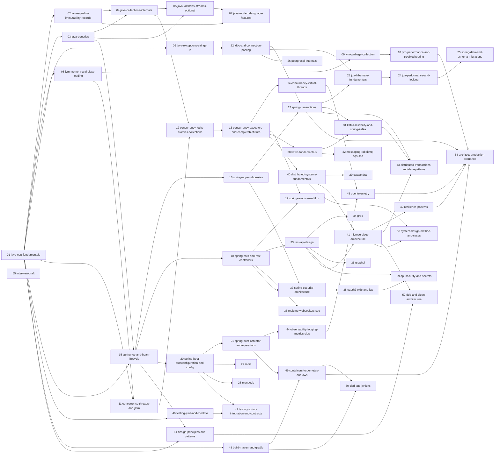

# Syllabus

**Status:** DRAFT, waiting for gate G1 (`_meta/GATES.md`). Written 2026-10-25 by planning session S20261025-0027-claudecode (step P3).
**Written against:** [VERSIONS.md](VERSIONS.md) (Java 25 LTS, Spring Boot 4.1.2, Spring Framework 7.0.10, snapshot 2026-10-25).
**Format rules:** [STYLE-GUIDE.md](STYLE-GUIDE.md). **Protocol:** [_meta/RUN.md](_meta/RUN.md).

This file is the plan. It lists every module with its permanent slug, its kind, its question and exercise ceilings, its prose cap, its lab folder and its prerequisites (§1), then the topic checklist and the delegated topics of each module (§4). Topic checkboxes are ticked in `PROGRESS.md`, never here.

**Legend.**
- **Kind.** `core` modules teach a topic interviewers drill in depth; `supporting` modules teach a topic that is asked, but less deeply. `core (pilot)` marks the pilot (Resolved decision 5).
- **Q / Ex** are ceilings, not quotas. The floors are in STYLE-GUIDE (core: 20 questions and 3 exercises; supporting: 12 questions and 2 exercises). No filler is written to reach a number. A module that exhausts its topic below a floor records the reason in `PROGRESS.md`.
- **Prose cap** counts words outside code fences (`labs/tools/module-stats.mjs`). Exceeding it needs an exception in "Resolved decisions" approved by Jorge (RUN.md §9).
- **Lab** is the Maven module under `labs/` that holds the module's compiled snippets and tests. `—` means the module has no code of its own (its exercises are written designs checked against a rubric, STYLE-GUIDE §8).
- **Slugs are permanent.** Revisions may add modules (new numbers after 55) but never rename or renumber one, because `node-backend-guide/` and `python-backend-guide/` will link to them.

## 1. Module list

| # | Slug | Part | Kind | Q | Ex | Prose cap | Lab | Prerequisites |
|---|---|---|---|---|---|---|---|---|
| 01 | `java-oop-fundamentals` | A · Java language | core | 30 | 4 | 18000 | java-language | none |
| 02 | `java-equality-immutability-records` | A | core | 24 | 3 | 18000 | java-language | 01 |
| 03 | `java-generics` | A | core | 24 | 3 | 18000 | java-language | 01 |
| 04 | `java-collections-internals` | A | core | 32 | 4 | 18000 | java-language | 02, 03 |
| 05 | `java-lambdas-streams-optional` | A | core | 30 | 4 | 18000 | java-language | 03, 04 |
| 06 | `java-exceptions-strings-io` | A | core | 26 | 3 | 18000 | java-language | 01 |
| 07 | `java-modern-language-features` | A | core | 26 | 3 | 18000 | java-language | 02, 05 |
| 08 | `jvm-memory-and-class-loading` | B · JVM | core | 26 | 3 | 18000 | jvm | 01 |
| 09 | `jvm-garbage-collection` | B | core | 28 | 3 | 18000 | jvm | 08 |
| 10 | `jvm-performance-and-troubleshooting` | B | core | 30 | 3 | 18000 | jvm | 09 |
| 11 | `concurrency-threads-and-jmm` | C · Concurrency | core | 30 | 4 | 18000 | concurrency | 01, 08 |
| 12 | `concurrency-locks-atomics-collections` | C | core | 30 | 4 | 18000 | concurrency | 04, 11 |
| 13 | `concurrency-executors-and-completablefuture` | C | core | 28 | 4 | 18000 | concurrency | 12 |
| 14 | `concurrency-virtual-threads` | C | core | 24 | 3 | 18000 | concurrency | 13 |
| 15 | `spring-ioc-and-bean-lifecycle` | D · Spring Framework | core | 32 | 4 | 18000 | spring-core | 01, 03 |
| 16 | `spring-aop-and-proxies` | D | core | 24 | 3 | 18000 | spring-core | 15 |
| 17 | `spring-transactions` | D | core (pilot) | 40 | 6 | 22000 | spring-transactions | 16, 22 |
| 18 | `spring-mvc-and-rest-controllers` | D | core | 28 | 4 | 18000 | spring-web | 15 |
| 19 | `spring-reactive-webflux` | D | core | 28 | 4 | 18000 | spring-reactive | 13, 18 |
| 20 | `spring-boot-autoconfiguration-and-config` | E · Spring Boot | core | 28 | 4 | 18000 | spring-boot | 15 |
| 21 | `spring-boot-actuator-and-operations` | E | core | 24 | 3 | 18000 | spring-boot | 20 |
| 22 | `jdbc-and-connection-pooling` | F · Persistence and databases | supporting | 16 | 2 | 9000 | persistence | 06 |
| 23 | `jpa-hibernate-fundamentals` | F | core | 32 | 4 | 18000 | persistence | 17, 22 |
| 24 | `jpa-performance-and-locking` | F | core | 30 | 4 | 18000 | persistence | 23 |
| 25 | `spring-data-and-schema-migrations` | F | core | 26 | 3 | 18000 | persistence | 24 |
| 26 | `postgresql-internals` | F | core | 30 | 4 | 18000 | postgresql | 22 |
| 27 | `redis` | F | core | 28 | 3 | 18000 | redis | 20 |
| 28 | `mongodb` | F | supporting | 18 | 2 | 9000 | mongodb | 20 |
| 29 | `cassandra` | F | supporting | 18 | 2 | 9000 | cassandra | 40 |
| 30 | `kafka-fundamentals` | G · Messaging | core | 30 | 4 | 18000 | kafka | 13 |
| 31 | `kafka-reliability-and-spring-kafka` | G | core | 30 | 4 | 18000 | kafka | 17, 30 |
| 32 | `messaging-rabbitmq-sqs-sns` | G | supporting | 16 | 2 | 9000 | messaging | 30 |
| 33 | `rest-api-design` | H · APIs | core | 26 | 3 | 18000 | spring-web | 18 |
| 34 | `grpc` | H | supporting | 18 | 2 | 9000 | grpc | 33 |
| 35 | `graphql` | H | supporting | 18 | 2 | 9000 | graphql | 33 |
| 36 | `realtime-websockets-sse` | H | supporting | 14 | 2 | 9000 | spring-web | 18 |
| 37 | `spring-security-architecture` | I · Security | core | 30 | 4 | 18000 | security | 16, 18 |
| 38 | `oauth2-oidc-and-jwt` | I | core | 28 | 3 | 18000 | security | 37 |
| 39 | `api-security-and-secrets` | I | core | 26 | 3 | 18000 | security | 33, 38 |
| 40 | `distributed-systems-fundamentals` | J · Distributed systems and microservices | core | 28 | 3 | 18000 | distributed-systems | 13 |
| 41 | `microservices-architecture` | J | core | 28 | 3 | 18000 | microservices | 33, 40 |
| 42 | `resilience-patterns` | J | core | 26 | 4 | 18000 | microservices | 41 |
| 43 | `distributed-transactions-and-data-patterns` | J | core | 28 | 4 | 18000 | microservices | 17, 31, 41 |
| 44 | `observability-logging-metrics-slos` | K · Observability | core | 26 | 3 | 18000 | observability | 21 |
| 45 | `opentelemetry` | K | core | 30 | 4 | 18000 | opentelemetry | 14, 44 |
| 46 | `testing-junit-and-mockito` | L · Testing | core | 26 | 4 | 18000 | testing | 01 |
| 47 | `testing-spring-integration-and-contracts` | L | core | 26 | 4 | 18000 | testing | 20, 46 |
| 48 | `build-maven-and-gradle` | M · Delivery | supporting | 16 | 2 | 9000 | delivery | 01 |
| 49 | `containers-kubernetes-and-aws` | M | core | 28 | 3 | 18000 | delivery | 21, 48 |
| 50 | `cicd-and-jenkins` | M | core | 30 | 4 | 18000 | cicd | 48, 49 |
| 51 | `design-principles-and-patterns` | N · Design, architecture and interview | core | 30 | 4 | 18000 | design | 01, 15 |
| 52 | `ddd-and-clean-architecture` | N | core | 24 | 3 | 18000 | design | 41, 51 |
| 53 | `system-design-method-and-cases` | N | core | 28 | 3 | 18000 | — | 40, 41 |
| 54 | `architect-production-scenarios` | N | core | 30 | 3 | 18000 | — | 10, 17, 42, 45, 49 |
| 55 | `interview-craft` | N | supporting | 14 | 2 | 9000 | — | none |

Module files live at `modules/NN-<slug>.md`. The module plan of each lives at `_meta/modules/Mxx.md`.

## 2. Prerequisite graph

An arrow `A --> B` means "read A before B". Numbers follow parts, not strict reading order: the pilot (17) depends on 22, which comes later in the numbering, and the graph, not the numbering, is the reading order.

## 3. Study paths (by goal)

Each path is a reading order through the graph; `README.md` (finish line) expands them.

- **Pass a Java language and JVM screening:** 01 → 02 → 03 → 04 → 05 → 06 → 07 → 08 → 09 → 11 → 12, then the question banks of 10 and 13.
- **Get productive on a Spring Boot service team:** 01, 04, 06 → 15 → 16 → 18 → 20 → 21 → 22 → 17 → 23 → 24 → 25 → 33 → 37 → 46 → 47.
- **Own data access and databases:** 22 → 17 → 23 → 24 → 25 → 26, then 27, 28 and 29 by the stores your target company runs, then 40.
- **Build event-driven systems:** 13 → 30 → 31 → 32 → 40 → 43, with 45 for tracing across topics.
- **Be on call for production Java:** 08 → 09 → 10 → 13 → 14 → 21 → 44 → 45 → 42 → 54.
- **Prepare an architect loop:** 40 → 41 → 42 → 43 → 52 → 53 → 54 → 39 → 49 → 50, with 55 for the conversation itself.
- **Ship and operate services:** 48 → 49 → 50 → 21 → 44 → 25 (migrations inside the pipeline).

## 4. Module topic checklists

Every module also contains, by template (STYLE-GUIDE §2): the question bank, the exercises, "Check your understanding" and "Connections". The checklists list concepts; each concept follows the template (problem → mental model → mechanism → code → best practices → traps). "Delegates" lists topics another module or guide owns: the module links there instead of re-explaining.

### Part A · Java language

**01 `java-oop-fundamentals`**: classes, objects and the type system's basics
- [ ] How Java runs: source → bytecode → JVM; JDK vs JRE vs JVM; platform independence; `main` and the launch protocol (including instance `main` and compact source files, with status)
- [ ] Classes and objects; constructors, constructor chaining (`this(...)`, `super(...)`), default constructor rules; initialization order (static blocks, instance initializers, field initializers)
- [ ] Encapsulation and access modifiers (class, member, package-private), packages and imports, static imports
- [ ] Inheritance, IS-A vs HAS-A, composition over inheritance, `super`, field hiding vs method overriding
- [ ] Polymorphism: overloading (resolution at compile time, boxing and varargs phases) vs overriding (dynamic dispatch, covariant returns, rules on access and exceptions); static methods are hidden, not overridden
- [ ] Abstract classes vs interfaces (default, static and private interface methods; diamond resolution); functional interfaces → link 05
- [ ] `static` and `final` (classes, methods, fields, locals, effectively final); constants and compile-time constant inlining
- [ ] Nested types: static nested, inner, local and anonymous classes; what an inner class captures (outer instance, leak risk)
- [ ] `Object` methods overview (`toString`, `equals`/`hashCode` → 02, `clone` and why to avoid it, `finalize` deprecated → 09)
- [ ] Pass-by-value of references; primitives vs wrappers, autoboxing, the `Integer` cache, `==` on wrappers, `NullPointerException` from unboxing
- [ ] Numeric types: ranges, overflow, widening/narrowing, numeric promotion, `char` arithmetic, `BigDecimal` for money
- [ ] Enums: fields, constructors, abstract methods, `EnumMap`/`EnumSet`, enum singletons, `switch` on enums
- [ ] Output drill: initialization order, overload resolution and hiding puzzles (asserted by tests)
- Delegates: equality and immutability → 02; generics → 03; sealed types, records and pattern matching → 02, 07; class loading → 08

**02 `java-equality-immutability-records`**: identity, equality and value types
- [ ] `==` vs `equals`; the `equals` contract (reflexive, symmetric, transitive, consistent, non-null) and the `hashCode` contract; what breaks in hash collections when they disagree
- [ ] Inheritance and `equals` (`instanceof` vs `getClass`), the Liskov trap, composition as the fix
- [ ] `Comparable` and `Comparator`: consistency with `equals`, `compare` overflow bug, `Comparator.comparing` chains, `TreeSet`/`TreeMap` treating "compares equal" as duplicates
- [ ] Immutability: final fields, defensive copies in and out, unmodifiable vs immutable collections, safe publication link → 11
- [ ] Records: canonical, compact and custom constructors, validation, accessors, `equals`/`hashCode`/`toString` semantics, arrays and mutable components inside records, records as DTOs and as JPA entities (why not) → 23
- [ ] Value-based classes and identity-sensitive operations; Project Valhalla value classes (status per VERSIONS.md, preview or not delivered)
- [ ] `hashCode` quality, `Objects.hash` cost, caching hash codes, mutable keys in a `HashMap`
- [ ] Builders and withers for immutable types; Lombok `@Value`/`@Builder` vs records (Framework vs language)
- Delegates: HashMap internals → 04; entity equality in JPA → 23

**03 `java-generics`**: generics and type erasure
- [ ] Why generics: compile-time safety, raw types and their warnings
- [ ] Generic classes, interfaces and methods; type inference (diamond, target typing, `var`)
- [ ] Bounded types, multiple bounds, recursive bounds (`<T extends Comparable<? super T>>`)
- [ ] Wildcards: `? extends`, `? super`, unbounded; PECS; invariance vs array covariance (`ArrayStoreException`)
- [ ] Type erasure: what remains at run time, bridge methods, overloads that clash after erasure, `instanceof` with generics
- [ ] Reifiable types, generic arrays, varargs heap pollution, `@SafeVarargs`
- [ ] Capturing types at run time: `Class<T>` tokens, super type tokens (`ParameterizedTypeReference` in Spring, Jackson `TypeReference`) — Framework vs language
- [ ] Reading generic signatures in the JDK (`Collections.max`, `Stream.collect`)
- Delegates: collections API → 04; lambdas and functional interfaces → 05

**04 `java-collections-internals`**: the Collections Framework and its internals
- [ ] The hierarchy: `Collection`, `List`, `Set`, `Queue`, `Deque`, `Map`; sequenced collections (Java 21)
- [ ] `ArrayList` (growth, `modCount`, removal while iterating) vs `LinkedList` (when it actually wins); `Vector`/`Stack` legacy
- [ ] `HashMap` internals: hashing and spreading, buckets, load factor, resize, treeification thresholds, `null` keys, iteration order; `Hashtable` vs `HashMap` vs `ConcurrentHashMap` (internals → 12)
- [ ] `LinkedHashMap` (insertion vs access order, LRU cache with `removeEldestEntry`), `TreeMap` (red-black tree, navigable API), `EnumMap`, `IdentityHashMap`, `WeakHashMap`
- [ ] Sets: `HashSet` built on `HashMap`, `LinkedHashSet`, `TreeSet`, `EnumSet`
- [ ] Queues: `ArrayDeque`, `PriorityQueue` (heap, iteration order is not priority order)
- [ ] Iterators: fail-fast (`ConcurrentModificationException`) vs weakly consistent / fail-safe; `Iterator.remove`, `removeIf`
- [ ] Immutable and unmodifiable collections: `List.of` (nulls rejected, `contains(null)`), `Collections.unmodifiableList` views, `Arrays.asList` traps, `toList()` vs `Collectors.toList()`
- [ ] Complexity and memory footprint table (verified numbers only), choosing a collection
- [ ] `Collections` and `Arrays` utilities, sorting stability (TimSort), `equals`/`hashCode` of collections
- Delegates: concurrent collections → 12; streams → 05

**05 `java-lambdas-streams-optional`**: functional programming in Java
- [ ] Functional interfaces (`java.util.function`), lambdas vs anonymous classes (`this`, scope, compiled form via `invokedynamic`), method references (four kinds)
- [ ] Capture and "effectively final"; side effects in lambdas
- [ ] Streams: source, intermediate and terminal operations, laziness, short-circuiting, statelessness, encounter order
- [ ] Collectors: `toList`, `toMap` (duplicate keys, `null` values), `groupingBy`, `partitioningBy`, downstream collectors, `teeing`, writing a collector
- [ ] Primitive streams, boxing costs, `flatMap`, `mapMulti`, `reduce` vs `collect`
- [ ] Stream gatherers (status per VERSIONS.md)
- [ ] Parallel streams: the common `ForkJoinPool`, splitting, when they help and when they hurt (blocking I/O, small data, ordering)
- [ ] Checked exceptions inside lambdas and the usual workarounds
- [ ] `Optional`: purpose (return type), `orElse` vs `orElseGet`, `map`/`flatMap`/`or`, anti-patterns (fields, parameters, `get()`)
- [ ] Output drill: laziness and evaluation-order puzzles (asserted by tests)
- Delegates: ForkJoinPool internals → 13; reactive streams → 19

**06 `java-exceptions-strings-io`**: exceptions, strings, I/O and serialization
- [ ] Exception hierarchy: `Throwable`, `Error`, checked vs unchecked; when to use each; exception translation and chaining
- [ ] `try`/`catch`/`finally` semantics (return in `finally`, `System.exit`), multi-catch, rethrow with precise types, try-with-resources and suppressed exceptions
- [ ] Custom exceptions, error codes vs exceptions, the cost of stack traces, `ClassNotFoundException` vs `NoClassDefFoundError`, `StackOverflowError`, `OutOfMemoryError` kinds → 10
- [ ] Strings: immutability, the string pool and `intern`, compact strings, `==` vs `equals`, concatenation compilation (`invokedynamic`), `StringBuilder`, text blocks, `formatted`, `split` and regex traps
- [ ] Unicode and charsets: `char` vs code points, encoding bugs, `Charset` defaults (UTF-8 by default since Java 18)
- [ ] I/O: streams vs readers, buffering, NIO.2 `Path`/`Files`, channels and buffers (overview), memory-mapped files (pointer)
- [ ] Serialization: `Serializable`, `transient`, `serialVersionUID`, deserialization vulnerabilities and filters, why JSON/Protobuf replaced it
- [ ] Exception handling at boundaries: logging once, not swallowing, `InterruptedException` handling → 11
- Delegates: Spring exception handling → 18; logging → 44

**07 `java-modern-language-features`**: Java 8 → 25 and what changed
- [ ] The release model: six-month cadence, LTS releases, preview/incubator/experimental features and `--enable-preview`
- [ ] A map of language changes 8 → 25: `var`, switch expressions, text blocks, records, sealed types, pattern matching for `instanceof` and `switch`, record patterns, unnamed variables and patterns, flexible constructor bodies, module import declarations, primitive patterns (each with its status per VERSIONS.md)
- [ ] Sealed classes and interfaces: permits, exhaustiveness, algebraic data types with records
- [ ] Pattern matching for `switch`: guards, dominance, `null` handling, exhaustiveness and the `MatchException`
- [ ] The module system (JPMS): `module-info.java`, exports/opens, reflection and frameworks, the classpath vs module path in practice
- [ ] API changes worth knowing: `HttpClient`, sequenced collections, `String` and `Stream` additions, `Math` exact operations
- [ ] Migration paths: 8 → 11 → 17 → 21 → 25 (removed APIs, `javax` → `jakarta` is Spring/Jakarta EE, not Java)
- Delegates: virtual threads, structured concurrency and scoped values → 14; GC changes → 09

### Part B · JVM

**08 `jvm-memory-and-class-loading`**: runtime data areas and class loading
- [ ] Runtime data areas: heap, stacks and frames, metaspace, code cache, program counter, native memory; what changed from PermGen
- [ ] Object layout: header, compressed oops and class pointers, alignment; arrays; compact object headers (status per VERSIONS.md)
- [ ] Allocation: TLABs, escape analysis and scalar replacement
- [ ] Class loading: loading, linking (verification, preparation, resolution), initialization; when a class is initialized
- [ ] Class loaders: bootstrap, platform, application; parent delegation; custom loaders; classloader leaks in containers and hot reload
- [ ] Bytecode basics: `javap`, the constant pool, `invokevirtual`/`invokeinterface`/`invokedynamic`
- [ ] Reflection, `MethodHandle`s and their cost; how frameworks use them → 15
- Delegates: GC → 09; JIT → 10

**09 `jvm-garbage-collection`**: garbage collectors and tuning
- [ ] Reachability, GC roots, the generational hypothesis, minor vs major vs full collections
- [ ] Algorithms: mark-sweep-compact, copying, concurrent marking, barriers
- [ ] Collectors: Serial, Parallel, G1 (regions, mixed collections, humongous objects), ZGC (generational), Shenandoah; defaults and how the JVM picks one
- [ ] Reference types: soft, weak, phantom; `Cleaner`; finalization deprecated for removal
- [ ] Tuning: heap sizing, pause goals, container awareness (`MaxRAMPercentage`), GC logging (`-Xlog:gc*`), reading a GC log
- [ ] Trade-offs: throughput vs latency vs footprint; when to change collector
- [ ] Production scenarios: latency spikes from GC, allocation storms, humongous allocations
- Delegates: heap dumps and leak hunting → 10

**10 `jvm-performance-and-troubleshooting`**: JIT, performance and production troubleshooting
- [ ] Interpreter, C1 and C2, tiered compilation, inlining, deoptimization, warm-up; startup work (CDS, AOT cache, status per VERSIONS.md)
- [ ] Microbenchmarking with JMH and why naive timing lies
- [ ] Tools: `jcmd`, `jstack`, `jmap`, `jstat`, JDK Flight Recorder and Mission Control, async-profiler (pointer)
- [ ] Thread dumps: reading states, finding deadlocks and contention
- [ ] Heap dumps: capturing on OOM, dominator trees, finding leaks (Eclipse MAT)
- [ ] `OutOfMemoryError` kinds (heap, metaspace, direct buffers, native threads, GC overhead) and what each means
- [ ] Containers: JVM ergonomics, OOMKilled vs Java OOM, native memory tracking
- [ ] CPU spikes, memory leaks over days, peak-hour OOM: a troubleshooting playbook
- Delegates: metrics and dashboards → 44; Kubernetes resources → 49

### Part C · Concurrency

**11 `concurrency-threads-and-jmm`**: threads and the Java Memory Model
- [ ] Processes vs threads; creating threads (`Thread`, `Runnable`, `Callable`), `start` vs `run`, daemon threads, priorities, thread states
- [ ] Interruption protocol: `interrupt`, `InterruptedException`, restoring the flag; `sleep`, `join`, `yield`
- [ ] `synchronized`: monitors, reentrancy, class-level vs instance locks, `wait`/`notify`/`notifyAll` and spurious wake-ups, `IllegalMonitorStateException`
- [ ] The Java Memory Model: visibility, reordering, happens-before rules, data races
- [ ] `volatile`: what it guarantees and what it does not (atomicity of compound actions)
- [ ] Safe publication, `final` field semantics, double-checked locking done right
- [ ] `ThreadLocal`: uses, leaks in pools, `InheritableThreadLocal`
- [ ] Thread safety strategies: confinement, immutability, synchronization
- Delegates: locks and atomics → 12; virtual threads → 14

**12 `concurrency-locks-atomics-collections`**: locks, atomics and concurrent collections
- [ ] `ReentrantLock` vs `synchronized` (fairness, `tryLock`, interruptible locking, conditions)
- [ ] `ReadWriteLock`, `StampedLock` (optimistic reads)
- [ ] Deadlock, livelock, starvation: conditions, lock ordering, detection
- [ ] Atomics and CAS: `AtomicInteger`, `AtomicReference`, ABA, `LongAdder` under contention, `VarHandle`
- [ ] False sharing and `@Contended` (status)
- [ ] `ConcurrentHashMap` internals: per-bin locking, `compute`/`merge` atomicity, size counting, no `null`s
- [ ] `CopyOnWriteArrayList`, concurrent skip lists, blocking queues (`ArrayBlockingQueue`, `LinkedBlockingQueue`, `SynchronousQueue`, `DelayQueue`)
- [ ] Synchronizers: `CountDownLatch`, `CyclicBarrier`, `Semaphore`, `Phaser`, `Exchanger`
- [ ] Race conditions in `HashMap` under concurrent writes (what can happen, asserted as permitted outcomes)
- Delegates: executors → 13; distributed locks → 27

**13 `concurrency-executors-and-completablefuture`**: executors, thread pools and async composition
- [ ] The `Executor` framework, `ExecutorService` lifecycle and shutdown, `Future`
- [ ] `ThreadPoolExecutor`: core and max size, queue choice, keep-alive, rejection policies, why unbounded queues hide overload
- [ ] Sizing pools for CPU-bound vs I/O-bound work; back-pressure
- [ ] `ForkJoinPool`, work stealing, the common pool and who uses it
- [ ] Scheduled executors; Spring `@Async` and `@Scheduled` pools (Framework vs language)
- [ ] `CompletableFuture`: composition (`thenApply`, `thenCompose`, `thenCombine`, `allOf`), exceptions (`exceptionally`, `handle`), which thread runs a stage, timeouts, cancellation
- [ ] Context propagation across thread pools (MDC, security context, traces) → 45
- [ ] Production scenarios: pool exhaustion, `@Async` blocking, slow downstream saturating threads
- Delegates: virtual threads → 14; reactive → 19

**14 `concurrency-virtual-threads`**: virtual threads, structured concurrency and scoped values
- [ ] Platform vs virtual threads: carriers, mounting, continuations; what problem they solve (thread-per-request at scale)
- [ ] When they do not help: CPU-bound work, pooled resources (connection pools as the real limit)
- [ ] Pinning: `synchronized` before and after JEP 491, native frames; detecting pinning (JFR)
- [ ] `ThreadLocal` costs with millions of threads; scoped values (status per VERSIONS.md)
- [ ] Structured concurrency (`StructuredTaskScope`, preview status per VERSIONS.md): fork/join, cancellation, joiners
- [ ] Spring Boot with virtual threads (`spring.threads.virtual.enabled`) and what it changes in Tomcat, `@Async`, schedulers
- [ ] Virtual threads vs reactive: a trade-off table
- [ ] Testing virtual-thread code: invariants, not interleavings
- Delegates: reactive → 19; trace context → 45

### Part D · Spring Framework

**15 `spring-ioc-and-bean-lifecycle`**: the IoC container, beans and events
- [ ] IoC and DI; `BeanFactory` vs `ApplicationContext`; bean definitions and how configuration styles (annotations, `@Configuration`/`@Bean`, functional registration) produce them
- [ ] Component scanning and stereotypes (`@Component`, `@Service`, `@Repository` exception translation, `@Controller`)
- [ ] Injection styles (constructor, setter, field) and why constructor injection; `@Autowired` resolution (type, `@Qualifier`, `@Primary`, generics as qualifiers, collections of beans)
- [ ] Circular dependencies: why they fail by default since Boot 2.6, how to break them
- [ ] Bean lifecycle: instantiation, population, `Aware` interfaces, `BeanPostProcessor`, `@PostConstruct`/`InitializingBean`/init methods, destruction callbacks
- [ ] `BeanFactoryPostProcessor`, `@Configuration` proxying (full vs lite mode)
- [ ] Scopes: singleton, prototype, request, session, application; injecting a shorter scope into a longer one (scoped proxies, `ObjectProvider`)
- [ ] Application events: `ApplicationEventPublisher`, `@EventListener`, ordering, async listeners, `@TransactionalEventListener` → 17
- [ ] `Environment`, `@Value`, property placeholders; profiles at the Framework level
- [ ] The Spring annotation map: Framework annotations vs Boot annotations
- [ ] AOT processing and its constraints on the container (pointer → 21)
- Delegates: proxies → 16; auto-configuration → 20; modular monoliths (Spring Modulith) → 52

**16 `spring-aop-and-proxies`**: AOP and proxies
- [ ] AOP concepts: aspect, join point, pointcut, advice kinds, weaving
- [ ] JDK dynamic proxies vs CGLIB class proxies; how Spring chooses; `proxyTargetClass`
- [ ] Proxy limits: self-invocation, `final` and `private` methods, `equals` on proxies
- [ ] `@Aspect` with AspectJ pointcut expressions; advice ordering (`@Order`)
- [ ] Spring AOP vs AspectJ compile-time/load-time weaving
- [ ] Which Spring features are proxies: `@Transactional`, `@Cacheable`, `@Async`, `@Retryable`, method security, `@Validated`
- [ ] Writing a custom annotation with an aspect (timing, auditing) and testing it
- Delegates: transactions → 17; method security → 37

**17 `spring-transactions`** (pilot): transactions in Spring, from the proxy to the database
- [ ] The problem: atomicity across several statements; local transactions on a JDBC connection (auto-commit, commit, rollback)
- [ ] The Spring transaction abstraction: `PlatformTransactionManager`, `TransactionDefinition`, `TransactionStatus`, `DataSourceTransactionManager` vs `JpaTransactionManager`; thread-bound resources (`TransactionSynchronizationManager`)
- [ ] `@Transactional` through the proxy: interceptor, transaction attribute source, where the annotation may go
- [ ] Self-invocation and other ways `@Transactional` silently does nothing (private/final methods, wrong bean, missing manager, catching the exception)
- [ ] Rollback rules: unchecked vs checked exceptions, `rollbackFor`/`noRollbackFor`, `UnexpectedRollbackException` and rollback-only
- [ ] Propagation: `REQUIRED`, `REQUIRES_NEW`, `NESTED` (savepoints), `SUPPORTS`, `NOT_SUPPORTED`, `MANDATORY`, `NEVER`; connection usage and pool deadlock with `REQUIRES_NEW`
- [ ] Isolation levels: anomalies (dirty read, non-repeatable read, phantom, lost update, write skew), the SQL standard vs what PostgreSQL implements, `@Transactional(isolation=…)`
- [ ] `readOnly`, timeouts, transaction names; what read-only changes in Hibernate and in the driver
- [ ] Programmatic transactions: `TransactionTemplate`, `TransactionCallback`; when to prefer them
- [ ] Transactions and JPA: the persistence context bound to the transaction, flush on commit, dirty checking → 23
- [ ] Concurrency control inside transactions: optimistic (`@Version`) vs pessimistic (`SELECT … FOR UPDATE`) locking, retries on serialization failures and optimistic-lock exceptions, deadlocks
- [ ] Transaction-bound events: `@TransactionalEventListener` phases, `TransactionSynchronization`; side effects after commit (email, Kafka) and the dual-write problem → 43
- [ ] Long transactions in production: holding connections (HikariCP exhaustion), lock waits, idempotent retries, duplicate records on retry
- [ ] Transactions across threads (`@Async`, virtual threads, `CompletableFuture`) and why they do not propagate
- [ ] Testing transactional code: `@Transactional` tests rolling back (and what they hide), Testcontainers PostgreSQL, asserting isolation anomalies
- [ ] Reactive transactions (`TransactionalOperator`, R2DBC) → pointer to 19; Kafka transactions → 31; distributed transactions → 43
- Delegates: JDBC and pooling → 22; JPA internals → 23, 24; PostgreSQL MVCC → 26; saga/outbox → 43

**18 `spring-mvc-and-rest-controllers`**: the Servlet web stack
- [ ] The Servlet model in brief (container, thread-per-request); `DispatcherServlet`, handler mappings, handler adapters, view resolution vs `@ResponseBody`
- [ ] Controllers: `@RestController`, request mapping, path variables, request params, headers, `ResponseEntity`
- [ ] Message conversion: `HttpMessageConverter`, Jackson configuration, content negotiation
- [ ] Validation: Bean Validation (`@Valid`, `@Validated`, groups, custom constraints), where it runs
- [ ] Error handling: `@ExceptionHandler`, `@ControllerAdvice`, `ProblemDetail` (RFC 9457), `ResponseStatusException`
- [ ] Filters vs `HandlerInterceptor`s vs AOP; request logging; CORS on the server side
- [ ] HTTP clients: `RestClient`, `WebClient`, HTTP interface clients, `RestTemplate` status; timeouts on every client
- [ ] Pagination and sorting (`Pageable`), file upload and streaming, internationalization (`MessageSource`)
- [ ] Embedded servers (Tomcat, Jetty, Undertow status), thread pools and virtual threads → 14
- Delegates: API design → 33; reactive web → 19; security filters → 37; browser side → Angular 41, React 24

**19 `spring-reactive-webflux`**: the reactive stack
- [ ] Why reactive: non-blocking I/O, the event loop, back-pressure; the Reactive Streams contract
- [ ] Project Reactor: `Mono`, `Flux`, cold vs hot, assembly vs subscription, operators (`map`, `flatMap`, `concatMap`, `zip`, `switchIfEmpty`), error handling and retries
- [ ] Schedulers and threading: `publishOn` vs `subscribeOn`, blocking calls inside reactive code and how to detect them (BlockHound pointer)
- [ ] WebFlux: annotated controllers vs functional endpoints, Netty, `WebClient`
- [ ] Reactor `Context` and context propagation (MDC, tracing) → 45
- [ ] R2DBC and reactive transactions (`TransactionalOperator`)
- [ ] Testing with `StepVerifier` and virtual time
- [ ] MVC vs WebFlux vs virtual threads: when each is the right choice
- Delegates: virtual threads → 14; SSE/WebSocket → 36

### Part E · Spring Boot

**20 `spring-boot-autoconfiguration-and-config`**: how Boot starts and configures itself
- [ ] What `@SpringBootApplication` combines; `SpringApplication.run` startup sequence (environment, context creation, refresh, runners)
- [ ] Auto-configuration: `AutoConfiguration.imports`, `@Conditional…` annotations, ordering, back-off when you define a bean, the conditions report (`--debug`)
- [ ] Starters and writing your own starter
- [ ] Externalized configuration: property source precedence, profiles, config data imports, `@ConfigurationProperties` (binding, validation, immutability) vs `@Value`
- [ ] Logging configuration and log groups
- [ ] Migrating Boot 2 → 3 → 4: `javax` → `jakarta`, Java baseline, property migrator, removed and renamed modules
- [ ] Production project structure for a Boot service (packages, configuration classes, layering) → 52
- Delegates: Actuator and packaging → 21; test slices → 47

**21 `spring-boot-actuator-and-operations`**: running Boot in production
- [ ] Actuator endpoints, exposure and security; health, health groups, liveness and readiness probes
- [ ] Custom endpoints, health indicators, info contributors
- [ ] Graceful shutdown, startup tracking
- [ ] Caching abstraction (`@Cacheable`, cache managers, key generation, pitfalls) → 27 for Redis
- [ ] Scheduling in a cluster (every pod runs the job; ShedLock-style locking, status)
- [ ] Packaging: executable jars, layered jars, buildpacks, CDS and AOT cache support
- [ ] GraalVM native images: AOT processing, reachability metadata, trade-offs (startup vs peak throughput vs build time)
- [ ] Health checks that pass while the service returns 503s; readiness that depends on downstreams
- Delegates: metrics and tracing → 44, 45; Kubernetes probes → 49

### Part F · Persistence and databases

**22 `jdbc-and-connection-pooling`**: JDBC and connection pools
- [ ] JDBC API: `DataSource`, `Connection`, `PreparedStatement` (and SQL injection), `ResultSet`, batching, fetch size, auto-commit
- [ ] Spring JDBC: `JdbcTemplate`, `JdbcClient`, exception translation (`DataAccessException`)
- [ ] HikariCP: pool sizing, timeouts, leak detection, metrics; why bigger pools make things slower
- [ ] Pool exhaustion in production: causes (long transactions, `REQUIRES_NEW`, slow queries) and the fix
- [ ] Statement and query timeouts end to end
- Delegates: transactions → 17; PostgreSQL connection model → 26

**23 `jpa-hibernate-fundamentals`**: JPA and Hibernate core
- [ ] ORM in one picture; JPA (Jakarta Persistence) vs Hibernate vs Spring Data JPA (Framework vs library)
- [ ] Entities and mapping: `@Entity`, `@Id` and generation strategies (sequence, identity and batching), columns, embeddables, enums, converters
- [ ] Relationships: one-to-one, one-to-many, many-to-many; owning vs inverse side; `mappedBy`; cascade and `orphanRemoval`
- [ ] The persistence context: first-level cache, entity states (transient, managed, detached, removed), dirty checking, flush modes and when flush happens
- [ ] `persist` vs `merge`, `save` vs `saveAndFlush`, `getReferenceById` vs `findById`
- [ ] Inheritance mapping strategies and their SQL
- [ ] Entity `equals`/`hashCode` with generated IDs
- [ ] JPQL, native queries, the Criteria API
- [ ] Auditing (`@CreatedDate` etc.) and lifecycle callbacks
- Delegates: performance and locking → 24; repositories → 25

**24 `jpa-performance-and-locking`**: making JPA fast and correct under concurrency
- [ ] The N+1 problem: how it happens, how to detect it (SQL logging, statistics, tests asserting query counts), fixes (`JOIN FETCH`, entity graphs, batch fetching, DTO projections)
- [ ] Fetch types and defaults; `LazyInitializationException`; open-session-in-view and why to turn it off
- [ ] Pagination with fetch joins (in-memory pagination warning)
- [ ] Second-level cache and query cache: when they help, invalidation
- [ ] Batch inserts and updates (JDBC batching, identity generation blocking it)
- [ ] Optimistic locking (`@Version`, `OptimisticLockException`, retries) and pessimistic locking (`@Lock`, lock timeouts)
- [ ] Deadlocks from JPA access patterns; write contention and hot rows
- [ ] Read-only queries, stateless sessions, bulk updates bypassing the persistence context
- Delegates: isolation → 17; PostgreSQL locks → 26

**25 `spring-data-and-schema-migrations`**: Spring Data repositories and schema evolution
- [ ] Repository hierarchy (`Repository`, `CrudRepository`, `ListCrudRepository`, `JpaRepository`), how Spring Data creates implementations
- [ ] Derived query methods and their keywords; `@Query`, `@Modifying` (clear automatically), native queries
- [ ] Specifications, Query by Example, Querydsl (pointer)
- [ ] Projections: interface, class (DTO), dynamic
- [ ] Paging and sorting, `Slice` vs `Page`, keyset scrolling
- [ ] Custom repository fragments; soft deletes; multi-tenancy strategies (schema, discriminator, database)
- [ ] Flyway vs Liquibase: versioned and repeatable migrations, checksums, baseline, running in tests and in the pipeline
- [ ] Zero-downtime schema changes: expand and contract, backfills, locks taken by DDL
- Delegates: pipeline integration → 50; PostgreSQL DDL locks → 26

**26 `postgresql-internals`**: what interviewers ask about PostgreSQL
- [ ] Architecture: process per connection, shared buffers, WAL, checkpoints; why PgBouncer
- [ ] MVCC: tuple versions, `xmin`/`xmax`, snapshots, visibility; VACUUM, autovacuum, bloat, transaction ID wraparound
- [ ] Isolation levels as implemented (Read Committed, Repeatable Read as snapshot isolation, Serializable as SSI), serialization failures
- [ ] Locks: row locks, `SELECT … FOR UPDATE/SHARE`, `SKIP LOCKED` queues, table locks and DDL, advisory locks, deadlock detection
- [ ] Indexes: B-tree, hash, GIN, GiST, BRIN; composite, partial, covering, expression indexes; when an index is not used
- [ ] Query planning: `EXPLAIN (ANALYZE, BUFFERS)`, statistics, join strategies, common plan problems
- [ ] Partitioning (declarative), replication (streaming, logical), failover and read replicas
- [ ] JSONB, full-text search (pointer), OLTP vs OLAP
- Delegates: transactions in Spring → 17; replication theory → 40

**27 `redis`**: Redis for Java backends
- [ ] Data structures and their use cases (strings, hashes, lists, sets, sorted sets, streams, bitmaps, HyperLogLog)
- [ ] Execution model: single-threaded command execution, I/O threads, atomicity, pipelining, transactions (`MULTI`), Lua scripts
- [ ] Caching patterns: cache-aside, read-through, write-through, write-behind; TTLs; stampede protection; cache hit ratio drops
- [ ] Eviction policies and `maxmemory`
- [ ] Persistence: RDB, AOF, durability trade-offs
- [ ] Replication, Sentinel, Cluster (hash slots, multi-key limits, resharding)
- [ ] Distributed locks: `SET NX PX`, fencing tokens, Redlock and its critique, when not to use Redis for locks
- [ ] Rate limiting and counters with Redis
- [ ] Spring Data Redis, Lettuce, Spring Cache integration; serialization choices
- [ ] Licensing and forks (version and licence per VERSIONS.md)
- Delegates: caching abstraction → 21; distributed systems theory → 40

**28 `mongodb`**: MongoDB document modeling and operation
- [ ] Document model, BSON, embedding vs referencing, schema design patterns
- [ ] Indexes (single, compound, multikey, TTL), the ESR rule, explain plans
- [ ] Aggregation pipeline
- [ ] Transactions, read and write concerns, read preference
- [ ] Replica sets, elections, sharding and shard keys
- [ ] Atomic updates of single documents; Spring Data MongoDB
- Delegates: consistency models → 40

**29 `cassandra`**: Cassandra data modeling and consistency
- [ ] Architecture: ring, tokens, replication factor, gossip; the write path (commit log, memtable, SSTables) and read path
- [ ] Partition and clustering keys; query-first modeling; denormalization
- [ ] Tunable consistency (`ONE`, `QUORUM`, `LOCAL_QUORUM`), read repair, hinted handoff
- [ ] Compaction strategies, tombstones and their failure modes
- [ ] Anti-patterns: large partitions, secondary indexes, `ALLOW FILTERING`, queues on Cassandra
- [ ] Lightweight transactions; Java driver and Spring Data Cassandra
- Delegates: CAP/PACELC → 40

### Part G · Messaging

**30 `kafka-fundamentals`**: how Kafka works
- [ ] The log abstraction; topics, partitions, offsets, segments, retention and compaction
- [ ] Brokers, replication, leaders and followers, ISR, KRaft (no ZooKeeper, per VERSIONS.md)
- [ ] Producers: batching, keys and partitioning, `acks`, retries, ordering guarantees per partition
- [ ] Consumers: consumer groups, partition assignment, offset commits (auto vs manual), lag
- [ ] Rebalancing: eager vs cooperative, static membership, the new consumer group protocol (status per VERSIONS.md)
- [ ] Sizing partitions, hot partitions, ordering vs parallelism
- Delegates: reliability and Spring → 31; propagation in headers → 45

**31 `kafka-reliability-and-spring-kafka`**: delivery semantics and Spring for Apache Kafka
- [ ] At-most-once, at-least-once, exactly-once: what each costs
- [ ] Idempotent producers, transactions, read-committed consumers, exactly-once in Kafka Streams; what "exactly-once" does not cover (external side effects)
- [ ] Spring for Apache Kafka: `KafkaTemplate`, `@KafkaListener`, container concurrency, ack modes
- [ ] Error handling: `DefaultErrorHandler`, retries and back-off, dead-letter topics, non-blocking retries, poison pills, deserialization errors
- [ ] Idempotent consumers and deduplication
- [ ] Schemas: Avro/Protobuf, schema registry, compatibility modes
- [ ] Kafka Streams basics: KStream vs KTable, state stores, stateful operations
- [ ] Production scenarios: consumer lag, rebalance storms, duplicate processing
- Delegates: outbox → 43; tracing → 45

**32 `messaging-rabbitmq-sqs-sns`**: other brokers and choosing one
- [ ] RabbitMQ: exchanges (direct, topic, fanout, headers), queues, bindings, acks, prefetch, dead-lettering, quorum queues, streams
- [ ] AWS SQS (standard vs FIFO, visibility timeout, DLQ) and SNS (fan-out)
- [ ] Kafka vs RabbitMQ vs SQS/SNS: a trade-off table (ordering, replay, throughput model, operations)
- [ ] Message queue vs message broker vs event stream; request/reply over messaging
- Delegates: Kafka → 30, 31; AWS overview → 49

### Part H · APIs

**33 `rest-api-design`**: designing HTTP APIs
- [ ] Resources and representations; HTTP methods, safety and idempotency; status codes
- [ ] Versioning strategies and evolution without breaking clients
- [ ] Pagination (offset, cursor), filtering, sorting
- [ ] Error format (RFC 9457 problem details), validation errors
- [ ] Idempotency keys for unsafe operations; retries and duplicates
- [ ] Caching: `ETag`, `Cache-Control`, conditional requests; optimistic concurrency with `If-Match`
- [ ] Long-running operations, bulk endpoints, HATEOAS (when it matters)
- [ ] OpenAPI: contract-first vs code-first, springdoc (status)
- [ ] REST vs gRPC vs GraphQL vs messaging: choosing
- Delegates: Spring MVC mechanics → 18; API security → 39; frontend contracts → Angular 41

**34 `grpc`**: gRPC services in Java
- [ ] Protocol Buffers: schema, field numbers, evolution rules, well-known types
- [ ] gRPC over HTTP/2; unary, server, client and bidirectional streaming
- [ ] Deadlines, cancellation, status codes, retries
- [ ] Interceptors (auth, logging, tracing), metadata
- [ ] Load balancing with long-lived connections; gRPC behind proxies
- [ ] Spring gRPC integration and grpc-java (per VERSIONS.md); testing with in-process servers
- Delegates: tracing → 45; REST comparison → 33

**35 `graphql`**: GraphQL with Spring for GraphQL
- [ ] Schema design: types, queries, mutations, subscriptions, nullability
- [ ] Resolvers and `@SchemaMapping`/`@QueryMapping`; the N+1 problem, DataLoader and `@BatchMapping`
- [ ] Pagination (cursor connections), errors, partial results
- [ ] Security: field-level authorization, query depth and complexity limits, introspection in production
- [ ] Federation and schema stitching (overview)
- Delegates: REST comparison → 33

**36 `realtime-websockets-sse`**: server push
- [ ] Polling, long polling, Server-Sent Events, WebSockets: protocol differences and trade-offs
- [ ] WebSockets in Spring (raw handlers, STOMP, message broker relay)
- [ ] SSE with `SseEmitter` and with WebFlux
- [ ] Scaling: sticky sessions, fan-out through a broker, connection limits, heartbeats
- Delegates: client side → `../angular-fullstack-guide/modules/43-fullstack-realtime.md`; gRPC streaming → 34

### Part I · Security

**37 `spring-security-architecture`**: how Spring Security works
- [ ] The filter chain: `DelegatingFilterProxy`, `FilterChainProxy`, `SecurityFilterChain` beans, filter order
- [ ] Authentication: `AuthenticationManager`, providers, `UserDetailsService`, password encoding (`DelegatingPasswordEncoder`)
- [ ] `SecurityContext`, `SecurityContextHolder` strategies, propagation to async and virtual threads
- [ ] Authorization: request matchers, `AuthorizationManager`, method security (`@PreAuthorize`), roles vs authorities
- [ ] Sessions: session fixation, concurrency control, stateless APIs
- [ ] CSRF (when it applies to APIs), CORS configuration, security headers
- [ ] Testing security (`@WithMockUser`, request post-processors)
- [ ] Migrating Security 5 → 6 → 7 configuration styles
- Delegates: OAuth2 and JWT → 38; browser side of auth → `../angular-fullstack-guide/modules/42-fullstack-authentication.md`, `../react-full-stack-interview-guide/24-react-with-spring-boot.md`

**38 `oauth2-oidc-and-jwt`**: delegated authorization and tokens
- [ ] OAuth 2 roles and grants (authorization code with PKCE, client credentials; why implicit and password grants are out); OAuth 2.1 status
- [ ] OpenID Connect: ID tokens, userinfo, discovery
- [ ] JWT: structure, signing algorithms, validation steps, `alg` confusion, key rotation and JWKS, expiry and clock skew
- [ ] Opaque tokens and introspection vs JWTs; revocation; refresh tokens and rotation
- [ ] Sessions vs tokens: a trade-off table
- [ ] Spring as resource server, client and authorization server (status per VERSIONS.md)
- [ ] Service-to-service authentication: client credentials, mTLS, token exchange
- Delegates: browser token storage and BFF → Angular 42, React 24

**39 `api-security-and-secrets`**: securing APIs and their secrets
- [ ] OWASP Top 10 and the OWASP API Security Top 10 (editions per SOURCES.md): broken object-level authorization, injection, SSRF, mass assignment, security misconfiguration
- [ ] Input validation and output encoding at trust boundaries
- [ ] Rate limiting and abuse protection at API, service and infrastructure levels
- [ ] Secrets management: Vault, AWS Secrets Manager / Parameter Store, Kubernetes secrets, rotation without downtime
- [ ] Zero trust and service-to-service security; mTLS
- [ ] Supply chain: dependency scanning, SBOMs, signed artifacts → 50
- [ ] Sensitive data in logs and traces; PII handling
- Delegates: Spring Security mechanics → 37; secrets in Jenkins → 50

### Part J · Distributed systems and microservices

**40 `distributed-systems-fundamentals`**: the theory interviewers expect
- [ ] Failure models: partial failure, network partitions, timeouts as the only signal
- [ ] CAP and PACELC; consistency models (linearizable, sequential, causal, eventual, read-your-writes)
- [ ] Replication (leader-follower, multi-leader, leaderless, quorums), replication lag and its anomalies
- [ ] Partitioning and sharding (range, hash, consistent hashing), rebalancing, hot keys
- [ ] Time and order: clock skew, logical clocks, ordering events
- [ ] Consensus and leader election (Raft at the level interviews ask)
- [ ] Idempotency, deduplication, the exactly-once illusion
- [ ] Back-pressure, load balancing algorithms, rate-limiting algorithms (token bucket, leaky bucket, sliding window)
- [ ] SQL vs NoSQL, OLTP vs OLAP, denormalization and materialized views, data retention and archival
- [ ] Multi-region and multi-tenant data architectures
- Delegates: microservice patterns → 41–43; system design method → 53

**41 `microservices-architecture`**: structuring a system of services
- [ ] Monolith vs modular monolith vs microservices; when microservices pay off; SOA vs microservices
- [ ] Decomposition: business capabilities, bounded contexts, data ownership, database per service
- [ ] Communication: sync (REST, gRPC) vs async (events, commands), choosing per interaction
- [ ] API gateway, backend for frontend, service discovery (client-side vs server-side), configuration servers
- [ ] Migration from a monolith: strangler fig, extracting a module into a service
- [ ] Anti-patterns: distributed monolith, shared database, chatty services, nano-services
- [ ] Service mesh (sidecars, mTLS, retries at the mesh) and its overlap with library resilience
- [ ] Spring Cloud components and their status per VERSIONS.md
- Delegates: resilience → 42; data patterns → 43; modular monoliths → 52; Kubernetes → 49

**42 `resilience-patterns`**: staying up when dependencies fail
- [ ] Timeouts everywhere (connect, read, overall budget), deadline propagation
- [ ] Retries: back-off, jitter, retry budgets, which errors to retry, retry storms
- [ ] Circuit breakers: states, thresholds, half-open probing
- [ ] Bulkheads (semaphore vs thread pool), rate limiters, time limiters
- [ ] Resilience4j: configuration, decorator ordering, Spring Boot integration, metrics
- [ ] Fallbacks and graceful degradation; load shedding; surviving 100× traffic spikes
- [ ] Production scenarios: a slow downstream exhausting threads, cascading failure, a failing service B
- Delegates: thread pools → 13; metrics → 44

**43 `distributed-transactions-and-data-patterns`**: consistency across services
- [ ] Why distributed transactions are hard; 2PC/XA and why services avoid it
- [ ] The dual-write problem; transactional outbox; polling publisher vs CDC (Debezium)
- [ ] Inbox and idempotent consumers
- [ ] Sagas: choreography vs orchestration, compensations, semantic locks
- [ ] CQRS and read models; event sourcing (event store, snapshots, schema evolution); when not to
- [ ] Idempotent APIs and duplicate requests across retries
- [ ] Eventual consistency in the user experience
- [ ] Spring Modulith event publication registry as an in-process outbox (status per VERSIONS.md)
- Delegates: Kafka transactions → 31; local transactions → 17

### Part K · Observability

**44 `observability-logging-metrics-slos`**: logs, metrics and SLOs
- [ ] The three signals and what each answers; observability vs monitoring
- [ ] Structured logging (JSON, Boot structured logging support per VERSIONS.md), log levels, MDC, sampling logs, cost
- [ ] Micrometer: meters (counter, gauge, timer, distribution summary), tags, the Observation API, Micrometer Tracing overview
- [ ] Metric cardinality: why high-cardinality tags break backends
- [ ] Prometheus data model and scraping; histograms vs summaries; percentiles
- [ ] SLIs, SLOs, error budgets; symptom-based alerting, burn-rate alerts
- [ ] Dashboards (RED and USE methods); production scenarios: cache hit ratio drops, intermittent failures without exceptions
- Delegates: tracing and OpenTelemetry → 45

**45 `opentelemetry`**: OpenTelemetry for Java services
- [ ] The signals (traces, metrics, logs) and how they correlate; the API vs SDK split; resources; semantic conventions with their stability status (per VERSIONS.md)
- [ ] Context propagation: W3C Trace Context and Baggage; keeping context across thread pools, `CompletableFuture`, virtual threads, Reactor, and Kafka message headers
- [ ] Instrumentation options and trade-offs: the Java agent (zero-code), the Spring Boot starter, manual API spans, Micrometer Tracing bridged to OpenTelemetry
- [ ] OTLP export and the Collector: receivers, processors, exporters; agent vs gateway deployment
- [ ] Sampling: head vs tail, parent-based, ratio; cost and blind spots
- [ ] Correlating logs with trace and span IDs (MDC)
- [ ] Backends as interviewers compare them (Jaeger, Prometheus, Grafana Tempo), without endorsing one
- [ ] Failure modes: broken propagation across async boundaries, dropped spans under load, exporter back-pressure, agent overhead, high-cardinality attributes
- Delegates: Micrometer meters → 44

### Part L · Testing

**46 `testing-junit-and-mockito`**: unit testing in Java
- [ ] JUnit (Jupiter on JUnit 6 per VERSIONS.md): lifecycle, assertions, parameterized and dynamic tests, extensions, tags, parallel execution
- [ ] AssertJ fluent assertions
- [ ] Test doubles: dummy, stub, fake, spy, mock; Mockito stubbing, verification, argument captors, strict stubs, mocking finals and statics (and why to avoid)
- [ ] TDD loop and test naming; what makes a unit test brittle
- [ ] Testing time, randomness and concurrency (clocks, seeds, invariants)
- Delegates: Spring and integration testing → 47

**47 `testing-spring-integration-and-contracts`**: integration, contract and architecture tests
- [ ] `@SpringBootTest` vs slices (`@WebMvcTest`, `@DataJpaTest`, `@JsonTest`, …); the context cache and what breaks it; `@MockitoBean`
- [ ] Testcontainers: lifecycle, reuse, `@ServiceConnection`, Docker requirements in CI
- [ ] HTTP stubbing (WireMock), `MockMvc`, `RestTestClient`/`WebTestClient` (per VERSIONS.md)
- [ ] Contract testing: consumer-driven contracts, Spring Cloud Contract vs Pact
- [ ] The test pyramid vs the testing trophy: trade-offs; flaky tests and their causes
- [ ] Architecture tests (ArchUnit), mutation testing (PIT) as pointers
- Delegates: transactional test pitfalls → 17; CI execution → 50

### Part M · Delivery

**48 `build-maven-and-gradle`**: builds
- [ ] Maven lifecycle, phases, goals, plugins; the reactor and multi-module builds
- [ ] Dependency management: scopes, transitive mediation (nearest wins), BOMs, `dependencyManagement`, exclusions, conflicts
- [ ] Profiles, properties, reproducible builds, the Maven wrapper
- [ ] Gradle differences (task graph, incremental builds, version catalogs)
- [ ] Repositories and artifact publishing (Nexus, Artifactory)
- Delegates: pipelines → 50

**49 `containers-kubernetes-and-aws`**: running Java on containers and AWS
- [ ] Container images for Java: base images, layering, JVM container ergonomics, Jib and buildpacks
- [ ] Kubernetes basics: pods, deployments, services, ingress, config maps and secrets
- [ ] Probes (liveness, readiness, startup), resources (requests, limits, CPU throttling), HPA
- [ ] Rollouts, rollbacks, pod disruption budgets, graceful shutdown in Kubernetes
- [ ] AWS for a Java backend: EC2, ECS, EKS, Lambda (and Java cold starts), RDS/Aurora, S3, SQS/SNS, ElastiCache, IAM, CloudWatch; managed vs self-hosted
- [ ] Production scenarios: OOMKilled pods, throttled CPU, a failing deploy
- Delegates: Docker in CI → 50; frontend delivery → `../angular-fullstack-guide/modules/44-fullstack-delivery-and-operations.md`

**50 `cicd-and-jenkins`**: CI/CD with Jenkins as the primary tool
- [ ] Pipeline stages for a Java service (build, unit and integration tests, static analysis, packaging, image build, deploy)
- [ ] Trunk-based development vs Gitflow; versioning and immutable artifacts; environment promotion
- [ ] Deployment strategies (rolling, blue/green, canary) and rollback; database migrations (Flyway/Liquibase) inside the pipeline
- [ ] Jenkins pipeline as code: the `Jenkinsfile`, declarative vs scripted, `stages`, `steps`, `post`, `when`, `parallel`, `matrix`, `input`
- [ ] Multibranch pipelines and pull-request builds; webhooks vs SCM polling
- [ ] Jenkins architecture: controller and agents, executors, Docker agents, the Kubernetes plugin and pod templates
- [ ] Reuse and security: shared libraries, credentials and the credentials-binding step (masking and how secrets still leak), the Groovy sandbox and script approval, role-based access, plugin management
- [ ] Java-specific steps: Maven caching, JUnit and JaCoCo reports, SonarQube quality gates, publishing to Nexus or Artifactory, building and pushing Docker images
- [ ] Running Jenkins in production: JCasC, backups, the controller as a single point of failure; failure modes (executor starvation, flaky tests, workspace bloat, plugin upgrade breakage)
- [ ] GitHub Actions and GitLab CI vs Jenkins
- Delegates: Maven → 48; Kubernetes → 49

### Part N · Design, architecture and interview

**51 `design-principles-and-patterns`**: SOLID and design patterns in Java and Spring
- [ ] SOLID with Java examples and the trade-offs of each principle
- [ ] Creational: singleton (and its Spring equivalent), factory method, abstract factory, builder, prototype
- [ ] Structural: adapter, decorator, proxy (→ 16), facade, composite, bridge, flyweight
- [ ] Behavioral: strategy, template method, observer, chain of responsibility, command, state, visitor (with sealed types), mediator, memento, iterator, interpreter
- [ ] Where Spring uses each pattern
- [ ] Anti-patterns: god class, anemic domain model debate, service locator
- Delegates: architecture styles → 52

**52 `ddd-and-clean-architecture`**: domain-driven design and application architecture
- [ ] Strategic DDD: bounded contexts, context maps, ubiquitous language
- [ ] Tactical DDD: entities, value objects, aggregates and invariants, domain events, repositories
- [ ] Layered vs hexagonal (ports and adapters) vs clean architecture; package by feature vs by layer
- [ ] Modular monoliths with Spring Modulith: modules, named interfaces, `ApplicationModules.verify()`, module tests, documentation generation, event publication registry
- [ ] Enforcing boundaries (ArchUnit, JPMS, Modulith)
- [ ] Documenting architecture: C4 model, ADRs
- Delegates: microservices → 41; patterns → 51

**53 `system-design-method-and-cases`**: system design interviews
- [ ] A method: requirements, estimates, API, data model, high-level design, deep dives, trade-offs
- [ ] Building blocks: DNS, load balancers, forward vs reverse proxies, API gateways, CDNs, caches, queues, object storage, search
- [ ] Scalability (vertical vs horizontal), availability, reliability, latency vs throughput, single points of failure
- [ ] Case studies chosen for a Java backend interview (for example: URL shortener, rate limiter, notification system, payment flow, file storage and backup with deduplication)
- Delegates: theory → 40; frontend system design → `../angular-fullstack-guide/modules/45-frontend-system-design-method.md`

**54 `architect-production-scenarios`**: cross-cutting production and architect questions
- [ ] Incident drills as interviewers frame them, each resolved with the reasoning from its home module: transactions that do not roll back, duplicates on retry, pool exhaustion, collapse at load, GC spikes, leaks, failing deploys, health checks that lie
- [ ] Architecture decisions: managed vs self-hosted, multi-region, write amplification, surviving traffic spikes, defending simple architectures
- [ ] Cross-cutting mental models (Little's law, queueing, back-pressure, blast radius)
- Delegates: every drill links to its home module for the mechanism

**55 `interview-craft`**: the interview itself
- [ ] Behavioral answers with STAR; building a bank of production stories
- [ ] Explaining trade-offs out loud; handling "I do not know"
- [ ] AI-assisted development questions (how you use and review AI-generated code)
- [ ] Questions to ask the interviewer
- Delegates: front-end behavioral overlap → `../angular-fullstack-guide/modules/47-behavioral-and-interview-craft.md`, `../react-full-stack-interview-guide/27-interview-execution.md`

## 5. Delegated topics (to other guides or out of scope)

| Topic | Target |
|---|---|
| Browser side of authentication (token storage, BFF, cookies in the SPA) | `../angular-fullstack-guide/modules/42-fullstack-authentication.md`, `../react-full-stack-interview-guide/24-react-with-spring-boot.md` |
| Frontend API contracts and generated clients | `../angular-fullstack-guide/modules/41-fullstack-api-contracts.md` |
| Real-time on the client | `../angular-fullstack-guide/modules/43-fullstack-realtime.md` |
| Delivering the frontend with the backend | `../angular-fullstack-guide/modules/44-fullstack-delivery-and-operations.md` |
| Frontend system design | `../angular-fullstack-guide/modules/45-frontend-system-design-method.md`, `../react-full-stack-interview-guide/25-frontend-system-design.md` |
| Data structures and algorithms (including the "Coding problems" of the Honeywell/Optum guide that are pure DSA) | Out of scope; `../algorithms.html` is never touched |
| Desktop GUI (AWT/Swing/Applets) found in the Core Java PDFs | Out of scope for a backend guide: ledger rows marked "no interview content (out of scope: desktop GUI)" |

## 6. Labs

`labs/` is one Maven multi-module build (`labs/pom.xml`, Java 25, Spring Boot 4.1.2 dependency management, spotless). One Maven module per lab folder in §1; a lab folder shared by several guide modules keeps each module's code in its own package (`dev.interview.<pkg>.mNN`, where `<pkg>` is the lab folder without hyphens, for example `dev.interview.springtransactions.m17`; STYLE-GUIDE §7). Labs that need Docker (Testcontainers) mark their tests so a harness without Docker can skip them and record `needs: docker`. `labs/tools/` holds the Node checkers. P5 creates only `java-language`, `persistence` (the Testcontainers PostgreSQL smoke test) and `spring-transactions` (the pilot); each `PLAN-Mxx` creates its module's lab when it is first needed.

## 7. Initial source mapping (provisional)

Made only from the headings in `_meta/sources/INVENTORY.md` (P1), never from content. EXTRACT tasks write the real rows; SYLLABUS-REVISE finalizes the targets.

| Chunk | Provisional targets |
|---|---|
| core-java-240-01 | 01, 10 (JIT, bytecode) |
| core-java-240-02 | 01, 06 |
| core-java-240-03 | 06 |
| core-java-240-04 | 11 |
| core-java-240-05 | 11, 12, 01 (inner classes, wrappers) |
| core-java-240-06 | 01, 09 (GC) |
| core-java-240-07 | 04 |
| core-java-240-08 | 04, 06 (serialization), 01 |
| architect-answers-pdf-01 | 40 (multi-tenancy, views, retention), 26 (deadlocks), 38, 39 (auth across services), 44 |
| architect-answers-pdf-02 | 39 (secrets, zero trust), 52 (documenting architecture), 40 (OLTP/OLAP, denormalization), 26 (failover, write contention), 42 (traffic spikes) |
| architect-answers-pdf-03 | 53 (SPOFs, shared state, scaling, multi-region), 42 (rate limiting), 49 (managed vs self-hosted), 28 (atomic NoSQL updates) |
| architect-answers-pdf-04 | 52 (Spring Modulith), 41 (modulith vs monolith vs microservices) |
| architect-answers-pdf-05 | 52, 15 (module events), 17 (transactions across modules), 43 (event publication registry) |
| architect-answers-pdf-06 | 52 (documentation, migration), 41 (strangler fig, extraction), 44, 54 ("no Kubernetes yet") |
| core-java-pdf-01 | 01, 06, 04, 11, 09; desktop GUI rows out of scope |
| core-java-pdf-02 | 11, 01, 04, 06; desktop GUI rows out of scope |
| core-java-pdf-03 | 01, 06, 09, 11, 04 |
| microservices-pdf-01 | 41, 42 (circuit breaker), 43 (event sourcing) |
| microservices-pdf-02 | 42 (bulkhead), 41 (anti-patterns, migration, SOA) |
| microservices-pdf-03 | 41 |
| spring-data-jpa-pdf-01 | 23, 25 |
| spring-data-jpa-pdf-02 | **17**, 23, 24, 25 |
| spring-data-jpa-pdf-03 | 24, 25 |
| spring-pdf-01 | 20, 21, 18 (needs: vision) |
| spring-pdf-02 | 18, 21, 25 (pagination), 31, 37, 13 (scheduling) (needs: vision) |
| spring-pdf-03 | 21 (caching), 18 (i18n, validators), 20 (Lombok) (needs: vision) |
| system-design-pdf-01 | 53, 40 (partitioning, sharding, CAP) |
| system-design-pdf-02 | 53, 32 (queues, brokers), 33, 40 (replication, SQL vs NoSQL), 41 |
| system-design-pdf-03 | 53, 40, 42 (rate limiting), 27 (cache eviction) |
| system-design-pdf-04 | 53, 36 (long polling vs WebSockets), 41 (gateway vs load balancer) |
| architect-md-01 | **17** (Q1, Q2, Q8, Q16), 31 (Kafka exactly-once), 21 (scheduled job on every pod), 24 |
| architect-md-02 | 22 (HikariCP), 13 (`@Async`, slow downstream), 42, 54 |
| architect-md-03 | 21 (health checks), 25 (zero-downtime schema change) |
| architect-md-04 | 09, 10 |
| architect-md-05 | 27 (cache hit ratio), 44, 45 |
| architect-md-06 | 26, 40, 42 (rate limiter) |
| architect-md-07 | 41, 42, 43, 33 (idempotent API) |
| architect-md-08 | 49, 50 |
| architect-md-09 | 54 |
| data-storage-md-01 | 11–14, 10, 53 (storage and backup domain), 26 (databases at scale) |
| data-storage-md-02 | 33, 36 (networking), 44, 53, 55 |
| security-jpa-md-01 | 39 |
| security-jpa-md-02 | 23, 24, 25 |
| security-jpa-md-03 | 51 |
| security-jpa-md-04 | 15, 16, **17** (4.5 `@Transactional` through the proxy) |
| security-jpa-md-05 | 15, 20 |
| honeywell-optum-md-01 | TOC only: 01–14, 15–21, 30–31, 26, 33, 37, 41–42, 53, 54; "Coding problems" → DSA out of scope or module exercises |

**Pilot chunks (Phase A):** `architect-md-01`, `security-jpa-md-04`, `spring-data-jpa-pdf-02` (bold above).

## 8. Size projection

Computed by a script from the §1 table on 2026-10-25 (re-run it in SYLLABUS-REVISE). Task counts are estimates; costs use `_meta/CALIBRATION.md` rows borrowed from the Angular guide.

**Content totals (ceilings):** 55 modules (46 core, 9 supporting); 1444 questions; 182 exercises; 913,000 words of prose at the caps. The finished guide will land below these numbers, because ceilings are not quotas.

**Estimated tasks**

| Type | Size | Count | Basis |
|---|---|---|---|
| EXTRACT | M | 47 | one per INVENTORY chunk |
| SYLLABUS-REVISE | L | 1 | after extraction |
| PLAN | M | 55 | one per module |
| SEC | M | 461 | about one section per 2,000 words of the cap |
| QB | M | 201 | one per 8 questions of the ceiling |
| EX | M | 182 | one per exercise of the ceiling |
| CLOSE | M | 55 | one per module |
| REVIEW | L | 55 + 3 | one per module, plus about 3 cross-module reviews at the finish line |
| FIX | S | 165 | about 3 per module |
| VERIFY | S | 55 | about 1 per module |
| DELETE / MOVE | S | 11 | one per source (MOVE only if a chunk proves unreadable) |
| HOUSE | S | 25 | upkeep |
| Finish-line files | M | 15 | QUESTION-INDEX, GLOSSARY, CHEATSHEET, MOCK-INTERVIEWS, README and their generators |
| **Total** | | **256 S + 1016 M + 59 L** | 6,182 default points |

**Estimated usage cost and sessions** (about 70 usable points per session, RUN.md §0)

| Scenario | S / M / L points | Total points | Sessions |
|---|---|---|---|
| Conservative: the current Claude Code CLI / claude-opus-5-5 row (main session runs every check) | 3.02 / 7.56 / 15.11 | 9,346 | 134 |
| Typical: the median of the 76 raw Angular samples (0.200 × default; writers on Sonnet, Opus main dispatching) | 0.40 / 1.00 / 2.00 | 1,236 | 18 |

The difference between the rows is mostly who does the work: the conservative row came from sessions where the Opus main session ran every build itself; the typical row from sessions where Sonnet writer subagents did the writing and Opus only dispatched and verified. Cutting cost: each core module removed saves about 22 typical points; lowering the core cap to 15,000 words saves about 92 SEC tasks (≈92 typical points).

## 9. Resolved decisions

1. **OpenTelemetry is its own module (45).** It is not a section of the observability module (44), which owns logs, Micrometer meters and SLOs. These modules link to 45 for context propagation instead of re-explaining it: 13 (thread pools, `CompletableFuture`), 14 (virtual threads), 19 (Reactor `Context`), 31 (Kafka headers), 41 and 43 (calls and events across services), 44 (tracing overview), 34 (gRPC interceptors).
2. **Spring examples default to Micrometer Tracing bridged to OpenTelemetry**, exporting OTLP. Reason: it is the path Spring Boot auto-configures through Actuator and the Observation API, its versions are managed by the Spring Boot BOM (VERSIONS.md), and the same instrumentation also produces Micrometer metrics, so one example covers modules 44 and 45. Module 45 still teaches the Java agent and the OpenTelemetry Spring Boot starter as alternatives, with a trade-off table. PLAN-M45 verifies the exact Boot 4.1 modules and properties before any example is written.
3. **Prose caps.** Supporting modules: 9,000 words (inside the 8,000–10,000 band). Core modules: 18,000 words, below the Angular pilot's measured 21,565 words of prose. The pilot (17): 22,000 words. A module may exceed its cap only through an exception recorded here and approved by Jorge (RUN.md §9); `module-stats.mjs --strict` enforces the caps.
4. **Floors** (STYLE-GUIDE): core 20 questions and 3 exercises; supporting 12 questions and 2 exercises. Ceilings are in §1.
5. **The pilot is 17 `spring-transactions`.** It exercises the whole template: proxies (mechanism and traps), compiled code, output tests (which statements commit), nondeterministic behavior (concurrent transactions asserted as permitted outcomes), production scenarios (pool exhaustion, duplicates on retry, silent no-op `@Transactional`), and trade-offs (isolation levels, optimistic vs pessimistic locking). Its lab needs only PostgreSQL through Testcontainers, so it can be verified wherever Docker runs.
6. **Module count: 55**, the maximum the plan allows. Merges already made to stay within it: JIT folded into JVM troubleshooting (10); exceptions, strings, I/O and serialization in one module (06); CI/CD concepts and Jenkins in one module (50). Further merges are open questions for G1 (§10).
7. **Defaults:** Java 25 (LTS) and Spring Boot 4.1.2 are taught as the default; "Version notes" cover Java 8 → 25 and Spring Boot 2 → 3 → 4. Java 27 features appear only in "Version notes", with their status.
8. **Labs** are one Maven multi-module build with one module per lab folder (§6). Modules 53–55 have no lab: their exercises are written designs checked against a rubric.
9. **Spring Modulith** lives in 52 (with 41 for the monolith-vs-microservices decision and 43 for the event publication registry).
10. **Desktop GUI content** (AWT layouts, Applets) in the Core Java PDFs is out of scope; EXTRACT records those rows as "no interview content (out of scope: desktop GUI)" so the chunk still counts as complete.
11. **Storage and backup domain** questions (data-storage-md §3) go to 53 as a case study; AI-assisted development questions go to 55.

## 10. Open questions for G1

1. **Module count.** 55 is at the limit. Options to merge if the projection is too costly: (a) 34 `grpc` + 35 `graphql` + 36 `realtime-websockets-sse` into one supporting "API styles" module (−2); (b) 28 `mongodb` + 29 `cassandra` into one "NoSQL stores" module (−1); (c) 32 `messaging-rabbitmq-sqs-sns` folded into 31 (−1); (d) 46 + 47 testing into one core module (−1). Slugs become permanent at G1, so merges must be decided now.
2. **Pilot.** 17 `spring-transactions` (recommended, Resolved decision 5) or a lighter pilot such as 13 `concurrency-executors-and-completablefuture` (no Docker needed)?
3. **Core cap of 18,000 words.** Keep, or lower to 15,000 to cut cost (§8 shows the effect)?
4. **Honeywell/Optum guide.** The file at the root holds only its TOC and coverage table. Does the full text exist elsewhere?
