# 01. Java OOP fundamentals

> **What this covers:** how Java source becomes running code, and the language core every later module assumes: primitive types and their arithmetic traps, operators and control flow, classes, constructors and initialization order, access control, inheritance and composition, overloading versus overriding and how dispatch works, interfaces, `static` and `final`, nested types, enums, and the boxing traps behind real production bugs.
> **Prerequisites:** none
> **Leads to:** [02. Equality, immutability and records](02-java-equality-immutability-records.md), [03. Generics](03-java-generics.md), [06. Exceptions, strings and I/O](06-java-exceptions-strings-io.md), [08. JVM memory and class loading](08-jvm-memory-and-class-loading.md), [11. Threads and the JMM](11-concurrency-threads-and-jmm.md), [15. Spring IoC and bean lifecycle](15-spring-ioc-and-bean-lifecycle.md), [46. Testing with JUnit and Mockito](46-testing-junit-and-mockito.md), [48. Build with Maven and Gradle](48-build-maven-and-gradle.md)
> **Applies to:** Java 25
> **Study time:** ~7 hours reading + ~3 hours exercises
> **Short on time:** [5. Constructors and initialization order](#5-constructors-and-initialization-order), [8. Polymorphism: overloading, overriding and dispatch](#8-polymorphism-overloading-overriding-and-dispatch), [13. Wrappers, autoboxing and the `Integer` cache](#13-wrappers-autoboxing-and-the-integer-cache); questions [Q01.10](#q01-10), [Q01.12](#q01-12), [Q01.18](#q01-18), [Q01.19](#q01-19), [Q01.28](#q01-28); then [Summary](#summary).
> **Labs:** [`labs/java-language/`](../labs/java-language/), package `dev.interview.javalanguage.m01`. Run: `JAVA_HOME=$(/usr/libexec/java_home -v 25) mvn -q -f java-backend-guide/labs/pom.xml -pl java-language -am verify`. Needs Docker: no.

## Contents

1. [How Java runs](#1-how-java-runs)
2. [Primitive types, conversions and overflow](#2-primitive-types-conversions-and-overflow)
3. [Lexical structure, operators and control flow](#3-lexical-structure-operators-and-control-flow)
4. [Classes, objects, references and pass-by-value](#4-classes-objects-references-and-pass-by-value)
5. [Constructors and initialization order](#5-constructors-and-initialization-order)
6. [Packages, access control and encapsulation](#6-packages-access-control-and-encapsulation)
7. [Inheritance, composition and `Object`](#7-inheritance-composition-and-object)
8. [Polymorphism: overloading, overriding and dispatch](#8-polymorphism-overloading-overriding-and-dispatch)
9. [Abstract classes and interfaces](#9-abstract-classes-and-interfaces)
10. [`static`, `final` and constants](#10-static-final-and-constants)
11. [Nested types](#11-nested-types)
12. [Enums](#12-enums)
13. [Wrappers, autoboxing and the `Integer` cache](#13-wrappers-autoboxing-and-the-integer-cache)
- [Summary](#summary)
- [Question bank](#question-bank)
- [Hands-on exercises](#hands-on-exercises)
- [Check your understanding](#check-your-understanding)
- [Connections](#connections)

## 1. How Java runs
### The problem it solves

A team moves CI to JDK 25; the pods still run Java 21 and die at startup with `UnsupportedClassVersionError`. No source changed; the class files did. Fixing it fast needs the pipeline in your head: what `javac` emits and what the JVM accepts.

### Mental model

Source compiles once into **bytecode**, the JVM's instruction set, stored in class files. Bytecode is sheet music; the **JVM** is the musician, one per OS and CPU. "Platform independent" describes the score.

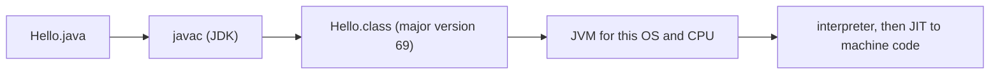

What to notice: only the JVM box is platform-specific, and the class file carries a version the JVM checks first.

### How it actually works

A class file starts with the magic number `0xCAFEBABE`, then a minor and a major version. A Java SE 25 JVM accepts exactly major versions 45 to 69 [Doc: JVMS 25 §4.1](https://docs.oracle.com/javase/specs/jvms/se25/html/jvms-4.html#jvms-4.1) and refuses newer ones with `UnsupportedClassVersionError` [Doc: Java 25 API](https://docs.oracle.com/en/java/javase/25/docs/api/java.base/java/lang/UnsupportedClassVersionError.html). In the lab, `javac` 25 emits 69 by default, 65 with `--release 21` and 52 with `--release 8` [Lab: ClassFileVersionTest](../labs/java-language/src/test/java/dev/interview/javalanguage/m01/s01/ClassFileVersionTest.java). Loading belongs to [08](08-jvm-memory-and-class-loading.md), the JIT to [10](10-jvm-performance-and-troubleshooting.md).

The **JVM** executes bytecode; the **JRE** adds the class library; the **JDK** adds the tools (`javac`, `javap`, `jlink`). Oracle dropped the separate JRE in JDK 11 [Doc: JDK 11 migration guide](https://docs.oracle.com/en/java/javase/11/migrate/index.html); a small runtime is now a `jlink` image [Doc: JEP 282](https://openjdk.org/jeps/282).

`-source`/`-target` set only the language level and class-file version: `javac` still compiles against the newest API. `--release N` also checks every call against release N's API [Doc: JEP 247](https://openjdk.org/jeps/247). In the lab, `"".isBlank()` (Java 11) compiles by default and fails under `--release 8` [Lab: ClassFileVersionTest](../labs/java-language/src/test/java/dev/interview/javalanguage/m01/s01/ClassFileVersionTest.java).

The language now specifies the entry point: a non-private `void main` with one `String[]` parameter or none; if both exist, the `String[]` one runs [Doc: JLS 25 §12.1.4](https://docs.oracle.com/javase/specs/jls/se25/html/jls-12.html#jls-12.1.4). It may be an instance method (the class then needs a non-private no-argument constructor), and a **compact source file** may hold methods with no class around them: the compiler wraps them in an implicit `final` class in the unnamed package that imports the `java.base` module [Final since Java 25, JEP 512](https://openjdk.org/jeps/512). `java Hello.java` compiles in memory and runs [Doc: JEP 330](https://openjdk.org/jeps/330). In the lab, the launcher runs both forms and picks `main(String[])` over `main()` [Lab: LaunchProtocolTest](../labs/java-language/src/test/java/dev/interview/javalanguage/m01/s01/LaunchProtocolTest.java).

### Code

Approach: answer "which release was this class built for?" from the bytes.

1. Reject the input unless it starts with `0xCAFEBABE`.
2. Read the unsigned big-endian 16-bit value at offset 6, the major version.
3. Subtract 44 to get the feature release (69 → 25, 65 → 21, 52 → 8).

```java
package dev.interview.javalanguage.m01.s01;

import java.nio.ByteBuffer;

// Reads the version stamp a JVM checks before loading a class (JVMS §4.1), to diagnose UnsupportedClassVersionError.
public final class ClassFileVersion {

    static final String NOT_A_CLASS_FILE = "not a class file";

    private static final int MAGIC = 0xCAFEBABE;
    private static final int HEADER_LENGTH = 8;
    private static final int MAJOR_VERSION_OFFSET = 6;
    private static final int FIRST_MAJOR_VERSION = 45;
    private static final int RELEASE_OFFSET = 44;
    private static final String BELOW_FIRST_VERSION = "major version below " + FIRST_MAJOR_VERSION + ": ";

    private ClassFileVersion() {}

    public static int majorVersion(byte[] classFile) {
        if (classFile.length < HEADER_LENGTH) {
            throw new IllegalArgumentException(NOT_A_CLASS_FILE);
        }
        ByteBuffer header = ByteBuffer.wrap(classFile);
        if (header.getInt(0) != MAGIC) {
            throw new IllegalArgumentException(NOT_A_CLASS_FILE);
        }
        return Short.toUnsignedInt(header.getShort(MAJOR_VERSION_OFFSET));
    }

    public static int javaFeatureRelease(int majorVersion) {
        if (majorVersion < FIRST_MAJOR_VERSION) {
            throw new IllegalArgumentException(BELOW_FIRST_VERSION + majorVersion);
        }
        return majorVersion - RELEASE_OFFSET;
    }
}
```
<sub>Source: [labs/java-language/src/main/java/dev/interview/javalanguage/m01/s01/ClassFileVersion.java](../labs/java-language/src/main/java/dev/interview/javalanguage/m01/s01/ClassFileVersion.java)</sub>

A compact source file, run with `java Hello.java`:

```java
void main() {
    IO.println("Hello from a compact source file");
}
```
<sub>Source: [labs/java-language/src/test/resources/m01/s01/Hello.java](../labs/java-language/src/test/resources/m01/s01/Hello.java)</sub>

The shell equivalents:

```bash
javac --release 21 -d out Hello.java   # class files for a Java 21 runtime
javap -v out/Hello.class | grep major  # major version: 65
```

### Failure modes and operations

- **Version skew.** The error names the class; check it with `javap -v` or `ClassFileVersion`. Build with `--release` equal to the oldest runtime you deploy (`maven.compiler.release`, [48](48-build-maven-and-gradle.md)). A `-target` build calling a newer API fails later with `NoSuchMethodError`; `--release` makes it a compile error.
- **Deployment.** Raise the runtime image first, then `--release`, so each step can be rolled back.

> [!IMPORTANT]
> **Production scenario: every pod crashes after a CI upgrade.** *As the interviewer frames it:* "We moved CI to JDK 25; now every pod fails with `UnsupportedClassVersionError`."
> **Reasoning.** The classes carry major version 69, which an older JVM refuses [Doc: JVMS 25 §4.1](https://docs.oracle.com/javase/specs/jvms/se25/html/jvms-4.html#jvms-4.1). Confirm with `javap -v` and `java -version` in a pod; pin `--release` or upgrade the image; check both in the pipeline. [Q01.03](#q01-03) works the incident.

> [!NOTE]
> **Version notes.** Java 9: `--release`, `jlink` · Java 11: no separate Oracle JRE; `java File.java` · Java 22: multi-file source programs [Doc: JEP 458](https://openjdk.org/jeps/458) · Java 25 (default): instance `main`, compact source files [Final since Java 25, JEP 512](https://openjdk.org/jeps/512), previewed in 21 to 24.

### Best practices and anti-patterns

- Set `--release`, not `-source`/`-target`, because only `--release` checks API use against the target.
- Pin and assert the runtime version in the pipeline, because the class-file version is fixed at build time but checked only at run time.
- Keep compact source files for scripts, because services need packages and a build.

### Misconceptions and traps

- *"Java is interpreted."* Hot methods are JIT-compiled (just-in-time: turned into machine code while the program runs) ([10](10-jvm-performance-and-troubleshooting.md)); the myth survives because interpretation comes first, visible as warm-up.
- *"The JVM is platform independent."* The bytecode is; the JVM is built per OS and CPU. The slogan is about class files.
- *"`main` must be `public static void main(String[] args)`."* Once true: until Java 24. Now: any non-private `void main`, static or instance, with `String[]` or no parameter [Changed in Java 25: instance main methods, JEP 512](https://openjdk.org/jeps/512). The classic form still wins.
- *"`-target 8` is safe for Java 8."* Newer API calls still compile; `--release 8` rejects them [Doc: JEP 247](https://openjdk.org/jeps/247). The myth exists because `-target` names a version, so it sounds complete.

Questions that drill this section: [Q01.01](#q01-01), [Q01.02](#q01-02), [Q01.03](#q01-03).


## 2. Primitive types, conversions and overflow
### The problem it solves

An upload service checks `used + requested <= limit` with `int` values. A client asks for `Integer.MAX_VALUE` bytes, the sum wraps negative, and the check passes; nothing throws or logs. Cent drift in `double` invoices is the same lesson: primitives are fixed-width bit patterns.

### Mental model

A primitive is a fixed-width odometer: roll past the last value and it reads the first. Copying the reading to a wider odometer keeps it (widening); a narrower one keeps only the rightmost digits (narrowing).

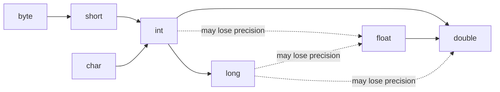

What to notice: every arrow is an implicit widening; solid ones keep the exact value, dotted ones can drop low-order digits, and going back needs a cast.

### How it actually works

Java has eight primitives: `boolean`, `byte` (8 bits), `short` (16), `char` (16, unsigned), `int` (32), `long` (64), `float` and `double` (IEEE 754). `char` is an integer from 0 to 65535 [Doc: JLS 25 §4.2.1](https://docs.oracle.com/javase/specs/jls/se25/html/jls-4.html#jls-4.2.1); in the lab `'a' + 1` is the `int` 98 [Lab: NumericBehaviourTest](../labs/java-language/src/test/java/dev/interview/javalanguage/m01/s02/NumericBehaviourTest.java).

**Numeric promotion** (converting both operands of an operator to one type) picks `double` if either operand is `double`, else `float`, else `long`, else `int` [Doc: JLS 25 §5.6](https://docs.oracle.com/javase/specs/jls/se25/html/jls-5.html#jls-5.6). So `byte + byte` is `int` and `long + float` is `float`. Widening `int` to `float`, or `long` to `float` or `double`, may lose precision [Doc: JLS 25 §5.1.2](https://docs.oracle.com/javase/specs/jls/se25/html/jls-5.html#jls-5.1.2): in the lab, `(float) 16_777_217` is `16_777_216` [Lab: NumericBehaviourTest](../labs/java-language/src/test/java/dev/interview/javalanguage/m01/s02/NumericBehaviourTest.java).

Narrowing an integer keeps the low-order bits, so `(byte) 200` is `-56`. Narrowing a `double` goes through `int` or `long` first: NaN becomes 0 and out-of-range values saturate at the bounds [Doc: JLS 25 §5.1.3](https://docs.oracle.com/javase/specs/jls/se25/html/jls-5.html#jls-5.1.3). In the lab, `(byte) 300.7` is 44 (300, then its low 8 bits) [Lab: NumericBehaviourTest](../labs/java-language/src/test/java/dev/interview/javalanguage/m01/s02/NumericBehaviourTest.java). A compound assignment `b += x` means `b = (T) (b + x)`, a hidden cast [Doc: JLS 25 §15.26.2](https://docs.oracle.com/javase/specs/jls/se25/html/jls-15.html#jls-15.26.2); in the lab `b += 300` compiles while `b = b + 1` fails with `compiler.err.prob.found.req` [Lab: NumericBehaviourTest](../labs/java-language/src/test/java/dev/interview/javalanguage/m01/s02/NumericBehaviourTest.java).

Integer operators never signal overflow: the result is the low-order bits of the true sum [Doc: JLS 25 §15.18.2](https://docs.oracle.com/javase/specs/jls/se25/html/jls-15.html#jls-15.18.2). Only `/` and `%` throw, and only for a zero divisor [Doc: JLS 25 §4.2.2](https://docs.oracle.com/javase/specs/jls/se25/html/jls-4.html#jls-4.2.2). Division rounds toward 0 [Doc: JLS 25 §15.17.2](https://docs.oracle.com/javase/specs/jls/se25/html/jls-15.html#jls-15.17.2), and `%` takes the dividend's sign [Doc: JLS 25 §15.17.3](https://docs.oracle.com/javase/specs/jls/se25/html/jls-15.html#jls-15.17.3): `-7 / 2` is `-3`, `-7 % 2` is `-1`, `Math.floorMod(-7, 2)` is 1. `Math.addExact` and `multiplyExact` throw `ArithmeticException` ("integer overflow", "long overflow") instead of wrapping [Lab: NumericBehaviourTest](../labs/java-language/src/test/java/dev/interview/javalanguage/m01/s02/NumericBehaviourTest.java).

Floating point follows IEEE 754 and never throws on arithmetic: overflow gives an infinity, `0.0 / 0` gives NaN, and NaN is unordered, so `x != x` is true only for NaN [Doc: JLS 25 §4.2.3](https://docs.oracle.com/javase/specs/jls/se25/html/jls-4.html#jls-4.2.3). Binary cannot hold 0.1 exactly, so `0.1 + 0.2` prints `0.30000000000000004` [Lab: NumericBehaviourTest](../labs/java-language/src/test/java/dev/interview/javalanguage/m01/s02/NumericBehaviourTest.java). `BigDecimal` (an unscaled integer plus a scale) is exact; build it from a `String` or `BigDecimal.valueOf(double)`, because `new BigDecimal(0.1)` copies the double's exact binary value [Doc: Java 25 API, BigDecimal(double)](https://docs.oracle.com/en/java/javase/25/docs/api/java.base/java/math/BigDecimal.html). Why `2.0` and `2.00` are not `equals` belongs to [02](02-java-equality-immutability-records.md).

### Code

Approach: do the quota arithmetic in a type wide enough for any two `int` values.

1. Reject a negative request, which would shrink the sum.
2. Cast one operand to `long`; promotion makes the whole sum `long`.
3. Compare; the limit widens to `long` too.

```java
package dev.interview.javalanguage.m01.s02;

// Quota guard for module 01 §2: an int sum that wraps turns a huge request into a small one and passes the check.
public final class QuotaCheck {

    static final String NEGATIVE_REQUEST = "requested must not be negative: ";

    private QuotaCheck() {}

    // Teaching foil: used + requested is int arithmetic, so it wraps past Integer.MAX_VALUE (JLS §15.18.2).
    static boolean fitsNaive(int used, int requested, int limit) {
        return used + requested <= limit;
    }

    public static boolean fits(int used, int requested, int limit) {
        if (requested < 0) {
            throw new IllegalArgumentException(NEGATIVE_REQUEST + requested);
        }
        // Widening one operand to long promotes the sum to long, which cannot overflow for two int values.
        return (long) used + requested <= limit;
    }
}
```
<sub>Source: [labs/java-language/src/main/java/dev/interview/javalanguage/m01/s02/QuotaCheck.java](../labs/java-language/src/main/java/dev/interview/javalanguage/m01/s02/QuotaCheck.java)</sub>

In the lab, `fitsNaive(10, Integer.MAX_VALUE, 100)` is `true` and `fits` is `false` [Lab: QuotaCheckTest](../labs/java-language/src/test/java/dev/interview/javalanguage/m01/s02/QuotaCheckTest.java). `long` has no wider type: use `Math.addExact` there.

```java
// Excerpt of labs/java-language/src/test/java/dev/interview/javalanguage/m01/s02/NumericBehaviourTest.java
@Test
@DisplayName("M01 §2 · BigDecimal from String is exact")
void bigDecimal_isExactFromString_andCarriesTheDoubleErrorFromDouble() {
    assertThat(new BigDecimal("0.1")).hasToString("0.1");
    assertThat(new BigDecimal(0.1).toString()).startsWith(EXACT_DOUBLE_TENTH_PREFIX);
    assertThat(BigDecimal.valueOf(0.1)).hasToString("0.1");
}
```

### Failure modes and operations

- **Silent wrong values.** Overflow, lossy narrowing and rounding drift yield plausible numbers, not exceptions [Doc: JLS 25 §4.2.2](https://docs.oracle.com/javase/specs/jls/se25/html/jls-4.html#jls-4.2.2), seen as negative counters or reconciliation gaps. Alert on those invariants; `Math.*Exact` turns the bug into a stack trace.
- **Growth.** Arithmetic safe at today's volume wraps later: an `int` of milliseconds overflows after about 24.8 days [Doc: JLS 25 §4.2.1](https://docs.oracle.com/javase/specs/jls/se25/html/jls-4.html#jls-4.2.1). Use `long` for counters and IDs from the start, because widening a column or wire format is a migration.

> [!IMPORTANT]
> **Production scenario: invoice totals drift by a cent.** *As the interviewer frames it:* "Our invoice totals disagree with the payment provider by one cent on some orders."
> **Reasoning.** A `double` cannot hold most decimal cents; sums accumulate the error and rounding at different points disagrees [Lab: NumericBehaviourTest](../labs/java-language/src/test/java/dev/interview/javalanguage/m01/s02/NumericBehaviourTest.java). Evidence: the drifting orders have many lines. Fix: `BigDecimal` from strings (or `long` cents), one scale and `RoundingMode` applied where the business rule says, and a reconciliation test. [Q01.06](#q01-06) works the rounding decision with numbers.

### Best practices and anti-patterns

- Use `BigDecimal` from a `String`, or `long` minor units, for money, because `double` cannot hold most decimal fractions.
- Use `Math.addExact`, `multiplyExact` and `toIntExact` where a wrapped value would be accepted downstream, because an exception beats a silently wrong total.
- **Security:** Never validate a size or quantity with an `int` sum such as `used + requested <= limit`, because an attacker-chosen value wraps the sum and bypasses the check; widen to `long`, use `Math.addExact`, or compare by subtraction, and reject negatives.

### Misconceptions and traps

- *"`long` + `float` gives `double`."* It gives `float`: promotion stops at the widest operand type [Doc: JLS 25 §5.6](https://docs.oracle.com/javase/specs/jls/se25/html/jls-5.html#jls-5.6). The myth treats `double` as "the mixed-arithmetic type".
- *"Widening is always safe."* `int` → `float` and `long` → `float`/`double` drop low-order digits [Doc: JLS 25 §5.1.2](https://docs.oracle.com/javase/specs/jls/se25/html/jls-5.html#jls-5.1.2); the range widens, not the precision. The word "widening" suggests nothing is lost.
- *"Dividing by zero always throws."* Only integer `/` and `%` throw; `1.0 / 0` is `Infinity` [Lab: NumericBehaviourTest](../labs/java-language/src/test/java/dev/interview/javalanguage/m01/s02/NumericBehaviourTest.java). The myth generalizes from integers.
- *"`b += 1` and `b = b + 1` are the same."* The compound form casts back to `byte`; the plain one does not compile [Doc: JLS 25 §15.26.2](https://docs.oracle.com/javase/specs/jls/se25/html/jls-15.html#jls-15.26.2). The myth exists because the compound form is taught as shorthand.

Questions that drill this section: [Q01.04](#q01-04), [Q01.05](#q01-05), [Q01.06](#q01-06); exercise [Exercise 01.1](#ex01-1).

## 3. Lexical structure, operators and control flow
### The problem it solves

`if (order != null & order.isPaid())` throws `NullPointerException` for a null order: single `&` evaluates both sides. A binary search's `(low + high) / 2` turns negative once both indexes pass `Integer.MAX_VALUE / 2`. Both compile and pass small tests; the bug is in the operator rules.

### Mental model

Read code like a parser: characters become tokens (identifiers, keywords, literals, operators), precedence arranges them into a tree like a sentence diagram, and evaluation walks it left to right, where a short-circuit operator may skip a branch.

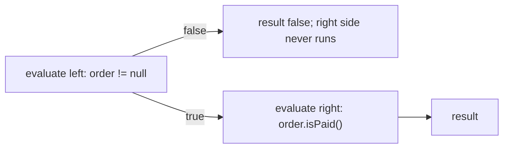

What to notice: `&` has no skipping edge, so both sides always run.

### How it actually works

**Lexical rules.** An identifier is a "Java letter" followed by letters or digits, where a Java letter is any character `Character.isJavaIdentifierStart` accepts, so `café` is legal; `$` and `_` count as letters [Doc: JLS 25 §3.8](https://docs.oracle.com/javase/specs/jls/se25/html/jls-3.html#jls-3.8). Reserved keywords, including the unused `const` and `goto` and `_`, are never identifiers; nor are the literals `true`, `false` and `null`. **Contextual keywords** (`var`, `record`, `yield`, `sealed`, `permits`…) are keywords only where the grammar expects them: a variable may be named `record`, but no class may be named `var` [Doc: JLS 25 §3.9](https://docs.oracle.com/javase/specs/jls/se25/html/jls-3.html#jls-3.9). In the lab, `var`, `record`, `yield`, `café` and `sizeof` (not a Java word) compile as local names, `goto`, `const`, `null` and `true` fail with `compiler.err.expected`, and `class var {}` fails with `compiler.err.restricted.type.not.allowed` [Lab: OperatorBehaviourTest](../labs/java-language/src/test/java/dev/interview/javalanguage/m01/s03/OperatorBehaviourTest.java). Since Java 22, `_` declares an **unnamed variable** (never read): in the lab, `int _ = 1;` compiles and `return _;` fails with `compiler.err.use.of.underscore.not.allowed.non.variable` [Lab: OperatorBehaviourTest](../labs/java-language/src/test/java/dev/interview/javalanguage/m01/s03/OperatorBehaviourTest.java); unnamed patterns in [07](07-java-modern-language-features.md).

Naming conventions are custom, not grammar [Doc: Oracle Code Conventions, naming](https://www.oracle.com/java/technologies/javase/codeconventions-namingconventions.html):

| Kind | Convention | Example |
|---|---|---|
| Package | lower case, reversed domain | `com.example.billing` |
| Type | UpperCamelCase noun (interfaces also adjectives) | `OrderService`, `Runnable` |
| Method | lowerCamelCase verb | `placeOrder` |
| Variable | lowerCamelCase, no leading `_`/`$` | `retryCount` |
| Constant (`static final`) | UPPER_SNAKE_CASE | `MAX_RETRIES` |

**Precedence and evaluation order.** Precedence decides grouping: postfix, unary, multiplicative, additive, shift, relational, equality, `&`, `^`, `|`, `&&`, `||`, `?:`, then assignment [Doc: Java Tutorials, Operators](https://docs.oracle.com/javase/tutorial/java/nutsandbolts/operators.html). Assignment groups right to left, so `a = b = 3` assigns `b` first [Doc: JLS 25 §15.26](https://docs.oracle.com/javase/specs/jls/se25/html/jls-15.html#jls-15.26). Grouping is not order: the left operand is fully evaluated first [Doc: JLS 25 §15.7.1](https://docs.oracle.com/javase/specs/jls/se25/html/jls-15.html#jls-15.7.1), so in the lab, with `i = 1`, `i + (i = 5)` is 6 [Lab: OperatorBehaviourTest](../labs/java-language/src/test/java/dev/interview/javalanguage/m01/s03/OperatorBehaviourTest.java).

**Boolean and conditional operators.** `&&` evaluates its right operand only if the left is `true`, `||` only if `false` [Doc: JLS 25 §15.23](https://docs.oracle.com/javase/specs/jls/se25/html/jls-15.html#jls-15.23), [§15.24](https://docs.oracle.com/javase/specs/jls/se25/html/jls-15.html#jls-15.24); `&` and `|` always evaluate both, as the lab's call counter shows [Lab: OperatorBehaviourTest](../labs/java-language/src/test/java/dev/interview/javalanguage/m01/s03/OperatorBehaviourTest.java). Prefix `++i` yields the new value, postfix `i++` the old ([Q01.07](#q01-07)). The conditional `c ? x : y` has one type for both branches: with `int` and `double` operands, numeric promotion makes it `double`, so `true ? 1 : 2.0` is `1.0` [Doc: JLS 25 §15.25.2](https://docs.oracle.com/javase/specs/jls/se25/html/jls-15.html#jls-15.25.2). Unboxing a `null` there throws ([§13](#13-wrappers-autoboxing-and-the-integer-cache)).

**Bitwise and shift operators.** `&`, `|`, `^`, `~` work bit by bit on integers [Doc: JLS 25 §15.22.1](https://docs.oracle.com/javase/specs/jls/se25/html/jls-15.html#jls-15.22.1), [§15.15.5](https://docs.oracle.com/javase/specs/jls/se25/html/jls-15.html#jls-15.15.5). `>>` shifts right copying the sign bit, `>>>` filling zeros. Only the low five bits of the distance count for an `int`, six for a `long` [Doc: JLS 25 §15.19](https://docs.oracle.com/javase/specs/jls/se25/html/jls-15.html#jls-15.19). In the lab, `-8 >> 1` is -4, `-8 >>> 1` is 2,147,483,644, `1 << 32` is 1 and `1L << 32` is 4,294,967,296 [Lab: OperatorBehaviourTest](../labs/java-language/src/test/java/dev/interview/javalanguage/m01/s03/OperatorBehaviourTest.java).

**Control flow.** `break` and `continue` act on the innermost loop (`break` also on `switch`), or with a label on an enclosing statement [Doc: JLS 25 §14.15](https://docs.oracle.com/javase/specs/jls/se25/html/jls-14.html#jls-14.15), [§14.16](https://docs.oracle.com/javase/specs/jls/se25/html/jls-14.html#jls-14.16). Every `case` constant must be a constant expression or an enum constant name [Doc: JLS 25 §14.11.1](https://docs.oracle.com/javase/specs/jls/se25/html/jls-14.html#jls-14.11.1); selectors may be `String` or enum. Without `break`, a colon-form `switch` falls through [Doc: JLS 25 §14.11.3](https://docs.oracle.com/javase/specs/jls/se25/html/jls-14.html#jls-14.11.3); the lab asserts the fall-through [Lab: OperatorBehaviourTest](../labs/java-language/src/test/java/dev/interview/javalanguage/m01/s03/OperatorBehaviourTest.java) and rejects a non-constant label [Lab: Q01OutputsTest](../labs/java-language/src/test/java/dev/interview/javalanguage/m01/outputs/Q01OutputsTest.java). Arrow-form `switch` and switch expressions belong to [07](07-java-modern-language-features.md).

### Code

Approach: a binary-search midpoint that cannot go negative.

1. Reject a negative `low` or `high < low`.
2. Add as `int`: two non-negative `int` values sum to under 2^32, so the bits hold the true sum read as unsigned.
3. Halve with `>>> 1`, which reads them as unsigned. The JDK's `Arrays.binarySearch` uses this expression [Src: JDK 25, java.util.Arrays.binarySearch0](https://github.com/openjdk/jdk/blob/jdk-25%2B36/src/java.base/share/classes/java/util/Arrays.java).

```java
package dev.interview.javalanguage.m01.s03;

// Binary-search midpoint for module 01 §3: >>> reads the wrapped int sum as unsigned, so it never goes negative.
public final class Midpoint {

    static final String INVALID_RANGE = "need 0 <= low <= high: ";

    private Midpoint() {}

    // Teaching foil: low + high wraps negative past Integer.MAX_VALUE (JLS §15.18.2), and / 2 keeps the sign.
    static int naive(int low, int high) {
        return (low + high) / 2;
    }

    public static int of(int low, int high) {
        if (low < 0 || high < low) {
            throw new IllegalArgumentException(INVALID_RANGE + low + ", " + high);
        }
        // Two non-negative ints sum to at most 2^32 - 2, which fits in 32 unsigned bits; >>> 1 halves it as unsigned.
        return (low + high) >>> 1;
    }
}
```
<sub>Source: [labs/java-language/src/main/java/dev/interview/javalanguage/m01/s03/Midpoint.java](../labs/java-language/src/main/java/dev/interview/javalanguage/m01/s03/Midpoint.java)</sub>

In the lab, `naive(MAX - 1, MAX)` is negative and `of(MAX - 1, MAX)` is `MAX - 1` [Lab: MidpointTest](../labs/java-language/src/test/java/dev/interview/javalanguage/m01/s03/MidpointTest.java).

> [!NOTE]
> **Version notes.** Java 7: `String` selectors in `switch` [Doc: Strings in switch](https://docs.oracle.com/javase/7/docs/technotes/guides/language/strings-switch.html) · Java 9: `_` not an identifier [Doc: JEP 213](https://openjdk.org/jeps/213) · Java 14: switch expressions [Final since Java 14, JEP 361](https://openjdk.org/jeps/361) · Java 22: `_` declares unnamed variables [Final since Java 22, JEP 456](https://openjdk.org/jeps/456).

### Best practices and anti-patterns

- Use `&&` and `||` in conditions, because with `&` and `|` a null check on the left no longer protects the right.
- Compute midpoints with `(low + high) >>> 1` or `low + (high - low) / 2`, because `(low + high) / 2` wraps negative for large indexes.
- Parenthesize bitwise tests, because `==` binds tighter than `&`: `flags & MASK == 0` means `flags & (MASK == 0)`.
- End each colon-form `case` group with `break` or use arrows, because fall-through is silent.

### Misconceptions and traps

- *"`null`, `true` and `false` are keywords."* They are literals [Doc: JLS 25 §3.9](https://docs.oracle.com/javase/specs/jls/se25/html/jls-3.html#jls-3.9). The myth persists because none can be an identifier either.
- *"`_` is a valid variable name."* Once true: until Java 8, which warned. Now: a keyword [Changed in Java 9: `_` is not an identifier, JEP 213](https://openjdk.org/jeps/213); since Java 22 it declares unread variables.
- *"`1 << 32` is 0."* It is 1: the distance is masked to five bits [Doc: JLS 25 §15.19](https://docs.oracle.com/javase/specs/jls/se25/html/jls-15.html#jls-15.19). The myth pictures bits falling off the end.
- *"Higher precedence runs first."* Precedence groups; operands run left to right, so `a()` runs first in `a() + b() * c()` [Doc: JLS 25 §15.7.3](https://docs.oracle.com/javase/specs/jls/se25/html/jls-15.html#jls-15.7.3). The myth comes from side-effect-free school arithmetic.

Questions that drill this section: [Q01.07](#q01-07), [Q01.08](#q01-08), [Q01.09](#q01-09).

## 4. Classes, objects, references and pass-by-value
### The problem it solves

A pricing service starts each order with `Basket order = defaults; order.add(item);`. From the second request on, every order carries the previous customers' items: the assignment copied a reference, not the basket. The same misunderstanding produces "my method reassigned the parameter but the caller saw nothing".

### Mental model

A class is a blueprint plus behavior; an object is one house built from it on the heap ([08](08-jvm-memory-and-class-loading.md)). A reference variable holds a card with the house's address. Passing an argument photocopies the card: the method can repaint the house, but rewriting its own card changes nothing in the caller's hand.

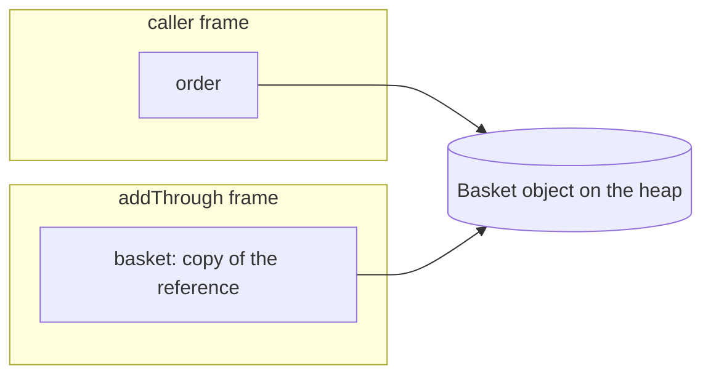

What to notice: two variables, one object; assigning a new object to `basket` moves only its own arrow.

### How it actually works

A class declares fields (per-object state), methods (name, parameter types, a return type or `void`) and constructors ([§5](#5-constructors-and-initialization-order)). Java has primitive and reference types; an object is a class instance or an array, `new` creates one and yields a reference, and a reference points to an object or is `null`, which points to none [Doc: JLS 25 §4.3.1](https://docs.oracle.com/javase/specs/jls/se25/html/jls-4.html#jls-4.3.1).

Fields and array components start at a default value (0, `false`, `'\u0000'`, `null`) [Doc: JLS 25 §4.12.5](https://docs.oracle.com/javase/specs/jls/se25/html/jls-4.html#jls-4.12.5). A local gets none: it must be definitely assigned before it is read ([JLS 25 chapter 16](https://docs.oracle.com/javase/specs/jls/se25/html/jls-16.html)); in the lab, reading one fails with `compiler.err.var.might.not.have.been.initialized` [Lab: ReferenceBehaviourTest](../labs/java-language/src/test/java/dev/interview/javalanguage/m01/s04/ReferenceBehaviourTest.java). A local dies with its method's frame; a field lives while its object is reachable.

Every argument is passed by value: the argument values initialize newly created parameter variables [Doc: JLS 25 §8.4.1](https://docs.oracle.com/javase/specs/jls/se25/html/jls-8.html#jls-8.4.1). For an object, that value is the reference, so the callee can change the caller's object but not the caller's variable. In the lab, `swap(a, b)` and `reassign` change nothing for the caller, while `addThrough` is seen [Lab: PassByValueTest](../labs/java-language/src/test/java/dev/interview/javalanguage/m01/s04/PassByValueTest.java). Likewise `b = a` copies the reference; copying the object takes a copy constructor (`clone` is in [§7](#7-inheritance-composition-and-object)), shallow when the elements are immutable, deep otherwise.

Object-oriented programming keeps state with the operations that guard its invariants, where procedural code lets any function change shared data. Java is not purely object-oriented: primitives are not objects [Doc: JLS 25 §4.1](https://docs.oracle.com/javase/specs/jls/se25/html/jls-4.html#jls-4.1), and static methods are plain procedures ([§10](#10-static-final-and-constants)). The payoff, encapsulation ([§6](#6-packages-access-control-and-encapsulation)), polymorphism ([§8](#8-polymorphism-overloading-overriding-and-dispatch)) and reuse ([§7](#7-inheritance-composition-and-object)), comes from design, not the `class` keyword.

### Code

Approach: give the copy its own state and never hand out the internal list.

1. The copy constructor builds a new list; `String` elements are immutable, so shallow is enough.
2. `add` rejects `null` at the call that causes it.
3. `items()` returns an unmodifiable snapshot.

```java
package dev.interview.javalanguage.m01.s04;

import java.util.ArrayList;
import java.util.List;
import java.util.Objects;

// Module 01 §4: an object that owns its state, so a copy must build new state instead of sharing the reference.
public final class Basket {

    static final String NULL_ITEM = "item must not be null";

    private final List<String> items;

    public Basket() {
        this.items = new ArrayList<>();
    }

    // Copy constructor: a new list, so the copy and the original stop sharing state.
    // Shallow is enough here because String elements are immutable.
    public Basket(Basket other) {
        this.items = new ArrayList<>(other.items);
    }

    public void add(String item) {
        items.add(Objects.requireNonNull(item, NULL_ITEM));
    }

    // A snapshot, so callers never hold a reference to the internal list.
    public List<String> items() {
        return List.copyOf(items);
    }
}
```
<sub>Source: [labs/java-language/src/main/java/dev/interview/javalanguage/m01/s04/Basket.java](../labs/java-language/src/main/java/dev/interview/javalanguage/m01/s04/Basket.java)</sub>

In the lab, filling `new Basket(defaults)` leaves `defaults` unchanged, while filling `Basket order = defaults` changes it [Lab: BasketTest](../labs/java-language/src/test/java/dev/interview/javalanguage/m01/s04/BasketTest.java).

### Failure modes and operations

- **`NullPointerException`.** In the lab the message names the null expression: `Cannot invoke "dev.interview.javalanguage.m01.s04.Basket.add(String)" because "this.basket" is null` [Lab: ReferenceBehaviourTest](../labs/java-language/src/test/java/dev/interview/javalanguage/m01/s04/ReferenceBehaviourTest.java). Local names appear only with `javac -g`, otherwise `<local1>` [Doc: JEP 358](https://openjdk.org/jeps/358).
- **Aliased mutable state.** Two holders of one reference see each other's changes, values "nobody set"; across threads it becomes a data race ([11](11-concurrency-threads-and-jmm.md)). Copy once at the boundary or use immutable types ([02](02-java-equality-immutability-records.md)).

> [!NOTE]
> **Version notes.** Java 8 to 13: the NPE trace gives only method, file and line [Doc: JEP 358](https://openjdk.org/jeps/358) · Java 14: helpful messages behind `-XX:+ShowCodeDetailsInExceptionMessages` [Final since Java 14, JEP 358](https://openjdk.org/jeps/358) · Java 15: [Changed in Java 15: on by default](https://www.oracle.com/java/technologies/javase/15-relnote-issues.html).

### Best practices and anti-patterns

- Copy mutable arguments you store and return snapshots, because a caller holding the same reference can otherwise break your invariants.
- Return a value instead of reassigning a parameter, because the reassignment never reaches the caller.
- **Security:** Never return exception messages to clients, because since Java 15 NPE messages reveal field, method and local names [Doc: JDK 15 release notes](https://www.oracle.com/java/technologies/javase/15-relnote-issues.html); log them, return a generic error.

### Misconceptions and traps

- *"Java passes objects by reference."* It passes references by value, so `swap` cannot work [Lab: PassByValueTest](../labs/java-language/src/test/java/dev/interview/javalanguage/m01/s04/PassByValueTest.java). The myth exists because mutation through a parameter is visible.
- *"`b = a` copies the object."* Both names reach one object [Lab: BasketTest](../labs/java-language/src/test/java/dev/interview/javalanguage/m01/s04/BasketTest.java); the myth comes from primitives, where assignment copies the value.
- *"Locals default like fields."* Only fields and array components get defaults [Doc: JLS 25 §4.12.5](https://docs.oracle.com/javase/specs/jls/se25/html/jls-4.html#jls-4.12.5). The myth generalizes from fields, which every new object gets.
- *"A method cannot take its class's name."* With a return type it is a method; in the lab javac does not warn even under `-Xlint:all` [Lab: ReferenceBehaviourTest](../labs/java-language/src/test/java/dev/interview/javalanguage/m01/s04/ReferenceBehaviourTest.java). The myth comes from IDE inspections.

Questions that drill this section: [Q01.10](#q01-10), [Q01.11](#q01-11).

## 5. Constructors and initialization order
### The problem it solves

A catalogue service labels every product `widget@0`. The superclass constructor builds the label by calling `describe()`, the subclass overrides it ([§8](#8-polymorphism-overloading-overriding-and-dispatch)) to show the price, and the price field is assigned only after the superclass constructor returns. It compiled; the object was read before being built. Knowing what `new` runs, and in what order, prevents this.

### Mental model

An object is a house built from the ground up. The class is set up once, on first use. Each `new` then builds the `Object` floor, each superclass floor, and your own last; on each floor the fittings (field and instance initializers) go in, in written order, before that floor's constructor body. A lower-floor method overridden upstairs runs on a floor not yet fitted.

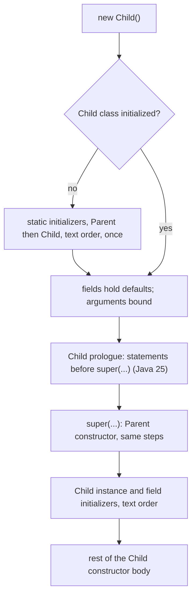

What to notice: only the prologue runs before the superclass constructors.

### How it actually works

Constructors are not members, so they are not inherited [Doc: JLS 25 §8.2](https://docs.oracle.com/javase/specs/jls/se25/html/jls-8.html#jls-8.2). A class that declares no constructor gets a default one, with no parameters and the class's access [Doc: JLS 25 §8.8.9](https://docs.oracle.com/javase/specs/jls/se25/html/jls-8.html#jls-8.8.9). Declare any constructor and it is gone: in the lab `new P()` and an empty subclass of `P` both fail with `compiler.err.cant.apply.symbol` [Lab: ConstructorRulesTest](../labs/java-language/src/test/java/dev/interview/javalanguage/m01/s05/ConstructorRulesTest.java). A constructor without an explicit `this(...)` or `super(...)` begins with an implicit `super()` [Doc: JLS 25 §8.8.7](https://docs.oracle.com/javase/specs/jls/se25/html/jls-8.html#jls-8.8.7); `this(...)` delegates to a sibling, so the chain still ends in one superclass call. A `private` constructor blocks outside instantiation (utility classes, singletons: [51](51-design-principles-and-patterns.md)).

Class initialization runs the static field initializers and static blocks in text order, once, just before the first instance creation, static method call, static field assignment, or use of a static field that is not a constant [Doc: JLS 25 §12.4.1](https://docs.oracle.com/javase/specs/jls/se25/html/jls-12.html#jls-12.4.1); the superclass goes first. Loading and linking are in [08](08-jvm-memory-and-class-loading.md).

Per `new`, the JLS procedure binds the arguments, runs the prologue, processes the explicit or implicit superclass constructor call by the same steps, then runs this class's instance initializers and field initializers in text order, then the rest of the body [Doc: JLS 25 §12.5](https://docs.oracle.com/javase/specs/jls/se25/html/jls-12.html#jls-12.5). In the lab the first `new Child()` prints `Parent static`, `Child static`, then six instance steps; a second `new` prints only the six [Lab: InitOrderTest](../labs/java-language/src/test/java/dev/interview/javalanguage/m01/s05/InitOrderTest.java).

The prologue (statements before `super(...)`) is [Final since Java 25, JEP 513](https://openjdk.org/jeps/513). It may validate arguments and assign fields declared without an initializer, but must not use `this`: calling an instance method there fails with `compiler.err.cant.ref.before.ctor.called` [Lab: ConstructorRulesTest](../labs/java-language/src/test/java/dev/interview/javalanguage/m01/s05/ConstructorRulesTest.java).

### Code

Approach: set subclass state before the superclass constructor reads it.

1. Validate in the prologue.
2. Assign `cents` in the prologue, then call `super()`.
3. `this(0)` chains the no-argument constructor to the main one.

```java
package dev.interview.javalanguage.m01.s05;

// Module 01 §5: a superclass constructor calls an overridable hook; Java 25 lets a subclass set its state first.
public final class Widgets {

    private Widgets() {}

    public abstract static class Widget {
        private final String label;

        protected Widget() {
            this.label = describe(); // overridable call: runs before the subclass constructor body
        }

        protected String describe() {
            return "widget";
        }

        public String label() {
            return label;
        }
    }

    // Classic order: implicit super() runs the hook while cents still holds its default 0.
    public static final class LateWidget extends Widget {
        private final long cents;

        public LateWidget(long cents) {
            this.cents = cents;
        }

        @Override
        protected String describe() {
            return "widget@" + cents;
        }
    }

    // Flexible constructor body (JEP 513, final in Java 25): validate and assign in the prologue, then super().
    public static final class EarlyWidget extends Widget {
        private final long cents;

        public EarlyWidget(long cents) {
            if (cents < 0) {
                throw new IllegalArgumentException("cents must not be negative");
            }
            this.cents = cents;
            super();
        }

        public EarlyWidget() {
            this(0);
        }

        @Override
        protected String describe() {
            return "widget@" + cents;
        }
    }
}
```
<sub>Source: [labs/java-language/src/main/java/dev/interview/javalanguage/m01/s05/Widgets.java](../labs/java-language/src/main/java/dev/interview/javalanguage/m01/s05/Widgets.java)</sub>

In the lab `new LateWidget(250).label()` is `widget@0`, `new EarlyWidget(250).label()` is `widget@250`, and `new EarlyWidget(-1)` throws `IllegalArgumentException` [Lab: WidgetsTest](../labs/java-language/src/test/java/dev/interview/javalanguage/m01/s05/WidgetsTest.java).

### Failure modes and operations

- **A static initializer that throws.** The first use gets `ExceptionInInitializerError` wrapping the cause and the class is marked erroneous; every later initialization attempt throws `NoClassDefFoundError` [Doc: JLS 25 §12.4.2](https://docs.oracle.com/javase/specs/jls/se25/html/jls-12.html#jls-12.4.2). In the lab on JDK 25 the second error reads `Could not initialize class …FailingConfig`, with an `ExceptionInInitializerError` as its cause [Lab: FailingConfigTest](../labs/java-language/src/test/java/dev/interview/javalanguage/m01/s05/FailingConfigTest.java). In production the first error scrolls past at startup and later ones look like a missing JAR: search for the first `ExceptionInInitializerError`.
- **An overridable call from a constructor.** The override runs on a half-built object and sees defaults; a `null` there becomes a `NullPointerException` far from its cause ([§8](#8-polymorphism-overloading-overriding-and-dispatch)).

> [!NOTE]
> **Version notes.** Java 21 and earlier: a constructor's first statement had to be `this(...)` or `super(...)`; only argument expressions ran before it [Doc: JEP 513](https://openjdk.org/jeps/513) · Java 22 to 24: [Preview in Java 22, JEP 447](https://openjdk.org/jeps/447), again in 23 ([JEP 482](https://openjdk.org/jeps/482)) and 24 ([JEP 492](https://openjdk.org/jeps/492)) · Java 25: [Final since Java 25, JEP 513](https://openjdk.org/jeps/513); javac `--release 24` rejects it [Lab: ConstructorRulesTest](../labs/java-language/src/test/java/dev/interview/javalanguage/m01/s05/ConstructorRulesTest.java).

### Best practices and anti-patterns

- Do not call overridable methods from a constructor, because the override runs before the subclass fields are set; make the hook `private`, `final` or `static`, or pass the value in.
- On Java 25, validate arguments in the prologue, because a rejected object then builds no superclass state.
- Keep static initializers free of I/O and configuration parsing, because a failure there breaks the class for as long as its class loader lives.

### Misconceptions and traps

- *"Every class has a no-argument constructor."* Only one that declares none [Doc: JLS 25 §8.8.9](https://docs.oracle.com/javase/specs/jls/se25/html/jls-8.html#jls-8.8.9); adding a constructor with parameters breaks `new P()` and every subclass relying on the implicit `super()` [Lab: ConstructorRulesTest](../labs/java-language/src/test/java/dev/interview/javalanguage/m01/s05/ConstructorRulesTest.java). The myth comes from small classes that never declared one.
- *"Constructors are inherited."* They are not members [Doc: JLS 25 §8.2](https://docs.oracle.com/javase/specs/jls/se25/html/jls-8.html#jls-8.2); a subclass declares its own and chains. The myth exists because `super(…)` calls look like inherited calls.
- *"Field initializers run before the superclass constructor."* They run after it returns [Lab: InitOrderTest](../labs/java-language/src/test/java/dev/interview/javalanguage/m01/s05/InitOrderTest.java); only the Java 25 prologue runs earlier. The myth comes from reading the class top to bottom.
- *"Static blocks run on every `new`."* Once, on first use [Lab: InitOrderTest](../labs/java-language/src/test/java/dev/interview/javalanguage/m01/s05/InitOrderTest.java). The myth confuses them with instance initializer blocks, which look alike and do run on every `new`.

Questions that drill this section: [Q01.12](#q01-12), [Q01.13](#q01-13), [Q01.14](#q01-14).

## 6. Packages, access control and encapsulation
### The problem it solves

A team adds `Wallet.setBalance(long)` "for tests". A month later a refund job sets a negative balance and the ledger stops reconciling: with a setter on every field, no class owned the rule "never below zero". Access control lets one class own a rule.

### Mental model

A package is a building, a class an office in it; each modifier says who gets through the door.

| Member declared | Same class | Same package | Subclass, other package | Anywhere |
|---|---|---|---|---|
| `private` | yes | no | no | no |
| no modifier (package access) | yes | yes | no | no |
| `protected` | yes | yes | only through its own type | no |
| `public` | yes | yes | yes | yes |

What to notice: `protected` includes package access. A top-level type is `public` or package access only.

### How it actually works

A source file is a compilation unit: an optional `package` declaration, then `import` declarations, then type declarations, in that order, so one package per file [Doc: JLS 25 §7.3](https://docs.oracle.com/javase/specs/jls/se25/html/jls-7.html#jls-7.3). `java.lang` and the file's own package need no import. The JLS lets the host require a `public` type to live in a file named after it [Doc: JLS 25 §7.6](https://docs.oracle.com/javase/specs/jls/se25/html/jls-7.html#jls-7.6); javac does, so a second `public` class in `X.java` fails with `compiler.err.class.public.should.be.in.file` [Lab: AccessRulesTest](../labs/java-language/src/test/java/dev/interview/javalanguage/m01/s06/AccessRulesTest.java).

Imports only let you write simple names [Doc: JLS 25 §7.5](https://docs.oracle.com/javase/specs/jls/se25/html/jls-7.html#jls-7.5): `import java.util.*;` covers that package's types, not subpackages; `import static` covers static methods, fields and nested types.

A member without a modifier has package access [Doc: JLS 25 §6.6.1](https://docs.oracle.com/javase/specs/jls/se25/html/jls-6.html#jls-6.6.1), and a package-access class used from another package fails with `compiler.err.not.def.public.cant.access`. Outside its package, a subclass `S` may touch `o.n` only when the static type of `o` is `S` or a subclass of `S` [Doc: JLS 25 §6.6.2.1](https://docs.oracle.com/javase/specs/jls/se25/html/jls-6.html#jls-6.6.2.1). In the lab `Sub` reads `n` on a `Sub` but not through a `Base` reference (`compiler.err.report.access`), while any class in `Base`'s package reads it [Lab: AccessRulesTest](../labs/java-language/src/test/java/dev/interview/javalanguage/m01/s06/AccessRulesTest.java).

Encapsulation is the point: hide state, expose operations that keep it valid. Above packages sit modules; since [JEP 403](https://openjdk.org/jeps/403) (Java 17) JDK internals are strongly encapsulated, `sun.misc.Unsafe` aside (`jdk.unsupported`). Build side: [48](48-build-maven-and-gradle.md).

### Code

Approach: one class owns the rule "the balance never goes below zero".

1. Keep `cents` private, with no setter.
2. Validate every operation before it changes state.
3. Reject an overdraft without touching the balance.

```java
package dev.interview.javalanguage.m01.s06;

// Module 01 §6: encapsulation protects an invariant (the balance never goes below zero), so there is no setter.
public final class Wallet {

    private long cents;

    public void deposit(long amount) {
        requirePositive(amount);
        cents = Math.addExact(cents, amount);
    }

    public void withdraw(long amount) {
        requirePositive(amount);
        if (amount > cents) {
            throw new IllegalStateException("insufficient funds");
        }
        cents -= amount;
    }

    public long balance() {
        return cents;
    }

    private static void requirePositive(long amount) {
        if (amount <= 0) {
            throw new IllegalArgumentException("amount must be positive");
        }
    }
}
```
<sub>Source: [labs/java-language/src/main/java/dev/interview/javalanguage/m01/s06/Wallet.java](../labs/java-language/src/main/java/dev/interview/javalanguage/m01/s06/Wallet.java)</sub>

In the lab an overdraft throws `IllegalStateException` and leaves the balance unchanged, and a zero or negative amount throws `IllegalArgumentException` [Lab: WalletTest](../labs/java-language/src/test/java/dev/interview/javalanguage/m01/s06/WalletTest.java).

### Failure modes and operations

- **Reflection into JDK internals.** `setAccessible(true)` on `String.value` throws [`InaccessibleObjectException`](https://docs.oracle.com/en/java/javase/25/docs/api/java.base/java/lang/reflect/InaccessibleObjectException.html): `module java.base does not "opens java.lang" to unnamed module` [Lab: StrongEncapsulationTest](../labs/java-language/src/test/java/dev/interview/javalanguage/m01/s06/StrongEncapsulationTest.java). Libraries that reflect into JDK internals hit it on Java 17 and later. Upgrade them; otherwise open one package with `--add-opens` or `Add-Opens` [Doc: JEP 403](https://openjdk.org/jeps/403) and record why.

> [!NOTE]
> **Version notes.** Java 9 to 15: `--illegal-access=permit` by default, one warning [Doc: JEP 403](https://openjdk.org/jeps/403) · Java 16: denied by default ([JEP 396](https://openjdk.org/jeps/396)) · Java 17: the option only warns ([JEP 403](https://openjdk.org/jeps/403)).

### Best practices and anti-patterns

- Start fields `private` and classes package-private, because anything `public` becomes a contract.
- Expose operations, not setters, because a setter lets every caller break the invariant.
- Statically import a few well-known members (`assertThat`), because readers must find where a name comes from.
- **Security:** never rely on `private` to hide a secret, because a heap dump or `--add-opens` reflection reads it; only modules enforce access at run time.

### Misconceptions and traps

- *"`protected` means subclasses only."* It also grants package access [Doc: JLS 25 §6.6.1](https://docs.oracle.com/javase/specs/jls/se25/html/jls-6.html#jls-6.6.1), so it is wider than no modifier [Lab: AccessRulesTest](../labs/java-language/src/test/java/dev/interview/javalanguage/m01/s06/AccessRulesTest.java). The myth reads the keyword as "for subclasses".
- *"A subclass can use a `protected` member on any parent instance."* Only through its own type, outside the package [Lab: AccessRulesTest](../labs/java-language/src/test/java/dev/interview/javalanguage/m01/s06/AccessRulesTest.java). The myth stops at the first rule, "subclasses can see it".
- *"`import java.util.*` also imports `java.util.function`."* Subpackages are separate packages [Doc: JLS 25 §7.5.2](https://docs.oracle.com/javase/specs/jls/se25/html/jls-7.html#jls-7.5.2). Dotted names look nested, but the hierarchy has no meaning in the language [Doc: JLS 25 §7.1](https://docs.oracle.com/javase/specs/jls/se25/html/jls-7.html#jls-7.1).
- *"Encapsulation means a getter and setter per field."* That exposes the field with extra steps. The myth comes from JavaBeans tools, which find properties through accessors.

Questions that drill this section: [Q01.15](#q01-15), [Q01.16](#q01-16).

## 7. Inheritance, composition and `Object`
### The problem it solves

A team counts how many elements reach a cache, so it extends `HashSet` and increments a counter in both `add` and `addAll`. After `addAll` of three names the counter says 6 [Lab: CountingSetsTest](../labs/java-language/src/test/java/dev/interview/javalanguage/m01/s07/CountingSetsTest.java). The subclass broke on a detail of how its parent implements an inherited method.

### Mental model

Inheritance is IS-A: a `CountingHashSet` is a `HashSet`, including its unwritten habits. Composition is HAS-A: a `CountingSet` holds a set, like a receptionist who logs each delivery, then hands it to the storeroom without caring how boxes are stacked.

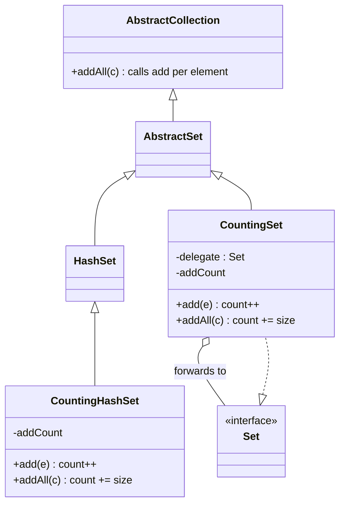

What to notice: the inherited `addAll` calls `add` back on the subclass, so each element counts twice; the wrapper's delegate calls its own `add`, never the wrapper's. The wrapper extends `AbstractSet` too, but safely: that class exists as a skeleton for implementers [Doc: AbstractSet](https://docs.oracle.com/en/java/javase/25/docs/api/java.base/java/util/AbstractSet.html), and the wrapper overrides `addAll` to forward, so no inherited method calls back into it.

### How it actually works

A class names at most one direct superclass; with no `extends` clause it is `Object` [Doc: JLS 25 §8.1.4](https://docs.oracle.com/javase/specs/jls/se25/html/jls-8.html#jls-8.1.4). `extends B, C` is a syntax error (`compiler.err.expected`): two superclasses would each bring fields and a constructor, leaving which `super(...)` runs ambiguous. Multiple inheritance of type comes through interfaces (→ [§9](#9-abstract-classes-and-interfaces)).

A subclass inherits the superclass's `public` and `protected` members, plus package-access ones when both are in the same package; `private` members are not inherited [Doc: JLS 25 §8.2](https://docs.oracle.com/javase/specs/jls/se25/html/jls-8.html#jls-8.2), and constructors are not members at all ([§5](#5-constructors-and-initialization-order)). `super.m()` and `super.f` reach the parent's members.

A field named like an inherited one hides it, not overrides it [Doc: JLS 25 §8.3](https://docs.oracle.com/javase/specs/jls/se25/html/jls-8.html#jls-8.3). The compiler picks a field by the static type of the reference, so with `Parent p = new Child()` the expression `p.name` reads the parent's field, `((Child) p).name` the child's [Lab: InheritanceRulesTest](../labs/java-language/src/test/java/dev/interview/javalanguage/m01/s07/InheritanceRulesTest.java). Methods follow the runtime class (→ [§8](#8-polymorphism-overloading-overriding-and-dispatch)).

"Superclass" is defined recursively from the direct superclass and a class may not depend on itself, so no class is its own subclass: `class A extends A {}` fails with `compiler.err.cyclic.inheritance` [Lab: InheritanceRulesTest](../labs/java-language/src/test/java/dev/interview/javalanguage/m01/s07/InheritanceRulesTest.java). `Class.isAssignableFrom` asks "is this assignable?" and is `true` for the same class [Src: `Class.isAssignableFrom` Javadoc, Java 25](https://docs.oracle.com/en/java/javase/25/docs/api/java.base/java/lang/Class.html#isAssignableFrom(java.lang.Class)).

**The fragile base class.** `HashSet` declares no `addAll`; it inherits the one in `AbstractCollection`, which loops and calls `add` for each element [Src: `AbstractCollection.addAll` and `HashSet`, JDK 25 `src.zip`](https://docs.oracle.com/en/java/javase/25/docs/api/java.base/java/util/AbstractCollection.html#addAll(java.util.Collection)). That self-use is an undocumented detail: a subclass that relies on it breaks when the parent changes, one that ignores it double-counts. Composition with forwarding (the Decorator pattern, → [51](51-design-principles-and-patterns.md)) depends only on the `Set` contract.

**`Object`, the root.** `Object` is a superclass of every other class, and every class and array type inherits its methods [Doc: JLS 25 §4.3.2](https://docs.oracle.com/javase/specs/jls/se25/html/jls-4.html#jls-4.3.2). An interface has no superclass (`Runnable.class.getSuperclass()` is `null`), yet one without superinterfaces implicitly declares `Object`'s public methods, so `toString()` works on any interface reference [Doc: JLS 25 §9.2](https://docs.oracle.com/javase/specs/jls/se25/html/jls-9.html#jls-9.2).

- `toString()`: a readable form for logs. `getClass()`: the runtime class.
- `equals` and `hashCode`: logical equality, one contract (→ [02](02-java-equality-immutability-records.md)).
- `clone()`: `protected`, a field-for-field shallow copy; it throws `CloneNotSupportedException` unless the class implements `Cloneable`, a marker interface that declares no method [Src: `Object.clone` and `Cloneable` Javadoc, Java 25](https://docs.oracle.com/en/java/javase/25/docs/api/java.base/java/lang/Cloneable.html). Prefer a copy constructor ([§4](#4-classes-objects-references-and-pass-by-value)).
- `finalize()` [Deprecated for removal since Java 18 — use try-with-resources or `java.lang.ref.Cleaner`]: it may run late or never [Doc: JEP 421](https://openjdk.org/jeps/421) (→ [09](09-jvm-garbage-collection.md)).
- `wait`, `notify`, `notifyAll`: the monitor's condition queue (→ [11](11-concurrency-threads-and-jmm.md)).

### Code

Approach: wrap a set instead of extending one.

1. Hold any `Set` as a private delegate and extend `AbstractSet`, which needs only `iterator` and `size`.
2. Count in `add` and in `addAll`, then forward the call to the delegate.
3. Forward `contains`, so lookups stay as fast as the delegate's.

```java
package dev.interview.javalanguage.m01.s07;

import java.util.AbstractSet;
import java.util.Collection;
import java.util.Iterator;
import java.util.Set;

// Module 01 §7: composition with forwarding. The delegate's own add calls never reach this wrapper.
public final class CountingSet<E> extends AbstractSet<E> {

    private final Set<E> delegate;
    private int addCount;

    public CountingSet(Set<E> delegate) {
        this.delegate = delegate;
    }

    @Override
    public boolean add(E element) {
        addCount++;
        return delegate.add(element);
    }

    @Override
    public boolean addAll(Collection<? extends E> elements) {
        addCount += elements.size();
        return delegate.addAll(elements);
    }

    @Override
    public boolean contains(Object element) {
        return delegate.contains(element);
    }

    @Override
    public Iterator<E> iterator() {
        return delegate.iterator();
    }

    @Override
    public int size() {
        return delegate.size();
    }

    public int addCount() {
        return addCount;
    }
}
```
<sub>Source: [labs/java-language/src/main/java/dev/interview/javalanguage/m01/s07/CountingSet.java](../labs/java-language/src/main/java/dev/interview/javalanguage/m01/s07/CountingSet.java)</sub>

In the lab the wrapper reports 3 after `addAll` of three elements, where the `HashSet` subclass reports 6 [Lab: CountingSetsTest](../labs/java-language/src/test/java/dev/interview/javalanguage/m01/s07/CountingSetsTest.java).

### Failure modes and operations

- **Shallow clones alias state.** `Object.clone` copies references, so a cloned object shares its arrays and collections with the original, and a write through one shows in the other [Lab: CloneTest](../labs/java-language/src/test/java/dev/interview/javalanguage/m01/s07/CloneTest.java). The bug surfaces far from the copy. Copy mutable fields explicitly, or make them immutable (→ [02](02-java-equality-immutability-records.md)).

> [!NOTE]
> **Version notes.** Java 9: `Object.finalize` deprecated · Java 18: deprecated for removal, with `--finalization=disabled` to test running without it [Doc: JEP 421](https://openjdk.org/jeps/421).

### Best practices and anti-patterns

- Extend only for a true IS-A with a parent designed for extension, because otherwise you depend on its self-use.
- Add behavior to classes you do not own by forwarding, because the wrapper depends only on the interface contract.
- Make a class `final` unless you document how to extend it, because each overridable method is a self-use promise.
- **Security:** make a class that validates input or checks permissions `final`, because a subclass can override the checking method and pass the instance wherever the parent type is trusted.

### Misconceptions and traps

- *"A subclass overrides the parent's fields."* They are hidden and chosen by the static type; only instance methods override. The shared `obj.name` syntax suggests otherwise.
- *"A class is a subclass of itself."* Not in the JLS; the myth comes from `isAssignableFrom`.
- *"Implementing `Cloneable` gives a class a public `clone()`."* It declares nothing; it only lets `Object.clone` copy instead of throw, and the class must still override `clone` as public. The name reads like "can be cloned".
- *"Interfaces extend `Object`."* They have no superclass; they implicitly declare its public methods. The myth exists because `equals` and `toString` work on any interface reference.

Questions that drill this section: [Q01.17](#q01-17), [Q01.18](#q01-18).

## 8. Polymorphism: overloading, overriding and dispatch
### The problem it solves

A billing job charges a 2% card fee through two overloads, `FeeTable.feeCents(Payment)` and `FeeTable.feeCents(CardPayment)`. It loops over a `List<Payment>`, and every card pays 0. The same card passed through a `CardPayment` variable pays 200 cents [Lab: FeeDispatchTest](../labs/java-language/src/test/java/dev/interview/javalanguage/m01/s08/FeeDispatchTest.java). Overloads never look at the object.

### Mental model

A method call is decided twice. Overloading is the sorting office: it reads the label on the envelope (the static type, the declared type of the expression) and fixes which signature to call when the code compiles. Overriding is the house: when the letter arrives at run time, whoever lives there (the object's class) opens it.

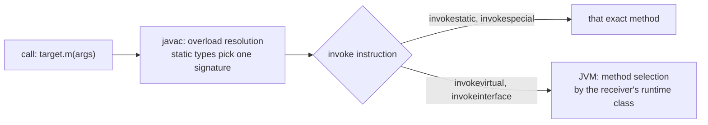

What to notice: only the second box can see the real object, and only for instance methods that can be overridden.

### How it actually works

**Overload resolution, at compile time.** javac gathers the accessible methods with the right name and tries three phases, stopping at the first that finds any applicable method: no boxing and no varargs (widening such as `int` to `long` is allowed), then boxing and unboxing, then varargs [Doc: JLS 25 §15.12.2.2–15.12.2.4](https://docs.oracle.com/javase/specs/jls/se25/html/jls-15.html#jls-15.12.2.2). The order keeps calls written before Java 5 from turning ambiguous. So `m(1)` picks `m(long)` over `m(Integer)` and `m(int...)`; without `m(long)` it picks `m(Integer)` [Lab: OverloadResolutionTest](../labs/java-language/src/test/java/dev/interview/javalanguage/m01/s08/OverloadResolutionTest.java).

Among several applicable methods the most specific wins, chosen at compile time [Doc: JLS 25 §15.12.2.5](https://docs.oracle.com/javase/specs/jls/se25/html/jls-15.html#jls-15.12.2.5). `m(null)` with `m(String)` and `m(Object)` calls `m(String)`; with `m(String)` and `m(Integer)` neither is more specific, so it fails with `compiler.err.ref.ambiguous` [Lab: OverloadResolutionTest](../labs/java-language/src/test/java/dev/interview/javalanguage/m01/s08/OverloadResolutionTest.java). The return type plays no part. The result is one method descriptor written into the class file.

**Overriding, at run time.** An instance method overrides a superclass method it can access when its signature is a subsignature of the parent's [Doc: JLS 25 §8.4.8.1](https://docs.oracle.com/javase/specs/jls/se25/html/jls-8.html#jls-8.4.8.1). The compiler enforces the rest [Doc: JLS 25 §8.4.8.3](https://docs.oracle.com/javase/specs/jls/se25/html/jls-8.html#jls-8.4.8.3), and the lab asserts each error code [Lab: OverrideRulesTest](../labs/java-language/src/test/java/dev/interview/javalanguage/m01/s08/OverrideRulesTest.java):

- the return type may be a subtype (covariant return); a wider one fails with `compiler.err.override.incompatible.ret`;
- access may widen, never narrow (`compiler.err.override.weaker.access`);
- no new or broader checked exceptions (`compiler.err.override.meth.doesnt.throw`); unchecked ones are free;
- a `final` method cannot be overridden (`compiler.err.override.meth`);
- a `static` method is hidden, not overridden: the reference type picks it [Doc: JLS 25 §8.4.8.2](https://docs.oracle.com/javase/specs/jls/se25/html/jls-8.html#jls-8.4.8.2); a static method cannot hide an instance one, nor the reverse;
- `@Override` on a method that overrides nothing fails with `compiler.err.method.does.not.override.superclass`, which catches `equals(Point)` written for `equals(Object)`.

A `private` method is not inherited ([§7](#7-inheritance-composition-and-object)), so a subclass method of the same name is a new method. Matching after erasure belongs to [03](03-java-generics.md).

**Dispatch in the JVM.** javac emits one of four instructions: `invokestatic` for static methods, `invokespecial` for constructors and `super.m()`, `invokevirtual` for class methods, `invokeinterface` for interface methods [Lab: BytecodeDispatchTest](../labs/java-language/src/test/java/dev/interview/javalanguage/m01/s08/BytecodeDispatchTest.java). For the last two, the JVM selects a method from the receiver's runtime class: a private resolved method is used as is; otherwise it searches the class, then its superclasses, then the maximally specific superinterface methods [Doc: JVMS 25 §5.4.6](https://docs.oracle.com/javase/specs/jvms/se25/html/jvms-5.html#jvms-5.4.6). Since Java 11, javac compiles calls to private instance methods of a class with `invokevirtual` [Doc: JEP 181](https://openjdk.org/jeps/181), yet they are still never dispatched (Version notes below).

The specification fixes the selection rule, not a data structure. HotSpot (the OpenJDK virtual machine) implements it with a virtual method table (vtable) per class and interface tables (itables) [Src: HotSpot `klassVtable.hpp`, jdk-25-ga](https://github.com/openjdk/jdk/blob/jdk-25-ga/src/hotspot/share/oops/klassVtable.hpp). How the JIT removes the lookup (inlining, devirtualization) is module [10](10-jvm-performance-and-troubleshooting.md)'s topic.

**Casts change the static type only.** A cast to an interface compiles unless the class is `final` and does not implement it (`compiler.err.prob.found.req`); otherwise the JVM checks it and throws `ClassCastException` [Doc: JLS 25 §5.5](https://docs.oracle.com/javase/specs/jls/se25/html/jls-5.html#jls-5.5) [Lab: CastRulesTest](../labs/java-language/src/test/java/dev/interview/javalanguage/m01/s08/CastRulesTest.java). Test with `instanceof` first; the pattern form belongs to [07](07-java-modern-language-features.md).

### Code

Approach: make the fee a property of the object, so the runtime class chooses it.

1. Give `Payment` an overridable `feeCents()` that returns the default, no fee.
2. Override it in `CardPayment` with `@Override`, so a typo cannot become an overload.
3. Call `payment.feeCents()` through the `Payment` type; no overload, no `instanceof`.

```java
package dev.interview.javalanguage.m01.s08;

// Module 01 §8: the base type. A plain transfer carries no fee; subclasses override feeCents.
public class Payment {

    private final long amountCents;

    public Payment(long amountCents) {
        this.amountCents = amountCents;
    }

    public long amountCents() {
        return amountCents;
    }

    public long feeCents() {
        return 0;
    }
}
```
<sub>Source: [labs/java-language/src/main/java/dev/interview/javalanguage/m01/s08/Payment.java](../labs/java-language/src/main/java/dev/interview/javalanguage/m01/s08/Payment.java)</sub>

```java
package dev.interview.javalanguage.m01.s08;

// Module 01 §8: the override runs whenever the object is a CardPayment, whatever the reference type.
public final class CardPayment extends Payment {

    public CardPayment(long amountCents) {
        super(amountCents);
    }

    @Override
    public long feeCents() {
        return amountCents() * 2 / 100;
    }
}
```
<sub>Source: [labs/java-language/src/main/java/dev/interview/javalanguage/m01/s08/CardPayment.java](../labs/java-language/src/main/java/dev/interview/javalanguage/m01/s08/CardPayment.java)</sub>

In the lab, the same `List<Payment>` now yields fees of 0 and 200 cents [Lab: FeeDispatchTest](../labs/java-language/src/test/java/dev/interview/javalanguage/m01/s08/FeeDispatchTest.java).

### Failure modes and operations

- **A new overload does not reach compiled callers.** The signature each call uses was fixed when the caller was compiled, so a library that adds a more specific overload changes nothing for existing binaries; no overload resolution happens at run time [Doc: JLS 25 §13.4.23](https://docs.oracle.com/javase/specs/jls/se25/html/jls-13.html#jls-13.4.23). The caller's next build may pick the new method, or fail as ambiguous. Evidence: `javap -c` on the caller names the old method descriptor. Prevention: rebuild dependents when a library's overloads change, and treat an added overload as an API change.
- **A wrong downcast fails late.** It compiles and throws `ClassCastException` at run time [Lab: CastRulesTest](../labs/java-language/src/test/java/dev/interview/javalanguage/m01/s08/CastRulesTest.java). The stack trace points at the cast, but the bug is wherever the wrong subtype entered the collection or the API, so trace the value back to its source.
- **Load.** Dispatch takes no lock, queues nothing and allocates nothing, so it has no failure that grows with traffic; its cost per call, and how the JIT removes it, is module [10](10-jvm-performance-and-troubleshooting.md)'s topic.

> [!NOTE]
> **Version notes.** Java 8 to 10: private instance methods were called with `invokespecial` [Doc: JVMS 8 §6.5 invokespecial](https://docs.oracle.com/javase/specs/jvms/se8/html/jvms-6.html#jvms-6.5.invokespecial), and a nested class reached its outer class's private members through compiler-generated bridge methods [Doc: JEP 181](https://openjdk.org/jeps/181) · Java 11: [Changed in Java 11: nestmates access each other's private members directly; private instance methods are called with `invokevirtual` in a class and `invokeinterface` in an interface] [Doc: JEP 181](https://openjdk.org/jeps/181). Selection still uses the private method itself [Doc: JVMS 25 §5.4.6](https://docs.oracle.com/javase/specs/jvms/se25/html/jvms-5.html#jvms-5.4.6).

### Best practices and anti-patterns

- Put `@Override` on every override, because a wrong parameter type otherwise compiles silently as an overload.
- Put behavior that varies by kind in an overridden method, because only overriding looks at the runtime class; overloads and `instanceof` chains look at labels.
- Avoid overloads with the same arity whose parameters are related by boxing or accept `null`, because callers cannot predict the choice; give the methods different names.

### Misconceptions and traps

- *"An override must return exactly the same type."* It may return a subtype. The myth borrows the overloading rule, where the return type plays no part.
- *"Static methods can be overridden."* They are hidden; the reference type decides, so `Parent p = new Child(); p.kind()` runs the parent's. Calling through an instance hides this.
- *"Overriding can happen inside one class."* It needs a subclass or an implemented interface; overloading is the one that can live in one class.
- *"A private call is dispatched, because it compiles to `invokevirtual`."* The JVM selects the private method itself. The myth reads the opcode name, not the selection rule.
- *"A cast converts the object."* It changes only the static type; a wrong cast throws `ClassCastException`. Primitive casts do convert, and the myth carries that over to references.

Questions that drill this section: [Q01.13](#q01-13), [Q01.18](#q01-18), [Q01.19](#q01-19), [Q01.20](#q01-20), [Q01.21](#q01-21).

## 9. Abstract classes and interfaces
### The problem it solves

Two report exporters copy the same loop: write the title, write each row, count the export. A fix lands in one copy, and the reports drift apart. An interface cannot hold the counter, because its fields are constants, and a base class cannot serve unrelated classes that already have a parent. Java splits the job: an abstract class shares state and a fixed algorithm; an interface adds a type to unrelated classes.

### Mental model

An abstract class is a half-built house: walls and wiring (fields, constructor) are done, some rooms are marked "finish me", and you buy only one. An interface is a badge: a list of promises, perhaps with default instructions, and a class can wear many. When badges disagree, Java decides like this:

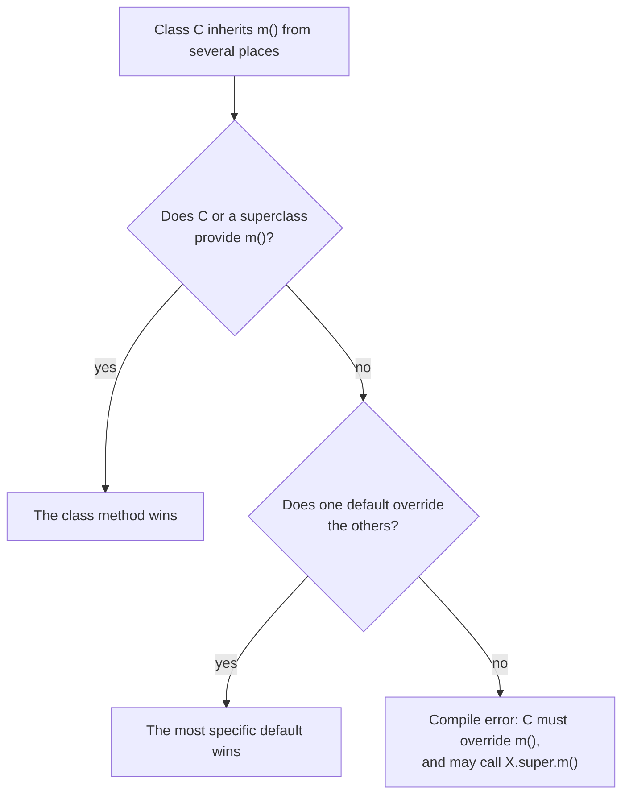

What to notice: classes beat interfaces, and Java never picks between unrelated defaults.

### How it actually works

**Abstract classes.** `new` on an `abstract` class fails (`compiler.err.abstract.cant.be.instantiated`) [Lab: InterfaceRulesTest](../labs/java-language/src/test/java/dev/interview/javalanguage/m01/s09/InterfaceRulesTest.java). Its constructor runs when a concrete subclass is created [Lab: ReportExporterTest](../labs/java-language/src/test/java/dev/interview/javalanguage/m01/s09/ReportExporterTest.java). A class with an abstract method must itself be abstract; a concrete subclass implements the inherited abstract methods, and only those [Doc: JLS 25 §8.1.1.1](https://docs.oracle.com/javase/specs/jls/se25/html/jls-8.html#jls-8.1.1.1). `abstract final` is rejected (`compiler.err.illegal.combination.of.modifiers`), because such a class could never be completed [Doc: JLS 25 §8.1.1.2](https://docs.oracle.com/javase/specs/jls/se25/html/jls-8.html#jls-8.1.1.2) [Lab: InterfaceRulesTest](../labs/java-language/src/test/java/dev/interview/javalanguage/m01/s09/InterfaceRulesTest.java).

**Interface members.** Fields are implicitly `public static final` [Doc: JLS 25 §9.3](https://docs.oracle.com/javase/specs/jls/se25/html/jls-9.html#jls-9.3) [Lab: InterfaceRulesTest](../labs/java-language/src/test/java/dev/interview/javalanguage/m01/s09/InterfaceRulesTest.java). Methods are `public` unless `private`, and `abstract` unless `private`, `default` or `static`. A `default` method is an instance method with a body; a `private` one shares code between defaults and is not inherited [Doc: JLS 25 §9.4](https://docs.oracle.com/javase/specs/jls/se25/html/jls-9.html#jls-9.4). A `static` method is called as `Auditable.sanitize(x)`, because implementers do not inherit it [Doc: JLS 25 §8.4.8](https://docs.oracle.com/javase/specs/jls/se25/html/jls-8.html#jls-8.4.8). An interface extends only interfaces [Doc: JLS 25 §9.1.3](https://docs.oracle.com/javase/specs/jls/se25/html/jls-9.html#jls-9.1.3).

**Multiple inheritance and the diamond.** The diamond is one method reaching a class by two paths. A class inherits many types and behaviors through interfaces, but instance state only through its one superclass chain. A concrete method from the class or a superclass wins, because the default is then not inherited [Doc: JLS 25 §8.4.8](https://docs.oracle.com/javase/specs/jls/se25/html/jls-8.html#jls-8.4.8) [Lab: InterfaceRulesTest](../labs/java-language/src/test/java/dev/interview/javalanguage/m01/s09/InterfaceRulesTest.java). A default that overrides another beats it, even if the older one is reachable by another path [Doc: JLS 25 §9.4.1](https://docs.oracle.com/javase/specs/jls/se25/html/jls-9.html#jls-9.4.1) [Lab: InterfaceRulesTest](../labs/java-language/src/test/java/dev/interview/javalanguage/m01/s09/InterfaceRulesTest.java). Two unrelated defaults do not compile (`compiler.err.types.incompatible`) until the class overrides the method [Doc: JLS 25 §8.4.8.4](https://docs.oracle.com/javase/specs/jls/se25/html/jls-8.html#jls-8.4.8.4) [Lab: InterfaceRulesTest](../labs/java-language/src/test/java/dev/interview/javalanguage/m01/s09/InterfaceRulesTest.java). That override may call `Left.super.m()`, where `Left` must be a direct superinterface [Doc: JLS 25 §15.12.1](https://docs.oracle.com/javase/specs/jls/se25/html/jls-15.html#jls-15.12.1); in the lab it selects that default [Lab: InterfaceRulesTest](../labs/java-language/src/test/java/dev/interview/javalanguage/m01/s09/InterfaceRulesTest.java).

**Choosing.** Take an abstract class for instance state or `protected` steps within one family, since an interface has neither [Doc: JLS 25 §9.4](https://docs.oracle.com/javase/specs/jls/se25/html/jls-9.html#jls-9.4). Take an interface for a capability unrelated classes add. Sealed hierarchies are in [07](07-java-modern-language-features.md), functional interfaces in [05](05-java-lambdas-streams-optional.md).

**Marker interfaces vs annotations.** `Serializable`, `Cloneable` and `RandomAccess` declare no methods. In these JDK cases the check runs at run time: `ObjectOutputStream.writeObject` takes an `Object` and throws `NotSerializableException` [Doc: ObjectOutputStream](https://docs.oracle.com/en/java/javase/25/docs/api/java.base/java/io/ObjectOutputStream.html), `Object.clone` throws `CloneNotSupportedException` [Doc: Cloneable](https://docs.oracle.com/en/java/javase/25/docs/api/java.base/java/lang/Cloneable.html), and list algorithms test `RandomAccess` to pick a faster loop [Doc: RandomAccess](https://docs.oracle.com/en/java/javase/25/docs/api/java.base/java/util/RandomAccess.html). An annotation adds no type; it attaches information to a program element [Doc: JLS 25 §9.7](https://docs.oracle.com/javase/specs/jls/se25/html/jls-9.html#jls-9.7).

### Code

The abstract class owns the algorithm and the state (the Template Method pattern, [51](51-design-principles-and-patterns.md)); the interface adds an audit line any class can wear.

1. `export` is `final`, so subclasses fill in `titleLine` and `rowLine` but cannot change the order.
2. `auditEntry` is a default that calls the abstract `auditSubject`; its `private` helper uses the `static` `sanitize`, so an action cannot forge a second log line.
3. `CsvReportExporter` extends the class and implements the interface.

```java
package dev.interview.javalanguage.m01.s09;

import java.util.ArrayList;
import java.util.List;

// Module 01 §9: export is final so no subclass can change the order or skip the count; only the two steps vary.
public abstract class ReportExporter {

    private static final String LINE_SEPARATOR = "\n";
    private static final String BLANK_TITLE_MESSAGE = "title must not be blank";

    private final String title;
    private int exportCount;

    protected ReportExporter(String title) {
        if (title == null || title.isBlank()) {
            throw new IllegalArgumentException(BLANK_TITLE_MESSAGE);
        }
        this.title = title;
    }

    public final String export(List<String> rows) {
        exportCount++;
        List<String> lines = new ArrayList<>();
        lines.add(titleLine(title));
        for (String row : rows) {
            lines.add(rowLine(row));
        }
        return String.join(LINE_SEPARATOR, lines);
    }

    public String title() {
        return title;
    }

    public int exportCount() {
        return exportCount;
    }

    protected abstract String titleLine(String title);

    protected abstract String rowLine(String row);
}
```
<sub>Source: [labs/java-language/src/main/java/dev/interview/javalanguage/m01/s09/ReportExporter.java](../labs/java-language/src/main/java/dev/interview/javalanguage/m01/s09/ReportExporter.java)</sub>

```java
package dev.interview.javalanguage.m01.s09;

// Module 01 §9: the literals are interface constants because an interface field is always public static final.
public interface Auditable {

    String ACTION_FIELD = "action";
    String SUBJECT_FIELD = "subject";
    String FIELD_SEPARATOR = " ";
    String ASSIGNMENT = "=";
    String LINE_BREAK_PATTERN = "[\r\n]";
    String LINE_BREAK_REPLACEMENT = "_";

    String auditSubject();

    default String auditEntry(String action) {
        return field(ACTION_FIELD, action) + FIELD_SEPARATOR + field(SUBJECT_FIELD, auditSubject());
    }

    static String sanitize(String value) {
        return value.replaceAll(LINE_BREAK_PATTERN, LINE_BREAK_REPLACEMENT);
    }

    private String field(String name, String value) {
        return name + ASSIGNMENT + sanitize(value);
    }
}
```
<sub>Source: [labs/java-language/src/main/java/dev/interview/javalanguage/m01/s09/Auditable.java](../labs/java-language/src/main/java/dev/interview/javalanguage/m01/s09/Auditable.java)</sub>

```java
package dev.interview.javalanguage.m01.s09;

// Module 01 §9: the state and algorithm come from the one superclass, the audit capability from the interface.
public final class CsvReportExporter extends ReportExporter implements Auditable {

    private static final String TITLE_PREFIX = "# ";
    private static final String QUOTE = "\"";
    private static final String ESCAPED_QUOTE = "\"\"";

    public CsvReportExporter(String title) {
        super(title);
    }

    @Override
    protected String titleLine(String title) {
        return TITLE_PREFIX + title;
    }

    @Override
    protected String rowLine(String row) {
        return QUOTE + row.replace(QUOTE, ESCAPED_QUOTE) + QUOTE;
    }

    @Override
    public String auditSubject() {
        return title();
    }
}
```
<sub>Source: [labs/java-language/src/main/java/dev/interview/javalanguage/m01/s09/CsvReportExporter.java](../labs/java-language/src/main/java/dev/interview/javalanguage/m01/s09/CsvReportExporter.java)</sub>

In the lab, the CSV and text formats hold [Lab: ReportExporterTest](../labs/java-language/src/test/java/dev/interview/javalanguage/m01/s09/ReportExporterTest.java), and a line break in an action becomes `_` [Lab: AuditableTest](../labs/java-language/src/test/java/dev/interview/javalanguage/m01/s09/AuditableTest.java).

### Failure modes and operations

Adding a default to a published interface does not break old binaries at link time, but it can fail at compile time or on invocation [Doc: JLS 25 §13.5.7](https://docs.oracle.com/javase/specs/jls/se25/html/jls-13.html#jls-13.5.7). In the lab, `C implements I, J`, and `J` gains a default clashing with `I`. Recompiling `C` gives `compiler.err.types.incompatible`. The stale `C` class file still loads and instantiates, then throws `IncompatibleClassChangeError` at the call [Lab: DefaultMethodEvolutionTest](../labs/java-language/src/test/java/dev/interview/javalanguage/m01/s09/DefaultMethodEvolutionTest.java). So an upgrade can pass startup and fail on a rare path; recompiling implementers in CI catches it.

> [!NOTE]
> **Version notes.** Java 8: `default` and `static` interface methods [Doc: Default Methods](https://docs.oracle.com/javase/tutorial/java/IandI/defaultmethods.html) · Java 9: `private` interface methods [Doc: JEP 213](https://openjdk.org/jeps/213).

### Best practices and anti-patterns

- Make a template method `final`, because a subclass that overrides it can skip a step.
- Prefer an annotation when the mark needs values or sits on a method or field, because a marker can only tag a whole class; prefer a marker when an API must require the type at compile time.
- **Security:** Strip line breaks from untrusted text before logging it, because a newline forges a second entry.

### Misconceptions and traps

- *"Interfaces hold only abstract methods."* Once true: until Java 7. Now: [Changed in Java 8: default and static methods] [Doc: Default Methods](https://docs.oracle.com/javase/tutorial/java/IandI/defaultmethods.html) · [Changed in Java 9: private methods] [Doc: JEP 213](https://openjdk.org/jeps/213).
- *"A subclass must override every method of an abstract class."* Only the abstract ones, and an abstract subclass may leave those too. The myth carries over the pre-Java 8 interface rule.
- *"Interfaces give full multiple inheritance."* Of type and behavior, not of instance state. Defaults look like inherited code.
- *"An interface can extend a class."* It extends only interfaces; the shared keyword `extends` feeds the myth.
- *"A marker interface tells the compiler what to do."* In the JDK cases above, library code checks it at run time; `implements` only looks like a compile-time instruction.

Questions that drill this section: [Q01.22](#q01-22), [Q01.23](#q01-23), [Q01.24](#q01-24).

## 10. `static`, `final` and constants
### The problem it solves

A test passes alone and fails after another test, because both touched one `static` counter. A library raises a constant, and a service that was not rebuilt keeps the old value. Both bugs come from misjudging what `static` shares and what `final` freezes.

### Mental model

`static` means one per class: a noticeboard, not a desk drawer per object. `final` means write once: the variable, not the object it points to. A constant is copied into each reader's class file, like a number printed in a manual: a new master leaves old manuals unchanged.

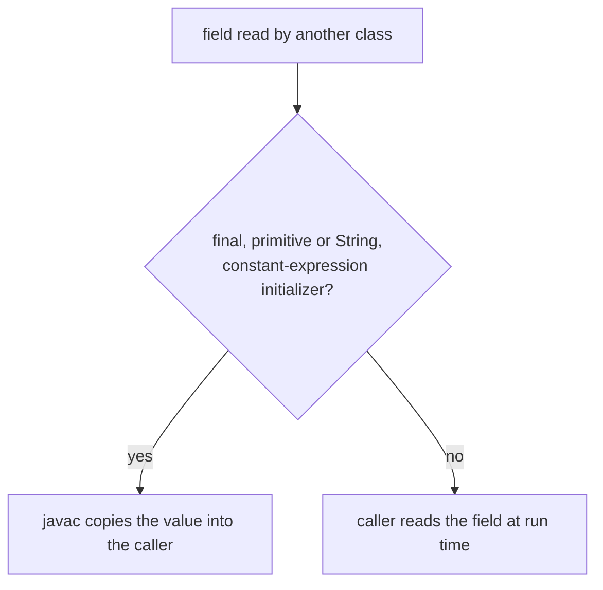

What to notice: only the "yes" branch freezes the value into the caller, so changing it later reaches no caller until that caller is recompiled.

### How it actually works

**Class vs instance.** A `static` field has exactly one incarnation, however many instances exist [Doc: JLS 25 §8.3.1.1](https://docs.oracle.com/javase/specs/jls/se25/html/jls-8.html#jls-8.3.1.1). It lives while its class stays loaded, and a class unloads only when its defining loader can be reclaimed [Doc: JLS 25 §12.7](https://docs.oracle.com/javase/specs/jls/se25/html/jls-12.html#jls-12.7) (→ [08](08-jvm-memory-and-class-loading.md)). A `static` method has no current object, so `this`, `super` and unqualified instance fields are prohibited [Doc: JLS 25 §8.4.3.2](https://docs.oracle.com/javase/specs/jls/se25/html/jls-8.html#jls-8.4.3.2); javac reports `compiler.err.non-static.cant.be.ref` [Lab: StaticFinalRulesTest](../labs/java-language/src/test/java/dev/interview/javalanguage/m01/s10/StaticFinalRulesTest.java). Use the class name: through a reference, only the compile-time type picks the field, and `null` throws nothing [Doc: JLS 25 §15.11.1](https://docs.oracle.com/javase/specs/jls/se25/html/jls-15.html#jls-15.11.1).

**`final`.** A `final` class has no subclasses [Doc: JLS 25 §8.1.1.2](https://docs.oracle.com/javase/specs/jls/se25/html/jls-8.html#jls-8.1.1.2), and a `final` method cannot be overridden or hidden [Doc: JLS 25 §8.4.3.3](https://docs.oracle.com/javase/specs/jls/se25/html/jls-8.html#jls-8.4.3.3). A blank final (no initializer) instance field must be assigned by the end of every constructor [Doc: JLS 25 §8.3.1.2](https://docs.oracle.com/javase/specs/jls/se25/html/jls-8.html#jls-8.3.1.2). Skipping that gives `compiler.err.var.might.not.have.been.initialized`; assigning twice gives `compiler.err.var.might.already.be.assigned`. Locals and parameters take `final` too; one never reassigned is *effectively final* [Doc: JLS 25 §4.12.4](https://docs.oracle.com/javase/specs/jls/se25/html/jls-4.html#jls-4.12.4). A lambda capturing any other local fails with `compiler.err.cant.ref.non.effectively.final.var` [Lab: StaticFinalRulesTest](../labs/java-language/src/test/java/dev/interview/javalanguage/m01/s10/StaticFinalRulesTest.java) (→ [§11](#11-nested-types)).

**Constants.** A *constant variable* is a `final` primitive or `String` initialized with a constant expression [Doc: JLS 25 §4.12.4](https://docs.oracle.com/javase/specs/jls/se25/html/jls-4.html#jls-4.12.4): literals, casts, operators and names of other constants, never a method call [Doc: JLS 25 §15.29](https://docs.oracle.com/javase/specs/jls/se25/html/jls-15.html#jls-15.29). javac resolves each reference to the value [Doc: JLS 25 §13.1](https://docs.oracle.com/javase/specs/jls/se25/html/jls-13.html#jls-13.1). `Math` shows the pattern: `E` and `PI` are `public static final double`, in a `final` class with a private constructor [Src: JDK 25, java.lang.Math].

### Code

Approach: keep a value that never changes in a constant, then show in the lab that javac copies it into the caller.

1. Declare `RATE_PERCENT` `public static final int` with a literal initializer, so it is a constant variable.
2. Make `Tax` `final` with a private constructor, as `Math` does, because a holder of constants and static functions has nothing to instantiate or extend.
3. In the test, compile a class `A` with a constant and a caller `B`, recompile only `A` with a new value, and read the value through `B`.

```java
package dev.interview.javalanguage.m01.s10;

// Module 01 §10: RATE_PERCENT is a literal-initialized constant, so javac inlines it into callers; the private
// constructor and final class stop anyone instantiating or subclassing a pure utility, as with java.lang.Math.
public final class Tax {

    public static final int RATE_PERCENT = 21;

    private static final int PERCENT_DIVISOR = 100;

    private Tax() {}

    // multiplyExact throws on overflow instead of returning a wrapped, silently wrong tax.
    public static long taxCents(long netCents) {
        return Math.multiplyExact(netCents, RATE_PERCENT) / PERCENT_DIVISOR;
    }
}
```
<sub>Source: [labs/java-language/src/main/java/dev/interview/javalanguage/m01/s10/Tax.java](../labs/java-language/src/main/java/dev/interview/javalanguage/m01/s10/Tax.java)</sub>

Tests: [Lab: TaxTest](../labs/java-language/src/test/java/dev/interview/javalanguage/m01/s10/TaxTest.java). Step 3 is the section's central mechanism. The helper `overlayRecompiledA` compiles `A` and `B` together, compiles a second `A` alone, and puts the new `A.class` next to the old `B.class`, as a deployment that upgrades only the library would:

```java
// Excerpt of labs/java-language/src/test/java/dev/interview/javalanguage/m01/s10/ConstantInliningTest.java
private static final String B_SOURCE = "public class B { public static int read() { return A.VALUE; } }";
private static final String A_LITERAL_V1 = "public class A { public static final int VALUE = 1; }";
private static final String A_LITERAL_V2 = "public class A { public static final int VALUE = 2; }";

@Test
@DisplayName("M01 §10 · constant inlined: changing it without recompiling the caller keeps the old value")
void read_returnsOldValue_whenTheConstantChangedAndTheCallerWasNotRecompiled() throws Exception {
    var stale = overlayRecompiledA(A_LITERAL_V1, A_LITERAL_V2);

    Object fromCaller = stale.load(B_NAME).getMethod(READ).invoke(null);
    Object fromDefiningClass = stale.load(A_NAME).getField(FIELD).get(null);

    assertThat(fromCaller).isEqualTo(OLD_VALUE);
    assertThat(fromDefiningClass).isEqualTo(NEW_VALUE);
}
```

`B` returns 1 while `A.VALUE` is 2 [Lab: ConstantInliningTest](../labs/java-language/src/test/java/dev/interview/javalanguage/m01/s10/ConstantInliningTest.java): `B.read()` holds the literal itself, with no reference to the field `A.VALUE` [Doc: JLS 25 §13.1](https://docs.oracle.com/javase/specs/jls/se25/html/jls-13.html#jls-13.1). `javap -c B` makes that visible: the body of `read` is `bipush` with the value, then `ireturn`, where a non-constant field would give `getstatic A.VALUE`.

### Failure modes and operations

Changing a `static` constant does not stop old binaries running, but they see no new value until recompiled [Doc: JLS 25 §13.4.9](https://docs.oracle.com/javase/specs/jls/se25/html/jls-13.html#jls-13.4.9). In the lab, recompiling only the declaring class leaves the caller returning the old value; initialize the field from a method call and the caller returns the new one [Lab: ConstantInliningTest](../labs/java-language/src/test/java/dev/interview/javalanguage/m01/s10/ConstantInliningTest.java). Static mutable state leaks between callers: a second instance shares the first one's `static` count [Lab: StaticFinalRulesTest](../labs/java-language/src/test/java/dev/interview/javalanguage/m01/s10/StaticFinalRulesTest.java), so tests depend on order and threads contend (→ [11](11-concurrency-threads-and-jmm.md)).

> [!IMPORTANT]
> **Production scenario: a constant changed in a shared library but one service still behaves the old way.** *As the interviewer frames it:* "We shipped the new library; one service still uses the old limit."
> **Reasoning.** The service's class file holds the old value, so the new JAR is never consulted [Doc: JLS 25 §13.1](https://docs.oracle.com/javase/specs/jls/se25/html/jls-13.html#jls-13.1). Evidence: `javap -c` on the service's class shows the old literal where a field read (`getstatic`) would be, and the service was not rebuilt after the library release. Fix: rebuild it against the new library. Prevention: rebuild every dependent when a shared library changes, and expose values that may change through a method instead of a `public static final` constant [Doc: JLS 25 §13.4.9](https://docs.oracle.com/javase/specs/jls/se25/html/jls-13.html#jls-13.4.9).

### Best practices and anti-patterns

- Keep `public static final` for values unlikely to change, because callers copy them; expose the rest through a method [Doc: JLS 25 §13.4.9](https://docs.oracle.com/javase/specs/jls/se25/html/jls-13.html#jls-13.4.9).
- Inject state instead of holding it in a `static` field, because tests and threads then stop sharing it.
- **Security:** Keep secrets out of constants, because every reader's class file gets a copy.

### Misconceptions and traps

- *"`final` makes the object immutable."* It fixes the reference; the object can still change [Lab: StaticFinalRulesTest](../labs/java-language/src/test/java/dev/interview/javalanguage/m01/s10/StaticFinalRulesTest.java). The name suggests more.
- *"Every `static final` is a constant."* A `List`, or a value from a method call, is read at run time. The myth exists because `static final` reads like C's `const`.
- *"Static variables live as long as the application."* They live while the class stays loaded. With one class loader the two lifetimes coincide, which feeds the myth.
- *"`final` defeats OOP."* It closes one extension point; interfaces and composition stay open. The myth treats inheritance as the only way to extend code.

Questions that drill this section: [Q01.25](#q01-25).

## 11. Nested types
### The problem it solves

A report screen registers a listener on an application-wide event bus, then closes. The listener reads the screen's title, so it was written as an inner class, and every closed screen stays in memory because the bus still reaches it. Nesting keeps a helper beside the class it serves; the kind you choose decides whether it drags its creator along.

### Mental model

A nested class is a room on the house's plan. A static nested class only shares the plan and can be built alone. An inner class is built onto one specific house and holds its key, so while anyone keeps the room, that house cannot be demolished.

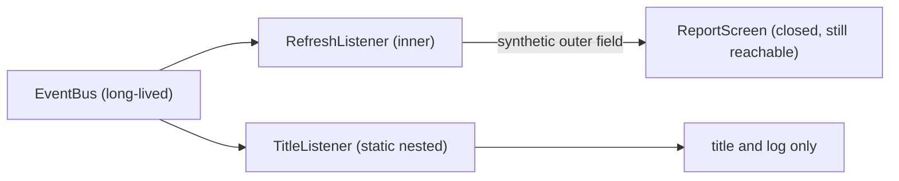

What to notice: only the inner listener has an arrow to the screen, so the bus keeps the closed screen alive through it.

### How it actually works

**Kinds.** A *nested class* is declared inside another class. An *inner class* is a nested class that is not `static`: a non-static member class, a local class, or an anonymous class [Doc: JLS 25 §8.1.3](https://docs.oracle.com/javase/specs/jls/se25/html/jls-8.html#jls-8.1.3). Member classes may be `public`, `protected`, `private` or `static` [Doc: JLS 25 §8.1.1](https://docs.oracle.com/javase/specs/jls/se25/html/jls-8.html#jls-8.1.1). Local classes may not carry those modifiers, and local records, enums and interfaces are implicitly `static` [Doc: JLS 25 §14.3](https://docs.oracle.com/javase/specs/jls/se25/html/jls-14.html#jls-14.3).

**Creation.** `new Outer.Nested()` needs no outer object; `outer.new Inner()` makes `outer` the enclosing instance [Doc: JLS 25 §15.9.2](https://docs.oracle.com/javase/specs/jls/se25/html/jls-15.html#jls-15.9.2) [Lab: NestedTypesTest](../labs/java-language/src/test/java/dev/interview/javalanguage/m01/s11/NestedTypesTest.java).

**Capture.** A local used inside an inner class must be final or effectively final (never reassigned) [Doc: JLS 25 §8.1.3](https://docs.oracle.com/javase/specs/jls/se25/html/jls-8.html#jls-8.1.3). Reassign it, and local and anonymous classes both fail with `compiler.err.cant.ref.non.effectively.final.var` [Lab: NestedTypeCompileRulesTest](../labs/java-language/src/test/java/dev/interview/javalanguage/m01/s11/NestedTypeCompileRulesTest.java).

**Anonymous classes.** `new Runnable() { … }` declares an unnamed class and instantiates it: a direct subclass of `Object` implementing `Runnable` [Lab: NestedTypesTest](../labs/java-language/src/test/java/dev/interview/javalanguage/m01/s11/NestedTypesTest.java). The expression names one type, so one class or one interface, never both [Doc: JLS 25 §15.9.1](https://docs.oracle.com/javase/specs/jls/se25/html/jls-15.html#jls-15.9.1). There is no explicit constructor [Doc: JLS 25 §15.9.5.1](https://docs.oracle.com/javase/specs/jls/se25/html/jls-15.html#jls-15.9.5.1). Lambdas replace them for functional interfaces ([05](05-java-lambdas-streams-optional.md)).

**The outer reference.** In the lab, an inner class that reads outer state has a synthetic field (compiler-generated) holding the creator, and a static nested class has none [Lab: NestedTypesTest](../labs/java-language/src/test/java/dev/interview/javalanguage/m01/s11/NestedTypesTest.java). An inner class that ignores its outer instance gets no field, but a `Serializable` one keeps it [Lab: NestedTypeCompileRulesTest](../labs/java-language/src/test/java/dev/interview/javalanguage/m01/s11/NestedTypeCompileRulesTest.java), matching the [Doc: JDK 18 release note](https://bugs.openjdk.org/browse/JDK-8277604).

**Nests.** A top-level class and its nested classes form a nest: members reach each other's private members without compiler bridges [Final since Java 11, JEP 181] [Doc: JEP 181](https://openjdk.org/jeps/181) [Lab: NestedTypesTest](../labs/java-language/src/test/java/dev/interview/javalanguage/m01/s11/NestedTypesTest.java).

> [!NOTE]
> **Version notes.** Java 7: captured locals had to be declared `final` [Doc: JLS 7 §8.1.3](https://docs.oracle.com/javase/specs/jls/se7/html/jls-8.html#jls-8.1.3). Java 16: inner classes may declare `static` members [Final since Java 16, JEP 395] [Doc: JEP 395](https://openjdk.org/jeps/395); `--release 15` rejects them [Lab: NestedTypeCompileRulesTest](../labs/java-language/src/test/java/dev/interview/javalanguage/m01/s11/NestedTypeCompileRulesTest.java). Java 18: [Changed in Java 18: unused outer fields are omitted] [Doc: JDK 18 release note](https://bugs.openjdk.org/browse/JDK-8277604).

### Code

Approach: three listeners do the same job, and only the first pins the screen.

1. `RefreshListener` reads the outer fields, so it holds the screen.
2. `TitleListener` receives copies through its constructor.
3. The lambda captures two locals, not `this`.

```java
package dev.interview.javalanguage.m01.s11;

import java.util.List;

// Module 01 §11: the inner RefreshListener reads the outer title, so javac gives it a synthetic outer reference and a
// registered listener pins the screen; the static nested and lambda variants copy only the data they need.
public final class ReportScreen {

    private final String title;
    private final List<String> log;

    public ReportScreen(String title, List<String> log) {
        this.title = title;
        this.log = log;
    }

    public void registerInnerListener(EventBus bus) {
        bus.register(new RefreshListener());
    }

    public void registerStaticListener(EventBus bus) {
        bus.register(new TitleListener(title, log));
    }

    // Locals are copied first because using the fields inside the lambda would capture this.
    public void registerLambdaListener(EventBus bus) {
        String capturedTitle = title;
        List<String> capturedLog = log;
        bus.register(() -> capturedLog.add(capturedTitle));
    }

    final class RefreshListener implements Runnable {

        RefreshListener() {}

        @Override
        public void run() {
            log.add(title);
        }
    }

    static final class TitleListener implements Runnable {

        private final String title;
        private final List<String> log;

        TitleListener(String title, List<String> log) {
            this.title = title;
            this.log = log;
        }

        @Override
        public void run() {
            log.add(title);
        }
    }
}
```
<sub>Source: [labs/java-language/src/main/java/dev/interview/javalanguage/m01/s11/ReportScreen.java](../labs/java-language/src/main/java/dev/interview/javalanguage/m01/s11/ReportScreen.java)</sub>

Tests: [Lab: NestedTypesTest](../labs/java-language/src/test/java/dev/interview/javalanguage/m01/s11/NestedTypesTest.java).

### Failure modes and operations

An object stays alive while a strong path reaches it ([08](08-jvm-memory-and-class-loading.md)). In the lab, reading the synthetic field of a registered inner listener returns the screen itself [Lab: NestedTypesTest](../labs/java-language/src/test/java/dev/interview/javalanguage/m01/s11/NestedTypesTest.java).

> [!IMPORTANT]
> **Production scenario: heap grows with listener objects that keep their screens alive.** *As the interviewer frames it:* "Memory climbs with each opened report and never falls."
> **Reasoning.** A heap dump shows the path bus → listener → outer field → screen. Unregister on close, and register a static nested class or a lambda capturing only its data. Java 18's omission does not help: this listener uses its outer instance.

### Best practices and anti-patterns

- Default to `static` for a member class, because an unneeded outer reference costs memory and risks leaks.
- Give every long-lived registration an unregister path, because the registry outlives its callers.

### Misconceptions and traps

- *"Static nested classes cannot have instances."* They can; they lack an outer instance. "Static" suggests no objects.
- *"Inner classes cannot have static members."* Once true: until Java 15, only constants. Now: any member.
- *"A local class lives only while its method runs."* That is the name's scope; instances can outlive the call.

Questions that drill this section: [Q01.26](#q01-26), [Exercise 01.3](#ex01-3).

## 12. Enums
### The problem it solves

Order code stores a discount as the `int` 2 or the `String` `"TEN"`. Nothing stops 7 or `"TNE"`, and every caller repeats the same `if` chain. An enum closes the set of values and gives each value its own behavior.

### Mental model

An enum is a guest list printed at class load: one object per name, and nobody else gets in. A constant with a body is a guest bringing their own rules.

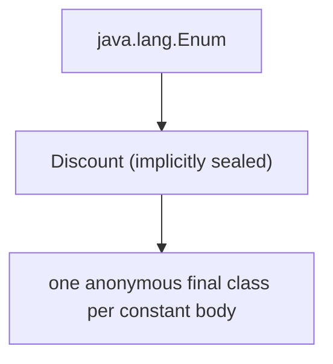

What to notice: only constants with bodies get subclasses.

### How it actually works

**A class with fixed instances.** Each constant is a `public static final` field holding the only instance of that name, so `==` is safe [Doc: JLS 25 §8.9.1](https://docs.oracle.com/javase/specs/jls/se25/html/jls-8.html#jls-8.9.1) [Doc: JLS 25 §8.9.3](https://docs.oracle.com/javase/specs/jls/se25/html/jls-8.html#jls-8.9.3). `new` is a compile error [Lab: EnumCompileRulesTest](../labs/java-language/src/test/java/dev/interview/javalanguage/m01/s12/EnumCompileRulesTest.java); final `clone`, banned reflective instantiation and special deserialization also prevent duplicates [Doc: JLS 25 §8.9](https://docs.oracle.com/javase/specs/jls/se25/html/jls-8.html#jls-8.9).

**Declaration.** Constants come first. Constructors are private, implicitly or explicitly; `public` does not compile [Doc: JLS 25 §8.9.2](https://docs.oracle.com/javase/specs/jls/se25/html/jls-8.html#jls-8.9.2) [Lab: EnumCompileRulesTest](../labs/java-language/src/test/java/dev/interview/javalanguage/m01/s12/EnumCompileRulesTest.java). The superclass is `Enum<E>`, so `extends` is rejected, but interfaces are allowed [Lab: EnumCompileRulesTest](../labs/java-language/src/test/java/dev/interview/javalanguage/m01/s12/EnumCompileRulesTest.java).

**Constant bodies.** A body declares an anonymous final subclass. An abstract method requires every constant to implement it. Without bodies the enum is implicitly final; with one, implicitly sealed (only those bodies extend it; [07](07-java-modern-language-features.md)) [Doc: JLS 25 §8.9](https://docs.oracle.com/javase/specs/jls/se25/html/jls-8.html#jls-8.9) [Lab: EnumCompileRulesTest](../labs/java-language/src/test/java/dev/interview/javalanguage/m01/s12/EnumCompileRulesTest.java). So `getClass()` differs from `getDeclaringClass()` [Lab: EnumsTest](../labs/java-language/src/test/java/dev/interview/javalanguage/m01/s12/EnumsTest.java).

**Generated members.** `values()` returns constants in declaration order; `valueOf` finds one by exact name [Doc: JLS 25 §8.9.3](https://docs.oracle.com/javase/specs/jls/se25/html/jls-8.html#jls-8.9.3). An unknown name throws `IllegalArgumentException` [Lab: EnumsTest](../labs/java-language/src/test/java/dev/interview/javalanguage/m01/s12/EnumsTest.java). `ordinal()` is the zero-based position, meant for structures like `EnumSet` and `EnumMap` ([04](04-java-collections-internals.md)) [Doc: Enum](https://docs.oracle.com/en/java/javase/25/docs/api/java.base/java/lang/Enum.html). A `switch` statement's `case` labels can name constants directly [Lab: EnumCompileRulesTest](../labs/java-language/src/test/java/dev/interview/javalanguage/m01/s12/EnumCompileRulesTest.java).

### Code

Each constant carries its own rule ([Strategy](51-design-principles-and-patterns.md)); `parse` guards untrusted text.

1. Pass labels to the constructor.
2. Override `apply` per body.
3. Scan `values()`, returning `Optional`.

```java
package dev.interview.javalanguage.m01.s12;

import java.util.Arrays;
import java.util.Optional;

// Module 01 §12: constant bodies make each constant its own strategy. parse scans values() instead of catching
// valueOf's IllegalArgumentException, so untrusted input never uses an exception for control flow.
public enum Discount {
    NONE("no discount") {
        @Override
        long apply(long cents) {
            return cents;
        }
    },
    PERCENT_TEN("ten percent off") {
        @Override
        long apply(long cents) {
            return cents - cents / 10;
        }
    },
    FLAT_FIVE("five off") {
        @Override
        long apply(long cents) {
            return Math.max(0, cents - FLAT_FIVE_CENTS);
        }
    };

    private static final long FLAT_FIVE_CENTS = 500;
    private final String label;

    Discount(String label) {
        this.label = label;
    }

    abstract long apply(long cents);

    public String label() {
        return label;
    }

    public static Optional<Discount> parse(String raw) {
        if (raw == null) {
            return Optional.empty();
        }
        return Arrays.stream(values())
                .filter(d -> d.name().equalsIgnoreCase(raw.strip()))
                .findFirst();
    }
}
```
<sub>Source: [labs/java-language/src/main/java/dev/interview/javalanguage/m01/s12/Discount.java](../labs/java-language/src/main/java/dev/interview/javalanguage/m01/s12/Discount.java)</sub>

Tests: [Lab: EnumsTest](../labs/java-language/src/test/java/dev/interview/javalanguage/m01/s12/EnumsTest.java).

### Failure modes and operations

`ordinal()` follows declaration order [Lab: EnumsTest](../labs/java-language/src/test/java/dev/interview/javalanguage/m01/s12/EnumsTest.java), so inserting or reordering constants remaps stored numbers: old rows can decode wrongly with no exception, so only data checks reveal it. JPA (Jakarta Persistence, the Java object-relational mapping standard): [23](23-jpa-hibernate-fundamentals.md).

### Best practices and anti-patterns

- Persist `name()` or an explicit code, because ordinals shift.
- **Security:** Map untrusted input through a validating parser, because raw `valueOf` throws on bad input, which unmapped can become a 500 ([18](18-spring-mvc-and-rest-controllers.md)).
- Prefer behavior on the constant over a `switch` repeated across callers, because an abstract method forces every new constant to implement it.

### Misconceptions and traps

- *"An enum is a list of named ints."* It is a class extending `Enum`; C enums taught the int view.
- *"Enums cannot implement interfaces or have methods."* They can; only `extends` is closed, which gets overgeneralized.
- *"A constant body means anyone can subclass."* It is sealed to those bodies; "not final" misleads.
- *"Enum singletons are exotic."* A one-constant enum inherits these guarantees ([51](51-design-principles-and-patterns.md)); classic singletons get taught first.

Questions that drill this section: [Q01.27](#q01-27), [Exercise 01.2](#ex01-2).

## 13. Wrappers, autoboxing and the `Integer` cache
### The problem it solves

A primitive is not an object, yet `List<int>` does not compile: type arguments must be reference types [Doc: JLS 25 §4.5.1](https://docs.oracle.com/javase/specs/jls/se25/html/jls-4.html#jls-4.5.1). Interview answers to why Java is "not 100% object-oriented" usually start here, then add static members. Wrappers carry primitives into generics and collections, and they bring two things `int` never had: identity and `null`.

### Mental model

A wrapper is a sealed envelope around a number. Two envelopes can hold the same number and still be two envelopes, and an envelope reference can point at nothing. `==` compares envelopes; `equals` opens them.

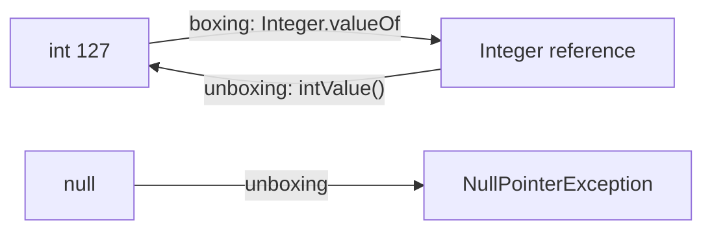

What to notice: the only arrow that can fail at run time starts at `null`.

### How it actually works

**The conversions.** There are eight wrappers: `Boolean`, `Byte`, `Short`, `Character`, `Integer`, `Long`, `Float`, `Double` [Doc: JLS 25 §5.1.7](https://docs.oracle.com/javase/specs/jls/se25/html/jls-5.html#jls-5.1.7). `String` is not one: it has no primitive counterpart. Unboxing is defined as `r.intValue()` and its siblings, and on `null` it throws `NullPointerException` [Doc: JLS 25 §5.1.8](https://docs.oracle.com/javase/specs/jls/se25/html/jls-5.html#jls-5.1.8) [Lab: WrappersTest](../labs/java-language/src/test/java/dev/interview/javalanguage/m01/s13/WrappersTest.java). For `Integer`, javac emits `valueOf` and `intValue()` [Lab: WrapperCompileRulesTest](../labs/java-language/src/test/java/dev/interview/javalanguage/m01/s13/WrapperCompileRulesTest.java).

**The cache.** `Integer.valueOf` "will always cache values in the range -128 to 127" and may cache more; `Short` and `Long` promise the same range, `Byte` caches every value, and `Character` caches up to `\u007f` [Src: JDK 25, java.lang.Integer]. The JLS demands less: identity only for boxed constant expressions in that range, and for other values it "disallows any assumptions" [Doc: JLS 25 §5.1.7](https://docs.oracle.com/javase/specs/jls/se25/html/jls-5.html#jls-5.1.7). So `false` at 128 is what HotSpot does with default flags, not a guarantee [Lab: WrappersTest](../labs/java-language/src/test/java/dev/interview/javalanguage/m01/s13/WrappersTest.java). `-XX:AutoBoxCacheMax=<size>` raises the upper bound through the `java.lang.Integer.IntegerCache.high` property [Src: JDK 25, java.lang.Integer]; a child JVM with 1000 sees identical `Integer` objects at 1000 [Lab: WrappersTest](../labs/java-language/src/test/java/dev/interview/javalanguage/m01/s13/WrappersTest.java). `Long.valueOf` has fixed bounds and no such option [Src: JDK 25, java.lang.Long].

**`==` depends on the operands.** With two wrappers it compares references [Doc: JLS 25 §15.21.3](https://docs.oracle.com/javase/specs/jls/se25/html/jls-15.html#jls-15.21.3). With one primitive operand, numeric promotion unboxes the other and compares values [Doc: JLS 25 §15.21.1](https://docs.oracle.com/javase/specs/jls/se25/html/jls-15.html#jls-15.21.1) [Lab: WrappersTest](../labs/java-language/src/test/java/dev/interview/javalanguage/m01/s13/WrappersTest.java).

**The ternary.** When one operand is `T` and the other its boxed type, the result is the primitive `T` [Doc: JLS 25 §15.25.2](https://docs.oracle.com/javase/specs/jls/se25/html/jls-15.html#jls-15.25.2). So `flag ? nullInteger : 0` unboxes and throws, even when assigned to an `Integer`; with two `Integer` operands it stays a reference and yields `null` [Lab: WrappersTest](../labs/java-language/src/test/java/dev/interview/javalanguage/m01/s13/WrappersTest.java).

**Casts.** A cast may unbox and then widen, so `(double) byteObject` compiles; `(Double) byteObject` does not, with `compiler.err.prob.found.req` [Doc: JLS 25 §5.5](https://docs.oracle.com/javase/specs/jls/se25/html/jls-5.html#jls-5.5) [Lab: WrapperCompileRulesTest](../labs/java-language/src/test/java/dev/interview/javalanguage/m01/s13/WrapperCompileRulesTest.java).

### Code

`OrderBook` puts the identity bug beside its fix, and the unboxing bug beside its guard.

1. Keep ids as `Long`, as an entity would.
2. Compare with `==` in `findByIdentity`, the defect, and `equals` in `findById`.
3. Default a missing key with `getOrDefault` rather than unbox `get`'s `null`.

```java
package dev.interview.javalanguage.m01.s13;

import java.util.List;
import java.util.Map;
import java.util.Optional;

// Module 01 §13: findByIdentity is the defect on purpose. Long.valueOf caches -128..127, so test data with small ids
// passes while production ids above 127 silently never match; findById compares by value and has no such cliff.
public final class OrderBook {

    private static final int MISSING_QUANTITY = 0;

    public record Order(Long id, String customer) {}

    private final List<Order> orders;

    public OrderBook(List<Order> orders) {
        this.orders = List.copyOf(orders);
    }

    public Optional<Order> findByIdentity(Long id) {
        // Deliberate bug: == compares references, not values.
        return orders.stream().filter(order -> order.id() == id).findFirst();
    }

    public Optional<Order> findById(Long id) {
        return orders.stream().filter(order -> order.id().equals(id)).findFirst();
    }

    public static int quantityOf(Map<String, Integer> stock, String sku) {
        return stock.getOrDefault(sku, MISSING_QUANTITY);
    }

    public static int quantityUnboxed(Map<String, Integer> stock, String sku) {
        return stock.get(sku);
    }
}
```
<sub>Source: [labs/java-language/src/main/java/dev/interview/javalanguage/m01/s13/OrderBook.java](../labs/java-language/src/main/java/dev/interview/javalanguage/m01/s13/OrderBook.java)</sub>

Tests: [Lab: WrappersTest](../labs/java-language/src/test/java/dev/interview/javalanguage/m01/s13/WrappersTest.java).

### Failure modes and operations

A `Long` accumulator unboxes and reboxes on every `+=`, and above 127 `valueOf` reaches `new Long` [Src: JDK 25, java.lang.Long], so a hot loop can churn short-lived objects. Measure before changing anything: allocation is covered in [09](09-jvm-garbage-collection.md), profiling in [10](10-jvm-performance-and-troubleshooting.md). A missing map key into an `int` is the common unboxing NPE [Lab: WrappersTest](../labs/java-language/src/test/java/dev/interview/javalanguage/m01/s13/WrappersTest.java); the stack trace points at a line with no visible dereference.

> [!IMPORTANT]
> **Production scenario: order lookup works in tests and fails for real customers.** *As the interviewer frames it:* "All tests pass. In production, lookups return nothing for almost every customer, with no exception."
> **Reasoning.** Test fixtures use ids like 1 and 2, inside the `Long` cache, so `==` on two `Long` objects sees one shared instance. Real ids exceed 127, so each boxing makes a new object [Lab: WrappersTest](../labs/java-language/src/test/java/dev/interview/javalanguage/m01/s13/WrappersTest.java). Evidence: the failing lookups are exactly the ids above 127, and the same lookup with id 100 succeeds; the comparison is `==` on two `Long` values. Fix: replace `==` with `equals`. Prevention: use fixture ids above 127.

### Best practices and anti-patterns

- Use primitives for fields and locals that are never absent, because they cannot be `null` and carry no identity.
- Compare wrappers with `equals`, because `==` works only by accident of the cache.
- Keep the type on both sides of `equals`, because `Long.valueOf(1).equals(1)` is `false`: the argument boxes to `Integer` [Lab: WrappersTest](../labs/java-language/src/test/java/dev/interview/javalanguage/m01/s13/WrappersTest.java).
- Call `valueOf` or rely on boxing, because the wrapper constructors are deprecated [Deprecated since Java 9 — use valueOf] [Src: JDK 25, java.lang.Integer].

### Misconceptions and traps

- *"A `Byte` cannot be cast to `double`."* It can, by unboxing and then widening; only `(Double)` fails. Unboxing arrived in Java 5 [Doc: Autoboxing guide](https://docs.oracle.com/javase/1.5.0/docs/guide/language/autoboxing.html); some question banks still say no.
- *"`Integer` 128 `==` 128 is always false."* The JLS allows sharing, and the flag above changes it; the fixed fact is that you may not rely on either result. HotSpot's default cache stops at 127, so demos always print `false`.
- *"Assigning a ternary to `Integer` keeps it boxed."* The operands decide the type, not the target; the assignment looks safe, hence the myth.
- *"`String` is a wrapper."* No primitive sits behind it; literals make it feel built in.

Questions that drill this section: [Q01.28](#q01-28), [Exercise 01.1](#ex01-1).

## Summary
`javac` turns source into bytecode that any JVM of a recent enough release runs; the JVM itself is built per platform, and a class file newer than the JVM fails with `UnsupportedClassVersionError` (major version 69 is Java 25) ([§1](#1-how-java-runs)). Integer arithmetic wraps silently on overflow unless `Math.addExact` checks it, only integer `/` and `%` by zero throw, and money needs `BigDecimal` built from a `String`, not `double` ([§2](#2-primitive-types-conversions-and-overflow)). Precedence groups operators but operands evaluate left to right, `&&` skips its right side, compound assignment hides a narrowing cast, and `1 << 32` is 1 because the shift distance is masked ([§3](#3-lexical-structure-operators-and-control-flow)). Java passes every argument by value, references included, so `swap` cannot work but mutation through a parameter shows ([§4](#4-classes-objects-references-and-pass-by-value)).

Class initialization runs once, on first use; then each `new` runs the superclass constructor before the subclass's field initializers, so an overridable call from a constructor sees default values ([§5](#5-constructors-and-initialization-order)). `protected` adds package access but, from another package, works only through the subclass's own type; encapsulation protects invariants, not fields one getter at a time ([§6](#6-packages-access-control-and-encapsulation)). Fields are hidden, not overridden, and a `HashSet` subclass that counts in both `add` and `addAll` double-counts; forwarding stops depending on the superclass's self-calls ([§7](#7-inheritance-composition-and-object)). Overloads are chosen at compile time from static types in three phases, overrides at run time from the object's class; static and private methods are never dispatched ([§8](#8-polymorphism-overloading-overriding-and-dispatch)).

Interfaces carry type and behavior but no instance state; a class method beats a default, and two unrelated defaults force an override ([§9](#9-abstract-classes-and-interfaces)). `final` fixes a reference, not an object, and a compile-time constant is copied into its callers, so changing it means recompiling them ([§10](#10-static-final-and-constants)). An inner or anonymous class that uses its creator holds a hidden reference to it, which keeps the creator alive while a long-lived registry holds the listener ([§11](#11-nested-types)). An enum is a class whose constants can carry behavior; persist `name()`, not `ordinal()` ([§12](#12-enums)). `==` on wrappers compares references, so it matches cached values from -128 to 127 and is unreliable outside them, and unboxing `null`, even inside a ternary, throws `NullPointerException` ([§13](#13-wrappers-autoboxing-and-the-integer-cache)).

## Question bank

<a id="q01-01"></a>
### Q01.01 · Concept · JDK, JRE and JVM: what each is, and what actually makes Java platform independent?
<!-- ledger: honeywell-optum-md-01-05, core-java-240-01-08, core-java-240-01-12, core-java-240-01-10, core-java-pdf-01-04 -->

A colleague says: "Java is platform independent, so the JVM must be too." Correct them.

<details>
<summary>Answer</summary>

**Short answer (30 seconds).** The JVM executes bytecode, the JRE adds the class library, and the JDK adds tools such as `javac`. The class file is the portable part; each JVM is built for one OS and CPU.

**Full explanation.** `javac` emits bytecode, the instruction set of an abstract machine. The JVM knows only the class-file format, not the Java language [Doc: JVMS 25 §1.2](https://docs.oracle.com/javase/specs/jvms/se25/html/jvms-1.html#jvms-1.2), so the JVM is what gets ported and the class file stays the same, provided the JVM accepts its version ([Q01.03](#q01-03)). Hot methods are later compiled to machine code ([§1](#1-how-java-runs)), so "interpreted" describes only the start of a run. The separate JRE is gone since JDK 11; `jlink` builds trimmed runtimes ([§1](#1-how-java-runs)).

**Follow-ups an interviewer will ask.**
- *Is every Java program portable?* No: a library loaded with `System.loadLibrary` is native code [Doc: Java 25 API](https://docs.oracle.com/en/java/javase/25/docs/api/java.base/java/lang/System.html#loadLibrary(java.lang.String)).
- *How does Java differ from C++?* C++ compiles to native code per target. Java has garbage collection [Doc: JVMS 25 §2.5.3](https://docs.oracle.com/javase/specs/jvms/se25/html/jvms-2.html#jvms-2.5.3), one direct superclass and no pointer arithmetic: `+` and `-` take only numbers (`+` also `String`) [Doc: JLS 25 §15.18](https://docs.oracle.com/javase/specs/jls/se25/html/jls-15.html#jls-15.18). "C++ has no threads" is outdated: `std::thread` dates from C++11 [Doc: cppreference](https://en.cppreference.com/w/cpp/thread/thread.html).

**Trap to avoid.** "The JVM is platform independent." It is the platform-specific box; the claim is about class files.

</details>

<a id="q01-02"></a>
### Q01.02 · Concept · What does the launcher require of `main` in Java 25, and why was it always `public static void main(String[])`?
<!-- ledger: core-java-240-01-18, core-java-240-01-14, core-java-240-01-19, core-java-pdf-02-14, core-java-pdf-03-10 -->

A reviewer rejects `void main() { … }` in a Java 25 class: "`main` must be `public static`." Are they right?

<details>
<summary>Answer</summary>

**Short answer (30 seconds).** No: on Java 25 any non-private `void main` with a `String[]` parameter or none can start a program, static or instance. Until Java 24 it had to be `public static void main(String[])`, and that form still wins when both exist.

**Full explanation.** The old rule [Doc: JLS 8 §12.1.4](https://docs.oracle.com/javase/specs/jls/se8/html/jls-12.html#jls-12.1.4) (`String...` also qualified) has a rationale usually given for it: `public` so outside code can call it, `static` so it runs before any object exists, `void` because the exit status comes from `System.exit(int)`. Java 25 keeps `void` and relaxes the rest [Doc: JLS 25 §12.1.4](https://docs.oracle.com/javase/specs/jls/se25/html/jls-12.html#jls-12.1.4); an instance `main` needs a non-private no-argument constructor [Final since Java 25, JEP 512](https://openjdk.org/jeps/512). The lab runs both forms [Lab: LaunchProtocolTest](../labs/java-language/src/test/java/dev/interview/javalanguage/m01/s01/LaunchProtocolTest.java).

**Follow-ups an interviewer will ask.**
- *Must the file name match the class?* Only for a `public` top-level class. In the lab `public class Bar` in `Foo.java` fails with `compiler.err.class.public.should.be.in.file`; a non-public `Bar` compiles [Lab: Q01OutputsTest](../labs/java-language/src/test/java/dev/interview/javalanguage/m01/outputs/Q01OutputsTest.java).
- *When is the class loaded?* At run time, by the JVM, not by `javac` [Doc: JLS 25 §12.1.1](https://docs.oracle.com/javase/specs/jls/se25/html/jls-12.html#jls-12.1.1).

**Trap to avoid.** Reciting the classic signature as a current rule. Say "until Java 24", then give the Java 25 rule.

</details>

<a id="q01-03"></a>
### Q01.03 · Production scenario · A service dies at startup with `UnsupportedClassVersionError` after a build-image upgrade

All 12 pods crash-loop after Monday's deploy. Only the CI image changed, to JDK 25. The log: `UnsupportedClassVersionError: com/acme/Main has been compiled by a more recent version of the Java Runtime (class file version 69.0), this version of the Java Runtime only recognizes class file versions up to 65.0`.

<details>
<summary>Answer</summary>

**Short answer (30 seconds).** Classes built for Java 25 (major 69) are running on Java 21 (at most 65). Roll back, then build with `--release 21` or raise the runtime image first.

**Full explanation.** *Symptoms:* every pod fails while loading classes, and the message prints both versions: version skew, not a code bug. In the lab, a class patched to major 70 fails on JDK 25 with "class file version 70.0 … up to 69.0" [Lab: Q01OutputsTest](../labs/java-language/src/test/java/dev/interview/javalanguage/m01/outputs/Q01OutputsTest.java).

*Hypotheses, ranked:* (1) the new JDK compiled our classes at its default level; (2) the named class is a dependency built for a newer Java; (3) the runtime image drifted.

*Evidence:* `javap -v` on the named class and `java -version` in a pod. Our own class at 69 confirms (1), a dependency's class (2), an unexpected runtime (3).

*Fix:* redeploy the last good artifact, then set `maven.compiler.release` to the runtime's release.

*Prevention:* fail the pipeline when `--release` exceeds the image's Java, smoke-start the image before rollout, and alert on crash loops.

**Code.**

```bash
javap -v -cp app.jar com.acme.Main | grep major   # major version: 69
```

**Follow-ups an interviewer will ask.**
- *Why not `-target 21`?* It still compiles against JDK 25's API, so a newer call fails later with `NoSuchMethodError` [Doc: JEP 247](https://openjdk.org/jeps/247).
- *Do old classes pass on a new JVM?* Yes: Java 25 accepts majors 45 to 69 ([§1](#1-how-java-runs)).

**Trap to avoid.** Debugging the classpath. The class was found; the JVM refused it.

</details>

<a id="q01-04"></a>
### Q01.04 · Output · Overflow, division and remainder: what do these expressions print or throw?
<!-- ledger: core-java-pdf-01-34, core-java-pdf-02-42, core-java-pdf-02-36, core-java-pdf-03-47 -->

```java
int big = Integer.MAX_VALUE;
int zero = 0;
System.out.println(big + 1);
System.out.println(-7 / 2);
System.out.println(-7 % 2);
System.out.println(7 % -2);
System.out.println(Math.floorMod(-7, 2));
System.out.println(5.5 % 2);
System.out.println(1.0 / zero);
System.out.println(0.0 / zero);
System.out.println(Math.abs(Integer.MIN_VALUE));
try {
    System.out.println(1 / zero);
} catch (ArithmeticException e) {
    System.out.println(e.getMessage());
}
```

<details>
<summary>Answer</summary>

**Short answer (30 seconds).**

```text
-2147483648
-3
-1
1
1
1.5
Infinity
NaN
-2147483648
/ by zero
```

Integer arithmetic wraps silently, `/` rounds toward zero, and `%` takes the dividend's sign. Only integer `/` and `%` by zero throw.

**Full explanation.** The rules are in [§2](#2-primitive-types-conversions-and-overflow); `%` satisfies `(a/b)*b+(a%b) == a` and also accepts floating-point operands [Doc: JLS 25 §15.17.3](https://docs.oracle.com/javase/specs/jls/se25/html/jls-15.html#jls-15.17.3). `Math.floorMod` follows the divisor's sign. `Math.abs(Integer.MIN_VALUE)` stays negative because its positive value does not fit [Doc: Java 25 API, Math.abs](https://docs.oracle.com/en/java/javase/25/docs/api/java.base/java/lang/Math.html#abs(int)). In `1.0 / zero`, `zero` becomes a `double`, so nothing throws. The lab asserts every line [Lab: Q01OutputsTest](../labs/java-language/src/test/java/dev/interview/javalanguage/m01/outputs/Q01OutputsTest.java).

**Follow-ups an interviewer will ask.**
- *What else throws `ArithmeticException`?* `Math.*Exact` on overflow, and `BigDecimal.divide(BigDecimal)` on a non-terminating quotient [Doc: Java 25 API](https://docs.oracle.com/en/java/javase/25/docs/api/java.base/java/math/BigDecimal.html).
- *Does `Integer.MIN_VALUE / -1` throw?* No: it overflows to the dividend [Doc: JLS 25 §15.17.2](https://docs.oracle.com/javase/specs/jls/se25/html/jls-15.html#jls-15.17.2).

**Trap to avoid.** `hash % buckets` as an index: negative for a negative hash. Use `Math.floorMod(hash, buckets)`.

</details>

<a id="q01-05"></a>
### Q01.05 · Output · Narrowing casts, `char` arithmetic and numeric promotion: what does this print, and which line does not compile?
<!-- ledger: core-java-pdf-02-17, core-java-pdf-03-52, core-java-pdf-02-04, core-java-pdf-03-09, core-java-240-06-01, core-java-240-06-02, core-java-240-06-04 -->

```java
System.out.println((byte) 200);
System.out.println((int) 3.99);
System.out.println((int) -3.99);
System.out.println((byte) 300.7);
System.out.println((int) Double.NaN);
System.out.println((int) 1e20);
System.out.println('a' + 1);
System.out.println((char) ('a' + 1));
System.out.println("" + 'a' + 1);
System.out.println('a' + 'b' + "");
char letter = 'a';
letter += 1;
System.out.println(letter);
System.out.println(1L + 1.5f);
```

Then, given `byte x = 10; byte y = 20;`, which compile: `byte z = 10 + 20;`, `byte z = x + y;`, `x += y;`?

<details>
<summary>Answer</summary>

**Short answer (30 seconds).**

```text
-56
3
-3
44
0
2147483647
98
b
a1
195
b
2.5
```

Casts truncate or keep low-order bits, and `char` is an integer until a `String` joins in. Only `byte z = x + y;` fails: `incompatible types: possible lossy conversion from int to byte`.

**Full explanation.** A `double` cast truncates toward zero, `NaN` becomes 0 and `1e20` saturates; `(byte) 300.7` goes through `int` 300 to its low 8 bits [Doc: JLS 25 §5.1.3](https://docs.oracle.com/javase/specs/jls/se25/html/jls-5.html#jls-5.1.3). `+` groups left to right, so `"" + 'a' + 1` concatenates throughout, while `'a' + 'b' + ""` adds 97 and 98 first. `x + y` is an `int`, and assignment narrows implicitly only for a constant expression that fits [Doc: JLS 25 §5.2](https://docs.oracle.com/javase/specs/jls/se25/html/jls-5.html#jls-5.2), so `10 + 20` compiles; `x += y` has a hidden cast ([§2](#2-primitive-types-conversions-and-overflow)). The lab asserts the lines and all three compile results [Lab: Q01OutputsTest](../labs/java-language/src/test/java/dev/interview/javalanguage/m01/outputs/Q01OutputsTest.java).

**Follow-ups an interviewer will ask.**
- *What are the two kinds of conversion?* Widening is implicit in assignment, invocation and arithmetic, though `int` to `float` can lose precision; narrowing needs a cast. Reference casts: [Q01.20](#q01-20).
- *What is the range of `char`?* 0 to 65535, unsigned 16-bit ([§2](#2-primitive-types-conversions-and-overflow)).

**Trap to avoid.** "`(int) 3.99` rounds to 4." It truncates; use `Math.round`.

</details>

<a id="q01-06"></a>
### Q01.06 · Production scenario · Invoice totals are off by a cent against the payment provider

Finance flags multi-line orders one cent above the provider's charge, though the code uses `BigDecimal`. One order has three lines of 1.10 at 5% tax: we say 0.18, the provider 0.17.

<details>
<summary>Answer</summary>

**Short answer (30 seconds).** Both are exact but round at different points: per line gives 0.18, once per order 0.17. Agree one rule (where to round, scale, `RoundingMode`) and implement it in one place.

**Full explanation.** *Symptoms:* exactly one cent, on multi-line orders: rounding, not pricing.

*Hypotheses, ranked:* (1) different rounding points; (2) different modes; (3) a `double` in the path.

*Evidence:* the reconciliation diff lists the mismatched orders; recompute one under each rule [Lab: Q01OutputsTest](../labs/java-language/src/test/java/dev/interview/javalanguage/m01/outputs/Q01OutputsTest.java):

| Rule | Rounds | Tax |
|---|---|---|
| Per line, `HALF_UP` | 0.055 three times | 0.18 |
| Per order, `HALF_UP` | 0.165 once | 0.17 |
| Per order, `HALF_EVEN` | 0.165 once | 0.16 |

The second row matches, confirming (1). For (3), the same test class shows `Math.round(1.005 * 100)` is 100, while `new BigDecimal("1.005")` rounds `HALF_UP` to 1.01.

*Fix:* take the rule from the provider contract. The fix:

**Code.**

```java
package dev.interview.javalanguage.m01.outputs;

import java.math.BigDecimal;
import java.math.RoundingMode;
import java.util.List;

/** Q01.06: rounding tax per line versus once per order with BigDecimal. */
public final class Q01_06 {

    private static final int MONEY_SCALE = 2;

    private Q01_06() {}

    public static BigDecimal taxPerLine(List<BigDecimal> lines, BigDecimal rate, RoundingMode mode) {
        return lines.stream()
                .map(line -> line.multiply(rate).setScale(MONEY_SCALE, mode))
                .reduce(BigDecimal.ZERO, BigDecimal::add);
    }

    public static BigDecimal taxPerOrder(List<BigDecimal> lines, BigDecimal rate, RoundingMode mode) {
        return lines.stream()
                .reduce(BigDecimal.ZERO, BigDecimal::add)
                .multiply(rate)
                .setScale(MONEY_SCALE, mode);
    }
}
```
<sub>Source: [labs/java-language/src/main/java/dev/interview/javalanguage/m01/outputs/Q01_06.java](../labs/java-language/src/main/java/dev/interview/javalanguage/m01/outputs/Q01_06.java)</sub>

*Prevention and monitoring:* golden-order tests with the provider's figures, and an alert on daily reconciliation mismatches.

**Follow-ups an interviewer will ask.**
- *When is `HALF_EVEN` right?* It minimizes cumulative error over many calculations [Doc: Java 25 API](https://docs.oracle.com/en/java/javase/25/docs/api/java.base/java/math/RoundingMode.html#HALF_EVEN), but the contract decides.
- *`long` cents instead?* Exact for adding; a rate still needs a rounding rule ([Exercise 01.1](#ex01-1)).

**Trap to avoid.** "We use `BigDecimal`, so it cannot be rounding." It makes each step exact, not the choice of where to round.

</details>

<a id="q01-07"></a>
### Q01.07 · Output · `&` vs `&&`, prefix vs postfix and compound assignment: what does this print?
<!-- ledger: core-java-pdf-02-08, core-java-pdf-03-57, core-java-pdf-01-52, core-java-pdf-02-15, core-java-pdf-02-53, core-java-pdf-02-41 -->

```java
int i = 5;
int j = i++ + ++i;
System.out.println(i + " " + j);
int k = 1;
k = k++;
System.out.println(k);
int n = 10;
n += n++ + ++n;
System.out.println(n);
boolean off = false;
int calls = 0;
boolean first = off && ++calls > 0;
boolean second = off & ++calls > 0;
System.out.println(calls + " " + first + " " + second);
System.out.println(true || off && off);
int size = 5;
System.out.println(size > 3 ? "big" : size > 1 ? "mid" : "small");
System.out.println(true ? 1 : 2.0);
```

And does `flag &&= off;` compile?

<details>
<summary>Answer</summary>

**Short answer (30 seconds).**

```text
7 12
1
32
1 false false
true
big
1.0
```

Operands run left to right, postfix yields the old value, prefix the new, and only `&` evaluates its right side after `false`. `&&=` does not compile: Java has no such operator.

**Full explanation.** In `i++ + ++i`, `i++` yields 5 [Doc: JLS 25 §15.14.2](https://docs.oracle.com/javase/specs/jls/se25/html/jls-15.html#jls-15.14.2), then `++i` yields 7 [Doc: JLS 25 §15.15.1](https://docs.oracle.com/javase/specs/jls/se25/html/jls-15.html#jls-15.15.1). `k = k++` assigns the old value back. `n += n++ + ++n` saves the left-hand 10 first, then adds 10 + 12 [Doc: JLS 25 §15.26.2](https://docs.oracle.com/javase/specs/jls/se25/html/jls-15.html#jls-15.26.2). `&&` binds tighter than `||`, and nested `?:` groups right to left [Doc: JLS 25 §15.25](https://docs.oracle.com/javase/specs/jls/se25/html/jls-15.html#jls-15.25). The lab asserts the lines, and `&&=` fails with `compiler.err.illegal.start.of.expr` [Lab: Q01OutputsTest](../labs/java-language/src/test/java/dev/interview/javalanguage/m01/outputs/Q01OutputsTest.java).

**Follow-ups an interviewer will ask.**
- *Which boolean compound assignments exist?* `&=`, `|=` and `^=`; none short-circuits [Doc: JLS 25 §15.26](https://docs.oracle.com/javase/specs/jls/se25/html/jls-15.html#jls-15.26).
- *Which operators are right-associative?* Assignment and `?:`; prefix unary operators nest the same way (`!!flag`).

**Trap to avoid.** "`k = k++` increments `k`." The saved value overwrites the increment.

</details>

<a id="q01-08"></a>
### Q01.08 · Output · `>>` vs `>>>` on a negative number, and why `1 << 32` is 1
<!-- ledger: core-java-240-01-26, core-java-pdf-01-38 -->

```java
int minusEight = -8;
System.out.println(minusEight >> 1);
System.out.println(minusEight >>> 1);
System.out.println(minusEight >>> 28);
System.out.println(1 << 32);
System.out.println(1 << 33);
System.out.println(1L << 32);
System.out.println(1 << -1);
byte small = -1;
System.out.println(small >>> 4);
small >>>= 4;
System.out.println(small);
```

<details>
<summary>Answer</summary>

**Short answer (30 seconds).**

```text
-4
2147483644
15
1
2
4294967296
-2147483648
268435455
-1
```

`>>` copies the sign bit and `>>>` fills with zeros. An `int` shift uses only the distance's low five bits, and a `byte` is promoted to `int` first.

**Full explanation.** The distance is masked with `0x1f` for an `int` and six bits for a `long` [Doc: JLS 25 §15.19](https://docs.oracle.com/javase/specs/jls/se25/html/jls-15.html#jls-15.19), so 32 becomes 0, 33 becomes 1, and -1 becomes 31, which reaches the sign bit. `small >>> 4` shifts the `int` -1, 32 ones, and yields 268435455. `small >>>= 4` casts back to `byte`; the low 8 bits are still all ones, so it stays -1. The lab asserts every line [Lab: Q01OutputsTest](../labs/java-language/src/test/java/dev/interview/javalanguage/m01/outputs/Q01OutputsTest.java).

**Follow-ups an interviewer will ask.**
- *How do you shift a `byte` as unsigned?* Mask first: in the lab `(small & 0xFF) >>> 4` is 15 [Lab: Q01OutputsTest](../labs/java-language/src/test/java/dev/interview/javalanguage/m01/outputs/Q01OutputsTest.java).
- *Is `x >> 1` the same as `x / 2`?* Not for negative odd values: in the lab `-7 >> 1` is -4 and `-7 / 2` is -3 [Lab: Q01OutputsTest](../labs/java-language/src/test/java/dev/interview/javalanguage/m01/outputs/Q01OutputsTest.java).

**Trap to avoid.** "`1 << 32` is 0 because the bit falls off." The distance is masked first, so nothing shifts.

</details>


<a id="q01-09"></a>
### Q01.09 · Concept · Labels, `break`/`continue` and the rules for `switch` case labels
<!-- ledger: core-java-pdf-02-18, core-java-pdf-02-50, core-java-pdf-02-57, core-java-pdf-03-72, core-java-pdf-02-61, core-java-pdf-01-51, core-java-pdf-02-23, core-java-240-06-22 -->

A nested loop must skip the rest of a row past the diagonal and stop on the last row. Which statements do that, and what may a `case` label contain?

<details>
<summary>Answer</summary>

**Short answer (30 seconds).** `continue outer` starts the next iteration of the labeled loop; `break outer` leaves it. A `case` constant is a unique compile-time constant or enum name; a `null` selector throws `NullPointerException`.

**Full explanation.** A label's scope is the statement it labels [Doc: JLS 25 §14.7](https://docs.oracle.com/javase/specs/jls/se25/html/jls-14.html#jls-14.7). `break label` works on any labeled statement, but the target of `continue label` must be a `while`, `do` or `for` [Doc: JLS 25 §14.16](https://docs.oracle.com/javase/specs/jls/se25/html/jls-14.html#jls-14.16); in the lab, `continue` on a labeled block fails with `compiler.err.not.loop.label`. For case constants [Doc: JLS 25 §14.11.1](https://docs.oracle.com/javase/specs/jls/se25/html/jls-14.html#jls-14.11.1), a variable gives `compiler.err.const.expr.req` and a repeat `compiler.err.duplicate.case.label`. With no matching label, a `null` selector throws [Doc: JLS 25 §14.11.3](https://docs.oracle.com/javase/specs/jls/se25/html/jls-14.html#jls-14.11.3). The lab asserts every line below [Lab: Q01OutputsTest](../labs/java-language/src/test/java/dev/interview/javalanguage/m01/outputs/Q01OutputsTest.java).

**Code.**

```java
// Excerpt of labs/java-language/src/main/java/dev/interview/javalanguage/m01/outputs/Q01_09.java
public static void main(String[] args) {
    outer:
    for (int row = 0; row < 3; row++) {
        for (int col = 0; col < 3; col++) {
            if (col > row) {
                continue outer;
            }
            if (row == 2) {
                break outer;
            }
            System.out.println(row + "," + col);
        }
    }
    String plan = "pro";
    switch (plan) {
        case "pro":
            System.out.println("pro");
        case "basic":
            System.out.println("basic");
            break;
        default:
            System.out.println("free");
    }
    String missing = null;
    try {
        switch (missing) {
            case "pro":
                System.out.println("pro");
                break;
            default:
                System.out.println("free");
        }
    } catch (NullPointerException e) {
        System.out.println("NullPointerException");
    }
}
```

```text
0,0
1,0
1,1
pro
basic
NullPointerException
```

**Follow-ups an interviewer will ask.**
- *`if` or `switch`?* `if` takes any `boolean` condition; a classic `switch` compares one `char`, `byte`, `short`, `int`, their wrappers, `String` or enum value against constants ([§3](#3-lexical-structure-operators-and-control-flow)). A `long` selector is a compile-time error [Doc: JLS 25 §14.11](https://docs.oracle.com/javase/specs/jls/se25/html/jls-14.html#jls-14.11); pattern `switch` is in [07](07-java-modern-language-features.md).
- *`while` or `do`, and can `for` run forever?* A `do` body runs at least once [Doc: JLS 25 §14.13](https://docs.oracle.com/javase/specs/jls/se25/html/jls-14.html#jls-14.13). `for (;;)` ends only through `break`, `return` or an exception; the lab compiles `for (int i = 0, j = 10; i < j; i++, j--)` [Doc: JLS 25 §14.14.1](https://docs.oracle.com/javase/specs/jls/se25/html/jls-14.html#jls-14.14.1) [Lab: Q01OutputsTest](../labs/java-language/src/test/java/dev/interview/javalanguage/m01/outputs/Q01OutputsTest.java).

**Trap to avoid.** "`switch` takes only `int`." `String` has worked since Java 7 [Doc: Strings in switch](https://docs.oracle.com/javase/7/docs/technotes/guides/language/strings-switch.html).

</details>

<a id="q01-10"></a>
### Q01.10 · Output · Is Java pass-by-reference? What do `swap` and `rename` leave in the caller?
<!-- ledger: core-java-240-05-25, core-java-240-05-32, core-java-240-05-35, core-java-240-02-01, core-java-pdf-01-54 -->

```java
// Excerpt of labs/java-language/src/main/java/dev/interview/javalanguage/m01/outputs/Q01_10.java
static void swap(StringBuilder first, StringBuilder second) {
    StringBuilder temp = first;
    first = second;
    second = temp;
}

static void rename(StringBuilder name) {
    name.append("-v2");
    name = new StringBuilder("other");
    name.append("-v3");
}

static void bump(int count) {
    count++;
}

public static void main(String[] args) {
    StringBuilder a = new StringBuilder("a");
    StringBuilder b = new StringBuilder("b");
    swap(a, b);
    System.out.println(a + " " + b);
    rename(a);
    System.out.println(a);
    int count = 1;
    bump(count);
    System.out.println(count);
}
```

<details>
<summary>Answer</summary>

**Short answer (30 seconds).**

```text
a b
a-v2
1
```

Java passes every argument by value, and for an object the value is a reference. The callee can change the object through its copy (`-v2`) but not the caller's variables (`swap`, the `"other"` builder, `count`).

**Full explanation.** Each call creates new parameter variables initialized with the argument values [Doc: JLS 25 §8.4.1](https://docs.oracle.com/javase/specs/jls/se25/html/jls-8.html#jls-8.4.1). `swap` exchanges its own two copies and returns. `rename` appends through its copy, which points to the caller's builder, then points the copy at a new builder that nobody else sees. `bump` increments a copy of 1. The lab asserts the three lines [Lab: Q01OutputsTest](../labs/java-language/src/test/java/dev/interview/javalanguage/m01/outputs/Q01OutputsTest.java).

**Follow-ups an interviewer will ask.**
- *Object vs reference?* The object lives on the heap; a reference variable holds one object's address, or `null`, and can be rebound unless `final` ([§4](#4-classes-objects-references-and-pass-by-value)). A `final` reference still lets you mutate the object.
- *What is a `String` variable's default value?* `null` for a field; a local has none and must be assigned before use ([Q01.11](#q01-11)).

**Trap to avoid.** "Objects are passed by reference, primitives by value." In C++ a reference parameter can rebind the caller's variable; no Java method can.

</details>

<a id="q01-11"></a>
### Q01.11 · Difference · Fields vs local variables: defaults, definite assignment, scope and lifetime
<!-- ledger: core-java-pdf-03-15, core-java-pdf-03-55, core-java-pdf-03-58 -->

"A `boolean` defaults to `false`, so `boolean done; if (done) …` is fine." Where is this right and where does it not compile?

<details>
<summary>Answer</summary>

**Short answer (30 seconds).** Right for a field, wrong for a local: a local must be definitely assigned before it is read. A local lives until the end of its block, a field as long as its object.

**Full explanation.** Defaults are in [§4](#4-classes-objects-references-and-pass-by-value). Definite assignment is a compile-time flow analysis [Doc: JLS 25 chapter 16](https://docs.oracle.com/javase/specs/jls/se25/html/jls-16.html): in the lab, a local assigned only inside an `if` fails with `compiler.err.var.might.not.have.been.initialized`, while a `final` local assigned in both branches compiles. A block is a scope: a local declared in it is gone after `}` [Doc: JLS 25 §6.3](https://docs.oracle.com/javase/specs/jls/se25/html/jls-6.html#jls-6.3). A local may shadow a field, but not another local still in scope [Doc: JLS 25 §6.4](https://docs.oracle.com/javase/specs/jls/se25/html/jls-6.html#jls-6.4): the lab gets `compiler.err.already.defined` for the second, and the local value 2 over the field's 1 for the first [Lab: Q01OutputsTest](../labs/java-language/src/test/java/dev/interview/javalanguage/m01/outputs/Q01OutputsTest.java).

**Follow-ups an interviewer will ask.**
- *Where do they live?* Locals in the method's frame, fields inside the object; the JVM's runtime data areas are in [08](08-jvm-memory-and-class-loading.md).
- *Why no defaults for locals?* Only the method's own code can assign a local, so the compiler can check every path to each read [Doc: JLS 25 chapter 16](https://docs.oracle.com/javase/specs/jls/se25/html/jls-16.html); a field can be assigned from any method.

**Trap to avoid.** Reading a bare `v` as the field while a local `v` is in scope.

</details>

<a id="q01-12"></a>
### Q01.12 · Output · Initialization order across a class hierarchy: static blocks, instance initializers, field initializers, constructors
<!-- ledger: core-java-240-01-02 -->

```java
// Excerpt of labs/java-language/src/main/java/dev/interview/javalanguage/m01/outputs/Q01_12.java
static String log(String step) {
    System.out.println(step);
    return step;
}

static class Parent {
    static {
        log("Parent static block");
    }

    String parentField = log("Parent field");

    Parent() {
        log("Parent constructor");
    }
}

static class Child extends Parent {
    {
        log("Child instance block");
    }

    static String tag = log("Child static field");

    String childField = log("Child field");

    Child() {
        log("Child constructor");
    }
}

public static void main(String[] args) {
    new Child();
    log("--");
    new Child();
}
```

<details>
<summary>Answer</summary>

**Short answer (30 seconds).**

```text
Parent static block
Child static field
Parent field
Parent constructor
Child instance block
Child field
Child constructor
--
Parent field
Parent constructor
Child instance block
Child field
Child constructor
```

Static initializers run once, superclass first. Each `new` then completes the parent's initializers and constructor before the child's initializers, which run in text order, and finally the child's constructor body.

**Full explanation.** Class initialization runs static initializers in text order on first active use, superclass first [Doc: JLS 25 §12.4.2](https://docs.oracle.com/javase/specs/jls/se25/html/jls-12.html#jls-12.4.2). Instance creation calls `super()` before this class's instance initializers and field initializers, which run in the order they are written [Doc: JLS 25 §12.5](https://docs.oracle.com/javase/specs/jls/se25/html/jls-12.html#jls-12.5): `Child instance block` comes before `Child field` only because it is written first. The second `new` skips the static part. The lab asserts all thirteen lines [Lab: Q01OutputsTest](../labs/java-language/src/test/java/dev/interview/javalanguage/m01/outputs/Q01OutputsTest.java).

**Follow-ups an interviewer will ask.**
- *Does loading a class run its static block?* No: initialization, not loading, runs it; what triggers it is in [08](08-jvm-memory-and-class-loading.md).
- *What if the static block throws?* `ExceptionInInitializerError` once, then `NoClassDefFoundError` on every later use [Doc: JLS 25 §12.4.2](https://docs.oracle.com/javase/specs/jls/se25/html/jls-12.html#jls-12.4.2) ([§5](#5-constructors-and-initialization-order)).

**Trap to avoid.** "Field initializers run before the constructor, so before `super()`." They run after the superclass constructor returns.

</details>

<a id="q01-13"></a>
### Q01.13 · Bug hunt · A subclass field is `null` inside a method the superclass constructor calls

`new AuditHandler()` throws `NullPointerException: Cannot invoke "java.util.List.add(Object)" because "this.topics" is null`, although `topics` is `final` and initialized on its declaration. Find the bug.

```java
// Excerpt of labs/java-language/src/main/java/dev/interview/javalanguage/m01/outputs/Q01_13.java
abstract static class Handler {
    Handler() {
        register();
    }

    abstract void register();
}

static final class AuditHandler extends Handler {
    private final List<String> topics = new ArrayList<>();

    @Override
    void register() {
        topics.add("audit");
    }

    List<String> topics() {
        return topics;
    }
}
```

<details>
<summary>Answer</summary>

**Short answer (30 seconds).** `Handler`'s constructor calls the overridable `register()` before `AuditHandler`'s field initializer has run, so `topics` is still `null`. Do not call overridable methods from a constructor; on Java 25 you can also assign the field in the prologue, before `super()`.

**Full explanation.** `new AuditHandler()` runs the implicit `super()` first; `Handler()` dispatches `register()` to the override, which reads `topics` before the initializer that assigns it [Doc: JLS 25 §12.5](https://docs.oracle.com/javase/specs/jls/se25/html/jls-12.html#jls-12.5). `final` does not help: the field still holds its default until assigned. The lab asserts the exception and its message [Lab: Q01OutputsTest](../labs/java-language/src/test/java/dev/interview/javalanguage/m01/outputs/Q01OutputsTest.java). The fix: declare the field without an initializer and assign it before `super()`, which the prologue allows [Final since Java 25, JEP 513](https://openjdk.org/jeps/513). In the lab `FixedAuditHandler` registers `[audit]`, and `--release 24` rejects it with `compiler.err.feature.not.supported.in.source` [Lab: Q01OutputsTest](../labs/java-language/src/test/java/dev/interview/javalanguage/m01/outputs/Q01OutputsTest.java).

**Code.**

```java
// Excerpt of labs/java-language/src/main/java/dev/interview/javalanguage/m01/outputs/Q01_13.java
// Java 25 flexible constructor bodies allow assigning a field before super().
static final class FixedAuditHandler extends Handler {
    private final List<String> topics;

    FixedAuditHandler() {
        topics = new ArrayList<>();
        super();
    }

    @Override
    void register() {
        topics.add("audit");
    }

    List<String> topics() {
        return topics;
    }
}
```

**Follow-ups an interviewer will ask.**
- *Before Java 25?* Remove the hook from the constructor: pass the value to `super(...)`, or build through a static factory that calls `register()` after construction.
- *Why `null` here but `0` in §5?* Same order, different default: `List` defaults to `null`, `long` to 0 ([§5](#5-constructors-and-initialization-order)).

**Trap to avoid.** Making `topics` `static` to "fix" it: every handler then shares one list.

</details>

<a id="q01-14"></a>
### Q01.14 · Concept · Constructor chaining with `this(...)` and `super(...)`: the rules, the default constructor, and what Java 25's flexible constructor bodies change
<!-- ledger: core-java-240-01-03, core-java-240-01-13, core-java-240-01-20, core-java-240-02-15, core-java-pdf-02-49, core-java-240-05-26, core-java-240-05-28, core-java-pdf-03-01, core-java-pdf-03-17 -->

Explain how constructors chain, when the compiler writes one for you, and what changed in Java 25.

<details>
<summary>Answer</summary>

**Short answer (30 seconds).** `this(...)` calls a sibling constructor, `super(...)` the superclass's; a body has at most one, else the compiler inserts `super()`. A class with no constructor gets a no-argument one. Java 25 lets statements that do not use `this` run first.

**Full explanation.** A constructor body contains at most one explicit constructor invocation [Doc: JLS 25 §8.8.7](https://docs.oracle.com/javase/specs/jls/se25/html/jls-8.html#jls-8.8.7); in the lab, `this(1); super();` fails with `compiler.err.redundant.superclass.init`. A constructor may not reach itself through `this(...)` calls [Doc: JLS 25 §8.8.7.1](https://docs.oracle.com/javase/specs/jls/se25/html/jls-8.html#jls-8.8.7.1); a direct and an indirect cycle both fail with `compiler.err.recursive.ctor.invocation` [Lab: Q01OutputsTest](../labs/java-language/src/test/java/dev/interview/javalanguage/m01/outputs/Q01OutputsTest.java). The default constructor exists only while none is declared, and it calls `super()` [Doc: JLS 25 §8.8.9](https://docs.oracle.com/javase/specs/jls/se25/html/jls-8.html#jls-8.8.9). Java 25's prologue may validate arguments and assign fields that have no initializer [Final since Java 25, JEP 513](https://openjdk.org/jeps/513) ([§5](#5-constructors-and-initialization-order)).

**Follow-ups an interviewer will ask.**
- *Can constructors be inherited or overridden?* Neither: they are not members [Doc: JLS 25 §8.2](https://docs.oracle.com/javase/specs/jls/se25/html/jls-8.html#jls-8.2). They are overloaded, and each subclass declares its own.
- *Why give an abstract class a constructor?* Subclass constructors run it [Doc: JLS 25 §8.1.1.1](https://docs.oracle.com/javase/specs/jls/se25/html/jls-8.html#jls-8.1.1.1), so it validates the shared state once.

**Trap to avoid.** "`this()` and `super()` must be the first statement." True up to Java 24; on Java 25 a constructor has at most one explicit constructor invocation, and only the prologue may precede it.

</details>

<a id="q01-15"></a>
### Q01.15 · Difference · The four access levels, and why `protected` is both wider and narrower than people think
<!-- ledger: core-java-240-02-08, core-java-240-02-09, core-java-240-02-11, core-java-240-02-12, core-java-240-02-03, core-java-240-02-10, core-java-pdf-02-32, core-java-pdf-02-46, core-java-pdf-03-04, core-java-pdf-03-54, core-java-pdf-03-60 -->

Rank `private`, package access, `protected` and `public`. Which ones can a top-level class use, and where can a `protected` method be called?

<details>
<summary>Answer</summary>

**Short answer (30 seconds).** Narrowest first: `private` (top-level class body), package access (no modifier), `protected` (package plus subclasses), `public`. A top-level class is `public` or package access. Outside the package, `protected` works only through the subclass's own type.

**Full explanation.** `private` covers the whole top-level class body [Doc: JLS 25 §6.6.1](https://docs.oracle.com/javase/specs/jls/se25/html/jls-6.html#jls-6.6.1), so in the lab a nested class reads its outer class's `private` field. `private` and `protected` apply only to member classes [Doc: JLS 25 §8.1.1](https://docs.oracle.com/javase/specs/jls/se25/html/jls-8.html#jls-8.1.1): `private class A` fails with `compiler.err.mod.not.allowed.here` [Lab: Q01OutputsTest](../labs/java-language/src/test/java/dev/interview/javalanguage/m01/outputs/Q01OutputsTest.java). The `protected` subclass rule [Doc: JLS 25 §6.6.2.1](https://docs.oracle.com/javase/specs/jls/se25/html/jls-6.html#jls-6.6.2.1) stops a subclass reaching into a sibling through a `Base` reference; the lab rejects it with `compiler.err.report.access` [Lab: AccessRulesTest](../labs/java-language/src/test/java/dev/interview/javalanguage/m01/s06/AccessRulesTest.java).

**Follow-ups an interviewer will ask.**
- *"Access specifier" or "access modifier"?* Java has only modifiers; "specifier" is C++ vocabulary.
- *Which modifiers can a top-level class combine?* `public` with `abstract` or `final`, never both [Doc: JLS 25 §8.1.1](https://docs.oracle.com/javase/specs/jls/se25/html/jls-8.html#jls-8.1.1); `sealed` and `non-sealed` are in [07](07-java-modern-language-features.md).

**Trap to avoid.** "A class without a modifier is visible everywhere in the project." Only in its package: other packages get `compiler.err.not.def.public.cant.access` ([§6](#6-packages-access-control-and-encapsulation)).

</details>

<a id="q01-16"></a>
### Q01.16 · Concept · What encapsulation actually protects, and why a getter and setter per field is not it
<!-- ledger: core-java-240-01-17, core-java-240-06-28, core-java-240-05-24, core-java-240-06-29 -->

A pull request makes every field of `Wallet` private and adds a getter and a setter for each, "for encapsulation". Review it.

<details>
<summary>Answer</summary>

**Short answer (30 seconds).** Reject it. Encapsulation protects an invariant, here "the balance never goes below zero", by letting only the owning class change state, through operations that check the rule. A public setter hands that rule to every caller.

**Full explanation.** `Wallet` keeps `cents` private and offers `deposit`, `withdraw` and `balance`; in the lab an overdraft throws and leaves the balance unchanged [Lab: WalletTest](../labs/java-language/src/test/java/dev/interview/javalanguage/m01/s06/WalletTest.java). `setBalance(-500)` would compile and break the ledger. A getter that returns mutable internals leaks too, so `Basket.items()` returns a snapshot [Lab: BasketTest](../labs/java-language/src/test/java/dev/interview/javalanguage/m01/s04/BasketTest.java). Access modifiers are the compiler's tool; at run time only modules stop reflection [Doc: JEP 403](https://openjdk.org/jeps/403) ([§6](#6-packages-access-control-and-encapsulation)).

**Follow-ups an interviewer will ask.**
- *Name the core ideas of OOP.* Give four: abstraction (a type exposes what, not how, [§9](#9-abstract-classes-and-interfaces)), encapsulation (state guarded by its operations), inheritance ([§7](#7-inheritance-composition-and-object)) and polymorphism ([§8](#8-polymorphism-overloading-overriding-and-dispatch)).
- *Is a getter ever fine?* Yes, for a value that is part of the contract and immutable or copied; a record does exactly that ([02](02-java-equality-immutability-records.md)).

**Trap to avoid.** Answering "data hiding with getters and setters". The answer interviewers want is "an invariant one class enforces".

</details>


<a id="q01-17"></a>
### Q01.17 · Output · Trade-off · A `HashSet` subclass counts added elements: what does it report after `addAll` of three, and inheritance or composition?
<!-- ledger: core-java-240-07-01, core-java-240-01-33, core-java-240-01-34, core-java-240-01-35 -->

`CountingHashSet` extends `HashSet` and counts in both `add` and `addAll`; `CountingSet` wraps any `Set` and forwards (both in [§7](#7-inheritance-composition-and-object)). Each line prints the count, then the size.

```java
// Excerpt of labs/java-language/src/main/java/dev/interview/javalanguage/m01/outputs/Q01_17.java
List<String> letters = List.of("a", "b", "c");

CountingHashSet<String> inherited = new CountingHashSet<>();
inherited.addAll(letters);
System.out.println(inherited.addCount() + " " + inherited.size());

CountingSet<String> forwarding = new CountingSet<>(new HashSet<>());
forwarding.addAll(letters);
System.out.println(forwarding.addCount() + " " + forwarding.size());
```

<details>
<summary>Answer</summary>

**Short answer (30 seconds).**

```text
6 3
3 3
```

The inherited `addAll` calls the subclass's `add` once per element, so each counts twice. Prefer composition unless the parent is designed and documented for extension.

**Full explanation.** `HashSet` inherits `addAll` from `AbstractCollection`, which calls `add` per element [Src: `AbstractCollection.addAll`, JDK 25](https://docs.oracle.com/en/java/javase/25/docs/api/java.base/java/util/AbstractCollection.html#addAll(java.util.Collection)). The wrapper's delegate calls its own `add`, never the wrapper's [Lab: Q01InheritanceOutputsTest](../labs/java-language/src/test/java/dev/interview/javalanguage/m01/outputs/Q01InheritanceOutputsTest.java).

**Follow-ups an interviewer will ask.**
- *IS-A vs HAS-A?* IS-A is a subtype, by `extends` or `implements`, usable wherever the parent is expected (the Liskov substitution principle: a subtype must keep every promise of its parent). HAS-A is a field holding another object; whether it is created with `new` or injected does not matter.
- *Why is inheritance still useful?* Reuse plus a substitutable type; a template method in a class built for it ([§9](#9-abstract-classes-and-interfaces)).

**Trap to avoid.** "Inheritance is for code reuse." It also couples you to the parent's self-use, which no contract promises.

</details>

<a id="q01-18"></a>
### Q01.18 · Output · Field hiding, static hiding and overriding: what does `Parent p = new Child()` print for each?
<!-- ledger: core-java-240-06-19, core-java-240-05-31, core-java-240-01-05, core-java-240-08-24, core-java-pdf-03-39 -->

```java
// Excerpt of labs/java-language/src/main/java/dev/interview/javalanguage/m01/outputs/Q01_18.java
static class Parent {
    String name = "parent";

    static String kind() {
        return "parent";
    }

    String who() {
        return "parent";
    }

    String describe() {
        return name;
    }
}

static class Child extends Parent {
    String name = "child";

    static String kind() {
        return "child";
    }

    @Override
    String who() {
        return "child";
    }
}

@SuppressWarnings("static")
public static void main(String[] args) {
    Parent p = new Child();
    System.out.println(p.name);
    System.out.println(((Child) p).name);
    System.out.println(p.kind());
    System.out.println(p.who());
    System.out.println(p.describe());
}
```

<details>
<summary>Answer</summary>

**Short answer (30 seconds).**

```text
parent
child
parent
child
parent
```

Only `who()` is overridden. The fields and the static `kind()` are hidden, and the compiler binds them to the static type.

**Full explanation.** A field with the same name hides the parent's; `p.name` reads the one declared in `Parent` [Doc: JLS 25 §8.3](https://docs.oracle.com/javase/specs/jls/se25/html/jls-8.html#jls-8.3). A static method hides, never overrides [Doc: JLS 25 §8.4.8.2](https://docs.oracle.com/javase/specs/jls/se25/html/jls-8.html#jls-8.4.8.2). `describe()` is inherited code in `Parent`, so its `name` is `Parent.name` even on a `Child` [Lab: Q01InheritanceOutputsTest](../labs/java-language/src/test/java/dev/interview/javalanguage/m01/outputs/Q01InheritanceOutputsTest.java).

**Follow-ups an interviewer will ask.**
- *What does `super` do?* `super(...)` calls a parent constructor ([Q01.14](#q01-14)); `super.who()` and `super.name` reach the parent's members, which is how a hidden field is still read.
- *Why the `@SuppressWarnings`?* javac's `static` lint warns about a static member accessed through an instance [Doc: javac](https://docs.oracle.com/en/java/javase/25/docs/specs/man/javac.html), because it reads like dispatch.

**Trap to avoid.** "Fields are overridden too." Only instance methods are; name fields differently.

</details>

<a id="q01-19"></a>
### Q01.19 · Output · Overload resolution with `long`, `Integer`, `Object` and varargs candidates: which method is chosen?
<!-- ledger: core-java-240-01-09, core-java-240-06-20, core-java-pdf-03-07 -->

```java
// Excerpt of labs/java-language/src/main/java/dev/interview/javalanguage/m01/outputs/Q01_19.java
static String m(long value) {
    return "long";
}

static String m(Integer value) {
    return "Integer";
}

static String m(Object value) {
    return "Object";
}

static String m(int... values) {
    return "varargs";
}

public static void main(String[] args) {
    System.out.println(m(1));
    System.out.println(m(Integer.valueOf(1)));
    System.out.println(m(1.5));
    System.out.println(m());
    System.out.println(m(1, 2));
}
```

<details>
<summary>Answer</summary>

**Short answer (30 seconds).**

```text
long
Integer
Object
varargs
varargs
```

Widening beats boxing, and boxing beats varargs: javac stops at the first phase that finds a candidate.

**Full explanation.** Phase 1 (no boxing, no varargs) takes `m(long)` for `1` and `m(Integer)` for an `Integer`; `1.5` cannot narrow to `long`. Phase 2 boxes it to `Double`, which only `m(Object)` accepts. Only phase 3 takes no argument or two [Doc: JLS 25 §15.12.2.2–15.12.2.4](https://docs.oracle.com/javase/specs/jls/se25/html/jls-15.html#jls-15.12.2.2) [Lab: Q01InheritanceOutputsTest](../labs/java-language/src/test/java/dev/interview/javalanguage/m01/outputs/Q01InheritanceOutputsTest.java).

**Follow-ups an interviewer will ask.**
- *And `m(null)` with `m(Integer)`, `m(Object)`, `m(int...)`?* `compiler.err.ref.ambiguous`: phase 1 treats `int...` as `int[]`, which accepts `null` [Doc: JLS 25 §15.12.2.2](https://docs.oracle.com/javase/specs/jls/se25/html/jls-15.html#jls-15.12.2.2), and neither `Integer` nor `int[]` is more specific.
- *Varargs rules?* At most one per method, and only last [Doc: JLS 25 §8.4.1](https://docs.oracle.com/javase/specs/jls/se25/html/jls-8.html#jls-8.4.1); inside, it is an array.

**Trap to avoid.** "The return type takes part." Overloads differ by parameters only.

</details>

<a id="q01-20"></a>
### Q01.20 · Difference · Overloading vs overriding: compile time vs run time, and every rule an override must follow
<!-- ledger: core-java-240-01-06, core-java-240-01-04, core-java-240-01-36, core-java-pdf-03-43, core-java-pdf-02-37, core-java-pdf-03-09, core-java-240-01-32, core-java-pdf-03-24 -->

<details>
<summary>Answer</summary>

**Short answer (30 seconds).** Overloading: same name, different parameters, chosen at compile time from static types, possible in one class. Overriding: a subclass or implementer redefines an inherited instance method with the same signature, chosen at run time by the object's class.

**Full explanation.** An override keeps the signature, may return a subtype (a primitive return must be identical), may widen access, and may throw fewer or narrower checked exceptions [Doc: JLS 25 §8.4.8.3](https://docs.oracle.com/javase/specs/jls/se25/html/jls-8.html#jls-8.4.8.3). `static` methods are hidden; `final` ones cannot be overridden; `private` ones are not inherited, so `@Override` on one fails with `compiler.err.method.does.not.override.superclass` [Lab: Q01InheritanceOutputsTest](../labs/java-language/src/test/java/dev/interview/javalanguage/m01/outputs/Q01InheritanceOutputsTest.java) [Lab: OverrideRulesTest](../labs/java-language/src/test/java/dev/interview/javalanguage/m01/s08/OverrideRulesTest.java) ([§8](#8-polymorphism-overloading-overriding-and-dispatch)).

**Follow-ups an interviewer will ask.**
- *What does `instanceof` check?* The runtime class against a type; unrelated class types fail to compile [Doc: JLS 25 §15.20.2](https://docs.oracle.com/javase/specs/jls/se25/html/jls-15.html#jls-15.20.2). Pattern matching is in [07](07-java-modern-language-features.md).
- *Casting kinds?* Numeric (widening or narrowing, [§2](#2-primitive-types-conversions-and-overflow)) and reference: an upcast is free, a downcast is checked at run time ([§8](#8-polymorphism-overloading-overriding-and-dispatch)).

**Trap to avoid.** "An override must return the same type." Since Java 5 it may return a subtype.

</details>

<a id="q01-21"></a>
### Q01.21 · Concept · How does a virtual call find its method at run time, and which calls are never dispatched?

<details>
<summary>Answer</summary>

**Short answer (30 seconds).** For `invokevirtual` and `invokeinterface` the JVM takes the receiver's runtime class and searches it, then its superclasses, then the most specific default. `invokestatic`, `invokespecial` (constructors, `super.m()`) and private methods are bound to the resolved method.

**Full explanation.** javac resolves the call to a symbolic method in the class file; `javap -c` shows which instruction it chose [Lab: BytecodeDispatchTest](../labs/java-language/src/test/java/dev/interview/javalanguage/m01/s08/BytecodeDispatchTest.java). At the call, selection follows JVMS 25 §5.4.6: a private resolved method is used as is [Doc: JVMS 25 §5.4.6](https://docs.oracle.com/javase/specs/jvms/se25/html/jvms-5.html#jvms-5.4.6). HotSpot implements the search with per-class vtables and itables ([§8](#8-polymorphism-overloading-overriding-and-dispatch)).

**Follow-ups an interviewer will ask.**
- *Is a virtual call slow?* The JIT can remove the lookup (inlining, devirtualization), which is [10](10-jvm-performance-and-troubleshooting.md)'s topic.
- *Are private calls dispatched?* No. Since Java 11 they compile to `invokevirtual` [Doc: JEP 181](https://openjdk.org/jeps/181), but the private method is selected itself.

**Trap to avoid.** "The JVM picks the overload from the argument's runtime class." javac fixed the signature in the class file; only the receiver is looked up.

</details>

<a id="q01-22"></a>
### Q01.22 · Difference · Abstract class vs interface in Java 25: what each can hold, and how to choose
<!-- ledger: core-java-240-01-07, core-java-240-02-14, core-java-240-02-16, core-java-240-06-13, core-java-240-06-14, core-java-240-06-15, core-java-240-06-16, core-java-pdf-02-19, core-java-pdf-02-58, core-java-pdf-03-49, core-java-pdf-01-01, core-java-pdf-01-20, core-java-pdf-02-25 -->

<details>
<summary>Answer</summary>

**Short answer (30 seconds).** An abstract class holds instance state, constructors and members of any access, and a class extends one. An interface holds constants and abstract, `default`, `static` and `private` methods, and a class implements many. State or shared steps in one family: abstract class. A capability for unrelated classes: interface.

**Full explanation.** An abstract method has no body; a concrete subclass implements the abstract ones only. An interface field is `public static final` [Doc: JLS 25 §9.3](https://docs.oracle.com/javase/specs/jls/se25/html/jls-9.html#jls-9.3); static interface methods are not inherited by implementers [Doc: JLS 25 §8.4.8](https://docs.oracle.com/javase/specs/jls/se25/html/jls-8.html#jls-8.4.8). A default cannot redeclare a non-private `Object` method: `compiler.err.default.overrides.object.member` [Doc: JLS 25 §9.4.1.2](https://docs.oracle.com/javase/specs/jls/se25/html/jls-9.html#jls-9.4.1.2) [Lab: Q01InheritanceOutputsTest](../labs/java-language/src/test/java/dev/interview/javalanguage/m01/outputs/Q01InheritanceOutputsTest.java).

**Follow-ups an interviewer will ask.**
- *`abstract final`?* Contradictory; it fails to compile [Lab: InterfaceRulesTest](../labs/java-language/src/test/java/dev/interview/javalanguage/m01/s09/InterfaceRulesTest.java).
- *Interface modifiers?* `public`, `abstract` (redundant), `sealed`, `non-sealed`, `strictfp` (no effect since Java 17 [Doc: JEP 306](https://openjdk.org/jeps/306)); nested ones also `protected`, `private`, `static` [Doc: JLS 25 §9.1.1](https://docs.oracle.com/javase/specs/jls/se25/html/jls-9.html#jls-9.1.1).

**Trap to avoid.** "An interface can extend a class." It extends only interfaces.

</details>

<a id="q01-23"></a>
### Q01.23 · Output · Two interfaces declare the same default method: which runs, and when does the class fail to compile?
<!-- ledger: honeywell-optum-md-01-10, core-java-pdf-01-14 -->

```java
// Excerpt of labs/java-language/src/main/java/dev/interview/javalanguage/m01/outputs/Q01_23.java
interface Left {
    default String hello() {
        return "left";
    }
}

interface Right {
    default String hello() {
        return "right";
    }
}

interface Root {
    default String origin() {
        return "root";
    }
}

interface A extends Root {}

interface B extends Root {}

interface Over extends Root {
    @Override
    default String origin() {
        return "over";
    }
}

static class Both implements Left, Right {
    @Override
    public String hello() {
        return Left.super.hello() + "+" + Right.super.hello();
    }
}

static class Joined implements A, B {}

static class Skewed implements A, Over {}

public static void main(String[] args) {
    System.out.println(new Both().hello());
    System.out.println(new Joined().origin());
    System.out.println(new Skewed().origin());
}
```

<details>
<summary>Answer</summary>

**Short answer (30 seconds).**

```text
left+right
root
over
```

A class method wins; else the most specific default wins; two unrelated defaults must be overridden, here combined with `X.super.m()`.

**Full explanation.** `Joined` reaches one method, `Root.origin`, by two paths: no conflict. In `Skewed`, `Over.origin` overrides `Root.origin`, so only `Over`'s is inherited [Doc: JLS 25 §8.4.8](https://docs.oracle.com/javase/specs/jls/se25/html/jls-8.html#jls-8.4.8). Drop `Both`'s override and it fails with `compiler.err.types.incompatible`, as does a default meeting an unrelated abstract method [Doc: JLS 25 §8.4.8.4](https://docs.oracle.com/javase/specs/jls/se25/html/jls-8.html#jls-8.4.8.4) [Lab: Q01InheritanceOutputsTest](../labs/java-language/src/test/java/dev/interview/javalanguage/m01/outputs/Q01InheritanceOutputsTest.java).

**Follow-ups an interviewer will ask.**
- *Why no multiple class inheritance?* Two parents' instance state and constructors would collide; interfaces add types and behavior, not state ([§9](#9-abstract-classes-and-interfaces)).
- *Can `Both` call `Root.super.origin()`?* No. `X.super.m()` must name a direct superinterface, and none that another direct superinterface already extends [Doc: JLS 25 §15.12.1](https://docs.oracle.com/javase/specs/jls/se25/html/jls-15.html#jls-15.12.1).

**Trap to avoid.** "The first interface listed wins." The rules never look at declaration order.

</details>

<a id="q01-24"></a>
### Q01.24 · Trade-off · Marker interface or annotation?
<!-- ledger: core-java-pdf-01-09 -->

<details>
<summary>Answer</summary>

**Short answer (30 seconds).** A marker interface is a type, so an API can demand it at compile time. An annotation carries values and can mark methods and fields, but it is invisible to the type system. Pick the marker when a parameter must require it; pick the annotation otherwise.

**Full explanation.** `take(Marker m)` called with an unmarked object fails with `compiler.err.prob.found.req`. An annotation without `@Retention` defaults to `CLASS` [Doc: Retention](https://docs.oracle.com/en/java/javase/25/docs/api/java.base/java/lang/annotation/Retention.html), so reflection reads it only with `RUNTIME` [Lab: Q01InheritanceOutputsTest](../labs/java-language/src/test/java/dev/interview/javalanguage/m01/outputs/Q01InheritanceOutputsTest.java). `Serializable`, `Cloneable` and `RandomAccess` declare no methods, and library code checks them at run time ([§9](#9-abstract-classes-and-interfaces)).

**Follow-ups an interviewer will ask.**
- *What if the API takes `Object` anyway?* The check moves to run time: `ObjectOutputStream.writeObject` throws `NotSerializableException` [Doc: ObjectOutputStream](https://docs.oracle.com/en/java/javase/25/docs/api/java.base/java/io/ObjectOutputStream.html).
- *Is `@FunctionalInterface` a marker?* It is a marker annotation (no elements) [Doc: JLS 25 §9.7.2](https://docs.oracle.com/javase/specs/jls/se25/html/jls-9.html#jls-9.7.2), but the compiler acts on it: it rejects an interface that is not functional [Doc: JLS 25 §9.6.4.9](https://docs.oracle.com/javase/specs/jls/se25/html/jls-9.html#jls-9.6.4.9).

**Trap to avoid.** "A marker tells the compiler something." Only your own signatures make the compiler check it.

</details>


<a id="q01-25"></a>
### Q01.25 · Production scenario · A shared-library constant was changed and redeployed, but one service still uses the old value
<!-- ledger: core-java-240-01-25, core-java-240-02-13 -->

`shared-lib` 2.4 raised `public static final int MAX_ITEMS` from 50 to 100. Every service now ships the 2.4 JAR, yet checkout still rejects carts above 50. No error anywhere.

<details>
<summary>Answer</summary>

**Short answer (30 seconds).** `MAX_ITEMS` is a constant variable, so javac copied 50 into checkout's class files. Checkout was repackaged with 2.4 but not recompiled. Rebuild it, and expose values that change through a method.

**Full explanation.** *Symptoms:* one service, old value, no error: a stale binary.

*Hypotheses, ranked:* (1) the value was inlined at compile time; (2) an old JAR wins on the classpath; (3) the limit comes from configuration.

*Evidence:* `javap -c` on checkout's class finds no reference to `MAX_ITEMS`: a binary keeps none for a static constant, only its value [Doc: JLS 25 §13.1](https://docs.oracle.com/javase/specs/jls/se25/html/jls-13.html#jls-13.1). In the lab, recompiling only the declaring class leaves the caller on the old value [Lab: ConstantInliningTest](../labs/java-language/src/test/java/dev/interview/javalanguage/m01/s10/ConstantInliningTest.java). `java -verbose:class` names the JAR each class loads from [Doc: java](https://docs.oracle.com/en/java/javase/25/docs/specs/man/java.html), ruling out (2); no configuration key sets the limit, ruling out (3).

*Fix:* rebuild checkout. Then make the field private with an accessor, as JLS recommends [Doc: JLS 25 §13.4.9](https://docs.oracle.com/javase/specs/jls/se25/html/jls-13.html#jls-13.4.9); a method-call initializer is read at run time too [Lab: ConstantInliningTest](../labs/java-language/src/test/java/dev/interview/javalanguage/m01/s10/ConstantInliningTest.java).

*Prevention and monitoring:* a library bump rebuilds every dependent; `public static final` only for true constants; log the effective limit at startup, so a stale value shows on the first deploy.

**Follow-ups an interviewer will ask.**
- *How do you declare a constant?* `static final`, primitive or `String`, constant-expression initializer [Doc: JLS 25 §4.12.4](https://docs.oracle.com/javase/specs/jls/se25/html/jls-4.html#jls-4.12.4). A `static final List` is read at run time.
- *Does `final` make the object immutable?* No, it fixes the reference [Lab: StaticFinalRulesTest](../labs/java-language/src/test/java/dev/interview/javalanguage/m01/s10/StaticFinalRulesTest.java). On classes and methods it closes extension ([§10](#10-static-final-and-constants)).

**Trap to avoid.** "It runs with the new JAR, so it has the new value." Only recompiling the caller does that.

</details>

<a id="q01-26"></a>
### Q01.26 · Production scenario · Memory grows after each request: anonymous listeners keep their creators alive
<!-- ledger: core-java-pdf-02-30, core-java-240-05-15 -->

Each request builds a handler that calls `bus.register(new Runnable() { public void run() { log.add(title); } })` on an application-wide `EventBus`. Heap used after each full GC (a garbage collection of the whole heap) climbs with traffic until `OutOfMemoryError`.

<details>
<summary>Answer</summary>

**Short answer (30 seconds).** The anonymous listener reads its creator's fields, so it holds the creator; the bus holds the listener, so no handler is ever unreachable. Unregister when done, and register a static nested class or a lambda capturing only its data.

**Full explanation.** *Symptoms:* a floor that rises with request count: something long-lived keeps per-request objects.

*Hypotheses, ranked:* (1) a registry (bus, static map) accumulates entries; (2) an unbounded cache; (3) the heap is too small (refuted: the floor keeps rising).

*Evidence:* `jcmd <pid> GC.heap_dump <file>` writes a heap dump in HPROF, the JDK's binary heap-dump format, [Doc: jcmd, JDK 25](https://docs.oracle.com/en/java/javase/25/docs/specs/man/jcmd.html); the path to GC roots reads bus → listener → outer field → handler. Created in an instance method, the anonymous class's enclosing instance is `this` [Doc: JLS 25 §15.9.2](https://docs.oracle.com/javase/specs/jls/se25/html/jls-15.html#jls-15.9.2); in the lab, an inner listener's synthetic field returns its creator [Lab: NestedTypesTest](../labs/java-language/src/test/java/dev/interview/javalanguage/m01/s11/NestedTypesTest.java).

*Fix:* the §11 `TitleListener` or lambda, plus an unregister path ([Exercise 01.3](#ex01-3)).

*Prevention:* alert on heap after GC; a test that the listener count returns to zero.

**Follow-ups an interviewer will ask.**
- *Static nested vs inner class?* Nested: no outer instance, `new Outer.Nested()`; inner: bound to one, `outer.new Inner()` [Lab: NestedTypesTest](../labs/java-language/src/test/java/dev/interview/javalanguage/m01/s11/NestedTypesTest.java). Both have instances.
- *Does Java 18 fix it?* Only for inner classes that never use the outer instance [Doc: JDK 18 release note](https://bugs.openjdk.org/browse/JDK-8277604); this one reads `title`.

**Trap to avoid.** "The GC frees a handler once the request ends." Finished is not unreachable.

</details>

<a id="q01-27"></a>
### Q01.27 · Design · Replace a `switch` over a type code with an enum that carries behavior
<!-- ledger: core-java-240-06-17, core-java-240-06-18 -->

Discounts are stored as `int discountType` (0, 1, 2), and three services each `switch` on it. Someone added type 3 and one service missed its case: those orders paid full price.

<details>
<summary>Answer</summary>

**Short answer (30 seconds).** Make the type an enum whose constants each implement an abstract `apply`. A new constant without its rule does not compile, and a code like 7 cannot exist.

**Full explanation.** Four steps, ending at §12's `Discount`:

1. Declare the constants. The set is closed: `new` does not compile [Lab: EnumCompileRulesTest](../labs/java-language/src/test/java/dev/interview/javalanguage/m01/s12/EnumCompileRulesTest.java), and each constant is the only instance of its name [Doc: JLS 25 §8.9.1](https://docs.oracle.com/javase/specs/jls/se25/html/jls-8.html#jls-8.9.1).
2. Move each `switch` arm into a constant body. An abstract method compiles only if every constant implements it [Doc: JLS 25 §8.9.2](https://docs.oracle.com/javase/specs/jls/se25/html/jls-8.html#jls-8.9.2): the guarantee the `int` lacked.
3. Parse input once at the boundary; `valueOf` throws on unknown names [Lab: EnumsTest](../labs/java-language/src/test/java/dev/interview/javalanguage/m01/s12/EnumsTest.java).
4. Persist `name()`, never `ordinal()`, which follows declaration order [Lab: EnumsTest](../labs/java-language/src/test/java/dev/interview/javalanguage/m01/s12/EnumsTest.java).

Keep a `switch` when the behavior belongs to another layer: a `switch` expression must be exhaustive [Doc: JLS 25 §15.28.1](https://docs.oracle.com/javase/specs/jls/se25/html/jls-15.html#jls-15.28.1), so without `default` a new constant breaks the build ([07](07-java-modern-language-features.md)).

**Follow-ups an interviewer will ask.**
- *What can't an enum do?* Extend a class or declare a `public` constructor; it may implement interfaces [Lab: EnumCompileRulesTest](../labs/java-language/src/test/java/dev/interview/javalanguage/m01/s12/EnumCompileRulesTest.java).
- *Enum or Strategy classes?* An enum when the set is closed at compile time; an interface when other modules add rules ([51](51-design-principles-and-patterns.md)).

**Trap to avoid.** Replacing the `int` with an enum and keeping the three `switch` statements: the gap moves, it does not close.

</details>

<a id="q01-28"></a>
### Q01.28 · Production scenario · Order lookup by id works in tests and fails for real customers
<!-- ledger: core-java-240-08-27, honeywell-optum-md-01-13, core-java-pdf-01-13, core-java-pdf-02-29, core-java-240-05-36, core-java-240-05-37, core-java-pdf-01-43 -->

Order ids are `Long`. Tests with ids 1 and 2 pass; in production almost every lookup returns empty, without an exception. The few customers it finds have ids below 128.

<details>
<summary>Answer</summary>

**Short answer (30 seconds).** The lookup compares two `Long` objects with `==`, which compares references. `Long.valueOf` shares cached objects for -128 to 127, so test ids match by accident. Compare with `equals`.

**Full explanation.** *Symptoms:* misses that depend on the id's value: identity, not data.

*Hypotheses, ranked:* (1) `==` on wrappers; (2) `equals` across types, as in `Long.valueOf(1).equals(1)`, which is `false` [Lab: WrappersTest](../labs/java-language/src/test/java/dev/interview/javalanguage/m01/s13/WrappersTest.java); (3) missing rows.

*Evidence:* every miss in the logs has an id above 127. The lab reproduces it: `findByIdentity` finds a cached id and misses an uncached one, `findById` finds both [Lab: WrappersTest](../labs/java-language/src/test/java/dev/interview/javalanguage/m01/s13/WrappersTest.java). The range is the library's promise [Src: JDK 25, java.lang.Long]; the JLS guarantees only boxed constants in range [Doc: JLS 25 §5.1.7](https://docs.oracle.com/javase/specs/jls/se25/html/jls-5.html#jls-5.1.7).

*Ruling out the others:* both sides are declared `Long`, so (2) cannot apply; the missed ids exist in the database, so (3) is out.

*Fix:* compare with `equals`:

**Code.**

```java
// Excerpt of labs/java-language/src/main/java/dev/interview/javalanguage/m01/s13/OrderBook.java
public Optional<Order> findByIdentity(Long id) {
    // Deliberate bug: == compares references, not values.
    return orders.stream().filter(order -> order.id() == id).findFirst();
}

public Optional<Order> findById(Long id) {
    return orders.stream().filter(order -> order.id().equals(id)).findFirst();
}
```

*Prevention and monitoring:* fixture ids above 127, a static-analysis rule that flags `==` on boxed types, and a metric on the lookup-miss rate.

**Follow-ups an interviewer will ask.**
- *Is `String` a wrapper?* No: the eight wrappers each box a primitive [Doc: JLS 25 §5.1.7](https://docs.oracle.com/javase/specs/jls/se25/html/jls-5.html#jls-5.1.7).
- *Can a `Byte` be cast to `double`?* Yes, by unboxing then widening; `(Double)` does not compile [Lab: WrapperCompileRulesTest](../labs/java-language/src/test/java/dev/interview/javalanguage/m01/s13/WrapperCompileRulesTest.java).
- *Other boxing incidents?* `map.get` into an `int` throws NPE on a missing key [Lab: WrappersTest](../labs/java-language/src/test/java/dev/interview/javalanguage/m01/s13/WrappersTest.java); boxing in hot loops allocates ([10](10-jvm-performance-and-troubleshooting.md)).

**Trap to avoid.** "`Integer` 128 `==` 128 is always `false`." HotSpot's default says so, `-XX:AutoBoxCacheMax` changes it [Lab: WrappersTest](../labs/java-language/src/test/java/dev/interview/javalanguage/m01/s13/WrappersTest.java); never rely on either.

</details>


## Hands-on exercises

<a id="ex01-1"></a>
### Exercise 01.1 · An order total that cannot overflow or lose a cent

**Problem.** This checkout code sums an order in `double`. Finance reports totals a cent off, a bulk order once came out negative, and a line with no quantity crashed with a stack trace that names no field. Rewrite it so every amount is exact and every bad input fails loudly.

```java
// Excerpt of labs/java-language/src/main/java/dev/interview/javalanguage/m01/ex1/broken/OrderTotal.java
public static double total(List<Line> lines, double discountRate) {
    double total = 0;
    for (Line line : lines) {
        // Defect: unboxing a null quantity throws an opaque NullPointerException.
        int q = line.quantity();
        // Defect: int * long silently wraps on overflow.
        long gross = q * line.unitPriceCents();
        // Defect: binary double cannot represent cents exactly; no per-line rounding.
        total += gross / CENTS_PER_UNIT * (1 - discountRate);
        // Defect: currencyCode is never compared, so mixed currencies are summed.
    }
    return total;
}
```

**Constraints.** Prices stay `long` cents and quantities stay `Integer` (they come from JSON). The discount rate is a `BigDecimal` per order.

**Acceptance criteria.**
- [ ] (1) Line totals and the order total are `BigDecimal` with scale 2, rounded `HALF_EVEN`, and match a table of expected values.
- [ ] (2) A quantity × unit price that overflows `long` throws `ArithmeticException` instead of wrapping.
- [ ] (3) A line in another currency is rejected with `IllegalArgumentException`.
- [ ] (4) A `null` quantity is rejected with a message that names it, not an unboxing NPE.

<details><summary>Hint 1</summary>

Each defect has a one-line fix in [§2](#2-primitive-types-conversions-and-overflow) or [§13](#13-wrappers-autoboxing-and-the-integer-cache). Where should the `null` check live so no caller can skip it?

</details>

<details><summary>Worked solution</summary>

**Approach.**
1. Make the line a record whose compact constructor rejects `null` fields, so a bad line never exists.
2. Compute the gross with `Math.multiplyExact`, which throws on overflow.
3. Turn cents into `BigDecimal.valueOf(cents, 2)`, apply the discount, and round once per line with `setScale(2, HALF_EVEN)`.
4. Check the currency before any arithmetic, and sum the rounded lines.

```java
// Excerpt of labs/java-language/src/main/java/dev/interview/javalanguage/m01/ex1/OrderTotal.java
public BigDecimal lineTotal(OrderLine line) {
    if (!currency.equals(line.currency())) {
        throw new IllegalArgumentException(
                "Line currency " + line.currency().getCurrencyCode() + " does not match order currency "
                        + currency.getCurrencyCode());
    }
    return BigDecimal.valueOf(line.grossCents(), MONEY_SCALE)
            .multiply(BigDecimal.ONE.subtract(discountRate))
            .setScale(MONEY_SCALE, RoundingMode.HALF_EVEN);
}
```
`OrderLine.grossCents()` is `Math.multiplyExact(quantity.longValue(), unitPriceCents)`, and its constructor calls `Objects.requireNonNull(quantity, "quantity must not be null")` [Lab: OrderLine](../labs/java-language/src/main/java/dev/interview/javalanguage/m01/ex1/OrderLine.java).

**How each criterion is met** [Lab: OrderTotalTest](../labs/java-language/src/test/java/dev/interview/javalanguage/m01/ex1/OrderTotalTest.java):
- (1) `Ex01.1 · (1) lineTotal rounds half-even …`: 0.225 becomes 0.22 and 0.315 becomes 0.32, the even neighbour. Two of those lines total 0.54, and no lines total 0.00. The broken code's 0.10 + 0.20 is not 0.30.
- (2) `Ex01.1 · (2) …`: `Integer.MAX_VALUE` × `Long.MAX_VALUE / 1000` throws, while the broken code returns a wrapped, smaller amount.
- (3) `Ex01.1 · (3) …`: a EUR line on a USD order throws from `lineTotal` and from `total`, and the message names both codes.
- (4) `Ex01.1 · (4) …`: the message is exactly `quantity must not be null`. The broken code's NPE only mentions `Integer.intValue()`.

**Alternative approach:** keep everything in `long` cents with `Math.*Exact` and apply the discount in integer arithmetic. **Trade-offs:** it is faster and has no scale to manage, but you must write the rounding rule by hand, and the `HALF_EVEN` tie case is easy to get wrong.

**Interviewer follow-ups.**
- *Why round each line, not the order?* Because the invoice prints line amounts and they must add up to the total. [Q01.06](#q01-06) shows the cent this moves.
- *Why `BigDecimal.valueOf(cents, 2)` and not `new BigDecimal(cents / 100.0)`?* The `double` division brings back the binary error the exercise removes ([§2](#2-primitive-types-conversions-and-overflow)).

**Tests:** [OrderTotalTest](../labs/java-language/src/test/java/dev/interview/javalanguage/m01/ex1/OrderTotalTest.java).

</details>

<a id="ex01-2"></a>
### Exercise 01.2 · Shipping rules as an enum with behavior

**Problem.** Checkout prices shipping with a `switch` on the method name it receives as a string. A typo in a client request becomes a 500, and when product added a new method, one branch was forgotten and nothing failed until production. Move the rules into an enum so the compiler, not a code review, catches the forgotten rule.

```java
// Excerpt of labs/java-language/src/main/java/dev/interview/javalanguage/m01/ex2/broken/ShippingCalculator.java
public static long costCents(String method, int weightGrams) {
    // Defect: negative weights are never validated.
    int startedKg = Math.ceilDiv(weightGrams, GRAMS_PER_KG);
    // Defect: names are matched as raw strings, so case and whitespace variants fail.
    return switch (method) {
        case STANDARD -> 499 + 100L * startedKg;
        case EXPRESS -> 999 + 250L * startedKg;
        case PICKUP -> 0;
        // Defect: unknown names escape as exceptions, and a new method is silently forgotten.
        default -> throw new IllegalArgumentException("Unknown shipping method: " + method);
    };
}
```

**Constraints.** Costs stay `long` cents: standard is 4.99 plus 1.00 per started kilogram, express 9.99 plus 2.50, pickup is free. The method name still arrives as a `String`.

**Acceptance criteria.**
- [ ] (1) Each shipping method returns the expected cost for a table of weights.
- [ ] (2) Parsing an unknown method name yields `Optional.empty()`; no exception escapes.
- [ ] (3) A new constant without a body, so without the cost method, fails to compile.
- [ ] (4) The calculator has no `switch` or `if` chain on the method.

<details><summary>Hint 1</summary>

[§12](#12-enums) shows a constant with its own body. What does the compiler demand of every constant once the enum declares an `abstract` method ([§9](#9-abstract-classes-and-interfaces))?

</details>

<details><summary>Worked solution</summary>

**Approach.**
1. Declare `abstract long costCents(int weightGrams)` on the enum and give each constant a body: the Strategy pattern, dispatched by overriding ([§8](#8-polymorphism-overloading-overriding-and-dispatch)).
2. Put the shared arithmetic and the negative-weight check in one private static helper, so each body is one line.
3. Parse names through a map built once from `values()`, returning `Optional`, instead of calling `valueOf`.
4. Reduce the calculator to one delegation.

```java
// Excerpt of labs/java-language/src/main/java/dev/interview/javalanguage/m01/ex2/ShippingMethod.java
public enum ShippingMethod {
    STANDARD {
        @Override
        public long costCents(int weightGrams) {
            return tariff(weightGrams, 499, 100);
        }
    },
    EXPRESS {
        @Override
        public long costCents(int weightGrams) {
            return tariff(weightGrams, 999, 250);
        }
    },
    PICKUP {
        @Override
        public long costCents(int weightGrams) {
            return tariff(weightGrams, 0, 0);
        }
    };

    private static final Map<String, ShippingMethod> BY_NAME =
            Arrays.stream(values()).collect(Collectors.toUnmodifiableMap(ShippingMethod::name, Function.identity()));

    public abstract long costCents(int weightGrams);

    public static Optional<ShippingMethod> parse(String name) {
        if (name == null || name.isBlank()) {
            return Optional.empty();
        }
        return Optional.ofNullable(BY_NAME.get(name.strip().toUpperCase(Locale.ROOT)));
    }
}
```
`ShippingCalculator.quote` is `ShippingMethod.parse(methodName).map(method -> method.costCents(weightGrams))` [Lab: ShippingCalculator](../labs/java-language/src/main/java/dev/interview/javalanguage/m01/ex2/ShippingCalculator.java).

**How each criterion is met** [Lab: ShippingCalculatorTest](../labs/java-language/src/test/java/dev/interview/javalanguage/m01/ex2/ShippingCalculatorTest.java):
- (1) `Ex01.2 · (1) …`: 1,000 g costs 599 and 1,001 g costs 699 (a second started kilogram), express at 2,500 g costs 1749, and the broken code agrees for valid names. A negative weight throws on every constant.
- (2) `Ex01.2 · (2) …`: `"DRONE"`, `""` and `null` give an empty `Optional`, and `" express "` parses. The broken code throws `IllegalArgumentException` for `"DRONE"`.
- (3) `Ex01.2 · (3) …`: an enum whose second constant has no body fails with `compiler.err.abstract.cant.be.instantiated`. The enum is abstract, so a constant without a body cannot be created. Give it a body and it compiles.
- (4) `Ex01.2 · (4) …`: the test reads the calculator's source and finds no `switch`, `case`, `if (` or constant name.

**Alternative approach:** pass base and rate to an enum constructor, `STANDARD(499, 100)`, with one concrete `costCents`. **Trade-offs:** it is shorter while every rule has the same shape. Once a rule differs, for example free above a weight, constant bodies keep it local, not as a flag in shared code.

**Interviewer follow-ups.**
- *Why not wrap `valueOf` in `try`/`catch`?* An unknown name is expected input, so an exception is the wrong control flow, and an unmapped one becomes a 500 ([§12](#12-enums), security item).
- *When is a `switch` on the enum still fine?* When the logic belongs to the caller, not the enum. [Q01.27](#q01-27) shows the exhaustive form.

**Tests:** [ShippingCalculatorTest](../labs/java-language/src/test/java/dev/interview/javalanguage/m01/ex2/ShippingCalculatorTest.java).

</details>

<a id="ex01-3"></a>
### Exercise 01.3 · Repair a leaky, fragile listener registry

**Problem.** A plugin host keeps listeners in a registry that extends `HashSet`. Bulk registration doubles its count, every dashboard that subscribes stays in memory after it closes, and a subclass that names itself reads `null` in its creation hook. Repair all three.

```java
// Excerpt of labs/java-language/src/main/java/dev/interview/javalanguage/m01/ex3/broken/ListenerRegistry.java
public class ListenerRegistry extends HashSet<Runnable> {
    public ListenerRegistry() {
        // Defect: overridable call from the constructor, so a subclass hook runs before its fields are assigned.
        onCreated();
    }

    @Override
    public boolean addAll(Collection<? extends Runnable> listeners) {
        // Defect: HashSet.addAll calls add, so each element counts twice.
        registrations += listeners.size();
        return super.addAll(listeners);
    }
}
```

```java
// Excerpt of labs/java-language/src/main/java/dev/interview/javalanguage/m01/ex3/broken/Dashboard.java
// Defect: the inner class keeps a synthetic reference to the dashboard.
final class Refresh implements Runnable {
    @Override
    public void run() {
        log.add(title);
    }
}
```

**Constraints.** Count every listener offered exactly once. Listeners keep doing what they do now.

**Acceptance criteria.**
- [ ] (1) `add` of one listener plus `addAll` of two reports 3 registrations, and the registry extends no collection.
- [ ] (2) A dashboard's registered listener has no field of the dashboard's type.
- [ ] (3) A creation hook sees the registry fully initialized.

<details><summary>Hint 1</summary>

Which method does the inherited `addAll` call ([§7](#7-inheritance-composition-and-object))? What does an inner class hold that a lambda over locals does not ([§11](#11-nested-types))?

</details>

<details><summary>Worked solution</summary>

**Approach.**
1. Wrap a `LinkedHashSet` instead of extending `HashSet`, and route `addAll` through the registry's own `add`, so counting happens in one place.
2. Register a lambda that captures local copies of the title and the log.
3. Make the registry `final` with a private constructor, and call the hook from a static factory once the object is built.

```java
// Excerpt of labs/java-language/src/main/java/dev/interview/javalanguage/m01/ex3/ListenerRegistry.java
public static ListenerRegistry create(String name, Consumer<? super ListenerRegistry> onCreated) {
    Objects.requireNonNull(onCreated);
    ListenerRegistry registry = new ListenerRegistry(name);
    onCreated.accept(registry);
    return registry;
}

public boolean addAll(Collection<? extends Runnable> toAdd) {
    boolean changed = false;
    for (Runnable listener : toAdd) {
        changed |= add(listener);
    }
    return changed;
}
```

```java
// Excerpt of labs/java-language/src/main/java/dev/interview/javalanguage/m01/ex3/Dashboard.java
public void subscribe(ListenerRegistry registry) {
    // Locals are copied first because using the fields inside the lambda would capture this.
    String capturedTitle = title;
    List<String> capturedLog = log;
    registry.add(() -> capturedLog.add(capturedTitle));
}
```

**How each criterion is met** [Lab: ListenerRegistryTest](../labs/java-language/src/test/java/dev/interview/javalanguage/m01/ex3/ListenerRegistryTest.java):
- (1) `Ex01.3 · (1) …`: 3 registrations, superclass `Object`. The broken registry reports 5.
- (2) `Ex01.3 · (2) …`: the lambda's class declares no `Dashboard` field, while the broken `Refresh` declares one. Both append the title.
- (3) `Ex01.3 · (3) …`: the hook given to `create` reads `"audit"`. A broken subclass's hook reads `null`: it runs inside `super()`, before the subclass assigns its field.

**Alternative approach:** keep the subclass hook and assign the field before `super()` with a flexible constructor body ([§5](#5-constructors-and-initialization-order)). **Trade-offs:** it fixes one subclass, and every future subclass must remember to do the same. The factory fixes the registry once.

**Interviewer follow-ups.**
- *Why not drop the count from the overridden `addAll`?* That relies on the parent calling `add`, an implementation detail that may change ([§7](#7-inheritance-composition-and-object)).
- *Is a lambda always safe?* Only while it touches no field or instance method. Otherwise it captures `this` and leaks like the inner class ([Q01.26](#q01-26)).

**Tests:** [ListenerRegistryTest](../labs/java-language/src/test/java/dev/interview/javalanguage/m01/ex3/ListenerRegistryTest.java).

</details>

## Check your understanding
**Explain it back.**
1. To a teammate who says Java passes objects by reference: what `swap` and a mutating method each leave in the caller, and why.
2. To a reviewer who sees `==` between two `Long` ids: why the tests pass, why production fails, and the fix.
3. To a new hire: the order in which static blocks, field initializers and constructors run for `new Child()` in a two-level hierarchy.
4. To an on-call engineer: why one service still uses an old constant after the library shipped a new value, and how to prevent it.
5. To a colleague choosing between an abstract class and an interface: what each can hold, and what decides the choice.

**Flashcards.**

<details><summary>What is <code>1 &lt;&lt; 32</code> for an <code>int</code>?</summary>

`1`: the shift distance is masked to five bits ([Q01.08](#q01-08)).

</details>

<details><summary>For a <code>byte b</code>, does <code>b += 1</code> compile? And <code>b = b + 1</code>?</summary>

The first does, with a hidden cast back to `byte`; the second does not ([Q01.07](#q01-07)).

</details>

<details><summary>What does a superclass constructor see when it calls a method the subclass overrides?</summary>

The subclass method runs with the subclass's fields still at their defaults ([Q01.13](#q01-13)).

</details>

<details><summary>With <code>Parent p = new Child()</code> and a static <code>kind()</code> in both, which runs for <code>p.kind()</code>?</summary>

The parent's: static methods are hidden, so the reference type decides ([Q01.18](#q01-18)).

</details>

<details><summary>In which overload-resolution phase do boxing and varargs become allowed?</summary>

Boxing in phase 2, varargs in phase 3; phase 1 allows neither ([Q01.19](#q01-19)).

</details>

<details><summary>Why not persist an enum by <code>ordinal()</code>?</summary>

Ordinals follow declaration order, so inserting or reordering constants remaps stored values ([§12](#12-enums)).

</details>

<details><summary>Why does <code>==</code> on two <code>Long</code> ids pass with test data?</summary>

`Long.valueOf` shares cached objects for -128 to 127, so small ids match by reference ([Q01.28](#q01-28)).

</details>

## Connections
- **Builds on:** nothing; this is the guide's entry module.
- **Read next:** [02. Equality, immutability and records](02-java-equality-immutability-records.md), because `equals`, `hashCode` and records build on the `Object` methods of §7 and the wrapper equality of §13; [03. Generics](03-java-generics.md), because erasure extends the override rules of §8.
- **Uses these ideas later:** [06. Exceptions, strings and I/O](06-java-exceptions-strings-io.md) (the `throws` rules an override must respect); [08. JVM memory and class loading](08-jvm-memory-and-class-loading.md) (the class initialization of §5 and the heap objects of §4); [10. JVM performance and troubleshooting](10-jvm-performance-and-troubleshooting.md) (JIT devirtualization of §8's calls, boxing cost of §13); [11. Threads and the JMM](11-concurrency-threads-and-jmm.md) (why `final` fields and static state matter across threads); [15. Spring IoC and bean lifecycle](15-spring-ioc-and-bean-lifecycle.md) (constructor injection relies on §5); [51. Design principles and patterns](51-design-principles-and-patterns.md) (composition over inheritance from §7, the enum singleton from §12).
- **Comparisons:** [05. Lambdas, streams and Optional](05-java-lambdas-streams-optional.md), for lambdas against the anonymous classes of §11; [07. Modern language features](07-java-modern-language-features.md), for sealed interfaces and records against the abstract classes of §9 and the enums of §12.
