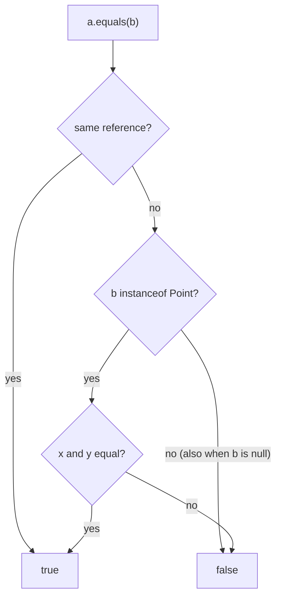
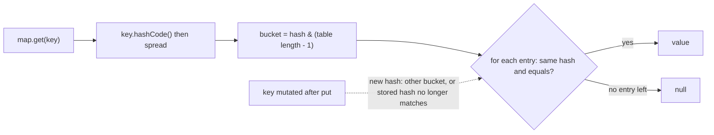
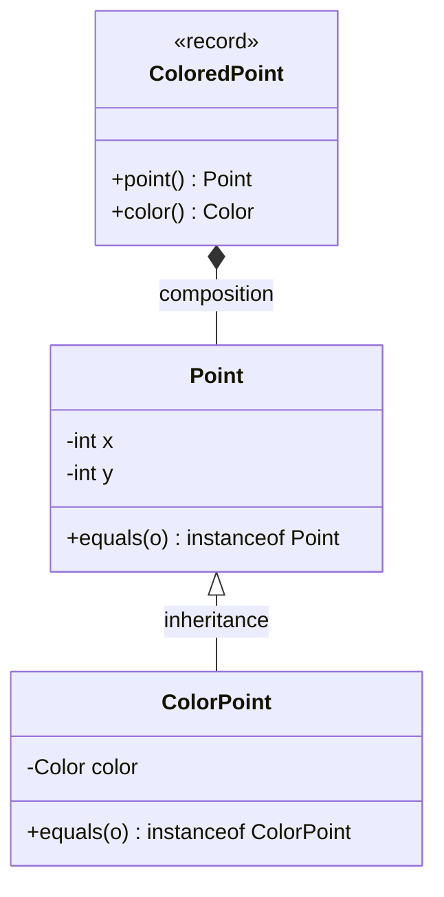
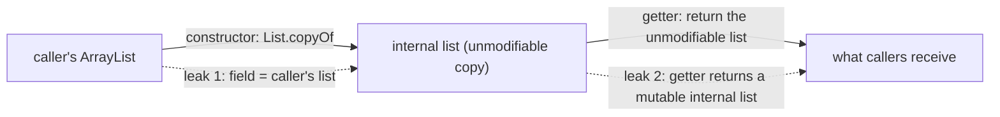

# 02. Equality, immutability and records

> **What this covers:** what it means for two Java objects to be the same: identity versus equality, the `equals` and `hashCode` contracts and what hash collections do when a class breaks them, equality across inheritance, and ordering with `Comparable` and `Comparator`. Then how to build values that cannot change: immutability, records, builders and withers, and the value-based classes whose identity you must not rely on.
> **Prerequisites:** [01. Java OOP fundamentals § 7. Inheritance, composition and `Object`](01-java-oop-fundamentals.md#7-inheritance-composition-and-object), [§ 13. Wrappers, autoboxing and the `Integer` cache](01-java-oop-fundamentals.md#13-wrappers-autoboxing-and-the-integer-cache)
> **Leads to:** [04. Collections internals](04-java-collections-internals.md), [07. Modern language features](07-java-modern-language-features.md)
> **Applies to:** Java 25
> **Study time:** ~5 hours reading + ~3 hours exercises
> **Short on time:** [2. `hashCode` and hash-based collections](#2-hashcode-and-hash-based-collections), [4. Ordering: `Comparable` and `Comparator`](#4-ordering-comparable-and-comparator), [6. Records](#6-records); questions [Q02.03](#q02-03), [Q02.06](#q02-06), [Q02.12](#q02-12), [Q02.14](#q02-14), [Q02.19](#q02-19); then [Summary](#summary).
> **Labs:** [`labs/java-language/`](../labs/java-language/), package `dev.interview.javalanguage.m02`. Run: `JAVA_HOME=$(/usr/libexec/java_home -v 25) mvn -q -f java-backend-guide/labs/pom.xml -pl java-language -am verify`. Needs Docker: no.

## Contents

1. [Identity vs equality and the `equals` contract](#1-identity-vs-equality-and-the-equals-contract)
2. [`hashCode` and hash-based collections](#2-hashcode-and-hash-based-collections)
3. [Equality across a class hierarchy](#3-equality-across-a-class-hierarchy)
4. [Ordering: `Comparable` and `Comparator`](#4-ordering-comparable-and-comparator)
5. [Immutability](#5-immutability)
6. [Records](#6-records)
7. [Building immutable objects: builders, withers and Lombok](#7-building-immutable-objects-builders-withers-and-lombok)
8. [Value-based classes and identity](#8-value-based-classes-and-identity)
- [Summary](#summary)
- [Question bank](#question-bank)
- [Hands-on exercises](#hands-on-exercises)
- [Check your understanding](#check-your-understanding)
- [Connections](#connections)

## 1. Identity vs equality and the `equals` contract
### The problem it solves

A booking service keeps the seats already sold in a `List<Seat>`. A second request for row 4, seat 12 builds a new `Seat`, asks `sold.contains(seat)`, gets `false`, and sells the seat twice. Nothing throws. `contains` asked the new object whether it equals each stored one, and `Seat` never said what "the same seat" means, so the answer was "only if it is the very same object". Every lookup in the JDK collections (`contains`, `indexOf`, `remove`, every `Set` and `Map`) goes through `equals(Object)`, so a class that gets it wrong produces silent duplicates and failed removals, not errors.

### Mental model

Identity asks "is this the same object?"; equality asks "do these two objects stand for the same value?". Two printed copies of one train ticket are two pieces of paper and one booking. `==` on references compares the paper. `equals` compares what is printed, but only once the class says which printed fields count; `Object.equals` does not know, so it compares the paper too.



What to notice: `null` needs no branch of its own, because `instanceof` is `false` for `null`, and only the last step encodes what the value means.

### How it actually works

**`==` on references.** With two reference operands, `==` is `true` only when both are `null` or both refer to the same object or array; it never calls a method [Doc: JLS 25 §15.21.3](https://docs.oracle.com/javase/specs/jls/se25/html/jls-15.html#jls-15.21.3). On primitives it compares values, and with one primitive and one wrapper operand it unboxes ([01 §13](01-java-oop-fundamentals.md#13-wrappers-autoboxing-and-the-integer-cache)).

**`Object.equals` is identity.** Its body is `return (this == obj);`, which its Javadoc calls "the most discriminating possible equivalence relation" [Src: JDK 25, java.lang.Object](https://github.com/openjdk/jdk/blob/jdk-25-ga/src/java.base/share/classes/java/lang/Object.java). A class keeps that until it overrides `equals`. `String`, the wrappers, the `List`, `Set` and `Map` implementations and records override it to compare content; a record's implicit `equals` compares each component, reference components with `Objects.equals` and primitive ones with the wrapper's `compare` [Src: JDK 25, java.lang.Record](https://github.com/openjdk/jdk/blob/jdk-25-ga/src/java.base/share/classes/java/lang/Record.java) [Lab: IdentityAndEqualityTest](../labs/java-language/src/test/java/dev/interview/javalanguage/m02/s01/IdentityAndEqualityTest.java). Two everyday types do not override it. Arrays have the members of `Object` apart from `clone` [Doc: JLS 25 §10.7](https://docs.oracle.com/javase/specs/jls/se25/html/jls-10.html#jls-10.7), so compare them with `Arrays.equals`, or `Arrays.deepEquals` when they nest. `StringBuilder` "does not override equals" and is `Comparable` instead [Changed in Java 11: `StringBuilder` implements `Comparable`] [Src: JDK 25, java.lang.StringBuilder](https://github.com/openjdk/jdk/blob/jdk-25-ga/src/java.base/share/classes/java/lang/StringBuilder.java), so compare builders with `compareTo` or `String.contentEquals` [Lab: IdentityAndEqualityTest](../labs/java-language/src/test/java/dev/interview/javalanguage/m02/s01/IdentityAndEqualityTest.java).

**The contract.** The `Object.equals` Javadoc requires an equivalence relation on non-null references: *reflexive* (`x.equals(x)`), *symmetric* (`x.equals(y)` exactly when `y.equals(x)`), *transitive* (`x` equals `y` and `y` equals `z` imply `x` equals `z`), *consistent* (repeated calls agree while the compared fields do not change), and `x.equals(null)` is `false` [Doc: Java 25 API, Object.equals](https://docs.oracle.com/en/java/javase/25/docs/api/java.base/java/lang/Object.html#equals(java.lang.Object)). Nothing checks it at run time. The collections simply assume it: `ArrayList.contains(o)` is defined as "at least one element `e` such that `Objects.equals(o, e)`" [Src: JDK 25, java.util.ArrayList](https://github.com/openjdk/jdk/blob/jdk-25-ga/src/java.base/share/classes/java/util/ArrayList.java), so with an asymmetric `equals` the answer depends on which object was passed in and which was stored. [§3](#3-equality-across-a-class-hierarchy) shows how inheritance breaks symmetry and transitivity. `Objects.equals(a, b)` is `(a == b) || (a != null && a.equals(b))`, which is why it is safe when either side is `null` [Src: JDK 25, java.util.Objects](https://github.com/openjdk/jdk/blob/jdk-25-ga/src/java.base/share/classes/java/util/Objects.java).

**Overload, not override.** `equals` must take `Object`. `equals(OverloadedPoint other)` has a different signature, so it does not override; it is a second method beside the inherited `equals(Object)` [Doc: JLS 25 §8.4.8.1](https://docs.oracle.com/javase/specs/jls/se25/html/jls-8.html#jls-8.4.8.1). Which overload runs is chosen at compile time from the static argument types [Doc: JLS 25 §15.12.2](https://docs.oracle.com/javase/specs/jls/se25/html/jls-15.html#jls-15.12.2). So `a.equals(b)` with both declared as `OverloadedPoint` calls the overload and returns `true`, while `a.equals((Object) b)`, `List.contains` and `HashSet.contains` call `equals(Object)`, still identity, and return `false`, even though the class's `hashCode` is correct [Lab: IdentityAndEqualityTest](../labs/java-language/src/test/java/dev/interview/javalanguage/m02/s01/IdentityAndEqualityTest.java). The JLS uses this very mistake to motivate `@Override` [Doc: JLS 25 §9.6.4.4](https://docs.oracle.com/javase/specs/jls/se25/html/jls-9.html#jls-9.6.4.4); with the annotation, javac rejects the overload with `compiler.err.method.does.not.override.superclass` [Lab: OverrideRulesTest](../labs/java-language/src/test/java/dev/interview/javalanguage/m01/s08/OverrideRulesTest.java). Overloading and dispatch in general are in [01 §8](01-java-oop-fundamentals.md#8-polymorphism-overloading-overriding-and-dispatch).

### Code

`Point` follows the flowchart.

1. Return `true` early for the same reference: it is cheap and makes reflexivity obvious.
2. Use a type pattern: `instanceof Point that` rejects `null` and other types, and binds the cast in the same step.
3. Compare every field that defines the value, and nothing else.
4. Override `hashCode` from the same fields ([§2](#2-hashcode-and-hash-based-collections) explains why that is mandatory).

```java
package dev.interview.javalanguage.m02.s01;

// Module 02 §1: a correct hand-written equals (identity shortcut, type check, field comparison).
public final class Point {

    private final int x;
    private final int y;

    public Point(int x, int y) {
        this.x = x;
        this.y = y;
    }

    public int x() {
        return x;
    }

    public int y() {
        return y;
    }

    @Override
    public boolean equals(Object other) {
        if (this == other) {
            return true;
        }
        if (!(other instanceof Point that)) {
            return false;
        }
        return x == that.x && y == that.y;
    }

    // Section 2 explains why hashCode must agree with equals: equal points must hash equally.
    @Override
    public int hashCode() {
        return 31 * x + y;
    }
}
```
<sub>Source: [labs/java-language/src/main/java/dev/interview/javalanguage/m02/s01/Point.java](../labs/java-language/src/main/java/dev/interview/javalanguage/m02/s01/Point.java)</sub>

`OverloadedPoint` differs only in the parameter type of `equals`, and keeps a correct `hashCode` so that the overload is the only defect:

```java
package dev.interview.javalanguage.m02.s01;

// Module 02 §1: the equals overload trap, a point whose equals(OverloadedPoint) never overrides equals(Object).
public final class OverloadedPoint {

    private final int x;
    private final int y;

    public OverloadedPoint(int x, int y) {
        this.x = x;
        this.y = y;
    }

    // Deliberate bug: overloads equals(Object) instead of overriding it
    public boolean equals(OverloadedPoint other) {
        return x == other.x && y == other.y;
    }

    // Correct on purpose, so the overload is the only defect
    @Override
    public int hashCode() {
        return 31 * x + y;
    }
}
```
<sub>Source: [labs/java-language/src/main/java/dev/interview/javalanguage/m02/s01/OverloadedPoint.java](../labs/java-language/src/main/java/dev/interview/javalanguage/m02/s01/OverloadedPoint.java)</sub>

Tests: [Lab: IdentityAndEqualityTest](../labs/java-language/src/test/java/dev/interview/javalanguage/m02/s01/IdentityAndEqualityTest.java) asserts the five clauses over a fixed sample of points, and the collection results of both classes.

### Failure modes and operations

A broken `equals` never throws. It shows up as collection results that look like bad data: `contains` returns `false` for a value that is there [Lab: IdentityAndEqualityTest](../labs/java-language/src/test/java/dev/interview/javalanguage/m02/s01/IdentityAndEqualityTest.java), so a list de-duplicated with `contains` keeps its duplicates, and `ArrayList.remove(Object)` and `indexOf` miss the element too, because they use the same `Objects.equals` test [Src: JDK 25, java.util.ArrayList](https://github.com/openjdk/jdk/blob/jdk-25-ga/src/java.base/share/classes/java/util/ArrayList.java). Load does not change the outcome, since the same call fails at any request rate; volume only makes it visible, as sets and caches that keep growing with "new" equal elements ([§2](#2-hashcode-and-hash-based-collections) has that incident). The cost side is real: `equals` runs on every lookup and on every element a `List` scans, so an `equals` that compares large collections or touches lazily loaded state makes each `contains` expensive; compare the cheap, most discriminating fields first. To catch the defect, a unit test that stores two equal instances in a `List` and a `HashSet` is enough; in a running service, a class histogram (taken as in [§2](#2-hashcode-and-hash-based-collections) Failure modes) showing far more instances of a value type than expected is the usual clue ([10](10-jvm-performance-and-troubleshooting.md) covers the tool).

### Best practices and anti-patterns

- Override `equals` only for value-like classes (money, coordinates, ids), because services and entities are identified by who they are, not by their fields; entity equality is in [23](23-jpa-hibernate-fundamentals.md).
- Annotate `equals(Object)` with `@Override`, because the compiler then rejects an `equals(Point)` overload.
- Make a value class `final`, or read [§3](#3-equality-across-a-class-hierarchy) first, because a subclass that adds fields breaks symmetry or transitivity.
- Base `equals` only on fields that do not change while the object sits in a collection, because the consistency clause holds only while the compared fields stay the same.
- Use `Objects.equals(a, b)` when either side may be `null`, because `a.equals(b)` throws `NullPointerException` when `a` is `null`.
- Compare arrays with `Arrays.equals` or `Arrays.deepEquals`, because an array's `equals` is identity.
- Avoid `==` on `String` or wrapper values, because it compares references and passes only when the JVM happens to share an instance (the string pool is in [06](06-java-exceptions-strings-io.md), the `Integer` cache in [01 §13](01-java-oop-fundamentals.md#13-wrappers-autoboxing-and-the-integer-cache)).
- **Security:** compare secrets such as MAC tags or token digests with `MessageDigest.isEqual`, not `Arrays.equals`, because its time depends only on the length of the first array, not on where the bytes differ, so it does not leak how much of a guess was right [Src: JDK 25, java.security.MessageDigest](https://github.com/openjdk/jdk/blob/jdk-25-ga/src/java.base/share/classes/java/security/MessageDigest.java).

### Misconceptions and traps

- *"`==` compares values for objects."* It compares values only for primitives; for references it compares identity. The myth survives because `==` on small `Integer` values and on string literals often prints `true`, since the JVM shares those instances ([Q01.28](01-java-oop-fundamentals.md#q01-28) is the production version).
- *"Every class should override `equals`."* Only classes whose instances stand for values. The myth comes from code generators and IDE templates that add `equals` everywhere, which is wrong for entities with generated ids ([23](23-jpa-hibernate-fundamentals.md)).
- *"`equals(Point)` is a more type-safe `equals`."* It is an overload that collections never call. It looks right because a direct call with two `Point` variables returns `true`, which is the case most hand tests try.
- *"`StringBuilder` compares by content."* It inherits identity `equals`. The myth exists because `String` and `StringBuilder` look interchangeable, and since Java 11 `compareTo` does compare content.
- *"`x.equals(null)` may throw."* The contract says it returns `false`, and `instanceof` gives that for free; the myth comes from older `equals` templates that cast before checking.

Questions that drill this section: [Q02.01](#q02-01), [Q02.02](#q02-02), [Q02.03](#q02-03), [Exercise 02.3](#ex02-3).

## 2. `hashCode` and hash-based collections
### The problem it solves

A pricing service caches quotes in a `HashMap<QuoteKey, Quote>`. Someone adds a correct `equals` to `QuoteKey` and forgets `hashCode`. Tests still pass, because they reuse the same key object. In production every request builds a new, equal key, the cache misses every time, and it keeps growing until the heap fills. A hash-based collection trusts two methods together: `hashCode` decides where to look and `equals` decides what matches. If they disagree, the collection silently looks in the wrong place.

### Mental model

A hash table is a cloakroom with numbered hooks. `hashCode` is the number on your ticket and `equals` is recognizing your coat on the hook. Two equal coats with different ticket numbers are looked for on different hooks, so the second one is never found. And if you change your coat after hanging it, so its number changes, the attendant goes to a hook where it never was.



What to notice: `equals` only runs on entries whose stored hash matches, so a key with the wrong hash never reaches `equals` at all.

### How it actually works

**The contract.** `hashCode` must return the same value on repeated calls while the fields used by `equals` do not change, equal objects must have equal hash codes, and unequal objects may collide, although distinct values "may improve the performance of hash tables" [Doc: Java 25 API, Object.hashCode](https://docs.oracle.com/en/java/javase/25/docs/api/java.base/java/lang/Object.html#hashCode()). The value need not be the same in the next run of the program, so never persist it or send it over the wire. `Object.hashCode` returns distinct integers for distinct objects "as far as is reasonably practical", which is why a class that overrides only `equals` hashes equal instances apart.

**What `HashMap` does with it.** `HashMap` picks the bucket from the key's hash, and `getNode` returns the first entry in that bucket whose stored hash equals the lookup hash and whose key is `==` or `equals` to the lookup key [Src: JDK 25, java.util.HashMap](https://github.com/openjdk/jdk/blob/jdk-25-ga/src/java.base/share/classes/java/util/HashMap.java). `HashSet` stores its elements as the keys of a `HashMap`, so it behaves the same [Src: JDK 25, java.util.HashSet](https://github.com/openjdk/jdk/blob/jdk-25-ga/src/java.base/share/classes/java/util/HashSet.java). Two consequences follow from that check:
- `equals` without `hashCode`: two equal `NoHashPoint` objects are one element only when their identity hash codes happen to match; in the lab, `contains` of a fresh equal point is true exactly when the hash codes are equal, over 1,000 pairs [Lab: HashContractTest](../labs/java-language/src/test/java/dev/interview/javalanguage/m02/s02/HashContractTest.java).
- a mutable key: after `put`, the entry keeps the hash computed at insertion. Changing a field that `hashCode` reads makes the entry unreachable: `get` misses with the same object, with a key equal to the old value and with one equal to the new value, and `containsKey` and `remove` miss too, while `size()` stays 1 and `containsValue` still finds the value [Lab: HashContractTest](../labs/java-language/src/test/java/dev/interview/javalanguage/m02/s02/HashContractTest.java).

The bucket array, resizing and load factor are [04](04-java-collections-internals.md)'s subject.

**Collisions and tree bins.** When an entry is added to a bucket that already holds `TREEIFY_THRESHOLD` (8) entries, the bucket becomes a tree ordered by hash and, for ties, by `compareTo` when the keys share one `Comparable` class, unless the table is smaller than `MIN_TREEIFY_CAPACITY` (64), in which case the table is resized instead [Src: JDK 25, java.util.HashMap](https://github.com/openjdk/jdk/blob/jdk-25-ga/src/java.base/share/classes/java/util/HashMap.java). The source promises O(log n) only "when keys either have distinct hashes or are orderable", so a constant `hashCode` on a key that is not `Comparable` still scans every entry; [04](04-java-collections-internals.md) covers bins, resizing and treeification in depth.

**Writing and caching a hash.** `Objects.hash(a, b)` is `Arrays.hashCode(values)` over a varargs array, so each call allocates an array and boxes primitive arguments [Src: JDK 25, java.util.Objects](https://github.com/openjdk/jdk/blob/jdk-25-ga/src/java.base/share/classes/java/util/Objects.java); it computes `31 * (31 * 1 + a) + b`, not the hand-written `31 * a + b`, and both are valid [Lab: HashContractTest](../labs/java-language/src/test/java/dev/interview/javalanguage/m02/s02/HashContractTest.java). An immutable class can cache its hash: `String` stores it in a `hash` field on first use, plus a `hashIsZero` flag so that a real hash of 0 is not recomputed each time [Src: JDK 25, java.lang.String](https://github.com/openjdk/jdk/blob/jdk-25-ga/src/java.base/share/classes/java/lang/String.java). Caching is safe only when the fields can never change.

### Code

`Sku` is the mutable key, kept as the defect. The fix is an immutable key: see Best practices below, [§5](#5-immutability) and [§6](#6-records).

1. Keep `code` non-final and add a setter, as a mutable JavaBean would.
2. Base `equals` and `hashCode` on `code`, which is correct on its own.
3. In the test, put the key, change its code, and probe the map every way a caller could.

```java
package dev.interview.javalanguage.m02.s02;

import java.util.Objects;

// Module 02 §2: a mutable key, the defect on purpose. equals and hashCode read code, and setCode changes it.
public final class Sku {

    private String code;

    public Sku(String code) {
        this.code = code;
    }

    public String code() {
        return code;
    }

    public void setCode(String code) {
        this.code = code;
    }

    @Override
    public boolean equals(Object other) {
        if (this == other) {
            return true;
        }
        if (!(other instanceof Sku that)) {
            return false;
        }
        return Objects.equals(code, that.code);
    }

    @Override
    public int hashCode() {
        return Objects.hashCode(code);
    }
}
```
<sub>Source: [labs/java-language/src/main/java/dev/interview/javalanguage/m02/s02/Sku.java](../labs/java-language/src/main/java/dev/interview/javalanguage/m02/s02/Sku.java)</sub>

The test probes the map after the mutation (excerpt):

```java
// Excerpt of labs/java-language/src/test/java/dev/interview/javalanguage/m02/s02/HashContractTest.java
    private static final String CODE_A = "A";
    private static final String CODE_B = "B";
    private static final int STORED_VALUE = 10;

    @Test
    @DisplayName("M02 §2 · a mutated key is not found by get but is still in the map")
    void hashMap_losesMutatedKey_whileEntryRemains() {
        Sku key = new Sku(CODE_A);
        assertThat(Objects.hashCode(CODE_A)).isNotEqualTo(Objects.hashCode(CODE_B));
        Map<Sku, Integer> map = new HashMap<>();
        map.put(key, STORED_VALUE);

        key.setCode(CODE_B);

        assertThat(map.get(key)).isNull();
        assertThat(map.get(new Sku(CODE_A))).isNull();
        assertThat(map.get(new Sku(CODE_B))).isNull();
        assertThat(map.containsKey(key)).isFalse();
        assertThat(map).hasSize(1);
        assertThat(map.containsValue(STORED_VALUE)).isTrue();
        assertThat(map.keySet().stream().anyMatch(sku -> CODE_B.equals(sku.code())))
                .isTrue();
        assertThat(map.remove(key)).isNull();
        assertThat(map).hasSize(1);
    }
```

### Failure modes and operations

Both failures are silent. A missing `hashCode` or a mutated key turns a cache or a de-duplicating set into a store that only grows: entries that no lookup reaches are still strongly referenced by the map, so they are a memory leak, not a cache miss alone [Lab: HashContractTest](../labs/java-language/src/test/java/dev/interview/javalanguage/m02/s02/HashContractTest.java). Under load the leak grows with the request rate, and the hit rate stays near zero however large the map gets. A low-entropy hash (a constant, a field with few values) fails differently: results stay correct, but each lookup scans a long chain, so latency grows with the map size; tree bins bound it only for `Comparable` keys or distinct hashes [Src: JDK 25, java.util.HashMap](https://github.com/openjdk/jdk/blob/jdk-25-ga/src/java.base/share/classes/java/util/HashMap.java). What to observe: the cache's size and hit-rate metrics (a size that tracks request count is the signal), and a class histogram (`jcmd <pid> GC.class_histogram`) in which the key class and `HashMap$Node` grow together [Doc: jcmd, Java 25](https://docs.oracle.com/en/java/javase/25/docs/specs/man/jcmd.html). Restarting hides the leak for a while, which is why it often looks like a slow, periodic memory problem rather than a bug.

> [!IMPORTANT]
> **Production scenario: session lookups slow down as the map grows, with correct results.** *As the interviewer frames it:* "After someone added a `hashCode` to `SessionKey` to silence a code-quality warning, the p99 latency of every request climbs through the day, in step with the number of active sessions. No errors, the heap is flat, and a restart brings latency back down."
> **Reasoning.** Correct results with a latency that tracks the map's size point at collisions, not at a leak: every lookup still finds its entry, but only after scanning one long bucket. Evidence: a CPU profile in which `HashMap.getNode` (and `TreeNode.find`, once a bin has become a tree) dominates the request; a `hashCode` that reads a field with few values, such as the tenant id, while `equals` compares the session id too; and a count of distinct hash codes over a sample of live keys that comes out at a handful. Tree bins cap the damage only when the keys are `Comparable` or their hashes differ, so a constant-like hash on a non-`Comparable` key degrades towards a linear scan [Src: JDK 25, java.util.HashMap](https://github.com/openjdk/jdk/blob/jdk-25-ga/src/java.base/share/classes/java/util/HashMap.java). Fix: hash the same fields that `equals` compares, or turn the key into a record ([§6](#6-records)). Prevention: a test that builds a few thousand distinct keys and asserts that their hash codes are mostly distinct. [Q02.08](#q02-08) drills the other side of the contract, a key whose equal instances stop sharing a hash.

> [!NOTE]
> **Version notes.** Java 7 and earlier: a bucket was always a linked list, so many colliding keys made lookups O(n). Java 8: buckets that grow past the threshold become balanced trees, worst case O(log n) for keys with distinct hashes or `Comparable` keys, with no API change [Changed in Java 8: tree bins in `HashMap`] [Doc: JEP 180](https://openjdk.org/jeps/180).

### Best practices and anti-patterns

- Override `hashCode` whenever you override `equals`, from the same fields, because equal objects with different hashes are looked up in different buckets.
- Use immutable keys (final fields, or a record), because the map keeps the hash computed at insertion and a changed key becomes unreachable.
- Never put a field into `hashCode` that `equals` ignores, because two equal objects could then hash differently; leaving a field out is allowed and only costs collisions.
- Use `Objects.hash` for readability in ordinary classes, and a hand-written `31 * h + field` in hot paths, because `Objects.hash` allocates an array and boxes primitives on every call.
- Cache the hash only in immutable classes, because a cached hash in a mutable class goes stale on the first change.
- Do not use `hashCode` as an identifier, a database key or a persisted value, because unequal objects may collide and the value may differ between runs.
- **Security:** keep untrusted keys, such as request parameter names or JSON field names, in maps of `Comparable` keys like `String`, and cap how many keys one request may add, because crafted collisions put all keys in one bucket; tree bins bound the cost to O(log n) only for `Comparable` keys [Src: JDK 25, java.util.HashMap](https://github.com/openjdk/jdk/blob/jdk-25-ga/src/java.base/share/classes/java/util/HashMap.java).

### Misconceptions and traps

- *"Unequal objects must have different hash codes."* The contract allows collisions; only equal objects must match. The myth exists because good hash functions make collisions rare enough to look forbidden.
- *"If `equals` is right, hash collections work."* They check the hash first, so `equals` never runs for a key in the wrong bucket. It looks true in tests that reuse one key object, which `==` matches.
- *"Hash collisions make `HashMap` O(n)."* Once true: until Java 7 every bucket was a list. Now: tree bins give O(log n) for keys with distinct hashes or `Comparable` keys [Changed in Java 8: tree bins in `HashMap`]; a constant hash on non-`Comparable` keys is still linear.
- *"`hashCode` is the object's memory address."* The Javadoc promises only distinct values "as far as is reasonably practical", never an address. The myth comes from the default `toString`, whose hex number after `@` is the hash code [Src: JDK 25, java.lang.Object](https://github.com/openjdk/jdk/blob/jdk-25-ga/src/java.base/share/classes/java/lang/Object.java).

Questions that drill this section: [Q02.04](#q02-04), [Q02.05](#q02-05), [Q02.06](#q02-06), [Q02.07](#q02-07), [Q02.08](#q02-08), [Exercise 02.1](#ex02-1).

## 3. Equality across a class hierarchy
### The problem it solves

A team gives a subclass of `Point` a new `color` field and its own `equals`. A de-duplication step that checks `seen.contains(candidate)` on a `List` now keeps or drops the same pair of values depending on which one arrived first: with the plain point stored, the colored point counts as new; with the colored point stored, the plain point counts as a duplicate. Nothing throws and nothing logs; the result depends on argument order, because `point.equals(colorPoint)` is `true` while `colorPoint.equals(point)` is `false` [Lab: HierarchyEqualityTest](../labs/java-language/src/test/java/dev/interview/javalanguage/m02/s03/HierarchyEqualityTest.java).

### Mental model

`equals` is a verdict that two objects must reach together, not a method of one of them: whichever side is asked, the answer must be the same ([§1](#1-identity-vs-equality-and-the-equals-contract)). A subclass that adds a field to equality is a stricter judge joining the panel. The old judge says "same coordinates, same point", the new one says "different color", and the verdict depends on who is asked. There are three ways out: the stricter judge adds nothing to equality (a `final` `equals` in the base), judges from different classes never compare (`getClass()`), or the colored point stops *being* a point and *has* one (composition).



What to notice: inheritance puts every `ColorPoint` inside the domain of `Point.equals`, so the two `equals` methods must agree with each other; composition keeps `ColoredPoint` outside it, so each class answers only about its own kind.

### How it actually works

`o instanceof Point other` is true for any instance of `Point` or of a subclass [Doc: JLS 25 §15.20.2](https://docs.oracle.com/javase/specs/jls/se25/html/jls-15.html#jls-15.20.2), so `Point.equals` accepts a `ColorPoint` and compares coordinates only. `ColorPoint.equals` tests `instanceof ColorPoint`, which a plain `Point` fails, so the reverse call returns `false`: symmetry is gone. `ArrayList.contains(o)` evaluates `o.equals(element)` [Src: JDK 25, java.util.ArrayList](https://github.com/openjdk/jdk/blob/jdk-25-ga/src/java.base/share/classes/java/util/ArrayList.java), so the argument's class decides the answer, which is the order dependence of the opening example [Lab: HierarchyEqualityTest](../labs/java-language/src/test/java/dev/interview/javalanguage/m02/s03/HierarchyEqualityTest.java).

The usual patch, `SymmetricColorPoint`, compares coordinates only when the other object is a plain `Point`. That restores symmetry and breaks transitivity: a red point equals the plain point, the plain point equals a blue point, and red does not equal blue. The patch also cannot put `color` into `hashCode`: the red point equals the plain point, so the contract forces their hash codes to match, and the color stays invisible to hash collections [Lab: HierarchyEqualityTest](../labs/java-language/src/test/java/dev/interview/javalanguage/m02/s03/HierarchyEqualityTest.java). This is not a weakness of one implementation. If two subclass instances that differ only in the new field must both equal the same base instance, transitivity forces them to equal each other, which contradicts the new field; so no subclass can add a field to equality and still be equal to base instances. The clauses are those of the `Object.equals` contract [Doc: Object.equals, Java 25](https://docs.oracle.com/en/java/javase/25/docs/api/java.base/java/lang/Object.html#equals(java.lang.Object)).

`getClass()`-based `equals` returns `false` unless both objects have exactly the same runtime class. That keeps the contract within each class but rejects every subclass, including one that adds no state: in the lab, an anonymous subclass `new GetClassPoint(1, 2) {}` never equals `new GetClassPoint(1, 2)`, while the same experiment with the `instanceof`-based `Point` gives equality both ways [Lab: HierarchyEqualityTest](../labs/java-language/src/test/java/dev/interview/javalanguage/m02/s03/HierarchyEqualityTest.java). Code written against the base type (the Liskov substitution principle: a subclass instance must work wherever a base instance does) then fails, for example a set of base points that never finds an equal subclass point. Classes generated at runtime as subclasses, such as proxies and mocks, hit the same wall; proxies of JPA entities are module [23](23-jpa-hibernate-fundamentals.md)'s topic.

Composition avoids the conflict. `ColoredPoint` is a record that holds a `Point` and a `Color`; it is not a `Point`, so `instanceof Point` is false for it, and its generated `equals` is true only for an instance of the same record class with equal components [Src: JDK 25, java.lang.Record](https://github.com/openjdk/jdk/blob/jdk-25-ga/src/java.base/share/classes/java/lang/Record.java). Over the lab's mixed sample of points and colored points, reflexivity, symmetry, transitivity and equal hash codes for equal objects all hold [Lab: HierarchyEqualityTest](../labs/java-language/src/test/java/dev/interview/javalanguage/m02/s03/HierarchyEqualityTest.java). A record class is implicitly `final` [Doc: JLS 25 §8.10](https://docs.oracle.com/javase/specs/jls/se25/html/jls-8.html#jls-8.10), so no subclass can reopen the problem; a `final` class has the same effect.

`Timestamp` shows the asymmetry in the JDK. `Date.equals` accepts any `Date` and compares `getTime()` [Src: JDK 25, java.util.Date](https://github.com/openjdk/jdk/blob/jdk-25-ga/src/java.base/share/classes/java/util/Date.java); `Timestamp.equals(Object)` returns `true` only for another `Timestamp`, because a `Date` has no nanosecond part to compare. Its class documentation recommends not treating `Timestamp` values as `Date` values and calls the relationship implementation inheritance, not type inheritance [Src: JDK 25, java.sql.Timestamp](https://github.com/openjdk/jdk/blob/jdk-25-ga/src/java.sql/share/classes/java/sql/Timestamp.java). In the lab, `new Date(1_000L).equals(new Timestamp(1_000L))` is `true` and the reverse call is `false` [Lab: HierarchyEqualityTest](../labs/java-language/src/test/java/dev/interview/javalanguage/m02/s03/HierarchyEqualityTest.java).

### Code

Approach: one class per option, each pinned by a test that checks the clauses across base and subclass instances, not within one class only.

1. `Point` uses `instanceof`, so subclasses are accepted.
2. `ColorPoint` adds `color` to equality: the asymmetric version.
3. `SymmetricColorPoint` is the patch: symmetric, not transitive, and its `hashCode` must stay `Point`'s.
4. `ColoredPoint` is the composition that keeps the contract.
5. The test compares in both directions and through `ArrayList.contains`.

```java
package dev.interview.javalanguage.m02.s03;

/** Module 02 §3: the non-final base class whose instanceof equals every subclass has to live with. */
public class Point {

    private final int x;
    private final int y;

    public Point(int x, int y) {
        this.x = x;
        this.y = y;
    }

    public int x() {
        return x;
    }

    public int y() {
        return y;
    }

    @Override
    public boolean equals(Object o) {
        if (this == o) {
            return true;
        }
        if (!(o instanceof Point other)) {
            return false;
        }
        return x == other.x && y == other.y;
    }

    @Override
    public int hashCode() {
        return 31 * x + y;
    }
}
```
<sub>Source: [labs/java-language/src/main/java/dev/interview/javalanguage/m02/s03/Point.java](../labs/java-language/src/main/java/dev/interview/javalanguage/m02/s03/Point.java)</sub>

```java
package dev.interview.javalanguage.m02.s03;

import java.util.Objects;

/** Module 02 §3: a subclass that adds a field and keeps instanceof equals, which makes equals asymmetric. */
public class ColorPoint extends Point {

    private final Color color;

    public ColorPoint(int x, int y, Color color) {
        super(x, y);
        this.color = Objects.requireNonNull(color);
    }

    public Color color() {
        return color;
    }

    @Override
    public boolean equals(Object o) {
        return o instanceof ColorPoint other && super.equals(other) && color == other.color;
    }

    @Override
    public int hashCode() {
        return 31 * super.hashCode() + color.hashCode();
    }
}
```
<sub>Source: [labs/java-language/src/main/java/dev/interview/javalanguage/m02/s03/ColorPoint.java](../labs/java-language/src/main/java/dev/interview/javalanguage/m02/s03/ColorPoint.java)</sub>

```java
package dev.interview.javalanguage.m02.s03;

import java.util.Objects;

/** Module 02 §3: the symmetric patch for ColorPoint, which restores symmetry but breaks transitivity. */
public class SymmetricColorPoint extends Point {

    private final Color color;

    public SymmetricColorPoint(int x, int y, Color color) {
        super(x, y);
        this.color = Objects.requireNonNull(color);
    }

    public Color color() {
        return color;
    }

    @Override
    public boolean equals(Object o) {
        if (!(o instanceof Point)) {
            return false;
        }
        if (!(o instanceof SymmetricColorPoint other)) {
            return super.equals(o);
        }
        return super.equals(other) && color == other.color;
    }

    // No hashCode override: this class equals plain Points, so its hash must match Point's.
}
```
<sub>Source: [labs/java-language/src/main/java/dev/interview/javalanguage/m02/s03/SymmetricColorPoint.java](../labs/java-language/src/main/java/dev/interview/javalanguage/m02/s03/SymmetricColorPoint.java)</sub>

```java
package dev.interview.javalanguage.m02.s03;

import java.util.Objects;

/** Module 02 §3: the composition fix, which holds a Point instead of extending it and keeps all three equals clauses. */
public record ColoredPoint(Point point, Color color) {

    public ColoredPoint {
        Objects.requireNonNull(point);
        Objects.requireNonNull(color);
    }
}
```
<sub>Source: [labs/java-language/src/main/java/dev/interview/javalanguage/m02/s03/ColoredPoint.java](../labs/java-language/src/main/java/dev/interview/javalanguage/m02/s03/ColoredPoint.java)</sub>

The test checks both directions, then the same pair through `ArrayList.contains`:

```java
// Excerpt of labs/java-language/src/test/java/dev/interview/javalanguage/m02/s03/HierarchyEqualityTest.java
class HierarchyEqualityTest {

    private static final int X = 1;
    private static final int Y = 2;

    @Test
    @DisplayName("M02 §3 · instanceof equals in a subclass with an extra field is asymmetric")
    void equals_isAsymmetric_whenSubclassAddsFieldWithInstanceofCheck() {
        Point point = new Point(X, Y);
        ColorPoint colorPoint = new ColorPoint(X, Y, Color.RED);
        List<Point> holdingColorPoint = new ArrayList<>();
        holdingColorPoint.add(colorPoint);
        List<Point> holdingPoint = new ArrayList<>();
        holdingPoint.add(point);

        assertThat(point.equals(colorPoint)).isTrue();
        assertThat(colorPoint.equals(point)).isFalse();
        assertThat(holdingColorPoint.contains(point)).isTrue();
        assertThat(holdingPoint.contains(colorPoint)).isFalse();
    }
}
```

### Failure modes and operations

A pure-language topic: no load, configuration or deployment dimension. The one runtime symptom is order dependence: with an asymmetric `equals`, `contains`, `indexOf` and `remove` on a `List` give answers that depend on which object is the argument, so de-duplication, "already processed" checks and test assertions flip when the data arrive in a different order [Lab: HierarchyEqualityTest](../labs/java-language/src/test/java/dev/interview/javalanguage/m02/s03/HierarchyEqualityTest.java). No metric shows it; only a contract test over mixed base and subclass instances does.

> [!NOTE]
> **Version notes.** Java 8 to 15: `equals` tests `o instanceof Point` and then casts, `Point other = (Point) o;`. Java 16 and later: the pattern `o instanceof Point other` tests and binds in one step, as in this section's code [Final since Java 16, JEP 394] [Doc: JEP 394](https://openjdk.org/jeps/394). The contract and the hierarchy problem are the same in both forms.

### Best practices and anti-patterns

- Use composition when a subtype would add a field to equality, because no subclass `equals` can add a field and stay equal to base instances without breaking symmetry or transitivity.
- Make value classes `final`, or records, because then no subclass exists that could break the contract.
- If a base class must stay extensible, make its `instanceof`-based `equals` and `hashCode` `final`, because subclasses then share one definition and stay substitutable; they just cannot add state to equality.
- Use `getClass()` only when instances of different classes are genuinely different values, because it also rejects subclasses with no extra state, proxies and mocks.
- Test `equals` over a sample that mixes base and subclass instances, in both directions and over triples, because tests inside one class never reach the pairs where the contract breaks.
- Do not mix `Timestamp` and `Date` in one collection or comparison; convert both to `Instant` first, because their `equals` methods disagree.

### Misconceptions and traps

- *"`getClass()` is always the safer choice."* It keeps the contract but gives up substitutability: a subclass with no extra state, a mock or a proxy never equals a base instance. The myth exists because it is the one recipe that cannot break symmetry, so it looks like a safe default.
- *"The symmetric patch fixes the subclass."* It fixes symmetry and breaks transitivity, and it cannot put the new field into `hashCode`. The myth survives because most tests check pairs, never triples.
- *"With enough care, a subclass can add a field to `equals`."* Not while staying equal to base instances: transitivity through the base instance forces the contradiction shown above. Each method looks correct on its own, which is why the attempt keeps reappearing.
- *"JDK classes always honor the `equals` contract."* `Timestamp` documents that it does not, with respect to `Date` (see How it actually works, above). The myth comes from treating the contract as enforced; nothing in the compiler or the JVM checks it.

Questions that drill this section: [Q02.09](#q02-09), [Q02.10](#q02-10), [Exercise 02.3](#ex02-3).

## 4. Ordering: `Comparable` and `Comparator`
### The problem it solves

A monthly report puts customers into a `TreeSet` sorted by name so that the output comes out alphabetical. Two different customers called "Ana Ruiz" arrive; the second `add` returns `false`, and the report is one customer short. No exception, no log line: a sorted collection decides "same element" with the comparator, not with `equals`, so a comparator that looks only at the name declares the two customers duplicates [Lab: OrderingTest](../labs/java-language/src/test/java/dev/interview/javalanguage/m02/s04/OrderingTest.java). Ordering is a second definition of sameness, next to `equals` ([§1](#1-identity-vs-equality-and-the-equals-contract)), and the two must be designed together.

### Mental model

A comparison answers "before, after, or tied?". `Comparable` is the order a class carries with it (its natural ordering: `String` alphabetical, `Integer` numeric); a `Comparator` is an order you hand to an algorithm from outside, so one class can be sorted many ways. Only the sign of the answer matters, and a tie (`0`) is a verdict too: a sorting algorithm keeps tied elements together, while a `TreeSet` or `TreeMap` treats a tie as "this element is already here". The ordering is *consistent with equals* when "tied" and "equal" always coincide; when they do not, sorted collections and hash collections disagree about what is a duplicate.

Think of a race judge who reports only the finishing order. A `TreeSet` is the podium, with one spot per position: in a dead heat the judge says "tied", so the two runners would share one spot, and the second is turned away even though they are different people. A `HashSet` asks a different question, "same runner?", so it keeps both.

| Same two values, different collections | `HashSet` (uses `equals`/`hashCode`) | `TreeSet` (uses `compareTo`/`compare`) |
|---|---|---|
| `new BigDecimal("1.0")`, `new BigDecimal("1.00")` | size 2 | size 1 |
| two customers with the same name, different ids, comparator by name | size 2 | size 1 |
| same customers, comparator by name then id | size 2 | size 2 |

Each row is asserted in the lab [Lab: OrderingTest](../labs/java-language/src/test/java/dev/interview/javalanguage/m02/s04/OrderingTest.java).

### How it actually works

The `Comparator.compare` contract has three clauses: the sign reverses when the arguments swap, `sgn(compare(x, y)) == -sgn(compare(y, x))`; the relation is transitive; and `compare(x, y) == 0` implies that `x` and `y` compare the same way against every `z`. Consistency with `equals` is a separate, weaker request [Src: JDK 25, java.util.Comparator](https://github.com/openjdk/jdk/blob/jdk-25-ga/src/java.base/share/classes/java/util/Comparator.java). For natural orderings the `Comparable` documentation calls it "strongly recommended (though not required)" and names `BigDecimal` as the exception among core classes: `compareTo` equates values with equal numerical value and different representations, such as 4.0 and 4.00, while `equals` also requires the same representation [Doc: Comparable, Java 25](https://docs.oracle.com/en/java/javase/25/docs/api/java.base/java/lang/Comparable.html). The lab confirms it: `1.0` and `1.00` are not `equals`, `compareTo` returns `0`, a `HashSet` keeps both and a `TreeSet` keeps one [Lab: OrderingTest](../labs/java-language/src/test/java/dev/interview/javalanguage/m02/s04/OrderingTest.java).

Why a tree drops the element: `TreeMap` performs every key comparison with `compareTo` (or the comparator's `compare`), so two keys that compare as `0` are, from the map's standpoint, the same key; `put` replaces the value, and `TreeSet`, backed by a map, rejects the `add`. The documentation calls this behavior well-defined: the map only "fails to obey the general contract" of `Map`, which is defined in terms of `equals` [Src: JDK 25, java.util.TreeMap](https://github.com/openjdk/jdk/blob/jdk-25-ga/src/java.base/share/classes/java/util/TreeMap.java) [Src: JDK 25, java.util.TreeSet](https://github.com/openjdk/jdk/blob/jdk-25-ga/src/java.base/share/classes/java/util/TreeSet.java). The cure is a comparator that ends with a unique key: `comparing(Customer::name).thenComparingLong(Customer::id)` keeps both customers [Lab: OrderingTest](../labs/java-language/src/test/java/dev/interview/javalanguage/m02/s04/OrderingTest.java).

The subtraction comparator, `(a, b) -> a.priority() - b.priority()`, returns the right sign only while the difference fits in an `int`. `Integer.MIN_VALUE - 1` overflows to `Integer.MAX_VALUE`, a positive number, so the smallest priority is reported as the larger one and sorts last [Lab: OrderingTest](../labs/java-language/src/test/java/dev/interview/javalanguage/m02/s04/OrderingTest.java). `Integer.compare(x, y)` compares instead of subtracting, `(x < y) ? -1 : ((x == y) ? 0 : 1)`, and cannot overflow [Src: JDK 25, java.lang.Integer](https://github.com/openjdk/jdk/blob/jdk-25-ga/src/java.base/share/classes/java/lang/Integer.java); `Comparator.comparingInt(Job::priority)` uses it and avoids boxing the key.

The `Comparator` combinators build an ordering field by field: `comparing(keyExtractor)` orders by one key, `thenComparing` and its primitive variants break ties with the next key, `reversed()` flips the whole chain, and `nullsFirst`/`nullsLast` wrap a comparator so that `null` keys stop throwing `NullPointerException` and sort at one end [Src: JDK 25, java.util.Comparator](https://github.com/openjdk/jdk/blob/jdk-25-ga/src/java.base/share/classes/java/util/Comparator.java). Where to sort: `List.sort(comparator)` is the instance method since Java 8, and `Collections.sort(list, c)` now just calls `list.sort(c)`; both are stable, so elements that tie keep their input order [Src: JDK 25, java.util.List](https://github.com/openjdk/jdk/blob/jdk-25-ga/src/java.base/share/classes/java/util/List.java) [Src: JDK 25, java.util.Collections](https://github.com/openjdk/jdk/blob/jdk-25-ga/src/java.base/share/classes/java/util/Collections.java). The sorting algorithm itself belongs to module [04](04-java-collections-internals.md); `sorted()` in streams to module [05](05-java-lambdas-streams-optional.md).

### Code

Approach: two records carry their comparators as constants, and one test per claim checks the outcome in a real collection or a real sort.

1. `Job` holds the overflowing subtraction comparator next to its fix.
2. `Customer` holds a name-only comparator, the same with an id tie-breaker, and a chain with a nullable city sorted last.
3. The test adds equal-named customers to both kinds of set and sorts with each comparator.

```java
package dev.interview.javalanguage.m02.s04;

import java.util.Comparator;

/** Module 02 §4: a job whose two comparators show the subtraction overflow defect next to its fix. */
public record Job(String name, int priority) {

    // Kept on purpose as a teaching defect: the difference overflows for large magnitudes, so it misorders MIN_VALUE.
    public static final Comparator<Job> BY_PRIORITY_SUBTRACTION = (a, b) -> a.priority() - b.priority();

    public static final Comparator<Job> BY_PRIORITY = Comparator.comparingInt(Job::priority);
}
```
<sub>Source: [labs/java-language/src/main/java/dev/interview/javalanguage/m02/s04/Job.java](../labs/java-language/src/main/java/dev/interview/javalanguage/m02/s04/Job.java)</sub>

```java
package dev.interview.javalanguage.m02.s04;

import java.util.Comparator;
import java.util.Objects;

/** Module 02 §4: a customer with comparators built by chaining, including a nullable city ordered last. */
public record Customer(long id, String name, String city) {

    public static final Comparator<Customer> BY_NAME = Comparator.comparing(Customer::name);

    public static final Comparator<Customer> BY_NAME_THEN_ID = BY_NAME.thenComparingLong(Customer::id);

    public static final Comparator<Customer> BY_CITY_NULLS_LAST_THEN_NAME = Comparator.comparing(
                    Customer::city, Comparator.nullsLast(Comparator.<String>naturalOrder()))
            .thenComparing(BY_NAME_THEN_ID);

    public Customer {
        Objects.requireNonNull(name);
    }
}
```
<sub>Source: [labs/java-language/src/main/java/dev/interview/javalanguage/m02/s04/Customer.java](../labs/java-language/src/main/java/dev/interview/javalanguage/m02/s04/Customer.java)</sub>

The test pins the duplicate drop and the tie-breaker that cures it:

```java
// Excerpt of labs/java-language/src/test/java/dev/interview/javalanguage/m02/s04/OrderingTest.java
class OrderingTest {

    private static final String BOGOTA = "Bogota";
    private static final String LIMA = "Lima";
    private static final String ANA = "Ana";
    private static final long FIRST_ID = 1L;
    private static final long SECOND_ID = 2L;

    @Test
    @DisplayName("M02 §4 · TreeSet by name drops a second person with the same name")
    void add_rejectsSecondCustomer_whenTreeSetComparesByNameOnly() {
        Customer first = new Customer(FIRST_ID, ANA, LIMA);
        Customer sameName = new Customer(SECOND_ID, ANA, BOGOTA);
        Set<Customer> byName = new TreeSet<>(Customer.BY_NAME);
        Set<Customer> byNameThenId = new TreeSet<>(Customer.BY_NAME_THEN_ID);

        boolean firstAdded = byName.add(first);
        boolean secondAdded = byName.add(sameName);
        byNameThenId.add(first);
        byNameThenId.add(sameName);

        assertThat(firstAdded).isTrue();
        assertThat(secondAdded).isFalse();
        assertThat(byName).hasSize(1);
        assertThat(new HashSet<>(List.of(first, sameName))).hasSize(2);
        assertThat(byNameThenId).hasSize(2);
    }
}
```

### Failure modes and operations

Two failures, both data-dependent. A comparator that ties distinct objects loses data silently in a `TreeSet` or `TreeMap`: counts come out short and a `put` overwrites another key's value; nothing fails until someone reconciles the count against a `HashSet`, a `GROUP BY`, or the source system. A comparator that breaks the contract, for example one that never returns `0`, can make `List.sort` throw `IllegalArgumentException: Comparison method violates its general contract!`; the documentation marks the exception as optional ("if the comparator is found to violate" the contract), so whether it appears depends on the input [Src: JDK 25, java.util.List](https://github.com/openjdk/jdk/blob/jdk-25-ga/src/java.base/share/classes/java/util/List.java) [Src: JDK 25, java.util.TimSort](https://github.com/openjdk/jdk/blob/jdk-25-ga/src/java.base/share/classes/java/util/TimSort.java). In the lab on JDK 25, `(x, y) -> x < y ? -1 : 1` throws on a fixed list of 1,000 values drawn from four distinct numbers [Lab: OrderingTest](../labs/java-language/src/test/java/dev/interview/javalanguage/m02/s04/OrderingTest.java). In production this shows up as an intermittent 500 on one particular data set, often long after the comparator shipped, because small or already sorted inputs never reach the check.

> [!IMPORTANT]
> **Production scenario: an export fails for a few customers with "Comparison method violates its general contract!".** *As the interviewer frames it:* "One export endpoint returns HTTP 500 for a handful of customers, always the same ones, with `IllegalArgumentException: Comparison method violates its general contract!` in the log. The sorting code shipped months ago and its tests pass."
> **Reasoning.** An exception from inside `List.sort` that depends on the customer means the comparator breaks the contract and the sort happened to detect it; the check is optional and input-dependent, so small or already sorted test lists never trigger it [Src: JDK 25, java.util.TimSort](https://github.com/openjdk/jdk/blob/jdk-25-ga/src/java.base/share/classes/java/util/TimSort.java). Evidence: a stack trace that runs through `java.util.TimSort`; a comparator that never returns `0` for equal values, or that subtracts two `int`s whose difference can overflow; and a unit test that replays the failing customer's rows through the comparator and throws. The lab reproduces the pattern with `(x, y) -> x < y ? -1 : 1` on 1,000 values drawn from four numbers [Lab: OrderingTest](../labs/java-language/src/test/java/dev/interview/javalanguage/m02/s04/OrderingTest.java). Fix: build the comparator from `Comparator.comparing`, `comparingInt` or `Integer.compare`, so that ties return `0` and no subtraction can overflow. Prevention: run every comparator's tests on large inputs with many duplicates, not only on a few distinct values. [Q02.14](#q02-14) drills the silent variant, a comparator that ties distinct keys.

### Best practices and anti-patterns

- End every comparator used by a `TreeSet` or `TreeMap` with a unique key, because a tie there means "duplicate".
- Compare numbers with `Integer.compare`, `Long.compare` or `comparingInt`, never by subtraction, because the difference can overflow and flip the sign.
- Build orderings with `comparing(...).thenComparing(...)` instead of hand-written `if` cascades, because each key appears once and the tie-breaking order is readable.
- Wrap nullable keys in `nullsFirst` or `nullsLast`, because a plain `comparing` chain throws `NullPointerException` on the first `null` key.
- Make `compareTo` consistent with `equals` in your own value classes, because then sorted and hash collections agree; when it cannot be (as in `BigDecimal`), document it.
- Use `List.sort(c)` in new code, because `Collections.sort` only forwards to it.

### Misconceptions and traps

- *"`TreeSet` uses `equals` to find duplicates, like every `Set`."* It uses only the comparator; `equals` is never called. The myth comes from the `Set` interface, whose contract is written in terms of `equals`.
- *"`a - b` is the idiomatic comparator."* It is correct only when the difference cannot overflow; with values near `Integer.MIN_VALUE` or `Integer.MAX_VALUE` it returns the wrong sign. It survives because typical test data are small positive numbers.
- *"Consistency with `equals` is part of the `compareTo` contract."* It is recommended, not required; `BigDecimal` breaks it on purpose. The required clauses are sign symmetry, transitivity and consistent ties. The myth comes from the `Comparable` Javadoc, whose "strongly recommended (though not required)" is remembered without its parenthesis [Src: JDK 25, java.lang.Comparable](https://github.com/openjdk/jdk/blob/jdk-25-ga/src/java.base/share/classes/java/lang/Comparable.java).
- *"`Comparable` vs `Comparator` is just one method vs two arguments."* The real difference is ownership: the natural order is part of the class's design and defines how its sorted collections behave by default; a comparator is chosen per use. The myth comes from comparing the two by method signature alone.

Questions that drill this section: [Q02.11](#q02-11), [Q02.12](#q02-12), [Q02.13](#q02-13), [Q02.14](#q02-14), [Exercise 02.1](#ex02-1), [Exercise 02.3](#ex02-3).

## 5. Immutability
### The problem it solves

A configuration object holds the list of allowed currencies, built once at startup and shared by every request. One request handler calls `config.currencies().add("XXX")` while testing a new feature flag, and from then on every request accepts the made-up currency. Nothing in the class has a setter; the field is even `final`. The object changed anyway, because the getter handed out the list it keeps inside. Immutability is the property that rules this out: once constructed, the object's observable state never changes, so it can be shared, cached, used as a map key and passed between threads without anyone having to ask who else holds it.

### Mental model

An immutable object is a sealed envelope: its contents are fixed when it is sealed (the constructor), and every reader sees the same contents for its whole life. The envelope leaks in exactly two places, both through references to mutable objects: the way in, when the constructor keeps the caller's object instead of a copy, and the way out, when a getter returns the internal object instead of a copy or a read-only one. `final` on a field seals the reference, not the object it points to ([01 §10](01-java-oop-fundamentals.md#10-static-final-and-constants)).



What to notice: both leaks are aliasing, two parties holding one mutable object, and both are closed by never letting a mutable reference cross the class boundary in either direction.

### How it actually works

**The recipe.** A class is immutable when (1) it cannot be subclassed into a mutable one (`final` class, or only private constructors), (2) every field is `private final`, (3) no method changes state, (4) mutable inputs are copied in the constructor and mutable internals are never returned as they are, and (5) `this` does not escape during construction. Rule (5) comes from the memory model: "a thread that can only see a reference to an object after that object has been completely initialized is guaranteed to see the correctly initialized values for that object's `final` fields", and the usage model is to set the `final` fields in the constructor and not publish `this` before the constructor finishes [Doc: JLS 25 §17.5](https://docs.oracle.com/javase/specs/jls/se25/html/jls-17.html#jls-17.5). The same section says what this buys: `final` fields "allow programmers to implement thread-safe immutable objects without synchronization", even when a data race passes the reference between threads. Publication and the happens-before rules behind it are [11](11-concurrency-threads-and-jmm.md)'s subject.

**View, copy, immutable.** Three things are often called "immutable list" and only one of them is a copy. `Collections.unmodifiableList(source)` returns an unmodifiable *view*: its mutators throw `UnsupportedOperationException`, but its reads are delegated to the backing list [Src: JDK 25, java.util.Collection](https://github.com/openjdk/jdk/blob/jdk-25-ga/src/java.base/share/classes/java/util/Collection.java) [Src: JDK 25, java.util.Collections](https://github.com/openjdk/jdk/blob/jdk-25-ga/src/java.base/share/classes/java/util/Collections.java), so whoever still holds `source` can change what the view shows. `List.copyOf(source)` returns an unmodifiable list that "will not reflect" later changes to the source, and rejects `null` elements [Src: JDK 25, java.util.List](https://github.com/openjdk/jdk/blob/jdk-25-ga/src/java.base/share/classes/java/util/List.java). The lab shows the difference after one `source.add` [Lab: ImmutabilityTest](../labs/java-language/src/test/java/dev/interview/javalanguage/m02/s05/ImmutabilityTest.java). Neither makes the *elements* immutable: a `List.copyOf` of `Date` objects is a fixed list of mutable dates, so a deep guarantee needs immutable element types (`String`, `LocalDate`, records of those) or element-by-element copies.

**Copies are cheap when there is nothing to copy.** `List.copyOf` documents that it "will generally not create a copy" when its argument is already an unmodifiable list; in JDK 25 `ImmutableCollections.listCopy` returns a `List.of` list as it is and copies anything else [Src: JDK 25, java.util.ImmutableCollections](https://github.com/openjdk/jdk/blob/jdk-25-ga/src/java.base/share/classes/java/util/ImmutableCollections.java), which the lab pins with `isSameAs` [Lab: ImmutabilityTest](../labs/java-language/src/test/java/dev/interview/javalanguage/m02/s05/ImmutabilityTest.java). So `this.items = List.copyOf(items)` in every constructor costs nothing when immutable lists are passed from object to object. The identity is an implementation detail: code must not depend on it.

**Copy first, then validate.** A check performed on the caller's mutable object proves nothing about the object you store, because the caller can change it between your check and your use (time of check to time of use). Secure Coding Guideline 6-3 tells you to create a copy of a mutable input and "perform the method logic on the copy", and 6-2 to return copies of mutable internals [Doc: Secure Coding Guidelines for Java SE](https://www.oracle.com/java/technologies/javase/seccodeguide.html). Hence the order in `Roster`: copy, then validate the copy.

**Why `String` is immutable.** Its Javadoc states the consequence that matters: "Because String objects are immutable they can be shared" [Src: JDK 25, java.lang.String](https://github.com/openjdk/jdk/blob/jdk-25-ga/src/java.base/share/classes/java/lang/String.java). The JDK relies on that sharing: string literals are interned, so equal literals share one instance [Doc: JLS 25 §3.10.5](https://docs.oracle.com/javase/specs/jls/se25/html/jls-3.html#jls-3.10.5) (the pool is [06](06-java-exceptions-strings-io.md)'s subject), and `hashCode` caches its result in a private `hash` field, computed once on first use, which is correct only because the characters can never change (the source comment says the computation must be "derived from immutable state") [Src: JDK 25, java.lang.String](https://github.com/openjdk/jdk/blob/jdk-25-ga/src/java.base/share/classes/java/lang/String.java). The other reasons usually given, that class names, file paths and URLs passed as `String` cannot be changed after a security check, and that strings are safe to share between threads, are the same property seen from the security and concurrency sides.

**What it costs.** Every "change" allocates a new object, and every defensive copy allocates too. For value objects on ordinary request paths that is noise; in a hot loop that builds an object step by step it is the reason a mutable builder exists ([§7](#7-building-immutable-objects-builders-withers-and-lombok)). Measure before trading immutability away ([09](09-jvm-garbage-collection.md), [10](10-jvm-performance-and-troubleshooting.md)).

### Code

Approach: one class with both leaks, one class with the recipe applied, and a test per leak.

1. `LeakyRoster` stores the caller's list and returns it: two leak points.
2. `Roster` copies with `List.copyOf`, validates the copy, and returns the copy, which is already unmodifiable.
3. The test mutates through each leak, then repeats the attempt against `Roster`.

The defective version, with both leak points:

```java
package dev.interview.javalanguage.m02.s05;

import java.util.List;
import java.util.Objects;

/** Module 02 §5: the two leak points: no copy in, no copy out. */
public final class LeakyRoster {

    private final List<String> members;

    public LeakyRoster(List<String> members) {
        this.members = Objects.requireNonNull(members);
    }

    public List<String> members() {
        return members;
    }
}
```
<sub>Source: [labs/java-language/src/main/java/dev/interview/javalanguage/m02/s05/LeakyRoster.java](../labs/java-language/src/main/java/dev/interview/javalanguage/m02/s05/LeakyRoster.java)</sub>

The fix, copying first and validating the copy:

```java
package dev.interview.javalanguage.m02.s05;

import java.util.List;

/** Module 02 §5: the fix: copy in with List.copyOf, validate the copy, and return the unmodifiable field as is. */
public final class Roster {

    private static final String EMPTY_MESSAGE = "a roster needs at least one member";

    private final List<String> members;

    public Roster(List<String> members) {
        // Copy first: validating the caller's list would leave a window to change it after the check (SCG 6-3).
        this.members = List.copyOf(members);
        if (this.members.isEmpty()) {
            throw new IllegalArgumentException(EMPTY_MESSAGE);
        }
    }

    public List<String> members() {
        return members;
    }
}
```
<sub>Source: [labs/java-language/src/main/java/dev/interview/javalanguage/m02/s05/Roster.java](../labs/java-language/src/main/java/dev/interview/javalanguage/m02/s05/Roster.java)</sub>

The test drives one change through each leak, then the same change against the fix:

```java
// Excerpt of labs/java-language/src/test/java/dev/interview/javalanguage/m02/s05/ImmutabilityTest.java
class ImmutabilityTest {
    private static final String ANA = "Ana";
    private static final String LUIS = "Luis";
    private static final String EMPTY_MESSAGE = "a roster needs at least one member";

    @Test
    @DisplayName("M02 §5 · a constructor that does not copy leaks the caller's list")
    void members_seesCallerChange_whenConstructorDoesNotCopy() {
        List<String> callerList = new ArrayList<>(List.of(ANA));
        LeakyRoster roster = new LeakyRoster(callerList);

        callerList.add(LUIS);

        assertThat(roster.members()).containsExactly(ANA, LUIS);
    }

    @Test
    @DisplayName("M02 §5 · Roster copies in and returns an unmodifiable list")
    void members_isIsolated_whenRosterCopiesIn() {
        List<String> callerList = new ArrayList<>(List.of(ANA));
        Roster roster = new Roster(callerList);

        callerList.add(LUIS);

        assertThat(roster.members()).containsExactly(ANA);
        assertThatThrownBy(() -> roster.members().add(LUIS)).isInstanceOf(UnsupportedOperationException.class);
    }
}
```

### Failure modes and operations

Aliasing bugs are the main failure, and they are hard to trace because the code that changes the object is not the code that owns it: a value differs between two requests, or a "constant" list has grown by the time someone looks at it in a heap dump. Copying also has a cost: an object that copies large collections on every construction on a hot path shows up as allocation pressure; measure first ([09](09-jvm-garbage-collection.md), [10](10-jvm-performance-and-troubleshooting.md)) and remember that copying an already immutable `List.of` list is free. The third failure is a mutable object shared between threads without safe publication: some readers see a half-built state, and it reproduces only under load ([11](11-concurrency-threads-and-jmm.md)).

> [!IMPORTANT]
> **Production scenario: cached "immutable" schedules show dates nobody saved.** *As the interviewer frames it:* "We cache `Schedule` objects built with `List.copyOf(dates)` from a `List<Date>`, and the class has no setters. Yet a user saw tomorrow's maintenance window moved by a week, while the database still holds the original date."
> **Reasoning.** `List.copyOf` fixes the list, not its elements: the cached schedule shares the same `Date` objects as the code that built it, and `Date` has a public `setTime` [Src: JDK 25, java.util.Date](https://github.com/openjdk/jdk/blob/jdk-25-ga/src/java.base/share/classes/java/util/Date.java), so any later `setTime` on one of them changes the cached value too [Src: JDK 25, java.util.List](https://github.com/openjdk/jdk/blob/jdk-25-ga/src/java.base/share/classes/java/util/List.java). Evidence: a call to `setTime` (or `Calendar` arithmetic written back into a `Date`) on a list that was passed to the `Schedule` constructor, and a unit test that builds a schedule, mutates one of the original dates and sees the schedule change. Fix: store an immutable element type, `List<LocalDate>` or `List<Instant>`, or copy each element as well as the list. Prevention: allow only immutable element types (`String`, `java.time` types, records of those) in types that are cached or shared. [Q02.17](#q02-17) drills the other half of the problem, a shared list that a caller can still `add` to.

> [!NOTE]
> **Version notes.** Java 8: copy, then wrap, `Collections.unmodifiableList(new ArrayList<>(source))` · Java 9: `List.of`, `Set.of`, `Map.of` [Final since Java 9, JEP 269] [Doc: JEP 269](https://openjdk.org/jeps/269) · Java 10: `List.copyOf`, `Set.copyOf`, `Map.copyOf` [Src: JDK 25, java.util.List](https://github.com/openjdk/jdk/blob/jdk-25-ga/src/java.base/share/classes/java/util/List.java) · Java 25 (default): unchanged.

### Best practices and anti-patterns

- Copy every mutable collection argument with `List.copyOf`, `Set.copyOf` or `Map.copyOf` in the constructor, because the caller keeps its reference and can change it later.
- Return internal collections only when they are unmodifiable copies, because a returned mutable list is a setter in disguise.
- Prefer immutable element types (`String`, `java.time` types, records of immutable values), because an unmodifiable list of mutable objects is only shallowly immutable.
- Declare the class `final` (or give it only private constructors), because a subclass can add mutable state and override accessors.
- Never pass `this` to another object or start a thread from a constructor, because the `final`-field guarantee holds only for objects published after construction.
- **Security:** Copy a mutable argument *before* validating it and validate the copy, because a caller can change the original between the check and the use; this is the time-of-check-to-time-of-use gap Secure Coding Guideline 6-3 describes.
- Do not wrap with `Collections.unmodifiableList` and call the result immutable, because it is a view: anyone holding the backing list can still change what it shows.

### Misconceptions and traps

- *"`final` fields make an object immutable."* `final` fixes which object the field refers to; a `final List` can still be added to. The keyword's name suggests more than it does.
- *"`Collections.unmodifiableList` makes a copy."* It makes a read-only view; changes to the backing list show through. The myth comes from the "unmodifiable" in its name; `List.copyOf` is the copying version.
- *"An unmodifiable collection is immutable."* Only its structure is fixed; mutable elements can still change, and so can the backing list of a view. The myth comes from the exceptions: every mutator throws, so the whole object feels frozen.
- *"Immutability is about thread safety only."* It is first about reasoning: an immutable object's state is fixed at one point in the code. Safe sharing, caching and use as map keys all follow from that. The myth comes from concurrency texts, where immutability is introduced as the simplest thread-safety technique.
- *"`String` is immutable because of the string pool."* The pool is possible because strings are immutable, not the other way round. The myth comes from the pool being the most visible place where strings are shared.

Questions that drill this section: [Q02.15](#q02-15), [Q02.16](#q02-16), [Q02.17](#q02-17), [Exercise 02.2](#ex02-2).

## 6. Records
### The problem it solves

A team writes a `Money` class by hand: two `private final` fields, a constructor, two getters, `equals`, `hashCode` and `toString`, about forty lines for two values. A year later someone adds a `scale` field, updates the constructor and `hashCode`, and forgets `equals`. Now two amounts that `equals` calls equal can have different hash codes, so they land in different `HashMap` buckets ([§2](#2-hashcode-and-hash-based-collections)) and a cache keyed by `Money` misses at random. The bug is in boilerplate nobody reads. A record removes that boilerplate: you declare the components once and the compiler derives the fields, the constructor, the accessors, `equals`, `hashCode` and `toString` from that one list, so adding a component cannot leave one of them behind.

### Mental model

A record is a labelled envelope with a fixed list of slots printed on the front. The list (the record header) *is* the type's whole state and its API: the slots are the fields, the labels are the accessor names, two envelopes are equal when every slot holds an equal value, and the printed form lists every slot. You may add a check at the sealing station (a compact constructor), extra windows on the envelope (methods), and new ways to fill it (constructors that delegate to the main one), but you may not add hidden slots or make it a kind of some other envelope. What it does not promise: if a slot holds a mutable object, the envelope does not freeze that object.

| The compiler generates | You may still write | You may not write |
|---|---|---|
| a `private final` field per component | the canonical constructor, in compact or full form, to validate, normalize or copy | an instance field |
| a canonical constructor with the components as parameters, in order | other constructors, if each delegates with `this(…)` (since Java 25 it may follow statements that do not use `this`) | an `extends` clause (the superclass is always `java.lang.Record`) |
| a `public` accessor per component, named like the component (`value()`, not `getValue()`) | an accessor yourself, `public`, with the same return type | an instance initializer, or an `abstract` or `native` method |
| `equals`, `hashCode` and `toString` over all components | overrides of `equals`, `hashCode` and `toString`; static fields and methods; nested types; `implements` | `abstract`, `sealed` or `non-sealed` on the record |

The table is from JLS 25 §8.10 [Doc: JLS 25 §8.10](https://docs.oracle.com/javase/specs/jls/se25/html/jls-8.html#jls-8.10); the instance-field and `extends` rows of the forbidden column are compiled in the lab, together with the compact-constructor and accessor rules of How it actually works, and the other rows rest on JLS 25 §8.10 and §8.10.2 [Lab: RecordCompileRulesTest](../labs/java-language/src/test/java/dev/interview/javalanguage/m02/s06/RecordCompileRulesTest.java).

### How it actually works

**A final class with mandated members.** A record class is implicitly `final`, its direct superclass is `java.lang.Record`, and its declaration has no `extends` clause at all, so even `extends Record` is not allowed; a nested record is implicitly `static` [Doc: JLS 25 §8.10](https://docs.oracle.com/javase/specs/jls/se25/html/jls-8.html#jls-8.10). Because the grammar has no place for `extends`, javac 25 reports a parse error (diagnostic key `compiler.err.expected`), not a dedicated "records cannot extend" message, which is why the error looks confusing the first time [Lab: RecordCompileRulesTest](../labs/java-language/src/test/java/dev/interview/javalanguage/m02/s06/RecordCompileRulesTest.java). Each component becomes a *component field* that is `private` and `final`, and an *accessor* method with the component's name; an accessor you write yourself must be a `public` instance method with no parameters, no `throws` clause and exactly the component's type [Doc: JLS 25 §8.10.3](https://docs.oracle.com/javase/specs/jls/se25/html/jls-8.html#jls-8.10.3). The body may not declare instance fields or instance initializers [Doc: JLS 25 §8.10.2](https://docs.oracle.com/javase/specs/jls/se25/html/jls-8.html#jls-8.10.2). The lab reads all of this back with reflection: `isRecord()`, `final`, the superclass, and the generated fields, accessors and constructor [Lab: RecordsTest](../labs/java-language/src/test/java/dev/interview/javalanguage/m02/s06/RecordsTest.java).

**The canonical constructor, and why the compact form exists.** The *canonical constructor* is the one whose parameters are the components, in order. You can write it in full (`Email(String value) { this.value = value; }`, parameter names must match the components), or in *compact* form, with no parameter list: `Email { … }`. In a compact constructor the simple name `value` means the parameter, not the field; assigning the field (`this.value = …`) is a compile error; and after the body completes normally, the compiler assigns every field from the parameter of the same name, in declaration order [Doc: JLS 25 §8.10.4.2](https://docs.oracle.com/javase/specs/jls/se25/html/jls-8.html#jls-8.10.4.2). That ordering is the point: reassigning the *parameter* (`value = value.strip().toLowerCase(Locale.ROOT)`) changes what gets stored, so normalization and defensive copies are one line each, and a check that throws stops construction before any field is set. Any other constructor must invoke `this(…)` [Doc: JLS 25 §8.10.4](https://docs.oracle.com/javase/specs/jls/se25/html/jls-8.html#jls-8.10.4); since Java 25, statements that do not use `this` may come before that call [Final since Java 25, JEP 513] [Doc: JEP 513](https://openjdk.org/jeps/513), but every instance still passes through the canonical one and its checks.

**What the generated `equals`, `hashCode` and `toString` promise.** The generated `equals` is true only for an instance of the same record class whose components are all equal: reference components by `Objects.equals`, primitive components by the wrapper's `compare` returning 0 [Src: JDK 25, java.lang.Record](https://github.com/openjdk/jdk/blob/jdk-25-ga/src/java.base/share/classes/java/lang/Record.java). The primitive rule has two consequences the `==` operator does not: a `double` component holding `NaN` equals another `NaN`, and `0.0` does not equal `-0.0`, because `Double.compare` treats them that way [Lab: RecordsTest](../labs/java-language/src/test/java/dev/interview/javalanguage/m02/s06/RecordsTest.java). The same Javadoc adds an invariant for anyone who overrides members: copying a record through its accessors and canonical constructor (`new R(r.c1(), …, r.cn())`) must give an equal record. `hashCode` is derived from all components, but its algorithm is unspecified and may differ between runs; `toString` contains the class name and every component's name and value, in a format that "is subject to change" and must not be parsed [Src: JDK 25, java.lang.Record](https://github.com/openjdk/jdk/blob/jdk-25-ga/src/java.base/share/classes/java/lang/Record.java). javac does not write their logic into the class file: each of the three methods is a single `invokedynamic` call (`javap -c` on a JDK 25 class shows it) whose bootstrap method, `java.lang.runtime.ObjectMethods.bootstrap`, builds the implementation from the component list when the call site is first linked, so the algorithm belongs to the JDK running the code, not to the compiler that built it [Src: JDK 25, java.lang.runtime.ObjectMethods](https://github.com/openjdk/jdk/blob/jdk-25-ga/src/java.base/share/classes/java/lang/runtime/ObjectMethods.java).

**Shallowly immutable.** The `Record` Javadoc calls a record "a shallowly immutable, transparent carrier for a fixed set of values", and names the reasons to write the canonical constructor or an accessor yourself: "validate constructor arguments, perform defensive copies on mutable components, or normalize groups of components" [Src: JDK 25, java.lang.Record](https://github.com/openjdk/jdk/blob/jdk-25-ga/src/java.base/share/classes/java/lang/Record.java). "Shallowly" is literal: the field is `final`, so it always points at the same array or list, but the generated code neither copies that object nor compares its contents. An array component is compared with `Objects.equals`, which for arrays is identity, so two records holding equal bytes in different arrays are not equal, and a `HashSet` keeps both [Lab: RecordsTest](../labs/java-language/src/test/java/dev/interview/javalanguage/m02/s06/RecordsTest.java). The fix is the [§5](#5-immutability) recipe applied to a record: copy in the compact constructor, copy out in the accessor, and, for arrays, override `equals` and `hashCode` with `Arrays.equals` and `Arrays.hashCode`. For a `List` component, `List.copyOf` in the compact constructor is enough, because list equality is already by content.

**Records and JPA entities.** Jakarta Persistence 3.2 says it directly: "An enum, record, or interface may not be designated as an entity." The same section requires a `public` or `protected` no-argument constructor that the provider calls to instantiate the entity, and a non-final class with non-final persistent fields [Doc: Jakarta Persistence 3.2 §2.1](https://jakarta.ee/specifications/persistence/3.2/jakarta-persistence-spec-3.2.html#a18); a record is the opposite on each point. Records are allowed where an immutable value fits: as embeddable classes and as composite primary key classes [Doc: Jakarta Persistence 3.2 §2.7](https://jakarta.ee/specifications/persistence/3.2/jakarta-persistence-spec-3.2.html#a487) [Doc: Jakarta Persistence 3.2 §2.4.1](https://jakarta.ee/specifications/persistence/3.2/jakarta-persistence-spec-3.2.html#composite-primary-keys), and as query results and DTOs read out of entities. Entity equality is [23](23-jpa-hibernate-fundamentals.md)'s subject. Records as request and response bodies go through Jackson ([18](18-spring-mvc-and-rest-controllers.md)), and Java serialization rebuilds a serializable record through its canonical constructor, so its checks run on deserialization too [Doc: JLS 25 §8.10](https://docs.oracle.com/javase/specs/jls/se25/html/jls-8.html#jls-8.10) ([06](06-java-exceptions-strings-io.md)).

### Code

Approach: one record that validates and normalizes, one that falls into the array trap, one that fixes it, one that keeps a secret out of `toString`, and tests that pin each behavior.

1. `Email` uses a compact constructor: reject `null`, normalize the parameter, then validate the normalized value; the compiler assigns the field afterwards.
2. `RawEvent` is a record with a `byte[]` component and no body.

```java
package dev.interview.javalanguage.m02.s06;

import java.util.Locale;
import java.util.Objects;

/** Module 02 §6: a compact constructor normalizes the parameters before the generated assignment runs. */
public record Email(String value) {

    private static final String VALUE = "value";
    private static final String AT = "@";
    private static final String NOT_AN_EMAIL = "not an email: ";

    public Email {
        Objects.requireNonNull(value, VALUE);
        value = value.strip().toLowerCase(Locale.ROOT);
        if (!value.contains(AT)) {
            throw new IllegalArgumentException(NOT_AN_EMAIL + value);
        }
    }
}
```
<sub>Source: [labs/java-language/src/main/java/dev/interview/javalanguage/m02/s06/Email.java](../labs/java-language/src/main/java/dev/interview/javalanguage/m02/s06/Email.java)</sub>

```java
package dev.interview.javalanguage.m02.s06;

/** Module 02 §6: the trap: the generated equals compares the array by reference, so equal contents are not equal. */
public record RawEvent(String id, byte[] payload) {}
```
<sub>Source: [labs/java-language/src/main/java/dev/interview/javalanguage/m02/s06/RawEvent.java](../labs/java-language/src/main/java/dev/interview/javalanguage/m02/s06/RawEvent.java)</sub>

3. `Event` copies the array in the compact constructor and in the accessor, and overrides `equals`, `hashCode` and `toString`, because the generated ones would compare, hash and print the array by reference.
4. `Credentials` overrides only `toString`, so the password never reaches a log line through the record.

```java
package dev.interview.javalanguage.m02.s06;

import java.util.Arrays;
import java.util.Objects;

/** Module 02 §6: the fix: copy in, copy out, and compare the array by content. */
public record Event(String id, byte[] payload) {

    private static final String ID = "id";
    private static final String PAYLOAD = "payload";
    private static final String FORMAT = "Event[id=%s, payload=%d bytes]";

    public Event {
        Objects.requireNonNull(id, ID);
        Objects.requireNonNull(payload, PAYLOAD);
        payload = payload.clone();
    }

    @Override
    public byte[] payload() {
        return payload.clone();
    }

    @Override
    public boolean equals(Object o) {
        return o instanceof Event other && id.equals(other.id) && Arrays.equals(payload, other.payload);
    }

    @Override
    public int hashCode() {
        return 31 * id.hashCode() + Arrays.hashCode(payload);
    }

    @Override
    public String toString() {
        return FORMAT.formatted(id, payload.length);
    }
}
```
<sub>Source: [labs/java-language/src/main/java/dev/interview/javalanguage/m02/s06/Event.java](../labs/java-language/src/main/java/dev/interview/javalanguage/m02/s06/Event.java)</sub>

```java
package dev.interview.javalanguage.m02.s06;

/** Module 02 §6: the generated toString prints every component, so a secret needs an override. */
public record Credentials(String user, String password) {

    private static final String FORMAT = "Credentials[user=%s, password=***]";

    @Override
    public String toString() {
        return FORMAT.formatted(user);
    }
}
```
<sub>Source: [labs/java-language/src/main/java/dev/interview/javalanguage/m02/s06/Credentials.java](../labs/java-language/src/main/java/dev/interview/javalanguage/m02/s06/Credentials.java)</sub>

5. The tests: two `RawEvent`s with equal bytes are two set elements; `Event` survives mutation of both the caller's array and the returned array, and two equal `Event`s collapse to one set element; a `double` component follows `Double.compare`.

```java
// Excerpt of labs/java-language/src/test/java/dev/interview/javalanguage/m02/s06/RecordsTest.java
    @Test
    @DisplayName("M02 §6 · records with equal arrays are not equal")
    void equals_isFalse_whenRawEventsHoldDistinctEqualArrays() {
        RawEvent first = new RawEvent(ID, new byte[] {1, 2});
        RawEvent second = new RawEvent(ID, new byte[] {1, 2});

        assertThat(first).isNotEqualTo(second);
        assertThat(new HashSet<>(List.of(first, second))).hasSize(2);
    }

    @Test
    @DisplayName("M02 §6 · defensive copy in the compact constructor and the accessor keeps a record immutable")
    void payload_staysUnchanged_whenCallerOrAccessorResultIsMutated() {
        byte[] callerArray = {1, 2};
        Event event = new Event(ID, callerArray);

        callerArray[0] = 9;
        event.payload()[1] = 9;

        assertThat(event.payload()).containsExactly(1, 2);
        Event twin = new Event(ID, new byte[] {1, 2});
        assertThat(event).isEqualTo(twin).hasSameHashCodeAs(twin);
        assertThat(new HashSet<>(List.of(event, twin))).hasSize(1);
    }

    @Test
    @DisplayName("M02 §6 · generated equals compares double components with Double.compare")
    void equals_followsDoubleCompare_whenComponentIsNanOrSignedZero() {
        assertThat(new Reading(Double.NaN)).isEqualTo(new Reading(Double.NaN));
        assertThat(new Reading(0.0)).isNotEqualTo(new Reading(-0.0));
    }
```

The compile rules in the table (no instance field, no `extends`, no field assignment in a compact constructor, accessors must be `public`) are each compiled in memory with their javac diagnostic key asserted, plus a positive control that compiles static members, a delegating constructor and an `implements` clause [Lab: RecordCompileRulesTest](../labs/java-language/src/test/java/dev/interview/javalanguage/m02/s06/RecordCompileRulesTest.java). Null arguments to `Email` and `Event` throw `NullPointerException` [Lab: RecordsTest](../labs/java-language/src/test/java/dev/interview/javalanguage/m02/s06/RecordsTest.java).

### Failure modes and operations

Records add no runtime machinery to configure or tune: they are final classes, so their failures are design failures that show up as wrong results. First, the array or mutable-collection component: deduplication by a record key silently stops working, because array equality is by identity [Lab: RecordsTest](../labs/java-language/src/test/java/dev/interview/javalanguage/m02/s06/RecordsTest.java) ([Q02.19](#q02-19) is the production version). The symptom is a set or map that grows without bound under traffic that should be idempotent; a class histogram ([§2](#2-hashcode-and-hash-based-collections)) shows the record class's count rising with the request count. Second, the generated `toString` writes every component into logs, including a password, a token or personal data, the moment someone logs the object or an exception message includes it; the evidence is in the log store, which is the worst place to find it. Third, mapping frameworks: a record used where a framework expects a mutable bean with a no-arg constructor and setters fails at startup or at the first call (a JPA entity, as above); the fix is to keep the record for values and DTOs and use a class where the specification asks for one.

> [!NOTE]
> **Framework vs language.** The language guarantees what JLS §8.10 says a record is: a final class with final fields and derived members. Jakarta Persistence decides what may be an entity, and it excludes records [Doc: Jakarta Persistence 3.2 §2.1](https://jakarta.ee/specifications/persistence/3.2/jakarta-persistence-spec-3.2.html#a18). Hibernate is one provider of that specification ([23](23-jpa-hibernate-fundamentals.md)); a record that "works as an entity" in some tool is relying on that tool, not on the language or the spec.

> [!NOTE]
> **Version notes.** Java 14: records as a preview feature (JEP 359) · Java 15: second preview (JEP 384) · Java 16: final [Final since Java 16, JEP 395] [Doc: JEP 395](https://openjdk.org/jeps/395) · Java 21: record patterns, which deconstruct a record in `instanceof` and `switch` [Final since Java 21, JEP 440] [Doc: JEP 440](https://openjdk.org/jeps/440) ([07](07-java-modern-language-features.md)) · Java 25 (default): flexible constructor bodies let a non-canonical record constructor run statements before `this(…)` [Final since Java 25, JEP 513] [Doc: JEP 513](https://openjdk.org/jeps/513). Code bases on Java 8 or 11 still hand-write the class, or generate it with Lombok ([§7](#7-building-immutable-objects-builders-withers-and-lombok)).

### Best practices and anti-patterns

- Use a record for a value whose identity does not matter and whose state is exactly its components (money, coordinates, keys, DTOs, query results), because the compiler then keeps `equals`, `hashCode` and `toString` in sync with the state for you.
- Validate and normalize in a compact constructor, and make other constructors delegate to it, because then no instance can exist that skipped the checks.
- Copy mutable components in and out (`List.copyOf`, `array.clone()`), and override `equals`/`hashCode` for array components, because the generated members are shallow.
- Prefer `List<T>` or an immutable value type over an array component, because list equality is by content and `List.copyOf` makes the copy one line.
- **Security:** Override `toString` in any record that holds a password, token or personal data, or keep such values out of records, because the generated `toString` prints every component and records end up in logs and exception messages.
- Do not parse a record's `toString`, because the `Record` Javadoc says its format is subject to change.
- Do not use a record as a JPA entity, because Jakarta Persistence forbids it and requires a no-arg constructor and non-final fields; use it for embeddables, IDs and projections.

### Misconceptions and traps

- *"A record is deeply immutable."* Only its fields are final; an array or `ArrayList` component can still be changed through the reference. The myth comes from records being taught as "immutable data classes".
- *"Records generate getters."* The accessor for `value` is `value()`, not `getValue()` [Doc: JLS 25 §8.10.3](https://docs.oracle.com/javase/specs/jls/se25/html/jls-8.html#jls-8.10.3). The myth comes from years of JavaBeans conventions; code or templates that call `getValue()` on a record do not compile.
- *"You cannot write a constructor or methods in a record."* You can write the canonical constructor (compact or full), delegating constructors, instance and static methods, and static fields; only extra instance state and inheritance are forbidden. The myth comes from examples that show only the one-line header.
- *"A compact constructor assigns the fields at the start."* The fields are assigned *after* the body, from the (possibly reassigned) parameters; writing `this.value = …` in it does not compile. The myth comes from ordinary constructors, where the assignments are what you write first.
- *"Two records with the same `double` values are equal exactly when the values are `==`."* The generated `equals` uses `Double.compare`: `NaN` equals `NaN`, and `0.0` differs from `-0.0`. The myth comes from hand-written `equals` methods, where `==` is the obvious way to compare a primitive field.
- *"Records were added in Java 14."* Java 14 and 15 had them only as a preview behind `--enable-preview`; they are final since Java 16 (JEP 395). The myth exists because most articles were written during the preview.

Questions that drill this section: [Q02.18](#q02-18), [Q02.19](#q02-19), [Q02.20](#q02-20), [Exercise 02.1](#ex02-1).

## 7. Building immutable objects: builders, withers and Lombok
### The problem it solves

An immutable `Notification` has one required field (the recipient) and three optional ones (subject, priority, tags). Built with constructors alone it needs one constructor per combination you choose to support, each calling the next with a default: the *telescoping constructor* problem. The call site gets worse than the class: `new Notification("ops@example.com", "", 5, List.of())` does not say which argument is which, and swapping two adjacent `String` or `int` arguments still compiles. Setters would make the call site readable but would make the object mutable again, which undoes [§5](#5-immutability). A *builder* keeps both properties: a mutable helper collects the values by name, and one `build()` call hands them to a private constructor that produces the immutable object. The second problem is the opposite one: you already have an immutable value and need "the same ticket, now closed". A *wither* returns a copy with one component replaced.

### Mental model

A builder is an order form and the product is the printed receipt. You fill in the form in any order, by field name, and correct it as you go. At the counter (`build()`) the clerk checks the mandatory boxes and prints a receipt that can never change. You keep the form: writing on it afterwards changes the next receipt, never the one already printed. A wither is a photocopy of a receipt with one box overwritten. The original stays as it was, and the copy passes the same counter checks as any new receipt.

| | Builder | Wither |
|---|---|---|
| Starts from | defaults, with nothing set | an existing instance |
| What is mutable | the builder only | nothing |
| Where the checks run | the builder: its setters (`tag` rejects `null`) and `build()` (required fields) | the canonical constructor, on every call |
| What it allocates | one builder, then one product per `build()` | one new instance per call |
| Fits | creating an object with many optional fields | changing one or two components of an existing value |

### How it actually works

**The builder's shape.** The product is a `final` class with `private final` fields and a `private` constructor that takes the builder, so `Notification.builder()…build()` is the only way to get an instance. The builder is a `static` nested class: it needs no enclosing instance, because it exists before any product does. It holds mutable fields with defaults for the optional ones, and each method sets one field and returns `this`, which is what makes the calls chain. `build()` has two jobs. First, it checks the required fields. The compiler cannot help here: forgetting `.recipient(…)` compiles, so the check is a run-time `IllegalStateException` that names the field. `IllegalStateException` is the right type because `build()` takes no argument that could be wrong; what is wrong is the object's state when the method is called, which is the case its Javadoc describes: "a method has been invoked at an illegal or inappropriate time" [Src: JDK 25, java.lang.IllegalStateException](https://github.com/openjdk/jdk/blob/jdk-25-ga/src/java.base/share/classes/java/lang/IllegalStateException.java). Second, it passes the values to the product's constructor, which copies the mutable ones with `List.copyOf`. That copy is what makes the receipt independent of the form: the builder's list keeps growing if someone calls `tag(…)` after `build()`, while the product holds its own unmodifiable list [Lab: BuildersAndWithersTest](../labs/java-language/src/test/java/dev/interview/javalanguage/m02/s07/BuildersAndWithersTest.java). The builder is not thread-safe and does not need to be: it is a local object used by one thread, and the product is what gets shared, with the guarantees of [§5](#5-immutability).

**Withers on a record.** A wither is a one-line method: `withStatus(Status status)` returns `new Ticket(id, status, assignee)`. It calls the canonical constructor, so the compact constructor's checks run on every copy, and `withStatus(null)` throws the same `NullPointerException` that `new Ticket(…)` would [Lab: BuildersAndWithersTest](../labs/java-language/src/test/java/dev/interview/javalanguage/m02/s07/BuildersAndWithersTest.java). The cost is visible in that one line. Every call allocates a new instance and copies every component (the references, not the objects they point to), so a chain of three withers on a ten-component record creates three objects and thirty field copies to change three values. For one or two changes on a request path that is noise; to assemble a new object from many values, use a builder. Java 25 has no language syntax for this: derived record creation (`with` expressions) is JEP 468, whose status is Candidate, so it is not part of Java 25 [Doc: JEP 468](https://openjdk.org/jeps/468), and withers are written by hand or generated.

**Lombok generates the same code, outside the language.** Project Lombok is a library whose annotations make javac add members to your class at compile time:

| Annotation | What it generates | Immutable? |
|---|---|---|
| `@Value` | makes every field `private final` and the class `final`; a getter per field; a constructor taking every field; `equals`, `hashCode`, `toString`; no setters [Doc: Lombok @Value](https://projectlombok.org/features/Value) | yes, shallowly, like a record |
| `@Builder` | a static nested builder with one setter-like method per field, a `build()` that calls an all-arguments constructor, and a static `builder()` method [Doc: Lombok @Builder](https://projectlombok.org/features/Builder) | does not check required fields: a field never set gets its type's default (`null`, `0`, `false`) [Doc: Lombok @Builder](https://projectlombok.org/features/Builder) |
| `@With` | `withFoo(newValue)`, a copy with one field replaced, made through a constructor that takes every non-static field in declaration order; a compile error if that constructor is missing [Doc: Lombok @With](https://projectlombok.org/features/With) | yes, for the original |
| `@Data` | getters, setters for every non-final field, a constructor for the `final` fields, `equals`, `hashCode`, `toString` [Doc: Lombok @Data](https://projectlombok.org/features/Data) | no |

Getters are named `getFoo` (or `isFoo` for a `boolean`) [Doc: Lombok @Getter](https://projectlombok.org/features/GetterSetter), so a `@Value` class and a record with the same fields do not have the same API: the record's accessor is `foo()` ([§6](#6-records)). The mechanism is what makes Lombok different from an ordinary annotation processor. The standard processing API lets a processor create *new* source and class files; its `Filer` Javadoc says processors must not overwrite existing files and suggests generating a superclass or subclass to get the effect of changing a class [Src: JDK 25, javax.annotation.processing.Filer](https://github.com/openjdk/jdk/blob/jdk-25-ga/src/java.compiler/share/classes/javax/annotation/processing/Filer.java). Lombok adds the members to the class you wrote, which that API offers no way to do. That is why the class file has methods the source file does not, why an IDE needs Lombok support to see them, and why each new JDK needs a Lombok release that supports it: the changelog adds a "JDK*NN* support" entry for each one, JDK 25 in 1.18.40, JDK 26 in 1.18.46, JDK 27 in 1.18.48 [Doc: Lombok changelog](https://projectlombok.org/changelog). The build must declare Lombok as an annotation processor, and Lombok's setup page says that is mandatory from JDK 23 on [Doc: Lombok Maven setup](https://projectlombok.org/setup/maven). In a Spring Boot project the version comes from Boot's dependency management: `spring-boot-dependencies` 4.1.2 sets `lombok.version` to 1.18.48 [Src: spring-boot-dependencies 4.1.2 pom](https://repo1.maven.org/maven2/org/springframework/boot/spring-boot-dependencies/4.1.2/spring-boot-dependencies-4.1.2.pom).

```xml
<!-- Partial: the maven-compiler-plugin <configuration> fragment only; this guide's lab does not use Lombok -->
<annotationProcessorPaths>
    <path>
        <groupId>org.projectlombok</groupId>
        <artifactId>lombok</artifactId>
        <version>${lombok.version}</version>
    </path>
</annotationProcessorPaths>
```

The element and its placement are from the Lombok Maven setup page [Doc: Lombok Maven setup](https://projectlombok.org/setup/maven); `${lombok.version}` resolves when the project inherits Boot's parent POM [Src: spring-boot-dependencies 4.1.2 pom](https://repo1.maven.org/maven2/org/springframework/boot/spring-boot-dependencies/4.1.2/spring-boot-dependencies-4.1.2.pom). `@Data` on a JPA entity is a known trap, because the generated `equals`, `hashCode` and `toString` read every field, lazy associations included; [Q02.21](#q02-21) drills it and [23](23-jpa-hibernate-fundamentals.md) owns entity equality.

### Code

Approach: one immutable class with a hand-written builder, one record with hand-written withers, and tests that pin the three promises: required fields are checked, the product is independent of the builder, and a wither leaves the original unchanged.

1. `Notification`: `private final` fields, a `private` constructor that copies the tag list, and a static nested `Builder` with defaults; `build()` checks the one required field.

```java
package dev.interview.javalanguage.m02.s07;

import java.util.ArrayList;
import java.util.List;
import java.util.Objects;

/** Module 02 §7: a hand-written builder for an immutable class; build() copies the builder's state. */
public final class Notification {

    public static final int DEFAULT_PRIORITY = 3;

    private static final String MISSING_RECIPIENT = "missing required field: recipient";
    private static final String EMPTY = "";
    private static final String TAG = "tag";

    private final String recipient;
    private final String subject;
    private final int priority;
    private final List<String> tags;

    private Notification(Builder builder) {
        this.recipient = builder.recipient;
        this.subject = builder.subject;
        this.priority = builder.priority;
        this.tags = List.copyOf(builder.tags);
    }

    public static Builder builder() {
        return new Builder();
    }

    public String recipient() {
        return recipient;
    }

    public String subject() {
        return subject;
    }

    public int priority() {
        return priority;
    }

    public List<String> tags() {
        return tags;
    }

    /** Mutable and reusable: each build() snapshots the current state. */
    public static final class Builder {

        private String recipient;
        private String subject = EMPTY;
        private int priority = DEFAULT_PRIORITY;
        private final List<String> tags = new ArrayList<>();

        private Builder() {}

        public Builder recipient(String recipient) {
            this.recipient = recipient;
            return this;
        }

        public Builder subject(String subject) {
            this.subject = subject;
            return this;
        }

        public Builder priority(int priority) {
            this.priority = priority;
            return this;
        }

        public Builder tag(String tag) {
            tags.add(Objects.requireNonNull(tag, TAG));
            return this;
        }

        public Notification build() {
            if (recipient == null) {
                throw new IllegalStateException(MISSING_RECIPIENT);
            }
            return new Notification(this);
        }
    }
}
```
<sub>Source: [labs/java-language/src/main/java/dev/interview/javalanguage/m02/s07/Notification.java](../labs/java-language/src/main/java/dev/interview/javalanguage/m02/s07/Notification.java)</sub>

2. `Ticket`: a record whose compact constructor rejects a `null` id or status, and two withers that go through the canonical constructor.

```java
package dev.interview.javalanguage.m02.s07;

import java.util.Objects;

/** Module 02 §7: withers copy a record through the canonical constructor, so its checks run again. */
public record Ticket(String id, Status status, String assignee) {

    private static final String ID = "id";
    private static final String STATUS = "status";

    /** Lifecycle states of a ticket. */
    public enum Status {
        OPEN,
        IN_PROGRESS,
        CLOSED
    }

    public Ticket {
        Objects.requireNonNull(id, ID);
        Objects.requireNonNull(status, STATUS);
    }

    public Ticket withStatus(Status newStatus) {
        return new Ticket(id, newStatus, assignee);
    }

    public Ticket withAssignee(String newAssignee) {
        return new Ticket(id, status, newAssignee);
    }
}
```
<sub>Source: [labs/java-language/src/main/java/dev/interview/javalanguage/m02/s07/Ticket.java](../labs/java-language/src/main/java/dev/interview/javalanguage/m02/s07/Ticket.java)</sub>

3. The tests: building without a recipient fails and names the field; calls made on the builder after `build()` change only the next product; a wither returns a new record, and its checks run.

```java
// Excerpt of labs/java-language/src/test/java/dev/interview/javalanguage/m02/s07/BuildersAndWithersTest.java
    @Test
    @DisplayName("M02 §7 · builder rejects a missing required field")
    void build_throwsIllegalStateException_whenRecipientMissing() {
        Notification.Builder builder = Notification.builder();

        assertThatThrownBy(builder::build)
                .isInstanceOf(IllegalStateException.class)
                .hasMessageContaining(MISSING_FIELD);
    }

    @Test
    @DisplayName("M02 §7 · builder output is unaffected by later builder calls")
    void build_leavesFirstProductUnchanged_whenBuilderIsReusedAfterwards() {
        Notification.Builder builder =
                Notification.builder().recipient(RECIPIENT).tag(TAG);
        Notification first = builder.build();

        builder.tag(OTHER_TAG).subject(SUBJECT);
        Notification second = builder.build();

        assertThat(first.tags()).containsExactly(TAG);
        assertThat(first.subject()).isEqualTo(EMPTY);
        assertThat(second.tags()).containsExactly(TAG, OTHER_TAG);
        assertThat(second.subject()).isEqualTo(SUBJECT);
        assertThatThrownBy(() -> first.tags().add(OTHER_TAG)).isInstanceOf(UnsupportedOperationException.class);
    }

    @Test
    @DisplayName("M02 §7 · wither returns a new record and leaves the original unchanged")
    void withStatus_returnsNewInstance_whenStatusChanges() {
        Ticket original = new Ticket(TICKET_ID, Ticket.Status.OPEN, ASSIGNEE);

        Ticket copy = original.withStatus(Ticket.Status.IN_PROGRESS);

        assertThat(copy).isNotSameAs(original);
        assertThat(original.status()).isEqualTo(Ticket.Status.OPEN);
        assertThat(copy.status()).isEqualTo(Ticket.Status.IN_PROGRESS);
        assertThat(copy.id()).isEqualTo(original.id());
        assertThat(copy.assignee()).isEqualTo(original.assignee());
    }

    @Test
    @DisplayName("M02 §7 · a wither goes through the canonical constructor, so its checks run")
    void withStatus_throwsNullPointerException_whenStatusIsNull() {
        Ticket original = new Ticket(TICKET_ID, Ticket.Status.OPEN, ASSIGNEE);

        assertThatThrownBy(() -> original.withStatus(null)).isInstanceOf(NullPointerException.class);
    }
```

Six more tests pin the defaults for optional fields (empty subject, `DEFAULT_PRIORITY`, no tags), an explicit `priority`, the `NullPointerException` from `tag(null)` and from a `null` ticket id, `withAssignee`, and the `null` assignee that `Ticket` allows for an unassigned ticket [Lab: BuildersAndWithersTest](../labs/java-language/src/test/java/dev/interview/javalanguage/m02/s07/BuildersAndWithersTest.java).

### Failure modes and operations

Construction code has no runtime machinery to tune, so this section has one operational item: because Lombok works inside javac (How it actually works, above), a JDK upgrade can break a Lombok build, so check the Lombok changelog's JDK support entry before raising the JDK [Doc: Lombok changelog](https://projectlombok.org/changelog), and in a Boot project check which Lombok version Boot manages.

> [!NOTE]
> **Framework vs language.** A record is the language: JLS §8.10 defines it, and every Java 25 compiler produces the same members ([§6](#6-records)). Lombok is a compile-time library: its behavior is whatever the Lombok version on the processor path does on that javac, and its documentation, not the JLS, is the contract. A builder and withers written by hand, like the ones below, are plain Java and depend on neither. Lombok is not part of Spring either; Boot only manages its version.

### Best practices and anti-patterns

- Use a builder when an immutable type has more than a few optional fields, because named calls replace a telescoping constructor whose arguments are easy to swap.
- Check required fields in `build()` and throw `IllegalStateException` naming the missing field, because the compiler cannot enforce "required" on a builder and a `null` found later is harder to trace.
- Copy mutable collections in the product's constructor (`List.copyOf`), because otherwise the product shares its list with a builder that can still change.
- Write withers on records so they call the canonical constructor, because then every copy passes the same validation as a new instance.
- Use withers for one or two changes and a builder to assemble a new object, because each wither call allocates a full copy.
- Prefer a record to Lombok `@Value` on Java 16 and later, because the record is defined by the language and needs no processor, IDE plugin or upgrade check.
- Do not put `@Data` on a JPA entity, because its generated `equals`, `hashCode` and `toString` read lazy associations ([Q02.21](#q02-21), [23](23-jpa-hibernate-fundamentals.md)).

### Misconceptions and traps

- *"Lombok `@Builder` enforces the fields I consider required."* It does not check anything by default: a field never set gets `null`, `0` or `false` [Doc: Lombok @Builder](https://projectlombok.org/features/Builder). The myth comes from hand-written builders that do check.
- *"Lombok is just an annotation processor, like any other."* Standard processors generate new files; Lombok changes the class being compiled, which is why it needs a release per JDK. The myth comes from it being configured on the annotation processor path.
- *"A `@Value` class and a record are the same thing."* The `@Value` getters are `getFoo()`, a record's accessors are `foo()`, and one comes from a library while the other is defined by the JLS. The myth comes from both generating the same set of members.
- *"Using a builder makes the object thread-safe."* The builder is mutable and not thread-safe; only the immutable product is safe to share. The myth credits the pattern with a property that belongs to the object it builds.
- *"A wither modifies the record."* It returns a new instance; the original is unchanged, and code that ignores the return value has done nothing. The myth comes from the name, which reads like a setter.
- *"Java has `with` expressions for records."* Derived record creation is JEP 468, still a Candidate, not part of Java 25. The myth comes from articles about the proposal.

The Builder pattern in general, its GoF form and when it is over-engineering belong to [51](51-design-principles-and-patterns.md). Questions that drill this section: [Q02.21](#q02-21), [Exercise 02.2](#ex02-2).

## 8. Value-based classes and identity
### The problem it solves

A payments service serializes work per account with `synchronized (accountId) { … }`, where `accountId` is an `Integer`. It passes every test. In production two unrelated failures appear. Requests for the same account sometimes run at the same time, because outside the cached range two equal `Integer` values can be two different objects, and so two different monitors. And an unrelated library that locks on `Integer.valueOf(7)` stalls account 7's requests, because inside the range −128 to 127 `valueOf` always returns the same cached object, shared by the whole JVM [Src: JDK 25, java.lang.Integer.valueOf](https://github.com/openjdk/jdk/blob/jdk-25-ga/src/java.base/share/classes/java/lang/Integer.java). The code relied on the *identity* of an object whose class never promises one. The JDK names such classes *value-based*, and since Java 16 javac warns about exactly this lock [Doc: JEP 390](https://openjdk.org/jeps/390).

### Mental model

A value-based object is like a banknote. Two €10 notes are worth the same and you do not care which one you hold; asking "is this the very same note?" is a question the bank never promised to answer the same way twice. Writing your name on one note (locking on it, hashing it by identity, keeping it in an `IdentityHashMap`) assumes something the type does not offer. Compare value-based objects with `equals`, and when you need a lock or a unique token, use an object you created and own.

### How it actually works

**The definition.** The Java 25 API docs list the properties of a value-based class: only `final` instance fields; `equals`, `hashCode` and `toString` computed from state, not identity; methods that treat equal instances as freely substitutable; no synchronization on its own monitor; no accessible constructors, or only deprecated ones; no factory whose contract promises a unique identity, so two equal instances "may also be equal according to `==`"; and the class is `final` [Doc: Value-based Classes, Java 25](https://docs.oracle.com/en/java/javase/25/docs/api/java.base/java/lang/doc-files/ValueBased.html). The page then states the rule for callers: a program should not tell two equal instances apart "whether directly via reference equality or indirectly via an appeal to synchronization, identity hashing, serialization, or any other identity-sensitive mechanism", and "identity-related behavior … may change in a future release" [Doc: Value-based Classes, Java 25](https://docs.oracle.com/en/java/javase/25/docs/api/java.base/java/lang/doc-files/ValueBased.html).

**Which classes.** The eight primitive wrappers, `Optional` and its primitive variants, most of `java.time` (`Instant`, `LocalDate`, `LocalDateTime`, `Duration`, `ZoneId` and others), `Runtime.Version`, `ProcessHandle`, and the implementation classes behind `List.of`, `Set.of`, `Map.of`, their `copyOf` forms and `Map.entry` [Doc: JEP 390](https://openjdk.org/jeps/390). Each class's Javadoc says so; `Optional`'s adds "in a future release, synchronization may fail" [Src: JDK 25, java.util.Optional](https://github.com/openjdk/jdk/blob/jdk-25-ga/src/java.base/share/classes/java/util/Optional.java), and `List`'s says the same of the unmodifiable lists [Src: JDK 25, java.util.List](https://github.com/openjdk/jdk/blob/jdk-25-ga/src/java.base/share/classes/java/util/List.java). Records are not value-based by default: they have identity like any class, and only their `equals` is state-based (§6).

**The identity-sensitive operations.** `==` and `!=` on references; `synchronized`, and with it `wait`/`notify`; `System.identityHashCode`, which returns the hash `Object.hashCode` would have returned whether or not the class overrides it [Src: JDK 25, java.lang.System](https://github.com/openjdk/jdk/blob/jdk-25-ga/src/java.base/share/classes/java/lang/System.java); and `IdentityHashMap`, which uses "reference-equality in place of object-equality when comparing keys" [Src: JDK 25, java.util.IdentityHashMap](https://github.com/openjdk/jdk/blob/jdk-25-ga/src/java.base/share/classes/java/util/IdentityHashMap.java). On a value-based instance each of them gives an answer the class does not specify.

**How the JDK enforces it.** Inside the JDK the internal annotation `@jdk.internal.ValueBased` marks these classes, and javac and HotSpot both read it [Src: JDK 25, jdk.internal.ValueBased](https://github.com/openjdk/jdk/blob/jdk-25-ga/src/java.base/share/classes/jdk/internal/ValueBased.java). javac's lint category `synchronization` warns when the operand of `synchronized` has a value-based static type; it is on by default [Doc: JEP 390](https://openjdk.org/jeps/390). The check is static, so `Object lock = id; synchronized (lock)` gets no warning. HotSpot closes that gap at run time: the diagnostic flag `-XX:DiagnoseSyncOnValueBasedClasses=1` turns a `monitorenter` on a value-based instance into a fatal error, and `=2` logs it to the console and to JDK Flight Recorder [Doc: JEP 390](https://openjdk.org/jeps/390). HotSpot declares the flag `DIAGNOSTIC` with default `0` (off), so it only takes effect after `-XX:+UnlockDiagnosticVMOptions` [Src: JDK 25, globals.hpp](https://github.com/openjdk/jdk/blob/jdk-25-ga/src/hotspot/share/runtime/globals.hpp).

**What Project Valhalla changes.** JEP 401 introduces *value classes*, whose instances have no identity: `==` compares field values, and synchronizing on one fails, at compile time when the static type is a value class and with an `IdentityException` at run time otherwise. That frees the JVM to *flatten* them, storing the fields directly in an array element or another object's field instead of a pointer to a heap object [Doc: JEP 401](https://openjdk.org/jeps/401). The JEP migrates the wrappers, `Optional` and `LocalDate`-style classes, which is why their Javadoc has warned for years. JEP 401 is a preview feature targeted to JDK 28, not part of Java 25 [Doc: JDK 28 project page](https://openjdk.org/projects/jdk/28/), so this guide shows no code for it.

**Worth understanding, not worth shipping.** Knowing how value classes work is valuable engineering knowledge: it explains why the value-based rules above exist, what identity costs the JVM in memory and indirection, and where the platform is heading, and interviewers for senior roles ask about it. It is not a feature to use in production. A preview feature is "fully specified, fully implemented, and yet impermanent": it can change or be removed in the next release, and a class compiled with it runs only on the feature release that compiled it [Doc: JEP 12](https://openjdk.org/jeps/12) ([07 §1](07-java-modern-language-features.md#1-the-release-model-cadence-lts-and-preview-features)). No LTS release contains value classes, so none of the vendor long-term support described in 07 §1 covers them; this guide uses only features that are final in an LTS release ([SYLLABUS §9 decision 22](../SYLLABUS.md#9-resolved-decisions)). Until then, the safe production use of this knowledge is the rule above: treat value-based instances as values and never rely on their identity.

### Code

**A lock you own, keyed by value.** The fix for the payments bug keeps one private lock object per distinct key.
1. Store the locks in a `ConcurrentHashMap`, so lookups are thread-safe.
2. `computeIfAbsent` creates the lock the first time a key is seen and returns the same lock for every later equal key, because the map compares keys with `equals`.
3. Reject `null` keys up front, with a message that names the argument.

```java
package dev.interview.javalanguage.m02.s08;

import java.util.Objects;
import java.util.concurrent.ConcurrentHashMap;
import java.util.concurrent.ConcurrentMap;

// One lock per distinct key, kept forever; use lock striping or eviction when the key space is unbounded.
public final class KeyedLocks<K> {

    private static final String KEY_NAME = "key";

    private final ConcurrentMap<K, Object> locks = new ConcurrentHashMap<>();

    public Object lockFor(K key) {
        Objects.requireNonNull(key, KEY_NAME);
        return locks.computeIfAbsent(key, k -> new Object());
    }
}
```
<sub>Source: [labs/java-language/src/main/java/dev/interview/javalanguage/m02/s08/KeyedLocks.java](../labs/java-language/src/main/java/dev/interview/javalanguage/m02/s08/KeyedLocks.java)</sub>

Callers write `synchronized (locks.lockFor(accountId)) { … }`: equal ids share one monitor, and no code outside the class can take it [Lab: ValueBasedClassesTest](../labs/java-language/src/test/java/dev/interview/javalanguage/m02/s08/ValueBasedClassesTest.java). The map keeps one lock per id forever; for an unbounded key space, a fixed array of lock stripes indexed by `hashCode` bounds the memory (locks and striping are [12](12-concurrency-locks-atomics-collections.md)).

**What javac catches.** The compile tests feed javac two versions of the bad lock and check the diagnostic key.
1. `synchronized (id)` with `id` typed `Integer` compiles, with the warning.
2. The same lock through a variable typed `Object` compiles with no warning, which is why the run-time check exists.

```java
// Excerpt of labs/java-language/src/test/java/dev/interview/javalanguage/m02/s08/ValueBasedCompileRulesTest.java
    private static final String WARNING = "compiler.warn.attempt.to.synchronize.on.instance.of.value.based.class";
    private static final String SYNC_ON_INTEGER = "class Lock { void run(Integer id) { synchronized (id) { } } }";
    private static final String SYNC_ON_OBJECT =
            "class Lock { void run(Integer id) { Object lock = id; synchronized (lock) { } } }";

    @Test
    @DisplayName("M02 §8 · synchronizing on an Integer is a javac warning")
    void compile_warns_whenSynchronizingOnInteger() {
        var result = InMemoryCompiler.compile(Map.of(SOURCE_NAME, SYNC_ON_INTEGER));

        assertThat(result.success()).isTrue();
        assertThat(warningCodes(result)).contains(WARNING);
    }

    @Test
    @DisplayName("M02 §8 · javac does not warn when the static type is Object")
    void compile_doesNotWarn_whenStaticTypeIsObject() {
        var result = InMemoryCompiler.compile(Map.of(SOURCE_NAME, SYNC_ON_OBJECT));

        assertThat(result.success()).isTrue();
        assertThat(warningCodes(result)).doesNotContain(WARNING);
    }

    private static List<String> warningCodes(InMemoryCompiler.Result result) {
        return result.diagnostics().stream()
                .filter(d -> d.getKind() == Diagnostic.Kind.WARNING || d.getKind() == Diagnostic.Kind.MANDATORY_WARNING)
                .map(Diagnostic::getCode)
                .toList();
    }
```

Two more compile tests show that `-Xlint:-synchronization` silences the warning and that `Optional` and `LocalDate` operands get it too, once each [Lab: ValueBasedCompileRulesTest](../labs/java-language/src/test/java/dev/interview/javalanguage/m02/s08/ValueBasedCompileRulesTest.java).

**What HotSpot catches.** `SyncOnBoxedValue` hides the `Integer` behind `Object`, so javac is silent.

```java
package dev.interview.javalanguage.m02.s08;

public final class SyncOnBoxedValue {

    private static final int BOXED_VALUE = 42;

    private static final String LOCKED_PREFIX = "locked ";

    private SyncOnBoxedValue() {}

    public static void main(String[] args) {
        // Static type Object keeps javac silent; only HotSpot detects it at run time.
        Object lock = Integer.valueOf(BOXED_VALUE);
        synchronized (lock) {
            System.out.println(LOCKED_PREFIX + lock);
        }
    }
}
```
<sub>Source: [labs/java-language/src/main/java/dev/interview/javalanguage/m02/s08/SyncOnBoxedValue.java](../labs/java-language/src/main/java/dev/interview/javalanguage/m02/s08/SyncOnBoxedValue.java)</sub>

The test starts a child JVM with `-XX:+UnlockDiagnosticVMOptions -XX:DiagnoseSyncOnValueBasedClasses=2` and checks the log. In the lab on JDK 25 the output contains `[valuebasedclasses]`, `Synchronizing on object` and `of klass java.lang.Integer`, and the program still runs to the end: it prints `locked 42` and exits 0 [Lab: ValueBasedClassesTest](../labs/java-language/src/test/java/dev/interview/javalanguage/m02/s08/ValueBasedClassesTest.java). Two more tests show the right way to compare: two `Optional`s of equal strings, and a `LocalDate` built from fields and one parsed from text, are `equals` with equal hash codes; neither test asserts `==` in either direction, because the result is not specified.

### Failure modes and operations

- **Shared or split locks.** A lock on a cached wrapper is shared with every other piece of code in the JVM that locks the same small value, so unrelated work contends on one monitor and can deadlock with it. A lock on an uncached value can split: equal keys may get different monitors and the critical section is not exclusive [Src: JDK 25, java.lang.Integer.valueOf](https://github.com/openjdk/jdk/blob/jdk-25-ga/src/java.base/share/classes/java/lang/Integer.java). Under load the first shows as blocked threads waiting on a `java.lang.Integer` monitor in a thread dump; the second as lost updates. Thread dumps and monitors are in [11](11-concurrency-threads-and-jmm.md).
- **Detection.** Keep the `synchronization` lint on (do not pass `-Xlint:-synchronization`), and treat its warning as an error in CI if the build allows it. To find locks javac cannot see, run a test or staging JVM with `-XX:+UnlockDiagnosticVMOptions -XX:DiagnoseSyncOnValueBasedClasses=2` and search the output for `valuebasedclasses`; use `=1` only in tests, because it aborts the JVM [Doc: JEP 390](https://openjdk.org/jeps/390) [Lab: ValueBasedClassesTest](../labs/java-language/src/test/java/dev/interview/javalanguage/m02/s08/ValueBasedClassesTest.java).
- **Upgrade risk.** The Javadoc's "synchronization may fail" is the migration plan: under JEP 401 these locks become compile errors or `IdentityException`s [Doc: JEP 401](https://openjdk.org/jeps/401). Code that compares `Optional` or `LocalDate` with `==` only works today by accident of caching, and can change result on a JDK upgrade.

> [!NOTE]
> **Version notes.** Java 8: the value-based concept first documented, for `Optional` and `java.time` [Doc: Value-based Classes, Java 8](https://docs.oracle.com/javase/8/docs/api/java/lang/doc-files/ValueBased.html) · Java 9: wrapper constructors deprecated in favor of `valueOf` · Java 16: wrappers designated value-based, javac `synchronization` lint and `-XX:DiagnoseSyncOnValueBasedClasses`, wrapper constructors deprecated for removal [Doc: JEP 390](https://openjdk.org/jeps/390) · Java 25 (default): [Changed in Java 25: wrapper constructors no longer deprecated for removal, only deprecated] [Doc: JDK-8354338](https://bugs.openjdk.org/browse/JDK-8354338) [Src: JDK 25, java.lang.Integer](https://github.com/openjdk/jdk/blob/jdk-25-ga/src/java.base/share/classes/java/lang/Integer.java) (→ [01 §13](01-java-oop-fundamentals.md#13-wrappers-autoboxing-and-the-integer-cache)) · JDK 28: value classes and objects as a preview feature, targeted [Doc: JEP 401](https://openjdk.org/jeps/401).

### Best practices and anti-patterns

- Compare value-based instances with `equals`, never `==`, because whether two equal instances are the same object is unspecified and may change between releases.
- Lock on a private `final Object` you created (or a `KeyedLocks`-style map of them), never on a wrapper, `String`, `Optional` or `java.time` value, because other code can hold an equal or identical instance and the monitor is not yours.
- Obtain wrappers through boxing or `valueOf`, never `new Integer(…)` [Deprecated since Java 9 — use `valueOf`], because the constructors are deprecated and an identity-free future cannot honor them.
- Do not key an `IdentityHashMap` or a weak identity cache by value-based instances, because two equal keys may or may not collapse into one entry.
- **Security:** Do not lock on a value that callers or other libraries can reach (a small `Integer`, a literal `String`), because any code in the JVM that locks the same value can block yours: a denial of service that needs no access to your objects.

### Misconceptions and traps

- *"Two equal `Optional`s are always different objects, so `==` safely detects a copy."* Factories of value-based classes may return the same instance for equal values, and the docs allow it [Doc: Value-based Classes, Java 25](https://docs.oracle.com/en/java/javase/25/docs/api/java.base/java/lang/doc-files/ValueBased.html). The myth comes from `new`, which does promise a fresh object for ordinary classes.
- *"If javac does not warn, my lock is fine."* The lint sees only the static type; an `Object` or a type parameter holding an `Integer` passes silently. The run-time flag catches it. The myth comes from treating the lint as a complete check rather than a static-type one.
- *"Records are value-based classes."* A record has identity; it only has state-based `equals`. It may become a value class under Valhalla only if its author opts in, which JEP 401 states is never automatic [Doc: JEP 401](https://openjdk.org/jeps/401). The myth comes from records and value-based classes both having state-based `equals`.
- *"The wrapper constructors are about to be removed."* Once true: deprecated for removal from Java 16 to Java 24. Now: [Changed in Java 25: only deprecated] [Doc: JDK-8354338](https://bugs.openjdk.org/browse/JDK-8354338). Still use `valueOf`.
- *"Value classes are in Java 25."* They are JEP 401, a preview feature targeted to JDK 28 [Doc: JEP 401](https://openjdk.org/jeps/401). The myth comes from years of Valhalla early-access builds and talks.

Questions that drill this section: [Q02.22](#q02-22).

## Summary
`==` on references compares identity; `equals` compares values only when the class defines which fields count, and it must take `Object`, because `equals(Point)` is an overload that collections never call ([§1](#1-identity-vs-equality-and-the-equals-contract)). Equal objects must share a hash code: hash collections look at the hash first, so `equals` without `hashCode`, or a key changed after insertion, leaves an entry that is in the map and cannot be found ([§2](#2-hashcode-and-hash-based-collections)). A subclass cannot add a field to an `instanceof`-based `equals` and keep symmetry and transitivity; `getClass()` keeps the contract but gives up substitutability, and composition removes the problem ([§3](#3-equality-across-a-class-hierarchy)). Sorted collections treat "compares as `0`" as "same element" and never call `equals`, which is why `1.0` and `1.00` are one element in a `TreeSet` and two in a `HashSet`; a comparator written as `a - b` overflows ([§4](#4-ordering-comparable-and-comparator)).

`final` fixes a reference, not the object behind it. An immutable class copies mutable input on the way in and never hands out its mutable internals; `Collections.unmodifiableList` is a view of the caller's list, `List.copyOf` is a copy ([§5](#5-immutability)). A record's header is its whole state: the compiler generates the canonical constructor, the accessors (`value()`, not `getValue()`), `equals`, `hashCode` and `toString`; a compact constructor validates and normalizes before the fields are assigned; a record is only as immutable as its components, and an array component is compared by reference ([§6](#6-records)).

A builder is a mutable form whose `build()` checks the required fields and produces an immutable object; a wither returns a new instance through the canonical constructor and leaves the original unchanged. Lombok's `@Builder` checks nothing by default, and `with` expressions for records are still a proposal ([§7](#7-building-immutable-objects-builders-withers-and-lombok)). Value-based classes such as the wrappers and `Optional` promise nothing about identity, so `==`, `synchronized` and identity hashing on them are bugs; a record is not value-based, and value classes are not part of Java 25 ([§8](#8-value-based-classes-and-identity)).

## Question bank

<a id="q02-01"></a>
### Q02.01 · Difference · `==` vs `equals`: what each compares, and for which types the answer surprises
<!-- ledger: honeywell-optum-md-01-06, core-java-pdf-03-20 -->

An interviewer asks: "When is `==` the right comparison for objects, and when does `equals` give an answer you would not expect?"

<details>
<summary>Answer</summary>

**Short answer (30 seconds).** On references, `==` asks whether both sides are the same object; `equals` asks whether they stand for the same value, as the class defines it. Use `equals` for values, with three surprises: for enums `==` is correct, for `double` the two disagree on `NaN` and `-0.0`, and for arrays, `StringBuilder` and any class that does not override it, `equals` is identity too.

**Full explanation.** `==` on two references never calls a method and is `true` only for the same object or two `null`s [Doc: JLS 25 §15.21.3](https://docs.oracle.com/javase/specs/jls/se25/html/jls-15.html#jls-15.21.3). `equals` is whatever the class implements; `Object.equals` is `this == obj` ([§1](#1-identity-vs-equality-and-the-equals-contract)). The cases worth knowing:
- **Strings and wrappers:** `==` often prints `true` because the JVM shares literal strings and small boxed integers, then fails for `new String(...)` or `Integer` 128. The pool belongs to [06](06-java-exceptions-strings-io.md), the cache to [Q01.28](01-java-oop-fundamentals.md#q01-28).
- **Enums:** `Enum.equals` is `final` and returns `this==other` [Src: JDK 25, java.lang.Enum](https://github.com/openjdk/jdk/blob/jdk-25-ga/src/java.base/share/classes/java/lang/Enum.java), so `==` is the same test and is also null-safe on the left [Lab: Q02OutputsTest](../labs/java-language/src/test/java/dev/interview/javalanguage/m02/outputs/Q02OutputsTest.java).
- **Floating point:** `NaN == NaN` is `false` and `0.0 == -0.0` is `true` [Doc: JLS 25 §15.21.1](https://docs.oracle.com/javase/specs/jls/se25/html/jls-15.html#jls-15.21.1). `Double.equals` compares `doubleToLongBits` instead, because `==` "does *not* define an equivalence relation", so boxed `NaN` equals itself and `0.0` does not equal `-0.0` [Src: JDK 25, java.lang.Double](https://github.com/openjdk/jdk/blob/jdk-25-ga/src/java.base/share/classes/java/lang/Double.java) [Lab: Q02OutputsTest](../labs/java-language/src/test/java/dev/interview/javalanguage/m02/outputs/Q02OutputsTest.java).
- **Arrays and `StringBuilder`:** they inherit identity `equals` ([§1](#1-identity-vs-equality-and-the-equals-contract)).
- **`BigDecimal`:** `equals` compares value *and* scale, so 2.0 is not equal to 2.00 [Src: JDK 25, java.math.BigDecimal](https://github.com/openjdk/jdk/blob/jdk-25-ga/src/java.base/share/classes/java/math/BigDecimal.java); [Q02.12](#q02-12) shows what that does to sets.

**Follow-ups an interviewer will ask.**
- *Why not always write `a.equals(b)`?* It throws `NullPointerException` when `a` is `null`; `Objects.equals(a, b)` does not ([§1](#1-identity-vs-equality-and-the-equals-contract)).
- *When is `==` on objects deliberately right?* For enums and other singletons, for an identity shortcut inside `equals`, and for identity-keyed structures such as `IdentityHashMap`. Never for value-based classes ([§8](#8-value-based-classes-and-identity)).

**Trap to avoid.** "`==` worked in my test, so the values are equal." The test passed because the JVM shared one instance, which no specification promises for your values.

</details>

<a id="q02-02"></a>
### Q02.02 · Concept · The five clauses of the `equals` contract, and a class that breaks each one

Name the clauses of the `equals` contract, and for each one describe a realistic class that breaks it.

<details>
<summary>Answer</summary>

**Short answer (30 seconds).** Reflexive, symmetric, transitive, consistent, and `x.equals(null)` is `false`. They break in recognizable ways: a `double` compared with `==` (reflexive), a subclass that adds a field (symmetric), the patch for that (transitive), `java.net.URL`, which resolves host names (consistent), and an `equals` that casts before checking (`null`).

**Full explanation.** The clauses come from the `Object.equals` Javadoc [Doc: Java 25 API, Object.equals](https://docs.oracle.com/en/java/javase/25/docs/api/java.base/java/lang/Object.html#equals(java.lang.Object)). One breaking class per clause:
- **Reflexive:** a class that compares a `double` field with `==` is unequal to itself when the field holds `NaN`, because `NaN == NaN` is `false` [Doc: JLS 25 §15.21.1](https://docs.oracle.com/javase/specs/jls/se25/html/jls-15.html#jls-15.21.1). `Double.compare` or `Double.equals` keep the clause [Src: JDK 25, java.lang.Double](https://github.com/openjdk/jdk/blob/jdk-25-ga/src/java.base/share/classes/java/lang/Double.java).
- **Symmetric:** `ColorPoint extends Point` with an `instanceof ColorPoint` check: `point.equals(colorPoint)` is `true`, the reverse is `false` ([§3](#3-equality-across-a-class-hierarchy)) [Lab: HierarchyEqualityTest](../labs/java-language/src/test/java/dev/interview/javalanguage/m02/s03/HierarchyEqualityTest.java).
- **Transitive:** the usual patch, ignoring the color when the other side is a plain `Point`, makes red (1,2) equal (1,2) equal blue (1,2) without red equal to blue ([§3](#3-equality-across-a-class-hierarchy)), same test.
- **Consistent:** `URL.equals` treats two hosts as equivalent if they resolve to the same IP addresses, which makes it "a blocking operation" whose answer can change with DNS [Src: JDK 25, java.net.URL](https://github.com/openjdk/jdk/blob/jdk-25-ga/src/java.base/share/classes/java/net/URL.java). `URI.equals` compares the components as text, so use `URI` as a key [Src: JDK 25, java.net.URI](https://github.com/openjdk/jdk/blob/jdk-25-ga/src/java.base/share/classes/java/net/URI.java). Any `equals` that reads a clock, a database or a mutable field breaks the clause the same way.
- **Non-null:** `return x == ((Point) other).x;` throws `NullPointerException` for `null` and `ClassCastException` for another type, where the contract asks for `false`. An `instanceof` pattern gives both cases for free ([§1](#1-identity-vs-equality-and-the-equals-contract)).

**Follow-ups an interviewer will ask.**
- *Does anything check the contract at run time?* No. Collections assume it and misbehave silently ([§1](#1-identity-vs-equality-and-the-equals-contract)), so test it: Ex02.3 asserts the clauses over a fixed sample ([Exercise 02.3](#ex02-3)).
- *Which clause does `HashMap` paper over?* Reflexivity, for the same instance: `getNode` matches a key that is `==` before it calls `equals` [Src: JDK 25, java.util.HashMap](https://github.com/openjdk/jdk/blob/jdk-25-ga/src/java.base/share/classes/java/util/HashMap.java), so that bug hides in tests that reuse one object.

**Trap to avoid.** Listing the clauses without the classes that break them. The interviewer is checking whether you recognize the bug in a review, and `URL` as a `HashMap` key is the one most people have never noticed.

</details>

<a id="q02-03"></a>
### Q02.03 · Output · Bug hunt · `equals(Point)` instead of `equals(Object)`: what do `list.contains` and `set.contains` return?

`OverloadedPoint` declares `public boolean equals(OverloadedPoint other)` and a correct `hashCode` ([§1](#1-identity-vs-equality-and-the-equals-contract)). What does this print, and what is the bug?

```java
// Excerpt of labs/java-language/src/main/java/dev/interview/javalanguage/m02/outputs/Q02_03.java
OverloadedPoint a = new OverloadedPoint(1, 2);
OverloadedPoint b = new OverloadedPoint(1, 2);

System.out.println(a.equals(b));
System.out.println(a.equals((Object) b));
System.out.println(List.of(a).contains(b));
System.out.println(new HashSet<>(List.of(a)).contains(b));
```

<details>
<summary>Answer</summary>

**Short answer (30 seconds).**

```text
true
false
false
false
```

`equals(OverloadedPoint)` overloads `equals(Object)` instead of overriding it, so only a call whose argument is statically an `OverloadedPoint` reaches it. Collections call `equals(Object)`, which is still identity.

**Full explanation.** Overloads are chosen at compile time from the static argument types [Doc: JLS 25 §15.12.2](https://docs.oracle.com/javase/specs/jls/se25/html/jls-15.html#jls-15.12.2). The first call picks the overload; the cast to `Object` picks the inherited `equals(Object)`, which returns `this == obj`. `List.contains` and `HashSet.contains` are compiled against `Object`, so they make the same choice. The set even finds the right bucket, because `hashCode` is correct, and then rejects the entry with identity `equals` [Lab: Q02OutputsTest](../labs/java-language/src/test/java/dev/interview/javalanguage/m02/outputs/Q02OutputsTest.java). That is the bug hunt: a hand test with two typed variables passes, and every collection disagrees. The fix: declare `equals(Object other)` with `@Override`, as `Point` does in [§1](#1-identity-vs-equality-and-the-equals-contract).

**Code.** With `@Override` on the overload, javac refuses it with `compiler.err.method.does.not.override.superclass`; the lab compiles this source in memory and asserts that key [Lab: Q02OutputsTest](../labs/java-language/src/test/java/dev/interview/javalanguage/m02/outputs/Q02OutputsTest.java):

```java
// Excerpt of labs/java-language/src/test/java/dev/interview/javalanguage/m02/outputs/Q02OutputsTest.java
    private static final String OVERRIDDEN_OVERLOAD_SOURCE = """
            final class Pt {
                private final int x;
                Pt(int x) { this.x = x; }
                @Override
                public boolean equals(Pt other) { return x == other.x; }
            }
            """;
```

**Follow-ups an interviewer will ask.**
- *Why does the first line print `true`?* Both variables are declared `OverloadedPoint`, so the most specific overload applies. Declare `b` as `Object` and it prints `false`.
- *Is keeping both methods acceptable?* Only if the overload delegates to the override's logic; otherwise the two give different answers for the same pair. Most teams forbid `equals` overloads outright, and the general overloading rules are in [Q01.20](01-java-oop-fundamentals.md#q01-20).

**Trap to avoid.** "The `hashCode` is right, so the set works." The hash only chooses the bucket; the match is still decided by `equals(Object)`.

</details>

<a id="q02-04"></a>
### Q02.04 · Concept · The `hashCode` contract: why equal objects must share a hash code, and why unequal ones may collide

State the `hashCode` contract and justify each half of it.

<details>
<summary>Answer</summary>

**Short answer (30 seconds).** Equal objects must return equal hash codes, the value must stay the same while the fields used by `equals` do not change, and unequal objects may share a hash code. The first rule exists because hash tables compare the hash before they call `equals`. Collisions are allowed because they cannot be avoided: there are only 2^32 `int` values.

**Full explanation.** The rules are in the `Object.hashCode` Javadoc, which adds that the value need not be the same in another run of the program [Doc: Java 25 API, Object.hashCode](https://docs.oracle.com/en/java/javase/25/docs/api/java.base/java/lang/Object.html#hashCode()).
- *Why equal ⇒ equal hash:* `HashMap.getNode` only looks in the bucket chosen by the hash, and only calls `equals` on entries whose stored hash equals the lookup hash [Src: JDK 25, java.util.HashMap](https://github.com/openjdk/jdk/blob/jdk-25-ga/src/java.base/share/classes/java/util/HashMap.java). An equal key with another hash is never compared at all ([Q02.05](#q02-05)).
- *Why collisions are allowed:* a type with more than 2^32 possible values cannot map them to distinct `int`s. `String` is the standard example: its hash is the documented polynomial `s[0]*31^(n-1) + … + s[n-1]` [Src: JDK 25, java.lang.String](https://github.com/openjdk/jdk/blob/jdk-25-ga/src/java.base/share/classes/java/lang/String.java), and `"Aa"` and `"BB"` both hash to 2112 [Lab: Q02OutputsTest](../labs/java-language/src/test/java/dev/interview/javalanguage/m02/outputs/Q02OutputsTest.java). Collisions cost time, not correctness, because `equals` resolves them.
- *Why consistency:* a map keeps the hash computed at insertion, so a hash that changes later points to the wrong place ([Q02.06](#q02-06)).

**Follow-ups an interviewer will ask.**
- *Is `return 42;` a legal `hashCode`?* Yes, it satisfies every clause. It puts all keys in one bucket, so lookups scan the chain, bounded by tree bins only for `Comparable` keys ([§2](#2-hashcode-and-hash-based-collections)).
- *May a hash code be negative, or differ between JVM runs?* Negative is fine: the bucket index is `(n - 1) & hash` [Src: JDK 25, java.util.HashMap](https://github.com/openjdk/jdk/blob/jdk-25-ga/src/java.base/share/classes/java/util/HashMap.java). Differing between runs is allowed by `Object`, but `String` specifies its formula, so a string's hash is the same everywhere.

**Trap to avoid.** "Unequal objects must have different hash codes." That rule is impossible to meet and not in the contract; the requirement runs only from equal objects to equal hashes.

</details>

<a id="q02-05"></a>
### Q02.05 · Output · `equals` overridden without `hashCode`: what do a `HashSet` and a `HashMap` do with two equal keys?

`NoHashPoint` overrides `equals` to compare `x` and `y` and inherits `Object.hashCode` ([§2](#2-hashcode-and-hash-based-collections)). What does this print?

```java
// Excerpt of labs/java-language/src/main/java/dev/interview/javalanguage/m02/outputs/Q02_05.java
NoHashPoint a = new NoHashPoint(1, 2);
NoHashPoint b = new NoHashPoint(1, 2);
System.out.println(a.equals(b) + " " + (a.hashCode() == b.hashCode()));

Set<NoHashPoint> set = new HashSet<>();
set.add(a);
set.add(b);
System.out.println(set.size());

Map<NoHashPoint, String> map = new HashMap<>();
map.put(a, "first");
System.out.println(map.get(b));
```

<details>
<summary>Answer</summary>

**Short answer (30 seconds).** One of two permitted outcomes; almost always the first:

```text
true false
2
null
```

and, if the two identity hash codes happen to be equal, `true true`, `1`, `first`. The objects are equal but hash apart, so the set never compares them and the map looks in the wrong place.

**Full explanation.** `Object.hashCode` returns distinct values for distinct objects "as far as is reasonably practical" [Doc: Java 25 API, Object.hashCode](https://docs.oracle.com/en/java/javase/25/docs/api/java.base/java/lang/Object.html#hashCode()), which is a goal, not a guarantee. `HashSet.add` is `HashMap.put`, and both `put` and `get` call `equals` only on an entry whose stored hash equals the new key's hash [Src: JDK 25, java.util.HashMap](https://github.com/openjdk/jdk/blob/jdk-25-ga/src/java.base/share/classes/java/util/HashMap.java). With different identity hashes, `b` is never compared with `a`: the set stores it as a second element and `get(b)` returns `null`. With equal identity hashes, `equals` runs, returns `true`, and the collections behave as if `hashCode` were correct. The lab asserts that the output is one of these two lists, never which one [Lab: Q02OutputsTest](../labs/java-language/src/test/java/dev/interview/javalanguage/m02/outputs/Q02OutputsTest.java), and §2's test checks the same rule over 1,000 pairs [Lab: HashContractTest](../labs/java-language/src/test/java/dev/interview/javalanguage/m02/s02/HashContractTest.java). The fix: override `hashCode` from the fields `equals` uses, or make the type a record.

**Follow-ups an interviewer will ask.**
- *Would `List.contains(b)` find `a`?* Yes. A list uses only `equals` [Src: JDK 25, java.util.ArrayList](https://github.com/openjdk/jdk/blob/jdk-25-ga/src/java.base/share/classes/java/util/ArrayList.java), which is why a list-based test can pass while every hash collection fails.
- *Why do tests often miss this?* They put and get with the same object, and `HashMap` matches `==` before `equals`, so that key's hash always agrees.

**Trap to avoid.** Saying "always 2 and `null`". That is what you will see, but the specification permits a collision, and a test that asserts only that outcome asserts something Java does not promise.

</details>

<a id="q02-06"></a>
### Q02.06 · Output · Bug hunt · A key mutated after insertion: why does `get` return `null` while the entry is still in the map?

`Sku` bases `equals` and `hashCode` on its `code` and has a `setCode` setter ([§2](#2-hashcode-and-hash-based-collections)). What does this print?

```java
// Excerpt of labs/java-language/src/main/java/dev/interview/javalanguage/m02/outputs/Q02_06.java
Sku key = new Sku("A");
Map<Sku, Integer> stock = new HashMap<>();
stock.put(key, 10);

key.setCode("B");

System.out.println(stock.get(key));
System.out.println(stock.get(new Sku("A")));
System.out.println(stock.size());
System.out.println(stock.containsValue(10));
```

<details>
<summary>Answer</summary>

**Short answer (30 seconds).**

```text
null
null
1
true
```

The entry remembers the hash of `"A"`. The mutated key now hashes as `"B"`, so it never matches the stored hash, and a fresh `"A"` key matches the hash but not `equals`, because the stored key now says `"B"`.

**Full explanation.** `put` stores each entry with the key's hash at insertion time, and `getNode` requires both a matching stored hash and `==` or `equals` [Src: JDK 25, java.util.HashMap](https://github.com/openjdk/jdk/blob/jdk-25-ga/src/java.base/share/classes/java/util/HashMap.java). After `setCode("B")`:
- `get(key)`: the lookup hash is that of `"B"` (66), the entry's stored hash is that of `"A"` (65) [Src: JDK 25, java.lang.String](https://github.com/openjdk/jdk/blob/jdk-25-ga/src/java.base/share/classes/java/lang/String.java). The hashes differ, so the entry is skipped even though it holds the same object. The result does not depend on table size, because the stored hash is compared first.
- `get(new Sku("A"))`: the hashes match, but `"A".equals("B")` is `false`.
- `size()` and `containsValue` do not hash keys, so the entry is plainly still there.

The output is deterministic and asserted line by line [Lab: Q02OutputsTest](../labs/java-language/src/test/java/dev/interview/javalanguage/m02/outputs/Q02OutputsTest.java); §2's test also shows `containsKey` and `remove` miss [Lab: HashContractTest](../labs/java-language/src/test/java/dev/interview/javalanguage/m02/s02/HashContractTest.java). The bug: a field that `hashCode` reads can change after insertion. The fix: immutable keys (`final` fields or a record, [§5](#5-immutability), [§6](#6-records)).

**Follow-ups an interviewer will ask.**
- *How do you get the entry back?* Iterate `entrySet()`, or copy the map: the `HashMap(Map)` constructor puts every entry again with `hash(key)` recomputed from the current state [Src: JDK 25, java.util.HashMap](https://github.com/openjdk/jdk/blob/jdk-25-ga/src/java.base/share/classes/java/util/HashMap.java), so the copy finds it under `"B"`. That is a repair, not a design.
- *Does a `HashSet` element behave the same?* Yes, a `HashSet` is a `HashMap` of its elements, so `contains` and `remove` miss the mutated element [Src: JDK 25, java.util.HashSet](https://github.com/openjdk/jdk/blob/jdk-25-ga/src/java.base/share/classes/java/util/HashSet.java).

**Trap to avoid.** "`get` returns `null` because the key was removed." Nothing was removed: the entry is still strongly referenced, which is why mutated keys show up as memory leaks ([Q02.08](#q02-08)).

</details>

<a id="q02-07"></a>
### Q02.07 · Trade-off · `Objects.hash` vs a hand-written `hashCode`, and when caching the hash code pays

A reviewer asks you to replace `Objects.hash(id, version)` with a hand-written hash and to cache it in a field. When is each change worth it?

<details>
<summary>Answer</summary>

**Short answer (30 seconds).** `Objects.hash` is the readable default; a hand-written `31 * h + field` avoids an array allocation and boxing on every call, which matters only on hot paths. Caching pays only for immutable objects whose hash is expensive and is asked for many times, like `String`. A record gives you a generated hash and no place to cache it.

**Full explanation.** `Objects.hash(Object... values)` is `Arrays.hashCode(values)` [Src: JDK 25, java.util.Objects](https://github.com/openjdk/jdk/blob/jdk-25-ga/src/java.base/share/classes/java/util/Objects.java), so the call allocates the varargs array and boxes primitives; `Arrays.hashCode` starts at 1 and adds `31 * result + Objects.hashCode(element)`, so `null` fields count as 0 [Src: JDK 25, java.util.Arrays](https://github.com/openjdk/jdk/blob/jdk-25-ga/src/java.base/share/classes/java/util/Arrays.java).

| Criterion | `Objects.hash(a, b)` | Hand-written `31 * a + b` | Record's generated `hashCode` |
|---|---|---|---|
| Allocation per call | a varargs array, plus boxing of primitives | none | not specified |
| Null fields | handled (0) | you call `Objects.hashCode(field)` | handled per component |
| Value | `31 * (31 + a) + b`, differs from the hand-written one [Lab: HashContractTest](../labs/java-language/src/test/java/dev/interview/javalanguage/m02/s02/HashContractTest.java) | `31 * a + b` | "unspecified and subject to change" [Src: JDK 25, java.lang.Record](https://github.com/openjdk/jdk/blob/jdk-25-ga/src/java.base/share/classes/java/lang/Record.java) |
| Drift from `equals` | you keep the field lists in sync | same risk | none: both come from the components |

**Caching.** `String` stores its hash in a `hash` field, plus a `hashIsZero` flag so a real hash of 0 is not recomputed; its source calls the unsynchronized cache "a benign data race", safe because the computation is idempotent and derived from immutable state [Src: JDK 25, java.lang.String](https://github.com/openjdk/jdk/blob/jdk-25-ga/src/java.base/share/classes/java/lang/String.java). Those are the conditions for your own class: immutable fields, a hash that is costly (long text, many fields, nested collections), and an instance hashed repeatedly as a key. Each instance pays an extra field. A record cannot cache at all, because it may not declare instance fields ([§6](#6-records)) [Lab: RecordCompileRulesTest](../labs/java-language/src/test/java/dev/interview/javalanguage/m02/s06/RecordCompileRulesTest.java).

**Follow-ups an interviewer will ask.**
- *Can you change the hash algorithm in a release?* Yes, unless something persists or compares hash codes across processes; `Object` allows the value to change between runs, and records reserve the right to change theirs.
- *Should the cached field be `volatile`?* Not for an immutable class that follows `String`'s pattern: every thread computes the same value, so a thread that misses another's write only recomputes it.

**Trap to avoid.** Rewriting `Objects.hash` "for performance" without a profile showing `hashCode` on the hot path ([10](10-jvm-performance-and-troubleshooting.md) covers measuring), and caching a hash in a class with setters, which goes stale on the first change.

</details>

<a id="q02-08"></a>
### Q02.08 · Production scenario · A cache's hit rate collapses and memory grows after a change to the key class

"After a release, the quote cache's hit rate fell from about 90% to near zero. The heap grows until the pods are restarted, with no errors in the logs. The release diff touches `QuoteKey`, among 40 other files. Walk me through it."

<details>
<summary>Answer</summary>

**Short answer (30 seconds).** Near-zero hits with a growing cache mean lookups do not find keys that are there, or every key is new. Rank the key class first: equal keys that hash apart, keys mutated after insertion, or a new field that makes every key unique. Confirm with the cache's size and hit metrics, a heap histogram and a one-line lookup test, then make the key an immutable record and bound the cache.

**Full explanation.** *What the symptoms tell you:* hits fell while nothing else changed; size growing in step with traffic means every request inserts. No exception fits, because a broken key never throws ([§2](#2-hashcode-and-hash-based-collections)). *Hypotheses, most likely first:*
1. **Equal keys hash apart.** `hashCode` was removed or regenerated, or it now reads a field that `equals` ignores, or a new field's type uses identity, such as an array or a class without `equals` [Lab: HashContractTest](../labs/java-language/src/test/java/dev/interview/javalanguage/m02/s02/HashContractTest.java).
2. **The key is mutated after `put`.** A setter was added, or the key holds a list the caller later changes ([Q02.06](#q02-06)).
3. **Every key is legitimately distinct.** A high-cardinality field, such as a request time or trace id, joined the key, so `equals` and `hashCode` are correct but no two requests are equal.
4. **Not the key:** eviction or expiry settings changed in the same release. That shows up as evictions, not as growth.

*Evidence that separates them:* the cache's size, hit and eviction counters (growth with no evictions rules out 4); a class histogram ([§2](#2-hashcode-and-hash-based-collections) Failure modes) in which `QuoteKey` and `HashMap$Node` grow together; a heap dump comparing two cached `QuoteKey` objects for the same quote: equal fields mean 1 or 2, a differing new field means 3; and a test that puts a key and gets with a freshly built equal key, which fails for 1, while one that mutates after `put` fails for 2. The `QuoteKey` diff then names the exact change.

*Fix:* make `QuoteKey` a record of the fields that define the quote, with no setters and no per-request fields, so that `equals` and `hashCode` are generated from the same components ([§6](#6-records)), and copy any list component in the compact constructor. *Prevention and monitoring:* an `equals`/`hashCode` contract test for every key class, a bounded cache with eviction so that a broken key degrades into misses instead of an out-of-memory error, and an alert on hit rate and on size growing with request count.

**Follow-ups an interviewer will ask.**
- *Why did restarts "help"?* They empty the map; it fills again at the request rate, which turns a correctness bug into what looks like a periodic memory problem.
- *How do you stop the bleeding before the fix ships?* Roll back the `QuoteKey` change or switch the cache off; a fuller heap gives more pressure on the garbage collector without serving any hits.

**Trap to avoid.** Raising the heap or the cache's maximum size. That treats a symptom: the entries are unreachable by lookup, so more memory only postpones the next restart.

</details>

<a id="q02-09"></a>
### Q02.09 · Output · `instanceof` vs `getClass()` in `equals`: is `point.equals(colorPoint)` the same as `colorPoint.equals(point)`?

`Point.equals` tests `o instanceof Point`. `ColorPoint extends Point`, adds a `color` field and tests `o instanceof ColorPoint`. `GetClassPoint.equals` compares `getClass()`, and `subclass` below is an anonymous subclass that adds nothing ([§3](#3-equality-across-a-class-hierarchy)). What does this print?

```java
// Excerpt of labs/java-language/src/main/java/dev/interview/javalanguage/m02/outputs/Q02_09.java
Point point = new Point(1, 2);
ColorPoint colorPoint = new ColorPoint(1, 2, Color.RED);
GetClassPoint plain = new GetClassPoint(1, 2);
GetClassPoint subclass = new GetClassPoint(1, 2) {};

System.out.println(point.equals(colorPoint));
System.out.println(colorPoint.equals(point));
System.out.println(plain.equals(subclass));
System.out.println(subclass.equals(plain));
```

<details>
<summary>Answer</summary>

**Short answer (30 seconds).**

```text
true
false
false
false
```

No. The plain point compares coordinates only and accepts the subclass; the colored point demands another `ColorPoint`. With `getClass()` both directions agree, but they agree on `false`, even though the subclass has no extra state.

**Full explanation.** `instanceof Point` is true for every subclass instance, so `Point.equals` runs its coordinate comparison against the `ColorPoint` and returns `true`. In the other direction `point instanceof ColorPoint` is false, so `ColorPoint.equals` returns `false` before looking at any field. Lines 1 and 2 together violate symmetry, one of the clauses of the contract [Doc: Object.equals, Java 25](https://docs.oracle.com/en/java/javase/25/docs/api/java.base/java/lang/Object.html#equals(java.lang.Object)), and nothing reports it. `GetClassPoint` requires `o.getClass() == getClass()`; the anonymous subclass has its own runtime class, so lines 3 and 4 are both `false`: the contract holds, and a value that is the same point in every respect is treated as a different one [Lab: Q02OutputsTest](../labs/java-language/src/test/java/dev/interview/javalanguage/m02/outputs/Q02OutputsTest.java). The first pair is a correctness bug; the second is a design cost you choose knowingly ([Q02.10](#q02-10)).

**Follow-ups an interviewer will ask.**
- *Where does the asymmetry show up in real code?* In any `List` search. `ArrayList.contains(o)` calls `o.equals(element)`, so in the lab a list holding the `ColorPoint` contains the plain point, and a list holding the plain point does not contain the `ColorPoint` [Lab: HierarchyEqualityTest](../labs/java-language/src/test/java/dev/interview/javalanguage/m02/s03/HierarchyEqualityTest.java). De-duplication then depends on arrival order.
- *Can `ColorPoint.equals` be patched to return `true` for a plain `Point` with the same coordinates?* That restores symmetry and breaks transitivity: red equals plain, plain equals blue, red does not equal blue [Lab: HierarchyEqualityTest](../labs/java-language/src/test/java/dev/interview/javalanguage/m02/s03/HierarchyEqualityTest.java).
- *Which of the four lines is a contract violation?* Only the first pair. `false`/`false` is symmetric; what it breaks is substitutability, not `equals`.

**Trap to avoid.** Reviewing each `equals` method alone. Both read as correct; the defect exists only in the pair, so the test must compare base and subclass instances in both directions.

</details>

<a id="q02-10"></a>
### Q02.10 · Trade-off · Equality in a class hierarchy: `final` `instanceof`, `getClass`, or composition?

Your team owns a non-final value class, and someone wants a subtype that carries one more field. Which `equals` strategy do you choose, and what does each one give up?

<details>
<summary>Answer</summary>

**Short answer (30 seconds).** No strategy lets a subclass add a field to equality and stay equal to base instances. So pick what to give up: with a `final` `instanceof`-based `equals` in the base, subclasses stay substitutable but cannot add state to equality; with `getClass()`, each class is its own value space and substitutability is lost; with composition, the new type is not a subtype at all and both types keep a clean contract. For value types, composition (usually a record) is the default.

**Full explanation.** The constraint comes from transitivity: if a red and a blue colored point both equal the same plain point, they must equal each other, which contradicts the color field ([§3](#3-equality-across-a-class-hierarchy)). The three options are three ways of living with that [Lab: HierarchyEqualityTest](../labs/java-language/src/test/java/dev/interview/javalanguage/m02/s03/HierarchyEqualityTest.java).

| Strategy | `equals` contract | Subclass usable where the base is expected | Subclass state in equality | Choose it when |
|---|---|---|---|---|
| `final` `equals`/`hashCode` with `instanceof` in the base | holds | yes | no | subclasses change behavior, not the value (different storage, same meaning) |
| `getClass()` comparison | holds | no: never equal to a base instance, even with no extra state | yes, per class | instances of different classes really are different values, and no proxy or mock subclasses exist |
| Composition (a record holding the base value) | holds | not a subtype; callers ask for `point()` | yes | the new type has more identity-defining data, which is the usual case |

The JDK collections take the first route at interface level: `List` defines equality as "the same elements in the same order" for any two lists, so an `ArrayList` and a `LinkedList` can be equal [Src: JDK 25, java.util.List](https://github.com/openjdk/jdk/blob/jdk-25-ga/src/java.base/share/classes/java/util/List.java). `java.sql.Timestamp` shows what happens without a decision: it adds nanoseconds to `Date` and its `equals` is not symmetric with `Date`'s [Lab: HierarchyEqualityTest](../labs/java-language/src/test/java/dev/interview/javalanguage/m02/s03/HierarchyEqualityTest.java). In the lab, the composed `ColoredPoint` record passes reflexivity, symmetry, transitivity and hash consistency over a mixed sample of points and colored points [Lab: HierarchyEqualityTest](../labs/java-language/src/test/java/dev/interview/javalanguage/m02/s03/HierarchyEqualityTest.java).

**Follow-ups an interviewer will ask.**
- *What do you lose with composition?* Passing the new type where the base is expected. That is the honest signature: code that only needs coordinates takes `coloredPoint.point()`, and code that needs the color says so.
- *Why is `getClass()` risky with frameworks?* Libraries that generate subclasses at run time, such as mocks and JPA entity proxies, produce objects whose class differs from the one you wrote, so a `getClass()` check rejects them. Entity equality is module [23](23-jpa-hibernate-fundamentals.md)'s topic.
- *How do you prevent the problem instead of choosing?* Make value classes `final` or records: a record is implicitly `final`, so no subclass can reopen the question ([§6](#6-records)).

**Trap to avoid.** Answering "`getClass()`, because it is the safe one". It is safe for the contract only; say what it costs, and that a subclass with no new state stops being equal to its base.

</details>

<a id="q02-11"></a>
### Q02.11 · Difference · `Comparable` vs `Comparator`: natural vs external order, `List.sort`, `comparing` chains, and consistency with `equals`
<!-- ledger: core-java-240-08-08, honeywell-optum-md-01-08 -->

What is the difference between `Comparable` and `Comparator`, when do you use each, and what must you check before putting either into a `TreeSet`?

<details>
<summary>Answer</summary>

**Short answer (30 seconds).** `Comparable` is the one order a class defines for itself (`compareTo`, its natural ordering); a `Comparator` is an order defined outside the class and passed to whoever sorts, so there can be many. Use `Comparable` when one order is obvious and agrees with `equals`; use comparators, built with `Comparator.comparing(...).thenComparing(...)`, for everything else. Before a sorted collection uses either, check that it ties only on elements you consider the same.

**Full explanation.**

| | `Comparable<T>` | `Comparator<T>` |
|---|---|---|
| Method | `int compareTo(T other)` on the element | `int compare(T a, T b)` on a separate object |
| Who owns it | the class: one per class | the caller: any number, chosen per use |
| How it is picked up | by default: `list.sort(null)`, `new TreeSet<>()` | passed explicitly: `list.sort(c)`, `new TreeSet<>(c)` |
| Typical use | ids, dates, numbers, `String` | "by name, then id", "by city, nulls last", reversed |

`List.sort(null)` uses the elements' natural ordering, and a `TreeSet` built without a comparator does the same [Src: JDK 25, java.util.List](https://github.com/openjdk/jdk/blob/jdk-25-ga/src/java.base/share/classes/java/util/List.java) [Src: JDK 25, java.util.TreeSet](https://github.com/openjdk/jdk/blob/jdk-25-ga/src/java.base/share/classes/java/util/TreeSet.java). Both interfaces share one contract: the sign flips when the arguments swap, the relation is transitive, and ties are consistent [Src: JDK 25, java.util.Comparator](https://github.com/openjdk/jdk/blob/jdk-25-ga/src/java.base/share/classes/java/util/Comparator.java). Consistency with `equals` is a separate matter: "strongly recommended (though not required)" for natural orderings, with `BigDecimal` as the core-library exception [Doc: Comparable, Java 25](https://docs.oracle.com/en/java/javase/25/docs/api/java.base/java/lang/Comparable.html). It matters because `TreeSet` and `TreeMap` treat a tie as "same element" and never call `equals` ([Q02.12](#q02-12), [Q02.14](#q02-14)). Chains replace hand-written `if` cascades: each key is named once and the tie-breaking order is the reading order. In the lab, a `TreeSet` using `BY_NAME` drops the second customer with the same name, and `BY_NAME_THEN_ID` keeps both [Lab: OrderingTest](../labs/java-language/src/test/java/dev/interview/javalanguage/m02/s04/OrderingTest.java).

**Code.**

```java
// Excerpt of labs/java-language/src/main/java/dev/interview/javalanguage/m02/s04/Customer.java
public record Customer(long id, String name, String city) {

    public static final Comparator<Customer> BY_NAME = Comparator.comparing(Customer::name);

    public static final Comparator<Customer> BY_NAME_THEN_ID = BY_NAME.thenComparingLong(Customer::id);
}
```

**Follow-ups an interviewer will ask.**
- *`Collections.sort` or `List.sort`?* The same operation: `Collections.sort(list, c)` calls `list.sort(c)`. The sort is stable, so elements that tie keep their input order [Src: JDK 25, java.util.Collections](https://github.com/openjdk/jdk/blob/jdk-25-ga/src/java.base/share/classes/java/util/Collections.java) [Src: JDK 25, java.util.List](https://github.com/openjdk/jdk/blob/jdk-25-ga/src/java.base/share/classes/java/util/List.java).
- *What about `null`?* `e.compareTo(null)` should throw `NullPointerException` [Doc: Comparable, Java 25](https://docs.oracle.com/en/java/javase/25/docs/api/java.base/java/lang/Comparable.html), and a plain `comparing` chain throws on a `null` key. Wrap the key comparator in `nullsFirst` or `nullsLast`; the lab sorts customers with a `null` city last [Lab: OrderingTest](../labs/java-language/src/test/java/dev/interview/javalanguage/m02/s04/OrderingTest.java).
- *When would you not implement `Comparable` at all?* When no single order is the obvious one, or the obvious one cannot agree with `equals`. Named comparator constants then say which order each caller means.

**Trap to avoid.** Stopping at "one has `compareTo`, the other `compare`". The answer an interviewer waits for is ownership (natural vs external order) and the consequence for sorted collections: a tie is a duplicate.

</details>

<a id="q02-12"></a>
### Q02.12 · Output · `new BigDecimal("1.0")` and `new BigDecimal("1.00")` in a `HashSet` and a `TreeSet`: what are the sizes?

What does this print?

```java
// Excerpt of labs/java-language/src/main/java/dev/interview/javalanguage/m02/outputs/Q02_12.java
BigDecimal a = new BigDecimal("1.0");
BigDecimal b = new BigDecimal("1.00");

System.out.println(a.equals(b));
System.out.println(a.compareTo(b));
System.out.println(new HashSet<>(List.of(a, b)).size());
System.out.println(new TreeSet<>(List.of(a, b)).size());
```

<details>
<summary>Answer</summary>

**Short answer (30 seconds).**

```text
false
0
2
1
```

`BigDecimal.equals` compares value and scale, `compareTo` compares value only. The `HashSet` asks `equals` and keeps both; the `TreeSet` asks `compareTo`, gets a tie, and keeps one.

**Full explanation.** A `BigDecimal` is an unscaled integer plus a scale: `1.0` is [10, 1] and `1.00` is [100, 2]. `equals` considers two objects equal "only if they are equal in value and scale", and `hashCode` is computed from the same two parts; `compareTo` ignores the scale [Src: JDK 25, java.math.BigDecimal](https://github.com/openjdk/jdk/blob/jdk-25-ga/src/java.base/share/classes/java/math/BigDecimal.java). This is the standard example of a natural ordering that is inconsistent with `equals`, named as such in the `Comparable` documentation [Doc: Comparable, Java 25](https://docs.oracle.com/en/java/javase/25/docs/api/java.base/java/lang/Comparable.html). A `TreeSet` performs every comparison with `compareTo`, so a result of `0` means the element is already present and the second `add` is rejected [Src: JDK 25, java.util.TreeSet](https://github.com/openjdk/jdk/blob/jdk-25-ga/src/java.base/share/classes/java/util/TreeSet.java). Neither collection is wrong; they answer different questions, "same representation?" and "same number?" [Lab: Q02OutputsTest](../labs/java-language/src/test/java/dev/interview/javalanguage/m02/outputs/Q02OutputsTest.java).

**Follow-ups an interviewer will ask.**
- *How do you compare two amounts in business code?* With `a.compareTo(b) == 0`. `equals` fails as soon as one side went through a calculation or a parser that changed the scale.
- *How do you use `BigDecimal` as a `HashMap` key or de-duplicate by numeric value?* Normalize first with `stripTrailingZeros()`: in the lab, `1.0` and `1.00` are `equals` with the same hash code after it [Lab: Q02OutputsTest](../labs/java-language/src/test/java/dev/interview/javalanguage/m02/outputs/Q02OutputsTest.java). Or use a `TreeMap`/`TreeSet`, which already compare by value.
- *Is the `TreeSet` breaking the `Set` contract?* Formally yes: `Set` is specified in terms of `equals`. The behavior is well-defined and documented for sorted collections whose ordering is inconsistent with `equals` [Src: JDK 25, java.util.TreeSet](https://github.com/openjdk/jdk/blob/jdk-25-ga/src/java.base/share/classes/java/util/TreeSet.java).

**Trap to avoid.** Asserting monetary results with `assertEquals(new BigDecimal("1.0"), result)`. The test fails on `1.00` although the amount is right; compare with `compareTo`, or fix the scale explicitly with `setScale` where the scale is part of the requirement.

</details>

<a id="q02-13"></a>
### Q02.13 · Bug hunt · `(a, b) -> a.priority - b.priority`: when does this comparator sort wrong, and what replaces it?

This comparator passed review and every test, with priorities between 1 and 10. Find the bug.

```java
// Excerpt of labs/java-language/src/main/java/dev/interview/javalanguage/m02/s04/Job.java
public record Job(String name, int priority) {
    public static final Comparator<Job> BY_PRIORITY_SUBTRACTION = (a, b) -> a.priority() - b.priority();
}
```

<details>
<summary>Answer</summary>

**Short answer (30 seconds).** The subtraction overflows when the true difference does not fit in an `int`: `Integer.MIN_VALUE - 1` wraps to `Integer.MAX_VALUE`, a positive number, so the smallest priority is reported as the larger one and sorts last. Replace it with `Comparator.comparingInt(Job::priority)` or `Integer.compare(a.priority(), b.priority())`, which compare and never subtract.

**Full explanation.** A comparator's result is read only for its sign, and subtraction gives the right sign only while the mathematical difference stays inside the `int` range. That needs a negative value on one side and a gap larger than `Integer.MAX_VALUE`, which test data such as 1 to 10 never contain; sentinel values do (`Integer.MIN_VALUE` for "lowest", `Integer.MAX_VALUE` for "never"), and so do hash codes, ids and timestamps cast to `int`. In the lab, sorting a job with priority `Integer.MIN_VALUE` and a job with priority `1` puts `MIN_VALUE` last with the subtraction comparator and first with `comparingInt` [Lab: Q02OutputsTest](../labs/java-language/src/test/java/dev/interview/javalanguage/m02/outputs/Q02OutputsTest.java) [Lab: OrderingTest](../labs/java-language/src/test/java/dev/interview/javalanguage/m02/s04/OrderingTest.java). `Integer.compare` is `(x < y) ? -1 : ((x == y) ? 0 : 1)`: two comparisons, no arithmetic, nothing to overflow [Src: JDK 25, java.lang.Integer](https://github.com/openjdk/jdk/blob/jdk-25-ga/src/java.base/share/classes/java/lang/Integer.java). The bug is silent: no exception, only a wrong order for particular values. The fix:

**Code.**

```java
// Excerpt of labs/java-language/src/main/java/dev/interview/javalanguage/m02/s04/Job.java
    public static final Comparator<Job> BY_PRIORITY = Comparator.comparingInt(Job::priority);
```

**Follow-ups an interviewer will ask.**
- *Is subtraction ever safe?* Only when the range rules overflow out, for example two values known to be non-negative. That guarantee lives in someone's head, not in the code, and `Integer.compare` costs nothing, so there is no reason to rely on it.
- *Why `comparingInt` and not `comparing(Job::priority)`?* Both are correct; `comparingInt` takes a `ToIntFunction` and compares the primitive values, so the key is not boxed to an `Integer` for every comparison [Src: JDK 25, java.util.Comparator](https://github.com/openjdk/jdk/blob/jdk-25-ga/src/java.base/share/classes/java/util/Comparator.java).
- *Can a broken comparator do worse than misorder?* Yes. One that violates the contract can make `List.sort` throw `IllegalArgumentException: Comparison method violates its general contract!` on some inputs and not on others; the lab provokes it with a comparator that never returns `0` [Lab: OrderingTest](../labs/java-language/src/test/java/dev/interview/javalanguage/m02/s04/OrderingTest.java).

**Trap to avoid.** "It works for our data." The comparator is correct for a range that nothing enforces; the day a sentinel or a negative value arrives, the order is wrong and no test fails.

</details>

<a id="q02-14"></a>
### Q02.14 · Production scenario · Output · A report built on a `TreeMap` keyed by customer silently drops customers who share a name
<!-- ledger: core-java-240-07-21 -->

"Finance says the monthly revenue report lists fewer customers than billing, and one customer's total is wrong. No errors, and the report code has not changed in a year." The report builds its map like this (`Customer` is the record of [§4](#4-ordering-comparable-and-comparator), `BY_NAME` compares the name only). What does it print, and how do you work the incident?

```java
// Excerpt of labs/java-language/src/main/java/dev/interview/javalanguage/m02/outputs/Q02_14.java
Map<Customer, Integer> revenue = new TreeMap<>(Customer.BY_NAME);
revenue.put(new Customer(1L, "Ana Ruiz", "Lima"), 100);
revenue.put(new Customer(2L, "Ana Ruiz", "Bogota"), 250);
revenue.put(new Customer(3L, "Luis Mora", "Lima"), 40);

System.out.println(revenue.size());
revenue.forEach((customer, total) -> System.out.println(customer.id() + " " + total));
```

<details>
<summary>Answer</summary>

**Short answer (30 seconds).**

```text
2
1 250
3 40
```

Three customers went in and two entries came out: the comparator ties the two customers called Ana Ruiz, so the `TreeMap` treats the second `put` as an update. It keeps the first key (id 1) and stores the second value (250), which is why a customer is missing and another shows a total that is not theirs.

**Full explanation.** *What the symptoms tell you:* rows disappear without an error and one total is wrong, not zero. That is the signature of keys being merged, not of rows being lost. *Hypotheses, most likely first:*
1. **The map's comparator ties distinct customers.** A `TreeMap` decides "same key" with the comparator only; on a tie, `put` replaces the value and leaves the existing key in place [Src: JDK 25, java.util.TreeMap](https://github.com/openjdk/jdk/blob/jdk-25-ga/src/java.base/share/classes/java/util/TreeMap.java).
2. **The query returns fewer rows** (an inner join or a filter added upstream). That would lose customers but not move one customer's revenue to another.
3. **`Customer.equals`/`hashCode` is wrong.** Irrelevant here: a `TreeMap` never calls them.

*Evidence that separates them:* compare `SELECT COUNT(DISTINCT customer_id)` for the month with the number of rows the report read and with `revenue.size()`: rows in equal to the database and entries out smaller points at the map. The missing ids all share a display name with a customer that is present. A unit test with two equal-named customers reproduces the output above [Lab: Q02OutputsTest](../labs/java-language/src/test/java/dev/interview/javalanguage/m02/outputs/Q02OutputsTest.java). The year of silence fits too: the bug needs data, the first pair of customers with the same name.

*Fix:* give the map a comparator that ends with a unique key, `Customer.BY_NAME_THEN_ID`, with which both customers survive [Lab: OrderingTest](../labs/java-language/src/test/java/dev/interview/javalanguage/m02/s04/OrderingTest.java); or key the map by id and sort only when rendering. Do not "fix" it with `merge(customer, amount, Integer::sum)`: that adds the revenue of two different people. *Prevention and monitoring:* a rule that a comparator given to a `TreeSet` or `TreeMap` ends with a unique key, a test with two equal-named customers for every sorted collection, and a reconciliation log line at the end of the report (rows read, entries written) with an alert when they differ.

**Follow-ups an interviewer will ask.**
- *Why does the line read `1 250` and not `2 250`?* On a tie the map keeps the key object it already holds and only replaces the value. The report therefore shows the older customer with the newer customer's revenue, which is worse than a missing row.
- *Would a `HashMap` have had the bug?* No. `Customer` is a record, so `equals` compares every component, including the id; in the lab a `HashSet` keeps both equal-named customers [Lab: OrderingTest](../labs/java-language/src/test/java/dev/interview/javalanguage/m02/s04/OrderingTest.java).
- *Why was sorting by name not wrong in itself?* Sorting a `List` by name is fine: ties stay next to each other. The defect is using the display order as the definition of identity.

**Trap to avoid.** Overriding `equals` in `Customer`, or "checking the query again". The sorted map never consults `equals`, and the rows all arrive; they are merged in memory.

</details>

<a id="q02-15"></a>
### Q02.15 · Concept · Design · How do you make a class immutable, and why is `String` immutable?
<!-- ledger: honeywell-optum-md-01-07 -->

Design an immutable class that holds a list of member names. Then explain why the JDK made `String` immutable.

<details>
<summary>Answer</summary>

**Short answer (30 seconds).** Make the class `final`, every field `private final`, write no mutators, copy mutable inputs in the constructor, never return a mutable internal object, and do not let `this` escape during construction. `String` is immutable so that instances can be shared safely: literals are pooled, the hash code is cached, and a string checked once (a class name, a path) cannot change afterwards, across threads or callers.

**Full explanation.** Each rule closes one way of changing state after construction ([§5](#5-immutability)):

1. `final` class (or private constructors): no subclass can add mutable state or override an accessor.
2. `private final` fields, no setters: the references cannot be reassigned.
3. Copy in: `List.copyOf(members)` in the constructor, because the caller still holds its list. In the lab, a class that skips the copy shows the caller's later `add` [Lab: ImmutabilityTest](../labs/java-language/src/test/java/dev/interview/javalanguage/m02/s05/ImmutabilityTest.java).
4. Copy out, or return something unmodifiable: a getter that returns a mutable internal list is a setter in disguise [Lab: ImmutabilityTest](../labs/java-language/src/test/java/dev/interview/javalanguage/m02/s05/ImmutabilityTest.java).
5. No `this` escape: the guarantee that every thread sees the constructor's values of `final` fields holds only for objects published after construction [Doc: JLS 25 §17.5](https://docs.oracle.com/javase/specs/jls/se25/html/jls-17.html#jls-17.5).

Validate the copy, not the argument, so that the caller cannot change the data between the check and the use [Doc: Secure Coding Guidelines for Java SE](https://www.oracle.com/java/technologies/javase/seccodeguide.html). `final` alone is not enough: a `final List` field can still be added to.

For `String`, the documentation gives the reason in one line: "Because String objects are immutable they can be shared". Sharing is what makes the literal pool possible, and the cached `hash` field is correct only because the characters never change [Src: JDK 25, java.lang.String](https://github.com/openjdk/jdk/blob/jdk-25-ga/src/java.base/share/classes/java/lang/String.java). The security and thread-safety reasons usually quoted are the same property from two other sides: a value that was validated cannot be altered afterwards, and readers need no lock.

**Code.**

```java
// Excerpt of labs/java-language/src/main/java/dev/interview/javalanguage/m02/s05/Roster.java
public final class Roster {

    private final List<String> members;

    public Roster(List<String> members) {
        // Copy first: validating the caller's list would leave a window to change it after the check (SCG 6-3).
        this.members = List.copyOf(members);
        if (this.members.isEmpty()) {
            throw new IllegalArgumentException(EMPTY_MESSAGE);
        }
    }

    public List<String> members() {
        return members;
    }
}
```

**Follow-ups an interviewer will ask.**
- *How do you "change" an immutable object?* You build a new one: a wither returns a copy with one component replaced, and a builder collects many changes before one construction ([§7](#7-building-immutable-objects-builders-withers-and-lombok)).
- *Is the list of names deeply immutable?* Here yes, because `String` elements are immutable. A `List.copyOf` of mutable elements is only shallowly immutable: the list is fixed, its elements are not.
- *Does all that copying cost?* An allocation per copy, usually noise. `List.copyOf` of a list that is already a `List.of` list returns the same instance on JDK 25, so passing immutable lists along is free [Lab: ImmutabilityTest](../labs/java-language/src/test/java/dev/interview/javalanguage/m02/s05/ImmutabilityTest.java) [Src: JDK 25, java.util.ImmutableCollections](https://github.com/openjdk/jdk/blob/jdk-25-ga/src/java.base/share/classes/java/util/ImmutableCollections.java).
- *Is there a shorter way?* A record with a compact constructor that copies its collection components ([§6](#6-records)).

**Trap to avoid.** Reciting "`final` class, `final` fields, no setters" and stopping. The defensive copies are the part that fails in real code, and "immutable because of the string pool" has cause and effect reversed: the pool exists because strings are immutable.

</details>

<a id="q02-16"></a>
### Q02.16 · Output · `Collections.unmodifiableList` vs `List.copyOf`: what does each show after the source list changes?

What does this print?

```java
// Excerpt of labs/java-language/src/main/java/dev/interview/javalanguage/m02/outputs/Q02_16.java
List<String> source = new ArrayList<>(List.of("EUR", "USD"));
List<String> view = Collections.unmodifiableList(source);
List<String> copy = List.copyOf(source);

source.add("XXX");

System.out.println(view);
System.out.println(copy);
try {
    view.add("COP");
} catch (UnsupportedOperationException e) {
    System.out.println("view rejects add");
}
```

<details>
<summary>Answer</summary>

**Short answer (30 seconds).**

```text
[EUR, USD, XXX]
[EUR, USD]
view rejects add
```

`unmodifiableList` returns a read-only view that keeps reading `source`, so the later `add` shows through. `List.copyOf` took its own copy before the change. The view still refuses writes made through itself.

**Full explanation.** `Collections.unmodifiableList(source)` wraps the list: its mutators throw `UnsupportedOperationException` and every read is delegated to the backing list [Src: JDK 25, java.util.Collections](https://github.com/openjdk/jdk/blob/jdk-25-ga/src/java.base/share/classes/java/util/Collections.java). "Unmodifiable" therefore describes what *you* can do through that reference, not what can happen to the contents: whoever holds `source` still changes what the view shows. `List.copyOf(source)` returns an unmodifiable list that does not reflect later changes to the source [Src: JDK 25, java.util.List](https://github.com/openjdk/jdk/blob/jdk-25-ga/src/java.base/share/classes/java/util/List.java). The lab asserts all three lines [Lab: Q02OutputsTest](../labs/java-language/src/test/java/dev/interview/javalanguage/m02/outputs/Q02OutputsTest.java). This is the difference between handing out a window and handing out a snapshot, and it decides whether a class that stores the result is immutable ([Q02.15](#q02-15)).

**Follow-ups an interviewer will ask.**
- *Which one belongs in a constructor?* `List.copyOf`: the caller keeps `source`, so a view stored in a field is still under the caller's control. In the lab, the class that keeps the caller's list sees the caller's later change [Lab: ImmutabilityTest](../labs/java-language/src/test/java/dev/interview/javalanguage/m02/s05/ImmutabilityTest.java).
- *When is a view the right tool?* When the class owns the backing list, never hands it out, and wants callers to see its current contents without being able to write: a live, read-only window is then the intent.
- *What differs besides copying?* `List.copyOf` rejects `null` elements with a `NullPointerException`; a view shows whatever its backing list holds [Src: JDK 25, java.util.List](https://github.com/openjdk/jdk/blob/jdk-25-ga/src/java.base/share/classes/java/util/List.java). Neither protects the elements themselves: mutable elements stay mutable.

**Trap to avoid.** Calling the wrapper "immutable". It is an unmodifiable view; an immutable list needs a copy that nobody else can reach, and immutable elements.

</details>

<a id="q02-17"></a>
### Q02.17 · Production scenario · A shared configuration object's "constant" list changes between requests

"Some requests accept a currency code that is not in our configuration file. Restarting the service fixes it for a few hours. `PaymentConfig` is a singleton with a `private final List<String> currencies` field and a getter. Walk me through it."

<details>
<summary>Answer</summary>

**Short answer (30 seconds).** A value that is right after a restart and wrong later was changed in memory. The field is `final`, the list is not: either the getter hands out the internal list and some caller adds to it, or the constructor kept a list that its creator still modifies. Confirm by comparing the list at startup with the list later, find the caller, then copy in and out with `List.copyOf` so the next attempt fails with `UnsupportedOperationException`.

**Full explanation.** *What the symptoms tell you:* the file is correct and a restart heals the service, so the configuration is read correctly and corrupted afterwards. "A few hours" means the corruption needs a particular request, and after it the state stays until the process ends. *Hypotheses, most likely first:*
1. **A caller mutates the list it got from the getter** ([§5](#5-immutability), leak 2). `final` fixes the reference, not the contents.
2. **The constructor stored the caller's list** (leak 1), and the code that built the configuration keeps using that list.
3. **The configuration is reloaded from another source** (a refresh job, a second file). That would change every instance at the same moment, not one instance after one request.
4. **Instances run different versions of the file.** That is stable per instance and does not heal on restart.

*Evidence that separates them:* log the list's contents at startup and expose them through a debug endpoint, or take a heap dump when the symptom appears: the list in memory has more elements than the file, on some instances only. The first request that used the unknown currency on an affected instance points at the code path. A search for callers of `currencies()` finds one that calls `add`, `remove` or `sort` on the result. A test settles it: in the lab, a class that returns its internal list sees the caller's change, and so does one that keeps the caller's list [Lab: ImmutabilityTest](../labs/java-language/src/test/java/dev/interview/javalanguage/m02/s05/ImmutabilityTest.java).

*Fix:* `this.currencies = List.copyOf(currencies)` in the constructor and return that field. The copy is unmodifiable, so the offending call now throws at its own line instead of corrupting shared state [Lab: ImmutabilityTest](../labs/java-language/src/test/java/dev/interview/javalanguage/m02/s05/ImmutabilityTest.java); that caller then builds its own `new ArrayList<>(config.currencies())`. *Prevention and monitoring:* a unit test that tries to mutate every collection a shared object returns and expects `UnsupportedOperationException`; records with copied components for configuration types ([§6](#6-records)); and, after the fix ships, a search of the error logs for `UnsupportedOperationException`, which names any other caller that was doing the same.

**Follow-ups an interviewer will ask.**
- *Would wrapping the getter's result in `Collections.unmodifiableList` be enough?* It closes leak 2 only. If the constructor kept the caller's list, the view still shows every later change ([Q02.16](#q02-16)). Copy in; then there is nothing left to wrap.
- *Is this also a concurrency bug?* Yes. The list is an `ArrayList` shared by all request threads, and `ArrayList` "is not synchronized": a structural change while other threads read needs external synchronization [Src: JDK 25, java.util.ArrayList](https://github.com/openjdk/jdk/blob/jdk-25-ga/src/java.base/share/classes/java/util/ArrayList.java). The wrong currency is the visible half; safe sharing is [11](11-concurrency-threads-and-jmm.md)'s subject, and an immutable list removes the question.
- *Why did nobody notice in tests?* Each test builds a fresh configuration, so no test sees the state another request left behind.

**Trap to avoid.** Scheduling restarts, or adding `synchronized` to the getter. Neither removes the aliasing: the list is still shared and still writable.

</details>

<a id="q02-18"></a>
### Q02.18 · Concept · What does the compiler generate for a record, and what can you still write yourself?

For `record Ticket(String id, Status status, String assignee)`, what exists in the class without you writing it, what may you add, and what is forbidden?

<details>
<summary>Answer</summary>

**Short answer (30 seconds).** From the header the compiler derives a `private final` field per component, a canonical constructor, a `public` accessor per component named like the component (`id()`, not `getId()`), and `equals`, `hashCode` and `toString` over all components. You may write the canonical constructor yourself (usually in compact form, to validate or copy), other constructors that delegate to it, methods, static members, and your own versions of the generated methods. You may not add instance fields or an `extends` clause: a record is `final` and its state is exactly its header.

**Full explanation.** A record class is implicitly `final` and its superclass is always `java.lang.Record` [Doc: JLS 25 §8.10](https://docs.oracle.com/javase/specs/jls/se25/html/jls-8.html#jls-8.10). The lab reads the generated members back by reflection: `isRecord()`, the `final` modifier, the `private final` fields, the accessors and the canonical constructor [Lab: RecordsTest](../labs/java-language/src/test/java/dev/interview/javalanguage/m02/s06/RecordsTest.java). What you may write follows one idea, that every instance must pass through the canonical constructor: a compact constructor `Ticket { … }` has no parameter list, sees the parameters (not the fields) and lets the compiler assign the fields after its body, so a check that throws stops construction and a reassigned parameter is what gets stored [Doc: JLS 25 §8.10.4.2](https://docs.oracle.com/javase/specs/jls/se25/html/jls-8.html#jls-8.10.4.2); any other constructor must delegate with `this(…)`, possibly after a prologue that does not use `this` (JEP 513) [Doc: JLS 25 §8.10.4](https://docs.oracle.com/javase/specs/jls/se25/html/jls-8.html#jls-8.10.4). An accessor you write must stay `public` with the component's exact type [Doc: JLS 25 §8.10.3](https://docs.oracle.com/javase/specs/jls/se25/html/jls-8.html#jls-8.10.3). The forbidden side is compiled in the lab with the javac diagnostic asserted: an instance field, an `extends` clause, `this.id = …` inside a compact constructor, and a non-public accessor [Lab: RecordCompileRulesTest](../labs/java-language/src/test/java/dev/interview/javalanguage/m02/s06/RecordCompileRulesTest.java). The generated `equals` is true only for the same record class with all components equal, references by `Objects.equals` and primitives by their wrapper's `compare` [Src: JDK 25, java.lang.Record](https://github.com/openjdk/jdk/blob/jdk-25-ga/src/java.base/share/classes/java/lang/Record.java).

**Code.** The header generates the state and its API; the body adds a check and a method:

```java
// Excerpt of labs/java-language/src/main/java/dev/interview/javalanguage/m02/s07/Ticket.java
public record Ticket(String id, Status status, String assignee) {

    public Ticket {
        Objects.requireNonNull(id, ID);
        Objects.requireNonNull(status, STATUS);
    }

    public Ticket withStatus(Status newStatus) {
        return new Ticket(id, newStatus, assignee);
    }
}
```

**Follow-ups an interviewer will ask.**
- *Can a record implement an interface or be extended?* It can implement interfaces and declare static members and extra constructors [Lab: RecordCompileRulesTest](../labs/java-language/src/test/java/dev/interview/javalanguage/m02/s06/RecordCompileRulesTest.java). It cannot be extended, because it is `final`, and cannot extend anything.
- *How does the generated `equals` treat a `double` component?* With `Double.compare`, so `NaN` equals `NaN` and `0.0` differs from `-0.0`, unlike `==` [Lab: RecordsTest](../labs/java-language/src/test/java/dev/interview/javalanguage/m02/s06/RecordsTest.java).
- *Is a record immutable?* Shallowly. The fields are `final`, but an array or `ArrayList` component can still change, and the generated `equals` compares an array by identity ([Q02.19](#q02-19)).
- *Since which version?* [Final since Java 16, JEP 395] [Doc: JEP 395](https://openjdk.org/jeps/395); Java 14 and 15 had records only as a preview.

**Trap to avoid.** Saying "records generate getters and setters". There are no setters, and the accessors do not follow the `get` prefix, so code or templates that call `getId()` on a record do not compile.

</details>

<a id="q02-19"></a>
### Q02.19 · Production scenario · Output · Event deduplication keyed by a record with a `byte[]` payload never removes a duplicate

"After a broker redelivery storm, customers were charged twice, and the consumer's memory grows until the pod is killed. The consumer drops duplicates with `if (!seen.add(event)) return;`, where `seen` is a `HashSet<RawEvent>` and `RawEvent` is `record RawEvent(String id, byte[] payload) {}`." `Event` is the corrected record of [§6](#6-records). What does this print, and how do you work the incident?

```java
// Excerpt of labs/java-language/src/main/java/dev/interview/javalanguage/m02/outputs/Q02_19.java
byte[] payload = {1, 2, 3};

Set<RawEvent> seen = new HashSet<>();
System.out.println(seen.add(new RawEvent("e-1", payload.clone())));
System.out.println(seen.add(new RawEvent("e-1", payload.clone())));
System.out.println(seen.size());

Set<Event> fixed = new HashSet<>();
System.out.println(fixed.add(new Event("e-1", payload.clone())));
System.out.println(fixed.add(new Event("e-1", payload.clone())));
System.out.println(fixed.size());
```

<details>
<summary>Answer</summary>

**Short answer (30 seconds).**

```text
true
true
2
true
false
1
```

The generated `equals` of a record compares an array component by reference, and each delivery is deserialized into a new array. So two `RawEvent`s with the same id and the same bytes are never equal: every `add` returns `true`, nothing is deduplicated, and the set grows with every message. `Event` compares the array by content, so the second `add` returns `false`.

**Full explanation.** *What the symptoms tell you:* duplicates are processed although a deduplication step exists, and memory grows with traffic. Both follow from one cause: lookups in `seen` never hit, so every message is new and every message is kept. *Hypotheses, most likely first:*
1. **The key's equality is broken.** A record compares reference components with `Objects.equals`, which for an array is identity, and derives `hashCode` from the same components [Src: JDK 25, java.lang.Record](https://github.com/openjdk/jdk/blob/jdk-25-ga/src/java.base/share/classes/java/lang/Record.java).
2. **The producer assigns a new id on each retry.** Then the ids in the logs differ for the same business event.
3. **Redeliveries reach a different instance**, and the set is per instance. That explains duplicates, but not a set that grows faster than the number of distinct ids.

*Evidence that separates them:* the logs show the same event id processed twice by the same instance (rules out 2 and 3). A class histogram ([§2](#2-hashcode-and-hash-based-collections) Failure modes) shows the `RawEvent` count rising with the message count instead of the count of distinct ids. A unit test that adds two `RawEvent`s with equal bytes gets a set of size 2 [Lab: RecordsTest](../labs/java-language/src/test/java/dev/interview/javalanguage/m02/s06/RecordsTest.java), which is the first three lines of the output above [Lab: Q02OutputsTest](../labs/java-language/src/test/java/dev/interview/javalanguage/m02/outputs/Q02OutputsTest.java).

*Fix:* key the set by what identifies the event, the id (`Set<String>`). If the payload must be part of the key, use the `Event` form: copy the array in the compact constructor and the accessor, and override `equals` and `hashCode` with `Arrays.equals` and `Arrays.hashCode` [Lab: RecordsTest](../labs/java-language/src/test/java/dev/interview/javalanguage/m02/s06/RecordsTest.java). Bound the set as well (a size or age limit): a deduplication store that only grows is a leak even when its keys are correct. *Prevention and monitoring:* an `equals`/`hashCode` test for every type used as a key, a review rule against array components in records, and metrics for the set's size and for the duplicate rate, which should rise during a redelivery storm instead of staying at zero.

**Follow-ups an interviewer will ask.**
- *Records have value equality. Why did it not apply?* It applies per component, with that component's own `equals`. An array's `equals` is `Object`'s, so the record is exactly as shallow as its components.
- *Is overriding `equals` in the record enough?* No. `hashCode` must use `Arrays.hashCode`, or equal events land in different buckets ([Q02.05](#q02-05)); and without the copies a caller can change the bytes of a key that is already in the set ([Q02.06](#q02-06)). In the lab, `Event` survives mutation of both the caller's array and the returned one [Lab: RecordsTest](../labs/java-language/src/test/java/dev/interview/javalanguage/m02/s06/RecordsTest.java).
- *Would a `List<Byte>` component have worked?* For equality, yes: list equality is by content. For a payload, the id is the better key; comparing every byte of every message is work the id already did.

**Trap to avoid.** Raising the heap, or blaming the broker for redelivering. At-least-once delivery is the broker's contract; the consumer's key was the defect.

</details>

<a id="q02-20"></a>
### Q02.20 · Trade-off · Records as DTOs, as value objects and as JPA entities: where each fits and where it breaks

A teammate proposes to "make everything a record": request and response bodies, value types like `Money`, and the JPA entities. Where do you agree?

<details>
<summary>Answer</summary>

**Short answer (30 seconds).** Yes for DTOs and value objects: their state is exactly their components and they should not change. No for JPA entities: the specification excludes records, because an entity needs a no-argument constructor and a non-final class with non-final fields, and it has an identity and a lifecycle that a value does not. In between, records are allowed and useful as embeddables, composite keys and query projections.

**Full explanation.**

| Use | Why a record fits | Where it breaks |
|---|---|---|
| DTO (request, response, projection) | transparent: the header is the wire shape; immutable after binding; one compact constructor validates every instance | libraries that expect JavaBeans (`getX`/`setX`, no-arg constructor) need record support; Jackson's is in [18](18-spring-mvc-and-rest-controllers.md) |
| Value object (`Money`, `Email`, a map key) | `equals`/`hashCode` always match the state; `final`, so no subclass can break equality ([Q02.10](#q02-10)) | mutable or array components ([Q02.19](#q02-19)); secrets printed by the generated `toString`; a representation you want to hide, because every component is public API |
| JPA entity | it does not | "An enum, record, or interface may not be designated as an entity"; an entity needs a `public` or `protected` no-arg constructor and must not be `final` [Doc: Jakarta Persistence 3.2 §2.1](https://jakarta.ee/specifications/persistence/3.2/jakarta-persistence-spec-3.2.html#a18) |
| Embeddable, composite primary key | an immutable value inside an entity | allowed by the specification [Doc: Jakarta Persistence 3.2 §2.7](https://jakarta.ee/specifications/persistence/3.2/jakarta-persistence-spec-3.2.html#a487) [Doc: Jakarta Persistence 3.2 §2.4.1](https://jakarta.ee/specifications/persistence/3.2/jakarta-persistence-spec-3.2.html#composite-primary-keys) |

The first two rows are the language working as designed: a record is "a shallowly immutable, transparent carrier for a fixed set of values" [Src: JDK 25, java.lang.Record](https://github.com/openjdk/jdk/blob/jdk-25-ga/src/java.base/share/classes/java/lang/Record.java). "Transparent" is the cost side: the components are constructor parameters, accessors, equality and `toString` at once, so a record cannot keep its representation private. An entity is the opposite kind of object: it is identified by its key, not its field values, and it changes over time. Entity equality and proxies are [23](23-jpa-hibernate-fundamentals.md)'s subject.

**Follow-ups an interviewer will ask.**
- *When is a class better than a record for a value?* When the stored form should differ from the API (a normalized or encoded field), when there are many optional fields and a builder reads better ([§7](#7-building-immutable-objects-builders-withers-and-lombok)), or when a component must stay out of `equals` or `toString` more often than not.
- *What about a record holding a password or token?* Override `toString`: the generated one prints every component, and the lab's `Credentials` record shows the override [Lab: RecordsTest](../labs/java-language/src/test/java/dev/interview/javalanguage/m02/s06/RecordsTest.java).
- *Do validation checks run when a record is deserialized with Java serialization?* Yes: a serializable record is rebuilt through its canonical constructor [Doc: JLS 25 §8.10](https://docs.oracle.com/javase/specs/jls/se25/html/jls-8.html#jls-8.10) ([06](06-java-exceptions-strings-io.md)).
- *"It works as an entity in my project."* Then it relies on one provider's behavior, not on the specification or the language; the next provider version owes you nothing.

**Trap to avoid.** Choosing records "to cut boilerplate". The question is whether the type is a value whose whole state is its public shape; if it is not, the saved lines come back as workarounds.

</details>

<a id="q02-21"></a>
### Q02.21 · Trade-off · Lombok `@Value`/`@Builder`/`@Data` vs records vs a hand-written builder
<!-- ledger: spring-pdf-03-04 -->

A Spring Boot project on Java 25 uses Lombok everywhere, including `@Data` on its JPA entities. Which of those uses would you keep, which would you replace with records or hand-written code, and what does Lombok need from the build?

<details>
<summary>Answer</summary>

**Short answer (30 seconds).** A record replaces `@Value` for immutable values: same guarantees, defined by the language, no processor. `@Builder` and `@With` still earn their place for types with many optional fields, at the price of a compile-time library that must support your JDK; a hand-written builder costs lines and can check required fields. `@Data` is for mutable beans, and on a JPA entity it is a bug source: remove it there.

**Full explanation.**

| | Record | Lombok | Hand-written |
|---|---|---|---|
| Immutable value | the header; `final` class, `final` fields, derived `equals`/`hashCode`/`toString` | `@Value`: the same members, with `getFoo()` getters [Doc: Lombok @Value](https://projectlombok.org/features/Value) | about forty lines that drift apart ([§6](#6-records)) |
| Many optional fields | no builder in the language | `@Builder`: generated builder; a field never set gets `null`, `0` or `false`, nothing is checked [Doc: Lombok @Builder](https://projectlombok.org/features/Builder) | a nested builder whose `build()` rejects a missing required field [Lab: BuildersAndWithersTest](../labs/java-language/src/test/java/dev/interview/javalanguage/m02/s07/BuildersAndWithersTest.java) |
| "Same object, one change" | a one-line wither through the canonical constructor [Lab: BuildersAndWithersTest](../labs/java-language/src/test/java/dev/interview/javalanguage/m02/s07/BuildersAndWithersTest.java); `with` expressions are only a proposal [Doc: JEP 468](https://openjdk.org/jeps/468) | `@With` [Doc: Lombok @With](https://projectlombok.org/features/With) | the same wither, by hand |
| Mutable bean | not possible | `@Data`: getters, setters, `equals`, `hashCode`, `toString` [Doc: Lombok @Data](https://projectlombok.org/features/Data) | getters and setters |
| What defines the behavior | the JLS | the Lombok version on the processor path | your code |

Lombok edits the class being compiled, outside the standard annotation-processing API, so each JDK upgrade waits for a Lombok release, and a Boot project should take Boot's managed `lombok.version` rather than pin an older one: [§7](#7-building-immutable-objects-builders-withers-and-lombok) has the version facts and the processor-path setup.

**Follow-ups an interviewer will ask.**
- *Is Lombok part of Spring or of Java?* Neither. It is a separate compile-time library; Boot only manages its version, and the JLS says nothing about it. A record is the language.
- *Is a `@Value` class interchangeable with a record?* Not at the call site: `getFoo()` versus `foo()`. Migrating changes every caller and every library that binds by naming convention.
- *What does a hand-written builder give you that `@Builder` does not?* Required-field checks in `build()` and a product that copies its collections, both pinned by tests in the lab [Lab: BuildersAndWithersTest](../labs/java-language/src/test/java/dev/interview/javalanguage/m02/s07/BuildersAndWithersTest.java).

**Trap to avoid.** `@Data` on a JPA entity. Its generated `equals`, `hashCode` and `toString` use every field [Doc: Lombok @Data](https://projectlombok.org/features/Data), lazy associations included, so logging an entity or putting it in a `HashSet` reads those associations, and its hash code changes whenever a field changes, including an id assigned after the object was created ([Q02.06](#q02-06)). Entity equality is [23](23-jpa-hibernate-fundamentals.md)'s topic; on entities, write `equals` and `hashCode` deliberately and keep associations out of `toString`.

</details>

<a id="q02-22"></a>
### Q02.22 · Concept · Value-based classes: why `synchronized` on an `Integer` or `==` on `Optional` is a bug, and what Project Valhalla changes

What is a value-based class, what goes wrong with `synchronized (accountId)` when `accountId` is an `Integer`, and what will Project Valhalla change?

<details>
<summary>Answer</summary>

**Short answer (30 seconds).** A value-based class is a `final`, immutable class whose instances are defined by their state and promise no identity: the wrappers, `Optional`, most of `java.time`, the `List.of` collections. Any identity-sensitive operation on them, `==`, `synchronized`, `identityHashCode`, has an unspecified result. Locking on an `Integer` either shares the monitor with unrelated code (cached values) or fails to exclude (equal values in different objects). Valhalla's value classes remove identity for real: `==` compares fields and synchronizing fails.

**Full explanation.** The API documentation defines the term and the rule for callers: do not distinguish equal instances "whether directly via reference equality or indirectly via an appeal to synchronization, identity hashing, serialization, or any other identity-sensitive mechanism" [Doc: Value-based Classes, Java 25](https://docs.oracle.com/en/java/javase/25/docs/api/java.base/java/lang/doc-files/ValueBased.html). With an `Integer` lock both failures are possible. `Integer.valueOf` returns one cached object for values from −128 to 127, shared by the whole JVM, so any library locking the same small number contends with you; outside that range two equal values can be two objects, two monitors, and no mutual exclusion [Src: JDK 25, java.lang.Integer.valueOf](https://github.com/openjdk/jdk/blob/jdk-25-ga/src/java.base/share/classes/java/lang/Integer.java). `==` on `Optional` or `LocalDate` is the same mistake without a lock: whether two equal instances are one object is an implementation detail. Since Java 16 javac warns when the operand of `synchronized` has a value-based static type, and HotSpot can report the cases javac cannot see with `-XX:DiagnoseSyncOnValueBasedClasses` [Doc: JEP 390](https://openjdk.org/jeps/390); the lab asserts the javac warning and the HotSpot log line [Lab: ValueBasedCompileRulesTest](../labs/java-language/src/test/java/dev/interview/javalanguage/m02/s08/ValueBasedCompileRulesTest.java) [Lab: ValueBasedClassesTest](../labs/java-language/src/test/java/dev/interview/javalanguage/m02/s08/ValueBasedClassesTest.java). Valhalla (JEP 401) turns the advice into semantics: value objects have no identity, `==` compares their field values, synchronization on them fails, and the JVM may flatten them into arrays and fields. It is a preview feature targeted to JDK 28, not part of Java 25 [Doc: JEP 401](https://openjdk.org/jeps/401) [Doc: JDK 28 project page](https://openjdk.org/projects/jdk/28/).

**Code.** The fix for the lock is an object you own, one per key:

```java
// Excerpt of labs/java-language/src/main/java/dev/interview/javalanguage/m02/s08/KeyedLocks.java
    public Object lockFor(K key) {
        Objects.requireNonNull(key, KEY_NAME);
        return locks.computeIfAbsent(key, k -> new Object());
    }
```

**Follow-ups an interviewer will ask.**
- *Does javac always catch it?* No. The check uses the static type, so `Object lock = id; synchronized (lock)` compiles without a warning; only the run-time flag sees it [Lab: ValueBasedCompileRulesTest](../labs/java-language/src/test/java/dev/interview/javalanguage/m02/s08/ValueBasedCompileRulesTest.java) [Lab: ValueBasedClassesTest](../labs/java-language/src/test/java/dev/interview/javalanguage/m02/s08/ValueBasedClassesTest.java).
- *Why does `KeyedLocks` work where the `Integer` did not?* The map finds the lock with `equals` on the key, so equal ids always get the same private `Object`, which no other code can reach [Lab: ValueBasedClassesTest](../labs/java-language/src/test/java/dev/interview/javalanguage/m02/s08/ValueBasedClassesTest.java).
- *Are records value-based?* No. A record has identity like any class; only its `equals` is state-based. Under JEP 401 a record becomes a value class only if its author opts in [Doc: JEP 401](https://openjdk.org/jeps/401).
- *How do I compare two `Optional`s or two `LocalDate`s?* With `equals`. The lab asserts equality and equal hash codes and deliberately asserts nothing about `==` [Lab: ValueBasedClassesTest](../labs/java-language/src/test/java/dev/interview/javalanguage/m02/s08/ValueBasedClassesTest.java).

**Trap to avoid.** "It passed the tests." Test ids are usually small, inside the `Integer` cache, where equal values happen to be one object; production ids are not. The same cache makes `==` on wrappers look correct in tests ([Q01.28](01-java-oop-fundamentals.md#q01-28)).

</details>

## Hands-on exercises

<a id="ex02-1"></a>
### Exercise 02.1 · A `Money` value type that behaves the same in every collection

**Problem.** A pricing service passes amounts around as a `BigDecimal` plus a currency. The set of distinct prices has one size when it is built with a `HashSet` and another with a `TreeSet`, because `1.0` and `1.00` are two elements in the first and one in the second ([Q02.12](#q02-12)). A sort also compared euros with dollars once, and nothing failed. Write a `Money` value type that every collection counts the same way.

**Constraints.** `Money` holds a `BigDecimal` amount and a `java.util.Currency`. Amounts have at most 2 decimal places. Use only the JDK, and do not write `equals` or `hashCode` by hand.

**Acceptance criteria.**
- [ ] (1) `Money` is a record, and amounts that differ only in scale (`1.0` and `1.00` EUR) are `equals` and have equal hash codes.
- [ ] (2) A `null` amount or currency is rejected with a `NullPointerException` that names it, and an amount that needs more than 2 decimal places with an `IllegalArgumentException`; trailing zeros (`1.000`) are not extra precision.
- [ ] (3) `compareTo` orders by amount within one currency and throws `IllegalArgumentException` across currencies.
- [ ] (4) A `HashSet` and a `TreeSet` built from the same amounts have the same size.

<details><summary>Hint 1</summary>

The generated `equals` of a record compares the amount with `BigDecimal.equals`, which looks at the scale. You cannot change that method. What can a compact constructor change about the value that gets stored ([§6](#6-records))?

</details>

<details><summary>Hint 2</summary>

Criterion (4) is criteria (1) and (3) together: a `HashSet` trusts `equals`, a `TreeSet` trusts `compareTo` ([§4](#4-ordering-comparable-and-comparator)). Make both say "same" in exactly the same cases.

</details>

<details><summary>Worked solution</summary>

**Approach.** The two sets disagree because `BigDecimal` has two definitions of sameness. Do not patch `equals`; give every value one representation, and the members the record generates are already right.
1. Declare a record that implements `Comparable<Money>`.
2. In the compact constructor, reject `null` first, then reject real extra precision: `stripTrailingZeros().scale() > 2` is true for `1.005` and false for `1.000`.
3. Normalize by reassigning the parameter: `amount = amount.setScale(2)`. The compiler stores the parameter after the body, so every `Money` holds scale 2. `setScale` without a rounding mode throws if it would have to round [Src: JDK 25, java.math.BigDecimal](https://github.com/openjdk/jdk/blob/jdk-25-ga/src/java.base/share/classes/java/math/BigDecimal.java); step 2 guarantees it never has to.
4. In `compareTo`, refuse a different currency, then delegate to `BigDecimal.compareTo`. With one scale per value, `compareTo` returns `0` exactly when `equals` is true: the natural ordering is consistent with `equals`.

```java
package dev.interview.javalanguage.m02.ex1;

import java.math.BigDecimal;
import java.util.Currency;
import java.util.Objects;

/** Module 02 Ex02.1: one stored scale per value, so equals, hashCode and compareTo agree in every collection. */
public record Money(BigDecimal amount, Currency currency) implements Comparable<Money> {

    private static final int SCALE = 2;
    private static final String AMOUNT = "amount";
    private static final String CURRENCY = "currency";
    private static final String TOO_MANY_DECIMALS = "amount %s has more than 2 decimal places";
    private static final String CURRENCY_MISMATCH = "cannot compare %s with %s";

    public Money {
        Objects.requireNonNull(amount, AMOUNT);
        Objects.requireNonNull(currency, CURRENCY);
        if (amount.stripTrailingZeros().scale() > SCALE) {
            throw new IllegalArgumentException(TOO_MANY_DECIMALS.formatted(amount));
        }
        // 1.0 and 1.00 are both stored as 1.00, so the generated equals and hashCode see the same component.
        amount = amount.setScale(SCALE);
    }

    @Override
    public int compareTo(Money other) {
        if (!currency.equals(other.currency)) {
            throw new IllegalArgumentException(CURRENCY_MISMATCH.formatted(currency, other.currency));
        }
        return amount.compareTo(other.amount);
    }
}
```
<sub>Source: [labs/java-language/src/main/java/dev/interview/javalanguage/m02/ex1/Money.java](../labs/java-language/src/main/java/dev/interview/javalanguage/m02/ex1/Money.java)</sub>

**How each criterion is met** [Lab: MoneyTest](../labs/java-language/src/test/java/dev/interview/javalanguage/m02/ex1/MoneyTest.java):
- (1) `Ex02.1 · (1) Money is a record` and `Ex02.1 · (1) amounts that differ only in scale are equal and hash alike`: `1.0` and `1.00` EUR are both stored as `1.00`, so the generated `equals` and `hashCode` see the same components.
- (2) `Ex02.1 · (2) a null amount is rejected by name`, `… a null currency is rejected by name`, `… a third decimal place is rejected` (`1.005`), and `… trailing zeros are not extra precision` (`1.000` is accepted and equals `1.00`).
- (3) `Ex02.1 · (3) compareTo orders by amount within one currency`: `1.50` sorts before `2.00`, and `1.0` against `1.00` gives `0`. `Ex02.1 · (3) compareTo across currencies throws and names both`: EUR against USD throws, with both codes in the message.
- (4) `Ex02.1 · (4) a HashSet and a TreeSet of the same amounts have the same size`: `1.0`, `1.00`, `2.5` and `2.50` EUR give size 2 in both.

**Alternative approach:** keep the amount exactly as given and override `equals` with `compareTo(...) == 0` and `hashCode` with the hash of `stripTrailingZeros()`. **Trade-offs:** the caller's scale survives for display, but three hand-written members must now stay in step, which is the defect [§6](#6-records) opens with, and equal values print differently. Storing `long` minor units is a third option: compact and exact, but the scale then lives outside the value.

**Interviewer follow-ups.**
- *Not every currency has 2 decimal places.* `Currency.getDefaultFractionDigits()` returns the ISO 4217 minor unit, 2 for the euro and 0 for the yen [Src: JDK 25, java.util.Currency](https://github.com/openjdk/jdk/blob/jdk-25-ga/src/java.base/share/classes/java/util/Currency.java). Use it instead of the constant; the rest of the design stands.
- *Why throw in `compareTo` instead of ordering by currency, then amount?* "5 USD is less than 4 EUR" is not a fact, and an ordering that invents one hides a missing conversion. The price is that sorting mixed currencies fails loudly, so group by currency first.
- *Why reject `1.005` instead of rounding it?* Rounding needs a mode, and choosing one silently in a constructor hides a business decision. [Exercise 01.1](01-java-oop-fundamentals.md#ex01-1) shows rounding done explicitly.

**Tests:** [MoneyTest](../labs/java-language/src/test/java/dev/interview/javalanguage/m02/ex1/MoneyTest.java).

</details>

<a id="ex02-2"></a>
### Exercise 02.2 · An immutable `Order` with a builder and withers

**Problem.** An order service builds an `Order` from a request, caches it and hands it to several threads. Two incidents came from the same cause: a controller reused its list of lines after creating the order and the cached order changed, and a "mark as paid" method changed the status of an order another thread was still reading ([Q02.17](#q02-17)). Write an `Order` that cannot change after it is built, that is pleasant to create with four fields, and whose "changes" produce a new order.

**Constraints.** An order has an `id`, a `customer`, a `status` (`NEW`, `PAID`, `SHIPPED`) and a list of lines (`sku`, `quantity`). `id` and `customer` are required; the status defaults to `NEW` and the lines to an empty list. Use only the JDK, no Lombok.

**Acceptance criteria.**
- [ ] (1) Changing the list passed to the builder after `build()` does not change the order.
- [ ] (2) The order's line list throws `UnsupportedOperationException` on `add`.
- [ ] (3) `withStatus` and `withLine` each return a new order and leave the original unchanged.
- [ ] (4) `build()` without a required field throws `IllegalStateException` naming the field.

<details><summary>Hint 1</summary>

The copy of the list could be made in the builder's setter, in `build()` or in the constructor. Only one of the three is on every path that creates an `Order`, withers included ([§5](#5-immutability)).

</details>

<details><summary>Hint 2</summary>

A wither is one call to the canonical constructor with one argument replaced ([§7](#7-building-immutable-objects-builders-withers-and-lombok)). For `withLine` you cannot add to `lines`, so what do you pass instead?

</details>

<details><summary>Worked solution</summary>

**Approach.** Split the work in two: the record guards the invariants, and the builder only makes construction readable. Then no path can skip a check.
1. Declare `Order` as a record with a nested `Status` enum and a nested `Line` record.
2. In the compact constructor, reject `null` for the three scalar components and reassign `lines = List.copyOf(lines)`. That one line gives criteria (1) and (2): the order holds its own list, and that list is unmodifiable. `List.copyOf` also rejects a `null` list and `null` elements [Src: JDK 25, java.util.List](https://github.com/openjdk/jdk/blob/jdk-25-ga/src/java.base/share/classes/java/util/List.java).
3. Write each wither as a call to the canonical constructor, so the checks of step 2 run on every copy. `withLine` passes a new `ArrayList` with the extra line; the constructor turns it into an unmodifiable list again.
4. Add a nested mutable `Builder` with the two defaults. `build()` checks the required fields first and throws `IllegalStateException`: the argument of `build()` is not wrong, the builder is not ready yet. One small `require` helper keeps `build()` free of branches.

```java
package dev.interview.javalanguage.m02.ex2;

import java.util.ArrayList;
import java.util.List;
import java.util.Objects;

/** Module 02 Ex02.2: an immutable order; the builder collects the fields, the compact constructor copies and checks. */
public record Order(String id, String customer, Status status, List<Line> lines) {

    private static final String ID = "id";
    private static final String CUSTOMER = "customer";
    private static final String STATUS = "status";
    private static final String MISSING_FIELD = "missing required field: %s";

    /** Lifecycle states of an order. */
    public enum Status {
        NEW,
        PAID,
        SHIPPED
    }

    /** One product and how many units of it. */
    public record Line(String sku, int quantity) {}

    public Order {
        Objects.requireNonNull(id, ID);
        Objects.requireNonNull(customer, CUSTOMER);
        Objects.requireNonNull(status, STATUS);
        // Every path to an Order ends here (builder, withers, direct call), so this is the only copy needed.
        lines = List.copyOf(lines);
    }

    public static Builder builder() {
        return new Builder();
    }

    public Order withStatus(Status newStatus) {
        return new Order(id, customer, newStatus, lines);
    }

    public Order withLine(Line line) {
        List<Line> extended = new ArrayList<>(lines);
        extended.add(line);
        return new Order(id, customer, status, extended);
    }

    /** Mutable and reusable: each build() hands the current state to the canonical constructor. */
    public static final class Builder {

        private String id;
        private String customer;
        private Status status = Status.NEW;
        private List<Line> lines = List.of();

        private Builder() {}

        public Builder id(String id) {
            this.id = id;
            return this;
        }

        public Builder customer(String customer) {
            this.customer = customer;
            return this;
        }

        public Builder status(Status status) {
            this.status = status;
            return this;
        }

        public Builder lines(List<Line> lines) {
            this.lines = lines;
            return this;
        }

        public Order build() {
            require(id, ID);
            require(customer, CUSTOMER);
            return new Order(id, customer, status, lines);
        }

        private static void require(Object value, String field) {
            if (value == null) {
                throw new IllegalStateException(MISSING_FIELD.formatted(field));
            }
        }
    }
}
```
<sub>Source: [labs/java-language/src/main/java/dev/interview/javalanguage/m02/ex2/Order.java](../labs/java-language/src/main/java/dev/interview/javalanguage/m02/ex2/Order.java)</sub>

**How each criterion is met** [Lab: OrderTest](../labs/java-language/src/test/java/dev/interview/javalanguage/m02/ex2/OrderTest.java):
- (1) `Ex02.2 · (1) changing the list passed to the builder after build() does not change the order`: the test adds to its list and replaces its first element after `build()`; the order still holds the one original line, because the compact constructor copied it.
- (2) `Ex02.2 · (2) the order's line list throws UnsupportedOperationException on add`: `lines()` returns the list made by `List.copyOf`, and the order is unchanged after the failed call.
- (3) `Ex02.2 · (3) withStatus returns a new order and leaves the original unchanged` (the copy is `PAID`, the original still `NEW`, the other components equal) and `Ex02.2 · (3) withLine returns a new order with one more line and leaves the original unchanged`.
- (4) `Ex02.2 · (4) build() without an id throws IllegalStateException naming id` and `… without a customer … naming customer`: the message is `missing required field: ` plus the field.

**Alternative approach:** a `final` class with a private constructor that takes the builder, as `Notification` does in [§7](#7-building-immutable-objects-builders-withers-and-lombok). **Trade-offs:** the builder becomes the only way in, so a required field can never be reported as a `NullPointerException` from a direct constructor call; the price is hand-written accessors, `equals`, `hashCode` and `toString`. With the record, the canonical constructor stays public, which is acceptable here because it enforces every invariant itself. Lombok's `@Builder` generates the same builder; [Q02.21](#q02-21) compares the three.

**Interviewer follow-ups.**
- *Does every wither copy the whole list?* No. When the argument is already a list made by `List.of` or `List.copyOf`, `List.copyOf` returns that same list instead of copying it [Src: JDK 25, java.util.ImmutableCollections](https://github.com/openjdk/jdk/blob/jdk-25-ga/src/java.base/share/classes/java/util/ImmutableCollections.java), so `withStatus` shares the lines between the two orders. Sharing is safe because neither order can change them. `withLine` does copy: it builds one new list per call.
- *Is this order deeply immutable?* Yes, but only because `Line` is a record of a `String` and an `int`. `List.copyOf` copies the list, not its elements; a line holding a `Date` or an array would need its own defensive copies ([§5](#5-immutability)).
- *The builder is reused for a second order. Is the first one affected?* No. The builder is mutable, but `build()` hands its current state to the constructor, which copies the list; later calls on the builder touch only the builder.

**Tests:** [OrderTest](../labs/java-language/src/test/java/dev/interview/javalanguage/m02/ex2/OrderTest.java).

</details>

<a id="ex02-3"></a>
### Exercise 02.3 · Repair a broken equality hierarchy and its sort

**Problem.** A drawing tool keeps its points in a `HashSet` and sorts them before rendering. Users report three things: the same point is stored twice, a colored point is sometimes found by a plain point and never the other way round, and points at the edge of the coordinate range are drawn in the wrong order. All three come from the two classes below. Repair them so that the four criteria hold.

```java
// Excerpt of labs/java-language/src/main/java/dev/interview/javalanguage/m02/ex3/broken/Point.java
public class Point {

    // Deliberate defect: subtraction overflows when the two values are far apart.
    public static final Comparator<Point> BY_X_THEN_Y = (a, b) -> a.x() != b.x() ? a.x() - b.x() : a.y() - b.y();

    private final int x;
    private final int y;

    // Deliberate defect: equals is overridden and hashCode is not.
    @Override
    public boolean equals(Object o) {
        return o instanceof Point other && x == other.x && y == other.y;
    }
}
```

```java
// Excerpt of labs/java-language/src/main/java/dev/interview/javalanguage/m02/ex3/broken/ColorPoint.java
public class ColorPoint extends Point {

    private final Color color;

    // Deliberate defect: a Point accepts a ColorPoint as equal, and this method rejects every plain Point.
    @Override
    public boolean equals(Object o) {
        return o instanceof ColorPoint other && super.equals(other) && color == other.color;
    }
}
```

**Constraints.** Keep the two concepts, a point and a point with a color, and the name `BY_X_THEN_Y` for the ordering. You may change how the two types relate. Use only the JDK. The sample used by the criteria is: two points `(1, 2)`, one point `(3, 4)`, two red colored points at `(1, 2)` and one blue colored point at `(1, 2)`.

**Acceptance criteria.**
- [ ] (1) Over the sample, `equals` is reflexive, symmetric and transitive.
- [ ] (2) Over the sample, equal objects have equal hash codes.
- [ ] (3) A list with `Integer.MIN_VALUE` and `Integer.MAX_VALUE` coordinates sorts by `x`, then by `y`, with no subtraction in the comparator.
- [ ] (4) A `HashSet` of the sample holds no duplicates: 4 elements.

<details><summary>Hint 1</summary>

There is no way to add `color` to `equals` in a subclass of a class whose `equals` uses `instanceof` and keep the contract ([§3](#3-equality-across-a-class-hierarchy)). Stop looking for a cleverer `equals` and change the relationship between the two types.

</details>

<details><summary>Hint 2</summary>

`Integer.MIN_VALUE - Integer.MAX_VALUE` is `1`, not a negative number. Which `Comparator` factory compares two `int` keys without arithmetic ([§4](#4-ordering-comparable-and-comparator))?

</details>

<details><summary>Worked solution</summary>

**Approach.** Each symptom is one broken contract, so name the contract before touching the code.
1. *Stored twice*: `Point` overrides `equals` and inherits `Object.hashCode`, so two equal points usually land in different buckets ([§2](#2-hashcode-and-hash-based-collections)).
2. *Found one way only*: `point.equals(colorPoint)` is `true` and `colorPoint.equals(point)` is `false`, which breaks symmetry ([§1](#1-identity-vs-equality-and-the-equals-contract), [Q02.09](#q02-09)).
3. *Wrong order*: the comparator subtracts, and the subtraction overflows ([Q02.13](#q02-13)).
4. Make `Point` a record. It is implicitly final, so no subclass can ever break its `equals`, and `equals` and `hashCode` are generated from the same two components. That repairs symptom 1.
5. Replace inheritance with composition: `ColoredPoint` is a record that *has* a `Point`. A colored point and a point are now different types that are never equal, in both directions. That repairs symptom 2.
6. Build the ordering with `Comparator.comparingInt(...).thenComparingInt(...)`. Both delegate to `Integer.compare` [Src: JDK 25, java.util.Comparator](https://github.com/openjdk/jdk/blob/jdk-25-ga/src/java.base/share/classes/java/util/Comparator.java), which compares and never subtracts.

```java
package dev.interview.javalanguage.m02.ex3;

import java.util.Comparator;

/** Module 02 Ex02.3: the repair; a record is final, and its equals and hashCode are generated from x and y. */
public record Point(int x, int y) {

    // comparingInt calls Integer.compare, which cannot overflow.
    public static final Comparator<Point> BY_X_THEN_Y =
            Comparator.comparingInt(Point::x).thenComparingInt(Point::y);
}
```
<sub>Source: [labs/java-language/src/main/java/dev/interview/javalanguage/m02/ex3/Point.java](../labs/java-language/src/main/java/dev/interview/javalanguage/m02/ex3/Point.java)</sub>

```java
package dev.interview.javalanguage.m02.ex3;

import java.util.Objects;

/** Module 02 Ex02.3: the repair by composition; a colored point has a point, so it never equals a plain one. */
public record ColoredPoint(Point point, Color color) {

    private static final String POINT = "point";
    private static final String COLOR = "color";

    public ColoredPoint {
        Objects.requireNonNull(point, POINT);
        Objects.requireNonNull(color, COLOR);
    }
}
```
<sub>Source: [labs/java-language/src/main/java/dev/interview/javalanguage/m02/ex3/ColoredPoint.java](../labs/java-language/src/main/java/dev/interview/javalanguage/m02/ex3/ColoredPoint.java)</sub>

**How each criterion is met** [Lab: EqualityRepairTest](../labs/java-language/src/test/java/dev/interview/javalanguage/m02/ex3/EqualityRepairTest.java). Three tests named `starting code` pin the defects of the code above, so the exercise starts from a failure you can run:
- (1) `Ex02.3 · (1) starting code: a point equals a colored point, but not the other way round` shows the asymmetry. On the repaired types, `Ex02.3 · (1) equals is reflexive over the sample`, `… is symmetric over the sample` (every pair, both directions) and `… is transitive over the sample` (every chain `a = b`, `b = c`) pass.
- (2) `Ex02.3 · (2) starting code: Point overrides equals but inherits Object.hashCode` checks which class declares `hashCode`. `Ex02.3 · (2) equal objects have equal hash codes over the sample` compares the hash codes of every equal pair.
- (3) `Ex02.3 · (3) starting code: the subtraction comparator sorts Integer.MAX_VALUE before Integer.MIN_VALUE`, and `Ex02.3 · (3) extreme coordinates sort by x, then by y`: the five points come out as `(MIN, 0)`, `(0, MIN)`, `(0, 0)`, `(0, MAX)`, `(MAX, 0)`.
- (4) `Ex02.3 · (4) a HashSet of the sample holds no duplicates`: the six objects give a set of 4, namely `(1, 2)`, `(3, 4)`, red at `(1, 2)` and blue at `(1, 2)`.

**Alternative approach:** keep `ColorPoint extends Point` and write both `equals` methods with `getClass()`, plus matching `hashCode` methods. **Trade-offs:** the public hierarchy survives, which matters when other code already takes a `Point` parameter and receives colored points. The price is that a subclass with no extra state, a proxy or a mock never equals a base instance, and every later subclass must remember the rule. Composition removes the question, but callers that need the coordinates of a colored point now write `colored.point().x()`. [Q02.10](#q02-10) compares the options.

**Interviewer follow-ups.**
- *Passing on six objects is not a proof. Why is the repair correct for every value?* The argument is structural. A record's generated `equals` is true only for an instance of the same record class with equal components ([§6](#6-records)), and component equality (`int`, an enum, another record) is itself reflexive, symmetric and transitive. Records cannot be extended, so no later type can reopen the problem. The sample only guards against a regression.
- *Why a named comparator and not `Comparable<Point>`?* Points have no single obvious order (by `x`, by `y`, by distance from the origin), so the name states which one is meant. Had it been the natural ordering, it would also have to be consistent with `equals` ([§4](#4-ordering-comparable-and-comparator)); `BY_X_THEN_Y` happens to be, because it returns `0` exactly when both coordinates match.
- *Would `(a, b) -> Integer.compare(a.x(), b.x())` alone be enough?* It fixes the overflow but is not the same ordering: points with the same `x` compare as equal, so a `TreeSet` using it would keep only one point per `x` ([Q02.14](#q02-14)).

**Tests:** [EqualityRepairTest](../labs/java-language/src/test/java/dev/interview/javalanguage/m02/ex3/EqualityRepairTest.java).

</details>

## Check your understanding
**Explain it back.**
1. To a teammate whose `HashSet` holds two "equal" objects: which two methods a hash collection calls, in which order, and what each must guarantee.
2. To a reviewer who proposes adding a `color` field to the `equals` of a subclass: why no version of that method keeps the contract, and the two ways out.
3. To an analyst whose report on a `TreeMap` lost customers: what a sorted collection means by "duplicate", and how to choose the comparator.
4. To a new hire who marked every field `final`: what is still mutable, and the two places where an immutable class has to copy.
5. To a colleague moving DTOs to records: what the compiler writes, what a compact constructor is for, and what a `byte[]` component does to `equals`.
6. To an on-call engineer who sees threads blocking each other on a lock nobody shares on purpose: why locking on an `Integer` is a bug.

**Flashcards.**

<details><summary>A class declares <code>equals(Point)</code> instead of <code>equals(Object)</code>. Do collections call it?</summary>

No: it is an overload, and collections call `equals(Object)`, which is still the inherited identity check ([Q02.03](#q02-03)).

</details>

<details><summary>A key's field changes after <code>put</code>. What does <code>get</code> with an equal key return?</summary>

`null`, although the entry is still in the map: the entry keeps the hash computed at `put`, so it never matches the new hash ([Q02.06](#q02-06)).

</details>

<details><summary>Does <code>point.equals(colorPoint)</code> equal <code>colorPoint.equals(point)</code> when both use <code>instanceof</code> and the subclass compares its extra field?</summary>

No: the first is `true` and the second `false`, which breaks symmetry ([Q02.09](#q02-09)).

</details>

<details><summary><code>new BigDecimal("1.0")</code> and <code>new BigDecimal("1.00")</code>: how many elements in a <code>HashSet</code> and in a <code>TreeSet</code>?</summary>

Two and one: `equals` looks at the scale, `compareTo` does not ([Q02.12](#q02-12)).

</details>

<details><summary>What is wrong with the comparator <code>(a, b) -> a.priority - b.priority</code>?</summary>

The subtraction overflows for values far apart and returns the wrong sign; use `Comparator.comparingInt` or `Integer.compare` ([Q02.13](#q02-13)).

</details>

<details><summary>The source list changes. What do <code>Collections.unmodifiableList(source)</code> and <code>List.copyOf(source)</code> show?</summary>

The view shows the change, the copy does not ([Q02.16](#q02-16)).

</details>

<details><summary>When does a compact constructor assign the record's fields?</summary>

After its body, from the parameters, so reassigning a parameter normalizes the stored value ([§6](#6-records)).

</details>

<details><summary>Two records hold arrays with the same bytes. Are they equal?</summary>

No: the generated `equals` compares an array component by reference ([Q02.19](#q02-19)).

</details>

<details><summary>What does a wither do to the record it is called on?</summary>

Nothing: it returns a new instance, so ignoring the return value changes nothing ([§7](#7-building-immutable-objects-builders-withers-and-lombok)).

</details>

<details><summary>Is a record a value-based class?</summary>

No: it has identity and only a state-based `equals` ([Q02.22](#q02-22)).

</details>

## Connections
- **Builds on:** [01. Java OOP fundamentals § 7. Inheritance, composition and `Object`](01-java-oop-fundamentals.md#7-inheritance-composition-and-object), because `equals`, `hashCode` and `toString` are the `Object` methods introduced there; [§ 13. Wrappers, autoboxing and the `Integer` cache](01-java-oop-fundamentals.md#13-wrappers-autoboxing-and-the-integer-cache), because §1 and §8 start from `==` on wrappers.
- **Read next:** [04. Collections internals](04-java-collections-internals.md), because it opens up the hash table and the sorted tree that §2 and §4 treat as given; [07. Modern language features](07-java-modern-language-features.md), because record patterns and sealed types build on the records of §6.
- **Uses these ideas later:** [06. Exceptions, strings and I/O](06-java-exceptions-strings-io.md) (the string pool behind the `==` surprises of §1); [11. Threads and the JMM](11-concurrency-threads-and-jmm.md) (safe publication, which is why the immutable objects of §5 can be shared); [12. Locks, atomics and concurrent collections](12-concurrency-locks-atomics-collections.md) (what to lock on instead of the boxed values of §8); [18. Spring MVC and REST controllers](18-spring-mvc-and-rest-controllers.md) (records as request and response bodies); [23. JPA and Hibernate fundamentals](23-jpa-hibernate-fundamentals.md) (entity equality, and why a record or `@Data` class is not an entity); [10. JVM performance and troubleshooting](10-jvm-performance-and-troubleshooting.md) (the class histogram that exposes the broken cache key of Q02.08).
- **Comparisons:** [05. Lambdas, streams and Optional](05-java-lambdas-streams-optional.md), for `sorted()` and `Optional` against the comparators of §4 and the value-based classes of §8; [51. Design principles and patterns](51-design-principles-and-patterns.md), for the Builder pattern in general against the hand-written builder of §7.
