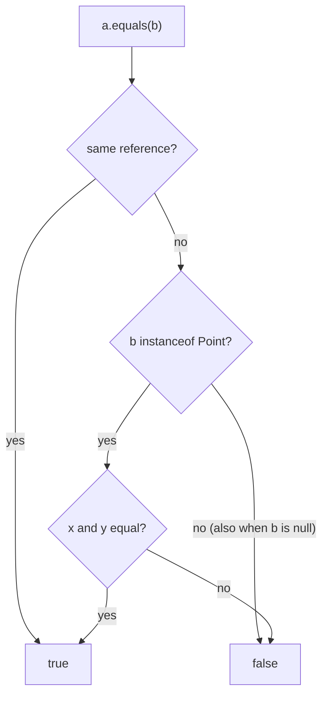
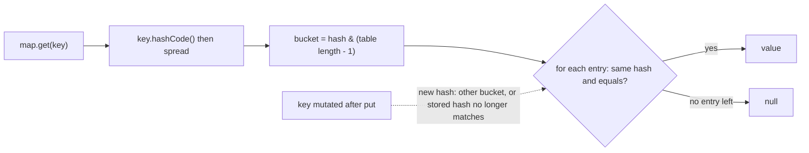
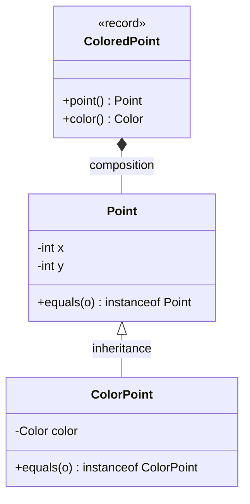
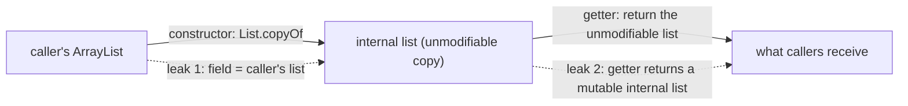

# 02. Equality, immutability and records

> **What this covers:** what it means for two Java objects to be the same: identity versus equality, the `equals` and `hashCode` contracts and what hash collections do when a class breaks them, equality across inheritance, and ordering with `Comparable` and `Comparator`. Then how to build values that cannot change: immutability, records, builders and withers, and the value-based classes whose identity you must not rely on.
> **Prerequisites:** [01. Java OOP fundamentals § 7. Inheritance, composition and `Object`](01-java-oop-fundamentals.md#7-inheritance-composition-and-object), [§ 13. Wrappers, autoboxing and the `Integer` cache](01-java-oop-fundamentals.md#13-wrappers-autoboxing-and-the-integer-cache)
> **Leads to:** [04. Collections internals](04-java-collections-internals.md), [07. Modern language features](07-java-modern-language-features.md)
> **Applies to:** Java 25
> **Study time:** ~5 hours reading + ~3 hours exercises
> **Short on time:** [2. `hashCode` and hash-based collections](#2-hashcode-and-hash-based-collections), [4. Ordering: `Comparable` and `Comparator`](#4-ordering-comparable-and-comparator), [6. Records](#6-records); questions [Q02.03](#q02-03), [Q02.06](#q02-06), [Q02.12](#q02-12), [Q02.14](#q02-14), [Q02.19](#q02-19); then [Summary](#summary).
> **Labs:** [`labs/java-language/`](../labs/java-language/), package `dev.interview.javalanguage.m02`. Run: `JAVA_HOME=$(/usr/libexec/java_home -v 25) mvn -q -f java-backend-guide/labs/pom.xml -pl java-language -am verify`. Needs Docker: no.

## Contents

1. [Identity vs equality and the `equals` contract](#1-identity-vs-equality-and-the-equals-contract)
2. [`hashCode` and hash-based collections](#2-hashcode-and-hash-based-collections)
3. [Equality across a class hierarchy](#3-equality-across-a-class-hierarchy)
4. [Ordering: `Comparable` and `Comparator`](#4-ordering-comparable-and-comparator)
5. [Immutability](#5-immutability)
6. [Records](#6-records)
7. [Building immutable objects: builders, withers and Lombok](#7-building-immutable-objects-builders-withers-and-lombok)
8. [Value-based classes and identity](#8-value-based-classes-and-identity)
- [Summary](#summary)
- [Question bank](#question-bank)
- [Hands-on exercises](#hands-on-exercises)
- [Check your understanding](#check-your-understanding)
- [Connections](#connections)

## 1. Identity vs equality and the `equals` contract
### The problem it solves

A booking service keeps the seats already sold in a `List<Seat>`. A second request for row 4, seat 12 builds a new `Seat`, asks `sold.contains(seat)`, gets `false`, and sells the seat twice. Nothing throws. `contains` asked the new object whether it equals each stored one, and `Seat` never said what "the same seat" means, so the answer was "only if it is the very same object". Every lookup in the JDK collections (`contains`, `indexOf`, `remove`, every `Set` and `Map`) goes through `equals(Object)`, so a class that gets it wrong produces silent duplicates and failed removals, not errors.

### Mental model

Identity asks "is this the same object?"; equality asks "do these two objects stand for the same value?". Two printed copies of one train ticket are two pieces of paper and one booking. `==` on references compares the paper. `equals` compares what is printed, but only once the class says which printed fields count; `Object.equals` does not know, so it compares the paper too.



What to notice: `null` needs no branch of its own, because `instanceof` is `false` for `null`, and only the last step encodes what the value means.

### How it actually works

**`==` on references.** With two reference operands, `==` is `true` only when both are `null` or both refer to the same object or array; it never calls a method [Doc: JLS 25 §15.21.3](https://docs.oracle.com/javase/specs/jls/se25/html/jls-15.html#jls-15.21.3). On primitives it compares values, and with one primitive and one wrapper operand it unboxes ([01 §13](01-java-oop-fundamentals.md#13-wrappers-autoboxing-and-the-integer-cache)).

**`Object.equals` is identity.** Its body is `return (this == obj);`, which its Javadoc calls "the most discriminating possible equivalence relation" [Src: JDK 25, java.lang.Object](https://github.com/openjdk/jdk/blob/jdk-25-ga/src/java.base/share/classes/java/lang/Object.java). A class keeps that until it overrides `equals`. `String`, the wrappers, the `List`, `Set` and `Map` implementations and records override it to compare content; a record's implicit `equals` compares each component, reference components with `Objects.equals` and primitive ones with the wrapper's `compare` [Src: JDK 25, java.lang.Record](https://github.com/openjdk/jdk/blob/jdk-25-ga/src/java.base/share/classes/java/lang/Record.java) [Lab: IdentityAndEqualityTest](../labs/java-language/src/test/java/dev/interview/javalanguage/m02/s01/IdentityAndEqualityTest.java). Two everyday types do not override it. Arrays have the members of `Object` apart from `clone` [Doc: JLS 25 §10.7](https://docs.oracle.com/javase/specs/jls/se25/html/jls-10.html#jls-10.7), so compare them with `Arrays.equals`, or `Arrays.deepEquals` when they nest. `StringBuilder` "does not override equals" and is `Comparable` instead [Changed in Java 11: `StringBuilder` implements `Comparable`] [Src: JDK 25, java.lang.StringBuilder](https://github.com/openjdk/jdk/blob/jdk-25-ga/src/java.base/share/classes/java/lang/StringBuilder.java), so compare builders with `compareTo` or `String.contentEquals` [Lab: IdentityAndEqualityTest](../labs/java-language/src/test/java/dev/interview/javalanguage/m02/s01/IdentityAndEqualityTest.java).

**The contract.** The `Object.equals` Javadoc requires an equivalence relation on non-null references: *reflexive* (`x.equals(x)`), *symmetric* (`x.equals(y)` exactly when `y.equals(x)`), *transitive* (`x` equals `y` and `y` equals `z` imply `x` equals `z`), *consistent* (repeated calls agree while the compared fields do not change), and `x.equals(null)` is `false` [Doc: Java 25 API, Object.equals](https://docs.oracle.com/en/java/javase/25/docs/api/java.base/java/lang/Object.html#equals(java.lang.Object)). Nothing checks it at run time. The collections simply assume it: `ArrayList.contains(o)` is defined as "at least one element `e` such that `Objects.equals(o, e)`" [Src: JDK 25, java.util.ArrayList](https://github.com/openjdk/jdk/blob/jdk-25-ga/src/java.base/share/classes/java/util/ArrayList.java), so with an asymmetric `equals` the answer depends on which object was passed in and which was stored. [§3](#3-equality-across-a-class-hierarchy) shows how inheritance breaks symmetry and transitivity. `Objects.equals(a, b)` is `(a == b) || (a != null && a.equals(b))`, which is why it is safe when either side is `null` [Src: JDK 25, java.util.Objects](https://github.com/openjdk/jdk/blob/jdk-25-ga/src/java.base/share/classes/java/util/Objects.java).

**Overload, not override.** `equals` must take `Object`. `equals(OverloadedPoint other)` has a different signature, so it does not override; it is a second method beside the inherited `equals(Object)` [Doc: JLS 25 §8.4.8.1](https://docs.oracle.com/javase/specs/jls/se25/html/jls-8.html#jls-8.4.8.1). Which overload runs is chosen at compile time from the static argument types [Doc: JLS 25 §15.12.2](https://docs.oracle.com/javase/specs/jls/se25/html/jls-15.html#jls-15.12.2). So `a.equals(b)` with both declared as `OverloadedPoint` calls the overload and returns `true`, while `a.equals((Object) b)`, `List.contains` and `HashSet.contains` call `equals(Object)`, still identity, and return `false`, even though the class's `hashCode` is correct [Lab: IdentityAndEqualityTest](../labs/java-language/src/test/java/dev/interview/javalanguage/m02/s01/IdentityAndEqualityTest.java). The JLS uses this very mistake to motivate `@Override` [Doc: JLS 25 §9.6.4.4](https://docs.oracle.com/javase/specs/jls/se25/html/jls-9.html#jls-9.6.4.4); with the annotation, javac rejects the overload with `compiler.err.method.does.not.override.superclass` [Lab: OverrideRulesTest](../labs/java-language/src/test/java/dev/interview/javalanguage/m01/s08/OverrideRulesTest.java). Overloading and dispatch in general are in [01 §8](01-java-oop-fundamentals.md#8-polymorphism-overloading-overriding-and-dispatch).

### Code

`Point` follows the flowchart.

1. Return `true` early for the same reference: it is cheap and makes reflexivity obvious.
2. Use a type pattern: `instanceof Point that` rejects `null` and other types, and binds the cast in the same step.
3. Compare every field that defines the value, and nothing else.
4. Override `hashCode` from the same fields ([§2](#2-hashcode-and-hash-based-collections) explains why that is mandatory).

```java
package dev.interview.javalanguage.m02.s01;

// Module 02 §1: a correct hand-written equals (identity shortcut, type check, field comparison).
public final class Point {

    private final int x;
    private final int y;

    public Point(int x, int y) {
        this.x = x;
        this.y = y;
    }

    public int x() {
        return x;
    }

    public int y() {
        return y;
    }

    @Override
    public boolean equals(Object other) {
        if (this == other) {
            return true;
        }
        if (!(other instanceof Point that)) {
            return false;
        }
        return x == that.x && y == that.y;
    }

    // Section 2 explains why hashCode must agree with equals: equal points must hash equally.
    @Override
    public int hashCode() {
        return 31 * x + y;
    }
}
```
<sub>Source: [labs/java-language/src/main/java/dev/interview/javalanguage/m02/s01/Point.java](../labs/java-language/src/main/java/dev/interview/javalanguage/m02/s01/Point.java)</sub>

`OverloadedPoint` differs only in the parameter type of `equals`, and keeps a correct `hashCode` so that the overload is the only defect:

```java
package dev.interview.javalanguage.m02.s01;

// Module 02 §1: the equals overload trap, a point whose equals(OverloadedPoint) never overrides equals(Object).
public final class OverloadedPoint {

    private final int x;
    private final int y;

    public OverloadedPoint(int x, int y) {
        this.x = x;
        this.y = y;
    }

    // Deliberate bug: overloads equals(Object) instead of overriding it
    public boolean equals(OverloadedPoint other) {
        return x == other.x && y == other.y;
    }

    // Correct on purpose, so the overload is the only defect
    @Override
    public int hashCode() {
        return 31 * x + y;
    }
}
```
<sub>Source: [labs/java-language/src/main/java/dev/interview/javalanguage/m02/s01/OverloadedPoint.java](../labs/java-language/src/main/java/dev/interview/javalanguage/m02/s01/OverloadedPoint.java)</sub>

Tests: [Lab: IdentityAndEqualityTest](../labs/java-language/src/test/java/dev/interview/javalanguage/m02/s01/IdentityAndEqualityTest.java) asserts the five clauses over a fixed sample of points, and the collection results of both classes.

### Failure modes and operations

A broken `equals` never throws. It shows up as collection results that look like bad data: `contains` returns `false` for a value that is there [Lab: IdentityAndEqualityTest](../labs/java-language/src/test/java/dev/interview/javalanguage/m02/s01/IdentityAndEqualityTest.java), so a list de-duplicated with `contains` keeps its duplicates, and `ArrayList.remove(Object)` and `indexOf` miss the element too, because they use the same `Objects.equals` test [Src: JDK 25, java.util.ArrayList](https://github.com/openjdk/jdk/blob/jdk-25-ga/src/java.base/share/classes/java/util/ArrayList.java). Load does not change the outcome, since the same call fails at any request rate; volume only makes it visible, as sets and caches that keep growing with "new" equal elements ([§2](#2-hashcode-and-hash-based-collections) has that incident). The cost side is real: `equals` runs on every lookup and on every element a `List` scans, so an `equals` that compares large collections or touches lazily loaded state makes each `contains` expensive; compare the cheap, most discriminating fields first. To catch the defect, a unit test that stores two equal instances in a `List` and a `HashSet` is enough; in a running service, a class histogram from `jcmd <pid> GC.class_histogram` showing far more instances of a value type than expected is the usual clue [Doc: jcmd, Java 25](https://docs.oracle.com/en/java/javase/25/docs/specs/man/jcmd.html) ([10](10-jvm-performance-and-troubleshooting.md) covers the tool).

### Best practices and anti-patterns

- Override `equals` only for value-like classes (money, coordinates, ids), because services and entities are identified by who they are, not by their fields; entity equality is in [23](23-jpa-hibernate-fundamentals.md).
- Annotate `equals(Object)` with `@Override`, because the compiler then rejects an `equals(Point)` overload.
- Make a value class `final`, or read [§3](#3-equality-across-a-class-hierarchy) first, because a subclass that adds fields breaks symmetry or transitivity.
- Base `equals` only on fields that do not change while the object sits in a collection, because the consistency clause holds only while the compared fields stay the same.
- Use `Objects.equals(a, b)` when either side may be `null`, because `a.equals(b)` throws `NullPointerException` when `a` is `null`.
- Compare arrays with `Arrays.equals` or `Arrays.deepEquals`, because an array's `equals` is identity.
- Avoid `==` on `String` or wrapper values, because it compares references and passes only when the JVM happens to share an instance (the string pool is in [06](06-java-exceptions-strings-io.md), the `Integer` cache in [01 §13](01-java-oop-fundamentals.md#13-wrappers-autoboxing-and-the-integer-cache)).
- **Security:** compare secrets such as MAC tags or token digests with `MessageDigest.isEqual`, not `Arrays.equals`, because its time depends only on the length of the first array, not on where the bytes differ, so it does not leak how much of a guess was right [Src: JDK 25, java.security.MessageDigest](https://github.com/openjdk/jdk/blob/jdk-25-ga/src/java.base/share/classes/java/security/MessageDigest.java).

### Misconceptions and traps

- *"`==` compares values for objects."* It compares values only for primitives; for references it compares identity. The myth survives because `==` on small `Integer` values and on string literals often prints `true`, since the JVM shares those instances ([Q01.28](01-java-oop-fundamentals.md#q01-28) is the production version).
- *"Every class should override `equals`."* Only classes whose instances stand for values. The myth comes from code generators and IDE templates that add `equals` everywhere, which is wrong for entities with generated ids ([23](23-jpa-hibernate-fundamentals.md)).
- *"`equals(Point)` is a more type-safe `equals`."* It is an overload that collections never call. It looks right because a direct call with two `Point` variables returns `true`, which is the case most hand tests try.
- *"`StringBuilder` compares by content."* It inherits identity `equals`. The myth exists because `String` and `StringBuilder` look interchangeable, and since Java 11 `compareTo` does compare content.
- *"`x.equals(null)` may throw."* The contract says it returns `false`, and `instanceof` gives that for free; the myth comes from older `equals` templates that cast before checking.

Questions that drill this section: [Q02.01](#q02-01), [Q02.02](#q02-02), [Q02.03](#q02-03), [Exercise 02.3](#ex02-3).

## 2. `hashCode` and hash-based collections
### The problem it solves

A pricing service caches quotes in a `HashMap<QuoteKey, Quote>`. Someone adds a correct `equals` to `QuoteKey` and forgets `hashCode`. Tests still pass, because they reuse the same key object. In production every request builds a new, equal key, the cache misses every time, and it keeps growing until the heap fills. A hash-based collection trusts two methods together: `hashCode` decides where to look and `equals` decides what matches. If they disagree, the collection silently looks in the wrong place.

### Mental model

A hash table is a cloakroom with numbered hooks. `hashCode` is the number on your ticket and `equals` is recognizing your coat on the hook. Two equal coats with different ticket numbers are looked for on different hooks, so the second one is never found. And if you change your coat after hanging it, so its number changes, the attendant goes to a hook where it never was.



What to notice: `equals` only runs on entries whose stored hash matches, so a key with the wrong hash never reaches `equals` at all.

### How it actually works

**The contract.** `hashCode` must return the same value on repeated calls while the fields used by `equals` do not change, equal objects must have equal hash codes, and unequal objects may collide, although distinct values "may improve the performance of hash tables" [Doc: Java 25 API, Object.hashCode](https://docs.oracle.com/en/java/javase/25/docs/api/java.base/java/lang/Object.html#hashCode()). The value need not be the same in the next run of the program, so never persist it or send it over the wire. `Object.hashCode` returns distinct integers for distinct objects "as far as is reasonably practical", which is why a class that overrides only `equals` hashes equal instances apart.

**What `HashMap` does with it.** `HashMap.hash` spreads the key's hash as `h ^ (h >>> 16)`, the bucket index is `(n - 1) & hash` for a table of length `n`, and `getNode` returns the first entry in that bucket whose stored hash equals the lookup hash and whose key is `==` or `equals` to the lookup key [Src: JDK 25, java.util.HashMap](https://github.com/openjdk/jdk/blob/jdk-25-ga/src/java.base/share/classes/java/util/HashMap.java). `HashSet` stores its elements as the keys of a `HashMap`, so it behaves the same [Src: JDK 25, java.util.HashSet](https://github.com/openjdk/jdk/blob/jdk-25-ga/src/java.base/share/classes/java/util/HashSet.java). Two consequences follow from that check:
- `equals` without `hashCode`: two equal `NoHashPoint` objects are one element only when their identity hash codes happen to match; in the lab, `contains` of a fresh equal point is true exactly when the hash codes are equal, over 1,000 pairs [Lab: HashContractTest](../labs/java-language/src/test/java/dev/interview/javalanguage/m02/s02/HashContractTest.java).
- a mutable key: after `put`, the entry keeps the hash computed at insertion. Changing a field that `hashCode` reads makes the entry unreachable: `get` misses with the same object, with a key equal to the old value and with one equal to the new value, and `containsKey` and `remove` miss too, while `size()` stays 1 and `containsValue` still finds the value [Lab: HashContractTest](../labs/java-language/src/test/java/dev/interview/javalanguage/m02/s02/HashContractTest.java).

The bucket array, resizing and load factor are [04](04-java-collections-internals.md)'s subject.

**Collisions and tree bins.** A bucket starts as a linked list. When it reaches `TREEIFY_THRESHOLD` (8) entries it becomes a tree, unless the table is smaller than `MIN_TREEIFY_CAPACITY` (64), in which case the table is resized instead [Src: JDK 25, java.util.HashMap](https://github.com/openjdk/jdk/blob/jdk-25-ga/src/java.base/share/classes/java/util/HashMap.java). Tree bins are ordered by hash and, for ties, by `compareTo` when the keys are of one `Comparable` class; the source says this gives O(log n) "when keys either have distinct hashes or are orderable", and that otherwise the tree may cost about twice the time and space of a list. So a constant `hashCode` on a key that is not `Comparable` turns every lookup into a scan of all entries.

**Writing and caching a hash.** `Objects.hash(a, b)` is `Arrays.hashCode(values)` over a varargs array, so each call allocates an array and boxes primitive arguments [Src: JDK 25, java.util.Objects](https://github.com/openjdk/jdk/blob/jdk-25-ga/src/java.base/share/classes/java/util/Objects.java); it computes `31 * (31 * 1 + a) + b`, not the hand-written `31 * a + b`, and both are valid [Lab: HashContractTest](../labs/java-language/src/test/java/dev/interview/javalanguage/m02/s02/HashContractTest.java). An immutable class can cache its hash: `String` stores it in a `hash` field on first use, plus a `hashIsZero` flag so that a real hash of 0 is not recomputed each time [Src: JDK 25, java.lang.String](https://github.com/openjdk/jdk/blob/jdk-25-ga/src/java.base/share/classes/java/lang/String.java). Caching is safe only when the fields can never change.

> [!NOTE]
> **Version notes.** Java 7 and earlier: a bucket was always a linked list, so many colliding keys made lookups O(n). Java 8: buckets that grow past the threshold become balanced trees, worst case O(log n) for keys with distinct hashes or `Comparable` keys, with no API change [Changed in Java 8: tree bins in `HashMap`] [Doc: JEP 180](https://openjdk.org/jeps/180).

### Code

`Sku` is the mutable key, kept as the defect. The fix is an immutable key: see Best practices below, [§5](#5-immutability) and [§6](#6-records).

1. Keep `code` non-final and add a setter, as a mutable JavaBean would.
2. Base `equals` and `hashCode` on `code`, which is correct on its own.
3. In the test, put the key, change its code, and probe the map every way a caller could.

```java
package dev.interview.javalanguage.m02.s02;

import java.util.Objects;

// Module 02 §2: a mutable key, the defect on purpose. equals and hashCode read code, and setCode changes it.
public final class Sku {

    private String code;

    public Sku(String code) {
        this.code = code;
    }

    public String code() {
        return code;
    }

    public void setCode(String code) {
        this.code = code;
    }

    @Override
    public boolean equals(Object other) {
        if (this == other) {
            return true;
        }
        if (!(other instanceof Sku that)) {
            return false;
        }
        return Objects.equals(code, that.code);
    }

    @Override
    public int hashCode() {
        return Objects.hashCode(code);
    }
}
```
<sub>Source: [labs/java-language/src/main/java/dev/interview/javalanguage/m02/s02/Sku.java](../labs/java-language/src/main/java/dev/interview/javalanguage/m02/s02/Sku.java)</sub>

The test probes the map after the mutation (excerpt):

```java
// Excerpt of labs/java-language/src/test/java/dev/interview/javalanguage/m02/s02/HashContractTest.java
    private static final String CODE_A = "A";
    private static final String CODE_B = "B";
    private static final int STORED_VALUE = 10;

    @Test
    @DisplayName("M02 §2 · a mutated key is not found by get but is still in the map")
    void hashMap_losesMutatedKey_whileEntryRemains() {
        Sku key = new Sku(CODE_A);
        assertThat(Objects.hashCode(CODE_A)).isNotEqualTo(Objects.hashCode(CODE_B));
        Map<Sku, Integer> map = new HashMap<>();
        map.put(key, STORED_VALUE);

        key.setCode(CODE_B);

        assertThat(map.get(key)).isNull();
        assertThat(map.get(new Sku(CODE_A))).isNull();
        assertThat(map.get(new Sku(CODE_B))).isNull();
        assertThat(map.containsKey(key)).isFalse();
        assertThat(map).hasSize(1);
        assertThat(map.containsValue(STORED_VALUE)).isTrue();
        assertThat(map.keySet().stream().anyMatch(sku -> CODE_B.equals(sku.code())))
                .isTrue();
        assertThat(map.remove(key)).isNull();
        assertThat(map).hasSize(1);
    }
```
<sub>Source: [labs/java-language/src/test/java/dev/interview/javalanguage/m02/s02/HashContractTest.java](../labs/java-language/src/test/java/dev/interview/javalanguage/m02/s02/HashContractTest.java)</sub>

### Failure modes and operations

Both failures are silent. A missing `hashCode` or a mutated key turns a cache or a de-duplicating set into a store that only grows: entries that no lookup reaches are still strongly referenced by the map, so they are a memory leak, not a cache miss alone [Lab: HashContractTest](../labs/java-language/src/test/java/dev/interview/javalanguage/m02/s02/HashContractTest.java). Under load the leak grows with the request rate, and the hit rate stays near zero however large the map gets. A low-entropy hash (a constant, a field with few values) fails differently: results stay correct, but each lookup scans a long chain, so latency grows with the map size; tree bins bound it only for `Comparable` keys or distinct hashes [Src: JDK 25, java.util.HashMap](https://github.com/openjdk/jdk/blob/jdk-25-ga/src/java.base/share/classes/java/util/HashMap.java). What to observe: the cache's size and hit-rate metrics (a size that tracks request count is the signal), and a class histogram (`jcmd <pid> GC.class_histogram`) in which the key class and `HashMap$Node` grow together [Doc: jcmd, Java 25](https://docs.oracle.com/en/java/javase/25/docs/specs/man/jcmd.html). Restarting hides the leak for a while, which is why it often looks like a slow, periodic memory problem rather than a bug.

> [!IMPORTANT]
> **Production scenario: a cache's hit rate collapses after a change to the key class.** *As the interviewer frames it:* "After a release that refactored `QuoteKey`, the quote cache's hit rate went from 90% to almost zero and the service's heap grows until it is restarted. No errors in the logs."
> **Reasoning.** A hit rate that falls to near zero while the size keeps rising means lookups never find entries that are there: either equal keys no longer share a hash code, or a key changes after insertion. Evidence: the diff of `QuoteKey` (a new field in `equals` but not in `hashCode`, `hashCode` removed, or a setter added), a heap histogram with as many `QuoteKey` instances as cache entries, and a unit test that puts a key and looks it up with a fresh equal one, which fails [Lab: HashContractTest](../labs/java-language/src/test/java/dev/interview/javalanguage/m02/s02/HashContractTest.java). Fix: make the key immutable, with `equals` and `hashCode` over the same fields; a record does both ([§6](#6-records)). Prevention: an `equals`/`hashCode` contract test for every key class, and a bounded cache with eviction so that a broken key degrades into misses instead of an out-of-memory error. [Q02.08](#q02-08) drills the diagnosis.

### Best practices and anti-patterns

- Override `hashCode` whenever you override `equals`, from the same fields, because equal objects with different hashes are looked up in different buckets.
- Use immutable keys (final fields, or a record), because the map keeps the hash computed at insertion and a changed key becomes unreachable.
- Never put a field into `hashCode` that `equals` ignores, because two equal objects could then hash differently; leaving a field out is allowed and only costs collisions.
- Use `Objects.hash` for readability in ordinary classes, and a hand-written `31 * h + field` in hot paths, because `Objects.hash` allocates an array and boxes primitives on every call.
- Cache the hash only in immutable classes, because a cached hash in a mutable class goes stale on the first change.
- Do not use `hashCode` as an identifier, a database key or a persisted value, because unequal objects may collide and the value may differ between runs.
- **Security:** keep untrusted keys, such as request parameter names or JSON field names, in maps of `Comparable` keys like `String`, and cap how many keys one request may add, because crafted collisions put all keys in one bucket; tree bins bound the cost to O(log n) only for `Comparable` keys [Src: JDK 25, java.util.HashMap](https://github.com/openjdk/jdk/blob/jdk-25-ga/src/java.base/share/classes/java/util/HashMap.java).

### Misconceptions and traps

- *"Unequal objects must have different hash codes."* The contract allows collisions; only equal objects must match. The myth exists because good hash functions make collisions rare enough to look forbidden.
- *"If `equals` is right, hash collections work."* They check the hash first, so `equals` never runs for a key in the wrong bucket. It looks true in tests that reuse one key object, which `==` matches.
- *"Hash collisions make `HashMap` O(n)."* Once true: until Java 7 every bucket was a list. Now: tree bins give O(log n) for keys with distinct hashes or `Comparable` keys [Changed in Java 8: tree bins in `HashMap`]; a constant hash on non-`Comparable` keys is still linear.
- *"`hashCode` is the object's memory address."* The Javadoc promises only distinct values "as far as is reasonably practical", never an address. The myth comes from the default `toString`, whose hex number after `@` is the hash code [Src: JDK 25, java.lang.Object](https://github.com/openjdk/jdk/blob/jdk-25-ga/src/java.base/share/classes/java/lang/Object.java).

Questions that drill this section: [Q02.04](#q02-04), [Q02.05](#q02-05), [Q02.06](#q02-06), [Q02.07](#q02-07), [Q02.08](#q02-08), [Exercise 02.1](#ex02-1).

## 3. Equality across a class hierarchy
<!-- TASK: SEC-M02-03 -->
### The problem it solves

A team gives a subclass of `Point` a new `color` field and its own `equals`. A de-duplication step that checks `seen.contains(candidate)` on a `List` now keeps or drops the same pair of values depending on which one arrived first: with the plain point stored, the colored point counts as new; with the colored point stored, the plain point counts as a duplicate. Nothing throws and nothing logs; the result depends on argument order, because `point.equals(colorPoint)` is `true` while `colorPoint.equals(point)` is `false` [Lab: HierarchyEqualityTest](../labs/java-language/src/test/java/dev/interview/javalanguage/m02/s03/HierarchyEqualityTest.java). The JDK ships the same defect: `java.sql.Timestamp` extends `java.util.Date`, and its own documentation says its `equals` is not symmetric with `Date.equals` [Src: JDK 25, java.sql.Timestamp](https://github.com/openjdk/jdk/blob/jdk-25-ga/src/java.sql/share/classes/java/sql/Timestamp.java).

### Mental model

`equals` is a verdict that two objects must reach together, not a method of one of them: whichever side is asked, the answer must be the same ([§1](#1-identity-vs-equality-and-the-equals-contract)). A subclass that adds a field to equality is a stricter judge joining the panel. The old judge says "same coordinates, same point", the new one says "different color", and the verdict depends on who is asked. There are three ways out: the stricter judge adds nothing to equality (a `final` `equals` in the base), judges from different classes never compare (`getClass()`), or the colored point stops *being* a point and *has* one (composition).



What to notice: inheritance puts every `ColorPoint` inside the domain of `Point.equals`, so the two `equals` methods must agree with each other; composition keeps `ColoredPoint` outside it, so each class answers only about its own kind.

### How it actually works

`o instanceof Point other` is true for any instance of `Point` or of a subclass [Doc: JLS 25 §15.20.2](https://docs.oracle.com/javase/specs/jls/se25/html/jls-15.html#jls-15.20.2), so `Point.equals` accepts a `ColorPoint` and compares coordinates only. `ColorPoint.equals` tests `instanceof ColorPoint`, which a plain `Point` fails, so the reverse call returns `false`: symmetry is gone. `ArrayList.contains(o)` evaluates `o.equals(element)` [Src: JDK 25, java.util.ArrayList](https://github.com/openjdk/jdk/blob/jdk-25-ga/src/java.base/share/classes/java/util/ArrayList.java), so the argument's class decides the answer, which is the order dependence of the opening example [Lab: HierarchyEqualityTest](../labs/java-language/src/test/java/dev/interview/javalanguage/m02/s03/HierarchyEqualityTest.java).

The usual patch, `SymmetricColorPoint`, compares coordinates only when the other object is a plain `Point`. That restores symmetry and breaks transitivity: a red point equals the plain point, the plain point equals a blue point, and red does not equal blue. The patch also cannot put `color` into `hashCode`: the red point equals the plain point, so the contract forces their hash codes to match, and the color stays invisible to hash collections [Lab: HierarchyEqualityTest](../labs/java-language/src/test/java/dev/interview/javalanguage/m02/s03/HierarchyEqualityTest.java). This is not a weakness of one implementation. If two subclass instances that differ only in the new field must both equal the same base instance, transitivity forces them to equal each other, which contradicts the new field; so no subclass can add a field to equality and still be equal to base instances. The clauses are those of the `Object.equals` contract [Doc: Object.equals, Java 25](https://docs.oracle.com/en/java/javase/25/docs/api/java.base/java/lang/Object.html#equals(java.lang.Object)).

`getClass()`-based `equals` returns `false` unless both objects have exactly the same runtime class. That keeps the contract within each class but rejects every subclass, including one that adds no state: in the lab, an anonymous subclass `new GetClassPoint(1, 2) {}` never equals `new GetClassPoint(1, 2)`, while the same experiment with the `instanceof`-based `Point` gives equality both ways [Lab: HierarchyEqualityTest](../labs/java-language/src/test/java/dev/interview/javalanguage/m02/s03/HierarchyEqualityTest.java). Code written against the base type (the Liskov substitution principle: a subclass instance must work wherever a base instance does) then fails, for example a set of base points that never finds an equal subclass point. Classes generated at runtime as subclasses, such as proxies and mocks, hit the same wall; proxies of JPA entities are module [23](23-jpa-hibernate-fundamentals.md)'s topic.

Composition avoids the conflict. `ColoredPoint` is a record that holds a `Point` and a `Color`; it is not a `Point`, so `instanceof Point` is false for it, and its generated `equals` is true only for an instance of the same record class with equal components [Src: JDK 25, java.lang.Record](https://github.com/openjdk/jdk/blob/jdk-25-ga/src/java.base/share/classes/java/lang/Record.java). Over the lab's mixed sample of points and colored points, reflexivity, symmetry, transitivity and equal hash codes for equal objects all hold [Lab: HierarchyEqualityTest](../labs/java-language/src/test/java/dev/interview/javalanguage/m02/s03/HierarchyEqualityTest.java). A record class is implicitly `final` [Doc: JLS 25 §8.10](https://docs.oracle.com/javase/specs/jls/se25/html/jls-8.html#jls-8.10), so no subclass can reopen the problem; a `final` class has the same effect.

`Timestamp` shows the asymmetry in the JDK. `Date.equals` accepts any `Date` and compares `getTime()` [Src: JDK 25, java.util.Date](https://github.com/openjdk/jdk/blob/jdk-25-ga/src/java.base/share/classes/java/util/Date.java); `Timestamp.equals(Object)` returns `true` only for another `Timestamp`, because a `Date` has no nanosecond part to compare. Its class documentation recommends not treating `Timestamp` values as `Date` values and calls the relationship implementation inheritance, not type inheritance [Src: JDK 25, java.sql.Timestamp](https://github.com/openjdk/jdk/blob/jdk-25-ga/src/java.sql/share/classes/java/sql/Timestamp.java). In the lab, `new Date(1_000L).equals(new Timestamp(1_000L))` is `true` and the reverse call is `false` [Lab: HierarchyEqualityTest](../labs/java-language/src/test/java/dev/interview/javalanguage/m02/s03/HierarchyEqualityTest.java).

### Code

Approach: one class per option, each pinned by a test that checks the clauses across base and subclass instances, not within one class only.

1. `Point` uses `instanceof`, so subclasses are accepted.
2. `ColorPoint` adds `color` to equality: the asymmetric version.
3. `SymmetricColorPoint` is the patch: symmetric, not transitive, and its `hashCode` must stay `Point`'s.
4. `ColoredPoint` is the composition that keeps the contract.
5. The test compares in both directions and through `ArrayList.contains`.

```java
package dev.interview.javalanguage.m02.s03;

/** Module 02 §3: the non-final base class whose instanceof equals every subclass has to live with. */
public class Point {

    private final int x;
    private final int y;

    public Point(int x, int y) {
        this.x = x;
        this.y = y;
    }

    public int x() {
        return x;
    }

    public int y() {
        return y;
    }

    @Override
    public boolean equals(Object o) {
        if (this == o) {
            return true;
        }
        if (!(o instanceof Point other)) {
            return false;
        }
        return x == other.x && y == other.y;
    }

    @Override
    public int hashCode() {
        return 31 * x + y;
    }
}
```
<sub>Source: [labs/java-language/src/main/java/dev/interview/javalanguage/m02/s03/Point.java](../labs/java-language/src/main/java/dev/interview/javalanguage/m02/s03/Point.java)</sub>

```java
package dev.interview.javalanguage.m02.s03;

import java.util.Objects;

/** Module 02 §3: a subclass that adds a field and keeps instanceof equals, which makes equals asymmetric. */
public class ColorPoint extends Point {

    private final Color color;

    public ColorPoint(int x, int y, Color color) {
        super(x, y);
        this.color = Objects.requireNonNull(color);
    }

    public Color color() {
        return color;
    }

    @Override
    public boolean equals(Object o) {
        return o instanceof ColorPoint other && super.equals(other) && color == other.color;
    }

    @Override
    public int hashCode() {
        return 31 * super.hashCode() + color.hashCode();
    }
}
```
<sub>Source: [labs/java-language/src/main/java/dev/interview/javalanguage/m02/s03/ColorPoint.java](../labs/java-language/src/main/java/dev/interview/javalanguage/m02/s03/ColorPoint.java)</sub>

```java
package dev.interview.javalanguage.m02.s03;

import java.util.Objects;

/** Module 02 §3: the symmetric patch for ColorPoint, which restores symmetry but breaks transitivity. */
public class SymmetricColorPoint extends Point {

    private final Color color;

    public SymmetricColorPoint(int x, int y, Color color) {
        super(x, y);
        this.color = Objects.requireNonNull(color);
    }

    public Color color() {
        return color;
    }

    @Override
    public boolean equals(Object o) {
        if (!(o instanceof Point)) {
            return false;
        }
        if (!(o instanceof SymmetricColorPoint other)) {
            return super.equals(o);
        }
        return super.equals(other) && color == other.color;
    }

    // No hashCode override: this class equals plain Points, so its hash must match Point's.
}
```
<sub>Source: [labs/java-language/src/main/java/dev/interview/javalanguage/m02/s03/SymmetricColorPoint.java](../labs/java-language/src/main/java/dev/interview/javalanguage/m02/s03/SymmetricColorPoint.java)</sub>

```java
package dev.interview.javalanguage.m02.s03;

import java.util.Objects;

/** Module 02 §3: the composition fix, which holds a Point instead of extending it and keeps all three equals clauses. */
public record ColoredPoint(Point point, Color color) {

    public ColoredPoint {
        Objects.requireNonNull(point);
        Objects.requireNonNull(color);
    }
}
```
<sub>Source: [labs/java-language/src/main/java/dev/interview/javalanguage/m02/s03/ColoredPoint.java](../labs/java-language/src/main/java/dev/interview/javalanguage/m02/s03/ColoredPoint.java)</sub>

The test checks both directions, then the same pair through `ArrayList.contains`:

```java
// Excerpt of labs/java-language/src/test/java/dev/interview/javalanguage/m02/s03/HierarchyEqualityTest.java
class HierarchyEqualityTest {

    private static final int X = 1;
    private static final int Y = 2;

    @Test
    @DisplayName("M02 §3 · instanceof equals in a subclass with an extra field is asymmetric")
    void equals_isAsymmetric_whenSubclassAddsFieldWithInstanceofCheck() {
        Point point = new Point(X, Y);
        ColorPoint colorPoint = new ColorPoint(X, Y, Color.RED);
        List<Point> holdingColorPoint = new ArrayList<>();
        holdingColorPoint.add(colorPoint);
        List<Point> holdingPoint = new ArrayList<>();
        holdingPoint.add(point);

        assertThat(point.equals(colorPoint)).isTrue();
        assertThat(colorPoint.equals(point)).isFalse();
        assertThat(holdingColorPoint.contains(point)).isTrue();
        assertThat(holdingPoint.contains(colorPoint)).isFalse();
    }
}
```
<sub>Source: [labs/java-language/src/test/java/dev/interview/javalanguage/m02/s03/HierarchyEqualityTest.java](../labs/java-language/src/test/java/dev/interview/javalanguage/m02/s03/HierarchyEqualityTest.java)</sub>

### Failure modes and operations

A pure-language topic: no load, configuration or deployment dimension. The one runtime symptom is order dependence: with an asymmetric `equals`, `contains`, `indexOf` and `remove` on a `List` give answers that depend on which object is the argument, so de-duplication, "already processed" checks and test assertions flip when the data arrive in a different order [Lab: HierarchyEqualityTest](../labs/java-language/src/test/java/dev/interview/javalanguage/m02/s03/HierarchyEqualityTest.java). No metric shows it; only a contract test over mixed base and subclass instances does.

> [!NOTE]
> **Version notes.** Java 8 to 15: `equals` tests `o instanceof Point` and then casts, `Point other = (Point) o;`. Java 16 and later: the pattern `o instanceof Point other` tests and binds in one step, as in this section's code [Final since Java 16, JEP 394] [Doc: JEP 394](https://openjdk.org/jeps/394). The contract and the hierarchy problem are the same in both forms.

### Best practices and anti-patterns

- Use composition when a subtype would add a field to equality, because no subclass `equals` can add a field and stay equal to base instances without breaking symmetry or transitivity.
- Make value classes `final`, or records, because then no subclass exists that could break the contract.
- If a base class must stay extensible, make its `instanceof`-based `equals` and `hashCode` `final`, because subclasses then share one definition and stay substitutable; they just cannot add state to equality.
- Use `getClass()` only when instances of different classes are genuinely different values, because it also rejects subclasses with no extra state, proxies and mocks.
- Test `equals` over a sample that mixes base and subclass instances, in both directions and over triples, because tests inside one class never reach the pairs where the contract breaks.
- Do not mix `Timestamp` and `Date` in one collection or comparison; convert both to `Instant` first, because their `equals` methods disagree.

### Misconceptions and traps

- *"`getClass()` is always the safer choice."* It keeps the contract but gives up substitutability: a subclass with no extra state, a mock or a proxy never equals a base instance. The myth exists because it is the one recipe that cannot break symmetry, so it looks like a safe default.
- *"The symmetric patch fixes the subclass."* It fixes symmetry and breaks transitivity, and it cannot put the new field into `hashCode`. The myth survives because most tests check pairs, never triples.
- *"With enough care, a subclass can add a field to `equals`."* Not while staying equal to base instances: transitivity through the base instance forces the contradiction shown above. Each method looks correct on its own, which is why the attempt keeps reappearing.
- *"JDK classes always honor the `equals` contract."* `Timestamp` documents that it does not, with respect to `Date` [Src: JDK 25, java.sql.Timestamp](https://github.com/openjdk/jdk/blob/jdk-25-ga/src/java.sql/share/classes/java/sql/Timestamp.java). The myth comes from treating the contract as enforced; nothing in the compiler or the JVM checks it.

Questions that drill this section: [Q02.09](#q02-09), [Q02.10](#q02-10), [Exercise 02.3](#ex02-3).
<!-- /TASK: SEC-M02-03 -->

## 4. Ordering: `Comparable` and `Comparator`
<!-- TASK: SEC-M02-04 -->
### The problem it solves

A monthly report puts customers into a `TreeSet` sorted by name so that the output comes out alphabetical. Two different customers called "Ana Ruiz" arrive; the second `add` returns `false`, and the report is one customer short. No exception, no log line: a sorted collection decides "same element" with the comparator, not with `equals`, so a comparator that looks only at the name declares the two customers duplicates [Lab: OrderingTest](../labs/java-language/src/test/java/dev/interview/javalanguage/m02/s04/OrderingTest.java). Ordering is a second definition of sameness, next to `equals` ([§1](#1-identity-vs-equality-and-the-equals-contract)), and the two must be designed together.

### Mental model

A comparison answers "before, after, or tied?". `Comparable` is the order a class carries with it (its natural ordering: `String` alphabetical, `Integer` numeric); a `Comparator` is an order you hand to an algorithm from outside, so one class can be sorted many ways. Only the sign of the answer matters, and a tie (`0`) is a verdict too: a sorting algorithm keeps tied elements together, while a `TreeSet` or `TreeMap` treats a tie as "this element is already here". The ordering is *consistent with equals* when "tied" and "equal" always coincide; when they do not, sorted collections and hash collections disagree about what is a duplicate.

| Same two values, different collections | `HashSet` (uses `equals`/`hashCode`) | `TreeSet` (uses `compareTo`/`compare`) |
|---|---|---|
| `new BigDecimal("1.0")`, `new BigDecimal("1.00")` | size 2 | size 1 |
| two customers with the same name, different ids, comparator by name | size 2 | size 1 |
| same customers, comparator by name then id | size 2 | size 2 |

### How it actually works

The `Comparator.compare` contract has three clauses: the sign reverses when the arguments swap, `sgn(compare(x, y)) == -sgn(compare(y, x))`; the relation is transitive; and `compare(x, y) == 0` implies that `x` and `y` compare the same way against every `z`. Consistency with `equals` is a separate, weaker request [Src: JDK 25, java.util.Comparator](https://github.com/openjdk/jdk/blob/jdk-25-ga/src/java.base/share/classes/java/util/Comparator.java). For natural orderings the `Comparable` documentation calls it "strongly recommended (though not required)" and names `BigDecimal` as the exception among core classes: `compareTo` equates values with equal numerical value and different representations, such as 4.0 and 4.00, while `equals` also requires the same representation [Doc: Comparable, Java 25](https://docs.oracle.com/en/java/javase/25/docs/api/java.base/java/lang/Comparable.html). The lab confirms it: `1.0` and `1.00` are not `equals`, `compareTo` returns `0`, a `HashSet` keeps both and a `TreeSet` keeps one [Lab: OrderingTest](../labs/java-language/src/test/java/dev/interview/javalanguage/m02/s04/OrderingTest.java).

Why a tree drops the element: `TreeMap` performs every key comparison with `compareTo` (or the comparator's `compare`), so two keys that compare as `0` are, from the map's standpoint, the same key; `put` replaces the value, and `TreeSet`, backed by a map, rejects the `add`. The documentation calls this behavior well-defined: the map only "fails to obey the general contract" of `Map`, which is defined in terms of `equals` [Src: JDK 25, java.util.TreeMap](https://github.com/openjdk/jdk/blob/jdk-25-ga/src/java.base/share/classes/java/util/TreeMap.java) [Src: JDK 25, java.util.TreeSet](https://github.com/openjdk/jdk/blob/jdk-25-ga/src/java.base/share/classes/java/util/TreeSet.java). The cure is a comparator that ends with a unique key: `comparing(Customer::name).thenComparingLong(Customer::id)` keeps both customers [Lab: OrderingTest](../labs/java-language/src/test/java/dev/interview/javalanguage/m02/s04/OrderingTest.java).

The subtraction comparator, `(a, b) -> a.priority() - b.priority()`, returns the right sign only while the difference fits in an `int`. `Integer.MIN_VALUE - 1` overflows to `Integer.MAX_VALUE`, a positive number, so the smallest priority is reported as the larger one and sorts last [Lab: OrderingTest](../labs/java-language/src/test/java/dev/interview/javalanguage/m02/s04/OrderingTest.java). `Integer.compare(x, y)` compares instead of subtracting, `(x < y) ? -1 : ((x == y) ? 0 : 1)`, and cannot overflow [Src: JDK 25, java.lang.Integer](https://github.com/openjdk/jdk/blob/jdk-25-ga/src/java.base/share/classes/java/lang/Integer.java); `Comparator.comparingInt(Job::priority)` uses it and avoids boxing the key.

The `Comparator` combinators build an ordering field by field: `comparing(keyExtractor)` orders by one key, `thenComparing` and its primitive variants break ties with the next key, `reversed()` flips the whole chain, and `nullsFirst`/`nullsLast` wrap a comparator so that `null` keys stop throwing `NullPointerException` and sort at one end [Src: JDK 25, java.util.Comparator](https://github.com/openjdk/jdk/blob/jdk-25-ga/src/java.base/share/classes/java/util/Comparator.java). Where to sort: `List.sort(comparator)` is the instance method since Java 8, and `Collections.sort(list, c)` now just calls `list.sort(c)`; both are stable, so elements that tie keep their input order [Src: JDK 25, java.util.List](https://github.com/openjdk/jdk/blob/jdk-25-ga/src/java.base/share/classes/java/util/List.java) [Src: JDK 25, java.util.Collections](https://github.com/openjdk/jdk/blob/jdk-25-ga/src/java.base/share/classes/java/util/Collections.java). The sorting algorithm itself belongs to module [04](04-java-collections-internals.md); `sorted()` in streams to module [05](05-java-lambdas-streams-optional.md).

### Code

Approach: two records carry their comparators as constants, and one test per claim checks the outcome in a real collection or a real sort.

1. `Job` holds the overflowing subtraction comparator next to its fix.
2. `Customer` holds a name-only comparator, the same with an id tie-breaker, and a chain with a nullable city sorted last.
3. The test adds equal-named customers to both kinds of set and sorts with each comparator.

```java
package dev.interview.javalanguage.m02.s04;

import java.util.Comparator;

/** Module 02 §4: a job whose two comparators show the subtraction overflow defect next to its fix. */
public record Job(String name, int priority) {

    // Kept on purpose as a teaching defect: the difference overflows for large magnitudes, so it misorders MIN_VALUE.
    public static final Comparator<Job> BY_PRIORITY_SUBTRACTION = (a, b) -> a.priority() - b.priority();

    public static final Comparator<Job> BY_PRIORITY = Comparator.comparingInt(Job::priority);
}
```
<sub>Source: [labs/java-language/src/main/java/dev/interview/javalanguage/m02/s04/Job.java](../labs/java-language/src/main/java/dev/interview/javalanguage/m02/s04/Job.java)</sub>

```java
package dev.interview.javalanguage.m02.s04;

import java.util.Comparator;
import java.util.Objects;

/** Module 02 §4: a customer with comparators built by chaining, including a nullable city ordered last. */
public record Customer(long id, String name, String city) {

    public static final Comparator<Customer> BY_NAME = Comparator.comparing(Customer::name);

    public static final Comparator<Customer> BY_NAME_THEN_ID = BY_NAME.thenComparingLong(Customer::id);

    public static final Comparator<Customer> BY_CITY_NULLS_LAST_THEN_NAME = Comparator.comparing(
                    Customer::city, Comparator.nullsLast(Comparator.<String>naturalOrder()))
            .thenComparing(BY_NAME_THEN_ID);

    public Customer {
        Objects.requireNonNull(name);
    }
}
```
<sub>Source: [labs/java-language/src/main/java/dev/interview/javalanguage/m02/s04/Customer.java](../labs/java-language/src/main/java/dev/interview/javalanguage/m02/s04/Customer.java)</sub>

The test pins the duplicate drop and the tie-breaker that cures it:

```java
// Excerpt of labs/java-language/src/test/java/dev/interview/javalanguage/m02/s04/OrderingTest.java
class OrderingTest {

    private static final String BOGOTA = "Bogota";
    private static final String LIMA = "Lima";
    private static final String ANA = "Ana";
    private static final long FIRST_ID = 1L;
    private static final long SECOND_ID = 2L;

    @Test
    @DisplayName("M02 §4 · TreeSet by name drops a second person with the same name")
    void add_rejectsSecondCustomer_whenTreeSetComparesByNameOnly() {
        Customer first = new Customer(FIRST_ID, ANA, LIMA);
        Customer sameName = new Customer(SECOND_ID, ANA, BOGOTA);
        Set<Customer> byName = new TreeSet<>(Customer.BY_NAME);
        Set<Customer> byNameThenId = new TreeSet<>(Customer.BY_NAME_THEN_ID);

        boolean firstAdded = byName.add(first);
        boolean secondAdded = byName.add(sameName);
        byNameThenId.add(first);
        byNameThenId.add(sameName);

        assertThat(firstAdded).isTrue();
        assertThat(secondAdded).isFalse();
        assertThat(byName).hasSize(1);
        assertThat(new HashSet<>(List.of(first, sameName))).hasSize(2);
        assertThat(byNameThenId).hasSize(2);
    }
}
```
<sub>Source: [labs/java-language/src/test/java/dev/interview/javalanguage/m02/s04/OrderingTest.java](../labs/java-language/src/test/java/dev/interview/javalanguage/m02/s04/OrderingTest.java)</sub>

### Failure modes and operations

Two failures, both data-dependent. A comparator that ties distinct objects loses data silently in a `TreeSet` or `TreeMap`: counts come out short and a `put` overwrites another key's value; nothing fails until someone reconciles the count against a `HashSet`, a `GROUP BY`, or the source system. A comparator that breaks the contract, for example one that never returns `0`, can make `List.sort` throw `IllegalArgumentException: Comparison method violates its general contract!`; the documentation marks the exception as optional ("if the comparator is found to violate" the contract), so whether it appears depends on the input [Src: JDK 25, java.util.List](https://github.com/openjdk/jdk/blob/jdk-25-ga/src/java.base/share/classes/java/util/List.java) [Src: JDK 25, java.util.TimSort](https://github.com/openjdk/jdk/blob/jdk-25-ga/src/java.base/share/classes/java/util/TimSort.java). In the lab on JDK 25, `(x, y) -> x < y ? -1 : 1` throws on a fixed list of 1,000 values drawn from four distinct numbers [Lab: OrderingTest](../labs/java-language/src/test/java/dev/interview/javalanguage/m02/s04/OrderingTest.java). In production this shows up as an intermittent 500 on one particular data set, often long after the comparator shipped, because small or already sorted inputs never reach the check.

> [!IMPORTANT]
> **Production scenario: a report built on a `TreeMap` silently loses customers.** *As the interviewer frames it:* "Finance says the monthly revenue report lists fewer customers than the billing database, and the totals do not reconcile. The report code has not changed in a year."
> **Reasoning.** Missing rows with no error point at a collection that merges keys, not at a failed query. Evidence: the count of distinct customer ids from the source query is larger than the size of the report's `TreeMap`; the map is built with a comparator over the display name only, so the newest customer who shares a name with an existing one overwrites that entry; a unit test with two equal-named customers reproduces it [Lab: OrderingTest](../labs/java-language/src/test/java/dev/interview/javalanguage/m02/s04/OrderingTest.java). Fix: end the comparator with a unique key, `thenComparing(Customer::id)`, or key the map by id and sort only for display. Prevention: a rule that a comparator used by a sorted collection ends with a unique key, and a test that puts two equal-named customers into it. [Q02.14](#q02-14) drills it.

### Best practices and anti-patterns

- End every comparator used by a `TreeSet` or `TreeMap` with a unique key, because a tie there means "duplicate".
- Compare numbers with `Integer.compare`, `Long.compare` or `comparingInt`, never by subtraction, because the difference can overflow and flip the sign.
- Build orderings with `comparing(...).thenComparing(...)` instead of hand-written `if` cascades, because each key appears once and the tie-breaking order is readable.
- Wrap nullable keys in `nullsFirst` or `nullsLast`, because a plain `comparing` chain throws `NullPointerException` on the first `null` key.
- Make `compareTo` consistent with `equals` in your own value classes, because then sorted and hash collections agree; when it cannot be (as in `BigDecimal`), document it.
- Use `List.sort(c)` in new code; `Collections.sort` is the same operation through a static helper.

### Misconceptions and traps

- *"`TreeSet` uses `equals` to find duplicates, like every `Set`."* It uses only the comparator; `equals` is never called. The myth comes from the `Set` interface, whose contract is written in terms of `equals`.
- *"`a - b` is the idiomatic comparator."* It is correct only when the difference cannot overflow; with values near `Integer.MIN_VALUE` or `Integer.MAX_VALUE` it returns the wrong sign. It survives because typical test data are small positive numbers.
- *"Consistency with `equals` is part of the `compareTo` contract."* It is recommended, not required; `BigDecimal` breaks it on purpose. The required clauses are sign symmetry, transitivity and consistent ties.
- *"`Comparable` vs `Comparator` is just one method vs two arguments."* The real difference is ownership: the natural order is part of the class's design and defines how its sorted collections behave by default; a comparator is chosen per use.

Questions that drill this section: [Q02.11](#q02-11), [Q02.12](#q02-12), [Q02.13](#q02-13), [Q02.14](#q02-14), [Exercise 02.1](#ex02-1), [Exercise 02.3](#ex02-3).
<!-- /TASK: SEC-M02-04 -->

## 5. Immutability
<!-- TASK: SEC-M02-05 -->
### The problem it solves

A configuration object holds the list of allowed currencies, built once at startup and shared by every request. One request handler calls `config.currencies().add("XXX")` while testing a new feature flag, and from then on every request accepts the made-up currency. Nothing in the class has a setter; the field is even `final`. The object changed anyway, because the getter handed out the list it keeps inside. Immutability is the property that rules this out: once constructed, the object's observable state never changes, so it can be shared, cached, used as a map key and passed between threads without anyone having to ask who else holds it.

### Mental model

An immutable object is a sealed envelope: its contents are fixed when it is sealed (the constructor), and every reader sees the same contents for its whole life. The envelope leaks in exactly two places, both through references to mutable objects: the way in, when the constructor keeps the caller's object instead of a copy, and the way out, when a getter returns the internal object instead of a copy or a read-only one. `final` on a field seals the reference, not the object it points to ([01 §10](01-java-oop-fundamentals.md#10-static-final-and-constants)).



What to notice: both leaks are aliasing, two parties holding one mutable object, and both are closed by never letting a mutable reference cross the class boundary in either direction.

### How it actually works

**The recipe.** A class is immutable when (1) it cannot be subclassed into a mutable one (`final` class, or only private constructors), (2) every field is `private final`, (3) no method changes state, (4) mutable inputs are copied in the constructor and mutable internals are never returned as they are, and (5) `this` does not escape during construction. Rule (5) comes from the memory model: "a thread that can only see a reference to an object after that object has been completely initialized is guaranteed to see the correctly initialized values for that object's `final` fields", and the usage model is to set the `final` fields in the constructor and not publish `this` before the constructor finishes [Doc: JLS 25 §17.5](https://docs.oracle.com/javase/specs/jls/se25/html/jls-17.html#jls-17.5). The same section says what this buys: `final` fields "allow programmers to implement thread-safe immutable objects without synchronization", even when a data race passes the reference between threads. Publication and the happens-before rules behind it are [11](11-concurrency-threads-and-jmm.md)'s subject.

**View, copy, immutable.** Three things are often called "immutable list" and only one of them is a copy. `Collections.unmodifiableList(source)` returns an unmodifiable *view*: its mutators throw `UnsupportedOperationException`, but its reads are delegated to the backing list [Src: JDK 25, java.util.Collection](https://github.com/openjdk/jdk/blob/jdk-25-ga/src/java.base/share/classes/java/util/Collection.java) [Src: JDK 25, java.util.Collections](https://github.com/openjdk/jdk/blob/jdk-25-ga/src/java.base/share/classes/java/util/Collections.java), so whoever still holds `source` can change what the view shows. `List.copyOf(source)` returns an unmodifiable list that "will not reflect" later changes to the source, and rejects `null` elements [Src: JDK 25, java.util.List](https://github.com/openjdk/jdk/blob/jdk-25-ga/src/java.base/share/classes/java/util/List.java). The lab shows the difference after one `source.add` [Lab: ImmutabilityTest](../labs/java-language/src/test/java/dev/interview/javalanguage/m02/s05/ImmutabilityTest.java). Neither makes the *elements* immutable: a `List.copyOf` of `Date` objects is a fixed list of mutable dates, so a deep guarantee needs immutable element types (`String`, `LocalDate`, records of those) or element-by-element copies.

**Copies are cheap when there is nothing to copy.** `List.copyOf` documents that it "will generally not create a copy" when its argument is already an unmodifiable list; in JDK 25 `ImmutableCollections.listCopy` returns a `List.of` list as it is and copies anything else [Src: JDK 25, java.util.ImmutableCollections](https://github.com/openjdk/jdk/blob/jdk-25-ga/src/java.base/share/classes/java/util/ImmutableCollections.java), which the lab pins with `isSameAs` [Lab: ImmutabilityTest](../labs/java-language/src/test/java/dev/interview/javalanguage/m02/s05/ImmutabilityTest.java). So `this.items = List.copyOf(items)` in every constructor costs nothing when immutable lists are passed from object to object. The identity is an implementation detail: code must not depend on it.

**Copy first, then validate.** A check performed on the caller's mutable object proves nothing about the object you store, because the caller can change it between your check and your use (time of check to time of use). Secure Coding Guideline 6-3 tells you to create a copy of a mutable input and "perform the method logic on the copy", and 6-2 to return copies of mutable internals [Doc: Secure Coding Guidelines for Java SE](https://www.oracle.com/java/technologies/javase/seccodeguide.html). Hence the order in `Roster`: copy, then validate the copy.

**Why `String` is immutable.** Its Javadoc states the consequence that matters: "Because String objects are immutable they can be shared" [Src: JDK 25, java.lang.String](https://github.com/openjdk/jdk/blob/jdk-25-ga/src/java.base/share/classes/java/lang/String.java). The JDK relies on that sharing: string literals are interned, so equal literals share one instance [Doc: JLS 25 §3.10.5](https://docs.oracle.com/javase/specs/jls/se25/html/jls-3.html#jls-3.10.5) (the pool is [06](06-java-exceptions-strings-io.md)'s subject), and `hashCode` caches its result in a private `hash` field, computed once on first use, which is correct only because the characters can never change (the source comment says the computation must be "derived from immutable state") [Src: JDK 25, java.lang.String](https://github.com/openjdk/jdk/blob/jdk-25-ga/src/java.base/share/classes/java/lang/String.java). The other reasons usually given, that class names, file paths and URLs passed as `String` cannot be changed after a security check, and that strings are safe to share between threads, are the same property seen from the security and concurrency sides.

**What it costs.** Every "change" allocates a new object, and every defensive copy allocates too. For value objects on ordinary request paths that is noise; in a hot loop that builds an object step by step it is the reason a mutable builder exists ([§7](#7-building-immutable-objects-builders-withers-and-lombok)). Measure before trading immutability away ([09](09-jvm-garbage-collection.md), [10](10-jvm-performance-and-troubleshooting.md)).

### Code

Approach: one class with both leaks, one class with the recipe applied, and a test per leak.

1. `LeakyRoster` stores the caller's list and returns it: two leak points.
2. `Roster` copies with `List.copyOf`, validates the copy, and returns the copy, which is already unmodifiable.
3. The test mutates through each leak, then repeats the attempt against `Roster`.

The defective version, with both leak points:

```java
package dev.interview.javalanguage.m02.s05;

import java.util.List;
import java.util.Objects;

/** Module 02 §5: the two leak points: no copy in, no copy out. */
public final class LeakyRoster {

    private final List<String> members;

    public LeakyRoster(List<String> members) {
        this.members = Objects.requireNonNull(members);
    }

    public List<String> members() {
        return members;
    }
}
```
<sub>Source: [labs/java-language/src/main/java/dev/interview/javalanguage/m02/s05/LeakyRoster.java](../labs/java-language/src/main/java/dev/interview/javalanguage/m02/s05/LeakyRoster.java)</sub>

The fix, copying first and validating the copy:

```java
package dev.interview.javalanguage.m02.s05;

import java.util.List;

/** Module 02 §5: the fix: copy in with List.copyOf, validate the copy, and return the unmodifiable field as is. */
public final class Roster {

    private static final String EMPTY_MESSAGE = "a roster needs at least one member";

    private final List<String> members;

    public Roster(List<String> members) {
        // Copy first: validating the caller's list would leave a window to change it after the check (SCG 6-3).
        this.members = List.copyOf(members);
        if (this.members.isEmpty()) {
            throw new IllegalArgumentException(EMPTY_MESSAGE);
        }
    }

    public List<String> members() {
        return members;
    }
}
```
<sub>Source: [labs/java-language/src/main/java/dev/interview/javalanguage/m02/s05/Roster.java](../labs/java-language/src/main/java/dev/interview/javalanguage/m02/s05/Roster.java)</sub>

The test drives one change through each leak, then the same change against the fix:

```java
// Excerpt of labs/java-language/src/test/java/dev/interview/javalanguage/m02/s05/ImmutabilityTest.java
class ImmutabilityTest {
    private static final String ANA = "Ana";
    private static final String LUIS = "Luis";
    private static final String EMPTY_MESSAGE = "a roster needs at least one member";

    @Test
    @DisplayName("M02 §5 · a constructor that does not copy leaks the caller's list")
    void members_seesCallerChange_whenConstructorDoesNotCopy() {
        List<String> callerList = new ArrayList<>(List.of(ANA));
        LeakyRoster roster = new LeakyRoster(callerList);

        callerList.add(LUIS);

        assertThat(roster.members()).containsExactly(ANA, LUIS);
    }

    @Test
    @DisplayName("M02 §5 · Roster copies in and returns an unmodifiable list")
    void members_isIsolated_whenRosterCopiesIn() {
        List<String> callerList = new ArrayList<>(List.of(ANA));
        Roster roster = new Roster(callerList);

        callerList.add(LUIS);

        assertThat(roster.members()).containsExactly(ANA);
        assertThatThrownBy(() -> roster.members().add(LUIS)).isInstanceOf(UnsupportedOperationException.class);
    }
}
```
<sub>Source: [labs/java-language/src/test/java/dev/interview/javalanguage/m02/s05/ImmutabilityTest.java](../labs/java-language/src/test/java/dev/interview/javalanguage/m02/s05/ImmutabilityTest.java)</sub>

### Failure modes and operations

Aliasing bugs are the main failure, and they are hard to trace because the code that changes the object is not the code that owns it: a value differs between two requests, or a "constant" list has grown by the time someone looks at it in a heap dump. Copying also has a cost: an object that copies large collections on every construction on a hot path shows up as allocation pressure; measure first ([09](09-jvm-garbage-collection.md), [10](10-jvm-performance-and-troubleshooting.md)) and remember that copying an already immutable `List.of` list is free. The third failure is a mutable object shared between threads without safe publication: some readers see a half-built state, and it reproduces only under load ([11](11-concurrency-threads-and-jmm.md)).

> [!IMPORTANT]
> **Production scenario: a "constant" configuration changes at run time.** *As the interviewer frames it:* "Some requests accept a currency code that is not in our configuration file. Restarting the service fixes it for a few hours."
> **Reasoning.** A value that is correct after a restart and wrong later was changed in memory, not read wrongly. Evidence: the configuration object's list, printed at startup and again from a debug endpoint or a heap dump, has more elements than the file; a search for callers of `currencies()` finds one that calls `add` on the result. Fix: copy in and out, `this.currencies = List.copyOf(currencies)`, so the offending `add` fails at once with `UnsupportedOperationException` instead of corrupting shared state [Lab: ImmutabilityTest](../labs/java-language/src/test/java/dev/interview/javalanguage/m02/s05/ImmutabilityTest.java). Prevention: a unit test that tries to mutate every collection a shared object returns and expects `UnsupportedOperationException`, and records with copied components for configuration types ([§6](#6-records)). [Q02.17](#q02-17) drills it.

### Best practices and anti-patterns

- Copy every mutable collection argument with `List.copyOf`, `Set.copyOf` or `Map.copyOf` in the constructor, because the caller keeps its reference and can change it later.
- Return internal collections only when they are unmodifiable copies, because a returned mutable list is a setter in disguise.
- Prefer immutable element types (`String`, `java.time` types, records of immutable values), because an unmodifiable list of mutable objects is only shallowly immutable.
- Declare the class `final` (or give it only private constructors), because a subclass can add mutable state and override accessors.
- Never pass `this` to another object or start a thread from a constructor, because the `final`-field guarantee holds only for objects published after construction.
- **Security:** Copy a mutable argument *before* validating it and validate the copy, because a caller can change the original between the check and the use; this is the time-of-check-to-time-of-use gap Secure Coding Guideline 6-3 describes.
- Do not wrap with `Collections.unmodifiableList` and call the result immutable, because it is a view: anyone holding the backing list can still change what it shows.

### Misconceptions and traps

- *"`final` fields make an object immutable."* `final` fixes which object the field refers to; a `final List` can still be added to. The keyword's name suggests more than it does.
- *"`Collections.unmodifiableList` makes a copy."* It makes a read-only view; changes to the backing list show through. The myth comes from the "unmodifiable" in its name; `List.copyOf` is the copying version.
- *"An unmodifiable collection is immutable."* Only its structure is fixed; mutable elements can still change, and so can the backing list of a view.
- *"Immutability is about thread safety only."* It is first about reasoning: an immutable object's state is fixed at one point in the code. Safe sharing, caching and use as map keys all follow from that.
- *"`String` is immutable because of the string pool."* The pool is possible because strings are immutable, not the other way round.

Questions that drill this section: [Q02.15](#q02-15), [Q02.16](#q02-16), [Q02.17](#q02-17), [Exercise 02.2](#ex02-2).
<!-- /TASK: SEC-M02-05 -->

## 6. Records
<!-- TASK: SEC-M02-06 -->
### The problem it solves

A team writes a `Money` class by hand: two `private final` fields, a constructor, two getters, `equals`, `hashCode` and `toString`, about forty lines for two values. A year later someone adds a `scale` field, updates the constructor and `hashCode`, and forgets `equals`. Now two amounts that `equals` calls equal can have different hash codes, so they land in different `HashMap` buckets ([§2](#2-hashcode-and-hash-based-collections)) and a cache keyed by `Money` misses at random. The bug is in boilerplate nobody reads. A record removes that boilerplate: you declare the components once and the compiler derives the fields, the constructor, the accessors, `equals`, `hashCode` and `toString` from that one list, so adding a component cannot leave one of them behind.

### Mental model

A record is a labelled envelope with a fixed list of slots printed on the front. The list (the record header) *is* the type's whole state and its API: the slots are the fields, the labels are the accessor names, two envelopes are equal when every slot holds an equal value, and the printed form lists every slot. You may add a check at the sealing station (a compact constructor), extra windows on the envelope (methods), and new ways to fill it (constructors that delegate to the main one), but you may not add hidden slots or make it a kind of some other envelope. What it does not promise: if a slot holds a mutable object, the envelope does not freeze that object.

| The compiler generates | You may still write | You may not write |
|---|---|---|
| a `private final` field per component | the canonical constructor, in compact or full form, to validate, normalize or copy | an instance field |
| a canonical constructor with the components as parameters, in order | other constructors, if each starts by delegating with `this(…)` | an `extends` clause (the superclass is always `java.lang.Record`) |
| a `public` accessor per component, named like the component (`value()`, not `getValue()`) | an accessor yourself, `public`, with the same return type | an instance initializer, or an `abstract` or `native` method |
| `equals`, `hashCode` and `toString` over all components | overrides of `equals`, `hashCode` and `toString`; static fields and methods; nested types; `implements` | `abstract`, `sealed` or `non-sealed` on the record |

The table is from JLS 25 §8.10 [Doc: JLS 25 §8.10](https://docs.oracle.com/javase/specs/jls/se25/html/jls-8.html#jls-8.10); the forbidden column is compiled in the lab [Lab: RecordCompileRulesTest](../labs/java-language/src/test/java/dev/interview/javalanguage/m02/s06/RecordCompileRulesTest.java).

### How it actually works

**A final class with mandated members.** A record class is implicitly `final`, its direct superclass is `java.lang.Record`, and its declaration has no `extends` clause at all, so even `extends Record` is not allowed; a nested record is implicitly `static` [Doc: JLS 25 §8.10](https://docs.oracle.com/javase/specs/jls/se25/html/jls-8.html#jls-8.10). Because the grammar has no place for `extends`, javac 25 reports a parse error (`compiler.err.expected`, "'{' expected"), not a dedicated "records cannot extend" message, which is why the error looks confusing the first time [Lab: RecordCompileRulesTest](../labs/java-language/src/test/java/dev/interview/javalanguage/m02/s06/RecordCompileRulesTest.java). Each component becomes a *component field* that is `private` and `final`, and an *accessor* method with the component's name; an accessor you write yourself must be a `public` instance method with no parameters, no `throws` clause and exactly the component's type [Doc: JLS 25 §8.10.3](https://docs.oracle.com/javase/specs/jls/se25/html/jls-8.html#jls-8.10.3). The body may not declare instance fields or instance initializers [Doc: JLS 25 §8.10.2](https://docs.oracle.com/javase/specs/jls/se25/html/jls-8.html#jls-8.10.2). The lab reads all of this back with reflection: `isRecord()`, `final`, the superclass, and the generated fields, accessors and constructor [Lab: RecordsTest](../labs/java-language/src/test/java/dev/interview/javalanguage/m02/s06/RecordsTest.java).

**The canonical constructor, and why the compact form exists.** The *canonical constructor* is the one whose parameters are the components, in order. You can write it in full (`Email(String value) { this.value = value; }`, parameter names must match the components), or in *compact* form, with no parameter list: `Email { … }`. In a compact constructor the simple name `value` means the parameter, not the field; assigning the field (`this.value = …`) is a compile error; and after the body completes normally, the compiler assigns every field from the parameter of the same name, in declaration order [Doc: JLS 25 §8.10.4.2](https://docs.oracle.com/javase/specs/jls/se25/html/jls-8.html#jls-8.10.4.2). That ordering is the point: reassigning the *parameter* (`value = value.strip().toLowerCase(Locale.ROOT)`) changes what gets stored, so normalization and defensive copies are one line each, and a check that throws stops construction before any field is set. Any other constructor must begin with `this(…)`, so every instance passes through the canonical one and its checks [Doc: JLS 25 §8.10.4](https://docs.oracle.com/javase/specs/jls/se25/html/jls-8.html#jls-8.10.4).

**What the generated `equals`, `hashCode` and `toString` promise.** The generated `equals` is true only for an instance of the same record class whose components are all equal: reference components by `Objects.equals`, primitive components by the wrapper's `compare` returning 0 [Src: JDK 25, java.lang.Record](https://github.com/openjdk/jdk/blob/jdk-25-ga/src/java.base/share/classes/java/lang/Record.java). The primitive rule has two consequences the `==` operator does not: a `double` component holding `NaN` equals another `NaN`, and `0.0` does not equal `-0.0`, because `Double.compare` treats them that way [Lab: RecordsTest](../labs/java-language/src/test/java/dev/interview/javalanguage/m02/s06/RecordsTest.java). The same Javadoc adds an invariant for anyone who overrides members: copying a record through its accessors and canonical constructor (`new R(r.c1(), …, r.cn())`) must give an equal record. `hashCode` is derived from all components, but its algorithm is unspecified and may differ between runs; `toString` contains the class name and every component's name and value, in a format that "is subject to change" and must not be parsed [Src: JDK 25, java.lang.Record](https://github.com/openjdk/jdk/blob/jdk-25-ga/src/java.base/share/classes/java/lang/Record.java). javac does not write their logic into the class file: each of the three methods is a single `invokedynamic` call (`javap -c` on a JDK 25 class shows it) whose bootstrap method, `java.lang.runtime.ObjectMethods.bootstrap`, builds the implementation from the component list when the call site is first linked, so the algorithm belongs to the JDK running the code, not to the compiler that built it [Src: JDK 25, java.lang.runtime.ObjectMethods](https://github.com/openjdk/jdk/blob/jdk-25-ga/src/java.base/share/classes/java/lang/runtime/ObjectMethods.java).

**Shallowly immutable.** The `Record` Javadoc calls a record "a shallowly immutable, transparent carrier for a fixed set of values", and names the reasons to write the canonical constructor or an accessor yourself: "validate constructor arguments, perform defensive copies on mutable components, or normalize groups of components" [Src: JDK 25, java.lang.Record](https://github.com/openjdk/jdk/blob/jdk-25-ga/src/java.base/share/classes/java/lang/Record.java). "Shallowly" is literal: the field is `final`, so it always points at the same array or list, but the generated code neither copies that object nor compares its contents. An array component is compared with `Objects.equals`, which for arrays is identity, so two records holding equal bytes in different arrays are not equal, and a `HashSet` keeps both [Lab: RecordsTest](../labs/java-language/src/test/java/dev/interview/javalanguage/m02/s06/RecordsTest.java). The fix is the [§5](#5-immutability) recipe applied to a record: copy in the compact constructor, copy out in the accessor, and, for arrays, override `equals` and `hashCode` with `Arrays.equals` and `Arrays.hashCode`. For a `List` component, `List.copyOf` in the compact constructor is enough, because list equality is already by content.

**Records and JPA entities.** Jakarta Persistence 3.2 says it directly: "An enum, record, or interface may not be designated as an entity." The same section requires a `public` or `protected` no-argument constructor that the provider calls to instantiate the entity, and a non-final class with non-final persistent fields [Doc: Jakarta Persistence 3.2 §2.1](https://jakarta.ee/specifications/persistence/3.2/jakarta-persistence-spec-3.2.html#a18); a record is the opposite on each point. Records are allowed where an immutable value fits: as embeddable classes and as composite primary key classes [Doc: Jakarta Persistence 3.2 §2.7](https://jakarta.ee/specifications/persistence/3.2/jakarta-persistence-spec-3.2.html#a487) [Doc: Jakarta Persistence 3.2 §2.4.1](https://jakarta.ee/specifications/persistence/3.2/jakarta-persistence-spec-3.2.html#composite-primary-keys), and as query results and DTOs read out of entities. Entity equality is [23](23-jpa-hibernate-fundamentals.md)'s subject. Records as request and response bodies go through Jackson ([18](18-spring-mvc-and-rest-controllers.md)), and Java serialization rebuilds a serializable record through its canonical constructor, so its checks run on deserialization too [Doc: JLS 25 §8.10](https://docs.oracle.com/javase/specs/jls/se25/html/jls-8.html#jls-8.10) ([06](06-java-exceptions-strings-io.md)).

> [!NOTE]
> **Framework vs language.** The language guarantees what JLS §8.10 says a record is: a final class with final fields and derived members. Jakarta Persistence decides what may be an entity, and it excludes records [Doc: Jakarta Persistence 3.2 §2.1](https://jakarta.ee/specifications/persistence/3.2/jakarta-persistence-spec-3.2.html#a18). Hibernate is one provider of that specification ([23](23-jpa-hibernate-fundamentals.md)); a record that "works as an entity" in some tool is relying on that tool, not on the language or the spec.

> [!NOTE]
> **Version notes.** Java 14: records as a preview feature (JEP 359) · Java 15: second preview (JEP 384) · Java 16: final [Final since Java 16, JEP 395] [Doc: JEP 395](https://openjdk.org/jeps/395) · Java 21: record patterns, which deconstruct a record in `instanceof` and `switch` [Final since Java 21, JEP 440] [Doc: JEP 440](https://openjdk.org/jeps/440) ([07](07-java-modern-language-features.md)) · Java 25 (default): unchanged. Code bases on Java 8 or 11 still hand-write the class, or generate it with Lombok ([§7](#7-building-immutable-objects-builders-withers-and-lombok)).

### Code

Approach: one record that validates and normalizes, one that falls into the array trap, one that fixes it, one that keeps a secret out of `toString`, and tests that pin each behavior.

1. `Email` uses a compact constructor: reject `null`, normalize the parameter, then validate the normalized value; the compiler assigns the field afterwards.
2. `RawEvent` is a record with a `byte[]` component and no body.

```java
package dev.interview.javalanguage.m02.s06;

import java.util.Locale;
import java.util.Objects;

/** Module 02 §6: a compact constructor normalizes the parameters before the generated assignment runs. */
public record Email(String value) {

    private static final String VALUE = "value";
    private static final String AT = "@";
    private static final String NOT_AN_EMAIL = "not an email: ";

    public Email {
        Objects.requireNonNull(value, VALUE);
        value = value.strip().toLowerCase(Locale.ROOT);
        if (!value.contains(AT)) {
            throw new IllegalArgumentException(NOT_AN_EMAIL + value);
        }
    }
}
```
<sub>Source: [labs/java-language/src/main/java/dev/interview/javalanguage/m02/s06/Email.java](../labs/java-language/src/main/java/dev/interview/javalanguage/m02/s06/Email.java)</sub>

```java
package dev.interview.javalanguage.m02.s06;

/** Module 02 §6: the trap: the generated equals compares the array by reference, so equal contents are not equal. */
public record RawEvent(String id, byte[] payload) {}
```
<sub>Source: [labs/java-language/src/main/java/dev/interview/javalanguage/m02/s06/RawEvent.java](../labs/java-language/src/main/java/dev/interview/javalanguage/m02/s06/RawEvent.java)</sub>

3. `Event` copies the array in the compact constructor and in the accessor, and overrides `equals`, `hashCode` and `toString`, because the generated ones would compare, hash and print the array by reference.
4. `Credentials` overrides only `toString`, so the password never reaches a log line through the record.

```java
package dev.interview.javalanguage.m02.s06;

import java.util.Arrays;
import java.util.Objects;

/** Module 02 §6: the fix: copy in, copy out, and compare the array by content. */
public record Event(String id, byte[] payload) {

    private static final String ID = "id";
    private static final String PAYLOAD = "payload";
    private static final String FORMAT = "Event[id=%s, payload=%d bytes]";

    public Event {
        Objects.requireNonNull(id, ID);
        Objects.requireNonNull(payload, PAYLOAD);
        payload = payload.clone();
    }

    @Override
    public byte[] payload() {
        return payload.clone();
    }

    @Override
    public boolean equals(Object o) {
        return o instanceof Event other && id.equals(other.id) && Arrays.equals(payload, other.payload);
    }

    @Override
    public int hashCode() {
        return 31 * id.hashCode() + Arrays.hashCode(payload);
    }

    @Override
    public String toString() {
        return FORMAT.formatted(id, payload.length);
    }
}
```
<sub>Source: [labs/java-language/src/main/java/dev/interview/javalanguage/m02/s06/Event.java](../labs/java-language/src/main/java/dev/interview/javalanguage/m02/s06/Event.java)</sub>

```java
package dev.interview.javalanguage.m02.s06;

/** Module 02 §6: the generated toString prints every component, so a secret needs an override. */
public record Credentials(String user, String password) {

    private static final String FORMAT = "Credentials[user=%s, password=***]";

    @Override
    public String toString() {
        return FORMAT.formatted(user);
    }
}
```
<sub>Source: [labs/java-language/src/main/java/dev/interview/javalanguage/m02/s06/Credentials.java](../labs/java-language/src/main/java/dev/interview/javalanguage/m02/s06/Credentials.java)</sub>

5. The tests: two `RawEvent`s with equal bytes are two set elements; `Event` survives mutation of both the caller's array and the returned array, and two equal `Event`s collapse to one set element; a `double` component follows `Double.compare`.

```java
// Excerpt of labs/java-language/src/test/java/dev/interview/javalanguage/m02/s06/RecordsTest.java
    @Test
    @DisplayName("M02 §6 · records with equal arrays are not equal")
    void equals_isFalse_whenRawEventsHoldDistinctEqualArrays() {
        RawEvent first = new RawEvent(ID, new byte[] {1, 2});
        RawEvent second = new RawEvent(ID, new byte[] {1, 2});

        assertThat(first).isNotEqualTo(second);
        assertThat(new HashSet<>(List.of(first, second))).hasSize(2);
    }

    @Test
    @DisplayName("M02 §6 · defensive copy in the compact constructor and the accessor keeps a record immutable")
    void payload_staysUnchanged_whenCallerOrAccessorResultIsMutated() {
        byte[] callerArray = {1, 2};
        Event event = new Event(ID, callerArray);

        callerArray[0] = 9;
        event.payload()[1] = 9;

        assertThat(event.payload()).containsExactly(1, 2);
        Event twin = new Event(ID, new byte[] {1, 2});
        assertThat(event).isEqualTo(twin).hasSameHashCodeAs(twin);
        assertThat(new HashSet<>(List.of(event, twin))).hasSize(1);
    }

    @Test
    @DisplayName("M02 §6 · generated equals compares double components with Double.compare")
    void equals_followsDoubleCompare_whenComponentIsNanOrSignedZero() {
        assertThat(new Reading(Double.NaN)).isEqualTo(new Reading(Double.NaN));
        assertThat(new Reading(0.0)).isNotEqualTo(new Reading(-0.0));
    }
```
<sub>Source: [labs/java-language/src/test/java/dev/interview/javalanguage/m02/s06/RecordsTest.java](../labs/java-language/src/test/java/dev/interview/javalanguage/m02/s06/RecordsTest.java)</sub>

The compile rules in the table (no instance field, no `extends`, no field assignment in a compact constructor, accessors must be `public`) are each compiled in memory with their javac diagnostic key asserted, plus a positive control that compiles static members, a delegating constructor and an `implements` clause [Lab: RecordCompileRulesTest](../labs/java-language/src/test/java/dev/interview/javalanguage/m02/s06/RecordCompileRulesTest.java). Null arguments to `Email` and `Event` throw `NullPointerException` [Lab: RecordsTest](../labs/java-language/src/test/java/dev/interview/javalanguage/m02/s06/RecordsTest.java).

### Failure modes and operations

Records add no runtime machinery to configure or tune: they are final classes, so their failures are design failures that show up as wrong results. First, the array or mutable-collection component: deduplication by a record key silently stops working, because array equality is by identity [Lab: RecordsTest](../labs/java-language/src/test/java/dev/interview/javalanguage/m02/s06/RecordsTest.java) ([Q02.19](#q02-19) is the production version). The symptom is a set or map that grows without bound under traffic that should be idempotent; a heap histogram (`jcmd <pid> GC.class_histogram` [Doc: jcmd](https://docs.oracle.com/en/java/javase/25/docs/specs/man/jcmd.html)) shows the record class's count rising with the request count. Second, the generated `toString` writes every component into logs, including a password, a token or personal data, the moment someone logs the object or an exception message includes it; the evidence is in the log store, which is the worst place to find it. Third, mapping frameworks: a record used where a framework expects a mutable bean with a no-arg constructor and setters fails at startup or at the first call (a JPA entity, as above); the fix is to keep the record for values and DTOs and use a class where the specification asks for one.

### Best practices and anti-patterns

- Use a record for a value whose identity does not matter and whose state is exactly its components (money, coordinates, keys, DTOs, query results), because the compiler then keeps `equals`, `hashCode` and `toString` in sync with the state for you.
- Validate and normalize in a compact constructor, and make other constructors delegate to it, because then no instance can exist that skipped the checks.
- Copy mutable components in and out (`List.copyOf`, `array.clone()`), and override `equals`/`hashCode` for array components, because the generated members are shallow.
- Prefer `List<T>` or an immutable value type over an array component, because list equality is by content and `List.copyOf` makes the copy one line.
- **Security:** Override `toString` in any record that holds a password, token or personal data, or keep such values out of records, because the generated `toString` prints every component and records end up in logs and exception messages.
- Do not parse a record's `toString`, because the `Record` Javadoc says its format is subject to change.
- Do not use a record as a JPA entity, because Jakarta Persistence forbids it and requires a no-arg constructor and non-final fields; use it for embeddables, IDs and projections.

### Misconceptions and traps

- *"A record is deeply immutable."* Only its fields are final; an array or `ArrayList` component can still be changed through the reference. The myth comes from records being taught as "immutable data classes".
- *"Records generate getters."* The accessor for `value` is `value()`, not `getValue()` [Doc: JLS 25 §8.10.3](https://docs.oracle.com/javase/specs/jls/se25/html/jls-8.html#jls-8.10.3). The myth comes from years of JavaBeans conventions; code or templates that call `getValue()` on a record do not compile.
- *"You cannot write a constructor or methods in a record."* You can write the canonical constructor (compact or full), delegating constructors, instance and static methods, and static fields; only extra instance state and inheritance are forbidden.
- *"A compact constructor assigns the fields at the start."* The fields are assigned *after* the body, from the (possibly reassigned) parameters; writing `this.value = …` in it does not compile.
- *"Two records with the same `double` values are equal exactly when the values are `==`."* The generated `equals` uses `Double.compare`: `NaN` equals `NaN`, and `0.0` differs from `-0.0`.
- *"Records were added in Java 14."* Java 14 and 15 had them only as a preview behind `--enable-preview`; they are final since Java 16 (JEP 395). The myth exists because most articles were written during the preview.

Questions that drill this section: [Q02.18](#q02-18), [Q02.19](#q02-19), [Q02.20](#q02-20), [Exercise 02.1](#ex02-1).
<!-- /TASK: SEC-M02-06 -->

## 7. Building immutable objects: builders, withers and Lombok
<!-- TASK: SEC-M02-07 -->
### The problem it solves

An immutable `Notification` has one required field (the recipient) and three optional ones (subject, priority, tags). Built with constructors alone it needs one constructor per combination you choose to support, each calling the next with a default: the *telescoping constructor* problem. The call site gets worse than the class: `new Notification("ops@example.com", "", 5, List.of())` does not say which argument is which, and swapping two adjacent `String` or `int` arguments still compiles. Setters would make the call site readable but would make the object mutable again, which undoes [§5](#5-immutability). A *builder* keeps both properties: a mutable helper collects the values by name, and one `build()` call hands them to a private constructor that produces the immutable object. The second problem is the opposite one: you already have an immutable value and need "the same ticket, now closed". A *wither* returns a copy with one component replaced.

### Mental model

A builder is an order form and the product is the printed receipt. You fill in the form in any order, by field name, and correct it as you go. At the counter (`build()`) the clerk checks the mandatory boxes and prints a receipt that can never change. You keep the form: writing on it afterwards changes the next receipt, never the one already printed. A wither is a photocopy of a receipt with one box overwritten. The original stays as it was, and the copy passes the same counter checks as any new receipt.

| | Builder | Wither |
|---|---|---|
| Starts from | defaults, with nothing set | an existing instance |
| What is mutable | the builder only | nothing |
| Where the checks run | the builder: its setters (`tag` rejects `null`) and `build()` (required fields) | the canonical constructor, on every call |
| What it allocates | one builder, then one product per `build()` | one new instance per call |
| Fits | creating an object with many optional fields | changing one or two components of an existing value |

### How it actually works

**The builder's shape.** The product is a `final` class with `private final` fields and a `private` constructor that takes the builder, so `Notification.builder()…build()` is the only way to get an instance. The builder is a `static` nested class: it needs no enclosing instance, because it exists before any product does. It holds mutable fields with defaults for the optional ones, and each method sets one field and returns `this`, which is what makes the calls chain. `build()` has two jobs. First, it checks the required fields. The compiler cannot help here: forgetting `.recipient(…)` compiles, so the check is a run-time `IllegalStateException` that names the field. `IllegalStateException` is the right type because `build()` takes no argument that could be wrong; what is wrong is the object's state when the method is called, which is the case its Javadoc describes: "a method has been invoked at an illegal or inappropriate time" [Src: JDK 25, java.lang.IllegalStateException](https://github.com/openjdk/jdk/blob/jdk-25-ga/src/java.base/share/classes/java/lang/IllegalStateException.java). Second, it passes the values to the product's constructor, which copies the mutable ones with `List.copyOf`. That copy is what makes the receipt independent of the form: the builder's list keeps growing if someone calls `tag(…)` after `build()`, while the product holds its own unmodifiable list [Lab: BuildersAndWithersTest](../labs/java-language/src/test/java/dev/interview/javalanguage/m02/s07/BuildersAndWithersTest.java). The builder is not thread-safe and does not need to be: it is a local object used by one thread, and the product is what gets shared, with the guarantees of [§5](#5-immutability).

**Withers on a record.** A wither is a one-line method: `withStatus(Status status)` returns `new Ticket(id, status, assignee)`. It calls the canonical constructor, so the compact constructor's checks run on every copy, and `withStatus(null)` throws the same `NullPointerException` that `new Ticket(…)` would [Lab: BuildersAndWithersTest](../labs/java-language/src/test/java/dev/interview/javalanguage/m02/s07/BuildersAndWithersTest.java). The cost is visible in that one line. Every call allocates a new instance and copies every component (the references, not the objects they point to), so a chain of three withers on a ten-component record creates three objects and thirty field copies to change three values. For one or two changes on a request path that is noise; to assemble a new object from many values, use a builder. Java 25 has no language syntax for this: derived record creation (`with` expressions) is JEP 468, whose status is Candidate, so it is not part of Java 25 [Doc: JEP 468](https://openjdk.org/jeps/468), and withers are written by hand or generated.

**Lombok generates the same code, outside the language.** Project Lombok is a library whose annotations make javac add members to your class at compile time:

| Annotation | What it generates | Immutable? |
|---|---|---|
| `@Value` | makes every field `private final` and the class `final`; a getter per field; a constructor taking every field; `equals`, `hashCode`, `toString`; no setters [Doc: Lombok @Value](https://projectlombok.org/features/Value) | yes, shallowly, like a record |
| `@Builder` | a static nested builder with one setter-like method per field, a `build()` that calls an all-arguments constructor, and a static `builder()` method [Doc: Lombok @Builder](https://projectlombok.org/features/Builder) | does not check required fields: a field never set gets its type's default (`null`, `0`, `false`) [Doc: Lombok @Builder](https://projectlombok.org/features/Builder) |
| `@With` | `withFoo(newValue)`, a copy with one field replaced, made through a constructor that takes every non-static field in declaration order; a compile error if that constructor is missing [Doc: Lombok @With](https://projectlombok.org/features/With) | yes, for the original |
| `@Data` | getters, setters for every non-final field, a constructor for the `final` fields, `equals`, `hashCode`, `toString` [Doc: Lombok @Data](https://projectlombok.org/features/Data) | no |

Getters are named `getFoo` (or `isFoo` for a `boolean`) [Doc: Lombok @Getter](https://projectlombok.org/features/GetterSetter), so a `@Value` class and a record with the same fields do not have the same API: the record's accessor is `foo()` ([§6](#6-records)). The mechanism is what makes Lombok different from an ordinary annotation processor. The standard processing API lets a processor create *new* source and class files; its `Filer` Javadoc says processors must not overwrite existing files and suggests generating a superclass or subclass to get the effect of changing a class [Src: JDK 25, javax.annotation.processing.Filer](https://github.com/openjdk/jdk/blob/jdk-25-ga/src/java.compiler/share/classes/javax/annotation/processing/Filer.java). Lombok adds the members to the class you wrote, which that API offers no way to do. That is why the class file has methods the source file does not, why an IDE needs Lombok support to see them, and why each new JDK needs a Lombok release that supports it (JDK 25 support arrived in Lombok 1.18.40) [Doc: Lombok changelog](https://projectlombok.org/changelog). The build must declare Lombok as an annotation processor, and Lombok's setup page says that is mandatory from JDK 23 on [Doc: Lombok Maven setup](https://projectlombok.org/setup/maven). In a Spring Boot project the version comes from Boot's dependency management: `spring-boot-dependencies` 4.1.2 sets `lombok.version` to 1.18.48 [Src: spring-boot-dependencies 4.1.2 pom](https://repo1.maven.org/maven2/org/springframework/boot/spring-boot-dependencies/4.1.2/spring-boot-dependencies-4.1.2.pom).

```xml
<!-- Partial: the maven-compiler-plugin <configuration> fragment only; this guide's lab does not use Lombok -->
<annotationProcessorPaths>
    <path>
        <groupId>org.projectlombok</groupId>
        <artifactId>lombok</artifactId>
        <version>${lombok.version}</version>
    </path>
</annotationProcessorPaths>
```

The element and its placement are from the Lombok Maven setup page [Doc: Lombok Maven setup](https://projectlombok.org/setup/maven); `${lombok.version}` resolves when the project inherits Boot's parent POM [Src: spring-boot-dependencies 4.1.2 pom](https://repo1.maven.org/maven2/org/springframework/boot/spring-boot-dependencies/4.1.2/spring-boot-dependencies-4.1.2.pom). `@Data` on a JPA entity is a known trap, because the generated `equals`, `hashCode` and `toString` read every field, lazy associations included; [Q02.21](#q02-21) drills it and [23](23-jpa-hibernate-fundamentals.md) owns entity equality.

> [!NOTE]
> **Framework vs language.** A record is the language: JLS §8.10 defines it, and every Java 25 compiler produces the same members ([§6](#6-records)). Lombok is a compile-time library: its behavior is whatever the Lombok version on the processor path does on that javac, and its documentation, not the JLS, is the contract. A builder and withers written by hand, like the ones below, are plain Java and depend on neither. Lombok is not part of Spring either; Boot only manages its version.

### Code

Approach: one immutable class with a hand-written builder, one record with hand-written withers, and tests that pin the three promises: required fields are checked, the product is independent of the builder, and a wither leaves the original unchanged.

1. `Notification`: `private final` fields, a `private` constructor that copies the tag list, and a static nested `Builder` with defaults; `build()` checks the one required field.

```java
package dev.interview.javalanguage.m02.s07;

import java.util.ArrayList;
import java.util.List;
import java.util.Objects;

/** Module 02 §7: a hand-written builder for an immutable class; build() copies the builder's state. */
public final class Notification {

    public static final int DEFAULT_PRIORITY = 3;

    private static final String MISSING_RECIPIENT = "missing required field: recipient";
    private static final String EMPTY = "";
    private static final String TAG = "tag";

    private final String recipient;
    private final String subject;
    private final int priority;
    private final List<String> tags;

    private Notification(Builder builder) {
        this.recipient = builder.recipient;
        this.subject = builder.subject;
        this.priority = builder.priority;
        this.tags = List.copyOf(builder.tags);
    }

    public static Builder builder() {
        return new Builder();
    }

    public String recipient() {
        return recipient;
    }

    public String subject() {
        return subject;
    }

    public int priority() {
        return priority;
    }

    public List<String> tags() {
        return tags;
    }

    /** Mutable and reusable: each build() snapshots the current state. */
    public static final class Builder {

        private String recipient;
        private String subject = EMPTY;
        private int priority = DEFAULT_PRIORITY;
        private final List<String> tags = new ArrayList<>();

        private Builder() {}

        public Builder recipient(String recipient) {
            this.recipient = recipient;
            return this;
        }

        public Builder subject(String subject) {
            this.subject = subject;
            return this;
        }

        public Builder priority(int priority) {
            this.priority = priority;
            return this;
        }

        public Builder tag(String tag) {
            tags.add(Objects.requireNonNull(tag, TAG));
            return this;
        }

        public Notification build() {
            if (recipient == null) {
                throw new IllegalStateException(MISSING_RECIPIENT);
            }
            return new Notification(this);
        }
    }
}
```
<sub>Source: [labs/java-language/src/main/java/dev/interview/javalanguage/m02/s07/Notification.java](../labs/java-language/src/main/java/dev/interview/javalanguage/m02/s07/Notification.java)</sub>

2. `Ticket`: a record whose compact constructor rejects a `null` id or status, and two withers that go through the canonical constructor.

```java
package dev.interview.javalanguage.m02.s07;

import java.util.Objects;

/** Module 02 §7: withers copy a record through the canonical constructor, so its checks run again. */
public record Ticket(String id, Status status, String assignee) {

    private static final String ID = "id";
    private static final String STATUS = "status";

    /** Lifecycle states of a ticket. */
    public enum Status {
        OPEN,
        IN_PROGRESS,
        CLOSED
    }

    public Ticket {
        Objects.requireNonNull(id, ID);
        Objects.requireNonNull(status, STATUS);
    }

    public Ticket withStatus(Status newStatus) {
        return new Ticket(id, newStatus, assignee);
    }

    public Ticket withAssignee(String newAssignee) {
        return new Ticket(id, status, newAssignee);
    }
}
```
<sub>Source: [labs/java-language/src/main/java/dev/interview/javalanguage/m02/s07/Ticket.java](../labs/java-language/src/main/java/dev/interview/javalanguage/m02/s07/Ticket.java)</sub>

3. The tests: building without a recipient fails and names the field; calls made on the builder after `build()` change only the next product; a wither returns a new record, and its checks run.

```java
// Excerpt of labs/java-language/src/test/java/dev/interview/javalanguage/m02/s07/BuildersAndWithersTest.java
    @Test
    @DisplayName("M02 §7 · builder rejects a missing required field")
    void build_throwsIllegalStateException_whenRecipientMissing() {
        Notification.Builder builder = Notification.builder();

        assertThatThrownBy(builder::build)
                .isInstanceOf(IllegalStateException.class)
                .hasMessageContaining(MISSING_FIELD);
    }

    @Test
    @DisplayName("M02 §7 · builder output is unaffected by later builder calls")
    void build_leavesFirstProductUnchanged_whenBuilderIsReusedAfterwards() {
        Notification.Builder builder =
                Notification.builder().recipient(RECIPIENT).tag(TAG);
        Notification first = builder.build();

        builder.tag(OTHER_TAG).subject(SUBJECT);
        Notification second = builder.build();

        assertThat(first.tags()).containsExactly(TAG);
        assertThat(first.subject()).isEqualTo(EMPTY);
        assertThat(second.tags()).containsExactly(TAG, OTHER_TAG);
        assertThat(second.subject()).isEqualTo(SUBJECT);
        assertThatThrownBy(() -> first.tags().add(OTHER_TAG)).isInstanceOf(UnsupportedOperationException.class);
    }

    @Test
    @DisplayName("M02 §7 · wither returns a new record and leaves the original unchanged")
    void withStatus_returnsNewInstance_whenStatusChanges() {
        Ticket original = new Ticket(TICKET_ID, Ticket.Status.OPEN, ASSIGNEE);

        Ticket copy = original.withStatus(Ticket.Status.IN_PROGRESS);

        assertThat(copy).isNotSameAs(original);
        assertThat(original.status()).isEqualTo(Ticket.Status.OPEN);
        assertThat(copy.status()).isEqualTo(Ticket.Status.IN_PROGRESS);
        assertThat(copy.id()).isEqualTo(original.id());
        assertThat(copy.assignee()).isEqualTo(original.assignee());
    }

    @Test
    @DisplayName("M02 §7 · a wither goes through the canonical constructor, so its checks run")
    void withStatus_throwsNullPointerException_whenStatusIsNull() {
        Ticket original = new Ticket(TICKET_ID, Ticket.Status.OPEN, ASSIGNEE);

        assertThatThrownBy(() -> original.withStatus(null)).isInstanceOf(NullPointerException.class);
    }
```
<sub>Source: [labs/java-language/src/test/java/dev/interview/javalanguage/m02/s07/BuildersAndWithersTest.java](../labs/java-language/src/test/java/dev/interview/javalanguage/m02/s07/BuildersAndWithersTest.java)</sub>

Six more tests pin the defaults for optional fields (empty subject, `DEFAULT_PRIORITY`, no tags), an explicit `priority`, the `NullPointerException` from `tag(null)` and from a `null` ticket id, `withAssignee`, and the `null` assignee that `Ticket` allows for an unassigned ticket [Lab: BuildersAndWithersTest](../labs/java-language/src/test/java/dev/interview/javalanguage/m02/s07/BuildersAndWithersTest.java).

### Failure modes and operations

Construction code has no runtime machinery to tune, so this section has one operational item. Lombok works inside javac rather than through a public API, so a JDK upgrade can break a Lombok build until the project moves to a Lombok release that supports the new JDK. The changelog adds a "JDK*NN* support" entry for each JDK: JDK 25 in 1.18.40, JDK 26 in 1.18.46, JDK 27 in 1.18.48 [Doc: Lombok changelog](https://projectlombok.org/changelog). Check that changelog before raising the JDK in a project that uses Lombok, and in a Boot project check which Lombok version Boot manages.

### Best practices and anti-patterns

- Use a builder when an immutable type has more than a few optional fields, because named calls replace a telescoping constructor whose arguments are easy to swap.
- Check required fields in `build()` and throw `IllegalStateException` naming the missing field, because the compiler cannot enforce "required" on a builder and a `null` found later is harder to trace.
- Copy mutable collections in the product's constructor (`List.copyOf`), because otherwise the product shares its list with a builder that can still change.
- Write withers on records so they call the canonical constructor, because then every copy passes the same validation as a new instance.
- Use withers for one or two changes and a builder to assemble a new object, because each wither call allocates a full copy.
- Prefer a record to Lombok `@Value` on Java 16 and later, because the record is defined by the language and needs no processor, IDE plugin or upgrade check.
- Do not put `@Data` on a JPA entity, because its generated `equals`, `hashCode` and `toString` read lazy associations ([Q02.21](#q02-21), [23](23-jpa-hibernate-fundamentals.md)).

### Misconceptions and traps

- *"Lombok `@Builder` enforces the fields I consider required."* It does not check anything by default: a field never set gets `null`, `0` or `false` [Doc: Lombok @Builder](https://projectlombok.org/features/Builder). The myth comes from hand-written builders that do check.
- *"Lombok is just an annotation processor, like any other."* Standard processors generate new files; Lombok changes the class being compiled, which is why it needs a release per JDK. The myth comes from it being configured on the annotation processor path.
- *"A `@Value` class and a record are the same thing."* The `@Value` getters are `getFoo()`, a record's accessors are `foo()`, and one comes from a library while the other is defined by the JLS.
- *"Using a builder makes the object thread-safe."* The builder is mutable and not thread-safe; only the immutable product is safe to share.
- *"A wither modifies the record."* It returns a new instance; the original is unchanged, and code that ignores the return value has done nothing.
- *"Java has `with` expressions for records."* Derived record creation is JEP 468, still a Candidate, not part of Java 25. The myth comes from articles about the proposal.

The Builder pattern in general, its GoF form and when it is over-engineering belong to [51](51-design-principles-and-patterns.md). Questions that drill this section: [Q02.21](#q02-21), [Exercise 02.2](#ex02-2).
<!-- /TASK: SEC-M02-07 -->

## 8. Value-based classes and identity
<!-- TASK: SEC-M02-08 -->
### The problem it solves

A payments service serializes work per account with `synchronized (accountId) { … }`, where `accountId` is an `Integer`. It passes every test. In production two unrelated failures appear. Requests for the same account sometimes run at the same time, because outside the cached range two equal `Integer` values can be two different objects, and so two different monitors. And an unrelated library that locks on `Integer.valueOf(7)` stalls account 7's requests, because inside the range −128 to 127 `valueOf` always returns the same cached object, shared by the whole JVM [Src: JDK 25, java.lang.Integer.valueOf](https://github.com/openjdk/jdk/blob/jdk-25-ga/src/java.base/share/classes/java/lang/Integer.java). The code relied on the *identity* of an object whose class never promises one. The JDK names such classes *value-based*, and since Java 16 javac warns about exactly this lock [Doc: JEP 390](https://openjdk.org/jeps/390).

### Mental model

A value-based object is like a banknote. Two €10 notes are worth the same and you do not care which one you hold; asking "is this the very same note?" is a question the bank never promised to answer the same way twice. Writing your name on one note (locking on it, hashing it by identity, keeping it in an `IdentityHashMap`) assumes something the type does not offer. Compare value-based objects with `equals`, and when you need a lock or a unique token, use an object you created and own.

### How it actually works

**The definition.** The Java 25 API docs list the properties of a value-based class: only `final` instance fields; `equals`, `hashCode` and `toString` computed from state, not identity; methods that treat equal instances as freely substitutable; no synchronization on its own monitor; no accessible constructors, or only deprecated ones; no factory whose contract promises a unique identity, so two equal instances "may also be equal according to `==`"; and the class is `final` [Doc: Value-based Classes, Java 25](https://docs.oracle.com/en/java/javase/25/docs/api/java.base/java/lang/doc-files/ValueBased.html). The page then states the rule for callers: a program should not tell two equal instances apart "whether directly via reference equality or indirectly via an appeal to synchronization, identity hashing, serialization, or any other identity-sensitive mechanism", and "identity-related behavior … may change in a future release" [Doc: Value-based Classes, Java 25](https://docs.oracle.com/en/java/javase/25/docs/api/java.base/java/lang/doc-files/ValueBased.html).

**Which classes.** The eight primitive wrappers, `Optional` and its primitive variants, most of `java.time` (`Instant`, `LocalDate`, `LocalDateTime`, `Duration`, `ZoneId` and others), `Runtime.Version`, `ProcessHandle`, and the implementation classes behind `List.of`, `Set.of`, `Map.of`, their `copyOf` forms and `Map.entry` [Doc: JEP 390](https://openjdk.org/jeps/390). Each class's Javadoc says so; `Optional`'s adds "in a future release, synchronization may fail" [Src: JDK 25, java.util.Optional](https://github.com/openjdk/jdk/blob/jdk-25-ga/src/java.base/share/classes/java/util/Optional.java), and `List`'s says the same of the unmodifiable lists [Src: JDK 25, java.util.List](https://github.com/openjdk/jdk/blob/jdk-25-ga/src/java.base/share/classes/java/util/List.java). Records are not value-based by default: they have identity like any class, and only their `equals` is state-based (§6).

**The identity-sensitive operations.** `==` and `!=` on references; `synchronized`, and with it `wait`/`notify`; `System.identityHashCode`, which returns the hash `Object.hashCode` would have returned whether or not the class overrides it [Src: JDK 25, java.lang.System](https://github.com/openjdk/jdk/blob/jdk-25-ga/src/java.base/share/classes/java/lang/System.java); and `IdentityHashMap`, which uses "reference-equality in place of object-equality when comparing keys" [Src: JDK 25, java.util.IdentityHashMap](https://github.com/openjdk/jdk/blob/jdk-25-ga/src/java.base/share/classes/java/util/IdentityHashMap.java). On a value-based instance each of them gives an answer the class does not specify.

**How the JDK enforces it.** Inside the JDK the internal annotation `@jdk.internal.ValueBased` marks these classes, and javac and HotSpot both read it [Src: JDK 25, jdk.internal.ValueBased](https://github.com/openjdk/jdk/blob/jdk-25-ga/src/java.base/share/classes/jdk/internal/ValueBased.java). javac's lint category `synchronization` warns when the operand of `synchronized` has a value-based static type; it is on by default [Doc: JEP 390](https://openjdk.org/jeps/390). The check is static, so `Object lock = id; synchronized (lock)` gets no warning. HotSpot closes that gap at run time: the diagnostic flag `-XX:DiagnoseSyncOnValueBasedClasses=1` turns a `monitorenter` on a value-based instance into a fatal error, and `=2` logs it to the console and to JDK Flight Recorder [Doc: JEP 390](https://openjdk.org/jeps/390). HotSpot declares the flag `DIAGNOSTIC` with default `0` (off), so it only takes effect after `-XX:+UnlockDiagnosticVMOptions` [Src: JDK 25, globals.hpp](https://github.com/openjdk/jdk/blob/jdk-25-ga/src/hotspot/share/runtime/globals.hpp).

**What Project Valhalla changes.** JEP 401 introduces *value classes*, whose instances have no identity: `==` compares field values, and synchronizing on one fails, at compile time when the static type is a value class and with an `IdentityException` at run time otherwise. That frees the JVM to *flatten* them, storing the fields directly in an array element or another object's field instead of a pointer to a heap object [Doc: JEP 401](https://openjdk.org/jeps/401). The JEP migrates the wrappers, `Optional` and `LocalDate`-style classes, which is why their Javadoc has warned for years. JEP 401 is a preview feature targeted to JDK 28, not part of Java 25 [Doc: JDK 28 project page](https://openjdk.org/projects/jdk/28/), so this guide shows no code for it.

### Code

**A lock you own, keyed by value.** The fix for the payments bug keeps one private lock object per distinct key.
1. Store the locks in a `ConcurrentHashMap`, so lookups are thread-safe.
2. `computeIfAbsent` creates the lock the first time a key is seen and returns the same lock for every later equal key, because the map compares keys with `equals`.
3. Reject `null` keys up front, with a message that names the argument.

```java
package dev.interview.javalanguage.m02.s08;

import java.util.Objects;
import java.util.concurrent.ConcurrentHashMap;
import java.util.concurrent.ConcurrentMap;

// One lock per distinct key, kept forever; use lock striping or eviction when the key space is unbounded.
public final class KeyedLocks<K> {

    private static final String KEY_NAME = "key";

    private final ConcurrentMap<K, Object> locks = new ConcurrentHashMap<>();

    public Object lockFor(K key) {
        Objects.requireNonNull(key, KEY_NAME);
        return locks.computeIfAbsent(key, k -> new Object());
    }
}
```
<sub>Source: [labs/java-language/src/main/java/dev/interview/javalanguage/m02/s08/KeyedLocks.java](../labs/java-language/src/main/java/dev/interview/javalanguage/m02/s08/KeyedLocks.java)</sub>

Callers write `synchronized (locks.lockFor(accountId)) { … }`: equal ids share one monitor, and no code outside the class can take it [Lab: ValueBasedClassesTest](../labs/java-language/src/test/java/dev/interview/javalanguage/m02/s08/ValueBasedClassesTest.java). The map keeps one lock per id forever; for an unbounded key space, a fixed array of lock stripes indexed by `hashCode` bounds the memory (locks and striping are [12](12-concurrency-locks-atomics-collections.md)).

**What javac catches.** The compile tests feed javac two versions of the bad lock and check the diagnostic key.
1. `synchronized (id)` with `id` typed `Integer` compiles, with the warning.
2. The same lock through a variable typed `Object` compiles with no warning, which is why the run-time check exists.

```java
// Excerpt of labs/java-language/src/test/java/dev/interview/javalanguage/m02/s08/ValueBasedCompileRulesTest.java
    private static final String WARNING = "compiler.warn.attempt.to.synchronize.on.instance.of.value.based.class";
    private static final String SYNC_ON_INTEGER = "class Lock { void run(Integer id) { synchronized (id) { } } }";
    private static final String SYNC_ON_OBJECT =
            "class Lock { void run(Integer id) { Object lock = id; synchronized (lock) { } } }";

    @Test
    @DisplayName("M02 §8 · synchronizing on an Integer is a javac warning")
    void compile_warns_whenSynchronizingOnInteger() {
        var result = InMemoryCompiler.compile(Map.of(SOURCE_NAME, SYNC_ON_INTEGER));

        assertThat(result.success()).isTrue();
        assertThat(warningCodes(result)).contains(WARNING);
    }

    @Test
    @DisplayName("M02 §8 · javac does not warn when the static type is Object")
    void compile_doesNotWarn_whenStaticTypeIsObject() {
        var result = InMemoryCompiler.compile(Map.of(SOURCE_NAME, SYNC_ON_OBJECT));

        assertThat(result.success()).isTrue();
        assertThat(warningCodes(result)).doesNotContain(WARNING);
    }

    private static List<String> warningCodes(InMemoryCompiler.Result result) {
        return result.diagnostics().stream()
                .filter(d -> d.getKind() == Diagnostic.Kind.WARNING || d.getKind() == Diagnostic.Kind.MANDATORY_WARNING)
                .map(Diagnostic::getCode)
                .toList();
    }
```

Two more compile tests show that `-Xlint:-synchronization` silences the warning and that `Optional` and `LocalDate` operands get it too, once each [Lab: ValueBasedCompileRulesTest](../labs/java-language/src/test/java/dev/interview/javalanguage/m02/s08/ValueBasedCompileRulesTest.java).

**What HotSpot catches.** `SyncOnBoxedValue` hides the `Integer` behind `Object`, so javac is silent.

```java
package dev.interview.javalanguage.m02.s08;

public final class SyncOnBoxedValue {

    private static final int BOXED_VALUE = 42;

    private static final String LOCKED_PREFIX = "locked ";

    private SyncOnBoxedValue() {}

    public static void main(String[] args) {
        // Static type Object keeps javac silent; only HotSpot detects it at run time.
        Object lock = Integer.valueOf(BOXED_VALUE);
        synchronized (lock) {
            System.out.println(LOCKED_PREFIX + lock);
        }
    }
}
```
<sub>Source: [labs/java-language/src/main/java/dev/interview/javalanguage/m02/s08/SyncOnBoxedValue.java](../labs/java-language/src/main/java/dev/interview/javalanguage/m02/s08/SyncOnBoxedValue.java)</sub>

The test starts a child JVM with `-XX:+UnlockDiagnosticVMOptions -XX:DiagnoseSyncOnValueBasedClasses=2` and checks the log. In the lab on JDK 25 the line reads `[info][valuebasedclasses] Synchronizing on object 0x… of klass java.lang.Integer`, followed by the stack, and the program still runs to the end [Lab: ValueBasedClassesTest](../labs/java-language/src/test/java/dev/interview/javalanguage/m02/s08/ValueBasedClassesTest.java). Two more tests show the right way to compare: two `Optional`s of equal strings, and a `LocalDate` built from fields and one parsed from text, are `equals` with equal hash codes; neither test asserts `==` in either direction, because the result is not specified.

### Failure modes and operations

- **Shared or split locks.** A lock on a cached wrapper is shared with every other piece of code in the JVM that locks the same small value, so unrelated work contends on one monitor and can deadlock with it. A lock on an uncached value can split: equal keys may get different monitors and the critical section is not exclusive [Src: JDK 25, java.lang.Integer.valueOf](https://github.com/openjdk/jdk/blob/jdk-25-ga/src/java.base/share/classes/java/lang/Integer.java). Under load the first shows as blocked threads waiting on a `java.lang.Integer` monitor in a thread dump; the second as lost updates. Thread dumps and monitors are in [11](11-concurrency-threads-and-jmm.md).
- **Detection.** Keep the `synchronization` lint on (do not pass `-Xlint:-synchronization`), and treat its warning as an error in CI if the build allows it. To find locks javac cannot see, run a test or staging JVM with `-XX:+UnlockDiagnosticVMOptions -XX:DiagnoseSyncOnValueBasedClasses=2` and search the output for `valuebasedclasses`; use `=1` only in tests, because it aborts the JVM [Doc: JEP 390](https://openjdk.org/jeps/390) [Lab: ValueBasedClassesTest](../labs/java-language/src/test/java/dev/interview/javalanguage/m02/s08/ValueBasedClassesTest.java).
- **Upgrade risk.** The Javadoc's "synchronization may fail" is the migration plan: under JEP 401 these locks become compile errors or `IdentityException`s [Doc: JEP 401](https://openjdk.org/jeps/401). Code that compares `Optional` or `LocalDate` with `==` only works today by accident of caching, and can change result on a JDK upgrade.

> [!NOTE]
> **Version notes.** Java 8: the value-based concept first documented, for `Optional` and `java.time` [Doc: Value-based Classes, Java 8](https://docs.oracle.com/javase/8/docs/api/java/lang/doc-files/ValueBased.html) · Java 9: wrapper constructors deprecated in favor of `valueOf` · Java 16: wrappers designated value-based, javac `synchronization` lint and `-XX:DiagnoseSyncOnValueBasedClasses`, wrapper constructors deprecated for removal [Doc: JEP 390](https://openjdk.org/jeps/390) · Java 25 (default): [Changed in Java 25: wrapper constructors no longer deprecated for removal, only deprecated] [Doc: JDK-8354338](https://bugs.openjdk.org/browse/JDK-8354338) [Src: JDK 25, java.lang.Integer](https://github.com/openjdk/jdk/blob/jdk-25-ga/src/java.base/share/classes/java/lang/Integer.java) (→ [01 §13](01-java-oop-fundamentals.md#13-wrappers-autoboxing-and-the-integer-cache)) · JDK 28: value classes and objects as a preview feature, targeted [Doc: JEP 401](https://openjdk.org/jeps/401).

### Best practices and anti-patterns

- Compare value-based instances with `equals`, never `==`, because whether two equal instances are the same object is unspecified and may change between releases.
- Lock on a private `final Object` you created (or a `KeyedLocks`-style map of them), never on a wrapper, `String`, `Optional` or `java.time` value, because other code can hold an equal or identical instance and the monitor is not yours.
- Obtain wrappers through boxing or `valueOf`, never `new Integer(…)`, because the constructors are deprecated and an identity-free future cannot honor them.
- Do not key an `IdentityHashMap` or a weak identity cache by value-based instances, because two equal keys may or may not collapse into one entry.
- **Security:** Do not lock on a value that callers or other libraries can reach (a small `Integer`, a literal `String`), because any code in the JVM that locks the same value can block yours: a denial of service that needs no access to your objects.

### Misconceptions and traps

- *"Two equal `Optional`s are always different objects, so `==` safely detects a copy."* Factories of value-based classes may return the same instance for equal values, and the docs allow it [Doc: Value-based Classes, Java 25](https://docs.oracle.com/en/java/javase/25/docs/api/java.base/java/lang/doc-files/ValueBased.html). The myth comes from `new`, which does promise a fresh object for ordinary classes.
- *"If javac does not warn, my lock is fine."* The lint sees only the static type; an `Object` or a type parameter holding an `Integer` passes silently. The run-time flag catches it.
- *"Records are value-based classes."* A record has identity; it only has state-based `equals`. It may become a value class under Valhalla only if its author opts in, which JEP 401 states is never automatic [Doc: JEP 401](https://openjdk.org/jeps/401).
- *"The wrapper constructors are about to be removed."* Once true: deprecated for removal from Java 16 to Java 24. Now: [Changed in Java 25: only deprecated] [Doc: JDK-8354338](https://bugs.openjdk.org/browse/JDK-8354338). Still use `valueOf`.
- *"Value classes are in Java 25."* They are JEP 401, a preview feature targeted to JDK 28 [Doc: JEP 401](https://openjdk.org/jeps/401). The myth comes from years of Valhalla early-access builds and talks.

Questions that drill this section: [Q02.22](#q02-22).
<!-- /TASK: SEC-M02-08 -->

## Summary
<!-- TASK: CLOSE-M02 -->
<!-- /TASK: CLOSE-M02 -->

## Question bank

<!-- TASK: QB-M02-01 -->
<a id="q02-01"></a>
### Q02.01 · Difference · `==` vs `equals`: what each compares, and for which types the answer surprises
<a id="q02-02"></a>
### Q02.02 · Concept · The five clauses of the `equals` contract, and a class that breaks each one
<a id="q02-03"></a>
### Q02.03 · Output · Bug hunt · `equals(Point)` instead of `equals(Object)`: what do `list.contains` and `set.contains` return?
<a id="q02-04"></a>
### Q02.04 · Concept · The `hashCode` contract: why equal objects must share a hash code, and why unequal ones may collide
<a id="q02-05"></a>
### Q02.05 · Output · `equals` overridden without `hashCode`: what do a `HashSet` and a `HashMap` do with two equal keys?
<a id="q02-06"></a>
### Q02.06 · Output · Bug hunt · A key mutated after insertion: why does `get` return `null` while the entry is still in the map?
<a id="q02-07"></a>
### Q02.07 · Trade-off · `Objects.hash` vs a hand-written `hashCode`, and when caching the hash code pays
<a id="q02-08"></a>
### Q02.08 · Production scenario · A cache's hit rate collapses and memory grows after a change to the key class
<!-- /TASK: QB-M02-01 -->

<!-- TASK: QB-M02-02 -->
<a id="q02-09"></a>
### Q02.09 · Output · `instanceof` vs `getClass()` in `equals`: is `point.equals(colorPoint)` the same as `colorPoint.equals(point)`?
<a id="q02-10"></a>
### Q02.10 · Trade-off · Equality in a class hierarchy: `final` `instanceof`, `getClass`, or composition?
<a id="q02-11"></a>
### Q02.11 · Difference · `Comparable` vs `Comparator`: natural vs external order, `List.sort`, `comparing` chains, and consistency with `equals`
<a id="q02-12"></a>
### Q02.12 · Output · `new BigDecimal("1.0")` and `new BigDecimal("1.00")` in a `HashSet` and a `TreeSet`: what are the sizes?
<a id="q02-13"></a>
### Q02.13 · Bug hunt · `(a, b) -> a.priority - b.priority`: when does this comparator sort wrong, and what replaces it?
<a id="q02-14"></a>
### Q02.14 · Production scenario · Output · A report built on a `TreeMap` keyed by customer silently drops customers who share a name
<a id="q02-15"></a>
### Q02.15 · Concept · Design · How do you make a class immutable, and why is `String` immutable?
<a id="q02-16"></a>
### Q02.16 · Output · `Collections.unmodifiableList` vs `List.copyOf`: what does each show after the source list changes?
<!-- /TASK: QB-M02-02 -->

<!-- TASK: QB-M02-03 -->
<a id="q02-17"></a>
### Q02.17 · Production scenario · A shared configuration object's "constant" list changes between requests
<a id="q02-18"></a>
### Q02.18 · Concept · What does the compiler generate for a record, and what can you still write yourself?
<a id="q02-19"></a>
### Q02.19 · Production scenario · Output · Event deduplication keyed by a record with a `byte[]` payload never removes a duplicate
<a id="q02-20"></a>
### Q02.20 · Trade-off · Records as DTOs, as value objects and as JPA entities: where each fits and where it breaks
<a id="q02-21"></a>
### Q02.21 · Trade-off · Lombok `@Value`/`@Builder`/`@Data` vs records vs a hand-written builder
<a id="q02-22"></a>
### Q02.22 · Concept · Value-based classes: why `synchronized` on an `Integer` or `==` on `Optional` is a bug, and what Project Valhalla changes
<!-- /TASK: QB-M02-03 -->

## Hands-on exercises

<!-- TASK: EX-M02-01 -->
<a id="ex02-1"></a>
### Exercise 02.1 · A `Money` value type that behaves the same in every collection
<!-- /TASK: EX-M02-01 -->

<!-- TASK: EX-M02-02 -->
<a id="ex02-2"></a>
### Exercise 02.2 · An immutable `Order` with a builder and withers
<!-- /TASK: EX-M02-02 -->

<!-- TASK: EX-M02-03 -->
<a id="ex02-3"></a>
### Exercise 02.3 · Repair a broken equality hierarchy and its sort
<!-- /TASK: EX-M02-03 -->

## Check your understanding
<!-- TASK: CLOSE-M02 -->
<!-- /TASK: CLOSE-M02 -->

## Connections
<!-- TASK: CLOSE-M02 -->
<!-- /TASK: CLOSE-M02 -->
