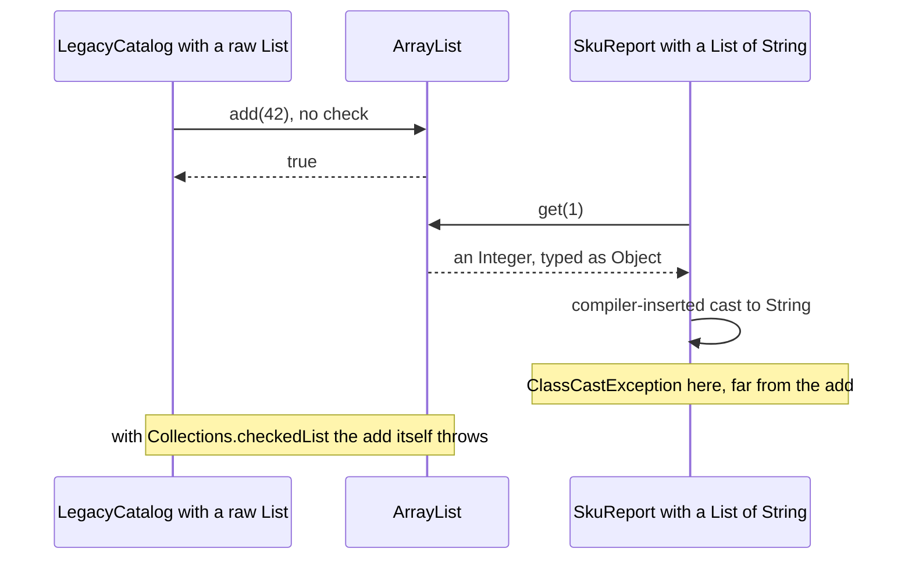
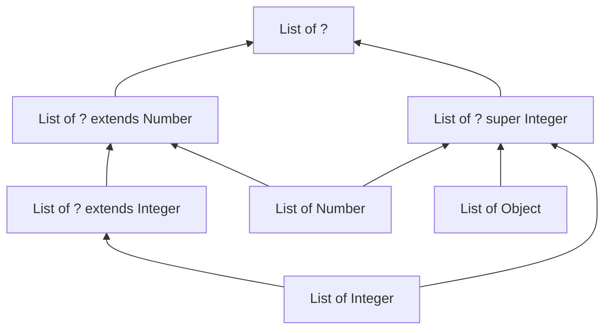
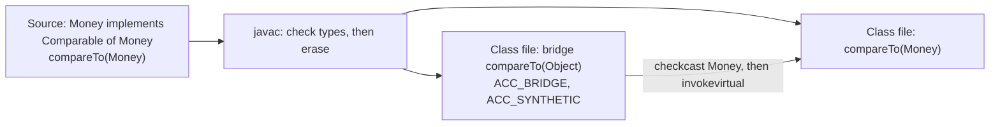
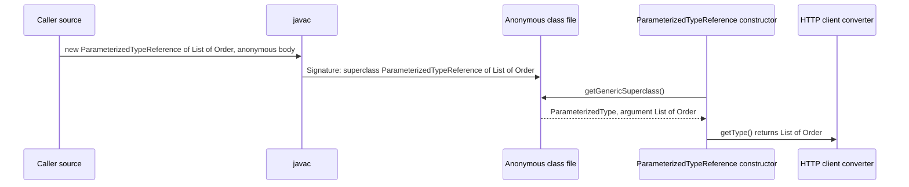

# 03. Generics and type erasure

> **What this covers:** how Java generics move type checks from run time to compile time: generic types and methods, inference, bounds, and the wildcards that make APIs flexible (PECS). Then what the compiler erases and what the class file keeps, the bridge methods and heap pollution that follow from it, and how libraries such as Spring recover a full generic type at run time with type tokens.
> **Prerequisites:** [01. Java OOP fundamentals § 8. Polymorphism: overloading, overriding and dispatch](01-java-oop-fundamentals.md#8-polymorphism-overloading-overriding-and-dispatch), [§ 9. Abstract classes and interfaces](01-java-oop-fundamentals.md#9-abstract-classes-and-interfaces)
> **Leads to:** [04. Collections internals](04-java-collections-internals.md), [05. Lambdas, streams and `Optional`](05-java-lambdas-streams-optional.md), [15. Spring IoC and bean lifecycle](15-spring-ioc-and-bean-lifecycle.md)
> **Applies to:** Java 25, Spring Framework 7.0.10 (§7 only)
> **Study time:** ~5 hours reading + ~3 hours exercises
> **Short on time:** [4. Wildcards, PECS and variance](#4-wildcards-pecs-and-variance), [5. Type erasure and bridge methods](#5-type-erasure-and-bridge-methods), [7. Capturing types at run time: class tokens and super type tokens](#7-capturing-types-at-run-time-class-tokens-and-super-type-tokens); questions [Q03.02](#q03-02), [Q03.09](#q03-09), [Q03.11](#q03-11), [Q03.15](#q03-15), [Q03.20](#q03-20); then [Summary](#summary).
> **Labs:** [`labs/java-language/`](../labs/java-language/), package `dev.interview.javalanguage.m03`. Run: `JAVA_HOME=$(/usr/libexec/java_home -v 25) mvn -q -f java-backend-guide/labs/pom.xml -pl java-language -am verify`. Needs Docker: no.

## Contents

1. [Why generics: compile-time safety and raw types](#1-why-generics-compile-time-safety-and-raw-types)
2. [Generic types, generic methods and type inference](#2-generic-types-generic-methods-and-type-inference)
3. [Bounded type parameters](#3-bounded-type-parameters)
4. [Wildcards, PECS and variance](#4-wildcards-pecs-and-variance)
5. [Type erasure and bridge methods](#5-type-erasure-and-bridge-methods)
6. [Reifiable types, generic arrays and heap pollution](#6-reifiable-types-generic-arrays-and-heap-pollution)
7. [Capturing types at run time: class tokens and super type tokens](#7-capturing-types-at-run-time-class-tokens-and-super-type-tokens)
8. [Reading generic signatures in the JDK](#8-reading-generic-signatures-in-the-jdk)
- [Summary](#summary)
- [Question bank](#question-bank)
- [Hands-on exercises](#hands-on-exercises)
- [Check your understanding](#check-your-understanding)
- [Connections](#connections)

## 1. Why generics: compile-time safety and raw types
### The problem it solves

A warehouse service keeps SKU codes (stock-keeping unit identifiers) in a `List`. Written the pre-Java-5 way, that list holds `Object`, so every read needs a cast and nothing stops a caller from adding a stock count, an `Integer`, to it. The `add` succeeds. The failure comes later, in a nightly report that reads the element as a `String` and dies with a `ClassCastException`. The stack trace points at the report, which is correct code, and says nothing about the line that put the number there, which may have run hours earlier in another class. Generics exist to move that failure from a run-time read to the compile-time `add`.

### Mental model

A generic type is a box with a label, and the compiler is a customs officer who reads labels. With `List<String>` the officer checks every item going in, so nothing needs checking on the way out. A raw `List` is the same box with the label torn off: the officer waves everything through, and the person who later unpacks the box, expecting only strings, is the one who gets hurt.



What to notice: the list never checks anything. The only check is the cast the compiler puts in the reading code, so the exception appears wherever the element is first used as a `String`.

### How it actually works

**What a type argument buys.** `List<E>` declares a type parameter `E`, a placeholder for an element type. `List<String>` supplies the type argument `String`, and the result is called a parameterized type. From then on the compiler does two things. It rejects a wrong argument: `names.add(42)` on a `List<String>` does not compile [Lab: RawTypeCompileRulesTest](../labs/java-language/src/test/java/dev/interview/javalanguage/m03/s01/RawTypeCompileRulesTest.java). And it writes the casts for you: `SkuReport.firstLetters` below has no cast in its source, yet the `ClassCastException` is thrown from inside that method, because the compiler inserted a cast to `String` where each element is read [Lab: RawTypesTest](../labs/java-language/src/test/java/dev/interview/javalanguage/m03/s01/RawTypesTest.java). The type argument itself is not kept in the object: an `ArrayList<String>` and an `ArrayList<Integer>` have the same run-time class [Lab: M03LabSmokeTest](../labs/java-language/src/test/java/dev/interview/javalanguage/m03/smoke/M03LabSmokeTest.java). That removal is type erasure, the subject of [§5](#5-type-erasure-and-bridge-methods).

**What a raw type is.** A raw type is the name of a generic class or interface used without a type argument list, such as `List` instead of `List<String>`. The types of its constructors, instance methods and non-static fields are their erasures, so `add(E)` becomes `add(Object)` and accepts anything. A raw variable can also be assigned any parameterized instance of its type without a warning, which is how the `List<String>` reaches the legacy code in the first place. The specification allows raw types "only as a concession to compatibility of legacy code", so that libraries could become generic in Java 5 without breaking their callers. It strongly discourages them in new code and says a future version of the language may disallow them [Doc: JLS §4.8](https://docs.oracle.com/javase/specs/jls/se25/html/jls-4.html#jls-4.8).

**The two warnings.** javac reports two different things, under two lint categories (lint is javac's set of optional warning groups, enabled with `-Xlint:<key>`) [Doc: javac, Java 25](https://docs.oracle.com/en/java/javase/25/docs/specs/man/javac.html):

| Lint key | What it flags | What it means |
|---|---|---|
| `rawtypes` | the mention of a raw type (`List raw`) | type checking is switched off for this variable |
| `unchecked` | an operation the compiler cannot check, here the call `raw.add(42)` | this line may put a wrong element into a typed collection |

The second one is the warning the specification requires: calling a method of a raw type is an unchecked warning whenever erasure changes a parameter type, as it does for `add(E)` [Doc: JLS §4.8](https://docs.oracle.com/javase/specs/jls/se25/html/jls-4.html#jls-4.8). In the lab, compiling the raw `add` with `-Xlint:rawtypes,unchecked` succeeds and produces both warnings. With no lint flag the same source produces no warning at all, only a note that the file uses unchecked operations, which is why raw types survive unnoticed in builds that never turn the flags on [Lab: RawTypeCompileRulesTest](../labs/java-language/src/test/java/dev/interview/javalanguage/m03/s01/RawTypeCompileRulesTest.java).

**Why the warning matters.** A variable of a parameterized type that refers to an object which is not of that type is called heap pollution, and the specification gives a guarantee about it: if no operation that requires an unchecked warning takes place, and no array of a non-reifiable element type is aliased unsafely, heap pollution cannot occur [Doc: JLS §4.12.2](https://docs.oracle.com/javase/specs/jls/se25/html/jls-4.html#jls-4.12.2). So in a program with no unchecked warnings and no such array aliasing, no compiler-inserted cast can fail, and every suppressed warning is a hole in that guarantee. Arrays and varargs, the other route to pollution, are in [§6](#6-reifiable-types-generic-arrays-and-heap-pollution).

**Moving the failure back.** `Collections.checkedList(list, String.class)` returns a view that keeps a `Class` object, the one thing a raw caller cannot erase. Every insertion goes through `typeCheck`, which calls `type.isInstance(o)` and throws `ClassCastException` for a non-null element of the wrong class [Src: JDK 25, java.util.Collections](https://github.com/openjdk/jdk/blob/jdk-25-ga/src/java.base/share/classes/java/util/Collections.java). In the lab the exception's top frame is `Collections$CheckedCollection.typeCheck`, reached from the bad `add`, and the list keeps its single element [Lab: RawTypesTest](../labs/java-language/src/test/java/dev/interview/javalanguage/m03/s01/RawTypesTest.java).

### Code

The lab reproduces the incident with two classes and then moves the failure.

1. `LegacyCatalog` is the pre-generics API, kept as the defect: its parameter is a raw `List`, so its `add` is unchecked.
2. `SkuReport` is correct, typed code with no cast in its source.
3. The first test pollutes a `List<String>` through `LegacyCatalog`, shows that the `add` and an `Object` read both succeed, and asserts that the exception comes from `SkuReport`.
4. The second test wraps the list with `Collections.checkedList` and asserts that the same `add` now throws.

```java
package dev.interview.javalanguage.m03.s01;

import java.util.List;

// Module 03 §1: a pre-generics API, the defect on purpose. Its parameter is a raw List, so javac checks no element.
public final class LegacyCatalog {

    private static final Integer STOCK_COUNT = 42;

    private LegacyCatalog() {}

    @SuppressWarnings({"rawtypes", "unchecked"})
    public static void addStockCount(List skus) {
        skus.add(STOCK_COUNT);
    }
}
```
<sub>Source: [labs/java-language/src/main/java/dev/interview/javalanguage/m03/s01/LegacyCatalog.java](../labs/java-language/src/main/java/dev/interview/javalanguage/m03/s01/LegacyCatalog.java)</sub>

```java
package dev.interview.javalanguage.m03.s01;

import java.util.List;

// Module 03 §1: typed code with no cast in its source. javac inserts the cast where each element is read as a String.
public final class SkuReport {

    private SkuReport() {}

    public static String firstLetters(List<String> skus) {
        StringBuilder letters = new StringBuilder();
        for (String sku : skus) {
            letters.append(sku.charAt(0));
        }
        return letters.toString();
    }
}
```
<sub>Source: [labs/java-language/src/main/java/dev/interview/javalanguage/m03/s01/SkuReport.java](../labs/java-language/src/main/java/dev/interview/javalanguage/m03/s01/SkuReport.java)</sub>

Where each version fails (excerpt):

```java
// Excerpt of labs/java-language/src/test/java/dev/interview/javalanguage/m03/s01/RawTypesTest.java
    private static final String SKU = "A-100";
    private static final String CHECKED_VIEW_CLASS = "java.util.Collections$CheckedCollection";
    private static final String TYPE_CHECK_METHOD = "typeCheck";

    @Test
    @DisplayName("M03 §1 · a raw-typed add makes the ClassCastException appear at the typed read")
    void firstLetters_throwsClassCastException_whenRawAddPollutedTheList() {
        List<String> skus = new ArrayList<>(List.of(SKU));

        LegacyCatalog.addStockCount(skus);

        assertThat(skus).hasSize(2);
        for (Object element : skus) {
            assertThat(element).isNotNull();
        }
        ClassCastException thrown = catchThrowableOfType(ClassCastException.class, () -> SkuReport.firstLetters(skus));
        assertThat(thrown).isNotNull();
        assertThat(thrown.getStackTrace()[0].getClassName()).isEqualTo(SkuReport.class.getName());
    }

    @Test
    @DisplayName("M03 §1 · Collections.checkedList throws at the bad add")
    void addStockCount_throwsClassCastException_whenListIsCheckedView() {
        List<String> skus = Collections.checkedList(new ArrayList<>(List.of(SKU)), String.class);

        ClassCastException thrown =
                catchThrowableOfType(ClassCastException.class, () -> LegacyCatalog.addStockCount(skus));

        assertThat(thrown).isNotNull();
        StackTraceElement top = thrown.getStackTrace()[0];
        assertThat(top.getClassName()).isEqualTo(CHECKED_VIEW_CLASS);
        assertThat(top.getMethodName()).isEqualTo(TYPE_CHECK_METHOD);
        assertThat(skus).hasSize(1);
    }
```

The compile-time side: the source below compiles, and the test asserts the two warning keys rather than the message text (excerpt).

```java
// Excerpt of labs/java-language/src/test/java/dev/interview/javalanguage/m03/s01/RawTypeCompileRulesTest.java
    private static final String LINT = "-Xlint:rawtypes,unchecked";
    private static final String RAW_USE = "compiler.warn.raw.class.use";
    private static final String UNCHECKED_CALL = "compiler.warn.unchecked.call.mbr.of.raw.type";

    private static final String RAW_ADD = """
            import java.util.*;
            class Raw {
                List<String> run() {
                    List<String> names = new ArrayList<>();
                    List raw = names;
                    raw.add(42);
                    return names;
                }
            }
            """;

    @Test
    @DisplayName("M03 §1 · a raw List accepts any element and warns under -Xlint:rawtypes,unchecked")
    void compile_warnsTwice_whenRawListIsUsedWithLint() {
        var result = InMemoryCompiler.compile(Map.of(SOURCE_NAME, RAW_ADD), LINT);

        assertThat(result.success()).isTrue();
        assertThat(warningCodes(result)).contains(RAW_USE, UNCHECKED_CALL);
    }
```

### Failure modes and operations

**The delayed `ClassCastException`.** The exception is thrown where the element is first used as its declared type, not where it was inserted, so the top frame names innocent code: in the lab it is `SkuReport` [Lab: RawTypesTest](../labs/java-language/src/test/java/dev/interview/javalanguage/m03/s01/RawTypesTest.java). Code that only treats elements as `Object` (logging, `size()`, copying) passes the bad element along untouched, so the cause and the symptom can be far apart in both code and time. Load plays no part: the failure depends on the data, and it repeats every time the polluted element is read as a `String`.

**Legacy APIs that return raw types.** Assigning a raw `List` to a `List<String>` is allowed with an unchecked warning, for the sake of old libraries; the specification notes that the warning means the caller "may experience problems from heap pollution at other points in the program" [Doc: JLS §4.8](https://docs.oracle.com/javase/specs/jls/se25/html/jls-4.html#jls-4.8). [Q03.03](#q03-03) works through that incident.

**Suppression that is too wide.** `@SuppressWarnings` applies to the annotated element and everything inside it, so one annotation on a class also hides every unchecked warning added to that class later [Src: JDK 25, java.lang.SuppressWarnings](https://github.com/openjdk/jdk/blob/jdk-25-ga/src/java.base/share/classes/java/lang/SuppressWarnings.java). The two keys are independent: in the lab, `@SuppressWarnings("unchecked")` on a method removes the unchecked warning and leaves the `rawtypes` one [Lab: RawTypeCompileRulesTest](../labs/java-language/src/test/java/dev/interview/javalanguage/m03/s01/RawTypeCompileRulesTest.java).

**What to configure and observe.** Compile with `-Xlint:rawtypes,unchecked`, and add `-Werror`, which terminates compilation when warnings occur, once the existing ones are fixed [Doc: javac, Java 25](https://docs.oracle.com/en/java/javase/25/docs/specs/man/javac.html). Without the flags the only trace in a build log is the note about unchecked operations. At run time, a `ClassCastException` whose top frame is a method with no cast in its source is the signature of heap pollution. To find the writer, wrap the collection in a checked view where it is created: the `Collections` Javadoc describes exactly this use, as a debugging aid for a reproducible failure [Src: JDK 25, java.util.Collections](https://github.com/openjdk/jdk/blob/jdk-25-ga/src/java.base/share/classes/java/util/Collections.java).

> [!NOTE]
> **Version notes.** Java 1.4 and earlier: no generics, so collections hold `Object` and every read is a hand-written cast; that code still compiles today as raw types. Java 5: generics added to the language [Doc: JSR 14](https://jcp.org/en/jsr/detail?id=14). Java 7: the diamond, `new ArrayList<>()`, lets the compiler infer the type arguments of a constructor call [Doc: JSR 334](https://jcp.org/en/jsr/detail?id=334). Java 10: `var` infers a local variable's type from its initializer [Final since Java 10, JEP 286] [Doc: JEP 286](https://openjdk.org/jeps/286). Java 25 (default): raw types are still legal and still only a warning [Doc: JLS §4.8](https://docs.oracle.com/javase/specs/jls/se25/html/jls-4.html#jls-4.8). Inference is covered in [§2](#2-generic-types-generic-methods-and-type-inference).

### Best practices and anti-patterns

- Never use a raw type in new code; write `List<String>`, or `List<?>` when the element type does not matter, because a raw type switches off the check for every operation on that variable.
- Compile with `-Xlint:rawtypes,unchecked` and fail the build on warnings, because without the flags javac prints one note per file and the problem stays invisible.
- Treat each unchecked warning as a claim to prove, because a program with none cannot fail in a compiler-inserted cast (the array cases of [§6](#6-reifiable-types-generic-arrays-and-heap-pollution) aside).
- When a warning cannot be removed, put `@SuppressWarnings("unchecked")` on the smallest declaration that works (a local variable or a short method) with a comment saying why the operation is safe, because the annotation covers everything inside the element it marks.
- Do not suppress `rawtypes` and `unchecked` together by habit, because they answer different questions: one says a type is unchecked, the other says this line may pollute.
- Wrap a legacy raw API once, at the boundary, in a method that copies its result into a typed collection after checking each element, because the failure then happens at the boundary and names the library.
- Use `Collections.checkedList` (and the other `checked…` views) to locate a bad writer, or when handing a collection to code you do not control, because the view fails at the insertion; it adds a check to every write, so it is a diagnostic and a guard, not a default.

### Misconceptions and traps

- *"A raw `List` and a `List<Object>` are the same thing."* A raw `List` turns checking off: it accepts any parameterized list and any element, with warnings at most. `List<Object>` is an ordinary parameterized type that the compiler checks like any other. The myth exists because both let you add any object; [Q03.12](#q03-12) and [§4](#4-wildcards-pecs-and-variance) show where they differ.
- *"Generics add a run-time cost."* The type arguments are erased, so there is one class however many parameterizations the program uses, and the casts are the ones a programmer wrote by hand before Java 5 [Lab: M03LabSmokeTest](../labs/java-language/src/test/java/dev/interview/javalanguage/m03/smoke/M03LabSmokeTest.java). The myth comes from C++ templates, which look similar; the Java 5 guide answers it directly: generics "do not generate a new class for each specialization" [Doc: Java 5 language guide, Generics](https://docs.oracle.com/javase/1.5.0/docs/guide/language/generics.html).
- *"If it compiles without errors, the types are right."* Only when it also compiles without unchecked warnings; a raw `add` is not an error [Lab: RawTypeCompileRulesTest](../labs/java-language/src/test/java/dev/interview/javalanguage/m03/s01/RawTypeCompileRulesTest.java). It looks true because default javac output hides the warnings behind a note.
- *"The `ClassCastException` shows where the bug is."* It shows where the wrong element was first read as its declared type. The bug is the earlier unchecked write, which the stack trace does not contain. The belief carries over from hand-written casts, where the cast and the mistake are usually on the same line.

Questions that drill this section: [Q03.01](#q03-01), [Q03.02](#q03-02), [Q03.03](#q03-03), [Q03.12](#q03-12).

## 2. Generic types, generic methods and type inference
### The problem it solves

A configuration holder stores values of several types, so its getter returns `Object` and every caller casts. Someone tidies it up with a generic signature, `<T> T get(String key)`, and the casts disappear from the callers: `Integer port = settings.get("port")` compiles with no warning. The stored value is the text `"8080"`. The line fails at run time with a `ClassCastException`, in the caller, on a line that contains no cast. The signature looked type-safe and promised nothing, because nothing in it tells the compiler what `T` is. To read a generic signature you have to know two things: where a type parameter is declared, and who chooses its value.

### Mental model

A type parameter is a blank on a form. A generic class prints the blank on the form itself: whoever takes a copy fills it in once, and every field of that copy uses the same answer. A generic method has its own blank, filled in again at each call. Type inference is a clerk who fills in the blank for you when the context makes the answer obvious, and who writes the most general answer, `Object`, when the context says nothing.

| Declared on | Who chooses the type argument | Chosen | Example |
|---|---|---|---|
| a class or interface, `class Box<T>` | the code that names the type or creates the instance | once per use of the type | `Box<String> name = new Box<>("sku")` |
| a method, `static <T> T firstOr(List<T> elements, T fallback)` | each call, almost always by inference | at every call | `Elements.firstOr(List.of(7), 0)` |
| a constructor, `<T> Catalog(T seed)` | each `new` expression | at every instantiation | rare in practice |

### How it actually works

**Generic classes.** A class is generic if its declaration declares one or more type variables. `Box<String>` and `Box<Integer>` are different types to the compiler, and "all of these parameterized types share the same class at run time". Two rules follow from one class serving every parameterization: a static member cannot refer to the class's type parameter, because static members belong to the class and not to one parameterization of it, and a generic class cannot be a subclass of `Throwable` [Doc: JLS §8.1.2](https://docs.oracle.com/javase/specs/jls/se25/html/jls-8.html#jls-8.1.2) [Doc: JLS §6.5.5.1](https://docs.oracle.com/javase/specs/jls/se25/html/jls-6.html#jls-6.5.5.1). By convention type parameters are single uppercase letters, so that they are not mistaken for class names: `T` for a type, `E` for an element, `K` and `V` for a key and a value, `N` for a number [Doc: The Java Tutorials, Generic Types](https://docs.oracle.com/javase/tutorial/java/generics/types.html). `R` for a result type is the JDK's own habit, as in `Function<T, R>`.

**Generic methods and constructors.** A method is generic if it declares its own type variables, written before the return type: `static <T> T firstOr(...)`. It can live in a non-generic class, and a generic class can add method-level parameters of its own, as `Box.map` does with `<R>`. The type arguments "may not need to be provided explicitly when a generic method is invoked, as they can often be inferred" [Doc: JLS §8.4.4](https://docs.oracle.com/javase/specs/jls/se25/html/jls-8.html#jls-8.4.4). A constructor can be generic too, independently of whether its class is [Doc: JLS §8.8.4](https://docs.oracle.com/javase/specs/jls/se25/html/jls-8.html#jls-8.8.4).

**Inference and the target type.** The compiler infers type arguments from two sources: the arguments of the call, and the target type, which is the type the surrounding context expects. An expression whose type may depend on its target is called a poly expression, and the rule that decides everything below is when an expression is one:

- A `new` expression with the diamond `<>` is a poly expression only when it appears in an assignment or as a method argument [Doc: JLS §15.9](https://docs.oracle.com/javase/specs/jls/se25/html/jls-15.html#jls-15.9). In `List<String> names = new ArrayList<>()` the target is `List<String>`, so the result is an `ArrayList<String>`. The diamond is not a raw type: in the lab it compiles with no warning under `-Xlint:rawtypes,unchecked`, while `new ArrayList()` in the same place produces a raw-type warning and an unchecked-conversion warning, and a diamond passed as a method argument is inferred from the parameter type [Lab: TypeInferenceCompileRulesTest](../labs/java-language/src/test/java/dev/interview/javalanguage/m03/s02/TypeInferenceCompileRulesTest.java).
- A generic method call is a poly expression only when it appears in an assignment or as an argument, has no explicit type arguments, and its return type mentions a type parameter [Doc: JLS §15.12](https://docs.oracle.com/javase/specs/jls/se25/html/jls-15.html#jls-15.12). The receiver of a chained call is in neither position. So `Collections.emptyList().get(0)` infers with no target, and a type variable left with nothing but its upper bound resolves to that bound, here `Object` [Doc: JLS §18.4](https://docs.oracle.com/javase/specs/jls/se25/html/jls-18.html#jls-18.4). In the lab, returning that expression as a `String` is a compile error, and the explicit type argument, called a type witness, fixes it: `Collections.<String>emptyList().get(0)` [Lab: TypeInferenceCompileRulesTest](../labs/java-language/src/test/java/dev/interview/javalanguage/m03/s02/TypeInferenceCompileRulesTest.java).

**`var`.** For `var`, the type of the variable is the type of the initializer "treated as if it did not appear in an assignment context", that is, as a standalone expression, and a `null` initializer is an error [Doc: JLS §14.4.1](https://docs.oracle.com/javase/specs/jls/se25/html/jls-14.html#jls-14.4.1). So `var` gives the initializer no target type, and `var list = new ArrayList<>()` is an `ArrayList<Object>`: in the lab it accepts a `String` and an `Integer`, and reading an element as a `String` does not compile. `var` is still static typing. The type is fixed at the declaration, so assigning an `int` to a `var` that was initialized with a `String` is a compile error, as is a `var` with no initializer [Lab: TypeInferenceCompileRulesTest](../labs/java-language/src/test/java/dev/interview/javalanguage/m03/s02/TypeInferenceCompileRulesTest.java).

**Why `<T> T get(String key)` is a trap.** `T` appears only in the return type, so no argument constrains it and the target type alone decides: `Integer port = settings.get("port")` infers `T = Integer`. Inside the getter, the cast `(T)` is an unchecked cast. In the lab javac reports it once, at the getter, and reports nothing at the caller; with `@SuppressWarnings("unchecked")` on the getter there is no warning anywhere [Lab: TypeInferenceCompileRulesTest](../labs/java-language/src/test/java/dev/interview/javalanguage/m03/s02/TypeInferenceCompileRulesTest.java). The cast inside the getter checks nothing at run time, so the wrong value is returned normally and the first real check is the cast the compiler inserts in the caller: in the lab an `Object` read succeeds, and the `Integer` read throws with the caller's class as the top stack frame [Lab: GenericDeclarationsTest](../labs/java-language/src/test/java/dev/interview/javalanguage/m03/s02/GenericDeclarationsTest.java). It is the heap pollution of [§1](#1-why-generics-compile-time-safety-and-raw-types) packaged as an API; why the cast checks nothing is erasure, in [§5](#5-type-erasure-and-bridge-methods).

### Code

Three small classes show the three cases: a class-level parameter, a method-level parameter, and a parameter nothing constrains.

1. `Box<T>` declares `T` on the class, and `map` declares a second parameter `R` on the method.
2. `Elements.firstOr` is a generic method in a non-generic class; both arguments constrain `T`.
3. `Settings.get` is the defect: `T` occurs only in the return type.
4. The test shows that the caller, not `Settings`, fails.

```java
package dev.interview.javalanguage.m03.s02;

import java.util.function.Function;

// Module 03 §2: a generic class. T is chosen once per instance; map adds a method-level R chosen at each call.
public final class Box<T> {

    private final T value;

    public Box(T value) {
        this.value = value;
    }

    public T value() {
        return value;
    }

    public <R> Box<R> map(Function<T, R> mapper) {
        return new Box<>(mapper.apply(value));
    }
}
```
<sub>Source: [labs/java-language/src/main/java/dev/interview/javalanguage/m03/s02/Box.java](../labs/java-language/src/main/java/dev/interview/javalanguage/m03/s02/Box.java)</sub>

```java
package dev.interview.javalanguage.m03.s02;

import java.util.List;

// Module 03 §2: a generic method in a non-generic class. The <T> before the return type declares the parameter.
public final class Elements {

    private Elements() {}

    public static <T> T firstOr(List<T> elements, T fallback) {
        return elements.isEmpty() ? fallback : elements.get(0);
    }
}
```
<sub>Source: [labs/java-language/src/main/java/dev/interview/javalanguage/m03/s02/Elements.java](../labs/java-language/src/main/java/dev/interview/javalanguage/m03/s02/Elements.java)</sub>

```java
package dev.interview.javalanguage.m03.s02;

import java.util.HashMap;
import java.util.Map;

// Module 03 §2: the defect on purpose. T appears only in the return type, so the caller picks it and nothing checks it.
public final class Settings {

    private final Map<String, Object> values = new HashMap<>();

    public void put(String key, Object value) {
        values.put(key, value);
    }

    @SuppressWarnings("unchecked")
    public <T> T get(String key) {
        return (T) values.get(key);
    }
}
```
<sub>Source: [labs/java-language/src/main/java/dev/interview/javalanguage/m03/s02/Settings.java](../labs/java-language/src/main/java/dev/interview/javalanguage/m03/s02/Settings.java)</sub>

The caller's side (excerpt). `readPort` has no cast in its source, and it is where the exception is thrown.

```java
// Excerpt of labs/java-language/src/test/java/dev/interview/javalanguage/m03/s02/GenericDeclarationsTest.java
    private static final String PORT_KEY = "port";
    private static final String PORT_TEXT = "8080";

    @Test
    @DisplayName("M03 §2 · a <T> T getter throws ClassCastException at the caller's assignment")
    void get_throwsClassCastExceptionInTheCaller_whenTheStoredValueHasAnotherType() {
        Settings settings = new Settings();
        settings.put(PORT_KEY, PORT_TEXT);

        Object untyped = settings.get(PORT_KEY);
        ClassCastException thrown = catchThrowableOfType(ClassCastException.class, () -> readPort(settings));

        assertThat(untyped).isEqualTo(PORT_TEXT);
        assertThat(thrown).isNotNull();
        assertThat(thrown.getStackTrace()[0].getClassName()).isEqualTo(GenericDeclarationsTest.class.getName());
    }

    private static Integer readPort(Settings settings) {
        return settings.get(PORT_KEY);
    }
```

The inference rules, each as a pair of sources that differ in one detail (excerpt):

```java
// Excerpt of labs/java-language/src/test/java/dev/interview/javalanguage/m03/s02/TypeInferenceCompileRulesTest.java
    private static final String VAR_DIAMOND_MIXED_ADDS =
            source("void run() { var list = new ArrayList<>(); list.add(\"a\"); list.add(1); }");
    private static final String VAR_DIAMOND_STRING_READ =
            source("void run() { var list = new ArrayList<>(); list.add(\"a\"); String s = list.get(0); }");
    private static final String VAR_EXPLICIT_STRING_READ =
            source("void run() { var list = new ArrayList<String>(); list.add(\"a\"); String s = list.get(0); }");
    private static final String CHAIN_WITHOUT_WITNESS =
            source("String run() { return Collections.emptyList().get(0); }");
    private static final String CHAIN_WITH_WITNESS =
            source("String run() { return Collections.<String>emptyList().get(0); }");

    @Test
    @DisplayName("M03 §2 · var with a diamond infers ArrayList<Object>")
    void compile_infersObjectElements_whenVarIsInitializedWithADiamond() {
        assertThat(compile(VAR_DIAMOND_MIXED_ADDS).success()).isTrue();
        assertThat(compile(VAR_DIAMOND_STRING_READ).errorCodes()).contains(INCOMPATIBLE_TYPES);
        assertThat(compile(VAR_EXPLICIT_STRING_READ).success()).isTrue();
    }

    @Test
    @DisplayName("M03 §2 · a type witness selects T where inference cannot")
    void compile_succeedsOnlyWithATypeWitness_whenTheCallIsAReceiverInAChain() {
        assertThat(compile(CHAIN_WITHOUT_WITNESS).errorCodes()).contains(INCOMPATIBLE_TYPES);
        assertThat(compile(CHAIN_WITH_WITNESS).success()).isTrue();
    }

    private static String source(String members) {
        return "import java.util.*;\nclass Raw {\n" + members + "\n}\n";
    }
```

### Failure modes and operations

Declaring and inferring type parameters happens entirely at compile time, so this section has no load or deployment behavior: a wrong inference is a compile error, as the lab's `var` and chained-call cases show [Lab: TypeInferenceCompileRulesTest](../labs/java-language/src/test/java/dev/interview/javalanguage/m03/s02/TypeInferenceCompileRulesTest.java). The one run-time failure is the unconstrained `<T> T` getter, which moves a `ClassCastException` into every caller that guesses the type wrong [Lab: GenericDeclarationsTest](../labs/java-language/src/test/java/dev/interview/javalanguage/m03/s02/GenericDeclarationsTest.java). What to observe: the only compile-time signal is the unchecked-cast warning at the getter, so a suppressed warning on a method whose type parameter appears only in its return type deserves a second look in review. [Q03.06](#q03-06) is the bug hunt.

> [!NOTE]
> **Version notes.** Java 5 and 6: constructor type arguments are written out, `new ArrayList<String>()`. Java 7: the diamond infers them [Doc: JSR 334](https://jcp.org/en/jsr/detail?id=334). Java 8: a generic method call that is itself a method argument is inferred from the parameter type it is passed to [Doc: JEP 101](https://openjdk.org/jeps/101). Java 9: the diamond is allowed with anonymous classes when the inferred type is denotable [Doc: JEP 213](https://openjdk.org/jeps/213). Java 10: `var` for local variables [Doc: JEP 286](https://openjdk.org/jeps/286). Java 11: `var` on the parameters of an implicitly typed lambda [Doc: JEP 323](https://openjdk.org/jeps/323). Java 25 (default): the receiver of a chained call still has no target type, so it still needs a type witness [Lab: TypeInferenceCompileRulesTest](../labs/java-language/src/test/java/dev/interview/javalanguage/m03/s02/TypeInferenceCompileRulesTest.java).

### Best practices and anti-patterns

- Declare a type parameter on the class when it describes the instance's state, and on the method when it only relates that call's arguments and result, because a class-level parameter that one method needs forces every user of the class to supply it.
- Make every method type parameter appear in at least one parameter type, because a parameter that occurs only in the return type is chosen by the caller and checked by nothing.
- For a container of mixed types, pass a `Class<T>` token and let the method check it, as [§7](#7-capturing-types-at-run-time-class-tokens-and-super-type-tokens) and [Exercise 03.1](#ex03-1) do, because the token is a run-time value the method can test.
- Use the diamond on the right-hand side and keep the type on the left, because the declaration then documents the type and the compiler infers the repetition.
- Do not combine `var` with a diamond; write `var names = new ArrayList<String>()`, because with `var` there is no target type and the element type silently becomes `Object`.
- Use a type witness only where inference has no target, such as the receiver of a chained call, because elsewhere it is noise the compiler would infer.
- Keep the conventional single-letter names, because a type parameter named like a class reads as one.

### Misconceptions and traps

- *"The diamond is a raw type with nicer syntax."* The diamond means "infer the type arguments"; the result is a fully parameterized type and compiles without warnings, while `new ArrayList()` is raw and warns [Lab: TypeInferenceCompileRulesTest](../labs/java-language/src/test/java/dev/interview/javalanguage/m03/s02/TypeInferenceCompileRulesTest.java). The confusion exists because both leave the type argument out.
- *"`var` makes Java dynamically typed."* The type is inferred once, at compile time, and never changes [Final since Java 10, JEP 286] [Doc: JEP 286](https://openjdk.org/jeps/286). The myth comes from JavaScript, where `var` declares a variable that can hold any type.
- *"A method with `<T>` in its signature is type-safe."* Only when something constrains `T`. `<T> T get(String key)` compiles cleanly at every call site and fails in whichever one guessed wrong [Lab: GenericDeclarationsTest](../labs/java-language/src/test/java/dev/interview/javalanguage/m03/s02/GenericDeclarationsTest.java). It looks safe because the caller writes no cast and sees no warning.
- *"Inference looks at the whole statement."* It looks at the expression's own arguments and, only for an assignment or an argument, at its target type; a chained call's receiver is inferred alone [Doc: JLS §15.12](https://docs.oracle.com/javase/specs/jls/se25/html/jls-15.html#jls-15.12). The belief comes from lambdas and the diamond, where the target type visibly flows inward.

Questions that drill this section: [Q03.04](#q03-04), [Q03.05](#q03-05), [Q03.06](#q03-06), [Exercise 03.1](#ex03-1).

## 3. Bounded type parameters
### The problem it solves

A reporting utility needs the largest element of a list, for any element type. With a plain `<T>` the body cannot compare anything: the compiler knows only that a `T` is an `Object`, so `a.compareTo(b)` does not compile. The pre-generics answer was to take `List<Comparable>` and cast, which accepts a list mixing dates and strings and fails at run time. The obvious generic answer, `<T extends Comparable<T>>`, compiles, and then rejects the first `List<LocalDate>` a caller passes. A bound has to say exactly what the body needs from `T`: enough to call the methods it uses, and no more than the callers' types can satisfy.

### Mental model

A bound is a job requirement on a blank. "`T extends Number`" reads "any type, as long as it is a kind of number". Inside the method you may rely on everything the requirement guarantees, and nothing else. A requirement that is too loose leaves the body unable to do its work. One that is too strict turns away qualified candidates, which is what `Comparable<T>` does to `LocalDate`: a date can be compared, but with any date of any calendar system, not only with a `LocalDate`.

### How it actually works

**Upper bounds.** Every type variable has a bound, and `Object` is assumed when none is declared. The bound decides which members the body can use: the members of `T` are those of its bound. It also restricts the callers, whose type argument must be a subtype of the bound [Doc: JLS §4.4](https://docs.oracle.com/javase/specs/jls/se25/html/jls-4.html#jls-4.4). In the lab, calling `doubleValue()` on an unbounded `T` does not compile and the same body with `<T extends Number>` does, while passing a `List<String>` to that method is rejected at the call [Lab: BoundCompileRulesTest](../labs/java-language/src/test/java/dev/interview/javalanguage/m03/s03/BoundCompileRulesTest.java). The keyword is `extends` for interfaces as well as classes.

**Multiple bounds.** A bound may list several types joined by `&`: `<T extends Number & Comparable<T>>`. At most one of them is a class, and it must come first; the rest must be interfaces. The body sees the members of all of them, as an intersection type [Doc: JLS §4.4](https://docs.oracle.com/javase/specs/jls/se25/html/jls-4.html#jls-4.4) [Doc: JLS §4.9](https://docs.oracle.com/javase/specs/jls/se25/html/jls-4.html#jls-4.9). In the lab, `Comparable<T> & Number` is a compile error and `Number & Comparable<T>` compiles [Lab: BoundCompileRulesTest](../labs/java-language/src/test/java/dev/interview/javalanguage/m03/s03/BoundCompileRulesTest.java).

**Order matters for one more reason.** The specification says the order of a bound's types is significant in two ways only: a class may appear only first, and "the erasure of a type variable is determined by the first type in its bound" [Doc: JLS §4.4](https://docs.oracle.com/javase/specs/jls/se25/html/jls-4.html#jls-4.4) [Doc: JLS §4.6](https://docs.oracle.com/javase/specs/jls/se25/html/jls-4.html#jls-4.6). Erasure, covered in [§5](#5-type-erasure-and-bridge-methods), is what remains of a generic signature in the compiled method. Reflection shows both sides. The declared bounds of `clamp` are still readable, `Number` then `Comparable<T>`. Its erased signature takes and returns `Number`; `max`, bounded by `Comparable<? super T>`, returns `Comparable`; and an unbounded `T` returns `Object` [Lab: BoundReflectionTest](../labs/java-language/src/test/java/dev/interview/javalanguage/m03/s03/BoundReflectionTest.java). This is why the JDK declares `Collections.max` with `<T extends Object & Comparable<? super T>>`: the leading `Object` makes the erased return type `Object` instead of `Comparable` [Src: JDK 25, java.util.Collections](https://github.com/openjdk/jdk/blob/jdk-25-ga/src/java.base/share/classes/java/util/Collections.java). [§8](#8-reading-generic-signatures-in-the-jdk) reads that signature in full.

**Recursive bounds.** A bound may mention the variable it bounds. `<T extends Comparable<T>>` says "a type that can be compared with itself", and `Enum` is declared `Enum<E extends Enum<E>>`, so that the methods an enum inherits, such as `compareTo(E)`, are typed with the concrete enum [Src: JDK 25, java.lang.Enum](https://github.com/openjdk/jdk/blob/jdk-25-ga/src/java.base/share/classes/java/lang/Enum.java) [Lab: BoundReflectionTest](../labs/java-language/src/test/java/dev/interview/javalanguage/m03/s03/BoundReflectionTest.java).

**Why `Comparable<? super T>` is the robust form.** `Comparable<T>` is satisfied only by a type that implements `Comparable` of exactly itself. A class that inherits its ordering does not. `LocalDate` implements `ChronoLocalDate`, which extends `Comparable<ChronoLocalDate>`, and `java.sql.Timestamp` extends `java.util.Date`, which implements `Comparable<Date>` [Src: JDK 25, java.time.chrono.ChronoLocalDate](https://github.com/openjdk/jdk/blob/jdk-25-ga/src/java.base/share/classes/java/time/chrono/ChronoLocalDate.java) [Src: JDK 25, java.util.Date](https://github.com/openjdk/jdk/blob/jdk-25-ga/src/java.base/share/classes/java/util/Date.java). So a `LocalDate` is a `Comparable<ChronoLocalDate>`, not a `Comparable<LocalDate>`. `? super T` is a wildcard, a type argument that stands for an unknown type, here "`T` or one of its supertypes"; [§4](#4-wildcards-pecs-and-variance) covers wildcards. The bound `Comparable<? super T>` therefore asks only for what the body needs: something that can compare a `T`. In the lab, `max` over a `List<LocalDate>` or a `List<Timestamp>` does not compile with the strict bound; with the wildcard the `List<LocalDate>` call compiles and returns the latest date [Lab: BoundCompileRulesTest](../labs/java-language/src/test/java/dev/interview/javalanguage/m03/s03/BoundCompileRulesTest.java) [Lab: BoundsTest](../labs/java-language/src/test/java/dev/interview/javalanguage/m03/s03/BoundsTest.java).

**No lower bounds on type parameters.** The grammar of a type parameter allows only `extends`. `<T super Integer>` is a syntax error; `super` exists only on wildcards [Doc: JLS §4.4](https://docs.oracle.com/javase/specs/jls/se25/html/jls-4.html#jls-4.4) [Lab: BoundCompileRulesTest](../labs/java-language/src/test/java/dev/interview/javalanguage/m03/s03/BoundCompileRulesTest.java).

### Code

`Bounds` has one method per kind of bound.

1. `sum` needs `doubleValue()`, so it bounds `T` by `Number`.
2. `clamp` needs `compareTo` too, so it adds `Comparable<T>` after the class bound.
3. `max` needs only to compare, and uses `Comparable<? super T>` so that types with an inherited ordering qualify. It starts from `iterator.next()`, so an empty list throws `NoSuchElementException`.

```java
package dev.interview.javalanguage.m03.s03;

import java.util.Iterator;
import java.util.List;

// Module 03 §3: one method per kind of bound. The bound is what lets each body call a method on a T.
public final class Bounds {

    private Bounds() {}

    public static <T extends Number> double sum(List<T> values) {
        double total = 0.0;
        for (T value : values) {
            total += value.doubleValue();
        }
        return total;
    }

    public static <T extends Number & Comparable<T>> T clamp(T value, T low, T high) {
        if (value.compareTo(low) < 0) {
            return low;
        }
        if (value.compareTo(high) > 0) {
            return high;
        }
        return value;
    }

    public static <T extends Comparable<? super T>> T max(List<T> values) {
        Iterator<T> iterator = values.iterator();
        T best = iterator.next();
        while (iterator.hasNext()) {
            T candidate = iterator.next();
            if (candidate.compareTo(best) > 0) {
                best = candidate;
            }
        }
        return best;
    }
}
```
<sub>Source: [labs/java-language/src/main/java/dev/interview/javalanguage/m03/s03/Bounds.java](../labs/java-language/src/main/java/dev/interview/javalanguage/m03/s03/Bounds.java)</sub>

The strict and the robust bound, compiled against the same callers (excerpt):

```java
// Excerpt of labs/java-language/src/test/java/dev/interview/javalanguage/m03/s03/BoundCompileRulesTest.java
    private static final String STRICT_MAX = "static <T extends Comparable<T>> T max(List<T> v) { return v.get(0); }";
    private static final String SUPER_MAX =
            "static <T extends Comparable<? super T>> T max(List<T> v) { return v.get(0); }";
    private static final String MAX_OF_DATES =
            "java.time.LocalDate run(List<java.time.LocalDate> dates) { return max(dates); }";
    private static final String MAX_OF_TIMESTAMPS =
            "java.sql.Timestamp run(List<java.sql.Timestamp> stamps) { return max(stamps); }";

            "M03 §3 · max(List<LocalDate>) fails with <T extends Comparable<T>> and compiles with Comparable<? super T>")
    void compile_succeedsOnlyWithSuperWildcard_whenElementInheritsItsComparable() {
        assertThat(compile(STRICT_MAX + MAX_OF_DATES).errorCodes()).contains(CANNOT_APPLY);
```

What reflection sees: the declared bounds, and the erased signature (excerpt).

```java
// Excerpt of labs/java-language/src/test/java/dev/interview/javalanguage/m03/s03/BoundReflectionTest.java
    @Test
    @DisplayName("M03 §3 · a type variable's bounds are visible by reflection")
    void getBounds_returnsNumberThenComparable_whenTypeVariableHasTwoBounds() throws NoSuchMethodException {
        Type[] bounds = clamp().getTypeParameters()[0].getBounds();

        assertThat(bounds).hasSize(TWO_BOUNDS);
        assertThat(bounds[0]).isEqualTo(Number.class);
        assertThat(bounds[1]).isInstanceOf(ParameterizedType.class);
        assertThat(((ParameterizedType) bounds[1]).getRawType()).isEqualTo(Comparable.class);
    }

    @Test
    @DisplayName("M03 §3 · a bounded type variable erases to its leftmost bound")
    void getReturnType_returnsLeftmostBound_whenReturnTypeIsATypeVariable() throws NoSuchMethodException {
        Method max = Bounds.class.getMethod(MAX, List.class);
        Method firstOr = Elements.class.getMethod(FIRST_OR, List.class, Object.class);

        assertThat(clamp().getReturnType()).isEqualTo(Number.class);
        assertThat(clamp().getParameterTypes()).containsOnly(Number.class);
        assertThat(max.getReturnType()).isEqualTo(Comparable.class);
        assertThat(firstOr.getReturnType()).isEqualTo(Object.class);
    }

    private static Method clamp() throws NoSuchMethodException {
        return Bounds.class.getMethod(CLAMP, Number.class, Number.class, Number.class);
    }
```

### Failure modes and operations

Bounds are checked entirely at compile time, so there is nothing to observe under load. The one operational consequence is at deployment, for a library: because a type variable erases to its first bound, changing the first bound of a method's type parameter can change the erased signature of the method, and the specification notes that "this may affect binary compatibility" [Doc: JLS §13.4.13](https://docs.oracle.com/javase/specs/jls/se25/html/jls-13.html#jls-13.4.13). Callers compiled against the old version were compiled against the old erased signature, so treat such a change as one that may require recompiling them. The lab shows how visible the difference is: `max` returns `Comparable` after erasure, where the JDK's `Collections.max` keeps `Object` by listing it first [Lab: BoundReflectionTest](../labs/java-language/src/test/java/dev/interview/javalanguage/m03/s03/BoundReflectionTest.java) [Src: JDK 25, java.util.Collections](https://github.com/openjdk/jdk/blob/jdk-25-ga/src/java.base/share/classes/java/util/Collections.java).

### Best practices and anti-patterns

- Bound a type parameter by the smallest type whose methods the body calls, because every extra requirement excludes callers for no benefit.
- Write `<T extends Comparable<? super T>>` instead of `<T extends Comparable<T>>` for anything that sorts or compares, because classes such as `LocalDate` and `Timestamp` inherit their `Comparable` from a supertype and fail the strict form.
- Put the class first in a multiple bound and treat that position as part of the method's binary signature, because the first bound is what the type variable erases to.
- Do not change the first bound of a public generic method in a released library without treating it as a breaking change, because the erased signature that compiled callers link against may change.
- Prefer a bound to a cast inside the body, because a bound is checked at every call site at compile time, and a cast is checked at run time or not at all.
- Reach for a recursive bound only when a method must return or accept the caller's own subtype (a comparable value, a fluent builder), because the signature is harder to read than the plain form.

### Misconceptions and traps

- *"`extends` in a bound means the type argument must be a subclass."* In a bound, `extends` means "is a subtype of", for classes and interfaces alike: the grammar has no `implements` form [Doc: JLS §4.4](https://docs.oracle.com/javase/specs/jls/se25/html/jls-4.html#jls-4.4). The myth comes from class declarations, where `extends` and `implements` are different keywords.
- *"`<T extends Comparable<T>>` works for every comparable type."* It fails for any type whose `Comparable` is declared on a supertype [Lab: BoundCompileRulesTest](../labs/java-language/src/test/java/dev/interview/javalanguage/m03/s03/BoundCompileRulesTest.java). It looks sufficient because `String`, `Integer` and enums, the types most examples use, implement `Comparable` of themselves.
- *"The order of bounds is cosmetic."* It decides the erased type, and it is constrained: a class can only come first [Lab: BoundReflectionTest](../labs/java-language/src/test/java/dev/interview/javalanguage/m03/s03/BoundReflectionTest.java). The belief exists because the source-level meaning, "all of these", does not depend on order.
- *"If wildcards have `super`, type parameters must have it too."* `<T super X>` is not in the grammar [Lab: BoundCompileRulesTest](../labs/java-language/src/test/java/dev/interview/javalanguage/m03/s03/BoundCompileRulesTest.java). The symmetry is expected because `? extends` and `? super` are taught as a pair.

Questions that drill this section: [Q03.07](#q03-07), [Q03.08](#q03-08), [Exercise 03.2](#ex03-2).

## 4. Wildcards, PECS and variance
### The problem it solves

A billing module has `double total(List<Number> amounts)`. A caller holding a `List<Integer>` cannot pass it: the call does not compile, although every `Integer` is a `Number`. The usual workaround is to copy the list into a new `ArrayList<Number>` on every call, and the usual wrong fix is to drop the type argument and go back to a raw `List`. Arrays do not have this problem, since an `Integer[]` can be passed as a `Number[]`, and that convenience is paid for with an exception at run time. Wildcards are how a signature says "a list of some kind of number" and keeps the compile-time check.

### Mental model

Think of a typed container by what flows through it. A list you only take things out of is a producer: if it is declared to produce numbers, a box of integers will do. A list you only put things into is a consumer: if you want to drop integers in, a box labelled "numbers" or "objects" will do. A list you both read and write must match exactly, because each direction rules out one kind of substitution. The mnemonic is PECS, "producer `extends`, consumer `super`", from Joshua Bloch's *Effective Java*.



What to notice: every arrow reads "is a subtype of", and there is no arrow between `List<Integer>` and `List<Number>`. The two are related only through a wildcard type above them.

### How it actually works

**Invariance.** `List<Integer>` is not a subtype of `List<Number>`. If it were, code holding the list as a `List<Number>` could add a `Double` to it, and the owner of the `List<Integer>` would later read that `Double` as an `Integer`. Generic types are therefore invariant: `List<A>` and `List<B>` are unrelated unless `A` and `B` are the same type. In the lab the assignment is a compile error [Lab: WildcardCompileRulesTest](../labs/java-language/src/test/java/dev/interview/javalanguage/m03/s04/WildcardCompileRulesTest.java).

**Arrays chose the other way.** Arrays are covariant: when `S` is a subtype of `T`, `S[]` is a subtype of `T[]` [Doc: JLS §4.10.3](https://docs.oracle.com/javase/specs/jls/se25/html/jls-4.html#jls-4.10.3). The unsafe write is therefore legal at compile time, and the language catches it at run time instead: every assignment to a component of a reference array is checked, and a value that is not assignable to the array's real component type throws `ArrayStoreException` [Doc: JLS §10.5](https://docs.oracle.com/javase/specs/jls/se25/html/jls-10.html#jls-10.5). In the lab, storing an `Integer` through an `Object[]` view of a `String[]` throws, and the array is unchanged [Lab: VarianceTest](../labs/java-language/src/test/java/dev/interview/javalanguage/m03/s04/VarianceTest.java). A list cannot make that check, because its element type is erased ([§5](#5-type-erasure-and-bridge-methods)), so the compiler has to forbid the assignment.

**Wildcards.** A wildcard is a type argument written `?`, which stands for one unknown type, optionally with a bound. "Wildcards are useful in situations where only partial knowledge about the type parameter is required", and `?` alone is equivalent to `? extends Object` [Doc: JLS §4.5.1](https://docs.oracle.com/javase/specs/jls/se25/html/jls-4.html#jls-4.5.1). What you can do through each form follows from what is known about the unknown type:

| Type | Accepts | Reading gives | Writing accepts |
|---|---|---|---|
| `List<? extends Number>` | `List<Number>`, `List<Integer>`, `List<Double>`, … | `Number` | only `null` |
| `List<? super Integer>` | `List<Integer>`, `List<Number>`, `List<Object>` | `Object` | `Integer` |
| `List<?>` | any `List` | `Object` | only `null` |

Each cell is compiled in the lab: `add(1)` and `add` of a `Number` on a `List<? extends Number>` are errors while `add(null)` and a read into `Number` compile; a `List<? super Integer>` takes an `Integer` and gives back an `Object`, rejects a `Number`, and cannot be assigned a `List<Double>`; a `List<String>` can be assigned to a `List<?>` and not to a `List<Object>` [Lab: WildcardCompileRulesTest](../labs/java-language/src/test/java/dev/interview/javalanguage/m03/s04/WildcardCompileRulesTest.java). The reasons are symmetrical. With `? extends Number` the list might be a `List<Double>`, so no particular number is safe to add. With `? super Integer` the list might be a `List<Object>`, so nothing more specific than `Object` is safe to assume on a read.

**Why the diagram has those arrows.** A parameterized type `C<T>` is a subtype of `C<S>` when the type argument `S` contains `T`. The containment rules are short: `T` is contained by `? extends T` and by `? super T`; `? extends T` is contained by `? extends S` when `T` is a subtype of `S`; `? super T` is contained by `? super S` when `S` is a subtype of `T`; and everything is contained by `?` [Doc: JLS §4.5.1](https://docs.oracle.com/javase/specs/jls/se25/html/jls-4.html#jls-4.5.1) [Doc: JLS §4.10.2](https://docs.oracle.com/javase/specs/jls/se25/html/jls-4.html#jls-4.10.2). The `super` rule runs in the opposite direction, which is why `? super` is called contravariant and `? extends` covariant.

**PECS in the JDK.** `Collections.copy` is declared `<T> void copy(List<? super T> dest, List<? extends T> src)`: the source produces `T`s, the destination consumes them, so one call can copy a `List<Integer>` into a `List<Number>`. `Collections.addAll(Collection<? super T> c, T... elements)` has the consumer half [Src: JDK 25, java.util.Collections](https://github.com/openjdk/jdk/blob/jdk-25-ga/src/java.base/share/classes/java/util/Collections.java). The Java Tutorials state the same rule as "in" and "out" variables, and add two limits: when a variable is both read and written, use no wildcard, and avoid a wildcard as a return type, "because it forces programmers using the code to deal with wildcards" [Doc: The Java Tutorials, Guidelines for Wildcard Use](https://docs.oracle.com/javase/tutorial/java/generics/wildcardGuidelines.html). The collections API itself belongs to [04](04-java-collections-internals.md).

**Wildcard capture.** When the compiler types an expression of type `List<?>`, it replaces the wildcard with a fresh type variable; this is capture conversion [Doc: JLS §5.1.10](https://docs.oracle.com/javase/specs/jls/se25/html/jls-5.html#jls-5.1.10). Two mentions of the same list are captured separately, so the compiler cannot see that an element read from the list may be written back to it: in the lab, `list.set(0, list.get(1))` on a `List<?>` does not compile. Passing the list to a private generic method fixes it, because inside that method the unknown type has one name, `E` [Lab: WildcardCompileRulesTest](../labs/java-language/src/test/java/dev/interview/javalanguage/m03/s04/WildcardCompileRulesTest.java). The JDK's own `Collections.swap(List<?>, int, int)` takes the other route, a raw type under `@SuppressWarnings`, with a comment noting that capturing the wildcard would need a supplementary private method [Src: JDK 25, java.util.Collections](https://github.com/openjdk/jdk/blob/jdk-25-ga/src/java.base/share/classes/java/util/Collections.java).

**`List<?>`, `List<Object>` and raw `List`.** `List<?>` is a list of one unknown type: any list can be passed, and nothing but `null` can be added. `List<Object>` is a list that accepts any object, and only a `List<Object>` can be passed [Lab: WildcardCompileRulesTest](../labs/java-language/src/test/java/dev/interview/javalanguage/m03/s04/WildcardCompileRulesTest.java). A raw `List` accepts both and checks neither ([§1](#1-why-generics-compile-time-safety-and-raw-types)). [Q03.12](#q03-12) compares the three line by line.

### Code

`Transfers` has one signature per role.

1. `total` only reads, so its parameter is a producer: `List<? extends Number>`.
2. `fillWithOnes` only writes `Integer`s, so its parameter is a consumer: `List<? super Integer>`.
3. `appendAll` does both, on two different lists, and ties them with one type parameter `T`.
4. `swapFirstTwo` needs no element type in its signature, so it takes `List<?>` and hands the list to a private helper that names the captured type.

```java
package dev.interview.javalanguage.m03.s04;

import java.util.List;

// Module 03 §4: one signature per wildcard role: a producer, a consumer, both at once, and an unbounded list.
public final class Transfers {

    private static final Integer ONE = 1;
    private static final int PAIR = 2;

    private Transfers() {}

    public static double total(List<? extends Number> numbers) {
        double total = 0.0;
        for (Number number : numbers) {
            total += number.doubleValue();
        }
        return total;
    }

    public static void fillWithOnes(List<? super Integer> sink, int count) {
        for (int added = 0; added < count; added++) {
            sink.add(ONE);
        }
    }

    public static <T> void appendAll(List<? super T> destination, List<? extends T> source) {
        for (T element : source) {
            destination.add(element);
        }
    }

    public static void swapFirstTwo(List<?> list) {
        if (list.size() < PAIR) {
            return;
        }
        swapFirstTwoCaptured(list);
    }

    // The helper gives the unknown element type a name, E, so a value read from the list can be written back.
    private static <E> void swapFirstTwoCaptured(List<E> list) {
        E first = list.get(0);
        list.set(0, list.get(1));
        list.set(1, first);
    }
}
```
<sub>Source: [labs/java-language/src/main/java/dev/interview/javalanguage/m03/s04/Transfers.java](../labs/java-language/src/main/java/dev/interview/javalanguage/m03/s04/Transfers.java)</sub>

The array store check, and what a `? extends` list still allows (excerpt):

```java
// Excerpt of labs/java-language/src/test/java/dev/interview/javalanguage/m03/s04/VarianceTest.java
    private static final int FIRST = 0;
    private static final String A = "a";
    private static final int ONE = 1;
    private static final int TWO = 2;
    private static final int SIZE_AFTER_ADDING_NULL = 3;
    private static final int SIZE_AFTER_REMOVE = 2;

    @Test
    @DisplayName("M03 §4 · storing an Integer through an Object[] view of a String[] throws ArrayStoreException")
    void arrayStore_throwsArrayStoreException_whenIntegerIsStoredThroughObjectArrayView() {
        String[] names = {A};
        Object[] view = names;

        assertThatThrownBy(() -> view[FIRST] = ONE).isInstanceOf(ArrayStoreException.class);
        assertThat(names[FIRST]).isEqualTo(A);
    }

    @Test
    @DisplayName("M03 §4 · a List<? extends Number> still allows null, remove and clear")
    void extendsWildcardList_allowsNullRemoveAndClear_whenAccessedThroughTheWildcardType() {
        List<? extends Number> view = new ArrayList<>(List.of(ONE, TWO));

        view.add(null);
        int sizeAfterAddingNull = view.size();
        view.remove(FIRST);
        int sizeAfterRemove = view.size();
        view.clear();

        assertThat(sizeAfterAddingNull).isEqualTo(SIZE_AFTER_ADDING_NULL);
        assertThat(sizeAfterRemove).isEqualTo(SIZE_AFTER_REMOVE);
        assertThat(view).isEmpty();
    }
```

Invariance and the `? extends` write rule, each as a rejected source next to an accepted one (excerpt):

```java
// Excerpt of labs/java-language/src/test/java/dev/interview/javalanguage/m03/s04/WildcardCompileRulesTest.java
    private static final String LIST_OF_INTEGER_AS_LIST_OF_NUMBER =
            "void run(List<Integer> ints) { List<Number> nums = ints; }";
    private static final String LIST_OF_INTEGER_AS_EXTENDS_NUMBER =
            "void run(List<Integer> ints) { List<? extends Number> nums = ints; }";
    private static final String INTEGER_ARRAY_AS_NUMBER_ARRAY = "void run(Integer[] ints) { Number[] nums = ints; }";
    private static final String EXTENDS_ADD_INTEGER = "void run(List<? extends Number> nums) { nums.add(1); }";
    private static final String EXTENDS_ADD_NUMBER =
            "void run(List<? extends Number> nums) { Number n = 1; nums.add(n); }";
    private static final String EXTENDS_ADD_NULL_AND_READ =
            "void run(List<? extends Number> nums) { nums.add(null); Number n = nums.get(0); }";

    @Test
    @DisplayName("M03 §4 · List<Integer> is not assignable to List<Number>")
    void compile_rejectsListOfNumber_whenAssignedAListOfInteger() {
        assertThat(compile(LIST_OF_INTEGER_AS_LIST_OF_NUMBER).errorCodes()).contains(INCOMPATIBLE_TYPES);
        assertThat(compile(LIST_OF_INTEGER_AS_EXTENDS_NUMBER).success()).isTrue();
        assertThat(compile(INTEGER_ARRAY_AS_NUMBER_ARRAY).success()).isTrue();
    }

    @Test
    @DisplayName("M03 §4 · add on List<? extends Number> does not compile")
    void compile_rejectsAdd_whenListTypeIsAnExtendsWildcard() {
        assertThat(compile(EXTENDS_ADD_INTEGER).errorCodes()).contains(INCOMPATIBLE_TYPES);
        assertThat(compile(EXTENDS_ADD_NUMBER).errorCodes()).contains(INCOMPATIBLE_TYPES);
        assertThat(compile(EXTENDS_ADD_NULL_AND_READ).success()).isTrue();
    }
```

### Failure modes and operations

Wildcard rules are enforced at compile time, so the run-time failure in this section belongs to arrays: covariance moves the type error to the store, as an `ArrayStoreException` thrown at the assignment, and every store into a reference array carries that check [Doc: JLS §10.5](https://docs.oracle.com/javase/specs/jls/se25/html/jls-10.html#jls-10.5) [Lab: VarianceTest](../labs/java-language/src/test/java/dev/interview/javalanguage/m03/s04/VarianceTest.java). What to observe is the exception itself: its stack trace points at the bad write, unlike the delayed `ClassCastException` of [§1](#1-why-generics-compile-time-safety-and-raw-types).

The cost of getting wildcards wrong shows up in the callers instead. A parameter declared `List<Number>` rejects a `List<Integer>` [Lab: WildcardCompileRulesTest](../labs/java-language/src/test/java/dev/interview/javalanguage/m03/s04/WildcardCompileRulesTest.java), so each caller converts its list before the call, which allocates and copies in proportion to the list's size on every request. Nothing fails; the code is slower and noisier than the signature required. [Q03.13](#q03-13) is that incident.

### Best practices and anti-patterns

- Declare a parameter you only read as `? extends T` and one you only write as `? super T`, because that accepts every argument the body can safely use.
- Use no wildcard on a parameter that is both read and written, because each wildcard removes one of the two directions.
- Do not return a wildcard type from a public method, because every caller then has to carry the wildcard in its own variables.
- Use `List<?>` when the method needs nothing but `Object`'s methods, `size()` or iteration, because it accepts any list and still forbids inserting the wrong element.
- Use a private generic helper to capture a wildcard, because the public signature stays simple and the body gets a named type with no unchecked warning.
- Prefer a `List<T>` to a `T[]` in a generic API, because the list's type error is a compile error and the array's is an `ArrayStoreException`.
- Do not treat `List<? extends T>` as an immutable view, because `remove`, `clear` and `add(null)` still compile and run; use `List.copyOf` or `Collections.unmodifiableList` when you mean read-only ([02 §5](02-java-equality-immutability-records.md#5-immutability)).

### Misconceptions and traps

- *"`List<Integer>` is a `List<Number>`, because an `Integer` is a `Number`."* Generic types are invariant; the two lists are related only through `List<? extends Number>` [Lab: WildcardCompileRulesTest](../labs/java-language/src/test/java/dev/interview/javalanguage/m03/s04/WildcardCompileRulesTest.java). The intuition comes from arrays, where `Integer[]` is a `Number[]`.
- *"`List<? extends Number>` is read-only."* It only blocks adding a non-null element. In the lab `add(null)`, `remove(0)` and `clear()` all run through such a reference [Lab: VarianceTest](../labs/java-language/src/test/java/dev/interview/javalanguage/m03/s04/VarianceTest.java), and the Java Tutorials call the read-only reading "not a strict guarantee" [Doc: The Java Tutorials, Guidelines for Wildcard Use](https://docs.oracle.com/javase/tutorial/java/generics/wildcardGuidelines.html). The myth exists because `add` is the first method anyone tries.
- *"`? super T` is for reading `T`s."* It is the reverse: a `List<? super Integer>` accepts `Integer`s and gives back `Object`s. The confusion comes from reading `super` as "a supertype comes out", when it describes what may go in.
- *"`List<?>` and `List<Object>` are the same."* `List<?>` accepts any list and almost no writes; `List<Object>` accepts any element and only one kind of list. The names look alike because both mention "anything".

Questions that drill this section: [Q03.09](#q03-09), [Q03.10](#q03-10), [Q03.11](#q03-11), [Q03.12](#q03-12), [Q03.13](#q03-13), [Exercise 03.2](#ex03-2).

## 5. Type erasure and bridge methods
### The problem it solves

A `List<String>` and a `List<Integer>` are different types to the compiler and the same class to the JVM. That one fact explains most of the "why can't I write…" questions about generics. You can't write `new T()`, `T.class` or a `static T` field. Two overloads that differ only in a type argument don't compile. A class that implements `Comparable<Money>` ends up with two `compareTo` methods. And a raw call can still fail with a `ClassCastException` inside a method you never wrote. Each of these follows from erasure, and a developer who knows the mechanism can predict them instead of memorizing them.

### Mental model

javac is the only part of the toolchain that sees type arguments. It checks every use of them, then writes the class file as if you had written the pre-generics code by hand: raw types, a cast wherever a value of a type variable is used as a concrete type, and an extra method wherever an override would otherwise not line up after erasure. The JVM runs that hand-written-looking code. What javac keeps for later readers is a description of the *declarations*, not a label on each object.



What to notice: the interface's method erases to `compareTo(Object)`, so only the bridge actually overrides it at run time. The bridge's cast is the run-time check that the type argument no longer provides.

### How it actually works

**The erasure rules.** The erasure of a parameterized type `G<T1,…,Tn>` is the raw `G`. The erasure of a type variable "is the erasure of its leftmost bound". An array erases to an array of the erased element type, and every other type erases to itself. Erasure also maps each method and constructor signature "to a signature that has no parameterized types or type variables" [Doc: JLS §4.6](https://docs.oracle.com/javase/specs/jls/se25/html/jls-4.html#jls-4.6). That is why the first bound of [§3](#3-bounded-type-parameters) decides the erased type. Where an erased value is used at its real type, javac inserts a cast: the JLS lists "an automatically generated cast introduced to ensure the validity of an operation on a non-reifiable type" among the casts that can fail at run time [Doc: JLS §15.5](https://docs.oracle.com/javase/specs/jls/se25/html/jls-15.html#jls-15.5).

**One class for every parameterization.** A generic class defines one parameterized type per type argument, and "all of these parameterized types share the same class at run time" [Doc: JLS §8.1.2](https://docs.oracle.com/javase/specs/jls/se25/html/jls-8.html#jls-8.1.2). In the lab, `new ArrayList<String>().getClass()` and `new ArrayList<Integer>().getClass()` are the same object, `ArrayList.class` [Lab: ErasureTest](../labs/java-language/src/test/java/dev/interview/javalanguage/m03/s05/ErasureTest.java). For the same reason a static field belongs to the one class, not to a parameterization, so its type can't mention the class's `T`. A type parameter used in a static context is a compile-time error [Doc: JLS §6.5.5.1](https://docs.oracle.com/javase/specs/jls/se25/html/jls-6.html#jls-6.5.5.1), and in the lab `static T shared;` fails with `compiler.err.non-static.cant.be.ref` while an instance field `T own;` compiles [Lab: ErasureCompileRulesTest](../labs/java-language/src/test/java/dev/interview/javalanguage/m03/s05/ErasureCompileRulesTest.java).

**What the class file keeps.** A `Signature` attribute on a class, field, method or record component "stores a signature … whose declaration in the Java programming language uses type variables or parameterized types" [Doc: JVMS §4.7.9](https://docs.oracle.com/javase/specs/jvms/se25/html/jvms-4.html#jvms-4.7.9). Reflection reads it. The lab's `Ledger` field `entries` has the erased type `List` from `getType()`, while `getGenericType()` on the field and `getGenericReturnType()` on its accessor both return the parameterized type `List<Money>` [Lab: BridgeMethodTest](../labs/java-language/src/test/java/dev/interview/javalanguage/m03/s05/BridgeMethodTest.java). What no attribute records is the type argument of a particular object: a `new ArrayList<Money>()` assigned to a local variable carries nothing that says `Money`. [§7](#7-capturing-types-at-run-time-class-tokens-and-super-type-tokens) builds on the declared signatures to recover that argument when it is needed.

**`instanceof` and erased types.** The operand of `instanceof` "must be checked cast compatible" with the type [Doc: JLS §15.20.2](https://docs.oracle.com/javase/specs/jls/se25/html/jls-15.html#jls-15.20.2), which means the cast to it must not be an unchecked one [Doc: JLS §5.5](https://docs.oracle.com/javase/specs/jls/se25/html/jls-5.html#jls-5.5). From an `Object`, nothing at run time can confirm the `String` in `List<String>`, so `o instanceof List<String>` is rejected with `compiler.err.instanceof.reifiable.not.safe`. `o instanceof List<?>` asks only about the class and compiles. From a `List<String>`, `l instanceof ArrayList<String>` (and its pattern form) compiles too, because the type argument is already known statically and only the class remains to be checked [Lab: ErasureCompileRulesTest](../labs/java-language/src/test/java/dev/interview/javalanguage/m03/s05/ErasureCompileRulesTest.java). The types that can always be tested this way are the *reifiable* types of [§6](#6-reifiable-types-generic-arrays-and-heap-pollution).

**No `new T()`, no `T.class`.** After erasure the method body has no class for `T` to instantiate or name. `new T()` fails with `compiler.err.type.found.req` (a class is required), and `T.class` fails with `compiler.err.type.var.cant.be.deref`. The usual fix is to pass the class in, as a `Class<T>` token, and that version compiles [Lab: ErasureCompileRulesTest](../labs/java-language/src/test/java/dev/interview/javalanguage/m03/s05/ErasureCompileRulesTest.java). Tokens are the subject of §7.

**Bridge methods.** `Comparable<T>` declares `compareTo(T)`, whose erasure is `compareTo(Object)`. `Money` declares `compareTo(Money)`. In source that is an override. In the class file the two have different descriptors, `(Ljava/lang/Object;)I` against one that takes `Money` (see the `javap` output below), so javac adds a method with the interface's descriptor: `compareTo(Object)`, flagged `ACC_BRIDGE` ("a bridge method, generated by the compiler") and `ACC_SYNTHETIC` ("not present in the source code") [Doc: JVMS §4.6](https://docs.oracle.com/javase/specs/jvms/se25/html/jvms-4.html#jvms-4.6). Its body casts the argument to `Money` and calls the real method. The lab finds exactly one such method on `Money`, with `isBridge()` and `isSynthetic()` both true, while the declared `compareTo(Money)` has neither flag. A raw `Comparable` call with a `String` goes through the bridge, and the bridge's cast throws `ClassCastException` naming `Money` [Lab: BridgeMethodTest](../labs/java-language/src/test/java/dev/interview/javalanguage/m03/s05/BridgeMethodTest.java) [Lab: ErasureTest](../labs/java-language/src/test/java/dev/interview/javalanguage/m03/s05/ErasureTest.java).

**Overloads that clash after erasure.** "A class cannot have two member methods with the same name and type erasure" [Doc: JLS §8.4.8.3](https://docs.oracle.com/javase/specs/jls/se25/html/jls-8.html#jls-8.4.8.3), and constructors follow the same rule [Doc: JLS §8.8.2](https://docs.oracle.com/javase/specs/jls/se25/html/jls-8.html#jls-8.8.2). `process(List<Order>)` and `process(List<Invoice>)` both erase to `process(List)`, so the second declaration fails with `compiler.err.name.clash.same.erasure`. Overloads whose erased types differ, such as `process(List<Order>)` and `process(Set<Invoice>)`, compile [Lab: ErasureCompileRulesTest](../labs/java-language/src/test/java/dev/interview/javalanguage/m03/s05/ErasureCompileRulesTest.java). The fix is a different method name, which also reads better at the call site.

### Code

`Money` is an ordinary record. The interesting part is what javac adds to it.

```java
package dev.interview.javalanguage.m03.s05;

// Module 03 §5: implementing Comparable<Money> makes javac emit a bridge compareTo(Object) that casts and delegates.
public record Money(long cents) implements Comparable<Money> {

    @Override
    public int compareTo(Money other) {
        return Long.compare(cents, other.cents);
    }
}
```
<sub>Source: [labs/java-language/src/main/java/dev/interview/javalanguage/m03/s05/Money.java](../labs/java-language/src/main/java/dev/interview/javalanguage/m03/s05/Money.java)</sub>

`javap -v -p` on the lab's compiled `Money` (JDK 25) shows the bridge, its flags and its two-step body:

```text
  public int compareTo(java.lang.Object);
    descriptor: (Ljava/lang/Object;)I
    flags: (0x1041) ACC_PUBLIC, ACC_BRIDGE, ACC_SYNTHETIC
    Code:
         0: aload_0
         1: aload_1
         2: checkcast     #8                  // class dev/interview/javalanguage/m03/s05/Money
         5: invokevirtual #19                 // Method compareTo:(Ldev/interview/javalanguage/m03/s05/Money;)I
         8: ireturn
```

The reflection test finds the bridge by name and flag, never by position, because `getDeclaredMethods` returns methods in no particular order (excerpt):

```java
// Excerpt of labs/java-language/src/test/java/dev/interview/javalanguage/m03/s05/BridgeMethodTest.java
    @Test
    @DisplayName("M03 §5 · a Comparable<Money> implementation has a bridge compareTo(Object)")
    void money_declaresSyntheticBridge_whenItImplementsComparableOfMoney() throws NoSuchMethodException {
        List<Method> bridges = bridgesNamed(COMPARE_TO);
        Method declared = Money.class.getDeclaredMethod(COMPARE_TO, Money.class);

        assertThat(bridges).singleElement().satisfies(bridge -> {
            assertThat(bridge.isSynthetic()).isTrue();
            assertThat(bridge.getParameterTypes()).containsExactly(Object.class);
        });
        assertThat(declared.isBridge()).isFalse();
        assertThat(declared.isSynthetic()).isFalse();
    }
```

The `instanceof` rule, as a rejected source beside two accepted ones (excerpt):

```java
// Excerpt of labs/java-language/src/test/java/dev/interview/javalanguage/m03/s05/ErasureCompileRulesTest.java
    private static final String INSTANCEOF_LIST_OF_STRING =
            "boolean test(Object o) { return o instanceof List<String>; }";
    private static final String INSTANCEOF_LIST_OF_UNBOUNDED =
            "boolean test(Object o) { return o instanceof List<?>; }";
    private static final String INSTANCEOF_ARRAY_LIST_FROM_LIST = """
            boolean test(List<String> l) { return l instanceof ArrayList<String>; }
            int size(List<String> l) { return l instanceof ArrayList<String> a ? a.size() : 0; }
            """;
```

### Failure modes and operations

- **Reflection sees the bridge.** Code that scans `getDeclaredMethods()` for handlers, getters or annotated methods meets both `compareTo(Money)` and the synthetic `compareTo(Object)` [Lab: BridgeMethodTest](../labs/java-language/src/test/java/dev/interview/javalanguage/m03/s05/BridgeMethodTest.java). A scanner that does not skip `isBridge()` methods registers one logical method twice. [Q03.18](#q03-18) is that incident in an event dispatcher.
- **A raw call reaches the bridge's cast.** Legacy code that holds a `Money` as a raw `Comparable` compiles with only an unchecked warning ([§1](#1-why-generics-compile-time-safety-and-raw-types)). The wrong argument then fails inside a method that appears nowhere in the source, with a `ClassCastException` whose message names the target class [Lab: ErasureTest](../labs/java-language/src/test/java/dev/interview/javalanguage/m03/s05/ErasureTest.java).
- **A late overload breaks the build.** Adding `process(List<Invoice>)` next to an existing `process(List<Order>)` fails with a name clash [Lab: ErasureCompileRulesTest](../labs/java-language/src/test/java/dev/interview/javalanguage/m03/s05/ErasureCompileRulesTest.java). In a published library the rename that fixes it changes the API, so the name is best chosen when the first overload is written.
- **What to observe:** `javap -p` lists bridge methods, and `javap -v` shows their `ACC_BRIDGE` flag and each `Signature` attribute. In code, `Method.isBridge()` tells the two `compareTo` methods apart.

> [!NOTE]
> **Framework vs language.** javac decides that a bridge exists and writes the `Signature` attributes. The JVM only runs the bridge like any other method, and core reflection reports what the class file contains. Spring adds `org.springframework.core.BridgeMethodResolver`, a "helper for resolving synthetic bridge Methods to the Method being bridged" [Src: Spring Framework 7.0.10, BridgeMethodResolver](https://github.com/spring-projects/spring-framework/blob/v7.0.10/spring-core/src/main/java/org/springframework/core/BridgeMethodResolver.java). Its Javadoc recommends finding the bridged method before looking up annotations, so they are read from the method you wrote. In the lab, `findBridgedMethod` maps `Money`'s bridge back to `compareTo(Money)` [Lab: BridgeMethodTest](../labs/java-language/src/test/java/dev/interview/javalanguage/m03/s05/BridgeMethodTest.java). Plain Java code gets the same effect by filtering on `isBridge()`.

> [!NOTE]
> **Version notes.** Java 5: generics, erasure and bridge methods, unchanged in their core since. Java 16: `instanceof` accepts a non-reifiable type when the cast to it is checked, as in `list instanceof ArrayList<String>`. Up to Java 15 the type after `instanceof` had to be reifiable [Doc: JLS 15 §15.20.2](https://docs.oracle.com/javase/specs/jls/se15/html/jls-15.html#jls-15.20.2), and JDK 25's javac with `--release 15` still rejects that line as a feature not supported in source 15.

### Best practices and anti-patterns

- Skip `isBridge()` methods in any reflective scan of a class's own methods, because otherwise every generic override is seen twice.
- Pass a `Class<T>` (or a type token, §7) when a generic method needs to create, check or name its type at run time, because nothing in the erased body can do it.
- Give overloads that differ only in a type argument different names (`processOrders`, `processInvoices`), because they cannot coexist after erasure and the names read better anyway.
- Test with `instanceof List<?>` (or a pattern on a statically known `List<String>`) and never cast to `List<String>` from `Object`, because that cast is unchecked and defers the failure to a later read.
- Keep generic static state keyed by `Class<?>` (a `Map<Class<?>, …>`) rather than expecting one static field per parameterization, because there is only one class.
- Read `getGenericType()` and `getGenericReturnType()`, not `getType()`, when a framework needs declared type arguments, because only the generic variants read the `Signature` attribute.

### Misconceptions and traps

- *"Generic type information is completely gone at run time."* The declared types of classes, fields, methods and parameters stay in the `Signature` attribute and are readable by reflection [Lab: BridgeMethodTest](../labs/java-language/src/test/java/dev/interview/javalanguage/m03/s05/BridgeMethodTest.java). Only the type arguments of individual objects are erased. The myth comes from `getClass()`, which is indeed the same for every parameterization.
- *"Bridge methods are a JVM feature."* The JVMS defines only the flag that marks "a bridge method, generated by the compiler" [Doc: JVMS §4.6](https://docs.oracle.com/javase/specs/jvms/se25/html/jvms-4.html#jvms-4.6). javac decides to emit the method and writes its body. The confusion comes from seeing bridges in stack traces and reflection, which look like run-time artifacts.
- *"`instanceof` never works with a parameterized type."* It works whenever the check is safe: `List<?>` always, and `ArrayList<String>` from a `List<String>` since Java 16 [Lab: ErasureCompileRulesTest](../labs/java-language/src/test/java/dev/interview/javalanguage/m03/s05/ErasureCompileRulesTest.java). The rule people remember is the pre-16 one.
- *"Each `Box<String>` and `Box<Integer>` has its own static fields."* There is one class, so there is one set of static fields, and a static member cannot even use `T` [Doc: JLS §6.5.5.1](https://docs.oracle.com/javase/specs/jls/se25/html/jls-6.html#jls-6.5.5.1). The intuition comes from C++ templates, which generate a separate class per instantiation.

Questions that drill this section: [Q03.14](#q03-14), [Q03.15](#q03-15), [Q03.16](#q03-16), [Q03.17](#q03-17), [Q03.18](#q03-18).

## 6. Reifiable types, generic arrays and heap pollution
### The problem it solves

Arrays and generics were designed with opposite rules. An array knows its component type at run time and checks every store ([§4](#4-wildcards-pecs-and-variance)). A generic type forgets its arguments at run time and relies on the compiler ([§5](#5-type-erasure-and-bridge-methods)). Where the two meet you get generic arrays and varargs of a generic type, and there the compiler's guarantee can break without any raw type in sight. That is why `new T[n]` is illegal, why `ArrayList` keeps an `Object[]`, and why a method declared `<T> T[] toArray(T... items)` can hand a caller an array that is not what its type says.

### Mental model

Sort types into two groups by one question: can the run time check it? A *reifiable* type is one whose whole description exists at run time, such as `String`, `int`, a raw `List`, `List<?>` or `String[]`. A non-reifiable type has parts that only the compiler knew, such as `T`, `List<String>` or `List<String>[]`. An array needs a reifiable component type, because the array has to carry that type and enforce it. When code dresses an `Object[]` up as a `T[]`, it works only while nobody outside sees through the costume.

### How it actually works

**Reifiable types.** The JLS lists them: a non-generic class or interface type, a parameterized type whose type arguments are all unbounded wildcards, a raw type, a primitive type, an array whose element type is reifiable, and a nested type whose parts are all reifiable [Doc: JLS §4.7](https://docs.oracle.com/javase/specs/jls/se25/html/jls-4.html#jls-4.7). An array creation expression whose element type is not reifiable is a compile-time error [Doc: JLS §15.10.1](https://docs.oracle.com/javase/specs/jls/se25/html/jls-15.html#jls-15.10.1). In the lab `new T[n]` and `new List<String>[3]` both fail with `compiler.err.generic.array.creation`, and `new List<?>[3]` compiles [Lab: GenericArrayCompileRulesTest](../labs/java-language/src/test/java/dev/interview/javalanguage/m03/s06/GenericArrayCompileRulesTest.java). If `new List<String>[3]` were allowed, an `Object[]` view of it could store a `List<Integer>`, and the store check would pass, because at run time the array only knows `List`.

**How `ArrayList<E>` stores its elements.** It does not create an `E[]`. Its field is `transient Object[] elementData`, and its accessor casts one element at a time: `E elementData(int index) { return (E) elementData[index]; }` [Src: JDK 25, java.util.ArrayList](https://github.com/openjdk/jdk/blob/jdk-25-ga/src/java.base/share/classes/java/util/ArrayList.java). The `(E)` cast erases to nothing, and the real check is the cast javac inserts at the caller that reads a `String` ([§5](#5-type-erasure-and-bridge-methods)). When the array passed to its `toArray(T[] a)` is too small, it allocates a new one of `a.getClass()`, so the caller's array supplies the real component type.

**`(T[]) new Object[n]`: safe inside, unsafe outside.** Generic code that wants an array of `T` usually writes `(T[]) new Object[n]` under `@SuppressWarnings("unchecked")`. Inside the class this works, because `T[]` erases to `Object[]` and every element that goes in is a `T`. The lab's `SnapshotBuffer<T>` does exactly that, and `get(0)` on a `SnapshotBuffer<String>` returns its `String` normally. The trouble starts when the array itself escapes. `snapshot()` returns a copy whose run-time type is still `Object[]`, so the caller's `String[] s = buffer.snapshot()` throws `ClassCastException`: "class [Ljava.lang.Object; cannot be cast to class [Ljava.lang.String;" [Lab: GenericArrayTest](../labs/java-language/src/test/java/dev/interview/javalanguage/m03/s06/GenericArrayTest.java). The exception is thrown in the caller, on a line with no cast in it, far from the unchecked cast that caused it.

**Getting a real `T[]`.** Someone has to supply the component type. `java.lang.reflect.Array.newInstance(type, length)` takes a `Class<T>` and returns an array whose run-time class is, for `String.class`, exactly `String[].class`. The alternative is to let the caller allocate, as `Collection.toArray(IntFunction<T[]>)` does [Changed in Java 11: `Collection.toArray(IntFunction)` added] [Src: JDK 25, java.util.Collection](https://github.com/openjdk/jdk/blob/jdk-25-ga/src/java.base/share/classes/java/util/Collection.java). The lab's `snapshot(String[]::new)` uses it and returns a real `String[]` [Lab: GenericArrayTest](../labs/java-language/src/test/java/dev/interview/javalanguage/m03/s06/GenericArrayTest.java). Returning a `List<T>` avoids the question entirely.

**Varargs create generic arrays.** A variable-arity parameter `T... items` is an array parameter, so every call to `listOf(a, b)` with `List<String>` arguments makes javac create a `List<String>[]`, the very array the language forbids you to write. The JLS calls this out: such a parameter "can cause heap pollution" and gives rise to unchecked warnings [Doc: JLS §9.6.4.7](https://docs.oracle.com/javase/specs/jls/se25/html/jls-9.html#jls-9.6.4.7). Heap pollution is defined in [§1](#1-why-generics-compile-time-safety-and-raw-types). With `-Xlint:unchecked`, the declaration gets `compiler.warn.unchecked.varargs.non.reifiable.type` and the call site gets `compiler.warn.unchecked.generic.array.creation`. Without the flag they are folded into the summary note shown in §1 [Lab: GenericArrayCompileRulesTest](../labs/java-language/src/test/java/dev/interview/javalanguage/m03/s06/GenericArrayCompileRulesTest.java).

**Pollution through the varargs array.** The array that javac creates for `List<String>...` is a `List[]` at run time. The lab's `VarargsPollution.firstElement` takes an `Object[]` view of it and stores a `List<Integer>`. The store check passes, because a `List<Integer>` is a `List`. The method then reads `lists[0].get(0)` as a `String` and throws `ClassCastException`, not `ArrayStoreException` [Lab: GenericArrayTest](../labs/java-language/src/test/java/dev/interview/javalanguage/m03/s06/GenericArrayTest.java). This is the "array of a non-reifiable element type aliased unsafely" that §1's guarantee excludes.

**`@SafeVarargs`.** The annotation is "a programmer assertion that the body of the annotated method or constructor does not perform potentially unsafe operations on its varargs parameter". It suppresses the warnings at the declaration and at every call site [Src: JDK 25, java.lang.SafeVarargs](https://github.com/openjdk/jdk/blob/jdk-25-ga/src/java.base/share/classes/java/lang/SafeVarargs.java). Because the promise is about one body, it is allowed only where no override can replace that body: "it is a compile-time error if a variable arity method declaration that is neither static nor final nor private is annotated" with it, and constructors are allowed too [Doc: JLS §9.6.4.7](https://docs.oracle.com/javase/specs/jls/se25/html/jls-9.html#jls-9.6.4.7). In the lab it fails on a plain instance method with `compiler.err.varargs.invalid.trustme.anno`, and compiles on private, final and static ones. On a static generic `listOf` it removes both warnings [Lab: GenericArrayCompileRulesTest](../labs/java-language/src/test/java/dev/interview/javalanguage/m03/s06/GenericArrayCompileRulesTest.java). The compiler cannot check the promise. `VarargsPollution` carries a false `@SafeVarargs` on purpose, and it compiles without a warning and fails at run time. The JLS names `Collections.addAll` as the canonical target, because it only reads the array and adds its elements. [Q03.21](#q03-21) tests the line between honest and dishonest.

### Code

`SnapshotBuffer` keeps the unchecked array inside, except in the one method that lets it escape on purpose:

```java
package dev.interview.javalanguage.m03.s06;

import java.util.Arrays;
import java.util.List;
import java.util.Objects;
import java.util.function.IntFunction;

// Module 03 §6: a fixed-capacity buffer over (T[]) new Object[n]. Safe while the array stays inside;
// snapshot() lets it escape on purpose, and snapshot(IntFunction) is the fix.
public final class SnapshotBuffer<T> {

    private final T[] items;
    private int size;

    @SuppressWarnings("unchecked") // T erases to Object, so this array is an Object[] at run time.
    public SnapshotBuffer(int capacity) {
        this.items = (T[]) new Object[capacity];
    }

    public void add(T item) {
        Objects.requireNonNull(item, "item");
        if (size == items.length) {
            throw new IllegalStateException("buffer is full");
        }
        items[size++] = item;
    }

    public int size() {
        return size;
    }

    public T get(int index) {
        Objects.checkIndex(index, size);
        return items[index];
    }

    // Defect on purpose: the copy is still an Object[], so a caller that assigns it to String[] fails.
    public T[] snapshot() {
        return Arrays.copyOf(items, size);
    }

    public T[] snapshot(IntFunction<T[]> generator) {
        return toList().toArray(generator);
    }

    public List<T> toList() {
        return List.of(Arrays.copyOf(items, size));
    }
}
```
<sub>Source: [labs/java-language/src/main/java/dev/interview/javalanguage/m03/s06/SnapshotBuffer.java](../labs/java-language/src/main/java/dev/interview/javalanguage/m03/s06/SnapshotBuffer.java)</sub>

The element read works and the array read fails, in the caller (excerpt):

```java
// Excerpt of labs/java-language/src/test/java/dev/interview/javalanguage/m03/s06/GenericArrayTest.java
    @Test
    @DisplayName("M03 §6 · a (T[]) new Object[] that escapes throws ClassCastException at the caller")
    void snapshot_throwsClassCastExceptionAtCaller_whenBackingArrayIsObjectArray() {
        SnapshotBuffer<String> buffer = bufferOf(A, B);

        String first = buffer.get(FIRST);

        assertThat(first).isEqualTo(A);
        assertThatThrownBy(() -> {
                    String[] snapshot = buffer.snapshot();
                    assertThat(snapshot).isNotNull();
                })
                .isInstanceOf(ClassCastException.class)
                .hasMessageContaining(OBJECT_ARRAY);
    }
```

The polluting store, which the array accepts (excerpt):

```java
// Excerpt of labs/java-language/src/main/java/dev/interview/javalanguage/m03/s06/VarargsPollution.java
    @SafeVarargs // A lie on purpose: the body stores into the array, which is what @SafeVarargs promises not to do.
    public static String firstElement(List<String>... lists) {
        Object[] view = lists;
        view[0] = List.of(NOT_A_STRING);
        return lists[0].get(0);
    }
```

### Failure modes and operations

- **Delayed `ClassCastException` from an escaped array.** The stack trace points at the caller's assignment, and the message names `[Ljava.lang.Object;` as the source type [Lab: GenericArrayTest](../labs/java-language/src/test/java/dev/interview/javalanguage/m03/s06/GenericArrayTest.java). That class name is the clue: no code ever meant to produce an `Object[]`, so the array came from a `(T[])` cast. Search for `(T[])` and for methods that return `T[]`.
- **Heap pollution through a stored varargs array.** A varargs method that writes into its array, or keeps it in a field, or returns it, lets a wrongly typed element reach code that trusts the declared type. The failure appears at the first typed read, possibly much later. A dishonest `@SafeVarargs` also hides the warnings that would have pointed at the method.
- **What to configure:** compile with `-Xlint:unchecked`, so that both varargs warnings are visible. Treat every `@SuppressWarnings("unchecked")` on a `(T[])` cast as a claim that the array never leaves the class, and every `@SafeVarargs` as a claim that the body only reads its array.

> [!IMPORTANT]
> **Production scenario: a metrics export fails with `ClassCastException` after a buffer refactor.** *As the interviewer frames it:* "We replaced a `List<Event>` with a home-grown fixed-size buffer to cut allocations. Unit tests of the buffer pass. In staging, the exporter that calls `Event[] batch = buffer.snapshot()` fails on every flush with `class [Ljava.lang.Object; cannot be cast to class [Lcom.acme.Event;`."
> **Reasoning.** The buffer's own tests read elements through `get`, which casts one element at a time and succeeds. The exporter is the first caller to take the array itself, and the array is an `Object[]` created by `(T[]) new Object[n]`, as the exception's source class shows. Evidence: the stack trace ends in the exporter's assignment, not inside the buffer; the buffer's constructor holds the unchecked cast under `@SuppressWarnings`; and the lab reproduces it with `SnapshotBuffer<String>` [Lab: GenericArrayTest](../labs/java-language/src/test/java/dev/interview/javalanguage/m03/s06/GenericArrayTest.java). Fix: return `List<T>`, or take an `IntFunction<T[]>` (or a `Class<T>`) so the caller supplies the component type. Prevention: a rule that a `(T[])` cast array never leaves its class, plus a test that assigns each array-returning method's result to a concrete array type.

### Best practices and anti-patterns

- Return `List<T>` rather than `T[]` from generic code, because a list carries no run-time component type that can disagree with its static type.
- Keep a `(T[]) new Object[n]` array private and never return or pass it out, because it is an `Object[]` to everyone outside.
- Take an `IntFunction<T[]>` or a `Class<T>` when a caller really needs an array, because only the caller knows the real component type.
- Put `@SafeVarargs` only on methods whose body reads the array and does nothing else with it, because the annotation silences every call site's warning on your word.
- Do not store, return or expose a generic varargs array, because its run-time type is the erased one and pollution follows.
- Compile with `-Xlint:unchecked`, because the varargs warnings are otherwise collapsed into a single note.

### Misconceptions and traps

- *"`(T[]) new Object[n]` is always wrong."* It is the standard implementation technique, safe while the array stays inside the class. `SnapshotBuffer.get` works through it [Lab: GenericArrayTest](../labs/java-language/src/test/java/dev/interview/javalanguage/m03/s06/GenericArrayTest.java). The myth comes from the failures of the escaped case.
- *"`ArrayList<String>` stores a `String[]`."* It stores an `Object[]` and casts per element [Src: JDK 25, java.util.ArrayList](https://github.com/openjdk/jdk/blob/jdk-25-ga/src/java.base/share/classes/java/util/ArrayList.java). The intuition comes from arrays, which do know their component type, so a typed collection is assumed to be built on a typed array.
- *"An array would catch a wrong element with `ArrayStoreException`."* Only down to the erased type: a `List<Integer>` passes the store check of a `List<String>[]`, because the array only knows `List` [Lab: GenericArrayTest](../labs/java-language/src/test/java/dev/interview/javalanguage/m03/s06/GenericArrayTest.java). The belief carries the array rules of §4 over to non-reifiable component types.
- *"`@SafeVarargs` makes the method safe."* It only stops the warnings. The compiler does not check the promise, and a false one compiles without a warning [Lab: GenericArrayCompileRulesTest](../labs/java-language/src/test/java/dev/interview/javalanguage/m03/s06/GenericArrayCompileRulesTest.java). The name reads like a guarantee when it is an assertion.

Questions that drill this section: [Q03.19](#q03-19), [Q03.20](#q03-20), [Q03.21](#q03-21).

## 7. Capturing types at run time: class tokens and super type tokens
### The problem it solves

Erasure removes the type argument from every object, and some code needs it back at run time. A settings store has to check that the value for `"port"` really is an `Integer`. A JSON client has to know that the body is a list of `Order`s and not a list of maps. A dependency-injection container has to tell a `Repository<Order>` from a `Repository<Invoice>`. None of them can ask the object, so the caller has to hand the type over as a value. Java has two ways to do it: a `Class<T>` object, which covers plain classes, and a *super type token*, which covers full parameterized types such as `List<Order>`.

### Mental model

A type token is a type passed as an argument. A `Class<T>` is the simple version: the run time already has one object per class, and its static type `Class<T>` lets the compiler connect it to `T`. For `List<Order>` there is no such object. The trick is to make javac write the type down where reflection can find it. Declare a class whose superclass is `TypeToken<List<Order>>`, and the class file records that superclass in its `Signature` attribute ([§5](#5-type-erasure-and-bridge-methods)). An anonymous subclass `new TypeToken<List<Order>>() {}` is the shortest way to declare one.



What to notice: the type argument travels in the class, not in the object. That is why the token only works when the type is written out in source at the point where the subclass is declared.

### How it actually works

**`Class<T>` as a token.** `Class.cast` checks an object at run time and throws `ClassCastException` if it "is not null and is not assignable to the type T" [Src: JDK 25, java.lang.Class](https://github.com/openjdk/jdk/blob/jdk-25-ga/src/java.base/share/classes/java/lang/Class.java). That repairs the trap of [§2](#2-generic-types-generic-methods-and-type-inference). `<T> T get(String key)` casts nothing at run time and lets the caller fail later. The lab's `TypedSettings.get(String key, Class<T> type)` returns `type.cast(value)`. Asking for the string `"8080"` as an `Integer` throws inside `get`, with a message naming `java.lang.Integer`, and asking for it as a `String` returns it [Lab: ClassTokenTest](../labs/java-language/src/test/java/dev/interview/javalanguage/m03/s07/ClassTokenTest.java). The JDK uses the same idiom wherever generic code must create or check something: `EnumSet.noneOf(Class<E> elementType)` [Src: JDK 25, java.util.EnumSet](https://github.com/openjdk/jdk/blob/jdk-25-ga/src/java.base/share/classes/java/util/EnumSet.java), and `Array.newInstance` in [§6](#6-reifiable-types-generic-arrays-and-heap-pollution).

**The limit of `Class<T>`.** A class literal is a type name followed by `.class` [Doc: JLS §15.8.2](https://docs.oracle.com/javase/specs/jls/se25/html/jls-15.html#jls-15.8.2), and a type name has no type arguments, so `List<Order>.class` cannot be written. `List.class` is a `Class<List>`, the raw type, and it says nothing about the elements.

**Super type tokens.** The lab's `TypeToken<T>` is an abstract class whose constructor calls `getClass().getGenericSuperclass()`. For an anonymous subclass declared as `new TypeToken<List<String>>() {}`, that call returns the `ParameterizedType` `TypeToken<List<String>>`, and its single type argument is `List<String>` [Lab: SuperTypeTokenTest](../labs/java-language/src/test/java/dev/interview/javalanguage/m03/s07/SuperTypeTokenTest.java). A raw subclass has no type argument to read, and the constructor rejects it with `IllegalStateException`. The class is abstract, and its constructor protected, so a token can only be made by subclassing. The idea is usually credited to Neal Gafter's post "Super Type Tokens" [Doc: Neal Gafter, Super Type Tokens (2006)](https://gafter.blogspot.com/2006/12/super-type-tokens.html), which Spring's Javadoc links to.

**The same idea in Spring and Jackson.** Spring's `ParameterizedTypeReference<T>` is exactly this class. Its protected constructor finds the subclass, calls `getGenericSuperclass()`, asserts a `ParameterizedType` with one argument and keeps that argument for `getType()` [Src: Spring Framework 7.0.10, ParameterizedTypeReference](https://github.com/spring-projects/spring-framework/blob/v7.0.10/spring-core/src/main/java/org/springframework/core/ParameterizedTypeReference.java). In the lab, `new ParameterizedTypeReference<List<Order>>() {}` reports `List<Order>` [Lab: SuperTypeTokenTest](../labs/java-language/src/test/java/dev/interview/javalanguage/m03/s07/SuperTypeTokenTest.java). The HTTP clients accept it where a `Class` would lose the element type: `RestClient.ResponseSpec` has both `body(Class<T>)` and `body(ParameterizedTypeReference<T>)` [Src: Spring Framework 7.0.10, RestClient](https://github.com/spring-projects/spring-framework/blob/v7.0.10/spring-web/src/main/java/org/springframework/web/client/RestClient.java), and `RestTemplate.exchange` has an overload with a `ParameterizedTypeReference<T> responseType` [Src: Spring Framework 7.0.10, RestTemplate](https://github.com/spring-projects/spring-framework/blob/v7.0.10/spring-web/src/main/java/org/springframework/web/client/RestTemplate.java). The clients themselves belong to [18](18-spring-mvc-and-rest-controllers.md). Jackson's `TypeReference<T>` reads `getClass().getGenericSuperclass()` the same way. Spring Boot 4.1.2 manages Jackson 3.1.7 (group `tools.jackson`, alongside a Jackson 2.21.7 BOM) [Src: spring-boot-dependencies 4.1.2](https://repo1.maven.org/maven2/org/springframework/boot/spring-boot-dependencies/4.1.2/spring-boot-dependencies-4.1.2.pom), and in Jackson 3 the class is `tools.jackson.core.type.TypeReference` [Src: jackson-core 3.1.7, TypeReference](https://github.com/FasterXML/jackson-core/blob/jackson-core-3.1.7/src/main/java/tools/jackson/core/type/TypeReference.java). Jackson 2 code imports it from `com.fasterxml.jackson.core.type`.

**`ResolvableType`.** Spring's general wrapper around `java.lang.reflect.Type` reads the same declared signatures from fields, method parameters, return types and classes, and resolves them to classes [Src: Spring Framework 7.0.10, ResolvableType](https://github.com/spring-projects/spring-framework/blob/v7.0.10/spring-core/src/main/java/org/springframework/core/ResolvableType.java). In the lab, `ResolvableType.forField` on a `List<Order>` field resolves to `List`, and its generic `0` resolves to `Order` [Lab: SuperTypeTokenTest](../labs/java-language/src/test/java/dev/interview/javalanguage/m03/s07/SuperTypeTokenTest.java). This is what lets the container treat generic types as qualifiers and inject the `Repository<Order>` into a field declared with that type. Bean resolution is [15](15-spring-ioc-and-bean-lifecycle.md).

**Where tokens stop working.** A token records what is written in source at the place where the anonymous class is declared. Inside `static <T> TypeToken<List<T>> listOf() { return new TypeToken<>() {}; }` what is written is `List<T>`, so every caller, whatever its `T`, gets a token whose argument is the type variable `T`. The lab shows this for the plain token and for `ParameterizedTypeReference` alike [Lab: SuperTypeTokenTest](../labs/java-language/src/test/java/dev/interview/javalanguage/m03/s07/SuperTypeTokenTest.java). A generic helper has to receive the token, or a `Class<T>`, from its caller instead of creating it.

### Code

The plain-Java token, with nothing but the reflection API:

```java
package dev.interview.javalanguage.m03.s07;

import java.lang.reflect.ParameterizedType;
import java.lang.reflect.Type;

// Module 03 §7: a super type token in plain Java. An anonymous subclass such as new TypeToken<List<String>>() {}
// records List<String> in its Signature attribute, and getGenericSuperclass() reads it back.
public abstract class TypeToken<T> {

    static final String MISSING_TYPE_ARGUMENT = "TypeToken must be created with a type argument";

    private final Type type;

    protected TypeToken() {
        if (!(getClass().getGenericSuperclass() instanceof ParameterizedType superclass)) {
            throw new IllegalStateException(MISSING_TYPE_ARGUMENT);
        }
        this.type = superclass.getActualTypeArguments()[0];
    }

    public Type type() {
        return type;
    }
}
```
<sub>Source: [labs/java-language/src/main/java/dev/interview/javalanguage/m03/s07/TypeToken.java](../labs/java-language/src/main/java/dev/interview/javalanguage/m03/s07/TypeToken.java)</sub>

A token declared with the type written out, and one declared inside a generic method (excerpt):

```java
// Excerpt of labs/java-language/src/test/java/dev/interview/javalanguage/m03/s07/SuperTypeTokenTest.java
    void typeToken_capturesListOfString_whenSubclassedAnonymously() {
        TypeToken<List<String>> token = new TypeToken<>() {};

        assertListOf(token.type(), String.class);
    }
```

```java
// Excerpt of labs/java-language/src/test/java/dev/interview/javalanguage/m03/s07/SuperTypeTokenTest.java
    void typeToken_capturesTypeVariable_whenCreatedInsideGenericMethod() {
        Type captured = firstArgument(GenericTokens.<String>listOf().type());

        assertThat(captured).isInstanceOf(TypeVariable.class);
        assertThat(((TypeVariable<?>) captured).getName()).isEqualTo(TYPE_VARIABLE_NAME);
    }
```

The diamond in `new TypeToken<>() {}` infers `List<String>` from the target type. Diamond with an anonymous class is allowed since Java 9, when the inferred type is denotable [Doc: JEP 213](https://openjdk.org/jeps/213).

### Failure modes and operations

- **Maps instead of objects.** A `Class` token for a generic body carries no element type, so the JSON library falls back to its untyped model, in which a JSON object becomes a `LinkedHashMap` [Src: jackson-databind 3.1.7, UntypedObjectDeserializer](https://github.com/FasterXML/jackson-databind/blob/jackson-databind-3.1.7/src/main/java/tools/jackson/databind/deser/jdk/UntypedObjectDeserializer.java). The callout below is that incident.
- **A token built inside a generic helper.** It compiles, it runs, and it describes `List<T>`. What a library then does with a type variable it cannot resolve is that library's behavior; the token was already wrong. The lab asserts the captured `TypeVariable` [Lab: SuperTypeTokenTest](../labs/java-language/src/test/java/dev/interview/javalanguage/m03/s07/SuperTypeTokenTest.java).
- **What to observe:** log `token.getType()` (or `type()`) once. A `List<T>` or a bare `List` in that line explains every later symptom.

> [!NOTE]
> **Framework vs language.** The language guarantees the `Signature` attribute and the reflection methods that read it: `getGenericSuperclass`, `getGenericType`, `getGenericReturnType` ([§5](#5-type-erasure-and-bridge-methods)). `Class.cast` and `Class<T>` tokens are plain JDK. `ParameterizedTypeReference`, `ResolvableType` and Jackson's `TypeReference` are library code built on those methods. The lab's short `TypeToken` does what the first one does, and none of them can recover a type that was not written in source.

> [!IMPORTANT]
> **Production scenario: a REST client returns maps instead of orders.** *As the interviewer frames it:* "A service reads `List<Order> orders = restClient.get().uri(\"/orders\").retrieve().body(List.class);`. It compiles with an unchecked warning. Logging the list shows the right data, but the first `orders.get(0).total()` throws `ClassCastException: class java.util.LinkedHashMap cannot be cast to class Order`."
> **Reasoning.** `body(List.class)` tells the converter "a list of something": the element type was erased before the call, and `Class` cannot carry it. The JSON library therefore builds each element in its untyped model, a `LinkedHashMap` per JSON object [Src: jackson-databind 3.1.7, UntypedObjectDeserializer](https://github.com/FasterXML/jackson-databind/blob/jackson-databind-3.1.7/src/main/java/tools/jackson/databind/deser/jdk/UntypedObjectDeserializer.java). The unchecked assignment to `List<Order>` lets the maps through, and the cast javac inserts at `get(0)` is the first check ([§1](#1-why-generics-compile-time-safety-and-raw-types)). Evidence: the exception names `LinkedHashMap`; the debugger shows map entries where fields should be; the call site has an unchecked warning. Fix: `body(new ParameterizedTypeReference<List<Order>>() {})` [Src: Spring Framework 7.0.10, RestClient](https://github.com/spring-projects/spring-framework/blob/v7.0.10/spring-web/src/main/java/org/springframework/web/client/RestClient.java). Prevention: no raw `Class` for generic bodies, `-Xlint:unchecked` with `-Werror` so the warning fails the build, and a contract test that reads one element as an `Order`. [Q03.22](#q03-22) drills the design and the generic-helper limit.

### Best practices and anti-patterns

- Take a `Class<T>` parameter when a generic method must check, create or name a non-generic type, and use `type.cast` rather than an unchecked `(T)`, because the check then happens where the value leaves your code.
- Use a super type token, such as `ParameterizedTypeReference`, whenever the target type has type arguments, because `List.class` cannot describe the elements.
- Declare tokens as constants where the type is concrete (`private static final ParameterizedTypeReference<List<Order>> ORDERS = new ParameterizedTypeReference<>() {};`), because each `new … {}` is a new anonymous class and the constant makes the type visible in one place.
- Pass tokens into generic helpers. Never create one from a type variable, because it records `T` and not the caller's type.
- Treat an unchecked warning on a client call as a bug, because it marks exactly the place where a raw `Class` replaced a full type.

### Misconceptions and traps

- *"Super type tokens defeat erasure."* They read what javac already kept, the declared superclass of an anonymous class [Lab: SuperTypeTokenTest](../labs/java-language/src/test/java/dev/interview/javalanguage/m03/s07/SuperTypeTokenTest.java). The objects stay erased, and a token made from `T` sees only `T`. The myth comes from the token appearing to "know" a type at run time.
- *"`ParameterizedTypeReference` is a Spring language feature."* It is an ordinary abstract class over `getGenericSuperclass()`, and the lab's plain `TypeToken` behaves the same way [Src: Spring Framework 7.0.10, ParameterizedTypeReference](https://github.com/spring-projects/spring-framework/blob/v7.0.10/spring-core/src/main/java/org/springframework/core/ParameterizedTypeReference.java). The confusion comes from meeting it first in Spring's HTTP client API.
- *"`body(List.class)` is fine because the variable is `List<Order>`."* The variable's type exists only at compile time. The converter receives `List.class` and nothing else, and the unchecked warning is the compiler saying so. The trap feels safe because the assignment compiles.
- *"The `{}` in `new ParameterizedTypeReference<…>() {}` is a typo or style."* Without the anonymous subclass there is no declared superclass to read, and the class is abstract with a protected constructor, so it cannot be created any other way. The braces are the mechanism.

Questions that drill this section: [Q03.22](#q03-22), [Exercise 03.1](#ex03-1), [Exercise 03.3](#ex03-3).

## 8. Reading generic signatures in the JDK
<!-- TASK: SEC-M03-08 -->
### The problem it solves
### Mental model
### How it actually works
### Code
### Failure modes and operations
### Best practices and anti-patterns
### Misconceptions and traps
<!-- /TASK: SEC-M03-08 -->

## Summary
<!-- TASK: CLOSE-M03 -->
<!-- /TASK: CLOSE-M03 -->

## Question bank

<!-- TASK: QB-M03-01 -->
<a id="q03-01"></a>
### Q03.01 · Concept · What do generics buy you, and what does a raw type give up?
<a id="q03-02"></a>
### Q03.02 · Output · A raw `List` holding a `String` and an `Integer`: what compiles, what warns, and which line throws?
<a id="q03-03"></a>
### Q03.03 · Production scenario · A `ClassCastException` in code with no cast, after a legacy library returned a raw `List`
<a id="q03-04"></a>
### Q03.04 · Difference · Generic class vs generic method: where `T` is declared and who chooses it
<a id="q03-05"></a>
### Q03.05 · Output · Diamond, target typing and `var`: which type does each declaration infer?
<a id="q03-06"></a>
### Q03.06 · Bug hunt · `<T> T get(String key)`: why does the `ClassCastException` appear in the caller?
<a id="q03-07"></a>
### Q03.07 · Concept · Bounds and multiple bounds: what `<T extends Number & Comparable<T>>` lets the body call, and what `T` erases to
<a id="q03-08"></a>
### Q03.08 · Output · Difference · `<T extends Comparable<T>>` vs `<T extends Comparable<? super T>>`: which compiles for a `List<LocalDate>`?
<!-- /TASK: QB-M03-01 -->

<!-- TASK: QB-M03-02 -->
<a id="q03-09"></a>
### Q03.09 · Output · Is a `List<Integer>` a `List<Number>`? Is a `String[]` an `Object[]`? What happens when you store an `Integer`?
<a id="q03-10"></a>
### Q03.10 · Concept · PECS: when to use `? extends` and when `? super`, read through `Collections.copy`
<a id="q03-11"></a>
### Q03.11 · Bug hunt · `void addDefaults(List<? extends Number> list)` does not compile: why, and what is wildcard capture?
<a id="q03-12"></a>
### Q03.12 · Difference · `List<?>` vs `List<Object>` vs raw `List`
<a id="q03-13"></a>
### Q03.13 · Production scenario · A shared library takes `List<Event>`, and every caller copies its `List<OrderPlaced>` to call it
<a id="q03-14"></a>
### Q03.14 · Concept · Type erasure: what the compiler removes, what the class file keeps, and what reflection can still see
<a id="q03-15"></a>
### Q03.15 · Output · `new ArrayList<String>().getClass() == new ArrayList<Integer>().getClass()`, and `instanceof List<String>`
<a id="q03-16"></a>
### Q03.16 · Output · Which methods does `getDeclaredMethods()` return for a class that implements `Comparable<Money>`?
<!-- /TASK: QB-M03-02 -->

<!-- TASK: QB-M03-03 -->
<a id="q03-17"></a>
### Q03.17 · Bug hunt · `process(List<Order>)` beside `process(List<Invoice>)`: why does adding the overload break the build?
<a id="q03-18"></a>
### Q03.18 · Production scenario · A reflection-based event dispatcher calls every handler twice after handlers implement `Handler<E>`
<a id="q03-19"></a>
### Q03.19 · Concept · Reifiable types: why `new T[]` and `new List<String>[]` are illegal, and how `ArrayList<E>` stores its elements
<a id="q03-20"></a>
### Q03.20 · Output · Bug hunt · A generic `pickTwo(T a, T b, T c)` built on a varargs `toArray(T...)`: what does `String[] s = pickTwo("a", "b", "c")` do?
<a id="q03-21"></a>
### Q03.21 · Concept · `@SafeVarargs`: where it is allowed, what it promises, and when it is a lie
<a id="q03-22"></a>
### Q03.22 · Design · Super type tokens: how `ParameterizedTypeReference<List<Order>>` keeps what erasure removes, and where it stops working
<a id="q03-23"></a>
### Q03.23 · Concept · Reading JDK signatures: `Collections.max` and `Stream.collect`, part by part
<!-- /TASK: QB-M03-03 -->

## Hands-on exercises

<!-- TASK: EX-M03-01 -->
<a id="ex03-1"></a>
### Exercise 03.1 · A type-safe heterogeneous container
<!-- /TASK: EX-M03-01 -->

<!-- TASK: EX-M03-02 -->
<a id="ex03-2"></a>
### Exercise 03.2 · Generic utilities with the right bounds and wildcards
<!-- /TASK: EX-M03-02 -->

<!-- TASK: EX-M03-03 -->
<a id="ex03-3"></a>
### Exercise 03.3 · A super type token from scratch
<!-- /TASK: EX-M03-03 -->

## Check your understanding
<!-- TASK: CLOSE-M03 -->
<!-- /TASK: CLOSE-M03 -->

## Connections
<!-- TASK: CLOSE-M03 -->
<!-- /TASK: CLOSE-M03 -->
