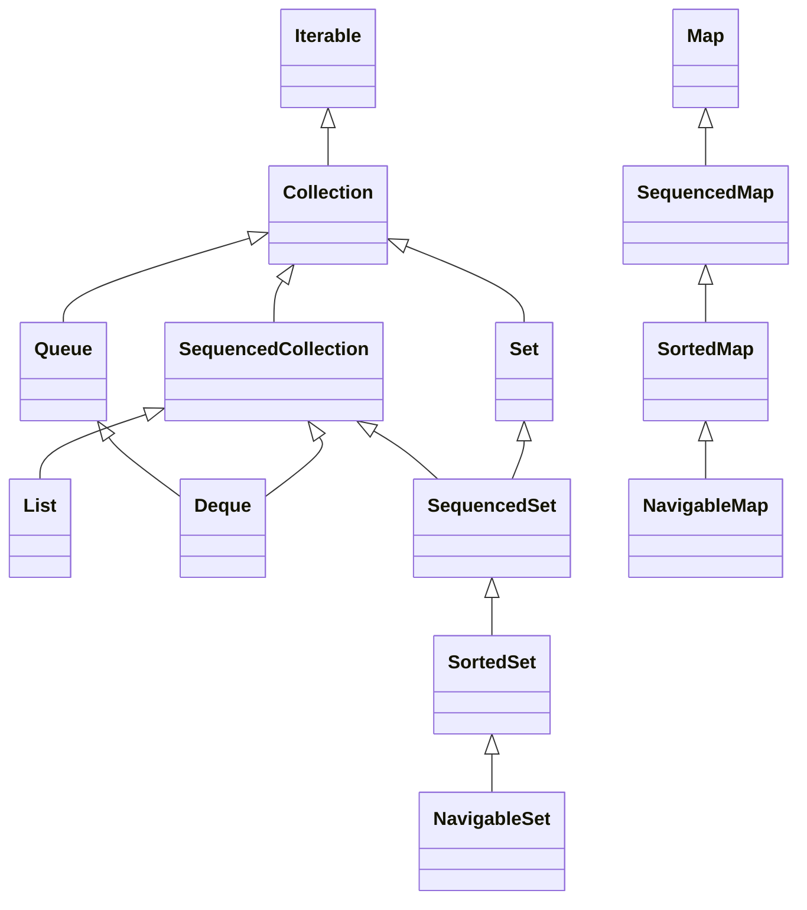

# 04. Collections internals

> **What this covers:** the Java Collections Framework from its interfaces to its data structures: what `Collection`, `List`, `Set`, `Queue`, `Deque` and `Map` promise, sequenced collections, and how `ArrayList`, `LinkedList`, `HashMap`, `LinkedHashMap`, `TreeMap`, the special-purpose maps, the sets and the queues work inside. Then the behavior that interviews probe: fail-fast iterators, immutable and fixed-size lists, sorting stability, collection equality, and how to choose a collection for a workload.
> **Prerequisites:** [02. Equality, immutability and records § 2. `hashCode` and hash-based collections](02-java-equality-immutability-records.md#2-hashcode-and-hash-based-collections), [§ 4. Ordering: `Comparable` and `Comparator`](02-java-equality-immutability-records.md#4-ordering-comparable-and-comparator), [03. Generics and type erasure § 4. Wildcards, PECS and variance](03-java-generics.md#4-wildcards-pecs-and-variance)
> **Leads to:** [05. Lambdas, streams and `Optional`](05-java-lambdas-streams-optional.md), [12. Locks, atomics and concurrent collections](12-concurrency-locks-atomics-collections.md)
> **Applies to:** Java 25
> **Study time:** ~6 hours reading + ~3 hours exercises
> **Short on time:** [3. `HashMap` internals](#3-hashmap-internals), [7. Iterators: fail-fast, weakly consistent and snapshot](#7-iterators-fail-fast-weakly-consistent-and-snapshot), [8. Immutable, unmodifiable and fixed-size lists](#8-immutable-unmodifiable-and-fixed-size-lists); questions [Q04.07](#q04-07), [Q04.09](#q04-09), [Q04.15](#q04-15), [Q04.21](#q04-21), [Q04.23](#q04-23); then [Summary](#summary).
> **Labs:** [`labs/java-language/`](../labs/java-language/), package `dev.interview.javalanguage.m04`. Run: `JAVA_HOME=$(/usr/libexec/java_home -v 25) mvn -q -f java-backend-guide/labs/pom.xml -pl java-language -am verify`. Needs Docker: no.

## Contents

1. [The Collections Framework: interfaces, contracts and sequenced collections](#1-the-collections-framework-interfaces-contracts-and-sequenced-collections)
2. [Lists: `ArrayList`, `LinkedList` and the legacy `Vector` and `Stack`](#2-lists-arraylist-linkedlist-and-the-legacy-vector-and-stack)
3. [`HashMap` internals](#3-hashmap-internals)
4. [Ordered and special-purpose maps](#4-ordered-and-special-purpose-maps)
5. [Sets: views of maps](#5-sets-views-of-maps)
6. [Queues and deques: `ArrayDeque` and `PriorityQueue`](#6-queues-and-deques-arraydeque-and-priorityqueue)
7. [Iterators: fail-fast, weakly consistent and snapshot](#7-iterators-fail-fast-weakly-consistent-and-snapshot)
8. [Immutable, unmodifiable and fixed-size lists](#8-immutable-unmodifiable-and-fixed-size-lists)
9. [Utilities, sorting and collection equality](#9-utilities-sorting-and-collection-equality)
10. [Choosing a collection: complexity, memory and workload](#10-choosing-a-collection-complexity-memory-and-workload)
- [Summary](#summary)
- [Question bank](#question-bank)
- [Hands-on exercises](#hands-on-exercises)
- [Check your understanding](#check-your-understanding)
- [Connections](#connections)

## 1. The Collections Framework: interfaces, contracts and sequenced collections
<!-- TASK: SEC-M04-01 -->
### The problem it solves

A reporting service shows "the latest event" from three teams' feeds. One team hands over a `List`, one a `Deque`, and one a `LinkedHashSet`, which drops duplicate events but keeps arrival order. Up to Java 20 no common type meant "ordered, with a first and a last element", so the helper had three versions: `list.get(list.size() - 1)`, `deque.getLast()`, and a loop over the whole `LinkedHashSet`. Then a fourth team passes a `HashSet`. A helper typed on `Collection` accepts it, and "the latest" becomes whatever the hash order puts last, an order the class does not promise to keep "constant over time" [Src: JDK 25, java.util.HashSet](https://github.com/openjdk/jdk/blob/jdk-25-ga/src/java.base/share/classes/java/util/HashSet.java). Both problems, the duplicated code and the silent wrong answer, come from not knowing exactly what each interface promises.

### Mental model

Read the interfaces as job descriptions and the classes as the people hired for them. `Collection` is the basic job: hold elements, count them, say whether one is there, hand them out one at a time. `List` adds positions, `Set` adds "no duplicates", `Queue` adds a head to take from, and `Deque` adds a second end. The sequenced interfaces (Java 21) add "has a defined first and last element, and can be read backwards". `Map` is a different job, lookup by key. It belongs to the same framework but is not a `Collection`; it lends out three collection views of itself instead.



What to notice: `Map` has no arrow from `Collection`. `HashSet` and `HashMap` implement only `Set` and `Map`, so they sit outside the sequenced branch, while `LinkedHashSet`, `TreeSet`, `LinkedHashMap` and `TreeMap` sit inside it.

### How it actually works

**Three names that sound alike.** "A collection" is the idea, a group of elements. `Collection` is the root interface of the framework, and "the JDK does not provide any *direct* implementations of this interface": it provides `Set`, `List` and the others [Src: JDK 25, java.util.Collection](https://github.com/openjdk/jdk/blob/jdk-25-ga/src/java.base/share/classes/java/util/Collection.java). `Collections` is a class that "consists exclusively of static methods that operate on or return collections", such as `sort`, `unmodifiableList` and `emptyList` [Src: JDK 25, java.util.Collections](https://github.com/openjdk/jdk/blob/jdk-25-ga/src/java.base/share/classes/java/util/Collections.java). Above `Collection` sits `java.lang.Iterable`, the interface that lets an object be "the target of the enhanced `for` statement" [Src: JDK 25, java.lang.Iterable](https://github.com/openjdk/jdk/blob/jdk-25-ga/src/java.base/share/classes/java/lang/Iterable.java); how iteration works is [§7](#7-iterators-fail-fast-weakly-consistent-and-snapshot).

**What `Collection` promises, and what it leaves out.** It declares size and membership (`size`, `isEmpty`, `contains`), bulk operations (`addAll`, `removeAll`, `retainAll`, `removeIf`), iteration and streams. `isEmpty` returns `true` when there are no elements, and the mutators return whether the collection changed: in the lab, `addAll` of an element already in a `HashSet` returns `false`, and `addAll` with one new element returns `true` [Lab: CollectionContractTest](../labs/java-language/src/test/java/dev/interview/javalanguage/m04/s01/CollectionContractTest.java). The root says nothing about order or uniqueness. Those come from the subinterfaces, and an unordered collection that allows duplicates (a bag or multiset) "should implement this interface directly" [Src: JDK 25, java.util.Collection](https://github.com/openjdk/jdk/blob/jdk-25-ga/src/java.base/share/classes/java/util/Collection.java). The same Javadoc sets a convention no interface can enforce: every general-purpose implementation has a no-argument constructor and a copy constructor that takes any `Collection`, which is why `new ArrayList<>(set)` and `new TreeSet<>(list)` work for any pair of classes.

**Optional operations.** Some methods are marked "optional operation": an implementation that does not support one "should define the corresponding method to throw `UnsupportedOperationException`". An *unmodifiable collection* is one whose mutator methods are all specified to throw it, and the Javadoc recommends throwing even when the call would change nothing, "as throwing only in certain cases can lead to programming errors" [Src: JDK 25, java.util.Collection](https://github.com/openjdk/jdk/blob/jdk-25-ga/src/java.base/share/classes/java/util/Collection.java). In the lab, `List.of("java")` throws from `add` and also from `addAll` of an empty list [Lab: CollectionContractTest](../labs/java-language/src/test/java/dev/interview/javalanguage/m04/s01/CollectionContractTest.java). The static type `List<String>` therefore tells the reader nothing about whether `add` works; [§8](#8-immutable-unmodifiable-and-fixed-size-lists) sorts the factories by what they allow.

**`Map` is part of the framework, not a `Collection`.** A map's unit is a key-value pair, and `Map` "takes the place of the `Dictionary` class", the abstract class `Hashtable` still extends ([Src: JDK 25, java.util.Map](https://github.com/openjdk/jdk/blob/jdk-25-ga/src/java.base/share/classes/java/util/Map.java); [§3](#3-hashmap-internals)). It offers three views instead: `keySet()`, `values()` and `entrySet()`. They are views, not copies: in the lab, removing a key from `keySet()` removes the mapping [Lab: CollectionContractTest](../labs/java-language/src/test/java/dev/interview/javalanguage/m04/s01/CollectionContractTest.java). Assigning a `HashMap` to a `Collection<?>` does not compile; javac reports `compiler.err.prob.found.req` [Lab: CollectionCompileRulesTest](../labs/java-language/src/test/java/dev/interview/javalanguage/m04/s01/CollectionCompileRulesTest.java).

**Sequenced collections.** Java 21 added three interfaces, to give collections with "a defined encounter order" a common type [Final since Java 21, JEP 431] [Doc: JEP 431](https://openjdk.org/jeps/431) [Src: JDK 25, java.util.SequencedCollection](https://github.com/openjdk/jdk/blob/jdk-25-ga/src/java.base/share/classes/java/util/SequencedCollection.java). A sequenced collection has an *encounter order*, "a linear arrangement from the first element to the last", and the inherited methods that walk the elements (`iterator`, `forEach`, `stream`, `toArray`) must follow it. It adds `addFirst`, `addLast`, `getFirst`, `getLast`, `removeFirst`, `removeLast` and `reversed()`, which returns "a reverse-ordered view" [Src: JDK 25, java.util.SequencedCollection](https://github.com/openjdk/jdk/blob/jdk-25-ga/src/java.base/share/classes/java/util/SequencedCollection.java). `List` and `Deque` extend it; `SequencedSet` combines it with `Set` and is implemented by `LinkedHashSet` and extended by `SortedSet` [Src: JDK 25, java.util.SequencedSet](https://github.com/openjdk/jdk/blob/jdk-25-ga/src/java.base/share/classes/java/util/SequencedSet.java) [Src: JDK 25, java.util.LinkedHashSet](https://github.com/openjdk/jdk/blob/jdk-25-ga/src/java.base/share/classes/java/util/LinkedHashSet.java) [Src: JDK 25, java.util.SortedSet](https://github.com/openjdk/jdk/blob/jdk-25-ga/src/java.base/share/classes/java/util/SortedSet.java). `SequencedMap` adds `firstEntry`, `lastEntry`, `pollFirstEntry`, `putFirst`, `putLast`, `reversed()` and sequenced views such as `sequencedKeySet()`, and `LinkedHashMap` and `SortedMap` implement it [Src: JDK 25, java.util.SequencedMap](https://github.com/openjdk/jdk/blob/jdk-25-ga/src/java.base/share/classes/java/util/SequencedMap.java) [Src: JDK 25, java.util.LinkedHashMap](https://github.com/openjdk/jdk/blob/jdk-25-ga/src/java.base/share/classes/java/util/LinkedHashMap.java) [Src: JDK 25, java.util.SortedMap](https://github.com/openjdk/jdk/blob/jdk-25-ga/src/java.base/share/classes/java/util/SortedMap.java). `HashSet` implements only `Set` [Src: JDK 25, java.util.HashSet](https://github.com/openjdk/jdk/blob/jdk-25-ga/src/java.base/share/classes/java/util/HashSet.java). In the lab, `tags.getFirst()` on a `Set<String>` fails with `compiler.err.cant.resolve.location.args`, the same call on a `LinkedHashSet<String>` compiles, and one `newest(SequencedCollection<E>)` method returns the last element of an `ArrayList`, an `ArrayDeque` and a `LinkedHashSet` alike [Lab: CollectionCompileRulesTest](../labs/java-language/src/test/java/dev/interview/javalanguage/m04/s01/CollectionCompileRulesTest.java) [Lab: SequencedViewsTest](../labs/java-language/src/test/java/dev/interview/javalanguage/m04/s01/SequencedViewsTest.java). On an empty collection, `getFirst` and `getLast` throw `NoSuchElementException` [Src: JDK 25, java.util.List](https://github.com/openjdk/jdk/blob/jdk-25-ga/src/java.base/share/classes/java/util/List.java) [Lab: SequencedViewsTest](../labs/java-language/src/test/java/dev/interview/javalanguage/m04/s01/SequencedViewsTest.java).

**`reversed()` is a view.** It copies nothing. In the lab, an element added to the list after `reversed()` was called appears first in the reversed view, and `addFirst` on the view appends to the end of the list [Lab: SequencedViewsTest](../labs/java-language/src/test/java/dev/interview/javalanguage/m04/s01/SequencedViewsTest.java).

**Explicit positioning means two different things.** On a `LinkedHashMap`, `putFirst` and `putLast` place a new key at that end, and for an existing key "the mapping is relocated if necessary" [Src: JDK 25, java.util.LinkedHashMap](https://github.com/openjdk/jdk/blob/jdk-25-ga/src/java.base/share/classes/java/util/LinkedHashMap.java); in the lab, `putLast("a", 10)` moves `a` from first to last and updates its value [Lab: SequencedViewsTest](../labs/java-language/src/test/java/dev/interview/javalanguage/m04/s01/SequencedViewsTest.java). A sorted collection cannot do that, because its comparator decides every position: `SortedSet.addFirst` and `TreeMap.putLast` throw `UnsupportedOperationException` "always" [Src: JDK 25, java.util.SortedSet](https://github.com/openjdk/jdk/blob/jdk-25-ga/src/java.base/share/classes/java/util/SortedSet.java) [Src: JDK 25, java.util.TreeMap](https://github.com/openjdk/jdk/blob/jdk-25-ga/src/java.base/share/classes/java/util/TreeMap.java). In the lab a `TreeSet` answers `getFirst()` with its smallest element and rejects `addFirst` [Lab: SequencedViewsTest](../labs/java-language/src/test/java/dev/interview/javalanguage/m04/s01/SequencedViewsTest.java). Code that takes a `SequencedMap` and calls `putLast` therefore compiles for both and fails at run time for one of them.

### Code

The approach: type the helper on `SequencedCollection`, the narrowest interface that has a last element, so every ordered collection fits and a `HashSet` is rejected by the compiler.

1. `newest` asks for `getLast()`, which every sequenced collection answers.
2. `newestFirst` reads through the `reversed()` view and copies only the elements it keeps.
3. `touch` moves a key to the end of a `SequencedMap` with `putLast`; with a `TreeMap` it throws, which the test asserts.

```java
// Excerpt of labs/java-language/src/main/java/dev/interview/javalanguage/m04/s01/SequencedViews.java
    // A List, a Deque, a LinkedHashSet and a TreeSet all answer getLast() since Java 21.
    public static <E> E newest(SequencedCollection<E> items) {
        return items.getLast();
    }

    // reversed() is a view: the stream reads the backing collection from its end.
    public static <E> List<E> newestFirst(SequencedCollection<E> items, int limit) {
        return items.reversed().stream().limit(limit).toList();
    }

    // putLast relocates an existing key; a TreeMap orders by key and throws instead.
    public static <K, V> void touch(SequencedMap<K, V> recent, K key, V value) {
        recent.putLast(key, value);
    }
```

The reversed view writes through to the list:

```java
// Excerpt of labs/java-language/src/test/java/dev/interview/javalanguage/m04/s01/SequencedViewsTest.java
    @Test
    @DisplayName("M04 §1 · reversed() is a live view of a List")
    void reversed_reflectsAndWritesThrough_toTheBackingList() {
        List<String> events = new ArrayList<>(EVENTS);
        List<String> newestFirst = events.reversed();

        events.add("logout");
        newestFirst.addFirst("timeout");

        assertThat(newestFirst).containsExactly("timeout", "logout", "checkout", "search", "login");
        assertThat(events).endsWith("timeout");
    }
```

#### Legacy

Up to Java 20, the last element of a `LinkedHashSet` was reachable only by iterating to the end, and a helper needed one overload per collection type:

```java
// Excerpt of labs/java-language/src/main/java/dev/interview/javalanguage/m04/s01/SequencedViews.java
    // Before Java 21 a LinkedHashSet exposed its last element only through a full walk.
    public static <E> E newestBeforeJava21(LinkedHashSet<E> items) {
        Iterator<E> iterator = items.iterator();
        E last = iterator.next();
        while (iterator.hasNext()) {
            last = iterator.next();
        }
        return last;
    }
```

### Failure modes and operations

The interfaces have no run-time behavior of their own; their failures are contract mismatches that surface the first time the wrong implementation arrives.
- **`UnsupportedOperationException` from a mutator.** A parameter typed `List<String>` may receive an unmodifiable list, and the first `add` throws inside the implementation class, so the top frame names it: `List.of` lists throw from `ImmutableCollections.uoe()` [Src: JDK 25, java.util.ImmutableCollections](https://github.com/openjdk/jdk/blob/jdk-25-ga/src/java.base/share/classes/java/util/ImmutableCollections.java). The fix is in the contract: document whether a returned collection may be modified, and copy before mutating a list you did not create ([§8](#8-immutable-unmodifiable-and-fixed-size-lists)).
- **Depending on an order nobody promised.** "First" or "last" of a `HashSet` or a `HashMap` is an accident of the hash table and may change as the table resizes ([Src: JDK 25, java.util.HashSet](https://github.com/openjdk/jdk/blob/jdk-25-ga/src/java.base/share/classes/java/util/HashSet.java); [§3](#3-hashmap-internals)). Typing the parameter as `SequencedCollection` or `SequencedMap` turns that bug into a compile error [Lab: CollectionCompileRulesTest](../labs/java-language/src/test/java/dev/interview/javalanguage/m04/s01/CollectionCompileRulesTest.java).
- **Explicit positioning on a sorted collection.** `putFirst`, `putLast`, `addFirst` and `addLast` on a `TreeMap` or `TreeSet` always throw [Lab: SequencedViewsTest](../labs/java-language/src/test/java/dev/interview/javalanguage/m04/s01/SequencedViewsTest.java). A method that relocates entries should take a `LinkedHashMap`, or say in its contract that sorted maps are rejected.
- **What to observe:** an `UnsupportedOperationException` whose top frame is `ImmutableCollections`, `Collections$Unmodifiable…` or a sorted collection identifies the implementation that refused; the bug is in the caller that assumed a mutable one.

> [!NOTE]
> **Version notes.** Java 1.2: the Collections Framework, with `Collection` [Src: JDK 25, java.util.Collection](https://github.com/openjdk/jdk/blob/jdk-25-ga/src/java.base/share/classes/java/util/Collection.java). Java 5: `Queue` and `java.lang.Iterable`, which the enhanced `for` loop uses [Src: JDK 25, java.util.Queue](https://github.com/openjdk/jdk/blob/jdk-25-ga/src/java.base/share/classes/java/util/Queue.java) [Src: JDK 25, java.lang.Iterable](https://github.com/openjdk/jdk/blob/jdk-25-ga/src/java.base/share/classes/java/lang/Iterable.java). Java 6: `Deque` and `NavigableMap` [Src: JDK 25, java.util.Deque](https://github.com/openjdk/jdk/blob/jdk-25-ga/src/java.base/share/classes/java/util/Deque.java) [Src: JDK 25, java.util.NavigableMap](https://github.com/openjdk/jdk/blob/jdk-25-ga/src/java.base/share/classes/java/util/NavigableMap.java). Java 9: the `List.of` factories [Src: JDK 25, java.util.List](https://github.com/openjdk/jdk/blob/jdk-25-ga/src/java.base/share/classes/java/util/List.java). Java 21: the sequenced interfaces, with `getFirst`, `getLast` and `reversed()` on every `List` and `Deque` [Doc: JEP 431](https://openjdk.org/jeps/431) [Src: JDK 25, java.util.SequencedCollection](https://github.com/openjdk/jdk/blob/jdk-25-ga/src/java.base/share/classes/java/util/SequencedCollection.java); before that, `list.get(list.size() - 1)` and a full walk over a `LinkedHashSet` were the idioms. Java 25 (default): unchanged since 21.

### Best practices and anti-patterns

- Declare parameters with the most general interface that has the operations you use (`Collection`, `List`, `SequencedCollection`), because callers can then pass any implementation that fits and the compiler rejects the ones that do not.
- Take a `SequencedCollection` or `SequencedMap` when the code needs a first or last element, because a plain `Collection` also admits a `HashSet`, whose order is not promised.
- Say in the contract whether a returned collection may be modified, because the interface type cannot say it and the caller only learns it from an `UnsupportedOperationException`.
- Copy with the copy constructor (`new ArrayList<>(source)`) when you need a mutable collection of your own, because every general-purpose implementation provides one and the copy is independent of the source.
- Iterate a `Map` through `entrySet()` when you need keys and values, because it walks the entries once instead of doing a lookup per key.
- Do not call `putFirst` or `addFirst` on a collection you only know as `SequencedMap` or `SequencedCollection` unless the contract excludes sorted ones, because sorted collections throw for explicit positioning.

### Misconceptions and traps

- *"`Map` is a `Collection`."* `Map` is part of the Collections Framework but extends no collection interface; it exposes collection views [Src: JDK 25, java.util.Map](https://github.com/openjdk/jdk/blob/jdk-25-ga/src/java.base/share/classes/java/util/Map.java) [Lab: CollectionCompileRulesTest](../labs/java-language/src/test/java/dev/interview/javalanguage/m04/s01/CollectionCompileRulesTest.java). The myth comes from the framework's name and from tutorials that draw both in one tree.
- *"A `Collection` is ordered" or "a `Collection` has no duplicates".* The root interface promises neither; `List`, `Set` and the sequenced interfaces add those guarantees [Src: JDK 25, java.util.Collection](https://github.com/openjdk/jdk/blob/jdk-25-ga/src/java.base/share/classes/java/util/Collection.java). The confusion comes from meeting `ArrayList` first and generalizing from it.
- *"`Collection` and `Collections` are the same thing."* One is the root interface, the other a class of static helpers [Src: JDK 25, java.util.Collections](https://github.com/openjdk/jdk/blob/jdk-25-ga/src/java.base/share/classes/java/util/Collections.java). The names differ by one letter, which is why interviewers ask.
- *"`reversed()` returns a reversed copy."* It returns a view that reads and writes through to the original [Lab: SequencedViewsTest](../labs/java-language/src/test/java/dev/interview/javalanguage/m04/s01/SequencedViewsTest.java). The habit comes from `Collections.reverse`, which reorders a list in place, and from stream code that builds new lists.
- *"Every sequenced collection accepts `addFirst`."* Sorted sets and maps reject explicit positioning, always [Src: JDK 25, java.util.SortedSet](https://github.com/openjdk/jdk/blob/jdk-25-ga/src/java.base/share/classes/java/util/SortedSet.java) [Src: JDK 25, java.util.TreeMap](https://github.com/openjdk/jdk/blob/jdk-25-ga/src/java.base/share/classes/java/util/TreeMap.java). The trap exists because `TreeSet` does implement `SequencedSet`, so the call compiles.

Questions that drill this section: [Q04.01](#q04-01), [Q04.02](#q04-02), [Q04.03](#q04-03).
<!-- /TASK: SEC-M04-01 -->

## 2. Lists: `ArrayList`, `LinkedList` and the legacy `Vector` and `Stack`
<!-- TASK: SEC-M04-02 -->
### The problem it solves

A nightly export reads 200,000 rows into a `List` and writes every row with `for (int i = 0; i < rows.size(); i++) write(rows.get(i))`. It finishes in seconds. A refactor changes the loader to return a `LinkedList`, "because we append a lot", and the same loop now runs for hours, with no error and no change to the loop. The `List` interface hid the one fact that mattered: on an `ArrayList`, `get(i)` is constant time, and on a `LinkedList` it walks the chain from the nearer end, so the loop becomes quadratic ([Src: JDK 25, java.util.ArrayList](https://github.com/openjdk/jdk/blob/jdk-25-ga/src/java.base/share/classes/java/util/ArrayList.java) [Src: JDK 25, java.util.LinkedList](https://github.com/openjdk/jdk/blob/jdk-25-ga/src/java.base/share/classes/java/util/LinkedList.java) [Src: JDK 25, java.util.RandomAccess](https://github.com/openjdk/jdk/blob/jdk-25-ga/src/java.base/share/classes/java/util/RandomAccess.java)). Choosing a list means knowing what each implementation does inside.

### Mental model

An `ArrayList` is a row of numbered lockers with some spare ones at the end. Finding locker 70,000 is one step, because you walk straight to the number. Inserting near the front means every later occupant moves one locker down, and when the spare lockers run out, the whole row moves to a bigger corridor. A `LinkedList` is a treasure hunt: each clue (a node) knows only the clue before and after it. Adding a clue where you are standing is cheap, but getting to clue 70,000 means following clues from the start or from the end. `Vector` is the lockers with a guard who lets one person in at a time, and `Stack` is `Vector` with a "top" painted on its last locker.

### How it actually works

**`ArrayList` is a resizable array.** Its elements live in an `Object[] elementData` (why `Object[]` and not `E[]` is [03 §6](03-java-generics.md#6-reifiable-types-generic-arrays-and-heap-pollution)). The *capacity* is that array's length, "always at least as large as the list size" [Src: JDK 25, java.util.ArrayList](https://github.com/openjdk/jdk/blob/jdk-25-ga/src/java.base/share/classes/java/util/ArrayList.java). The no-argument constructor is documented as "an initial capacity of ten", but it stores a shared empty array and allocates the ten slots on the first `add` [Src: JDK 25, java.util.ArrayList](https://github.com/openjdk/jdk/blob/jdk-25-ga/src/java.base/share/classes/java/util/ArrayList.java). When the array is full, `grow` asks `ArraysSupport.newLength` for the old length plus the larger of the minimum growth needed and the "preferred growth" `oldCapacity >> 1`, then copies into the new array with `Arrays.copyOf` ([Src: JDK 25, java.util.ArrayList](https://github.com/openjdk/jdk/blob/jdk-25-ga/src/java.base/share/classes/java/util/ArrayList.java) [Src: JDK 25, jdk.internal.util.ArraysSupport](https://github.com/openjdk/jdk/blob/jdk-25-ga/src/java.base/share/classes/jdk/internal/util/ArraysSupport.java)). A full list of 10 therefore grows to 15, and one of 100 to 150. The Javadoc promises only "constant amortized time" for `add`, not this policy [Src: JDK 25, java.util.ArrayList](https://github.com/openjdk/jdk/blob/jdk-25-ga/src/java.base/share/classes/java/util/ArrayList.java), so code must not depend on the exact numbers. `ensureCapacity(n)` grows once ahead of a known number of additions; `trimToSize()` shrinks the array to the size, and nothing else ever shrinks it [Src: JDK 25, java.util.ArrayList](https://github.com/openjdk/jdk/blob/jdk-25-ga/src/java.base/share/classes/java/util/ArrayList.java). An initial capacity is not a size: in the lab, `set(0, …)` on a `new ArrayList<>(100)` throws `IndexOutOfBoundsException`, because the list is empty [Lab: ListInternalsTest](../labs/java-language/src/test/java/dev/interview/javalanguage/m04/s02/ListInternalsTest.java).

**What each operation costs.** The Javadoc lists `get`, `set`, `size`, `getFirst`, `getLast`, `removeLast`, `iterator` and `reversed` as constant time, `add` as amortized constant, and "all of the other operations" as roughly linear [Src: JDK 25, java.util.ArrayList](https://github.com/openjdk/jdk/blob/jdk-25-ga/src/java.base/share/classes/java/util/ArrayList.java). Linear here means shifting: `add(index, e)` moves the tail one slot right with `System.arraycopy`, and `remove(index)` moves it one slot left and nulls the freed last slot so the old reference can be collected [Src: JDK 25, java.util.ArrayList](https://github.com/openjdk/jdk/blob/jdk-25-ga/src/java.base/share/classes/java/util/ArrayList.java). In the lab, `add(1, "b")` turns `[a, c, d]` into `[a, b, c, d]` [Lab: ListInternalsTest](../labs/java-language/src/test/java/dev/interview/javalanguage/m04/s02/ListInternalsTest.java). Removing from the end is cheap; removing from the front of a long list copies everything after it.

**`modCount` counts structural changes.** Every `add`, `remove`, `clear`, `ensureCapacity` that grows, and `trimToSize` increments the protected field `modCount` inherited from `AbstractList`; `set` does not, because it changes no size or array [Src: JDK 25, java.util.ArrayList](https://github.com/openjdk/jdk/blob/jdk-25-ga/src/java.base/share/classes/java/util/ArrayList.java). In the lab, a subclass reads the counter: it goes from 0 to 1 on `add`, stays at 1 after `set`, and reaches 2 after `trimToSize` [Lab: ListInternalsTest](../labs/java-language/src/test/java/dev/interview/javalanguage/m04/s02/ListInternalsTest.java). Iterators compare this counter with the value they saw at creation; that is the fail-fast check of [§7](#7-iterators-fail-fast-weakly-consistent-and-snapshot), and the reason a `trimToSize` during iteration also breaks the loop.

**`LinkedList` is a doubly linked list.** Each element sits in a `Node` with `item`, `next` and `prev` fields, and the list keeps `first` and `last` [Src: JDK 25, java.util.LinkedList](https://github.com/openjdk/jdk/blob/jdk-25-ga/src/java.base/share/classes/java/util/LinkedList.java). It implements both `List` and `Deque`. Operations at either end are a few pointer writes, but "operations that index into the list will traverse the list from the beginning or the end, whichever is closer to the specified index": `node(index)` loops from `first` when the index is in the lower half and from `last` otherwise [Src: JDK 25, java.util.LinkedList](https://github.com/openjdk/jdk/blob/jdk-25-ga/src/java.base/share/classes/java/util/LinkedList.java). So `get(i)`, `set(i, e)`, `add(i, e)` and `remove(i)` are linear, and an insertion "in the middle" is cheap only once you already hold a position, which in practice means a `ListIterator` that is already there.

**`RandomAccess` tells algorithms which loop to use.** It is a marker interface with no methods, for `List` implementations with "fast (generally constant time) random access". Its Javadoc warns that the best algorithms for random-access lists "can produce quadratic behavior when applied to sequential access lists", and encourages generic code to check `instanceof RandomAccess` first [Src: JDK 25, java.util.RandomAccess](https://github.com/openjdk/jdk/blob/jdk-25-ga/src/java.base/share/classes/java/util/RandomAccess.java). `ArrayList` implements it; `LinkedList` does not [Lab: ListInternalsTest](../labs/java-language/src/test/java/dev/interview/javalanguage/m04/s02/ListInternalsTest.java).

**When `LinkedList` wins.** Rarely: when the code inserts or removes many elements at the position of an iterator it is already moving (`ListIterator.add` and `remove` are constant time there), or when it needs a `Deque` that accepts `null`, which `ArrayDeque` refuses ([§6](#6-queues-and-deques-arraydeque-and-priorityqueue)). For a plain queue or stack, `ArrayDeque` is the better default, and for everything indexed, `ArrayList`. The Javadoc of `ArrayList` itself notes that its constant factor "is low compared to that for the `LinkedList` implementation" [Src: JDK 25, java.util.ArrayList](https://github.com/openjdk/jdk/blob/jdk-25-ga/src/java.base/share/classes/java/util/ArrayList.java). Each `LinkedList` element also costs a separate `Node` object with two extra references, where an `ArrayList` element costs one array slot [Src: JDK 25, java.util.LinkedList](https://github.com/openjdk/jdk/blob/jdk-25-ga/src/java.base/share/classes/java/util/LinkedList.java); [§10](#10-choosing-a-collection-complexity-memory-and-workload) compares footprints without invented byte counts.

**`remove(int)` and `remove(Object)`.** `List` overloads `remove`: one takes an index, the other an element. On a `List<Integer>`, `list.remove(1)` passes an `int`, so overload resolution picks the index version without boxing; `list.remove(Integer.valueOf(1))` removes the value. In the lab, `[10, 20, 30]` loses `20` with `remove(1)` and `10` with `remove(Integer.valueOf(10))` [Lab: ListInternalsTest](../labs/java-language/src/test/java/dev/interview/javalanguage/m04/s02/ListInternalsTest.java). `indexOf` returns the first matching index and `-1` when the element is absent, and changes nothing [Lab: ListInternalsTest](../labs/java-language/src/test/java/dev/interview/javalanguage/m04/s02/ListInternalsTest.java). Why the `int` overload wins is the overload-resolution rule of [01 §8](01-java-oop-fundamentals.md#8-polymorphism-overloading-overriding-and-dispatch).

**`Vector` and `Stack`.** `Vector` dates from Java 1.0 and was "retrofitted to implement the `List` interface" in 1.2. Unlike `ArrayList`, it is synchronized: its accessors and mutators, such as `get` and `add`, are `synchronized` methods, and the Javadoc recommends `ArrayList` "in place of `Vector`" when thread safety is not needed [Src: JDK 25, java.util.Vector](https://github.com/openjdk/jdk/blob/jdk-25-ga/src/java.base/share/classes/java/util/Vector.java). It grows by its `capacityIncrement` when one was given, and otherwise doubles [Src: JDK 25, java.util.Vector](https://github.com/openjdk/jdk/blob/jdk-25-ga/src/java.base/share/classes/java/util/Vector.java): in the lab, a default `Vector` goes from capacity 10 to 20 on the 11th element, and one built with an increment of 5 goes to 15 [Lab: ListInternalsTest](../labs/java-language/src/test/java/dev/interview/javalanguage/m04/s02/ListInternalsTest.java). `Stack` extends `Vector` and pushes and pops at the end of the array. Its own Javadoc says the `Deque` interface "should be used in preference to this class", for example `Deque<Integer> stack = new ArrayDeque<Integer>()` [Src: JDK 25, java.util.Stack](https://github.com/openjdk/jdk/blob/jdk-25-ga/src/java.base/share/classes/java/util/Stack.java). The two do not iterate the same way: in the lab, after pushing 1, 2 and 3, both `peek()` 3, but the `Stack` iterates `[1, 2, 3]`, bottom first, and the `ArrayDeque` iterates `[3, 2, 1]`, top first [Lab: ListInternalsTest](../labs/java-language/src/test/java/dev/interview/javalanguage/m04/s02/ListInternalsTest.java).

### Code

The approach: write the list algorithm once, and let the `RandomAccess` marker pick the access strategy, as the marker's Javadoc recommends.

1. `everyNth` validates the step and checks `instanceof RandomAccess`.
2. `byIndex` jumps with `get(i)`, which is constant time on an `ArrayList`, and presizes its result.
3. `byIterator` walks a sequential list once, because each `get(i)` on a `LinkedList` would walk from an end.
4. The test asserts that both paths return the same elements for an `ArrayList` and a `LinkedList`.

```java
// Excerpt of labs/java-language/src/main/java/dev/interview/javalanguage/m04/s02/ListAccess.java
    public static <E> List<E> everyNth(List<E> source, int step) {
        if (step < 1) {
            throw new IllegalArgumentException("step must be at least 1: " + step);
        }
        return source instanceof RandomAccess ? byIndex(source, step) : byIterator(source, step);
    }

    // get(i) is constant time on an ArrayList, so jumping by index skips the elements in between.
    private static <E> List<E> byIndex(List<E> source, int step) {
        List<E> picked = new ArrayList<>(source.size() / step + 1);
        for (int i = 0; i < source.size(); i += step) {
            picked.add(source.get(i));
        }
        return picked;
    }

    // On a LinkedList each get(i) walks from an end, so one pass with an iterator is linear instead.
    private static <E> List<E> byIterator(List<E> source, int step) {
        List<E> picked = new ArrayList<>();
        Iterator<E> iterator = source.iterator();
        for (int i = 0; iterator.hasNext(); i++) {
            E element = iterator.next();
            if (i % step == 0) {
                picked.add(element);
            }
        }
        return picked;
    }
```

Reading `modCount` from a subclass, which is how the lab observes structural changes without opening `java.util` to reflection:

```java
// Excerpt of labs/java-language/src/test/java/dev/interview/javalanguage/m04/s02/ListInternalsTest.java
    // modCount is a protected field of AbstractList, so a subclass can read it without --add-opens.
    private static final class CountingList<E> extends ArrayList<E> {
        int structuralChanges() {
            return modCount;
        }
    }

    @Test
    @DisplayName("M04 §2 · add and trimToSize count as structural changes, set does not")
    void modCount_countsStructuralChangesOnly() {
        CountingList<String> list = new CountingList<>();
        list.add("a");
        int afterAdd = list.structuralChanges();

        list.set(0, "b");
        int afterSet = list.structuralChanges();
        list.trimToSize();

        assertThat(afterAdd).isEqualTo(1);
        assertThat(afterSet).isEqualTo(afterAdd);
        assertThat(list.structuralChanges()).isEqualTo(afterSet + 1);
    }
```

#### Legacy

`Vector` and `Stack` still appear in old code, for example parsers that keep a `Stack` of tokens. Replacing a `Stack` with an `ArrayDeque` keeps `push`, `pop` and `peek`, but changes iteration order, which matters to any code that prints or copies the stack:

```java
// Excerpt of labs/java-language/src/test/java/dev/interview/javalanguage/m04/s02/ListInternalsTest.java
    @Test
    @DisplayName("M04 §2 · a Stack iterates bottom first, an ArrayDeque used as a stack iterates top first")
    void stackAndDeque_iterateInOppositeOrders() {
        Stack<Integer> legacy = new Stack<>();
        Deque<Integer> modern = new ArrayDeque<>();
        for (int i = 1; i <= 3; i++) {
            legacy.push(i);
            modern.push(i);
        }

        assertThat(legacy.peek()).isEqualTo(modern.peek()).isEqualTo(3);
        assertThat(legacy).containsExactly(1, 2, 3);
        assertThat(modern).containsExactly(3, 2, 1);
    }
```

### Failure modes and operations

- **Quadratic loops.** An index loop over a `LinkedList` walks up to half the list for every `get(i)`, and a loop that calls `remove(0)` on a long `ArrayList` copies the whole tail each time ([Src: JDK 25, java.util.RandomAccess](https://github.com/openjdk/jdk/blob/jdk-25-ga/src/java.base/share/classes/java/util/RandomAccess.java) [Src: JDK 25, java.util.ArrayList](https://github.com/openjdk/jdk/blob/jdk-25-ga/src/java.base/share/classes/java/util/ArrayList.java)). Neither fails; both get slower with the square of the size, so they pass tests with ten rows and time out in production. In a CPU profile the time sits in `LinkedList.node` or in `System.arraycopy`. [Q04.32](#q04-32) is that incident.
- **Memory that does not come back.** An `ArrayList` keeps the capacity it reached; removing elements nulls their slots but never shrinks the array, so a list that once held a million entries keeps a million-slot array until `trimToSize()` or until the list itself is dropped [Src: JDK 25, java.util.ArrayList](https://github.com/openjdk/jdk/blob/jdk-25-ga/src/java.base/share/classes/java/util/ArrayList.java). A heap histogram shows it as a large `Object[]` retained by one list.
- **Growth in a hot path.** Each `grow` allocates a new array and copies the old one [Src: JDK 25, java.util.ArrayList](https://github.com/openjdk/jdk/blob/jdk-25-ga/src/java.base/share/classes/java/util/ArrayList.java). Building a large list element by element repeats that work and the garbage; `new ArrayList<>(expected)` or `ensureCapacity` does it once.
- **The `remove(1)` overload bug.** On a `List<Integer>`, removing "the value 1" with `remove(1)` silently removes the element at index 1 instead [Lab: ListInternalsTest](../labs/java-language/src/test/java/dev/interview/javalanguage/m04/s02/ListInternalsTest.java); [Q04.07](#q04-07) drills it.
- **Sharing a list between threads.** `ArrayList` and `LinkedList` are not synchronized, and `Vector` locks each call separately, so check-then-act sequences such as "if empty, add" are not atomic in any of them ([Src: JDK 25, java.util.ArrayList](https://github.com/openjdk/jdk/blob/jdk-25-ga/src/java.base/share/classes/java/util/ArrayList.java) [Src: JDK 25, java.util.Vector](https://github.com/openjdk/jdk/blob/jdk-25-ga/src/java.base/share/classes/java/util/Vector.java)). Thread-safe lists are [12](12-concurrency-locks-atomics-collections.md)'s subject.

> [!NOTE]
> **Version notes.** Java 1.0: `Vector` and `Stack` [Src: JDK 25, java.util.Vector](https://github.com/openjdk/jdk/blob/jdk-25-ga/src/java.base/share/classes/java/util/Vector.java) [Src: JDK 25, java.util.Stack](https://github.com/openjdk/jdk/blob/jdk-25-ga/src/java.base/share/classes/java/util/Stack.java). Java 1.2: `ArrayList` and `LinkedList`, and `Vector` retrofitted to `List` [Src: JDK 25, java.util.ArrayList](https://github.com/openjdk/jdk/blob/jdk-25-ga/src/java.base/share/classes/java/util/ArrayList.java) [Src: JDK 25, java.util.LinkedList](https://github.com/openjdk/jdk/blob/jdk-25-ga/src/java.base/share/classes/java/util/LinkedList.java) [Src: JDK 25, java.util.Vector](https://github.com/openjdk/jdk/blob/jdk-25-ga/src/java.base/share/classes/java/util/Vector.java). Java 6: `LinkedList` gains the `Deque` methods such as `offerFirst` and `pollLast` [Src: JDK 25, java.util.LinkedList](https://github.com/openjdk/jdk/blob/jdk-25-ga/src/java.base/share/classes/java/util/LinkedList.java). Java 21: `getFirst`, `getLast`, `removeFirst`, `removeLast` and `reversed()` on every `List` ([§1](#1-the-collections-framework-interfaces-contracts-and-sequenced-collections)). Java 25 (default): `ArrayList` still grows by half and `Vector` still doubles [Src: JDK 25, java.util.ArrayList](https://github.com/openjdk/jdk/blob/jdk-25-ga/src/java.base/share/classes/java/util/ArrayList.java) [Src: JDK 25, java.util.Vector](https://github.com/openjdk/jdk/blob/jdk-25-ga/src/java.base/share/classes/java/util/Vector.java).

### Best practices and anti-patterns

- Default to `ArrayList` for a list, because indexed access is constant time, appends are amortized constant, and the Javadoc rates its constant factor below `LinkedList`'s.
- Presize with `new ArrayList<>(expected)` when the size is known, because each growth step allocates and copies the whole array.
- Iterate with for-each or an `Iterator` when the list type is not known, or check `RandomAccess`, because an index loop is quadratic on a sequential-access list.
- Use `ArrayDeque` for stacks and queues instead of `Stack` or `LinkedList`, because it has no per-element node and no per-call lock; keep `LinkedList` for the cases that need a `ListIterator` that inserts as it moves, or `null` elements in a `Deque`.
- Write `remove(Integer.valueOf(x))` when removing a value from a `List<Integer>`, because `remove(x)` with an `int` removes by index.
- Call `trimToSize()` only on a long-lived list that has shrunk for good, because it copies the array and the next `add` grows it again.
- Do not choose `Vector` for thread safety, because each method locks separately and compound actions still race; use the concurrent collections of [12](12-concurrency-locks-atomics-collections.md).

### Misconceptions and traps

- *"`LinkedList` is faster for inserts and deletes."* Only once the node is found; finding it by index is linear, while `ArrayList` reaches the slot in constant time and shifts the tail with one `System.arraycopy` ([Src: JDK 25, java.util.LinkedList](https://github.com/openjdk/jdk/blob/jdk-25-ga/src/java.base/share/classes/java/util/LinkedList.java) [Src: JDK 25, java.util.ArrayList](https://github.com/openjdk/jdk/blob/jdk-25-ga/src/java.base/share/classes/java/util/ArrayList.java)). The claim comes from textbook complexity tables that count the pointer update and leave out the walk.
- *"`new ArrayList<>(100)` holds 100 elements."* It has capacity 100 and size 0 [Lab: ListInternalsTest](../labs/java-language/src/test/java/dev/interview/javalanguage/m04/s02/ListInternalsTest.java). The confusion comes from arrays, where `new String[100]` does have 100 slots you can `set`.
- *"An `ArrayList` gives memory back when you remove elements."* Only `trimToSize()` shrinks the array [Src: JDK 25, java.util.ArrayList](https://github.com/openjdk/jdk/blob/jdk-25-ga/src/java.base/share/classes/java/util/ArrayList.java). The intuition comes from `size()`, which does shrink.
- *"`Vector` is thread-safe, so code that uses it is."* Each method is atomic; a sequence of calls is not [Src: JDK 25, java.util.Vector](https://github.com/openjdk/jdk/blob/jdk-25-ga/src/java.base/share/classes/java/util/Vector.java). The belief comes from the word "synchronized" in every description of `Vector`.
- *"`Stack` and `ArrayDeque` behave the same."* They agree on `push`, `pop` and `peek` and disagree on iteration order [Lab: ListInternalsTest](../labs/java-language/src/test/java/dev/interview/javalanguage/m04/s02/ListInternalsTest.java). The trap exists because the replacement compiles and the stack operations pass their tests.
- *"`ArrayList` grows by exactly 1.5×, so you can predict its capacity."* That is today's implementation, not the contract: the Javadoc specifies only amortized constant `add` [Src: JDK 25, java.util.ArrayList](https://github.com/openjdk/jdk/blob/jdk-25-ga/src/java.base/share/classes/java/util/ArrayList.java). The habit comes from reading the source of one release.

Questions that drill this section: [Q04.04](#q04-04), [Q04.05](#q04-05), [Q04.06](#q04-06), [Q04.07](#q04-07), [Q04.08](#q04-08), [Q04.32](#q04-32), [Exercise 04.3](#ex04-3).
<!-- /TASK: SEC-M04-02 -->

## 3. `HashMap` internals
<!-- TASK: SEC-M04-03 -->
### The problem it solves
### Mental model
### How it actually works
### Code
### Failure modes and operations
### Best practices and anti-patterns
### Misconceptions and traps
<!-- /TASK: SEC-M04-03 -->

## 4. Ordered and special-purpose maps
<!-- TASK: SEC-M04-04 -->
### The problem it solves
### Mental model
### How it actually works
### Code
### Failure modes and operations
### Best practices and anti-patterns
### Misconceptions and traps
<!-- /TASK: SEC-M04-04 -->

## 5. Sets: views of maps
<!-- TASK: SEC-M04-05 -->
### The problem it solves
### Mental model
### How it actually works
### Code
### Failure modes and operations
### Best practices and anti-patterns
### Misconceptions and traps
<!-- /TASK: SEC-M04-05 -->

## 6. Queues and deques: `ArrayDeque` and `PriorityQueue`
<!-- TASK: SEC-M04-06 -->
### The problem it solves
### Mental model
### How it actually works
### Code
### Failure modes and operations
### Best practices and anti-patterns
### Misconceptions and traps
<!-- /TASK: SEC-M04-06 -->

## 7. Iterators: fail-fast, weakly consistent and snapshot
<!-- TASK: SEC-M04-07 -->
### The problem it solves
### Mental model
### How it actually works
### Code
### Failure modes and operations
### Best practices and anti-patterns
### Misconceptions and traps
<!-- /TASK: SEC-M04-07 -->

## 8. Immutable, unmodifiable and fixed-size lists
<!-- TASK: SEC-M04-08 -->
### The problem it solves
### Mental model
### How it actually works
### Code
### Failure modes and operations
### Best practices and anti-patterns
### Misconceptions and traps
<!-- /TASK: SEC-M04-08 -->

## 9. Utilities, sorting and collection equality
<!-- TASK: SEC-M04-09 -->
### The problem it solves
### Mental model
### How it actually works
### Code
### Failure modes and operations
### Best practices and anti-patterns
### Misconceptions and traps
<!-- /TASK: SEC-M04-09 -->

## 10. Choosing a collection: complexity, memory and workload
<!-- TASK: SEC-M04-10 -->
### The problem it solves
### Mental model
### How it actually works
### Code
### Failure modes and operations
### Best practices and anti-patterns
### Misconceptions and traps
<!-- /TASK: SEC-M04-10 -->

## Summary
<!-- TASK: CLOSE-M04 -->
<!-- /TASK: CLOSE-M04 -->

## Question bank

<!-- TASK: QB-M04-01 -->
<a id="q04-01"></a>
### Q04.01 · Concept · collection, `Collection` and `Collections`: what the framework's root interface promises, and why `Map` is not a `Collection`

<a id="q04-02"></a>
### Q04.02 · Output · Sequenced collections: what do `reversed()`, `getFirst()` and `putFirst` return on a `List`, a `LinkedHashSet` and a `LinkedHashMap`?

<a id="q04-03"></a>
### Q04.03 · Concept · Optional operations: why `Collection.add` is allowed to throw `UnsupportedOperationException`

<a id="q04-04"></a>
### Q04.04 · Concept · How an `ArrayList` grows: size vs capacity, the growth step, `ensureCapacity` and `trimToSize`

<a id="q04-05"></a>
### Q04.05 · Difference · Array vs `ArrayList`: length, primitives, covariance and generics

<a id="q04-06"></a>
### Q04.06 · Trade-off · `ArrayList` vs `LinkedList`: when does `LinkedList` actually win?

<a id="q04-07"></a>
### Q04.07 · Output · Bug hunt · `list.remove(1)` on a `List<Integer>` holding `[1, 2, 3]`: which element goes, and what does `indexOf` return for a missing value?

<a id="q04-08"></a>
### Q04.08 · Difference · `Vector`, `Stack` and `ArrayList`: what per-method synchronization buys, and what replaces them

<!-- /TASK: QB-M04-01 -->

<!-- TASK: QB-M04-02 -->
<a id="q04-09"></a>
### Q04.09 · Concept · How `HashMap.put` and `get` find a bin: spreading, the index mask and the walk

<a id="q04-10"></a>
### Q04.10 · Output · `new HashMap<>(10)` vs `HashMap.newHashMap(10)`: what table sizes, and how many puts before the first resize?

<a id="q04-11"></a>
### Q04.11 · Concept · Treeification: the 8, 6 and 64 thresholds, and what a tree bin protects against

<a id="q04-12"></a>
### Q04.12 · Difference · `HashMap` vs `Hashtable` vs `ConcurrentHashMap` (and `Dictionary`): nulls, locking, iterators

<a id="q04-13"></a>
### Q04.13 · Production scenario · A service's startup builds a large `HashMap` and spends seconds resizing it

<a id="q04-14"></a>
### Q04.14 · Concept · `LinkedHashMap`: insertion order vs access order, and what each costs

<a id="q04-15"></a>
### Q04.15 · Output · An access-order `LinkedHashMap` with `removeEldestEntry` and capacity 2: which key is evicted after `get("a")` and `put("c")`?

<a id="q04-16"></a>
### Q04.16 · Concept · `TreeMap` and `NavigableMap`: the red-black tree, `floorKey` and `headMap` views

<!-- /TASK: QB-M04-02 -->

<!-- TASK: QB-M04-03 -->
<a id="q04-17"></a>
### Q04.17 · Difference · `EnumMap`, `IdentityHashMap` and `WeakHashMap`: what each compares and when to use it

<a id="q04-18"></a>
### Q04.18 · Production scenario · A `WeakHashMap` metadata cache never shrinks

<a id="q04-19"></a>
### Q04.19 · Concept · How `HashSet` is built on `HashMap`, and what that means for `equals`, `hashCode` and `null`

<a id="q04-20"></a>
### Q04.20 · Difference · `HashSet` vs `LinkedHashSet` vs `TreeSet` vs `EnumSet`

<a id="q04-21"></a>
### Q04.21 · Output · A `PriorityQueue` of `[5, 1, 4, 2, 3]`: what do `toString()` and repeated `poll()` print?

<a id="q04-22"></a>
### Q04.22 · Difference · `ArrayDeque` vs `Stack` vs `LinkedList` as a stack or a queue

<a id="q04-23"></a>
### Q04.23 · Output · Bug hunt · Removing elements inside a for-each loop: which removal throws, and which silently skips an element?

<a id="q04-24"></a>
### Q04.24 · Concept · `Iterator` and `ListIterator`: the cursor, `remove`, `set`, `add`, and the order a collection defines

<!-- /TASK: QB-M04-03 -->

<!-- TASK: QB-M04-04 -->
<a id="q04-25"></a>
### Q04.25 · Difference · Fail-fast vs weakly consistent vs snapshot iterators, and why "fail-safe" misleads

<a id="q04-26"></a>
### Q04.26 · Production scenario · A single-threaded batch job throws `ConcurrentModificationException` from a listener callback

<a id="q04-27"></a>
### Q04.27 · Output · `List.of`, `Collections.unmodifiableList`, `Arrays.asList` and `Stream.toList()`: which calls throw for `set`, `add` and `contains(null)`?

<a id="q04-28"></a>
### Q04.28 · Bug hunt · `Arrays.asList(new int[] {1, 2, 3}).contains(1)` is false: the varargs and primitive-array trap

<a id="q04-29"></a>
### Q04.29 · Concept · Sorting in the JDK: which sorts are stable, what TimSort brings, and what `Arrays.sort(int[])` uses

<a id="q04-30"></a>
### Q04.30 · Output · `equals` across implementations: `ArrayList` vs `LinkedList`, `HashSet` vs `TreeSet`, `List` vs `Set`, and two arrays

<a id="q04-31"></a>
### Q04.31 · Trade-off · Choosing a collection for a workload: access pattern, ordering, memory and concurrency

<a id="q04-32"></a>
### Q04.32 · Production scenario · An export job slows down quadratically after a `List` implementation change

<!-- /TASK: QB-M04-04 -->

## Hands-on exercises

<!-- TASK: EX-M04-01 -->
<a id="ex04-1"></a>
### Exercise 04.1 · A bounded LRU cache on `LinkedHashMap`
<!-- /TASK: EX-M04-01 -->

<!-- TASK: EX-M04-02 -->
<a id="ex04-2"></a>
### Exercise 04.2 · A minimal hash map: buckets, spreading and resize
<!-- /TASK: EX-M04-02 -->

<!-- TASK: EX-M04-03 -->
<a id="ex04-3"></a>
### Exercise 04.3 · A fail-fast iterator for a growable array list
<!-- /TASK: EX-M04-03 -->

## Check your understanding
<!-- TASK: CLOSE-M04 -->
<!-- /TASK: CLOSE-M04 -->

## Connections
<!-- TASK: CLOSE-M04 -->
<!-- /TASK: CLOSE-M04 -->
