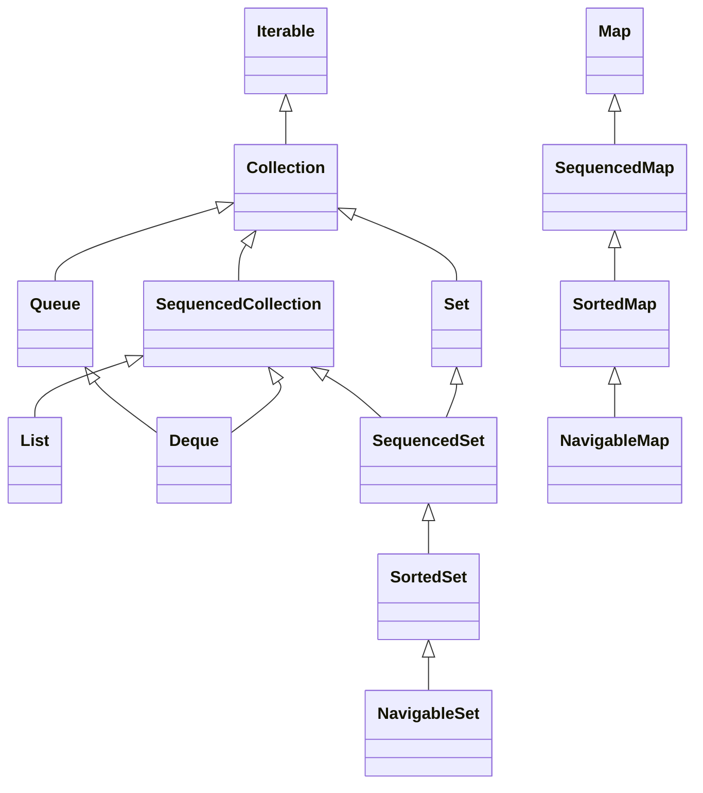
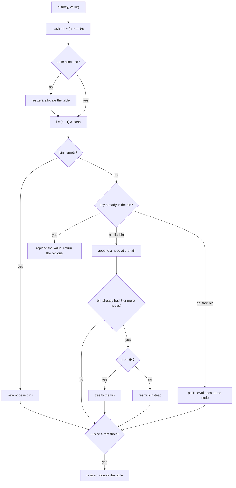
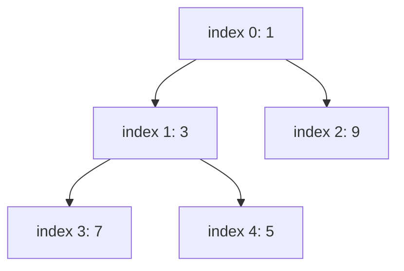
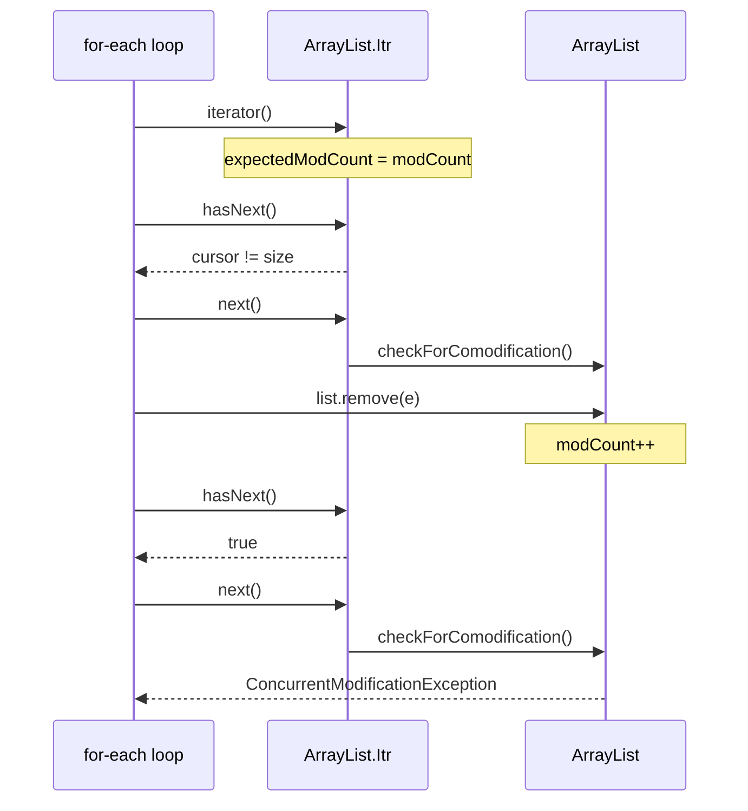

# 04. Collections internals

> **What this covers:** the Java Collections Framework from its interfaces to its data structures: what `Collection`, `List`, `Set`, `Queue`, `Deque` and `Map` promise, sequenced collections, and how `ArrayList`, `LinkedList`, `HashMap`, `LinkedHashMap`, `TreeMap`, the special-purpose maps, the sets and the queues work inside. Then the behavior that interviews probe: fail-fast iterators, immutable and fixed-size lists, sorting stability, collection equality, and how to choose a collection for a workload.
> **Prerequisites:** [02. Equality, immutability and records § 2. `hashCode` and hash-based collections](02-java-equality-immutability-records.md#2-hashcode-and-hash-based-collections), [§ 4. Ordering: `Comparable` and `Comparator`](02-java-equality-immutability-records.md#4-ordering-comparable-and-comparator), [03. Generics and type erasure § 4. Wildcards, PECS and variance](03-java-generics.md#4-wildcards-pecs-and-variance)
> **Leads to:** [05. Lambdas, streams and `Optional`](05-java-lambdas-streams-optional.md), [12. Locks, atomics and concurrent collections](12-concurrency-locks-atomics-collections.md)
> **Applies to:** Java 25
> **Study time:** ~6 hours reading + ~3 hours exercises
> **Short on time:** [3. `HashMap` internals](#3-hashmap-internals), [7. Iterators: fail-fast, weakly consistent and snapshot](#7-iterators-fail-fast-weakly-consistent-and-snapshot), [8. Immutable, unmodifiable and fixed-size lists](#8-immutable-unmodifiable-and-fixed-size-lists); questions [Q04.07](#q04-07), [Q04.09](#q04-09), [Q04.15](#q04-15), [Q04.21](#q04-21), [Q04.23](#q04-23); then [Summary](#summary).
> **Labs:** [`labs/java-language/`](../labs/java-language/), package `dev.interview.javalanguage.m04`. Run: `JAVA_HOME=$(/usr/libexec/java_home -v 25) mvn -q -f java-backend-guide/labs/pom.xml -pl java-language -am verify`. Needs Docker: no.

## Contents

1. [The Collections Framework: interfaces, contracts and sequenced collections](#1-the-collections-framework-interfaces-contracts-and-sequenced-collections)
2. [Lists: `ArrayList`, `LinkedList` and the legacy `Vector` and `Stack`](#2-lists-arraylist-linkedlist-and-the-legacy-vector-and-stack)
3. [`HashMap` internals](#3-hashmap-internals)
4. [Ordered and special-purpose maps](#4-ordered-and-special-purpose-maps)
5. [Sets: views of maps](#5-sets-views-of-maps)
6. [Queues and deques: `ArrayDeque` and `PriorityQueue`](#6-queues-and-deques-arraydeque-and-priorityqueue)
7. [Iterators: fail-fast, weakly consistent and snapshot](#7-iterators-fail-fast-weakly-consistent-and-snapshot)
8. [Immutable, unmodifiable and fixed-size lists](#8-immutable-unmodifiable-and-fixed-size-lists)
9. [Utilities, sorting and collection equality](#9-utilities-sorting-and-collection-equality)
10. [Choosing a collection: complexity, memory and workload](#10-choosing-a-collection-complexity-memory-and-workload)
- [Summary](#summary)
- [Question bank](#question-bank)
- [Hands-on exercises](#hands-on-exercises)
- [Check your understanding](#check-your-understanding)
- [Connections](#connections)

## 1. The Collections Framework: interfaces, contracts and sequenced collections
<!-- TASK: SEC-M04-01 -->
### The problem it solves

A reporting service shows "the latest event" from three teams' feeds. One team hands over a `List`, one a `Deque`, and one a `LinkedHashSet`, which drops duplicate events but keeps arrival order. Up to Java 20 no common type meant "ordered, with a first and a last element", so the helper had three versions: `list.get(list.size() - 1)`, `deque.getLast()`, and a loop over the whole `LinkedHashSet`. Then a fourth team passes a `HashSet`. A helper typed on `Collection` accepts it, and "the latest" becomes whatever the hash order puts last, an order the class does not promise to keep "constant over time" [Src: JDK 25, java.util.HashSet](https://github.com/openjdk/jdk/blob/jdk-25-ga/src/java.base/share/classes/java/util/HashSet.java). Both problems, the duplicated code and the silent wrong answer, come from not knowing exactly what each interface promises.

### Mental model

Read the interfaces as job descriptions and the classes as the people hired for them. `Collection` is the basic job: hold elements, count them, say whether one is there, hand them out one at a time. `List` adds positions, `Set` adds "no duplicates", `Queue` adds a head to take from, and `Deque` adds a second end. The sequenced interfaces (Java 21) add "has a defined first and last element, and can be read backwards". `Map` is a different job, lookup by key. It belongs to the same framework but is not a `Collection`; it lends out three collection views of itself instead.



What to notice: `Map` has no arrow from `Collection`. `HashSet` and `HashMap` implement only `Set` and `Map`, so they sit outside the sequenced branch, while `LinkedHashSet`, `TreeSet`, `LinkedHashMap` and `TreeMap` sit inside it.

### How it actually works

**Three names that sound alike.** "A collection" is the idea, a group of elements. `Collection` is the root interface of the framework, and "the JDK does not provide any *direct* implementations of this interface": it provides `Set`, `List` and the others [Src: JDK 25, java.util.Collection](https://github.com/openjdk/jdk/blob/jdk-25-ga/src/java.base/share/classes/java/util/Collection.java). `Collections` is a class that "consists exclusively of static methods that operate on or return collections", such as `sort`, `unmodifiableList` and `emptyList` [Src: JDK 25, java.util.Collections](https://github.com/openjdk/jdk/blob/jdk-25-ga/src/java.base/share/classes/java/util/Collections.java). Above `Collection` sits `java.lang.Iterable`, the interface that lets an object be "the target of the enhanced `for` statement" [Src: JDK 25, java.lang.Iterable](https://github.com/openjdk/jdk/blob/jdk-25-ga/src/java.base/share/classes/java/lang/Iterable.java); how iteration works is [§7](#7-iterators-fail-fast-weakly-consistent-and-snapshot).

**What `Collection` promises, and what it leaves out.** It declares size and membership (`size`, `isEmpty`, `contains`), bulk operations (`addAll`, `removeAll`, `retainAll`, `removeIf`), iteration and streams. `isEmpty` returns `true` when there are no elements, and the mutators return whether the collection changed: in the lab, `addAll` of an element already in a `HashSet` returns `false`, and `addAll` with one new element returns `true` [Lab: CollectionContractTest](../labs/java-language/src/test/java/dev/interview/javalanguage/m04/s01/CollectionContractTest.java). The root says nothing about order or uniqueness. Those come from the subinterfaces, and an unordered collection that allows duplicates (a bag or multiset) "should implement this interface directly" [Src: JDK 25, java.util.Collection](https://github.com/openjdk/jdk/blob/jdk-25-ga/src/java.base/share/classes/java/util/Collection.java). The same Javadoc sets a convention no interface can enforce: every general-purpose implementation has a no-argument constructor and a copy constructor that takes any `Collection`, which is why `new ArrayList<>(set)` and `new TreeSet<>(list)` work for any pair of classes.

**Optional operations.** Some methods are marked "optional operation": an implementation that does not support one "should define the corresponding method to throw `UnsupportedOperationException`". An *unmodifiable collection* is one whose mutator methods are all specified to throw it, and the Javadoc recommends throwing even when the call would change nothing, "as throwing only in certain cases can lead to programming errors" [Src: JDK 25, java.util.Collection](https://github.com/openjdk/jdk/blob/jdk-25-ga/src/java.base/share/classes/java/util/Collection.java). In the lab, `List.of("java")` throws from `add` and also from `addAll` of an empty list [Lab: CollectionContractTest](../labs/java-language/src/test/java/dev/interview/javalanguage/m04/s01/CollectionContractTest.java). The static type `List<String>` therefore tells the reader nothing about whether `add` works; [§8](#8-immutable-unmodifiable-and-fixed-size-lists) sorts the factories by what they allow.

**`Map` is part of the framework, not a `Collection`.** A map's unit is a key-value pair, and `Map` "takes the place of the `Dictionary` class", the abstract class `Hashtable` still extends ([Src: JDK 25, java.util.Map](https://github.com/openjdk/jdk/blob/jdk-25-ga/src/java.base/share/classes/java/util/Map.java); [§3](#3-hashmap-internals)). It offers three views instead: `keySet()`, `values()` and `entrySet()`. They are views, not copies: in the lab, removing a key from `keySet()` removes the mapping [Lab: CollectionContractTest](../labs/java-language/src/test/java/dev/interview/javalanguage/m04/s01/CollectionContractTest.java). Assigning a `HashMap` to a `Collection<?>` does not compile; javac reports `compiler.err.prob.found.req` [Lab: CollectionCompileRulesTest](../labs/java-language/src/test/java/dev/interview/javalanguage/m04/s01/CollectionCompileRulesTest.java).

**Sequenced collections.** Java 21 added three interfaces, to give collections with "a defined encounter order" a common type [Final since Java 21, JEP 431] [Doc: JEP 431](https://openjdk.org/jeps/431) [Src: JDK 25, java.util.SequencedCollection](https://github.com/openjdk/jdk/blob/jdk-25-ga/src/java.base/share/classes/java/util/SequencedCollection.java). A sequenced collection has an *encounter order*, "a linear arrangement from the first element to the last", and the inherited methods that walk the elements (`iterator`, `forEach`, `stream`, `toArray`) must follow it. It adds `addFirst`, `addLast`, `getFirst`, `getLast`, `removeFirst`, `removeLast` and `reversed()`, which returns "a reverse-ordered view" [Src: JDK 25, java.util.SequencedCollection](https://github.com/openjdk/jdk/blob/jdk-25-ga/src/java.base/share/classes/java/util/SequencedCollection.java). `List` and `Deque` extend it; `SequencedSet` combines it with `Set` and is implemented by `LinkedHashSet` and extended by `SortedSet` [Src: JDK 25, java.util.SequencedSet](https://github.com/openjdk/jdk/blob/jdk-25-ga/src/java.base/share/classes/java/util/SequencedSet.java) [Src: JDK 25, java.util.LinkedHashSet](https://github.com/openjdk/jdk/blob/jdk-25-ga/src/java.base/share/classes/java/util/LinkedHashSet.java) [Src: JDK 25, java.util.SortedSet](https://github.com/openjdk/jdk/blob/jdk-25-ga/src/java.base/share/classes/java/util/SortedSet.java). `SequencedMap` adds `firstEntry`, `lastEntry`, `pollFirstEntry`, `putFirst`, `putLast`, `reversed()` and sequenced views such as `sequencedKeySet()`, and `LinkedHashMap` and `SortedMap` implement it [Src: JDK 25, java.util.SequencedMap](https://github.com/openjdk/jdk/blob/jdk-25-ga/src/java.base/share/classes/java/util/SequencedMap.java) [Src: JDK 25, java.util.LinkedHashMap](https://github.com/openjdk/jdk/blob/jdk-25-ga/src/java.base/share/classes/java/util/LinkedHashMap.java) [Src: JDK 25, java.util.SortedMap](https://github.com/openjdk/jdk/blob/jdk-25-ga/src/java.base/share/classes/java/util/SortedMap.java). `HashSet` implements only `Set` [Src: JDK 25, java.util.HashSet](https://github.com/openjdk/jdk/blob/jdk-25-ga/src/java.base/share/classes/java/util/HashSet.java). In the lab, `tags.getFirst()` on a `Set<String>` fails with `compiler.err.cant.resolve.location.args`, the same call on a `LinkedHashSet<String>` compiles, and one `newest(SequencedCollection<E>)` method returns the last element of an `ArrayList`, an `ArrayDeque` and a `LinkedHashSet` alike [Lab: CollectionCompileRulesTest](../labs/java-language/src/test/java/dev/interview/javalanguage/m04/s01/CollectionCompileRulesTest.java) [Lab: SequencedViewsTest](../labs/java-language/src/test/java/dev/interview/javalanguage/m04/s01/SequencedViewsTest.java). On an empty collection, `getFirst` and `getLast` throw `NoSuchElementException` [Src: JDK 25, java.util.List](https://github.com/openjdk/jdk/blob/jdk-25-ga/src/java.base/share/classes/java/util/List.java) [Lab: SequencedViewsTest](../labs/java-language/src/test/java/dev/interview/javalanguage/m04/s01/SequencedViewsTest.java).

**`reversed()` is a view.** It copies nothing. In the lab, an element added to the list after `reversed()` was called appears first in the reversed view, and `addFirst` on the view appends to the end of the list [Lab: SequencedViewsTest](../labs/java-language/src/test/java/dev/interview/javalanguage/m04/s01/SequencedViewsTest.java).

**Explicit positioning means two different things.** On a `LinkedHashMap`, `putFirst` and `putLast` place a new key at that end, and for an existing key "the mapping is relocated if necessary" [Src: JDK 25, java.util.LinkedHashMap](https://github.com/openjdk/jdk/blob/jdk-25-ga/src/java.base/share/classes/java/util/LinkedHashMap.java); in the lab, `putLast("a", 10)` moves `a` from first to last and updates its value [Lab: SequencedViewsTest](../labs/java-language/src/test/java/dev/interview/javalanguage/m04/s01/SequencedViewsTest.java). A sorted collection cannot do that, because its comparator decides every position: `SortedSet.addFirst` and `TreeMap.putLast` throw `UnsupportedOperationException` "always" [Src: JDK 25, java.util.SortedSet](https://github.com/openjdk/jdk/blob/jdk-25-ga/src/java.base/share/classes/java/util/SortedSet.java) [Src: JDK 25, java.util.TreeMap](https://github.com/openjdk/jdk/blob/jdk-25-ga/src/java.base/share/classes/java/util/TreeMap.java). In the lab a `TreeSet` answers `getFirst()` with its smallest element and rejects `addFirst` [Lab: SequencedViewsTest](../labs/java-language/src/test/java/dev/interview/javalanguage/m04/s01/SequencedViewsTest.java). Code that takes a `SequencedMap` and calls `putLast` therefore compiles for both and fails at run time for one of them.

### Code

The approach: type the helper on `SequencedCollection`, the narrowest interface that has a last element, so every ordered collection fits and a `HashSet` is rejected by the compiler.

1. `newest` asks for `getLast()`, which every sequenced collection answers.
2. `newestFirst` reads through the `reversed()` view and copies only the elements it keeps.
3. `touch` moves a key to the end of a `SequencedMap` with `putLast`; with a `TreeMap` it throws, which the test asserts.

```java
// Excerpt of labs/java-language/src/main/java/dev/interview/javalanguage/m04/s01/SequencedViews.java
    // A List, a Deque, a LinkedHashSet and a TreeSet all answer getLast() since Java 21.
    public static <E> E newest(SequencedCollection<E> items) {
        return items.getLast();
    }

    // reversed() is a view: the stream reads the backing collection from its end.
    public static <E> List<E> newestFirst(SequencedCollection<E> items, int limit) {
        return items.reversed().stream().limit(limit).toList();
    }

    // putLast relocates an existing key; a TreeMap orders by key and throws instead.
    public static <K, V> void touch(SequencedMap<K, V> recent, K key, V value) {
        recent.putLast(key, value);
    }
```

The reversed view writes through to the list:

```java
// Excerpt of labs/java-language/src/test/java/dev/interview/javalanguage/m04/s01/SequencedViewsTest.java
    @Test
    @DisplayName("M04 §1 · reversed() is a live view of a List")
    void reversed_reflectsAndWritesThrough_toTheBackingList() {
        List<String> events = new ArrayList<>(EVENTS);
        List<String> newestFirst = events.reversed();

        events.add("logout");
        newestFirst.addFirst("timeout");

        assertThat(newestFirst).containsExactly("timeout", "logout", "checkout", "search", "login");
        assertThat(events).endsWith("timeout");
    }
```

#### Legacy

Up to Java 20, the last element of a `LinkedHashSet` was reachable only by iterating to the end, and a helper needed one overload per collection type:

```java
// Excerpt of labs/java-language/src/main/java/dev/interview/javalanguage/m04/s01/SequencedViews.java
    // Before Java 21 a LinkedHashSet exposed its last element only through a full walk.
    public static <E> E newestBeforeJava21(LinkedHashSet<E> items) {
        Iterator<E> iterator = items.iterator();
        E last = iterator.next();
        while (iterator.hasNext()) {
            last = iterator.next();
        }
        return last;
    }
```

### Failure modes and operations

The interfaces have no run-time behavior of their own; their failures are contract mismatches that surface the first time the wrong implementation arrives.
- **`UnsupportedOperationException` from a mutator.** A parameter typed `List<String>` may receive an unmodifiable list, and the first `add` throws inside the implementation class, so the top frame names it: `List.of` lists throw from `ImmutableCollections.uoe()` [Src: JDK 25, java.util.ImmutableCollections](https://github.com/openjdk/jdk/blob/jdk-25-ga/src/java.base/share/classes/java/util/ImmutableCollections.java). The fix is in the contract: document whether a returned collection may be modified, and copy before mutating a list you did not create ([§8](#8-immutable-unmodifiable-and-fixed-size-lists)).
- **Depending on an order nobody promised.** "First" or "last" of a `HashSet` or a `HashMap` is an accident of the hash table and may change as the table resizes ([Src: JDK 25, java.util.HashSet](https://github.com/openjdk/jdk/blob/jdk-25-ga/src/java.base/share/classes/java/util/HashSet.java); [§3](#3-hashmap-internals)). Typing the parameter as `SequencedCollection` or `SequencedMap` turns that bug into a compile error [Lab: CollectionCompileRulesTest](../labs/java-language/src/test/java/dev/interview/javalanguage/m04/s01/CollectionCompileRulesTest.java).
- **Explicit positioning on a sorted collection.** `putFirst`, `putLast`, `addFirst` and `addLast` on a `TreeMap` or `TreeSet` always throw [Lab: SequencedViewsTest](../labs/java-language/src/test/java/dev/interview/javalanguage/m04/s01/SequencedViewsTest.java). A method that relocates entries should take a `LinkedHashMap`, or say in its contract that sorted maps are rejected.
- **What to observe:** an `UnsupportedOperationException` whose top frame is `ImmutableCollections`, `Collections$Unmodifiable…` or a sorted collection identifies the implementation that refused; the bug is in the caller that assumed a mutable one.

> [!NOTE]
> **Version notes.** Java 1.2: the Collections Framework, with `Collection` [Src: JDK 25, java.util.Collection](https://github.com/openjdk/jdk/blob/jdk-25-ga/src/java.base/share/classes/java/util/Collection.java). Java 5: `Queue` and `java.lang.Iterable`, which the enhanced `for` loop uses [Src: JDK 25, java.util.Queue](https://github.com/openjdk/jdk/blob/jdk-25-ga/src/java.base/share/classes/java/util/Queue.java) [Src: JDK 25, java.lang.Iterable](https://github.com/openjdk/jdk/blob/jdk-25-ga/src/java.base/share/classes/java/lang/Iterable.java). Java 6: `Deque` and `NavigableMap` [Src: JDK 25, java.util.Deque](https://github.com/openjdk/jdk/blob/jdk-25-ga/src/java.base/share/classes/java/util/Deque.java) [Src: JDK 25, java.util.NavigableMap](https://github.com/openjdk/jdk/blob/jdk-25-ga/src/java.base/share/classes/java/util/NavigableMap.java). Java 9: the `List.of` factories [Src: JDK 25, java.util.List](https://github.com/openjdk/jdk/blob/jdk-25-ga/src/java.base/share/classes/java/util/List.java). Java 21: the sequenced interfaces, with `getFirst`, `getLast` and `reversed()` on every `List` and `Deque` [Doc: JEP 431](https://openjdk.org/jeps/431) [Src: JDK 25, java.util.SequencedCollection](https://github.com/openjdk/jdk/blob/jdk-25-ga/src/java.base/share/classes/java/util/SequencedCollection.java); before that, `list.get(list.size() - 1)` and a full walk over a `LinkedHashSet` were the idioms. Java 25 (default): unchanged since 21.

### Best practices and anti-patterns

- Declare parameters with the most general interface that has the operations you use (`Collection`, `List`, `SequencedCollection`), because callers can then pass any implementation that fits and the compiler rejects the ones that do not.
- Take a `SequencedCollection` or `SequencedMap` when the code needs a first or last element, because a plain `Collection` also admits a `HashSet`, whose order is not promised.
- Say in the contract whether a returned collection may be modified, because the interface type cannot say it and the caller only learns it from an `UnsupportedOperationException`.
- Copy with the copy constructor (`new ArrayList<>(source)`) when you need a mutable collection of your own, because every general-purpose implementation provides one and the copy is independent of the source.
- Iterate a `Map` through `entrySet()` when you need keys and values, because it walks the entries once instead of doing a lookup per key.
- Do not call `putFirst` or `addFirst` on a collection you only know as `SequencedMap` or `SequencedCollection` unless the contract excludes sorted ones, because sorted collections throw for explicit positioning.

### Misconceptions and traps

- *"`Map` is a `Collection`."* `Map` is part of the Collections Framework but extends no collection interface; it exposes collection views [Src: JDK 25, java.util.Map](https://github.com/openjdk/jdk/blob/jdk-25-ga/src/java.base/share/classes/java/util/Map.java) [Lab: CollectionCompileRulesTest](../labs/java-language/src/test/java/dev/interview/javalanguage/m04/s01/CollectionCompileRulesTest.java). The myth comes from the framework's name and from tutorials that draw both in one tree.
- *"A `Collection` is ordered" or "a `Collection` has no duplicates".* The root interface promises neither; `List`, `Set` and the sequenced interfaces add those guarantees [Src: JDK 25, java.util.Collection](https://github.com/openjdk/jdk/blob/jdk-25-ga/src/java.base/share/classes/java/util/Collection.java). The confusion comes from meeting `ArrayList` first and generalizing from it.
- *"`Collection` and `Collections` are the same thing."* One is the root interface, the other a class of static helpers [Src: JDK 25, java.util.Collections](https://github.com/openjdk/jdk/blob/jdk-25-ga/src/java.base/share/classes/java/util/Collections.java). The names differ by one letter, which is why interviewers ask.
- *"`reversed()` returns a reversed copy."* It returns a view that reads and writes through to the original [Lab: SequencedViewsTest](../labs/java-language/src/test/java/dev/interview/javalanguage/m04/s01/SequencedViewsTest.java). The habit comes from `Collections.reverse`, which reorders a list in place, and from stream code that builds new lists.
- *"Every sequenced collection accepts `addFirst`."* Sorted sets and maps reject explicit positioning, always [Src: JDK 25, java.util.SortedSet](https://github.com/openjdk/jdk/blob/jdk-25-ga/src/java.base/share/classes/java/util/SortedSet.java) [Src: JDK 25, java.util.TreeMap](https://github.com/openjdk/jdk/blob/jdk-25-ga/src/java.base/share/classes/java/util/TreeMap.java). The trap exists because `TreeSet` does implement `SequencedSet`, so the call compiles.

Questions that drill this section: [Q04.01](#q04-01), [Q04.02](#q04-02), [Q04.03](#q04-03).
<!-- /TASK: SEC-M04-01 -->

## 2. Lists: `ArrayList`, `LinkedList` and the legacy `Vector` and `Stack`
<!-- TASK: SEC-M04-02 -->
### The problem it solves

A nightly export reads 200,000 rows into a `List` and writes every row with `for (int i = 0; i < rows.size(); i++) write(rows.get(i))`. It finishes in seconds. A refactor changes the loader to return a `LinkedList`, "because we append a lot", and the same loop now runs for hours, with no error and no change to the loop. The `List` interface hid the one fact that mattered: on an `ArrayList`, `get(i)` is constant time, and on a `LinkedList` it walks the chain from the nearer end, so the loop becomes quadratic ([Src: JDK 25, java.util.ArrayList](https://github.com/openjdk/jdk/blob/jdk-25-ga/src/java.base/share/classes/java/util/ArrayList.java) [Src: JDK 25, java.util.LinkedList](https://github.com/openjdk/jdk/blob/jdk-25-ga/src/java.base/share/classes/java/util/LinkedList.java) [Src: JDK 25, java.util.RandomAccess](https://github.com/openjdk/jdk/blob/jdk-25-ga/src/java.base/share/classes/java/util/RandomAccess.java)). Choosing a list means knowing what each implementation does inside.

### Mental model

An `ArrayList` is a row of numbered lockers with some spare ones at the end. Finding locker 70,000 is one step, because you walk straight to the number. Inserting near the front means every later occupant moves one locker down, and when the spare lockers run out, the whole row moves to a bigger corridor. A `LinkedList` is a treasure hunt: each clue (a node) knows only the clue before and after it. Adding a clue where you are standing is cheap, but getting to clue 70,000 means following clues from the start or from the end. `Vector` is the lockers with a guard who lets one person in at a time, and `Stack` is `Vector` with a "top" painted on its last locker.

### How it actually works

**`ArrayList` is a resizable array.** Its elements live in an `Object[] elementData` (why `Object[]` and not `E[]` is [03 §6](03-java-generics.md#6-reifiable-types-generic-arrays-and-heap-pollution)). The *capacity* is that array's length, "always at least as large as the list size" [Src: JDK 25, java.util.ArrayList](https://github.com/openjdk/jdk/blob/jdk-25-ga/src/java.base/share/classes/java/util/ArrayList.java). The no-argument constructor is documented as "an initial capacity of ten", but it stores a shared empty array and allocates the ten slots on the first `add` [Src: JDK 25, java.util.ArrayList](https://github.com/openjdk/jdk/blob/jdk-25-ga/src/java.base/share/classes/java/util/ArrayList.java). When the array is full, `grow` asks `ArraysSupport.newLength` for the old length plus the larger of the minimum growth needed and the "preferred growth" `oldCapacity >> 1`, then copies into the new array with `Arrays.copyOf` ([Src: JDK 25, java.util.ArrayList](https://github.com/openjdk/jdk/blob/jdk-25-ga/src/java.base/share/classes/java/util/ArrayList.java) [Src: JDK 25, jdk.internal.util.ArraysSupport](https://github.com/openjdk/jdk/blob/jdk-25-ga/src/java.base/share/classes/jdk/internal/util/ArraysSupport.java)). A full list of 10 therefore grows to 15, and one of 100 to 150. The Javadoc promises only "constant amortized time" for `add`, not this policy [Src: JDK 25, java.util.ArrayList](https://github.com/openjdk/jdk/blob/jdk-25-ga/src/java.base/share/classes/java/util/ArrayList.java), so code must not depend on the exact numbers. `ensureCapacity(n)` grows once ahead of a known number of additions; `trimToSize()` shrinks the array to the size, and nothing else ever shrinks it [Src: JDK 25, java.util.ArrayList](https://github.com/openjdk/jdk/blob/jdk-25-ga/src/java.base/share/classes/java/util/ArrayList.java). An initial capacity is not a size: in the lab, `set(0, …)` on a `new ArrayList<>(100)` throws `IndexOutOfBoundsException`, because the list is empty [Lab: ListInternalsTest](../labs/java-language/src/test/java/dev/interview/javalanguage/m04/s02/ListInternalsTest.java).

**What each operation costs.** The Javadoc lists `get`, `set`, `size`, `getFirst`, `getLast`, `removeLast`, `iterator` and `reversed` as constant time, `add` as amortized constant, and "all of the other operations" as roughly linear [Src: JDK 25, java.util.ArrayList](https://github.com/openjdk/jdk/blob/jdk-25-ga/src/java.base/share/classes/java/util/ArrayList.java). Linear here means shifting: `add(index, e)` moves the tail one slot right with `System.arraycopy`, and `remove(index)` moves it one slot left and nulls the freed last slot so the old reference can be collected [Src: JDK 25, java.util.ArrayList](https://github.com/openjdk/jdk/blob/jdk-25-ga/src/java.base/share/classes/java/util/ArrayList.java). In the lab, `add(1, "b")` turns `[a, c, d]` into `[a, b, c, d]` [Lab: ListInternalsTest](../labs/java-language/src/test/java/dev/interview/javalanguage/m04/s02/ListInternalsTest.java). Removing from the end is cheap; removing from the front of a long list copies everything after it.

**`modCount` counts structural changes.** Every `add`, `remove`, `clear`, `ensureCapacity` that grows, and `trimToSize` increments the protected field `modCount` inherited from `AbstractList`; `set` does not, because it changes no size or array [Src: JDK 25, java.util.ArrayList](https://github.com/openjdk/jdk/blob/jdk-25-ga/src/java.base/share/classes/java/util/ArrayList.java). In the lab, a subclass reads the counter: it goes from 0 to 1 on `add`, stays at 1 after `set`, and reaches 2 after `trimToSize` [Lab: ListInternalsTest](../labs/java-language/src/test/java/dev/interview/javalanguage/m04/s02/ListInternalsTest.java). Iterators compare this counter with the value they saw at creation; that is the fail-fast check of [§7](#7-iterators-fail-fast-weakly-consistent-and-snapshot), and the reason a `trimToSize` during iteration also breaks the loop.

**`LinkedList` is a doubly linked list.** Each element sits in a `Node` with `item`, `next` and `prev` fields, and the list keeps `first` and `last` [Src: JDK 25, java.util.LinkedList](https://github.com/openjdk/jdk/blob/jdk-25-ga/src/java.base/share/classes/java/util/LinkedList.java). It implements both `List` and `Deque`. Operations at either end are a few pointer writes, but "operations that index into the list will traverse the list from the beginning or the end, whichever is closer to the specified index": `node(index)` loops from `first` when the index is in the lower half and from `last` otherwise [Src: JDK 25, java.util.LinkedList](https://github.com/openjdk/jdk/blob/jdk-25-ga/src/java.base/share/classes/java/util/LinkedList.java). So `get(i)`, `set(i, e)`, `add(i, e)` and `remove(i)` are linear, and an insertion "in the middle" is cheap only once you already hold a position, which in practice means a `ListIterator` that is already there.

**`RandomAccess` tells algorithms which loop to use.** It is a marker interface with no methods, for `List` implementations with "fast (generally constant time) random access". Its Javadoc warns that the best algorithms for random-access lists "can produce quadratic behavior when applied to sequential access lists", and encourages generic code to check `instanceof RandomAccess` first [Src: JDK 25, java.util.RandomAccess](https://github.com/openjdk/jdk/blob/jdk-25-ga/src/java.base/share/classes/java/util/RandomAccess.java). `ArrayList` implements it; `LinkedList` does not [Lab: ListInternalsTest](../labs/java-language/src/test/java/dev/interview/javalanguage/m04/s02/ListInternalsTest.java).

**When `LinkedList` wins.** Rarely: when the code inserts or removes many elements at the position of an iterator it is already moving (`ListIterator.add` and `remove` are constant time there), or when it needs a `Deque` that accepts `null`, which `ArrayDeque` refuses ([§6](#6-queues-and-deques-arraydeque-and-priorityqueue)). For a plain queue or stack, `ArrayDeque` is the better default, and for everything indexed, `ArrayList`. The Javadoc of `ArrayList` itself notes that its constant factor "is low compared to that for the `LinkedList` implementation" [Src: JDK 25, java.util.ArrayList](https://github.com/openjdk/jdk/blob/jdk-25-ga/src/java.base/share/classes/java/util/ArrayList.java). Each `LinkedList` element also costs a separate `Node` object with two extra references, where an `ArrayList` element costs one array slot [Src: JDK 25, java.util.LinkedList](https://github.com/openjdk/jdk/blob/jdk-25-ga/src/java.base/share/classes/java/util/LinkedList.java); [§10](#10-choosing-a-collection-complexity-memory-and-workload) compares footprints without invented byte counts.

**`remove(int)` and `remove(Object)`.** `List` overloads `remove`: one takes an index, the other an element. On a `List<Integer>`, `list.remove(1)` passes an `int`, so overload resolution picks the index version without boxing; `list.remove(Integer.valueOf(1))` removes the value. In the lab, `[10, 20, 30]` loses `20` with `remove(1)` and `10` with `remove(Integer.valueOf(10))` [Lab: ListInternalsTest](../labs/java-language/src/test/java/dev/interview/javalanguage/m04/s02/ListInternalsTest.java). `indexOf` returns the first matching index and `-1` when the element is absent, and changes nothing [Lab: ListInternalsTest](../labs/java-language/src/test/java/dev/interview/javalanguage/m04/s02/ListInternalsTest.java). Why the `int` overload wins is the overload-resolution rule of [01 §8](01-java-oop-fundamentals.md#8-polymorphism-overloading-overriding-and-dispatch).

**`Vector` and `Stack`.** `Vector` dates from Java 1.0 and was "retrofitted to implement the `List` interface" in 1.2. Unlike `ArrayList`, it is synchronized: its accessors and mutators, such as `get` and `add`, are `synchronized` methods, and the Javadoc recommends `ArrayList` "in place of `Vector`" when thread safety is not needed [Src: JDK 25, java.util.Vector](https://github.com/openjdk/jdk/blob/jdk-25-ga/src/java.base/share/classes/java/util/Vector.java). It grows by its `capacityIncrement` when one was given, and otherwise doubles [Src: JDK 25, java.util.Vector](https://github.com/openjdk/jdk/blob/jdk-25-ga/src/java.base/share/classes/java/util/Vector.java): in the lab, a default `Vector` goes from capacity 10 to 20 on the 11th element, and one built with an increment of 5 goes to 15 [Lab: ListInternalsTest](../labs/java-language/src/test/java/dev/interview/javalanguage/m04/s02/ListInternalsTest.java). `Stack` extends `Vector` and pushes and pops at the end of the array. Its own Javadoc says the `Deque` interface "should be used in preference to this class", for example `Deque<Integer> stack = new ArrayDeque<Integer>()` [Src: JDK 25, java.util.Stack](https://github.com/openjdk/jdk/blob/jdk-25-ga/src/java.base/share/classes/java/util/Stack.java). The two do not iterate the same way: in the lab, after pushing 1, 2 and 3, both `peek()` 3, but the `Stack` iterates `[1, 2, 3]`, bottom first, and the `ArrayDeque` iterates `[3, 2, 1]`, top first [Lab: ListInternalsTest](../labs/java-language/src/test/java/dev/interview/javalanguage/m04/s02/ListInternalsTest.java).

### Code

The approach: write the list algorithm once, and let the `RandomAccess` marker pick the access strategy, as the marker's Javadoc recommends.

1. `everyNth` validates the step and checks `instanceof RandomAccess`.
2. `byIndex` jumps with `get(i)`, which is constant time on an `ArrayList`, and presizes its result.
3. `byIterator` walks a sequential list once, because each `get(i)` on a `LinkedList` would walk from an end.
4. The test asserts that both paths return the same elements for an `ArrayList` and a `LinkedList`.

```java
// Excerpt of labs/java-language/src/main/java/dev/interview/javalanguage/m04/s02/ListAccess.java
    public static <E> List<E> everyNth(List<E> source, int step) {
        if (step < 1) {
            throw new IllegalArgumentException("step must be at least 1: " + step);
        }
        return source instanceof RandomAccess ? byIndex(source, step) : byIterator(source, step);
    }

    // get(i) is constant time on an ArrayList, so jumping by index skips the elements in between.
    private static <E> List<E> byIndex(List<E> source, int step) {
        List<E> picked = new ArrayList<>(source.size() / step + 1);
        for (int i = 0; i < source.size(); i += step) {
            picked.add(source.get(i));
        }
        return picked;
    }

    // On a LinkedList each get(i) walks from an end, so one pass with an iterator is linear instead.
    private static <E> List<E> byIterator(List<E> source, int step) {
        List<E> picked = new ArrayList<>();
        Iterator<E> iterator = source.iterator();
        for (int i = 0; iterator.hasNext(); i++) {
            E element = iterator.next();
            if (i % step == 0) {
                picked.add(element);
            }
        }
        return picked;
    }
```

Reading `modCount` from a subclass, which is how the lab observes structural changes without opening `java.util` to reflection:

```java
// Excerpt of labs/java-language/src/test/java/dev/interview/javalanguage/m04/s02/ListInternalsTest.java
    // modCount is a protected field of AbstractList, so a subclass can read it without --add-opens.
    private static final class CountingList<E> extends ArrayList<E> {
        int structuralChanges() {
            return modCount;
        }
    }

    @Test
    @DisplayName("M04 §2 · add and trimToSize count as structural changes, set does not")
    void modCount_countsStructuralChangesOnly() {
        CountingList<String> list = new CountingList<>();
        list.add("a");
        int afterAdd = list.structuralChanges();

        list.set(0, "b");
        int afterSet = list.structuralChanges();
        list.trimToSize();

        assertThat(afterAdd).isEqualTo(1);
        assertThat(afterSet).isEqualTo(afterAdd);
        assertThat(list.structuralChanges()).isEqualTo(afterSet + 1);
    }
```

#### Legacy

`Vector` and `Stack` still appear in old code, for example parsers that keep a `Stack` of tokens. Replacing a `Stack` with an `ArrayDeque` keeps `push`, `pop` and `peek`, but changes iteration order, which matters to any code that prints or copies the stack:

```java
// Excerpt of labs/java-language/src/test/java/dev/interview/javalanguage/m04/s02/ListInternalsTest.java
    @Test
    @DisplayName("M04 §2 · a Stack iterates bottom first, an ArrayDeque used as a stack iterates top first")
    void stackAndDeque_iterateInOppositeOrders() {
        Stack<Integer> legacy = new Stack<>();
        Deque<Integer> modern = new ArrayDeque<>();
        for (int i = 1; i <= 3; i++) {
            legacy.push(i);
            modern.push(i);
        }

        assertThat(legacy.peek()).isEqualTo(modern.peek()).isEqualTo(3);
        assertThat(legacy).containsExactly(1, 2, 3);
        assertThat(modern).containsExactly(3, 2, 1);
    }
```

### Failure modes and operations

- **Quadratic loops.** An index loop over a `LinkedList` walks up to half the list for every `get(i)`, and a loop that calls `remove(0)` on a long `ArrayList` copies the whole tail each time ([Src: JDK 25, java.util.RandomAccess](https://github.com/openjdk/jdk/blob/jdk-25-ga/src/java.base/share/classes/java/util/RandomAccess.java) [Src: JDK 25, java.util.ArrayList](https://github.com/openjdk/jdk/blob/jdk-25-ga/src/java.base/share/classes/java/util/ArrayList.java)). Neither fails; both get slower with the square of the size, so they pass tests with ten rows and time out in production. In a CPU profile the time sits in `LinkedList.node` or in `System.arraycopy`. [Q04.32](#q04-32) is that incident.
- **Memory that does not come back.** An `ArrayList` keeps the capacity it reached; removing elements nulls their slots but never shrinks the array, so a list that once held a million entries keeps a million-slot array until `trimToSize()` or until the list itself is dropped [Src: JDK 25, java.util.ArrayList](https://github.com/openjdk/jdk/blob/jdk-25-ga/src/java.base/share/classes/java/util/ArrayList.java). A heap histogram shows it as a large `Object[]` retained by one list.
- **Growth in a hot path.** Each `grow` allocates a new array and copies the old one [Src: JDK 25, java.util.ArrayList](https://github.com/openjdk/jdk/blob/jdk-25-ga/src/java.base/share/classes/java/util/ArrayList.java). Building a large list element by element repeats that work and the garbage; `new ArrayList<>(expected)` or `ensureCapacity` does it once.
- **The `remove(1)` overload bug.** On a `List<Integer>`, removing "the value 1" with `remove(1)` silently removes the element at index 1 instead [Lab: ListInternalsTest](../labs/java-language/src/test/java/dev/interview/javalanguage/m04/s02/ListInternalsTest.java); [Q04.07](#q04-07) drills it.
- **Sharing a list between threads.** `ArrayList` and `LinkedList` are not synchronized, and `Vector` locks each call separately, so check-then-act sequences such as "if empty, add" are not atomic in any of them ([Src: JDK 25, java.util.ArrayList](https://github.com/openjdk/jdk/blob/jdk-25-ga/src/java.base/share/classes/java/util/ArrayList.java) [Src: JDK 25, java.util.Vector](https://github.com/openjdk/jdk/blob/jdk-25-ga/src/java.base/share/classes/java/util/Vector.java)). Thread-safe lists are [12](12-concurrency-locks-atomics-collections.md)'s subject.

> [!NOTE]
> **Version notes.** Java 1.0: `Vector` and `Stack` [Src: JDK 25, java.util.Vector](https://github.com/openjdk/jdk/blob/jdk-25-ga/src/java.base/share/classes/java/util/Vector.java) [Src: JDK 25, java.util.Stack](https://github.com/openjdk/jdk/blob/jdk-25-ga/src/java.base/share/classes/java/util/Stack.java). Java 1.2: `ArrayList` and `LinkedList`, and `Vector` retrofitted to `List` [Src: JDK 25, java.util.ArrayList](https://github.com/openjdk/jdk/blob/jdk-25-ga/src/java.base/share/classes/java/util/ArrayList.java) [Src: JDK 25, java.util.LinkedList](https://github.com/openjdk/jdk/blob/jdk-25-ga/src/java.base/share/classes/java/util/LinkedList.java) [Src: JDK 25, java.util.Vector](https://github.com/openjdk/jdk/blob/jdk-25-ga/src/java.base/share/classes/java/util/Vector.java). Java 6: `LinkedList` gains the `Deque` methods such as `offerFirst` and `pollLast` [Src: JDK 25, java.util.LinkedList](https://github.com/openjdk/jdk/blob/jdk-25-ga/src/java.base/share/classes/java/util/LinkedList.java). Java 21: `getFirst`, `getLast`, `removeFirst`, `removeLast` and `reversed()` on every `List` ([§1](#1-the-collections-framework-interfaces-contracts-and-sequenced-collections)). Java 25 (default): `ArrayList` still grows by half and `Vector` still doubles [Src: JDK 25, java.util.ArrayList](https://github.com/openjdk/jdk/blob/jdk-25-ga/src/java.base/share/classes/java/util/ArrayList.java) [Src: JDK 25, java.util.Vector](https://github.com/openjdk/jdk/blob/jdk-25-ga/src/java.base/share/classes/java/util/Vector.java).

### Best practices and anti-patterns

- Default to `ArrayList` for a list, because indexed access is constant time, appends are amortized constant, and the Javadoc rates its constant factor below `LinkedList`'s.
- Presize with `new ArrayList<>(expected)` when the size is known, because each growth step allocates and copies the whole array.
- Iterate with for-each or an `Iterator` when the list type is not known, or check `RandomAccess`, because an index loop is quadratic on a sequential-access list.
- Use `ArrayDeque` for stacks and queues instead of `Stack` or `LinkedList`, because it has no per-element node and no per-call lock; keep `LinkedList` for the cases that need a `ListIterator` that inserts as it moves, or `null` elements in a `Deque`.
- Write `remove(Integer.valueOf(x))` when removing a value from a `List<Integer>`, because `remove(x)` with an `int` removes by index.
- Call `trimToSize()` only on a long-lived list that has shrunk for good, because it copies the array and the next `add` grows it again.
- Do not choose `Vector` for thread safety, because each method locks separately and compound actions still race; use the concurrent collections of [12](12-concurrency-locks-atomics-collections.md).

### Misconceptions and traps

- *"`LinkedList` is faster for inserts and deletes."* Only once the node is found; finding it by index is linear, while `ArrayList` reaches the slot in constant time and shifts the tail with one `System.arraycopy` ([Src: JDK 25, java.util.LinkedList](https://github.com/openjdk/jdk/blob/jdk-25-ga/src/java.base/share/classes/java/util/LinkedList.java) [Src: JDK 25, java.util.ArrayList](https://github.com/openjdk/jdk/blob/jdk-25-ga/src/java.base/share/classes/java/util/ArrayList.java)). The claim comes from textbook complexity tables that count the pointer update and leave out the walk.
- *"`new ArrayList<>(100)` holds 100 elements."* It has capacity 100 and size 0 [Lab: ListInternalsTest](../labs/java-language/src/test/java/dev/interview/javalanguage/m04/s02/ListInternalsTest.java). The confusion comes from arrays, where `new String[100]` does have 100 slots you can `set`.
- *"An `ArrayList` gives memory back when you remove elements."* Only `trimToSize()` shrinks the array [Src: JDK 25, java.util.ArrayList](https://github.com/openjdk/jdk/blob/jdk-25-ga/src/java.base/share/classes/java/util/ArrayList.java). The intuition comes from `size()`, which does shrink.
- *"`Vector` is thread-safe, so code that uses it is."* Each method is atomic; a sequence of calls is not [Src: JDK 25, java.util.Vector](https://github.com/openjdk/jdk/blob/jdk-25-ga/src/java.base/share/classes/java/util/Vector.java). The belief comes from the word "synchronized" in every description of `Vector`.
- *"`Stack` and `ArrayDeque` behave the same."* They agree on `push`, `pop` and `peek` and disagree on iteration order [Lab: ListInternalsTest](../labs/java-language/src/test/java/dev/interview/javalanguage/m04/s02/ListInternalsTest.java). The trap exists because the replacement compiles and the stack operations pass their tests.
- *"`ArrayList` grows by exactly 1.5×, so you can predict its capacity."* That is today's implementation, not the contract: the Javadoc specifies only amortized constant `add` [Src: JDK 25, java.util.ArrayList](https://github.com/openjdk/jdk/blob/jdk-25-ga/src/java.base/share/classes/java/util/ArrayList.java). The habit comes from reading the source of one release.

Questions that drill this section: [Q04.04](#q04-04), [Q04.05](#q04-05), [Q04.06](#q04-06), [Q04.07](#q04-07), [Q04.08](#q04-08), [Q04.32](#q04-32), [Exercise 04.3](#ex04-3).
<!-- /TASK: SEC-M04-02 -->

## 3. `HashMap` internals
<!-- TASK: SEC-M04-03 -->
### The problem it solves

A billing service builds a `HashMap<String, BigDecimal>` of charges per account and writes it to a CSV file by iterating `map.entrySet()`. For months the columns come out in the order the code inserted them, and a test pins that order. Then a new charge type is added, the map's 13th entry pushes it past its resize threshold, the table doubles, entries move to new bins, and the CSV columns come out in a different order. Nothing in the code changed except one more `put`. The `HashMap` Javadoc never promised an order, "in particular, it does not guarantee that the order will remain constant over time" [Src: JDK 25, java.util.HashMap](https://github.com/openjdk/jdk/blob/jdk-25-ga/src/java.base/share/classes/java/util/HashMap.java), and a default map does resize when its 13th mapping arrives [Lab: HashMapTableTest](../labs/java-language/src/test/java/dev/interview/javalanguage/m04/s03/HashMapTableTest.java). The same blindness causes the expensive failures: a `HashMap` gives constant-time `get` and `put` only "assuming the hash function disperses the elements properly among the buckets" [Src: JDK 25, java.util.HashMap](https://github.com/openjdk/jdk/blob/jdk-25-ga/src/java.base/share/classes/java/util/HashMap.java). Knowing the table, the hash spreading, the resize and the tree bins is what lets you predict when a map stops being fast and stops looking ordered.

### Mental model

A `HashMap` is a coat check with a row of numbered hooks. The ticket number is computed from the coat itself (the key's `hashCode`), and the attendant looks only at the last few digits to choose a hook. Several coats can end up on one hook; they hang in a line, and to return yours the attendant compares each coat on that hook with your description (`equals`). When three quarters of the hooks are taken, the attendant moves everything to a room with twice as many hooks: each coat either keeps its hook number or moves to "old number plus the old hook count", decided by one more digit of its ticket. If one hook still collects too many coats, the attendant first tries a bigger room, and only once the room has at least 64 hooks files that hook's coats in a sorted cabinet (a tree) instead of a line.



What to notice: replacing the value of an existing key leaves the size alone and never resizes; only a new mapping counts toward the threshold. A crowded bin and a full table both lead to `resize()`, and the table length decides whether a crowded bin becomes a tree.

### How it actually works

**The table.** A `HashMap` keeps a `transient Node<K,V>[] table` whose length is always a power of two, "initialized on first use, and resized as necessary". Each `Node` stores the key's spread `hash` (a `final` field), the `key`, the `value` and a `next` link to the following node in the same bin. The defaults are a capacity of 16 (`DEFAULT_INITIAL_CAPACITY = 1 << 4`), a load factor of 0.75 and a maximum capacity of `1 << 30` [Src: JDK 25, java.util.HashMap](https://github.com/openjdk/jdk/blob/jdk-25-ga/src/java.base/share/classes/java/util/HashMap.java). The no-argument constructor sets only the load factor; the array is allocated by the first `put`. In the lab, a probe that reads the private `table` field reports 0 buckets for a new map and 16 after the first `put` [Lab: HashMapTableTest](../labs/java-language/src/test/java/dev/interview/javalanguage/m04/s03/HashMapTableTest.java).

**From `hashCode` to a bin.** `hash(key)` returns 0 for a `null` key and otherwise `(h = key.hashCode()) ^ (h >>> 16)`, and the bin index is `(n - 1) & hash` for a table of length `n` [Src: JDK 25, java.util.HashMap](https://github.com/openjdk/jdk/blob/jdk-25-ga/src/java.base/share/classes/java/util/HashMap.java). Because `n` is a power of two, the mask keeps the low bits of the hash, which is the remainder modulo `n` without a division. The cost of masking is that only low bits choose the bin: the source comment explains that "sets of hashes that vary only in bits above the current mask will always collide", gives "`Float` keys holding consecutive whole numbers in small tables" as a known example, and says the XOR of the upper 16 bits into the lower 16 is "the cheapest possible way" to let the high bits matter, with trees handling large collision sets [Src: JDK 25, java.util.HashMap](https://github.com/openjdk/jdk/blob/jdk-25-ga/src/java.base/share/classes/java/util/HashMap.java). The `null` key always lands in bin 0. `HashMap` permits one `null` key and `null` values, so `get` returns `null` both for a missing key and for a key mapped to `null`, and only `containsKey` tells them apart; in the lab, `get("present")` and `get("absent")` both return `null` while `containsKey` returns `true` and `false` [Lab: HashMapBehaviorTest](../labs/java-language/src/test/java/dev/interview/javalanguage/m04/s03/HashMapBehaviorTest.java).

**The walk inside a bin.** `getNode` computes the index, checks the first node ("always check first node"), and then either searches the tree, if the first node is a `TreeNode`, or follows the `next` links. A node matches when its stored hash equals the lookup hash and its key is `==` or `equals` to the lookup key [Src: JDK 25, java.util.HashMap](https://github.com/openjdk/jdk/blob/jdk-25-ga/src/java.base/share/classes/java/util/HashMap.java). Why equal keys must have equal hash codes, and what a key mutated after insertion does to that check, belong to [02 §2](02-java-equality-immutability-records.md#2-hashcode-and-hash-based-collections), drilled by [Q02.05](02-java-equality-immutability-records.md#q02-05) and [Q02.06](02-java-equality-immutability-records.md#q02-06). `putVal` follows the diagram above. When the key is already present, it replaces the value, returns the old one and leaves before `++modCount` and `++size`, so replacing a value is not a structural modification [Src: JDK 25, java.util.HashMap](https://github.com/openjdk/jdk/blob/jdk-25-ga/src/java.base/share/classes/java/util/HashMap.java). In the lab, a second `put("a", 2)` returns `1` and the map still has one entry [Lab: HashMapBehaviorTest](../labs/java-language/src/test/java/dev/interview/javalanguage/m04/s03/HashMapBehaviorTest.java).

**Load factor and threshold.** The `threshold` field is "the next size value at which to resize (capacity * load factor)", and `putVal` resizes when `++size > threshold` after adding a new mapping [Src: JDK 25, java.util.HashMap](https://github.com/openjdk/jdk/blob/jdk-25-ga/src/java.base/share/classes/java/util/HashMap.java). A default map has a threshold of 16 × 0.75 = 12, so it holds 12 mappings in 16 buckets and doubles on the 13th; in the lab, the probe reads 16 buckets after 12 puts and 32 after the 13th [Lab: HashMapTableTest](../labs/java-language/src/test/java/dev/interview/javalanguage/m04/s03/HashMapTableTest.java). The Javadoc calls 0.75 "a good tradeoff between time and space costs": higher values "decrease the space overhead but increase the lookup cost", and because iteration takes time "proportional to the 'capacity' … plus its size", a capacity set too high (or a load factor too low) slows iteration [Src: JDK 25, java.util.HashMap](https://github.com/openjdk/jdk/blob/jdk-25-ga/src/java.base/share/classes/java/util/HashMap.java). The table never shrinks: `resize` only "initializes or doubles table size", and `clear()` nulls every slot but keeps the array [Src: JDK 25, java.util.HashMap](https://github.com/openjdk/jdk/blob/jdk-25-ga/src/java.base/share/classes/java/util/HashMap.java).

**Resize splits each bin into two lists.** Doubling the table adds one bit to the mask, so a node in bin `j` either stays at `j` or moves to `j + oldCap`, and the bit that decides is `hash & oldCap`. `resize` walks each old bin once and builds a "lo" list and a "hi" list, keeping the nodes' relative order ("preserve order"), using the hash stored in each node; it never calls `hashCode` again [Src: JDK 25, java.util.HashMap](https://github.com/openjdk/jdk/blob/jdk-25-ga/src/java.base/share/classes/java/util/HashMap.java). A tree bin is split the same way by `TreeNode.split`, and each half with at most `UNTREEIFY_THRESHOLD` (6) nodes turns back into a plain list [Src: JDK 25, java.util.HashMap](https://github.com/openjdk/jdk/blob/jdk-25-ga/src/java.base/share/classes/java/util/HashMap.java). A resize therefore allocates a new array and touches every node: cheap when spread over all the puts that preceded it, but the one `put` that triggers it pays for the whole map.

**Choosing the initial capacity.** The `int` argument of `new HashMap<>(n)` is a capacity, not an expected number of mappings: the constructor stores `tableSizeFor(n)`, the next power of two, and the first `put` allocates that many buckets with a threshold of 0.75 times it [Src: JDK 25, java.util.HashMap](https://github.com/openjdk/jdk/blob/jdk-25-ga/src/java.base/share/classes/java/util/HashMap.java). In the lab, `new HashMap<>(100)` gets 128 buckets, still has 128 after 96 puts, and doubles to 256 on the 97th [Lab: HashMapTableTest](../labs/java-language/src/test/java/dev/interview/javalanguage/m04/s03/HashMapTableTest.java). The constructors' Javadoc points to `HashMap.newHashMap(int numMappings)` for an expected number of mappings; it creates `new HashMap<>((int) Math.ceil(numMappings / 0.75))` [Src: JDK 25, java.util.HashMap](https://github.com/openjdk/jdk/blob/jdk-25-ga/src/java.base/share/classes/java/util/HashMap.java), so `newHashMap(100)` asks for 134 and gets 256 buckets, and in the lab 100 puts never resize it [Lab: HashMapTableTest](../labs/java-language/src/test/java/dev/interview/javalanguage/m04/s03/HashMapTableTest.java). The copy constructor `new HashMap<>(other)` presizes the same way, from `Math.ceil(size / loadFactor)` [Src: JDK 25, java.util.HashMap](https://github.com/openjdk/jdk/blob/jdk-25-ga/src/java.base/share/classes/java/util/HashMap.java).

**Tree bins.** [Changed in Java 8: a bin with many collisions becomes a balanced tree instead of a linked list] [Doc: JEP 180](https://openjdk.org/jeps/180). Three constants govern it. `TREEIFY_THRESHOLD` is 8, and "bins are converted to trees when adding an element to a bin with at least this many nodes", so the conversion is triggered by the ninth colliding key, not the eighth. `MIN_TREEIFY_CAPACITY` is 64: below it, `treeifyBin` resizes the table instead, because a bigger table may spread the bin. `UNTREEIFY_THRESHOLD` is 6, used when a resize splits a tree bin [Src: JDK 25, java.util.HashMap](https://github.com/openjdk/jdk/blob/jdk-25-ga/src/java.base/share/classes/java/util/HashMap.java). In the lab, keys that all return one hash code stay in a list bin of a 16-bucket table for 8 puts; the 9th resizes the table to 32, the 10th to 64, and the 11th turns the bin into a tree [Lab: HashMapTableTest](../labs/java-language/src/test/java/dev/interview/javalanguage/m04/s03/HashMapTableTest.java). A resize cannot separate keys whose hash codes are identical, so for them those two resizes are wasted; it does help keys that merely share their low bits. Removal can also turn a tree back into a list when the tree becomes small, decided by its shape in `removeTreeNode` rather than by a count [Src: JDK 25, java.util.HashMap](https://github.com/openjdk/jdk/blob/jdk-25-ga/src/java.base/share/classes/java/util/HashMap.java).

**What a tree bin protects against.** A tree bin is a red-black tree (a self-balancing binary search tree, the structure `TreeMap` also uses, [§4](#4-ordered-and-special-purpose-maps)) of `TreeNode`s, "ordered primarily by hashCode", and for ties by `compareTo` when both keys are of the same class `C implements Comparable<C>` (checked by reflection in `comparableClassFor`). The source comment says this gives "worst-case O(log n) operations when keys either have distinct hashes or are orderable", so performance "degrades gracefully under accidental or malicious usages" in which many keys share a hash code, "so long as they are also Comparable" [Src: JDK 25, java.util.HashMap](https://github.com/openjdk/jdk/blob/jdk-25-ga/src/java.base/share/classes/java/util/HashMap.java). For keys with equal hashes that are not mutually comparable, insertion orders them with `tieBreakOrder` (class name, then `System.identityHashCode`), but that order cannot be used for a lookup, so `TreeNode.find` searches both subtrees and a lookup in such a bin can still visit every node [Src: JDK 25, java.util.HashMap](https://github.com/openjdk/jdk/blob/jdk-25-ga/src/java.base/share/classes/java/util/HashMap.java). The lab's `CollidingKey` is that case: every key is still found, because `equals` decides the match [Lab: HashMapBehaviorTest](../labs/java-language/src/test/java/dev/interview/javalanguage/m04/s03/HashMapBehaviorTest.java), but nothing bounds the walk. Tree nodes "are about twice the size of regular nodes", which is why bins are treeified only when crowded; with well-distributed hash codes, the comment's Poisson table puts the probability of a bin reaching 8 nodes at 0.00000006 [Src: JDK 25, java.util.HashMap](https://github.com/openjdk/jdk/blob/jdk-25-ga/src/java.base/share/classes/java/util/HashMap.java). JEP 180 describes the change as improving the worst case "from O(n) to O(log n)" [Doc: JEP 180](https://openjdk.org/jeps/180).

**Iteration order.** Iterators walk the table from bin 0 upward and each bin along its links [Src: JDK 25, java.util.HashMap](https://github.com/openjdk/jdk/blob/jdk-25-ga/src/java.base/share/classes/java/util/HashMap.java), so the order depends on the hash codes, the current capacity and each bin's history, and a resize can change it. The class "makes no guarantees as to the order of the map" [Src: JDK 25, java.util.HashMap](https://github.com/openjdk/jdk/blob/jdk-25-ga/src/java.base/share/classes/java/util/HashMap.java), and JEP 180 warned that the Java 8 change "will likely result in a change to the iteration order of the `HashMap` class" while keeping `LinkedHashMap`'s [Doc: JEP 180](https://openjdk.org/jeps/180). Small demos look ordered for a mundane reason: `Integer.hashCode` is the `int` value itself [Src: JDK 25, java.lang.Integer](https://github.com/openjdk/jdk/blob/jdk-25-ga/src/java.base/share/classes/java/lang/Integer.java), so small integer keys sit in consecutive bins. Code that needs an order uses `LinkedHashMap` or `TreeMap` ([§4](#4-ordered-and-special-purpose-maps)). The iterators are fail-fast, the subject of [§7](#7-iterators-fail-fast-weakly-consistent-and-snapshot).

**`Hashtable`, `Dictionary` and `ConcurrentHashMap`.** `Hashtable` dates from Java 1.0 and was retrofitted to implement `Map` in 1.2. Its public methods are `synchronized`, and "any non-`null` object can be used as a key or as a value": `put` throws `NullPointerException` for a `null` key or value [Src: JDK 25, java.util.Hashtable](https://github.com/openjdk/jdk/blob/jdk-25-ga/src/java.base/share/classes/java/util/Hashtable.java), which the lab confirms for both [Lab: HashMapBehaviorTest](../labs/java-language/src/test/java/dev/interview/javalanguage/m04/s03/HashMapBehaviorTest.java). Inside, it is the older design: a default capacity of 11, an index of `(hash & 0x7FFFFFFF) % tab.length`, growth to `2n + 1`, and `keys()` and `elements()` returning an `Enumeration` that is not fail-fast, while its iterators are [Src: JDK 25, java.util.Hashtable](https://github.com/openjdk/jdk/blob/jdk-25-ga/src/java.base/share/classes/java/util/Hashtable.java). JEP 180 left it without tree bins on purpose, because "some legacy code that uses it is known to depend upon iteration order" [Doc: JEP 180](https://openjdk.org/jeps/180). Its Javadoc recommends `HashMap` where thread safety is not needed and `ConcurrentHashMap` where high concurrency is [Src: JDK 25, java.util.Hashtable](https://github.com/openjdk/jdk/blob/jdk-25-ga/src/java.base/share/classes/java/util/Hashtable.java). Its abstract parent `Dictionary` is marked "obsolete" [Src: JDK 25, java.util.Dictionary](https://github.com/openjdk/jdk/blob/jdk-25-ga/src/java.base/share/classes/java/util/Dictionary.java). `ConcurrentHashMap`, like `Hashtable`, "does not allow `null` to be used as a key or value" [Src: JDK 25, java.util.concurrent.ConcurrentHashMap](https://github.com/openjdk/jdk/blob/jdk-25-ga/src/java.base/share/classes/java/util/concurrent/ConcurrentHashMap.java) [Lab: HashMapBehaviorTest](../labs/java-language/src/test/java/dev/interview/javalanguage/m04/s03/HashMapBehaviorTest.java); how it stays thread-safe without one lock for the whole table is [12](12-concurrency-locks-atomics-collections.md)'s subject. A plain `HashMap` that several threads use, with at least one modifying it structurally, "must be synchronized externally" [Src: JDK 25, java.util.HashMap](https://github.com/openjdk/jdk/blob/jdk-25-ga/src/java.base/share/classes/java/util/HashMap.java).

### Code

The approach: the table is a private field of `java.util.HashMap`, so the lab reads it with reflection in a separate JVM that opens `java.util` to the probe, and prints the capacity, and whether a bin is a tree, after chosen puts. The test JVM itself stays closed, which is why the probe runs as a child process.

1. `CollidingKey` is a record whose `hashCode` always returns 42, so every instance lands in one bin, while the record's generated `equals` still tells instances apart by `name`. It does not implement `Comparable`.
2. `TableProbe.capacity` reads `table` and returns its length, or 0 before the first `put`; `treeBins` counts the bins whose first node is a `java.util.HashMap$TreeNode`.
3. `fill` puts keys 1, 2, 3, … and describes the map after each checkpoint put; `report` runs the four scenarios.
4. `HashMapTableTest` starts `java --add-opens java.base/java.util=ALL-UNNAMED -cp <classes> …TableProbe` and asserts the printed lines. In the test JVM, without the flag, `TableProbe.capacity` throws `InaccessibleObjectException` [Lab: HashMapBehaviorTest](../labs/java-language/src/test/java/dev/interview/javalanguage/m04/s03/HashMapBehaviorTest.java).

```java
// Excerpt of labs/java-language/src/main/java/dev/interview/javalanguage/m04/s03/CollidingKey.java
public record CollidingKey(String name) {

    private static final int SHARED_HASH = 42;

    @Override
    public int hashCode() {
        return SHARED_HASH;
    }
}
```

```java
// Excerpt of labs/java-language/src/main/java/dev/interview/javalanguage/m04/s03/TableProbe.java
    /** The number of buckets, or 0 while the table has not been allocated. */
    public static int capacity(HashMap<?, ?> map) {
        Object[] table = table(map);
        return table == null ? 0 : table.length;
    }

    static List<String> report() {
        return List.of(
                "default: " + growth(new HashMap<>(), 1, 12, 13),
                "new HashMap<>(100): " + growth(new HashMap<>(PRESIZED_MAPPINGS), 1, 96, 97),
                "HashMap.newHashMap(100): " + growth(HashMap.newHashMap(PRESIZED_MAPPINGS), 1, 100),
                "colliding keys: " + collisions(8, 9, 10, 11));
    }

    // Puts keys 1..last checkpoint and describes the map after each checkpoint (checkpoints ascending).
    private static <K> List<String> fill(
            HashMap<K, Integer> map,
            IntFunction<K> keyFor,
            Function<HashMap<K, Integer>, String> describe,
            int... checkpoints) {
        List<String> marks = new ArrayList<>();
        int next = 0;
        for (int i = 1; next < checkpoints.length; i++) {
            map.put(keyFor.apply(i), i);
            if (i == checkpoints[next]) {
                marks.add("put" + i + "=" + describe.apply(map));
                next++;
            }
        }
        return marks;
    }

    private static Object[] table(HashMap<?, ?> map) {
        try {
            Field field = HashMap.class.getDeclaredField("table");
            field.setAccessible(true);
            return (Object[]) field.get(map);
        } catch (NoSuchFieldException | IllegalAccessException e) {
            throw new IllegalStateException("HashMap.table is not readable", e);
        }
    }
```

The child JVM prints these lines, which `HashMapTableTest` asserts one by one (`new=` is the capacity before the first `put`, `putN=` the capacity after the N-th):

```text
default: new=0 put1=16 put12=16 put13=32
new HashMap<>(100): new=0 put1=128 put96=128 put97=256
HashMap.newHashMap(100): new=0 put1=256 put100=256
colliding keys: put8=16 list, put9=32 list, put10=64 list, put11=64 tree
```

How to read it: the first line is the lazy allocation and the 12-mapping threshold; the second shows that a capacity argument of 100 still resizes before 100 mappings; the third that `newHashMap` does not; the fourth that a crowded bin first triggers two resizes and becomes a tree only once the table has 64 buckets. The launch:

```java
// Excerpt of labs/java-language/src/test/java/dev/interview/javalanguage/m04/s03/HashMapTableTest.java
    private static List<String> launchProbe() throws IOException, InterruptedException, URISyntaxException {
        Path java = Path.of(System.getProperty("java.home"), "bin", "java");
        Path classes = Path.of(TableProbe.class
                .getProtectionDomain()
                .getCodeSource()
                .getLocation()
                .toURI());
        ProcessBuilder builder = new ProcessBuilder(
                        java.toString(),
                        ADD_OPENS,
                        OPEN_JAVA_UTIL,
                        "-cp",
                        classes.toString(),
                        TableProbe.class.getName())
                .redirectErrorStream(true);
        builder.environment().keySet().removeAll(ECHOED_OPTION_VARIABLES);
        Process process = builder.start();
        if (!process.waitFor(TIMEOUT_SECONDS, TimeUnit.SECONDS)) {
            process.destroyForcibly();
            fail("probe did not finish within " + TIMEOUT_SECONDS + " s");
        }
        String output = new String(process.getInputStream().readAllBytes(), StandardCharsets.UTF_8);
        assertThat(process.exitValue()).as(output).isZero();
        return output.lines().toList();
    }
```

The probe is a diagnostic for learning, not production code: it depends on a private field name, which is exactly what the module system's encapsulation of `java.base` is there to stop.

### Failure modes and operations

- **Resizing in a hot path or at startup.** Every resize allocates a new array and relinks every node [Src: JDK 25, java.util.HashMap](https://github.com/openjdk/jdk/blob/jdk-25-ga/src/java.base/share/classes/java/util/HashMap.java), so a map filled one `put` at a time from the default size doubles again and again on its way to a million entries, and each doubling stalls the thread that triggers it and leaves the old array as garbage. Presizing with `HashMap.newHashMap(expected)` removes the doublings [Lab: HashMapTableTest](../labs/java-language/src/test/java/dev/interview/javalanguage/m04/s03/HashMapTableTest.java). In a CPU profile the time sits in `HashMap.resize`; [Q04.13](#q04-13) is that incident.
- **Tables that only grow.** A map that once held many entries keeps its large table after `remove` or `clear()` [Src: JDK 25, java.util.HashMap](https://github.com/openjdk/jdk/blob/jdk-25-ga/src/java.base/share/classes/java/util/HashMap.java), so a long-lived map that spikes once holds the memory, and its iteration stays proportional to that capacity. A heap histogram shows a large `HashMap$Node[]` behind a map that is now small; replacing the map with a fresh copy (`new HashMap<>(old)`, sized from the current size) releases it.
- **Collisions.** A poor `hashCode` (a constant, or one that ignores the fields that vary) sends keys to a few bins, and every `get` walks a chain or a tree [Src: JDK 25, java.util.HashMap](https://github.com/openjdk/jdk/blob/jdk-25-ga/src/java.base/share/classes/java/util/HashMap.java). Nothing fails; latency grows with the number of colliding keys. The evidence is CPU in `HashMap.getNode`, `HashMap$TreeNode.find` or `putTreeVal`, and `HashMap$TreeNode` instances in a heap histogram, which exist only in crowded bins. The attacker-driven version is the callout below.
- **Order leaking into output.** Reports, JSON bodies, cache keys or test assertions built by iterating a `HashMap` change when the map resizes or the JDK changes the implementation, as Java 8 did ([Src: JDK 25, java.util.HashMap](https://github.com/openjdk/jdk/blob/jdk-25-ga/src/java.base/share/classes/java/util/HashMap.java) [Doc: JEP 180](https://openjdk.org/jeps/180)). The failure appears far from its cause: one more entry, or a JDK upgrade.
- **Unsynchronized writers.** `HashMap` is not synchronized, and its fail-fast iterators detect concurrent modification only "on a best-effort basis" [Src: JDK 25, java.util.HashMap](https://github.com/openjdk/jdk/blob/jdk-25-ga/src/java.base/share/classes/java/util/HashMap.java). A map shared between threads without a lock has a data race (two threads touch the same memory without synchronization, at least one of them writing; [11](11-concurrency-threads-and-jmm.md)), whatever a test happens to show; shared maps are [12](12-concurrency-locks-atomics-collections.md)'s subject.
- **Configuration.** The only knobs are the initial capacity and the load factor (default 0.75 [Src: JDK 25, java.util.HashMap](https://github.com/openjdk/jdk/blob/jdk-25-ga/src/java.base/share/classes/java/util/HashMap.java)); both are constructor arguments, and there is no JVM flag for them.

> [!IMPORTANT]
> **Production scenario: a public endpoint burns CPU on a handful of requests.** *As the interviewer frames it:* "Our search API takes filters as a JSON object and copies the fields into a `HashMap<String, String>`. Request rate is normal, but every instance is at full CPU, and the slow requests are a few very large bodies from one client. Why, and what do you change?"
> **Reasoning.** Large bodies plus CPU, not I/O, points at work proportional to something in the body. A profile with most samples under `HashMap.putVal`, `putTreeVal` and `HashMap$TreeNode.find` says the map is spending its time inside crowded bins, and hashing the received field names offline shows that most of them share one `String.hashCode`. Such names are easy to make: `String.hashCode` is `s[0]*31^(n-1) + … + s[n-1]` [Src: JDK 25, java.lang.String](https://github.com/openjdk/jdk/blob/jdk-25-ga/src/java.base/share/classes/java/lang/String.java), `"Aa"` and `"BB"` both hash to 2112, and in the lab all 8 strings built from three such blocks share one hash code [Lab: HashMapBehaviorTest](../labs/java-language/src/test/java/dev/interview/javalanguage/m04/s03/HashMapBehaviorTest.java), so n blocks give 2ⁿ colliding names. Since Java 8 the damage is bounded for `String` keys: they are `Comparable`, so the crowded bin becomes a tree with O(log n) operations instead of a chain with O(n) ([Doc: JEP 180](https://openjdk.org/jeps/180) [Src: JDK 25, java.util.HashMap](https://github.com/openjdk/jdk/blob/jdk-25-ga/src/java.base/share/classes/java/util/HashMap.java)). Bounded is not free: each request still pays a tree operation per field on one bin, and if the code wraps the names in a key type that is not `Comparable`, the tree cannot order equal hashes and lookups walk the whole bin again. The fix is at the edge: cap the request body size and the number of fields accepted per object, and reject the request before building the map. Keep key types `Comparable` where untrusted input chooses the keys. To prevent a recurrence, alert on requests with unusual field counts and include a colliding-key payload in the load tests.

> [!NOTE]
> **Version notes.** Java 1.0: `Hashtable` and `Dictionary` [Src: JDK 25, java.util.Hashtable](https://github.com/openjdk/jdk/blob/jdk-25-ga/src/java.base/share/classes/java/util/Hashtable.java) [Src: JDK 25, java.util.Dictionary](https://github.com/openjdk/jdk/blob/jdk-25-ga/src/java.base/share/classes/java/util/Dictionary.java). Java 1.2: `HashMap`, and `Hashtable` retrofitted to `Map` [Src: JDK 25, java.util.HashMap](https://github.com/openjdk/jdk/blob/jdk-25-ga/src/java.base/share/classes/java/util/HashMap.java) [Src: JDK 25, java.util.Hashtable](https://github.com/openjdk/jdk/blob/jdk-25-ga/src/java.base/share/classes/java/util/Hashtable.java). Java 8: crowded bins of `HashMap` and `LinkedHashMap` become balanced trees, `HashMap` iteration order changed within its specification, and `Hashtable` was left as it was [Doc: JEP 180](https://openjdk.org/jeps/180). Java 19: `HashMap.newHashMap(int)` for an expected number of mappings [Src: JDK 25, java.util.HashMap](https://github.com/openjdk/jdk/blob/jdk-25-ga/src/java.base/share/classes/java/util/HashMap.java). Java 25 (default): load factor 0.75, thresholds 8, 6 and 64 [Src: JDK 25, java.util.HashMap](https://github.com/openjdk/jdk/blob/jdk-25-ga/src/java.base/share/classes/java/util/HashMap.java).

### Best practices and anti-patterns

- Presize with `HashMap.newHashMap(expected)` when the number of mappings is known, because `new HashMap<>(n)` takes a capacity and still resizes once the map passes 0.75 × that capacity.
- Keep the default load factor unless a measurement says otherwise, because a higher one lengthens lookups to save space and a lower one makes the table and every iteration larger.
- Use keys that are immutable and whose `equals` and `hashCode` agree ([02 §2](02-java-equality-immutability-records.md#2-hashcode-and-hash-based-collections)), because each node stores the hash computed at `put` and lookups compare against it.
- Prefer `Comparable` key types (`String`, `Integer`, a record implementing `Comparable`) for maps whose keys may collide, because a tree bin can bound the cost of equal hashes only through `compareTo`.
- Never depend on `HashMap` iteration order, in code or in tests, because a resize or a JDK upgrade changes it; use `LinkedHashMap` or `TreeMap` ([§4](#4-ordered-and-special-purpose-maps)) when order matters, and compare maps with `equals` in tests.
- Avoid `null` values, or check with `containsKey`, because `get` returns `null` both for an absent key and for a key mapped to `null`.
- Do not use `Hashtable` in new code, because it locks every call and still leaves compound actions unprotected; use `HashMap` on one thread and `ConcurrentHashMap` ([12](12-concurrency-locks-atomics-collections.md)) when threads share the map.
- **Security:** limit how many entries untrusted input can add to a map (request parameters, JSON fields, headers) before the map is built, because crafted keys with one hash code all land in one bin; tree bins keep that to O(log n) per operation only for `Comparable` keys, and the source itself names "malicious usages" as the case they soften rather than remove [Src: JDK 25, java.util.HashMap](https://github.com/openjdk/jdk/blob/jdk-25-ga/src/java.base/share/classes/java/util/HashMap.java).

### Misconceptions and traps

- *"A `HashMap` keeps insertion order."* It makes no ordering guarantee, and the order can change on a resize [Src: JDK 25, java.util.HashMap](https://github.com/openjdk/jdk/blob/jdk-25-ga/src/java.base/share/classes/java/util/HashMap.java). The myth comes from demos with small integer keys, whose hash code is their value [Src: JDK 25, java.lang.Integer](https://github.com/openjdk/jdk/blob/jdk-25-ga/src/java.base/share/classes/java/lang/Integer.java), so they print in ascending order and look "ordered".
- *"`new HashMap<>(100)` holds 100 entries without resizing."* It allocates 128 buckets with a threshold of 96 and resizes on the 97th put [Lab: HashMapTableTest](../labs/java-language/src/test/java/dev/interview/javalanguage/m04/s03/HashMapTableTest.java). The confusion comes from reading the argument as an expected size; `HashMap.newHashMap(100)` is the method that takes one.
- *"A bin becomes a tree when it reaches 8 entries."* The conversion happens when a ninth key is added to a bin that already has 8, and only if the table has at least 64 buckets; below that the table is resized instead [Src: JDK 25, java.util.HashMap](https://github.com/openjdk/jdk/blob/jdk-25-ga/src/java.base/share/classes/java/util/HashMap.java) [Lab: HashMapTableTest](../labs/java-language/src/test/java/dev/interview/javalanguage/m04/s03/HashMapTableTest.java). The shorthand comes from the constant's name, `TREEIFY_THRESHOLD = 8`.
- *"Java 8 made collisions harmless."* Before Java 8 a crowded bin was always a linked list; since then, tree bins bound the cost to O(log n) when the colliding keys are `Comparable`, cost about twice the memory per node, and give little help to equal-hash keys that are not comparable ([Doc: JEP 180](https://openjdk.org/jeps/180) [Src: JDK 25, java.util.HashMap](https://github.com/openjdk/jdk/blob/jdk-25-ga/src/java.base/share/classes/java/util/HashMap.java)). The myth comes from summaries of JEP 180 that quote the O(log n) and drop the condition.
- *"A bigger load factor saves memory for free."* The Javadoc: higher values decrease the space overhead "but increase the lookup cost" [Src: JDK 25, java.util.HashMap](https://github.com/openjdk/jdk/blob/jdk-25-ga/src/java.base/share/classes/java/util/HashMap.java). The intuition comes from looking only at the table length.
- *"A resize rehashes every key."* It reuses the hash stored in each node and moves the node by one bit of it, keeping each bin's order [Src: JDK 25, java.util.HashMap](https://github.com/openjdk/jdk/blob/jdk-25-ga/src/java.base/share/classes/java/util/HashMap.java). The word "rehashed" in the Javadoc's own description of growth is where the idea comes from; the cost is real, but it is copying, not calling `hashCode`.
- *"`get` returned `null`, so the key is not there."* A key can be mapped to `null`; only `containsKey` answers that question [Lab: HashMapBehaviorTest](../labs/java-language/src/test/java/dev/interview/javalanguage/m04/s03/HashMapBehaviorTest.java). The habit comes from `Hashtable` and `ConcurrentHashMap`, where `null` values are impossible and `null` does mean absent.


Questions that drill this section: [Q04.09](#q04-09), [Q04.10](#q04-10), [Q04.11](#q04-11), [Q04.12](#q04-12), [Q04.13](#q04-13), [Exercise 04.2](#ex04-2).
<!-- /TASK: SEC-M04-03 -->

## 4. Ordered and special-purpose maps
<!-- TASK: SEC-M04-04 -->
### The problem it solves

Three tickets from one sprint. A pricing service stores tax bands in a `HashMap<BigDecimal, BigDecimal>` and finds "the band for 4,250.00" by looping over every key and keeping the largest bound below the amount, which is linear in the number of bands. Its fast path, `map.get(amount)` for amounts that sit exactly on a bound, misses the band written `1000` when asked for `1000.00`, because `BigDecimal.equals` is true only when "value and scale are equal" [Src: JDK 25, java.math.BigDecimal](https://github.com/openjdk/jdk/blob/jdk-25-ga/src/java.base/share/classes/java/math/BigDecimal.java). An in-memory cache of rendered pages grows until the heap is full, because nothing ever removes the page nobody has asked for in a week. A serializer that tracks "objects already written" in a `HashMap` writes one object twice and another not at all, because two distinct objects are `equals` [Src: JDK 25, java.util.IdentityHashMap](https://github.com/openjdk/jdk/blob/jdk-25-ga/src/java.base/share/classes/java/util/IdentityHashMap.java). Each is a `Map` with the wrong idea of order or of key equality, and the JDK ships a map for each idea: `TreeMap` for sorted keys and range lookups, `LinkedHashMap` for insertion or access order, `EnumMap` for enum keys, `IdentityHashMap` for reference equality and `WeakHashMap` for keys whose lifetime someone else controls.

### Mental model

Think of five filing systems. `LinkedHashMap` is the coat check of [§3](#3-hashmap-internals) with a guest book: the hooks still find a coat in one step, and the book lists the coats in the order they arrived, or, in access order, moves a guest's line to the bottom every time they come back, so the top line is always the guest who has been away longest. `TreeMap` is a dictionary: everything is in sorted order, so you can open it at "the last word before *mango*" as easily as at *mango* itself. `EnumMap` is a weekly pill box with one compartment per day, fixed and in calendar order. `IdentityHashMap` is a name-tag check at a conference: two people both called Ana are two different people. `WeakHashMap` is a coat check that throws a coat away once its owner has left the building, which only works if nothing in the coat's pockets keeps the owner inside.

| Map | Iteration order | Keys are the same when | `null` key | Basic operations |
|---|---|---|---|---|
| `HashMap` | unspecified, may change | `hashCode` and `equals` agree | one allowed | constant time if hashes disperse [Src: JDK 25, java.util.HashMap](https://github.com/openjdk/jdk/blob/jdk-25-ga/src/java.base/share/classes/java/util/HashMap.java) |
| `LinkedHashMap` | insertion order, or access order | as `HashMap` | allowed | constant time, "just slightly below that of `HashMap`" [Src: JDK 25, java.util.LinkedHashMap](https://github.com/openjdk/jdk/blob/jdk-25-ga/src/java.base/share/classes/java/util/LinkedHashMap.java) |
| `TreeMap` | sorted by `compareTo` or the comparator | `compareTo` or `compare` returns 0 | `NullPointerException` under natural ordering | "guaranteed log(n)" for `containsKey`, `get`, `put`, `remove` [Src: JDK 25, java.util.TreeMap](https://github.com/openjdk/jdk/blob/jdk-25-ga/src/java.base/share/classes/java/util/TreeMap.java) |
| `EnumMap` | declaration order of the constants | same constant | `NullPointerException` | constant time [Src: JDK 25, java.util.EnumMap](https://github.com/openjdk/jdk/blob/jdk-25-ga/src/java.base/share/classes/java/util/EnumMap.java) |
| `IdentityHashMap` | unspecified | `k1 == k2` | allowed | constant time if `System.identityHashCode` disperses [Src: JDK 25, java.util.IdentityHashMap](https://github.com/openjdk/jdk/blob/jdk-25-ga/src/java.base/share/classes/java/util/IdentityHashMap.java) |
| `WeakHashMap` | unspecified | as `HashMap` | allowed | like `HashMap`; entries disappear after their keys are collected [Src: JDK 25, java.util.WeakHashMap](https://github.com/openjdk/jdk/blob/jdk-25-ga/src/java.base/share/classes/java/util/WeakHashMap.java) |

What to notice: only the first column changes between `HashMap` and `LinkedHashMap`, while `TreeMap`, `EnumMap` and `IdentityHashMap` each change the meaning of "same key", which changes what the map contains, not only how fast it is.

### How it actually works

**`LinkedHashMap` is a `HashMap` plus a doubly linked list.** It extends `HashMap`, and its entries, `LinkedHashMap.Entry`, extend `HashMap.Node` with `before` and `after` links; the map keeps `head` (the eldest) and `tail` (the youngest) [Src: JDK 25, java.util.LinkedHashMap](https://github.com/openjdk/jdk/blob/jdk-25-ga/src/java.base/share/classes/java/util/LinkedHashMap.java). Lookups use the inherited table of [§3](#3-hashmap-internals); iteration follows the list, so it takes time proportional to the size, not the capacity [Src: JDK 25, java.util.LinkedHashMap](https://github.com/openjdk/jdk/blob/jdk-25-ga/src/java.base/share/classes/java/util/LinkedHashMap.java). By default the order is insertion order, and "encounter order is not affected if a key is re-inserted"; in the lab, putting `a` again after `b` and `c` updates its value and leaves the order `[a, b, c]` [Lab: OrderedMapsTest](../labs/java-language/src/test/java/dev/interview/javalanguage/m04/s04/OrderedMapsTest.java). `HashMap` calls three hooks that `LinkedHashMap` overrides: `afterNodeAccess`, `afterNodeInsertion` and `afterNodeRemoval` [Src: JDK 25, java.util.HashMap](https://github.com/openjdk/jdk/blob/jdk-25-ga/src/java.base/share/classes/java/util/HashMap.java). That is a Template Method arrangement: the hash table does the work, and the subclass keeps its list in step. `putFirst` and `putLast` (Java 21) relocate a key explicitly, as [§1](#1-the-collections-framework-interfaces-contracts-and-sequenced-collections) showed.

**Access order and `removeEldestEntry`.** The constructor `LinkedHashMap(int initialCapacity, float loadFactor, boolean accessOrder)` with `true` orders entries "from least-recently accessed to most-recently", which the Javadoc calls "well-suited to building LRU caches" (LRU: least recently used, the eviction policy that drops the entry unused for longest). `put`, `putIfAbsent`, `get`, `getOrDefault`, `compute`, `computeIfAbsent`, `computeIfPresent` and `merge` count as accesses; operations on the `keySet`, `values` and `entrySet` views do not [Src: JDK 25, java.util.LinkedHashMap](https://github.com/openjdk/jdk/blob/jdk-25-ga/src/java.base/share/classes/java/util/LinkedHashMap.java). An access runs `afterNodeAccess`, which unlinks the entry, appends it at the tail and increments `modCount`. After inserting a new entry, `afterNodeInsertion` calls `removeEldestEntry(head)` and removes the head when it returns `true`; the default returns `false`, and the Javadoc's sample override is `return size() > MAX_ENTRIES` [Src: JDK 25, java.util.LinkedHashMap](https://github.com/openjdk/jdk/blob/jdk-25-ga/src/java.base/share/classes/java/util/LinkedHashMap.java). In the lab, a map bounded at 3 entries holding `a`, `b`, `c` evicts `b` when `d` arrives after a `get("a")`, leaving `[c, a, d]` [Lab: OrderedMapsTest](../labs/java-language/src/test/java/dev/interview/javalanguage/m04/s04/OrderedMapsTest.java). Because an access moves an entry, "in access-ordered linked hash maps, merely querying the map with `get` is a structural modification" [Src: JDK 25, java.util.LinkedHashMap](https://github.com/openjdk/jdk/blob/jdk-25-ga/src/java.base/share/classes/java/util/LinkedHashMap.java): in the lab, calling `get` for each key inside a loop over `keySet()` throws `ConcurrentModificationException` [Lab: OrderedMapsTest](../labs/java-language/src/test/java/dev/interview/javalanguage/m04/s04/OrderedMapsTest.java).

**`TreeMap` is a red-black tree.** A red-black tree is a binary search tree whose nodes carry a red or black color, which insertions and deletions use to decide how to recolor and rotate the tree back into balance. Each `TreeMap.Entry` holds `key`, `value`, `left`, `right`, `parent` and a `boolean color`, and the class "provides guaranteed log(n) time cost for the `containsKey`, `get`, `put` and `remove` operations", with algorithms adapted from Cormen, Leiserson and Rivest [Src: JDK 25, java.util.TreeMap](https://github.com/openjdk/jdk/blob/jdk-25-ga/src/java.base/share/classes/java/util/TreeMap.java). It never calls `hashCode` or `equals` on keys: "a sorted map performs all key comparisons using its `compareTo` (or `compare`) method, so two keys that are deemed equal by this method are, from the standpoint of the sorted map, equal" [Src: JDK 25, java.util.TreeMap](https://github.com/openjdk/jdk/blob/jdk-25-ga/src/java.base/share/classes/java/util/TreeMap.java). `BigDecimal`'s natural ordering is "inconsistent with equals" [Src: JDK 25, java.math.BigDecimal](https://github.com/openjdk/jdk/blob/jdk-25-ga/src/java.base/share/classes/java/math/BigDecimal.java), so in the lab `10` and `10.0` are one key in a `TreeMap` and two keys in a `HashMap` [Lab: OrderedMapsTest](../labs/java-language/src/test/java/dev/interview/javalanguage/m04/s04/OrderedMapsTest.java). What a comparator that ties distinct keys does to a `TreeMap` is [02 §4](02-java-equality-immutability-records.md#4-ordering-comparable-and-comparator) and [Q02.14](02-java-equality-immutability-records.md#q02-14). Under natural ordering a `null` key throws `NullPointerException`, and with a comparator it is allowed only if the comparator accepts `null` [Src: JDK 25, java.util.TreeMap](https://github.com/openjdk/jdk/blob/jdk-25-ga/src/java.base/share/classes/java/util/TreeMap.java) [Lab: OrderedMapsTest](../labs/java-language/src/test/java/dev/interview/javalanguage/m04/s04/OrderedMapsTest.java).

**The navigable API.** `TreeMap` implements `NavigableMap` (Java 6), which extends `SortedMap` with closest-match queries: `floorKey(k)` returns "the greatest key less than or equal to the given key", `ceilingKey`, `lowerKey` and `higherKey` the other three neighbors, each `null` when there is none, plus `firstEntry`, `pollFirstEntry` and `descendingMap()` [Src: JDK 25, java.util.NavigableMap](https://github.com/openjdk/jdk/blob/jdk-25-ga/src/java.base/share/classes/java/util/NavigableMap.java). In the lab, with keys 10, 20 and 30, `floorKey(25)` is 20, `ceilingKey(25)` is 30, `floorKey(5)` is `null`, and the descending map iterates 30, 20, 10 [Lab: OrderedMapsTest](../labs/java-language/src/test/java/dev/interview/javalanguage/m04/s04/OrderedMapsTest.java). `headMap`, `tailMap` and `subMap` return views: "the returned map is backed by this map", and it "will throw an `IllegalArgumentException` on an attempt to insert a key outside its range" [Src: JDK 25, java.util.SortedMap](https://github.com/openjdk/jdk/blob/jdk-25-ga/src/java.base/share/classes/java/util/SortedMap.java). In the lab, `headMap(25)` sees a key 15 added to the map afterwards, a removal through the view removes from the map, and `put(40, …)` on the view throws [Lab: OrderedMapsTest](../labs/java-language/src/test/java/dev/interview/javalanguage/m04/s04/OrderedMapsTest.java). The entries returned by `floorEntry`, `firstEntry` and their siblings are snapshots that do not support `setValue` [Src: JDK 25, java.util.TreeMap](https://github.com/openjdk/jdk/blob/jdk-25-ga/src/java.base/share/classes/java/util/TreeMap.java). The explicit-positioning methods `putFirst` and `putLast` always throw on a `TreeMap`, because the comparator decides positions ([§1](#1-the-collections-framework-interfaces-contracts-and-sequenced-collections)).

**`EnumMap` is an array indexed by ordinal.** All keys "must come from a single enum type", the map is "represented internally as arrays", and lookups index `vals[key.ordinal()]` [Src: JDK 25, java.util.EnumMap](https://github.com/openjdk/jdk/blob/jdk-25-ga/src/java.base/share/classes/java/util/EnumMap.java). An enum constant's ordinal is its position in the declaration, so the map iterates in "the order in which the enum constants are declared"; in the lab, entries put as Friday, Monday, Wednesday iterate Monday, Wednesday, Friday [Lab: OrderedMapsTest](../labs/java-language/src/test/java/dev/interview/javalanguage/m04/s04/OrderedMapsTest.java). A `null` key is rejected with `NullPointerException`, while `containsKey(null)` simply returns `false`; `null` values are allowed [Src: JDK 25, java.util.EnumMap](https://github.com/openjdk/jdk/blob/jdk-25-ga/src/java.base/share/classes/java/util/EnumMap.java) [Lab: OrderedMapsTest](../labs/java-language/src/test/java/dev/interview/javalanguage/m04/s04/OrderedMapsTest.java). One difference surprises people: its view iterators are weakly consistent, they "will never throw `ConcurrentModificationException`" [Src: JDK 25, java.util.EnumMap](https://github.com/openjdk/jdk/blob/jdk-25-ga/src/java.base/share/classes/java/util/EnumMap.java), unlike the fail-fast iterators of the other maps here ([§7](#7-iterators-fail-fast-weakly-consistent-and-snapshot)).

**`IdentityHashMap` compares with `==`.** It uses "reference-equality in place of object-equality when comparing keys (and values)", and says of itself that it "is *not* a general-purpose `Map` implementation" because it "intentionally violates `Map`'s general contract". Its typical uses are "topology-preserving object graph transformations, such as serialization or deep-copying", where a node table "must not equate distinct objects even if they happen to be equal", and proxy bookkeeping [Src: JDK 25, java.util.IdentityHashMap](https://github.com/openjdk/jdk/blob/jdk-25-ga/src/java.base/share/classes/java/util/IdentityHashMap.java). In the lab, two `new String("order-42")` keys are two entries, and a lookup with the literal `"order-42"` finds neither [Lab: OrderedMapsTest](../labs/java-language/src/test/java/dev/interview/javalanguage/m04/s04/OrderedMapsTest.java). Inside, it is a different design from `HashMap`: "a simple linear-probe hash table" whose one array holds keys at even indexes and values at odd ones, hashed with `System.identityHashCode`; linear probing means a collision moves on to the next free slot of the same array instead of chaining a node [Src: JDK 25, java.util.IdentityHashMap](https://github.com/openjdk/jdk/blob/jdk-25-ga/src/java.base/share/classes/java/util/IdentityHashMap.java). Its sizing parameter is an "expected maximum size", not a capacity.

**`WeakHashMap` holds its keys weakly.** Each key is stored "as the referent of a weak reference": every entry is a `WeakReference` to its key, registered with the map's `ReferenceQueue`. When the garbage collector finds a key reachable only through weak references, it clears them and enqueues the entries, and the map removes them in `expungeStaleEntries`, which runs at the start of most operations, including `size()` and `get` [Src: JDK 25, java.util.WeakHashMap](https://github.com/openjdk/jdk/blob/jdk-25-ga/src/java.base/share/classes/java/util/WeakHashMap.java) [Src: JDK 25, java.lang.ref.WeakReference](https://github.com/openjdk/jdk/blob/jdk-25-ga/src/java.base/share/classes/java/lang/ref/WeakReference.java). The map therefore "may behave as though an unknown thread is silently removing entries": `size()` can shrink and `containsKey` can turn `false` with no call to a mutator [Src: JDK 25, java.util.WeakHashMap](https://github.com/openjdk/jdk/blob/jdk-25-ga/src/java.base/share/classes/java/util/WeakHashMap.java). Values, however, "are held by ordinary strong references", so a value that refers to its own key, directly or through another entry, keeps the key reachable and the entry alive forever [Src: JDK 25, java.util.WeakHashMap](https://github.com/openjdk/jdk/blob/jdk-25-ga/src/java.base/share/classes/java/util/WeakHashMap.java); [Q04.18](#q04-18) is that incident. The class "is intended primarily for use with key objects whose `equals` methods test for object identity"; with re-creatable keys such as `String`, entries vanish while an equal key can still be built and looked up [Src: JDK 25, java.util.WeakHashMap](https://github.com/openjdk/jdk/blob/jdk-25-ga/src/java.base/share/classes/java/util/WeakHashMap.java). No test in this module asserts when an entry disappears, because that depends on when the collector runs (lab rule, M04 §1); reference kinds and reachability belong to [08](08-jvm-memory-and-class-loading.md).

### Code

The approach: a tiered rate is a range lookup, "the band whose lower bound is the greatest bound not above the amount", which is exactly `floorEntry` on a `TreeMap` keyed by lower bound. One call replaces a loop over every band, and the tree's `compareTo` treats `1000` and `1000.00` as the same bound.

1. The constructor rejects an empty table, copies the bands into a `TreeMap` and wraps it with `Collections.unmodifiableNavigableMap`, so callers cannot change the bands after construction.
2. `rateFor` asks `floorEntry(amount)` for the band at or below the amount, in O(log n).
3. A `null` result means the amount is below the lowest bound, which is rejected rather than defaulted.

```java
// Excerpt of labs/java-language/src/main/java/dev/interview/javalanguage/m04/s04/RateTable.java
public final class RateTable {

    private final NavigableMap<BigDecimal, BigDecimal> ratesByLowerBound;

    public RateTable(Map<BigDecimal, BigDecimal> ratesByLowerBound) {
        if (ratesByLowerBound.isEmpty()) {
            throw new IllegalArgumentException("a rate table needs at least one band");
        }
        this.ratesByLowerBound = Collections.unmodifiableNavigableMap(new TreeMap<>(ratesByLowerBound));
    }

    public BigDecimal rateFor(BigDecimal amount) {
        Map.Entry<BigDecimal, BigDecimal> band = ratesByLowerBound.floorEntry(amount);
        if (band == null) {
            throw new IllegalArgumentException("no band covers " + amount);
        }
        return band.getValue();
    }
}
```

`RateTableTest` checks an amount between bounds (`999.99` gets the band at 0, `5000` the band at 1000), a bound written at another scale (`1000.00` gets the band at `1000`), an amount below the lowest band, and an empty table [Lab: RateTableTest](../labs/java-language/src/test/java/dev/interview/javalanguage/m04/s04/RateTableTest.java).

The LRU idiom, as the lab's test fixture writes it: an access-ordered `LinkedHashMap` whose `removeEldestEntry` returns `true` once the map is over its bound.

```java
// Excerpt of labs/java-language/src/test/java/dev/interview/javalanguage/m04/s04/OrderedMapsTest.java
    // An access-ordered LinkedHashMap that removes its eldest entry once it holds more than maxEntries.
    private static final class Bounded<K, V> extends LinkedHashMap<K, V> {
        private final int maxEntries;

        Bounded(int maxEntries) {
            super(16, 0.75f, true);
            this.maxEntries = maxEntries;
        }

        @Override
        protected boolean removeEldestEntry(Map.Entry<K, V> eldest) {
            return size() > maxEntries;
        }
    }

    @Test
    @DisplayName("M04 §4 · removeEldestEntry evicts the least recently accessed entry")
    void accessOrder_evictsLeastRecentlyAccessed() {
        Map<String, Integer> map = new Bounded<>(ACCESS_ORDER_CAPACITY);
        map.put("a", 1);
        map.put("b", 2);
        map.put("c", 3);
        map.get("a");
        map.put("d", 4);

        assertThat(map.keySet()).containsExactly("c", "a", "d");
    }
```

Subclassing exposes every `Map` method of the cache to its callers; [Exercise 04.1](#ex04-1) builds the same policy by composition, with an eviction listener.

### Failure modes and operations

- **A shared LRU map.** `LinkedHashMap` is not synchronized, and in access order every `get` relinks the list and counts as a structural modification [Src: JDK 25, java.util.LinkedHashMap](https://github.com/openjdk/jdk/blob/jdk-25-ga/src/java.base/share/classes/java/util/LinkedHashMap.java), so a cache that "only reads" from many threads is writing the list concurrently, and a read-write lock that lets readers in together does not protect it. Even single-threaded, a loop that reads the map it iterates throws `ConcurrentModificationException` [Lab: OrderedMapsTest](../labs/java-language/src/test/java/dev/interview/javalanguage/m04/s04/OrderedMapsTest.java). Concurrent caches are [12](12-concurrency-locks-atomics-collections.md)'s subject; the callout below is the incident.
- **Unbounded "caches".** A `LinkedHashMap` without a `removeEldestEntry` override never evicts (the default returns `false`) [Src: JDK 25, java.util.LinkedHashMap](https://github.com/openjdk/jdk/blob/jdk-25-ga/src/java.base/share/classes/java/util/LinkedHashMap.java), and a `HashMap` or `TreeMap` used as a cache grows with every distinct key. Under load the heap fills with entries, full collections get more frequent, and the process ends with `OutOfMemoryError`; a heap histogram shows the map's entry class (`LinkedHashMap$Entry`, `TreeMap$Entry`) near the top.
- **A `WeakHashMap` that never shrinks.** Values that reference their keys keep every entry reachable [Src: JDK 25, java.util.WeakHashMap](https://github.com/openjdk/jdk/blob/jdk-25-ga/src/java.base/share/classes/java/util/WeakHashMap.java); a heap dump shows each key's path to a GC root running through the map's own value. [Q04.18](#q04-18) walks the diagnosis.
- **A `TreeMap` that drops or merges keys.** A comparator inconsistent with `equals`, or a key type such as `BigDecimal` whose natural ordering is, makes distinct keys collapse into one entry with no error [Lab: OrderedMapsTest](../labs/java-language/src/test/java/dev/interview/javalanguage/m04/s04/OrderedMapsTest.java); [Q02.14](02-java-equality-immutability-records.md#q02-14) drills it. A key mutated after insertion breaks the tree's ordering just as it breaks a hash bin ([Q02.06](02-java-equality-immutability-records.md#q02-06)).
- **Cost under load.** `TreeMap` pays O(log n) comparisons per operation and one `Entry` object per mapping [Src: JDK 25, java.util.TreeMap](https://github.com/openjdk/jdk/blob/jdk-25-ga/src/java.base/share/classes/java/util/TreeMap.java), so it is the wrong choice when nothing needs the order. `LinkedHashMap` adds two links per entry to a `HashMap` [Src: JDK 25, java.util.LinkedHashMap](https://github.com/openjdk/jdk/blob/jdk-25-ga/src/java.base/share/classes/java/util/LinkedHashMap.java). Neither has a configuration flag; the knobs are the constructor arguments (capacity, load factor, access order, comparator).

> [!IMPORTANT]
> **Production scenario: the metrics page of a cache throws `ConcurrentModificationException`.** *As the interviewer frames it:* "A service keeps an LRU cache in `Collections.synchronizedMap(new LinkedHashMap<>(1024, 0.75f, true) { removeEldestEntry … })`. Requests only call `get` and `put`. Once traffic grew, the admin endpoint that lists the cached keys fails a few times an hour with `ConcurrentModificationException`, even though 'the map is synchronized'. What is happening?"
> **Reasoning.** The stack trace ends in the iterator of the key-set view, called from the admin endpoint, so the iteration is what fails. `synchronizedMap` locks each method call, but "it is imperative that the user manually synchronize on the returned map when traversing any of its collection views", and failing to do so "may result in non-deterministic behavior" [Src: JDK 25, java.util.Collections](https://github.com/openjdk/jdk/blob/jdk-25-ga/src/java.base/share/classes/java/util/Collections.java). The endpoint's loop runs between request threads' calls, and in access order each of their `get`s moves an entry and increments `modCount` [Src: JDK 25, java.util.LinkedHashMap](https://github.com/openjdk/jdk/blob/jdk-25-ga/src/java.base/share/classes/java/util/LinkedHashMap.java), so the iterator's next check fails; the lab shows the same check firing on one thread [Lab: OrderedMapsTest](../labs/java-language/src/test/java/dev/interview/javalanguage/m04/s04/OrderedMapsTest.java). It got worse with traffic because more `get`s land inside each traversal. The exception is the lucky outcome: the same unsynchronized traversal can also see a half-relinked list, and fail-fast detection is only "best-effort" [Src: JDK 25, java.util.LinkedHashMap](https://github.com/openjdk/jdk/blob/jdk-25-ga/src/java.base/share/classes/java/util/LinkedHashMap.java). Fix: hold the map's lock while copying the keys (`synchronized (cache) { snapshot = List.copyOf(cache.keySet()); }`) and render the copy outside the lock, so requests wait only for the copy. Prevention: review every traversal of a `synchronizedMap` view, and treat an access-ordered map as written on every read; for a cache under real concurrency, use a concurrent design ([12](12-concurrency-locks-atomics-collections.md)).

> [!NOTE]
> **Version notes.** Java 1.2: `TreeMap` and `WeakHashMap` [Src: JDK 25, java.util.TreeMap](https://github.com/openjdk/jdk/blob/jdk-25-ga/src/java.base/share/classes/java/util/TreeMap.java) [Src: JDK 25, java.util.WeakHashMap](https://github.com/openjdk/jdk/blob/jdk-25-ga/src/java.base/share/classes/java/util/WeakHashMap.java). Java 1.4: `LinkedHashMap` and `IdentityHashMap` [Src: JDK 25, java.util.LinkedHashMap](https://github.com/openjdk/jdk/blob/jdk-25-ga/src/java.base/share/classes/java/util/LinkedHashMap.java) [Src: JDK 25, java.util.IdentityHashMap](https://github.com/openjdk/jdk/blob/jdk-25-ga/src/java.base/share/classes/java/util/IdentityHashMap.java). Java 5: `EnumMap` [Src: JDK 25, java.util.EnumMap](https://github.com/openjdk/jdk/blob/jdk-25-ga/src/java.base/share/classes/java/util/EnumMap.java). Java 6: `NavigableMap`, with `floorKey`, `ceilingEntry`, `descendingMap` on `TreeMap` [Src: JDK 25, java.util.NavigableMap](https://github.com/openjdk/jdk/blob/jdk-25-ga/src/java.base/share/classes/java/util/NavigableMap.java). Java 19: `LinkedHashMap.newLinkedHashMap(int)` and `WeakHashMap.newWeakHashMap(int)` for an expected number of mappings [Src: JDK 25, java.util.LinkedHashMap](https://github.com/openjdk/jdk/blob/jdk-25-ga/src/java.base/share/classes/java/util/LinkedHashMap.java) [Src: JDK 25, java.util.WeakHashMap](https://github.com/openjdk/jdk/blob/jdk-25-ga/src/java.base/share/classes/java/util/WeakHashMap.java). Java 21: `LinkedHashMap` and `TreeMap` become `SequencedMap`s, with `putFirst`, `putLast` and `reversed()` ([§1](#1-the-collections-framework-interfaces-contracts-and-sequenced-collections)). Java 25 (default): no change to these classes' behavior.

### Best practices and anti-patterns

- Use `TreeMap` for range and nearest-key lookups (`floorEntry`, `subMap`), because one O(log n) call replaces a scan over every key.
- Use `LinkedHashMap` when output must follow insertion order, for example to copy a map "that has the same order as the original", as its Javadoc suggests, because it costs only slightly more than `HashMap` and its iteration is proportional to the size.
- Bound every map used as a cache, with `removeEldestEntry` on an access-ordered `LinkedHashMap` for a single-threaded cache, because the default never evicts.
- Hold the lock while iterating a `Collections.synchronizedMap` (or any view of it), because the wrapper locks single calls only, and in access order even `get` changes the map.
- Use `EnumMap` (and `EnumSet`, [§5](#5-sets-views-of-maps)) for enum keys, because an array indexed by ordinal is compact, constant time and ordered by declaration.
- Use `IdentityHashMap` only where reference identity is the point (visited-object tables in graph copies or serializers), because it breaks the `Map` contract everywhere else.
- Do not use `WeakHashMap` as a memory-sensitive cache, because entries live as long as their keys are reachable, not as long as memory is plentiful; reference kinds suited to caches are [08](08-jvm-memory-and-class-loading.md)'s subject.
- Keep `TreeMap` comparators consistent with `equals`, or document that the map is keyed by the comparator, because a sorted map treats compare-equal keys as one key.

### Misconceptions and traps

- *"In access order, `get` is read-only."* It moves the entry to the tail and increments `modCount`, so it is a structural modification [Src: JDK 25, java.util.LinkedHashMap](https://github.com/openjdk/jdk/blob/jdk-25-ga/src/java.base/share/classes/java/util/LinkedHashMap.java) [Lab: OrderedMapsTest](../labs/java-language/src/test/java/dev/interview/javalanguage/m04/s04/OrderedMapsTest.java). The belief comes from every other `Map`, where `get` changes nothing.
- *"`WeakHashMap` is a cache that empties itself when memory is low."* Its entries are removed when their keys become weakly reachable, whatever the memory pressure, and never while a value still refers to its key [Src: JDK 25, java.util.WeakHashMap](https://github.com/openjdk/jdk/blob/jdk-25-ga/src/java.base/share/classes/java/util/WeakHashMap.java). The myth mixes up weak references with soft references, which "are cleared at the discretion of the garbage collector in response to memory demand" [Src: JDK 25, java.lang.ref.SoftReference](https://github.com/openjdk/jdk/blob/jdk-25-ga/src/java.base/share/classes/java/lang/ref/SoftReference.java) ([08](08-jvm-memory-and-class-loading.md)).
- *"`LinkedHashMap` is sorted."* It keeps insertion (or access) order, not key order; `TreeMap` sorts [Src: JDK 25, java.util.LinkedHashMap](https://github.com/openjdk/jdk/blob/jdk-25-ga/src/java.base/share/classes/java/util/LinkedHashMap.java). The confusion comes from examples that insert keys already in sorted order.
- *"Re-putting a key moves it to the end of a `LinkedHashMap`."* Not in insertion order: re-insertion leaves the order alone [Lab: OrderedMapsTest](../labs/java-language/src/test/java/dev/interview/javalanguage/m04/s04/OrderedMapsTest.java); it does move the key in access order, where `put` counts as an access [Src: JDK 25, java.util.LinkedHashMap](https://github.com/openjdk/jdk/blob/jdk-25-ga/src/java.base/share/classes/java/util/LinkedHashMap.java). The two modes share one class, so a statement true of one is quoted for both.
- *"A `TreeMap` uses `equals` to find a key."* It uses only `compareTo` or the comparator, so `BigDecimal` keys `10` and `10.0` are one key [Lab: OrderedMapsTest](../labs/java-language/src/test/java/dev/interview/javalanguage/m04/s04/OrderedMapsTest.java). The assumption carries over from `HashMap`, and from the `Map` Javadoc, which is written in terms of `equals`.
- *"`headMap` returns a copy."* It returns a live view that sees later changes and writes through to the map [Lab: OrderedMapsTest](../labs/java-language/src/test/java/dev/interview/javalanguage/m04/s04/OrderedMapsTest.java). The myth comes from `List.subList`-style code that is copied immediately, and from methods elsewhere that return snapshots.
- *"Every collection iterator is fail-fast."* `EnumMap`'s view iterators are weakly consistent and never throw `ConcurrentModificationException` [Src: JDK 25, java.util.EnumMap](https://github.com/openjdk/jdk/blob/jdk-25-ga/src/java.base/share/classes/java/util/EnumMap.java). The rule of thumb is true of `HashMap`, `TreeMap` and `LinkedHashMap`, which are the maps people learn first.

Questions that drill this section: [Q04.14](#q04-14), [Q04.15](#q04-15), [Q04.16](#q04-16), [Q04.17](#q04-17), [Q04.18](#q04-18), [Exercise 04.1](#ex04-1).
<!-- /TASK: SEC-M04-04 -->

## 5. Sets: views of maps
<!-- TASK: SEC-M04-05 -->
### The problem it solves

A notification service deduplicates recipients with `new HashSet<>(recipients)`, and support reports that people receive emails in a different order from the list that the marketing team carefully ranked. The fix someone tries, `Set.of(recipients.toArray(String[]::new))`, crashes the job at startup the first time the list contains a duplicate, which is the one thing it was supposed to remove. A third team stores user permissions in an `int` of bit flags (`READ = 1, WRITE = 2, …`) and spends a release tracking down a check that tested the wrong bit. All three need a set, and each needs a different one: insertion order (`LinkedHashSet`), deduplication that tolerates duplicates (`Set.copyOf`, not `Set.of`), and a type-safe set of enum constants (`EnumSet`) ([Src: JDK 25, java.util.HashSet](https://github.com/openjdk/jdk/blob/jdk-25-ga/src/java.base/share/classes/java/util/HashSet.java) [Src: JDK 25, java.util.Set](https://github.com/openjdk/jdk/blob/jdk-25-ga/src/java.base/share/classes/java/util/Set.java) [Src: JDK 25, java.util.EnumSet](https://github.com/openjdk/jdk/blob/jdk-25-ga/src/java.base/share/classes/java/util/EnumSet.java)). Knowing that most sets are maps in disguise tells you which one behaves how.

### Mental model

A set is a map that only cares about its keys. `HashSet` is the coat check of [§3](#3-hashmap-internals) where every ticket says "present" and nobody reads it; `LinkedHashSet` is the same coat check with the guest book of [§4](#4-ordered-and-special-purpose-maps); `TreeSet` is the dictionary of §4 with the definitions torn out. `EnumSet` is different: it is a row of light switches, one per enum constant, and "is WRITE in the set?" means "is switch 1 on?".

### How it actually works

**`HashSet` is a `HashMap` with a dummy value.** It holds a `transient HashMap<E,Object> map`, and every element is a key mapped to one shared `static final Object PRESENT`. `add(e)` is `map.put(e, PRESENT) == null`, and `remove(o)` is `map.remove(o) == PRESENT` [Src: JDK 25, java.util.HashSet](https://github.com/openjdk/jdk/blob/jdk-25-ga/src/java.base/share/classes/java/util/HashSet.java). So everything in [§3](#3-hashmap-internals) applies unchanged: the bins, the spreading, the 0.75 threshold, the tree bins, `null` allowed once, no order, and iteration proportional to size plus capacity [Src: JDK 25, java.util.HashSet](https://github.com/openjdk/jdk/blob/jdk-25-ga/src/java.base/share/classes/java/util/HashSet.java). `add` returns `false` for an element already present and leaves the set unchanged [Lab: SetsTest](../labs/java-language/src/test/java/dev/interview/javalanguage/m04/s05/SetsTest.java). Membership is decided by `hashCode` and `equals`, whose contract is [02 §2](02-java-equality-immutability-records.md#2-hashcode-and-hash-based-collections). Arrays do not override `equals`, so in the lab two `int[] {1, 2}` are two elements, and a third equal array is not "contained" [Lab: SetsTest](../labs/java-language/src/test/java/dev/interview/javalanguage/m04/s05/SetsTest.java). `HashSet.newHashSet(int)` (Java 19) sizes the map for an expected number of elements, like `HashMap.newHashMap` [Src: JDK 25, java.util.HashSet](https://github.com/openjdk/jdk/blob/jdk-25-ga/src/java.base/share/classes/java/util/HashSet.java). Why a subclass of `HashSet` that counts additions miscounts after `addAll` is [Q01.17](01-java-oop-fundamentals.md#q01-17).

**`LinkedHashSet` is a `HashSet` whose map is a `LinkedHashMap`.** Its constructors call a package-private `HashSet(int, float, boolean dummy)` constructor whose only job is `map = new LinkedHashMap<>(initialCapacity, loadFactor)` [Src: JDK 25, java.util.HashSet](https://github.com/openjdk/jdk/blob/jdk-25-ga/src/java.base/share/classes/java/util/HashSet.java) [Src: JDK 25, java.util.LinkedHashSet](https://github.com/openjdk/jdk/blob/jdk-25-ga/src/java.base/share/classes/java/util/LinkedHashSet.java). It therefore iterates in insertion order, and re-adding an element does not move it; in the lab, `[c, a, c, b, a]` becomes `[c, a, b]` [Lab: SetsTest](../labs/java-language/src/test/java/dev/interview/javalanguage/m04/s05/SetsTest.java). It is a `SequencedSet` since Java 21, with `reversed()`, `addFirst` and `addLast` ([§1](#1-the-collections-framework-interfaces-contracts-and-sequenced-collections)). Unlike `LinkedHashMap`, it has no access-order mode: its constructors always build an insertion-ordered map [Src: JDK 25, java.util.HashSet](https://github.com/openjdk/jdk/blob/jdk-25-ga/src/java.base/share/classes/java/util/HashSet.java).

**`TreeSet` is a `NavigableSet` backed by a `TreeMap`.** It keeps a `NavigableMap<E,Object> m` with its own `PRESENT` value and delegates to it, so it has the `TreeMap` costs of [§4](#4-ordered-and-special-purpose-maps): "guaranteed log(n) time cost" for `add`, `remove` and `contains` [Src: JDK 25, java.util.TreeSet](https://github.com/openjdk/jdk/blob/jdk-25-ga/src/java.base/share/classes/java/util/TreeSet.java). Elements are the same when `compareTo` or the comparator returns 0. In the lab, a `TreeSet` built with `String.CASE_INSENSITIVE_ORDER` accepts `"a"`, refuses `"A"` (`add` returns `false`), still holds `"a"`, and answers `contains("A")` with `true` [Lab: SetsTest](../labs/java-language/src/test/java/dev/interview/javalanguage/m04/s05/SetsTest.java); such a set "is well-defined even if its ordering is inconsistent with equals; it just fails to obey the general contract of the `Set` interface" [Src: JDK 25, java.util.TreeSet](https://github.com/openjdk/jdk/blob/jdk-25-ga/src/java.base/share/classes/java/util/TreeSet.java). Under natural ordering, `add(null)` throws `NullPointerException` [Lab: SetsTest](../labs/java-language/src/test/java/dev/interview/javalanguage/m04/s05/SetsTest.java). The navigation methods mirror `NavigableMap` (Java 6): in the lab, `{10, 20, 30, 40}` has `first()` 10, `floor(25)` 20, and `subSet(15, 35)` `[20, 30]`, a view where "the returned set is backed by this set", like `headMap` [Src: JDK 25, java.util.NavigableSet](https://github.com/openjdk/jdk/blob/jdk-25-ga/src/java.base/share/classes/java/util/NavigableSet.java) [Lab: SetsTest](../labs/java-language/src/test/java/dev/interview/javalanguage/m04/s05/SetsTest.java).

**`EnumSet` is a bit vector.** Its sets "are represented internally as bit vectors", which the Javadoc calls good enough to serve as "a high-quality, typesafe alternative to traditional `int`-based 'bit flags'"; bulk operations such as `containsAll` and `retainAll` "should run very quickly if their argument is also an enum set" [Src: JDK 25, java.util.EnumSet](https://github.com/openjdk/jdk/blob/jdk-25-ga/src/java.base/share/classes/java/util/EnumSet.java). `EnumSet` is an abstract sealed class, and you get one only through static factories (`noneOf`, `allOf`, `of`, `range`, `complementOf`, `copyOf`). `noneOf` picks the implementation by the number of constants: `RegularEnumSet`, a single `long elements`, when the enum has at most 64 constants, and `JumboEnumSet`, a `long[] elements`, above that ([Src: JDK 25, java.util.EnumSet](https://github.com/openjdk/jdk/blob/jdk-25-ga/src/java.base/share/classes/java/util/EnumSet.java) [Src: JDK 25, java.util.RegularEnumSet](https://github.com/openjdk/jdk/blob/jdk-25-ga/src/java.base/share/classes/java/util/RegularEnumSet.java) [Src: JDK 25, java.util.JumboEnumSet](https://github.com/openjdk/jdk/blob/jdk-25-ga/src/java.base/share/classes/java/util/JumboEnumSet.java)). Bit *i* stands for the constant whose ordinal is *i*, so iteration follows declaration order, and the iterator is weakly consistent and "will never throw `ConcurrentModificationException`", like `EnumMap`'s; `null` elements are rejected [Src: JDK 25, java.util.EnumSet](https://github.com/openjdk/jdk/blob/jdk-25-ga/src/java.base/share/classes/java/util/EnumSet.java). In the lab, `EnumSet.range(MONDAY, FRIDAY)` holds the five weekdays in order, and its `complementOf` is `[SATURDAY, SUNDAY]` [Lab: SetsTest](../labs/java-language/src/test/java/dev/interview/javalanguage/m04/s05/SetsTest.java). One factory has a trap: `EnumSet.copyOf(Collection)` must learn the enum type from an element, so for a collection that is not an `EnumSet` it "must contain at least one element" and otherwise throws `IllegalArgumentException` [Src: JDK 25, java.util.EnumSet](https://github.com/openjdk/jdk/blob/jdk-25-ga/src/java.base/share/classes/java/util/EnumSet.java); in the lab, `copyOf(List.of())` throws while `copyOf` of an empty `EnumSet` does not [Lab: SetsTest](../labs/java-language/src/test/java/dev/interview/javalanguage/m04/s05/SetsTest.java).

**`Set.of` and `Set.copyOf` are unmodifiable sets with strict rules.** The sets they return "disallow `null` elements", "reject duplicate elements at creation time" (duplicates passed to a static factory "result in `IllegalArgumentException`"), and have an iteration order that "is unspecified and is subject to change" [Src: JDK 25, java.util.Set](https://github.com/openjdk/jdk/blob/jdk-25-ga/src/java.base/share/classes/java/util/Set.java). In the lab, `Set.of("a", "b", "a")` throws `IllegalArgumentException` and `Set.of("a", null)` throws `NullPointerException` [Lab: SetsTest](../labs/java-language/src/test/java/dev/interview/javalanguage/m04/s05/SetsTest.java). `Set.copyOf` (Java 10) is the tolerant one: if the collection "contains duplicate elements, an arbitrary element of the duplicates is preserved" [Src: JDK 25, java.util.Set](https://github.com/openjdk/jdk/blob/jdk-25-ga/src/java.base/share/classes/java/util/Set.java), so `copyOf(List.of("a", "b", "a"))` is `{a, b}` in the lab [Lab: SetsTest](../labs/java-language/src/test/java/dev/interview/javalanguage/m04/s05/SetsTest.java). Unmodifiable collections as a family are [§8](#8-immutable-unmodifiable-and-fixed-size-lists).

**A set for any map.** `Collections.newSetFromMap(map)` (Java 6) turns an empty map into a set "corresponding to any `Map` implementation", each set call becoming exactly one call on the map (`addAll` excepted, which is a sequence of `put`s); the Javadoc notes it is unnecessary for maps that already have a set, such as `HashMap` or `TreeMap` [Src: JDK 25, java.util.Collections](https://github.com/openjdk/jdk/blob/jdk-25-ga/src/java.base/share/classes/java/util/Collections.java). Its use is to borrow a map's behavior, such as weak keys from a `WeakHashMap` ([§4](#4-ordered-and-special-purpose-maps)) or concurrency from a concurrent map ([12](12-concurrency-locks-atomics-collections.md)).

**Mutable elements.** The `Set` Javadoc warns that "the behavior of a set is not specified if the value of an object is changed in a manner that affects `equals` comparisons while the object is an element in the set" [Src: JDK 25, java.util.Set](https://github.com/openjdk/jdk/blob/jdk-25-ga/src/java.base/share/classes/java/util/Set.java). For a `HashSet`, that is the stale-hash problem of [Q02.06](02-java-equality-immutability-records.md#q02-06); for a `TreeSet`, the element ends up on the wrong side of the tree.

### Code

The approach: model permissions as an `EnumSet` instead of `int` bit flags. Each check becomes a set operation the compiler type-checks, and the set still is, inside, one `long` with a bit per constant.

1. `Permission` is an enum; its declaration order is the iteration order of every `EnumSet` of it.
2. `Grants.of` starts from `EnumSet.noneOf` and adds the given permissions, instead of `EnumSet.copyOf`, which throws for an empty list.
3. `allows` is `containsAll`, and `missing` is a copy of the required set minus the granted one (`removeAll`), returned unmodifiable.
4. `granted()` returns an unmodifiable view, so callers cannot add permissions through it.

```java
// Excerpt of labs/java-language/src/main/java/dev/interview/javalanguage/m04/s05/Grants.java
public final class Grants {

    private final EnumSet<Permission> granted;

    private Grants(EnumSet<Permission> granted) {
        this.granted = granted;
    }

    // EnumSet.copyOf(Collection) needs at least one element to learn the enum type, so start from noneOf.
    public static Grants of(Collection<Permission> permissions) {
        EnumSet<Permission> granted = EnumSet.noneOf(Permission.class);
        granted.addAll(permissions);
        return new Grants(granted);
    }

    public boolean allows(Set<Permission> required) {
        return granted.containsAll(required);
    }

    public Set<Permission> missing(Set<Permission> required) {
        EnumSet<Permission> missing = EnumSet.noneOf(Permission.class);
        missing.addAll(required);
        missing.removeAll(granted);
        return Collections.unmodifiableSet(missing);
    }

    public Set<Permission> granted() {
        return Collections.unmodifiableSet(granted);
    }
}
```

`GrantsTest` checks that a grant of `READ` and `WRITE` allows `{READ, WRITE}` but not `{WRITE, DELETE}`, that a reader asking for `{ADMIN, WRITE, READ}` is missing `[WRITE, ADMIN]` in declaration order, that an empty grant is valid, and that `granted()` rejects `add` [Lab: GrantsTest](../labs/java-language/src/test/java/dev/interview/javalanguage/m04/s05/GrantsTest.java).

#### Legacy

The `int` flags this replaces look like `static final int READ = 1, WRITE = 2, DELETE = 4;` with checks such as `(flags & (READ | WRITE)) == (READ | WRITE)`. Nothing stops a caller from passing an unrelated `int` or testing the wrong mask, which is the bug of the problem statement; `EnumSet` keeps the bit-level cost and adds the type ([Src: JDK 25, java.util.EnumSet](https://github.com/openjdk/jdk/blob/jdk-25-ga/src/java.base/share/classes/java/util/EnumSet.java)). Code that must store the flags as a number (a database column, a wire format) converts at that boundary only.

### Failure modes and operations

Sets fail the way their backing map fails, so the load behavior of `HashSet`, `LinkedHashSet` and `TreeSet` is that of [§3](#3-hashmap-internals) and [§4](#4-ordered-and-special-purpose-maps): resizes, collisions, and O(log n) comparisons. What is specific to sets:

- **Duplicates crash `Set.of`.** Building a `Set.of` from input (configuration, a request, a file) throws `IllegalArgumentException` the first time the input repeats a value [Lab: SetsTest](../labs/java-language/src/test/java/dev/interview/javalanguage/m04/s05/SetsTest.java); in a static initializer or a bean factory that stops the application at startup. `Set.copyOf` or a `LinkedHashSet` deduplicates instead.
- **Elements that compare equal disappear.** A `TreeSet` with a comparator that ties distinct elements keeps only the first, with `add` returning `false` as the only signal [Lab: SetsTest](../labs/java-language/src/test/java/dev/interview/javalanguage/m04/s05/SetsTest.java), and a `HashSet` of arrays or of objects without `equals` keeps every copy [Lab: SetsTest](../labs/java-language/src/test/java/dev/interview/javalanguage/m04/s05/SetsTest.java). Both show up as wrong counts, never as exceptions.
- **Lost order.** A `HashSet` or `Set.of` used to deduplicate an ordered list loses its order [Src: JDK 25, java.util.HashSet](https://github.com/openjdk/jdk/blob/jdk-25-ga/src/java.base/share/classes/java/util/HashSet.java) [Src: JDK 25, java.util.Set](https://github.com/openjdk/jdk/blob/jdk-25-ga/src/java.base/share/classes/java/util/Set.java).
- **Memory.** Each `HashSet` element costs a `HashMap` node, and each `TreeSet` element a `TreeMap` entry; an `EnumSet` of up to 64 constants is one `long` [Src: JDK 25, java.util.RegularEnumSet](https://github.com/openjdk/jdk/blob/jdk-25-ga/src/java.base/share/classes/java/util/RegularEnumSet.java). [§10](#10-choosing-a-collection-complexity-memory-and-workload) compares footprints.

> [!NOTE]
> **Version notes.** Java 1.2: `HashSet` and `TreeSet` [Src: JDK 25, java.util.HashSet](https://github.com/openjdk/jdk/blob/jdk-25-ga/src/java.base/share/classes/java/util/HashSet.java) [Src: JDK 25, java.util.TreeSet](https://github.com/openjdk/jdk/blob/jdk-25-ga/src/java.base/share/classes/java/util/TreeSet.java). Java 1.4: `LinkedHashSet` [Src: JDK 25, java.util.LinkedHashSet](https://github.com/openjdk/jdk/blob/jdk-25-ga/src/java.base/share/classes/java/util/LinkedHashSet.java). Java 5: `EnumSet` [Src: JDK 25, java.util.EnumSet](https://github.com/openjdk/jdk/blob/jdk-25-ga/src/java.base/share/classes/java/util/EnumSet.java). Java 6: `NavigableSet` and `Collections.newSetFromMap` [Src: JDK 25, java.util.NavigableSet](https://github.com/openjdk/jdk/blob/jdk-25-ga/src/java.base/share/classes/java/util/NavigableSet.java) [Src: JDK 25, java.util.Collections](https://github.com/openjdk/jdk/blob/jdk-25-ga/src/java.base/share/classes/java/util/Collections.java). Java 9: `Set.of`; Java 10: `Set.copyOf` [Src: JDK 25, java.util.Set](https://github.com/openjdk/jdk/blob/jdk-25-ga/src/java.base/share/classes/java/util/Set.java). Java 19: `HashSet.newHashSet(int)` and `LinkedHashSet.newLinkedHashSet(int)` [Src: JDK 25, java.util.HashSet](https://github.com/openjdk/jdk/blob/jdk-25-ga/src/java.base/share/classes/java/util/HashSet.java) [Src: JDK 25, java.util.LinkedHashSet](https://github.com/openjdk/jdk/blob/jdk-25-ga/src/java.base/share/classes/java/util/LinkedHashSet.java). Java 21: `LinkedHashSet` is a `SequencedSet` and `TreeSet` a `SortedSet` with sequenced methods ([§1](#1-the-collections-framework-interfaces-contracts-and-sequenced-collections)). Java 25 (default): no change.

### Best practices and anti-patterns

- Deduplicate with `new LinkedHashSet<>(list)` when the order of first appearance matters, because a `HashSet` drops it and `LinkedHashSet` costs only a list link per element.
- Use `Set.copyOf` to turn untrusted input into an unmodifiable set, and keep `Set.of` for literal constants, because `Set.of` throws on the first duplicate.
- Use `EnumSet` for sets of enum constants instead of `HashSet` or `int` flags, because it is a bit vector with type checking and ordered iteration.
- Build an `EnumSet` from a possibly empty collection with `noneOf` plus `addAll`, because `EnumSet.copyOf` throws for an empty non-`EnumSet` collection.
- Use elements whose `equals` and `hashCode` (or `compareTo`) are stable while they are in the set, because a mutated element can no longer be found ([Q02.06](02-java-equality-immutability-records.md#q02-06)).
- Check the boolean returned by `add` when a silent duplicate matters, because it is the only signal that the element was already there or tied under the comparator.
- Do not put arrays in a `HashSet` to deduplicate contents; wrap them in a record of a `List` or compare with `Arrays.equals`, because arrays inherit identity `equals`.

### Misconceptions and traps

- *"`HashSet` has its own hash table."* It is a `HashMap` whose values are one dummy object [Src: JDK 25, java.util.HashSet](https://github.com/openjdk/jdk/blob/jdk-25-ga/src/java.base/share/classes/java/util/HashSet.java). The belief comes from the class names, which suggest two independent structures.
- *"`Set.of` keeps the order I wrote."* Its iteration order "is unspecified and is subject to change" [Src: JDK 25, java.util.Set](https://github.com/openjdk/jdk/blob/jdk-25-ga/src/java.base/share/classes/java/util/Set.java). The myth comes from `List.of`, whose order is the argument order.
- *"`Set.of` removes duplicates."* It rejects them with `IllegalArgumentException`; `Set.copyOf` is the one that collapses them [Lab: SetsTest](../labs/java-language/src/test/java/dev/interview/javalanguage/m04/s05/SetsTest.java). The confusion comes from the word "set", which promises uniqueness, and from `new HashSet<>(…)`, which does deduplicate.
- *"A `TreeSet` uses `equals` to detect duplicates."* It uses the comparator, so `"A"` is a duplicate of `"a"` under `CASE_INSENSITIVE_ORDER` [Lab: SetsTest](../labs/java-language/src/test/java/dev/interview/javalanguage/m04/s05/SetsTest.java). The `Set` Javadoc is written in terms of `equals`, which hides the difference.
- *"`EnumSet` is a `HashSet` specialized for enums."* It is a bit vector, one `long` for enums of up to 64 constants and a `long[]` beyond [Src: JDK 25, java.util.EnumSet](https://github.com/openjdk/jdk/blob/jdk-25-ga/src/java.base/share/classes/java/util/EnumSet.java). The name parallels `EnumMap`, which is an array, and neither is hashed.
- *"`LinkedHashSet` can be access-ordered like `LinkedHashMap`."* Its constructors always build an insertion-ordered map [Src: JDK 25, java.util.HashSet](https://github.com/openjdk/jdk/blob/jdk-25-ga/src/java.base/share/classes/java/util/HashSet.java). The assumption comes from the parallel between the two classes, which holds for everything except that mode.

Questions that drill this section: [Q04.19](#q04-19), [Q04.20](#q04-20).
<!-- /TASK: SEC-M04-05 -->

## 6. Queues and deques: `ArrayDeque` and `PriorityQueue`
<!-- TASK: SEC-M04-06 -->
### The problem it solves

A dispatch service keeps its pending jobs in a `PriorityQueue` ordered by urgency, and its admin page prints the queue with `toString()`. Operators read the list from left to right, see an urgent job in fourth place, and file a bug saying the scheduler skips it; there is no bug, because the printed order was never the dispatch order. Next door, a parser keeps its open brackets on a `Stack`, the class most tutorials name for the job, and a reviewer asks why the code locks a monitor on every push in a single-threaded parser. A third team drains a `LinkedList` work queue with `while ((job = queue.poll()) != null)` and stops early the day someone enqueues a `null` placeholder. All three use a queue or a stack, and each trips over a rule of the `Queue` and `Deque` contracts or of the class behind them ([Doc: Java 25 API, java.util.PriorityQueue](https://docs.oracle.com/en/java/javase/25/docs/api/java.base/java/util/PriorityQueue.html) [Src: JDK 25, java.util.Stack](https://github.com/openjdk/jdk/blob/jdk-25-ga/src/java.base/share/classes/java/util/Stack.java) [Src: JDK 25, java.util.Queue](https://github.com/openjdk/jdk/blob/jdk-25-ga/src/java.base/share/classes/java/util/Queue.java)).

### Mental model

A queue is a waiting line with one rule that matters: who is served next. The `head` is "the element which would be removed by a call to `remove()` or `poll()`", and each implementation decides who that is [Src: JDK 25, java.util.Queue](https://github.com/openjdk/jdk/blob/jdk-25-ga/src/java.base/share/classes/java/util/Queue.java). An `ArrayDeque` is a ring of seats with a pointer to the front and a pointer to the back: people join and leave at either end, and nobody else moves. A `PriorityQueue` is an emergency room: the triage nurse always knows who is most urgent, but the waiting room is not seated in order of urgency, so looking around the room (iterating) tells you nothing about who goes next.



What to notice: this is the heap that offering 7, 3, 9, 1 and 5 builds, stored as the array `[1, 3, 9, 7, 5]`; the children of index *i* are at 2*i* + 1 and 2*i* + 2. Every parent is smaller than its children, which puts the minimum at index 0, yet the array is not sorted: 9 sits before 7 and 5 [Lab: QueuesTest](../labs/java-language/src/test/java/dev/interview/javalanguage/m04/s06/QueuesTest.java).

### How it actually works

**`Queue`: three operations, two forms each.** Besides the `Collection` methods, a queue has insert, remove and examine operations, and "each of these methods exists in two forms: one throws an exception if the operation fails, the other returns a special value (either `null` or `false`, depending on the operation)" [Doc: Java 25 API, java.util.Queue](https://docs.oracle.com/en/java/javase/25/docs/api/java.base/java/util/Queue.html):

| Operation | Throws an exception | Returns a special value |
|---|---|---|
| Insert | `add(e)` | `offer(e)` → `false` |
| Remove the head | `remove()` | `poll()` → `null` |
| Examine the head | `element()` | `peek()` → `null` |

`remove()` and `poll()` "differ only in their behavior when the queue is empty", and `offer` is "designed for use when failure is a normal, rather than exceptional occurrence, for example, in fixed-capacity (or 'bounded') queues"; in most implementations an insert cannot fail at all [Src: JDK 25, java.util.Queue](https://github.com/openjdk/jdk/blob/jdk-25-ga/src/java.base/share/classes/java/util/Queue.java). In the lab, an empty `ArrayDeque` throws `NoSuchElementException` from `remove()` and `element()` and returns `null` from `poll()` and `peek()`, and a bounded `ArrayBlockingQueue` of capacity 1 answers a second `offer` with `false` and a second `add` with `IllegalStateException` [Lab: QueuesTest](../labs/java-language/src/test/java/dev/interview/javalanguage/m04/s06/QueuesTest.java). The methods that wait for an element or for free space are not in `Queue`; they are `BlockingQueue`'s ([Src: JDK 25, java.util.Queue](https://github.com/openjdk/jdk/blob/jdk-25-ga/src/java.base/share/classes/java/util/Queue.java)), and blocking queues belong to [12](12-concurrency-locks-atomics-collections.md).

**Why `null` does not belong in a queue.** Because `poll` returns `null` to mean "empty", the `Queue` Javadoc says that "even in the implementations that permit it, `null` should not be inserted", and most implementations forbid it; `LinkedList` is the common exception [Src: JDK 25, java.util.Queue](https://github.com/openjdk/jdk/blob/jdk-25-ga/src/java.base/share/classes/java/util/Queue.java) [Src: JDK 25, java.util.LinkedList](https://github.com/openjdk/jdk/blob/jdk-25-ga/src/java.base/share/classes/java/util/LinkedList.java). In the lab, a `LinkedList` queue holding one `null` returns `null` from `poll()` while it still has one element, so a `poll() != null` loop stops before the queue is empty [Lab: QueuesTest](../labs/java-language/src/test/java/dev/interview/javalanguage/m04/s06/QueuesTest.java). Queues also "generally do not define element-based versions of methods `equals` and `hashCode`", because two queues with the same elements may have different ordering rules [Src: JDK 25, java.util.Queue](https://github.com/openjdk/jdk/blob/jdk-25-ga/src/java.base/share/classes/java/util/Queue.java): in the lab, two `ArrayDeque`s holding `[1, 2]` are not equal, while two `LinkedList`s are, because `LinkedList` is also a `List` [Lab: QueuesTest](../labs/java-language/src/test/java/dev/interview/javalanguage/m04/s06/QueuesTest.java).

**`Deque`: a queue open at both ends, and the stack to use.** A deque ("double ended queue", pronounced "deck") has the same three operations at the first and at the last element, each again in a throwing and a special-value form, twelve methods in all [Src: JDK 25, java.util.Deque](https://github.com/openjdk/jdk/blob/jdk-25-ga/src/java.base/share/classes/java/util/Deque.java). Used as a queue it is FIFO: `add`/`offer` are `addLast`/`offerLast`, and `remove`/`poll`/`element`/`peek` work on the first element. Used as a stack it is LIFO at the front: `push` is `addFirst`, `pop` is `removeFirst`, and "this interface should be used in preference to the legacy `Stack` class" [Src: JDK 25, java.util.Deque](https://github.com/openjdk/jdk/blob/jdk-25-ga/src/java.base/share/classes/java/util/Deque.java); `Stack`'s own Javadoc recommends `Deque<Integer> stack = new ArrayDeque<Integer>()` [Src: JDK 25, java.util.Stack](https://github.com/openjdk/jdk/blob/jdk-25-ga/src/java.base/share/classes/java/util/Stack.java). In the lab, an `ArrayDeque` that received `push(1)`, `push(2)`, `push(3)` peeks 3, iterates `[3, 2, 1]` and pops 3, 2, 1, then throws `NoSuchElementException`; the same deque used with `offer` and `poll` hands back 1, 2, 3 [Lab: QueuesTest](../labs/java-language/src/test/java/dev/interview/javalanguage/m04/s06/QueuesTest.java). A `Deque` has no indexed access, unlike a `List`; since Java 21 it is a `SequencedCollection`, so `reversed()` gives a reverse-ordered view ([§1](#1-the-collections-framework-interfaces-contracts-and-sequenced-collections), [Src: JDK 25, java.util.Deque](https://github.com/openjdk/jdk/blob/jdk-25-ga/src/java.base/share/classes/java/util/Deque.java)).

**`ArrayDeque`: a circular array.** It keeps an `Object[] elements`, a `head` index (the element `remove()` or `pop()` would take) and a `tail` index (where the next `addLast` goes); "the array always has at least one null slot (at tail)" [Src: JDK 25, java.util.ArrayDeque](https://github.com/openjdk/jdk/blob/jdk-25-ga/src/java.base/share/classes/java/util/ArrayDeque.java). `addFirst` steps `head` back by one, wrapping from 0 to the last index, and `addLast` steps `tail` forward, wrapping to 0; when the two indexes meet, the array is full and `grow` runs [Src: JDK 25, java.util.ArrayDeque](https://github.com/openjdk/jdk/blob/jdk-25-ga/src/java.base/share/classes/java/util/ArrayDeque.java). Growth copies the array into a bigger one ("double capacity if small; else grow by 50%": the step is `oldCapacity + 2` below 64 slots, `oldCapacity >> 1` above) and, if the elements wrapped around, slides the front part to the end of the new array so the ring stays contiguous [Src: JDK 25, java.util.ArrayDeque](https://github.com/openjdk/jdk/blob/jdk-25-ga/src/java.base/share/classes/java/util/ArrayDeque.java). The no-argument constructor allocates 16 + 1 slots, room for 16 elements [Src: JDK 25, java.util.ArrayDeque](https://github.com/openjdk/jdk/blob/jdk-25-ga/src/java.base/share/classes/java/util/ArrayDeque.java). Nothing ever shifts, which is why both ends cost the same: "most `ArrayDeque` operations run in amortized constant time", while `remove(Object)`, `contains`, `removeFirstOccurrence`, `removeLastOccurrence`, `iterator.remove()` and bulk operations are linear [Doc: Java 25 API, java.util.ArrayDeque](https://docs.oracle.com/en/java/javase/25/docs/api/java.base/java/util/ArrayDeque.html). The class has "no capacity restrictions", is "not thread-safe", and "null elements are prohibited" (in the lab, `add`, `offer`, `addFirst` and `push` of `null` all throw `NullPointerException` [Lab: QueuesTest](../labs/java-language/src/test/java/dev/interview/javalanguage/m04/s06/QueuesTest.java)); the Javadoc sums it up: it "is likely to be faster than `Stack` when used as a stack, and faster than `LinkedList` when used as a queue" [Doc: Java 25 API, java.util.ArrayDeque](https://docs.oracle.com/en/java/javase/25/docs/api/java.base/java/util/ArrayDeque.html). `Stack` pays for a `synchronized` method on every push, pop and peek ([§2](#2-lists-arraylist-linkedlist-and-the-legacy-vector-and-stack)), and `LinkedList` allocates a node per element. Its iterator is fail-fast, which [§7](#7-iterators-fail-fast-weakly-consistent-and-snapshot) explains.

**`PriorityQueue`: a binary heap in an array.** It is "an unbounded priority queue based on a priority heap", ordered by the elements' natural ordering or by a `Comparator` given at construction, whose head is "the least element with respect to the specified ordering" [Doc: Java 25 API, java.util.PriorityQueue](https://docs.oracle.com/en/java/javase/25/docs/api/java.base/java/util/PriorityQueue.html). The field comment states the layout: a "balanced binary heap: the two children of `queue[n]` are `queue[2*n+1]` and `queue[2*(n+1)]`", and "for each node n in the heap and each descendant d of n, n <= d" [Src: JDK 25, java.util.PriorityQueue](https://github.com/openjdk/jdk/blob/jdk-25-ga/src/java.base/share/classes/java/util/PriorityQueue.java). Two loops keep that invariant:

- `offer(e)` puts the element in the first free slot and calls `siftUp`: while the element is smaller than its parent at `(k - 1) >>> 1`, the parent moves down one level and the element moves up. One comparison per level, so O(log n) [Src: JDK 25, java.util.PriorityQueue](https://github.com/openjdk/jdk/blob/jdk-25-ga/src/java.base/share/classes/java/util/PriorityQueue.java).
- `poll()` takes `queue[0]`, moves the last element into the hole at the root and calls `siftDown`: at each level it picks the smaller child and swaps while that child is smaller than the moved element, O(log n) again [Src: JDK 25, java.util.PriorityQueue](https://github.com/openjdk/jdk/blob/jdk-25-ga/src/java.base/share/classes/java/util/PriorityQueue.java).

The Javadoc's implementation note gives the costs: O(log(n)) for `offer`, `poll`, `remove()` and `add`; linear time for `remove(Object)` and `contains(Object)`, which scan the array; constant time for `peek`, `element` and `size` [Doc: Java 25 API, java.util.PriorityQueue](https://docs.oracle.com/en/java/javase/25/docs/api/java.base/java/util/PriorityQueue.html). In the lab, a heap of 200 seeded random numbers keeps the parent-at-most-children invariant across offers, 50 polls and a `remove(Object)` of an interior element [Lab: QueuesTest](../labs/java-language/src/test/java/dev/interview/javalanguage/m04/s06/QueuesTest.java). Building a queue from a whole collection (`new PriorityQueue<>(collection)`) copies the elements and runs `heapify`, "the classic algorithm due to Floyd (1964)", "known to be O(size)", instead of n separate offers [Src: JDK 25, java.util.PriorityQueue](https://github.com/openjdk/jdk/blob/jdk-25-ga/src/java.base/share/classes/java/util/PriorityQueue.java).

**Iteration is array order, not priority order.** The iterator and spliterator "are not guaranteed to traverse the elements of the priority queue in any particular order", and the Javadoc's advice for an ordered view is `Arrays.sort(pq.toArray())` [Doc: Java 25 API, java.util.PriorityQueue](https://docs.oracle.com/en/java/javase/25/docs/api/java.base/java/util/PriorityQueue.html). `toString()` and `toArray()` walk the same array. In the lab, the queue of the diagram prints `[1, 3, 9, 7, 5]` and polls 1, 3, 5, 7, 9 [Lab: QueuesTest](../labs/java-language/src/test/java/dev/interview/javalanguage/m04/s06/QueuesTest.java).

**Ordering rules and their edges.** "Ties are broken arbitrarily", so a `PriorityQueue` is not stable [Doc: Java 25 API, java.util.PriorityQueue](https://docs.oracle.com/en/java/javase/25/docs/api/java.base/java/util/PriorityQueue.html): in the lab, three jobs of equal priority offered as a, b, c come out a, c, b, because `poll` moves the last element (c) to the root and `siftDown` leaves it there [Lab: QueuesTest](../labs/java-language/src/test/java/dev/interview/javalanguage/m04/s06/QueuesTest.java). A `PriorityQueue` "does not permit `null` elements", and one relying on natural ordering rejects non-comparable objects with `ClassCastException` [Doc: Java 25 API, java.util.PriorityQueue](https://docs.oracle.com/en/java/javase/25/docs/api/java.base/java/util/PriorityQueue.html); in the lab even the first `offer(new Object())` throws, because `siftUpComparable` casts the element to `Comparable` before looking at the array [Lab: QueuesTest](../labs/java-language/src/test/java/dev/interview/javalanguage/m04/s06/QueuesTest.java) [Src: JDK 25, java.util.PriorityQueue](https://github.com/openjdk/jdk/blob/jdk-25-ga/src/java.base/share/classes/java/util/PriorityQueue.java). The default is a min-heap; `new PriorityQueue<>(Comparator.reverseOrder())` makes a max-heap, which polls 9, 7, 5, 3, 1 in the lab [Lab: QueuesTest](../labs/java-language/src/test/java/dev/interview/javalanguage/m04/s06/QueuesTest.java). How to write the comparator is [02 §4](02-java-equality-immutability-records.md#4-ordering-comparable-and-comparator). The queue is "unbounded, but has an internal capacity" that grows automatically, with a policy the Javadoc leaves unspecified [Doc: Java 25 API, java.util.PriorityQueue](https://docs.oracle.com/en/java/javase/25/docs/api/java.base/java/util/PriorityQueue.html); in JDK 25 the default capacity is 11, and `grow` adds `oldCapacity + 2` below 64 and half the capacity above [Src: JDK 25, java.util.PriorityQueue](https://github.com/openjdk/jdk/blob/jdk-25-ga/src/java.base/share/classes/java/util/PriorityQueue.java). It is not synchronized; the thread-safe variant is `PriorityBlockingQueue` [Doc: Java 25 API, java.util.PriorityQueue](https://docs.oracle.com/en/java/javase/25/docs/api/java.base/java/util/PriorityQueue.html), covered in [12](12-concurrency-locks-atomics-collections.md).

### Code

The approach: wrap a `PriorityQueue` in a small dispatcher that fixes the two traps of the problem statement. Ties are broken by a submission sequence number, so equal priorities come out first-in first-out, and the admin view returns a sorted snapshot instead of the heap's array order.

1. `Job` is a record (`id`, `priority`, lower number = more urgent), so a job's priority cannot change while it is queued.
2. `JobQueue` wraps each job in a private `Entry` with a `long sequence` taken from a counter at `submit`.
3. The comparator orders by priority, then by sequence: a total order, so the heap never has to break a tie.
4. `next()` turns `poll()`'s `null` into an empty `Optional`; `pending()` streams the heap, sorts the snapshot with the same comparator, and leaves the queue intact.

```java
// Excerpt of labs/java-language/src/main/java/dev/interview/javalanguage/m04/s06/JobQueue.java
public final class JobQueue {

    private record Entry(Job job, long sequence) {}

    private static final Comparator<Entry> DISPATCH_ORDER =
            Comparator.comparingInt((Entry entry) -> entry.job().priority()).thenComparingLong(Entry::sequence);

    private final PriorityQueue<Entry> heap = new PriorityQueue<>(DISPATCH_ORDER);
    private long nextSequence;

    public void submit(Job job) {
        Objects.requireNonNull(job, "job");
        heap.offer(new Entry(job, nextSequence++));
    }

    public Optional<Job> next() {
        return Optional.ofNullable(heap.poll()).map(Entry::job);
    }

    // The heap's own iteration order is not dispatch order, so sort a snapshot instead of returning it as is.
    public List<Job> pending() {
        return heap.stream().sorted(DISPATCH_ORDER).map(Entry::job).toList();
    }

    public int size() {
        return heap.size();
    }
}
```

`JobQueueTest` checks that jobs leave most urgent first, that six jobs of equal priority leave in submission order behind a more urgent one, that `pending()` lists five jobs in dispatch order without removing any, that an empty queue returns an empty `Optional`, and that `submit(null)` is rejected [Lab: JobQueueTest](../labs/java-language/src/test/java/dev/interview/javalanguage/m04/s06/JobQueueTest.java). Sorting the snapshot costs O(n log n) per call, which is fine for an admin page and wrong for a hot path. Like the class it wraps, `JobQueue` is not thread-safe; a dispatcher shared by threads needs a blocking queue ([12](12-concurrency-locks-atomics-collections.md)).

#### Legacy

Older code uses `Stack` for LIFO work: `stack.push(x)`, `stack.pop()`, `stack.peek()`, `stack.empty()`. `Stack` extends `Vector`, so `pop` and `peek` are `synchronized` methods and `push` calls the `synchronized` `Vector.addElement`, it inherits indexed methods (`get`, `add(int, E)`, `remove(int)`) that let callers reach under the top, and it iterates bottom first [Src: JDK 25, java.util.Stack](https://github.com/openjdk/jdk/blob/jdk-25-ga/src/java.base/share/classes/java/util/Stack.java). In the lab, a `Stack` and an `ArrayDeque` that received the same three pushes agree on `peek()` (3) but iterate `[1, 2, 3]` and `[3, 2, 1]` [Lab: QueuesTest](../labs/java-language/src/test/java/dev/interview/javalanguage/m04/s06/QueuesTest.java), so a migration that prints or serializes the stack must reverse it. Replace `Stack<T>` with `Deque<T> stack = new ArrayDeque<>()` and `empty()` with `isEmpty()`.

### Failure modes and operations

- **Reading a priority queue as if it were sorted.** Logs, admin pages and JSON that print a `PriorityQueue` show the heap array, so the third element printed is not the third to run [Doc: Java 25 API, java.util.PriorityQueue](https://docs.oracle.com/en/java/javase/25/docs/api/java.base/java/util/PriorityQueue.html). Tests that assert `toString()` of a `PriorityQueue` pass by luck of the input. Show a sorted copy, as `JobQueue.pending()` does, or `poll` a copy.
- **Changing a queued element's priority.** The heap places an element when it is offered and never looks at it again until it moves, so a priority field changed afterwards leaves the element where it was. In the lab, three tasks with priorities 1, 2 and 3 are queued, the first is changed to 10, and `poll` still returns it first, then 2 and 3 [Lab: QueuesTest](../labs/java-language/src/test/java/dev/interview/javalanguage/m04/s06/QueuesTest.java). Nothing throws; the dispatch order is simply wrong. The fix is to `remove` the element (O(n)), change it, and `offer` it again, which restores the order in the lab [Lab: QueuesTest](../labs/java-language/src/test/java/dev/interview/javalanguage/m04/s06/QueuesTest.java), or to make queue elements immutable, as `Job` is. It is the same rule as mutable keys in a hash map ([Q02.06](02-java-equality-immutability-records.md#q02-06)).
- **Unbounded growth.** `ArrayDeque` has "no capacity restrictions" and `PriorityQueue` is "unbounded" [Doc: Java 25 API, java.util.ArrayDeque](https://docs.oracle.com/en/java/javase/25/docs/api/java.base/java/util/ArrayDeque.html) [Doc: Java 25 API, java.util.PriorityQueue](https://docs.oracle.com/en/java/javase/25/docs/api/java.base/java/util/PriorityQueue.html); their `offer` never returns `false`, so a producer faster than its consumer grows the backing array until the heap is exhausted. The metric to export is the queue's `size()`; the callout below is the incident.
- **Starvation.** A priority queue always serves the least element, so a steady stream of urgent work means low-priority work never runs [Doc: Java 25 API, java.util.PriorityQueue](https://docs.oracle.com/en/java/javase/25/docs/api/java.base/java/util/PriorityQueue.html). The age of the oldest pending job, not the queue size, shows it; aging (raising a job's priority with its wait) has to be done by removing and re-offering, for the reason above.
- **Linear operations on a hot path.** `remove(Object)` and `contains` scan the whole `PriorityQueue` or `ArrayDeque` [Doc: Java 25 API, java.util.PriorityQueue](https://docs.oracle.com/en/java/javase/25/docs/api/java.base/java/util/PriorityQueue.html) [Doc: Java 25 API, java.util.ArrayDeque](https://docs.oracle.com/en/java/javase/25/docs/api/java.base/java/util/ArrayDeque.html). Cancelling jobs by `remove(job)` in a large queue turns each cancellation into a full scan; marking the job cancelled and skipping it at `poll` keeps cancellation O(1).
- **Memory.** Both classes keep the array they grew to: `poll` and `pop` null out slots, neither class has a `trimToSize`, and no queue operation shrinks the array [Src: JDK 25, java.util.ArrayDeque](https://github.com/openjdk/jdk/blob/jdk-25-ga/src/java.base/share/classes/java/util/ArrayDeque.java) [Src: JDK 25, java.util.PriorityQueue](https://github.com/openjdk/jdk/blob/jdk-25-ga/src/java.base/share/classes/java/util/PriorityQueue.java). After a backlog spike, a heap histogram shows a large `Object[]` behind a queue that is now nearly empty.

> [!IMPORTANT]
> **Production scenario: the retry queue that ate the heap.** *As the interviewer frames it:* "Our notification service retries failed webhook calls. Failed calls go into an in-memory `PriorityQueue` ordered by next-attempt time, and a scheduler thread polls the due ones. Last night a large customer's endpoint was down for three hours. Memory climbed the whole time, GC pauses got longer, and the service died with `OutOfMemoryError`. Nothing was wrong with the retry logic in the unit tests."
> **Reasoning.** A `PriorityQueue` is unbounded, and its `offer` always returns `true` [Doc: Java 25 API, java.util.PriorityQueue](https://docs.oracle.com/en/java/javase/25/docs/api/java.base/java/util/PriorityQueue.html) [Src: JDK 25, java.util.PriorityQueue](https://github.com/openjdk/jdk/blob/jdk-25-ga/src/java.base/share/classes/java/util/PriorityQueue.java): with the endpoint down, every new event failed and was queued, and every retry failed and was queued again, so arrivals outran removals for three hours and the backing array kept growing. A heap dump would show one `PriorityQueue` retaining a huge `Object[]` of retry entries, each holding its webhook payload. The unit tests never saw it because they never ran a sustained outage. Fix: bound the backlog and decide what happens when it is full. Retries that must survive go to durable storage instead of the heap; in memory, a capacity-bounded queue whose `offer` returns `false` ([12](12-concurrency-locks-atomics-collections.md)) lets the service drop, park or reject new work explicitly. Give up after a maximum number of attempts or a maximum age per endpoint, and stop calling an endpoint that keeps failing (a circuit breaker, [42](42-resilience-patterns.md)). Prevention: export the queue's size and the age of its oldest entry as metrics, and alert on growth, long before the heap is full.

> [!NOTE]
> **Version notes.** Java 1.0: `Stack` [Src: JDK 25, java.util.Stack](https://github.com/openjdk/jdk/blob/jdk-25-ga/src/java.base/share/classes/java/util/Stack.java). Java 5: `Queue` and `PriorityQueue` [Src: JDK 25, java.util.Queue](https://github.com/openjdk/jdk/blob/jdk-25-ga/src/java.base/share/classes/java/util/Queue.java) [Src: JDK 25, java.util.PriorityQueue](https://github.com/openjdk/jdk/blob/jdk-25-ga/src/java.base/share/classes/java/util/PriorityQueue.java). Java 6: `Deque` and `ArrayDeque` [Src: JDK 25, java.util.Deque](https://github.com/openjdk/jdk/blob/jdk-25-ga/src/java.base/share/classes/java/util/Deque.java) [Src: JDK 25, java.util.ArrayDeque](https://github.com/openjdk/jdk/blob/jdk-25-ga/src/java.base/share/classes/java/util/ArrayDeque.java). [Changed in Java 9: `ArrayDeque` no longer keeps a power-of-two array.] Through Java 8 its capacity was "always a power of two", indexes wrapped with `& (elements.length - 1)`, and a full array doubled [Src: JDK 8u, java.util.ArrayDeque](https://github.com/openjdk/jdk8u/blob/master/jdk/src/share/classes/java/util/ArrayDeque.java); from Java 9 the array has any length with one spare slot, and it grows by about double below 64 slots and by half above [Src: JDK 9, java.util.ArrayDeque](https://github.com/openjdk/jdk/blob/jdk-9%2B181/jdk/src/java.base/share/classes/java/util/ArrayDeque.java). Java 21: `Deque` extends `SequencedCollection`, so `reversed()` exists on every deque ([§1](#1-the-collections-framework-interfaces-contracts-and-sequenced-collections)) [Src: JDK 25, java.util.Deque](https://github.com/openjdk/jdk/blob/jdk-25-ga/src/java.base/share/classes/java/util/Deque.java). Java 25 (default): no change.

### Best practices and anti-patterns

- Use `ArrayDeque` for stacks and FIFO queues in single-threaded code, because it is a contiguous ring with amortized constant-time operations at both ends, without `Stack`'s locking or `LinkedList`'s node per element.
- Declare the variable as `Deque` or `Queue`, not `ArrayDeque`, because callers then see only the operations of the role, and a `LinkedList` or a concurrent deque can replace it.
- Pick one method family per call site: `offer`/`poll`/`peek` when "full" or "empty" is a normal outcome, `add`/`remove`/`element` when it is a bug, because mixing them hides which outcome the code expects.
- Never put `null` in a queue, even in a `LinkedList`, because `poll` and `peek` use `null` to mean "empty".
- Give a `PriorityQueue` a total order (add a sequence number or a unique key as the last comparator key) when equal priorities must keep their arrival order, because the queue breaks ties arbitrarily.
- Keep queued elements immutable, or remove, change and re-offer them, because the heap never re-sifts an element whose priority changed in place.
- Show a priority queue's contents by sorting a copy or polling a copy, because its iterator, `toString()` and `toArray()` follow the heap array.
- Build a `PriorityQueue` from an existing collection with the constructor, because it heapifies in O(n) instead of n O(log n) offers.
- Bound every queue that a producer can fill faster than a consumer drains it, and export its size, because `ArrayDeque` and `PriorityQueue` grow until memory runs out.
- **Security:** a queue filled by external input (requests, messages, webhook retries) needs a capacity limit and a rejection path, because an unbounded in-memory queue lets a burst or a failing dependency exhaust the heap and take the service down.

### Misconceptions and traps

- *"A `PriorityQueue` is sorted."* Only its head is guaranteed; the array behind it is a heap, and iteration "is not guaranteed" to follow any order [Doc: Java 25 API, java.util.PriorityQueue](https://docs.oracle.com/en/java/javase/25/docs/api/java.base/java/util/PriorityQueue.html). The belief comes from small examples whose heap happens to be sorted (offering 1, 2, 3 in order) and from the word "priority", which suggests a ranked list.
- *"`Stack` is the stack class to use."* The `Deque` and `Stack` Javadocs both point to `Deque`, with `ArrayDeque` as the example [Src: JDK 25, java.util.Deque](https://github.com/openjdk/jdk/blob/jdk-25-ga/src/java.base/share/classes/java/util/Deque.java) [Src: JDK 25, java.util.Stack](https://github.com/openjdk/jdk/blob/jdk-25-ga/src/java.base/share/classes/java/util/Stack.java). The myth survives because `Stack` has the obvious name and textbooks written before Java 6 had no alternative.
- *"`poll()` returning `null` means the queue is empty."* Only if the queue holds no `null`s; a `LinkedList` accepts them, and then `poll()` returns `null` with elements left [Lab: QueuesTest](../labs/java-language/src/test/java/dev/interview/javalanguage/m04/s06/QueuesTest.java). It comes from the many queues that reject `null`, which make the shortcut safe there.
- *"`PriorityQueue` keeps insertion order for equal priorities."* Ties are broken arbitrarily, and in the lab three equal jobs come out a, c, b [Lab: QueuesTest](../labs/java-language/src/test/java/dev/interview/javalanguage/m04/s06/QueuesTest.java). The intuition comes from FIFO queues and from stable sorts such as `List.sort` ([§9](#9-utilities-sorting-and-collection-equality)), which a heap is not.
- *"A `PriorityQueue` is a max-heap" (or "it serves the largest first").* The head is the least element under the ordering, so the default is a min-heap; a max-heap needs a reversed comparator [Doc: Java 25 API, java.util.PriorityQueue](https://docs.oracle.com/en/java/javase/25/docs/api/java.base/java/util/PriorityQueue.html). The confusion comes from "highest priority first", which in Java means the smallest value.
- *"Two deques with the same elements are equal."* `ArrayDeque` keeps `Object`'s identity `equals`, as most queues do [Src: JDK 25, java.util.Queue](https://github.com/openjdk/jdk/blob/jdk-25-ga/src/java.base/share/classes/java/util/Queue.java) [Lab: QueuesTest](../labs/java-language/src/test/java/dev/interview/javalanguage/m04/s06/QueuesTest.java). It looks surprising because `List` and `Set` define element-based `equals`, and `LinkedList`, being a `List` too, does compare elements.
- *"`ArrayDeque` capacity is always a power of two."* Once true: through Java 8. Now: any length plus one spare slot [Changed in Java 9: see Version notes]. Older articles on `ArrayDeque` internals describe the Java 6 to 8 implementation.

Questions that drill this section: [Q04.21](#q04-21), [Q04.22](#q04-22).
<!-- /TASK: SEC-M04-06 -->

## 7. Iterators: fail-fast, weakly consistent and snapshot
<!-- TASK: SEC-M04-07 -->
### The problem it solves

A nightly job walks the list of open sessions and drops the idle ones with `sessions.remove(session)` inside a for-each loop. On most nights it dies with `ConcurrentModificationException`, and the on-call engineer hunts for a second thread that does not exist. On the nights it does not die, it is worse: when the only idle session is second to last, the loop ends quietly and never looks at the last session, so an idle session survives. The same team then swaps the list for a `CopyOnWriteArrayList` "because it is fail-safe", and the loop stops failing, while each removal now copies the whole array. All three outcomes follow from how Java iterators detect, or deliberately ignore, changes to the collection under them ([Src: JDK 25, java.util.ArrayList](https://github.com/openjdk/jdk/blob/jdk-25-ga/src/java.base/share/classes/java/util/ArrayList.java) [Src: JDK 25, java.util.ConcurrentModificationException](https://github.com/openjdk/jdk/blob/jdk-25-ga/src/java.base/share/classes/java/util/ConcurrentModificationException.java) [Src: JDK 25, java.util.concurrent.CopyOnWriteArrayList](https://github.com/openjdk/jdk/blob/jdk-25-ga/src/java.base/share/classes/java/util/concurrent/CopyOnWriteArrayList.java)).

### Mental model

An iterator is a bookmark in a book that someone else may be editing. A fail-fast bookmark remembers the book's edition number when you opened it; before each page turn it compares, and if the edition changed it stops you instead of letting you read a page that moved. A weakly consistent bookmark keeps reading whatever is on the page now: no error, and you may or may not see the edits. A snapshot bookmark photocopied the book when you opened it, so it never sees the edits at all.



What to notice: the exception comes from the `next()` after the removal, not from the removal itself, and only if `hasNext()` still says `true`; `hasNext()` compares the cursor with the size and checks nothing else [Src: JDK 25, java.util.ArrayList](https://github.com/openjdk/jdk/blob/jdk-25-ga/src/java.base/share/classes/java/util/ArrayList.java).

### How it actually works

**The `Iterator` contract.** `hasNext()` says whether there is another element, `next()` returns it or throws `NoSuchElementException` at the end, and `remove()` "removes from the underlying collection the last element returned by this iterator (optional operation)" and "can be called only once per call to `next`" [Src: JDK 25, java.util.Iterator](https://github.com/openjdk/jdk/blob/jdk-25-ga/src/java.base/share/classes/java/util/Iterator.java). Calling `remove()` before any `next()`, or twice after one `next()`, throws `IllegalStateException`; the default implementation of `remove()` throws `UnsupportedOperationException` [Src: JDK 25, java.util.Iterator](https://github.com/openjdk/jdk/blob/jdk-25-ga/src/java.base/share/classes/java/util/Iterator.java). In the lab, `remove()` before `next()` and a second `remove()` both throw `IllegalStateException`, and `next()` past the end throws `NoSuchElementException` [Lab: IteratorsTest](../labs/java-language/src/test/java/dev/interview/javalanguage/m04/s07/IteratorsTest.java). The interface also states the rule this section is about: "the behavior of an iterator is unspecified if the underlying collection is modified while the iteration is in progress in any way other than by calling this method, unless an overriding class has specified a concurrent modification policy" [Src: JDK 25, java.util.Iterator](https://github.com/openjdk/jdk/blob/jdk-25-ga/src/java.base/share/classes/java/util/Iterator.java). Fail-fast, weakly consistent and snapshot are three such policies.

**For-each is an `Iterator` loop.** JLS §14.14.2 gives "the precise meaning of the enhanced `for` statement" as a translation: for an `Iterable`, `for (I #i = Expression.iterator(); #i.hasNext(); ) { T x = (TargetType) #i.next(); Statement }`, with `#i` a compiler-generated name you cannot reach [Doc: JLS 25 §14.14.2](https://docs.oracle.com/javase/specs/jls/se25/html/jls-14.html#jls-14.14.2). That is why a loop body cannot call `remove()` on the iterator, and why every exception below surfaces at the loop header. An iterator object that walks a structure without exposing it is the Iterator design pattern, built into the language; the pattern itself is [51](51-design-principles-and-patterns.md)'s subject.

**Iteration order belongs to the collection.** The iterator returns elements in whatever order its collection defines: index order for a `List`, insertion order for a `LinkedHashSet`, sorted order for a `TreeSet`, head to tail for a `Deque`, and an unspecified order for a `HashSet` ([§1](#1-the-collections-framework-interfaces-contracts-and-sequenced-collections), [§5](#5-sets-views-of-maps)). In the lab, `pear, apple, fig` iterates in that order from an `ArrayList` and a `LinkedHashSet`, as `apple, fig, pear` from a `TreeSet`, and as `fig, apple, pear` from an `ArrayDeque` they were pushed onto [Lab: IteratorsTest](../labs/java-language/src/test/java/dev/interview/javalanguage/m04/s07/IteratorsTest.java).

**Fail-fast: `modCount` against `expectedModCount`.** `ArrayList`'s iterator, `Itr`, has three fields: `cursor` ("index of next element to return"), `lastRet` (index of the last element returned, -1 if none) and `expectedModCount`, copied from the list's `modCount` when the iterator is created [Src: JDK 25, java.util.ArrayList](https://github.com/openjdk/jdk/blob/jdk-25-ga/src/java.base/share/classes/java/util/ArrayList.java). [§2](#2-lists-arraylist-linkedlist-and-the-legacy-vector-and-stack) showed which operations increment `modCount` (structural changes, not `set`). `next()` and `remove()` call `checkForComodification()`, which throws `ConcurrentModificationException` when the two counters differ; `hasNext()` is just `cursor != size` [Src: JDK 25, java.util.ArrayList](https://github.com/openjdk/jdk/blob/jdk-25-ga/src/java.base/share/classes/java/util/ArrayList.java). The iterator's own `remove()` deletes `lastRet`, moves the cursor back to it, and then sets `expectedModCount = modCount`, which is why it is the one removal that does not break the loop [Src: JDK 25, java.util.ArrayList](https://github.com/openjdk/jdk/blob/jdk-25-ga/src/java.base/share/classes/java/util/ArrayList.java). The Javadoc's promise is that "if the list is structurally modified at any time after the iterator is created, in any way except through the iterator's own `remove` or `add` methods, the iterator will throw a `ConcurrentModificationException`" [Doc: Java 25 API, java.util.ArrayList](https://docs.oracle.com/en/java/javase/25/docs/api/java.base/java/util/ArrayList.html). `HashMap`, `LinkedHashMap`, `TreeMap`, `LinkedList` and `PriorityQueue` iterators use the same counter scheme ([§3](#3-hashmap-internals), [§4](#4-ordered-and-special-purpose-maps), [§6](#6-queues-and-deques-arraydeque-and-priorityqueue)). `ArrayDeque` keeps no `modCount`: its iterator throws when it reaches a slot that has become `null` [Src: JDK 25, java.util.ArrayDeque](https://github.com/openjdk/jdk/blob/jdk-25-ga/src/java.base/share/classes/java/util/ArrayDeque.java).

**What the counter check means for a loop that removes.** With `list.remove(e)` inside a for-each loop over an `ArrayList`, three outcomes are possible, all deterministic on one thread and all in the lab [Lab: IteratorsTest](../labs/java-language/src/test/java/dev/interview/javalanguage/m04/s07/IteratorsTest.java):

| Element removed | What the loop header sees next | Outcome |
|---|---|---|
| any element before the second-to-last (`b` in `[a, b, c, d]`) | `hasNext()` is `true`, `next()` finds `modCount` changed | `ConcurrentModificationException` |
| the second-to-last (`b` in `[a, b, c]`) | `cursor` (2) equals the new `size` (2), so `hasNext()` is `false` | the loop ends: no exception, `c` is never visited |
| the last (`c` in `[a, b, c]`) | `cursor` (3) differs from `size` (2), so `hasNext()` is `true`, then `next()` checks | `ConcurrentModificationException`, although nothing was left to visit |

The middle row is the dangerous one, because nothing reports it. Adding inside the loop fails the same way, and so does any structural change made by code the loop calls, which is [Q04.26](#q04-26)'s production case. `ArrayList.forEach(action)` checks the counter once per element and again at the end, so an action that adds to the list throws `ConcurrentModificationException` too, and `Map` key-set iterators behave like `Itr`: in the lab, putting a new key while iterating a `HashMap`'s `keySet()` throws [Src: JDK 25, java.util.ArrayList](https://github.com/openjdk/jdk/blob/jdk-25-ga/src/java.base/share/classes/java/util/ArrayList.java) [Lab: IteratorsTest](../labs/java-language/src/test/java/dev/interview/javalanguage/m04/s07/IteratorsTest.java). Replacing elements is fine: `list.set(i, …)` during a for-each loop is not structural and does not throw [Lab: IteratorsTest](../labs/java-language/src/test/java/dev/interview/javalanguage/m04/s07/IteratorsTest.java).

**`ConcurrentModificationException` is a bug detector, mostly for one thread.** Its Javadoc says the exception "does not always indicate that an object has been concurrently modified by a different thread": "if a single thread issues a sequence of method invocations that violates the contract of an object, the object may throw this exception", for example "if a thread modifies a collection directly while it is iterating over the collection with a fail-fast iterator" [Src: JDK 25, java.util.ConcurrentModificationException](https://github.com/openjdk/jdk/blob/jdk-25-ga/src/java.base/share/classes/java/util/ConcurrentModificationException.java). Across threads, the check is a plain field read without synchronization, so "fail-fast behavior cannot be guaranteed", the exception is thrown "on a best-effort basis", and "it would be wrong to write a program that depended on this exception for its correctness" [Src: JDK 25, java.util.ConcurrentModificationException](https://github.com/openjdk/jdk/blob/jdk-25-ga/src/java.base/share/classes/java/util/ConcurrentModificationException.java). A collection shared by threads without a lock is a data race whatever the iterator does ([12](12-concurrency-locks-atomics-collections.md)).

**Removing safely: `Iterator.remove` and `removeIf`.** `Iterator.remove` is the classic way, and `Collection.removeIf(Predicate)` (Java 8) the modern one: its default implementation "traverses all elements of the collection using its `iterator`" and removes each match with `Iterator.remove()`, returning whether anything was removed [Src: JDK 25, java.util.Collection](https://github.com/openjdk/jdk/blob/jdk-25-ga/src/java.base/share/classes/java/util/Collection.java). In the lab, both remove the even numbers from `[1, 2, 3, 4, 5, 6]` without an exception, and `removeIf` returns `false` when nothing matched [Lab: IteratorsTest](../labs/java-language/src/test/java/dev/interview/javalanguage/m04/s07/IteratorsTest.java). On an `ArrayList` the two differ in cost. Each `Iterator.remove` calls `ArrayList.remove(index)`, which shifts the tail of the array left by one, so removing *k* of *n* elements shifts up to *k* × *n* slots; `ArrayList.removeIf` overrides the default with two passes, marking the doomed indexes in a bit set and then compacting the survivors once, so it is linear [Src: JDK 25, java.util.ArrayList](https://github.com/openjdk/jdk/blob/jdk-25-ga/src/java.base/share/classes/java/util/ArrayList.java). Its source comment adds that it tolerates a predicate that reads the list, while "writers still get CME" [Src: JDK 25, java.util.ArrayList](https://github.com/openjdk/jdk/blob/jdk-25-ga/src/java.base/share/classes/java/util/ArrayList.java).

**`ListIterator`: a cursor between elements.** A `ListIterator` "has no current element; its cursor position always lies between the element that would be returned by a call to `previous()` and the element that would be returned by a call to `next()`" [Src: JDK 25, java.util.ListIterator](https://github.com/openjdk/jdk/blob/jdk-25-ga/src/java.base/share/classes/java/util/ListIterator.java). It adds `hasPrevious`/`previous`, `nextIndex`/`previousIndex`, `set(e)` (replace the element last returned) and `add(e)` (insert before the cursor). In `ArrayList.ListItr`, `add` inserts at the cursor, advances it past the new element, resets `lastRet` to -1 and resynchronizes `expectedModCount`; `set` needs a `lastRet` and does not change `modCount` [Src: JDK 25, java.util.ArrayList](https://github.com/openjdk/jdk/blob/jdk-25-ga/src/java.base/share/classes/java/util/ArrayList.java). In the lab, on `[a, b, c]`, `next()` (a), `set("A")`, `add("x")` give `[A, x, b, c]`; `nextIndex()` is then 2, `previous()` returns the `x` just added, and the next two `next()` calls return `x` and `b` [Lab: IteratorsTest](../labs/java-language/src/test/java/dev/interview/javalanguage/m04/s07/IteratorsTest.java). This is the only way to insert into a `LinkedList` at a position without a linear search per insert ([§2](#2-lists-arraylist-linkedlist-and-the-legacy-vector-and-stack)).

**Weakly consistent iterators.** Most `java.util.concurrent` collections, and `EnumMap` and `EnumSet` ([§4](#4-ordered-and-special-purpose-maps), [§5](#5-sets-views-of-maps)), have weakly consistent iterators instead: "they may proceed concurrently with other operations", "they will never throw `ConcurrentModificationException`", and "they are guaranteed to traverse elements as they existed upon construction exactly once, and may (but are not guaranteed to) reflect any modifications subsequent to construction" [Doc: Java 25 API, java.util.concurrent package summary](https://docs.oracle.com/en/java/javase/25/docs/api/java.base/java/util/concurrent/package-summary.html). In the lab, a loop over a `ConcurrentHashMap`'s keys that puts a new key for each original one finishes without an exception, visits each original key exactly once, and the test accepts either outcome for the new keys [Lab: IteratorsTest](../labs/java-language/src/test/java/dev/interview/javalanguage/m04/s07/IteratorsTest.java). How `ConcurrentHashMap` achieves that is [12](12-concurrency-locks-atomics-collections.md).

**Snapshot iterators.** `CopyOnWriteArrayList` implements every mutation "by making a fresh copy of the underlying array", and its "'snapshot' style iterator method uses a reference to the state of the array at the point that the iterator was created", so the iterator "is guaranteed not to throw `ConcurrentModificationException`" and "will not reflect additions, removals, or changes to the list since the iterator was created"; the iterator's `remove`, `set` and `add` "throw `UnsupportedOperationException`" [Src: JDK 25, java.util.concurrent.CopyOnWriteArrayList](https://github.com/openjdk/jdk/blob/jdk-25-ga/src/java.base/share/classes/java/util/concurrent/CopyOnWriteArrayList.java). In the lab, an iterator created over `[a, b]` still yields only `a, b` after the list gains `c`, and its `remove()` throws `UnsupportedOperationException` [Lab: IteratorsTest](../labs/java-language/src/test/java/dev/interview/javalanguage/m04/s07/IteratorsTest.java). The copy is made by each write, not by the iterator; when that cost is worth paying is [12](12-concurrency-locks-atomics-collections.md)'s question.

**Why "fail-safe" misleads.** Articles call both of the last two kinds "fail-safe", a term the JDK documentation does not use: its words are "fail-fast", "weakly consistent" and "snapshot" [Doc: Java 25 API, java.util.concurrent package summary](https://docs.oracle.com/en/java/javase/25/docs/api/java.base/java/util/concurrent/package-summary.html) [Src: JDK 25, java.util.concurrent.CopyOnWriteArrayList](https://github.com/openjdk/jdk/blob/jdk-25-ga/src/java.base/share/classes/java/util/concurrent/CopyOnWriteArrayList.java). The label hides the difference that matters: a weakly consistent iterator works on the live structure and may show later changes, while only a snapshot iterator works on a copy, and neither makes an unsynchronized `ArrayList` or `HashMap` safe.

### Code

The approach: keep a registry of sessions in an `ArrayList`, and give each removal the tool that fits it. When the caller needs the removed sessions (to notify their users), walk the list with an explicit `Iterator` and call `it.remove()`. When only "did anything go" matters, use `removeIf`, which on an `ArrayList` is also linear. Reads get an unmodifiable copy, so a caller iterating it cannot be broken by a later eviction.

1. `Session` is a record with `idleAt(now, maxIdle)`: unseen for longer than `maxIdle`.
2. `evictIdle` loops with `for (Iterator<Session> it = …; it.hasNext(); )`, removes through the iterator and collects what it removed.
3. `logout` is a single `removeIf`.
4. `sessions()` returns `List.copyOf`, a snapshot the caller owns.

```java
// Excerpt of labs/java-language/src/main/java/dev/interview/javalanguage/m04/s07/SessionRegistry.java
public final class SessionRegistry {

    private final List<Session> sessions = new ArrayList<>();

    public void add(Session session) {
        sessions.add(session);
    }

    // An explicit iterator, because the caller needs the removed sessions (to notify their users).
    public List<Session> evictIdle(Instant now, Duration maxIdle) {
        List<Session> evicted = new ArrayList<>();
        for (Iterator<Session> it = sessions.iterator(); it.hasNext(); ) {
            Session session = it.next();
            if (session.idleAt(now, maxIdle)) {
                it.remove();
                evicted.add(session);
            }
        }
        return evicted;
    }

    // removeIf, because only the fact that something was removed matters.
    public boolean logout(String user) {
        return sessions.removeIf(session -> session.user().equals(user));
    }

    public List<Session> sessions() {
        return List.copyOf(sessions);
    }
}
```

`SessionRegistryTest` checks that `evictIdle` removes and returns the two idle sessions of four in registry order (a session idle for exactly the limit stays), that three adjacent idle sessions are all removed, with none skipped, that `logout` removes every session of a user and returns `false` the second time, and that a snapshot taken before an eviction still holds the evicted session and rejects `add` [Lab: SessionRegistryTest](../labs/java-language/src/test/java/dev/interview/javalanguage/m04/s07/SessionRegistryTest.java). The registry is not thread-safe; a registry shared by request threads belongs to [12](12-concurrency-locks-atomics-collections.md).

#### Legacy

Before `Iterator` (Java 1.2), `Vector` and `Hashtable` were traversed with an `Enumeration` (`hasMoreElements()`, `nextElement()`), which has no `remove` [Src: JDK 25, java.util.Enumeration](https://github.com/openjdk/jdk/blob/jdk-25-ga/src/java.base/share/classes/java/util/Enumeration.java). Another pre-Java 8 habit is collecting the doomed elements in a second list and calling `removeAll` after the loop; `removeIf` does the same in one call. A third is the backwards index loop (`for (int i = list.size() - 1; i >= 0; i--) if (…) list.remove(i);`), which avoids the iterator check but shifts the tail on every removal, like `Iterator.remove`.

### Failure modes and operations

- **A callback modifies the collection being iterated.** The loop and the modification are on the same thread but in different classes: a listener, an event handler or a visitor removes itself or adds a sibling while the owner iterates. The stack trace shows `checkForComodification` under the owner's loop, and the modification is in a frame that already returned [Src: JDK 25, java.util.ArrayList](https://github.com/openjdk/jdk/blob/jdk-25-ga/src/java.base/share/classes/java/util/ArrayList.java). [Q04.26](#q04-26) works through it.
- **A silently skipped element.** Removing the second-to-last element through the list ends the loop with no exception and skips the last one [Lab: IteratorsTest](../labs/java-language/src/test/java/dev/interview/javalanguage/m04/s07/IteratorsTest.java). It shows up as a wrong count (one session not evicted, one order not exported), never as an error, and it may pass every test whose data does not happen to put the removed element in that position. `SessionRegistryTest` therefore includes adjacent idle sessions [Lab: SessionRegistryTest](../labs/java-language/src/test/java/dev/interview/javalanguage/m04/s07/SessionRegistryTest.java).
- **A `ConcurrentModificationException` from another thread.** It is a hint that the collection is shared without synchronization, and its absence proves nothing, because detection is best-effort [Src: JDK 25, java.util.ConcurrentModificationException](https://github.com/openjdk/jdk/blob/jdk-25-ga/src/java.base/share/classes/java/util/ConcurrentModificationException.java). The fix is a lock or a concurrent collection ([12](12-concurrency-locks-atomics-collections.md)), not a `try`/`catch` around the loop.
- **Quadratic removal.** `Iterator.remove` in a loop over a large `ArrayList` shifts the tail once per removed element, while `removeIf` compacts once [Src: JDK 25, java.util.ArrayList](https://github.com/openjdk/jdk/blob/jdk-25-ga/src/java.base/share/classes/java/util/ArrayList.java). A purge that removes most of a large list spends its CPU in `System.arraycopy` under `ArrayList.remove`.
- **Copy-on-write as a fix for the exception.** Switching to `CopyOnWriteArrayList` makes the exception disappear because each write copies the array [Src: JDK 25, java.util.concurrent.CopyOnWriteArrayList](https://github.com/openjdk/jdk/blob/jdk-25-ga/src/java.base/share/classes/java/util/concurrent/CopyOnWriteArrayList.java); with frequent writes on a large list, that shows up as allocation pressure and GC activity, and the loop still runs over a stale snapshot.

> [!NOTE]
> **Version notes.** Java 1.0: `Enumeration` [Src: JDK 25, java.util.Enumeration](https://github.com/openjdk/jdk/blob/jdk-25-ga/src/java.base/share/classes/java/util/Enumeration.java). Java 1.2: `Iterator`, `ListIterator` and `ConcurrentModificationException` [Src: JDK 25, java.util.Iterator](https://github.com/openjdk/jdk/blob/jdk-25-ga/src/java.base/share/classes/java/util/Iterator.java) [Src: JDK 25, java.util.ListIterator](https://github.com/openjdk/jdk/blob/jdk-25-ga/src/java.base/share/classes/java/util/ListIterator.java) [Src: JDK 25, java.util.ConcurrentModificationException](https://github.com/openjdk/jdk/blob/jdk-25-ga/src/java.base/share/classes/java/util/ConcurrentModificationException.java). Java 5: the enhanced `for` statement, and `Iterable` in `java.lang` [Src: JDK 25, java.lang.Iterable](https://github.com/openjdk/jdk/blob/jdk-25-ga/src/java.base/share/classes/java/lang/Iterable.java); `CopyOnWriteArrayList` [Src: JDK 25, java.util.concurrent.CopyOnWriteArrayList](https://github.com/openjdk/jdk/blob/jdk-25-ga/src/java.base/share/classes/java/util/concurrent/CopyOnWriteArrayList.java). Java 8: `Collection.removeIf`, `Iterable.forEach`, `Iterator.forEachRemaining`, and a default `Iterator.remove` that throws `UnsupportedOperationException` [Src: JDK 25, java.util.Collection](https://github.com/openjdk/jdk/blob/jdk-25-ga/src/java.base/share/classes/java/util/Collection.java) [Src: JDK 25, java.lang.Iterable](https://github.com/openjdk/jdk/blob/jdk-25-ga/src/java.base/share/classes/java/lang/Iterable.java) [Src: JDK 25, java.util.Iterator](https://github.com/openjdk/jdk/blob/jdk-25-ga/src/java.base/share/classes/java/util/Iterator.java). Java 9: `Enumeration.asIterator()` [Src: JDK 25, java.util.Enumeration](https://github.com/openjdk/jdk/blob/jdk-25-ga/src/java.base/share/classes/java/util/Enumeration.java). Java 25 (default): no change.

### Best practices and anti-patterns

- Remove during traversal with `removeIf`, or with `Iterator.remove` when you need the removed elements, because removing through the collection inside a for-each loop either throws or silently skips an element.
- Prefer `removeIf` on an `ArrayList` when many elements may go, because it compacts the array once instead of shifting it per removal.
- Use a `ListIterator` to replace (`set`) or insert (`add`) at the current position, because it keeps the iterator valid and, on a `LinkedList`, avoids a linear search per change.
- Iterate over a copy (`List.copyOf(list)`) when the loop calls code that may modify the collection, such as listeners, because a copy cannot be invalidated by those calls.
- Treat `ConcurrentModificationException` as a bug report to fix at its cause, never catch it to retry or ignore, because it is best-effort and the next run may corrupt data without throwing.
- Test removal logic with the removed element in second-to-last position, because that case passes without an exception and drops the last element.
- Use a concurrent collection or a lock when another thread can modify the collection, and choose by iterator semantics (weakly consistent or snapshot), because a fail-fast iterator only reports some races.

### Misconceptions and traps

- *"`ConcurrentModificationException` means another thread modified the collection."* Its Javadoc says it "does not always indicate" that, and the common case is one thread modifying a collection it is iterating [Src: JDK 25, java.util.ConcurrentModificationException](https://github.com/openjdk/jdk/blob/jdk-25-ga/src/java.base/share/classes/java/util/ConcurrentModificationException.java) [Lab: IteratorsTest](../labs/java-language/src/test/java/dev/interview/javalanguage/m04/s07/IteratorsTest.java). The name, with "concurrent", suggests threads.
- *"Fail-safe iterators copy the collection."* Only snapshot iterators (`CopyOnWriteArrayList`, `CopyOnWriteArraySet`) work on a copy, and the copy is made by each write; weakly consistent iterators walk the live structure and may reflect later changes [Doc: Java 25 API, java.util.concurrent package summary](https://docs.oracle.com/en/java/javase/25/docs/api/java.base/java/util/concurrent/package-summary.html) [Src: JDK 25, java.util.concurrent.CopyOnWriteArrayList](https://github.com/openjdk/jdk/blob/jdk-25-ga/src/java.base/share/classes/java/util/concurrent/CopyOnWriteArrayList.java). "Fail-safe" is a blog term that lumps the two together; the JDK documentation does not use it.
- *"Removing inside a for-each loop always throws."* Removing the second-to-last element does not throw; it ends the loop early [Lab: IteratorsTest](../labs/java-language/src/test/java/dev/interview/javalanguage/m04/s07/IteratorsTest.java). The myth comes from the common case, and it makes the silent case harder to suspect.
- *"`hasNext()` checks for concurrent modification."* In `ArrayList`, only `next()`, `remove()` and the `ListIterator` methods do; `hasNext()` compares the cursor with the size [Src: JDK 25, java.util.ArrayList](https://github.com/openjdk/jdk/blob/jdk-25-ga/src/java.base/share/classes/java/util/ArrayList.java). That is the whole reason for the second-to-last case.
- *"Fail-fast iterators guarantee an exception on concurrent modification."* The check is best-effort, and the Javadoc says a program must not depend on it for correctness [Doc: Java 25 API, java.util.ArrayList](https://docs.oracle.com/en/java/javase/25/docs/api/java.base/java/util/ArrayList.html). The single-threaded cases are deterministic, which makes the guarantee look general.
- *"Any modification during iteration breaks the iterator."* Only structural ones do; `List.set` changes no size and no `modCount`, and a loop that calls it runs to the end [Lab: IteratorsTest](../labs/java-language/src/test/java/dev/interview/javalanguage/m04/s07/IteratorsTest.java). The belief comes from treating "modify" and "structurally modify" as the same word.

Questions that drill this section: [Q04.23](#q04-23), [Q04.24](#q04-24), [Q04.25](#q04-25), [Q04.26](#q04-26).
<!-- /TASK: SEC-M04-07 -->

## 8. Immutable, unmodifiable and fixed-size lists
<!-- TASK: SEC-M04-08 -->
### The problem it solves
### Mental model
### How it actually works
### Code
### Failure modes and operations
### Best practices and anti-patterns
### Misconceptions and traps
<!-- /TASK: SEC-M04-08 -->

## 9. Utilities, sorting and collection equality
<!-- TASK: SEC-M04-09 -->
### The problem it solves
### Mental model
### How it actually works
### Code
### Failure modes and operations
### Best practices and anti-patterns
### Misconceptions and traps
<!-- /TASK: SEC-M04-09 -->

## 10. Choosing a collection: complexity, memory and workload
<!-- TASK: SEC-M04-10 -->
### The problem it solves
### Mental model
### How it actually works
### Code
### Failure modes and operations
### Best practices and anti-patterns
### Misconceptions and traps
<!-- /TASK: SEC-M04-10 -->

## Summary
<!-- TASK: CLOSE-M04 -->
<!-- /TASK: CLOSE-M04 -->

## Question bank

<!-- TASK: QB-M04-01 -->
<a id="q04-01"></a>
### Q04.01 · Concept · collection, `Collection` and `Collections`: what the framework's root interface promises, and why `Map` is not a `Collection`

<a id="q04-02"></a>
### Q04.02 · Output · Sequenced collections: what do `reversed()`, `getFirst()` and `putFirst` return on a `List`, a `LinkedHashSet` and a `LinkedHashMap`?

<a id="q04-03"></a>
### Q04.03 · Concept · Optional operations: why `Collection.add` is allowed to throw `UnsupportedOperationException`

<a id="q04-04"></a>
### Q04.04 · Concept · How an `ArrayList` grows: size vs capacity, the growth step, `ensureCapacity` and `trimToSize`

<a id="q04-05"></a>
### Q04.05 · Difference · Array vs `ArrayList`: length, primitives, covariance and generics

<a id="q04-06"></a>
### Q04.06 · Trade-off · `ArrayList` vs `LinkedList`: when does `LinkedList` actually win?

<a id="q04-07"></a>
### Q04.07 · Output · Bug hunt · `list.remove(1)` on a `List<Integer>` holding `[1, 2, 3]`: which element goes, and what does `indexOf` return for a missing value?

<a id="q04-08"></a>
### Q04.08 · Difference · `Vector`, `Stack` and `ArrayList`: what per-method synchronization buys, and what replaces them

<!-- /TASK: QB-M04-01 -->

<!-- TASK: QB-M04-02 -->
<a id="q04-09"></a>
### Q04.09 · Concept · How `HashMap.put` and `get` find a bin: spreading, the index mask and the walk

<a id="q04-10"></a>
### Q04.10 · Output · `new HashMap<>(10)` vs `HashMap.newHashMap(10)`: what table sizes, and how many puts before the first resize?

<a id="q04-11"></a>
### Q04.11 · Concept · Treeification: the 8, 6 and 64 thresholds, and what a tree bin protects against

<a id="q04-12"></a>
### Q04.12 · Difference · `HashMap` vs `Hashtable` vs `ConcurrentHashMap` (and `Dictionary`): nulls, locking, iterators

<a id="q04-13"></a>
### Q04.13 · Production scenario · A service's startup builds a large `HashMap` and spends seconds resizing it

<a id="q04-14"></a>
### Q04.14 · Concept · `LinkedHashMap`: insertion order vs access order, and what each costs

<a id="q04-15"></a>
### Q04.15 · Output · An access-order `LinkedHashMap` with `removeEldestEntry` and capacity 2: which key is evicted after `get("a")` and `put("c")`?

<a id="q04-16"></a>
### Q04.16 · Concept · `TreeMap` and `NavigableMap`: the red-black tree, `floorKey` and `headMap` views

<!-- /TASK: QB-M04-02 -->

<!-- TASK: QB-M04-03 -->
<a id="q04-17"></a>
### Q04.17 · Difference · `EnumMap`, `IdentityHashMap` and `WeakHashMap`: what each compares and when to use it

<a id="q04-18"></a>
### Q04.18 · Production scenario · A `WeakHashMap` metadata cache never shrinks

<a id="q04-19"></a>
### Q04.19 · Concept · How `HashSet` is built on `HashMap`, and what that means for `equals`, `hashCode` and `null`

<a id="q04-20"></a>
### Q04.20 · Difference · `HashSet` vs `LinkedHashSet` vs `TreeSet` vs `EnumSet`

<a id="q04-21"></a>
### Q04.21 · Output · A `PriorityQueue` of `[5, 1, 4, 2, 3]`: what do `toString()` and repeated `poll()` print?

<a id="q04-22"></a>
### Q04.22 · Difference · `ArrayDeque` vs `Stack` vs `LinkedList` as a stack or a queue

<a id="q04-23"></a>
### Q04.23 · Output · Bug hunt · Removing elements inside a for-each loop: which removal throws, and which silently skips an element?

<a id="q04-24"></a>
### Q04.24 · Concept · `Iterator` and `ListIterator`: the cursor, `remove`, `set`, `add`, and the order a collection defines

<!-- /TASK: QB-M04-03 -->

<!-- TASK: QB-M04-04 -->
<a id="q04-25"></a>
### Q04.25 · Difference · Fail-fast vs weakly consistent vs snapshot iterators, and why "fail-safe" misleads

<a id="q04-26"></a>
### Q04.26 · Production scenario · A single-threaded batch job throws `ConcurrentModificationException` from a listener callback

<a id="q04-27"></a>
### Q04.27 · Output · `List.of`, `Collections.unmodifiableList`, `Arrays.asList` and `Stream.toList()`: which calls throw for `set`, `add` and `contains(null)`?

<a id="q04-28"></a>
### Q04.28 · Bug hunt · `Arrays.asList(new int[] {1, 2, 3}).contains(1)` is false: the varargs and primitive-array trap

<a id="q04-29"></a>
### Q04.29 · Concept · Sorting in the JDK: which sorts are stable, what TimSort brings, and what `Arrays.sort(int[])` uses

<a id="q04-30"></a>
### Q04.30 · Output · `equals` across implementations: `ArrayList` vs `LinkedList`, `HashSet` vs `TreeSet`, `List` vs `Set`, and two arrays

<a id="q04-31"></a>
### Q04.31 · Trade-off · Choosing a collection for a workload: access pattern, ordering, memory and concurrency

<a id="q04-32"></a>
### Q04.32 · Production scenario · An export job slows down quadratically after a `List` implementation change

<!-- /TASK: QB-M04-04 -->

## Hands-on exercises

<!-- TASK: EX-M04-01 -->
<a id="ex04-1"></a>
### Exercise 04.1 · A bounded LRU cache on `LinkedHashMap`
<!-- /TASK: EX-M04-01 -->

<!-- TASK: EX-M04-02 -->
<a id="ex04-2"></a>
### Exercise 04.2 · A minimal hash map: buckets, spreading and resize
<!-- /TASK: EX-M04-02 -->

<!-- TASK: EX-M04-03 -->
<a id="ex04-3"></a>
### Exercise 04.3 · A fail-fast iterator for a growable array list
<!-- /TASK: EX-M04-03 -->

## Check your understanding
<!-- TASK: CLOSE-M04 -->
<!-- /TASK: CLOSE-M04 -->

## Connections
<!-- TASK: CLOSE-M04 -->
<!-- /TASK: CLOSE-M04 -->
