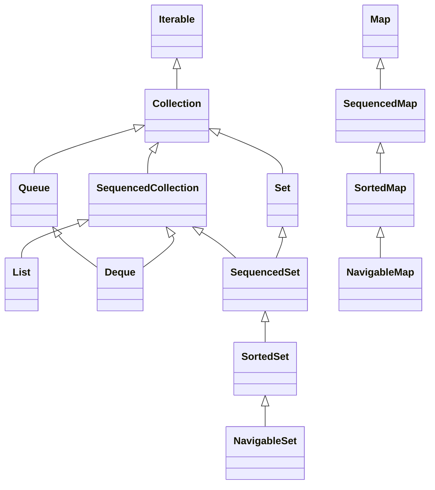
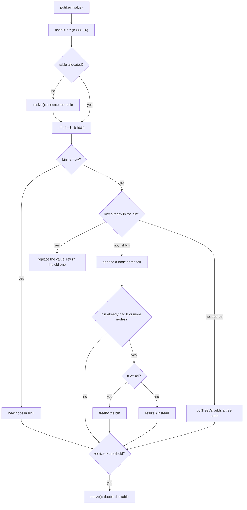
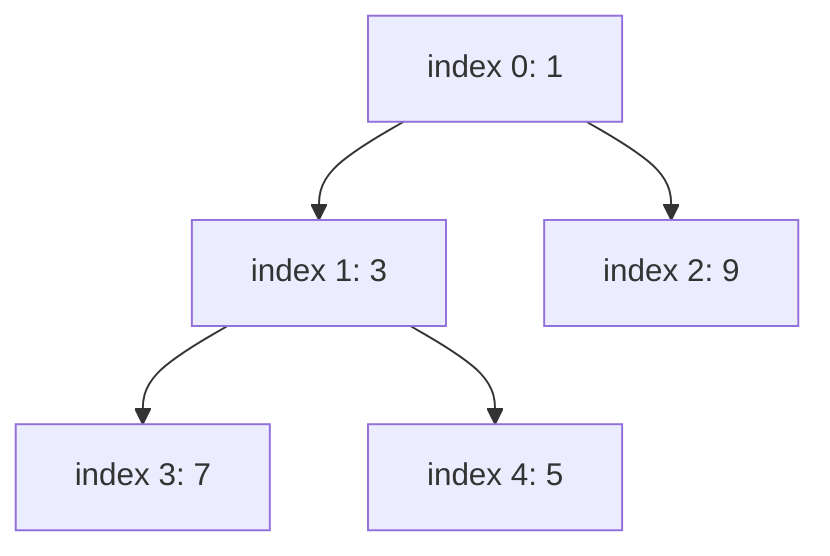
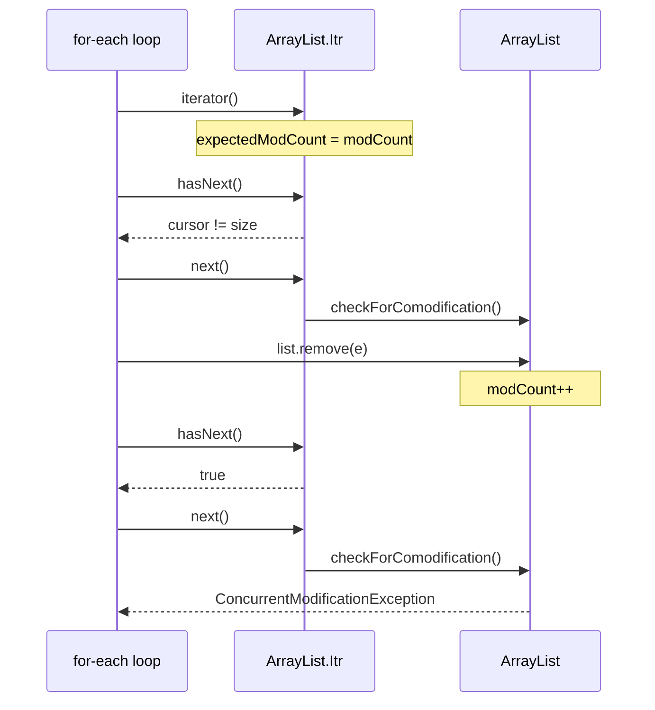
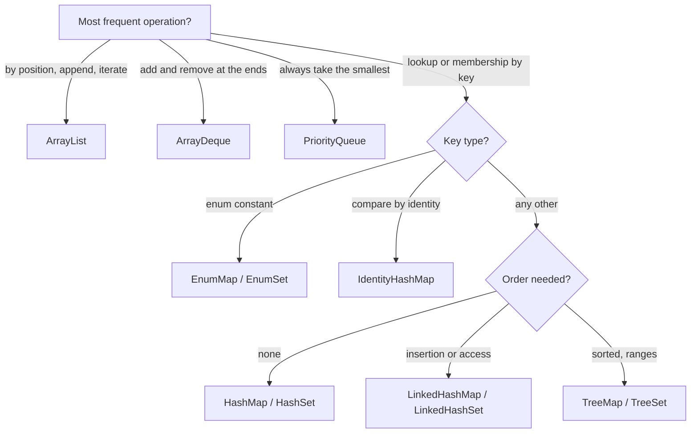

# 04. Collections internals

> **What this covers:** the Java Collections Framework from its interfaces to its data structures: what `Collection`, `List`, `Set`, `Queue`, `Deque` and `Map` promise, sequenced collections, and how `ArrayList`, `LinkedList`, `HashMap`, `LinkedHashMap`, `TreeMap`, the special-purpose maps, the sets and the queues work inside. Then the behavior that interviews probe: fail-fast iterators, immutable and fixed-size lists, sorting stability, collection equality, and how to choose a collection for a workload.
> **Prerequisites:** [02. Equality, immutability and records § 2. `hashCode` and hash-based collections](02-java-equality-immutability-records.md#2-hashcode-and-hash-based-collections), [§ 4. Ordering: `Comparable` and `Comparator`](02-java-equality-immutability-records.md#4-ordering-comparable-and-comparator), [03. Generics and type erasure § 4. Wildcards, PECS and variance](03-java-generics.md#4-wildcards-pecs-and-variance)
> **Leads to:** [05. Lambdas, streams and `Optional`](05-java-lambdas-streams-optional.md), [12. Locks, atomics and concurrent collections](12-concurrency-locks-atomics-collections.md)
> **Applies to:** Java 25
> **Study time:** ~6 hours reading + ~3 hours exercises
> **Short on time:** [3. `HashMap` internals](#3-hashmap-internals), [7. Iterators: fail-fast, weakly consistent and snapshot](#7-iterators-fail-fast-weakly-consistent-and-snapshot), [8. Immutable, unmodifiable and fixed-size lists](#8-immutable-unmodifiable-and-fixed-size-lists); questions [Q04.07](#q04-07), [Q04.09](#q04-09), [Q04.15](#q04-15), [Q04.21](#q04-21), [Q04.23](#q04-23); then [Summary](#summary).
> **Labs:** [`labs/java-language/`](../labs/java-language/), package `dev.interview.javalanguage.m04`. Run: `JAVA_HOME=$(/usr/libexec/java_home -v 25) mvn -q -f java-backend-guide/labs/pom.xml -pl java-language -am verify`. Needs Docker: no.

## Contents

1. [The Collections Framework: interfaces, contracts and sequenced collections](#1-the-collections-framework-interfaces-contracts-and-sequenced-collections)
2. [Lists: `ArrayList`, `LinkedList` and the legacy `Vector` and `Stack`](#2-lists-arraylist-linkedlist-and-the-legacy-vector-and-stack)
3. [`HashMap` internals](#3-hashmap-internals)
4. [Ordered and special-purpose maps](#4-ordered-and-special-purpose-maps)
5. [Sets: views of maps](#5-sets-views-of-maps)
6. [Queues and deques: `ArrayDeque` and `PriorityQueue`](#6-queues-and-deques-arraydeque-and-priorityqueue)
7. [Iterators: fail-fast, weakly consistent and snapshot](#7-iterators-fail-fast-weakly-consistent-and-snapshot)
8. [Immutable, unmodifiable and fixed-size lists](#8-immutable-unmodifiable-and-fixed-size-lists)
9. [Utilities, sorting and collection equality](#9-utilities-sorting-and-collection-equality)
10. [Choosing a collection: complexity, memory and workload](#10-choosing-a-collection-complexity-memory-and-workload)
- [Summary](#summary)
- [Question bank](#question-bank)
- [Hands-on exercises](#hands-on-exercises)
- [Check your understanding](#check-your-understanding)
- [Connections](#connections)

## 1. The Collections Framework: interfaces, contracts and sequenced collections
### The problem it solves

A reporting service shows "the latest event" from three teams' feeds. One team hands over a `List`, one a `Deque`, and one a `LinkedHashSet`, which drops duplicate events but keeps arrival order. Up to Java 20 no common type meant "ordered, with a first and a last element", so the helper had three versions: `list.get(list.size() - 1)`, `deque.getLast()`, and a loop over the whole `LinkedHashSet`. Then a fourth team passes a `HashSet`. A helper typed on `Collection` accepts it, and "the latest" becomes whatever the hash order puts last, an order the class does not promise to keep "constant over time" [Src: JDK 25, java.util.HashSet](https://github.com/openjdk/jdk/blob/jdk-25-ga/src/java.base/share/classes/java/util/HashSet.java). Both problems, the duplicated code and the silent wrong answer, come from not knowing exactly what each interface promises.

### Mental model

Read the interfaces as job descriptions and the classes as the people hired for them. `Collection` is the basic job: hold elements, count them, say whether one is there, hand them out one at a time. `List` adds positions, `Set` adds "no duplicates", `Queue` adds a head to take from, and `Deque` adds a second end. The sequenced interfaces (Java 21) add "has a defined first and last element, and can be read backwards". `Map` is a different job, lookup by key. It belongs to the same framework but is not a `Collection`; it lends out three collection views of itself instead.



What to notice: `Map` has no arrow from `Collection`. `HashSet` and `HashMap` implement only `Set` and `Map`, so they sit outside the sequenced branch, while `LinkedHashSet`, `TreeSet`, `LinkedHashMap` and `TreeMap` sit inside it.

### How it actually works

**Three names that sound alike.** "A collection" is the idea, a group of elements. `Collection` is the root interface of the framework, and "the JDK does not provide any *direct* implementations of this interface": it provides `Set`, `List` and the others [Src: JDK 25, java.util.Collection](https://github.com/openjdk/jdk/blob/jdk-25-ga/src/java.base/share/classes/java/util/Collection.java). `Collections` is a class that "consists exclusively of static methods that operate on or return collections", such as `sort`, `unmodifiableList` and `emptyList` [Src: JDK 25, java.util.Collections](https://github.com/openjdk/jdk/blob/jdk-25-ga/src/java.base/share/classes/java/util/Collections.java). Above `Collection` sits `java.lang.Iterable`, the interface that lets an object be "the target of the enhanced `for` statement" [Src: JDK 25, java.lang.Iterable](https://github.com/openjdk/jdk/blob/jdk-25-ga/src/java.base/share/classes/java/lang/Iterable.java); how iteration works is [§7](#7-iterators-fail-fast-weakly-consistent-and-snapshot).

**What `Collection` promises, and what it leaves out.** It declares size and membership (`size`, `isEmpty`, `contains`), bulk operations (`addAll`, `removeAll`, `retainAll`, `removeIf`), iteration and streams. `isEmpty` returns `true` when there are no elements, and the mutators return whether the collection changed: in the lab, `addAll` of an element already in a `HashSet` returns `false`, and `addAll` with one new element returns `true` [Lab: CollectionContractTest](../labs/java-language/src/test/java/dev/interview/javalanguage/m04/s01/CollectionContractTest.java). The root says nothing about order or uniqueness. Those come from the subinterfaces, and an unordered collection that allows duplicates (a bag or multiset) "should implement this interface directly" [Src: JDK 25, java.util.Collection](https://github.com/openjdk/jdk/blob/jdk-25-ga/src/java.base/share/classes/java/util/Collection.java). The same Javadoc sets a convention no interface can enforce: every general-purpose implementation has a no-argument constructor and a copy constructor that takes any `Collection`, which is why `new ArrayList<>(set)` and `new TreeSet<>(list)` work for any pair of classes.

**Optional operations.** Some methods are marked "optional operation": an implementation that does not support one "should define the corresponding method to throw `UnsupportedOperationException`". An *unmodifiable collection* is one whose mutator methods are all specified to throw it, and the Javadoc recommends throwing even when the call would change nothing, "as throwing only in certain cases can lead to programming errors" [Src: JDK 25, java.util.Collection](https://github.com/openjdk/jdk/blob/jdk-25-ga/src/java.base/share/classes/java/util/Collection.java). In the lab, `List.of("java")` throws from `add` and also from `addAll` of an empty list [Lab: CollectionContractTest](../labs/java-language/src/test/java/dev/interview/javalanguage/m04/s01/CollectionContractTest.java). The static type `List<String>` therefore tells the reader nothing about whether `add` works; [§8](#8-immutable-unmodifiable-and-fixed-size-lists) sorts the factories by what they allow.

**`Map` is part of the framework, not a `Collection`.** A map's unit is a key-value pair, and `Map` "takes the place of the `Dictionary` class", the abstract class `Hashtable` still extends ([Src: JDK 25, java.util.Map](https://github.com/openjdk/jdk/blob/jdk-25-ga/src/java.base/share/classes/java/util/Map.java); [§3](#3-hashmap-internals)). It offers three views instead: `keySet()`, `values()` and `entrySet()`. They are views, not copies: in the lab, removing a key from `keySet()` removes the mapping [Lab: CollectionContractTest](../labs/java-language/src/test/java/dev/interview/javalanguage/m04/s01/CollectionContractTest.java). Assigning a `HashMap` to a `Collection<?>` does not compile; javac reports `compiler.err.prob.found.req` [Lab: CollectionCompileRulesTest](../labs/java-language/src/test/java/dev/interview/javalanguage/m04/s01/CollectionCompileRulesTest.java).

**Sequenced collections.** Java 21 added three interfaces, to give collections with "a defined encounter order" a common type [Final since Java 21, JEP 431] [Doc: JEP 431](https://openjdk.org/jeps/431) [Src: JDK 25, java.util.SequencedCollection](https://github.com/openjdk/jdk/blob/jdk-25-ga/src/java.base/share/classes/java/util/SequencedCollection.java). A sequenced collection has an *encounter order*, "a linear arrangement from the first element to the last", and the inherited methods that walk the elements (`iterator`, `forEach`, `stream`, `toArray`) must follow it. It adds `addFirst`, `addLast`, `getFirst`, `getLast`, `removeFirst`, `removeLast` and `reversed()`, which returns "a reverse-ordered view" [Src: JDK 25, java.util.SequencedCollection](https://github.com/openjdk/jdk/blob/jdk-25-ga/src/java.base/share/classes/java/util/SequencedCollection.java). `List` and `Deque` extend it; `SequencedSet` combines it with `Set` and is implemented by `LinkedHashSet` and extended by `SortedSet` [Src: JDK 25, java.util.SequencedSet](https://github.com/openjdk/jdk/blob/jdk-25-ga/src/java.base/share/classes/java/util/SequencedSet.java) [Src: JDK 25, java.util.LinkedHashSet](https://github.com/openjdk/jdk/blob/jdk-25-ga/src/java.base/share/classes/java/util/LinkedHashSet.java) [Src: JDK 25, java.util.SortedSet](https://github.com/openjdk/jdk/blob/jdk-25-ga/src/java.base/share/classes/java/util/SortedSet.java). `SequencedMap` adds `firstEntry`, `lastEntry`, `pollFirstEntry`, `putFirst`, `putLast`, `reversed()` and sequenced views such as `sequencedKeySet()`, and `LinkedHashMap` and `SortedMap` implement it [Src: JDK 25, java.util.SequencedMap](https://github.com/openjdk/jdk/blob/jdk-25-ga/src/java.base/share/classes/java/util/SequencedMap.java) [Src: JDK 25, java.util.LinkedHashMap](https://github.com/openjdk/jdk/blob/jdk-25-ga/src/java.base/share/classes/java/util/LinkedHashMap.java) [Src: JDK 25, java.util.SortedMap](https://github.com/openjdk/jdk/blob/jdk-25-ga/src/java.base/share/classes/java/util/SortedMap.java). `HashSet` implements only `Set` [Src: JDK 25, java.util.HashSet](https://github.com/openjdk/jdk/blob/jdk-25-ga/src/java.base/share/classes/java/util/HashSet.java). In the lab, `tags.getFirst()` on a `Set<String>` fails with `compiler.err.cant.resolve.location.args`, the same call on a `LinkedHashSet<String>` compiles, and one `newest(SequencedCollection<E>)` method returns the last element of an `ArrayList`, an `ArrayDeque` and a `LinkedHashSet` alike [Lab: CollectionCompileRulesTest](../labs/java-language/src/test/java/dev/interview/javalanguage/m04/s01/CollectionCompileRulesTest.java) [Lab: SequencedViewsTest](../labs/java-language/src/test/java/dev/interview/javalanguage/m04/s01/SequencedViewsTest.java). On an empty collection, `getFirst` and `getLast` throw `NoSuchElementException` [Src: JDK 25, java.util.List](https://github.com/openjdk/jdk/blob/jdk-25-ga/src/java.base/share/classes/java/util/List.java) [Lab: SequencedViewsTest](../labs/java-language/src/test/java/dev/interview/javalanguage/m04/s01/SequencedViewsTest.java).

**`reversed()` is a view.** It copies nothing. In the lab, an element added to the list after `reversed()` was called appears first in the reversed view, and `addFirst` on the view appends to the end of the list [Lab: SequencedViewsTest](../labs/java-language/src/test/java/dev/interview/javalanguage/m04/s01/SequencedViewsTest.java).

**Explicit positioning means two different things.** On a `LinkedHashMap`, `putFirst` and `putLast` place a new key at that end, and for an existing key "the mapping is relocated if necessary" [Src: JDK 25, java.util.LinkedHashMap](https://github.com/openjdk/jdk/blob/jdk-25-ga/src/java.base/share/classes/java/util/LinkedHashMap.java); in the lab, `putLast("a", 10)` moves `a` from first to last and updates its value [Lab: SequencedViewsTest](../labs/java-language/src/test/java/dev/interview/javalanguage/m04/s01/SequencedViewsTest.java). A sorted collection cannot do that, because its comparator decides every position: `SortedSet.addFirst` and `TreeMap.putLast` throw `UnsupportedOperationException` "always" [Src: JDK 25, java.util.SortedSet](https://github.com/openjdk/jdk/blob/jdk-25-ga/src/java.base/share/classes/java/util/SortedSet.java) [Src: JDK 25, java.util.TreeMap](https://github.com/openjdk/jdk/blob/jdk-25-ga/src/java.base/share/classes/java/util/TreeMap.java). In the lab a `TreeSet` answers `getFirst()` with its smallest element and rejects `addFirst` [Lab: SequencedViewsTest](../labs/java-language/src/test/java/dev/interview/javalanguage/m04/s01/SequencedViewsTest.java). Code that takes a `SequencedMap` and calls `putLast` therefore compiles for both and fails at run time for one of them.

### Code

The approach: type the helper on `SequencedCollection`, the narrowest interface that has a last element, so every ordered collection fits and a `HashSet` is rejected by the compiler.

1. `newest` asks for `getLast()`, which every sequenced collection answers.
2. `newestFirst` reads through the `reversed()` view and copies only the elements it keeps.
3. `touch` moves a key to the end of a `SequencedMap` with `putLast`; with a `TreeMap` it throws, which the test asserts.

```java
// Excerpt of labs/java-language/src/main/java/dev/interview/javalanguage/m04/s01/SequencedViews.java
    // A List, a Deque, a LinkedHashSet and a TreeSet all answer getLast() since Java 21.
    public static <E> E newest(SequencedCollection<E> items) {
        return items.getLast();
    }

    // reversed() is a view: the stream reads the backing collection from its end.
    public static <E> List<E> newestFirst(SequencedCollection<E> items, int limit) {
        return items.reversed().stream().limit(limit).toList();
    }

    // putLast relocates an existing key; a TreeMap orders by key and throws instead.
    public static <K, V> void touch(SequencedMap<K, V> recent, K key, V value) {
        recent.putLast(key, value);
    }
```

The reversed view writes through to the list:

```java
// Excerpt of labs/java-language/src/test/java/dev/interview/javalanguage/m04/s01/SequencedViewsTest.java
    @Test
    @DisplayName("M04 §1 · reversed() is a live view of a List")
    void reversed_reflectsAndWritesThrough_toTheBackingList() {
        List<String> events = new ArrayList<>(EVENTS);
        List<String> newestFirst = events.reversed();

        events.add("logout");
        newestFirst.addFirst("timeout");

        assertThat(newestFirst).containsExactly("timeout", "logout", "checkout", "search", "login");
        assertThat(events).endsWith("timeout");
    }
```

#### Legacy

Up to Java 20, the last element of a `LinkedHashSet` was reachable only by iterating to the end, and a helper needed one overload per collection type:

```java
// Excerpt of labs/java-language/src/main/java/dev/interview/javalanguage/m04/s01/SequencedViews.java
    // Before Java 21 a LinkedHashSet exposed its last element only through a full walk.
    public static <E> E newestBeforeJava21(LinkedHashSet<E> items) {
        Iterator<E> iterator = items.iterator();
        E last = iterator.next();
        while (iterator.hasNext()) {
            last = iterator.next();
        }
        return last;
    }
```

### Failure modes and operations

The interfaces have no run-time behavior of their own; their failures are contract mismatches that surface the first time the wrong implementation arrives.
- **`UnsupportedOperationException` from a mutator.** A parameter typed `List<String>` may receive an unmodifiable list, and the first `add` throws inside the implementation class, so the top frame names it: `List.of` lists throw from `ImmutableCollections.uoe()` [Src: JDK 25, java.util.ImmutableCollections](https://github.com/openjdk/jdk/blob/jdk-25-ga/src/java.base/share/classes/java/util/ImmutableCollections.java). The fix is in the contract: document whether a returned collection may be modified, and copy before mutating a list you did not create ([§8](#8-immutable-unmodifiable-and-fixed-size-lists)).
- **Depending on an order nobody promised.** "First" or "last" of a `HashSet` or a `HashMap` is an accident of the hash table and may change as the table resizes ([Src: JDK 25, java.util.HashSet](https://github.com/openjdk/jdk/blob/jdk-25-ga/src/java.base/share/classes/java/util/HashSet.java); [§3](#3-hashmap-internals)). Typing the parameter as `SequencedCollection` or `SequencedMap` turns that bug into a compile error [Lab: CollectionCompileRulesTest](../labs/java-language/src/test/java/dev/interview/javalanguage/m04/s01/CollectionCompileRulesTest.java).
- **Explicit positioning on a sorted collection.** `putFirst`, `putLast`, `addFirst` and `addLast` on a `TreeMap` or `TreeSet` always throw [Lab: SequencedViewsTest](../labs/java-language/src/test/java/dev/interview/javalanguage/m04/s01/SequencedViewsTest.java). A method that relocates entries should take a `LinkedHashMap`, or say in its contract that sorted maps are rejected.
- **What to observe:** an `UnsupportedOperationException` whose top frame is `ImmutableCollections`, `Collections$Unmodifiable…` or a sorted collection identifies the implementation that refused; the bug is in the caller that assumed a mutable one.

> [!NOTE]
> **Version notes.** Java 1.2: the Collections Framework, with `Collection` [Src: JDK 25, java.util.Collection](https://github.com/openjdk/jdk/blob/jdk-25-ga/src/java.base/share/classes/java/util/Collection.java). Java 5: `Queue` and `java.lang.Iterable`, which the enhanced `for` loop uses [Src: JDK 25, java.util.Queue](https://github.com/openjdk/jdk/blob/jdk-25-ga/src/java.base/share/classes/java/util/Queue.java) [Src: JDK 25, java.lang.Iterable](https://github.com/openjdk/jdk/blob/jdk-25-ga/src/java.base/share/classes/java/lang/Iterable.java). Java 6: `Deque` and `NavigableMap` [Src: JDK 25, java.util.Deque](https://github.com/openjdk/jdk/blob/jdk-25-ga/src/java.base/share/classes/java/util/Deque.java) [Src: JDK 25, java.util.NavigableMap](https://github.com/openjdk/jdk/blob/jdk-25-ga/src/java.base/share/classes/java/util/NavigableMap.java). Java 9: the `List.of` factories [Src: JDK 25, java.util.List](https://github.com/openjdk/jdk/blob/jdk-25-ga/src/java.base/share/classes/java/util/List.java). Java 21: the sequenced interfaces, with `getFirst`, `getLast` and `reversed()` on every `List` and `Deque` [Doc: JEP 431](https://openjdk.org/jeps/431) [Src: JDK 25, java.util.SequencedCollection](https://github.com/openjdk/jdk/blob/jdk-25-ga/src/java.base/share/classes/java/util/SequencedCollection.java); before that, `list.get(list.size() - 1)` and a full walk over a `LinkedHashSet` were the idioms. Java 25 (default): unchanged since 21.

### Best practices and anti-patterns

- Declare parameters with the most general interface that has the operations you use (`Collection`, `List`, `SequencedCollection`), because callers can then pass any implementation that fits and the compiler rejects the ones that do not.
- Take a `SequencedCollection` or `SequencedMap` when the code needs a first or last element, because a plain `Collection` also admits a `HashSet`, whose order is not promised.
- Say in the contract whether a returned collection may be modified, because the interface type cannot say it and the caller only learns it from an `UnsupportedOperationException`.
- Copy with the copy constructor (`new ArrayList<>(source)`) when you need a mutable collection of your own, because every general-purpose implementation provides one and the copy is independent of the source.
- Iterate a `Map` through `entrySet()` when you need keys and values, because it walks the entries once instead of doing a lookup per key.
- Do not call `putFirst` or `addFirst` on a collection you only know as `SequencedMap` or `SequencedCollection` unless the contract excludes sorted ones, because sorted collections throw for explicit positioning.

### Misconceptions and traps

- *"`Map` is a `Collection`."* `Map` is part of the Collections Framework but extends no collection interface; it exposes collection views [Src: JDK 25, java.util.Map](https://github.com/openjdk/jdk/blob/jdk-25-ga/src/java.base/share/classes/java/util/Map.java) [Lab: CollectionCompileRulesTest](../labs/java-language/src/test/java/dev/interview/javalanguage/m04/s01/CollectionCompileRulesTest.java). The myth comes from the framework's name and from tutorials that draw both in one tree.
- *"A `Collection` is ordered" or "a `Collection` has no duplicates".* The root interface promises neither; `List`, `Set` and the sequenced interfaces add those guarantees [Src: JDK 25, java.util.Collection](https://github.com/openjdk/jdk/blob/jdk-25-ga/src/java.base/share/classes/java/util/Collection.java). The confusion comes from meeting `ArrayList` first and generalizing from it.
- *"`Collection` and `Collections` are the same thing."* One is the root interface, the other a class of static helpers [Src: JDK 25, java.util.Collections](https://github.com/openjdk/jdk/blob/jdk-25-ga/src/java.base/share/classes/java/util/Collections.java). The names differ by one letter, which is why interviewers ask.
- *"`reversed()` returns a reversed copy."* It returns a view that reads and writes through to the original [Lab: SequencedViewsTest](../labs/java-language/src/test/java/dev/interview/javalanguage/m04/s01/SequencedViewsTest.java). The habit comes from `Collections.reverse`, which reorders a list in place, and from stream code that builds new lists.
- *"Every sequenced collection accepts `addFirst`."* Sorted sets and maps reject explicit positioning, always [Src: JDK 25, java.util.SortedSet](https://github.com/openjdk/jdk/blob/jdk-25-ga/src/java.base/share/classes/java/util/SortedSet.java) [Src: JDK 25, java.util.TreeMap](https://github.com/openjdk/jdk/blob/jdk-25-ga/src/java.base/share/classes/java/util/TreeMap.java). The trap exists because `TreeSet` does implement `SequencedSet`, so the call compiles.

Questions that drill this section: [Q04.01](#q04-01), [Q04.02](#q04-02), [Q04.03](#q04-03).

## 2. Lists: `ArrayList`, `LinkedList` and the legacy `Vector` and `Stack`
### The problem it solves

A nightly export reads 200,000 rows into a `List` and writes every row with `for (int i = 0; i < rows.size(); i++) write(rows.get(i))`. It finishes in seconds. A refactor changes the loader to return a `LinkedList`, "because we append a lot", and the same loop now runs for hours, with no error and no change to the loop. The `List` interface hid the one fact that mattered: on an `ArrayList`, `get(i)` is constant time, and on a `LinkedList` it walks the chain from the nearer end, so the loop becomes quadratic ([Src: JDK 25, java.util.ArrayList](https://github.com/openjdk/jdk/blob/jdk-25-ga/src/java.base/share/classes/java/util/ArrayList.java) [Src: JDK 25, java.util.LinkedList](https://github.com/openjdk/jdk/blob/jdk-25-ga/src/java.base/share/classes/java/util/LinkedList.java) [Src: JDK 25, java.util.RandomAccess](https://github.com/openjdk/jdk/blob/jdk-25-ga/src/java.base/share/classes/java/util/RandomAccess.java)). Choosing a list means knowing what each implementation does inside.

### Mental model

An `ArrayList` is a row of numbered lockers with some spare ones at the end. Finding locker 70,000 is one step, because you walk straight to the number. Inserting near the front means every later occupant moves one locker down, and when the spare lockers run out, the whole row moves to a bigger corridor. A `LinkedList` is a treasure hunt: each clue (a node) knows only the clue before and after it. Adding a clue where you are standing is cheap, but getting to clue 70,000 means following clues from the start or from the end. `Vector` is the lockers with a guard who lets one person in at a time, and `Stack` is `Vector` with a "top" painted on its last locker.

### How it actually works

**`ArrayList` is a resizable array.** Its elements live in an `Object[] elementData` (why `Object[]` and not `E[]` is [03 §6](03-java-generics.md#6-reifiable-types-generic-arrays-and-heap-pollution)). The *capacity* is that array's length, "always at least as large as the list size" [Src: JDK 25, java.util.ArrayList](https://github.com/openjdk/jdk/blob/jdk-25-ga/src/java.base/share/classes/java/util/ArrayList.java). The no-argument constructor is documented as "an initial capacity of ten", but it stores a shared empty array and allocates the ten slots on the first `add` [Src: JDK 25, java.util.ArrayList](https://github.com/openjdk/jdk/blob/jdk-25-ga/src/java.base/share/classes/java/util/ArrayList.java). When the array is full, `grow` asks `ArraysSupport.newLength` for the old length plus the larger of the minimum growth needed and the "preferred growth" `oldCapacity >> 1`, then copies into the new array with `Arrays.copyOf` ([Src: JDK 25, java.util.ArrayList](https://github.com/openjdk/jdk/blob/jdk-25-ga/src/java.base/share/classes/java/util/ArrayList.java) [Src: JDK 25, jdk.internal.util.ArraysSupport](https://github.com/openjdk/jdk/blob/jdk-25-ga/src/java.base/share/classes/jdk/internal/util/ArraysSupport.java)). A full list of 10 therefore grows to 15, and one of 100 to 150. The Javadoc promises only "constant amortized time" for `add`, not this policy [Src: JDK 25, java.util.ArrayList](https://github.com/openjdk/jdk/blob/jdk-25-ga/src/java.base/share/classes/java/util/ArrayList.java), so code must not depend on the exact numbers. `ensureCapacity(n)` grows once ahead of a known number of additions; `trimToSize()` shrinks the array to the size, and nothing else ever shrinks it [Src: JDK 25, java.util.ArrayList](https://github.com/openjdk/jdk/blob/jdk-25-ga/src/java.base/share/classes/java/util/ArrayList.java). An initial capacity is not a size: in the lab, `set(0, …)` on a `new ArrayList<>(100)` throws `IndexOutOfBoundsException`, because the list is empty [Lab: ListInternalsTest](../labs/java-language/src/test/java/dev/interview/javalanguage/m04/s02/ListInternalsTest.java).

**What each operation costs.** The Javadoc lists `get`, `set`, `size`, `getFirst`, `getLast`, `removeLast`, `iterator` and `reversed` as constant time, `add` as amortized constant, and "all of the other operations" as roughly linear [Src: JDK 25, java.util.ArrayList](https://github.com/openjdk/jdk/blob/jdk-25-ga/src/java.base/share/classes/java/util/ArrayList.java). Linear here means shifting: `add(index, e)` moves the tail one slot right with `System.arraycopy`, and `remove(index)` moves it one slot left and nulls the freed last slot so the old reference can be collected [Src: JDK 25, java.util.ArrayList](https://github.com/openjdk/jdk/blob/jdk-25-ga/src/java.base/share/classes/java/util/ArrayList.java). In the lab, `add(1, "b")` turns `[a, c, d]` into `[a, b, c, d]` [Lab: ListInternalsTest](../labs/java-language/src/test/java/dev/interview/javalanguage/m04/s02/ListInternalsTest.java). Removing from the end is cheap; removing from the front of a long list copies everything after it.

**`modCount` counts structural changes.** Every `add`, `remove`, `clear`, `ensureCapacity` that grows, and `trimToSize` increments the protected field `modCount` inherited from `AbstractList`; `set` does not, because it changes no size or array [Src: JDK 25, java.util.ArrayList](https://github.com/openjdk/jdk/blob/jdk-25-ga/src/java.base/share/classes/java/util/ArrayList.java). In the lab, a subclass reads the counter: it goes from 0 to 1 on `add`, stays at 1 after `set`, and reaches 2 after `trimToSize` [Lab: ListInternalsTest](../labs/java-language/src/test/java/dev/interview/javalanguage/m04/s02/ListInternalsTest.java). Iterators compare this counter with the value they saw at creation; that is the fail-fast check of [§7](#7-iterators-fail-fast-weakly-consistent-and-snapshot), and the reason a `trimToSize` during iteration also breaks the loop.

**`LinkedList` is a doubly linked list.** Each element sits in a `Node` with `item`, `next` and `prev` fields, and the list keeps `first` and `last` [Src: JDK 25, java.util.LinkedList](https://github.com/openjdk/jdk/blob/jdk-25-ga/src/java.base/share/classes/java/util/LinkedList.java). It implements both `List` and `Deque`. Operations at either end are a few pointer writes, but "operations that index into the list will traverse the list from the beginning or the end, whichever is closer to the specified index": `node(index)` loops from `first` when the index is in the lower half and from `last` otherwise [Src: JDK 25, java.util.LinkedList](https://github.com/openjdk/jdk/blob/jdk-25-ga/src/java.base/share/classes/java/util/LinkedList.java). So `get(i)`, `set(i, e)`, `add(i, e)` and `remove(i)` are linear, and an insertion "in the middle" is cheap only once you already hold a position, which in practice means a `ListIterator` that is already there.

**`RandomAccess` tells algorithms which loop to use.** It is a marker interface with no methods, for `List` implementations with "fast (generally constant time) random access". Its Javadoc warns that the best algorithms for random-access lists "can produce quadratic behavior when applied to sequential access lists", and encourages generic code to check `instanceof RandomAccess` first [Src: JDK 25, java.util.RandomAccess](https://github.com/openjdk/jdk/blob/jdk-25-ga/src/java.base/share/classes/java/util/RandomAccess.java). `ArrayList` implements it; `LinkedList` does not [Lab: ListInternalsTest](../labs/java-language/src/test/java/dev/interview/javalanguage/m04/s02/ListInternalsTest.java).

**When `LinkedList` wins.** Rarely: when the code inserts or removes many elements at the position of an iterator it is already moving (`ListIterator.add` and `remove` are constant time there), or when it needs a `Deque` that accepts `null`, which `ArrayDeque` refuses ([§6](#6-queues-and-deques-arraydeque-and-priorityqueue)). For a plain queue or stack, `ArrayDeque` is the better default, and for everything indexed, `ArrayList`. The Javadoc of `ArrayList` itself notes that its constant factor "is low compared to that for the `LinkedList` implementation" [Src: JDK 25, java.util.ArrayList](https://github.com/openjdk/jdk/blob/jdk-25-ga/src/java.base/share/classes/java/util/ArrayList.java). Each `LinkedList` element also costs a separate `Node` object with two extra references, where an `ArrayList` element costs one array slot [Src: JDK 25, java.util.LinkedList](https://github.com/openjdk/jdk/blob/jdk-25-ga/src/java.base/share/classes/java/util/LinkedList.java); [§10](#10-choosing-a-collection-complexity-memory-and-workload) compares footprints without invented byte counts.

**`remove(int)` and `remove(Object)`.** `List` overloads `remove`: one takes an index, the other an element. On a `List<Integer>`, `list.remove(1)` passes an `int`, so overload resolution picks the index version without boxing; `list.remove(Integer.valueOf(1))` removes the value. In the lab, `[10, 20, 30]` loses `20` with `remove(1)` and `10` with `remove(Integer.valueOf(10))` [Lab: ListInternalsTest](../labs/java-language/src/test/java/dev/interview/javalanguage/m04/s02/ListInternalsTest.java). `indexOf` returns the first matching index and `-1` when the element is absent, and changes nothing [Lab: ListInternalsTest](../labs/java-language/src/test/java/dev/interview/javalanguage/m04/s02/ListInternalsTest.java). Why the `int` overload wins is the overload-resolution rule of [01 §8](01-java-oop-fundamentals.md#8-polymorphism-overloading-overriding-and-dispatch).

**`Vector` and `Stack`.** `Vector` dates from Java 1.0 and was "retrofitted to implement the `List` interface" in 1.2. Unlike `ArrayList`, it is synchronized: its accessors and mutators, such as `get` and `add`, are `synchronized` methods, and the Javadoc recommends `ArrayList` "in place of `Vector`" when thread safety is not needed [Src: JDK 25, java.util.Vector](https://github.com/openjdk/jdk/blob/jdk-25-ga/src/java.base/share/classes/java/util/Vector.java). It grows by its `capacityIncrement` when one was given, and otherwise doubles [Src: JDK 25, java.util.Vector](https://github.com/openjdk/jdk/blob/jdk-25-ga/src/java.base/share/classes/java/util/Vector.java): in the lab, a default `Vector` goes from capacity 10 to 20 on the 11th element, and one built with an increment of 5 goes to 15 [Lab: ListInternalsTest](../labs/java-language/src/test/java/dev/interview/javalanguage/m04/s02/ListInternalsTest.java). `Stack` extends `Vector` and pushes and pops at the end of the array. Its own Javadoc says the `Deque` interface "should be used in preference to this class", for example `Deque<Integer> stack = new ArrayDeque<Integer>()` [Src: JDK 25, java.util.Stack](https://github.com/openjdk/jdk/blob/jdk-25-ga/src/java.base/share/classes/java/util/Stack.java). The two do not iterate the same way: in the lab, after pushing 1, 2 and 3, both `peek()` 3, but the `Stack` iterates `[1, 2, 3]`, bottom first, and the `ArrayDeque` iterates `[3, 2, 1]`, top first [Lab: ListInternalsTest](../labs/java-language/src/test/java/dev/interview/javalanguage/m04/s02/ListInternalsTest.java).

### Code

The approach: write the list algorithm once, and let the `RandomAccess` marker pick the access strategy, as the marker's Javadoc recommends.

1. `everyNth` validates the step and checks `instanceof RandomAccess`.
2. `byIndex` jumps with `get(i)`, which is constant time on an `ArrayList`, and presizes its result.
3. `byIterator` walks a sequential list once, because each `get(i)` on a `LinkedList` would walk from an end.
4. The test asserts that both paths return the same elements for an `ArrayList` and a `LinkedList`.

```java
// Excerpt of labs/java-language/src/main/java/dev/interview/javalanguage/m04/s02/ListAccess.java
    public static <E> List<E> everyNth(List<E> source, int step) {
        if (step < 1) {
            throw new IllegalArgumentException("step must be at least 1: " + step);
        }
        return source instanceof RandomAccess ? byIndex(source, step) : byIterator(source, step);
    }

    // get(i) is constant time on an ArrayList, so jumping by index skips the elements in between.
    private static <E> List<E> byIndex(List<E> source, int step) {
        List<E> picked = new ArrayList<>(source.size() / step + 1);
        for (int i = 0; i < source.size(); i += step) {
            picked.add(source.get(i));
        }
        return picked;
    }

    // On a LinkedList each get(i) walks from an end, so one pass with an iterator is linear instead.
    private static <E> List<E> byIterator(List<E> source, int step) {
        List<E> picked = new ArrayList<>();
        Iterator<E> iterator = source.iterator();
        for (int i = 0; iterator.hasNext(); i++) {
            E element = iterator.next();
            if (i % step == 0) {
                picked.add(element);
            }
        }
        return picked;
    }
```

Reading `modCount` from a subclass, which is how the lab observes structural changes without opening `java.util` to reflection:

```java
// Excerpt of labs/java-language/src/test/java/dev/interview/javalanguage/m04/s02/ListInternalsTest.java
    // modCount is a protected field of AbstractList, so a subclass can read it without --add-opens.
    private static final class CountingList<E> extends ArrayList<E> {
        int structuralChanges() {
            return modCount;
        }
    }

    @Test
    @DisplayName("M04 §2 · add and trimToSize count as structural changes, set does not")
    void modCount_countsStructuralChangesOnly() {
        CountingList<String> list = new CountingList<>();
        list.add("a");
        int afterAdd = list.structuralChanges();

        list.set(0, "b");
        int afterSet = list.structuralChanges();
        list.trimToSize();

        assertThat(afterAdd).isEqualTo(1);
        assertThat(afterSet).isEqualTo(afterAdd);
        assertThat(list.structuralChanges()).isEqualTo(afterSet + 1);
    }
```

#### Legacy

`Vector` and `Stack` still appear in old code, for example parsers that keep a `Stack` of tokens. Replacing a `Stack` with an `ArrayDeque` keeps `push`, `pop` and `peek`, but changes iteration order, which matters to any code that prints or copies the stack:

```java
// Excerpt of labs/java-language/src/test/java/dev/interview/javalanguage/m04/s02/ListInternalsTest.java
    @Test
    @DisplayName("M04 §2 · a Stack iterates bottom first, an ArrayDeque used as a stack iterates top first")
    void stackAndDeque_iterateInOppositeOrders() {
        Stack<Integer> legacy = new Stack<>();
        Deque<Integer> modern = new ArrayDeque<>();
        for (int i = 1; i <= 3; i++) {
            legacy.push(i);
            modern.push(i);
        }

        assertThat(legacy.peek()).isEqualTo(modern.peek()).isEqualTo(3);
        assertThat(legacy).containsExactly(1, 2, 3);
        assertThat(modern).containsExactly(3, 2, 1);
    }
```

### Failure modes and operations

- **Quadratic loops.** An index loop over a `LinkedList` walks up to half the list for every `get(i)`, and a loop that calls `remove(0)` on a long `ArrayList` copies the whole tail each time ([Src: JDK 25, java.util.RandomAccess](https://github.com/openjdk/jdk/blob/jdk-25-ga/src/java.base/share/classes/java/util/RandomAccess.java) [Src: JDK 25, java.util.ArrayList](https://github.com/openjdk/jdk/blob/jdk-25-ga/src/java.base/share/classes/java/util/ArrayList.java)). Neither fails; both get slower with the square of the size, so they pass tests with ten rows and time out in production. In a CPU profile the time sits in `LinkedList.node` or in `System.arraycopy`. [Q04.32](#q04-32) is that incident.
- **Memory that does not come back.** An `ArrayList` keeps the capacity it reached; removing elements nulls their slots but never shrinks the array, so a list that once held a million entries keeps a million-slot array until `trimToSize()` or until the list itself is dropped [Src: JDK 25, java.util.ArrayList](https://github.com/openjdk/jdk/blob/jdk-25-ga/src/java.base/share/classes/java/util/ArrayList.java). A heap histogram shows it as a large `Object[]` retained by one list.
- **Growth in a hot path.** Each `grow` allocates a new array and copies the old one [Src: JDK 25, java.util.ArrayList](https://github.com/openjdk/jdk/blob/jdk-25-ga/src/java.base/share/classes/java/util/ArrayList.java). Building a large list element by element repeats that work and the garbage; `new ArrayList<>(expected)` or `ensureCapacity` does it once.
- **The `remove(1)` overload bug.** On a `List<Integer>`, removing "the value 1" with `remove(1)` silently removes the element at index 1 instead [Lab: ListInternalsTest](../labs/java-language/src/test/java/dev/interview/javalanguage/m04/s02/ListInternalsTest.java); [Q04.07](#q04-07) drills it.
- **Sharing a list between threads.** `ArrayList` and `LinkedList` are not synchronized, and `Vector` locks each call separately, so check-then-act sequences such as "if empty, add" are not atomic in any of them ([Src: JDK 25, java.util.ArrayList](https://github.com/openjdk/jdk/blob/jdk-25-ga/src/java.base/share/classes/java/util/ArrayList.java) [Src: JDK 25, java.util.Vector](https://github.com/openjdk/jdk/blob/jdk-25-ga/src/java.base/share/classes/java/util/Vector.java)). Thread-safe lists are [12](12-concurrency-locks-atomics-collections.md)'s subject.

> [!NOTE]
> **Version notes.** Java 1.0: `Vector` and `Stack` [Src: JDK 25, java.util.Vector](https://github.com/openjdk/jdk/blob/jdk-25-ga/src/java.base/share/classes/java/util/Vector.java) [Src: JDK 25, java.util.Stack](https://github.com/openjdk/jdk/blob/jdk-25-ga/src/java.base/share/classes/java/util/Stack.java). Java 1.2: `ArrayList` and `LinkedList`, and `Vector` retrofitted to `List` [Src: JDK 25, java.util.ArrayList](https://github.com/openjdk/jdk/blob/jdk-25-ga/src/java.base/share/classes/java/util/ArrayList.java) [Src: JDK 25, java.util.LinkedList](https://github.com/openjdk/jdk/blob/jdk-25-ga/src/java.base/share/classes/java/util/LinkedList.java) [Src: JDK 25, java.util.Vector](https://github.com/openjdk/jdk/blob/jdk-25-ga/src/java.base/share/classes/java/util/Vector.java). Java 6: `LinkedList` gains the `Deque` methods such as `offerFirst` and `pollLast` [Src: JDK 25, java.util.LinkedList](https://github.com/openjdk/jdk/blob/jdk-25-ga/src/java.base/share/classes/java/util/LinkedList.java). Java 21: `getFirst`, `getLast`, `removeFirst`, `removeLast` and `reversed()` on every `List` ([§1](#1-the-collections-framework-interfaces-contracts-and-sequenced-collections)). Java 25 (default): `ArrayList` still grows by half and `Vector` still doubles [Src: JDK 25, java.util.ArrayList](https://github.com/openjdk/jdk/blob/jdk-25-ga/src/java.base/share/classes/java/util/ArrayList.java) [Src: JDK 25, java.util.Vector](https://github.com/openjdk/jdk/blob/jdk-25-ga/src/java.base/share/classes/java/util/Vector.java).

### Best practices and anti-patterns

- Default to `ArrayList` for a list, because indexed access is constant time, appends are amortized constant, and the Javadoc rates its constant factor below `LinkedList`'s.
- Presize with `new ArrayList<>(expected)` when the size is known, because each growth step allocates and copies the whole array.
- Iterate with for-each or an `Iterator` when the list type is not known, or check `RandomAccess`, because an index loop is quadratic on a sequential-access list.
- Use `ArrayDeque` for stacks and queues instead of `Stack` or `LinkedList`, because it has no per-element node and no per-call lock; keep `LinkedList` for the cases that need a `ListIterator` that inserts as it moves, or `null` elements in a `Deque`.
- Write `remove(Integer.valueOf(x))` when removing a value from a `List<Integer>`, because `remove(x)` with an `int` removes by index.
- Call `trimToSize()` only on a long-lived list that has shrunk for good, because it copies the array and the next `add` grows it again.
- Do not choose `Vector` for thread safety, because each method locks separately and compound actions still race; use the concurrent collections of [12](12-concurrency-locks-atomics-collections.md).

### Misconceptions and traps

- *"`LinkedList` is faster for inserts and deletes."* Only once the node is found; finding it by index is linear, while `ArrayList` reaches the slot in constant time and shifts the tail with one `System.arraycopy` ([Src: JDK 25, java.util.LinkedList](https://github.com/openjdk/jdk/blob/jdk-25-ga/src/java.base/share/classes/java/util/LinkedList.java) [Src: JDK 25, java.util.ArrayList](https://github.com/openjdk/jdk/blob/jdk-25-ga/src/java.base/share/classes/java/util/ArrayList.java)). The claim comes from textbook complexity tables that count the pointer update and leave out the walk.
- *"`new ArrayList<>(100)` holds 100 elements."* It has capacity 100 and size 0 [Lab: ListInternalsTest](../labs/java-language/src/test/java/dev/interview/javalanguage/m04/s02/ListInternalsTest.java). The confusion comes from arrays, where `new String[100]` does have 100 slots you can `set`.
- *"An `ArrayList` gives memory back when you remove elements."* Only `trimToSize()` shrinks the array [Src: JDK 25, java.util.ArrayList](https://github.com/openjdk/jdk/blob/jdk-25-ga/src/java.base/share/classes/java/util/ArrayList.java). The intuition comes from `size()`, which does shrink.
- *"`Vector` is thread-safe, so code that uses it is."* Each method is atomic; a sequence of calls is not [Src: JDK 25, java.util.Vector](https://github.com/openjdk/jdk/blob/jdk-25-ga/src/java.base/share/classes/java/util/Vector.java). The belief comes from the word "synchronized" in every description of `Vector`.
- *"`Stack` and `ArrayDeque` behave the same."* They agree on `push`, `pop` and `peek` and disagree on iteration order [Lab: ListInternalsTest](../labs/java-language/src/test/java/dev/interview/javalanguage/m04/s02/ListInternalsTest.java). The trap exists because the replacement compiles and the stack operations pass their tests.
- *"`ArrayList` grows by exactly 1.5×, so you can predict its capacity."* That is today's implementation, not the contract: the Javadoc specifies only amortized constant `add` [Src: JDK 25, java.util.ArrayList](https://github.com/openjdk/jdk/blob/jdk-25-ga/src/java.base/share/classes/java/util/ArrayList.java). The habit comes from reading the source of one release.

Questions that drill this section: [Q04.04](#q04-04), [Q04.05](#q04-05), [Q04.06](#q04-06), [Q04.07](#q04-07), [Q04.08](#q04-08), [Q04.32](#q04-32), [Exercise 04.3](#ex04-3).

## 3. `HashMap` internals
### The problem it solves

A billing service builds a `HashMap<String, BigDecimal>` of charges per account and writes it to a CSV file by iterating `map.entrySet()`. For months the columns come out in the order the code inserted them, and a test pins that order. Then a new charge type is added, the map's 13th entry pushes it past its resize threshold, the table doubles, entries move to new bins, and the CSV columns come out in a different order. Nothing in the code changed except one more `put`. The `HashMap` Javadoc never promised an order, "in particular, it does not guarantee that the order will remain constant over time" [Src: JDK 25, java.util.HashMap](https://github.com/openjdk/jdk/blob/jdk-25-ga/src/java.base/share/classes/java/util/HashMap.java), and a default map does resize when its 13th mapping arrives [Lab: HashMapTableTest](../labs/java-language/src/test/java/dev/interview/javalanguage/m04/s03/HashMapTableTest.java). The same blindness causes the expensive failures: a `HashMap` gives constant-time `get` and `put` only "assuming the hash function disperses the elements properly among the buckets" [Src: JDK 25, java.util.HashMap](https://github.com/openjdk/jdk/blob/jdk-25-ga/src/java.base/share/classes/java/util/HashMap.java). Knowing the table, the hash spreading, the resize and the tree bins is what lets you predict when a map stops being fast and stops looking ordered.

### Mental model

A `HashMap` is a coat check with a row of numbered hooks. The ticket number is computed from the coat itself (the key's `hashCode`), and the attendant looks only at the last few digits to choose a hook. Several coats can end up on one hook; they hang in a line, and to return yours the attendant compares each coat on that hook with your description (`equals`). When three quarters of the hooks are taken, the attendant moves everything to a room with twice as many hooks: each coat either keeps its hook number or moves to "old number plus the old hook count", decided by one more digit of its ticket. If one hook still collects too many coats, the attendant first tries a bigger room, and only once the room has at least 64 hooks files that hook's coats in a sorted cabinet (a tree) instead of a line.



What to notice: replacing the value of an existing key leaves the size alone and never resizes; only a new mapping counts toward the threshold. A crowded bin and a full table both lead to `resize()`, and the table length decides whether a crowded bin becomes a tree.

### How it actually works

**The table.** A `HashMap` keeps a `transient Node<K,V>[] table` whose length is always a power of two, "initialized on first use, and resized as necessary". Each `Node` stores the key's spread `hash` (a `final` field), the `key`, the `value` and a `next` link to the following node in the same bin. The defaults are a capacity of 16 (`DEFAULT_INITIAL_CAPACITY = 1 << 4`), a load factor of 0.75 and a maximum capacity of `1 << 30` [Src: JDK 25, java.util.HashMap](https://github.com/openjdk/jdk/blob/jdk-25-ga/src/java.base/share/classes/java/util/HashMap.java). The no-argument constructor sets only the load factor; the array is allocated by the first `put`. In the lab, a probe that reads the private `table` field reports 0 buckets for a new map and 16 after the first `put` [Lab: HashMapTableTest](../labs/java-language/src/test/java/dev/interview/javalanguage/m04/s03/HashMapTableTest.java).

**From `hashCode` to a bin.** `hash(key)` returns 0 for a `null` key and otherwise `(h = key.hashCode()) ^ (h >>> 16)`, and the bin index is `(n - 1) & hash` for a table of length `n` [Src: JDK 25, java.util.HashMap](https://github.com/openjdk/jdk/blob/jdk-25-ga/src/java.base/share/classes/java/util/HashMap.java). Because `n` is a power of two, the mask keeps the low bits of the hash, which is the remainder modulo `n` without a division. The cost of masking is that only low bits choose the bin: the source comment explains that "sets of hashes that vary only in bits above the current mask will always collide", gives "`Float` keys holding consecutive whole numbers in small tables" as a known example, and says the XOR of the upper 16 bits into the lower 16 is "the cheapest possible way" to let the high bits matter, with trees handling large collision sets [Src: JDK 25, java.util.HashMap](https://github.com/openjdk/jdk/blob/jdk-25-ga/src/java.base/share/classes/java/util/HashMap.java). The `null` key always lands in bin 0. `HashMap` permits one `null` key and `null` values, so `get` returns `null` both for a missing key and for a key mapped to `null`, and only `containsKey` tells them apart; in the lab, `get("present")` and `get("absent")` both return `null` while `containsKey` returns `true` and `false` [Lab: HashMapBehaviorTest](../labs/java-language/src/test/java/dev/interview/javalanguage/m04/s03/HashMapBehaviorTest.java).

**The walk inside a bin.** `getNode` computes the index, checks the first node ("always check first node"), and then either searches the tree, if the first node is a `TreeNode`, or follows the `next` links. A node matches when its stored hash equals the lookup hash and its key is `==` or `equals` to the lookup key [Src: JDK 25, java.util.HashMap](https://github.com/openjdk/jdk/blob/jdk-25-ga/src/java.base/share/classes/java/util/HashMap.java). Why equal keys must have equal hash codes, and what a key mutated after insertion does to that check, belong to [02 §2](02-java-equality-immutability-records.md#2-hashcode-and-hash-based-collections), drilled by [Q02.05](02-java-equality-immutability-records.md#q02-05) and [Q02.06](02-java-equality-immutability-records.md#q02-06). `putVal` follows the diagram above. When the key is already present, it replaces the value, returns the old one and leaves before `++modCount` and `++size`, so replacing a value is not a structural modification [Src: JDK 25, java.util.HashMap](https://github.com/openjdk/jdk/blob/jdk-25-ga/src/java.base/share/classes/java/util/HashMap.java). In the lab, a second `put("a", 2)` returns `1` and the map still has one entry [Lab: HashMapBehaviorTest](../labs/java-language/src/test/java/dev/interview/javalanguage/m04/s03/HashMapBehaviorTest.java).

**Load factor and threshold.** The `threshold` field is "the next size value at which to resize (capacity * load factor)", and `putVal` resizes when `++size > threshold` after adding a new mapping [Src: JDK 25, java.util.HashMap](https://github.com/openjdk/jdk/blob/jdk-25-ga/src/java.base/share/classes/java/util/HashMap.java). A default map has a threshold of 16 × 0.75 = 12, so it holds 12 mappings in 16 buckets and doubles on the 13th; in the lab, the probe reads 16 buckets after 12 puts and 32 after the 13th [Lab: HashMapTableTest](../labs/java-language/src/test/java/dev/interview/javalanguage/m04/s03/HashMapTableTest.java). The Javadoc calls 0.75 "a good tradeoff between time and space costs": higher values "decrease the space overhead but increase the lookup cost", and because iteration takes time "proportional to the 'capacity' … plus its size", a capacity set too high (or a load factor too low) slows iteration [Src: JDK 25, java.util.HashMap](https://github.com/openjdk/jdk/blob/jdk-25-ga/src/java.base/share/classes/java/util/HashMap.java). The table never shrinks: `resize` only "initializes or doubles table size", and `clear()` nulls every slot but keeps the array [Src: JDK 25, java.util.HashMap](https://github.com/openjdk/jdk/blob/jdk-25-ga/src/java.base/share/classes/java/util/HashMap.java).

**Resize splits each bin into two lists.** Doubling the table adds one bit to the mask, so a node in bin `j` either stays at `j` or moves to `j + oldCap`, and the bit that decides is `hash & oldCap`. `resize` walks each old bin once and builds a "lo" list and a "hi" list, keeping the nodes' relative order ("preserve order"), using the hash stored in each node; it never calls `hashCode` again [Src: JDK 25, java.util.HashMap](https://github.com/openjdk/jdk/blob/jdk-25-ga/src/java.base/share/classes/java/util/HashMap.java). A tree bin is split the same way by `TreeNode.split`, and each half with at most `UNTREEIFY_THRESHOLD` (6) nodes turns back into a plain list [Src: JDK 25, java.util.HashMap](https://github.com/openjdk/jdk/blob/jdk-25-ga/src/java.base/share/classes/java/util/HashMap.java). A resize therefore allocates a new array and touches every node: cheap when spread over all the puts that preceded it, but the one `put` that triggers it pays for the whole map.

**Choosing the initial capacity.** The `int` argument of `new HashMap<>(n)` is a capacity, not an expected number of mappings: the constructor stores `tableSizeFor(n)`, the next power of two, and the first `put` allocates that many buckets with a threshold of 0.75 times it [Src: JDK 25, java.util.HashMap](https://github.com/openjdk/jdk/blob/jdk-25-ga/src/java.base/share/classes/java/util/HashMap.java). In the lab, `new HashMap<>(100)` gets 128 buckets, still has 128 after 96 puts, and doubles to 256 on the 97th [Lab: HashMapTableTest](../labs/java-language/src/test/java/dev/interview/javalanguage/m04/s03/HashMapTableTest.java). The constructors' Javadoc points to `HashMap.newHashMap(int numMappings)` for an expected number of mappings; it creates `new HashMap<>((int) Math.ceil(numMappings / 0.75))` [Src: JDK 25, java.util.HashMap](https://github.com/openjdk/jdk/blob/jdk-25-ga/src/java.base/share/classes/java/util/HashMap.java), so `newHashMap(100)` asks for 134 and gets 256 buckets, and in the lab 100 puts never resize it [Lab: HashMapTableTest](../labs/java-language/src/test/java/dev/interview/javalanguage/m04/s03/HashMapTableTest.java). The copy constructor `new HashMap<>(other)` presizes the same way, from `Math.ceil(size / loadFactor)` [Src: JDK 25, java.util.HashMap](https://github.com/openjdk/jdk/blob/jdk-25-ga/src/java.base/share/classes/java/util/HashMap.java).

**Tree bins.** [Changed in Java 8: a bin with many collisions becomes a balanced tree instead of a linked list] [Doc: JEP 180](https://openjdk.org/jeps/180). Three constants govern it. `TREEIFY_THRESHOLD` is 8, and "bins are converted to trees when adding an element to a bin with at least this many nodes", so the conversion is triggered by the ninth colliding key, not the eighth. `MIN_TREEIFY_CAPACITY` is 64: below it, `treeifyBin` resizes the table instead, because a bigger table may spread the bin. `UNTREEIFY_THRESHOLD` is 6, used when a resize splits a tree bin [Src: JDK 25, java.util.HashMap](https://github.com/openjdk/jdk/blob/jdk-25-ga/src/java.base/share/classes/java/util/HashMap.java). In the lab, keys that all return one hash code stay in a list bin of a 16-bucket table for 8 puts; the 9th resizes the table to 32, the 10th to 64, and the 11th turns the bin into a tree [Lab: HashMapTableTest](../labs/java-language/src/test/java/dev/interview/javalanguage/m04/s03/HashMapTableTest.java). A resize cannot separate keys whose hash codes are identical, so for them those two resizes are wasted; it does help keys that merely share their low bits. Removal can also turn a tree back into a list when the tree becomes small, decided by its shape in `removeTreeNode` rather than by a count [Src: JDK 25, java.util.HashMap](https://github.com/openjdk/jdk/blob/jdk-25-ga/src/java.base/share/classes/java/util/HashMap.java).

**What a tree bin protects against.** A tree bin is a red-black tree (a self-balancing binary search tree, the structure `TreeMap` also uses, [§4](#4-ordered-and-special-purpose-maps)) of `TreeNode`s, "ordered primarily by hashCode", and for ties by `compareTo` when both keys are of the same class `C implements Comparable<C>` (checked by reflection in `comparableClassFor`). The source comment says this gives "worst-case O(log n) operations when keys either have distinct hashes or are orderable", so performance "degrades gracefully under accidental or malicious usages" in which many keys share a hash code, "so long as they are also Comparable" [Src: JDK 25, java.util.HashMap](https://github.com/openjdk/jdk/blob/jdk-25-ga/src/java.base/share/classes/java/util/HashMap.java). For keys with equal hashes that are not mutually comparable, insertion orders them with `tieBreakOrder` (class name, then `System.identityHashCode`), but that order cannot be used for a lookup, so `TreeNode.find` searches both subtrees and a lookup in such a bin can still visit every node [Src: JDK 25, java.util.HashMap](https://github.com/openjdk/jdk/blob/jdk-25-ga/src/java.base/share/classes/java/util/HashMap.java). The lab's `CollidingKey` is that case: every key is still found, because `equals` decides the match [Lab: HashMapBehaviorTest](../labs/java-language/src/test/java/dev/interview/javalanguage/m04/s03/HashMapBehaviorTest.java), but nothing bounds the walk. Tree nodes "are about twice the size of regular nodes", which is why bins are treeified only when crowded; with well-distributed hash codes, the comment's Poisson table puts the probability of a bin reaching 8 nodes at 0.00000006 [Src: JDK 25, java.util.HashMap](https://github.com/openjdk/jdk/blob/jdk-25-ga/src/java.base/share/classes/java/util/HashMap.java). JEP 180 describes the change as improving the worst case "from O(n) to O(log n)" [Doc: JEP 180](https://openjdk.org/jeps/180).

**Iteration order.** Iterators walk the table from bin 0 upward and each bin along its links [Src: JDK 25, java.util.HashMap](https://github.com/openjdk/jdk/blob/jdk-25-ga/src/java.base/share/classes/java/util/HashMap.java), so the order depends on the hash codes, the current capacity and each bin's history, and a resize can change it. The class "makes no guarantees as to the order of the map" [Src: JDK 25, java.util.HashMap](https://github.com/openjdk/jdk/blob/jdk-25-ga/src/java.base/share/classes/java/util/HashMap.java), and JEP 180 warned that the Java 8 change "will likely result in a change to the iteration order of the `HashMap` class" while keeping `LinkedHashMap`'s [Doc: JEP 180](https://openjdk.org/jeps/180). Small demos look ordered for a mundane reason: `Integer.hashCode` is the `int` value itself [Src: JDK 25, java.lang.Integer](https://github.com/openjdk/jdk/blob/jdk-25-ga/src/java.base/share/classes/java/lang/Integer.java), so small integer keys sit in consecutive bins. Code that needs an order uses `LinkedHashMap` or `TreeMap` ([§4](#4-ordered-and-special-purpose-maps)). The iterators are fail-fast, the subject of [§7](#7-iterators-fail-fast-weakly-consistent-and-snapshot).

**`Hashtable`, `Dictionary` and `ConcurrentHashMap`.** `Hashtable` dates from Java 1.0 and was retrofitted to implement `Map` in 1.2. Its public methods are `synchronized`, and "any non-`null` object can be used as a key or as a value": `put` throws `NullPointerException` for a `null` key or value [Src: JDK 25, java.util.Hashtable](https://github.com/openjdk/jdk/blob/jdk-25-ga/src/java.base/share/classes/java/util/Hashtable.java), which the lab confirms for both [Lab: HashMapBehaviorTest](../labs/java-language/src/test/java/dev/interview/javalanguage/m04/s03/HashMapBehaviorTest.java). Inside, it is the older design: a default capacity of 11, an index of `(hash & 0x7FFFFFFF) % tab.length`, growth to `2n + 1`, and `keys()` and `elements()` returning an `Enumeration` that is not fail-fast, while its iterators are [Src: JDK 25, java.util.Hashtable](https://github.com/openjdk/jdk/blob/jdk-25-ga/src/java.base/share/classes/java/util/Hashtable.java). JEP 180 left it without tree bins on purpose, because "some legacy code that uses it is known to depend upon iteration order" [Doc: JEP 180](https://openjdk.org/jeps/180). Its Javadoc recommends `HashMap` where thread safety is not needed and `ConcurrentHashMap` where high concurrency is [Src: JDK 25, java.util.Hashtable](https://github.com/openjdk/jdk/blob/jdk-25-ga/src/java.base/share/classes/java/util/Hashtable.java). Its abstract parent `Dictionary` is marked "obsolete" [Src: JDK 25, java.util.Dictionary](https://github.com/openjdk/jdk/blob/jdk-25-ga/src/java.base/share/classes/java/util/Dictionary.java). `ConcurrentHashMap`, like `Hashtable`, "does not allow `null` to be used as a key or value" [Src: JDK 25, java.util.concurrent.ConcurrentHashMap](https://github.com/openjdk/jdk/blob/jdk-25-ga/src/java.base/share/classes/java/util/concurrent/ConcurrentHashMap.java) [Lab: HashMapBehaviorTest](../labs/java-language/src/test/java/dev/interview/javalanguage/m04/s03/HashMapBehaviorTest.java); how it stays thread-safe without one lock for the whole table is [12](12-concurrency-locks-atomics-collections.md)'s subject. A plain `HashMap` that several threads use, with at least one modifying it structurally, "must be synchronized externally" [Src: JDK 25, java.util.HashMap](https://github.com/openjdk/jdk/blob/jdk-25-ga/src/java.base/share/classes/java/util/HashMap.java).

### Code

The approach: the table is a private field of `java.util.HashMap`, so the lab reads it with reflection in a separate JVM that opens `java.util` to the probe, and prints the capacity, and whether a bin is a tree, after chosen puts. The test JVM itself stays closed, which is why the probe runs as a child process.

1. `CollidingKey` is a record whose `hashCode` always returns 42, so every instance lands in one bin, while the record's generated `equals` still tells instances apart by `name`. It does not implement `Comparable`.
2. `TableProbe.capacity` reads `table` and returns its length, or 0 before the first `put`; `treeBins` counts the bins whose first node is a `java.util.HashMap$TreeNode`.
3. `fill` puts keys 1, 2, 3, … and describes the map after each checkpoint put; `report` runs the four scenarios.
4. `HashMapTableTest` starts `java --add-opens java.base/java.util=ALL-UNNAMED -cp <classes> …TableProbe` and asserts the printed lines. In the test JVM, without the flag, `TableProbe.capacity` throws `InaccessibleObjectException` [Lab: HashMapBehaviorTest](../labs/java-language/src/test/java/dev/interview/javalanguage/m04/s03/HashMapBehaviorTest.java).

```java
// Excerpt of labs/java-language/src/main/java/dev/interview/javalanguage/m04/s03/CollidingKey.java
public record CollidingKey(String name) {

    private static final int SHARED_HASH = 42;

    @Override
    public int hashCode() {
        return SHARED_HASH;
    }
}
```

```java
// Excerpt of labs/java-language/src/main/java/dev/interview/javalanguage/m04/s03/TableProbe.java
    /** The number of buckets, or 0 while the table has not been allocated. */
    public static int capacity(HashMap<?, ?> map) {
        Object[] table = table(map);
        return table == null ? 0 : table.length;
    }

    static List<String> report() {
        return List.of(
                "default: " + growth(new HashMap<>(), 1, 12, 13),
                "new HashMap<>(100): " + growth(new HashMap<>(PRESIZED_MAPPINGS), 1, 96, 97),
                "HashMap.newHashMap(100): " + growth(HashMap.newHashMap(PRESIZED_MAPPINGS), 1, 100),
                "colliding keys: " + collisions(8, 9, 10, 11));
    }

    // Puts keys 1..last checkpoint and describes the map after each checkpoint (checkpoints ascending).
    private static <K> List<String> fill(
            HashMap<K, Integer> map,
            IntFunction<K> keyFor,
            Function<HashMap<K, Integer>, String> describe,
            int... checkpoints) {
        List<String> marks = new ArrayList<>();
        int next = 0;
        for (int i = 1; next < checkpoints.length; i++) {
            map.put(keyFor.apply(i), i);
            if (i == checkpoints[next]) {
                marks.add("put" + i + "=" + describe.apply(map));
                next++;
            }
        }
        return marks;
    }

    private static Object[] table(HashMap<?, ?> map) {
        try {
            Field field = HashMap.class.getDeclaredField("table");
            field.setAccessible(true);
            return (Object[]) field.get(map);
        } catch (NoSuchFieldException | IllegalAccessException e) {
            throw new IllegalStateException("HashMap.table is not readable", e);
        }
    }
```

The child JVM prints these lines, which `HashMapTableTest` asserts one by one (`new=` is the capacity before the first `put`, `putN=` the capacity after the N-th):

```text
default: new=0 put1=16 put12=16 put13=32
new HashMap<>(100): new=0 put1=128 put96=128 put97=256
HashMap.newHashMap(100): new=0 put1=256 put100=256
colliding keys: put8=16 list, put9=32 list, put10=64 list, put11=64 tree
```

How to read it: the first line is the lazy allocation and the 12-mapping threshold; the second shows that a capacity argument of 100 still resizes before 100 mappings; the third that `newHashMap` does not; the fourth that a crowded bin first triggers two resizes and becomes a tree only once the table has 64 buckets. The launch:

```java
// Excerpt of labs/java-language/src/test/java/dev/interview/javalanguage/m04/s03/HashMapTableTest.java
    private static List<String> launchProbe() throws IOException, InterruptedException, URISyntaxException {
        Path java = Path.of(System.getProperty("java.home"), "bin", "java");
        Path classes = Path.of(TableProbe.class
                .getProtectionDomain()
                .getCodeSource()
                .getLocation()
                .toURI());
        ProcessBuilder builder = new ProcessBuilder(
                        java.toString(),
                        ADD_OPENS,
                        OPEN_JAVA_UTIL,
                        "-cp",
                        classes.toString(),
                        TableProbe.class.getName())
                .redirectErrorStream(true);
        builder.environment().keySet().removeAll(ECHOED_OPTION_VARIABLES);
        Process process = builder.start();
        if (!process.waitFor(TIMEOUT_SECONDS, TimeUnit.SECONDS)) {
            process.destroyForcibly();
            fail("probe did not finish within " + TIMEOUT_SECONDS + " s");
        }
        String output = new String(process.getInputStream().readAllBytes(), StandardCharsets.UTF_8);
        assertThat(process.exitValue()).as(output).isZero();
        return output.lines().toList();
    }
```

The probe is a diagnostic for learning, not production code: it depends on a private field name, which is exactly what the module system's encapsulation of `java.base` is there to stop.

### Failure modes and operations

- **Resizing in a hot path or at startup.** Every resize allocates a new array and relinks every node [Src: JDK 25, java.util.HashMap](https://github.com/openjdk/jdk/blob/jdk-25-ga/src/java.base/share/classes/java/util/HashMap.java), so a map filled one `put` at a time from the default size doubles again and again on its way to a million entries, and each doubling stalls the thread that triggers it and leaves the old array as garbage. Presizing with `HashMap.newHashMap(expected)` removes the doublings [Lab: HashMapTableTest](../labs/java-language/src/test/java/dev/interview/javalanguage/m04/s03/HashMapTableTest.java). In a CPU profile the time sits in `HashMap.resize`; [Q04.13](#q04-13) is that incident.
- **Tables that only grow.** A map that once held many entries keeps its large table after `remove` or `clear()` [Src: JDK 25, java.util.HashMap](https://github.com/openjdk/jdk/blob/jdk-25-ga/src/java.base/share/classes/java/util/HashMap.java), so a long-lived map that spikes once holds the memory, and its iteration stays proportional to that capacity. A heap histogram shows a large `HashMap$Node[]` behind a map that is now small; replacing the map with a fresh copy (`new HashMap<>(old)`, sized from the current size) releases it.
- **Collisions.** A poor `hashCode` (a constant, or one that ignores the fields that vary) sends keys to a few bins, and every `get` walks a chain or a tree [Src: JDK 25, java.util.HashMap](https://github.com/openjdk/jdk/blob/jdk-25-ga/src/java.base/share/classes/java/util/HashMap.java). Nothing fails; latency grows with the number of colliding keys. The evidence is CPU in `HashMap.getNode`, `HashMap$TreeNode.find` or `putTreeVal`, and `HashMap$TreeNode` instances in a heap histogram, which exist only in crowded bins. The attacker-driven version is the callout below.
- **Order leaking into output.** Reports, JSON bodies, cache keys or test assertions built by iterating a `HashMap` change when the map resizes or the JDK changes the implementation, as Java 8 did ([Src: JDK 25, java.util.HashMap](https://github.com/openjdk/jdk/blob/jdk-25-ga/src/java.base/share/classes/java/util/HashMap.java) [Doc: JEP 180](https://openjdk.org/jeps/180)). The failure appears far from its cause: one more entry, or a JDK upgrade.
- **Unsynchronized writers.** `HashMap` is not synchronized, and its fail-fast iterators detect concurrent modification only "on a best-effort basis" [Src: JDK 25, java.util.HashMap](https://github.com/openjdk/jdk/blob/jdk-25-ga/src/java.base/share/classes/java/util/HashMap.java). A map shared between threads without a lock has a data race (two threads touch the same memory without synchronization, at least one of them writing; [11](11-concurrency-threads-and-jmm.md)), whatever a test happens to show; shared maps are [12](12-concurrency-locks-atomics-collections.md)'s subject.
- **Configuration.** The only knobs are the initial capacity and the load factor (default 0.75 [Src: JDK 25, java.util.HashMap](https://github.com/openjdk/jdk/blob/jdk-25-ga/src/java.base/share/classes/java/util/HashMap.java)); both are constructor arguments, and there is no JVM flag for them.

> [!IMPORTANT]
> **Production scenario: a public endpoint burns CPU on a handful of requests.** *As the interviewer frames it:* "Our search API takes filters as a JSON object and copies the fields into a `HashMap<String, String>`. Request rate is normal, but every instance is at full CPU, and the slow requests are a few very large bodies from one client. Why, and what do you change?"
> **Reasoning.** Large bodies plus CPU, not I/O, points at work proportional to something in the body. A profile with most samples under `HashMap.putVal`, `putTreeVal` and `HashMap$TreeNode.find` says the map is spending its time inside crowded bins, and hashing the received field names offline shows that most of them share one `String.hashCode`. Such names are easy to make: `String.hashCode` is `s[0]*31^(n-1) + … + s[n-1]` [Src: JDK 25, java.lang.String](https://github.com/openjdk/jdk/blob/jdk-25-ga/src/java.base/share/classes/java/lang/String.java), `"Aa"` and `"BB"` both hash to 2112, and in the lab all 8 strings built from three such blocks share one hash code [Lab: HashMapBehaviorTest](../labs/java-language/src/test/java/dev/interview/javalanguage/m04/s03/HashMapBehaviorTest.java), so n blocks give 2ⁿ colliding names. Since Java 8 the damage is bounded for `String` keys: they are `Comparable`, so the crowded bin becomes a tree with O(log n) operations instead of a chain with O(n) ([Doc: JEP 180](https://openjdk.org/jeps/180) [Src: JDK 25, java.util.HashMap](https://github.com/openjdk/jdk/blob/jdk-25-ga/src/java.base/share/classes/java/util/HashMap.java)). Bounded is not free: each request still pays a tree operation per field on one bin, and if the code wraps the names in a key type that is not `Comparable`, the tree cannot order equal hashes and lookups walk the whole bin again. The fix is at the edge: cap the request body size and the number of fields accepted per object, and reject the request before building the map. Keep key types `Comparable` where untrusted input chooses the keys. To prevent a recurrence, alert on requests with unusual field counts and include a colliding-key payload in the load tests.

> [!NOTE]
> **Version notes.** Java 1.0: `Hashtable` and `Dictionary` [Src: JDK 25, java.util.Hashtable](https://github.com/openjdk/jdk/blob/jdk-25-ga/src/java.base/share/classes/java/util/Hashtable.java) [Src: JDK 25, java.util.Dictionary](https://github.com/openjdk/jdk/blob/jdk-25-ga/src/java.base/share/classes/java/util/Dictionary.java). Java 1.2: `HashMap`, and `Hashtable` retrofitted to `Map` [Src: JDK 25, java.util.HashMap](https://github.com/openjdk/jdk/blob/jdk-25-ga/src/java.base/share/classes/java/util/HashMap.java) [Src: JDK 25, java.util.Hashtable](https://github.com/openjdk/jdk/blob/jdk-25-ga/src/java.base/share/classes/java/util/Hashtable.java). Java 8: crowded bins of `HashMap` and `LinkedHashMap` become balanced trees, `HashMap` iteration order changed within its specification, and `Hashtable` was left as it was [Doc: JEP 180](https://openjdk.org/jeps/180). Java 19: `HashMap.newHashMap(int)` for an expected number of mappings [Src: JDK 25, java.util.HashMap](https://github.com/openjdk/jdk/blob/jdk-25-ga/src/java.base/share/classes/java/util/HashMap.java). Java 25 (default): load factor 0.75, thresholds 8, 6 and 64 [Src: JDK 25, java.util.HashMap](https://github.com/openjdk/jdk/blob/jdk-25-ga/src/java.base/share/classes/java/util/HashMap.java).

### Best practices and anti-patterns

- Presize with `HashMap.newHashMap(expected)` when the number of mappings is known, because `new HashMap<>(n)` takes a capacity and still resizes once the map passes 0.75 × that capacity.
- Keep the default load factor unless a measurement says otherwise, because a higher one lengthens lookups to save space and a lower one makes the table and every iteration larger.
- Use keys that are immutable and whose `equals` and `hashCode` agree ([02 §2](02-java-equality-immutability-records.md#2-hashcode-and-hash-based-collections)), because each node stores the hash computed at `put` and lookups compare against it.
- Prefer `Comparable` key types (`String`, `Integer`, a record implementing `Comparable`) for maps whose keys may collide, because a tree bin can bound the cost of equal hashes only through `compareTo`.
- Never depend on `HashMap` iteration order, in code or in tests, because a resize or a JDK upgrade changes it; use `LinkedHashMap` or `TreeMap` ([§4](#4-ordered-and-special-purpose-maps)) when order matters, and compare maps with `equals` in tests.
- Avoid `null` values, or check with `containsKey`, because `get` returns `null` both for an absent key and for a key mapped to `null`.
- Do not use `Hashtable` in new code, because it locks every call and still leaves compound actions unprotected; use `HashMap` on one thread and `ConcurrentHashMap` ([12](12-concurrency-locks-atomics-collections.md)) when threads share the map.
- **Security:** limit how many entries untrusted input can add to a map (request parameters, JSON fields, headers) before the map is built, because crafted keys with one hash code all land in one bin; tree bins keep that to O(log n) per operation only for `Comparable` keys, and the source itself names "malicious usages" as the case they soften rather than remove [Src: JDK 25, java.util.HashMap](https://github.com/openjdk/jdk/blob/jdk-25-ga/src/java.base/share/classes/java/util/HashMap.java).

### Misconceptions and traps

- *"A `HashMap` keeps insertion order."* It makes no ordering guarantee, and the order can change on a resize [Src: JDK 25, java.util.HashMap](https://github.com/openjdk/jdk/blob/jdk-25-ga/src/java.base/share/classes/java/util/HashMap.java). The myth comes from demos with small integer keys, whose hash code is their value [Src: JDK 25, java.lang.Integer](https://github.com/openjdk/jdk/blob/jdk-25-ga/src/java.base/share/classes/java/lang/Integer.java), so they print in ascending order and look "ordered".
- *"`new HashMap<>(100)` holds 100 entries without resizing."* It allocates 128 buckets with a threshold of 96 and resizes on the 97th put [Lab: HashMapTableTest](../labs/java-language/src/test/java/dev/interview/javalanguage/m04/s03/HashMapTableTest.java). The confusion comes from reading the argument as an expected size; `HashMap.newHashMap(100)` is the method that takes one.
- *"A bin becomes a tree when it reaches 8 entries."* The conversion happens when a ninth key is added to a bin that already has 8, and only if the table has at least 64 buckets; below that the table is resized instead [Src: JDK 25, java.util.HashMap](https://github.com/openjdk/jdk/blob/jdk-25-ga/src/java.base/share/classes/java/util/HashMap.java) [Lab: HashMapTableTest](../labs/java-language/src/test/java/dev/interview/javalanguage/m04/s03/HashMapTableTest.java). The shorthand comes from the constant's name, `TREEIFY_THRESHOLD = 8`.
- *"Java 8 made collisions harmless."* Before Java 8 a crowded bin was always a linked list; since then, tree bins bound the cost to O(log n) when the colliding keys are `Comparable`, cost about twice the memory per node, and give little help to equal-hash keys that are not comparable ([Doc: JEP 180](https://openjdk.org/jeps/180) [Src: JDK 25, java.util.HashMap](https://github.com/openjdk/jdk/blob/jdk-25-ga/src/java.base/share/classes/java/util/HashMap.java)). The myth comes from summaries of JEP 180 that quote the O(log n) and drop the condition.
- *"A bigger load factor saves memory for free."* The Javadoc: higher values decrease the space overhead "but increase the lookup cost" [Src: JDK 25, java.util.HashMap](https://github.com/openjdk/jdk/blob/jdk-25-ga/src/java.base/share/classes/java/util/HashMap.java). The intuition comes from looking only at the table length.
- *"A resize rehashes every key."* It reuses the hash stored in each node and moves the node by one bit of it, keeping each bin's order [Src: JDK 25, java.util.HashMap](https://github.com/openjdk/jdk/blob/jdk-25-ga/src/java.base/share/classes/java/util/HashMap.java). The word "rehashed" in the Javadoc's own description of growth is where the idea comes from; the cost is real, but it is copying, not calling `hashCode`.
- *"`get` returned `null`, so the key is not there."* A key can be mapped to `null`; only `containsKey` answers that question [Lab: HashMapBehaviorTest](../labs/java-language/src/test/java/dev/interview/javalanguage/m04/s03/HashMapBehaviorTest.java). The habit comes from `Hashtable` and `ConcurrentHashMap`, where `null` values are impossible and `null` does mean absent.

Questions that drill this section: [Q04.09](#q04-09), [Q04.10](#q04-10), [Q04.11](#q04-11), [Q04.12](#q04-12), [Q04.13](#q04-13), [Exercise 04.2](#ex04-2).

## 4. Ordered and special-purpose maps
### The problem it solves

Three tickets from one sprint. A pricing service stores tax bands in a `HashMap<BigDecimal, BigDecimal>` and finds "the band for 4,250.00" by looping over every key and keeping the largest bound below the amount, which is linear in the number of bands. Its fast path, `map.get(amount)` for amounts that sit exactly on a bound, misses the band written `1000` when asked for `1000.00`, because `BigDecimal.equals` is true only when "value and scale are equal" [Src: JDK 25, java.math.BigDecimal](https://github.com/openjdk/jdk/blob/jdk-25-ga/src/java.base/share/classes/java/math/BigDecimal.java). An in-memory cache of rendered pages grows until the heap is full, because nothing ever removes the page nobody has asked for in a week. A serializer that tracks "objects already written" in a `HashMap` writes one object twice and another not at all, because two distinct objects are `equals` [Src: JDK 25, java.util.IdentityHashMap](https://github.com/openjdk/jdk/blob/jdk-25-ga/src/java.base/share/classes/java/util/IdentityHashMap.java). Each is a `Map` with the wrong idea of order or of key equality, and the JDK ships a map for each idea: `TreeMap` for sorted keys and range lookups, `LinkedHashMap` for insertion or access order, `EnumMap` for enum keys, `IdentityHashMap` for reference equality and `WeakHashMap` for keys whose lifetime someone else controls.

### Mental model

Think of five filing systems. `LinkedHashMap` is the coat check of [§3](#3-hashmap-internals) with a guest book: the hooks still find a coat in one step, and the book lists the coats in the order they arrived, or, in access order, moves a guest's line to the bottom every time they come back, so the top line is always the guest who has been away longest. `TreeMap` is a dictionary: everything is in sorted order, so you can open it at "the last word before *mango*" as easily as at *mango* itself. `EnumMap` is a weekly pill box with one compartment per day, fixed and in calendar order. `IdentityHashMap` is a name-tag check at a conference: two people both called Ana are two different people. `WeakHashMap` is a coat check that throws a coat away once its owner has left the building, which only works if nothing in the coat's pockets keeps the owner inside.

| Map | Iteration order | Keys are the same when | `null` key | Basic operations |
|---|---|---|---|---|
| `HashMap` | unspecified, may change | `hashCode` and `equals` agree | one allowed | constant time if hashes disperse [Src: JDK 25, java.util.HashMap](https://github.com/openjdk/jdk/blob/jdk-25-ga/src/java.base/share/classes/java/util/HashMap.java) |
| `LinkedHashMap` | insertion order, or access order | as `HashMap` | allowed | constant time, "just slightly below that of `HashMap`" [Src: JDK 25, java.util.LinkedHashMap](https://github.com/openjdk/jdk/blob/jdk-25-ga/src/java.base/share/classes/java/util/LinkedHashMap.java) |
| `TreeMap` | sorted by `compareTo` or the comparator | `compareTo` or `compare` returns 0 | `NullPointerException` under natural ordering | "guaranteed log(n)" for `containsKey`, `get`, `put`, `remove` [Src: JDK 25, java.util.TreeMap](https://github.com/openjdk/jdk/blob/jdk-25-ga/src/java.base/share/classes/java/util/TreeMap.java) |
| `EnumMap` | declaration order of the constants | same constant | `NullPointerException` | constant time [Src: JDK 25, java.util.EnumMap](https://github.com/openjdk/jdk/blob/jdk-25-ga/src/java.base/share/classes/java/util/EnumMap.java) |
| `IdentityHashMap` | unspecified | `k1 == k2` | allowed | constant time if `System.identityHashCode` disperses [Src: JDK 25, java.util.IdentityHashMap](https://github.com/openjdk/jdk/blob/jdk-25-ga/src/java.base/share/classes/java/util/IdentityHashMap.java) |
| `WeakHashMap` | unspecified | as `HashMap` | allowed | like `HashMap`; entries disappear after their keys are collected [Src: JDK 25, java.util.WeakHashMap](https://github.com/openjdk/jdk/blob/jdk-25-ga/src/java.base/share/classes/java/util/WeakHashMap.java) |

What to notice: only the first column changes between `HashMap` and `LinkedHashMap`, while `TreeMap`, `EnumMap` and `IdentityHashMap` each change the meaning of "same key", which changes what the map contains, not only how fast it is.

### How it actually works

**`LinkedHashMap` is a `HashMap` plus a doubly linked list.** It extends `HashMap`, and its entries, `LinkedHashMap.Entry`, extend `HashMap.Node` with `before` and `after` links; the map keeps `head` (the eldest) and `tail` (the youngest) [Src: JDK 25, java.util.LinkedHashMap](https://github.com/openjdk/jdk/blob/jdk-25-ga/src/java.base/share/classes/java/util/LinkedHashMap.java). Lookups use the inherited table of [§3](#3-hashmap-internals); iteration follows the list, so it takes time proportional to the size, not the capacity [Src: JDK 25, java.util.LinkedHashMap](https://github.com/openjdk/jdk/blob/jdk-25-ga/src/java.base/share/classes/java/util/LinkedHashMap.java). By default the order is insertion order, and "encounter order is not affected if a key is re-inserted"; in the lab, putting `a` again after `b` and `c` updates its value and leaves the order `[a, b, c]` [Lab: OrderedMapsTest](../labs/java-language/src/test/java/dev/interview/javalanguage/m04/s04/OrderedMapsTest.java). `HashMap` calls three hooks that `LinkedHashMap` overrides: `afterNodeAccess`, `afterNodeInsertion` and `afterNodeRemoval` [Src: JDK 25, java.util.HashMap](https://github.com/openjdk/jdk/blob/jdk-25-ga/src/java.base/share/classes/java/util/HashMap.java). That is a Template Method arrangement: the hash table does the work, and the subclass keeps its list in step. `putFirst` and `putLast` (Java 21) relocate a key explicitly, as [§1](#1-the-collections-framework-interfaces-contracts-and-sequenced-collections) showed.

**Access order and `removeEldestEntry`.** The constructor `LinkedHashMap(int initialCapacity, float loadFactor, boolean accessOrder)` with `true` orders entries "from least-recently accessed to most-recently", which the Javadoc calls "well-suited to building LRU caches" (LRU: least recently used, the eviction policy that drops the entry unused for longest). `put`, `putIfAbsent`, `get`, `getOrDefault`, `compute`, `computeIfAbsent`, `computeIfPresent` and `merge` count as accesses; operations on the `keySet`, `values` and `entrySet` views do not [Src: JDK 25, java.util.LinkedHashMap](https://github.com/openjdk/jdk/blob/jdk-25-ga/src/java.base/share/classes/java/util/LinkedHashMap.java). An access runs `afterNodeAccess`, which unlinks the entry, appends it at the tail and increments `modCount`. After inserting a new entry, `afterNodeInsertion` calls `removeEldestEntry(head)` and removes the head when it returns `true`; the default returns `false`, and the Javadoc's sample override is `return size() > MAX_ENTRIES` [Src: JDK 25, java.util.LinkedHashMap](https://github.com/openjdk/jdk/blob/jdk-25-ga/src/java.base/share/classes/java/util/LinkedHashMap.java). In the lab, a map bounded at 3 entries holding `a`, `b`, `c` evicts `b` when `d` arrives after a `get("a")`, leaving `[c, a, d]` [Lab: OrderedMapsTest](../labs/java-language/src/test/java/dev/interview/javalanguage/m04/s04/OrderedMapsTest.java). Because an access moves an entry, "in access-ordered linked hash maps, merely querying the map with `get` is a structural modification" [Src: JDK 25, java.util.LinkedHashMap](https://github.com/openjdk/jdk/blob/jdk-25-ga/src/java.base/share/classes/java/util/LinkedHashMap.java): in the lab, calling `get` for each key inside a loop over `keySet()` throws `ConcurrentModificationException` [Lab: OrderedMapsTest](../labs/java-language/src/test/java/dev/interview/javalanguage/m04/s04/OrderedMapsTest.java).

**`TreeMap` is a red-black tree.** A red-black tree is a binary search tree whose nodes carry a red or black color, which insertions and deletions use to decide how to recolor and rotate the tree back into balance. Each `TreeMap.Entry` holds `key`, `value`, `left`, `right`, `parent` and a `boolean color`, and the class "provides guaranteed log(n) time cost for the `containsKey`, `get`, `put` and `remove` operations", with algorithms adapted from Cormen, Leiserson and Rivest [Src: JDK 25, java.util.TreeMap](https://github.com/openjdk/jdk/blob/jdk-25-ga/src/java.base/share/classes/java/util/TreeMap.java). It never calls `hashCode` or `equals` on keys: "a sorted map performs all key comparisons using its `compareTo` (or `compare`) method, so two keys that are deemed equal by this method are, from the standpoint of the sorted map, equal" [Src: JDK 25, java.util.TreeMap](https://github.com/openjdk/jdk/blob/jdk-25-ga/src/java.base/share/classes/java/util/TreeMap.java). `BigDecimal`'s natural ordering is "inconsistent with equals" [Src: JDK 25, java.math.BigDecimal](https://github.com/openjdk/jdk/blob/jdk-25-ga/src/java.base/share/classes/java/math/BigDecimal.java), so in the lab `10` and `10.0` are one key in a `TreeMap` and two keys in a `HashMap` [Lab: OrderedMapsTest](../labs/java-language/src/test/java/dev/interview/javalanguage/m04/s04/OrderedMapsTest.java). What a comparator that ties distinct keys does to a `TreeMap` is [02 §4](02-java-equality-immutability-records.md#4-ordering-comparable-and-comparator) and [Q02.14](02-java-equality-immutability-records.md#q02-14). Under natural ordering a `null` key throws `NullPointerException`, and with a comparator it is allowed only if the comparator accepts `null` [Src: JDK 25, java.util.TreeMap](https://github.com/openjdk/jdk/blob/jdk-25-ga/src/java.base/share/classes/java/util/TreeMap.java) [Lab: OrderedMapsTest](../labs/java-language/src/test/java/dev/interview/javalanguage/m04/s04/OrderedMapsTest.java).

**The navigable API.** `TreeMap` implements `NavigableMap` (Java 6), which extends `SortedMap` with closest-match queries: `floorKey(k)` returns "the greatest key less than or equal to the given key", `ceilingKey`, `lowerKey` and `higherKey` the other three neighbors, each `null` when there is none, plus `firstEntry`, `pollFirstEntry` and `descendingMap()` [Src: JDK 25, java.util.NavigableMap](https://github.com/openjdk/jdk/blob/jdk-25-ga/src/java.base/share/classes/java/util/NavigableMap.java). In the lab, with keys 10, 20 and 30, `floorKey(25)` is 20, `ceilingKey(25)` is 30, `floorKey(5)` is `null`, and the descending map iterates 30, 20, 10 [Lab: OrderedMapsTest](../labs/java-language/src/test/java/dev/interview/javalanguage/m04/s04/OrderedMapsTest.java). `headMap`, `tailMap` and `subMap` return views: "the returned map is backed by this map", and it "will throw an `IllegalArgumentException` on an attempt to insert a key outside its range" [Src: JDK 25, java.util.SortedMap](https://github.com/openjdk/jdk/blob/jdk-25-ga/src/java.base/share/classes/java/util/SortedMap.java). In the lab, `headMap(25)` sees a key 15 added to the map afterwards, a removal through the view removes from the map, and `put(40, …)` on the view throws [Lab: OrderedMapsTest](../labs/java-language/src/test/java/dev/interview/javalanguage/m04/s04/OrderedMapsTest.java). The entries returned by `floorEntry`, `firstEntry` and their siblings are snapshots that do not support `setValue` [Src: JDK 25, java.util.TreeMap](https://github.com/openjdk/jdk/blob/jdk-25-ga/src/java.base/share/classes/java/util/TreeMap.java). The explicit-positioning methods `putFirst` and `putLast` always throw on a `TreeMap`, because the comparator decides positions ([§1](#1-the-collections-framework-interfaces-contracts-and-sequenced-collections)).

**`EnumMap` is an array indexed by ordinal.** All keys "must come from a single enum type", the map is "represented internally as arrays", and lookups index `vals[key.ordinal()]` [Src: JDK 25, java.util.EnumMap](https://github.com/openjdk/jdk/blob/jdk-25-ga/src/java.base/share/classes/java/util/EnumMap.java). An enum constant's ordinal is its position in the declaration, so the map iterates in "the order in which the enum constants are declared"; in the lab, entries put as Friday, Monday, Wednesday iterate Monday, Wednesday, Friday [Lab: OrderedMapsTest](../labs/java-language/src/test/java/dev/interview/javalanguage/m04/s04/OrderedMapsTest.java). A `null` key is rejected with `NullPointerException`, while `containsKey(null)` simply returns `false`; `null` values are allowed [Src: JDK 25, java.util.EnumMap](https://github.com/openjdk/jdk/blob/jdk-25-ga/src/java.base/share/classes/java/util/EnumMap.java) [Lab: OrderedMapsTest](../labs/java-language/src/test/java/dev/interview/javalanguage/m04/s04/OrderedMapsTest.java). One difference surprises people: its view iterators are weakly consistent, they "will never throw `ConcurrentModificationException`" [Src: JDK 25, java.util.EnumMap](https://github.com/openjdk/jdk/blob/jdk-25-ga/src/java.base/share/classes/java/util/EnumMap.java), unlike the fail-fast iterators of the other maps here ([§7](#7-iterators-fail-fast-weakly-consistent-and-snapshot)).

**`IdentityHashMap` compares with `==`.** It uses "reference-equality in place of object-equality when comparing keys (and values)", and says of itself that it "is *not* a general-purpose `Map` implementation" because it "intentionally violates `Map`'s general contract". Its typical uses are "topology-preserving object graph transformations, such as serialization or deep-copying", where a node table "must not equate distinct objects even if they happen to be equal", and proxy bookkeeping [Src: JDK 25, java.util.IdentityHashMap](https://github.com/openjdk/jdk/blob/jdk-25-ga/src/java.base/share/classes/java/util/IdentityHashMap.java). In the lab, two `new String("order-42")` keys are two entries, and a lookup with the literal `"order-42"` finds neither [Lab: OrderedMapsTest](../labs/java-language/src/test/java/dev/interview/javalanguage/m04/s04/OrderedMapsTest.java). Inside, it is a different design from `HashMap`: "a simple linear-probe hash table" whose one array holds keys at even indexes and values at odd ones, hashed with `System.identityHashCode`; linear probing means a collision moves on to the next free slot of the same array instead of chaining a node [Src: JDK 25, java.util.IdentityHashMap](https://github.com/openjdk/jdk/blob/jdk-25-ga/src/java.base/share/classes/java/util/IdentityHashMap.java). Its sizing parameter is an "expected maximum size", not a capacity.

**`WeakHashMap` holds its keys weakly.** Each key is stored "as the referent of a weak reference": every entry is a `WeakReference` to its key, registered with the map's `ReferenceQueue`. When the garbage collector finds a key reachable only through weak references, it clears them and enqueues the entries, and the map removes them in `expungeStaleEntries`, which runs at the start of most operations, including `size()` and `get` [Src: JDK 25, java.util.WeakHashMap](https://github.com/openjdk/jdk/blob/jdk-25-ga/src/java.base/share/classes/java/util/WeakHashMap.java) [Src: JDK 25, java.lang.ref.WeakReference](https://github.com/openjdk/jdk/blob/jdk-25-ga/src/java.base/share/classes/java/lang/ref/WeakReference.java). The map therefore "may behave as though an unknown thread is silently removing entries": `size()` can shrink and `containsKey` can turn `false` with no call to a mutator [Src: JDK 25, java.util.WeakHashMap](https://github.com/openjdk/jdk/blob/jdk-25-ga/src/java.base/share/classes/java/util/WeakHashMap.java). Values, however, "are held by ordinary strong references", so a value that refers to its own key, directly or through another entry, keeps the key reachable and the entry alive forever [Src: JDK 25, java.util.WeakHashMap](https://github.com/openjdk/jdk/blob/jdk-25-ga/src/java.base/share/classes/java/util/WeakHashMap.java); [Q04.18](#q04-18) is that incident. The class "is intended primarily for use with key objects whose `equals` methods test for object identity"; with re-creatable keys such as `String`, entries vanish while an equal key can still be built and looked up [Src: JDK 25, java.util.WeakHashMap](https://github.com/openjdk/jdk/blob/jdk-25-ga/src/java.base/share/classes/java/util/WeakHashMap.java). No test in this module asserts when an entry disappears, because that depends on when the collector runs (lab rule, M04 §1); reference kinds and reachability belong to [08](08-jvm-memory-and-class-loading.md).

### Code

The approach: a tiered rate is a range lookup, "the band whose lower bound is the greatest bound not above the amount", which is exactly `floorEntry` on a `TreeMap` keyed by lower bound. One call replaces a loop over every band, and the tree's `compareTo` treats `1000` and `1000.00` as the same bound.

1. The constructor rejects an empty table, copies the bands into a `TreeMap` and wraps it with `Collections.unmodifiableNavigableMap`, so callers cannot change the bands after construction.
2. `rateFor` asks `floorEntry(amount)` for the band at or below the amount, in O(log n).
3. A `null` result means the amount is below the lowest bound, which is rejected rather than defaulted.

```java
// Excerpt of labs/java-language/src/main/java/dev/interview/javalanguage/m04/s04/RateTable.java
public final class RateTable {

    private final NavigableMap<BigDecimal, BigDecimal> ratesByLowerBound;

    public RateTable(Map<BigDecimal, BigDecimal> ratesByLowerBound) {
        if (ratesByLowerBound.isEmpty()) {
            throw new IllegalArgumentException("a rate table needs at least one band");
        }
        this.ratesByLowerBound = Collections.unmodifiableNavigableMap(new TreeMap<>(ratesByLowerBound));
    }

    public BigDecimal rateFor(BigDecimal amount) {
        Map.Entry<BigDecimal, BigDecimal> band = ratesByLowerBound.floorEntry(amount);
        if (band == null) {
            throw new IllegalArgumentException("no band covers " + amount);
        }
        return band.getValue();
    }
}
```

`RateTableTest` checks an amount between bounds (`999.99` gets the band at 0, `5000` the band at 1000), a bound written at another scale (`1000.00` gets the band at `1000`), an amount below the lowest band, and an empty table [Lab: RateTableTest](../labs/java-language/src/test/java/dev/interview/javalanguage/m04/s04/RateTableTest.java).

The LRU idiom, as the lab's test fixture writes it: an access-ordered `LinkedHashMap` whose `removeEldestEntry` returns `true` once the map is over its bound.

```java
// Excerpt of labs/java-language/src/test/java/dev/interview/javalanguage/m04/s04/OrderedMapsTest.java
    // An access-ordered LinkedHashMap that removes its eldest entry once it holds more than maxEntries.
    private static final class Bounded<K, V> extends LinkedHashMap<K, V> {
        private final int maxEntries;

        Bounded(int maxEntries) {
            super(16, 0.75f, true);
            this.maxEntries = maxEntries;
        }

        @Override
        protected boolean removeEldestEntry(Map.Entry<K, V> eldest) {
            return size() > maxEntries;
        }
    }

    @Test
    @DisplayName("M04 §4 · removeEldestEntry evicts the least recently accessed entry")
    void accessOrder_evictsLeastRecentlyAccessed() {
        Map<String, Integer> map = new Bounded<>(ACCESS_ORDER_CAPACITY);
        map.put("a", 1);
        map.put("b", 2);
        map.put("c", 3);
        map.get("a");
        map.put("d", 4);

        assertThat(map.keySet()).containsExactly("c", "a", "d");
    }
```

Subclassing exposes every `Map` method of the cache to its callers; [Exercise 04.1](#ex04-1) builds the same policy by composition, with an eviction listener.

### Failure modes and operations

- **A shared LRU map.** `LinkedHashMap` is not synchronized, and in access order every `get` relinks the list and counts as a structural modification [Src: JDK 25, java.util.LinkedHashMap](https://github.com/openjdk/jdk/blob/jdk-25-ga/src/java.base/share/classes/java/util/LinkedHashMap.java), so a cache that "only reads" from many threads is writing the list concurrently, and a read-write lock that lets readers in together does not protect it. Even single-threaded, a loop that reads the map it iterates throws `ConcurrentModificationException` [Lab: OrderedMapsTest](../labs/java-language/src/test/java/dev/interview/javalanguage/m04/s04/OrderedMapsTest.java). Concurrent caches are [12](12-concurrency-locks-atomics-collections.md)'s subject; the callout below is the incident.
- **Unbounded "caches".** A `LinkedHashMap` without a `removeEldestEntry` override never evicts (the default returns `false`) [Src: JDK 25, java.util.LinkedHashMap](https://github.com/openjdk/jdk/blob/jdk-25-ga/src/java.base/share/classes/java/util/LinkedHashMap.java), and a `HashMap` or `TreeMap` used as a cache grows with every distinct key. Under load the heap fills with entries, full collections get more frequent, and the process ends with `OutOfMemoryError`; a heap histogram shows the map's entry class (`LinkedHashMap$Entry`, `TreeMap$Entry`) near the top.
- **A `WeakHashMap` that never shrinks.** Values that reference their keys keep every entry reachable [Src: JDK 25, java.util.WeakHashMap](https://github.com/openjdk/jdk/blob/jdk-25-ga/src/java.base/share/classes/java/util/WeakHashMap.java); a heap dump shows each key's path to a GC root running through the map's own value. [Q04.18](#q04-18) walks the diagnosis.
- **A `TreeMap` that drops or merges keys.** A comparator inconsistent with `equals`, or a key type such as `BigDecimal` whose natural ordering is, makes distinct keys collapse into one entry with no error [Lab: OrderedMapsTest](../labs/java-language/src/test/java/dev/interview/javalanguage/m04/s04/OrderedMapsTest.java); [Q02.14](02-java-equality-immutability-records.md#q02-14) drills it. A key mutated after insertion breaks the tree's ordering just as it breaks a hash bin ([Q02.06](02-java-equality-immutability-records.md#q02-06)).
- **Cost under load.** `TreeMap` pays O(log n) comparisons per operation and one `Entry` object per mapping [Src: JDK 25, java.util.TreeMap](https://github.com/openjdk/jdk/blob/jdk-25-ga/src/java.base/share/classes/java/util/TreeMap.java), so it is the wrong choice when nothing needs the order. `LinkedHashMap` adds two links per entry to a `HashMap` [Src: JDK 25, java.util.LinkedHashMap](https://github.com/openjdk/jdk/blob/jdk-25-ga/src/java.base/share/classes/java/util/LinkedHashMap.java). Neither has a configuration flag; the knobs are the constructor arguments (capacity, load factor, access order, comparator).

> [!IMPORTANT]
> **Production scenario: the metrics page of a cache throws `ConcurrentModificationException`.** *As the interviewer frames it:* "A service keeps an LRU cache in `Collections.synchronizedMap(new LinkedHashMap<>(1024, 0.75f, true) { removeEldestEntry … })`. Requests only call `get` and `put`. Once traffic grew, the admin endpoint that lists the cached keys fails a few times an hour with `ConcurrentModificationException`, even though 'the map is synchronized'. What is happening?"
> **Reasoning.** The stack trace ends in the iterator of the key-set view, called from the admin endpoint, so the iteration is what fails. `synchronizedMap` locks each method call, but "it is imperative that the user manually synchronize on the returned map when traversing any of its collection views", and failing to do so "may result in non-deterministic behavior" [Src: JDK 25, java.util.Collections](https://github.com/openjdk/jdk/blob/jdk-25-ga/src/java.base/share/classes/java/util/Collections.java). The endpoint's loop runs between request threads' calls, and in access order each of their `get`s moves an entry and increments `modCount` [Src: JDK 25, java.util.LinkedHashMap](https://github.com/openjdk/jdk/blob/jdk-25-ga/src/java.base/share/classes/java/util/LinkedHashMap.java), so the iterator's next check fails; the lab shows the same check firing on one thread [Lab: OrderedMapsTest](../labs/java-language/src/test/java/dev/interview/javalanguage/m04/s04/OrderedMapsTest.java). It got worse with traffic because more `get`s land inside each traversal. The exception is the lucky outcome: the same unsynchronized traversal can also see a half-relinked list, and fail-fast detection is only "best-effort" [Src: JDK 25, java.util.LinkedHashMap](https://github.com/openjdk/jdk/blob/jdk-25-ga/src/java.base/share/classes/java/util/LinkedHashMap.java). Fix: hold the map's lock while copying the keys (`synchronized (cache) { snapshot = List.copyOf(cache.keySet()); }`) and render the copy outside the lock, so requests wait only for the copy. Prevention: review every traversal of a `synchronizedMap` view, and treat an access-ordered map as written on every read; for a cache under real concurrency, use a concurrent design ([12](12-concurrency-locks-atomics-collections.md)).

> [!NOTE]
> **Version notes.** Java 1.2: `TreeMap` and `WeakHashMap` [Src: JDK 25, java.util.TreeMap](https://github.com/openjdk/jdk/blob/jdk-25-ga/src/java.base/share/classes/java/util/TreeMap.java) [Src: JDK 25, java.util.WeakHashMap](https://github.com/openjdk/jdk/blob/jdk-25-ga/src/java.base/share/classes/java/util/WeakHashMap.java). Java 1.4: `LinkedHashMap` and `IdentityHashMap` [Src: JDK 25, java.util.LinkedHashMap](https://github.com/openjdk/jdk/blob/jdk-25-ga/src/java.base/share/classes/java/util/LinkedHashMap.java) [Src: JDK 25, java.util.IdentityHashMap](https://github.com/openjdk/jdk/blob/jdk-25-ga/src/java.base/share/classes/java/util/IdentityHashMap.java). Java 5: `EnumMap` [Src: JDK 25, java.util.EnumMap](https://github.com/openjdk/jdk/blob/jdk-25-ga/src/java.base/share/classes/java/util/EnumMap.java). Java 6: `NavigableMap`, with `floorKey`, `ceilingEntry`, `descendingMap` on `TreeMap` [Src: JDK 25, java.util.NavigableMap](https://github.com/openjdk/jdk/blob/jdk-25-ga/src/java.base/share/classes/java/util/NavigableMap.java). Java 19: `LinkedHashMap.newLinkedHashMap(int)` and `WeakHashMap.newWeakHashMap(int)` for an expected number of mappings [Src: JDK 25, java.util.LinkedHashMap](https://github.com/openjdk/jdk/blob/jdk-25-ga/src/java.base/share/classes/java/util/LinkedHashMap.java) [Src: JDK 25, java.util.WeakHashMap](https://github.com/openjdk/jdk/blob/jdk-25-ga/src/java.base/share/classes/java/util/WeakHashMap.java). Java 21: `LinkedHashMap` and `TreeMap` become `SequencedMap`s, with `putFirst`, `putLast` and `reversed()` ([§1](#1-the-collections-framework-interfaces-contracts-and-sequenced-collections)). Java 25 (default): no change to these classes' behavior.

### Best practices and anti-patterns

- Use `TreeMap` for range and nearest-key lookups (`floorEntry`, `subMap`), because one O(log n) call replaces a scan over every key.
- Use `LinkedHashMap` when output must follow insertion order, for example to copy a map "that has the same order as the original", as its Javadoc suggests, because it costs only slightly more than `HashMap` and its iteration is proportional to the size.
- Bound every map used as a cache, with `removeEldestEntry` on an access-ordered `LinkedHashMap` for a single-threaded cache, because the default never evicts.
- Hold the lock while iterating a `Collections.synchronizedMap` (or any view of it), because the wrapper locks single calls only, and in access order even `get` changes the map.
- Use `EnumMap` (and `EnumSet`, [§5](#5-sets-views-of-maps)) for enum keys, because an array indexed by ordinal is compact, constant time and ordered by declaration.
- Use `IdentityHashMap` only where reference identity is the point (visited-object tables in graph copies or serializers), because it breaks the `Map` contract everywhere else.
- Do not use `WeakHashMap` as a memory-sensitive cache, because entries live as long as their keys are reachable, not as long as memory is plentiful; reference kinds suited to caches are [08](08-jvm-memory-and-class-loading.md)'s subject.
- Keep `TreeMap` comparators consistent with `equals`, or document that the map is keyed by the comparator, because a sorted map treats compare-equal keys as one key.

### Misconceptions and traps

- *"In access order, `get` is read-only."* It moves the entry to the tail and increments `modCount`, so it is a structural modification [Src: JDK 25, java.util.LinkedHashMap](https://github.com/openjdk/jdk/blob/jdk-25-ga/src/java.base/share/classes/java/util/LinkedHashMap.java) [Lab: OrderedMapsTest](../labs/java-language/src/test/java/dev/interview/javalanguage/m04/s04/OrderedMapsTest.java). The belief comes from every other `Map`, where `get` changes nothing.
- *"`WeakHashMap` is a cache that empties itself when memory is low."* Its entries are removed when their keys become weakly reachable, whatever the memory pressure, and never while a value still refers to its key [Src: JDK 25, java.util.WeakHashMap](https://github.com/openjdk/jdk/blob/jdk-25-ga/src/java.base/share/classes/java/util/WeakHashMap.java). The myth mixes up weak references with soft references, which "are cleared at the discretion of the garbage collector in response to memory demand" [Src: JDK 25, java.lang.ref.SoftReference](https://github.com/openjdk/jdk/blob/jdk-25-ga/src/java.base/share/classes/java/lang/ref/SoftReference.java) ([08](08-jvm-memory-and-class-loading.md)).
- *"`LinkedHashMap` is sorted."* It keeps insertion (or access) order, not key order; `TreeMap` sorts [Src: JDK 25, java.util.LinkedHashMap](https://github.com/openjdk/jdk/blob/jdk-25-ga/src/java.base/share/classes/java/util/LinkedHashMap.java). The confusion comes from examples that insert keys already in sorted order.
- *"Re-putting a key moves it to the end of a `LinkedHashMap`."* Not in insertion order: re-insertion leaves the order alone [Lab: OrderedMapsTest](../labs/java-language/src/test/java/dev/interview/javalanguage/m04/s04/OrderedMapsTest.java); it does move the key in access order, where `put` counts as an access [Src: JDK 25, java.util.LinkedHashMap](https://github.com/openjdk/jdk/blob/jdk-25-ga/src/java.base/share/classes/java/util/LinkedHashMap.java). The two modes share one class, so a statement true of one is quoted for both.
- *"A `TreeMap` uses `equals` to find a key."* It uses only `compareTo` or the comparator, so `BigDecimal` keys `10` and `10.0` are one key [Lab: OrderedMapsTest](../labs/java-language/src/test/java/dev/interview/javalanguage/m04/s04/OrderedMapsTest.java). The assumption carries over from `HashMap`, and from the `Map` Javadoc, which is written in terms of `equals`.
- *"`headMap` returns a copy."* It returns a live view that sees later changes and writes through to the map [Lab: OrderedMapsTest](../labs/java-language/src/test/java/dev/interview/javalanguage/m04/s04/OrderedMapsTest.java). The myth comes from `List.subList`-style code that is copied immediately, and from methods elsewhere that return snapshots.
- *"Every collection iterator is fail-fast."* `EnumMap`'s view iterators are weakly consistent and never throw `ConcurrentModificationException` [Src: JDK 25, java.util.EnumMap](https://github.com/openjdk/jdk/blob/jdk-25-ga/src/java.base/share/classes/java/util/EnumMap.java). The rule of thumb is true of `HashMap`, `TreeMap` and `LinkedHashMap`, which are the maps people learn first.

Questions that drill this section: [Q04.14](#q04-14), [Q04.15](#q04-15), [Q04.16](#q04-16), [Q04.17](#q04-17), [Q04.18](#q04-18), [Exercise 04.1](#ex04-1).

## 5. Sets: views of maps
### The problem it solves

A notification service deduplicates recipients with `new HashSet<>(recipients)`, and support reports that people receive emails in a different order from the list that the marketing team carefully ranked. The fix someone tries, `Set.of(recipients.toArray(String[]::new))`, crashes the job at startup the first time the list contains a duplicate, which is the one thing it was supposed to remove. A third team stores user permissions in an `int` of bit flags (`READ = 1, WRITE = 2, …`) and spends a release tracking down a check that tested the wrong bit. All three need a set, and each needs a different one: insertion order (`LinkedHashSet`), deduplication that tolerates duplicates (`Set.copyOf`, not `Set.of`), and a type-safe set of enum constants (`EnumSet`) ([Src: JDK 25, java.util.HashSet](https://github.com/openjdk/jdk/blob/jdk-25-ga/src/java.base/share/classes/java/util/HashSet.java) [Src: JDK 25, java.util.Set](https://github.com/openjdk/jdk/blob/jdk-25-ga/src/java.base/share/classes/java/util/Set.java) [Src: JDK 25, java.util.EnumSet](https://github.com/openjdk/jdk/blob/jdk-25-ga/src/java.base/share/classes/java/util/EnumSet.java)). Knowing that most sets are maps in disguise tells you which one behaves how.

### Mental model

A set is a map that only cares about its keys. `HashSet` is the coat check of [§3](#3-hashmap-internals) where every ticket says "present" and nobody reads it; `LinkedHashSet` is the same coat check with the guest book of [§4](#4-ordered-and-special-purpose-maps); `TreeSet` is the dictionary of §4 with the definitions torn out. `EnumSet` is different: it is a row of light switches, one per enum constant, and "is WRITE in the set?" means "is switch 1 on?".

### How it actually works

**`HashSet` is a `HashMap` with a dummy value.** It holds a `transient HashMap<E,Object> map`, and every element is a key mapped to one shared `static final Object PRESENT`. `add(e)` is `map.put(e, PRESENT) == null`, and `remove(o)` is `map.remove(o) == PRESENT` [Src: JDK 25, java.util.HashSet](https://github.com/openjdk/jdk/blob/jdk-25-ga/src/java.base/share/classes/java/util/HashSet.java). So everything in [§3](#3-hashmap-internals) applies unchanged: the bins, the spreading, the 0.75 threshold, the tree bins, `null` allowed once, no order, and iteration proportional to size plus capacity [Src: JDK 25, java.util.HashSet](https://github.com/openjdk/jdk/blob/jdk-25-ga/src/java.base/share/classes/java/util/HashSet.java). `add` returns `false` for an element already present and leaves the set unchanged [Lab: SetsTest](../labs/java-language/src/test/java/dev/interview/javalanguage/m04/s05/SetsTest.java). Membership is decided by `hashCode` and `equals`, whose contract is [02 §2](02-java-equality-immutability-records.md#2-hashcode-and-hash-based-collections). Arrays do not override `equals`, so in the lab two `int[] {1, 2}` are two elements, and a third equal array is not "contained" [Lab: SetsTest](../labs/java-language/src/test/java/dev/interview/javalanguage/m04/s05/SetsTest.java). `HashSet.newHashSet(int)` (Java 19) sizes the map for an expected number of elements, like `HashMap.newHashMap` [Src: JDK 25, java.util.HashSet](https://github.com/openjdk/jdk/blob/jdk-25-ga/src/java.base/share/classes/java/util/HashSet.java). Why a subclass of `HashSet` that counts additions miscounts after `addAll` is [Q01.17](01-java-oop-fundamentals.md#q01-17).

**`LinkedHashSet` is a `HashSet` whose map is a `LinkedHashMap`.** Its constructors call a package-private `HashSet(int, float, boolean dummy)` constructor whose only job is `map = new LinkedHashMap<>(initialCapacity, loadFactor)` [Src: JDK 25, java.util.HashSet](https://github.com/openjdk/jdk/blob/jdk-25-ga/src/java.base/share/classes/java/util/HashSet.java) [Src: JDK 25, java.util.LinkedHashSet](https://github.com/openjdk/jdk/blob/jdk-25-ga/src/java.base/share/classes/java/util/LinkedHashSet.java). It therefore iterates in insertion order, and re-adding an element does not move it; in the lab, `[c, a, c, b, a]` becomes `[c, a, b]` [Lab: SetsTest](../labs/java-language/src/test/java/dev/interview/javalanguage/m04/s05/SetsTest.java). It is a `SequencedSet` since Java 21, with `reversed()`, `addFirst` and `addLast` ([§1](#1-the-collections-framework-interfaces-contracts-and-sequenced-collections)). Unlike `LinkedHashMap`, it has no access-order mode: its constructors always build an insertion-ordered map [Src: JDK 25, java.util.HashSet](https://github.com/openjdk/jdk/blob/jdk-25-ga/src/java.base/share/classes/java/util/HashSet.java).

**`TreeSet` is a `NavigableSet` backed by a `TreeMap`.** It keeps a `NavigableMap<E,Object> m` with its own `PRESENT` value and delegates to it, so it has the `TreeMap` costs of [§4](#4-ordered-and-special-purpose-maps): "guaranteed log(n) time cost" for `add`, `remove` and `contains` [Src: JDK 25, java.util.TreeSet](https://github.com/openjdk/jdk/blob/jdk-25-ga/src/java.base/share/classes/java/util/TreeSet.java). Elements are the same when `compareTo` or the comparator returns 0. In the lab, a `TreeSet` built with `String.CASE_INSENSITIVE_ORDER` accepts `"a"`, refuses `"A"` (`add` returns `false`), still holds `"a"`, and answers `contains("A")` with `true` [Lab: SetsTest](../labs/java-language/src/test/java/dev/interview/javalanguage/m04/s05/SetsTest.java); such a set "is well-defined even if its ordering is inconsistent with equals; it just fails to obey the general contract of the `Set` interface" [Src: JDK 25, java.util.TreeSet](https://github.com/openjdk/jdk/blob/jdk-25-ga/src/java.base/share/classes/java/util/TreeSet.java). Under natural ordering, `add(null)` throws `NullPointerException` [Lab: SetsTest](../labs/java-language/src/test/java/dev/interview/javalanguage/m04/s05/SetsTest.java). The navigation methods mirror `NavigableMap` (Java 6): in the lab, `{10, 20, 30, 40}` has `first()` 10, `floor(25)` 20, and `subSet(15, 35)` `[20, 30]`, a view where "the returned set is backed by this set", like `headMap` [Src: JDK 25, java.util.NavigableSet](https://github.com/openjdk/jdk/blob/jdk-25-ga/src/java.base/share/classes/java/util/NavigableSet.java) [Lab: SetsTest](../labs/java-language/src/test/java/dev/interview/javalanguage/m04/s05/SetsTest.java).

**`EnumSet` is a bit vector.** Its sets "are represented internally as bit vectors", which the Javadoc calls good enough to serve as "a high-quality, typesafe alternative to traditional `int`-based 'bit flags'"; bulk operations such as `containsAll` and `retainAll` "should run very quickly if their argument is also an enum set" [Src: JDK 25, java.util.EnumSet](https://github.com/openjdk/jdk/blob/jdk-25-ga/src/java.base/share/classes/java/util/EnumSet.java). `EnumSet` is an abstract sealed class, and you get one only through static factories (`noneOf`, `allOf`, `of`, `range`, `complementOf`, `copyOf`). `noneOf` picks the implementation by the number of constants: `RegularEnumSet`, a single `long elements`, when the enum has at most 64 constants, and `JumboEnumSet`, a `long[] elements`, above that ([Src: JDK 25, java.util.EnumSet](https://github.com/openjdk/jdk/blob/jdk-25-ga/src/java.base/share/classes/java/util/EnumSet.java) [Src: JDK 25, java.util.RegularEnumSet](https://github.com/openjdk/jdk/blob/jdk-25-ga/src/java.base/share/classes/java/util/RegularEnumSet.java) [Src: JDK 25, java.util.JumboEnumSet](https://github.com/openjdk/jdk/blob/jdk-25-ga/src/java.base/share/classes/java/util/JumboEnumSet.java)). Bit *i* stands for the constant whose ordinal is *i*, so iteration follows declaration order, and the iterator is weakly consistent and "will never throw `ConcurrentModificationException`", like `EnumMap`'s; `null` elements are rejected [Src: JDK 25, java.util.EnumSet](https://github.com/openjdk/jdk/blob/jdk-25-ga/src/java.base/share/classes/java/util/EnumSet.java). In the lab, `EnumSet.range(MONDAY, FRIDAY)` holds the five weekdays in order, and its `complementOf` is `[SATURDAY, SUNDAY]` [Lab: SetsTest](../labs/java-language/src/test/java/dev/interview/javalanguage/m04/s05/SetsTest.java). One factory has a trap: `EnumSet.copyOf(Collection)` must learn the enum type from an element, so for a collection that is not an `EnumSet` it "must contain at least one element" and otherwise throws `IllegalArgumentException` [Src: JDK 25, java.util.EnumSet](https://github.com/openjdk/jdk/blob/jdk-25-ga/src/java.base/share/classes/java/util/EnumSet.java); in the lab, `copyOf(List.of())` throws while `copyOf` of an empty `EnumSet` does not [Lab: SetsTest](../labs/java-language/src/test/java/dev/interview/javalanguage/m04/s05/SetsTest.java).

**`Set.of` and `Set.copyOf` are unmodifiable sets with strict rules.** The sets they return "disallow `null` elements", "reject duplicate elements at creation time" (duplicates passed to a static factory "result in `IllegalArgumentException`"), and have an iteration order that "is unspecified and is subject to change" [Src: JDK 25, java.util.Set](https://github.com/openjdk/jdk/blob/jdk-25-ga/src/java.base/share/classes/java/util/Set.java). In the lab, `Set.of("a", "b", "a")` throws `IllegalArgumentException` and `Set.of("a", null)` throws `NullPointerException` [Lab: SetsTest](../labs/java-language/src/test/java/dev/interview/javalanguage/m04/s05/SetsTest.java). `Set.copyOf` (Java 10) is the tolerant one: if the collection "contains duplicate elements, an arbitrary element of the duplicates is preserved" [Src: JDK 25, java.util.Set](https://github.com/openjdk/jdk/blob/jdk-25-ga/src/java.base/share/classes/java/util/Set.java), so `copyOf(List.of("a", "b", "a"))` is `{a, b}` in the lab [Lab: SetsTest](../labs/java-language/src/test/java/dev/interview/javalanguage/m04/s05/SetsTest.java). Unmodifiable collections as a family are [§8](#8-immutable-unmodifiable-and-fixed-size-lists).

**A set for any map.** `Collections.newSetFromMap(map)` (Java 6) turns an empty map into a set "corresponding to any `Map` implementation", each set call becoming exactly one call on the map (`addAll` excepted, which is a sequence of `put`s); the Javadoc notes it is unnecessary for maps that already have a set, such as `HashMap` or `TreeMap` [Src: JDK 25, java.util.Collections](https://github.com/openjdk/jdk/blob/jdk-25-ga/src/java.base/share/classes/java/util/Collections.java). Its use is to borrow a map's behavior, such as weak keys from a `WeakHashMap` ([§4](#4-ordered-and-special-purpose-maps)) or concurrency from a concurrent map ([12](12-concurrency-locks-atomics-collections.md)).

**Mutable elements.** The `Set` Javadoc warns that "the behavior of a set is not specified if the value of an object is changed in a manner that affects `equals` comparisons while the object is an element in the set" [Src: JDK 25, java.util.Set](https://github.com/openjdk/jdk/blob/jdk-25-ga/src/java.base/share/classes/java/util/Set.java). For a `HashSet`, that is the stale-hash problem of [Q02.06](02-java-equality-immutability-records.md#q02-06); for a `TreeSet`, the element ends up on the wrong side of the tree.

### Code

The approach: model permissions as an `EnumSet` instead of `int` bit flags. Each check becomes a set operation the compiler type-checks, and the set still is, inside, one `long` with a bit per constant.

1. `Permission` is an enum; its declaration order is the iteration order of every `EnumSet` of it.
2. `Grants.of` starts from `EnumSet.noneOf` and adds the given permissions, instead of `EnumSet.copyOf`, which throws for an empty list.
3. `allows` is `containsAll`, and `missing` is a copy of the required set minus the granted one (`removeAll`), returned unmodifiable.
4. `granted()` returns an unmodifiable view, so callers cannot add permissions through it.

```java
// Excerpt of labs/java-language/src/main/java/dev/interview/javalanguage/m04/s05/Grants.java
public final class Grants {

    private final EnumSet<Permission> granted;

    private Grants(EnumSet<Permission> granted) {
        this.granted = granted;
    }

    // EnumSet.copyOf(Collection) needs at least one element to learn the enum type, so start from noneOf.
    public static Grants of(Collection<Permission> permissions) {
        EnumSet<Permission> granted = EnumSet.noneOf(Permission.class);
        granted.addAll(permissions);
        return new Grants(granted);
    }

    public boolean allows(Set<Permission> required) {
        return granted.containsAll(required);
    }

    public Set<Permission> missing(Set<Permission> required) {
        EnumSet<Permission> missing = EnumSet.noneOf(Permission.class);
        missing.addAll(required);
        missing.removeAll(granted);
        return Collections.unmodifiableSet(missing);
    }

    public Set<Permission> granted() {
        return Collections.unmodifiableSet(granted);
    }
}
```

`GrantsTest` checks that a grant of `READ` and `WRITE` allows `{READ, WRITE}` but not `{WRITE, DELETE}`, that a reader asking for `{ADMIN, WRITE, READ}` is missing `[WRITE, ADMIN]` in declaration order, that an empty grant is valid, and that `granted()` rejects `add` [Lab: GrantsTest](../labs/java-language/src/test/java/dev/interview/javalanguage/m04/s05/GrantsTest.java).

#### Legacy

The `int` flags this replaces look like `static final int READ = 1, WRITE = 2, DELETE = 4;` with checks such as `(flags & (READ | WRITE)) == (READ | WRITE)`. Nothing stops a caller from passing an unrelated `int` or testing the wrong mask, which is the bug of the problem statement; `EnumSet` keeps the bit-level cost and adds the type ([Src: JDK 25, java.util.EnumSet](https://github.com/openjdk/jdk/blob/jdk-25-ga/src/java.base/share/classes/java/util/EnumSet.java)). Code that must store the flags as a number (a database column, a wire format) converts at that boundary only.

### Failure modes and operations

Sets fail the way their backing map fails, so the load behavior of `HashSet`, `LinkedHashSet` and `TreeSet` is that of [§3](#3-hashmap-internals) and [§4](#4-ordered-and-special-purpose-maps): resizes, collisions, and O(log n) comparisons. What is specific to sets:

- **Duplicates crash `Set.of`.** Building a `Set.of` from input (configuration, a request, a file) throws `IllegalArgumentException` the first time the input repeats a value [Lab: SetsTest](../labs/java-language/src/test/java/dev/interview/javalanguage/m04/s05/SetsTest.java); in a static initializer or a bean factory that stops the application at startup. `Set.copyOf` or a `LinkedHashSet` deduplicates instead.
- **Elements that compare equal disappear.** A `TreeSet` with a comparator that ties distinct elements keeps only the first, with `add` returning `false` as the only signal [Lab: SetsTest](../labs/java-language/src/test/java/dev/interview/javalanguage/m04/s05/SetsTest.java), and a `HashSet` of arrays or of objects without `equals` keeps every copy [Lab: SetsTest](../labs/java-language/src/test/java/dev/interview/javalanguage/m04/s05/SetsTest.java). Both show up as wrong counts, never as exceptions.
- **Lost order.** A `HashSet` or `Set.of` used to deduplicate an ordered list loses its order [Src: JDK 25, java.util.HashSet](https://github.com/openjdk/jdk/blob/jdk-25-ga/src/java.base/share/classes/java/util/HashSet.java) [Src: JDK 25, java.util.Set](https://github.com/openjdk/jdk/blob/jdk-25-ga/src/java.base/share/classes/java/util/Set.java).
- **Memory.** Each `HashSet` element costs a `HashMap` node, and each `TreeSet` element a `TreeMap` entry; an `EnumSet` of up to 64 constants is one `long` [Src: JDK 25, java.util.RegularEnumSet](https://github.com/openjdk/jdk/blob/jdk-25-ga/src/java.base/share/classes/java/util/RegularEnumSet.java). [§10](#10-choosing-a-collection-complexity-memory-and-workload) compares footprints.

> [!NOTE]
> **Version notes.** Java 1.2: `HashSet` and `TreeSet` [Src: JDK 25, java.util.HashSet](https://github.com/openjdk/jdk/blob/jdk-25-ga/src/java.base/share/classes/java/util/HashSet.java) [Src: JDK 25, java.util.TreeSet](https://github.com/openjdk/jdk/blob/jdk-25-ga/src/java.base/share/classes/java/util/TreeSet.java). Java 1.4: `LinkedHashSet` [Src: JDK 25, java.util.LinkedHashSet](https://github.com/openjdk/jdk/blob/jdk-25-ga/src/java.base/share/classes/java/util/LinkedHashSet.java). Java 5: `EnumSet` [Src: JDK 25, java.util.EnumSet](https://github.com/openjdk/jdk/blob/jdk-25-ga/src/java.base/share/classes/java/util/EnumSet.java). Java 6: `NavigableSet` and `Collections.newSetFromMap` [Src: JDK 25, java.util.NavigableSet](https://github.com/openjdk/jdk/blob/jdk-25-ga/src/java.base/share/classes/java/util/NavigableSet.java) [Src: JDK 25, java.util.Collections](https://github.com/openjdk/jdk/blob/jdk-25-ga/src/java.base/share/classes/java/util/Collections.java). Java 9: `Set.of`; Java 10: `Set.copyOf` [Src: JDK 25, java.util.Set](https://github.com/openjdk/jdk/blob/jdk-25-ga/src/java.base/share/classes/java/util/Set.java). Java 19: `HashSet.newHashSet(int)` and `LinkedHashSet.newLinkedHashSet(int)` [Src: JDK 25, java.util.HashSet](https://github.com/openjdk/jdk/blob/jdk-25-ga/src/java.base/share/classes/java/util/HashSet.java) [Src: JDK 25, java.util.LinkedHashSet](https://github.com/openjdk/jdk/blob/jdk-25-ga/src/java.base/share/classes/java/util/LinkedHashSet.java). Java 21: `LinkedHashSet` is a `SequencedSet` and `TreeSet` a `SortedSet` with sequenced methods ([§1](#1-the-collections-framework-interfaces-contracts-and-sequenced-collections)). Java 25 (default): no change.

### Best practices and anti-patterns

- Deduplicate with `new LinkedHashSet<>(list)` when the order of first appearance matters, because a `HashSet` drops it and `LinkedHashSet` costs only a list link per element.
- Use `Set.copyOf` to turn untrusted input into an unmodifiable set, and keep `Set.of` for literal constants, because `Set.of` throws on the first duplicate.
- Use `EnumSet` for sets of enum constants instead of `HashSet` or `int` flags, because it is a bit vector with type checking and ordered iteration.
- Build an `EnumSet` from a possibly empty collection with `noneOf` plus `addAll`, because `EnumSet.copyOf` throws for an empty non-`EnumSet` collection.
- Use elements whose `equals` and `hashCode` (or `compareTo`) are stable while they are in the set, because a mutated element can no longer be found ([Q02.06](02-java-equality-immutability-records.md#q02-06)).
- Check the boolean returned by `add` when a silent duplicate matters, because it is the only signal that the element was already there or tied under the comparator.
- Do not put arrays in a `HashSet` to deduplicate contents; wrap them in a record of a `List` or compare with `Arrays.equals`, because arrays inherit identity `equals`.

### Misconceptions and traps

- *"`HashSet` has its own hash table."* It is a `HashMap` whose values are one dummy object [Src: JDK 25, java.util.HashSet](https://github.com/openjdk/jdk/blob/jdk-25-ga/src/java.base/share/classes/java/util/HashSet.java). The belief comes from the class names, which suggest two independent structures.
- *"`Set.of` keeps the order I wrote."* Its iteration order "is unspecified and is subject to change" [Src: JDK 25, java.util.Set](https://github.com/openjdk/jdk/blob/jdk-25-ga/src/java.base/share/classes/java/util/Set.java). The myth comes from `List.of`, whose order is the argument order.
- *"`Set.of` removes duplicates."* It rejects them with `IllegalArgumentException`; `Set.copyOf` is the one that collapses them [Lab: SetsTest](../labs/java-language/src/test/java/dev/interview/javalanguage/m04/s05/SetsTest.java). The confusion comes from the word "set", which promises uniqueness, and from `new HashSet<>(…)`, which does deduplicate.
- *"A `TreeSet` uses `equals` to detect duplicates."* It uses the comparator, so `"A"` is a duplicate of `"a"` under `CASE_INSENSITIVE_ORDER` [Lab: SetsTest](../labs/java-language/src/test/java/dev/interview/javalanguage/m04/s05/SetsTest.java). The `Set` Javadoc is written in terms of `equals`, which hides the difference.
- *"`EnumSet` is a `HashSet` specialized for enums."* It is a bit vector, one `long` for enums of up to 64 constants and a `long[]` beyond [Src: JDK 25, java.util.EnumSet](https://github.com/openjdk/jdk/blob/jdk-25-ga/src/java.base/share/classes/java/util/EnumSet.java). The name parallels `EnumMap`, which is an array, and neither is hashed.
- *"`LinkedHashSet` can be access-ordered like `LinkedHashMap`."* Its constructors always build an insertion-ordered map [Src: JDK 25, java.util.HashSet](https://github.com/openjdk/jdk/blob/jdk-25-ga/src/java.base/share/classes/java/util/HashSet.java). The assumption comes from the parallel between the two classes, which holds for everything except that mode.

Questions that drill this section: [Q04.19](#q04-19), [Q04.20](#q04-20).

## 6. Queues and deques: `ArrayDeque` and `PriorityQueue`
### The problem it solves

A dispatch service keeps its pending jobs in a `PriorityQueue` ordered by urgency, and its admin page prints the queue with `toString()`. Operators read the list from left to right, see an urgent job in fourth place, and file a bug saying the scheduler skips it; there is no bug, because the printed order was never the dispatch order. Next door, a parser keeps its open brackets on a `Stack`, the class most tutorials name for the job, and a reviewer asks why the code locks a monitor on every push in a single-threaded parser. A third team drains a `LinkedList` work queue with `while ((job = queue.poll()) != null)` and stops early the day someone enqueues a `null` placeholder. All three use a queue or a stack, and each trips over a rule of the `Queue` and `Deque` contracts or of the class behind them ([Doc: Java 25 API, java.util.PriorityQueue](https://docs.oracle.com/en/java/javase/25/docs/api/java.base/java/util/PriorityQueue.html) [Src: JDK 25, java.util.Stack](https://github.com/openjdk/jdk/blob/jdk-25-ga/src/java.base/share/classes/java/util/Stack.java) [Src: JDK 25, java.util.Queue](https://github.com/openjdk/jdk/blob/jdk-25-ga/src/java.base/share/classes/java/util/Queue.java)).

### Mental model

A queue is a waiting line with one rule that matters: who is served next. The `head` is "the element which would be removed by a call to `remove()` or `poll()`", and each implementation decides who that is [Src: JDK 25, java.util.Queue](https://github.com/openjdk/jdk/blob/jdk-25-ga/src/java.base/share/classes/java/util/Queue.java). An `ArrayDeque` is a ring of seats with a pointer to the front and a pointer to the back: people join and leave at either end, and nobody else moves. A `PriorityQueue` is an emergency room: the triage nurse always knows who is most urgent, but the waiting room is not seated in order of urgency, so looking around the room (iterating) tells you nothing about who goes next.



What to notice: this is the heap that offering 7, 3, 9, 1 and 5 builds, stored as the array `[1, 3, 9, 7, 5]`; the children of index *i* are at 2*i* + 1 and 2*i* + 2. Every parent is smaller than its children, which puts the minimum at index 0, yet the array is not sorted: 9 sits before 7 and 5 [Lab: QueuesTest](../labs/java-language/src/test/java/dev/interview/javalanguage/m04/s06/QueuesTest.java).

### How it actually works

**`Queue`: three operations, two forms each.** Besides the `Collection` methods, a queue has insert, remove and examine operations, and "each of these methods exists in two forms: one throws an exception if the operation fails, the other returns a special value (either `null` or `false`, depending on the operation)" [Doc: Java 25 API, java.util.Queue](https://docs.oracle.com/en/java/javase/25/docs/api/java.base/java/util/Queue.html):

| Operation | Throws an exception | Returns a special value |
|---|---|---|
| Insert | `add(e)` | `offer(e)` → `false` |
| Remove the head | `remove()` | `poll()` → `null` |
| Examine the head | `element()` | `peek()` → `null` |

`remove()` and `poll()` "differ only in their behavior when the queue is empty", and `offer` is "designed for use when failure is a normal, rather than exceptional occurrence, for example, in fixed-capacity (or 'bounded') queues"; in most implementations an insert cannot fail at all [Src: JDK 25, java.util.Queue](https://github.com/openjdk/jdk/blob/jdk-25-ga/src/java.base/share/classes/java/util/Queue.java). In the lab, an empty `ArrayDeque` throws `NoSuchElementException` from `remove()` and `element()` and returns `null` from `poll()` and `peek()`, and a bounded `ArrayBlockingQueue` of capacity 1 answers a second `offer` with `false` and a second `add` with `IllegalStateException` [Lab: QueuesTest](../labs/java-language/src/test/java/dev/interview/javalanguage/m04/s06/QueuesTest.java). The methods that wait for an element or for free space are not in `Queue`; they are `BlockingQueue`'s ([Src: JDK 25, java.util.Queue](https://github.com/openjdk/jdk/blob/jdk-25-ga/src/java.base/share/classes/java/util/Queue.java)), and blocking queues belong to [12](12-concurrency-locks-atomics-collections.md).

**Why `null` does not belong in a queue.** Because `poll` returns `null` to mean "empty", the `Queue` Javadoc says that "even in the implementations that permit it, `null` should not be inserted", and most implementations forbid it; `LinkedList` is the common exception [Src: JDK 25, java.util.Queue](https://github.com/openjdk/jdk/blob/jdk-25-ga/src/java.base/share/classes/java/util/Queue.java) [Src: JDK 25, java.util.LinkedList](https://github.com/openjdk/jdk/blob/jdk-25-ga/src/java.base/share/classes/java/util/LinkedList.java). In the lab, a `LinkedList` queue holding one `null` returns `null` from `poll()` while it still has one element, so a `poll() != null` loop stops before the queue is empty [Lab: QueuesTest](../labs/java-language/src/test/java/dev/interview/javalanguage/m04/s06/QueuesTest.java). Queues also "generally do not define element-based versions of methods `equals` and `hashCode`", because two queues with the same elements may have different ordering rules [Src: JDK 25, java.util.Queue](https://github.com/openjdk/jdk/blob/jdk-25-ga/src/java.base/share/classes/java/util/Queue.java): in the lab, two `ArrayDeque`s holding `[1, 2]` are not equal, while two `LinkedList`s are, because `LinkedList` is also a `List` [Lab: QueuesTest](../labs/java-language/src/test/java/dev/interview/javalanguage/m04/s06/QueuesTest.java).

**`Deque`: a queue open at both ends, and the stack to use.** A deque ("double ended queue", pronounced "deck") has the same three operations at the first and at the last element, each again in a throwing and a special-value form, twelve methods in all [Src: JDK 25, java.util.Deque](https://github.com/openjdk/jdk/blob/jdk-25-ga/src/java.base/share/classes/java/util/Deque.java). Used as a queue it is FIFO: `add`/`offer` are `addLast`/`offerLast`, and `remove`/`poll`/`element`/`peek` work on the first element. Used as a stack it is LIFO at the front: `push` is `addFirst`, `pop` is `removeFirst`, and "this interface should be used in preference to the legacy `Stack` class" [Src: JDK 25, java.util.Deque](https://github.com/openjdk/jdk/blob/jdk-25-ga/src/java.base/share/classes/java/util/Deque.java); `Stack`'s own Javadoc recommends `Deque<Integer> stack = new ArrayDeque<Integer>()` [Src: JDK 25, java.util.Stack](https://github.com/openjdk/jdk/blob/jdk-25-ga/src/java.base/share/classes/java/util/Stack.java). In the lab, an `ArrayDeque` that received `push(1)`, `push(2)`, `push(3)` peeks 3, iterates `[3, 2, 1]` and pops 3, 2, 1, then throws `NoSuchElementException`; the same deque used with `offer` and `poll` hands back 1, 2, 3 [Lab: QueuesTest](../labs/java-language/src/test/java/dev/interview/javalanguage/m04/s06/QueuesTest.java). A `Deque` has no indexed access, unlike a `List`; since Java 21 it is a `SequencedCollection`, so `reversed()` gives a reverse-ordered view ([§1](#1-the-collections-framework-interfaces-contracts-and-sequenced-collections), [Src: JDK 25, java.util.Deque](https://github.com/openjdk/jdk/blob/jdk-25-ga/src/java.base/share/classes/java/util/Deque.java)).

**`ArrayDeque`: a circular array.** It keeps an `Object[] elements`, a `head` index (the element `remove()` or `pop()` would take) and a `tail` index (where the next `addLast` goes); "the array always has at least one null slot (at tail)" [Src: JDK 25, java.util.ArrayDeque](https://github.com/openjdk/jdk/blob/jdk-25-ga/src/java.base/share/classes/java/util/ArrayDeque.java). `addFirst` steps `head` back by one, wrapping from 0 to the last index, and `addLast` steps `tail` forward, wrapping to 0; when the two indexes meet, the array is full and `grow` runs [Src: JDK 25, java.util.ArrayDeque](https://github.com/openjdk/jdk/blob/jdk-25-ga/src/java.base/share/classes/java/util/ArrayDeque.java). Growth copies the array into a bigger one ("double capacity if small; else grow by 50%": the step is `oldCapacity + 2` below 64 slots, `oldCapacity >> 1` above) and, if the elements wrapped around, slides the front part to the end of the new array so the ring stays contiguous [Src: JDK 25, java.util.ArrayDeque](https://github.com/openjdk/jdk/blob/jdk-25-ga/src/java.base/share/classes/java/util/ArrayDeque.java). The no-argument constructor allocates 16 + 1 slots, room for 16 elements [Src: JDK 25, java.util.ArrayDeque](https://github.com/openjdk/jdk/blob/jdk-25-ga/src/java.base/share/classes/java/util/ArrayDeque.java). Nothing ever shifts, which is why both ends cost the same: "most `ArrayDeque` operations run in amortized constant time", while `remove(Object)`, `contains`, `removeFirstOccurrence`, `removeLastOccurrence`, `iterator.remove()` and bulk operations are linear [Doc: Java 25 API, java.util.ArrayDeque](https://docs.oracle.com/en/java/javase/25/docs/api/java.base/java/util/ArrayDeque.html). The class has "no capacity restrictions", is "not thread-safe", and "null elements are prohibited" (in the lab, `add`, `offer`, `addFirst` and `push` of `null` all throw `NullPointerException` [Lab: QueuesTest](../labs/java-language/src/test/java/dev/interview/javalanguage/m04/s06/QueuesTest.java)); the Javadoc sums it up: it "is likely to be faster than `Stack` when used as a stack, and faster than `LinkedList` when used as a queue" [Doc: Java 25 API, java.util.ArrayDeque](https://docs.oracle.com/en/java/javase/25/docs/api/java.base/java/util/ArrayDeque.html). `Stack` pays for a `synchronized` method on every push, pop and peek ([§2](#2-lists-arraylist-linkedlist-and-the-legacy-vector-and-stack)), and `LinkedList` allocates a node per element. Its iterator is fail-fast, which [§7](#7-iterators-fail-fast-weakly-consistent-and-snapshot) explains.

**`PriorityQueue`: a binary heap in an array.** It is "an unbounded priority queue based on a priority heap", ordered by the elements' natural ordering or by a `Comparator` given at construction, whose head is "the least element with respect to the specified ordering" [Doc: Java 25 API, java.util.PriorityQueue](https://docs.oracle.com/en/java/javase/25/docs/api/java.base/java/util/PriorityQueue.html). The field comment states the layout: a "balanced binary heap: the two children of `queue[n]` are `queue[2*n+1]` and `queue[2*(n+1)]`", and "for each node n in the heap and each descendant d of n, n <= d" [Src: JDK 25, java.util.PriorityQueue](https://github.com/openjdk/jdk/blob/jdk-25-ga/src/java.base/share/classes/java/util/PriorityQueue.java). Two loops keep that invariant:

- `offer(e)` puts the element in the first free slot and calls `siftUp`: while the element is smaller than its parent at `(k - 1) >>> 1`, the parent moves down one level and the element moves up. One comparison per level, so O(log n) [Src: JDK 25, java.util.PriorityQueue](https://github.com/openjdk/jdk/blob/jdk-25-ga/src/java.base/share/classes/java/util/PriorityQueue.java).
- `poll()` takes `queue[0]`, moves the last element into the hole at the root and calls `siftDown`: at each level it picks the smaller child and swaps while that child is smaller than the moved element, O(log n) again [Src: JDK 25, java.util.PriorityQueue](https://github.com/openjdk/jdk/blob/jdk-25-ga/src/java.base/share/classes/java/util/PriorityQueue.java).

The Javadoc's implementation note gives the costs: O(log(n)) for `offer`, `poll`, `remove()` and `add`; linear time for `remove(Object)` and `contains(Object)`, which scan the array; constant time for `peek`, `element` and `size` [Doc: Java 25 API, java.util.PriorityQueue](https://docs.oracle.com/en/java/javase/25/docs/api/java.base/java/util/PriorityQueue.html). In the lab, a heap of 200 seeded random numbers keeps the parent-at-most-children invariant across offers, 50 polls and a `remove(Object)` of an interior element [Lab: QueuesTest](../labs/java-language/src/test/java/dev/interview/javalanguage/m04/s06/QueuesTest.java). Building a queue from a whole collection (`new PriorityQueue<>(collection)`) copies the elements and runs `heapify`, "the classic algorithm due to Floyd (1964)", "known to be O(size)", instead of n separate offers [Src: JDK 25, java.util.PriorityQueue](https://github.com/openjdk/jdk/blob/jdk-25-ga/src/java.base/share/classes/java/util/PriorityQueue.java).

**Iteration is array order, not priority order.** The iterator and spliterator "are not guaranteed to traverse the elements of the priority queue in any particular order", and the Javadoc's advice for an ordered view is `Arrays.sort(pq.toArray())` [Doc: Java 25 API, java.util.PriorityQueue](https://docs.oracle.com/en/java/javase/25/docs/api/java.base/java/util/PriorityQueue.html). `toString()` and `toArray()` walk the same array. In the lab, the queue of the diagram prints `[1, 3, 9, 7, 5]` and polls 1, 3, 5, 7, 9 [Lab: QueuesTest](../labs/java-language/src/test/java/dev/interview/javalanguage/m04/s06/QueuesTest.java).

**Ordering rules and their edges.** "Ties are broken arbitrarily", so a `PriorityQueue` is not stable [Doc: Java 25 API, java.util.PriorityQueue](https://docs.oracle.com/en/java/javase/25/docs/api/java.base/java/util/PriorityQueue.html): in the lab, three jobs of equal priority offered as a, b, c come out a, c, b, because `poll` moves the last element (c) to the root and `siftDown` leaves it there [Lab: QueuesTest](../labs/java-language/src/test/java/dev/interview/javalanguage/m04/s06/QueuesTest.java). A `PriorityQueue` "does not permit `null` elements", and one relying on natural ordering rejects non-comparable objects with `ClassCastException` [Doc: Java 25 API, java.util.PriorityQueue](https://docs.oracle.com/en/java/javase/25/docs/api/java.base/java/util/PriorityQueue.html); in the lab even the first `offer(new Object())` throws, because `siftUpComparable` casts the element to `Comparable` before looking at the array [Lab: QueuesTest](../labs/java-language/src/test/java/dev/interview/javalanguage/m04/s06/QueuesTest.java) [Src: JDK 25, java.util.PriorityQueue](https://github.com/openjdk/jdk/blob/jdk-25-ga/src/java.base/share/classes/java/util/PriorityQueue.java). The default is a min-heap; `new PriorityQueue<>(Comparator.reverseOrder())` makes a max-heap, which polls 9, 7, 5, 3, 1 in the lab [Lab: QueuesTest](../labs/java-language/src/test/java/dev/interview/javalanguage/m04/s06/QueuesTest.java). How to write the comparator is [02 §4](02-java-equality-immutability-records.md#4-ordering-comparable-and-comparator). The queue is "unbounded, but has an internal capacity" that grows automatically, with a policy the Javadoc leaves unspecified [Doc: Java 25 API, java.util.PriorityQueue](https://docs.oracle.com/en/java/javase/25/docs/api/java.base/java/util/PriorityQueue.html); in JDK 25 the default capacity is 11, and `grow` adds `oldCapacity + 2` below 64 and half the capacity above [Src: JDK 25, java.util.PriorityQueue](https://github.com/openjdk/jdk/blob/jdk-25-ga/src/java.base/share/classes/java/util/PriorityQueue.java). It is not synchronized; the thread-safe variant is `PriorityBlockingQueue` [Doc: Java 25 API, java.util.PriorityQueue](https://docs.oracle.com/en/java/javase/25/docs/api/java.base/java/util/PriorityQueue.html), covered in [12](12-concurrency-locks-atomics-collections.md).

### Code

The approach: wrap a `PriorityQueue` in a small dispatcher that fixes the two traps of the problem statement. Ties are broken by a submission sequence number, so equal priorities come out first-in first-out, and the admin view returns a sorted snapshot instead of the heap's array order.

1. `Job` is a record (`id`, `priority`, lower number = more urgent), so a job's priority cannot change while it is queued.
2. `JobQueue` wraps each job in a private `Entry` with a `long sequence` taken from a counter at `submit`.
3. The comparator orders by priority, then by sequence: a total order, so the heap never has to break a tie.
4. `next()` turns `poll()`'s `null` into an empty `Optional`; `pending()` streams the heap, sorts the snapshot with the same comparator, and leaves the queue intact.

```java
// Excerpt of labs/java-language/src/main/java/dev/interview/javalanguage/m04/s06/JobQueue.java
public final class JobQueue {

    private record Entry(Job job, long sequence) {}

    private static final Comparator<Entry> DISPATCH_ORDER =
            Comparator.comparingInt((Entry entry) -> entry.job().priority()).thenComparingLong(Entry::sequence);

    private final PriorityQueue<Entry> heap = new PriorityQueue<>(DISPATCH_ORDER);
    private long nextSequence;

    public void submit(Job job) {
        Objects.requireNonNull(job, "job");
        heap.offer(new Entry(job, nextSequence++));
    }

    public Optional<Job> next() {
        return Optional.ofNullable(heap.poll()).map(Entry::job);
    }

    // The heap's own iteration order is not dispatch order, so sort a snapshot instead of returning it as is.
    public List<Job> pending() {
        return heap.stream().sorted(DISPATCH_ORDER).map(Entry::job).toList();
    }

    public int size() {
        return heap.size();
    }
}
```

`JobQueueTest` checks that jobs leave most urgent first, that six jobs of equal priority leave in submission order behind a more urgent one, that `pending()` lists five jobs in dispatch order without removing any, that an empty queue returns an empty `Optional`, and that `submit(null)` is rejected [Lab: JobQueueTest](../labs/java-language/src/test/java/dev/interview/javalanguage/m04/s06/JobQueueTest.java). Sorting the snapshot costs O(n log n) per call, which is fine for an admin page and wrong for a hot path. Like the class it wraps, `JobQueue` is not thread-safe; a dispatcher shared by threads needs a blocking queue ([12](12-concurrency-locks-atomics-collections.md)).

#### Legacy

Older code uses `Stack` for LIFO work: `stack.push(x)`, `stack.pop()`, `stack.peek()`, `stack.empty()`. `Stack` extends `Vector`, so `pop` and `peek` are `synchronized` methods and `push` calls the `synchronized` `Vector.addElement`, it inherits indexed methods (`get`, `add(int, E)`, `remove(int)`) that let callers reach under the top, and it iterates bottom first [Src: JDK 25, java.util.Stack](https://github.com/openjdk/jdk/blob/jdk-25-ga/src/java.base/share/classes/java/util/Stack.java). In the lab, a `Stack` and an `ArrayDeque` that received the same three pushes agree on `peek()` (3) but iterate `[1, 2, 3]` and `[3, 2, 1]` [Lab: QueuesTest](../labs/java-language/src/test/java/dev/interview/javalanguage/m04/s06/QueuesTest.java), so a migration that prints or serializes the stack must reverse it. Replace `Stack<T>` with `Deque<T> stack = new ArrayDeque<>()` and `empty()` with `isEmpty()`.

### Failure modes and operations

- **Reading a priority queue as if it were sorted.** Logs, admin pages and JSON that print a `PriorityQueue` show the heap array, so the third element printed is not the third to run [Doc: Java 25 API, java.util.PriorityQueue](https://docs.oracle.com/en/java/javase/25/docs/api/java.base/java/util/PriorityQueue.html). Tests that assert `toString()` of a `PriorityQueue` pass by luck of the input. Show a sorted copy, as `JobQueue.pending()` does, or `poll` a copy.
- **Changing a queued element's priority.** The heap places an element when it is offered and never looks at it again until it moves, so a priority field changed afterwards leaves the element where it was. In the lab, three tasks with priorities 1, 2 and 3 are queued, the first is changed to 10, and `poll` still returns it first, then 2 and 3 [Lab: QueuesTest](../labs/java-language/src/test/java/dev/interview/javalanguage/m04/s06/QueuesTest.java). Nothing throws; the dispatch order is simply wrong. The fix is to `remove` the element (O(n)), change it, and `offer` it again, which restores the order in the lab [Lab: QueuesTest](../labs/java-language/src/test/java/dev/interview/javalanguage/m04/s06/QueuesTest.java), or to make queue elements immutable, as `Job` is. It is the same rule as mutable keys in a hash map ([Q02.06](02-java-equality-immutability-records.md#q02-06)).
- **Unbounded growth.** `ArrayDeque` has "no capacity restrictions" and `PriorityQueue` is "unbounded" [Doc: Java 25 API, java.util.ArrayDeque](https://docs.oracle.com/en/java/javase/25/docs/api/java.base/java/util/ArrayDeque.html) [Doc: Java 25 API, java.util.PriorityQueue](https://docs.oracle.com/en/java/javase/25/docs/api/java.base/java/util/PriorityQueue.html); their `offer` never returns `false`, so a producer faster than its consumer grows the backing array until the heap is exhausted. The metric to export is the queue's `size()`; the callout below is the incident.
- **Starvation.** A priority queue always serves the least element, so a steady stream of urgent work means low-priority work never runs [Doc: Java 25 API, java.util.PriorityQueue](https://docs.oracle.com/en/java/javase/25/docs/api/java.base/java/util/PriorityQueue.html). The age of the oldest pending job, not the queue size, shows it; aging (raising a job's priority with its wait) has to be done by removing and re-offering, for the reason above.
- **Linear operations on a hot path.** `remove(Object)` and `contains` scan the whole `PriorityQueue` or `ArrayDeque` [Doc: Java 25 API, java.util.PriorityQueue](https://docs.oracle.com/en/java/javase/25/docs/api/java.base/java/util/PriorityQueue.html) [Doc: Java 25 API, java.util.ArrayDeque](https://docs.oracle.com/en/java/javase/25/docs/api/java.base/java/util/ArrayDeque.html). Cancelling jobs by `remove(job)` in a large queue turns each cancellation into a full scan; marking the job cancelled and skipping it at `poll` keeps cancellation O(1).
- **Memory.** Both classes keep the array they grew to: `poll` and `pop` null out slots, neither class has a `trimToSize`, and no queue operation shrinks the array [Src: JDK 25, java.util.ArrayDeque](https://github.com/openjdk/jdk/blob/jdk-25-ga/src/java.base/share/classes/java/util/ArrayDeque.java) [Src: JDK 25, java.util.PriorityQueue](https://github.com/openjdk/jdk/blob/jdk-25-ga/src/java.base/share/classes/java/util/PriorityQueue.java). After a backlog spike, a heap histogram shows a large `Object[]` behind a queue that is now nearly empty.

> [!IMPORTANT]
> **Production scenario: the retry queue that ate the heap.** *As the interviewer frames it:* "Our notification service retries failed webhook calls. Failed calls go into an in-memory `PriorityQueue` ordered by next-attempt time, and a scheduler thread polls the due ones. Last night a large customer's endpoint was down for three hours. Memory climbed the whole time, GC pauses got longer, and the service died with `OutOfMemoryError`. Nothing was wrong with the retry logic in the unit tests."
> **Reasoning.** A `PriorityQueue` is unbounded, and its `offer` always returns `true` [Doc: Java 25 API, java.util.PriorityQueue](https://docs.oracle.com/en/java/javase/25/docs/api/java.base/java/util/PriorityQueue.html) [Src: JDK 25, java.util.PriorityQueue](https://github.com/openjdk/jdk/blob/jdk-25-ga/src/java.base/share/classes/java/util/PriorityQueue.java): with the endpoint down, every new event failed and was queued, and every retry failed and was queued again, so arrivals outran removals for three hours and the backing array kept growing. A heap dump would show one `PriorityQueue` retaining a huge `Object[]` of retry entries, each holding its webhook payload. The unit tests never saw it because they never ran a sustained outage. Fix: bound the backlog and decide what happens when it is full. Retries that must survive go to durable storage instead of the heap; in memory, a capacity-bounded queue whose `offer` returns `false` ([12](12-concurrency-locks-atomics-collections.md)) lets the service drop, park or reject new work explicitly. Give up after a maximum number of attempts or a maximum age per endpoint, and stop calling an endpoint that keeps failing (a circuit breaker, [42](42-resilience-patterns.md)). Prevention: export the queue's size and the age of its oldest entry as metrics, and alert on growth, long before the heap is full.

> [!NOTE]
> **Version notes.** Java 1.0: `Stack` [Src: JDK 25, java.util.Stack](https://github.com/openjdk/jdk/blob/jdk-25-ga/src/java.base/share/classes/java/util/Stack.java). Java 5: `Queue` and `PriorityQueue` [Src: JDK 25, java.util.Queue](https://github.com/openjdk/jdk/blob/jdk-25-ga/src/java.base/share/classes/java/util/Queue.java) [Src: JDK 25, java.util.PriorityQueue](https://github.com/openjdk/jdk/blob/jdk-25-ga/src/java.base/share/classes/java/util/PriorityQueue.java). Java 6: `Deque` and `ArrayDeque` [Src: JDK 25, java.util.Deque](https://github.com/openjdk/jdk/blob/jdk-25-ga/src/java.base/share/classes/java/util/Deque.java) [Src: JDK 25, java.util.ArrayDeque](https://github.com/openjdk/jdk/blob/jdk-25-ga/src/java.base/share/classes/java/util/ArrayDeque.java). [Changed in Java 9: `ArrayDeque` no longer keeps a power-of-two array.] Through Java 8 its capacity was "always a power of two", indexes wrapped with `& (elements.length - 1)`, and a full array doubled [Src: JDK 8u, java.util.ArrayDeque](https://github.com/openjdk/jdk8u/blob/master/jdk/src/share/classes/java/util/ArrayDeque.java); from Java 9 the array has any length with one spare slot, and it grows by about double below 64 slots and by half above [Src: JDK 9, java.util.ArrayDeque](https://github.com/openjdk/jdk/blob/jdk-9%2B181/jdk/src/java.base/share/classes/java/util/ArrayDeque.java). Java 21: `Deque` extends `SequencedCollection`, so `reversed()` exists on every deque ([§1](#1-the-collections-framework-interfaces-contracts-and-sequenced-collections)) [Src: JDK 25, java.util.Deque](https://github.com/openjdk/jdk/blob/jdk-25-ga/src/java.base/share/classes/java/util/Deque.java). Java 25 (default): no change.

### Best practices and anti-patterns

- Use `ArrayDeque` for stacks and FIFO queues in single-threaded code, because it is a contiguous ring with amortized constant-time operations at both ends, without `Stack`'s locking or `LinkedList`'s node per element.
- Declare the variable as `Deque` or `Queue`, not `ArrayDeque`, because callers then see only the operations of the role, and a `LinkedList` or a concurrent deque can replace it.
- Pick one method family per call site: `offer`/`poll`/`peek` when "full" or "empty" is a normal outcome, `add`/`remove`/`element` when it is a bug, because mixing them hides which outcome the code expects.
- Never put `null` in a queue, even in a `LinkedList`, because `poll` and `peek` use `null` to mean "empty".
- Give a `PriorityQueue` a total order (add a sequence number or a unique key as the last comparator key) when equal priorities must keep their arrival order, because the queue breaks ties arbitrarily.
- Keep queued elements immutable, or remove, change and re-offer them, because the heap never re-sifts an element whose priority changed in place.
- Show a priority queue's contents by sorting a copy or polling a copy, because its iterator, `toString()` and `toArray()` follow the heap array.
- Build a `PriorityQueue` from an existing collection with the constructor, because it heapifies in O(n) instead of n O(log n) offers.
- Bound every queue that a producer can fill faster than a consumer drains it, and export its size, because `ArrayDeque` and `PriorityQueue` grow until memory runs out.
- **Security:** a queue filled by external input (requests, messages, webhook retries) needs a capacity limit and a rejection path, because an unbounded in-memory queue lets a burst or a failing dependency exhaust the heap and take the service down.

### Misconceptions and traps

- *"A `PriorityQueue` is sorted."* Only its head is guaranteed; the array behind it is a heap, and iteration "is not guaranteed" to follow any order [Doc: Java 25 API, java.util.PriorityQueue](https://docs.oracle.com/en/java/javase/25/docs/api/java.base/java/util/PriorityQueue.html). The belief comes from small examples whose heap happens to be sorted (offering 1, 2, 3 in order) and from the word "priority", which suggests a ranked list.
- *"`Stack` is the stack class to use."* The `Deque` and `Stack` Javadocs both point to `Deque`, with `ArrayDeque` as the example [Src: JDK 25, java.util.Deque](https://github.com/openjdk/jdk/blob/jdk-25-ga/src/java.base/share/classes/java/util/Deque.java) [Src: JDK 25, java.util.Stack](https://github.com/openjdk/jdk/blob/jdk-25-ga/src/java.base/share/classes/java/util/Stack.java). The myth survives because `Stack` has the obvious name and textbooks written before Java 6 had no alternative.
- *"`poll()` returning `null` means the queue is empty."* Only if the queue holds no `null`s; a `LinkedList` accepts them, and then `poll()` returns `null` with elements left [Lab: QueuesTest](../labs/java-language/src/test/java/dev/interview/javalanguage/m04/s06/QueuesTest.java). It comes from the many queues that reject `null`, which make the shortcut safe there.
- *"`PriorityQueue` keeps insertion order for equal priorities."* Ties are broken arbitrarily, and in the lab three equal jobs come out a, c, b [Lab: QueuesTest](../labs/java-language/src/test/java/dev/interview/javalanguage/m04/s06/QueuesTest.java). The intuition comes from FIFO queues and from stable sorts such as `List.sort` ([§9](#9-utilities-sorting-and-collection-equality)), which a heap is not.
- *"A `PriorityQueue` is a max-heap" (or "it serves the largest first").* The head is the least element under the ordering, so the default is a min-heap; a max-heap needs a reversed comparator [Doc: Java 25 API, java.util.PriorityQueue](https://docs.oracle.com/en/java/javase/25/docs/api/java.base/java/util/PriorityQueue.html). The confusion comes from "highest priority first", which in Java means the smallest value.
- *"Two deques with the same elements are equal."* `ArrayDeque` keeps `Object`'s identity `equals`, as most queues do [Src: JDK 25, java.util.Queue](https://github.com/openjdk/jdk/blob/jdk-25-ga/src/java.base/share/classes/java/util/Queue.java) [Lab: QueuesTest](../labs/java-language/src/test/java/dev/interview/javalanguage/m04/s06/QueuesTest.java). It looks surprising because `List` and `Set` define element-based `equals`, and `LinkedList`, being a `List` too, does compare elements.
- *"`ArrayDeque` capacity is always a power of two."* Once true: through Java 8. Now: any length plus one spare slot [Changed in Java 9: see Version notes]. Older articles on `ArrayDeque` internals describe the Java 6 to 8 implementation.

Questions that drill this section: [Q04.21](#q04-21), [Q04.22](#q04-22).

## 7. Iterators: fail-fast, weakly consistent and snapshot
### The problem it solves

A nightly job walks the list of open sessions and drops the idle ones with `sessions.remove(session)` inside a for-each loop. On most nights it dies with `ConcurrentModificationException`, and the on-call engineer hunts for a second thread that does not exist. On the nights it does not die, it is worse: when the only idle session is second to last, the loop ends quietly and never looks at the last session, so an idle session survives. The same team then swaps the list for a `CopyOnWriteArrayList` "because it is fail-safe", and the loop stops failing, while each removal now copies the whole array. All three outcomes follow from how Java iterators detect, or deliberately ignore, changes to the collection under them ([Src: JDK 25, java.util.ArrayList](https://github.com/openjdk/jdk/blob/jdk-25-ga/src/java.base/share/classes/java/util/ArrayList.java) [Src: JDK 25, java.util.ConcurrentModificationException](https://github.com/openjdk/jdk/blob/jdk-25-ga/src/java.base/share/classes/java/util/ConcurrentModificationException.java) [Src: JDK 25, java.util.concurrent.CopyOnWriteArrayList](https://github.com/openjdk/jdk/blob/jdk-25-ga/src/java.base/share/classes/java/util/concurrent/CopyOnWriteArrayList.java)).

### Mental model

An iterator is a bookmark in a book that someone else may be editing. A fail-fast bookmark remembers the book's edition number when you opened it; before each page turn it compares, and if the edition changed it stops you instead of letting you read a page that moved. A weakly consistent bookmark keeps reading whatever is on the page now: no error, and you may or may not see the edits. A snapshot bookmark photocopied the book when you opened it, so it never sees the edits at all.



What to notice: the exception comes from the `next()` after the removal, not from the removal itself, and only if `hasNext()` still says `true`; `hasNext()` compares the cursor with the size and checks nothing else [Src: JDK 25, java.util.ArrayList](https://github.com/openjdk/jdk/blob/jdk-25-ga/src/java.base/share/classes/java/util/ArrayList.java).

### How it actually works

**The `Iterator` contract.** `hasNext()` says whether there is another element, `next()` returns it or throws `NoSuchElementException` at the end, and `remove()` "removes from the underlying collection the last element returned by this iterator (optional operation)" and "can be called only once per call to `next`" [Src: JDK 25, java.util.Iterator](https://github.com/openjdk/jdk/blob/jdk-25-ga/src/java.base/share/classes/java/util/Iterator.java). Calling `remove()` before any `next()`, or twice after one `next()`, throws `IllegalStateException`; the default implementation of `remove()` throws `UnsupportedOperationException` [Src: JDK 25, java.util.Iterator](https://github.com/openjdk/jdk/blob/jdk-25-ga/src/java.base/share/classes/java/util/Iterator.java). In the lab, `remove()` before `next()` and a second `remove()` both throw `IllegalStateException`, and `next()` past the end throws `NoSuchElementException` [Lab: IteratorsTest](../labs/java-language/src/test/java/dev/interview/javalanguage/m04/s07/IteratorsTest.java). The interface also states the rule this section is about: "the behavior of an iterator is unspecified if the underlying collection is modified while the iteration is in progress in any way other than by calling this method, unless an overriding class has specified a concurrent modification policy" [Src: JDK 25, java.util.Iterator](https://github.com/openjdk/jdk/blob/jdk-25-ga/src/java.base/share/classes/java/util/Iterator.java). Fail-fast, weakly consistent and snapshot are three such policies.

**For-each is an `Iterator` loop.** JLS §14.14.2 gives "the precise meaning of the enhanced `for` statement" as a translation: for an `Iterable`, `for (I #i = Expression.iterator(); #i.hasNext(); ) { T x = (TargetType) #i.next(); Statement }`, with `#i` a compiler-generated name you cannot reach [Doc: JLS 25 §14.14.2](https://docs.oracle.com/javase/specs/jls/se25/html/jls-14.html#jls-14.14.2). That is why a loop body cannot call `remove()` on the iterator, and why every exception below surfaces at the loop header. An iterator object that walks a structure without exposing it is the Iterator design pattern, built into the language; the pattern itself is [51](51-design-principles-and-patterns.md)'s subject.

**Iteration order belongs to the collection.** The iterator returns elements in whatever order its collection defines: index order for a `List`, insertion order for a `LinkedHashSet`, sorted order for a `TreeSet`, head to tail for a `Deque`, and an unspecified order for a `HashSet` ([§1](#1-the-collections-framework-interfaces-contracts-and-sequenced-collections), [§5](#5-sets-views-of-maps)). In the lab, `pear, apple, fig` iterates in that order from an `ArrayList` and a `LinkedHashSet`, as `apple, fig, pear` from a `TreeSet`, and as `fig, apple, pear` from an `ArrayDeque` they were pushed onto [Lab: IteratorsTest](../labs/java-language/src/test/java/dev/interview/javalanguage/m04/s07/IteratorsTest.java).

**Fail-fast: `modCount` against `expectedModCount`.** `ArrayList`'s iterator, `Itr`, has three fields: `cursor` ("index of next element to return"), `lastRet` (index of the last element returned, -1 if none) and `expectedModCount`, copied from the list's `modCount` when the iterator is created [Src: JDK 25, java.util.ArrayList](https://github.com/openjdk/jdk/blob/jdk-25-ga/src/java.base/share/classes/java/util/ArrayList.java). [§2](#2-lists-arraylist-linkedlist-and-the-legacy-vector-and-stack) showed which operations increment `modCount` (structural changes, not `set`). `next()` and `remove()` call `checkForComodification()`, which throws `ConcurrentModificationException` when the two counters differ; `hasNext()` is just `cursor != size` [Src: JDK 25, java.util.ArrayList](https://github.com/openjdk/jdk/blob/jdk-25-ga/src/java.base/share/classes/java/util/ArrayList.java). The iterator's own `remove()` deletes `lastRet`, moves the cursor back to it, and then sets `expectedModCount = modCount`, which is why it is the one removal that does not break the loop [Src: JDK 25, java.util.ArrayList](https://github.com/openjdk/jdk/blob/jdk-25-ga/src/java.base/share/classes/java/util/ArrayList.java). The Javadoc's promise is that "if the list is structurally modified at any time after the iterator is created, in any way except through the iterator's own `remove` or `add` methods, the iterator will throw a `ConcurrentModificationException`" [Doc: Java 25 API, java.util.ArrayList](https://docs.oracle.com/en/java/javase/25/docs/api/java.base/java/util/ArrayList.html). `HashMap`, `LinkedHashMap`, `TreeMap`, `LinkedList` and `PriorityQueue` iterators use the same counter scheme ([§3](#3-hashmap-internals), [§4](#4-ordered-and-special-purpose-maps), [§6](#6-queues-and-deques-arraydeque-and-priorityqueue)). `ArrayDeque` keeps no `modCount`: its iterator throws when it reaches a slot that has become `null` [Src: JDK 25, java.util.ArrayDeque](https://github.com/openjdk/jdk/blob/jdk-25-ga/src/java.base/share/classes/java/util/ArrayDeque.java).

**What the counter check means for a loop that removes.** With `list.remove(e)` inside a for-each loop over an `ArrayList`, three outcomes are possible, all deterministic on one thread and all in the lab [Lab: IteratorsTest](../labs/java-language/src/test/java/dev/interview/javalanguage/m04/s07/IteratorsTest.java):

| Element removed | What the loop header sees next | Outcome |
|---|---|---|
| any element before the second-to-last (`b` in `[a, b, c, d]`) | `hasNext()` is `true`, `next()` finds `modCount` changed | `ConcurrentModificationException` |
| the second-to-last (`b` in `[a, b, c]`) | `cursor` (2) equals the new `size` (2), so `hasNext()` is `false` | the loop ends: no exception, `c` is never visited |
| the last (`c` in `[a, b, c]`) | `cursor` (3) differs from `size` (2), so `hasNext()` is `true`, then `next()` checks | `ConcurrentModificationException`, although nothing was left to visit |

The middle row is the dangerous one, because nothing reports it. Adding inside the loop fails the same way, and so does any structural change made by code the loop calls, which is [Q04.26](#q04-26)'s production case. `ArrayList.forEach(action)` checks the counter once per element and again at the end, so an action that adds to the list throws `ConcurrentModificationException` too, and `Map` key-set iterators behave like `Itr`: in the lab, putting a new key while iterating a `HashMap`'s `keySet()` throws [Src: JDK 25, java.util.ArrayList](https://github.com/openjdk/jdk/blob/jdk-25-ga/src/java.base/share/classes/java/util/ArrayList.java) [Lab: IteratorsTest](../labs/java-language/src/test/java/dev/interview/javalanguage/m04/s07/IteratorsTest.java). Replacing elements is fine: `list.set(i, …)` during a for-each loop is not structural and does not throw [Lab: IteratorsTest](../labs/java-language/src/test/java/dev/interview/javalanguage/m04/s07/IteratorsTest.java).

**`ConcurrentModificationException` is a bug detector, mostly for one thread.** Its Javadoc says the exception "does not always indicate that an object has been concurrently modified by a different thread": "if a single thread issues a sequence of method invocations that violates the contract of an object, the object may throw this exception", for example "if a thread modifies a collection directly while it is iterating over the collection with a fail-fast iterator" [Src: JDK 25, java.util.ConcurrentModificationException](https://github.com/openjdk/jdk/blob/jdk-25-ga/src/java.base/share/classes/java/util/ConcurrentModificationException.java). Across threads, the check is a plain field read without synchronization, so "fail-fast behavior cannot be guaranteed", the exception is thrown "on a best-effort basis", and "it would be wrong to write a program that depended on this exception for its correctness" [Src: JDK 25, java.util.ConcurrentModificationException](https://github.com/openjdk/jdk/blob/jdk-25-ga/src/java.base/share/classes/java/util/ConcurrentModificationException.java). A collection shared by threads without a lock is a data race whatever the iterator does ([12](12-concurrency-locks-atomics-collections.md)).

**Removing safely: `Iterator.remove` and `removeIf`.** `Iterator.remove` is the classic way, and `Collection.removeIf(Predicate)` (Java 8) the modern one: its default implementation "traverses all elements of the collection using its `iterator`" and removes each match with `Iterator.remove()`, returning whether anything was removed [Src: JDK 25, java.util.Collection](https://github.com/openjdk/jdk/blob/jdk-25-ga/src/java.base/share/classes/java/util/Collection.java). In the lab, both remove the even numbers from `[1, 2, 3, 4, 5, 6]` without an exception, and `removeIf` returns `false` when nothing matched [Lab: IteratorsTest](../labs/java-language/src/test/java/dev/interview/javalanguage/m04/s07/IteratorsTest.java). On an `ArrayList` the two differ in cost. Each `Iterator.remove` calls `ArrayList.remove(index)`, which shifts the tail of the array left by one, so removing *k* of *n* elements shifts up to *k* × *n* slots; `ArrayList.removeIf` overrides the default with two passes, marking the doomed indexes in a bit set and then compacting the survivors once, so it is linear [Src: JDK 25, java.util.ArrayList](https://github.com/openjdk/jdk/blob/jdk-25-ga/src/java.base/share/classes/java/util/ArrayList.java). Its source comment adds that it tolerates a predicate that reads the list, while "writers still get CME" [Src: JDK 25, java.util.ArrayList](https://github.com/openjdk/jdk/blob/jdk-25-ga/src/java.base/share/classes/java/util/ArrayList.java).

**`ListIterator`: a cursor between elements.** A `ListIterator` "has no current element; its cursor position always lies between the element that would be returned by a call to `previous()` and the element that would be returned by a call to `next()`" [Src: JDK 25, java.util.ListIterator](https://github.com/openjdk/jdk/blob/jdk-25-ga/src/java.base/share/classes/java/util/ListIterator.java). It adds `hasPrevious`/`previous`, `nextIndex`/`previousIndex`, `set(e)` (replace the element last returned) and `add(e)` (insert before the cursor). In `ArrayList.ListItr`, `add` inserts at the cursor, advances it past the new element, resets `lastRet` to -1 and resynchronizes `expectedModCount`; `set` needs a `lastRet` and does not change `modCount` [Src: JDK 25, java.util.ArrayList](https://github.com/openjdk/jdk/blob/jdk-25-ga/src/java.base/share/classes/java/util/ArrayList.java). In the lab, on `[a, b, c]`, `next()` (a), `set("A")`, `add("x")` give `[A, x, b, c]`; `nextIndex()` is then 2, `previous()` returns the `x` just added, and the next two `next()` calls return `x` and `b` [Lab: IteratorsTest](../labs/java-language/src/test/java/dev/interview/javalanguage/m04/s07/IteratorsTest.java). This is the only way to insert into a `LinkedList` at a position without a linear search per insert ([§2](#2-lists-arraylist-linkedlist-and-the-legacy-vector-and-stack)).

**Weakly consistent iterators.** Most `java.util.concurrent` collections, and `EnumMap` and `EnumSet` ([§4](#4-ordered-and-special-purpose-maps), [§5](#5-sets-views-of-maps)), have weakly consistent iterators instead: "they may proceed concurrently with other operations", "they will never throw `ConcurrentModificationException`", and "they are guaranteed to traverse elements as they existed upon construction exactly once, and may (but are not guaranteed to) reflect any modifications subsequent to construction" [Doc: Java 25 API, java.util.concurrent package summary](https://docs.oracle.com/en/java/javase/25/docs/api/java.base/java/util/concurrent/package-summary.html). In the lab, a loop over a `ConcurrentHashMap`'s keys that puts a new key for each original one finishes without an exception, visits each original key exactly once, and the test accepts either outcome for the new keys [Lab: IteratorsTest](../labs/java-language/src/test/java/dev/interview/javalanguage/m04/s07/IteratorsTest.java). How `ConcurrentHashMap` achieves that is [12](12-concurrency-locks-atomics-collections.md).

**Snapshot iterators.** `CopyOnWriteArrayList` implements every mutation "by making a fresh copy of the underlying array", and its "'snapshot' style iterator method uses a reference to the state of the array at the point that the iterator was created", so the iterator "is guaranteed not to throw `ConcurrentModificationException`" and "will not reflect additions, removals, or changes to the list since the iterator was created"; the iterator's `remove`, `set` and `add` "throw `UnsupportedOperationException`" [Src: JDK 25, java.util.concurrent.CopyOnWriteArrayList](https://github.com/openjdk/jdk/blob/jdk-25-ga/src/java.base/share/classes/java/util/concurrent/CopyOnWriteArrayList.java). In the lab, an iterator created over `[a, b]` still yields only `a, b` after the list gains `c`, and its `remove()` throws `UnsupportedOperationException` [Lab: IteratorsTest](../labs/java-language/src/test/java/dev/interview/javalanguage/m04/s07/IteratorsTest.java). The copy is made by each write, not by the iterator; when that cost is worth paying is [12](12-concurrency-locks-atomics-collections.md)'s question.

**Why "fail-safe" misleads.** Articles call both of the last two kinds "fail-safe", a term the JDK documentation does not use: its words are "fail-fast", "weakly consistent" and "snapshot" [Doc: Java 25 API, java.util.concurrent package summary](https://docs.oracle.com/en/java/javase/25/docs/api/java.base/java/util/concurrent/package-summary.html) [Src: JDK 25, java.util.concurrent.CopyOnWriteArrayList](https://github.com/openjdk/jdk/blob/jdk-25-ga/src/java.base/share/classes/java/util/concurrent/CopyOnWriteArrayList.java). The label hides the difference that matters: a weakly consistent iterator works on the live structure and may show later changes, while only a snapshot iterator works on a copy, and neither makes an unsynchronized `ArrayList` or `HashMap` safe.

### Code

The approach: keep a registry of sessions in an `ArrayList`, and give each removal the tool that fits it. When the caller needs the removed sessions (to notify their users), walk the list with an explicit `Iterator` and call `it.remove()`. When only "did anything go" matters, use `removeIf`, which on an `ArrayList` is also linear. Reads get an unmodifiable copy, so a caller iterating it cannot be broken by a later eviction.

1. `Session` is a record with `idleAt(now, maxIdle)`: unseen for longer than `maxIdle`.
2. `evictIdle` loops with `for (Iterator<Session> it = …; it.hasNext(); )`, removes through the iterator and collects what it removed.
3. `logout` is a single `removeIf`.
4. `sessions()` returns `List.copyOf`, a snapshot the caller owns.

```java
// Excerpt of labs/java-language/src/main/java/dev/interview/javalanguage/m04/s07/SessionRegistry.java
public final class SessionRegistry {

    private final List<Session> sessions = new ArrayList<>();

    public void add(Session session) {
        sessions.add(session);
    }

    // An explicit iterator, because the caller needs the removed sessions (to notify their users).
    public List<Session> evictIdle(Instant now, Duration maxIdle) {
        List<Session> evicted = new ArrayList<>();
        for (Iterator<Session> it = sessions.iterator(); it.hasNext(); ) {
            Session session = it.next();
            if (session.idleAt(now, maxIdle)) {
                it.remove();
                evicted.add(session);
            }
        }
        return evicted;
    }

    // removeIf, because only the fact that something was removed matters.
    public boolean logout(String user) {
        return sessions.removeIf(session -> session.user().equals(user));
    }

    public List<Session> sessions() {
        return List.copyOf(sessions);
    }
}
```

`SessionRegistryTest` checks that `evictIdle` removes and returns the two idle sessions of four in registry order (a session idle for exactly the limit stays), that three adjacent idle sessions are all removed, with none skipped, that `logout` removes every session of a user and returns `false` the second time, and that a snapshot taken before an eviction still holds the evicted session and rejects `add` [Lab: SessionRegistryTest](../labs/java-language/src/test/java/dev/interview/javalanguage/m04/s07/SessionRegistryTest.java). The registry is not thread-safe; a registry shared by request threads belongs to [12](12-concurrency-locks-atomics-collections.md).

#### Legacy

Before `Iterator` (Java 1.2), `Vector` and `Hashtable` were traversed with an `Enumeration` (`hasMoreElements()`, `nextElement()`), which has no `remove` [Src: JDK 25, java.util.Enumeration](https://github.com/openjdk/jdk/blob/jdk-25-ga/src/java.base/share/classes/java/util/Enumeration.java). Another pre-Java 8 habit is collecting the doomed elements in a second list and calling `removeAll` after the loop; `removeIf` does the same in one call. A third is the backwards index loop (`for (int i = list.size() - 1; i >= 0; i--) if (…) list.remove(i);`), which avoids the iterator check but shifts the tail on every removal, like `Iterator.remove`.

### Failure modes and operations

- **A callback modifies the collection being iterated.** The loop and the modification are on the same thread but in different classes: a listener, an event handler or a visitor removes itself or adds a sibling while the owner iterates. The stack trace shows `checkForComodification` under the owner's loop, and the modification is in a frame that already returned [Src: JDK 25, java.util.ArrayList](https://github.com/openjdk/jdk/blob/jdk-25-ga/src/java.base/share/classes/java/util/ArrayList.java). [Q04.26](#q04-26) works through it.
- **A silently skipped element.** Removing the second-to-last element through the list ends the loop with no exception and skips the last one [Lab: IteratorsTest](../labs/java-language/src/test/java/dev/interview/javalanguage/m04/s07/IteratorsTest.java). It shows up as a wrong count (one session not evicted, one order not exported), never as an error, and it may pass every test whose data does not happen to put the removed element in that position. `SessionRegistryTest` therefore includes adjacent idle sessions [Lab: SessionRegistryTest](../labs/java-language/src/test/java/dev/interview/javalanguage/m04/s07/SessionRegistryTest.java).
- **A `ConcurrentModificationException` from another thread.** It is a hint that the collection is shared without synchronization, and its absence proves nothing, because detection is best-effort [Src: JDK 25, java.util.ConcurrentModificationException](https://github.com/openjdk/jdk/blob/jdk-25-ga/src/java.base/share/classes/java/util/ConcurrentModificationException.java). The fix is a lock or a concurrent collection ([12](12-concurrency-locks-atomics-collections.md)), not a `try`/`catch` around the loop.
- **Quadratic removal.** `Iterator.remove` in a loop over a large `ArrayList` shifts the tail once per removed element, while `removeIf` compacts once [Src: JDK 25, java.util.ArrayList](https://github.com/openjdk/jdk/blob/jdk-25-ga/src/java.base/share/classes/java/util/ArrayList.java). A purge that removes most of a large list spends its CPU in `System.arraycopy` under `ArrayList.remove`.
- **Copy-on-write as a fix for the exception.** Switching to `CopyOnWriteArrayList` makes the exception disappear because each write copies the array [Src: JDK 25, java.util.concurrent.CopyOnWriteArrayList](https://github.com/openjdk/jdk/blob/jdk-25-ga/src/java.base/share/classes/java/util/concurrent/CopyOnWriteArrayList.java); with frequent writes on a large list, that shows up as allocation pressure and GC activity, and the loop still runs over a stale snapshot.

> [!NOTE]
> **Version notes.** Java 1.0: `Enumeration` [Src: JDK 25, java.util.Enumeration](https://github.com/openjdk/jdk/blob/jdk-25-ga/src/java.base/share/classes/java/util/Enumeration.java). Java 1.2: `Iterator`, `ListIterator` and `ConcurrentModificationException` [Src: JDK 25, java.util.Iterator](https://github.com/openjdk/jdk/blob/jdk-25-ga/src/java.base/share/classes/java/util/Iterator.java) [Src: JDK 25, java.util.ListIterator](https://github.com/openjdk/jdk/blob/jdk-25-ga/src/java.base/share/classes/java/util/ListIterator.java) [Src: JDK 25, java.util.ConcurrentModificationException](https://github.com/openjdk/jdk/blob/jdk-25-ga/src/java.base/share/classes/java/util/ConcurrentModificationException.java). Java 5: the enhanced `for` statement, and `Iterable` in `java.lang` [Src: JDK 25, java.lang.Iterable](https://github.com/openjdk/jdk/blob/jdk-25-ga/src/java.base/share/classes/java/lang/Iterable.java); `CopyOnWriteArrayList` [Src: JDK 25, java.util.concurrent.CopyOnWriteArrayList](https://github.com/openjdk/jdk/blob/jdk-25-ga/src/java.base/share/classes/java/util/concurrent/CopyOnWriteArrayList.java). Java 8: `Collection.removeIf`, `Iterable.forEach`, `Iterator.forEachRemaining`, and a default `Iterator.remove` that throws `UnsupportedOperationException` [Src: JDK 25, java.util.Collection](https://github.com/openjdk/jdk/blob/jdk-25-ga/src/java.base/share/classes/java/util/Collection.java) [Src: JDK 25, java.lang.Iterable](https://github.com/openjdk/jdk/blob/jdk-25-ga/src/java.base/share/classes/java/lang/Iterable.java) [Src: JDK 25, java.util.Iterator](https://github.com/openjdk/jdk/blob/jdk-25-ga/src/java.base/share/classes/java/util/Iterator.java). Java 9: `Enumeration.asIterator()` [Src: JDK 25, java.util.Enumeration](https://github.com/openjdk/jdk/blob/jdk-25-ga/src/java.base/share/classes/java/util/Enumeration.java). Java 25 (default): no change.

### Best practices and anti-patterns

- Remove during traversal with `removeIf`, or with `Iterator.remove` when you need the removed elements, because removing through the collection inside a for-each loop either throws or silently skips an element.
- Prefer `removeIf` on an `ArrayList` when many elements may go, because it compacts the array once instead of shifting it per removal.
- Use a `ListIterator` to replace (`set`) or insert (`add`) at the current position, because it keeps the iterator valid and, on a `LinkedList`, avoids a linear search per change.
- Iterate over a copy (`List.copyOf(list)`) when the loop calls code that may modify the collection, such as listeners, because a copy cannot be invalidated by those calls.
- Treat `ConcurrentModificationException` as a bug report to fix at its cause, never catch it to retry or ignore, because it is best-effort and the next run may corrupt data without throwing.
- Test removal logic with the removed element in second-to-last position, because that case passes without an exception and drops the last element.
- Use a concurrent collection or a lock when another thread can modify the collection, and choose by iterator semantics (weakly consistent or snapshot), because a fail-fast iterator only reports some races.

### Misconceptions and traps

- *"`ConcurrentModificationException` means another thread modified the collection."* Its Javadoc says it "does not always indicate" that, and the common case is one thread modifying a collection it is iterating [Src: JDK 25, java.util.ConcurrentModificationException](https://github.com/openjdk/jdk/blob/jdk-25-ga/src/java.base/share/classes/java/util/ConcurrentModificationException.java) [Lab: IteratorsTest](../labs/java-language/src/test/java/dev/interview/javalanguage/m04/s07/IteratorsTest.java). The name, with "concurrent", suggests threads.
- *"Fail-safe iterators copy the collection."* Only snapshot iterators (`CopyOnWriteArrayList`, `CopyOnWriteArraySet`) work on a copy, and the copy is made by each write; weakly consistent iterators walk the live structure and may reflect later changes [Doc: Java 25 API, java.util.concurrent package summary](https://docs.oracle.com/en/java/javase/25/docs/api/java.base/java/util/concurrent/package-summary.html) [Src: JDK 25, java.util.concurrent.CopyOnWriteArrayList](https://github.com/openjdk/jdk/blob/jdk-25-ga/src/java.base/share/classes/java/util/concurrent/CopyOnWriteArrayList.java). "Fail-safe" is a blog term that lumps the two together; the JDK documentation does not use it.
- *"Removing inside a for-each loop always throws."* Removing the second-to-last element does not throw; it ends the loop early [Lab: IteratorsTest](../labs/java-language/src/test/java/dev/interview/javalanguage/m04/s07/IteratorsTest.java). The myth comes from the common case, and it makes the silent case harder to suspect.
- *"`hasNext()` checks for concurrent modification."* In `ArrayList`, only `next()`, `remove()` and the `ListIterator` methods do; `hasNext()` compares the cursor with the size [Src: JDK 25, java.util.ArrayList](https://github.com/openjdk/jdk/blob/jdk-25-ga/src/java.base/share/classes/java/util/ArrayList.java). That is the whole reason for the second-to-last case.
- *"Fail-fast iterators guarantee an exception on concurrent modification."* The check is best-effort, and the Javadoc says a program must not depend on it for correctness [Doc: Java 25 API, java.util.ArrayList](https://docs.oracle.com/en/java/javase/25/docs/api/java.base/java/util/ArrayList.html). The single-threaded cases are deterministic, which makes the guarantee look general.
- *"Any modification during iteration breaks the iterator."* Only structural ones do; `List.set` changes no size and no `modCount`, and a loop that calls it runs to the end [Lab: IteratorsTest](../labs/java-language/src/test/java/dev/interview/javalanguage/m04/s07/IteratorsTest.java). The belief comes from treating "modify" and "structurally modify" as the same word.

Questions that drill this section: [Q04.23](#q04-23), [Q04.24](#q04-24), [Q04.25](#q04-25), [Q04.26](#q04-26).

## 8. Immutable, unmodifiable and fixed-size lists
### The problem it solves

A cleanup pull request replaces `.collect(Collectors.toList())` with `.toList()` across a codebase, because the IDE suggests it and the tests pass. A week later a report endpoint fails with `UnsupportedOperationException` from `Collections.sort`, in a class the pull request never touched: it sorted the list a service returned. In the same sprint, a validation helper calls `allowedCodes.contains(code)` on a `List.of(...)` constant, and the first request without a code fails with `NullPointerException` instead of being rejected. And a test fixture built with `Arrays.asList(expected)` changes the `expected` array when the code under test sorts its argument. All three lists are typed `List<String>`, and all three behave differently, because the JDK has three kinds of lists that refuse some of the operations the `List` interface declares ([Src: JDK 25, java.util.ImmutableCollections](https://github.com/openjdk/jdk/blob/jdk-25-ga/src/java.base/share/classes/java/util/ImmutableCollections.java) [Src: JDK 25, java.util.Arrays](https://github.com/openjdk/jdk/blob/jdk-25-ga/src/java.base/share/classes/java/util/Arrays.java)).

### Mental model

Think of three pieces of paper. A **laminated card** (`List.of`, `List.copyOf`, `Stream.toList()`) was printed once: nobody can write on it, including whoever printed it. A **window onto someone else's notebook** (`Collections.unmodifiableList`) lets you read but not write, while the owner keeps writing and you see each change. A **printed form with a fixed number of boxes** over the original document (`Arrays.asList`) lets you overwrite any box, and the original changes with it, but you cannot add or remove a box. The type `List` is the same for all three; the paper is not.

The mechanism is a lookup, not a flow, so a table serves better than a diagram. Each row is one factory in JDK 25:

| Factory | Mutators | `null` elements | `contains(null)` | Copy or view |
|---|---|---|---|---|
| `List.of(…)`, `List.copyOf(c)`, `Collectors.toUnmodifiableList()` | all throw `UnsupportedOperationException` | rejected with `NullPointerException` at creation | throws `NullPointerException` | its own array; `copyOf` may return its argument ([02 §5](02-java-equality-immutability-records.md#5-immutability)) |
| `Stream.toList()` | all throw `UnsupportedOperationException` | allowed | returns `true` or `false` | its own array |
| `Collections.unmodifiableList(l)` | all throw through the view | whatever `l` allows | whatever `l` does (`false` for an `ArrayList`) | view: reads go to `l` |
| `Arrays.asList(array)` | `set`, `sort`, `replaceAll` work and write the array; size changes throw | allowed | returns `true` or `false` | view of the array |
| `Collectors.toList()` | not specified (an `ArrayList` in JDK 25) | allowed | returns `true` or `false` | a new list |

Every row is verified: the mutator, `null` and `contains(null)` columns by `ImmutableListsTest` [Lab: ImmutableListsTest](../labs/java-language/src/test/java/dev/interview/javalanguage/m04/s08/ImmutableListsTest.java), the copy-or-view column by the Javadoc of each factory [Doc: Java 25 API, java.util.List, Unmodifiable Lists](https://docs.oracle.com/en/java/javase/25/docs/api/java.base/java/util/List.html#unmodifiable) [Doc: Java 25 API, java.util.Arrays.asList](https://docs.oracle.com/en/java/javase/25/docs/api/java.base/java/util/Arrays.html#asList(T...)) [Src: JDK 25, java.util.Collections](https://github.com/openjdk/jdk/blob/jdk-25-ga/src/java.base/share/classes/java/util/Collections.java). What to notice: "unmodifiable" describes the methods, not the contents; only the first two rows hold contents that no other reference can change, and only the first row is strict about `null`.

### How it actually works

**What the interface allows.** [§1](#1-the-collections-framework-interfaces-contracts-and-sequenced-collections) showed that every `Collection` mutator is an *optional operation* that may throw `UnsupportedOperationException`, and that an *unmodifiable collection* is one whose mutators are all specified to throw. The same Javadoc allows a collection to restrict its elements: "attempting to query the presence of an ineligible element may throw an exception, or it may simply return false" [Src: JDK 25, java.util.Collection](https://github.com/openjdk/jdk/blob/jdk-25-ga/src/java.base/share/classes/java/util/Collection.java). So `contains(null)` throwing is legal, and which lists do it is a property of the implementation, not of `List`. An *unmodifiable view collection* is unmodifiable and also "a view onto a backing collection": its mutators throw while "reading and querying methods are delegated to the backing collection" [Src: JDK 25, java.util.Collection](https://github.com/openjdk/jdk/blob/jdk-25-ga/src/java.base/share/classes/java/util/Collection.java).

**Immutable lists: `List.of` and `List.copyOf`.** The `List` Javadoc's "Unmodifiable Lists" section lists their properties: "elements cannot be added, removed, or replaced", "calling any mutator method on the List will always cause `UnsupportedOperationException` to be thrown", "they disallow `null` elements", they implement `RandomAccess`, and they are *value-based* (instances that are equal are interchangeable, so identity, `==` and synchronization on them are unreliable; [02 §8](02-java-equality-immutability-records.md#8-value-based-classes-and-identity)) [Doc: Java 25 API, java.util.List, Unmodifiable Lists](https://docs.oracle.com/en/java/javase/25/docs/api/java.base/java/util/List.html#unmodifiable). The classes behind them live in the package-private `java.util.ImmutableCollections`: `List12` holds one or two elements in two fields, `ListN` holds an array, and both extend `AbstractImmutableList`, which overrides every mutator, `sort` and `replaceAll` included, with `throw uoe()` [Src: JDK 25, java.util.ImmutableCollections](https://github.com/openjdk/jdk/blob/jdk-25-ga/src/java.base/share/classes/java/util/ImmutableCollections.java). Because the override does not look at its arguments, the call throws even when it would change nothing, as §1's recommendation asks: in the lab, `removeIf(s -> false)` and `addAll(List.of())` throw like `add` and `set` [Lab: ImmutableListsTest](../labs/java-language/src/test/java/dev/interview/javalanguage/m04/s08/ImmutableListsTest.java). Views of such a list are unmodifiable too: `subList` returns an `ImmutableCollections.SubList`, and `reversed()` returns a read-only reverse view [Src: JDK 25, java.util.ImmutableCollections](https://github.com/openjdk/jdk/blob/jdk-25-ga/src/java.base/share/classes/java/util/ImmutableCollections.java); in the lab, `subList(0, 2).set(…)` and `reversed().add(…)` both throw [Lab: ImmutableListsTest](../labs/java-language/src/test/java/dev/interview/javalanguage/m04/s08/ImmutableListsTest.java).

**Why `contains(null)` throws.** Creation rejects `null` with `Objects.requireNonNull` on each element. Queries follow the same rule: `List12.indexOf` starts with `Objects.requireNonNull(o)`, `ListN.indexOf` throws `NullPointerException` when `o == null` and the list does not allow nulls, and `contains` is `indexOf(o) >= 0` [Src: JDK 25, java.util.ImmutableCollections](https://github.com/openjdk/jdk/blob/jdk-25-ga/src/java.base/share/classes/java/util/ImmutableCollections.java). The empty `List.of()` is a `ListN` that does not allow nulls, so it throws too. `Set.of` and `Map.of` behave the same way: their `contains` and `containsKey` call `requireNonNull` or `o.equals(…)` on the argument [Src: JDK 25, java.util.ImmutableCollections](https://github.com/openjdk/jdk/blob/jdk-25-ga/src/java.base/share/classes/java/util/ImmutableCollections.java), and their Javadoc says they "disallow `null`" elements, keys and values [Src: JDK 25, java.util.Set](https://github.com/openjdk/jdk/blob/jdk-25-ga/src/java.base/share/classes/java/util/Set.java) [Src: JDK 25, java.util.Map](https://github.com/openjdk/jdk/blob/jdk-25-ga/src/java.base/share/classes/java/util/Map.java). In the lab, `List.of("a", "b").contains(null)`, `List.of("a", "b", "c").indexOf(null)`, `List.of().contains(null)`, `Set.of("a").contains(null)` and `Map.of("k", "v").containsKey(null)` all throw `NullPointerException`, while the same query on an `Arrays.asList` list or on an unmodifiable view of an `ArrayList` returns a boolean [Lab: ImmutableListsTest](../labs/java-language/src/test/java/dev/interview/javalanguage/m04/s08/ImmutableListsTest.java). The design choice is strictness: a `null` reaching one of these lists is treated as a bug to report where it happens.

**`List.copyOf` copies only when it must.** It returns its argument when that argument is already a `List12` or a `ListN` that does not allow nulls, returns `List.of()` for an empty collection, and copies otherwise; a `null` element anywhere throws [Src: JDK 25, java.util.ImmutableCollections](https://github.com/openjdk/jdk/blob/jdk-25-ga/src/java.base/share/classes/java/util/ImmutableCollections.java). [02 §5](02-java-equality-immutability-records.md#5-immutability) covers the no-copy case and why code must not depend on it; the view-versus-copy difference after the source changes is [Q02.16](02-java-equality-immutability-records.md#q02-16). The case that belongs here is a `Stream.toList()` result: it is unmodifiable but may hold `null`, so `List.copyOf` must copy it to check every element. In the lab, `List.copyOf` of a `Stream.toList()` result is a different instance with equal contents, and it throws `NullPointerException` when the stream list holds a `null` [Lab: ImmutableListsTest](../labs/java-language/src/test/java/dev/interview/javalanguage/m04/s08/ImmutableListsTest.java).

**Unmodifiable views: `Collections.unmodifiableList`.** It returns "an unmodifiable view of the specified list": "query operations on the returned list 'read through' to the specified list, and attempts to modify the returned list, whether direct or via its iterator, result in an `UnsupportedOperationException`" [Src: JDK 25, java.util.Collections](https://github.com/openjdk/jdk/blob/jdk-25-ga/src/java.base/share/classes/java/util/Collections.java). It wraps a `RandomAccess` list in `UnmodifiableRandomAccessList` and any other list in `UnmodifiableList`, returns its argument when it is already one of those two classes, and its `sort`, `replaceAll` and `set` throw [Src: JDK 25, java.util.Collections](https://github.com/openjdk/jdk/blob/jdk-25-ga/src/java.base/share/classes/java/util/Collections.java) [Lab: ImmutableListsTest](../labs/java-language/src/test/java/dev/interview/javalanguage/m04/s08/ImmutableListsTest.java). Queries are delegated, so `null` handling is the backing list's: an `ArrayList` answers `contains(null)` with `false`. That the view shows later changes to the backing list, and why that makes it no substitute for a copy, is [02 §5](02-java-equality-immutability-records.md#5-immutability) and [Q02.16](02-java-equality-immutability-records.md#q02-16).

**Fixed-size lists: `Arrays.asList`.** It "returns a fixed-size list backed by the specified array. Changes made to the array will be visible in the returned list, and changes made to the list will be visible in the array"; the list "implements the optional `Collection` methods, except those that would change the size of the returned list", and the Javadoc says in italics that "the list returned by this method is modifiable" [Doc: Java 25 API, java.util.Arrays.asList](https://docs.oracle.com/en/java/javase/25/docs/api/java.base/java/util/Arrays.html#asList(T...)). The class is the private `Arrays.ArrayList` (not `java.util.ArrayList`): it extends `AbstractList`, stores the caller's array in a `final E[] a` without copying it, and overrides `set`, `sort` and `replaceAll` to write into that array, while `add` and `remove` are `AbstractList`'s, which throw `UnsupportedOperationException` [Src: JDK 25, java.util.Arrays](https://github.com/openjdk/jdk/blob/jdk-25-ga/src/java.base/share/classes/java/util/Arrays.java) [Src: JDK 25, java.util.AbstractList](https://github.com/openjdk/jdk/blob/jdk-25-ga/src/java.base/share/classes/java/util/AbstractList.java). In the lab, `set(0, "z")` changes `array[0]`, a write to `array[1]` shows in the list, `list.sort(…)` sorts the array, and `add` and `remove(0)` throw [Lab: ImmutableListsTest](../labs/java-language/src/test/java/dev/interview/javalanguage/m04/s08/ImmutableListsTest.java). Two consequences are less obvious:

- `removeIf` is inherited from `Collection`, whose default walks the iterator and calls `Iterator.remove()` on each match ([§7](#7-iterators-fail-fast-weakly-consistent-and-snapshot)); the `Arrays.ArrayList` iterator does not support `remove`, so the call throws only when an element matches. In the lab, `removeIf(s -> s.equals("x"))` returns `false` and `removeIf(s -> s.equals("a"))` throws [Lab: ImmutableListsTest](../labs/java-language/src/test/java/dev/interview/javalanguage/m04/s08/ImmutableListsTest.java). This is the data-dependent failure that §1's "throw unconditionally" recommendation exists to prevent.
- The Javadoc warns that "if the specified array's actual component type differs from the type parameter `T`, this can result in operations on the returned list throwing an `ArrayStoreException`" [Doc: Java 25 API, java.util.Arrays.asList](https://docs.oracle.com/en/java/javase/25/docs/api/java.base/java/util/Arrays.html#asList(T...)). Arrays are covariant and check stores at run time ([03 §6](03-java-generics.md#6-reifiable-types-generic-arrays-and-heap-pollution)), and the list writes into the real array: in the lab, a `String[]` passed as `Object[]` gives a `List<Object>` whose `set(0, 42)` throws `ArrayStoreException` [Lab: ImmutableListsTest](../labs/java-language/src/test/java/dev/interview/javalanguage/m04/s08/ImmutableListsTest.java).

**The primitive-array trap.** The signature is `asList(T... a)`, and a type variable can only stand for a reference type [Src: JDK 25, java.util.Arrays](https://github.com/openjdk/jdk/blob/jdk-25-ga/src/java.base/share/classes/java/util/Arrays.java). An `int[]` cannot be a `T[]`, so the compiler treats the whole array as one argument with `T = int[]`, and the result is a `List<int[]>` of size 1. In the lab, `Arrays.asList(new int[] {1, 2, 3})` has one element, the array itself, while an `Integer[]` gives three elements and `contains(1)` is `true` [Lab: ImmutableListsTest](../labs/java-language/src/test/java/dev/interview/javalanguage/m04/s08/ImmutableListsTest.java). [Q04.28](#q04-28) drills the bug.

**Collecting a stream into a list.** Three terminal operations look interchangeable and are not. Streams themselves are [05](05-java-lambdas-streams-optional.md); here only the lists they return matter.

- `Stream.toList()` (Java 16) returns a list that "is unmodifiable; calls to any mutator method will always cause `UnsupportedOperationException` to be thrown", with no guarantee on its implementation type [Doc: Java 25 API, java.util.stream.Stream.toList](https://docs.oracle.com/en/java/javase/25/docs/api/java.base/java/util/stream/Stream.html#toList()). Its specified default is `Collections.unmodifiableList(new ArrayList<>(Arrays.asList(this.toArray())))`, which accepts `null`, and the JDK's stream pipeline overrides it with an `ImmutableCollections` list built by `listFromTrustedArrayNullsAllowed` [Src: JDK 25, java.util.stream.Stream](https://github.com/openjdk/jdk/blob/jdk-25-ga/src/java.base/share/classes/java/util/stream/Stream.java) [Src: JDK 25, java.util.stream.ReferencePipeline](https://github.com/openjdk/jdk/blob/jdk-25-ga/src/java.base/share/classes/java/util/stream/ReferencePipeline.java). In the lab, `Stream.of("a", null, "c").toList()` holds the `null`, `contains(null)` is `true`, and `set` and `add` throw [Lab: ImmutableListsTest](../labs/java-language/src/test/java/dev/interview/javalanguage/m04/s08/ImmutableListsTest.java).
- `Collectors.toList()` gives "no guarantees on the type, mutability, serializability, or thread-safety of the `List` returned" and points to `toCollection(Supplier)` for control [Doc: Java 25 API, java.util.stream.Collectors.toList](https://docs.oracle.com/en/java/javase/25/docs/api/java.base/java/util/stream/Collectors.html#toList()). In JDK 25 its supplier is `ArrayList::new` [Src: JDK 25, java.util.stream.Collectors](https://github.com/openjdk/jdk/blob/jdk-25-ga/src/java.base/share/classes/java/util/stream/Collectors.java), and the lab asserts that as an implementation fact, not a contract [Lab: ImmutableListsTest](../labs/java-language/src/test/java/dev/interview/javalanguage/m04/s08/ImmutableListsTest.java). Code that adds to or sorts its result works today on behavior no specification promises.
- `Collectors.toUnmodifiableList()` (Java 10) returns an unmodifiable list in the `List.of` sense and "will throw `NullPointerException` if it is presented with a null value" [Src: JDK 25, java.util.stream.Collectors](https://github.com/openjdk/jdk/blob/jdk-25-ga/src/java.base/share/classes/java/util/stream/Collectors.java) [Lab: ImmutableListsTest](../labs/java-language/src/test/java/dev/interview/javalanguage/m04/s08/ImmutableListsTest.java).

So replacing `collect(Collectors.toList())` with `toList()` is a change of contract in two directions: the result stops accepting mutations, and, unlike `toUnmodifiableList()`, it keeps accepting `null`.

### Code

The approach: a class that returns lists says in its return type and its Javadoc who may change them. Unmodifiable results are the default, because they can be shared and cached without defensive copies; the one method meant for callers who edit returns a concrete `ArrayList`, a new one per call, so the type itself says "yours to change". Sorting happens in the stream, never in place on a returned list.

1. The constructor copies its input with `List.copyOf`, which also rejects `null` products.
2. `all()` returns the stored list as is, because it is already unmodifiable.
3. `inStock()` and `cheapestFirst()` end with `Stream.toList()`; `cheapestFirst()` sorts with `sorted(…)` before collecting.
4. `inStockForEditing()` collects with `Collectors.toCollection(ArrayList::new)`, the documented way to choose the list type.

```java
// Excerpt of labs/java-language/src/main/java/dev/interview/javalanguage/m04/s08/Catalog.java
public final class Catalog {

    private final List<Product> products;

    /** Copies {@code products}; rejects a {@code null} collection or element (List.copyOf). */
    public Catalog(Collection<Product> products) {
        this.products = List.copyOf(products);
    }

    /** Every product in catalog order. Unmodifiable. */
    public List<Product> all() {
        return products;
    }

    /** The products in stock, in catalog order. Unmodifiable: copy it before sorting or adding. */
    public List<Product> inStock() {
        return products.stream().filter(Product::inStock).toList();
    }

    /** The products in stock, cheapest first. Unmodifiable; sorted by the stream, not in place. */
    public List<Product> cheapestFirst() {
        return products.stream()
                .filter(Product::inStock)
                .sorted(Comparator.comparing(Product::price))
                .toList();
    }

    /** The products in stock, in a new {@code ArrayList} the caller owns and may change. */
    public ArrayList<Product> inStockForEditing() {
        return products.stream().filter(Product::inStock).collect(Collectors.toCollection(ArrayList::new));
    }
}
```

`CatalogTest` checks that a later `add` to the caller's source list does not reach the catalog and that `Arrays.asList(PEN, null)` is rejected; that `inStock()` keeps catalog order and its `sort` throws; that `cheapestFirst()` is sorted while `inStock()` keeps its order; and that `inStockForEditing()` can be sorted and extended, returns a new list on each call, and leaves the catalog unchanged [Lab: CatalogTest](../labs/java-language/src/test/java/dev/interview/javalanguage/m04/s08/CatalogTest.java). `Product` is a record with a `sku`, a `BigDecimal` price and an `inStock` flag.

#### Legacy

Before Java 9, the usual "constant list" was `Collections.unmodifiableList(Arrays.asList("a", "b"))` or `Collections.unmodifiableList(new ArrayList<>(source))` for a defensive copy [Src: JDK 25, java.util.Collections](https://github.com/openjdk/jdk/blob/jdk-25-ga/src/java.base/share/classes/java/util/Collections.java). Both still work and still accept `null`; `List.of` and `List.copyOf` replace them where `null` is not a legal element. Many codebases also contain `Arrays.asList(…)` used as a growable list, which fails at the first `add`; `new ArrayList<>(Arrays.asList(…))` was the fix then, and `new ArrayList<>(List.of(…))` reads the same today.

### Failure modes and operations

- **`UnsupportedOperationException` far from its cause.** The exception is thrown where the list is mutated, not where it was created, so the stack trace points at the caller that sorts or adds, often in another module. The top frames name the implementation that refused: `ImmutableCollections.uoe` under `ImmutableCollections$AbstractImmutableList.sort` for `List.of` and `Stream.toList()` results, a `Collections$Unmodifiable…` class for views, and `AbstractList.add` for `Arrays.asList` [Src: JDK 25, java.util.ImmutableCollections](https://github.com/openjdk/jdk/blob/jdk-25-ga/src/java.base/share/classes/java/util/ImmutableCollections.java) [Src: JDK 25, java.util.AbstractList](https://github.com/openjdk/jdk/blob/jdk-25-ga/src/java.base/share/classes/java/util/AbstractList.java). In the lab, `Collections.sort` on a `Stream.toList()` result throws with a top frame in `java.util.ImmutableCollections` [Lab: ImmutableListsTest](../labs/java-language/src/test/java/dev/interview/javalanguage/m04/s08/ImmutableListsTest.java). The callout below is the production version.
- **`contains(null)` in defensive code.** A guard such as `if (!ALLOWED.contains(input)) reject();` throws `NullPointerException` for a `null` input when `ALLOWED` is a `List.of` or `Set.of` constant [Lab: ImmutableListsTest](../labs/java-language/src/test/java/dev/interview/javalanguage/m04/s08/ImmutableListsTest.java). Under load it shows up as a 500 instead of a 400 for every request missing that field; the error rate follows bad input, not traffic. Check for `null` first, or validate the field before the lookup.
- **Data-dependent failures.** `Arrays.asList(…).removeIf(…)` throws only when something matches [Lab: ImmutableListsTest](../labs/java-language/src/test/java/dev/interview/javalanguage/m04/s08/ImmutableListsTest.java), so it passes tests whose data matches nothing and fails in production on the first match. The same holds for `remove(Object)`, which also goes through the iterator [Src: JDK 25, java.util.AbstractCollection](https://github.com/openjdk/jdk/blob/jdk-25-ga/src/java.base/share/classes/java/util/AbstractCollection.java).
- **Shared arrays.** `Arrays.asList` and `Collections.unmodifiableList` copy nothing, so a list handed to another component changes when the array or the backing list does, including on another thread with no synchronization ([12](12-concurrency-locks-atomics-collections.md)). Memory is the flip side: a view costs one small wrapper object, while `List.copyOf` and `Stream.toList()` allocate a new array per call [Src: JDK 25, java.util.ImmutableCollections](https://github.com/openjdk/jdk/blob/jdk-25-ga/src/java.base/share/classes/java/util/ImmutableCollections.java); a getter that copies a large list on every call shows up as allocation in a profiler, which is why copying once in the constructor and returning the stored list is the usual design.
- **What to observe:** the exception type and top frame identify the list kind; a `NullPointerException` whose stack trace passes through `ImmutableCollections$ListN.indexOf`, `List12.indexOf` or `SetN.contains` is a `null` query, not a `null` element.

> [!IMPORTANT]
> **Production scenario: a refactor to `Stream.toList()` breaks a caller that sorts the result.** *As the interviewer frames it:* "After a cleanup release, the monthly invoice report fails with `UnsupportedOperationException`. The report code was not changed. The release replaced `collect(Collectors.toList())` with `toList()` in 140 places; every unit test passed."
> **Reasoning.** The stack trace is the evidence: `Collections.sort` called from the report, with `ImmutableCollections$AbstractImmutableList.sort` and `ImmutableCollections.uoe` above it, so the list came from `List.of`, `List.copyOf` or `Stream.toList()` [Src: JDK 25, java.util.ImmutableCollections](https://github.com/openjdk/jdk/blob/jdk-25-ga/src/java.base/share/classes/java/util/ImmutableCollections.java) [Lab: ImmutableListsTest](../labs/java-language/src/test/java/dev/interview/javalanguage/m04/s08/ImmutableListsTest.java). Following the list back to the service method finds a changed `toList()`. The old code worked only because `Collectors.toList()` happens to return an `ArrayList`, which its Javadoc does not promise [Doc: Java 25 API, java.util.stream.Collectors.toList](https://docs.oracle.com/en/java/javase/25/docs/api/java.base/java/util/stream/Collectors.html#toList()); the tests passed because none of them sorted a returned list. Fix the caller, not the service: sort in the stream (`sorted(…)` before `toList()`), or copy into `new ArrayList<>(result)` where in-place mutation is needed. Where a method's callers are expected to edit its result, return `ArrayList` and collect with `Collectors.toCollection(ArrayList::new)`, so the type says so. Prevention: document every returned list as unmodifiable or owned by the caller, and search the rest of the release for callers that mutate a returned list (`sort`, `add`, `remove`, `set`, `Collections.sort`, `Collections.shuffle`); the same 140 changes also made `null` elements legal where `toUnmodifiableList()` would have rejected them. After the fix, alert on `UnsupportedOperationException` in the error logs, which names any caller the search missed.

> [!NOTE]
> **Version notes.** Java 1.2: `Arrays.asList` and `Collections.unmodifiableList` [Src: JDK 25, java.util.Arrays](https://github.com/openjdk/jdk/blob/jdk-25-ga/src/java.base/share/classes/java/util/Arrays.java) [Src: JDK 25, java.util.Collections](https://github.com/openjdk/jdk/blob/jdk-25-ga/src/java.base/share/classes/java/util/Collections.java). Java 9: `List.of`, `Set.of`, `Map.of` [Final since Java 9, JEP 269] [Doc: JEP 269](https://openjdk.org/jeps/269). Java 10: `List.copyOf` and `Collectors.toUnmodifiableList()` [Src: JDK 25, java.util.List](https://github.com/openjdk/jdk/blob/jdk-25-ga/src/java.base/share/classes/java/util/List.java) [Src: JDK 25, java.util.stream.Collectors](https://github.com/openjdk/jdk/blob/jdk-25-ga/src/java.base/share/classes/java/util/stream/Collectors.java). Java 16: `Stream.toList()` [Src: JDK 25, java.util.stream.Stream](https://github.com/openjdk/jdk/blob/jdk-25-ga/src/java.base/share/classes/java/util/stream/Stream.java). Java 21: the sequenced methods `reversed()`, `removeFirst()` and `removeLast()` on every `List`; immutable lists return a read-only reverse view and throw from the removals ([§1](#1-the-collections-framework-interfaces-contracts-and-sequenced-collections)) [Src: JDK 25, java.util.ImmutableCollections](https://github.com/openjdk/jdk/blob/jdk-25-ga/src/java.base/share/classes/java/util/ImmutableCollections.java). Java 25 (default): no change.

### Best practices and anti-patterns

- Return unmodifiable lists from public methods and say so in the Javadoc, because callers then know they must copy before mutating, and the list can be shared without defensive copies.
- Copy once, in the constructor (`List.copyOf`), and return the stored list, because copying in every getter allocates per call and a view would let the caller's list change yours ([02 §5](02-java-equality-immutability-records.md#5-immutability)).
- Sort in the stream (`sorted(…)`) or sort a copy, never in place on a list you received, because you cannot know whether it is unmodifiable or shared.
- Use `Collectors.toCollection(ArrayList::new)` when you need a mutable result, because `Collectors.toList()` promises no mutability and `Stream.toList()` promises none at all.
- Choose between `Stream.toList()` and `Collectors.toUnmodifiableList()` on purpose, because only the second rejects `null` at the point it enters the list.
- Guard `null` before calling `contains` on a `List.of` or `Set.of` constant, because the query throws `NullPointerException` instead of returning `false`.
- Do not use `Arrays.asList` as a general-purpose list, because it cannot grow and writes through to an array someone else may hold; use it to view an array you own, or wrap it in `new ArrayList<>(…)`.
- **Security:** copy collections received from callers into an unmodifiable list before validating them (`List.copyOf`, then check), because validating a caller's mutable list or a view lets the caller change it after the check, a time-of-check to time-of-use gap; `ImmutableCollections.listFromArray` copies its input array "to avoid TOCTOU" for the same reason [Src: JDK 25, java.util.ImmutableCollections](https://github.com/openjdk/jdk/blob/jdk-25-ga/src/java.base/share/classes/java/util/ImmutableCollections.java).

### Misconceptions and traps

- *"`Collections.unmodifiableList` is immutable."* It is a read-only view whose contents change with the backing list ([Q02.16](02-java-equality-immutability-records.md#q02-16)). The myth comes from "unmodifiable" being read as a property of the contents.
- *"`Arrays.asList` copies the array."* It wraps it: writes through the list change the array and the reverse, and `sort` reorders the caller's array [Lab: ImmutableListsTest](../labs/java-language/src/test/java/dev/interview/javalanguage/m04/s08/ImmutableListsTest.java). The name, with "as list", sounds like a conversion, and the result's simple class name, `ArrayList`, sounds like `java.util.ArrayList`.
- *"`Arrays.asList` returns an unmodifiable list."* Its Javadoc says the opposite in italics: it is modifiable but fixed-size, so `set` works and `add` throws [Doc: Java 25 API, java.util.Arrays.asList](https://docs.oracle.com/en/java/javase/25/docs/api/java.base/java/util/Arrays.html#asList(T...)) [Lab: ImmutableListsTest](../labs/java-language/src/test/java/dev/interview/javalanguage/m04/s08/ImmutableListsTest.java). The myth comes from the `add` failure, which is the first one most people hit.
- *"`toList()` is a shorter `collect(Collectors.toList())`."* `Stream.toList()` is unmodifiable by contract, while `Collectors.toList()` is unspecified and an `ArrayList` in JDK 25 [Doc: Java 25 API, java.util.stream.Stream.toList](https://docs.oracle.com/en/java/javase/25/docs/api/java.base/java/util/stream/Stream.html#toList()) [Lab: ImmutableListsTest](../labs/java-language/src/test/java/dev/interview/javalanguage/m04/s08/ImmutableListsTest.java). IDE inspections suggest the replacement, which makes it look like a pure style change.
- *"`Stream.toList()` behaves like `List.of`."* Both are unmodifiable, but `Stream.toList()` accepts `null` and answers `contains(null)`, while `List.of` rejects both [Lab: ImmutableListsTest](../labs/java-language/src/test/java/dev/interview/javalanguage/m04/s08/ImmutableListsTest.java). The two share implementation classes in JDK 25, which hides the difference until a `null` appears.
- *"`contains` never throws."* `Collection.contains` may throw `NullPointerException` for a collection that does not permit `null`, and `List.of`, `Set.of` and `Map.of` do [Src: JDK 25, java.util.Collection](https://github.com/openjdk/jdk/blob/jdk-25-ga/src/java.base/share/classes/java/util/Collection.java) [Lab: ImmutableListsTest](../labs/java-language/src/test/java/dev/interview/javalanguage/m04/s08/ImmutableListsTest.java). The belief comes from `ArrayList` and `HashSet`, which accept `null` and answer with a boolean.

Questions that drill this section: [Q04.27](#q04-27), [Q04.28](#q04-28).

## 9. Utilities, sorting and collection equality
### The problem it solves

A leaderboard sorts players by points and is expected to show earlier submitters first among ties; a reviewer asks whether `List.sort` might shuffle the ties, and nobody on the team knows. A pricing service looks up a band with `Collections.binarySearch` on a list that someone later started filling from an unsorted query, and a customer who should get the "gold" discount gets none, with no exception anywhere. A deduplication check compares an `ArrayList` with a `LinkedList`, a test compares a `HashSet` with a `TreeSet`, and an audit compares two `byte[]` checksums with `equals`; the first two are equal, the third is `false` for identical bytes. All of this is in the `Collections` and `Arrays` utility classes and in the `equals` contracts of the collection interfaces, and each answer is a documented guarantee or a documented absence of one ([Src: JDK 25, java.util.List](https://github.com/openjdk/jdk/blob/jdk-25-ga/src/java.base/share/classes/java/util/List.java) [Src: JDK 25, java.util.Collections](https://github.com/openjdk/jdk/blob/jdk-25-ga/src/java.base/share/classes/java/util/Collections.java) [Src: JDK 25, java.util.Arrays](https://github.com/openjdk/jdk/blob/jdk-25-ga/src/java.base/share/classes/java/util/Arrays.java)).

### Mental model

A **stable sort** is a librarian who reshelves books by genre and never swaps two books of the same genre: whatever order they had within a genre, they keep. That is why you can sort by the secondary key first and the primary key last and get both orders. A **binary search** is opening a phone book in the middle and discarding the wrong half each time: it is fast only because the book is sorted, and on an unsorted book it confidently discards the half that held the name. **Collection equality** compares contents under the interface's own rule, not the class: two shopping lists are equal when they name the same items in the same order, whatever paper they are on (`List`), and two key rings are equal when they hold the same keys, whatever the ring (`Set`). An **array** is the paper itself: `equals` asks "is this the same sheet?", and only `Arrays.equals` reads what is written on it.

### How it actually works

**Sorting objects: stable, and TimSort.** `List.sort` is specified as stable: "this method must not reorder equal elements" [Src: JDK 25, java.util.List](https://github.com/openjdk/jdk/blob/jdk-25-ga/src/java.base/share/classes/java/util/List.java). [02 §4](02-java-equality-immutability-records.md#4-ordering-comparable-and-comparator) showed that `Collections.sort(list, c)` just calls `list.sort(c)` and how comparators are built; this section is about what runs underneath. The default `List.sort` copies the list into an array, sorts the array with `Arrays.sort`, and writes the elements back through a `ListIterator`, which "avoids the n² log(n) performance that would result from attempting to sort a linked list in place"; `ArrayList` overrides it to sort its `elementData` array directly [Src: JDK 25, java.util.List](https://github.com/openjdk/jdk/blob/jdk-25-ga/src/java.base/share/classes/java/util/List.java) [Src: JDK 25, java.util.ArrayList](https://github.com/openjdk/jdk/blob/jdk-25-ga/src/java.base/share/classes/java/util/ArrayList.java). Both end in `Arrays.sort(Object[], …)`, which is "guaranteed to be stable" and implemented by `TimSort` (with a comparator) or `ComparableTimSort` (natural order) [Src: JDK 25, java.util.Arrays](https://github.com/openjdk/jdk/blob/jdk-25-ga/src/java.base/share/classes/java/util/Arrays.java). The `List.sort` implementation note describes the algorithm: "a stable, adaptive, iterative mergesort that requires far fewer than n lg(n) comparisons when the input array is partially sorted", about n comparisons for nearly sorted input, temporary storage from "a small constant" up to "n/2 object references", "adapted from Tim Peters's list sort for Python" [Src: JDK 25, java.util.List](https://github.com/openjdk/jdk/blob/jdk-25-ga/src/java.base/share/classes/java/util/List.java). Inside `TimSort`, runs shorter than `MIN_MERGE = 32` are extended with a binary insertion sort, and an array shorter than that is sorted without any merge [Src: JDK 25, java.util.TimSort](https://github.com/openjdk/jdk/blob/jdk-25-ga/src/java.base/share/classes/java/util/TimSort.java). In the lab, sorting four orders by status keeps `o2` before `o4` and `o1` before `o3`, `Arrays.sort` on an `Order[]` does the same, and sorting by `id` and then by `status` gives the two-key order `o1, o2, o3, o4` [Lab: UtilitiesAndEqualityTest](../labs/java-language/src/test/java/dev/interview/javalanguage/m04/s09/UtilitiesAndEqualityTest.java).

**Sorting is a structural modification.** `ArrayList.sort` ends with `modCount++` [Src: JDK 25, java.util.ArrayList](https://github.com/openjdk/jdk/blob/jdk-25-ga/src/java.base/share/classes/java/util/ArrayList.java), although the size does not change. In the lab, an iterator opened before `list.sort(null)` throws `ConcurrentModificationException` on its next `next()` [Lab: UtilitiesAndEqualityTest](../labs/java-language/src/test/java/dev/interview/javalanguage/m04/s09/UtilitiesAndEqualityTest.java), the fail-fast check of [§7](#7-iterators-fail-fast-weakly-consistent-and-snapshot). Sorting also needs a list that is "modifiable, but need not be resizable" [Src: JDK 25, java.util.List](https://github.com/openjdk/jdk/blob/jdk-25-ga/src/java.base/share/classes/java/util/List.java): an `Arrays.asList` list sorts its array, and a `List.of` list throws ([§8](#8-immutable-unmodifiable-and-fixed-size-lists)).

**When the comparator is broken.** `List.sort` may throw `IllegalArgumentException` "if the comparator is found to violate the `Comparator` contract", and the throw is marked optional [Src: JDK 25, java.util.List](https://github.com/openjdk/jdk/blob/jdk-25-ga/src/java.base/share/classes/java/util/List.java). `TimSort`'s merge steps are where the inconsistency is detected, with the message "Comparison method violates its general contract!" [Src: JDK 25, java.util.TimSort](https://github.com/openjdk/jdk/blob/jdk-25-ga/src/java.base/share/classes/java/util/TimSort.java). The system property `java.util.Arrays.useLegacyMergeSort` still selects the pre-TimSort merge sort, "for compatibility with broken comparators", and the source marks it "to be removed in a future release" [Src: JDK 25, java.util.Arrays](https://github.com/openjdk/jdk/blob/jdk-25-ga/src/java.base/share/classes/java/util/Arrays.java). Which comparators break the contract, and the lab that reproduces the exception, are [02 §4](02-java-equality-immutability-records.md#4-ordering-comparable-and-comparator) and [Q02.13](02-java-equality-immutability-records.md#q02-13).

**Sorting primitives: Dual-Pivot Quicksort.** `Arrays.sort(int[])` and the other primitive overloads use "a Dual-Pivot Quicksort by Vladimir Yaroslavskiy, Jon Bentley, and Joshua Bloch", which "offers O(n log(n)) performance on all data sets" [Src: JDK 25, java.util.Arrays](https://github.com/openjdk/jdk/blob/jdk-25-ga/src/java.base/share/classes/java/util/Arrays.java). The `DualPivotQuicksort` class adds "mixed insertion sort, merging of runs and heap sort, counting sort and parallel merge sort", and falls back to heap sort when the recursion gets too deep, which is what keeps the worst case at n log n [Src: JDK 25, java.util.DualPivotQuicksort](https://github.com/openjdk/jdk/blob/jdk-25-ga/src/java.base/share/classes/java/util/DualPivotQuicksort.java). The primitive overloads' Javadoc says nothing about stability, and it does not matter: two equal `int`s cannot be told apart, so no order between them can be observed. For objects the JDK needs stability, which is why it uses a merge sort there. `Arrays.parallelSort` (Java 8) splits large arrays across the `ForkJoin` common pool and is also stable for objects [Src: JDK 25, java.util.Arrays](https://github.com/openjdk/jdk/blob/jdk-25-ga/src/java.base/share/classes/java/util/Arrays.java); thread pools are [12](12-concurrency-locks-atomics-collections.md)'s subject.

**Binary search and the insertion point.** `Collections.binarySearch(list, key)` requires a list "sorted into ascending order according to the natural ordering of its elements … prior to making this call. If it is not sorted, the results are undefined. If the list contains multiple elements equal to the specified object, there is no guarantee which one will be found" [Src: JDK 25, java.util.Collections](https://github.com/openjdk/jdk/blob/jdk-25-ga/src/java.base/share/classes/java/util/Collections.java). It returns the index of the key, or `-(insertion point) - 1`, where the insertion point is the index at which the key would be inserted; the encoding makes every miss negative, including a miss at index 0 [Src: JDK 25, java.util.Collections](https://github.com/openjdk/jdk/blob/jdk-25-ga/src/java.base/share/classes/java/util/Collections.java). In the lab, on `[1, 3, 5]`, searching 3 returns 1, 4 returns -3, 0 returns -1, and 9 returns -4; `Arrays.binarySearch` on an `int[]` returns the same -3 for 4 [Lab: UtilitiesAndEqualityTest](../labs/java-language/src/test/java/dev/interview/javalanguage/m04/s09/UtilitiesAndEqualityTest.java). On `[1, 2, 2, 2, 3]`, searching 2 returns an index the test only requires to be one of 1, 2 or 3, which is what the Javadoc promises. On the unsorted `[3, 1, 2]`, searching 3 returns a negative number on JDK 25, although 3 is at index 0: the search compares the middle element, 1, finds it smaller than 3 and discards the left half [Lab: UtilitiesAndEqualityTest](../labs/java-language/src/test/java/dev/interview/javalanguage/m04/s09/UtilitiesAndEqualityTest.java); the test pins that observation, not a contract. Cost depends on the list: "log(n) time for a 'random access' list", while a large non-`RandomAccess` list (a `LinkedList`) gets "an iterator-based binary search that performs O(n) link traversals and O(log n) element comparisons" [Src: JDK 25, java.util.Collections](https://github.com/openjdk/jdk/blob/jdk-25-ga/src/java.base/share/classes/java/util/Collections.java).

**The other `Collections` utilities.** Each is a small algorithm or a wrapper:

- `reverse` and `shuffle(list, rnd)` work in place; `shuffle` is documented to "randomly permute the specified list using the specified source of randomness", so the caller controls the `Random` [Src: JDK 25, java.util.Collections](https://github.com/openjdk/jdk/blob/jdk-25-ga/src/java.base/share/classes/java/util/Collections.java). `frequency(c, o)` counts the elements equal to `o`, `null` included. In the lab, `frequency` finds two `"a"` and one `null`, `reverse` flips the list, and a shuffled list keeps its elements [Lab: UtilitiesAndEqualityTest](../labs/java-language/src/test/java/dev/interview/javalanguage/m04/s09/UtilitiesAndEqualityTest.java).
- `nCopies(n, o)` returns "an immutable list consisting of `n` copies of the specified object", whose data "contains a single reference to the data object", and is meant for `addAll` to grow or pad lists; `n < 0` throws `IllegalArgumentException` [Src: JDK 25, java.util.Collections](https://github.com/openjdk/jdk/blob/jdk-25-ga/src/java.base/share/classes/java/util/Collections.java). `emptyList()` is immutable too [Lab: UtilitiesAndEqualityTest](../labs/java-language/src/test/java/dev/interview/javalanguage/m04/s09/UtilitiesAndEqualityTest.java). The unmodifiable wrappers are [§8](#8-immutable-unmodifiable-and-fixed-size-lists).
- `checkedList(list, type)` returns a view that checks each inserted element's class at run time, moving a heap-pollution failure to the bad `add` ([03 §1](03-java-generics.md#1-why-generics-compile-time-safety-and-raw-types)).
- `synchronizedList(list)` returns a wrapper whose methods lock one monitor, and "it is imperative that the user manually synchronize on the returned list when traversing it"; "failure to follow this advice may result in non-deterministic behavior" [Src: JDK 25, java.util.Collections](https://github.com/openjdk/jdk/blob/jdk-25-ga/src/java.base/share/classes/java/util/Collections.java). When that is enough and what replaces it is [12](12-concurrency-locks-atomics-collections.md).

**`Arrays`: the array side of the same toolbox.** `sort`, `binarySearch` and `fill` work in place on arrays, `asList` is [§8](#8-immutable-unmodifiable-and-fixed-size-lists)'s fixed-size view, and Java 9 added `mismatch` and lexicographic `compare` [Src: JDK 25, java.util.Arrays](https://github.com/openjdk/jdk/blob/jdk-25-ga/src/java.base/share/classes/java/util/Arrays.java). In the lab, `Arrays.sort` orders `{5, 3, 4, 1}` and `Arrays.fill` writes 7 into every slot [Lab: UtilitiesAndEqualityTest](../labs/java-language/src/test/java/dev/interview/javalanguage/m04/s09/UtilitiesAndEqualityTest.java). The methods that matter most in interviews are the equality ones, below.

**Collection equality is defined by the interface.** `List.equals` returns `true` "if and only if the specified object is also a list, both lists have the same size, and all corresponding pairs of elements in the two lists are equal", which "ensures that the equals method works properly across different implementations"; `List.hashCode` is fixed as `31 * hashCode + (e == null ? 0 : e.hashCode())` over the elements in order [Src: JDK 25, java.util.List](https://github.com/openjdk/jdk/blob/jdk-25-ga/src/java.base/share/classes/java/util/List.java). `Set.equals` requires another set of the same size whose every member "is contained in this set", and a set's hash code is the sum of its elements' hash codes [Src: JDK 25, java.util.Set](https://github.com/openjdk/jdk/blob/jdk-25-ga/src/java.base/share/classes/java/util/Set.java) [Src: JDK 25, java.util.AbstractSet](https://github.com/openjdk/jdk/blob/jdk-25-ga/src/java.base/share/classes/java/util/AbstractSet.java). `Map.equals` is `m1.entrySet().equals(m2.entrySet())` [Src: JDK 25, java.util.Map](https://github.com/openjdk/jdk/blob/jdk-25-ga/src/java.base/share/classes/java/util/Map.java). Because the hash codes are defined by formula, equal collections of different classes also have equal hash codes, as the `equals`/`hashCode` contract of [02 §2](02-java-equality-immutability-records.md#2-hashcode-and-hash-based-collections) requires. The `instanceof` test is in the abstract classes: `AbstractList.equals` returns `false` unless the argument is a `List`, `AbstractSet.equals` unless it is a `Set` [Src: JDK 25, java.util.AbstractList](https://github.com/openjdk/jdk/blob/jdk-25-ga/src/java.base/share/classes/java/util/AbstractList.java) [Src: JDK 25, java.util.AbstractSet](https://github.com/openjdk/jdk/blob/jdk-25-ga/src/java.base/share/classes/java/util/AbstractSet.java). In the lab, an `ArrayList` equals a `LinkedList` and an `Arrays.asList` list with the same elements, but not `List.of(3, 2, 1)`; a `HashSet` equals a `TreeSet`; a `HashMap` equals a `TreeMap`; equal pairs have equal hash codes; and a `List` never equals a `Set` with the same elements, in either direction [Lab: UtilitiesAndEqualityTest](../labs/java-language/src/test/java/dev/interview/javalanguage/m04/s09/UtilitiesAndEqualityTest.java). [Q04.30](#q04-30) drills it.

**Set equality is only as consistent as the sets' membership tests.** `AbstractSet.equals` checks the size and then calls `containsAll` on *this* set [Src: JDK 25, java.util.AbstractSet](https://github.com/openjdk/jdk/blob/jdk-25-ga/src/java.base/share/classes/java/util/AbstractSet.java), and a `TreeSet` decides membership with its comparator ([§5](#5-sets-views-of-maps)). In the lab, a case-insensitive `TreeSet` holding `"a"` equals a `HashSet` holding `"A"`, and the `HashSet` does not equal the `TreeSet` [Lab: UtilitiesAndEqualityTest](../labs/java-language/src/test/java/dev/interview/javalanguage/m04/s09/UtilitiesAndEqualityTest.java): `equals` is no longer symmetric. The root cause is a comparator inconsistent with `equals`, which [Q02.14](02-java-equality-immutability-records.md#q02-14) covers.

**Arrays compare by identity.** An array inherits `Object.equals` and `Object.hashCode`, so two arrays with the same elements are not `equals` [Src: JDK 25, java.util.Arrays](https://github.com/openjdk/jdk/blob/jdk-25-ga/src/java.base/share/classes/java/util/Arrays.java). `Arrays.equals(a, b)` compares "the same elements in the same order", using `Objects.equals` per element for object arrays, and `Arrays.hashCode` is the matching hash [Src: JDK 25, java.util.Arrays](https://github.com/openjdk/jdk/blob/jdk-25-ga/src/java.base/share/classes/java/util/Arrays.java). For nested arrays, one level of `Arrays.equals` still compares the inner arrays by identity; `deepEquals` "is appropriate for use with nested arrays of arbitrary depth", with `deepHashCode` to match, and its behavior is undefined for an array that contains itself [Src: JDK 25, java.util.Arrays](https://github.com/openjdk/jdk/blob/jdk-25-ga/src/java.base/share/classes/java/util/Arrays.java). In the lab, `{1, 2, 3}.equals({1, 2, 3})` is `false` and `Arrays.equals` is `true`; for `{new int[] {1}, "x"}` twice, `Arrays.equals` is `false` and `Arrays.deepEquals` is `true` [Lab: UtilitiesAndEqualityTest](../labs/java-language/src/test/java/dev/interview/javalanguage/m04/s09/UtilitiesAndEqualityTest.java). A record with an array component inherits the same identity comparison for that component ([02 §6](02-java-equality-immutability-records.md#6-records)).

### Code

The approach: keep scores in arrival order and rank them on demand, letting the stable sort do the tie-breaking, and map points to a tier with one binary search over a sorted array of thresholds, using the insertion point on a miss.

1. `submit` appends to an `ArrayList`, so the list is in arrival order.
2. `standings()` copies the list, sorts the copy by points descending, and returns an unmodifiable copy; because `List.sort` is stable, players tied on points stay in arrival order with no explicit tie-breaker.
3. `THRESHOLDS` is sorted and distinct, which `binarySearch` requires; `TIERS[i]` starts at `THRESHOLDS[i]`.
4. `tierOf` calls `Arrays.binarySearch`. A hit is the tier's own threshold. A miss returns `-(insertion point) - 1`, and the insertion point is the first threshold above the points, so the tier is the one before it: index `-found - 2`. The first threshold is 0 and negative points are rejected, so that index is never -1.

```java
// Excerpt of labs/java-language/src/main/java/dev/interview/javalanguage/m04/s09/Leaderboard.java
public final class Leaderboard {

    private static final Comparator<Score> BY_POINTS_DESC =
            Comparator.comparingInt(Score::points).reversed();

    // Sorted ascending and distinct, as binarySearch requires; TIERS[i] starts at THRESHOLDS[i].
    private static final int[] THRESHOLDS = {0, 100, 500, 1_000};
    private static final String[] TIERS = {"bronze", "silver", "gold", "platinum"};

    private final List<Score> arrivals = new ArrayList<>();

    public void submit(Score score) {
        arrivals.add(score);
    }

    public List<Score> arrivals() {
        return List.copyOf(arrivals);
    }

    // Sort a copy, so arrival order survives; the stable sort keeps ties in arrival order.
    public List<Score> standings() {
        List<Score> ranked = new ArrayList<>(arrivals);
        ranked.sort(BY_POINTS_DESC);
        return List.copyOf(ranked);
    }

    // A hit is the tier's own threshold; a miss returns -(insertion point) - 1, and the tier is the one before.
    public String tierOf(int points) {
        if (points < 0) {
            throw new IllegalArgumentException("points must not be negative: " + points);
        }
        int found = Arrays.binarySearch(THRESHOLDS, points);
        int index = found >= 0 ? found : -found - 2;
        return TIERS[index];
    }
}
```

`LeaderboardTest` checks that four scores with two ties rank as `ben, joe, ana, eve` (300, 300, 120, 120, ties in arrival order), that `standings()` leaves `arrivals()` in submission order and rejects `clear()`, that `tierOf` returns `bronze` for 0 and 99, `silver` for 100 and 499, `gold` for 500 and `platinum` for 1,000 and `Integer.MAX_VALUE`, and that negative points are rejected by both `tierOf` and the `Score` record [Lab: LeaderboardTest](../labs/java-language/src/test/java/dev/interview/javalanguage/m04/s09/LeaderboardTest.java). The board is not thread-safe; a shared one belongs to [12](12-concurrency-locks-atomics-collections.md). For a table that changes often, a `TreeMap` with `floorEntry` ([§4](#4-ordered-and-special-purpose-maps)) does the same lookup without keeping an array sorted by hand.

#### Legacy

Before Java 8, `Collections.sort(list)` was the only list sort; it now delegates to `list.sort(null)` [Src: JDK 25, java.util.Collections](https://github.com/openjdk/jdk/blob/jdk-25-ga/src/java.base/share/classes/java/util/Collections.java). Code written for Java 6 or earlier sometimes sets `-Djava.util.Arrays.useLegacyMergeSort=true` to silence "Comparison method violates its general contract!" after an upgrade; the flag still works in JDK 25 but is marked for removal, and the fix is the comparator ([Q02.13](02-java-equality-immutability-records.md#q02-13)) [Src: JDK 25, java.util.Arrays](https://github.com/openjdk/jdk/blob/jdk-25-ga/src/java.base/share/classes/java/util/Arrays.java).

### Failure modes and operations

- **`binarySearch` on unsorted data.** The result is undefined, and in practice a present element is reported absent with a negative number [Lab: UtilitiesAndEqualityTest](../labs/java-language/src/test/java/dev/interview/javalanguage/m04/s09/UtilitiesAndEqualityTest.java). Nothing throws, so it surfaces as wrong business results (a missing discount, a duplicate inserted because the lookup said "absent"). It typically appears when the data source of a once-sorted list changes. A cheap guard in tests or at load time is to assert the list is sorted before using it as a search table.
- **`binarySearch` on a `LinkedList`.** O(n) link traversals per search [Src: JDK 25, java.util.Collections](https://github.com/openjdk/jdk/blob/jdk-25-ga/src/java.base/share/classes/java/util/Collections.java), so a lookup loop over a large linked list is quadratic; a profiler shows the time in `ListIterator` methods, not in comparisons.
- **A comparator that breaks the contract.** `IllegalArgumentException` from `TimSort` on some inputs only ([Q02.13](02-java-equality-immutability-records.md#q02-13)); the stack trace runs through `java.util.TimSort` or `ComparableTimSort` [Src: JDK 25, java.util.TimSort](https://github.com/openjdk/jdk/blob/jdk-25-ga/src/java.base/share/classes/java/util/TimSort.java).
- **Sorting a shared list.** `ArrayList.sort` invalidates every open iterator [Lab: UtilitiesAndEqualityTest](../labs/java-language/src/test/java/dev/interview/javalanguage/m04/s09/UtilitiesAndEqualityTest.java), so sorting a list that other code is iterating fails there with `ConcurrentModificationException`; sort a copy, as `Leaderboard` does.
- **Memory and CPU of sorting.** TimSort needs up to n/2 extra references for random input and close to none for nearly sorted input, and needs about n comparisons on nearly sorted input [Src: JDK 25, java.util.List](https://github.com/openjdk/jdk/blob/jdk-25-ga/src/java.base/share/classes/java/util/List.java); re-sorting a large, already sorted list on every request is therefore cheap in comparisons but still allocates a copy if you sort a copy. `Arrays.parallelSort` uses the common `ForkJoin` pool [Src: JDK 25, java.util.Arrays](https://github.com/openjdk/jdk/blob/jdk-25-ga/src/java.base/share/classes/java/util/Arrays.java), so in a server it competes with everything else that uses that pool, parallel streams included ([12](12-concurrency-locks-atomics-collections.md)).
- **`synchronizedList` iterated without the lock.** Each call is locked, a traversal is not, and the Javadoc warns of non-deterministic behavior [Src: JDK 25, java.util.Collections](https://github.com/openjdk/jdk/blob/jdk-25-ga/src/java.base/share/classes/java/util/Collections.java); [12](12-concurrency-locks-atomics-collections.md) covers the fix.
- **Arrays compared with `equals`.** Checksums, keys or tokens held as `byte[]` and compared with `equals` never match unless they are the same array; the bug often looks like a cache that never hits or a dedup that never deduplicates [Lab: UtilitiesAndEqualityTest](../labs/java-language/src/test/java/dev/interview/javalanguage/m04/s09/UtilitiesAndEqualityTest.java).

> [!NOTE]
> **Version notes.** Java 1.2: `Collections` and `Arrays` [Src: JDK 25, java.util.Collections](https://github.com/openjdk/jdk/blob/jdk-25-ga/src/java.base/share/classes/java/util/Collections.java) [Src: JDK 25, java.util.Arrays](https://github.com/openjdk/jdk/blob/jdk-25-ga/src/java.base/share/classes/java/util/Arrays.java). Java 7: object sorting moved from a legacy merge sort to TimSort, which "may throw an `IllegalArgumentException` if it detects a `Comparable` that violates the `Comparable` contract", with `java.util.Arrays.useLegacyMergeSort` to restore the old behavior [Doc: Java SE 7 and JDK 7 Compatibility](https://www.oracle.com/java/technologies/compatibility.html); primitive sorting moved to `DualPivotQuicksort` (`@since 1.7`) [Src: JDK 25, java.util.DualPivotQuicksort](https://github.com/openjdk/jdk/blob/jdk-25-ga/src/java.base/share/classes/java/util/DualPivotQuicksort.java). Java 8: `List.sort` as a default method, `Collections.sort` delegating to it, and `Arrays.parallelSort` [Src: JDK 25, java.util.List](https://github.com/openjdk/jdk/blob/jdk-25-ga/src/java.base/share/classes/java/util/List.java) [Src: JDK 25, java.util.Arrays](https://github.com/openjdk/jdk/blob/jdk-25-ga/src/java.base/share/classes/java/util/Arrays.java). Java 9: `Arrays.mismatch` and `Arrays.compare` [Src: JDK 25, java.util.Arrays](https://github.com/openjdk/jdk/blob/jdk-25-ga/src/java.base/share/classes/java/util/Arrays.java). Java 25 (default): `useLegacyMergeSort` still present, marked "to be removed in a future release" in the source [Src: JDK 25, java.util.Arrays](https://github.com/openjdk/jdk/blob/jdk-25-ga/src/java.base/share/classes/java/util/Arrays.java).

### Best practices and anti-patterns

- Rely on `List.sort` stability for tie order and for multi-pass sorts, because it is specified, not an accident of the implementation; a `thenComparing` chain is still clearer when you sort once.
- Sort a copy when the list is shared or iterated elsewhere, because `ArrayList.sort` counts as a structural modification and breaks open iterators.
- Call `binarySearch` only on data you sorted with the same ordering, and keep that invariant next to the data (a constant, a `TreeMap`, a check at load time), because an unsorted input gives a wrong answer with no exception.
- Decode the insertion point (`-result - 1`) instead of testing `result == -1`, because every miss is negative but only a miss before the first element is -1.
- Prefer a `TreeMap` (`floorKey`, `ceilingKey`) over a hand-maintained sorted list when entries change, because it keeps the order on every insert ([§4](#4-ordered-and-special-purpose-maps)).
- Compare collections with `equals` across implementations freely, but never compare a `List` with a `Set`, because the contracts make that `false` by definition; convert one side first.
- Compare arrays with `Arrays.equals`, or `Arrays.deepEquals` when they nest, and use `Arrays.hashCode` alongside, because `equals` on arrays is identity.
- Do not set `java.util.Arrays.useLegacyMergeSort` to hide a comparator bug, because the flag is marked for removal and the old sort only "silently ignored" the violation, producing an order the comparator cannot justify [Doc: Java SE 7 and JDK 7 Compatibility](https://www.oracle.com/java/technologies/compatibility.html).
- **Security:** compare secrets such as MAC tags or password hashes with `MessageDigest.isEqual`, not `Arrays.equals`, because `Arrays.equals(byte[], byte[])` stops at the first mismatching byte (it returns the result of `ArraysSupport.mismatch`), which can leak through timing how much of a guess was right, while `isEqual`'s implementation note says its time "depends only on the length of `digesta`" and not on "the contents of `digesta` and `digestb`" [Src: JDK 25, java.util.Arrays](https://github.com/openjdk/jdk/blob/jdk-25-ga/src/java.base/share/classes/java/util/Arrays.java) [Src: JDK 25, java.security.MessageDigest](https://github.com/openjdk/jdk/blob/jdk-25-ga/src/java.base/share/classes/java/security/MessageDigest.java).

### Misconceptions and traps

- *"`Collections.sort` is quicksort."* Object sorts are TimSort, a stable merge sort; only the primitive `Arrays.sort` overloads use a quicksort, the dual-pivot one [Src: JDK 25, java.util.Arrays](https://github.com/openjdk/jdk/blob/jdk-25-ga/src/java.base/share/classes/java/util/Arrays.java) [Src: JDK 25, java.util.List](https://github.com/openjdk/jdk/blob/jdk-25-ga/src/java.base/share/classes/java/util/List.java). The myth comes from textbooks, where quicksort is "the" fast sort, and from `Arrays.sort(int[])`, which really is one.
- *"Two lists of different classes are never equal."* `List.equals` is defined over elements and order, so an `ArrayList`, a `LinkedList`, an `Arrays.asList` list and a `List.of` list with the same elements are all equal and have the same hash code [Src: JDK 25, java.util.List](https://github.com/openjdk/jdk/blob/jdk-25-ga/src/java.base/share/classes/java/util/List.java) [Lab: UtilitiesAndEqualityTest](../labs/java-language/src/test/java/dev/interview/javalanguage/m04/s09/UtilitiesAndEqualityTest.java). The myth comes from `equals` methods generated per class, which usually start with a `getClass()` check ([02 §3](02-java-equality-immutability-records.md#3-equality-across-a-class-hierarchy)).
- *"`binarySearch` returns -1 when the element is missing."* It returns `-(insertion point) - 1`, which is -1 only when the key would go first [Lab: UtilitiesAndEqualityTest](../labs/java-language/src/test/java/dev/interview/javalanguage/m04/s09/UtilitiesAndEqualityTest.java). The myth comes from `indexOf`, which does return -1 ([§2](#2-lists-arraylist-linkedlist-and-the-legacy-vector-and-stack)).
- *"`binarySearch` on unsorted data throws."* It returns an undefined result and never checks the order, because checking would cost the linear time the search exists to avoid [Src: JDK 25, java.util.Collections](https://github.com/openjdk/jdk/blob/jdk-25-ga/src/java.base/share/classes/java/util/Collections.java) [Lab: UtilitiesAndEqualityTest](../labs/java-language/src/test/java/dev/interview/javalanguage/m04/s09/UtilitiesAndEqualityTest.java). The myth comes from APIs that validate their input.
- *"Sorting does not change the list's structure, so iterators survive it."* `ArrayList.sort` increments `modCount`, and an open iterator throws on its next step [Lab: UtilitiesAndEqualityTest](../labs/java-language/src/test/java/dev/interview/javalanguage/m04/s09/UtilitiesAndEqualityTest.java). The belief comes from "structural" being read as "size-changing", which is how the `ArrayList` Javadoc defines it for other methods.
- *"`Arrays.sort(int[])` is unstable, so it may scramble equal values."* Stability is not observable for primitives: equal `int`s are indistinguishable, and the Javadoc makes no stability statement for those overloads [Src: JDK 25, java.util.Arrays](https://github.com/openjdk/jdk/blob/jdk-25-ga/src/java.base/share/classes/java/util/Arrays.java). The myth comes from the true statement that quicksort is not stable, applied where it cannot matter.

Questions that drill this section: [Q04.29](#q04-29), [Q04.30](#q04-30); `Comparable` vs `Comparator` itself is [Q02.11](02-java-equality-immutability-records.md#q02-11).

## 10. Choosing a collection: complexity, memory and workload
### The problem it solves

A notification job keeps the ids it has already sent in an `ArrayList` and calls `sent.contains(id)` before each send. With a few thousand recipients a day nobody notices. After a campaign to a few million recipients, each check scans the whole list, the total work grows with the square of the list size, and the job runs past its window. A colleague "fixes" it by switching to a `LinkedList`, because "linked lists are fast at inserts", and the job gets slower still. Next door, a pricing cache declared as `Map<Long, Double>` holds a few million entries, and a heap histogram shows that most of the memory is not the prices but the objects around them: one map entry object, one boxed `Long` and one boxed `Double` per price. Neither failure is a bug in the JDK; both come from choosing a class by name instead of by the operations the workload performs, and both could have been read off the class Javadoc beforehand ([Src: JDK 25, java.util.ArrayList](https://github.com/openjdk/jdk/blob/jdk-25-ga/src/java.base/share/classes/java/util/ArrayList.java) [Src: JDK 25, java.util.HashMap](https://github.com/openjdk/jdk/blob/jdk-25-ga/src/java.base/share/classes/java/util/HashMap.java)).

### Mental model

Choosing a collection is choosing how a warehouse stores its stock, and the right layout depends on the question the clerks ask all day. Numbered shelves (an array: `ArrayList`, `ArrayDeque`) answer "what is in slot 7?" at once and are cheap to fill at the end, but inserting in the middle means moving everything after it. A card index by name (a hash table: `HashMap`, `HashSet`) jumps straight to the right drawer, as long as names spread evenly over the drawers. A sorted filing cabinet (a red-black tree: `TreeMap`, `TreeSet`) is slower per lookup but answers "everything between March and May" and "the nearest one before this". A triage desk (a heap: `PriorityQueue`) only ever knows who is most urgent. Every layout also has a fixed cost per item, the boxes and labels around the goods: that is the memory side of the choice. So ask, in order: what do I look things up by, what order do I need, how many items, and who else touches them?



What to notice: no branch leads to `LinkedList`, `Vector`, `Stack` or `Hashtable`, because for each of their jobs another class is documented as the better default (`ArrayDeque` is "likely to be faster than `Stack` when used as a stack, and faster than `LinkedList` when used as a queue"; `Vector` and `Hashtable` recommend `ArrayList` and `HashMap` when thread safety is not needed) [Src: JDK 25, java.util.ArrayDeque](https://github.com/openjdk/jdk/blob/jdk-25-ga/src/java.base/share/classes/java/util/ArrayDeque.java) [Src: JDK 25, java.util.Vector](https://github.com/openjdk/jdk/blob/jdk-25-ga/src/java.base/share/classes/java/util/Vector.java) [Src: JDK 25, java.util.Hashtable](https://github.com/openjdk/jdk/blob/jdk-25-ga/src/java.base/share/classes/java/util/Hashtable.java); and two questions sit outside the tree because they apply to every leaf: whether the contents ever change after construction (then an unmodifiable collection, [§8](#8-immutable-unmodifiable-and-fixed-size-lists)) and whether several threads share it (then [12](12-concurrency-locks-atomics-collections.md)).

### How it actually works

**Start from the access pattern.** Each need maps to the class whose data structure makes that operation cheap; the earlier sections explain each structure, so the table below is a map back to them, not a new lesson.

| Need | Choose | Why (the structure) | Where explained |
|---|---|---|---|
| Read by index, append, iterate in order | `ArrayList` | one backing array; `get` and `set` are constant time | [§2](#2-lists-arraylist-linkedlist-and-the-legacy-vector-and-stack) |
| Add and remove at both ends: a queue or a stack | `ArrayDeque` | a circular array; most operations amortized constant time | [§6](#6-queues-and-deques-arraydeque-and-priorityqueue) |
| Membership or lookup by key, no order | `HashSet`, `HashMap` | a hash table; constant time if the hash codes spread well | [§3](#3-hashmap-internals), [§5](#5-sets-views-of-maps) |
| The same, plus insertion or access order (an LRU cache) | `LinkedHashMap`, `LinkedHashSet` | a hash table plus a doubly linked list through the entries | [§4](#4-ordered-and-special-purpose-maps), [§5](#5-sets-views-of-maps) |
| Sorted order, floor and ceiling lookups, ranges | `TreeMap`, `TreeSet` | a red-black tree; log(n) per operation | [§4](#4-ordered-and-special-purpose-maps), [§5](#5-sets-views-of-maps) |
| Always take the most urgent element next | `PriorityQueue` | a binary heap in an array | [§6](#6-queues-and-deques-arraydeque-and-priorityqueue) |
| Keys or members are enum constants | `EnumMap`, `EnumSet` | an array indexed by ordinal; a bit vector | [§4](#4-ordered-and-special-purpose-maps), [§5](#5-sets-views-of-maps) |
| Keys compared by identity, not `equals` | `IdentityHashMap` | a linear-probe table keyed by `System.identityHashCode` | [§4](#4-ordered-and-special-purpose-maps) |
| Contents fixed after construction | `List.of`, `Set.of`, `Map.of`, `copyOf` | compact immutable classes that reject `null` | [§8](#8-immutable-unmodifiable-and-fixed-size-lists) |
| Shared and modified by several threads | `ConcurrentHashMap`, `CopyOnWriteArrayList`, blocking queues | concurrent designs | [12](12-concurrency-locks-atomics-collections.md) |

**Complexity, as the Javadoc states it.** Interviewers ask for "the Big-O of `TreeMap.get`"; the defensible answer quotes the class documentation, because the documentation is the contract and anything stronger is an implementation detail. Every cell below is quoted or paraphrased from the JDK 25 class comment named in the last column; nothing is extrapolated.

| Class | Operations | Cost, as documented | Basis |
|---|---|---|---|
| `ArrayList` | `size`, `isEmpty`, `get`, `set`, `getFirst`, `getLast`, `removeLast`, `iterator`, `listIterator`, `reversed` | "constant time" | [Src: JDK 25, java.util.ArrayList](https://github.com/openjdk/jdk/blob/jdk-25-ga/src/java.base/share/classes/java/util/ArrayList.java) |
| `ArrayList` | `add`, `addLast` | "amortized constant time, that is, adding n elements requires O(n) time" | same |
| `ArrayList` | all the others (`add(int, E)`, `remove(int)`, `contains`, `indexOf`) | "linear time (roughly speaking)" | same |
| `LinkedList` | operations that take an index | "traverse the list from the beginning or the end, whichever is closer to the specified index" | [Src: JDK 25, java.util.LinkedList](https://github.com/openjdk/jdk/blob/jdk-25-ga/src/java.base/share/classes/java/util/LinkedList.java) |
| `HashMap`, `HashSet` | `get`, `put` (`add`, `remove`, `contains`, `size` for the set) | "constant-time performance … assuming the hash function disperses the elements properly among the buckets" | [Src: JDK 25, java.util.HashMap](https://github.com/openjdk/jdk/blob/jdk-25-ga/src/java.base/share/classes/java/util/HashMap.java) [Src: JDK 25, java.util.HashSet](https://github.com/openjdk/jdk/blob/jdk-25-ga/src/java.base/share/classes/java/util/HashSet.java) |
| `HashMap`, `HashSet` | iteration | "time proportional to the 'capacity' … plus its size" | same |
| `LinkedHashMap`, `LinkedHashSet` | basic operations | constant time, "likely to be just slightly below that of `HashMap`"; iteration proportional to the size, "regardless of its capacity" | [Src: JDK 25, java.util.LinkedHashMap](https://github.com/openjdk/jdk/blob/jdk-25-ga/src/java.base/share/classes/java/util/LinkedHashMap.java) [Src: JDK 25, java.util.LinkedHashSet](https://github.com/openjdk/jdk/blob/jdk-25-ga/src/java.base/share/classes/java/util/LinkedHashSet.java) |
| `TreeMap`, `TreeSet` | `containsKey`, `get`, `put`, `remove` (`add`, `remove`, `contains` for the set) | "guaranteed log(n) time cost" | [Src: JDK 25, java.util.TreeMap](https://github.com/openjdk/jdk/blob/jdk-25-ga/src/java.base/share/classes/java/util/TreeMap.java) [Src: JDK 25, java.util.TreeSet](https://github.com/openjdk/jdk/blob/jdk-25-ga/src/java.base/share/classes/java/util/TreeSet.java) |
| `PriorityQueue` | `offer`, `poll`, `remove()`, `add` · `remove(Object)`, `contains` · `peek`, `element`, `size` | "O(log(n))" · "linear time" · "constant time" | [Src: JDK 25, java.util.PriorityQueue](https://github.com/openjdk/jdk/blob/jdk-25-ga/src/java.base/share/classes/java/util/PriorityQueue.java) |
| `ArrayDeque` | most operations · `remove(Object)`, `removeFirstOccurrence`, `removeLastOccurrence`, `contains`, `iterator.remove()`, bulk operations | "amortized constant time" · "linear time" | [Src: JDK 25, java.util.ArrayDeque](https://github.com/openjdk/jdk/blob/jdk-25-ga/src/java.base/share/classes/java/util/ArrayDeque.java) |
| `EnumMap`, `EnumSet` | basic operations (and `EnumSet` bulk operations with an enum-set argument) | "execute in constant time" | [Src: JDK 25, java.util.EnumMap](https://github.com/openjdk/jdk/blob/jdk-25-ga/src/java.base/share/classes/java/util/EnumMap.java) [Src: JDK 25, java.util.EnumSet](https://github.com/openjdk/jdk/blob/jdk-25-ga/src/java.base/share/classes/java/util/EnumSet.java) |
| `IdentityHashMap` | `get`, `put` | "constant-time performance", assuming `System.identityHashCode` "disperses elements properly among the buckets" | [Src: JDK 25, java.util.IdentityHashMap](https://github.com/openjdk/jdk/blob/jdk-25-ga/src/java.base/share/classes/java/util/IdentityHashMap.java) |

Three things in that table are what interviews probe. First, `HashMap`'s constant time is conditional. When many keys share a bin, a lookup walks the bin; since Java 8 a crowded bin becomes a tree, and the source comment says tree bins exist to give "worst-case O(log n)" when keys are `Comparable`, so a flood of colliding `String` keys degrades to a logarithm, not to a linear scan ([§3](#3-hashmap-internals) has the thresholds) [Src: JDK 25, java.util.HashMap](https://github.com/openjdk/jdk/blob/jdk-25-ga/src/java.base/share/classes/java/util/HashMap.java). Second, `LinkedList` has no index: `get(i)` calls the internal `node(int)` method, which walks from the nearer end, so an indexed `for` loop over a `LinkedList` is quadratic in total [Src: JDK 25, java.util.LinkedList](https://github.com/openjdk/jdk/blob/jdk-25-ga/src/java.base/share/classes/java/util/LinkedList.java). Third, Big-O is not the whole cost: the `ArrayList` class comment adds that its "constant factor is low compared to that for the `LinkedList` implementation" [Src: JDK 25, java.util.ArrayList](https://github.com/openjdk/jdk/blob/jdk-25-ga/src/java.base/share/classes/java/util/ArrayList.java), and [§2](#2-lists-arraylist-linkedlist-and-the-legacy-vector-and-stack) explains why a contiguous array also reads memory more efficiently than nodes scattered over the heap.

**Memory, stated as structure.** This guide does not quote byte counts per element. They depend on the JVM's object layout ([08](08-jvm-memory-and-class-loading.md)), and the lab deliberately has no object-layout tool (M04 plan §1). What the source does fix is how many objects and references each element costs, which is enough to compare classes and to know what a heap histogram will show:

| Class | Storage | Extra objects per element | Basis |
|---|---|---|---|
| `ArrayList` | one `Object[] elementData`, whose length (the capacity) is at least the size | none: one array slot per element, plus spare slots | [Src: JDK 25, java.util.ArrayList](https://github.com/openjdk/jdk/blob/jdk-25-ga/src/java.base/share/classes/java/util/ArrayList.java) |
| `ArrayDeque`, `PriorityQueue` | one `Object[]` (`elements`, `queue`) | none | [Src: JDK 25, java.util.ArrayDeque](https://github.com/openjdk/jdk/blob/jdk-25-ga/src/java.base/share/classes/java/util/ArrayDeque.java) [Src: JDK 25, java.util.PriorityQueue](https://github.com/openjdk/jdk/blob/jdk-25-ga/src/java.base/share/classes/java/util/PriorityQueue.java) |
| `LinkedList` | a chain of nodes | one `Node` with `item`, `next`, `prev` | [Src: JDK 25, java.util.LinkedList](https://github.com/openjdk/jdk/blob/jdk-25-ga/src/java.base/share/classes/java/util/LinkedList.java) |
| `HashMap` | a `Node[]` table plus nodes | one `Node` with `hash`, `key`, `value`, `next`; in a treeified bin a `TreeNode`, which adds `parent`, `left`, `right`, `prev` and `red` | [Src: JDK 25, java.util.HashMap](https://github.com/openjdk/jdk/blob/jdk-25-ga/src/java.base/share/classes/java/util/HashMap.java) |
| `HashSet` | a `HashMap` whose values are all one shared `PRESENT` object | one `HashMap` node | [Src: JDK 25, java.util.HashSet](https://github.com/openjdk/jdk/blob/jdk-25-ga/src/java.base/share/classes/java/util/HashSet.java) |
| `LinkedHashMap` | a `HashMap` table plus a linked list | one `Entry`: a `HashMap` node plus `before` and `after` | [Src: JDK 25, java.util.LinkedHashMap](https://github.com/openjdk/jdk/blob/jdk-25-ga/src/java.base/share/classes/java/util/LinkedHashMap.java) |
| `TreeMap` | a red-black tree, no array | one `Entry` with `key`, `value`, `left`, `right`, `parent`, `color` | [Src: JDK 25, java.util.TreeMap](https://github.com/openjdk/jdk/blob/jdk-25-ga/src/java.base/share/classes/java/util/TreeMap.java) |
| `IdentityHashMap` | one `Object[] table` holding keys at even indexes and values at odd ones | none | [Src: JDK 25, java.util.IdentityHashMap](https://github.com/openjdk/jdk/blob/jdk-25-ga/src/java.base/share/classes/java/util/IdentityHashMap.java) |
| `EnumMap` | one `Object[] vals` indexed by ordinal | none | [Src: JDK 25, java.util.EnumMap](https://github.com/openjdk/jdk/blob/jdk-25-ga/src/java.base/share/classes/java/util/EnumMap.java) |
| `EnumSet` | one `long` bit vector for an enum of up to 64 constants (`RegularEnumSet`), a `long[]` beyond (`JumboEnumSet`) | none | [Src: JDK 25, java.util.EnumSet](https://github.com/openjdk/jdk/blob/jdk-25-ga/src/java.base/share/classes/java/util/EnumSet.java) [Src: JDK 25, java.util.RegularEnumSet](https://github.com/openjdk/jdk/blob/jdk-25-ga/src/java.base/share/classes/java/util/RegularEnumSet.java) [Src: JDK 25, java.util.JumboEnumSet](https://github.com/openjdk/jdk/blob/jdk-25-ga/src/java.base/share/classes/java/util/JumboEnumSet.java) |

In the lab, `EnumSet.allOf` on the four-constant `Status` enum returns a `RegularEnumSet`; the test pins the JDK 25 factory's choice (`universe.length <= 64`), which is not a public contract [Lab: CollectionFootprintTest](../labs/java-language/src/test/java/dev/interview/javalanguage/m04/s10/CollectionFootprintTest.java).

**Boxing is the hidden column.** Collections hold references, so a `List<Integer>` or a `Map<Long, Double>` holds references to `Integer`, `Long` and `Double` objects, created by autoboxing through `valueOf`, because type arguments must be reference types ([01 §13](01-java-oop-fundamentals.md#13-wrappers-autoboxing-and-the-integer-cache) covers wrappers and the cache). `Integer.valueOf` "will always cache values in the range -128 to 127, inclusive, and may cache other values outside of this range" [Src: JDK 25, java.lang.Integer](https://github.com/openjdk/jdk/blob/jdk-25-ga/src/java.base/share/classes/java/lang/Integer.java): in the lab, boxing 127 twice into a `List<Integer>` stores the same object twice [Lab: CollectionFootprintTest](../labs/java-language/src/test/java/dev/interview/javalanguage/m04/s10/CollectionFootprintTest.java), and beyond the cache each value is, in general, its own object. A `HashMap<Long, Double>` therefore costs, per entry, one node, one `Long` and one `Double`, while a sorted `long[]` searched with `Arrays.binarySearch` ([§9](#9-utilities-sorting-and-collection-equality)) costs one array slot. The `java.util` package has no collection classes for primitives; its primitive-specialized types are `OptionalInt` and its siblings, the summary-statistics classes, `PrimitiveIterator` and the primitive spliterators [Src: JDK 25, java.util.PrimitiveIterator](https://github.com/openjdk/jdk/blob/jdk-25-ga/src/java.base/share/classes/java/util/PrimitiveIterator.java), plus `BitSet`, "a vector of bits that grows as needed", which is not a `Collection` [Src: JDK 25, java.util.BitSet](https://github.com/openjdk/jdk/blob/jdk-25-ga/src/java.base/share/classes/java/util/BitSet.java). Third-party primitive collection libraries exist; [VERSIONS.md](../VERSIONS.md) lists none, so this guide recommends none.

**Presizing, and the fact that tables never shrink.** When the expected size is known, say so: `new ArrayList<>(n)` or `ensureCapacity`, which "may reduce the amount of incremental reallocation" [Src: JDK 25, java.util.ArrayList](https://github.com/openjdk/jdk/blob/jdk-25-ga/src/java.base/share/classes/java/util/ArrayList.java), and `HashMap.newHashMap(n)`, `HashSet.newHashSet(n)`, `LinkedHashMap.newLinkedHashMap(n)` and `LinkedHashSet.newLinkedHashSet(n)` (Java 19), which take an expected number of entries rather than a capacity ([§3](#3-hashmap-internals) shows why `new HashMap<>(100)` still resizes) [Src: JDK 25, java.util.HashMap](https://github.com/openjdk/jdk/blob/jdk-25-ga/src/java.base/share/classes/java/util/HashMap.java) [Src: JDK 25, java.util.HashSet](https://github.com/openjdk/jdk/blob/jdk-25-ga/src/java.base/share/classes/java/util/HashSet.java) [Src: JDK 25, java.util.LinkedHashMap](https://github.com/openjdk/jdk/blob/jdk-25-ga/src/java.base/share/classes/java/util/LinkedHashMap.java) [Src: JDK 25, java.util.LinkedHashSet](https://github.com/openjdk/jdk/blob/jdk-25-ga/src/java.base/share/classes/java/util/LinkedHashSet.java). Oversizing has its own cost, because `HashMap` iteration is proportional to capacity plus size [Src: JDK 25, java.util.HashMap](https://github.com/openjdk/jdk/blob/jdk-25-ga/src/java.base/share/classes/java/util/HashMap.java). The arrays also only grow: `HashMap.resize` "initializes or doubles table size", and `HashMap.clear` and `ArrayList.clear` null out the slots and keep the array [Src: JDK 25, java.util.HashMap](https://github.com/openjdk/jdk/blob/jdk-25-ga/src/java.base/share/classes/java/util/HashMap.java) [Src: JDK 25, java.util.ArrayList](https://github.com/openjdk/jdk/blob/jdk-25-ga/src/java.base/share/classes/java/util/ArrayList.java). A long-lived map that once held a million entries keeps a million-entry table after `clear()`; `ArrayList.trimToSize` exists for lists, and for a map the remedy is to replace it with a new one.

### Code

The approach: model one small service whose data is read in four different ways, and give each way its own structure instead of forcing one collection to serve all of them. A shipment tracker must find a shipment by id, list the shipments due in a time window, keep the last three status changes of each shipment, and count shipments per current status.

1. Lookup by id is membership by key with no order: a `HashMap`, presized with `newHashMap` from the expected number of shipments.
2. "Due between 10:00 and 11:00" is a range query over a sorted key: a `TreeMap` keyed by due time, read through the `subMap` view, with a `LinkedHashSet` per instant so ties keep registration order.
3. "The last three statuses" adds at one end and drops at the other: an `ArrayDeque` per shipment, trimmed at the head when full.
4. Counts per status are keyed by an enum: an `EnumMap`, which also iterates in declaration order.
5. Results leave the class as unmodifiable copies or views, so callers cannot corrupt the indexes ([§8](#8-immutable-unmodifiable-and-fixed-size-lists)).

```java
// Excerpt of labs/java-language/src/main/java/dev/interview/javalanguage/m04/s10/ShipmentTracker.java
public final class ShipmentTracker {

    static final int HISTORY_LIMIT = 3;

    // Lookup by id: a hash table, presized so the expected load never resizes it.
    private final Map<String, Shipment> byId;

    // Range queries by due time: a red-black tree; ids due at the same instant keep registration order.
    private final NavigableMap<Instant, SequencedSet<String>> byDue = new TreeMap<>();

    // The last few status changes per shipment: an array-backed deque, trimmed at the head.
    private final Map<String, Deque<Status>> history;

    public ShipmentTracker(int expectedShipments) {
        byId = HashMap.newHashMap(expectedShipments);
        history = HashMap.newHashMap(expectedShipments);
    }

    public void register(Shipment shipment) {
        if (byId.putIfAbsent(shipment.id(), shipment) != null) {
            throw new IllegalArgumentException("duplicate shipment: " + shipment.id());
        }
        byDue.computeIfAbsent(shipment.due(), due -> new LinkedHashSet<>()).add(shipment.id());
        history.put(shipment.id(), new ArrayDeque<>(HISTORY_LIMIT));
        update(shipment.id(), Status.CREATED);
    }

    // Half-open window [from, to): subMap is a view, so this walks only the entries inside it.
    public List<String> dueBetween(Instant from, Instant to) {
        List<String> ids = new ArrayList<>();
        for (SequencedSet<String> sameDue : byDue.subMap(from, true, to, false).values()) {
            ids.addAll(sameDue);
        }
        return List.copyOf(ids);
    }

    public void update(String id, Status status) {
        Deque<Status> changes = historyOf(id);
        if (changes.size() == HISTORY_LIMIT) {
            changes.removeFirst();
        }
        changes.addLast(status);
    }

    // EnumMap: an array indexed by ordinal, iterated in declaration order.
    public Map<Status, Integer> countByStatus() {
        Map<Status, Integer> counts = new EnumMap<>(Status.class);
        for (Deque<Status> changes : history.values()) {
            counts.merge(changes.getLast(), 1, Integer::sum);
        }
        return Collections.unmodifiableMap(counts);
    }
}
```

`ShipmentTrackerTest` checks that `find` returns a registered shipment and an empty `Optional` for an unknown id, that a duplicate id is rejected, that `dueBetween(09:00, 11:00)` returns `early, b, a` (due order, the two 10:00 shipments in registration order, the 11:00 one excluded) and an empty window returns nothing, that after four statuses the history holds the last three oldest first, that `countByStatus` returns `CREATED=1, IN_TRANSIT=1, DELIVERED=1` in declaration order, that unknown ids throw `NoSuchElementException`, that the returned history and counts are unmodifiable, and that a negative expected size is rejected (by `HashMap.newHashMap`) [Lab: ShipmentTrackerTest](../labs/java-language/src/test/java/dev/interview/javalanguage/m04/s10/ShipmentTrackerTest.java). Each operation costs what its structure documents: `find` constant time, `dueBetween` a log(n) descent plus the entries in the window, `update` amortized constant, and `countByStatus` one pass over the shipments. The class is not thread-safe; sharing it is [12](12-concurrency-locks-atomics-collections.md)'s subject.

### Failure modes and operations

- **The wrong structure for the access pattern.** `contains` or `indexOf` on a list inside a loop, `get(i)` over a `LinkedList`, `remove(Object)` on a `PriorityQueue` or `contains` on an `ArrayDeque` are all linear per call [Src: JDK 25, java.util.ArrayList](https://github.com/openjdk/jdk/blob/jdk-25-ga/src/java.base/share/classes/java/util/ArrayList.java) [Src: JDK 25, java.util.LinkedList](https://github.com/openjdk/jdk/blob/jdk-25-ga/src/java.base/share/classes/java/util/LinkedList.java) [Src: JDK 25, java.util.PriorityQueue](https://github.com/openjdk/jdk/blob/jdk-25-ga/src/java.base/share/classes/java/util/PriorityQueue.java) [Src: JDK 25, java.util.ArrayDeque](https://github.com/openjdk/jdk/blob/jdk-25-ga/src/java.base/share/classes/java/util/ArrayDeque.java), so a loop over n items is quadratic. It passes every test with small data and shows up when the data grows: the job's duration grows much faster than its input, and a CPU profile or a few thread dumps show the time inside `ArrayList.indexOf` or `LinkedList.node`. [Q04.32](#q04-32) drills the diagnosis.
- **Boxed collections in memory-bound services.** Each boxed key or value is an object, and each hash or tree entry is another one (the memory table above), so a `Map<Long, Double>` costs three objects per entry (a node, a `Long`, a `Double`) besides its table slot, where a primitive array costs one slot. Under load this shows as a high live heap and frequent collections ([09](09-jvm-garbage-collection.md)); `jcmd <pid> GC.class_histogram` "provides statistics about the Java heap usage" per class, where such a map appears as large instance counts of `java.util.HashMap$Node` and the boxed type, and the command's documented impact is "High", so run it on one instance, not the whole fleet [Doc: JDK 25 jcmd](https://docs.oracle.com/en/java/javase/25/docs/specs/man/jcmd.html). Measuring and heap dumps are [10](10-jvm-performance-and-troubleshooting.md)'s subject.
- **Collections that only grow.** A map used as a cache without a bound grows until the heap is full, and clearing it does not return its table (see "Presizing, and the fact that tables never shrink" above). Bound it (an LRU on `LinkedHashMap`, [§4](#4-ordered-and-special-purpose-maps) and [Exercise 04.1](#ex04-1)), or replace it instead of clearing it. An unbounded queue fails the same way; [§6](#6-queues-and-deques-arraydeque-and-priorityqueue)'s production scenario is that incident.
- **Oversized hash tables.** A `HashMap` created with a huge capacity "just in case" iterates in time proportional to that capacity even when nearly empty [Src: JDK 25, java.util.HashMap](https://github.com/openjdk/jdk/blob/jdk-25-ga/src/java.base/share/classes/java/util/HashMap.java); presize from a real estimate.
- **Concurrent access.** The mutable classes in this section document that they are not synchronized and must be synchronized externally when one thread modifies them while others use them [Src: JDK 25, java.util.HashMap](https://github.com/openjdk/jdk/blob/jdk-25-ga/src/java.base/share/classes/java/util/HashMap.java) [Src: JDK 25, java.util.LinkedList](https://github.com/openjdk/jdk/blob/jdk-25-ga/src/java.base/share/classes/java/util/LinkedList.java); choosing a concurrent collection, and what each costs under contention, is [12](12-concurrency-locks-atomics-collections.md).

> [!NOTE]
> **Version notes.** Java 1.2: `ArrayList`, `LinkedList`, `HashMap`, `TreeMap` [Src: JDK 25, java.util.TreeMap](https://github.com/openjdk/jdk/blob/jdk-25-ga/src/java.base/share/classes/java/util/TreeMap.java). Java 1.4: `LinkedHashMap`, `IdentityHashMap` [Src: JDK 25, java.util.LinkedHashMap](https://github.com/openjdk/jdk/blob/jdk-25-ga/src/java.base/share/classes/java/util/LinkedHashMap.java) [Src: JDK 25, java.util.IdentityHashMap](https://github.com/openjdk/jdk/blob/jdk-25-ga/src/java.base/share/classes/java/util/IdentityHashMap.java). Java 5: `EnumMap`, `EnumSet`, `PriorityQueue` [Src: JDK 25, java.util.EnumMap](https://github.com/openjdk/jdk/blob/jdk-25-ga/src/java.base/share/classes/java/util/EnumMap.java) [Src: JDK 25, java.util.PriorityQueue](https://github.com/openjdk/jdk/blob/jdk-25-ga/src/java.base/share/classes/java/util/PriorityQueue.java). Java 6: `ArrayDeque` [Src: JDK 25, java.util.ArrayDeque](https://github.com/openjdk/jdk/blob/jdk-25-ga/src/java.base/share/classes/java/util/ArrayDeque.java). Java 8: tree bins in `HashMap`, bounding the cost of colliding `Comparable` keys [Doc: JEP 180](https://openjdk.org/jeps/180). Java 19: `newHashMap`, `newHashSet`, `newLinkedHashMap`, `newLinkedHashSet` [Src: JDK 25, java.util.HashMap](https://github.com/openjdk/jdk/blob/jdk-25-ga/src/java.base/share/classes/java/util/HashMap.java). Java 21: the sequenced methods, which `ArrayList` documents as constant time for `getFirst`, `getLast`, `removeLast` and `reversed` [Doc: JEP 431](https://openjdk.org/jeps/431) [Src: JDK 25, java.util.ArrayList](https://github.com/openjdk/jdk/blob/jdk-25-ga/src/java.base/share/classes/java/util/ArrayList.java). Java 25 (default): no change to these complexity statements.

### Best practices and anti-patterns

- Choose by the most frequent operation, then check the rest against the Javadoc table, because every class is cheap at something and linear at something else.
- Default to `ArrayList` for sequences and `ArrayDeque` for queues and stacks, because both are documented as constant or amortized constant time for their main operations and store elements in one array; reach for `LinkedList` only after [§2](#2-lists-arraylist-linkedlist-and-the-legacy-vector-and-stack)'s narrow case applies.
- Use a `HashSet` or `HashMap` for membership tests inside loops instead of `List.contains`, because the list scans and the set does not.
- Pick `LinkedHashMap` when you need insertion order and `TreeMap` only when you need sorted order or ranges, because the linked map keeps constant-time operations while the tree pays log(n) on every call.
- Use `EnumMap` and `EnumSet` for enum keys, because they store an array or a bit vector and iterate in declaration order.
- Presize with `new ArrayList<>(n)` or `HashMap.newHashMap(n)` when n is known, because it removes the resize copies; do not oversize hash tables, because iteration pays for the capacity.
- Replace a large collection instead of calling `clear()` when it should give memory back, because `clear()` keeps the backing array.
- Prefer a primitive array (sorted and searched with `Arrays`) to a boxed collection for large read-mostly numeric data, because every boxed element is a separate object.
- Wrap several structures that must stay consistent in one class with one public API, as `ShipmentTracker` does, because callers that update one index and forget another corrupt the data.
- **Security:** bound every collection whose size an outside caller controls (request parameters, uploaded rows, header lists) and reject input above the bound, because each element costs heap, so an unbounded collection lets one request exhaust memory; for maps keyed by untrusted strings, keep the keys `String` (which is `Comparable`, so colliding bins degrade to a tree) rather than a custom key type with a weak `hashCode`, as [§3](#3-hashmap-internals)'s hash-flooding scenario explains [Src: JDK 25, java.util.HashMap](https://github.com/openjdk/jdk/blob/jdk-25-ga/src/java.base/share/classes/java/util/HashMap.java).

### Misconceptions and traps

- *"Big-O decides."* Two classes in the same complexity class can differ widely in constant factors and memory layout, and the `ArrayList` Javadoc says its constant factor "is low compared to that for the `LinkedList` implementation" [Src: JDK 25, java.util.ArrayList](https://github.com/openjdk/jdk/blob/jdk-25-ga/src/java.base/share/classes/java/util/ArrayList.java); a `LinkedList` insertion is constant time only once you hold the position, and finding it is a walk ([§2](#2-lists-arraylist-linkedlist-and-the-legacy-vector-and-stack)). The myth comes from algorithm courses, which compare growth rates on an idealized machine where every memory access costs the same.
- *"`HashMap` lookups are always O(1)."* They are constant time "assuming the hash function disperses the elements properly"; with collisions a lookup walks the bin, and since Java 8 a treeified bin bounds that walk at O(log n) for `Comparable` keys [Src: JDK 25, java.util.HashMap](https://github.com/openjdk/jdk/blob/jdk-25-ga/src/java.base/share/classes/java/util/HashMap.java). The myth comes from textbooks quoting the average case under uniform hashing, and from benchmarks run on well-spread keys.
- *"I need a `TreeMap` to keep my map ordered."* A `TreeMap` keeps keys *sorted*; a `LinkedHashMap` keeps them in insertion (or access) order with constant-time operations [Src: JDK 25, java.util.LinkedHashMap](https://github.com/openjdk/jdk/blob/jdk-25-ga/src/java.base/share/classes/java/util/LinkedHashMap.java). The myth comes from using "ordered" and "sorted" as synonyms.
- *"`clear()` frees a collection's memory."* It frees the elements but keeps the backing array, because `HashMap.clear` and `ArrayList.clear` null the slots and keep the table [Src: JDK 25, java.util.HashMap](https://github.com/openjdk/jdk/blob/jdk-25-ga/src/java.base/share/classes/java/util/HashMap.java) [Src: JDK 25, java.util.ArrayList](https://github.com/openjdk/jdk/blob/jdk-25-ga/src/java.base/share/classes/java/util/ArrayList.java). The belief comes from `size()` returning 0, which looks like an empty object.
- *"A `List<Integer>` stores `int`s."* It stores references to `Integer` objects, cached only for -128 to 127 [Src: JDK 25, java.lang.Integer](https://github.com/openjdk/jdk/blob/jdk-25-ga/src/java.base/share/classes/java/lang/Integer.java) [Lab: CollectionFootprintTest](../labs/java-language/src/test/java/dev/interview/javalanguage/m04/s10/CollectionFootprintTest.java). The myth exists because autoboxing makes `list.add(5)` look like it stores the number ([01 §13](01-java-oop-fundamentals.md#13-wrappers-autoboxing-and-the-integer-cache)).

Questions that drill this section: [Q04.31](#q04-31), [Q04.32](#q04-32); the `ArrayList`-vs-`LinkedList` case itself is [Q04.06](#q04-06).

## Summary
The framework is a set of interfaces with classes hired to fill them: `Collection` promises neither order nor uniqueness, `List`, `Set`, `Queue` and `Deque` add those jobs, the sequenced interfaces (Java 21) add a first and a last element and a reversed view, and `Map` belongs to the framework without being a `Collection`. Mutators are optional, so a `Collection` that throws `UnsupportedOperationException` keeps its contract, and a sorted set rejects `addFirst` although the call compiles ([§1](#1-the-collections-framework-interfaces-contracts-and-sequenced-collections)). An `ArrayList` is an `Object[]` with spare capacity, constant-time by index and shifting its tail on a middle insert; a `LinkedList` inserts in constant time only once the node is found, and finding it by index is a walk. `new ArrayList<>(100)` has size 0, `remove(1)` on a `List<Integer>` removes by index, and `Vector` makes each call atomic but not a sequence of calls ([§2](#2-lists-arraylist-linkedlist-and-the-legacy-vector-and-stack)). A `HashMap` spreads the key's hash, masks it to a power-of-two table, walks the bin comparing the stored hash before `equals`, resizes past three quarters full by moving each node on one bit of its stored hash, and turns a bin of more than 8 nodes into a tree only in a table of at least 64 buckets. Its order is unspecified, `new HashMap<>(n)` takes a capacity where `HashMap.newHashMap(n)` takes an expected size, and a `null` from `get` does not mean the key is absent ([§3](#3-hashmap-internals)).

The other maps change either the order or the meaning of "same key": `LinkedHashMap` keeps insertion or access order, and in access order a `get` is a structural modification, which is what `removeEldestEntry` turns into an LRU cache; `TreeMap` sorts and finds keys with `compareTo` alone; `EnumMap` is an array indexed by ordinal, `IdentityHashMap` compares with `==`, and `WeakHashMap` drops an entry when its key becomes weakly reachable, never while its own value still refers to the key ([§4](#4-ordered-and-special-purpose-maps)). Sets are maps that keep only keys: `HashSet` is a `HashMap` with a dummy value, `TreeSet` decides duplicates with its comparator, `EnumSet` is a bit vector, and `Set.of` rejects duplicates instead of collapsing them ([§5](#5-sets-views-of-maps)). `ArrayDeque` is a circular array and the documented replacement for `Stack`; a `PriorityQueue` is a binary min-heap whose head is the least element, so its iteration and `toString` show the heap array, not priority order, and equal priorities come out in no promised order ([§6](#6-queues-and-deques-arraydeque-and-priorityqueue)).

A for-each loop is an `Iterator` loop, and a fail-fast iterator compares `modCount` on `next()`: removing inside the loop throws on one thread, except for the second-to-last element, which ends the loop silently; the check is best-effort, weakly consistent iterators walk the live structure, and only snapshot iterators copy ([§7](#7-iterators-fail-fast-weakly-consistent-and-snapshot)). `List.of` and `Stream.toList()` are unmodifiable but differ on `null`, `Collections.unmodifiableList` is a read-only view of a list that can still change, and `Arrays.asList` is a fixed-size view that writes through to the array and turns an `int[]` into a single element ([§8](#8-immutable-unmodifiable-and-fixed-size-lists)). Object sorts are a stable TimSort, primitive sorts a dual-pivot quicksort, `binarySearch` on unsorted data returns an undefined result, and lists equal lists and sets equal sets across implementations while arrays compare by identity ([§9](#9-utilities-sorting-and-collection-equality)). Choosing a collection starts from the question the code asks all day, by position, by key, in order, or by priority, then weighs constant factors, memory per element and sharing between threads; big-O alone does not decide ([§10](#10-choosing-a-collection-complexity-memory-and-workload)).

## Question bank

<a id="q04-01"></a>
### Q04.01 · Concept · collection, `Collection` and `Collections`: what the framework's root interface promises, and why `Map` is not a `Collection`
<!-- ledger: core-java-240-07-02, core-java-240-07-03, core-java-240-07-04, core-java-240-07-05, core-java-240-07-06, core-java-240-08-02, core-java-pdf-01-18, core-java-pdf-01-31, core-java-pdf-02-48, core-java-pdf-02-62 -->

What is the Collections Framework for, what is the difference between "a collection", `Collection` and `Collections`, what does `Collection` declare, and where does `Map` fit?

<details>
<summary>Answer</summary>

**Short answer (30 seconds).** The Collections Framework is the JDK's unified set of collection interfaces, implementations and algorithms, so code can pass collections between unrelated APIs and switch implementations without rewriting callers. "A collection" is the idea, a group of objects; `Collection` is the root interface (size, membership, bulk add and remove, iteration), which promises neither order nor uniqueness; `Collections` is a class of static helpers. `Map` belongs to the framework but is not a `Collection`: its unit is a key-value pair, and it offers three collection views instead.

**Full explanation.** The framework's own overview lists its advantages: it reduces programming effort with ready data structures and algorithms, increases performance because implementations of one interface are interchangeable and can be swapped to tune a program, provides interoperability between unrelated APIs through "a common language to pass collections back and forth", and fosters reuse [Doc: Collections Framework Overview, Java SE 25](https://docs.oracle.com/en/java/javase/25/docs/api/java.base/java/util/doc-files/coll-overview.html). It did not throw away the older classes: `Vector` and `Hashtable` "were retrofitted to implement the collection interfaces", and arrays stay outside the framework, bridged by the `Arrays` utilities [Doc: Collections Framework Overview, Java SE 25](https://docs.oracle.com/en/java/javase/25/docs/api/java.base/java/util/doc-files/coll-overview.html), so "it replaces vectors, arrays and hashtables" is the wrong summary. `Collection` declares `size`, `isEmpty` (true when there are no elements), `contains`, `add`, `remove`, the bulk operations `addAll`, `removeAll`, `retainAll` and `removeIf`, which return whether the collection changed, plus `iterator`, `toArray` and `stream`; in the lab, `addAll` of an element already in a `HashSet` returns `false` [Lab: CollectionContractTest](../labs/java-language/src/test/java/dev/interview/javalanguage/m04/s01/CollectionContractTest.java). The JDK has no direct implementation of it; the subinterfaces add the guarantees: `List` (positions), `Set` (no duplicates), `Queue` and `Deque` (ends), and since Java 21 `SequencedCollection` (a defined first and last element), which `List` and `Deque` extend ([Src: JDK 25, java.util.Collection](https://github.com/openjdk/jdk/blob/jdk-25-ga/src/java.base/share/classes/java/util/Collection.java) [Src: JDK 25, java.util.SequencedCollection](https://github.com/openjdk/jdk/blob/jdk-25-ga/src/java.base/share/classes/java/util/SequencedCollection.java); [§1](#1-the-collections-framework-interfaces-contracts-and-sequenced-collections)). `Collections` "consists exclusively of static methods that operate on or return collections" [Src: JDK 25, java.util.Collections](https://github.com/openjdk/jdk/blob/jdk-25-ga/src/java.base/share/classes/java/util/Collections.java). `Map` extends none of the collection interfaces, "takes the place of the `Dictionary` class", and exposes `keySet()`, `values()` and `entrySet()` as views; assigning a `HashMap` to `Collection<?>` fails with `compiler.err.prob.found.req` in the lab ([Src: JDK 25, java.util.Map](https://github.com/openjdk/jdk/blob/jdk-25-ga/src/java.base/share/classes/java/util/Map.java) [Lab: CollectionCompileRulesTest](../labs/java-language/src/test/java/dev/interview/javalanguage/m04/s01/CollectionCompileRulesTest.java)).

**Follow-ups an interviewer will ask.**
- *Why is `Map` not a `Collection` of entries?* The design FAQ answers it: "mappings are not collections and collections are not mappings"; if the elements were key-value pairs, "you can't ask what value a given key maps to, nor can you delete the entry for a given key without knowing what value it maps to". Maps are instead viewable as collections of keys, values or pairs, the three views [Doc: Java Collections API Design FAQ, Java SE 25](https://docs.oracle.com/en/java/javase/25/docs/api/java.base/java/util/doc-files/coll-designfaq.html).
- *How do you represent a bag (an unordered collection with duplicates)?* With `Collection` itself: the Javadoc says bags or multisets "should implement this interface directly" [Src: JDK 25, java.util.Collection](https://github.com/openjdk/jdk/blob/jdk-25-ga/src/java.base/share/classes/java/util/Collection.java).
- *Which interfaces extend `Collection`?* In `java.util`: `List`, `Set`, `Queue`, and through them `Deque`, `SortedSet`, `NavigableSet` and the sequenced interfaces; `java.util.concurrent` adds `BlockingQueue` and `TransferQueue` [Doc: Collections Framework Overview, Java SE 25](https://docs.oracle.com/en/java/javase/25/docs/api/java.base/java/util/doc-files/coll-overview.html).

**Trap to avoid.** Saying "`Collection` is an ordered group of unique elements". The root promises neither; order and uniqueness come from `List`, `Set` and the sequenced interfaces.

</details>

<a id="q04-02"></a>
### Q04.02 · Output · Sequenced collections: what do `reversed()`, `getFirst()` and `putFirst` return on a `List`, a `LinkedHashSet` and a `LinkedHashMap`?

What does this print?

```java
// Excerpt of labs/java-language/src/main/java/dev/interview/javalanguage/m04/outputs/Q04_02.java
List<String> letters = new ArrayList<>(List.of("a", "b", "c"));
List<String> backwards = letters.reversed();
System.out.println(backwards);
System.out.println(letters.getFirst());
letters.addLast("d");
System.out.println(letters);
System.out.println(backwards);

LinkedHashSet<String> seen = new LinkedHashSet<>(List.of("a", "b", "c"));
seen.addFirst("c");
System.out.println(seen);
System.out.println(seen.reversed().getFirst());

LinkedHashMap<String, Integer> stock = new LinkedHashMap<>();
stock.put("a", 1);
stock.put("b", 2);
System.out.println(stock.putFirst("b", 20));
System.out.println(stock);
System.out.println(stock.reversed().firstEntry());
```

<details>
<summary>Answer</summary>

**Short answer (30 seconds).**

```text
[c, b, a]
a
[a, b, c, d]
[d, c, b, a]
[c, a, b]
b
2
{b=20, a=1}
a=1
```

`reversed()` is a live view, so the `d` added later shows up first in `backwards`; `addFirst` and `putFirst` on an element or key that is already present move it to the front, and `putFirst` returns the previous value, like `put`.

**Full explanation.** `SequencedCollection.reversed()` returns "a reverse-ordered view", not a copy [Src: JDK 25, java.util.SequencedCollection](https://github.com/openjdk/jdk/blob/jdk-25-ga/src/java.base/share/classes/java/util/SequencedCollection.java), which is why the fourth line changes without touching `backwards`. `getFirst()` reads the first element of the encounter order. A `LinkedHashSet` keeps one entry per element, so `addFirst("c")` cannot add a second `c`: "if this set already contains the element, it is relocated if necessary so that it is first in encounter order" [Src: JDK 25, java.util.LinkedHashSet](https://github.com/openjdk/jdk/blob/jdk-25-ga/src/java.base/share/classes/java/util/LinkedHashSet.java). The reversed view of `[c, a, b]` starts with `b`. On the map, `putFirst` returns "the value previously associated with k, or null if none" [Src: JDK 25, java.util.SequencedMap](https://github.com/openjdk/jdk/blob/jdk-25-ga/src/java.base/share/classes/java/util/SequencedMap.java), here `2`, and relocates the existing mapping to the front with its new value [Src: JDK 25, java.util.LinkedHashMap](https://github.com/openjdk/jdk/blob/jdk-25-ga/src/java.base/share/classes/java/util/LinkedHashMap.java). `reversed().firstEntry()` is the last entry of the original, `a=1`. The lab runs the snippet and asserts the nine lines [Lab: Q04OutputsTest](../labs/java-language/src/test/java/dev/interview/javalanguage/m04/outputs/Q04OutputsTest.java). How the sequenced interfaces fit together is [§1](#1-the-collections-framework-interfaces-contracts-and-sequenced-collections).

**Follow-ups an interviewer will ask.**
- *Does `tags.reversed().getFirst()` compile when `tags` is declared as `Set<String>` but holds a `LinkedHashSet`?* No. The static type decides which methods exist, and `Set` has no `reversed()`; in the lab javac reports `compiler.err.cant.resolve.location.args` [Lab: Q04OutputsTest](../labs/java-language/src/test/java/dev/interview/javalanguage/m04/outputs/Q04OutputsTest.java). Declare it as `SequencedSet<String>` or `LinkedHashSet<String>`.
- *What does the same `putFirst` do on a `TreeMap`?* It throws `UnsupportedOperationException`, always, because a sorted map's comparator decides positions [Src: JDK 25, java.util.TreeMap](https://github.com/openjdk/jdk/blob/jdk-25-ga/src/java.base/share/classes/java/util/TreeMap.java) [Lab: SequencedViewsTest](../labs/java-language/src/test/java/dev/interview/javalanguage/m04/s01/SequencedViewsTest.java).
- *What does `getFirst()` do on an empty list?* It throws `NoSuchElementException`, where the old idiom `list.get(0)` threw `IndexOutOfBoundsException` [Src: JDK 25, java.util.List](https://github.com/openjdk/jdk/blob/jdk-25-ga/src/java.base/share/classes/java/util/List.java) [Lab: SequencedViewsTest](../labs/java-language/src/test/java/dev/interview/javalanguage/m04/s01/SequencedViewsTest.java).

**Trap to avoid.** Answering `[c, b, a]` for the fourth line. `reversed()` copies nothing; it reads the list as it is now.

</details>

<a id="q04-03"></a>
### Q04.03 · Concept · Optional operations: why `Collection.add` is allowed to throw `UnsupportedOperationException`

A method takes a `List<String>` and calls `add` on it. A caller passes `List.of("a")` and gets `UnsupportedOperationException`. Why does the interface allow that, instead of having separate mutable and read-only list types?

<details>
<summary>Answer</summary>

**Short answer (30 seconds).** The mutators of `Collection` are documented as "optional operations": an implementation that does not support one throws `UnsupportedOperationException`. The designers chose that on purpose, because encoding modifiability, fixed size, append-only and immutability as separate interfaces would have multiplied the hierarchy into some twenty interfaces and still needed run-time exceptions. The price is that the static type does not tell you whether `add` works; the contract (Javadoc) does.

**Full explanation.** The `Collection` Javadoc marks `add`, `remove`, `addAll`, `removeAll`, `retainAll` and `clear` as optional; an unsupported one "should" throw `UnsupportedOperationException`, and an unmodifiable collection should throw even when the call would change nothing, "as throwing only in certain cases can lead to programming errors" [Src: JDK 25, java.util.Collection](https://github.com/openjdk/jdk/blob/jdk-25-ga/src/java.base/share/classes/java/util/Collection.java). In the lab, `List.of("java")` throws from `add` and from `addAll` of an empty list [Lab: CollectionContractTest](../labs/java-language/src/test/java/dev/interview/javalanguage/m04/s01/CollectionContractTest.java), and an `Arrays.asList` list supports `set` but rejects `add` [Lab: ImmutableListsTest](../labs/java-language/src/test/java/dev/interview/javalanguage/m04/s08/ImmutableListsTest.java). The design FAQ calls this "the most controversial design decision in the whole API" and walks through the alternative: modifiable variants of four interfaces, variable-size variants for array-backed lists, append-only logs, immutable variants, extra iterator types, "twenty or so interfaces and five iterators", and still value-based rejections at run time; the designers judged a small set of interfaces that can throw "a sound engineering compromise" [Doc: Java Collections API Design FAQ, Java SE 25](https://docs.oracle.com/en/java/javase/25/docs/api/java.base/java/util/doc-files/coll-designfaq.html). The exception is unchecked because it signals a programming error, not a condition to catch [Doc: Java Collections API Design FAQ, Java SE 25](https://docs.oracle.com/en/java/javase/25/docs/api/java.base/java/util/doc-files/coll-designfaq.html). Which factory allows what is [§8](#8-immutable-unmodifiable-and-fixed-size-lists).

**Follow-ups an interviewer will ask.**
- *Should callers wrap `add` in `try`/`catch (UnsupportedOperationException)`?* No. The FAQ says it was never the intention that programs catch it: the fix is a contract that says whether the returned collection may be modified, and a defensive copy (`new ArrayList<>(list)`) when you need to mutate one you did not create [Doc: Java Collections API Design FAQ, Java SE 25](https://docs.oracle.com/en/java/javase/25/docs/api/java.base/java/util/doc-files/coll-designfaq.html).
- *Which other operations are optional or may throw for some implementations?* Sequenced `addFirst`/`addLast` and `putFirst`/`putLast` on sorted collections throw always [Src: JDK 25, java.util.SortedSet](https://github.com/openjdk/jdk/blob/jdk-25-ga/src/java.base/share/classes/java/util/SortedSet.java); queries with an ineligible element, such as `List.of(...).contains(null)`, may throw `NullPointerException` [Lab: ImmutableListsTest](../labs/java-language/src/test/java/dev/interview/javalanguage/m04/s08/ImmutableListsTest.java).

**Trap to avoid.** Saying "`List.of` returns an immutable subclass, so `add` does not exist on it". The method exists on the interface and throws at run time; the compiler accepts the call.

</details>

<a id="q04-04"></a>
### Q04.04 · Concept · How an `ArrayList` grows: size vs capacity, the growth step, `ensureCapacity` and `trimToSize`
<!-- ledger: core-java-240-07-10 -->

What is an `ArrayList` underneath, what are its strengths and weaknesses, and what happens when you add the eleventh element to `new ArrayList<>()`?

<details>
<summary>Answer</summary>

**Short answer (30 seconds).** An `ArrayList` is a resizable array: an `Object[]` whose length is the capacity, plus a size. Indexed reads and writes are constant time and appends are amortized constant; inserting or removing in the middle is allowed but linear, because the tail is shifted. The no-argument constructor allocates ten slots on the first `add`; adding the eleventh element grows the array by half, to 15, and copies it. `ensureCapacity` grows ahead of time, `trimToSize` shrinks to the size, and nothing else ever shrinks it.

**Full explanation.** The elements live in `elementData`, whose length is "always at least as large as the list size"; the no-argument constructor stores a shared empty array and allocates `DEFAULT_CAPACITY = 10` slots on the first add [Src: JDK 25, java.util.ArrayList](https://github.com/openjdk/jdk/blob/jdk-25-ga/src/java.base/share/classes/java/util/ArrayList.java). When the array is full, `grow` computes the new length with `ArraysSupport.newLength(oldCapacity, minGrowth, oldCapacity >> 1)`, the old length plus the larger of what is needed and half the old length, capped near `SOFT_MAX_ARRAY_LENGTH = Integer.MAX_VALUE - 8`, then copies with `Arrays.copyOf` ([Src: JDK 25, java.util.ArrayList](https://github.com/openjdk/jdk/blob/jdk-25-ga/src/java.base/share/classes/java/util/ArrayList.java) [Src: JDK 25, jdk.internal.util.ArraysSupport](https://github.com/openjdk/jdk/blob/jdk-25-ga/src/java.base/share/classes/jdk/internal/util/ArraysSupport.java)). That policy is an implementation detail: the Javadoc only says "the details of the growth policy are not specified beyond the fact that adding an element has constant amortized time cost" [Src: JDK 25, java.util.ArrayList](https://github.com/openjdk/jdk/blob/jdk-25-ga/src/java.base/share/classes/java/util/ArrayList.java). `ensureCapacity(n)` increases the capacity "if necessary" so one growth replaces many, and `trimToSize()` trims the capacity "to be the list's current size" [Src: JDK 25, java.util.ArrayList](https://github.com/openjdk/jdk/blob/jdk-25-ga/src/java.base/share/classes/java/util/ArrayList.java). Strengths: constant-time `get`/`set`, cheap appends, one compact array, and the `RandomAccess` marker that tells generic algorithms an index loop is safe; weaknesses: linear `add(i, e)`, `remove(i)`, `contains` and `indexOf`, a copy on every growth, and capacity that stays after removals ([§2](#2-lists-arraylist-linkedlist-and-the-legacy-vector-and-stack)). In the lab, `ArrayList` is `RandomAccess` and `LinkedList` is not, `add(1, "b")` shifts `[a, c, d]` to `[a, b, c, d]`, and `set(0, …)` on `new ArrayList<>(100)` throws `IndexOutOfBoundsException` because the size is 0 [Lab: ListInternalsTest](../labs/java-language/src/test/java/dev/interview/javalanguage/m04/s02/ListInternalsTest.java).

**Follow-ups an interviewer will ask.**
- *Why grow by a factor instead of by a fixed step?* With a fixed step, appending n elements copies O(n²) elements in total; growing by a factor makes the total copying proportional to n, which is what "amortized constant time" means [Src: JDK 25, java.util.ArrayList](https://github.com/openjdk/jdk/blob/jdk-25-ga/src/java.base/share/classes/java/util/ArrayList.java).
- *Does `clear()` give the memory back?* No. It nulls the slots and keeps the array; only `trimToSize()` or dropping the list releases it [Src: JDK 25, java.util.ArrayList](https://github.com/openjdk/jdk/blob/jdk-25-ga/src/java.base/share/classes/java/util/ArrayList.java) ([§10](#10-choosing-a-collection-complexity-memory-and-workload)).
- *Does growth change `modCount`?* Yes: `add`, a growing `ensureCapacity` and `trimToSize` are structural changes, so an open iterator fails fast afterwards; `set` is not [Lab: ListInternalsTest](../labs/java-language/src/test/java/dev/interview/javalanguage/m04/s02/ListInternalsTest.java) ([§7](#7-iterators-fail-fast-weakly-consistent-and-snapshot)).

**Trap to avoid.** Quoting "1.5×" as a guarantee. It is the JDK 25 implementation; the contract is only amortized constant `add`.

</details>

<a id="q04-05"></a>
### Q04.05 · Difference · Array vs `ArrayList`: length, primitives, covariance and generics
<!-- ledger: core-java-240-07-11 -->

How do a Java array and an `ArrayList` differ, and when would you still choose an array?

<details>
<summary>Answer</summary>

**Short answer (30 seconds).** An array has a fixed length, can hold primitives directly, knows its component type at run time and is covariant, so a bad store fails with `ArrayStoreException`. An `ArrayList` grows, holds only object references (primitives are boxed), is generic and invariant, so the compiler rejects the bad store, and it has the whole `List` API. Choose an array for fixed-size data, primitive-heavy numeric work, and varargs or low-level APIs; choose `ArrayList` everywhere a collection is expected.

**Full explanation.**

| Criterion | Array | `ArrayList` |
|---|---|---|
| Size | fixed at creation, `length` field | grows on `add`, `size()` method ([Q04.04](#q04-04)) |
| Element types | primitives (`int[]`) or references | references only; `List<Integer>` boxes each `int` ([§10](#10-choosing-a-collection-complexity-memory-and-workload)) |
| Type checking | covariant and reified: `String[]` is an `Object[]`, and a wrong store throws `ArrayStoreException` at run time | generic and invariant: `List<String>` is not a `List<Object>`, so the wrong store does not compile |
| API | indexing, `length`, plus static helpers in `Arrays` | `List`, `SequencedCollection` and `Collection` methods, iterators, streams |
| `equals` | identity; use `Arrays.equals` ([§9](#9-utilities-sorting-and-collection-equality)) | element-wise, across `List` implementations |

Arrays are covariant [Doc: JLS §4.10.3](https://docs.oracle.com/javase/specs/jls/se25/html/jls-4.html#jls-4.10.3), so the store check happens at run time: in the lab, storing an `Integer` through an `Object[]` view of a `String[]` throws `ArrayStoreException` [Lab: VarianceTest](../labs/java-language/src/test/java/dev/interview/javalanguage/m03/s04/VarianceTest.java). Generic types are invariant, which moves the same mistake to compile time ([03 §4](03-java-generics.md#4-wildcards-pecs-and-variance), [Q03.09](03-java-generics.md#q03-09)). Type arguments must be reference types, so a list of numbers holds wrapper objects ([01 §13](01-java-oop-fundamentals.md#13-wrappers-autoboxing-and-the-integer-cache)). An `ArrayList` is itself backed by an `Object[]`, not an `E[]`, because a generic array cannot be created ([03 §6](03-java-generics.md#6-reifiable-types-generic-arrays-and-heap-pollution)) [Src: JDK 25, java.util.ArrayList](https://github.com/openjdk/jdk/blob/jdk-25-ga/src/java.base/share/classes/java/util/ArrayList.java). The two meet through `Arrays.asList`, a fixed-size list view of an array, and `list.toArray(new String[0])` ([§8](#8-immutable-unmodifiable-and-fixed-size-lists)).

**Follow-ups an interviewer will ask.**
- *What does `Arrays.asList(new int[] {1, 2, 3})` return?* A `List<int[]>` with one element, the array itself, because `T` cannot be `int` [Lab: ImmutableListsTest](../labs/java-language/src/test/java/dev/interview/javalanguage/m04/s08/ImmutableListsTest.java); [Q04.28](#q04-28) drills it.
- *Is an `ArrayList` slower than an array?* For indexed reads, `ArrayList.get` is a bounds check against `size` followed by one array read [Src: JDK 25, java.util.ArrayList](https://github.com/openjdk/jdk/blob/jdk-25-ga/src/java.base/share/classes/java/util/ArrayList.java); the real costs of the list are boxing for primitives and the growth copies, which presizing removes ([Q04.04](#q04-04)).

**Trap to avoid.** Repeating "an `ArrayList` can hold primitives and an array cannot". It is the other way round: arrays hold primitives, and an `ArrayList` holds boxed objects.

</details>

<a id="q04-06"></a>
### Q04.06 · Trade-off · `ArrayList` vs `LinkedList`: when does `LinkedList` actually win?
<!-- ledger: core-java-240-07-09, core-java-240-07-14, core-java-240-08-07, honeywell-optum-md-01-20 -->

Which classes implement `List`, and between `ArrayList` and `LinkedList`, which would you pick and why?

<details>
<summary>Answer</summary>

**Short answer (30 seconds).** Pick `ArrayList` by default: constant-time indexed access, amortized constant appends, one compact array, and a constant factor the Javadoc itself rates below `LinkedList`'s. `LinkedList` wins only when you insert or remove many elements at the position of an iterator you are already moving, or need a `Deque` that accepts `null`. Its "fast inserts" need the node first, and finding a node by index is a walk.

**Full explanation.** The `List` implementations in the JDK are `ArrayList`, `LinkedList`, the legacy `Vector` and `Stack` ([Q04.08](#q04-08)), `CopyOnWriteArrayList` in `java.util.concurrent` ([12](12-concurrency-locks-atomics-collections.md)), and the unmodifiable and fixed-size lists behind `List.of`, `Collections.unmodifiableList` and `Arrays.asList` ([§8](#8-immutable-unmodifiable-and-fixed-size-lists)) [Src: JDK 25, java.util.concurrent.CopyOnWriteArrayList](https://github.com/openjdk/jdk/blob/jdk-25-ga/src/java.base/share/classes/java/util/concurrent/CopyOnWriteArrayList.java) [Src: JDK 25, java.util.List](https://github.com/openjdk/jdk/blob/jdk-25-ga/src/java.base/share/classes/java/util/List.java). The comparison, on criteria:

| Criterion | `ArrayList` | `LinkedList` |
|---|---|---|
| `get(i)`, `set(i, e)` | constant time | walks from the nearer end |
| append, remove last | amortized constant · constant | constant |
| insert or remove at index i | finds the slot at once, shifts the tail with `System.arraycopy` | walks to i, then relinks |
| insert or remove at an iterator's position | shifts the tail | constant: relinks neighbours |
| memory per element | one array slot (plus spare capacity) | one `Node` object with `item`, `next`, `prev` |
| `RandomAccess` | yes | no |

Every row comes from the class comments and sources [Src: JDK 25, java.util.ArrayList](https://github.com/openjdk/jdk/blob/jdk-25-ga/src/java.base/share/classes/java/util/ArrayList.java) [Src: JDK 25, java.util.LinkedList](https://github.com/openjdk/jdk/blob/jdk-25-ga/src/java.base/share/classes/java/util/LinkedList.java) and the lab's `RandomAccess` check [Lab: ListInternalsTest](../labs/java-language/src/test/java/dev/interview/javalanguage/m04/s02/ListInternalsTest.java). The array side also reads memory sequentially, while nodes are separate objects that may be anywhere on the heap, so walking an `ArrayList` tends to be faster than walking a `LinkedList` of the same length even though both are linear (stated qualitatively; no benchmark is claimed here) ([§2](#2-lists-arraylist-linkedlist-and-the-legacy-vector-and-stack)). The cases where `LinkedList` wins are narrow: a `ListIterator` that inserts or removes as it moves (a constant-time relink of the neighbours), and a `Deque` that must hold `null`, which `ArrayDeque` rejects ([§2](#2-lists-arraylist-linkedlist-and-the-legacy-vector-and-stack), [§6](#6-queues-and-deques-arraydeque-and-priorityqueue)). For a FIFO queue or a stack, `ArrayDeque` is the better default.

**Follow-ups an interviewer will ask.**
- *What about removing from the front of a large list?* `ArrayList.remove(0)` copies the whole tail each time, which is why queues belong in an `ArrayDeque` (amortized constant time for most operations), not in either list [Src: JDK 25, java.util.ArrayDeque](https://github.com/openjdk/jdk/blob/jdk-25-ga/src/java.base/share/classes/java/util/ArrayDeque.java).
- *How do you write a loop that is efficient for both?* Use for-each or an `Iterator`, or check `instanceof RandomAccess` before indexing, as the `RandomAccess` Javadoc recommends [Src: JDK 25, java.util.RandomAccess](https://github.com/openjdk/jdk/blob/jdk-25-ga/src/java.base/share/classes/java/util/RandomAccess.java); in the lab, one `everyNth` method gives the same result for both lists [Lab: ListAccessTest](../labs/java-language/src/test/java/dev/interview/javalanguage/m04/s02/ListAccessTest.java).

**Trap to avoid.** Answering "`LinkedList` for frequent inserts, `ArrayList` for frequent reads". It counts the relinking and forgets the walk to the position; [Q04.32](#q04-32) is the incident that follows.

</details>

<a id="q04-07"></a>
### Q04.07 · Output · Bug hunt · `list.remove(1)` on a `List<Integer>` holding `[1, 2, 3]`: which element goes, and what does `indexOf` return for a missing value?
<!-- ledger: core-java-240-07-07, core-java-240-07-08, core-java-pdf-01-33, core-java-pdf-03-74 -->

What does this print? Then find the bug in `removeBlocked`, which should remove the blocked id from the list.

```java
// Excerpt of labs/java-language/src/main/java/dev/interview/javalanguage/m04/outputs/Q04_07.java
List<Integer> ids = new ArrayList<>(List.of(1, 2, 3));
ids.remove(1);
System.out.println(ids);
ids.remove(Integer.valueOf(1));
System.out.println(ids);
System.out.println(ids.indexOf(7));
System.out.println(ids);
```

```java
// Excerpt of labs/java-language/src/main/java/dev/interview/javalanguage/m04/outputs/Q04_07.java
// The review snippet: meant to drop the blocked id, but the int argument selects remove(int index).
public static List<Integer> removeBlockedBuggy(List<Integer> source, int blockedId) {
    List<Integer> ids = new ArrayList<>(source);
    ids.remove(blockedId);
    return ids;
}
```

<details>
<summary>Answer</summary>

**Short answer (30 seconds).**

```text
[1, 3]
[3]
-1
[3]
```

`remove(1)` with an `int` picks `remove(int index)` and removes the element at index 1, the `2`; `remove(Integer.valueOf(1))` removes the value `1`. `indexOf(7)` returns `-1` and changes nothing. The bug in `removeBlocked` is the same overload: it removes by index.

**Full explanation.** `List` declares both `remove(int index)` and `remove(Object o)`. Overload resolution first looks for a method applicable without boxing, and `remove(int)` is one, so `remove(1)` never reaches the `Object` version ([01 §8](01-java-oop-fundamentals.md#8-polymorphism-overloading-overriding-and-dispatch)). `indexOf` returns "the index of the first occurrence of the specified element in this list, or -1 if this list does not contain the element", and is a pure query [Src: JDK 25, java.util.List](https://github.com/openjdk/jdk/blob/jdk-25-ga/src/java.base/share/classes/java/util/List.java). In the lab the four lines are asserted [Lab: Q04OutputsTest](../labs/java-language/src/test/java/dev/interview/javalanguage/m04/outputs/Q04OutputsTest.java). The bug hides in tests that happen to use small ids: `removeBlockedBuggy([5, 1, 9], 1)` returns `[5, 9]`, the right answer by accident, because the value 1 sits at index 1; with id 0 it removes `5`, and with id 9 it throws `IndexOutOfBoundsException` [Lab: Q04OutputsTest](../labs/java-language/src/test/java/dev/interview/javalanguage/m04/outputs/Q04OutputsTest.java). The fix:

**Code.**

```java
// Excerpt of labs/java-language/src/main/java/dev/interview/javalanguage/m04/outputs/Q04_07.java
// The fix: box explicitly, so overload resolution picks remove(Object).
public static List<Integer> removeBlockedFixed(List<Integer> source, int blockedId) {
    List<Integer> ids = new ArrayList<>(source);
    ids.remove(Integer.valueOf(blockedId));
    return ids;
}
```

**Follow-ups an interviewer will ask.**
- *Does the same call behave differently through a `Collection<Integer>` reference?* Yes. `Collection` has only `remove(Object)`, so the `int` is boxed and the value is removed; in the lab `removeThroughCollection([5, 1, 9], 0)` leaves the list unchanged [Lab: Q04OutputsTest](../labs/java-language/src/test/java/dev/interview/javalanguage/m04/outputs/Q04OutputsTest.java). The static type, not the object, chose the overload.
- *Which methods does `List` add to `Collection`?* Positional ones: `get`, `set`, `add(int, E)`, `remove(int)`, `indexOf`, `lastIndexOf`, `listIterator`, `subList`, plus `sort`, `replaceAll` and the sequenced methods [Src: JDK 25, java.util.List](https://github.com/openjdk/jdk/blob/jdk-25-ga/src/java.base/share/classes/java/util/List.java).
- *How would you remove all occurrences of a value?* `ids.removeIf(id -> id == blockedId)` or `ids.removeAll(List.of(blockedId))`; `remove(Object)` removes only the first occurrence [Src: JDK 25, java.util.List](https://github.com/openjdk/jdk/blob/jdk-25-ga/src/java.base/share/classes/java/util/List.java).

**Trap to avoid.** Believing `indexOf` "finds and removes" or returns `0` for a missing element. It returns `-1` and modifies nothing.

</details>

<a id="q04-08"></a>
### Q04.08 · Difference · `Vector`, `Stack` and `ArrayList`: what per-method synchronization buys, and what replaces them
<!-- ledger: core-java-240-07-12, core-java-240-07-13, core-java-pdf-01-35 -->

What is `Vector`, how does it differ from `ArrayList`, and what should new code use instead of `Vector` and `Stack`?

<details>
<summary>Answer</summary>

**Short answer (30 seconds).** `Vector` is the Java 1.0 growable array, retrofitted to `List` in 1.2. Unlike `ArrayList` its methods are `synchronized`, and it doubles its capacity by default where `ArrayList` grows by half. Per-method locking makes each call atomic but not a sequence of calls, so it rarely makes code thread-safe. `Stack` extends `Vector`. Use `ArrayList` for lists, `ArrayDeque` for stacks, and the concurrent collections of module 12 when threads share data.

**Full explanation.** "As of the Java 2 platform v1.2, this class was retrofitted to implement the `List` interface" [Src: JDK 25, java.util.Vector](https://github.com/openjdk/jdk/blob/jdk-25-ga/src/java.base/share/classes/java/util/Vector.java), which is what older material means by "Java 2". Its accessors and mutators, `get` and `add` among them, are `synchronized` methods, and the Javadoc recommends `ArrayList` "in place of `Vector`" when a thread-safe implementation is not needed [Src: JDK 25, java.util.Vector](https://github.com/openjdk/jdk/blob/jdk-25-ga/src/java.base/share/classes/java/util/Vector.java). Growth differs: `Vector` adds its `capacityIncrement` when one was given and otherwise doubles, and in the lab a default `Vector` goes from capacity 10 to 20 on the 11th element while one built with an increment of 5 goes to 15 [Lab: ListInternalsTest](../labs/java-language/src/test/java/dev/interview/javalanguage/m04/s02/ListInternalsTest.java); `ArrayList` grows by half ([Q04.04](#q04-04)). `Vector` also keeps the pre-framework `elements()` method, which returns an `Enumeration` [Src: JDK 25, java.util.Vector](https://github.com/openjdk/jdk/blob/jdk-25-ga/src/java.base/share/classes/java/util/Vector.java). What the locking buys is narrow: one `add` or one `get` cannot interleave with another call on the same `Vector`, but "if absent, add" is two calls, and another thread can run between them; making a compound action atomic needs one lock around all of it, which is [12](12-concurrency-locks-atomics-collections.md)'s subject. `Stack` is `class Stack<E> extends Vector<E>`, so it inherits every `List` method, including inserting in the middle of a "stack", and its own Javadoc says the `Deque` interface "should be used in preference to this class" [Src: JDK 25, java.util.Stack](https://github.com/openjdk/jdk/blob/jdk-25-ga/src/java.base/share/classes/java/util/Stack.java). The two disagree on iteration order: in the lab, after pushing 1, 2 and 3, a `Stack` iterates `[1, 2, 3]` and an `ArrayDeque` used as a stack iterates `[3, 2, 1]` [Lab: ListInternalsTest](../labs/java-language/src/test/java/dev/interview/javalanguage/m04/s02/ListInternalsTest.java).

| Need | Instead of | Use |
|---|---|---|
| a list, one thread | `Vector` | `ArrayList` |
| a stack, one thread | `Stack` | `ArrayDeque` (`push`, `pop`, `peek`) |
| a list shared by threads | `Vector` | `Collections.synchronizedList` with a lock around compound actions, or `CopyOnWriteArrayList` for read-mostly data ([12](12-concurrency-locks-atomics-collections.md)) |
| a stack or queue shared by threads | `Stack` | the concurrent deques and blocking queues of [12](12-concurrency-locks-atomics-collections.md) |

**Follow-ups an interviewer will ask.**
- *Is `Vector` deprecated?* No. Neither `Vector` nor `Stack` carries `@Deprecated` in JDK 25; they are legacy classes kept for compatibility, and their Javadoc points to the replacements [Src: JDK 25, java.util.Vector](https://github.com/openjdk/jdk/blob/jdk-25-ga/src/java.base/share/classes/java/util/Vector.java) [Src: JDK 25, java.util.Stack](https://github.com/openjdk/jdk/blob/jdk-25-ga/src/java.base/share/classes/java/util/Stack.java).
- *Is iterating a `Vector` while another thread modifies it safe?* No. Its iterators are fail-fast like `ArrayList`'s, and the iteration as a whole is not one synchronized call ([§7](#7-iterators-fail-fast-weakly-consistent-and-snapshot), [12](12-concurrency-locks-atomics-collections.md)).

**Trap to avoid.** "`Vector` is thread-safe, so code using it is." Each method is; the sequence of calls your code makes is not.

</details>

<a id="q04-09"></a>
### Q04.09 · Concept · How `HashMap.put` and `get` find a bin: spreading, the index mask and the walk
<!-- ledger: honeywell-optum-md-01-18 -->

Walk through what `map.get(key)` does inside a `HashMap`, from `key.hashCode()` to the value. Why does the map change the hash code before using it?

<details>
<summary>Answer</summary>

**Short answer (30 seconds).** The map spreads the hash code with `h ^ (h >>> 16)`, picks bin `(n - 1) & hash` in a table whose length `n` is a power of two, and walks that bin. A node matches when its stored hash equals the lookup hash and its key is `==` or `equals` to the lookup key. A `null` key hashes to 0 and lands in bin 0. The spreading exists because the mask keeps only the low bits, so hashes that differ only in the high bits would all collide.

**Full explanation.** `hash(key)` is 0 for `null` and `(h = key.hashCode()) ^ (h >>> 16)` otherwise, and `getNode` indexes `tab[(n - 1) & hash]`, checks the first node, then either searches the tree, if the bin is a tree bin, or follows the `next` links [Src: JDK 25, java.util.HashMap](https://github.com/openjdk/jdk/blob/jdk-25-ga/src/java.base/share/classes/java/util/HashMap.java). Because `n` is a power of two, `(n - 1) & hash` equals the remainder of the hash modulo `n`, computed without a division. It also throws away every bit above the mask, which is why the source XORs the upper 16 bits into the lower 16: "sets of hashes that vary only in bits above the current mask will always collide" otherwise [Src: JDK 25, java.util.HashMap](https://github.com/openjdk/jdk/blob/jdk-25-ga/src/java.base/share/classes/java/util/HashMap.java). The match test compares the stored `hash` field first, an `int` comparison that skips most `equals` calls, and only then `==` and `equals` [Src: JDK 25, java.util.HashMap](https://github.com/openjdk/jdk/blob/jdk-25-ga/src/java.base/share/classes/java/util/HashMap.java). `put` follows the same path and then either replaces the value of a matching node or appends a new node; the whole `putVal` flow, with resizes and tree bins, is the diagram of [§3](#3-hashmap-internals). The lab checks the arithmetic on a real map: keys whose hash codes are `0x10000`, `0x20000` and `0x30000` share their low 16 bits (all zero), so without spreading they would all fall into bin 0 of a 16-bucket table. With spreading they become `0x10001`, `0x20002` and `0x30003` and land in bins 1, 2 and 3. Hash code `0x11` (17) also lands in bin 1: different hashes can share a bin, and the stored-hash check tells them apart [Lab: Q04TableProbeTest](../labs/java-language/src/test/java/dev/interview/javalanguage/m04/outputs/Q04TableProbeTest.java). The equality half of the lookup, and why a key mutated after insertion is lost, are [02 §2](02-java-equality-immutability-records.md#2-hashcode-and-hash-based-collections) and [Q02.06](02-java-equality-immutability-records.md#q02-06).

**Code.** The probe puts five keys with chosen hash codes into a default map and reports the bin that holds each one, reading the private table in a child JVM opened with `--add-opens java.base/java.util=ALL-UNNAMED` (the route of [§3](#3-hashmap-internals)'s `TableProbe`).

```java
// Excerpt of labs/java-language/src/main/java/dev/interview/javalanguage/m04/outputs/Q04_09.java
    public static void main(String[] args) {
        HashMap<Object, String> map = new HashMap<>();
        List<Object> keys = Arrays.asList(
                null, new FixedHash(0x11), new FixedHash(0x10000), new FixedHash(0x20000), new FixedHash(0x30000));
        keys.forEach(key -> map.put(key, "v"));
        System.out.println("table: " + TableProbe.capacity(map) + " buckets");
        for (Object key : keys) {
            System.out.println(label(key) + " -> bin " + binOf(map, key));
        }
    }
```

```text
table: 16 buckets
null -> bin 0
0x11 -> bin 1
0x10000 -> bin 1
0x20000 -> bin 2
0x30000 -> bin 3
```

**Follow-ups an interviewer will ask.**
- *Why is the table length a power of two?* So the index is one AND with `n - 1`, and so a resize can move each node to either the same index or index plus the old capacity, decided by one bit (`hash & oldCap`), without calling `hashCode` again [Src: JDK 25, java.util.HashMap](https://github.com/openjdk/jdk/blob/jdk-25-ga/src/java.base/share/classes/java/util/HashMap.java). `Hashtable`, the older design, uses `(hash & 0x7FFFFFFF) % tab.length` on a table of 11 that grows to `2n + 1` [Src: JDK 25, java.util.Hashtable](https://github.com/openjdk/jdk/blob/jdk-25-ga/src/java.base/share/classes/java/util/Hashtable.java).
- *What does `get` cost?* Constant time "assuming the hash function disperses the elements properly among the buckets" [Src: JDK 25, java.util.HashMap](https://github.com/openjdk/jdk/blob/jdk-25-ga/src/java.base/share/classes/java/util/HashMap.java). A crowded bin costs a walk, or a tree search for tree bins ([Q04.11](#q04-11)).
- *Does `containsKey` do anything `get` does not?* It runs the same `getNode` and returns whether a node was found, which is the only way to tell an absent key from a key mapped to `null` [Src: JDK 25, java.util.HashMap](https://github.com/openjdk/jdk/blob/jdk-25-ga/src/java.base/share/classes/java/util/HashMap.java) ([§3](#3-hashmap-internals)).

**Trap to avoid.** Saying the index is `hashCode() % capacity`. It is the spread hash masked with `n - 1`; with the raw hash code, keys that differ only in their high bits would all share a bin.

</details>

<a id="q04-10"></a>
### Q04.10 · Output · `new HashMap<>(10)` vs `HashMap.newHashMap(10)`: what table sizes, and how many puts before the first resize?
<!-- ledger: honeywell-optum-md-01-18 -->

The probe reads the bucket count of each map before the first `put`, after it, and when the table first doubles. What does it print?

```java
// Excerpt of labs/java-language/src/main/java/dev/interview/javalanguage/m04/outputs/Q04_10.java
    public static void main(String[] args) {
        for (int n : new int[] {10, 13}) {
            System.out.println("new HashMap<>(" + n + "): " + growth(new HashMap<>(n)));
            System.out.println("HashMap.newHashMap(" + n + "): " + growth(HashMap.newHashMap(n)));
        }
    }

    // Puts keys 1, 2, 3, ... until the table doubles, and reports the table sizes it saw.
    static String growth(HashMap<Integer, Integer> map) {
        int before = TableProbe.capacity(map);
        map.put(1, 1);
        int allocated = TableProbe.capacity(map);
        int key = 1;
        while (TableProbe.capacity(map) == allocated) {
            key++;
            map.put(key, key);
        }
        return before + " buckets, " + allocated + " after put 1, " + TableProbe.capacity(map) + " on put " + key;
    }
```

<details>
<summary>Answer</summary>

**Short answer (30 seconds).**

```text
new HashMap<>(10): 0 buckets, 16 after put 1, 32 on put 13
HashMap.newHashMap(10): 0 buckets, 16 after put 1, 32 on put 13
new HashMap<>(13): 0 buckets, 16 after put 1, 32 on put 13
HashMap.newHashMap(13): 0 buckets, 32 after put 1, 64 on put 25
```

No constructor allocates the table; the first `put` does. `new HashMap<>(n)` treats `n` as a capacity and rounds it up to a power of two, so 13 still gets 16 buckets and resizes on the 13th put. `newHashMap(n)` treats `n` as an expected number of mappings and asks for `ceil(n / 0.75)`, so 13 gets 32 buckets.

**Full explanation.** The capacity constructor stores `tableSizeFor(initialCapacity)`, the next power of two, and the first `put` allocates that many buckets with a threshold of 0.75 times it [Src: JDK 25, java.util.HashMap](https://github.com/openjdk/jdk/blob/jdk-25-ga/src/java.base/share/classes/java/util/HashMap.java). For 10 that is 16 buckets and a threshold of 12, so 10 mappings happen to fit, and the 13th put doubles the table. `HashMap.newHashMap(int numMappings)` (`@since 19`) returns `new HashMap<>(calculateHashMapCapacity(numMappings))`, where the capacity is `(int) Math.ceil(numMappings / (double) DEFAULT_LOAD_FACTOR)` [Src: JDK 25, java.util.HashMap](https://github.com/openjdk/jdk/blob/jdk-25-ga/src/java.base/share/classes/java/util/HashMap.java): 10 becomes 14, which rounds to the same 16 buckets, so the first two lines agree. The two methods part ways when the expected count lands just above a threshold: 13 mappings do not fit the 16 buckets that `new HashMap<>(13)` allocates, while `newHashMap(13)` asks for 18, gets 32 buckets with a threshold of 24, and doubles only on the 25th put. The four lines are asserted in the lab [Lab: Q04TableProbeTest](../labs/java-language/src/test/java/dev/interview/javalanguage/m04/outputs/Q04TableProbeTest.java), and [§3](#3-hashmap-internals) shows the same rule at 100 mappings (128 buckets resizing on the 97th put, against 256 buckets that never resize).

**Follow-ups an interviewer will ask.**
- *Why not just always use `new HashMap<>(expected * 2)`?* It wastes buckets and slows iteration, which takes time "proportional to the 'capacity' of the `HashMap` instance … plus its size" [Src: JDK 25, java.util.HashMap](https://github.com/openjdk/jdk/blob/jdk-25-ga/src/java.base/share/classes/java/util/HashMap.java). `newHashMap` computes the smallest capacity that fits.
- *Do other hash-based classes have the same factory?* Yes: `LinkedHashMap.newLinkedHashMap(int)` and `WeakHashMap.newWeakHashMap(int)`, both `@since 19` and both built on the same capacity calculation [Src: JDK 25, java.util.LinkedHashMap](https://github.com/openjdk/jdk/blob/jdk-25-ga/src/java.base/share/classes/java/util/LinkedHashMap.java) [Src: JDK 25, java.util.WeakHashMap](https://github.com/openjdk/jdk/blob/jdk-25-ga/src/java.base/share/classes/java/util/WeakHashMap.java). `HashSet.newHashSet(int)` is the set version ([§5](#5-sets-views-of-maps)).
- *Does `newHashMap(n)` promise that n puts never resize?* Its Javadoc says the capacity "is generally large enough so that the expected number of mappings can be added without resizing the map" [Src: JDK 25, java.util.HashMap](https://github.com/openjdk/jdk/blob/jdk-25-ga/src/java.base/share/classes/java/util/HashMap.java); for the counts in this probe and in [§3](#3-hashmap-internals) the lab saw no resize. Treat it as sizing advice, not a hard guarantee.

**Trap to avoid.** Reading the constructor argument as "room for n entries". It is a capacity; an expected size belongs in `HashMap.newHashMap(n)`.

</details>

<a id="q04-11"></a>
### Q04.11 · Concept · Treeification: the 8, 6 and 64 thresholds, and what a tree bin protects against
<!-- ledger: honeywell-optum-md-01-18 -->

Since Java 8, a crowded `HashMap` bin can become a tree. When exactly does that happen, when does it turn back into a list, and what problem does it solve?

<details>
<summary>Answer</summary>

**Short answer (30 seconds).** A list bin becomes a red-black tree when a key is added to a bin that already holds 8 nodes (`TREEIFY_THRESHOLD`), but only if the table has at least 64 buckets (`MIN_TREEIFY_CAPACITY`); in a smaller table the map resizes instead. A tree bin split by a resize turns back into a list when a half has 6 nodes or fewer (`UNTREEIFY_THRESHOLD`). Tree bins bound the cost of many colliding keys at O(log n) per operation, provided the keys are `Comparable`.

**Full explanation.** The three constants and their comments are in the JDK 25 source: bins are converted "when adding an element to a bin with at least this many nodes" (8); `MIN_TREEIFY_CAPACITY` is "the smallest table capacity for which bins may be treeified (otherwise the table is resized if too many nodes in a bin)" and "should be at least 4 * TREEIFY_THRESHOLD to avoid conflicts between resizing and treeification thresholds" (64); and `UNTREEIFY_THRESHOLD` is used for "a (split) bin during a resize operation" and "should be less than TREEIFY_THRESHOLD, and at most 6 to mesh with shrinkage detection under removal" (6) [Src: JDK 25, java.util.HashMap](https://github.com/openjdk/jdk/blob/jdk-25-ga/src/java.base/share/classes/java/util/HashMap.java). The gap between 8 and 6 means a half of 7 or 8 nodes keeps its tree. In the lab, keys with one shared hash code stay a list for 8 puts into a 16-bucket table; the 9th put resizes to 32, the 10th to 64, and the 11th treeifies the bin [Lab: HashMapTableTest](../labs/java-language/src/test/java/dev/interview/javalanguage/m04/s03/HashMapTableTest.java). What the tree protects against is a worst case, not the common case: with a good hash code, the source's Poisson table puts the chance of a bin reaching 8 nodes at 0.00000006, and tree nodes are about twice the size of list nodes, so trees are kept for crowded bins only [Src: JDK 25, java.util.HashMap](https://github.com/openjdk/jdk/blob/jdk-25-ga/src/java.base/share/classes/java/util/HashMap.java). When many keys do share a hash, by accident or because an attacker chose them, a list bin makes each lookup a linear walk, and JEP 180 moved that worst case "from O(n) to O(log n)" [Doc: JEP 180](https://openjdk.org/jeps/180). The tree is ordered by hash and then by `compareTo` when the keys are mutually `Comparable`; keys with equal hashes that are not comparable get an arbitrary tie-break order that lookups cannot use, so their bin is still searched node by node [Src: JDK 25, java.util.HashMap](https://github.com/openjdk/jdk/blob/jdk-25-ga/src/java.base/share/classes/java/util/HashMap.java). [§3](#3-hashmap-internals) walks through this mechanism, and its callout covers the attack.

**Follow-ups an interviewer will ask.**
- *Why resize before treeifying a small table?* A crowded bin in a small table is usually a table that is too small, and doubling it spreads keys that differ in the next bit. Resizing cannot separate identical hash codes, so for those the two resizes are wasted, as the lab's colliding keys show [Lab: HashMapTableTest](../labs/java-language/src/test/java/dev/interview/javalanguage/m04/s03/HashMapTableTest.java).
- *Does removing keys turn a tree back into a list?* It can, but not by counting nodes: `removeTreeNode` converts the bin when the tree has become "too small" by its shape [Src: JDK 25, java.util.HashMap](https://github.com/openjdk/jdk/blob/jdk-25-ga/src/java.base/share/classes/java/util/HashMap.java). The count of 6 applies only to the halves of a split.
- *Do `Hashtable` and `ConcurrentHashMap` treeify?* JEP 180 left `Hashtable` alone because legacy code depends on its iteration order [Doc: JEP 180](https://openjdk.org/jeps/180). `ConcurrentHashMap` has its own tree bins, part of [12](12-concurrency-locks-atomics-collections.md).

**Trap to avoid.** "A bin becomes a tree at 8 entries, so `HashMap` is O(log n) in the worst case." The ninth key triggers it, only in a table of 64 or more, and the O(log n) bound holds only for keys whose hash codes differ or that are `Comparable`.

</details>

<a id="q04-12"></a>
### Q04.12 · Difference · `HashMap` vs `Hashtable` vs `ConcurrentHashMap` (and `Dictionary`): nulls, locking, iterators
<!-- ledger: core-java-240-08-05, core-java-240-08-06, core-java-pdf-02-34, honeywell-optum-md-01-19 -->

What are the differences between `HashMap`, `Hashtable` and `ConcurrentHashMap`, and what is the `Dictionary` class?

<details>
<summary>Answer</summary>

**Short answer (30 seconds).** `HashMap` is unsynchronized and allows one `null` key and `null` values. `Hashtable` is the Java 1.0 class: every public method is `synchronized`, and it rejects `null` keys and `null` values. `ConcurrentHashMap` is thread-safe without one table-wide lock, lets reads run without locking, also rejects `null`, and its iterators never throw `ConcurrentModificationException`. `Dictionary` is `Hashtable`'s obsolete abstract parent. New code uses `HashMap` on one thread and `ConcurrentHashMap` when threads share the map.

**Full explanation.**

| | `HashMap` | `Hashtable` | `ConcurrentHashMap` |
|---|---|---|---|
| Since | 1.2 [Src: JDK 25, java.util.HashMap](https://github.com/openjdk/jdk/blob/jdk-25-ga/src/java.base/share/classes/java/util/HashMap.java) | 1.0, retrofitted to `Map` in 1.2 [Src: JDK 25, java.util.Hashtable](https://github.com/openjdk/jdk/blob/jdk-25-ga/src/java.base/share/classes/java/util/Hashtable.java) | 1.5 [Src: JDK 25, java.util.concurrent.ConcurrentHashMap](https://github.com/openjdk/jdk/blob/jdk-25-ga/src/java.base/share/classes/java/util/concurrent/ConcurrentHashMap.java) |
| `null` keys / values | one `null` key, `null` values [Src: JDK 25, java.util.HashMap](https://github.com/openjdk/jdk/blob/jdk-25-ga/src/java.base/share/classes/java/util/HashMap.java) | neither: `NullPointerException` [Src: JDK 25, java.util.Hashtable](https://github.com/openjdk/jdk/blob/jdk-25-ga/src/java.base/share/classes/java/util/Hashtable.java) | neither [Src: JDK 25, java.util.concurrent.ConcurrentHashMap](https://github.com/openjdk/jdk/blob/jdk-25-ga/src/java.base/share/classes/java/util/concurrent/ConcurrentHashMap.java) |
| Thread safety | none; external synchronization if any thread modifies it structurally [Src: JDK 25, java.util.HashMap](https://github.com/openjdk/jdk/blob/jdk-25-ga/src/java.base/share/classes/java/util/HashMap.java) | `synchronized` methods, one lock for the whole table [Src: JDK 25, java.util.Hashtable](https://github.com/openjdk/jdk/blob/jdk-25-ga/src/java.base/share/classes/java/util/Hashtable.java) | thread-safe; retrievals "do *not* entail locking", and there is no way to lock the whole table [Src: JDK 25, java.util.concurrent.ConcurrentHashMap](https://github.com/openjdk/jdk/blob/jdk-25-ga/src/java.base/share/classes/java/util/concurrent/ConcurrentHashMap.java) |
| Iteration | fail-fast iterators [Src: JDK 25, java.util.HashMap](https://github.com/openjdk/jdk/blob/jdk-25-ga/src/java.base/share/classes/java/util/HashMap.java) | fail-fast iterators; `keys()` and `elements()` return `Enumeration`s that are not fail-fast [Src: JDK 25, java.util.Hashtable](https://github.com/openjdk/jdk/blob/jdk-25-ga/src/java.base/share/classes/java/util/Hashtable.java) | iterators reflect the map "at some point at or since" their creation and never throw `ConcurrentModificationException` [Src: JDK 25, java.util.concurrent.ConcurrentHashMap](https://github.com/openjdk/jdk/blob/jdk-25-ga/src/java.base/share/classes/java/util/concurrent/ConcurrentHashMap.java) |
| Tree bins (Java 8) | yes | no [Doc: JEP 180](https://openjdk.org/jeps/180) | its own ([12](12-concurrency-locks-atomics-collections.md)) |

`Hashtable`'s Javadoc itself recommends `HashMap` when thread safety is not needed and `ConcurrentHashMap` when it is, and its parent `Dictionary` is documented as "obsolete": "new implementations should implement the Map interface, rather than extending this class" [Src: JDK 25, java.util.Hashtable](https://github.com/openjdk/jdk/blob/jdk-25-ga/src/java.base/share/classes/java/util/Hashtable.java) [Src: JDK 25, java.util.Dictionary](https://github.com/openjdk/jdk/blob/jdk-25-ga/src/java.base/share/classes/java/util/Dictionary.java). The `null` rejections of `Hashtable` and `ConcurrentHashMap` are tested in [§3](#3-hashmap-internals) [Lab: HashMapBehaviorTest](../labs/java-language/src/test/java/dev/interview/javalanguage/m04/s03/HashMapBehaviorTest.java). Their iterators differ too: in the lab, a `put` after `next()` makes the next call on a `Hashtable` key iterator throw `ConcurrentModificationException`, while a loop over a `ConcurrentHashMap` key set that adds a key on each pass finishes normally, having seen either two or three keys, both permitted [Lab: Q04MapsTest](../labs/java-language/src/test/java/dev/interview/javalanguage/m04/outputs/Q04MapsTest.java). One consequence of the `null` rule matters on a shared map: since no value can be `null`, a `get` that returns `null` always means "absent", whereas on a `HashMap` the caller would need a second call, `containsKey`, and on a shared map another thread can change the answer between the two calls. Per-method locking also explains why `Hashtable` is not the answer for threads: each call is atomic, a check-then-act pair is not ([Q04.08](#q04-08)). Material that describes `ConcurrentHashMap` as "locking segments" describes the Java 7 design: in JDK 25 the `Segment` class survives only as a "stripped-down version of helper class used in previous version, declared for the sake of serialization compatibility" [Src: JDK 25, java.util.concurrent.ConcurrentHashMap](https://github.com/openjdk/jdk/blob/jdk-25-ga/src/java.base/share/classes/java/util/concurrent/ConcurrentHashMap.java), and how the current map synchronizes is [12](12-concurrency-locks-atomics-collections.md)'s subject.

**Follow-ups an interviewer will ask.**
- *Is `Collections.synchronizedMap(new HashMap<>())` the same as `Hashtable`?* Close: both lock every call on one monitor, and neither makes a traversal atomic. The wrapper allows `null`s if the wrapped map does, and its Javadoc requires the caller to hold the map's lock while iterating a view [Src: JDK 25, java.util.Collections](https://github.com/openjdk/jdk/blob/jdk-25-ga/src/java.base/share/classes/java/util/Collections.java), while a `Hashtable` iterator only fails fast [Src: JDK 25, java.util.Hashtable](https://github.com/openjdk/jdk/blob/jdk-25-ga/src/java.base/share/classes/java/util/Hashtable.java); [§4](#4-ordered-and-special-purpose-maps)'s callout is the incident.
- *Is `ConcurrentHashMap.size()` exact?* Only when no other thread is updating: the Javadoc says aggregate status methods such as `size`, `isEmpty` and `containsValue` "reflect transient states" under concurrent updates, "adequate for monitoring or estimation purposes, but not for program control" [Src: JDK 25, java.util.concurrent.ConcurrentHashMap](https://github.com/openjdk/jdk/blob/jdk-25-ga/src/java.base/share/classes/java/util/concurrent/ConcurrentHashMap.java).
- *Is `Hashtable` deprecated?* No; it carries no `@Deprecated` in JDK 25. It is a legacy class whose Javadoc points to the replacements [Src: JDK 25, java.util.Hashtable](https://github.com/openjdk/jdk/blob/jdk-25-ga/src/java.base/share/classes/java/util/Hashtable.java).

**Trap to avoid.** "`Hashtable` forbids `null` values but allows a `null` key." It rejects both, and so does `ConcurrentHashMap`; only `HashMap` (and `LinkedHashMap`) accept a `null` key.

</details>

<a id="q04-13"></a>
### Q04.13 · Production scenario · A service's startup builds a large `HashMap` and spends seconds resizing it

*As the interviewer frames it:* "A pricing service loads 30 million rows of reference data into a `HashMap<Long, Price>` before it accepts traffic. Startup used to take 20 seconds; with this year's data it takes over a minute, and Kubernetes has started killing pods that miss their startup probe. A profile of startup shows `HashMap.resize` near the top, and the heap grows in big steps while the data loads. What is going on, and what do you change?"

<details>
<summary>Answer</summary>

**Short answer (30 seconds).** The map is filled one `put` at a time from the default capacity, so it doubles 22 times on the way to 30 million entries, relinking about 50 million nodes in total and briefly holding two bucket arrays at each doubling. Confirm it with the profile (time under `HashMap.resize` in the loader's stack) and rule out collisions and GC pressure. Fix it by presizing with `HashMap.newHashMap(rowCount)`, which removes every resize, and prevent a recurrence by tracking startup time against data volume.

**Full explanation.**

*What the symptoms say.* Startup time grew with the data while the code stayed the same, the profile points into the map, and the heap grows in steps rather than smoothly. Steps are what doubling looks like: every resize allocates a new bucket array twice the size of the old one, while the old one is still referenced until the copy finishes [Src: JDK 25, java.util.HashMap](https://github.com/openjdk/jdk/blob/jdk-25-ga/src/java.base/share/classes/java/util/HashMap.java).

*Hypotheses, most likely first.*
1. **Growth from the default capacity.** A default map has 16 buckets and doubles when its size exceeds 0.75 × capacity [Src: JDK 25, java.util.HashMap](https://github.com/openjdk/jdk/blob/jdk-25-ga/src/java.base/share/classes/java/util/HashMap.java). Holding 30 million mappings needs 2²⁶ = 67,108,864 buckets, because 0.75 × 2²⁵ is only 25,165,824; from 2⁴ to 2²⁶ is 22 doublings. Each doubling relinks every node already in the map, so the total work is the sum of the sizes at which the 22 resizes happen, 0.75 × (2²⁶ − 16) + 22 ≈ 50.3 million node moves, about 1.7 per entry (derived from `putVal` and `resize` [Src: JDK 25, java.util.HashMap](https://github.com/openjdk/jdk/blob/jdk-25-ga/src/java.base/share/classes/java/util/HashMap.java)). The lab checks the same arithmetic at a size a test can afford: 100,000 mappings from the default size take 14 resizes and 196,610 node moves, which is 0.75 × (2¹⁸ − 16) + 14, while `HashMap.newHashMap(100000)` reaches the same 262,144-bucket table with no resize at all [Lab: Q04TableProbeTest](../labs/java-language/src/test/java/dev/interview/javalanguage/m04/outputs/Q04TableProbeTest.java). The relinking is linear in total, but each move touches a node that may be anywhere on the heap, and each doubling of a table this size allocates a very large array.
2. **Collisions.** If the key type's `hashCode` is poor, the time goes into crowded bins, not into resizing; [Q04.11](#q04-11) and the callout of [§3](#3-hashmap-internals) cover that case.
3. **GC pressure.** Thirty million nodes plus their keys and values may be most of the heap, and the collector may be running back to back during the load. Then the map's code is merely where the allocation happens.
4. **The time is elsewhere**, in parsing or I/O, and the profile was read from the wrong thread.

*Evidence that separates them.* Record startup with JFR (`-XX:StartFlightRecording` on the command line, or `jcmd <pid> JFR.start` while it loads) [Doc: java command, JDK 25](https://docs.oracle.com/en/java/javase/25/docs/specs/man/java.html) [Doc: jcmd, JDK 25](https://docs.oracle.com/en/java/javase/25/docs/specs/man/jcmd.html). Hypothesis 1 shows as samples in `java.util.HashMap.resize` under the loader's `putVal` calls, and the steps in heap usage line up with resizes. Hypothesis 2 shows as samples in `HashMap$TreeNode` methods (`putTreeVal`, `find`) and `HashMap$TreeNode` instances in `jcmd <pid> GC.class_histogram` [Doc: jcmd, JDK 25](https://docs.oracle.com/en/java/javase/25/docs/specs/man/jcmd.html), since tree nodes exist only in crowded bins [Src: JDK 25, java.util.HashMap](https://github.com/openjdk/jdk/blob/jdk-25-ga/src/java.base/share/classes/java/util/HashMap.java). Hypothesis 3 shows in a GC log (`-Xlog:gc`) [Doc: java command, JDK 25](https://docs.oracle.com/en/java/javase/25/docs/specs/man/java.html) as frequent collections during the load with little memory freed. Hypothesis 4 shows as samples outside `java.util.HashMap` on the loading thread.

*Fix.* Presize from the row count, which the loader knows or can read first: `HashMap.newHashMap(rowCount)` computes the capacity for that many mappings at the default load factor [Src: JDK 25, java.util.HashMap](https://github.com/openjdk/jdk/blob/jdk-25-ga/src/java.base/share/classes/java/util/HashMap.java). If the map comes from a stream, `Collectors.toMap(keyMapper, valueMapper)` builds it with `HashMap::new`, the default size, so use the four-argument overload with a merge function and `() -> HashMap.newHashMap(rowCount)` as the map factory [Src: JDK 25, java.util.stream.Collectors](https://github.com/openjdk/jdk/blob/jdk-25-ga/src/java.base/share/classes/java/util/stream/Collectors.java). Do not raise the load factor instead: that trades fewer resizes for longer lookups for the life of the process [Src: JDK 25, java.util.HashMap](https://github.com/openjdk/jdk/blob/jdk-25-ga/src/java.base/share/classes/java/util/HashMap.java).

*Prevention and monitoring.* Export startup duration as a metric and alert on its trend, not only on probe failures. Keep a load test that starts the service with production-sized data. Record the expected row count with the data set, so the loader can presize and log a warning when the count jumps.

**Follow-ups an interviewer will ask.**
- *Would `new HashMap<>(30_000_000)` work?* It allocates 2²⁵ buckets with a threshold of about 25.2 million, so the load still resizes once, near the end, at the most expensive moment; the argument is a capacity ([Q04.10](#q04-10)).
- *Does a resize call `hashCode` 30 million times?* No. Each node keeps the hash computed at `put`, and `resize` splits each bin by one bit of that stored hash [Src: JDK 25, java.util.HashMap](https://github.com/openjdk/jdk/blob/jdk-25-ga/src/java.base/share/classes/java/util/HashMap.java).
- *After the load, the service removes half the entries. Does memory come back?* Not the table: `resize` only "initializes or doubles table size", so the bucket array keeps its length; copying into a new, presized map releases it ([§3](#3-hashmap-internals)) [Src: JDK 25, java.util.HashMap](https://github.com/openjdk/jdk/blob/jdk-25-ga/src/java.base/share/classes/java/util/HashMap.java).

**Trap to avoid.** Blaming `HashMap` and reaching for a different library before reading the profile. Presizing removes the resizes in one line, and if the samples are in tree-bin methods or GC instead, the fix is the key's `hashCode` or the heap, not the map class.

</details>

<a id="q04-14"></a>
### Q04.14 · Concept · `LinkedHashMap`: insertion order vs access order, and what each costs
<!-- ledger: core-java-240-08-03 -->

What is a `LinkedHashMap`, how does it differ from `HashMap`, and what does its access-order mode do?

<details>
<summary>Answer</summary>

**Short answer (30 seconds).** A `LinkedHashMap` is a `HashMap` whose entries are also linked in a doubly linked list, so it iterates in a defined order. By default that is insertion order, and putting an existing key again does not move it. With `accessOrder = true` it is access order, from least to most recently used: `get`, `put` and the other access methods move the entry to the end, which, together with `removeEldestEntry`, makes an LRU cache. The cost is two extra links per entry and slightly slower updates; iteration becomes proportional to the size instead of the capacity.

**Full explanation.** `LinkedHashMap` extends `HashMap`, and its `Entry` adds `before` and `after` links to `HashMap.Node`, with `head` the eldest and `tail` the youngest entry [Src: JDK 25, java.util.LinkedHashMap](https://github.com/openjdk/jdk/blob/jdk-25-ga/src/java.base/share/classes/java/util/LinkedHashMap.java). Lookups use the inherited hash table of [§3](#3-hashmap-internals). Iteration follows the list instead of scanning the table, so it "requires time proportional to the *size* of the map, regardless of its capacity", while iterating a `HashMap` is "likely to be more expensive, requiring time proportional to its *capacity*"; otherwise, performance is "likely to be just slightly below that of `HashMap`, due to the added expense of maintaining the linked list" [Src: JDK 25, java.util.LinkedHashMap](https://github.com/openjdk/jdk/blob/jdk-25-ga/src/java.base/share/classes/java/util/LinkedHashMap.java). In insertion order, "encounter order is not affected if a key is re-inserted", which the lab confirms [Lab: OrderedMapsTest](../labs/java-language/src/test/java/dev/interview/javalanguage/m04/s04/OrderedMapsTest.java). The three-argument constructor with `true` switches to access order, which the Javadoc calls "well-suited to building LRU caches": `put`, `putIfAbsent`, `get`, `getOrDefault`, `compute`, `computeIfAbsent`, `computeIfPresent` and `merge` move the entry they touch to the tail, while view operations do not [Src: JDK 25, java.util.LinkedHashMap](https://github.com/openjdk/jdk/blob/jdk-25-ga/src/java.base/share/classes/java/util/LinkedHashMap.java). `containsKey` is not on that list either: `LinkedHashMap` does not override it, and `HashMap.containsKey` only runs `getNode` [Src: JDK 25, java.util.HashMap](https://github.com/openjdk/jdk/blob/jdk-25-ga/src/java.base/share/classes/java/util/HashMap.java) [Src: JDK 25, java.util.LinkedHashMap](https://github.com/openjdk/jdk/blob/jdk-25-ga/src/java.base/share/classes/java/util/LinkedHashMap.java), which [Q04.15](#q04-15) turns into an eviction. Moving an entry is a structural modification, so in access order "merely querying the map with `get` is a structural modification" [Src: JDK 25, java.util.LinkedHashMap](https://github.com/openjdk/jdk/blob/jdk-25-ga/src/java.base/share/classes/java/util/LinkedHashMap.java), and in the lab a loop that calls `get` while iterating the key set throws `ConcurrentModificationException` [Lab: OrderedMapsTest](../labs/java-language/src/test/java/dev/interview/javalanguage/m04/s04/OrderedMapsTest.java). [§4](#4-ordered-and-special-purpose-maps) has the hooks (`afterNodeAccess`, `afterNodeInsertion`) behind both modes.

**Follow-ups an interviewer will ask.**
- *How do you give a caller a map in the same order as the one they passed?* Copy it into a `LinkedHashMap` (`new LinkedHashMap<>(input)`); the Javadoc presents this as the way to produce "a copy of a map that has the same order as the original, regardless of the original map's implementation" [Src: JDK 25, java.util.LinkedHashMap](https://github.com/openjdk/jdk/blob/jdk-25-ga/src/java.base/share/classes/java/util/LinkedHashMap.java).
- *Is a `LinkedHashMap` sorted?* No: its order is insertion or access order. Key order is `TreeMap` ([Q04.16](#q04-16)).
- *Can several threads share an access-ordered `LinkedHashMap` if they only call `get`?* No. Every `get` relinks the list, so readers are writers, and the map is not synchronized [Src: JDK 25, java.util.LinkedHashMap](https://github.com/openjdk/jdk/blob/jdk-25-ga/src/java.base/share/classes/java/util/LinkedHashMap.java); [§4](#4-ordered-and-special-purpose-maps)'s callout and [12](12-concurrency-locks-atomics-collections.md) cover shared caches.

**Trap to avoid.** "`LinkedHashMap` is slower than `HashMap` at everything." It is slightly slower on updates and faster to iterate, because iteration no longer depends on the number of buckets.

</details>

<a id="q04-15"></a>
### Q04.15 · Output · An access-order `LinkedHashMap` with `removeEldestEntry` and capacity 2: which key is evicted after `get("a")` and `put("c")`?
<!-- ledger: honeywell-optum-md-01-93 -->

`Bounded` is a `LinkedHashMap` that evicts its eldest entry once it holds more than 2. Each line puts `a` and `b`, touches `a`, then puts `c`. What does this print?

```java
// Excerpt of labs/java-language/src/main/java/dev/interview/javalanguage/m04/outputs/Q04_15.java
    public static void main(String[] args) {
        System.out.println(putTouchPut(new Bounded<>(MAX_ENTRIES, true), cache -> cache.get("a")));
        System.out.println(putTouchPut(new Bounded<>(MAX_ENTRIES, true), cache -> cache.containsKey("a")));
        System.out.println(putTouchPut(new Bounded<>(MAX_ENTRIES, false), cache -> cache.get("a")));
    }

    // Puts a and b, touches the map, then puts c, which pushes the map over its bound.
    static Map<String, Integer> putTouchPut(Map<String, Integer> cache, Consumer<Map<String, Integer>> touch) {
        cache.put("a", 1);
        cache.put("b", 2);
        touch.accept(cache);
        cache.put("c", 3);
        return cache;
    }

    static final class Bounded<K, V> extends LinkedHashMap<K, V> {
        private final int maxEntries;

        Bounded(int maxEntries, boolean accessOrder) {
            super(16, 0.75f, accessOrder);
            this.maxEntries = maxEntries;
        }

        @Override
        protected boolean removeEldestEntry(Map.Entry<K, V> eldest) {
            return size() > maxEntries;
        }
    }
```

<details>
<summary>Answer</summary>

**Short answer (30 seconds).**

```text
{a=1, c=3}
{b=2, c=3}
{b=2, c=3}
```

In access order, `get("a")` moves `a` behind `b`, so `b` is the eldest when `c` arrives and is evicted. `containsKey("a")` is not an access, so `a` stays eldest and goes. In insertion order (`false`) nothing a read does changes the order, so `a` goes again.

**Full explanation.** After `put("c")` adds a new entry, `afterNodeInsertion` calls `removeEldestEntry(head)` and removes the head if it returns `true` [Src: JDK 25, java.util.LinkedHashMap](https://github.com/openjdk/jdk/blob/jdk-25-ga/src/java.base/share/classes/java/util/LinkedHashMap.java); the head is the entry at the front of the list, which is the least recently accessed one in access order and the oldest insertion otherwise. `get` on an access-ordered map calls `afterNodeAccess`, which unlinks the entry and appends it at the tail, so the list goes from `[a, b]` to `[b, a]` [Src: JDK 25, java.util.LinkedHashMap](https://github.com/openjdk/jdk/blob/jdk-25-ga/src/java.base/share/classes/java/util/LinkedHashMap.java). `containsKey` is inherited from `HashMap` and only runs `getNode`, without that hook [Src: JDK 25, java.util.HashMap](https://github.com/openjdk/jdk/blob/jdk-25-ga/src/java.base/share/classes/java/util/HashMap.java). The lab asserts the three lines [Lab: Q04OutputsTest](../labs/java-language/src/test/java/dev/interview/javalanguage/m04/outputs/Q04OutputsTest.java). The order of each printed map is the list order, eldest first, which is why `a` prints before `c` on the first line.

**Follow-ups an interviewer will ask.**
- *How many entries does the map hold when `removeEldestEntry` runs?* Already the new one: the hook runs after the insertion, so in the lab the sizes it sees on the three puts are 1, 2 and 3, and the map briefly holds 3 entries [Lab: Q04OutputsTest](../labs/java-language/src/test/java/dev/interview/javalanguage/m04/outputs/Q04OutputsTest.java). That is why the idiom is `size() > max`, not `>=`.
- *Would `put("a", 10)` instead of `get("a")` change the first line?* No: in access order, a `put` of an existing key is an access too; `putVal` calls `afterNodeAccess` on the existing node [Src: JDK 25, java.util.HashMap](https://github.com/openjdk/jdk/blob/jdk-25-ga/src/java.base/share/classes/java/util/HashMap.java), so `b` is still evicted and `a` holds 10.
- *Is this the LRU cache an interviewer wants?* It is the JDK idiom for one thread. A production cache adds an eviction callback, hides the `Map` methods it should not expose, and needs a concurrent design when threads share it; [Exercise 04.1](#ex04-1) builds the single-threaded version by composition, and shared caches are [12](12-concurrency-locks-atomics-collections.md).

**Trap to avoid.** Assuming every read counts as an access. Only the methods the Javadoc lists move an entry; `containsKey` and iteration over the views do not, so a "touch" through them leaves the entry where it was.

</details>

<a id="q04-16"></a>
### Q04.16 · Concept · `TreeMap` and `NavigableMap`: the red-black tree, `floorKey` and `headMap` views
<!-- ledger: core-java-240-08-04 -->

What is a `SortedMap`, and what does `TreeMap` add through `NavigableMap`? What do `floorKey` and `headMap` return?

<details>
<summary>Answer</summary>

**Short answer (30 seconds).** A `SortedMap` keeps its keys in a total order, natural or given by a `Comparator`, and offers `firstKey`, `lastKey` and the range views `headMap`, `subMap` and `tailMap`. `NavigableMap` (Java 6) adds nearest-key queries (`floorKey`, `ceilingKey`, `lowerKey`, `higherKey`), inclusive or exclusive bounds, polling and a descending view. `TreeMap` implements it with a red-black tree, so `get`, `put`, `containsKey` and `remove` cost O(log n). `floorKey(k)` is the greatest key ≤ k, or `null`; `headMap(k)` is a live view of the keys strictly below k.

**Full explanation.** `SortedMap` is "a `Map` that further provides a *total ordering* on its keys", ordered by the keys' natural ordering "or by a `Comparator` typically provided at sorted map creation time", and that order is the iteration order of its views [Src: JDK 25, java.util.SortedMap](https://github.com/openjdk/jdk/blob/jdk-25-ga/src/java.base/share/classes/java/util/SortedMap.java). `TreeMap` is the JDK's general-purpose implementation: it implements `NavigableMap` and "provides guaranteed log(n) time cost for the `containsKey`, `get`, `put` and `remove` operations" with a red-black tree, a binary search tree kept balanced by recoloring and rotations ([§4](#4-ordered-and-special-purpose-maps)) [Src: JDK 25, java.util.TreeMap](https://github.com/openjdk/jdk/blob/jdk-25-ga/src/java.base/share/classes/java/util/TreeMap.java). The range views follow half-open intervals: `headMap(toKey)` holds keys "strictly less than" `toKey`, `tailMap(fromKey)` keys "greater than or equal to" `fromKey`, and `subMap(from, to)` runs from `from` inclusive to `to` exclusive [Src: JDK 25, java.util.SortedMap](https://github.com/openjdk/jdk/blob/jdk-25-ga/src/java.base/share/classes/java/util/SortedMap.java); `NavigableMap` adds overloads with a `boolean inclusive` for each bound [Src: JDK 25, java.util.NavigableMap](https://github.com/openjdk/jdk/blob/jdk-25-ga/src/java.base/share/classes/java/util/NavigableMap.java). With keys 10, 20 and 30, the lab gets `headMap(20)` = `[10]`, `headMap(20, true)` = `[10, 20]`, `tailMap(20)` = `[20, 30]`, and `floorKey(20)` = 20 while `lowerKey(20)` = 10: the floor and ceiling queries may return the key itself, the lower and higher ones never do [Lab: Q04MapsTest](../labs/java-language/src/test/java/dev/interview/javalanguage/m04/outputs/Q04MapsTest.java). The views are live, they write through, and they reject keys outside their range, as [§4](#4-ordered-and-special-purpose-maps) shows in the lab. A `TreeMap` compares keys only with `compareTo` or the comparator, never with `equals`, which is what [Q02.14](02-java-equality-immutability-records.md#q02-14) turns into a bug.

**Code.** The bounds, as the lab asserts them:

```java
// Excerpt of labs/java-language/src/test/java/dev/interview/javalanguage/m04/outputs/Q04MapsTest.java
    @Test
    @DisplayName("Q04.16 · headMap excludes its bound, tailMap includes it, and the boolean overloads change that")
    void q04_16_viewBounds() {
        NavigableMap<Integer, String> map = new TreeMap<>(Map.of(10, "ten", 20, "twenty", 30, "thirty"));

        assertThat(map.headMap(20).keySet()).containsExactly(10);
        assertThat(map.headMap(20, true).keySet()).containsExactly(10, 20);
        assertThat(map.tailMap(20).keySet()).containsExactly(20, 30);
        assertThat(map.tailMap(20, false).keySet()).containsExactly(30);
        assertThat(map.subMap(10, 30).keySet()).containsExactly(10, 20);
    }
```

**Follow-ups an interviewer will ask.**
- *When would you choose `TreeMap` over `HashMap`?* When something needs the order: sorted output, ranges, or the nearest key, such as the tax band at or below an amount, which is one `floorEntry` call in [§4](#4-ordered-and-special-purpose-maps). Otherwise `HashMap`'s constant time wins [Src: JDK 25, java.util.HashMap](https://github.com/openjdk/jdk/blob/jdk-25-ga/src/java.base/share/classes/java/util/HashMap.java).
- *Is there a thread-safe sorted map?* `ConcurrentSkipListMap`, a `ConcurrentNavigableMap` with "expected average *log(n)*" cost for the same operations [Src: JDK 25, java.util.concurrent.ConcurrentSkipListMap](https://github.com/openjdk/jdk/blob/jdk-25-ga/src/java.base/share/classes/java/util/concurrent/ConcurrentSkipListMap.java); it belongs to [12](12-concurrency-locks-atomics-collections.md).
- *Can a `TreeMap` hold a `null` key?* Not under natural ordering, where `put(null, …)` throws `NullPointerException`; with a comparator, only if the comparator accepts `null` ([§4](#4-ordered-and-special-purpose-maps)).

**Trap to avoid.** Treating `headMap` as a copy. It is a view: a key added to the map later shows up in it, and a `put` outside its range throws `IllegalArgumentException`.

</details>

<a id="q04-17"></a>
### Q04.17 · Difference · `EnumMap`, `IdentityHashMap` and `WeakHashMap`: what each compares and when to use it
<!-- ledger: honeywell-optum-md-01-22 -->

What are the use cases of `EnumMap`, `IdentityHashMap` and `WeakHashMap`? What does each one consider "the same key"?

<details>
<summary>Answer</summary>

**Short answer (30 seconds).** `EnumMap` takes keys of one enum type and stores values in an array indexed by ordinal: compact, constant time, iterated in declaration order; use it for any map keyed by an enum. `IdentityHashMap` compares keys with `==` instead of `equals`; use it only where identity is the point, such as the visited-objects table of a deep copy or a serializer. `WeakHashMap` compares with `equals` like `HashMap` but holds its keys through weak references, so an entry disappears once nothing else references its key; use it to attach data to objects whose lifetime someone else controls, never as a memory-sensitive cache.

**Full explanation.**

| | `EnumMap` | `IdentityHashMap` | `WeakHashMap` |
|---|---|---|---|
| Same key when | same enum constant | `k1 == k2` | `equals`, as in `HashMap` |
| Inside | `vals[key.ordinal()]` arrays [Src: JDK 25, java.util.EnumMap](https://github.com/openjdk/jdk/blob/jdk-25-ga/src/java.base/share/classes/java/util/EnumMap.java) | one linear-probe array, keys and values alternating, hashed with `System.identityHashCode` [Src: JDK 25, java.util.IdentityHashMap](https://github.com/openjdk/jdk/blob/jdk-25-ga/src/java.base/share/classes/java/util/IdentityHashMap.java) | `HashMap`-like table of `WeakReference` entries with a `ReferenceQueue` [Src: JDK 25, java.util.WeakHashMap](https://github.com/openjdk/jdk/blob/jdk-25-ga/src/java.base/share/classes/java/util/WeakHashMap.java) |
| Iteration order | declaration order of the constants | unspecified | unspecified |
| `null` key | rejected | allowed | allowed |
| Use it for | per-constant configuration, counters, state tables | object-graph traversal, copying, serialization bookkeeping | metadata attached to objects owned elsewhere |

Every row is from the classes' JDK 25 Javadoc and source ([Src: JDK 25, java.util.EnumMap](https://github.com/openjdk/jdk/blob/jdk-25-ga/src/java.base/share/classes/java/util/EnumMap.java) [Src: JDK 25, java.util.IdentityHashMap](https://github.com/openjdk/jdk/blob/jdk-25-ga/src/java.base/share/classes/java/util/IdentityHashMap.java) [Src: JDK 25, java.util.WeakHashMap](https://github.com/openjdk/jdk/blob/jdk-25-ga/src/java.base/share/classes/java/util/WeakHashMap.java)), and the behaviors are run in [§4](#4-ordered-and-special-purpose-maps): entries put as Friday, Monday, Wednesday iterate Monday, Wednesday, Friday; two `new String("order-42")` keys are two `IdentityHashMap` entries, and the literal `"order-42"` finds neither [Lab: OrderedMapsTest](../labs/java-language/src/test/java/dev/interview/javalanguage/m04/s04/OrderedMapsTest.java). `IdentityHashMap` says of itself that it "is *not* a general-purpose `Map` implementation" because it "intentionally violates `Map`'s general contract", and names "topology-preserving object graph transformations, such as serialization or deep-copying" as its typical use: a deep copy must not treat two distinct but equal nodes as one, or the copy would merge them [Src: JDK 25, java.util.IdentityHashMap](https://github.com/openjdk/jdk/blob/jdk-25-ga/src/java.base/share/classes/java/util/IdentityHashMap.java). `WeakHashMap` removes an entry only after "the weak references to it, both inside and outside of the map, have been cleared by the garbage collector", and its values are "held by ordinary strong references", so a value that refers to its key keeps the entry forever [Src: JDK 25, java.util.WeakHashMap](https://github.com/openjdk/jdk/blob/jdk-25-ga/src/java.base/share/classes/java/util/WeakHashMap.java); [Q04.18](#q04-18) is that incident. It "is intended primarily for use with key objects whose `equals` methods test for object identity": with a key type such as `String`, an entry can vanish while an equal key can still be built and looked up [Src: JDK 25, java.util.WeakHashMap](https://github.com/openjdk/jdk/blob/jdk-25-ga/src/java.base/share/classes/java/util/WeakHashMap.java). What weak, soft and phantom reachability mean for the collector is [08](08-jvm-memory-and-class-loading.md)'s subject.

**Follow-ups an interviewer will ask.**
- *Why is `EnumMap` faster than a `HashMap<Day, V>`?* It never hashes or walks a bin: the ordinal is the array index. Its Javadoc says its operations are "likely (though not guaranteed) to be faster than their `HashMap` counterparts" [Src: JDK 25, java.util.EnumMap](https://github.com/openjdk/jdk/blob/jdk-25-ga/src/java.base/share/classes/java/util/EnumMap.java).
- *Is `WeakHashMap` a good cache?* No. Entries leave when their keys become weakly reachable, not when memory runs low; the reference kind the collector clears "in response to memory demand" is the soft reference [Src: JDK 25, java.lang.ref.SoftReference](https://github.com/openjdk/jdk/blob/jdk-25-ga/src/java.base/share/classes/java/lang/ref/SoftReference.java), and caching policy belongs in a cache library or a bounded map ([§4](#4-ordered-and-special-purpose-maps)).
- *How do you get an identity-based set?* `Collections.newSetFromMap(new IdentityHashMap<>())`, which borrows the map's key semantics ([§5](#5-sets-views-of-maps)) [Src: JDK 25, java.util.Collections](https://github.com/openjdk/jdk/blob/jdk-25-ga/src/java.base/share/classes/java/util/Collections.java).

**Trap to avoid.** Using `IdentityHashMap` to "speed up" a map of strings or boxed numbers. Two equal values are often different objects, so lookups miss and the map holds duplicates.

</details>

<a id="q04-18"></a>
### Q04.18 · Production scenario · A `WeakHashMap` metadata cache never shrinks

*As the interviewer frames it:* "Our plugin host caches reflection data per plugin class in a `WeakHashMap<Class<?>, ClassMetadata>`, so that a plugin's classes can be unloaded when it is redeployed. `ClassMetadata` holds the class's accessor methods and a reference to the `Class` itself. After about forty redeploys in a week, the host dies with `OutOfMemoryError: Metaspace`, and the old heap dump shows thousands of `ClassMetadata` objects for plugin versions that were removed long ago. Why did the weak keys not help?"

<details>
<summary>Answer</summary>

**Short answer (30 seconds).** Each value refers to its own key, and values are strong references, so every key stays strongly reachable through the map itself: the entry, the `Class` and its class loader can never be collected. Confirm it with the heap dump's path from an old class loader to a GC root, which runs through `WeakHashMap$Entry.value`. Fix it by removing the back-reference from the value, or by wrapping the value in a `WeakReference` as the Javadoc suggests, and add a test that redeploys a plugin and checks that the old loader is collected.

**Full explanation.**

*What the symptoms say.* Metaspace is the native memory the JVM allocates for class metadata [Doc: java command, JDK 25](https://docs.oracle.com/en/java/javase/25/docs/specs/man/java.html), so growth tied to redeploys means old plugin classes are never unloaded, and "a class or interface may be unloaded if and only if its defining class loader may be reclaimed by the garbage collector" [Doc: JLS 25 §12.7](https://docs.oracle.com/javase/specs/jls/se25/html/jls-12.html#jls-12.7) ([08](08-jvm-memory-and-class-loading.md)). Thousands of `ClassMetadata` objects for removed versions say something still reaches those classes, and the obvious suspect is the structure that exists to forget them.

*Hypotheses, most likely first.*
1. **The value refers to its key.** `WeakHashMap` holds its values "by ordinary strong references", and the Javadoc warns that "value objects do not strongly refer to their own keys, either directly or indirectly, since that will prevent the keys from being discarded" [Src: JDK 25, java.util.WeakHashMap](https://github.com/openjdk/jdk/blob/jdk-25-ga/src/java.base/share/classes/java/util/WeakHashMap.java). The chain map → entry → `ClassMetadata` → `Class` keeps every key strongly reachable, and accessor `Method` objects refer back to their declaring class too (a `private final Class<?> clazz` field) [Src: JDK 25, java.lang.reflect.Method](https://github.com/openjdk/jdk/blob/jdk-25-ga/src/java.base/share/classes/java/lang/reflect/Method.java), so the leak survives even if the explicit field is removed but the methods stay. In the lab, an entry whose value holds its own key is still there after garbage collections that cleared an unrelated weak reference [Lab: Q04QueuesAndIteratorsTest](../labs/java-language/src/test/java/dev/interview/javalanguage/m04/outputs/Q04QueuesAndIteratorsTest.java).
2. **Something else holds the keys.** A static registry, a `ThreadLocal` on a pooled thread, or a listener the plugin registered with the host can reach the old classes or their loader without the map's help; the weak keys are then irrelevant [Src: JDK 25, java.util.WeakHashMap](https://github.com/openjdk/jdk/blob/jdk-25-ga/src/java.base/share/classes/java/util/WeakHashMap.java).
3. **Stale entries not yet expunged.** Cleared entries are removed by `expungeStaleEntries`, which runs only when the map is used [Src: JDK 25, java.util.WeakHashMap](https://github.com/openjdk/jdk/blob/jdk-25-ga/src/java.base/share/classes/java/util/WeakHashMap.java); a map nobody touches after a redeploy keeps the entries, and their values, until the next call. That delays the cleanup but cannot explain growth across forty redeploys of a map that is read on every request.

*Evidence that separates them.* Take a heap dump (`jcmd <pid> GC.heap_dump <file>`) [Doc: jcmd, JDK 25](https://docs.oracle.com/en/java/javase/25/docs/specs/man/jcmd.html) and, in a heap analyzer, follow the shortest path to a GC root from one of the old plugin class loaders. Through `WeakHashMap$Entry.value` → `ClassMetadata` → `Class` is hypothesis 1; through a static field, a `Thread` or a listener list is hypothesis 2. `jcmd <pid> VM.classloader_stats` shows how many loaders are alive [Doc: jcmd, JDK 25](https://docs.oracle.com/en/java/javase/25/docs/specs/man/jcmd.html): one per redeploy, never decreasing, confirms that loaders leak. `jcmd <pid> GC.class_histogram` tracks the count of `ClassMetadata` over redeploys [Doc: jcmd, JDK 25](https://docs.oracle.com/en/java/javase/25/docs/specs/man/jcmd.html).

*Fix.* Make the value independent of its key: keep what the metadata needs (names, handles resolved on demand) without a strong path to the `Class`, or, where the map need not keep values alive, follow the Javadoc's own advice and "wrap values themselves within `WeakReferences` before inserting, as in: `m.put(key, new WeakReference(value))`, and then unwrapping upon each `get`" [Src: JDK 25, java.util.WeakHashMap](https://github.com/openjdk/jdk/blob/jdk-25-ga/src/java.base/share/classes/java/util/WeakHashMap.java). Better still, clear the plugin's entries explicitly in the undeploy hook and keep `WeakHashMap` as a safety net, not the mechanism.

*Prevention and monitoring.* An integration test that deploys and undeploys a plugin, holds a `WeakReference` to its class loader, and asserts that the reference is cleared after collections (with a bounded retry, as the lab's test does). In production, alert on Metaspace usage and loaded-class counts that grow with each deploy instead of returning to a baseline.

**Follow-ups an interviewer will ask.**
- *Would a `SoftReference` value fix it?* It would let the collector drop values under memory pressure, but a soft reference is still a path to the key while it is not cleared, so the class would be unloaded only once memory ran short [Src: JDK 25, java.lang.ref.SoftReference](https://github.com/openjdk/jdk/blob/jdk-25-ga/src/java.base/share/classes/java/lang/ref/SoftReference.java). The fix is to remove the path, not to soften it.
- *Can the reference be indirect?* Yes: the Javadoc points out that a value may reach its key "via the `WeakHashMap` itself", through another key's value that refers to the first key [Src: JDK 25, java.util.WeakHashMap](https://github.com/openjdk/jdk/blob/jdk-25-ga/src/java.base/share/classes/java/util/WeakHashMap.java).
- *Why did the tests not catch it?* A leak needs many redeploys and garbage collections, and an entry that never disappears looks like a working cache in a functional test.

**Trap to avoid.** Concluding "the GC did not run yet". The collector reclaims only unreachable objects; if a heap dump after a full collection still shows the entry, a strong path exists, and the dump shows exactly which one.

</details>

<a id="q04-19"></a>
### Q04.19 · Concept · How `HashSet` is built on `HashMap`, and what that means for `equals`, `hashCode` and `null`
<!-- ledger: core-java-240-07-18, core-java-240-07-19, core-java-240-07-20, core-java-pdf-03-28 -->

What is the `Set` interface, which classes implement it, and how does `HashSet` decide that an element is a duplicate?

<details>
<summary>Answer</summary>

**Short answer (30 seconds).** `java.util.Set` is a `Collection` without duplicate elements, where "duplicate" means `equals`, with at most one `null`. `HashSet`, `LinkedHashSet`, `TreeSet`, `EnumSet`, and the unmodifiable sets of `Set.of` and `Set.copyOf` implement it. A `HashSet` is a `HashMap` whose keys are the elements and whose values are one shared dummy object, so a duplicate is an element whose `hashCode` lands it in a bin where `equals` finds a match. Both methods must be overridden and agree; `null` is allowed once.

**Full explanation.** The `Set` interface lives in `java.util` and contains "no pair of elements `e1` and `e2` such that `e1.equals(e2)`, and at most one null element" [Src: JDK 25, java.util.Set](https://github.com/openjdk/jdk/blob/jdk-25-ga/src/java.base/share/classes/java/util/Set.java). The null rule is per implementation: `HashSet` and `LinkedHashSet` permit one `null`, while `TreeSet` under natural ordering, `EnumSet`, and `Set.of` reject it ([§5](#5-sets-views-of-maps), [Lab: SetsTest](../labs/java-language/src/test/java/dev/interview/javalanguage/m04/s05/SetsTest.java)). Nor is a set always unordered: `LinkedHashSet` keeps insertion order and `TreeSet` sorts ([Q04.20](#q04-20)). `HashSet` is "backed by a hash table (actually a `HashMap` instance)": `add(e)` is `map.put(e, PRESENT) == null`, so it returns `false` and changes nothing when an equal element is already a key [Src: JDK 25, java.util.HashSet](https://github.com/openjdk/jdk/blob/jdk-25-ga/src/java.base/share/classes/java/util/HashSet.java). Duplicate detection is therefore the `HashMap` lookup of [Q04.09](#q04-09): the element's spread `hashCode` picks the bin, and `equals` decides within it. Overriding only `hashCode` leaves `equals` as identity, so two equal-looking objects are both kept; overriding only `equals` gives them identity hash codes in different bins, so they are usually both kept as well. The contract that makes the two agree is [02 §2](02-java-equality-immutability-records.md#2-hashcode-and-hash-based-collections) and [Q02.05](02-java-equality-immutability-records.md#q02-05). The costs are the map's: constant time for `add`, `remove`, `contains` and `size` if the hash disperses well, and iteration proportional to the size "plus the 'capacity' of the backing `HashMap` instance" [Src: JDK 25, java.util.HashSet](https://github.com/openjdk/jdk/blob/jdk-25-ga/src/java.base/share/classes/java/util/HashSet.java). In the lab, two `int[] {1, 2}` are two elements, because arrays keep `Object.equals` [Lab: SetsTest](../labs/java-language/src/test/java/dev/interview/javalanguage/m04/s05/SetsTest.java).

**Follow-ups an interviewer will ask.**
- *What happens if an element is mutated after it is added?* The `Set` Javadoc leaves the behavior unspecified when a change affects `equals` [Src: JDK 25, java.util.Set](https://github.com/openjdk/jdk/blob/jdk-25-ga/src/java.base/share/classes/java/util/Set.java); in a `HashSet`, the node keeps the old hash, so `contains` usually misses the element, which [Q02.06](02-java-equality-immutability-records.md#q02-06) demonstrates for map keys.
- *Why is `HashSet.add` returning `false` useful?* It is a check-and-insert in one call: `if (!seen.add(id))` detects a duplicate without a separate `contains` [Src: JDK 25, java.util.HashSet](https://github.com/openjdk/jdk/blob/jdk-25-ga/src/java.base/share/classes/java/util/HashSet.java).
- *What does `TreeSet` use instead of `equals`?* `compareTo` or the comparator, so elements that compare as 0 are duplicates even if `equals` says otherwise ([§5](#5-sets-views-of-maps)).

**Trap to avoid.** "A `HashSet` only needs `hashCode`." Equal hash codes put elements in the same bin; only `equals` makes them duplicates.

</details>

<a id="q04-20"></a>
### Q04.20 · Difference · `HashSet` vs `LinkedHashSet` vs `TreeSet` vs `EnumSet`
<!-- ledger: core-java-240-07-21, core-java-240-08-01 -->

Compare the four general-purpose `Set` implementations: order, cost, `null`, and when you would pick each.

<details>
<summary>Answer</summary>

**Short answer (30 seconds).** `HashSet`: no order, constant-time operations, one `null`; the default. `LinkedHashSet`: the same plus insertion order, at the cost of a link per element; use it when output order matters. `TreeSet`: sorted by `compareTo` or a comparator, O(log n), navigation (`floor`, `subSet`), no `null` under natural ordering. `EnumSet`: enum constants only, a bit vector, very fast, declaration order; use it instead of `int` flags or a `HashSet` of enums.

**Full explanation.**

| | `HashSet` | `LinkedHashSet` | `TreeSet` | `EnumSet` |
|---|---|---|---|---|
| Backed by | `HashMap` [Src: JDK 25, java.util.HashSet](https://github.com/openjdk/jdk/blob/jdk-25-ga/src/java.base/share/classes/java/util/HashSet.java) | `LinkedHashMap` [Src: JDK 25, java.util.LinkedHashSet](https://github.com/openjdk/jdk/blob/jdk-25-ga/src/java.base/share/classes/java/util/LinkedHashSet.java) | `TreeMap` (a `NavigableMap`) [Src: JDK 25, java.util.TreeSet](https://github.com/openjdk/jdk/blob/jdk-25-ga/src/java.base/share/classes/java/util/TreeSet.java) | a `long` bit vector, or `long[]` above 64 constants [Src: JDK 25, java.util.EnumSet](https://github.com/openjdk/jdk/blob/jdk-25-ga/src/java.base/share/classes/java/util/EnumSet.java) |
| Iteration order | unspecified | insertion order | sorted | declaration order |
| Duplicate test | `hashCode` + `equals` | `hashCode` + `equals` | `compareTo` or comparator returns 0 | same constant |
| `add`, `remove`, `contains` | constant time | constant time | "guaranteed log(n)" [Src: JDK 25, java.util.TreeSet](https://github.com/openjdk/jdk/blob/jdk-25-ga/src/java.base/share/classes/java/util/TreeSet.java) | constant time |
| `null` element | one allowed | one allowed | `NullPointerException` under natural ordering | rejected |

The rows come from the classes' JDK 25 sources ([Src: JDK 25, java.util.HashSet](https://github.com/openjdk/jdk/blob/jdk-25-ga/src/java.base/share/classes/java/util/HashSet.java) [Src: JDK 25, java.util.LinkedHashSet](https://github.com/openjdk/jdk/blob/jdk-25-ga/src/java.base/share/classes/java/util/LinkedHashSet.java) [Src: JDK 25, java.util.TreeSet](https://github.com/openjdk/jdk/blob/jdk-25-ga/src/java.base/share/classes/java/util/TreeSet.java) [Src: JDK 25, java.util.EnumSet](https://github.com/openjdk/jdk/blob/jdk-25-ga/src/java.base/share/classes/java/util/EnumSet.java)) and are run in [§5](#5-sets-views-of-maps): `LinkedHashSet` turns `[c, a, c, b, a]` into `[c, a, b]`; a `TreeSet` with `String.CASE_INSENSITIVE_ORDER` refuses `"A"` after `"a"`; `TreeSet` rejects `null`; `EnumSet.range(MONDAY, FRIDAY)` iterates the weekdays in order [Lab: SetsTest](../labs/java-language/src/test/java/dev/interview/javalanguage/m04/s05/SetsTest.java). `LinkedHashSet` iterates in time proportional to its size, not its capacity, because it follows the linked list of its `LinkedHashMap` ([Q04.14](#q04-14)). `TreeSet`, as a `NavigableSet`, also answers `first()`, `floor(e)`, `ceiling(e)` and range views such as `subSet`, which are live like `headMap` ([Q04.16](#q04-16)). `EnumSet` has no public constructor: the static factories choose `RegularEnumSet` or `JumboEnumSet` by the number of constants [Src: JDK 25, java.util.EnumSet](https://github.com/openjdk/jdk/blob/jdk-25-ga/src/java.base/share/classes/java/util/EnumSet.java), and its bulk operations on another `EnumSet` work on whole words of bits: `RegularEnumSet.containsAll` is one expression, `(es.elements & ~elements) == 0` [Src: JDK 25, java.util.RegularEnumSet](https://github.com/openjdk/jdk/blob/jdk-25-ga/src/java.base/share/classes/java/util/RegularEnumSet.java).

**Follow-ups an interviewer will ask.**
- *How do you deduplicate a list and keep its order?* `new ArrayList<>(new LinkedHashSet<>(list))`, which keeps the first occurrence of each element in its original position, because re-adding an element does not move it [Lab: SetsTest](../labs/java-language/src/test/java/dev/interview/javalanguage/m04/s05/SetsTest.java).
- *Can `LinkedHashSet` be access-ordered like `LinkedHashMap`?* No: its constructors always build an insertion-ordered map [Src: JDK 25, java.util.HashSet](https://github.com/openjdk/jdk/blob/jdk-25-ga/src/java.base/share/classes/java/util/HashSet.java).
- *Which one for a thread-safe set?* None of these: `ConcurrentHashMap.newKeySet()` [Src: JDK 25, java.util.concurrent.ConcurrentHashMap](https://github.com/openjdk/jdk/blob/jdk-25-ga/src/java.base/share/classes/java/util/concurrent/ConcurrentHashMap.java), `ConcurrentSkipListSet` or `CopyOnWriteArraySet` [Doc: Java 25 API, java.util.concurrent package summary](https://docs.oracle.com/en/java/javase/25/docs/api/java.base/java/util/concurrent/package-summary.html), chosen in [12](12-concurrency-locks-atomics-collections.md).

**Trap to avoid.** Picking `TreeSet` "because sorted is nicer". It costs a comparison per tree level on every operation and an entry object per element; pay for it only when the program uses the order.

</details>

<a id="q04-21"></a>
### Q04.21 · Output · A `PriorityQueue` of `[5, 1, 4, 2, 3]`: what do `toString()` and repeated `poll()` print?

The numbers are offered one at a time, in this order. What are the three lines?

```java
// Excerpt of labs/java-language/src/main/java/dev/interview/javalanguage/m04/outputs/Q04_21.java
        PriorityQueue<Integer> queue = new PriorityQueue<>();
        for (int n : new int[] {5, 1, 4, 2, 3}) {
            queue.offer(n);
        }
        System.out.println(queue);
        List<String> polled = new ArrayList<>();
        while (!queue.isEmpty()) {
            polled.add(String.valueOf(queue.poll()));
        }
        System.out.println(String.join(" ", polled));
        System.out.println(queue);
```

<details>
<summary>Answer</summary>

**Short answer (30 seconds).**

```text
[1, 2, 4, 5, 3]
1 2 3 4 5
[]
```

`toString()` prints the heap array, which puts the minimum first but is not sorted; only `poll()` follows priority order, smallest first. After the polls the queue is empty.

**Full explanation.** A `PriorityQueue` is a binary min-heap in an array: the children of `queue[n]` are at `2n + 1` and `2n + 2`, and every parent is less than or equal to its descendants [Src: JDK 25, java.util.PriorityQueue](https://github.com/openjdk/jdk/blob/jdk-25-ga/src/java.base/share/classes/java/util/PriorityQueue.java). `offer` appends the element and sifts it up while it is smaller than its parent at `(k - 1) >>> 1` [Src: JDK 25, java.util.PriorityQueue](https://github.com/openjdk/jdk/blob/jdk-25-ga/src/java.base/share/classes/java/util/PriorityQueue.java). Tracing the five offers: 5 → `[5]`; 1 is smaller than its parent 5, so they swap → `[1, 5]`; 4 stays under 1 → `[1, 5, 4]`; 2 lands at index 3 under 5, moves up past it, and stops under 1 → `[1, 2, 4, 5]`; 3 lands at index 4 under 2 and stays → `[1, 2, 4, 5, 3]`. `toString()` walks that array, as the iterator does, which is "not guaranteed to traverse the elements of the priority queue in any particular order" [Doc: Java 25 API, java.util.PriorityQueue](https://docs.oracle.com/en/java/javase/25/docs/api/java.base/java/util/PriorityQueue.html). Each `poll` removes the root, moves the last element to the root and sifts it down, so it always returns the least remaining element [Src: JDK 25, java.util.PriorityQueue](https://github.com/openjdk/jdk/blob/jdk-25-ga/src/java.base/share/classes/java/util/PriorityQueue.java). The lab asserts the three lines [Lab: Q04OutputsTest](../labs/java-language/src/test/java/dev/interview/javalanguage/m04/outputs/Q04OutputsTest.java). [§6](#6-queues-and-deques-arraydeque-and-priorityqueue) draws a heap of the same kind as a tree.

**Follow-ups an interviewer will ask.**
- *Does `new PriorityQueue<>(List.of(5, 1, 4, 2, 3))` print the same?* For this input, yes, but not in general: the collection constructor runs `heapify` (Floyd's O(n) algorithm) instead of n offers [Src: JDK 25, java.util.PriorityQueue](https://github.com/openjdk/jdk/blob/jdk-25-ga/src/java.base/share/classes/java/util/PriorityQueue.java). In the lab, three offers of 3, 2, 1 give `[1, 3, 2]`, while the constructor turns `[3, 2, 1]` into `[1, 2, 3]` [Lab: Q04QueuesAndIteratorsTest](../labs/java-language/src/test/java/dev/interview/javalanguage/m04/outputs/Q04QueuesAndIteratorsTest.java). Code that depends on either layout is wrong.
- *How do you print the elements in priority order without emptying the queue?* Sort a copy: the Javadoc suggests `Arrays.sort(pq.toArray())` [Doc: Java 25 API, java.util.PriorityQueue](https://docs.oracle.com/en/java/javase/25/docs/api/java.base/java/util/PriorityQueue.html), or poll a copy.
- *How do you make it a max-heap?* Pass `Comparator.reverseOrder()`; the head is "the least element with respect to the specified ordering", so reversing the ordering serves the largest first ([§6](#6-queues-and-deques-arraydeque-and-priorityqueue)).

**Trap to avoid.** Answering `[1, 2, 3, 4, 5]` for the first line. Only the head is guaranteed to be the minimum; the rest of the array is in heap order.

</details>

<a id="q04-22"></a>
### Q04.22 · Difference · `ArrayDeque` vs `Stack` vs `LinkedList` as a stack or a queue

You need a stack in one place and a FIFO queue in another, both on one thread. Compare `ArrayDeque`, `Stack` and `LinkedList` for the job.

<details>
<summary>Answer</summary>

**Short answer (30 seconds).** Use `ArrayDeque` for both: a circular array with amortized constant-time operations at either end, no locking and no node per element, which its Javadoc expects to be faster than `Stack` as a stack and faster than `LinkedList` as a queue. `Stack` is a legacy `Vector` subclass with synchronized methods, inherited index operations and bottom-first iteration. `LinkedList` works as either but allocates a node per element; its one advantage is that it accepts `null`, which a queue should never hold anyway.

**Full explanation.**

| | `ArrayDeque` | `Stack` | `LinkedList` |
|---|---|---|---|
| Structure | circular array, grows when full [Src: JDK 25, java.util.ArrayDeque](https://github.com/openjdk/jdk/blob/jdk-25-ga/src/java.base/share/classes/java/util/ArrayDeque.java) | `Vector`: array, doubles [Src: JDK 25, java.util.Stack](https://github.com/openjdk/jdk/blob/jdk-25-ga/src/java.base/share/classes/java/util/Stack.java) | doubly linked nodes [Src: JDK 25, java.util.LinkedList](https://github.com/openjdk/jdk/blob/jdk-25-ga/src/java.base/share/classes/java/util/LinkedList.java) |
| Locking | none, not thread-safe [Src: JDK 25, java.util.ArrayDeque](https://github.com/openjdk/jdk/blob/jdk-25-ga/src/java.base/share/classes/java/util/ArrayDeque.java) | `synchronized` methods inherited from `Vector` [Src: JDK 25, java.util.Stack](https://github.com/openjdk/jdk/blob/jdk-25-ga/src/java.base/share/classes/java/util/Stack.java) | none [Src: JDK 25, java.util.LinkedList](https://github.com/openjdk/jdk/blob/jdk-25-ga/src/java.base/share/classes/java/util/LinkedList.java) |
| Stack operations | `push`, `pop`, `peek` (`Deque`) | `push`, `pop`, `peek`, `empty` | `push`, `pop`, `peek` (`Deque`) |
| Queue operations | `offer`, `poll`, `peek` | none: not a `Queue` | `offer`, `poll`, `peek` |
| Iteration after push 1, 2, 3 | `[3, 2, 1]` | `[1, 2, 3]` | `[3, 2, 1]` |
| `null` elements | rejected | accepted | accepted |
| Index access | none | `get(i)` and the rest of `List` | `get(i)`, a walk |

The structure and locking rows come from the sources ([Src: JDK 25, java.util.ArrayDeque](https://github.com/openjdk/jdk/blob/jdk-25-ga/src/java.base/share/classes/java/util/ArrayDeque.java) [Src: JDK 25, java.util.Stack](https://github.com/openjdk/jdk/blob/jdk-25-ga/src/java.base/share/classes/java/util/Stack.java) [Src: JDK 25, java.util.LinkedList](https://github.com/openjdk/jdk/blob/jdk-25-ga/src/java.base/share/classes/java/util/LinkedList.java)); the iteration and `null` rows are asserted in the lab: after `push(1)`, `push(2)`, `push(3)` all three peek 3, but the `Stack` iterates bottom first, and `Stack` and `LinkedList` accept a pushed `null` while `ArrayDeque.push(null)` throws `NullPointerException` [Lab: Q04QueuesAndIteratorsTest](../labs/java-language/src/test/java/dev/interview/javalanguage/m04/outputs/Q04QueuesAndIteratorsTest.java). The `ArrayDeque` Javadoc sums up the choice: it "is likely to be faster than `Stack` when used as a stack, and faster than `LinkedList` when used as a queue" [Doc: Java 25 API, java.util.ArrayDeque](https://docs.oracle.com/en/java/javase/25/docs/api/java.base/java/util/ArrayDeque.html), and both `Deque` and `Stack` recommend `Deque` over `Stack` [Src: JDK 25, java.util.Deque](https://github.com/openjdk/jdk/blob/jdk-25-ga/src/java.base/share/classes/java/util/Deque.java) [Src: JDK 25, java.util.Stack](https://github.com/openjdk/jdk/blob/jdk-25-ga/src/java.base/share/classes/java/util/Stack.java). The reasons are those of [§6](#6-queues-and-deques-arraydeque-and-priorityqueue): the ring never shifts, `Stack` takes a monitor on every call, and a `LinkedList` allocates a node per element. `null` matters because `poll` and `peek` return `null` for "empty", so a `null` element makes an empty queue and a queue holding `null` indistinguishable ([§6](#6-queues-and-deques-arraydeque-and-priorityqueue)).

**Follow-ups an interviewer will ask.**
- *What type should the variable have?* `Deque<T>` for a stack and `Queue<T>` for a FIFO queue, so callers see only the role's operations and the implementation can change ([§6](#6-queues-and-deques-arraydeque-and-priorityqueue)).
- *Migrating from `Stack` to `ArrayDeque`, what can break?* Anything that iterates, prints or serializes the stack, because the iteration order flips, and any caller of the `List` methods `Stack` inherited, such as `get(0)` for the bottom element ([§6](#6-queues-and-deques-arraydeque-and-priorityqueue), [Q04.08](#q04-08)).
- *And when threads share the queue?* None of the three: a `BlockingQueue` or a concurrent deque, chosen in [12](12-concurrency-locks-atomics-collections.md).

**Trap to avoid.** "`Stack` is the stack class, and `LinkedList` is the queue class." Both are legacy habits; `ArrayDeque` is the default for both roles, and the JDK documentation says so.

</details>

<a id="q04-23"></a>
### Q04.23 · Output · Bug hunt · Removing elements inside a for-each loop: which removal throws, and which silently skips an element?

What does `main` print? Then find the bug in `dropBlockedBuggy`, which should remove every blocked user.

```java
// Excerpt of labs/java-language/src/main/java/dev/interview/javalanguage/m04/outputs/Q04_23.java
    public static void main(String[] args) {
        System.out.println(removeInLoop(new ArrayList<>(List.of("a", "b", "c", "d")), "b"));
        System.out.println(removeInLoop(new ArrayList<>(List.of("a", "b", "c")), "b"));
        System.out.println(removeInLoop(new ArrayList<>(List.of("a", "b", "c")), "c"));
    }

    // Removes doomed through the list while a for-each loop walks it, and reports what happened.
    static String removeInLoop(List<String> list, String doomed) {
        List<String> visited = new ArrayList<>();
        try {
            for (String s : list) {
                visited.add(s);
                if (s.equals(doomed)) {
                    list.remove(s);
                }
            }
            return "visited " + visited + ", list " + list;
        } catch (ConcurrentModificationException e) {
            return "visited " + visited + ", then ConcurrentModificationException";
        }
    }
```

```java
// Excerpt of labs/java-language/src/main/java/dev/interview/javalanguage/m04/outputs/Q04_23.java
    // The review snippet: meant to drop every blocked user.
    public static List<String> dropBlockedBuggy(List<String> source, Set<String> blocked) {
        List<String> users = new ArrayList<>(source);
        for (String user : users) {
            if (blocked.contains(user)) {
                users.remove(user);
            }
        }
        return users;
    }
```

<details>
<summary>Answer</summary>

**Short answer (30 seconds).**

```text
visited [a, b], then ConcurrentModificationException
visited [a, b], list [a, c]
visited [a, b, c], then ConcurrentModificationException
```

Removing an early element throws on the next `next()`. Removing the second-to-last element makes `hasNext()` false, so the loop ends without an exception and never visits `c`. Removing the last element throws, although nothing was left to visit. `dropBlockedBuggy` has the same defect: with `bob` and `cy` blocked in `[ann, bob, cy]`, it removes `bob`, stops, and returns `[ann, cy]` with a blocked user still in it.

**Full explanation.** A for-each loop over a list is an `Iterator` loop ([Doc: JLS 25 §14.14.2](https://docs.oracle.com/javase/specs/jls/se25/html/jls-14.html#jls-14.14.2)). `ArrayList`'s iterator copies `modCount` when it is created, `next()` throws `ConcurrentModificationException` when the counts differ, and `hasNext()` only compares `cursor` with `size` [Src: JDK 25, java.util.ArrayList](https://github.com/openjdk/jdk/blob/jdk-25-ga/src/java.base/share/classes/java/util/ArrayList.java). `list.remove(s)` is a structural change that increments `modCount` and shrinks the list. With four elements, removing `b` leaves cursor 2 and size 3: `hasNext()` is true and `next()` throws. With three, removing `b` leaves cursor 2 and size 2: the loop ends quietly. Removing `c` leaves cursor 3 and size 2: `hasNext()` is true because 3 ≠ 2, and `next()` throws. The lab asserts all three lines and the bug [Lab: Q04OutputsTest](../labs/java-language/src/test/java/dev/interview/javalanguage/m04/outputs/Q04OutputsTest.java); [§7](#7-iterators-fail-fast-weakly-consistent-and-snapshot) has the same three cases as a table. The bug passes a test that blocks only `bob` (second-to-last, and alone), returns a wrong list with no error when `bob` and `cy` are both blocked, and throws when `ann` is blocked [Lab: Q04OutputsTest](../labs/java-language/src/test/java/dev/interview/javalanguage/m04/outputs/Q04OutputsTest.java). The fix:

**Code.**

```java
// Excerpt of labs/java-language/src/main/java/dev/interview/javalanguage/m04/outputs/Q04_23.java
    // The fix: removeIf removes every match in one call; ArrayList overrides it to compact the array once.
    public static List<String> dropBlockedFixed(List<String> source, Set<String> blocked) {
        List<String> users = new ArrayList<>(source);
        users.removeIf(blocked::contains);
        return users;
    }
```

**Follow-ups an interviewer will ask.**
- *Is `Iterator.remove` also a fix?* Yes: it removes the element last returned and resynchronizes the iterator's count, so the loop continues [Src: JDK 25, java.util.ArrayList](https://github.com/openjdk/jdk/blob/jdk-25-ga/src/java.base/share/classes/java/util/ArrayList.java). Use it when the loop needs the removed elements; on a large `ArrayList` each call shifts the tail, while `removeIf` compacts once ([§7](#7-iterators-fail-fast-weakly-consistent-and-snapshot)).
- *Would a `CopyOnWriteArrayList` fix it?* The exception disappears, because its iterator walks a snapshot, but every removal copies the array ([§7](#7-iterators-fail-fast-weakly-consistent-and-snapshot), [12](12-concurrency-locks-atomics-collections.md)). It hides the design problem at a cost; `removeIf` solves it.
- *Is there another thread involved?* No. All three outcomes are deterministic on one thread; the exception's Javadoc says it "does not always indicate that an object has been concurrently modified by a different thread" [Src: JDK 25, java.util.ConcurrentModificationException](https://github.com/openjdk/jdk/blob/jdk-25-ga/src/java.base/share/classes/java/util/ConcurrentModificationException.java).

**Trap to avoid.** Saying "removing inside a for-each loop always throws". The second-to-last case does not, and it is the one that ships, because it fails silently.

</details>

<a id="q04-24"></a>
### Q04.24 · Concept · `Iterator` and `ListIterator`: the cursor, `remove`, `set`, `add`, and the order a collection defines
<!-- ledger: core-java-240-07-15, core-java-240-07-16, core-java-240-07-17, core-java-pdf-01-19, core-java-pdf-01-37 -->

Is `Iterator` a class or an interface, what are its methods, and in what order does it return elements? How does `ListIterator` differ?

<details>
<summary>Answer</summary>

**Short answer (30 seconds).** `Iterator` is an interface with `hasNext()`, `next()` and an optional `remove()` that deletes the element the last `next()` returned, at most once per `next()`. The order is whatever the collection defines: index order for a list, sorted for a `TreeSet`, unspecified for a `HashSet`. `ListIterator`, for lists, has a cursor between elements and adds `hasPrevious`/`previous`, `nextIndex`/`previousIndex`, `set` to replace the last returned element, and `add` to insert at the cursor. Most `java.util` iterators are fail-fast.

**Full explanation.** `java.util.Iterator` is an interface, and every `Collection` provides one through `Iterable.iterator()`. `remove()` "removes from the underlying collection the last element returned by this iterator (optional operation)" and "can be called only once per call to `next`"; misuse throws `IllegalStateException`, and the default implementation throws `UnsupportedOperationException` [Src: JDK 25, java.util.Iterator](https://github.com/openjdk/jdk/blob/jdk-25-ga/src/java.base/share/classes/java/util/Iterator.java), which the lab checks for both misuses [Lab: IteratorsTest](../labs/java-language/src/test/java/dev/interview/javalanguage/m04/s07/IteratorsTest.java). The iterator follows the collection's own order: in the lab, `pear, apple, fig` iterates in that order from an `ArrayList` and a `LinkedHashSet`, sorted from a `TreeSet`, and top first from a deque they were pushed onto [Lab: IteratorsTest](../labs/java-language/src/test/java/dev/interview/javalanguage/m04/s07/IteratorsTest.java). `ListIterator` "has no current element; its cursor position always lies between the element that would be returned by a call to `previous()` and the element that would be returned by a call to `next()`" [Src: JDK 25, java.util.ListIterator](https://github.com/openjdk/jdk/blob/jdk-25-ga/src/java.base/share/classes/java/util/ListIterator.java). `add(e)` inserts before the cursor, so "a subsequent call to `next` would be unaffected, and a subsequent call to `previous` would return the new element"; `set(e)` replaces the element last returned by `next` or `previous` and "can be made only if neither `remove` nor `add` have been called after" that call [Src: JDK 25, java.util.ListIterator](https://github.com/openjdk/jdk/blob/jdk-25-ga/src/java.base/share/classes/java/util/ListIterator.java). In the lab, a loop that calls `set` with the upper-case word and then `add("|")` turns `[a, b, c]` into `[A, |, B, |, C]`, and a `set` right after an `add` throws `IllegalStateException` [Lab: Q04QueuesAndIteratorsTest](../labs/java-language/src/test/java/dev/interview/javalanguage/m04/outputs/Q04QueuesAndIteratorsTest.java). The iterators of `ArrayList`, `HashMap` and the other general-purpose classes are fail-fast, and `Iterator.remove` (with `ListIterator.add` and `set`) is the way to change the list during the loop without breaking it; [§7](#7-iterators-fail-fast-weakly-consistent-and-snapshot) explains the `modCount` check and the iterators that never throw.

**Code.**

```java
// Excerpt of labs/java-language/src/main/java/dev/interview/javalanguage/m04/outputs/Q04_24.java
    // Upper-cases each word in place and inserts a "|" after every word but the last.
    public static List<String> withSeparators(List<String> words) {
        List<String> result = new LinkedList<>(words);
        for (ListIterator<String> it = result.listIterator(); it.hasNext(); ) {
            it.set(it.next().toUpperCase(Locale.ROOT));
            if (it.hasNext()) {
                it.add("|");
            }
        }
        return result;
    }
```

On a `LinkedList`, each `add` through the iterator relinks two neighbours in constant time; the same insertions with `list.add(index, e)` would each walk to the index ([§2](#2-lists-arraylist-linkedlist-and-the-legacy-vector-and-stack)) [Src: JDK 25, java.util.LinkedList](https://github.com/openjdk/jdk/blob/jdk-25-ga/src/java.base/share/classes/java/util/LinkedList.java).

**Follow-ups an interviewer will ask.**
- *How do you walk a list backwards?* Start the cursor after the last element with `listIterator(list.size())` and call `previous()` while `hasPrevious()`; the lab's `reversedCopy` turns `[a, b, c]` into `[c, b, a]` [Lab: Q04QueuesAndIteratorsTest](../labs/java-language/src/test/java/dev/interview/javalanguage/m04/outputs/Q04QueuesAndIteratorsTest.java). Since Java 21, `list.reversed()` gives a reverse-ordered view instead ([§1](#1-the-collections-framework-interfaces-contracts-and-sequenced-collections)).
- *What do alternating `next()` and `previous()` return?* The same element each time, as the Javadoc notes [Src: JDK 25, java.util.ListIterator](https://github.com/openjdk/jdk/blob/jdk-25-ga/src/java.base/share/classes/java/util/ListIterator.java): the cursor moves back and forth over one element.
- *What came before `Iterator`?* `Enumeration` (`hasMoreElements`, `nextElement`), with no `remove`, still returned by `Vector.elements()` and `Hashtable.keys()` ([§7](#7-iterators-fail-fast-weakly-consistent-and-snapshot), [Q04.12](#q04-12)).

**Trap to avoid.** Describing the cursor as "pointing at the current element". A `ListIterator` has no current element; that model gets `add`, `previous` and `nextIndex` wrong.

</details>

<a id="q04-25"></a>
### Q04.25 · Difference · Fail-fast vs weakly consistent vs snapshot iterators, and why "fail-safe" misleads
<!-- ledger: core-java-240-08-12, core-java-240-08-13 -->

What are fail-fast iterators, and what are "fail-safe" iterators? Which collections have which, and what does each guarantee when the collection changes during the loop?

<details>
<summary>Answer</summary>

**Short answer (30 seconds).** A fail-fast iterator (`ArrayList`, `HashMap`, `TreeMap` and the other general-purpose `java.util` classes) compares the collection's modification count on each step and throws `ConcurrentModificationException` once the collection was changed other than through the iterator. It is best-effort, and the usual cause is one thread changing the collection it is looping over. A weakly consistent iterator (`ConcurrentHashMap` and most of `java.util.concurrent`) walks the live structure, never throws, visits each element that existed at its creation exactly once, and may or may not show later changes. A snapshot iterator (`CopyOnWriteArrayList`) walks the array as it was when the iterator was created and never shows later changes. "Fail-safe" is a blog label for the last two together; the JDK does not use it, and it hides the difference between them.

**Full explanation.**

| | Fail-fast | Weakly consistent | Snapshot |
|---|---|---|---|
| Examples | `ArrayList`, `LinkedList`, `HashMap`, `TreeMap`, `Vector`, `Hashtable`'s views | `ConcurrentHashMap`, `ConcurrentLinkedQueue`, `EnumMap`, `EnumSet` | `CopyOnWriteArrayList`, `CopyOnWriteArraySet` |
| Change during the loop | `ConcurrentModificationException` on the next step, best-effort | no exception; later changes may or may not appear | no exception; later changes never appear |
| Works on | the live structure, checked by a counter | the live structure | the array as it was at `iterator()` |
| Iterator's own `remove` | supported | supported where the collection supports removal | `UnsupportedOperationException` |
| Safe with other threads | no: the collection itself is not thread-safe | yes | yes |

*Fail-fast.* The iterator copies `modCount` when it is created, and `next()` throws when the collection's count has moved; only the iterator's own `remove` (and a `ListIterator`'s `add` and `set`) keep the two in step [Src: JDK 25, java.util.ArrayList](https://github.com/openjdk/jdk/blob/jdk-25-ga/src/java.base/share/classes/java/util/ArrayList.java). The counter is a plain field, so across threads "fail-fast behavior cannot be guaranteed" and the exception is thrown "on a best-effort basis"; the Javadoc's rule is that "the fail-fast behavior of iterators should be used only to detect bugs" [Src: JDK 25, java.util.ConcurrentModificationException](https://github.com/openjdk/jdk/blob/jdk-25-ga/src/java.base/share/classes/java/util/ConcurrentModificationException.java) [Src: JDK 25, java.util.Vector](https://github.com/openjdk/jdk/blob/jdk-25-ga/src/java.base/share/classes/java/util/Vector.java). That fixes two errors in the usual definition: the exception is not a multi-thread detector, since its most common cause is one thread ([§7](#7-iterators-fail-fast-weakly-consistent-and-snapshot), [Q04.23](#q04-23)), and it is not guaranteed, so code must never rely on it. Wrapping a list in `Collections.synchronizedList` changes nothing here: the wrapper's `iterator()` returns the backing list's iterator with the source comment "Must be manually synched by user!" [Src: JDK 25, java.util.Collections](https://github.com/openjdk/jdk/blob/jdk-25-ga/src/java.base/share/classes/java/util/Collections.java), and in the lab that iterator throws after an `add` like a plain `ArrayList`'s [Lab: Q04ListsAndIteratorsTest](../labs/java-language/src/test/java/dev/interview/javalanguage/m04/outputs/Q04ListsAndIteratorsTest.java).

*Weakly consistent.* The `java.util.concurrent` package summary defines it: such iterators "may proceed concurrently with other operations", "will never throw `ConcurrentModificationException`", and "are guaranteed to traverse elements as they existed upon construction exactly once, and may (but are not guaranteed to) reflect any modifications subsequent to construction" [Doc: Java 25 API, java.util.concurrent package summary](https://docs.oracle.com/en/java/javase/25/docs/api/java.base/java/util/concurrent/package-summary.html). Nothing is copied. How `ConcurrentHashMap` walks its table while other threads resize it is [12](12-concurrency-locks-atomics-collections.md).

*Snapshot.* `CopyOnWriteArrayList` makes "a fresh copy of the underlying array" on every mutation, and its iterator "uses a reference to the state of the array at the point that the iterator was created", so it "will not reflect additions, removals, or changes to the list since the iterator was created" [Src: JDK 25, java.util.concurrent.CopyOnWriteArrayList](https://github.com/openjdk/jdk/blob/jdk-25-ga/src/java.base/share/classes/java/util/concurrent/CopyOnWriteArrayList.java). The copy is paid by every write, not by the iterator.

The lab runs all three against one change, an element added after the iterator was created: the `ArrayList` iterator throws on its next `next()`; a loop over a `ConcurrentHashMap`'s keys that puts a new key per key finishes and sees both original keys once (the test accepts the new keys as seen or not); and the `CopyOnWriteArrayList` iterator yields only the two original elements [Lab: Q04ListsAndIteratorsTest](../labs/java-language/src/test/java/dev/interview/javalanguage/m04/outputs/Q04ListsAndIteratorsTest.java).

*Why "fail-safe" misleads.* The JDK's words are "fail-fast", "weakly consistent" and "snapshot" ([§7](#7-iterators-fail-fast-weakly-consistent-and-snapshot)). The "fail-safe" label suggests that every non-throwing iterator works on a copy, which is true only of the snapshot kind, and that it is "safe" in some general sense. A weakly consistent loop can see half of a concurrent batch of updates; a snapshot loop can act on an element another thread has already removed. Neither is wrong, but the code must be written for the one it has.

**Follow-ups an interviewer will ask.**
- *Is `Vector`, being synchronized, fail-safe?* No. Its iterators are fail-fast; its legacy `elements()` `Enumeration` is "not fail-fast", and if the vector is structurally modified meanwhile "the results of enumerating are undefined" [Src: JDK 25, java.util.Vector](https://github.com/openjdk/jdk/blob/jdk-25-ga/src/java.base/share/classes/java/util/Vector.java). `Hashtable`'s `keys()` and `elements()` say the same [Src: JDK 25, java.util.Hashtable](https://github.com/openjdk/jdk/blob/jdk-25-ga/src/java.base/share/classes/java/util/Hashtable.java). Not throwing is not the same as being correct.
- *Can I catch `ConcurrentModificationException` and retry the loop?* No. Detection is best-effort, so the runs that do not throw may already have read inconsistent state; fix the cause instead: remove through the iterator, iterate a copy, or use a concurrent collection ([§7](#7-iterators-fail-fast-weakly-consistent-and-snapshot)).
- *Which one do I pick for a list of listeners that many threads read and rarely change?* A snapshot list: the `CopyOnWriteArrayList` Javadoc says the copying "is ordinarily too costly, but may be more efficient than alternatives when traversal operations vastly outnumber mutations" [Src: JDK 25, java.util.concurrent.CopyOnWriteArrayList](https://github.com/openjdk/jdk/blob/jdk-25-ga/src/java.base/share/classes/java/util/concurrent/CopyOnWriteArrayList.java). [Q04.26](#q04-26) is the single-threaded version of that design.

**Trap to avoid.** Defining fail-fast as "throws when another thread modifies the collection" and fail-safe as "iterates over a copy". The first misses the common single-thread case and the best-effort caveat; the second describes only `CopyOnWriteArrayList`, not `ConcurrentHashMap`.

</details>

<a id="q04-26"></a>
### Q04.26 · Production scenario · A single-threaded batch job throws `ConcurrentModificationException` from a listener callback

*As the interviewer frames it:* "A nightly settlement job runs on one thread. It publishes a `settled` event for each batch through a small in-house event bus, and about ten listeners react: audit, metrics, notifications, and a one-shot 'first batch of the day' listener that unsubscribes itself after it fires. Since that listener was added, the job fails on the first batch with `ConcurrentModificationException`. On the day someone reordered the subscriptions, it stopped failing, and metrics showed one batch less than audit. There is no second thread anywhere. What is going on?"

<details>
<summary>Answer</summary>

**Short answer (30 seconds).** The bus walks its `ArrayList` of listeners with a for-each loop, and the one-shot listener calls `unsubscribe` from inside that loop, which removes from the list being iterated. The next step of the loop throws, or, when the one-shot listener happens to be second to last, the loop ends early and the last listener never gets the event. Confirm it from the stack trace (top frame `ArrayList$Itr.checkForComodification` under the bus's `publish`) and a test that subscribes a self-removing listener. Fix the bus, not the listener: deliver to a snapshot of the list, and test every position of a listener that unsubscribes.

**Full explanation.**

*What the symptoms say.* One thread rules out a race. A failure that appeared with a new listener and changed with the subscription order points at the loop that calls the listeners. Metrics missing one batch when the job "works" is the silent case of the same bug: [§7](#7-iterators-fail-fast-weakly-consistent-and-snapshot) showed that removing the second-to-last element of an `ArrayList` during a for-each loop ends the loop with no exception and skips the last element [Src: JDK 25, java.util.ArrayList](https://github.com/openjdk/jdk/blob/jdk-25-ga/src/java.base/share/classes/java/util/ArrayList.java).

*Hypotheses, most likely first.*
1. **A callback modifies the list being iterated (re-entrancy).** The listener calls back into the bus while the bus is still in its loop, and `unsubscribe` removes from that same `ArrayList`.
2. **The bus itself changes the list in the loop**, for example by dropping listeners that threw.
3. **Another thread after all**, such as a listener that hands work to an executor which later subscribes or unsubscribes. Then the failure would be intermittent and not tied to subscription order.
4. **The list is sorted or rebuilt during delivery**, for example by priority: `ArrayList.sort` also increments `modCount` ([§9](#9-utilities-sorting-and-collection-equality)).

*Evidence that separates them.* The exception's stack trace is the first evidence. Its top frames are `java.util.ArrayList$Itr.checkForComodification` and `ArrayList$Itr.next`, called from the bus's `publish`; the frame that did the damage, the listener's `unsubscribe`, already returned, so it is not in the trace [Src: JDK 25, java.util.ArrayList](https://github.com/openjdk/jdk/blob/jdk-25-ga/src/java.base/share/classes/java/util/ArrayList.java). The lab reproduces exactly that trace with a three-listener bus [Lab: Q04ListsAndIteratorsTest](../labs/java-language/src/test/java/dev/interview/javalanguage/m04/outputs/Q04ListsAndIteratorsTest.java). To find the modifier, read the listeners that the event reached before the failure (the loop had delivered to them), or log the thread name and stack in `subscribe`/`unsubscribe` temporarily. If every log line shows the job's thread and the call comes from inside `publish`, hypothesis 1 holds; a different thread name means hypothesis 3, which is a thread-safety problem for [12](12-concurrency-locks-atomics-collections.md). A `jcmd <pid> Thread.print`, which "prints all threads with stacktraces" [Doc: jcmd, JDK 25](https://docs.oracle.com/en/java/javase/25/docs/specs/man/jcmd.html), confirms there is only one worker thread. The reorder observation settles it: in the lab, with the one-shot listener second of three, `publish` returns normally and the third listener receives nothing [Lab: Q04ListsAndIteratorsTest](../labs/java-language/src/test/java/dev/interview/javalanguage/m04/outputs/Q04ListsAndIteratorsTest.java).

*Fix.* Make delivery independent of changes made during delivery. The bus iterates a copy, `List.copyOf(listeners)`, so an unsubscribe affects the next event, not the current one. When listeners are read far more often than they change, a `CopyOnWriteArrayList` gives the same snapshot semantics without the per-event copy, at the cost of a copy per subscribe or unsubscribe [Src: JDK 25, java.util.concurrent.CopyOnWriteArrayList](https://github.com/openjdk/jdk/blob/jdk-25-ga/src/java.base/share/classes/java/util/concurrent/CopyOnWriteArrayList.java). Do not fix it in the listener (for example by unsubscribing "later" with a flag): every future listener would need to know the bus's internals. In the lab, the snapshot bus delivers `job-1` to all three listeners and `job-2` to the two that remain [Lab: Q04ListsAndIteratorsTest](../labs/java-language/src/test/java/dev/interview/javalanguage/m04/outputs/Q04ListsAndIteratorsTest.java). The fix:

**Code.**

```java
// Excerpt of labs/java-language/src/main/java/dev/interview/javalanguage/m04/outputs/Q04_26.java
    // The incident: publish walks the live list, so an unsubscribe during delivery modifies it mid-loop.
    public static final class LiveListBus implements Bus {

        private final List<Listener> listeners = new ArrayList<>();

        @Override
        public void publish(String event) {
            for (Listener listener : listeners) {
                listener.onEvent(event, this);
            }
        }
    }

    // The fix: deliver to a snapshot; changes made during delivery apply from the next event.
    public static final class SnapshotBus implements Bus {

        private final List<Listener> listeners = new ArrayList<>();

        @Override
        public void publish(String event) {
            for (Listener listener : List.copyOf(listeners)) {
                listener.onEvent(event, this);
            }
        }
    }
```

*Prevention and monitoring.* Add a bus test that subscribes a self-unsubscribing listener first, second to last and last, and checks that every other listener received the event; the middle position is the one that passes silently without such a test. Count deliveries per listener as a metric, so a listener that falls behind the others shows as a gap, not as nothing. Alert on any `ConcurrentModificationException` in job logs rather than retrying the job.

**Follow-ups an interviewer will ask.**
- *Would `Iterator.remove` help?* Not here: the removal happens in the listener, which has no access to the bus's iterator. `Iterator.remove` fixes loops that decide removal themselves ([Q04.23](#q04-23)).
- *Should a listener that subscribes another listener during delivery receive the current event?* With a snapshot, no; say so in the bus's contract. The live-list loop has no quiet case for an add: the list grows, so `hasNext()` stays `true` and the next `next()` throws, even when the adding listener is the last one, as the lab shows [Lab: Q04ListsAndIteratorsTest](../labs/java-language/src/test/java/dev/interview/javalanguage/m04/outputs/Q04ListsAndIteratorsTest.java).
- *What if the bus is called from several threads?* Then the snapshot taken with `List.copyOf` races with `subscribe` on a plain `ArrayList`; use a `CopyOnWriteArrayList` or a lock ([Q04.25](#q04-25), [12](12-concurrency-locks-atomics-collections.md)).

**Trap to avoid.** Searching for a second thread because the exception's name says "concurrent", or catching it and retrying the batch. One thread, re-entering the bus from a callback, is enough, and the retry hides the silent skip.

</details>

<a id="q04-27"></a>
### Q04.27 · Output · `List.of`, `Collections.unmodifiableList`, `Arrays.asList` and `Stream.toList()`: which calls throw for `set`, `add` and `contains(null)`?

Each list holds `a` and `b`. `probe` calls `set(0, "z")`, then `add("z")`, then `contains(null)` on its list and prints each return value or the simple name of the exception. What are the five lines?

```java
// Excerpt of labs/java-language/src/main/java/dev/interview/javalanguage/m04/outputs/Q04_27.java
    public static void main(String[] args) {
        String[] array = {"a", "b"};
        System.out.println(probe("List.of", List.of("a", "b")));
        System.out.println(probe("unmodifiableList", Collections.unmodifiableList(new ArrayList<>(List.of("a", "b")))));
        System.out.println(probe("Arrays.asList", Arrays.asList(array)));
        System.out.println(Arrays.toString(array));
        System.out.println(probe("Stream.toList", Stream.of("a", "b").toList()));
    }

    // Calls set, add and contains(null) in that order and reports each result or exception.
    static String probe(String name, List<String> list) {
        return name + ": set " + outcome(() -> list.set(0, "z"))
                + ", add " + outcome(() -> list.add("z"))
                + ", contains(null) " + outcome(() -> list.contains(null));
    }

    static String outcome(Supplier<Object> call) {
        try {
            return String.valueOf(call.get());
        } catch (RuntimeException e) {
            return e.getClass().getSimpleName();
        }
    }
```

<details>
<summary>Answer</summary>

**Short answer (30 seconds).**

```text
List.of: set UnsupportedOperationException, add UnsupportedOperationException, contains(null) NullPointerException
unmodifiableList: set UnsupportedOperationException, add UnsupportedOperationException, contains(null) false
Arrays.asList: set a, add UnsupportedOperationException, contains(null) false
[z, b]
Stream.toList: set UnsupportedOperationException, add UnsupportedOperationException, contains(null) false
```

Three of the lists refuse both mutators; only `Arrays.asList` accepts `set`, returns the old element `a`, and writes `z` into the caller's array. Every list refuses `add`. Only `List.of` throws for the `null` query, because it does not allow `null` at all.

**Full explanation.** Each line is one of [§8](#8-immutable-unmodifiable-and-fixed-size-lists)'s three behaviors behind one interface, and the lab asserts all five lines [Lab: Q04OutputsTest](../labs/java-language/src/test/java/dev/interview/javalanguage/m04/outputs/Q04OutputsTest.java).

- `List.of` builds an immutable list whose mutators "always cause `UnsupportedOperationException` to be thrown" and which disallows `null` elements [Doc: Java 25 API, java.util.List, Unmodifiable Lists](https://docs.oracle.com/en/java/javase/25/docs/api/java.base/java/util/List.html#unmodifiable). Its `indexOf`, which `contains` calls, rejects a `null` argument with `NullPointerException`, which the `Collection` contract permits for a collection that restricts its elements [Src: JDK 25, java.util.ImmutableCollections](https://github.com/openjdk/jdk/blob/jdk-25-ga/src/java.base/share/classes/java/util/ImmutableCollections.java) [Src: JDK 25, java.util.Collection](https://github.com/openjdk/jdk/blob/jdk-25-ga/src/java.base/share/classes/java/util/Collection.java).
- `Collections.unmodifiableList` is a view: mutators throw, queries "read through" to the backing `ArrayList`, which answers `contains(null)` with `false` [Src: JDK 25, java.util.Collections](https://github.com/openjdk/jdk/blob/jdk-25-ga/src/java.base/share/classes/java/util/Collections.java).
- `Arrays.asList` is a fixed-size list over the array: `set` writes into the array and returns the previous element, while `add` is `AbstractList`'s, which throws [Doc: Java 25 API, java.util.Arrays.asList](https://docs.oracle.com/en/java/javase/25/docs/api/java.base/java/util/Arrays.html#asList(T...)) [Src: JDK 25, java.util.AbstractList](https://github.com/openjdk/jdk/blob/jdk-25-ga/src/java.base/share/classes/java/util/AbstractList.java). The fourth line shows the write-through.
- `Stream.toList()` is unmodifiable by contract [Doc: Java 25 API, java.util.stream.Stream.toList](https://docs.oracle.com/en/java/javase/25/docs/api/java.base/java/util/stream/Stream.html#toList()), but unlike `List.of` it allows `null`, so the query is an ordinary `false` [Src: JDK 25, java.util.stream.ReferencePipeline](https://github.com/openjdk/jdk/blob/jdk-25-ga/src/java.base/share/classes/java/util/stream/ReferencePipeline.java).

The order of the calls matters only for `Arrays.asList`: `set` runs first, so the array already holds `z` when `add` fails.

**Follow-ups an interviewer will ask.**
- *What does `Collectors.toList()` print in the same probe?* `set a, add true, contains(null) false` in JDK 25 [Lab: Q04OutputsTest](../labs/java-language/src/test/java/dev/interview/javalanguage/m04/outputs/Q04OutputsTest.java), because it collects into an `ArrayList`, but its Javadoc gives "no guarantees on the type, mutability, serializability, or thread-safety" [Doc: Java 25 API, java.util.stream.Collectors.toList](https://docs.oracle.com/en/java/javase/25/docs/api/java.base/java/util/stream/Collectors.html#toList()); the lab asserts the `ArrayList` as an implementation fact in [§8](#8-immutable-unmodifiable-and-fixed-size-lists).
- *Does `set` with the same element throw on `List.of`?* Yes. `AbstractImmutableList` overrides every mutator with an unconditional throw that never looks at its arguments [Src: JDK 25, java.util.ImmutableCollections](https://github.com/openjdk/jdk/blob/jdk-25-ga/src/java.base/share/classes/java/util/ImmutableCollections.java) [Lab: Q04OutputsTest](../labs/java-language/src/test/java/dev/interview/javalanguage/m04/outputs/Q04OutputsTest.java), which is the "throw unconditionally" style [§1](#1-the-collections-framework-interfaces-contracts-and-sequenced-collections) recommends.
- *Which of the four can another piece of code still change under you?* The view (through its backing `ArrayList`) and `Arrays.asList` (through the array). `List.of` and `Stream.toList()` results have no other reference to their contents ([§8](#8-immutable-unmodifiable-and-fixed-size-lists), [Q02.16](02-java-equality-immutability-records.md#q02-16)).

**Trap to avoid.** Answering "all four are read-only, so all four throw the same way". They differ on `set` (`Arrays.asList` allows it) and on `contains(null)` (`List.of` throws), and both differences reach production as exceptions far from the line that created the list.

</details>

<a id="q04-28"></a>
### Q04.28 · Bug hunt · `Arrays.asList(new int[] {1, 2, 3}).contains(1)` is false: the varargs and primitive-array trap

A review snippet checks a status code against an allow-list kept as an `int[]`. Every request is rejected, including code 1, which is in the list. Find the bug.

```java
// Excerpt of labs/java-language/src/main/java/dev/interview/javalanguage/m04/outputs/Q04_28.java
    // The review snippet: is code one of the allowed codes?
    public static boolean isAllowedBuggy(int[] allowedCodes, int code) {
        return Arrays.asList(allowedCodes).contains(code);
    }
```

<details>
<summary>Answer</summary>

**Short answer (30 seconds).** `Arrays.asList(T... a)` cannot take an `int[]` as `T[]`, because `T` must be a reference type. The compiler therefore passes the whole array as a single varargs element, with `T = int[]`, and the result is a `List<int[]>` holding one element: the array. `contains(code)` boxes `code` to an `Integer` and compares it with that `int[]`, which is never equal, so the method returns `false` for every code. It compiles because `contains` takes `Object`. The fix searches the `int[]` as ints, with `Arrays.stream(allowedCodes).anyMatch(...)`, or keeps the allow-list in a `Set<Integer>`.

**Full explanation.** The signature is `asList(T... a)` [Src: JDK 25, java.util.Arrays](https://github.com/openjdk/jdk/blob/jdk-25-ga/src/java.base/share/classes/java/util/Arrays.java), and "type arguments may be either reference types or wildcards" [Doc: JLS 25 §4.5.1](https://docs.oracle.com/javase/specs/jls/se25/html/jls-4.html#jls-4.5.1), so `T` cannot be `int` and an `int[]` cannot be passed as the `T[]` itself. Overload resolution then tries variable arity invocation, where each argument is matched against the element type `T` [Doc: JLS 25 §15.12.2.4](https://docs.oracle.com/javase/specs/jls/se25/html/jls-15.html#jls-15.12.2.4); `int[]` is a reference type, so `T = int[]` works and the compiler wraps the array in a one-element `int[][]`. The list then has size 1, and its only element is the caller's array itself, not a copy. `Collection.contains(Object o)` takes `Object` on purpose, so passing an `Integer` to a `List<int[]>` is legal, and the comparison `Integer.equals(int[])` is `false` [Src: JDK 25, java.util.Collection](https://github.com/openjdk/jdk/blob/jdk-25-ga/src/java.base/share/classes/java/util/Collection.java). In the lab, `Arrays.asList(new int[] {1, 2, 3})` has one element that is the same array, `isAllowedBuggy(codes, 1)` is `false`, the fixed version finds 1 and rejects 9, and an `Integer[]` passed to `Arrays.asList` gives three elements and `contains(1)` is `true` [Lab: Q04ListsAndIteratorsTest](../labs/java-language/src/test/java/dev/interview/javalanguage/m04/outputs/Q04ListsAndIteratorsTest.java). [§8](#8-immutable-unmodifiable-and-fixed-size-lists) has the same trap next to the other `Arrays.asList` behaviors. The fix:

**Code.**

```java
// Excerpt of labs/java-language/src/main/java/dev/interview/javalanguage/m04/outputs/Q04_28.java
    // The fix: search the int[] as ints; no boxing, no List.
    public static boolean isAllowedFixed(int[] allowedCodes, int code) {
        return Arrays.stream(allowedCodes).anyMatch(allowed -> allowed == code);
    }
```

`Arrays.stream(int[])` returns an `IntStream`, so nothing is boxed. For an allow-list checked on every request, build a `Set<Integer>` once (`Arrays.stream(codes).boxed().collect(Collectors.toUnmodifiableSet())`) and call `contains` on it, which is constant time instead of a scan ([§10](#10-choosing-a-collection-complexity-memory-and-workload)).

**Follow-ups an interviewer will ask.**
- *Does `List.of(codes)` avoid the trap?* No. It has the same `E...` signature, so in the lab `List.of(new int[] {1, 2, 3})` also has size 1 [Lab: Q04ListsAndIteratorsTest](../labs/java-language/src/test/java/dev/interview/javalanguage/m04/outputs/Q04ListsAndIteratorsTest.java) [Src: JDK 25, java.util.List](https://github.com/openjdk/jdk/blob/jdk-25-ga/src/java.base/share/classes/java/util/List.java).
- *Why does the compiler not catch it?* It does when the target type says what you meant: `List<Integer> codes = Arrays.asList(new int[] {1, 2, 3});` fails to compile with `compiler.err.prob.found.req` (incompatible types), as the lab's in-memory compilation shows [Lab: Q04ListsAndIteratorsTest](../labs/java-language/src/test/java/dev/interview/javalanguage/m04/outputs/Q04ListsAndIteratorsTest.java). Calling `contains` directly on the result gives the compiler no target type to check against, so the bug compiles.
- *How do you turn an `int[]` into a `List<Integer>`?* `Arrays.stream(codes).boxed().toList()`, which boxes each element into a new unmodifiable list ([§8](#8-immutable-unmodifiable-and-fixed-size-lists)); there is no view over an `int[]` in `java.util`.

**Trap to avoid.** Fixing it with `Arrays.asList(codes).contains(Integer.valueOf(code))`. The element is still the `int[]`, so the answer is still `false`; the problem is the list's element type, not the boxing of the argument.

</details>

<a id="q04-29"></a>
### Q04.29 · Concept · Sorting in the JDK: which sorts are stable, what TimSort brings, and what `Arrays.sort(int[])` uses
<!-- ledger: honeywell-optum-md-01-08 -->

Which algorithm does `Collections.sort` use? Is it stable, and why does that matter? What does `Arrays.sort` use for an `int[]`, and is that a problem?

<details>
<summary>Answer</summary>

**Short answer (30 seconds).** Every object sort in the JDK, `List.sort`, `Collections.sort` and `Arrays.sort(Object[])`, is TimSort: a stable, adaptive merge sort, so elements that compare equal keep their input order, and partly sorted input costs far fewer comparisons than n log n. Stability is what makes "sort by the secondary key, then by the primary key" work and keeps ties in arrival order. `Arrays.sort` on primitive arrays uses a Dual-Pivot Quicksort with O(n log n) on all inputs; it makes no stability promise, and none is needed, because two equal `int`s cannot be told apart.

**Full explanation.** `Collections.sort(list, c)` calls `list.sort(c)` ([02 §4](02-java-equality-immutability-records.md#4-ordering-comparable-and-comparator)), and `List.sort` "must not reorder equal elements" [Src: JDK 25, java.util.List](https://github.com/openjdk/jdk/blob/jdk-25-ga/src/java.base/share/classes/java/util/List.java). Both end in `Arrays.sort(Object[], …)`, "guaranteed to be stable" and implemented by `TimSort` or, for natural ordering, `ComparableTimSort` [Src: JDK 25, java.util.Arrays](https://github.com/openjdk/jdk/blob/jdk-25-ga/src/java.base/share/classes/java/util/Arrays.java). [§9](#9-utilities-sorting-and-collection-equality) walks through the copy-sort-write-back of the default `List.sort` and the merge steps; what the interview question needs is what TimSort brings:

- **Stability.** In the lab, 1,000 records with only ten distinct keys come out of `List.sort` with every group of equal keys in input order [Lab: Q04ListsAndIteratorsTest](../labs/java-language/src/test/java/dev/interview/javalanguage/m04/outputs/Q04ListsAndIteratorsTest.java). That size matters: below `MIN_MERGE = 32` elements TimSort runs only a binary insertion sort [Src: JDK 25, java.util.TimSort](https://github.com/openjdk/jdk/blob/jdk-25-ga/src/java.base/share/classes/java/util/TimSort.java), so a stability test on five elements never exercises a merge.
- **Adaptivity.** TimSort scans for runs, the longest ascending sequence or the longest strictly descending one, and reverses a descending run in place; the strictness is what keeps the reversal stable [Src: JDK 25, java.util.TimSort](https://github.com/openjdk/jdk/blob/jdk-25-ga/src/java.base/share/classes/java/util/TimSort.java). The `List.sort` implementation note promises "far fewer than n lg(n) comparisons when the input array is partially sorted" and about n for nearly sorted input [Src: JDK 25, java.util.List](https://github.com/openjdk/jdk/blob/jdk-25-ga/src/java.base/share/classes/java/util/List.java). In the lab, counting the comparator's calls on JDK 25, sorting 1,000 elements that are already ascending, or strictly descending, takes exactly 999 comparisons (one run found and done), while a shuffled copy takes more than five times as many [Lab: Q04ListsAndIteratorsTest](../labs/java-language/src/test/java/dev/interview/javalanguage/m04/outputs/Q04ListsAndIteratorsTest.java). The exact count is an observation of this implementation; the contract is the "approximately n" wording.
- **Contract checking as a side effect.** Its merges detect some inconsistent comparators and throw `IllegalArgumentException: Comparison method violates its general contract!` ([§9](#9-utilities-sorting-and-collection-equality), [Q02.13](02-java-equality-immutability-records.md#q02-13)).

For primitives, `Arrays.sort(int[])` and its siblings use "a Dual-Pivot Quicksort by Vladimir Yaroslavskiy, Jon Bentley, and Joshua Bloch" that "offers O(n log(n)) performance on all data sets" [Src: JDK 25, java.util.Arrays](https://github.com/openjdk/jdk/blob/jdk-25-ga/src/java.base/share/classes/java/util/Arrays.java); the implementation falls back to heap sort when recursion gets too deep, which is how it avoids quicksort's quadratic worst case [Src: JDK 25, java.util.DualPivotQuicksort](https://github.com/openjdk/jdk/blob/jdk-25-ga/src/java.base/share/classes/java/util/DualPivotQuicksort.java). Its Javadoc says nothing about stability, and an `int` has no identity or second field that could reveal an order among equal values. When you sort objects by an `int` key, you sort objects, so TimSort and its stability apply.

**Follow-ups an interviewer will ask.**
- *When would you rely on stability instead of a `thenComparing` chain?* When the second ordering already exists, such as rows that arrive in time order and must be grouped by status with time order kept inside each group: one stable sort by status does it. Writing both keys in one comparator is clearer when you sort from scratch ([§9](#9-utilities-sorting-and-collection-equality)).
- *Is `stream().sorted()` stable?* For an ordered stream, yes: the `Stream.sorted` Javadoc says "for ordered streams, the sort is stable" [Src: JDK 25, java.util.stream.Stream](https://github.com/openjdk/jdk/blob/jdk-25-ga/src/java.base/share/classes/java/util/stream/Stream.java). Streams themselves are [05](05-java-lambdas-streams-optional.md).
- *How much memory does a sort need?* TimSort uses temporary storage from "a small constant for nearly sorted input arrays" up to "n/2 object references for randomly ordered input arrays" [Src: JDK 25, java.util.List](https://github.com/openjdk/jdk/blob/jdk-25-ga/src/java.base/share/classes/java/util/List.java); the default `List.sort` also copies the list into an array first.

**Trap to avoid.** "`Collections.sort` uses quicksort, so it is not stable." That describes only the primitive overloads of `Arrays.sort`; every object sort is a stable merge sort, by specification.

</details>

<a id="q04-30"></a>
### Q04.30 · Output · `equals` across implementations: `ArrayList` vs `LinkedList`, `HashSet` vs `TreeSet`, `List` vs `Set`, and two arrays

What are the five lines?

```java
// Excerpt of labs/java-language/src/main/java/dev/interview/javalanguage/m04/outputs/Q04_30.java
        List<Integer> arrayList = new ArrayList<>(List.of(1, 2, 3));
        List<Integer> linkedList = new LinkedList<>(List.of(1, 2, 3));
        Set<Integer> hashSet = new HashSet<>(List.of(3, 1, 2));
        Set<Integer> treeSet = new TreeSet<>(List.of(1, 2, 3));
        int[] a = {1, 2, 3};
        int[] b = {1, 2, 3};
        System.out.println(arrayList.equals(linkedList) + " " + (arrayList.hashCode() == linkedList.hashCode()));
        System.out.println(hashSet.equals(treeSet) + " " + (hashSet.hashCode() == treeSet.hashCode()));
        System.out.println(arrayList.equals(treeSet) + " " + treeSet.equals(arrayList));
        System.out.println(a.equals(b) + " " + Arrays.equals(a, b));
        System.out.println(List.of(a).equals(List.of(b)) + " " + Arrays.deepEquals(new int[][] {a}, new int[][] {b}));
```

<details>
<summary>Answer</summary>

**Short answer (30 seconds).**

```text
true true
true true
false false
false true
false true
```

Lists are equal when they hold equal elements in the same order, whatever their class, and sets when they hold the same members; their hash codes are fixed by formula, so they match too. A list never equals a set. Arrays inherit identity `equals`, so only `Arrays.equals` compares their contents, and a list whose elements are arrays inherits the same identity comparison, which `Arrays.deepEquals` avoids.

**Full explanation.** Line by line, all asserted in the lab [Lab: Q04OutputsTest](../labs/java-language/src/test/java/dev/interview/javalanguage/m04/outputs/Q04OutputsTest.java):

1. `List.equals` is true "if and only if the specified object is also a list, both lists have the same size, and all corresponding pairs of elements in the two lists are equal", and `List.hashCode` is the fixed `31 * h + e.hashCode()` fold over the elements, so an `ArrayList` and a `LinkedList` agree on both [Src: JDK 25, java.util.List](https://github.com/openjdk/jdk/blob/jdk-25-ga/src/java.base/share/classes/java/util/List.java).
2. `Set.equals` needs another set of the same size whose every member is contained in this one, and a set's hash code is the sum of its members' hash codes, so insertion order (`3, 1, 2`) and internal structure (hash table or tree) do not matter [Src: JDK 25, java.util.Set](https://github.com/openjdk/jdk/blob/jdk-25-ga/src/java.base/share/classes/java/util/Set.java) [Src: JDK 25, java.util.AbstractSet](https://github.com/openjdk/jdk/blob/jdk-25-ga/src/java.base/share/classes/java/util/AbstractSet.java).
3. `AbstractList.equals` returns `false` unless its argument is a `List`, and `AbstractSet.equals` unless it is a `Set` [Src: JDK 25, java.util.AbstractList](https://github.com/openjdk/jdk/blob/jdk-25-ga/src/java.base/share/classes/java/util/AbstractList.java) [Src: JDK 25, java.util.AbstractSet](https://github.com/openjdk/jdk/blob/jdk-25-ga/src/java.base/share/classes/java/util/AbstractSet.java). The contracts have to say so: if `[1, 2]` and `[2, 1]` both equaled the set `{1, 2}`, transitivity would make the two lists equal, which `List.equals` forbids.
4. An array's `equals` is `Object.equals`, identity; `Arrays.equals(int[], int[])` compares length and elements [Src: JDK 25, java.util.Arrays](https://github.com/openjdk/jdk/blob/jdk-25-ga/src/java.base/share/classes/java/util/Arrays.java).
5. `List.of(a)` is a `List<int[]>` of one element ([Q04.28](#q04-28)), and `List.equals` compares elements with their `equals`, which for arrays is identity again. `Arrays.deepEquals` descends into nested arrays, and is "appropriate for use with nested arrays of arbitrary depth" [Src: JDK 25, java.util.Arrays](https://github.com/openjdk/jdk/blob/jdk-25-ga/src/java.base/share/classes/java/util/Arrays.java).

[§9](#9-utilities-sorting-and-collection-equality) has the definitions and a case where set equality stops being symmetric.

**Follow-ups an interviewer will ask.**
- *Does a `HashMap` equal a `TreeMap` with the same entries?* Yes: `Map.equals` is `entrySet().equals(…)`, set equality over entries ([§9](#9-utilities-sorting-and-collection-equality), lab-asserted there) [Src: JDK 25, java.util.Map](https://github.com/openjdk/jdk/blob/jdk-25-ga/src/java.base/share/classes/java/util/Map.java).
- *Is a set equality check always symmetric?* Only if both sets agree on membership. A `TreeSet` with a case-insensitive comparator equals a `HashSet` holding the other case, and not the reverse ([§9](#9-utilities-sorting-and-collection-equality), [Q02.14](02-java-equality-immutability-records.md#q02-14)).
- *How do you compare a list and a set by contents?* Decide what "same" means first: as sets, `new HashSet<>(list).equals(set)`, which drops duplicates and order; as lists, sort both into lists and compare.

**Trap to avoid.** Answering line 1 with `false` because the classes differ. Collection equality is defined by the interface, not by `getClass()`; the classes are irrelevant, and only `List` vs `Set` is fixed as unequal.

</details>

<a id="q04-31"></a>
### Q04.31 · Trade-off · Choosing a collection for a workload: access pattern, ordering, memory and concurrency

*As the interviewer frames it:* "A login service keeps active sessions in memory: about two million of them. Every request looks a session up by its token and marks it as used. A session expires after 30 minutes without use, and a sweeper removes expired ones every few seconds. An admin page lists a user's sessions. For now one thread owns the store. Which collections do you use, and what changes if some sessions get a 30-day 'remember me' timeout?"

<details>
<summary>Answer</summary>

**Short answer (30 seconds).** With one fixed timeout, use an access-order `LinkedHashMap` from token to session: lookup is constant time, each `get` moves the session to the tail, so the head is always the least recently used one, and the sweeper removes from the head until it reaches a session that has not expired. Add a `HashMap` from user to the set of that user's tokens for the admin page, and keep both behind one class. With per-session timeouts, use order is no longer expiry order, so index sessions by their deadline in a `TreeMap` or `TreeSet` (log n per update, range removal of everything expired), or use a `PriorityQueue` with lazy deletion. Once request threads share the store, the choice moves to the concurrent collections of 12.

**Full explanation.** Start from the operations and their frequency, as [§10](#10-choosing-a-collection-complexity-memory-and-workload) does: lookup and touch on every request (the hot path), removal of the oldest by idle time every few seconds, a per-user listing now and then.

*Option A: one access-order `LinkedHashMap`.* Access order puts "the order in which its entries were last accessed, from least-recently accessed to most-recently" into the iteration order, and the Javadoc calls it "well-suited to building LRU caches" [Src: JDK 25, java.util.LinkedHashMap](https://github.com/openjdk/jdk/blob/jdk-25-ga/src/java.base/share/classes/java/util/LinkedHashMap.java). Basic operations stay constant time ([§10](#10-choosing-a-collection-complexity-memory-and-workload) table) and the `get` that reads the session is also the touch ([§4](#4-ordered-and-special-purpose-maps)). With one timeout for everyone, least recently used is the same as soonest to expire, so the sweeper walks from the head and stops at the first live session: its cost is proportional to what it removes, not to two million. Memory: one `LinkedHashMap.Entry` per session, a `HashMap` node plus `before` and `after` links ([§10](#10-choosing-a-collection-complexity-memory-and-workload) memory table). It wins whenever the expiry order equals the use order.

*Option B: `HashMap` plus a `TreeSet` ordered by deadline.* With mixed timeouts (30 minutes and 30 days), the least recently used session may be a remember-me one that has years left, and access order no longer finds expired sessions. A sorted index by `(deadline, token)` does: each touch removes and re-inserts the session's entry, at the "guaranteed log(n) time cost" of `TreeMap`/`TreeSet` [Src: JDK 25, java.util.TreeMap](https://github.com/openjdk/jdk/blob/jdk-25-ga/src/java.base/share/classes/java/util/TreeMap.java) [Src: JDK 25, java.util.TreeSet](https://github.com/openjdk/jdk/blob/jdk-25-ga/src/java.base/share/classes/java/util/TreeSet.java), and the sweeper clears the head set below a key built from the current time (`headSet(…).clear()` removes through the view) ([§4](#4-ordered-and-special-purpose-maps), [Q04.16](#q04-16)). It costs a tree entry per session on top of the hash node, and log n on every request instead of constant time. It wins when deadlines differ per entry.

*Option C: `HashMap` plus a `PriorityQueue` by deadline.* The heap gives the soonest deadline in constant time and `poll` in O(log n), but `remove(Object)` and `contains` are "linear time" [Src: JDK 25, java.util.PriorityQueue](https://github.com/openjdk/jdk/blob/jdk-25-ga/src/java.base/share/classes/java/util/PriorityQueue.java), so moving a session's deadline on each touch is a linear scan of two million entries. The workable version is lazy deletion: push a new `(deadline, token)` on each touch, and when the sweeper polls an entry, drop it if the session's current deadline is later. The queue then holds one entry per touch since the last sweep, which suits rare touches (a job scheduler) better than every request.

*The per-user index.* `HashMap<UserId, Set<Token>>` answers the admin page in constant time per user; the risk is consistency, because every insert and expiry must update both maps. Hide both behind one class with one public API, as [§10](#10-choosing-a-collection-complexity-memory-and-workload)'s `ShipmentTracker` does. An admin page that is rare enough can instead scan the sessions, linear in the store size, and keep a single structure.

| | A: access-order `LinkedHashMap` | B: `HashMap` + `TreeSet` by deadline | C: `HashMap` + `PriorityQueue`, lazy |
|---|---|---|---|
| Lookup and touch | constant time | constant lookup, log n re-index | constant lookup, log n push |
| Sweep | from the head, proportional to the expired | clear the `headSet` below now | `poll` while expired, skipping stale entries |
| Mixed timeouts | wrong order | correct | correct |
| Extra objects per session | none beyond the entry's two links | one tree entry | one heap slot per touch since the last sweep |

*Concurrency changes the answer.* None of these classes is thread-safe, and in an access-order `LinkedHashMap` "merely querying the map with `get` is a structural modification" [Src: JDK 25, java.util.LinkedHashMap](https://github.com/openjdk/jdk/blob/jdk-25-ga/src/java.base/share/classes/java/util/LinkedHashMap.java), so even read-only requests need a lock around it. When request threads share the store, the candidates are a lock around option A (simple, one lock on the hot path) or a `ConcurrentHashMap` with a separate expiry structure; that comparison is [12](12-concurrency-locks-atomics-collections.md)'s.

**Follow-ups an interviewer will ask.**
- *Why not just scan all sessions every few seconds?* Two million checks per sweep, every few seconds, whatever expired; it is linear in the store, while option A's sweep is linear in what it removes. A scan is fine for the rare admin listing, not for the sweep.
- *Would a `TreeMap` keyed by token give anything?* Sorted tokens, which nobody asked for, at log n per request instead of constant time; pick `TreeMap` for sorted order or ranges only ([§10](#10-choosing-a-collection-complexity-memory-and-workload)).
- *How do you bound memory if an attacker creates sessions in a loop?* Cap the store and evict the eldest on insert, which `removeEldestEntry` gives option A ([§4](#4-ordered-and-special-purpose-maps), [Exercise 04.1](#ex04-1)); the cap and rate limit per client are the security control ([§10](#10-choosing-a-collection-complexity-memory-and-workload)).

**Trap to avoid.** Naming one "best" collection. The defensible answer names the hot operation, picks the structure that makes it cheap, and states the condition under which the choice flips: here, uniform versus per-session timeouts, and one thread versus many.

</details>

<a id="q04-32"></a>
### Q04.32 · Production scenario · An export job slows down quadratically after a `List` implementation change

*As the interviewer frames it:* "A nightly CSV export of 200,000 rows used to take under a minute. After a release it runs for hours and gets killed. Profiling a test run shows a single thread at 100% CPU. The release changed the repository to build its result with `Collectors.toCollection(LinkedList::new)`, so that a header row could be added with `addFirst`. The export code itself did not change: it loops `for (int i = 0; i < rows.size(); i++)` and formats `rows.get(i)`. Doubling the rows in a test makes it about four times slower. What happened, and what do you do?"

<details>
<summary>Answer</summary>

**Short answer (30 seconds).** `get(i)` is constant time on an `ArrayList` but walks the links from the nearer end on a `LinkedList`, so the unchanged indexed loop became quadratic: for 200,000 rows about ten billion link steps instead of 200,000 array reads. Four times slower for twice the rows is the signature. Confirm it with CPU samples or a few thread dumps that all sit in `LinkedList.node`. Fix the loop, which should iterate instead of index, and the repository, which has no reason to return a `LinkedList`; prevent it with a test or a code-review rule against indexed loops over a `List` of unknown type.

**Full explanation.**

*What the symptoms say.* One busy thread with no I/O wait rules out the database and the disk. A time that grows with the square of the input points to an operation that is linear per row, inside a loop over the rows. The change that came with the release swapped the list's class; the code that uses it did not change, so the cost moved inside one of its calls.

*Hypotheses, most likely first.*
1. **Indexed access on a sequential list.** `LinkedList.get(i)` calls `node(i)`, which follows `next` from the first node when `i` is in the first half and `prev` from the last otherwise [Src: JDK 25, java.util.LinkedList](https://github.com/openjdk/jdk/blob/jdk-25-ga/src/java.base/share/classes/java/util/LinkedList.java). The loop calls it for every `i`, so the total is the sum of `min(i, n - 1 - i)`, which is n(n − 2)/4 for an even n: 2,499,950,000 steps for 100,000 rows and 9,999,900,000 for 200,000, four times as many for twice the rows (derived from `node(int)`; the arithmetic is checked in the lab) [Lab: Q04ListsAndIteratorsTest](../labs/java-language/src/test/java/dev/interview/javalanguage/m04/outputs/Q04ListsAndIteratorsTest.java). Each step is a dependent load from a node that may be anywhere on the heap ([§2](#2-lists-arraylist-linkedlist-and-the-legacy-vector-and-stack)).
2. **Another linear call per row** with the same growth: `contains` or `indexOf` on a list to skip duplicates ([§10](#10-choosing-a-collection-complexity-memory-and-workload)'s opening case), or `remove(0)` on an `ArrayList`.
3. **String building**, such as `+=` on a growing `String` for the whole file, which also copies more per row as it grows.
4. **GC pressure** from holding the whole export in memory; then the samples land in the collector and the GC log shows back-to-back collections, not in application code.

*Evidence that separates them.* Take three or four thread dumps a few seconds apart (`jcmd <pid> Thread.print` "prints all threads with stacktraces") [Doc: jcmd, JDK 25](https://docs.oracle.com/en/java/javase/25/docs/specs/man/jcmd.html), or record the run with JFR (`-XX:StartFlightRecording`) [Doc: java command, JDK 25](https://docs.oracle.com/en/java/javase/25/docs/specs/man/java.html) and aggregate the samples with `jfr view` or `jfr print` [Doc: jfr, JDK 25](https://docs.oracle.com/en/java/javase/25/docs/specs/man/jfr.html). Hypothesis 1 shows the export thread in `java.util.LinkedList.node` under `LinkedList.get` under the export loop in every dump. Hypothesis 2 shows `ArrayList.indexOf` or `LinkedList.indexOf` instead; hypothesis 3 shows array copying under `StringBuilder` or string concatenation; hypothesis 4 shows in a GC log (`-Xlog:gc`) [Doc: java command, JDK 25](https://docs.oracle.com/en/java/javase/25/docs/specs/man/java.html). Checking the runtime class confirms it: a `LinkedList` is not `RandomAccess`, an `ArrayList` is [Lab: Q04ListsAndIteratorsTest](../labs/java-language/src/test/java/dev/interview/javalanguage/m04/outputs/Q04ListsAndIteratorsTest.java).

*Fix.* Change the loop to a for-each loop, which walks the list once with its iterator and is linear for every `List`; in the lab both loops produce the same text from an `ArrayList` and a `LinkedList` [Lab: Q04ListsAndIteratorsTest](../labs/java-language/src/test/java/dev/interview/javalanguage/m04/outputs/Q04ListsAndIteratorsTest.java). Then fix the cause in the repository: one `addFirst` does not justify a `LinkedList` for 200,000 rows. Write the header before the rows, or return an `ArrayList` (or `Stream.toList()`, [§8](#8-immutable-unmodifiable-and-fixed-size-lists)) and let the writer emit the header first. The fix:

**Code.**

```java
// Excerpt of labs/java-language/src/main/java/dev/interview/javalanguage/m04/outputs/Q04_32.java
    // The incident: get(i) is constant time on an ArrayList and a walk from the nearer end on a LinkedList.
    public static String exportIndexed(List<String> rows, Function<String, String> format) {
        StringBuilder out = new StringBuilder();
        for (int i = 0; i < rows.size(); i++) {
            out.append(format.apply(rows.get(i))).append('\n');
        }
        return out.toString();
    }

    // The fix: one iterator walk, linear for every List implementation.
    public static String exportIterated(List<String> rows, Function<String, String> format) {
        StringBuilder out = new StringBuilder();
        for (String row : rows) {
            out.append(format.apply(row)).append('\n');
        }
        return out.toString();
    }
```

*Prevention and monitoring.* Code that receives a `List` it did not create should iterate rather than index, or check `instanceof RandomAccess` first, which is what the `RandomAccess` Javadoc asks of generic algorithms because "the best algorithms for manipulating random access lists (such as `ArrayList`) can produce quadratic behavior when applied to sequential access lists (such as `LinkedList`)" [Src: JDK 25, java.util.RandomAccess](https://github.com/openjdk/jdk/blob/jdk-25-ga/src/java.base/share/classes/java/util/RandomAccess.java). Keep a performance test that runs the export at two sizes and fails when the time ratio is far above the size ratio. Track job duration against row count, so a change in the growth rate alerts before the job hits its kill limit.

**Follow-ups an interviewer will ask.**
- *Would `rows.stream().map(format)` have avoided it?* Yes: a stream walks the list with its spliterator, linearly for both classes [Src: JDK 25, java.util.LinkedList](https://github.com/openjdk/jdk/blob/jdk-25-ga/src/java.base/share/classes/java/util/LinkedList.java). Any iteration does; only indexing does not.
- *Why did no test catch it?* Unit tests use a handful of rows, where n² is tiny. Only a test at two sizes, or production volume, shows the growth rate.
- *Was `LinkedList` the right idea for `addFirst`?* Only for one cheap insertion, and it made every other operation of the consumers worse. `ArrayList.addFirst` (Java 21) shifts the whole array once, linear but once, and the header could simply be written first ([Q04.06](#q04-06)).

**Trap to avoid.** Measuring with a small test file, seeing no difference, and blaming the database or the disk. A quadratic cost only shows at volume; check the growth rate and the samples before anything else.

</details>

## Hands-on exercises

<a id="ex04-1"></a>
### Exercise 04.1 · A bounded LRU cache on `LinkedHashMap`

**Problem.** A pricing service caches the last few thousand product lookups in a `HashMap` that nobody ever empties, and after a catalog import the heap fills up ([§10](#10-choosing-a-collection-complexity-memory-and-workload)). Write `LruCache<K, V>`: a cache with a fixed capacity that, when full, evicts the least recently used entry, where both reading and writing an entry count as using it. Callers must learn about each eviction (to count it as a metric), and must not be able to bypass the policy through `Map` methods.

**Constraints.** JDK only, no hand-written linked list: build on `LinkedHashMap` ([§4](#4-ordered-and-special-purpose-maps)). The cache is used by one thread. `get` returns an `Optional<V>`.

**Acceptance criteria.**
- [ ] (1) With capacity 2, after `put(a)`, `put(b)`, `get(a)`, `put(c)`, the keys are `[a, c]` and `b` is gone; a `put` of an existing key replaces its value and also counts as a use.
- [ ] (2) `get` of an absent key returns an empty `Optional` and does not change the order; `null` keys and values are rejected, so an empty `Optional` always means "absent".
- [ ] (3) An eviction listener receives each evicted entry exactly once, and nothing when a `put` only replaces a value.
- [ ] (4) A capacity below 1 is rejected with `IllegalArgumentException`, and a `null` listener with `NullPointerException`.
- [ ] (5) The class composes a `LinkedHashMap`: it is not a `Map`, its only public methods are `get`, `put`, `size` and `keys`, `keys()` is an unmodifiable snapshot whose reading changes no order, and the class Javadoc says it is not thread-safe.

<details><summary>Hint 1</summary>

One `LinkedHashMap` constructor takes a third argument that switches the iteration order from insertion order to access order. In that order, which entry comes first ([§4](#4-ordered-and-special-purpose-maps), [Q04.14](#q04-14))?

</details>

<details><summary>Hint 2</summary>

`LinkedHashMap` asks a protected method, after every insertion of a new key, whether it should remove its eldest entry ([Q04.15](#q04-15)). Overriding it needs a subclass, but nothing says that subclass has to be public.

</details>

<details><summary>Worked solution</summary>

**Approach.** Let `LinkedHashMap` keep the use order and do the eviction, and keep that map private so that the class's API is the policy and nothing else.
1. Create the map with `new LinkedHashMap<>(16, 0.75f, true)`: in access order, iteration runs "from least-recently accessed to most-recently", and `get` and `put` (with the other access methods) move the entry they touch to the end [Src: JDK 25, java.util.LinkedHashMap](https://github.com/openjdk/jdk/blob/jdk-25-ga/src/java.base/share/classes/java/util/LinkedHashMap.java). The head is then the least recently used entry.
2. Override `removeEldestEntry` in a private static subclass. `LinkedHashMap` "is invoked by `put` and `putAll` after inserting a new entry", passing "the least recently accessed entry" in an access-ordered map, and removes it when the method returns `true` [Src: JDK 25, java.util.LinkedHashMap](https://github.com/openjdk/jdk/blob/jdk-25-ga/src/java.base/share/classes/java/util/LinkedHashMap.java). Return `size() > capacity`, and tell the listener first. A `put` that replaces a value inserts nothing, so it never reaches the method.
3. Validate in the constructor: capacity at least 1, listener not `null`. Validate in `put`: no `null` key or value, so that `Optional.ofNullable(entries.get(key))` is empty only for an absent key. `LinkedHashMap.get` returns `null` for an absent key without touching the order, since only a found entry is moved [Src: JDK 25, java.util.LinkedHashMap](https://github.com/openjdk/jdk/blob/jdk-25-ga/src/java.base/share/classes/java/util/LinkedHashMap.java).
4. Expose `keys()` as `List.copyOf(entries.keySet())`: iterating the key set reads the order without changing it, and the copy cannot be used to change the cache ([§8](#8-immutable-unmodifiable-and-fixed-size-lists)).

```java
package dev.interview.javalanguage.m04.ex1;

// Module 04 Ex04.1: told about each entry the cache evicts to stay within its capacity.
@FunctionalInterface
public interface EvictionListener<K, V> {

    /** Called once per evicted entry, before {@code put} returns. Must not call back into the cache. */
    void onEviction(K key, V value);
}
```
<sub>Source: [labs/java-language/src/main/java/dev/interview/javalanguage/m04/ex1/EvictionListener.java](../labs/java-language/src/main/java/dev/interview/javalanguage/m04/ex1/EvictionListener.java)</sub>

```java
package dev.interview.javalanguage.m04.ex1;

import java.util.LinkedHashMap;
import java.util.List;
import java.util.Map;
import java.util.Objects;
import java.util.Optional;

/**
 * Module 04 Ex04.1: a bounded least-recently-used cache. It composes an access-order {@link LinkedHashMap}, so
 * {@code get} and {@code put} are constant time and no other {@code Map} method reaches callers.
 *
 * <p>Not thread-safe: even {@code get} reorders the entries. Confine it to one thread, or see module 12 for shared
 * caches.
 */
public final class LruCache<K, V> {

    private final AccessOrderMap<K, V> entries;

    public LruCache(int capacity, EvictionListener<K, V> listener) {
        if (capacity < 1) {
            throw new IllegalArgumentException("capacity must be at least 1: " + capacity);
        }
        this.entries = new AccessOrderMap<>(capacity, Objects.requireNonNull(listener, "listener"));
    }

    /** The value for {@code key}, which then becomes the most recently used; empty if absent. */
    public Optional<V> get(K key) {
        return Optional.ofNullable(entries.get(key));
    }

    /** Stores the value as the most recently used, evicting the least recently used entry if the cache is full. */
    public void put(K key, V value) {
        entries.put(Objects.requireNonNull(key, "key"), Objects.requireNonNull(value, "value"));
    }

    public int size() {
        return entries.size();
    }

    /** The keys from least to most recently used, as an unmodifiable snapshot. Reading it changes no order. */
    public List<K> keys() {
        return List.copyOf(entries.keySet());
    }

    // The policy lives in removeEldestEntry, which LinkedHashMap calls after each insertion of a new key.
    private static final class AccessOrderMap<K, V> extends LinkedHashMap<K, V> {

        private final int capacity;
        private final EvictionListener<K, V> listener;

        AccessOrderMap(int capacity, EvictionListener<K, V> listener) {
            super(16, 0.75f, true);
            this.capacity = capacity;
            this.listener = listener;
        }

        @Override
        protected boolean removeEldestEntry(Map.Entry<K, V> eldest) {
            if (size() <= capacity) {
                return false;
            }
            listener.onEviction(eldest.getKey(), eldest.getValue());
            return true;
        }
    }
}
```
<sub>Source: [labs/java-language/src/main/java/dev/interview/javalanguage/m04/ex1/LruCache.java](../labs/java-language/src/main/java/dev/interview/javalanguage/m04/ex1/LruCache.java)</sub>

`get` and `put` stay constant time: `LinkedHashMap` keeps `HashMap`'s constant-time basic operations, and moving an entry to the end relinks its `before` and `after` neighbours ([§10](#10-choosing-a-collection-complexity-memory-and-workload) table) [Src: JDK 25, java.util.LinkedHashMap](https://github.com/openjdk/jdk/blob/jdk-25-ga/src/java.base/share/classes/java/util/LinkedHashMap.java). `keys()` is linear, which is why it is a diagnostic, not part of the hot path.

**How each criterion is met** [Lab: LruCacheTest](../labs/java-language/src/test/java/dev/interview/javalanguage/m04/ex1/LruCacheTest.java):
- (1) `Ex04.1 · (1) capacity 2: put a, put b, get a, put c leaves [a, c] and evicts b`: after the four calls `keys()` is `[a, c]`, `get("b")` is empty and the size is 2. `Ex04.1 · (1) a put of an existing key replaces the value and counts as a use`: `put("a", 10)` after `a` and `b` makes `b` the one evicted by `put("c")`, and `get("a")` returns 10.
- (2) `Ex04.1 · (2) get of an absent key is empty and changes no order`: `get("x")` is empty, the keys stay `[a, b]`, and the next `put` evicts `a`. `Ex04.1 · (2) null keys and values are rejected, so an empty Optional always means absent`: both `put` calls throw `NullPointerException` (messages `key` and `value`) and nothing is stored.
- (3) `Ex04.1 · (3) the listener receives each evicted entry exactly once, and none for a replacement`: four keys into capacity 2 report `a=1` and `b=2`, once each; replacing `d` reports nothing.
- (4) `Ex04.1 · (4) a capacity below 1 is rejected with IllegalArgumentException, a null listener with NPE`: capacities 0 and -1 throw, the message names the value, a `null` listener throws with the message `listener`, and capacity 1 keeps only the latest key.
- (5) `Ex04.1 · (5) the cache is not a Map and exposes only get, put, size and keys`: by reflection, `LruCache` extends `Object`, is not assignable to `Map`, and declares exactly those four public methods. `Ex04.1 · (5) keys() is an unmodifiable snapshot, and reading it does not count as a use`: `add` on the returned list throws, the list does not change after an eviction, and the next eviction still removes `a`. The thread-safety note is the class Javadoc above.

**Alternative approach:** a `HashMap<K, Node>` plus a hand-written doubly linked list with head and tail sentinels, moving a node to the tail on each use and unlinking the head on overflow: the whiteboard answer when the interviewer forbids `LinkedHashMap`. **Trade-offs:** it shows the mechanism and allows variants such as evicting by weight, but it is the same structure `LinkedHashMap` already implements (an `Entry` is a `HashMap` node with `before` and `after` links) [Src: JDK 25, java.util.LinkedHashMap](https://github.com/openjdk/jdk/blob/jdk-25-ga/src/java.base/share/classes/java/util/LinkedHashMap.java), with more code to get wrong. A third option, subclassing `LinkedHashMap` publicly as [§4](#4-ordered-and-special-purpose-maps) does, is the least code, but every `Map` method then reaches callers, including `getOrDefault`, `compute` and `merge`, which count as accesses in an access-ordered map [Src: JDK 25, java.util.LinkedHashMap](https://github.com/openjdk/jdk/blob/jdk-25-ga/src/java.base/share/classes/java/util/LinkedHashMap.java), and views such as `keySet()` that callers can remove through.

**Interviewer follow-ups.**
- *Make it safe for several threads.* A lock around every method, `get` included, because in an access-ordered `LinkedHashMap` "merely querying the map with `get` is a structural modification" [Src: JDK 25, java.util.LinkedHashMap](https://github.com/openjdk/jdk/blob/jdk-25-ga/src/java.base/share/classes/java/util/LinkedHashMap.java); `keys()` must hold the same lock while it copies. That serializes every request on one lock; designs that avoid it, and what they give up, are [12](12-concurrency-locks-atomics-collections.md).
- *What if the listener calls `put` on the same cache?* The listener runs inside `removeEldestEntry`, during the outer `put`. The Javadoc permits that method to modify the map only if it then returns `false`, and "the effects of returning `true` after modifying the map from within this method are unspecified" [Src: JDK 25, java.util.LinkedHashMap](https://github.com/openjdk/jdk/blob/jdk-25-ga/src/java.base/share/classes/java/util/LinkedHashMap.java). Hence the "must not call back into the cache" contract on `EvictionListener`; a stricter design records the evicted entry and notifies after `put` returns, the snapshot idea of [Q04.26](#q04-26).
- *Entries should also expire after ten minutes.* Access order is then still expiry order, as long as every entry has the same time to live, so the eldest entries are also the oldest: `get` can drop an expired entry it finds, and a sweep can remove from the head until it meets a live one. Per-entry lifetimes need an index by deadline ([Q04.31](#q04-31)).
- *Why reject `null` values instead of storing them?* With `null` stored, `Optional.ofNullable` would turn "cached as nothing" into "absent", and a caller would recompute it on every call. Callers that need to cache "not found" store an explicit marker value.

**Tests:** [LruCacheTest](../labs/java-language/src/test/java/dev/interview/javalanguage/m04/ex1/LruCacheTest.java).

</details>

<a id="ex04-2"></a>
### Exercise 04.2 · A minimal hash map: buckets, spreading and resize

**Problem.** In the interview, "explain how `HashMap` works" becomes "now write one". Write `SimpleHashMap<K, V>`, a separate-chaining hash map (each bucket holds a linked list of the entries that land in it) built the way `java.util.HashMap` builds its list bins ([§3](#3-hashmap-internals)): a table whose length is a power of two, the same hash spreading and index mask, a stored hash in every node, and a table that doubles past three quarters full. The test that judges it compares it with `HashMap` itself.

**Constraints.** JDK only, and no `java.util` map inside: the table is an array of your own nodes. The default capacity is 16 and the load factor 0.75. No tree bins, no maximum capacity, no iteration and no views; one thread. `get` returns `null` for an absent key, as `HashMap.get` does, and `containsKey` tells an absent key from one mapped to `null`. The public methods are `put`, `get`, `containsKey`, `remove`, `size` and `capacity` (the current table length, so that the tests can watch the resize).

**Acceptance criteria.**
- [ ] (1) `put`, `get` and `remove` return what `java.util.HashMap` returns on a randomized sequence of 20,000 operations (fixed seed 42, keys drawn from 0–499 and `null`), and `size` agrees after every operation.
- [ ] (2) A `null` key is supported: it has hash 0, lives in bin 0, and can be replaced, found and removed.
- [ ] (3) The table doubles when `size` exceeds `capacity × 0.75` (on the 13th, 25th and 49th new key, never on a replacement), every entry is still found after each resize, and the resize moves nodes by their stored hash without calling `hashCode` again.
- [ ] (4) Keys with equal hash codes (`"Aa"` and `"BB"`, both 2112) coexist in one bucket, are each found, and removing one leaves the other.
- [ ] (5) `equals` is called only on a node whose stored hash equals the lookup hash, counted with a key that records its calls.

<details><summary>Hint 1</summary>

For a table of length `n`, a power of two, `(n - 1) & hash` keeps the low bits of the hash. Which bits of `hashCode` would then never influence the bin, and what does `HashMap.hash` do about them ([§3](#3-hashmap-internals), [Q04.09](#q04-09))?

</details>

<details><summary>Hint 2</summary>

When the table doubles, the mask gains exactly one bit, the bit equal to the old length. A node in bin `j` can therefore go to only two places. Which ones, and what in the node decides?

</details>

<details><summary>Worked solution</summary>

**Approach.** Follow `HashMap`'s list-bin design step by step, keep each step in its own small method, and let the stored hash do the work that would otherwise need `hashCode` or `equals` calls.
1. **Spread, then mask.** `spread` returns 0 for `null` and otherwise `h ^ (h >>> 16)`, the expression of `HashMap.hash`, and `indexFor` returns `(length - 1) & hash`, the index `putVal` and `getNode` compute [Src: JDK 25, java.util.HashMap](https://github.com/openjdk/jdk/blob/jdk-25-ga/src/java.base/share/classes/java/util/HashMap.java). The XOR folds the upper 16 bits of the hash code into the 16 the mask keeps, so keys that differ only in high bits do not all collide ([§3](#3-hashmap-internals)). A `null` key needs no special path anywhere else: hash 0 puts it in bin 0.
2. **Store the hash in each node and match on it first.** A node holds the spread hash in a `final` field, its key, its value and a `next` link. `matches` compares the `int` hashes first, then the references, and only then calls `key.equals(this.key)`, the same order as `HashMap`'s `((k = p.key) == key || (key != null && key.equals(k)))` after its `p.hash == hash` test [Src: JDK 25, java.util.HashMap](https://github.com/openjdk/jdk/blob/jdk-25-ga/src/java.base/share/classes/java/util/HashMap.java). Nodes that merely share a bin, because their hashes agree in the masked bits, are skipped without an `equals` call.
3. **`put` walks the bin once.** It either finds a matching node and replaces its value, returning the old one and leaving `size` alone, or reaches the end and appends a new node at the tail, as `putVal` does for a list bin ([§3](#3-hashmap-internals) diagram). Only a new node increments `size`, and `++size > threshold` triggers the resize, so a replacement never resizes. `remove` walks the same way, remembering the previous node so it can unlink the match.
4. **Resize by splitting each bin in two.** The new table is twice as long and its threshold is again 0.75 times its length. For each old bin `j`, every node goes to a "lo" chain if `(hash & oldCapacity) == 0` and to a "hi" chain otherwise; lo becomes bin `j` and hi becomes bin `j + oldCapacity`. This is `HashMap.resize`'s split ("preserve order", `(e.hash & oldCap) == 0`) [Src: JDK 25, java.util.HashMap](https://github.com/openjdk/jdk/blob/jdk-25-ga/src/java.base/share/classes/java/util/HashMap.java). Appending at the tail of each chain keeps the nodes' relative order, and because the decision reads the stored hash, no key's `hashCode` runs during the resize.

The class uses two small private helpers instead of one long method: `Node` owns the matching rule and the replacement, and `Chain` owns tail appending during a split.

```java
package dev.interview.javalanguage.m04.ex2;

/**
 * Module 04 Ex04.2: a minimal separate-chaining hash map built the way {@link java.util.HashMap} builds its list bins:
 * a power-of-two table, the {@code h ^ (h >>> 16)} spread, the {@code (n - 1) & hash} index, a hash stored in each node,
 * and a doubling resize that splits every bin into a "lo" and a "hi" list.
 *
 * <p>No tree bins, no maximum capacity, no views and no iteration. Not thread-safe.
 */
public final class SimpleHashMap<K, V> {

    static final int DEFAULT_CAPACITY = 16;
    static final float LOAD_FACTOR = 0.75f;

    private Node<K, V>[] table = newTable(DEFAULT_CAPACITY);
    private int threshold = thresholdFor(DEFAULT_CAPACITY);
    private int size;

    /** The value mapped to {@code key}, or {@code null} if absent or mapped to {@code null}. */
    public V get(Object key) {
        Node<K, V> node = find(key);
        return node == null ? null : node.value;
    }

    public boolean containsKey(Object key) {
        return find(key) != null;
    }

    /** Maps {@code key} to {@code value} and returns the previous value, or {@code null} for a new key. */
    public V put(K key, V value) {
        int hash = spread(key);
        int index = indexFor(hash, table.length);
        Node<K, V> last = null;
        for (Node<K, V> node = table[index]; node != null; node = node.next) {
            if (node.matches(hash, key)) {
                return node.replace(value);
            }
            last = node;
        }
        Node<K, V> added = new Node<>(hash, key, value);
        if (last == null) {
            table[index] = added;
        } else {
            last.next = added;
        }
        if (++size > threshold) {
            resize();
        }
        return null;
    }

    /** Removes the mapping for {@code key} and returns its value, or {@code null} if there was none. */
    public V remove(Object key) {
        int hash = spread(key);
        int index = indexFor(hash, table.length);
        Node<K, V> previous = null;
        for (Node<K, V> node = table[index]; node != null; previous = node, node = node.next) {
            if (node.matches(hash, key)) {
                unlink(index, previous, node);
                size--;
                return node.value;
            }
        }
        return null;
    }

    public int size() {
        return size;
    }

    /** The current table length: always a power of two. */
    public int capacity() {
        return table.length;
    }

    /** The same spread as {@code HashMap.hash}: 0 for {@code null}, the upper 16 bits folded into the lower 16. */
    static int spread(Object key) {
        if (key == null) {
            return 0;
        }
        int h = key.hashCode();
        return h ^ (h >>> 16);
    }

    /** The bin for {@code hash} in a table of {@code length} slots, a power of two: the remainder without a division. */
    static int indexFor(int hash, int length) {
        return (length - 1) & hash;
    }

    /** How many nodes the bin at {@code index} holds (for the tests). */
    int nodesInBin(int index) {
        int count = 0;
        for (Node<K, V> node = table[index]; node != null; node = node.next) {
            count++;
        }
        return count;
    }

    private Node<K, V> find(Object key) {
        int hash = spread(key);
        for (Node<K, V> node = table[indexFor(hash, table.length)]; node != null; node = node.next) {
            if (node.matches(hash, key)) {
                return node;
            }
        }
        return null;
    }

    private void unlink(int index, Node<K, V> previous, Node<K, V> node) {
        if (previous == null) {
            table[index] = node.next;
        } else {
            previous.next = node.next;
        }
    }

    // Doubling adds one bit to the mask: a node in bin j stays at j or moves to j + oldCapacity, decided by
    // (hash & oldCapacity). The stored hash decides, so no key's hashCode is called again.
    private void resize() {
        Node<K, V>[] old = table;
        table = newTable(old.length << 1);
        threshold = thresholdFor(table.length);
        for (int j = 0; j < old.length; j++) {
            split(old[j], j, old.length);
        }
    }

    private void split(Node<K, V> head, int index, int oldCapacity) {
        Chain<K, V> lo = new Chain<>();
        Chain<K, V> hi = new Chain<>();
        Node<K, V> node = head;
        while (node != null) {
            Node<K, V> next = node.next;
            ((node.hash & oldCapacity) == 0 ? lo : hi).append(node);
            node = next;
        }
        table[index] = lo.head;
        table[index + oldCapacity] = hi.head;
    }

    private static int thresholdFor(int capacity) {
        return (int) (capacity * LOAD_FACTOR);
    }

    @SuppressWarnings("unchecked")
    private static <K, V> Node<K, V>[] newTable(int length) {
        return (Node<K, V>[]) new Node<?, ?>[length];
    }

    private static final class Node<K, V> {

        private final int hash;
        private final K key;
        private V value;
        private Node<K, V> next;

        Node(int hash, K key, V value) {
            this.hash = hash;
            this.key = key;
            this.value = value;
        }

        // The int comparison filters out almost every non-matching node before equals runs, as in HashMap.getNode.
        boolean matches(int hash, Object key) {
            return this.hash == hash && (this.key == key || (key != null && key.equals(this.key)));
        }

        V replace(V newValue) {
            V old = value;
            value = newValue;
            return old;
        }
    }

    // A list being rebuilt during a split, appended at the tail so each half keeps the bin's order.
    private static final class Chain<K, V> {

        private Node<K, V> head;
        private Node<K, V> tail;

        void append(Node<K, V> node) {
            node.next = null;
            if (tail == null) {
                head = node;
            } else {
                tail.next = node;
            }
            tail = node;
        }
    }
}
```
<sub>Source: [labs/java-language/src/main/java/dev/interview/javalanguage/m04/ex2/SimpleHashMap.java](../labs/java-language/src/main/java/dev/interview/javalanguage/m04/ex2/SimpleHashMap.java)</sub>

`spread`, `indexFor` and `nodesInBin` are package-private: the tests use them to name the bin a key lands in and to count its nodes, and they are not part of the map's API.

**How each criterion is met** [Lab: SimpleHashMapTest](../labs/java-language/src/test/java/dev/interview/javalanguage/m04/ex2/SimpleHashMapTest.java):
- (1) `Ex04.2 · (1) put, get and remove agree with java.util.HashMap on 20,000 random operations (seed 42)`: each step draws a key (500 stands for `null`) and an operation, asserts that both maps return the same value and have the same size, and at the end `containsKey` and `get` agree for all 501 keys.
- (2) `Ex04.2 · (2) a null key is supported, has hash 0 and lives in bin 0`: `spread(null)` is 0, bin 0 holds one node, a second `put(null, …)` returns the first value, and `get`, `containsKey` and `remove` behave as for any key.
- (3) `Ex04.2 · (3) the table doubles on the 13th, 25th and 49th new key, and every entry is still found`: the capacity reads 16 after 12 keys and a replacement, then 32, 64 and 128 at the 13th, 25th and 49th key; all 49 values are found, the replaced one included. `Ex04.2 · (3) a resize moves keys by the stored hash: hashCode is never called during it`: 13 counting keys cause a resize to 32 slots and exactly 13 `hashCode` calls, one per `put`.
- (4) `Ex04.2 · (4) "Aa" and "BB" share a hash code, coexist in one bucket and are removed independently`: the test first asserts that both hash codes are 2112, then that their bin holds two nodes, that each key returns its own value, and that after `remove("Aa")` the bin holds one node and `"BB"` is still found.
- (5) `Ex04.2 · (5) equals runs only on a node whose stored hash matches the lookup hash`: keys with hash codes 1, 17 and 33 share bin 1 of 16 and cause no `equals` call while they are added; looking up an equal copy of the third causes exactly one, and a lookup with hash code 49 (bin 1 again, no matching hash) causes none.

**Alternative approach:** open addressing. Store keys and values in arrays and, on a collision, probe the following slots until a free one turns up (linear probing). The JDK has one: `IdentityHashMap` "is a simple *linear-probe* hash table", and its `remove` closes the gap left by a deleted entry by moving later entries back, "adapted from Knuth Section 6.4 Algorithm R" [Src: JDK 25, java.util.IdentityHashMap](https://github.com/openjdk/jdk/blob/jdk-25-ga/src/java.base/share/classes/java/util/IdentityHashMap.java) ([§4](#4-ordered-and-special-purpose-maps)). **Trade-offs:** no node object per entry and neighbouring slots read together, but a crowded region slows every key that probes through it, deletion is the hard part (that gap-closing step, or markers left in deleted slots), and nothing like a tree bin can bound the cost of many keys with one hash code. Separate chaining, the solution above, keeps each bucket's problems in that bucket and is what lets `HashMap` turn one crowded bin into a tree ([Q04.11](#q04-11)).

**Interviewer follow-ups.**
- *Why a power-of-two capacity, and not a prime with `%`?* The mask is a remainder without a division, and doubling then moves each node to one of two known bins, decided by one bit. The price is that only the low bits choose the bin, which is why the spread exists. `Hashtable` takes the other route: a default capacity of 11, `(hash & 0x7FFFFFFF) % tab.length` and growth to `2n + 1` ([§3](#3-hashmap-internals), [Q04.12](#q04-12)).
- *Add tree bins.* A bin that already holds 8 nodes becomes a red-black tree when a ninth arrives, and only once the table has at least 64 slots, resizing instead below that; a resize turns a tree half with 6 or fewer nodes back into a list ([§3](#3-hashmap-internals)). The tree orders nodes by hash and then by `compareTo`, so it helps colliding keys only if they are `Comparable` ([Q04.11](#q04-11)).
- *What happens if a key's `hashCode` changes after `put`?* The node keeps the old hash and sits in the bin chosen by it, so a lookup computes the new hash, usually searches another bin, and even in the same bin fails the stored-hash test: the entry is still in the map but cannot be found. Keys must be immutable in the fields `hashCode` reads ([02 §2](02-java-equality-immutability-records.md#2-hashcode-and-hash-based-collections), [Q02.06](02-java-equality-immutability-records.md#q02-06)).
- *Should it shrink after many removals?* `HashMap` never does: `resize` only "initializes or doubles table size" [Src: JDK 25, java.util.HashMap](https://github.com/openjdk/jdk/blob/jdk-25-ga/src/java.base/share/classes/java/util/HashMap.java). A shrinking variant would halve the table when `size` falls well below the threshold, for example under a quarter of the capacity, leaving a gap between the grow and shrink points so that a map whose size hovers near one boundary does not resize back and forth. Without it, copy a map that has shrunk into a new one ([§3](#3-hashmap-internals) failure modes).

**Tests:** [SimpleHashMapTest](../labs/java-language/src/test/java/dev/interview/javalanguage/m04/ex2/SimpleHashMapTest.java).

</details>

<a id="ex04-3"></a>
### Exercise 04.3 · A fail-fast iterator for a growable array list

**Problem.** A code review flags a hand-rolled list in a legacy library: its iterator reads the array directly, so a caller that adds to the list inside a loop sometimes skips elements and sometimes visits one twice, and nothing ever fails. Write `GrowableList<E>`, a growable array list whose iterator fails fast the way `ArrayList`'s does ([§2](#2-lists-arraylist-linkedlist-and-the-legacy-vector-and-stack), [§7](#7-iterators-fail-fast-weakly-consistent-and-snapshot)): a structural change made behind the iterator's back is reported on the iterator's next step, the iterator's own `remove` is allowed, and replacing an element is not treated as a change of structure.

**Constraints.** JDK only, no `java.util` list inside: a backing `Object[]`, with a default capacity of 10 and growth by half (by at least one slot) when it is full. The class implements `Iterable<E>`, so for-each loops work, and its other public methods are `add`, `get`, `set`, `remove(int)`, `size` and `capacity`. One thread.

**Acceptance criteria.**
- [ ] (1) `add` beyond the capacity grows the backing array by half (4 → 6 → 9, the default 10 → 15, and 1 → 2, by at least one slot) and keeps the elements in order.
- [ ] (2) A structural change during iteration (an `add`, a `remove`, or an `add` followed by a `remove` that restores the size) makes the next `next()` throw `ConcurrentModificationException`. As with `ArrayList`, `hasNext` compares only the cursor with the size, so a loop that removes the second-to-last element ends without another `next()` and without an exception.
- [ ] (3) `Iterator.remove` removes the last returned element and does not throw, and the iteration goes on with the next element.
- [ ] (4) `remove` before any `next`, or a second `remove` without a `next` in between, throws `IllegalStateException`; `next` past the end throws `NoSuchElementException`.
- [ ] (5) `set` (non-structural) during iteration does not throw, and the loop sees a value replaced ahead of the cursor.

<details><summary>Hint 1</summary>

The iterator cannot watch the list, but the list can count. What should the list increment, on which operations, and what should the iterator remember when it is created ([§2](#2-lists-arraylist-linkedlist-and-the-legacy-vector-and-stack))?

</details>

<details><summary>Hint 2</summary>

After `Iterator.remove`, the list's counter has moved on. What must the iterator update so that its own removal does not trip its own check, and where must its cursor point now that the tail has shifted left?

</details>

<details><summary>Worked solution</summary>

**Approach.** Count structural changes in the list, let the iterator remember the count it started with, and compare the two on every step that reads or removes. This is the scheme `AbstractList` documents for `modCount`: "if a subclass wishes to provide fail-fast iterators (and list iterators), then it merely has to increment this field in its `add(int, E)` and `remove(int)` methods", and "a single call to `add(int, E)` or `remove(int)` must add no more than one to this field" [Src: JDK 25, java.util.AbstractList](https://github.com/openjdk/jdk/blob/jdk-25-ga/src/java.base/share/classes/java/util/AbstractList.java).
1. **Grow by half.** When `size == elements.length`, `add` copies the elements into an array of `oldCapacity + Math.max(1, oldCapacity >> 1)` slots. `oldCapacity >> 1` is `ArrayList`'s "preferred growth"; `ArrayList` also asks `ArraysSupport.newLength` for at least the minimum growth needed ([§2](#2-lists-arraylist-linkedlist-and-the-legacy-vector-and-stack)) [Src: JDK 25, java.util.ArrayList](https://github.com/openjdk/jdk/blob/jdk-25-ga/src/java.base/share/classes/java/util/ArrayList.java), which here is the `Math.max(1, …)`: without it, a capacity of 1 would "grow" to 1.
2. **Count structural changes, and only those.** `add` and `remove(int)` increment `modCount` by one; `set` replaces a slot and leaves it alone, as `ArrayList.set` does ([§2](#2-lists-arraylist-linkedlist-and-the-legacy-vector-and-stack)).
3. **The iterator remembers the count.** The iterator is an inner class, as `ArrayList.Itr` is, with a `cursor` (the next index), `lastReturned` (-1 when there is nothing to remove) and `expectedModCount`, initialized from `modCount` when it is created [Src: JDK 25, java.util.ArrayList](https://github.com/openjdk/jdk/blob/jdk-25-ga/src/java.base/share/classes/java/util/ArrayList.java). `next()` first compares the counters and throws `ConcurrentModificationException` if they differ, then throws `NoSuchElementException` past the end, then returns the element and advances. `hasNext()` is `cursor != size`, the same test as `ArrayList.Itr` ([§7](#7-iterators-fail-fast-weakly-consistent-and-snapshot)).
4. **The iterator's own `remove` resynchronizes.** It refuses to run without a `lastReturned` (`IllegalStateException`, as the `Iterator` contract requires, [§7](#7-iterators-fail-fast-weakly-consistent-and-snapshot)), checks the counters, removes through the list, moves the cursor back to the removed index (the tail has shifted left into it), clears `lastReturned`, and copies the new `modCount` into `expectedModCount`. That last step is what makes it "the one removal that does not break the loop" in `ArrayList` ([§7](#7-iterators-fail-fast-weakly-consistent-and-snapshot)).

```java
package dev.interview.javalanguage.m04.ex3;

import java.util.ConcurrentModificationException;
import java.util.Iterator;
import java.util.NoSuchElementException;
import java.util.Objects;

/**
 * Module 04 Ex04.3: a growable array list whose iterator is fail-fast, built the way {@link java.util.ArrayList} builds
 * its own: a backing {@code Object[]} that grows by half, a {@code modCount} incremented by every structural change,
 * and an iterator that compares it with the value it expects.
 *
 * <p>Not thread-safe. The fail-fast check detects bugs on one thread; across threads it is best effort only.
 */
public final class GrowableList<E> implements Iterable<E> {

    static final int DEFAULT_CAPACITY = 10;

    private Object[] elements;
    private int size;
    private int modCount;

    public GrowableList() {
        this(DEFAULT_CAPACITY);
    }

    public GrowableList(int initialCapacity) {
        if (initialCapacity < 0) {
            throw new IllegalArgumentException("initial capacity must not be negative: " + initialCapacity);
        }
        this.elements = new Object[initialCapacity];
    }

    /** Appends {@code element}, growing the backing array by half when it is full. A structural change. */
    public void add(E element) {
        if (size == elements.length) {
            grow();
        }
        elements[size++] = element;
        modCount++;
    }

    public E get(int index) {
        return elementAt(Objects.checkIndex(index, size));
    }

    /** Replaces the element at {@code index} and returns the old one. Not a structural change. */
    public E set(int index, E element) {
        E old = elementAt(Objects.checkIndex(index, size));
        elements[index] = element;
        return old;
    }

    /** Removes the element at {@code index}, shifting the tail left by one. A structural change. */
    public E remove(int index) {
        E old = elementAt(Objects.checkIndex(index, size));
        int tail = size - index - 1;
        System.arraycopy(elements, index + 1, elements, index, tail);
        elements[--size] = null;
        modCount++;
        return old;
    }

    public int size() {
        return size;
    }

    /** The length of the backing array. */
    public int capacity() {
        return elements.length;
    }

    @Override
    public Iterator<E> iterator() {
        return new FailFastIterator();
    }

    // As ArraysSupport.newLength does for ArrayList: grow by half, but by at least one slot.
    private void grow() {
        int oldCapacity = elements.length;
        Object[] grown = new Object[oldCapacity + Math.max(1, oldCapacity >> 1)];
        System.arraycopy(elements, 0, grown, 0, size);
        elements = grown;
    }

    @SuppressWarnings("unchecked")
    private E elementAt(int index) {
        return (E) elements[index];
    }

    // An inner class, so it reads the list's size, elements and modCount directly, as ArrayList.Itr does.
    private final class FailFastIterator implements Iterator<E> {

        private int cursor;
        private int lastReturned = -1;
        private int expectedModCount = modCount;

        @Override
        public boolean hasNext() {
            return cursor != size;
        }

        @Override
        public E next() {
            checkForComodification();
            if (cursor >= size) {
                throw new NoSuchElementException();
            }
            lastReturned = cursor++;
            return elementAt(lastReturned);
        }

        @Override
        public void remove() {
            if (lastReturned < 0) {
                throw new IllegalStateException("remove() needs a next() since the last remove()");
            }
            checkForComodification();
            GrowableList.this.remove(lastReturned);
            cursor = lastReturned;
            lastReturned = -1;
            expectedModCount = modCount;
        }

        private void checkForComodification() {
            if (modCount != expectedModCount) {
                throw new ConcurrentModificationException();
            }
        }
    }
}
```
<sub>Source: [labs/java-language/src/main/java/dev/interview/javalanguage/m04/ex3/GrowableList.java](../labs/java-language/src/main/java/dev/interview/javalanguage/m04/ex3/GrowableList.java)</sub>

A counter, not the size, is what makes the check reliable on one thread: an `add` followed by a `remove` restores the size but moves the counter twice, so the iterator still notices.

**How each criterion is met** [Lab: GrowableListTest](../labs/java-language/src/test/java/dev/interview/javalanguage/m04/ex3/GrowableListTest.java):
- (1) `Ex04.3 · (1) add beyond capacity grows the array by half (4 → 6 → 9, 10 → 15, 1 → 2) and keeps order`: a list created with capacity 4 reads 4 after four adds, 6 after the fifth and 9 after the seventh, and `get(0)` to `get(6)` return 0 to 6; a default list reads 15 after its 11th add; a list of capacity 1 reads 2 after its second add and iterates as `a, b`.
- (2) `Ex04.3 · (2) add or remove during iteration makes the next next() throw CME, even if the size is back`: after one `next()`, an `add` makes the following `next()` throw; so does a `remove(0)`, although `hasNext()` still returns `true`; so does an `add` followed by a `remove` that leaves the size unchanged. `Ex04.3 · (2) a for-each loop that removes the second-to-last element ends silently, as with ArrayList`: removing `b` from `[a, b, c]` inside the loop visits only `a` and `b`, throws nothing and leaves `[a, c]`, the middle row of [§7](#7-iterators-fail-fast-weakly-consistent-and-snapshot)'s table.
- (3) `Ex04.3 · (3) Iterator.remove removes the last returned element, and iteration goes on without CME`: removing `b` and then `c` through the iterator still visits all four elements and leaves `[a, d]` with size 2.
- (4) `Ex04.3 · (4) remove without a preceding next throws ISE; next past the end throws NoSuchElementException`: `remove()` before `next()` and a second `remove()` after one `next()` both throw `IllegalStateException`, the list is then `[b]`, and after the last `next()` another `next()` throws `NoSuchElementException`.
- (5) `Ex04.3 · (5) set during iteration is not structural: no CME, and the loop sees the new value`: replacing index 0 and index 2 while the loop is at `a` throws nothing, the loop visits `a, b, C`, and the list ends as `[A, b, C]`.

**Alternative approach:** a snapshot iterator that copies the array when it is created and walks the copy. **Trade-offs:** it never throws and a loop can modify the list freely, but each iterator costs a copy of the whole array, the loop does not see changes made after it started, and its `remove` cannot be supported in any useful sense, since it would have to map positions in the copy back to a list that has since changed. `CopyOnWriteArrayList` takes the opposite side of the same idea: it copies on each *write*, so its iterators share an array that never changes, and their `remove`, `set` and `add` throw `UnsupportedOperationException` ([§7](#7-iterators-fail-fast-weakly-consistent-and-snapshot)). Fail-fast is the right default for a single-threaded list because a modification during a loop is almost always a bug, and the exception points at the loop that has it.

**Interviewer follow-ups.**
- *Why does removing the second-to-last element not throw?* After `list.remove(1)` on `[a, b, c]`, the cursor is 2 and the size is 2, so `hasNext()` returns `false` and `next()`, the only method that checks, is never called; `c` is silently skipped. `ArrayList` behaves the same way because its `hasNext()` is also `cursor != size` ([§7](#7-iterators-fail-fast-weakly-consistent-and-snapshot), [Q04.23](#q04-23)). Checking the counter in `hasNext()` too would catch this case; the JDK does not, and the `ConcurrentModificationException` Javadoc only promises fail-fast behavior "on a best-effort basis" ([§7](#7-iterators-fail-fast-weakly-consistent-and-snapshot)).
- *Turn it into a real `java.util.List`.* Extend `AbstractList`, implement `get`, `set`, `size`, `add(int, E)` and `remove(int)`, and increment the inherited `modCount` in the structural ones: `AbstractList`'s own iterator then performs the same check [Src: JDK 25, java.util.AbstractList](https://github.com/openjdk/jdk/blob/jdk-25-ga/src/java.base/share/classes/java/util/AbstractList.java). The "no more than one" rule quoted above matters there: a call that adds more, the Javadoc warns, makes "the iterators (and list iterators) … throw bogus `ConcurrentModificationExceptions`" [Src: JDK 25, java.util.AbstractList](https://github.com/openjdk/jdk/blob/jdk-25-ga/src/java.base/share/classes/java/util/AbstractList.java).
- *Two threads use the list; will the check catch it?* Not reliably. `modCount` is a plain field read without synchronization, so another thread's increment may not be visible to the iterator, and the array and the size are shared without synchronization, a data race ([11](11-concurrency-threads-and-jmm.md)); this is the "best-effort" wording of the exception's Javadoc ([§7](#7-iterators-fail-fast-weakly-consistent-and-snapshot)). The fix is a lock or a concurrent collection, not the iterator ([12](12-concurrency-locks-atomics-collections.md)).
- *Add `ListIterator.add` and `set`.* `add` inserts at the cursor, advances the cursor past the new element, sets `lastReturned` to -1 and resynchronizes `expectedModCount`; `set` needs a `lastReturned` and does not touch `modCount`. That is what `ArrayList.ListItr` does ([§7](#7-iterators-fail-fast-weakly-consistent-and-snapshot)).

**Tests:** [GrowableListTest](../labs/java-language/src/test/java/dev/interview/javalanguage/m04/ex3/GrowableListTest.java).

</details>

## Check your understanding
**Explain it back.**
1. To a teammate who wants a `LinkedList` "because the service inserts a lot": what an insert costs in each list once you count finding the position, and the one access pattern where `LinkedList` does win.
2. To a reviewer who asks why `HashMap` capacities are powers of two: what the spreading step and the index mask do, what a resize moves and what it never recomputes, and when a crowded bin becomes a tree.
3. To a colleague building a cache: why an access-order `LinkedHashMap` with `removeEldestEntry` evicts the least recently used key, why its `get` is a structural modification, and why `WeakHashMap` is not a memory-sensitive cache.
4. To a new hire whose single-threaded job throws `ConcurrentModificationException`: where `modCount` is checked, why removing the second-to-last element throws nothing, and the two safe ways to remove while iterating.
5. To a developer who replaced `collect(Collectors.toList())` with `toList()` and broke a caller: what each returns, and how `List.of`, `Collections.unmodifiableList` and `Arrays.asList` differ on writes and on `null`.
6. To an interviewer who asks for a scheduler's queue: why a `PriorityQueue`'s `toString` is not sorted, what the heap guarantees, and which order equal priorities come out in.

**Flashcards.**

<details><summary>Is a <code>Map</code> a <code>Collection</code>?</summary>

No: it belongs to the framework but extends no collection interface; it offers `keySet`, `values` and `entrySet` as collection views ([Q04.01](#q04-01)).

</details>

<details><summary>What does <code>list.remove(1)</code> remove from a <code>List&lt;Integer&gt;</code> holding <code>[1, 2, 3]</code>?</summary>

The element at index 1, the `2`: an `int` argument picks `remove(int index)` ([Q04.07](#q04-07)).

</details>

<details><summary>How many buckets does <code>new HashMap&lt;&gt;(13)</code> allocate, and when?</summary>

16, at the first `put`, and it resizes on the 13th; `HashMap.newHashMap(13)` gets 32 ([Q04.10](#q04-10)).

</details>

<details><summary>When does a <code>HashMap</code> bin become a tree?</summary>

When a key is added to a bin that already holds 8 nodes and the table has at least 64 buckets; below 64 the map resizes instead ([Q04.11](#q04-11)).

</details>

<details><summary>An access-order <code>LinkedHashMap</code> of capacity 2 holds <code>a</code>, <code>b</code>. After <code>get("a")</code> and <code>put("c")</code>, which key is gone?</summary>

`b`: the `get` moved `a` behind it, so `b` was the eldest ([Q04.15](#q04-15)).

</details>

<details><summary>What does a <code>TreeSet</code> with <code>CASE_INSENSITIVE_ORDER</code> do with <code>"A"</code> after <code>"a"</code>?</summary>

Rejects it as a duplicate: a sorted set decides duplicates with its comparator, not `equals` ([§5](#5-sets-views-of-maps)).

</details>

<details><summary>What does <code>toString()</code> print for a <code>PriorityQueue</code> fed 5, 1, 4, 2, 3?</summary>

`[1, 2, 4, 5, 3]`, the heap array; only repeated `poll()` gives `1 2 3 4 5` ([Q04.21](#q04-21)).

</details>

<details><summary>Which removal inside a for-each loop over an <code>ArrayList</code> does not throw?</summary>

Removing the second-to-last element: `hasNext()` turns false, the loop ends, and the last element is never visited ([Q04.23](#q04-23)).

</details>

<details><summary>Why is <code>Arrays.asList(new int[] {1, 2, 3}).contains(1)</code> false?</summary>

The list is a `List<int[]>` with one element, the array, and an `Integer` never equals an `int[]` ([Q04.28](#q04-28)).

</details>

<details><summary>Are an <code>ArrayList</code> and a <code>LinkedList</code> with the same elements equal? Two <code>int[]</code> with the same contents?</summary>

The lists are, with equal hash codes; the arrays are not, because arrays keep identity `equals` ([Q04.30](#q04-30)).

</details>

## Connections
- **Builds on:** [02. Equality, immutability and records § 2. `hashCode` and hash-based collections](02-java-equality-immutability-records.md#2-hashcode-and-hash-based-collections), because the bin walk of [§3](#3-hashmap-internals) and every hash-based set and map run on the `equals`/`hashCode` contract, and a mutated key is lost for the reasons of [Q02.06](02-java-equality-immutability-records.md#q02-06); [§ 4. Ordering: `Comparable` and `Comparator`](02-java-equality-immutability-records.md#4-ordering-comparable-and-comparator), because `TreeMap`, `TreeSet`, `PriorityQueue` and the stable sorts of [§9](#9-utilities-sorting-and-collection-equality) take their order from it; [§ 5. Immutability](02-java-equality-immutability-records.md#5-immutability), because the view-versus-copy distinction of [§8](#8-immutable-unmodifiable-and-fixed-size-lists) starts there; [03. Generics and type erasure § 4. Wildcards, PECS and variance](03-java-generics.md#4-wildcards-pecs-and-variance), because collection signatures are read with it, and [§ 6](03-java-generics.md#6-reifiable-types-generic-arrays-and-heap-pollution), because `ArrayList` stores its elements in an `Object[]`; [01 § 13. Wrappers, autoboxing and the `Integer` cache](01-java-oop-fundamentals.md#13-wrappers-autoboxing-and-the-integer-cache), because a `List<Integer>` holds boxed objects and the `remove` overload trap of [Q04.07](#q04-07) is a boxing rule.
- **Read next:** [05. Lambdas, streams and `Optional`](05-java-lambdas-streams-optional.md), because streams are built from collections and collected back into them, and the `toList()` versus `Collectors.toList()` difference of [§8](#8-immutable-unmodifiable-and-fixed-size-lists) is completed there; [12. Locks, atomics and concurrent collections](12-concurrency-locks-atomics-collections.md), because it owns `ConcurrentHashMap`, `CopyOnWriteArrayList` and the blocking queues that [§3](#3-hashmap-internals), [§7](#7-iterators-fail-fast-weakly-consistent-and-snapshot) and [Exercise 04.1](#ex04-1) point to whenever a collection is shared between threads.
- **Uses these ideas later:** [11. Threads and the JMM](11-concurrency-threads-and-jmm.md) (why an unsynchronized `HashMap` or `modCount` shared between threads is a data race, not a reliable error); [08. JVM memory and class loading](08-jvm-memory-and-class-loading.md) (weak and soft references behind `WeakHashMap`, and the object layout this module counts only as objects and references); [09. Garbage collection](09-jvm-garbage-collection.md) and [10. JVM performance and troubleshooting](10-jvm-performance-and-troubleshooting.md) (the heap histograms, GC logs and JFR recordings that reveal the boxed maps and the quadratic `LinkedList` loop of [Q04.32](#q04-32)); [42. Resilience patterns](42-resilience-patterns.md) (the circuit breaker and the bounded retries that §6's retry-queue scenario calls for); [51. Design principles and patterns](51-design-principles-and-patterns.md) (the `Iterator` pattern that for-each desugars to in [§7](#7-iterators-fail-fast-weakly-consistent-and-snapshot)).
- **Comparisons:** [Angular guide, 05. Modules, memory and modern features § 5. Weak references](../../angular-fullstack-guide/modules/05-js-modules-memory-modern-features.md#5-weak-references-weakmap-weakset-weakref-and-finalizationregistry), for a `WeakMap` whose entries are ephemerons, collected even when the value refers to the key, against the `WeakHashMap` of [§4](#4-ordered-and-special-purpose-maps), which keeps such an entry forever; [Angular guide, 03. Objects, prototypes and classes § 8. Iteration protocols and generators](../../angular-fullstack-guide/modules/03-js-objects-prototypes-classes.md#8-iteration-protocols-and-generators), for JavaScript's iterator protocol next to the `Iterator` that a Java for-each loop calls in [§7](#7-iterators-fail-fast-weakly-consistent-and-snapshot); [02 Q02.16](02-java-equality-immutability-records.md#q02-16), for the unmodifiable view versus copy question that [Q04.27](#q04-27) extends to every list factory.
