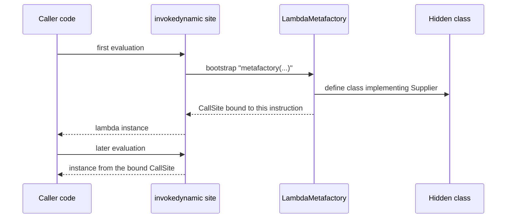
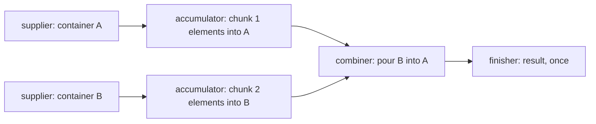
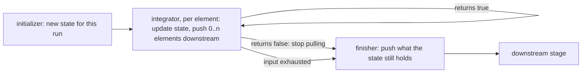
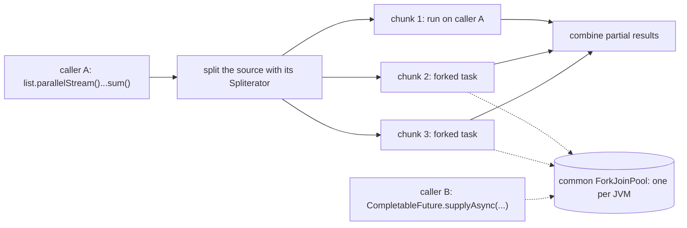

# 05. Lambdas, streams and `Optional`

> **What this covers:** functional programming in Java from the language up: functional interfaces, lambdas and method references, and how javac and the JVM compile and run them. Then the Stream API as interviews probe it: laziness and evaluation order, collectors, primitive streams, `reduce` vs `collect`, stream gatherers, parallel streams on the common `ForkJoinPool`, checked exceptions and resources inside pipelines, and `Optional` as a return type.
> **Prerequisites:** [03. Generics and type erasure § 2. Generic types, generic methods and type inference](03-java-generics.md#2-generic-types-generic-methods-and-type-inference), [§ 4. Wildcards, PECS and variance](03-java-generics.md#4-wildcards-pecs-and-variance), [04. Collections internals § 1. The Collections Framework](04-java-collections-internals.md#1-the-collections-framework-interfaces-contracts-and-sequenced-collections), [§ 8. Immutable, unmodifiable and fixed-size lists](04-java-collections-internals.md#8-immutable-unmodifiable-and-fixed-size-lists); also useful, [01. OOP fundamentals § 11. Nested types](01-java-oop-fundamentals.md#11-nested-types) for anonymous classes
> **Leads to:** [07. Modern language features](07-java-modern-language-features.md)
> **Applies to:** Java 25
> **Study time:** ~6 hours reading + ~4 hours exercises
> **Short on time:** [1. Functional interfaces and lambda expressions](#1-functional-interfaces-and-lambda-expressions), [4. Stream pipelines: laziness, short-circuiting and encounter order](#4-stream-pipelines-laziness-short-circuiting-and-encounter-order), [10. `Optional`: a return type for maybe-absent results](#10-optional-a-return-type-for-maybe-absent-results); questions [Q05.03](#q05-03), [Q05.10](#q05-10), [Q05.14](#q05-14), [Q05.24](#q05-24), [Q05.29](#q05-29); then [Summary](#summary).
> **Labs:** [`labs/java-language/`](../labs/java-language/), package `dev.interview.javalanguage.m05`. Run: `JAVA_HOME=$(/usr/libexec/java_home -v 25) mvn -q -f java-backend-guide/labs/pom.xml -pl java-language -am verify`. Needs Docker: no.

## Contents

1. [Functional interfaces and lambda expressions](#1-functional-interfaces-and-lambda-expressions)
2. [How lambdas compile and capture: `invokedynamic` and effectively final](#2-how-lambdas-compile-and-capture-invokedynamic-and-effectively-final)
3. [Method references](#3-method-references)
4. [Stream pipelines: laziness, short-circuiting and encounter order](#4-stream-pipelines-laziness-short-circuiting-and-encounter-order)
5. [Collectors: `toMap`, `groupingBy`, `teeing` and writing your own](#5-collectors-tomap-groupingby-teeing-and-writing-your-own)
6. [Primitive streams, `flatMap`, `mapMulti` and `reduce` vs `collect`](#6-primitive-streams-flatmap-mapmulti-and-reduce-vs-collect)
7. [Stream gatherers](#7-stream-gatherers)
8. [Parallel streams and the common `ForkJoinPool`](#8-parallel-streams-and-the-common-forkjoinpool)
9. [Checked exceptions and resources in lambdas and streams](#9-checked-exceptions-and-resources-in-lambdas-and-streams)
10. [`Optional`: a return type for maybe-absent results](#10-optional-a-return-type-for-maybe-absent-results)
- [Summary](#summary)
- [Question bank](#question-bank)
- [Hands-on exercises](#hands-on-exercises)
- [Check your understanding](#check-your-understanding)
- [Connections](#connections)

## 1. Functional interfaces and lambda expressions
### The problem it solves

A pricing service filters products with rules that change every quarter: "not blank", "not on the banned list", "in stock". Before Java 8 each rule was an anonymous class: five lines of `new Predicate<Product>() { @Override public boolean test(Product p) { … } }` around one line of logic. The rules were hard to read, so the team stopped composing them and wrote one long `if` chain inside the loop instead. Every new rule then meant editing that loop, and two quarters later nobody could say which conditions were still live. What was missing was a cheap way to pass *behavior* as a value: a rule you can name, store in a variable, hand to a method and combine with other rules.

### Mental model

A **lambda expression** is a function literal: parameters, an arrow and a body, `s -> s.isBlank()`. On its own it has no type. It becomes an object only when the code around it says which interface it must implement, the way a plug fits only once you know the socket. That socket is a **functional interface**: an interface with exactly one abstract method, the *functional method*. The lambda's parameters and result are matched to that one method, and the compiler checks the fit.

The JDK ships the common sockets in `java.util.function`. Each is named after its *function shape*, what goes in and what comes out:

| Interface | Shape | Where the JDK takes one |
|---|---|---|
| `Function<T, R>` | `T` → `R` | `Stream.map` |
| `Consumer<T>` | `T` → nothing | `Iterable.forEach` |
| `Supplier<T>` | nothing → `T` | `Optional.orElseGet` |
| `Predicate<T>` | `T` → `boolean` | `Stream.filter`, `Collection.removeIf` |
| `UnaryOperator<T>`, `BinaryOperator<T>` | `T` → `T`; (`T`, `T`) → `T` | `List.replaceAll`, `Stream.reduce` |
| `BiFunction<T, U, R>` | (`T`, `U`) → `R` | `Map.merge` (its remapping function) |

Each cell is a parameter type of that method in the Java 25 API, with wildcards left out ([Src: JDK 25, java.lang.Iterable](https://github.com/openjdk/jdk/blob/jdk-25-ga/src/java.base/share/classes/java/lang/Iterable.java) [Src: JDK 25, java.util.Collection](https://github.com/openjdk/jdk/blob/jdk-25-ga/src/java.base/share/classes/java/util/Collection.java) [Src: JDK 25, java.util.List](https://github.com/openjdk/jdk/blob/jdk-25-ga/src/java.base/share/classes/java/util/List.java) [Src: JDK 25, java.util.stream.Stream](https://github.com/openjdk/jdk/blob/jdk-25-ga/src/java.base/share/classes/java/util/stream/Stream.java) [Src: JDK 25, java.util.Optional](https://github.com/openjdk/jdk/blob/jdk-25-ga/src/java.base/share/classes/java/util/Optional.java) [Src: JDK 25, java.util.Map](https://github.com/openjdk/jdk/blob/jdk-25-ga/src/java.base/share/classes/java/util/Map.java)).

### How it actually works

**What makes an interface functional.** JLS §9.8 defines a functional interface as "an interface that is not declared `sealed` and has just one abstract method (aside from the methods of `Object`)" [Doc: JLS 25 §9.8](https://docs.oracle.com/javase/specs/jls/se25/html/jls-9.html#jls-9.8). Three kinds of member therefore do not count. Default methods have a body, so they are not abstract. Static methods are not instance methods at all. An abstract method with the signature of a public `Object` method, such as `boolean equals(Object)`, is already implemented by every class, which is why `Comparator` declares both `compare` and `equals` and is still functional [Doc: JLS 25 §9.8](https://docs.oracle.com/javase/specs/jls/se25/html/jls-9.html#jls-9.8). In the lab, an interface with one abstract `test`, a redeclared `equals` and `toString`, a default and a static method accepts a lambda [Lab: FunctionalInterfaceRulesTest](../labs/java-language/src/test/java/dev/interview/javalanguage/m05/s01/FunctionalInterfaceRulesTest.java). The exemption covers only *public* `Object` methods: declaring `Object clone()` in an interface adds a second abstract method, because `Object.clone` is protected, and the lab's lambda for such an interface fails with `compiler.err.prob.found.req`. A `sealed` interface with one abstract method is not functional either; the same key appears [Lab: FunctionalInterfaceRulesTest](../labs/java-language/src/test/java/dev/interview/javalanguage/m05/s01/FunctionalInterfaceRulesTest.java).

**`@FunctionalInterface` is a check, not a switch.** The annotation tells the compiler to report an error unless the annotated type is an interface that meets the definition; "the compiler will treat any interface meeting the definition of a functional interface as a functional interface regardless of whether or not a `FunctionalInterface` annotation is present" [Src: JDK 25, java.lang.FunctionalInterface](https://github.com/openjdk/jdk/blob/jdk-25-ga/src/java.base/share/classes/java/lang/FunctionalInterface.java). In the lab, annotating an interface with two abstract methods fails with `compiler.err.bad.functional.intf.anno.1` [Lab: FunctionalInterfaceRulesTest](../labs/java-language/src/test/java/dev/interview/javalanguage/m05/s01/FunctionalInterfaceRulesTest.java). Its value is protection against a later edit: someone who adds a second abstract method gets an error at the interface, not at every lambda that used it. `Runnable` (`@since 1.0`), `Callable` (1.5) and `Comparator` (1.2) predate Java 8 and carry the annotation today [Src: JDK 25, java.lang.Runnable](https://github.com/openjdk/jdk/blob/jdk-25-ga/src/java.base/share/classes/java/lang/Runnable.java) [Src: JDK 25, java.util.concurrent.Callable](https://github.com/openjdk/jdk/blob/jdk-25-ga/src/java.base/share/classes/java/util/concurrent/Callable.java) [Src: JDK 25, java.util.Comparator](https://github.com/openjdk/jdk/blob/jdk-25-ga/src/java.base/share/classes/java/util/Comparator.java).

**Target typing.** "Lambda expressions are always poly expressions": their type comes from the context, and a lambda may appear only in an assignment, invocation or casting context [Doc: JLS 25 §15.27](https://docs.oracle.com/javase/specs/jls/se25/html/jls-15.html#jls-15.27). The type the context supplies is the *target type*; the lambda is compatible with it when the target is a functional interface and the lambda's parameters, result and thrown exceptions fit its function type (JLS calls this *congruent*) [Doc: JLS 25 §15.27.3](https://docs.oracle.com/javase/specs/jls/se25/html/jls-15.html#jls-15.27.3). Three lab results follow from that rule [Lab: FunctionalInterfaceRulesTest](../labs/java-language/src/test/java/dev/interview/javalanguage/m05/s01/FunctionalInterfaceRulesTest.java):
- the same text `() -> "ready"` compiles as a `Supplier<String>` and as a `Callable<String>`, two unrelated interfaces with the same shape;
- `Object task = () -> {}` fails with `compiler.err.prob.found.req`, because `Object` is not a functional interface;
- `var same = (String s) -> s` fails with `compiler.err.cant.infer.local.var.type`, because `var` asks the initializer for a type and the lambda has none to give ([Q05.02](#q05-02) drills it; `var` itself is [03 §2](03-java-generics.md#2-generic-types-generic-methods-and-type-inference)).

Generic targets such as `Function<? super T, ? extends R>` are resolved by the inference rules of [03 §2](03-java-generics.md#2-generic-types-generic-methods-and-type-inference) and [03 §4](03-java-generics.md#4-wildcards-pecs-and-variance).

**The `java.util.function` families.** The package names four basic shapes, `Function`, `Consumer`, `Predicate` and `Supplier`, then modifies them with prefixes: an arity prefix (`BiFunction`), derived shapes (`UnaryOperator` extends `Function`, `BinaryOperator` extends `BiFunction`), and primitive specializations, where `ToXxx` specializes the result (`ToIntFunction<T>`), `Xxx` specializes arguments left to right (`IntPredicate`, `DoubleConsumer`) and `Obj` skips one (`ObjIntConsumer<T>`) [Doc: Java 25 API, java.util.function](https://docs.oracle.com/en/java/javase/25/docs/api/java.base/java/util/function/package-summary.html). The primitive forms exist so that a lambda over `int` values does not box each one into an `Integer` ([01 §13](01-java-oop-fundamentals.md#13-wrappers-autoboxing-and-the-integer-cache) covers boxing; [§6](#6-primitive-streams-flatmap-mapmulti-and-reduce-vs-collect) shows it in streams). The package is not a complete set: "other functional interfaces provided for specific purposes, such as `FileFilter`, are defined in the packages where they are used" [Doc: Java 25 API, java.util.function](https://docs.oracle.com/en/java/javase/25/docs/api/java.base/java/util/function/package-summary.html). Declare your own interface when the domain deserves a name (`PricingRule`) or a checked exception ([§9](#9-checked-exceptions-and-resources-in-lambdas-and-streams)).

**Composition.** The families carry default methods that build new functions from old ones. `f.andThen(g)` applies `f` first and then `g`; `f.compose(g)` applies `g` first [Src: JDK 25, java.util.function.Function](https://github.com/openjdk/jdk/blob/jdk-25-ga/src/java.base/share/classes/java/util/function/Function.java). In the lab, with `plusOne` and `twice`, `plusOne.andThen(twice).apply(3)` is 8 and `plusOne.compose(twice).apply(3)` is 7 [Lab: TextRulesTest](../labs/java-language/src/test/java/dev/interview/javalanguage/m05/s01/TextRulesTest.java). `Predicate.and` and `or` short-circuit: "if this predicate is `false`, then the `other` predicate is not evaluated" [Src: JDK 25, java.util.function.Predicate](https://github.com/openjdk/jdk/blob/jdk-25-ga/src/java.base/share/classes/java/util/function/Predicate.java), and the lab records only the first call [Lab: TextRulesTest](../labs/java-language/src/test/java/dev/interview/javalanguage/m05/s01/TextRulesTest.java). `negate()` inverts an existing predicate, and the static `Predicate.not(p)` (`@since 11`) does the same for a predicate written inline [Src: JDK 25, java.util.function.Predicate](https://github.com/openjdk/jdk/blob/jdk-25-ga/src/java.base/share/classes/java/util/function/Predicate.java). Combining small rules this way is the Strategy pattern without a class per strategy ([51](51-design-principles-and-patterns.md) names the pattern).

**Lambda vs anonymous class.** Both produce an object that implements an interface, but they differ in what the body sees:
- **`this` and names.** "Unlike code appearing in anonymous class declarations, the meaning of names and the `this` and `super` keywords appearing in a lambda body … are the same as in the surrounding context" [Doc: JLS 25 §15.27.2](https://docs.oracle.com/javase/specs/jls/se25/html/jls-15.html#jls-15.27.2). In the lab, `this.toString()` inside a lambda returns the enclosing `Greeter`'s text, and inside an anonymous class it returns the anonymous object's own [Lab: LambdaVsAnonymousTest](../labs/java-language/src/test/java/dev/interview/javalanguage/m05/s01/LambdaVsAnonymousTest.java).
- **Scope.** A lambda opens no new naming level. A lambda parameter or a local in its body may not reuse the name of a local still in scope ([Doc: JLS 25 §6.4](https://docs.oracle.com/javase/specs/jls/se25/html/jls-6.html#jls-6.4); in the lab, `int x = 1; IntUnaryOperator next = x -> x + 1;` fails with `compiler.err.already.defined` [Lab: FunctionalInterfaceRulesTest](../labs/java-language/src/test/java/dev/interview/javalanguage/m05/s01/FunctionalInterfaceRulesTest.java)). An anonymous class body is a class, so it may shadow freely.
- **State and reach.** An anonymous class may declare fields, extend a class, and implement an interface with several abstract methods. A lambda can only implement one functional interface and has no fields of its own; in the lab, an anonymous `Supplier<Integer>` with a `calls` field returns 1, 2, 3 on successive calls [Lab: LambdaVsAnonymousTest](../labs/java-language/src/test/java/dev/interview/javalanguage/m05/s01/LambdaVsAnonymousTest.java).
- **What they capture and compile to.** An anonymous class declared in an instance method keeps a reference to the enclosing instance, which is how listeners leak ([01 §11](01-java-oop-fundamentals.md#11-nested-types), [Q01.26](01-java-oop-fundamentals.md#q01-26)). A lambda captures `this` only if its body uses it, and it is not compiled into a class of its own; [§2](#2-how-lambdas-compile-and-capture-invokedynamic-and-effectively-final) shows both.

Lambdas arrived in Java 8 with JEP 126, which added "lambda expressions (closures) and supporting features, including method references, enhanced type inference, and virtual extension methods" (the default methods above) [Doc: JEP 126](https://openjdk.org/jeps/126).

### Code

The approach: express each tag rule as a small lambda, then combine the rules with the default methods instead of writing one method full of conditions.

1. Write `normalizer()` as two one-line `Function`s joined with `andThen`, so the order (strip, then lower-case) is visible.
2. Write each rejection rule as a `Predicate`, and invert them with `Predicate.not` and `negate()` rather than with `!` inside the lambda.
3. Join the rules with `and`, which short-circuits.
4. Return a lambda that normalizes first and tests second, so callers pass raw input.

```java
// Excerpt of labs/java-language/src/main/java/dev/interview/javalanguage/m05/s01/TextRules.java
    public static Function<String, String> normalizer() {
        Function<String, String> strip = s -> s.strip();
        Function<String, String> lower = s -> s.toLowerCase(Locale.ROOT);
        return strip.andThen(lower);
    }

    public static Predicate<String> acceptedTag(Set<String> banned) {
        Predicate<String> blank = s -> s.isBlank();
        Predicate<String> isBanned = s -> banned.contains(s);
        Predicate<String> rule = Predicate.not(blank).and(isBanned.negate());
        Function<String, String> normalize = normalizer();
        return tag -> rule.test(normalize.apply(tag));
    }
```

`TextRulesTest` checks that `"  Java "` is accepted, `" SPAM"` is rejected against the banned set `{"spam"}`, and a blank tag is rejected. The lambdas here could be method references (`String::strip`); [§3](#3-method-references) covers when that reads better.

The `this` difference, side by side. The approach: return the same "describe yourself" request once as a lambda and once as an anonymous class, and let `toString` reveal which object `this` is.

```java
// Excerpt of labs/java-language/src/main/java/dev/interview/javalanguage/m05/s01/Greeter.java
    // In a lambda body, this is the Greeter that created the lambda.
    public Supplier<String> lambdaThis() {
        return () -> this.toString();
    }

    // In an anonymous class body, this is the anonymous object itself.
    public Supplier<String> anonymousThis() {
        return new Supplier<>() {
            @Override
            public String get() {
                return this.toString();
            }

            @Override
            public String toString() {
                return "anonymous supplier";
            }
        };
    }
```

For `new Greeter("Ada")`, the first supplier returns `"Greeter for Ada"` and the second `"anonymous supplier"` [Lab: LambdaVsAnonymousTest](../labs/java-language/src/test/java/dev/interview/javalanguage/m05/s01/LambdaVsAnonymousTest.java).

#### Legacy

Code written before Java 8, and some still written today, passes behavior as anonymous classes. The conversion is mechanical when the anonymous class implements a functional interface, declares no fields and does not use `this` to mean itself: keep the parameter list and the body, drop the rest.

```java
// Excerpt of labs/java-language/src/main/java/dev/interview/javalanguage/m05/s01/LengthOrder.java
    public static final Comparator<String> ANONYMOUS = new Comparator<String>() {
        @Override
        public int compare(String a, String b) {
            return Integer.compare(a.length(), b.length());
        }
    };

    public static final Comparator<String> LAMBDA = (a, b) -> Integer.compare(a.length(), b.length());
```

Both sort `["stream", "map", "lambda", "of"]` into `["of", "map", "stream", "lambda"]` [Lab: LengthOrderTest](../labs/java-language/src/test/java/dev/interview/javalanguage/m05/s01/LengthOrderTest.java). When the body uses `this`, a field of the anonymous class, or an abstract class as its supertype, the conversion changes behavior or does not compile, so leave those as classes (`Comparator` itself is [02 §4](02-java-equality-immutability-records.md#4-ordering-comparable-and-comparator)'s subject; `Comparator.comparingInt(String::length)` is the idiomatic form there).

### Failure modes and operations

A lambda fails the way its body fails; this section has no runtime behavior of its own beyond that. What it costs to create and run one, and how it holds on to captured objects, is [§2](#2-how-lambdas-compile-and-capture-invokedynamic-and-effectively-final); what lambdas cost inside streams is [§6](#6-primitive-streams-flatmap-mapmulti-and-reduce-vs-collect) and [§8](#8-parallel-streams-and-the-common-forkjoinpool).

> [!NOTE]
> **Version notes.** Java 8: lambda expressions, method references and default methods [Final since Java 8, JEP 126] [Doc: JEP 126](https://openjdk.org/jeps/126); `java.util.function` and `@FunctionalInterface` are `@since 1.8` [Src: JDK 25, java.lang.FunctionalInterface](https://github.com/openjdk/jdk/blob/jdk-25-ga/src/java.base/share/classes/java/lang/FunctionalInterface.java) [Doc: Java 25 API, java.util.function](https://docs.oracle.com/en/java/javase/25/docs/api/java.base/java/util/function/package-summary.html); older interfaces with one abstract method, such as `Runnable` and `Comparator`, accept lambdas without changes. Java 11: `Predicate.not` [Src: JDK 25, java.util.function.Predicate](https://github.com/openjdk/jdk/blob/jdk-25-ga/src/java.base/share/classes/java/util/function/Predicate.java). Java 17: `sealed` interfaces [Final since Java 17, JEP 409] [Doc: JEP 409](https://openjdk.org/jeps/409), which JLS §9.8 excludes from being functional [Doc: JLS 25 §9.8](https://docs.oracle.com/javase/specs/jls/se25/html/jls-9.html#jls-9.8) (sealed types are [07](07-java-modern-language-features.md)'s subject).

### Best practices and anti-patterns

- Prefer a `java.util.function` type when one fits the shape, because every reader and every JDK method already knows it; declare your own interface when the concept deserves a domain name or needs a checked exception, because `Function` cannot declare one ([§9](#9-checked-exceptions-and-resources-in-lambdas-and-streams)).
- Annotate your own functional interfaces with `@FunctionalInterface`, because a later second abstract method then fails at the interface instead of at every lambda that targets it.
- Use the primitive specializations (`IntPredicate`, `ToLongFunction<T>`) on hot paths over numbers, because the generic forms box every value.
- Keep lambda bodies to an expression or a few statements, and move longer logic into a named method, because a stack trace or a code review then points at a name, not at `lambda$…` ([§2](#2-how-lambdas-compile-and-capture-invokedynamic-and-effectively-final)).
- Combine rules with `and`, `or`, `negate`, `Predicate.not`, `andThen` and `compose` instead of nesting conditions inside one lambda, because each rule stays testable on its own.
- Do not convert an anonymous class to a lambda when its body uses `this` to mean itself or keeps a field, because the lambda's `this` is the enclosing object and it cannot hold state.

### Misconceptions and traps

- *"A functional interface can have only one method."* It can have any number of default and static methods and may redeclare public `Object` methods; only the count of other abstract methods is limited to one [Doc: JLS 25 §9.8](https://docs.oracle.com/javase/specs/jls/se25/html/jls-9.html#jls-9.8) [Lab: FunctionalInterfaceRulesTest](../labs/java-language/src/test/java/dev/interview/javalanguage/m05/s01/FunctionalInterfaceRulesTest.java). The shorthand comes from the informal phrase "single-method interface", used before Java 8 added default methods.
- *"`@FunctionalInterface` is what makes an interface functional."* Any interface that meets the definition is functional; the annotation only asks the compiler to check it [Src: JDK 25, java.lang.FunctionalInterface](https://github.com/openjdk/jdk/blob/jdk-25-ga/src/java.base/share/classes/java/lang/FunctionalInterface.java). The belief exists because every interface in `java.util.function` carries it.
- *"A lambda is shorter syntax for an anonymous class."* `this`, name scope and state differ ([Doc: JLS 25 §15.27.2](https://docs.oracle.com/javase/specs/jls/se25/html/jls-15.html#jls-15.27.2) [Lab: LambdaVsAnonymousTest](../labs/java-language/src/test/java/dev/interview/javalanguage/m05/s01/LambdaVsAnonymousTest.java)), and the compiled form differs too ([§2](#2-how-lambdas-compile-and-capture-invokedynamic-and-effectively-final)). The idea comes from IDEs that offer "replace with lambda" on anonymous classes, which works for the common case.
- *"A lambda has a type, so `var f = x -> x` should work."* A lambda takes its type from the target, and `var` provides none [Doc: JLS 25 §15.27](https://docs.oracle.com/javase/specs/jls/se25/html/jls-15.html#jls-15.27) [Lab: FunctionalInterfaceRulesTest](../labs/java-language/src/test/java/dev/interview/javalanguage/m05/s01/FunctionalInterfaceRulesTest.java). The expectation comes from languages where function literals have function types of their own.
- *"`f.andThen(g)` and `f.compose(g)` are the same thing written two ways."* They apply the functions in opposite orders [Lab: TextRulesTest](../labs/java-language/src/test/java/dev/interview/javalanguage/m05/s01/TextRulesTest.java). The mix-up comes from mathematics, where `g ∘ f` is read right to left.

Questions that drill this section: [Q05.01](#q05-01), [Q05.02](#q05-02), [Q05.03](#q05-03), [Q05.04](#q05-04).

## 2. How lambdas compile and capture: `invokedynamic` and effectively final
### The problem it solves

A reporting job counts the words in each document that are at least six characters long. The first version wrote `int count = 0; words.forEach(w -> { if (w.length() >= 6) count++; });` and javac refused it with "local variables referenced from a lambda expression must be final or effectively final" (javac 25's wording; the lab asserts the diagnostic key). Someone found the classic workaround, `int[] count = {0}` with `count[0]++` inside the lambda. It compiled, the tests passed, and the job shipped. Months later a colleague switched `stream()` to `parallelStream()` to speed up large documents, and the nightly totals started to come out slightly low, by a different amount each night. Nothing failed, and no test caught it, because the tests ran on small sequential inputs. The rule javac enforced was protecting exactly this case. Getting past it without understanding what a lambda captures, and why, turned a compile error into silent data loss.

### Mental model

Think of a lambda as a sealed envelope created at the moment the lambda expression is *evaluated*. The body's code is already printed on the envelope's form. The values of the local variables it uses are copied into the envelope at that moment, and nothing outside can reach them afterwards. A field is different: the envelope holds a copy of `this`, the address of the owning object, so each call goes to that address and reads the field as it is now. Because locals are copied, the language insists they never change; a variable that kept changing after the copy would make the envelope lie about it.

On the compiler side, javac does not build the envelope's class at all. It leaves two things in the class file: the body, as a private method of the enclosing class, and an `invokedynamic` instruction that holds a recipe ("implement `Supplier.get` by calling this method"). The JVM follows the recipe the first time that instruction runs, defines the class in memory, and from then on reuses what it built.



What to notice: the bootstrap and the class definition happen once per call site, the first time it runs, not once per evaluation; every later evaluation only invokes the call site that is already bound [Doc: JVMS 25 §6.5 invokedynamic](https://docs.oracle.com/javase/specs/jvms/se25/html/jvms-6.html#jvms-6.5.invokedynamic) [Src: JDK 25, java.lang.invoke.LambdaMetafactory](https://github.com/openjdk/jdk/blob/jdk-25-ga/src/java.base/share/classes/java/lang/invoke/LambdaMetafactory.java).

### How it actually works

**What javac emits.** For a class `Shapes` with one method `ready()` returning `() -> "ready"`, the lab compiles the source in memory and reads the bytes with the Class-File API [Lab: CompiledFormTest](../labs/java-language/src/test/java/dev/interview/javalanguage/m05/s02/CompiledFormTest.java):
- javac writes one class file, `Shapes`; there is no class for the lambda;
- the lambda body is a method of `Shapes` whose name starts with `lambda$`, flagged `private`, `static` and synthetic;
- `ready()` contains one `invokedynamic` instruction whose bootstrap method is `java.lang.invoke.LambdaMetafactory.metafactory`.

The synthetic flag is required: "a construct emitted by a Java compiler must be marked as synthetic if it does not correspond to a construct declared explicitly or implicitly in source code" [Doc: JLS 25 §13.1](https://docs.oracle.com/javase/specs/jls/se25/html/jls-13.html#jls-13.1). The name itself is not specified: the JLS requires only the synthetic flag, and everything after `lambda$` is javac's own choice, so the lab asserts only the prefix and no code should depend on the rest. An anonymous class, by contrast, is an ordinary nested class: the same lab compiles a method that returns `new Runnable() { … }` into two class files, `Shapes` and `Shapes$1`, with no `invokedynamic` and no `lambda$` method [Lab: CompiledFormTest](../labs/java-language/src/test/java/dev/interview/javalanguage/m05/s02/CompiledFormTest.java).

**`invokedynamic` and the call site.** `invokedynamic` is the one invoke instruction that names no method. Its constant-pool entry is "a symbolic reference to a dynamically-computed call site", which the JVM resolves "for this specific `invokedynamic` instruction to obtain a reference to an instance of `java.lang.invoke.CallSite`"; that `CallSite` is then "bound" to the instruction, and each execution invokes its target method handle [Doc: JVMS 25 §6.5 invokedynamic](https://docs.oracle.com/javase/specs/jvms/se25/html/jvms-6.html#jvms-6.5.invokedynamic). Resolution runs the bootstrap method named in the entry. For lambdas and method references that is a method of `LambdaMetafactory`, whose Javadoc splits the work into three phases [Src: JDK 25, java.lang.invoke.LambdaMetafactory](https://github.com/openjdk/jdk/blob/jdk-25-ga/src/java.base/share/classes/java/lang/invoke/LambdaMetafactory.java):
- **linkage**, when the bootstrap runs: it "may involve dynamically loading a new class that implements the target interface", and returns a `CallSite` that acts as a factory for function objects;
- **capture**, each time the call site's target is invoked: it produces a function object, and "may involve allocation of a new function object, or may return a suitable existing function object";
- **invocation**, each time the interface method is called on that object.

Evaluating a lambda expression is capture; calling `get()` on the result is invocation [Src: JDK 25, java.lang.invoke.LambdaMetafactory](https://github.com/openjdk/jdk/blob/jdk-25-ga/src/java.base/share/classes/java/lang/invoke/LambdaMetafactory.java).

**The class the JDK builds is hidden.** In JDK 25 the linkage work is done by `InnerClassLambdaMetafactory`. It generates the class's bytes, names it after the capturing class plus `$$Lambda`, and defines it as a hidden class with the `NESTMATE_CLASS` option, which puts it in the capturing class's nest so its method may call the private `lambda$` method; each captured value becomes a `private final` field of that class [Src: JDK 25, java.lang.invoke.InnerClassLambdaMetafactory](https://github.com/openjdk/jdk/blob/jdk-25-ga/src/java.base/share/classes/java/lang/invoke/InnerClassLambdaMetafactory.java). Hidden classes came with JEP 371, whose motivation uses exactly this case: "javac does not translate a lambda expression into a dedicated class file at compile time but, rather, emits bytecode that dynamically generates and instantiates a class to yield an object corresponding to the lambda expression when needed" [Doc: JEP 371](https://openjdk.org/jeps/371). In the lab, a lambda's `getClass().isHidden()` is `true` and its name contains `$$Lambda`, while the anonymous class's is `false`, with `isAnonymousClass()` `true` and a name ending in `$1` [Lab: LambdaRuntimeTest](../labs/java-language/src/test/java/dev/interview/javalanguage/m05/s02/LambdaRuntimeTest.java).

**Capture is the call site's arguments.** What a lambda captures becomes the parameter list of its `invokedynamic` instruction: capture passes those values in, and the generated class stores them in its fields [Src: JDK 25, java.lang.invoke.InnerClassLambdaMetafactory](https://github.com/openjdk/jdk/blob/jdk-25-ga/src/java.base/share/classes/java/lang/invoke/InnerClassLambdaMetafactory.java). The lab compiles three lambdas in one class and reads each call site's type [Lab: CompiledFormTest](../labs/java-language/src/test/java/dev/interview/javalanguage/m05/s02/CompiledFormTest.java):
- `() -> 1` takes no arguments;
- `() -> n`, where `n` is a method parameter, takes one `int`;
- `() -> base`, where `base` is an instance field, takes one `Shapes`: the lambda captured `this`, not the field.

The same test shows the body method of the field-reading lambda is an instance method, while the other two are `static` [Lab: CompiledFormTest](../labs/java-language/src/test/java/dev/interview/javalanguage/m05/s02/CompiledFormTest.java). This is the precise sense of [§1](#1-functional-interfaces-and-lambda-expressions)'s "a lambda captures `this` only if its body uses it", and the reason a lambda that reads one field keeps its whole owner reachable.

**Identity is not part of the contract.** JLS §15.27.4 says that evaluating a lambda expression either allocates a new instance "or an existing instance … is referenced", so "the identity of the result of evaluating a lambda expression … is unpredictable", and `==`, `synchronized` and `System.identityHashCode` "may produce different results in different implementations … or even upon different lambda expression evaluations in the same implementation" [Doc: JLS 25 §15.27.4](https://docs.oracle.com/javase/specs/jls/se25/html/jls-15.html#jls-15.27.4). What JDK 25 happens to do: for a call site with no captured values, `InnerClassLambdaMetafactory` creates one instance during linkage and binds a constant call site to it ("for a non-capturing lambda, we optimize linkage by pre-computing a single instance") [Src: JDK 25, java.lang.invoke.InnerClassLambdaMetafactory](https://github.com/openjdk/jdk/blob/jdk-25-ga/src/java.base/share/classes/java/lang/invoke/InnerClassLambdaMetafactory.java). In the lab, two calls to a method returning `() -> {}` return the same object, while two calls to a method returning `() -> value` return two objects of one class [Lab: LambdaRuntimeTest](../labs/java-language/src/test/java/dev/interview/javalanguage/m05/s02/LambdaRuntimeTest.java). Treat both results as an implementation detail: never lock on a lambda, never key an identity map by one, and never expect `removeListener(x -> …)` to find a listener registered with an identical-looking lambda.

**Effectively final.** JLS §15.27.2: "any local variable, formal parameter, or exception parameter used but not declared in a lambda expression must either be final or effectively final", and it must be definitely assigned before the lambda body [Doc: JLS 25 §15.27.2](https://docs.oracle.com/javase/specs/jls/se25/html/jls-15.html#jls-15.27.2). A local declared with an initializer is effectively final when it is not declared `final`, never appears on the left of an assignment, and is never the operand of `++` or `--`. A local declared without an initializer qualifies if every assignment to it happens while it is still definitely unassigned, so a single assignment after the declaration is fine. Parameters count as locals with an initializer. The test is simple to apply: if adding `final` would not cause a compile error, the variable is effectively final [Doc: JLS 25 §4.12.4](https://docs.oracle.com/javase/specs/jls/se25/html/jls-4.html#jls-4.12.4). In the lab, each of these fails with `compiler.err.cant.ref.non.effectively.final.var` [Lab: CaptureRulesTest](../labs/java-language/src/test/java/dev/interview/javalanguage/m05/s02/CaptureRulesTest.java):
- capturing a local reassigned before the lambda;
- capturing one that is incremented after the lambda, even though the lambda never sees the change;
- incrementing the captured local inside the lambda;
- capturing the index of a classic `for` loop.

An anonymous class that reads a reassigned local fails with the same key, because "similar rules on variable use apply in the body of an inner class" [Doc: JLS 25 §15.27.2](https://docs.oracle.com/javase/specs/jls/se25/html/jls-15.html#jls-15.27.2). Three captures compile [Lab: CaptureRulesTest](../labs/java-language/src/test/java/dev/interview/javalanguage/m05/s02/CaptureRulesTest.java). The variable of an enhanced `for` loop can be captured, because it is "treated as distinct for each iteration" [Doc: JLS 25 §15.27.2](https://docs.oracle.com/javase/specs/jls/se25/html/jls-15.html#jls-15.27.2). A local declared first and assigned once later can be captured. So can a `List` that the lambda adds to, because the rule is about the variable, not the object it points to.

**Why the rule exists.** The JLS gives the reason itself: the restriction "prohibits access to dynamically-changing local variables, whose capture would likely introduce concurrency problems", and requiring only *effectively* final, rather than `final`, "reduces the clerical burden on programmers" [Doc: JLS 25 §15.27.2](https://docs.oracle.com/javase/specs/jls/se25/html/jls-15.html#jls-15.27.2). The mechanism above explains the shape of the rule. A captured local is copied into the lambda object when the lambda is evaluated, and the lambda may run later, on another thread, after the method that declared the local has returned and its stack frame is gone. If the variable could change after the copy, the lambda would silently see a stale value; forbidding the change makes the copy indistinguishable from the variable. A field has no such problem, because the lambda reaches it through `this` at every call. In the lab, after `tag.reprice(1_250)`, a lambda reading the `cents` field returns 1 250, while a lambda that captured a local copy of it returns the original 1 000 [Lab: CaptureBehaviorTest](../labs/java-language/src/test/java/dev/interview/javalanguage/m05/s02/CaptureBehaviorTest.java).

**The workarounds, and why they are a smell.** Wrapping the counter in something mutable, `int[] count = {0}` or an `AtomicInteger`, satisfies the compiler because the variable no longer changes; the object it refers to does. That reintroduces precisely what the rule was keeping out: state shared between the lambda and its surroundings. The lab counts long words three ways [Lab: CaptureBehaviorTest](../labs/java-language/src/test/java/dev/interview/javalanguage/m05/s02/CaptureBehaviorTest.java):
- sequentially, the array holder and the stream's own `count()` agree;
- over a parallel stream of 20 000 words, the array holder's `count[0]++` is an unsynchronized read-modify-write from several threads, so the test can only assert the permitted range, 1 to 20 000, because whether updates are lost depends on scheduling;
- the `AtomicInteger` and the `filter(…).count()` versions return exactly 20 000.

The atomic version is correct but still a side effect, and every matching element updates one shared counter [Lab: CaptureBehaviorTest](../labs/java-language/src/test/java/dev/interview/javalanguage/m05/s02/CaptureBehaviorTest.java). The stream version keeps the lambda a pure question about one element and lets the stream do the counting. The language allows side effects in lambda bodies. Whether a particular stream operation tolerates them is the stream contract's business, covered by [§4](#4-stream-pipelines-laziness-short-circuiting-and-encounter-order) (non-interference and stateless behavior) and [§8](#8-parallel-streams-and-the-common-forkjoinpool) (parallel execution). Why the unsynchronized increment loses updates is [11](11-concurrency-threads-and-jmm.md)'s subject.

**Serializable lambdas.** A lambda is serializable only when its target type is: "if the targeted functional interface type is a subtype of `java.io.Serializable`, the resulting object will automatically be an instance of a serializable class", and the JLS notes this is not the default because it "can have extra run time overhead and security implications" [Doc: JLS 25 §15.27.4](https://docs.oracle.com/javase/specs/jls/se25/html/jls-15.html#jls-15.27.4). The usual way to ask for it is an intersection cast, `(Runnable & Serializable) () -> {}`. In the lab, that call site's bootstrap becomes `LambdaMetafactory.altMetafactory`, and javac adds a `$deserializeLambda$` method to the capturing class, which contains its own `altMetafactory` call site to rebuild the lambda on the way back in [Lab: CompiledFormTest](../labs/java-language/src/test/java/dev/interview/javalanguage/m05/s02/CompiledFormTest.java). The serialized form is a `SerializedLambda` holding the interface method, the implementation method and the captured values, and its `readResolve` calls the capturing class's `$deserializeLambda$`, which is "responsible for validating that the properties of the `SerializedLambda` are consistent with a lambda actually captured by that class" [Src: JDK 25, java.lang.invoke.SerializedLambda](https://github.com/openjdk/jdk/blob/jdk-25-ga/src/java.base/share/classes/java/lang/invoke/SerializedLambda.java) [Src: JDK 25, java.lang.invoke.LambdaMetafactory](https://github.com/openjdk/jdk/blob/jdk-25-ga/src/java.base/share/classes/java/lang/invoke/LambdaMetafactory.java). The bytes therefore name a compiler-generated method of one compiled class, and everything that makes Java serialization risky applies to them as well ([06](06-java-exceptions-strings-io.md) covers serialization and deserialization filters).

### Code

The approach: keep the two kinds of capture side by side in one small class, so the difference between "reads the field now" and "remembers the value then" is visible in the code rather than explained.

1. Give the class a mutable field, `cents`, and a method that changes it.
2. Return a lambda that reads the field: it captures `this`.
3. Copy the field into a local first and return a lambda that reads the local: it captures the value.

```java
// Excerpt of labs/java-language/src/main/java/dev/interview/javalanguage/m05/s02/PriceTag.java
    // Captures this: every call reads the field as it is at that moment.
    public IntSupplier currentPrice() {
        return () -> cents;
    }

    // Captures a copy of the local: the value it had when the lambda was evaluated.
    public IntSupplier priceAtCreation() {
        int snapshot = cents;
        return () -> snapshot;
    }
```

`CaptureBehaviorTest` creates both suppliers for a price of 1 000, reprices to 1 250, and gets 1 250 and 1 000.

The counting job from the problem statement, before and after. The approach: replace the mutable holder with a stream that computes the count, so the lambda answers one question about one element and shares nothing.

1. Keep the array-holder version only as the anti-pattern the test compares against.
2. Move the condition into `filter`, so the lambda is a `Predicate` with no side effect.
3. Let the terminal operation `count()` produce the result, sequential or parallel.

```java
// Excerpt of labs/java-language/src/main/java/dev/interview/javalanguage/m05/s02/WordTally.java
    // Anti-pattern: a one-element array smuggles a mutable counter past the effectively final rule.
    public static int countWithArrayHolder(Stream<String> words, int minLength) {
        int[] count = {0};
        words.forEach(word -> {
            if (word.length() >= minLength) {
                count[0]++;
            }
        });
        return count[0];
    }

    // The stream owns the counting; the lambda only answers a question about one element.
    public static long countWithStream(Stream<String> words, int minLength) {
        return words.filter(word -> word.length() >= minLength).count();
    }
```

For `["map", "filter", "reduce", "of", "collect"]` and a minimum of six, both return 3; on a parallel stream only `countWithStream` and the `AtomicInteger` variant in the same file are guaranteed to be exact [Lab: CaptureBehaviorTest](../labs/java-language/src/test/java/dev/interview/javalanguage/m05/s02/CaptureBehaviorTest.java). To see the compiled form yourself, `javap -c -p` on a compiled class lists the `invokedynamic` instructions and the private `lambda$…` methods; the lab reads the same information with `java.lang.classfile` [Final since Java 24, JEP 484] [Doc: JEP 484](https://openjdk.org/jeps/484) in its test helper [`ClassFileView`](../labs/java-language/src/test/java/dev/interview/javalanguage/m05/support/ClassFileView.java).

### Failure modes and operations

**First-call linkage.** Each lambda call site pays for linkage the first time it runs: the bootstrap call, generating the class bytes, and defining a hidden class [Src: JDK 25, java.lang.invoke.LambdaMetafactory](https://github.com/openjdk/jdk/blob/jdk-25-ga/src/java.base/share/classes/java/lang/invoke/LambdaMetafactory.java) [Src: JDK 25, java.lang.invoke.InnerClassLambdaMetafactory](https://github.com/openjdk/jdk/blob/jdk-25-ga/src/java.base/share/classes/java/lang/invoke/InnerClassLambdaMetafactory.java). Later evaluations of that site skip all of it. A large application with thousands of distinct lambda and method-reference sites does that work during startup and warm-up, not on every request, so it shows up in startup time and in the first requests that reach each code path after a deploy, rather than in steady-state latency. Measuring and reducing startup cost is [10](10-jvm-performance-and-troubleshooting.md)'s subject.

**Captured `this` keeps the owner alive.** A lambda that reads a field captures the whole enclosing object ([Lab: CompiledFormTest](../labs/java-language/src/test/java/dev/interview/javalanguage/m05/s02/CompiledFormTest.java): its call site takes a `Shapes`). Registered as a listener on a longer-lived object, an event bus or a static registry, it keeps that owner reachable for as long as the registration lasts. That is the same leak as an anonymous listener ([01 §11](01-java-oop-fundamentals.md#11-nested-types), [Q01.26](01-java-oop-fundamentals.md#q01-26)), only less visible, because the lambda's text does not show `this`. In a heap dump, the path to the leaked owner runs through a field of a `…$$Lambda/0x…` class; [08](08-jvm-memory-and-class-loading.md) covers reading the path to GC roots.

**Reading stack traces.** An exception thrown inside a lambda body shows the body as a frame of the capturing class with a `lambda$` method name, followed by the method that called the functional interface; the frame of the hidden class's own method is left out. JEP 371: "methods of hidden classes are not shown in stack traces by default", and `Throwable::getStackTrace` omits them unless the JVM runs with `-XX:+UnlockDiagnosticVMOptions -XX:+ShowHiddenFrames` [Doc: JEP 371](https://openjdk.org/jeps/371). In the lab, a stack trace captured inside a lambda has a `lambda$…` method of `LambdaSites` as its first frame, `traceInsideLambda` as its second, and no `$$Lambda` frame at all [Lab: LambdaRuntimeTest](../labs/java-language/src/test/java/dev/interview/javalanguage/m05/s02/LambdaRuntimeTest.java). Find the lambda by the frame's line number rather than by its method name, because everything after `lambda$` is javac's choice. A long pipeline of anonymous lambdas makes those frames hard to tell apart, which is one reason to extract long bodies into named methods.

> [!NOTE]
> **Version notes.** Java 8: lambda expressions compile to an `invokedynamic` call site bootstrapped by `LambdaMetafactory` (`@since 1.8`) [Final since Java 8, JEP 126] [Doc: JEP 126](https://openjdk.org/jeps/126) [Src: JDK 25, java.lang.invoke.LambdaMetafactory](https://github.com/openjdk/jdk/blob/jdk-25-ga/src/java.base/share/classes/java/lang/invoke/LambdaMetafactory.java); javac writes no class file for a lambda [Doc: JEP 371](https://openjdk.org/jeps/371). Java 15: hidden classes [Final since Java 15, JEP 371] [Doc: JEP 371](https://openjdk.org/jeps/371), with `Class.isHidden()` `@since 15` [Src: JDK 25, java.lang.Class](https://github.com/openjdk/jdk/blob/jdk-25-ga/src/java.base/share/classes/java/lang/Class.java); JEP 371 moved `LambdaMetafactory` onto the new hidden-class API and deprecated `sun.misc.Unsafe::defineAnonymousClass` [Doc: JEP 371](https://openjdk.org/jeps/371). Java 24: the Class-File API used by this section's lab [Final since Java 24, JEP 484] [Doc: JEP 484](https://openjdk.org/jeps/484). Java 25 (default): lambda classes are hidden nestmates named `<Caller>$$Lambda`, and a non-capturing call site returns one pre-computed instance [Src: JDK 25, java.lang.invoke.InnerClassLambdaMetafactory](https://github.com/openjdk/jdk/blob/jdk-25-ga/src/java.base/share/classes/java/lang/invoke/InnerClassLambdaMetafactory.java), an implementation detail and not a guarantee.

### Best practices and anti-patterns

- Compute results with the stream (`count`, `sum`, `collect`) instead of mutating a captured holder, because a lambda with no side effect stays correct when the pipeline becomes parallel or is reused.
- Do not use `int[]`, `AtomicInteger` or a one-field wrapper just to get past the effectively final rule, because the error is pointing at shared mutable state; if the state really must be shared across threads, make it an explicit, documented concurrent object (see [12](12-concurrency-locks-atomics-collections.md)).
- Copy a field into a local before building a long-lived lambda when the lambda needs only the value, because then it captures that value instead of `this` and does not keep the owner reachable.
- Unregister a lambda listener with the reference you registered, stored in a variable, never by writing the same lambda again, because a new evaluation may be a different object [Doc: JLS 25 §15.27.4](https://docs.oracle.com/javase/specs/jls/se25/html/jls-15.html#jls-15.27.4).
- Never use a lambda's identity: no `synchronized (lambda)`, no `IdentityHashMap` keys, no `==` between lambdas, because the JLS leaves it unspecified and JDK behavior differs between capturing and non-capturing sites.
- Do not depend on synthetic names after the `lambda$` prefix in reflection, logging filters or tests, because they are javac's choice, not part of any specification [Doc: JLS 25 §13.1](https://docs.oracle.com/javase/specs/jls/se25/html/jls-13.html#jls-13.1).
- **Security:** do not make lambdas serializable unless a framework requires it, and never deserialize them from untrusted input, because the serialized form names a private method of your class and goes through the same Java deserialization path whose risks [06](06-java-exceptions-strings-io.md) covers; the JLS itself cites "security implications" as the reason serializability is not the default [Doc: JLS 25 §15.27.4](https://docs.oracle.com/javase/specs/jls/se25/html/jls-15.html#jls-15.27.4).

### Misconceptions and traps

- *"Lambdas are compiled to anonymous inner classes."* javac emits a private synthetic method and an `invokedynamic` instruction, and writes no class file for the lambda; the class is spun at run time as a hidden class [Lab: CompiledFormTest](../labs/java-language/src/test/java/dev/interview/javalanguage/m05/s02/CompiledFormTest.java) [Lab: LambdaRuntimeTest](../labs/java-language/src/test/java/dev/interview/javalanguage/m05/s02/LambdaRuntimeTest.java) [Doc: JEP 371](https://openjdk.org/jeps/371). The myth comes from early explanations of lambdas as "anonymous classes with less syntax", and from IDEs converting one into the other.
- *"Effectively final means the object cannot change."* Only the variable is fixed; a captured `List` can be added to, and the lab's lambda does so [Lab: CaptureBehaviorTest](../labs/java-language/src/test/java/dev/interview/javalanguage/m05/s02/CaptureBehaviorTest.java) [Doc: JLS 25 §4.12.4](https://docs.oracle.com/javase/specs/jls/se25/html/jls-4.html#jls-4.12.4). The confusion comes from `final` itself, which people already misread as "immutable" ([02](02-java-equality-immutability-records.md) separates the two).
- *"The rule exists because the lambda might change the variable."* A write after the lambda is rejected too, even though the lambda never writes [Lab: CaptureRulesTest](../labs/java-language/src/test/java/dev/interview/javalanguage/m05/s02/CaptureRulesTest.java). The rule exists so the copy taken at evaluation can never differ from the variable [Doc: JLS 25 §15.27.2](https://docs.oracle.com/javase/specs/jls/se25/html/jls-15.html#jls-15.27.2). The half-truth comes from the error's most common trigger, `count++` inside the lambda.
- *"A lambda that only reads a field captures just that field."* It captures `this`; the call site's argument is the enclosing object [Lab: CompiledFormTest](../labs/java-language/src/test/java/dev/interview/javalanguage/m05/s02/CompiledFormTest.java). It looks otherwise because the body says `cents`, not `this.cents`.
- *"Every evaluation of a lambda creates a new object"*, or the opposite, *"the same lambda is always the same object"*. Either may happen; on JDK 25 a non-capturing site returns one instance and a capturing site a new one each time [Lab: LambdaRuntimeTest](../labs/java-language/src/test/java/dev/interview/javalanguage/m05/s02/LambdaRuntimeTest.java) [Doc: JLS 25 §15.27.4](https://docs.oracle.com/javase/specs/jls/se25/html/jls-15.html#jls-15.27.4). Both beliefs come from generalizing one observed case.
- *"The `for` loop variable can never be captured."* The index of a classic `for` cannot, because `i++` assigns it; the variable of an enhanced `for` can, because each iteration declares a fresh one [Lab: CaptureRulesTest](../labs/java-language/src/test/java/dev/interview/javalanguage/m05/s02/CaptureRulesTest.java) [Doc: JLS 25 §15.27.2](https://docs.oracle.com/javase/specs/jls/se25/html/jls-15.html#jls-15.27.2). The two loops look alike, so a rule learned on one is applied to both.

Questions that drill this section: [Q05.03](#q05-03), [Q05.05](#q05-05), [Q05.06](#q05-06).

## 3. Method references
### The problem it solves

A notification service builds its senders at startup: `Consumer<String> send = router.current()::deliver;`. The code reviewer had asked for "a method reference instead of a lambda, it reads better", and the change from `msg -> router.current().deliver(msg)` looked purely cosmetic. A week later operations switched the router to a standby mailbox during an outage, and every message still went to the dead primary: the method reference had read `router.current()` once, at startup, and kept that mailbox. In a second service the same refactoring moved a `NullPointerException` from the first message sent to application startup, where the configuration was still incomplete. A method reference is usually a shorter way to write a lambda, but not always an equivalent one. Knowing the four kinds, and when each evaluates its receiver, is what tells the two cases apart.

### Mental model

A method reference is a lambda whose body is one call to an existing method, written by naming the method instead of calling it: `String::length` says "call `length` on whatever you are given". The compiler fills in the parameter list from the target functional interface, exactly as for a lambda. What differs between the four kinds is *who supplies the receiver*, the object on the left of the dot in the call:

| Kind | Syntax | Equivalent lambda | A functional interface it fits |
|---|---|---|---|
| Static method | `Integer::parseInt` | `s -> Integer.parseInt(s)` | `Function<String, Integer>` |
| Bound instance method | `prefix::concat` | `s -> prefix.concat(s)`, with `prefix` read once, when the reference is evaluated | `Function<String, String>` |
| Unbound instance method | `String::length`, `String::compareToIgnoreCase` | `s -> s.length()`, `(a, b) -> a.compareToIgnoreCase(b)` | `ToIntFunction<String>`, `Comparator<String>` |
| Constructor, array constructor | `ArrayList::new`, `int[]::new` | `() -> new ArrayList<>()`, `size -> new int[size]` | `Supplier<List<String>>`, `IntFunction<int[]>` |

Each row compiles and returns the same results as its lambda in the lab [Lab: MethodReferenceKindsTest](../labs/java-language/src/test/java/dev/interview/javalanguage/m05/s03/MethodReferenceKindsTest.java) [Lab: MethodReferenceRulesTest](../labs/java-language/src/test/java/dev/interview/javalanguage/m05/s03/MethodReferenceRulesTest.java). A static method has no receiver. A bound reference carries its receiver with it, like a phone number saved with one contact. An unbound reference takes the receiver as its first argument, like a phone number that dials whoever you hand it. A constructor reference creates the receiver.

### How it actually works

**The forms.** JLS §15.13 lists the method reference forms: `ExpressionName :: Identifier`, `Primary :: Identifier`, `ReferenceType :: Identifier`, `super :: Identifier`, `TypeName . super :: Identifier`, `ClassType :: new` and `ArrayType :: new`; a method reference "is used to refer to the invocation of a method without actually performing the invocation" [Doc: JLS 25 §15.13](https://docs.oracle.com/javase/specs/jls/se25/html/jls-15.html#jls-15.13). The four interview kinds map onto them. A bound reference has an expression before `::` (`prefix::concat`, `this::name`, `System.out::println`). Static and unbound references have a type before `::` and differ only in the method that the compiler finds. Constructor references use `new`. Like lambdas, method references are poly expressions that need a target type ([§1](#1-functional-interfaces-and-lambda-expressions)).

**How the compiler picks the method.** For a type on the left, `ReferenceType :: Identifier`, the compiler runs two searches against the target's parameter types `P1, …, Pn`. The first treats the reference as a call with all n arguments, which finds static methods. The second, when `P1` is a subtype of the type, treats it as a call on a `P1` receiver with the remaining `P2, …, Pn` arguments, which finds instance methods. A static winner of the first search is used only if the second search found no instance method, and an instance winner of the second only if the first found no static method; otherwise "there is no compile-time declaration" [Doc: JLS 25 §15.13.1](https://docs.oracle.com/javase/specs/jls/se25/html/jls-15.html#jls-15.13.1). That second search is why `String::compareToIgnoreCase`, an instance method with one parameter, fits `Comparator<String>`'s two-argument `compare`: the first string becomes the receiver. `Comparator` is an ordinary functional interface in this sense; how its `comparing` chains are built is [02 §4](02-java-equality-immutability-records.md#4-ordering-comparable-and-comparator) and [Q02.11](02-java-equality-immutability-records.md#q02-11).

<!-- ledger: honeywell-optum-md-01-08 -->

**Where the rules bite.** `Integer::toString` as a `Function<Integer, String>` matches both searches: the static `Integer.toString(int)` after unboxing, and the instance `toString()` on an `Integer` receiver. Neither may win, so in the lab javac rejects it with `compiler.err.prob.found.req` (the nested reason names the ambiguity) [Lab: MethodReferenceRulesTest](../labs/java-language/src/test/java/dev/interview/javalanguage/m05/s03/MethodReferenceRulesTest.java). The fix is a lambda, `i -> i.toString()` or `i -> Integer.toString(i)`, which says which one you mean. Three more mismatches fail in the same test, all about who supplies the receiver:
- `Refs::name` as a `Supplier<String>` fails with `compiler.err.prob.found.req`, because an unbound instance method needs the receiver as an argument and `get()` has none;
- `this::name` as a `Function<Refs, String>` fails with the same key, because a bound reference already has its receiver and `name()` takes no parameter;
- `this::name` inside a `static` method fails with `compiler.err.non-static.cant.be.ref`, because there is no `this` there.

`this::method` and `ClassName::method` are therefore not interchangeable: the first is a bound reference with no receiver parameter, the second an unbound one whose first parameter is the receiver. In the lab, `Mailbox.ownInbox()` returns `this::received` as a `Supplier<List<String>>`, and `Mailbox.anyInbox()` returns `Mailbox::received` as a `Function<Mailbox, List<String>>` that must be applied to a mailbox [Lab: MethodReferenceKindsTest](../labs/java-language/src/test/java/dev/interview/javalanguage/m05/s03/MethodReferenceKindsTest.java).

**When the receiver is evaluated.** This is where a bound reference differs from the lambda that looks equivalent. JLS §15.13.3: "if the method reference expression begins with an ExpressionName or a Primary, this subexpression is evaluated. If the subexpression evaluates to `null`, a `NullPointerException` is raised". The result "is stored until the method of the corresponding functional interface type is invoked", so the expression before `::` "is evaluated only when the program encounters the method reference expression, and is not re-evaluated on subsequent invocations" [Doc: JLS 25 §15.13.3](https://docs.oracle.com/javase/specs/jls/se25/html/jls-15.html#jls-15.13.3). A lambda `m -> current.accept(m)` instead reads `current` each time its body runs. In the lab, a `Router` hands out `current::accept` and `message -> current.accept(message)` and then switches to a second mailbox; the reference still delivers to the first mailbox and the lambda to the second. With `current` set to `null`, creating the reference throws `NullPointerException`, while creating the lambda succeeds and the exception comes only when it is called [Lab: ReceiverTimingTest](../labs/java-language/src/test/java/dev/interview/javalanguage/m05/s03/ReceiverTimingTest.java). For an unbound reference the receiver is the first argument, so a `null` element fails at call time, like the lambda.

**What javac emits.** Method references use the same `invokedynamic` and `LambdaMetafactory` machinery as lambdas ([§2](#2-how-lambdas-compile-and-capture-invokedynamic-and-effectively-final)); the metafactory exists "to support the *lambda expression* and *method reference expression* features" [Src: JDK 25, java.lang.invoke.LambdaMetafactory](https://github.com/openjdk/jdk/blob/jdk-25-ga/src/java.base/share/classes/java/lang/invoke/LambdaMetafactory.java). For `String::length`, the lab finds one `metafactory` call site whose implementation method handle is `String.length` itself, and no `lambda$` method in the class [Lab: MethodReferenceCompiledFormTest](../labs/java-language/src/test/java/dev/interview/javalanguage/m05/s03/MethodReferenceCompiledFormTest.java).

### Code

The approach: write the same delivery twice, once as a bound method reference and once as a lambda, so that the only difference is when `current` is read.

1. Keep the target mailbox in a mutable field, `current`.
2. `viaReference()` returns `current::accept`: the field is read now, and that mailbox is stored in the reference.
3. `viaLambda()` returns `message -> current.accept(message)`: the lambda captures `this` and reads the field on every call.

```java
// Excerpt of labs/java-language/src/main/java/dev/interview/javalanguage/m05/s03/Router.java
    // Reads current once, now, and keeps that Mailbox. Throws here if current is null.
    public Consumer<String> viaReference() {
        return current::accept;
    }

    // Reads current at every call. Throws only when called with current null.
    public Consumer<String> viaLambda() {
        return message -> current.accept(message);
    }
```

`ReceiverTimingTest` takes both consumers, calls `switchTo(second)`, and sends one message through each: `"by reference"` lands in the first mailbox and `"by lambda"` in the second. Neither form is wrong. Use the reference when the receiver should be fixed, and the lambda (or a `Supplier` of the receiver) when it should follow the field.

The four kinds side by side, as the lab keeps them:

```java
// Excerpt of labs/java-language/src/main/java/dev/interview/javalanguage/m05/s03/MethodRefs.java
    // Static: the function's arguments become the static method's arguments.
    public static final Function<String, Integer> PARSE_REF = Integer::parseInt;
    public static final Function<String, Integer> PARSE_LAMBDA = s -> Integer.parseInt(s);

    // Unbound instance: the first argument becomes the receiver.
    public static final ToIntFunction<String> LENGTH_REF = String::length;
    public static final ToIntFunction<String> LENGTH_LAMBDA = s -> s.length();
    public static final Comparator<String> IGNORE_CASE_REF = String::compareToIgnoreCase;
    public static final Comparator<String> IGNORE_CASE_LAMBDA = (a, b) -> a.compareToIgnoreCase(b);

    // Constructor and array constructor.
    public static final Supplier<List<String>> NEW_LIST_REF = ArrayList::new;
    public static final Supplier<List<String>> NEW_LIST_LAMBDA = () -> new ArrayList<>();
    public static final IntFunction<int[]> NEW_ARRAY_REF = int[]::new;
    public static final IntFunction<int[]> NEW_ARRAY_LAMBDA = size -> new int[size];

    private MethodRefs() {}

    // Bound instance: the receiver, prefix, is fixed when the reference is evaluated.
    public static Function<String, String> prefixRef(String prefix) {
        return prefix::concat;
    }
```

`MethodReferenceKindsTest` checks each pair: `"42"` parses to 42 both ways, `prefixRef("id-")` maps `"7"` to `"id-7"`, both comparators sort `bob, Alice, carol` into `Alice, bob, carol`, and both constructors produce an empty `ArrayList` and an `int[3]`.

### Failure modes and operations

A method reference fails the way the method it names fails; the one failure of its own is the bound receiver evaluated early, which moves a `NullPointerException` to the line that creates the reference and freezes a receiver that later changes [Doc: JLS 25 §15.13.3](https://docs.oracle.com/javase/specs/jls/se25/html/jls-15.html#jls-15.13.3) [Lab: ReceiverTimingTest](../labs/java-language/src/test/java/dev/interview/javalanguage/m05/s03/ReceiverTimingTest.java) ([Q05.08](#q05-08) drills it). Cost and capture are those of [§2](#2-how-lambdas-compile-and-capture-invokedynamic-and-effectively-final).

### Best practices and anti-patterns

- Prefer a method reference when the lambda only forwards its parameters, in order, to one method (`String::length`, `Order::id`, `ArrayList::new`), because the reader sees the method's name instead of a parameter list.
- Prefer a lambda when it reorders, adds or drops arguments, calls more than one method, or when the reference would be ambiguous (`Integer::toString`), because the lambda says exactly what it does and compiles.
- Use a lambda, not `holder.get()::method`, when the receiver is a field or a call result that may change or may be `null` later, because a bound reference evaluates and keeps it once.
- Write `this::method` for a method of the current object and `ClassName::method` only when the caller passes the object in, because the two have different shapes and only one fits the target.
- Turn a multi-line lambda into a private method and pass a reference to it (`this::isEligible`), because the logic gets a name in stack traces and can be tested on its own ([§2](#2-how-lambdas-compile-and-capture-invokedynamic-and-effectively-final)).

### Misconceptions and traps

- *"A method reference is always equivalent to its lambda."* A bound reference evaluates its receiver once, when the reference is evaluated, and throws there if it is `null`; the lambda reads it on every call [Doc: JLS 25 §15.13.3](https://docs.oracle.com/javase/specs/jls/se25/html/jls-15.html#jls-15.13.3) [Lab: ReceiverTimingTest](../labs/java-language/src/test/java/dev/interview/javalanguage/m05/s03/ReceiverTimingTest.java). The belief comes from IDE quick-fixes that offer "replace lambda with method reference" as a pure style change, which it is for static, unbound and constructor references.
- *"`this::method` and `ClassName::method` are interchangeable."* The first has no receiver parameter, the second takes the receiver as its first argument, and each fails to compile where the other fits [Lab: MethodReferenceRulesTest](../labs/java-language/src/test/java/dev/interview/javalanguage/m05/s03/MethodReferenceRulesTest.java). They look alike because both name the same method.
- *"`String::compareToIgnoreCase` cannot be a `Comparator`, because it takes one argument."* The unbound form adds the receiver as the first argument, so a one-parameter instance method fits a two-parameter function [Doc: JLS 25 §15.13.1](https://docs.oracle.com/javase/specs/jls/se25/html/jls-15.html#jls-15.13.1) [Lab: MethodReferenceKindsTest](../labs/java-language/src/test/java/dev/interview/javalanguage/m05/s03/MethodReferenceKindsTest.java). The mistake comes from counting the method's declared parameters and forgetting the receiver.
- *"A method reference is compiled to a lambda that calls the method."* For `String::length`, javac points the call site's implementation handle straight at `String.length` and generates no `lambda$` method [Lab: MethodReferenceCompiledFormTest](../labs/java-language/src/test/java/dev/interview/javalanguage/m05/s03/MethodReferenceCompiledFormTest.java). The idea comes from explaining method references as shorthand for lambdas, which is true of their meaning but not of their compiled form.

Questions that drill this section: [Q05.07](#q05-07), [Q05.08](#q05-08).

## 4. Stream pipelines: laziness, short-circuiting and encounter order
<!-- TASK: SEC-M05-04 -->
### The problem it solves

A reminder service had a helper that, in review, looked finished: `void remindAll(List<User> users) { users.stream().filter(User::isDue).map(notifier::send); }`. It compiled, the unit test that only checked "no exception" passed, and in production not one reminder went out. The pipeline had no terminal operation, so neither `isDue` nor `send` ever ran. A month later a second job paged through an external API with `Stream.iterate(firstPage, Page::next).filter(p -> p.contains(id)).findFirst()`; when an `id` was missing from every page, the job never returned and held its worker thread until someone restarted it. Both bugs come from the same idea: a stream does nothing until a terminal operation asks for elements, and then it asks for exactly as many as that operation needs. Interviews probe this with evaluation-order puzzles because the order in which lambdas run, and whether they run at all, follows from it.

### Mental model

Picture a production line whose stations (filter, map, sort) are set up in advance but idle. Nothing moves until the last station, the terminal operation, places an order. Then the source sends items down the line one at a time, and each item passes through every station before the next item leaves the source. Stations that can decide about one item on its own, like a filter or a mapper, pass it on at once. A sorting station cannot: it must collect the whole batch before it can say which item comes first, so it is a barrier. If the last station only needs one item (`findFirst`), it says "stop" as soon as it has one, and the source stops sending, which is why an endless source can still finish.

```mermaid
flowchart TB
    subgraph A["filter, map, findFirst over go, lambda, stream"]
        direction LR
        a1["terminal op starts traversal"] --> a2["go: filter rejects"]
        a2 --> a3["lambda: filter keeps"]
        a3 --> a4["lambda: map gives LAMBDA"]
        a4 --> a5["findFirst has a result: cancel"]
    end
    subgraph B["peek, sorted, peek, findFirst over pear, apple, fig"]
        direction LR
        b1["pear, apple, fig: first peek"] --> b2["sorted buffers all three"]
        b2 --> b3["end of input: sort"]
        b3 --> b4["apple: second peek"]
        b4 --> b5["findFirst has a result: cancel"]
    end
```



What to notice: the terminal operation starts the traversal and decides when it ends. Without `sorted`, one element travels the whole line before the next is read (`stream` is never read at all); with `sorted`, every element reaches the barrier before any element goes past it. Both event orders are the ones the lab records [Lab: LazinessTest](../labs/java-language/src/test/java/dev/interview/javalanguage/m05/s04/LazinessTest.java) [Lab: StatefulOperationsTest](../labs/java-language/src/test/java/dev/interview/javalanguage/m05/s04/StatefulOperationsTest.java).

### How it actually works

**A stream is not a collection.** The `java.util.stream` package summary lists the differences: a stream has "no storage" ("it conveys elements from a source such as a data structure, an array, a generator function, or an I/O channel, through a pipeline of computational operations"); it is functional (filtering "produces a new `Stream`" rather than removing elements from the source); it is laziness-seeking; it is possibly unbounded; and it is consumable ("the elements of a stream are only visited once during the life of a stream") [Doc: Java 25 API, java.util.stream](https://docs.oracle.com/en/java/javase/25/docs/api/java.base/java/util/stream/package-summary.html). Sources include `Collection.stream()`, `Arrays.stream`, `Stream.of`, `Stream.iterate` and `Stream.generate`, `String.chars`, and I/O methods such as `Files.lines`, whose open file handle is [§9](#9-checked-exceptions-and-resources-in-lambdas-and-streams)'s subject.

**Building and running are two phases.** A pipeline is a source, zero or more intermediate operations and one terminal operation. "Intermediate operations return a new stream. They are always *lazy*", and "traversal of the pipeline source does not begin until the terminal operation of the pipeline is executed". Terminal operations are eager, "completing their traversal of the data source and processing of the pipeline before returning", except `iterator()` and `spliterator()`, which hand the traversal to the caller [Doc: Java 25 API, java.util.stream, Stream operations and pipelines](https://docs.oracle.com/en/java/javase/25/docs/api/java.base/java/util/stream/package-summary.html#StreamOps). The functions passed to these operations are what the package calls *behavioral parameters*. In the lab, a filter-and-map pipeline that is built and returned without a terminal operation leaves its event list empty [Lab: LazinessTest](../labs/java-language/src/test/java/dev/interview/javalanguage/m05/s04/LazinessTest.java).

**Each stage is a linked object that can be linked once.** In JDK 25 every intermediate call creates a new `AbstractPipeline` stage that points to the previous one. The constructor first checks the previous stage's `linkedOrConsumed` flag, throws `IllegalStateException("stream has already been operated upon or closed")` if it is set, and then sets it; a terminal operation sets the same flag on the last stage [Src: JDK 25, java.util.stream.AbstractPipeline](https://github.com/openjdk/jdk/blob/jdk-25-ga/src/java.base/share/classes/java/util/stream/AbstractPipeline.java). That flag is the whole of "a stream is single-use": in the lab, calling `count()` twice on one stream throws with that message, and so does attaching a `map` to a stage that already has a `filter` attached, because a pipeline is a chain, not a tree [Lab: StreamRulesTest](../labs/java-language/src/test/java/dev/interview/javalanguage/m05/s04/StreamRulesTest.java).

**The terminal operation wraps the stages into one chain of sinks.** A `Sink` is the per-stage receiver the implementation uses: `begin(size)` announces data, `accept(element)` receives one element, `end()` says no more is coming, and `cancellationRequested()` lets a stage signal "send nothing more" [Src: JDK 25, java.util.stream.Sink](https://github.com/openjdk/jdk/blob/jdk-25-ga/src/java.base/share/classes/java/util/stream/Sink.java). When the terminal operation runs, `wrapSink` walks from the last stage back to the source, wrapping each stage's sink around the one downstream of it, so that a filter's sink calls the mapper's sink only for elements it keeps. `copyInto` then drives the source's `Spliterator` (the source's traversal object, which can also split the source for parallel work, [§8](#8-parallel-streams-and-the-common-forkjoinpool)). If no operation in the pipeline is short-circuiting, it calls `spliterator.forEachRemaining(wrappedSink)`; otherwise it loops, checking `cancellationRequested()` before each `tryAdvance` [Src: JDK 25, java.util.stream.AbstractPipeline](https://github.com/openjdk/jdk/blob/jdk-25-ga/src/java.base/share/classes/java/util/stream/AbstractPipeline.java) [Src: JDK 25, java.util.stream.ReferencePipeline](https://github.com/openjdk/jdk/blob/jdk-25-ga/src/java.base/share/classes/java/util/stream/ReferencePipeline.java). So the terminal operation decides when traversal starts and stops, and the source pushes each element through the whole fused chain before reading the next one. That is the vertical execution the lab records for `filter`, `map`, `findFirst` over `go, lambda, stream`: `filter go`, `filter lambda`, `map lambda`, and nothing for `stream` [Lab: LazinessTest](../labs/java-language/src/test/java/dev/interview/javalanguage/m05/s04/LazinessTest.java).

**Short-circuiting makes infinite sources usable, but does not guarantee termination.** "An intermediate operation is short-circuiting if, when presented with infinite input, it may produce a finite stream as a result. A terminal operation is short-circuiting if, when presented with infinite input, it may terminate in finite time." Having one in the pipeline "is a necessary, but not sufficient, condition" for an infinite stream to terminate [Doc: Java 25 API, java.util.stream, Stream operations and pipelines](https://docs.oracle.com/en/java/javase/25/docs/api/java.base/java/util/stream/package-summary.html#StreamOps). The terminal ones are `findFirst`, `findAny`, `anyMatch`, `allMatch` and `noneMatch`; the intermediate ones are `limit` and `takeWhile` [Doc: Java 25 API, Stream](https://docs.oracle.com/en/java/javase/25/docs/api/java.base/java/util/stream/Stream.html). In the lab, over `Stream.iterate(1, n -> n + 1)`, `filter(n -> n % 7 == 0).findFirst()` visits 1 to 7, `limit(3)` visits exactly 1 to 3, and `takeWhile(i -> i < 4)` visits 1 to 4, because it must see the first failing element to know it can stop [Lab: ShortCircuitTest](../labs/java-language/src/test/java/dev/interview/javalanguage/m05/s04/ShortCircuitTest.java). The "not sufficient" part is the paging job above: `findFirst` behind a filter that never matches keeps asking for one more element forever, and `filter` itself never stops a stream, whereas `takeWhile` does.

**Stateless and stateful operations.** "Stateless operations, such as `filter` and `map`, retain no state from previously seen element when processing a new element"; "stateful operations, such as `distinct` and `sorted`, may incorporate state from previously seen elements", and "one cannot produce any results from sorting a stream until one has seen all elements of the stream" [Doc: Java 25 API, java.util.stream, Stream operations and pipelines](https://docs.oracle.com/en/java/javase/25/docs/api/java.base/java/util/stream/package-summary.html#StreamOps). JDK 25's sequential `sorted` sink adds each element to an `ArrayList` in `accept`, and only in `end()` sorts the list and sends it downstream, stopping early if downstream cancels. When the stream is already known to be in natural order (the `SORTED` flag, which `IntStream.range` sets), `sorted()` returns the downstream sink unchanged and does nothing [Src: JDK 25, java.util.stream.SortedOps](https://github.com/openjdk/jdk/blob/jdk-25-ga/src/java.base/share/classes/java/util/stream/SortedOps.java). The lab shows all three: with `peek` on both sides of `sorted`, all three "before" events come before the first "after" event; on a 1,000-element descending source, `sorted().limit(3)` reads all 1,000 elements while `limit(3).sorted()` reads 3 (with a different result, so the order is a semantic choice, not only a performance one); and on `IntStream.rangeClosed(1, 1_000).boxed()`, `sorted().limit(3)` reads only 3 [Lab: StatefulOperationsTest](../labs/java-language/src/test/java/dev/interview/javalanguage/m05/s04/StatefulOperationsTest.java). Stateful does not always mean barrier: the sequential `distinct` sink keeps a `HashSet` of elements seen so far and passes each new element on at once [Src: JDK 25, java.util.stream.DistinctOps](https://github.com/openjdk/jdk/blob/jdk-25-ga/src/java.base/share/classes/java/util/stream/DistinctOps.java), which the lab observes as interleaved "before" and "after" events [Lab: StatefulOperationsTest](../labs/java-language/src/test/java/dev/interview/javalanguage/m05/s04/StatefulOperationsTest.java).

**Encounter order comes from the source.** "Certain stream sources (such as `List` or arrays) are intrinsically ordered, whereas others (such as `HashSet`) are not"; `sorted()` may impose an order, `unordered()` may remove one, and some terminal operations, such as `forEach()`, ignore it. For an ordered stream, "most operations are constrained to operate on the elements in their encounter order"; for sequential streams order affects "only determinism", and for parallel ones relaxing it can help `distinct`, `groupingBy` and `limit` [Doc: Java 25 API, java.util.stream, Ordering](https://docs.oracle.com/en/java/javase/25/docs/api/java.base/java/util/stream/package-summary.html#Ordering). The order is carried as the `ORDERED` characteristic: in the lab, a `List` stream's spliterator reports it, a `HashSet` stream's does not, `sorted()` on the `HashSet` stream adds it, and `unordered()` on the `List` stream removes it [Lab: StreamRulesTest](../labs/java-language/src/test/java/dev/interview/javalanguage/m05/s04/StreamRulesTest.java). When dropping order pays off is a parallel question, [§8](#8-parallel-streams-and-the-common-forkjoinpool).

**Non-interference.** Behavioral parameters "must be *non-interfering*, and in most cases must be *stateless*". For a non-concurrent source, non-interference means the source is "not modified at all during the execution of the stream pipeline", which runs from the terminal operation's start to its end; modifying it then "can cause exceptions, incorrect answers, or nonconformant behavior". A change made *before* the terminal operation starts is seen by JDK collections' streams [Doc: Java 25 API, java.util.stream, Non-interference](https://docs.oracle.com/en/java/javase/25/docs/api/java.base/java/util/stream/package-summary.html#NonInterference). The lab runs both cases on an `ArrayList`: a `"three"` added after `stream()` but before `collect` is joined into `"one two three"`, and a `forEach` that adds to its own source throws `ConcurrentModificationException` [Lab: StreamRulesTest](../labs/java-language/src/test/java/dev/interview/javalanguage/m05/s04/StreamRulesTest.java). That exception is the `modCount` check of fail-fast iteration, [04 §7](04-java-collections-internals.md#7-iterators-fail-fast-weakly-consistent-and-snapshot). A *stateful* behavioral parameter is one "whose result depends on any state which might change during the execution of the stream pipeline", and makes results "nondeterministic or incorrect" [Doc: Java 25 API, java.util.stream, Stateless behaviors](https://docs.oracle.com/en/java/javase/25/docs/api/java.base/java/util/stream/package-summary.html#Statelessness).

**Side effects may not run.** Unless stated otherwise there is no guarantee "that behavioral parameters are always invoked, since a stream implementation is free to elide operations (or entire stages) from a stream pipeline if it can prove that it would not affect the result of the computation"; only `forEach` and `forEachOrdered` are excepted [Doc: Java 25 API, java.util.stream, Side-effects](https://docs.oracle.com/en/java/javase/25/docs/api/java.base/java/util/stream/package-summary.html#SideEffects). The documented example is `count()`: "An implementation may choose to not execute the stream pipeline (either sequentially or in parallel) if it is capable of computing the count directly from the stream source. In such cases no source elements will be traversed and no intermediate operations will be evaluated" [Doc: Java 25 API, Stream.count](https://docs.oracle.com/en/java/javase/25/docs/api/java.base/java/util/stream/Stream.html#count()). JDK 25 does this by asking the pipeline for its exact output size, which is known only while every stage keeps the `SIZED` flag, and returning that size without traversal [Src: JDK 25, java.util.stream.ReduceOps](https://github.com/openjdk/jdk/blob/jdk-25-ga/src/java.base/share/classes/java/util/stream/ReduceOps.java) [Src: JDK 25, java.util.stream.AbstractPipeline](https://github.com/openjdk/jdk/blob/jdk-25-ga/src/java.base/share/classes/java/util/stream/AbstractPipeline.java). In the lab, on JDK 25, `list.stream().peek(audit).count()` returns 4 and writes no audit line, `map(audit)` instead of `peek` is skipped the same way, and once a `filter` makes the size unknown, `peek` runs for every element [Lab: CountElisionTest](../labs/java-language/src/test/java/dev/interview/javalanguage/m05/s04/CountElisionTest.java). This is what the specification permits, observed on one JDK, so code must not depend on either outcome. `peek` itself "exists mainly to support debugging", and its action is not invoked for elements the implementation optimizes away [Doc: Java 25 API, Stream.peek](https://docs.oracle.com/en/java/javase/25/docs/api/java.base/java/util/stream/Stream.html#peek(java.util.function.Consumer)).

**Stream, `Iterator` and reactive streams.** A stream is pulled by its own terminal operation and consumed once, "like an `Iterator`" [Doc: Java 25 API, java.util.stream](https://docs.oracle.com/en/java/javase/25/docs/api/java.base/java/util/stream/package-summary.html); `iterator()` is the escape hatch that gives that pull back to the caller. Reactive streams are a different model, where publishers produce items for subscribers that regulate the flow with `Subscription.request` [Src: JDK 25, java.util.concurrent.Flow](https://github.com/openjdk/jdk/blob/jdk-25-ga/src/java.base/share/classes/java/util/concurrent/Flow.java); they are [19](19-spring-reactive-webflux.md)'s subject.

### Code

The approach: build one pipeline in a method that does not run it, then run the same pipeline from a second method, and log every lambda call so the order is visible.

1. `withoutTerminal` builds `filter` and `map` stages over the words and returns the stream; each lambda appends an event before returning its result.
2. `firstLongWord` calls `withoutTerminal` and ends it with `findFirst()`, the only line that makes anything run.
3. The test compares the event lists of the two calls: empty, then `filter go`, `filter lambda`, `map lambda`.

```java
// Excerpt of labs/java-language/src/main/java/dev/interview/javalanguage/m05/s04/Pipelines.java
    // Builds filter and map stages but never runs them: there is no terminal operation.
    public static Stream<String> withoutTerminal(List<String> words, List<String> events) {
        return words.stream()
                .filter(w -> logged(events, "filter " + w, w.length() > 3))
                .map(w -> logged(events, "map " + w, w.toUpperCase()));
    }

    // The same stages ended by findFirst: each word goes through filter and map before the next word starts.
    public static Optional<String> firstLongWord(List<String> words, List<String> events) {
        return withoutTerminal(words, events).findFirst();
    }
```

`LazinessTest` asserts both event lists, and `ShortCircuitTest` and `StatefulOperationsTest` use the other methods of the same class (`firstMultipleOf`, `firstN`, `whileBelow`, `firstSorted`, `distinctTraced`) for the infinite-source and barrier results quoted above.

The second example is the audit bug from the Production scenario below. The approach: write the counting audit the tempting way, then the way that always writes its lines.

1. `countWithPeekAudit` does the audit in `peek` and ends with `count()`.
2. `countWithMapAudit` moves the audit into `map`, the usual first attempt at a fix.
3. `auditThenCount` gives the side effect to `forEach`, whose job is to run it, and takes the count from the list.

```java
// Excerpt of labs/java-language/src/main/java/dev/interview/javalanguage/m05/s04/OrderAudit.java
    // Broken: the audit is a side effect in peek, and count() may skip the pipeline of a sized source.
    public long countWithPeekAudit(List<String> orderIds) {
        return orderIds.stream().peek(this::audit).count();
    }

    // Still broken: map does not change the number of elements either, so count() may skip it too.
    public long countWithMapAudit(List<String> orderIds) {
        return orderIds.stream().map(this::auditAndReturn).count();
    }

    // Fixed: the side effect is the job of forEach, which runs its action for every element.
    public long auditThenCount(List<String> orderIds) {
        orderIds.forEach(this::audit);
        return orderIds.size();
    }
```

`CountElisionTest` asserts that the first two return 4 with an empty audit log on JDK 25, and that the fixed version returns 4 with four lines.

### Failure modes and operations

The first failure is a side effect hidden in a lazy stage: a pipeline with no terminal operation runs nothing, and one that ends in `count()` over a sized source may skip `peek` and `map` [Doc: Java 25 API, Stream.count](https://docs.oracle.com/en/java/javase/25/docs/api/java.base/java/util/stream/Stream.html#count()) [Lab: CountElisionTest](../labs/java-language/src/test/java/dev/interview/javalanguage/m05/s04/CountElisionTest.java). Nothing fails loudly; the evidence is an effect that is missing (no audit lines, no notifications) next to a result that looks right, so the metric to compare is the number of effects against the number the job reports.

The second is an infinite source whose short-circuiting operation never fires, such as `findFirst` behind a filter that matches nothing. The terminal operation keeps calling `tryAdvance` [Src: JDK 25, java.util.stream.ReferencePipeline](https://github.com/openjdk/jdk/blob/jdk-25-ga/src/java.base/share/classes/java/util/stream/ReferencePipeline.java), so the calling thread never returns: under load, each such request permanently takes one thread from the pool that runs it until the pool is exhausted, and a thread dump shows those threads inside the stream's traversal. Put a `sorted` on that infinite stream and it buffers every element in its list [Src: JDK 25, java.util.stream.SortedOps](https://github.com/openjdk/jdk/blob/jdk-25-ga/src/java.base/share/classes/java/util/stream/SortedOps.java), so the heap fills instead. The bound is in the pipeline itself: `limit`, `takeWhile`, or the three-argument `Stream.iterate(seed, hasNext, next)`, which ends when `hasNext` fails [Doc: Java 25 API, Stream](https://docs.oracle.com/en/java/javase/25/docs/api/java.base/java/util/stream/Stream.html).

The third is memory on finite but large streams: `sorted` holds its whole input until the end, and `distinct` holds every distinct element it has seen [Src: JDK 25, java.util.stream.SortedOps](https://github.com/openjdk/jdk/blob/jdk-25-ga/src/java.base/share/classes/java/util/stream/SortedOps.java) [Src: JDK 25, java.util.stream.DistinctOps](https://github.com/openjdk/jdk/blob/jdk-25-ga/src/java.base/share/classes/java/util/stream/DistinctOps.java), and in parallel some stateful pipelines "may need to buffer significant data" [Doc: Java 25 API, java.util.stream, Stream operations and pipelines](https://docs.oracle.com/en/java/javase/25/docs/api/java.base/java/util/stream/package-summary.html#StreamOps), so a request that sorts a large result set costs memory in proportion to its size, multiplied by the number of concurrent requests; a filter or `limit` that can legitimately go before the barrier cuts what it reads, as the lab's 1,000 versus 3 shows [Lab: StatefulOperationsTest](../labs/java-language/src/test/java/dev/interview/javalanguage/m05/s04/StatefulOperationsTest.java). The fourth is interference: a lambda that modifies a non-concurrent source throws `ConcurrentModificationException` at best and gives a wrong answer at worst [Doc: Java 25 API, java.util.stream, Non-interference](https://docs.oracle.com/en/java/javase/25/docs/api/java.base/java/util/stream/package-summary.html#NonInterference) [Lab: StreamRulesTest](../labs/java-language/src/test/java/dev/interview/javalanguage/m05/s04/StreamRulesTest.java). There is no flag or property for any of this: streams have no configuration, so the fixes are all in the code.

> [!IMPORTANT]
> **Production scenario: an audit `peek` stops writing after a refactor to `count()`.** *As the interviewer frames it:* "A compliance job processes the day's orders and must write one audit line per order. It used to end in `.peek(auditLog::write).collect(toList()).size()`. Someone simplified that to `.peek(auditLog::write).count()`. The job still reports 48,000 orders processed, but the audit table has no rows for today. Nothing was thrown. What happened?"
> **Reasoning.** The count is right and the side effect is missing, so the pipeline returned a result without running its stages. The source is a `List`, the pipeline has no `filter` or `flatMap`, so its size is known, and `count()` is documented to be free to "not execute the stream pipeline" in that case, with "no intermediate operations" evaluated [Doc: Java 25 API, Stream.count](https://docs.oracle.com/en/java/javase/25/docs/api/java.base/java/util/stream/Stream.html#count()); the old `collect` had to traverse to build the list. On JDK 25 the lab reproduces it: `peek` writes nothing under `count()`, and moving the write into `map` does not help, because `map` keeps the size known too [Lab: CountElisionTest](../labs/java-language/src/test/java/dev/interview/javalanguage/m05/s04/CountElisionTest.java). The fix is to make the side effect the job of an operation specified to run it, `forEach`, and to take the count separately (the list's size, or a counter incremented in the same `forEach`). Restore the missing day by re-running the audit from the order table, not from the job's log. Prevention: no business side effects in `peek` or in mapping functions, because the package documentation says behavioral parameters may be elided [Doc: Java 25 API, java.util.stream, Side-effects](https://docs.oracle.com/en/java/javase/25/docs/api/java.base/java/util/stream/package-summary.html#SideEffects); and a test that asserts the audit lines, not only the returned count.

> [!NOTE]
> **Version notes.** Java 8: `java.util.stream` with `Stream`, `filter`, `map`, `sorted`, `peek`, `findFirst` and `count` [Final since Java 8, JEP 107] [Doc: JEP 107](https://openjdk.org/jeps/107) [Src: JDK 25, java.util.stream.Stream](https://github.com/openjdk/jdk/blob/jdk-25-ga/src/java.base/share/classes/java/util/stream/Stream.java); the Java 8 `count` Javadoc has no note about skipping the pipeline [Doc: Java 8 API, Stream](https://docs.oracle.com/javase/8/docs/api/java/util/stream/Stream.html). Java 9: `takeWhile`, `dropWhile`, the three-argument `iterate(seed, hasNext, next)` and `ofNullable` (each `@since 9`) [Src: JDK 25, java.util.stream.Stream](https://github.com/openjdk/jdk/blob/jdk-25-ga/src/java.base/share/classes/java/util/stream/Stream.java), and the `count` Javadoc gains the note that an implementation may not execute the pipeline [Doc: Java 9 API, Stream](https://docs.oracle.com/javase/9/docs/api/java/util/stream/Stream.html); `java.util.concurrent.Flow`, the reactive-streams interfaces, is `@since 9` [Src: JDK 25, java.util.concurrent.Flow](https://github.com/openjdk/jdk/blob/jdk-25-ga/src/java.base/share/classes/java/util/concurrent/Flow.java). Java 16: `Stream.toList()` and `mapMulti` (`@since 16`) [Src: JDK 25, java.util.stream.Stream](https://github.com/openjdk/jdk/blob/jdk-25-ga/src/java.base/share/classes/java/util/stream/Stream.java); `toList()` is [04 §8](04-java-collections-internals.md#8-immutable-unmodifiable-and-fixed-size-lists)'s and `mapMulti` is [§6](#6-primitive-streams-flatmap-mapmulti-and-reduce-vs-collect)'s. Java 24: `Stream.gather` (`@since 24`), [§7](#7-stream-gatherers). Java 25 (default): no change to the laziness, short-circuiting or ordering rules above.

### Best practices and anti-patterns

- End every pipeline with the terminal operation whose result you need, because without one no behavioral parameter runs; a method that builds a stream and returns `void` is almost always this bug.
- Keep behavioral parameters stateless and side-effect free, and collect results with `toList()` or a collector instead of adding to an outside list in `forEach`, because the package documentation gives no guarantee that side effects run, in which order, or on which thread.
- Use `peek` only for debugging output you can afford to lose, because its action may not run (`count()`, short-circuiting); put a side effect the business depends on in `forEach`.
- Give every infinite source (`iterate`, `generate`) a bound that is sure to be reached (`limit`, `takeWhile`, or the three-argument `iterate`), because a `filter` never ends a stream and `findFirst` behind one may wait forever.
- Place `filter` and `limit` before `sorted` when the result is the same either way, because `sorted` reads everything upstream of it before passing anything on (1,000 elements against 3 in the lab).
- Return a collection, or a `Supplier<Stream<T>>`, from methods whose callers may traverse more than once, and never keep a stream in a field, because a stream is single-use and the second traversal throws `IllegalStateException`.
- Do not modify the source collection from inside the pipeline, because it is interference: `ConcurrentModificationException` with `ArrayList`, possibly silent wrong results with other sources.
- **Security:** bound the size of streams built from untrusted input (a request body, an uploaded file read with `Files.lines`) with a size check or `limit` before a stateful operation such as `sorted` or `distinct`, because those operations hold what they have seen, so whoever controls the input's size controls the heap the request uses.

### Misconceptions and traps

- *"`peek` always runs for every element."* The implementation may skip it whenever it can compute the result without it, as `count()` does on a sized source, and short-circuiting operations skip it for elements they never request [Doc: Java 25 API, Stream.peek](https://docs.oracle.com/en/java/javase/25/docs/api/java.base/java/util/stream/Stream.html#peek(java.util.function.Consumer)) [Lab: CountElisionTest](../labs/java-language/src/test/java/dev/interview/javalanguage/m05/s04/CountElisionTest.java). The belief exists because tutorials use `peek` for logging in pipelines that end in `collect`, where it does run. *Once true:* the Java 8 `count` Javadoc did not mention skipping the pipeline; the note was added in Java 9 [Doc: Java 9 API, Stream](https://docs.oracle.com/javase/9/docs/api/java/util/stream/Stream.html).
- *"Intermediate operations run when they are called."* They only build stages; traversal begins with the terminal operation [Doc: Java 25 API, java.util.stream, Stream operations and pipelines](https://docs.oracle.com/en/java/javase/25/docs/api/java.base/java/util/stream/package-summary.html#StreamOps) [Lab: LazinessTest](../labs/java-language/src/test/java/dev/interview/javalanguage/m05/s04/LazinessTest.java). The myth comes from the eager collection methods with similar names, such as `List.replaceAll` and `removeIf`, which do their work when called.
- *"A pipeline runs stage by stage: all the filtering, then all the mapping."* Each element goes through every stateless stage before the next element is read; only barriers such as `sorted` collect the whole input first [Lab: LazinessTest](../labs/java-language/src/test/java/dev/interview/javalanguage/m05/s04/LazinessTest.java) [Lab: StatefulOperationsTest](../labs/java-language/src/test/java/dev/interview/javalanguage/m05/s04/StatefulOperationsTest.java). People picture it that way because that is how the same code is written by hand, one loop per step.
- *"A stream stores its elements, like a collection."* It has no storage; it conveys elements from its source, once [Doc: Java 25 API, java.util.stream](https://docs.oracle.com/en/java/javase/25/docs/api/java.base/java/util/stream/package-summary.html). The confusion comes from creating streams with `collection.stream()` and from `sorted`, which does buffer, inside its own stage.
- *"Adding `limit` makes any pipeline cheap."* A `limit` after `sorted` still lets `sorted` read the whole input; it bounds only what comes after it [Lab: StatefulOperationsTest](../labs/java-language/src/test/java/dev/interview/javalanguage/m05/s04/StatefulOperationsTest.java). The intuition comes from `limit` on an infinite `iterate`, where nothing upstream buffers.

Questions that drill this section: [Q05.09](#q05-09), [Q05.10](#q05-10), [Q05.11](#q05-11), [Q05.12](#q05-12), [Q05.13](#q05-13).
<!-- /TASK: SEC-M05-04 -->

## 5. Collectors: `toMap`, `groupingBy`, `teeing` and writing your own
<!-- TASK: SEC-M05-05 -->
### The problem it solves

An identity service built its user index at startup with `users.stream().collect(Collectors.toMap(User::email, Function.identity()))`. It ran for months. Then a data migration left two accounts with the same e-mail address, and the next deployment failed to start with `IllegalStateException: Duplicate key …`, whose message also printed both user records into the startup log. A week later a reporting endpoint grouped orders with `groupingBy(Order::region)`, and its output began to change order from one release to the next, because the code had been relying on an iteration order that `groupingBy` never promised. Collectors are where most real stream code does its work, and their contracts (what a duplicate key does, which map you get, what an empty group looks like) are exactly what these two teams had guessed.

### Mental model

A `Collector` is a recipe for filling a container, written as four small functions: how to get an empty container (the *supplier*), how to put one element into it (the *accumulator*), how to pour one container into another (the *combiner*), and how to turn the full container into the result you hand back (the *finisher*). A sequential `collect` uses one container and never pours anything. A parallel `collect` gives each worker its own container for its chunk of the input, and at the end pours the containers together, two at a time. The `Collectors` class is a cookbook of ready recipes, and many of them take another recipe as an ingredient: `groupingBy` keeps one container per key and fills each with a *downstream* collector.



What to notice: only the parallel path needs the combiner. In the lab, a sequential `collect` over 2,000 elements calls the supplier once, the accumulator 2,000 times, the finisher once and the combiner never, which is why a wrong combiner can pass every sequential test [Lab: CustomCollectorTest](../labs/java-language/src/test/java/dev/interview/javalanguage/m05/s05/CustomCollectorTest.java).

### How it actually works

**`collect` is a mutable reduction.** A `Collector` is "a mutable reduction operation that accumulates input elements into a mutable result container, optionally transforming the accumulated result into a final representation after all input elements have been processed", specified by four functions: `supplier()`, `accumulator()`, `combiner()` and `finisher()`. "A sequential implementation of a reduction using a collector would create a single result container using the supplier function, and invoke the accumulator function once for each input element. A parallel implementation would partition the input, create a result container for each partition, accumulate the contents of each partition into a subresult for that partition, and then use the combiner function to merge the subresults into a combined result" [Doc: Java 25 API, Collector](https://docs.oracle.com/en/java/javase/25/docs/api/java.base/java/util/stream/Collector.html). How `collect` differs from `reduce`, which combines immutable values instead of filling a container, is [§6](#6-primitive-streams-flatmap-mapmulti-and-reduce-vs-collect); reading the `<R, A> R collect(Collector<? super T, A, R>)` signature, with its hidden accumulation type `A`, is [03 §8](03-java-generics.md#8-reading-generic-signatures-in-the-jdk).

**Characteristics are promises, and the JDK acts on them.** `CONCURRENT` says the container accepts concurrent calls to the accumulator, `UNORDERED` that the collector "does not commit to preserving the encounter order", and `IDENTITY_FINISH` that "the finisher function is the identity function and can be elided" [Src: JDK 25, java.util.stream.Collector](https://github.com/openjdk/jdk/blob/jdk-25-ga/src/java.base/share/classes/java/util/stream/Collector.java). JDK 25's `ReferencePipeline.collect` acts on both: on a parallel stream, a `CONCURRENT` collector whose stream is unordered (or which is itself `UNORDERED`) gets one shared container filled with `forEach`; every other case goes through a per-chunk reduction; and with `IDENTITY_FINISH` the finisher is never called and the container is cast to the result [Src: JDK 25, java.util.stream.ReferencePipeline](https://github.com/openjdk/jdk/blob/jdk-25-ga/src/java.base/share/classes/java/util/stream/ReferencePipeline.java). In the lab, `Collectors.toSet()` reports `UNORDERED` and `IDENTITY_FINISH`, `Collectors.toList()` only `IDENTITY_FINISH`, and `Collector.of` without a finisher adds `IDENTITY_FINISH` by itself [Lab: CustomCollectorTest](../labs/java-language/src/test/java/dev/interview/javalanguage/m05/s05/CustomCollectorTest.java).

**The two constraints a collector must meet.** "To ensure that sequential and parallel executions produce equivalent results, the collector functions must satisfy an *identity* and an associativity constraints." Identity: combining a partial result with an empty container must give an equivalent result, `a` equivalent to `combiner.apply(a, supplier.get())`. Associativity: accumulating `t1` and `t2` into one container, and accumulating each into its own container and combining the two, must give equivalent results. For collectors without `UNORDERED`, equivalent means `finisher.apply(a1).equals(finisher.apply(a2))`; for unordered ones, differences in order are allowed. In return the library promises not to share a non-concurrent container between threads: results "must be serially thread-confined", so the collector needs no synchronization of its own [Doc: Java 25 API, Collector](https://docs.oracle.com/en/java/javase/25/docs/api/java.base/java/util/stream/Collector.html). A collector that breaks these rules still passes sequential tests, since the combiner is not called there [Lab: CustomCollectorTest](../labs/java-language/src/test/java/dev/interview/javalanguage/m05/s05/CustomCollectorTest.java); [Exercise 05.2](#ex05-2) builds one that is correct in parallel.

**Collection collectors.** `toList()`, `toSet()`, `toCollection(supplier)` and the `toUnmodifiableList/Set/Map` family differ in what they promise about the type, mutability and `null`s of the result [Doc: Java 25 API, Collectors](https://docs.oracle.com/en/java/javase/25/docs/api/java.base/java/util/stream/Collectors.html); that comparison, with `Stream.toList()`, is [04 §8](04-java-collections-internals.md#8-immutable-unmodifiable-and-fixed-size-lists) and [Q04.27](04-java-collections-internals.md#q04-27).

**`toMap`: duplicates throw, `null` values throw.** The two-argument `toMap(keyMapper, valueMapper)` says: "If the mapped keys contain duplicates (according to `Object#equals(Object)`), an `IllegalStateException` is thrown when the collection operation is performed", and "there are no guarantees on the type, mutability, serializability, or thread-safety of the `Map` returned" [Doc: Java 25 API, Collectors](https://docs.oracle.com/en/java/javase/25/docs/api/java.base/java/util/stream/Collectors.html). In JDK 25 it starts from `HashMap::new`, and its accumulator calls `Objects.requireNonNull` on each value, then `putIfAbsent`, and throws `duplicateKeyException`, whose message is `"Duplicate key %s (attempted merging values %s and %s)"` with the key, the value already present and the new value [Src: JDK 25, java.util.stream.Collectors](https://github.com/openjdk/jdk/blob/jdk-25-ga/src/java.base/share/classes/java/util/stream/Collectors.java). The overloads with a merge function, and with a map supplier as well, accumulate with `map.merge(key, value, mergeFunction)` instead [Src: JDK 25, java.util.stream.Collectors](https://github.com/openjdk/jdk/blob/jdk-25-ga/src/java.base/share/classes/java/util/stream/Collectors.java), and `HashMap.merge` throws `NullPointerException` if the value is `null` [Src: JDK 25, java.util.HashMap](https://github.com/openjdk/jdk/blob/jdk-25-ga/src/java.base/share/classes/java/util/HashMap.java). The lab shows each case: a second `"ann"` throws `IllegalStateException` with the message `Duplicate key ann (attempted merging values payments and search)`; a `null` team throws `NullPointerException` from both overloads; a `null` *key* is accepted, because `HashMap` allows one; and `(first, second) -> first` with `LinkedHashMap::new` keeps the first team per name in encounter order [Lab: ToMapTest](../labs/java-language/src/test/java/dev/interview/javalanguage/m05/s05/ToMapTest.java). The merge function is the only way to say what a duplicate means (keep the first, keep the last, add them, fail with a domain error), so the right overload is the one whose merge function states that rule.

**`groupingBy`: a map of downstream collectors.** `groupingBy(classifier)` produces "a `Map<K, List<T>>` whose keys are the values resulting from applying the classification function", again with "no guarantees on the type, mutability, serializability, or thread-safety of the `Map` or `List` objects returned"; it is specified as `groupingBy(classifier, toList())` [Doc: Java 25 API, Collectors](https://docs.oracle.com/en/java/javase/25/docs/api/java.base/java/util/stream/Collectors.html). The two-argument form calls the three-argument one with `HashMap::new`, and the accumulator rejects a `null` key with `"element cannot be mapped to a null key"` [Src: JDK 25, java.util.stream.Collectors](https://github.com/openjdk/jdk/blob/jdk-25-ga/src/java.base/share/classes/java/util/stream/Collectors.java). The *downstream* collector decides what each key's value is: `counting()`, `summingInt`, `mapping(f, downstream)`, `filtering(p, downstream)`, `flatMapping(f, downstream)`, `maxBy(comparator)` (an `Optional`, because a reduction over nothing has no maximum) and `collectingAndThen(downstream, finisher)` [Doc: Java 25 API, Collectors](https://docs.oracle.com/en/java/javase/25/docs/api/java.base/java/util/stream/Collectors.html). In the lab, `groupingBy(team, TreeMap::new, counting())` returns a `TreeMap` from team name to headcount in name order; `mapping(Employee::name, toList())` keeps only names, in encounter order within each team; `maxBy` yields `Optional<Employee>` per team and `collectingAndThen(…, top -> top.orElseThrow().name())` unwraps it, which is safe because `groupingBy` creates a key only when an element maps to it; without a factory the map is a `HashMap` on JDK 25, an implementation choice the Javadoc does not promise; and a `null` team throws `NullPointerException` with the message above [Lab: GroupingTest](../labs/java-language/src/test/java/dev/interview/javalanguage/m05/s05/GroupingTest.java). `groupingByConcurrent` fills one `ConcurrentHashMap` from all threads and gives up order; when that pays off is [§8](#8-parallel-streams-and-the-common-forkjoinpool), and the map itself is [12](12-concurrency-locks-atomics-collections.md)'s.

**`partitioningBy` always has two keys.** It splits by a predicate into a `Map<Boolean, …>`, and "the returned `Map` always contains mappings for both `false` and `true` keys"; "if a partition has no elements, its value in the result Map will be an empty List", or, with a downstream collector, the downstream's supplier followed by its finisher [Doc: Java 25 API, Collectors](https://docs.oracle.com/en/java/javase/25/docs/api/java.base/java/util/stream/Collectors.html). In the lab, an empty stream partitions into `{false=[], true=[]}`, with `counting()` into `{false=0, true=0}`, while `groupingBy` on a boolean classifier over the same empty stream returns an empty map [Lab: PartitionAndTeeingTest](../labs/java-language/src/test/java/dev/interview/javalanguage/m05/s05/PartitionAndTeeingTest.java). That difference is why code can call `get(true)` on a partition without a `null` check, and not on a grouping.

**`teeing`: two collectors in one pass.** `teeing(downstream1, downstream2, merger)` is "a composite of two downstream collectors. Every element passed to the resulting collector is processed by both downstream collectors, then their results are merged using the specified merge function"; its supplier, accumulator, combiner and finisher each call both downstreams' functions, and it is `@since 12` [Src: JDK 25, java.util.stream.Collectors](https://github.com/openjdk/jdk/blob/jdk-25-ga/src/java.base/share/classes/java/util/stream/Collectors.java). In the lab, `teeing(counting(), summingLong(Employee::salary), Payroll::new)` builds `Payroll(2, 170)` from two employees in a single traversal [Lab: PartitionAndTeeingTest](../labs/java-language/src/test/java/dev/interview/javalanguage/m05/s05/PartitionAndTeeingTest.java). `joining(delimiter, prefix, suffix)` is the other common terminal collector, building a `String` [Doc: Java 25 API, Collectors](https://docs.oracle.com/en/java/javase/25/docs/api/java.base/java/util/stream/Collectors.html).

**Writing your own.** `Collector.of(supplier, accumulator, combiner, characteristics…)` builds a collector whose finisher is the identity, and `Collector.of(supplier, accumulator, combiner, finisher, characteristics…)` one with a finisher; the class Javadoc's own example accumulates into a `TreeSet` with `(left, right) -> { left.addAll(right); return left; }` as the combiner [Doc: Java 25 API, Collector](https://docs.oracle.com/en/java/javase/25/docs/api/java.base/java/util/stream/Collector.html). The lab's `FirstSeen.toSet()` keeps each element's first-seen order: a `LinkedHashSet` per chunk, `Set::add`, a combiner that appends the right chunk after the left one, and `Collections::unmodifiableSet` as the finisher, so it declares no characteristics. Over 2,000 words with 300 distinct values it returns the same 300 elements in the same order sequentially and on a parallel stream, and its result rejects `add` [Lab: CustomCollectorTest](../labs/java-language/src/test/java/dev/interview/javalanguage/m05/s05/CustomCollectorTest.java).

### Code

The approach: answer each everyday question with one collector, so the choice of overload is visible in a single line.

1. `teamByName` uses the two-argument `toMap`, which fails on a duplicate name.
2. `firstTeamByName` adds a merge function that keeps the first value, and `LinkedHashMap::new` to keep encounter order.
3. `headcountByTeam` groups into a `TreeMap` with `counting()` as the downstream collector.
4. `countAtOrAbove` partitions, so both keys exist even for an empty list; `payroll` uses `teeing` to count and sum in one pass.

```java
// Excerpt of labs/java-language/src/main/java/dev/interview/javalanguage/m05/s05/Directory.java
    // Throws IllegalStateException on a duplicate name and NullPointerException on a null team.
    public static Map<String, String> teamByName(List<Employee> staff) {
        return staff.stream().collect(Collectors.toMap(Employee::name, Employee::team));
    }

    // Keeps the first team seen for each name, in encounter order.
    public static Map<String, String> firstTeamByName(List<Employee> staff) {
        return staff.stream()
                .collect(
                        Collectors.toMap(Employee::name, Employee::team, (first, second) -> first, LinkedHashMap::new));
    }

    // Teams in name order, each with its headcount.
    public static Map<String, Long> headcountByTeam(List<Employee> staff) {
        return staff.stream().collect(Collectors.groupingBy(Employee::team, TreeMap::new, Collectors.counting()));
    }

    // Always has both keys, true and false, even for an empty list.
    public static Map<Boolean, Long> countAtOrAbove(int threshold, List<Employee> staff) {
        return staff.stream().collect(Collectors.partitioningBy(e -> e.salary() >= threshold, Collectors.counting()));
    }

    // One pass, two collectors: teeing feeds every element to both and merges their results.
    public static Payroll payroll(List<Employee> staff) {
        return staff.stream()
                .collect(Collectors.teeing(
                        Collectors.counting(), Collectors.summingLong(Employee::salary), Payroll::new));
    }
```

`ToMapTest`, `GroupingTest` and `PartitionAndTeeingTest` assert each result, including the exceptions and the exact duplicate-key message.

A custom collector. The approach: keep the order in which each element first appears, and make the combiner respect it, so that the parallel result equals the sequential one.

1. Supplier: a new `LinkedHashSet` for each chunk.
2. Accumulator: `Set::add`, which ignores an element already present, so the first occurrence keeps its place.
3. Combiner: `left.addAll(right)`, so the left chunk's elements (earlier in the input) come first and the right chunk adds only what the left has not seen.
4. Finisher: wrap the set as unmodifiable, which is also why the collector must not claim `IDENTITY_FINISH`.

```java
// Excerpt of labs/java-language/src/main/java/dev/interview/javalanguage/m05/s05/FirstSeen.java
    public static <T> Collector<T, ?, Set<T>> toSet() {
        return Collector.of(
                LinkedHashSet<T>::new, // supplier: one empty container per chunk of input
                Set::add, // accumulator: adds one element to a container
                FirstSeen::appendRight, // combiner: merges two chunks, left chunk first
                Collections::unmodifiableSet); // finisher: runs once, on the final container
    }

    // Elements already in left keep their place; the rest of right goes after them.
    private static <T> LinkedHashSet<T> appendRight(LinkedHashSet<T> left, LinkedHashSet<T> right) {
        left.addAll(right);
        return left;
    }
```

`CustomCollectorTest` compares the sequential and parallel results element by element, and wraps the collector in `CountingCollector`, a Decorator that counts each function's calls, to show the sequential call counts quoted above.

### Failure modes and operations

The typical `toMap` failure appears only on production data: the code is right for the test data, and the first duplicate key or `null` value in real data throws `IllegalStateException` or `NullPointerException` from inside `collect` [Doc: Java 25 API, Collectors](https://docs.oracle.com/en/java/javase/25/docs/api/java.base/java/util/stream/Collectors.html) [Lab: ToMapTest](../labs/java-language/src/test/java/dev/interview/javalanguage/m05/s05/ToMapTest.java). At startup it stops the deployment; per request it turns into a 500 for exactly the requests whose data has the duplicate. The stack trace names `Collectors.duplicateKeyException` or `Objects.requireNonNull` under `collect` [Src: JDK 25, java.util.stream.Collectors](https://github.com/openjdk/jdk/blob/jdk-25-ga/src/java.base/share/classes/java/util/stream/Collectors.java), which tells the two apart; the fix is a decision about the data (which value wins, or a domain error that names the key), not a `try`/`catch` around the stream.

Under load, the cost of grouping is memory and merging. `groupingBy` holds one container per distinct key until the stream ends, so a high-cardinality key (a user ID, a timestamp) builds a map as large as the input on every call, multiplied by the number of concurrent requests; the bound is to group on a coarser key, or to aggregate in the database. On a parallel stream, `toMap` and `groupingBy` are not concurrent, and their combiners merge "the keys from one map into another, which can be an expensive operation"; the Javadoc points to `toConcurrentMap` and `groupingByConcurrent` when encounter order does not matter [Doc: Java 25 API, Collectors](https://docs.oracle.com/en/java/javase/25/docs/api/java.base/java/util/stream/Collectors.html) (measuring that trade-off belongs to [§8](#8-parallel-streams-and-the-common-forkjoinpool)). A custom collector with a broken combiner or a false characteristic fails only in parallel, often only for some inputs, because the sequential path never calls the combiner and never shares a container [Doc: Java 25 API, Collector](https://docs.oracle.com/en/java/javase/25/docs/api/java.base/java/util/stream/Collector.html) [Lab: CustomCollectorTest](../labs/java-language/src/test/java/dev/interview/javalanguage/m05/s05/CustomCollectorTest.java); the defence is a test that runs the collector on a parallel stream and checks the combiner directly, as [Exercise 05.2](#ex05-2) does. Collectors have no configuration to tune.

> [!NOTE]
> **Version notes.** Java 8: `Collector`, `Collectors` with `toList`, `toSet`, `toMap`, `groupingBy`, `partitioningBy`, `counting`, `mapping`, `maxBy`, `collectingAndThen` and `joining` [Final since Java 8, JEP 107] [Doc: JEP 107](https://openjdk.org/jeps/107) [Src: JDK 25, java.util.stream.Collectors](https://github.com/openjdk/jdk/blob/jdk-25-ga/src/java.base/share/classes/java/util/stream/Collectors.java). Java 9: `filtering` and `flatMapping` downstream collectors (`@since 9`). Java 10: `toUnmodifiableList`, `toUnmodifiableSet` and `toUnmodifiableMap` (`@since 10`). Java 12: `teeing` (`@since 12`) [Src: JDK 25, java.util.stream.Collectors](https://github.com/openjdk/jdk/blob/jdk-25-ga/src/java.base/share/classes/java/util/stream/Collectors.java). Java 16: `Stream.toList()` as a shorter alternative to `collect(Collectors.toList())`, with different guarantees ([04 §8](04-java-collections-internals.md#8-immutable-unmodifiable-and-fixed-size-lists)). Java 25 (default): no change to the contracts above.

### Best practices and anti-patterns

- Use the `toMap` overload with a merge function whenever the keys come from data you do not control, because the two-argument form throws on the first duplicate, and the merge function is where the rule for duplicates is written down.
- Pass a map factory (`TreeMap::new`, `LinkedHashMap::new`, `() -> new EnumMap<>(Team.class)`) when the result's order or type matters, because `toMap` and `groupingBy` make no promise about the map they return.
- Map `null` values to something explicit (`Optional`, a sentinel, a filter before `collect`) before `toMap`, because both `toMap` paths throw `NullPointerException` on a `null` value even though the map type would accept it.
- Prefer a downstream collector (`counting`, `mapping`, `summingLong`) to grouping into lists and post-processing them, because it keeps one small value per key instead of every element.
- Use `partitioningBy` for a two-way split, because both keys are always present, so callers need no `null` check.
- Use `teeing` to compute two aggregates in one pass instead of streaming the source twice, because the source may be expensive or single-use.
- Declare only the characteristics a custom collector really has, and leave out `IDENTITY_FINISH` when the finisher does work, because the JDK skips the finisher and shares containers on the strength of those declarations.
- Test every custom collector on a parallel stream, because its combiner is never called sequentially.
- **Security:** do not log or return the `IllegalStateException` from `toMap` as is when values hold personal data, because its message embeds the duplicate key and both values (`Duplicate key ann (attempted merging values payments and search)` in the lab); catch the condition with a merge function or a pre-check and report only the key.

### Misconceptions and traps

- *"`toMap` keeps the last value for a duplicate key, like `put`."* The two-argument form throws `IllegalStateException`; keeping the last value requires the merge function `(first, second) -> second` [Doc: Java 25 API, Collectors](https://docs.oracle.com/en/java/javase/25/docs/api/java.base/java/util/stream/Collectors.html) [Lab: ToMapTest](../labs/java-language/src/test/java/dev/interview/javalanguage/m05/s05/ToMapTest.java). The belief comes from `Map.put`, which silently replaces, and from loop code that the stream replaced.
- *"`toMap` allows `null` values because `HashMap` does."* Both `toMap` paths throw `NullPointerException` on a `null` value, while a `null` key is accepted [Src: JDK 25, java.util.stream.Collectors](https://github.com/openjdk/jdk/blob/jdk-25-ga/src/java.base/share/classes/java/util/stream/Collectors.java) [Lab: ToMapTest](../labs/java-language/src/test/java/dev/interview/javalanguage/m05/s05/ToMapTest.java). It looks inconsistent because the checks come from `requireNonNull` and `HashMap.merge`, not from the map's own `put`.
- *"`groupingBy` returns a sorted map" or "keeps insertion order".* It returns a map of unspecified type, a `HashMap` on JDK 25; order needs a `TreeMap::new` or `LinkedHashMap::new` factory [Doc: Java 25 API, Collectors](https://docs.oracle.com/en/java/javase/25/docs/api/java.base/java/util/stream/Collectors.html) [Lab: GroupingTest](../labs/java-language/src/test/java/dev/interview/javalanguage/m05/s05/GroupingTest.java). The myth survives because small `HashMap`s of short string keys often happen to print in a pleasing order, until the keys change.
- *"`partitioningBy` is `groupingBy` with a boolean classifier."* A partition always has both `true` and `false`; a grouping has only the keys it saw, and none for an empty stream [Doc: Java 25 API, Collectors](https://docs.oracle.com/en/java/javase/25/docs/api/java.base/java/util/stream/Collectors.html) [Lab: PartitionAndTeeingTest](../labs/java-language/src/test/java/dev/interview/javalanguage/m05/s05/PartitionAndTeeingTest.java). The two give the same map whenever both outcomes occur, which is the case most examples show.
- *"The combiner runs in every `collect`."* A sequential `collect` uses one container and never calls it [Lab: CustomCollectorTest](../labs/java-language/src/test/java/dev/interview/javalanguage/m05/s05/CustomCollectorTest.java). The assumption comes from the four-function signature, which suggests all four always run; it is why a wrong combiner goes unnoticed.

Questions that drill this section: [Q05.14](#q05-14), [Q05.15](#q05-15), [Q05.16](#q05-16); exercises [Exercise 05.1](#ex05-1), [Exercise 05.2](#ex05-2).
<!-- /TASK: SEC-M05-05 -->

## 6. Primitive streams, `flatMap`, `mapMulti` and `reduce` vs `collect`
<!-- TASK: SEC-M05-06 -->
### The problem it solves

A billing job summed invoice lines with `lines.stream().map(Line::amountCents).reduce(0, Integer::sum)`. It was correct, and in a profile it allocated an `Integer` for nearly every line, because most amounts fall outside the small range of values Java keeps boxed in advance. A later change made it `parallelStream()` and, to apply a fixed fee, changed the seed from `0` to the fee: the total came out a different, larger number on almost every run. A third developer gathered results with `reduce(new ArrayList<>(), …)` because `reduce` "is how you fold a stream", and the parallel version returned lists with duplicated elements. All three bugs come from the same gap: not knowing which reduction a stream offers, what each one requires of its arguments, and where the boxing happens.

### Mental model

Think of three kinds of conveyor belts and two ways to total what is on them.

- **The belts.** A `Stream<T>` carries objects. An `IntStream`, `LongStream` or `DoubleStream` carries bare numbers, and has the arithmetic built in (`sum`, `average`, `min`, `max`, `summaryStatistics`). `mapToInt` moves items onto a number belt, `boxed` moves numbers back onto an object belt, wrapping each one.
- **Fanning out.** `map` turns one item into one item. `flatMap` turns one item into a whole small belt (a stream) that is spliced into the main one. `mapMulti` hands you the main belt's intake and lets you drop zero or more items onto it yourself, without building a belt per item.
- **Totalling.** `reduce` folds *values*: it starts from an identity, and each step returns a new value (`a + b`), so nothing is ever modified. `collect` fills *containers*: each chunk of the input gets its own fresh container, and the containers are merged at the end ([§5](#5-collectors-tomap-groupingby-teeing-and-writing-your-own)). On a parallel stream, both run the fold once per chunk, so whatever you pass as the starting point is used once per chunk, not once per stream.

### How it actually works

**Primitive streams exist to avoid boxing.** `IntStream` is "the `int` primitive specialization of `Stream`", and `LongStream` and `DoubleStream` are the other two; there is no `CharStream`, `ShortStream` or `FloatStream` [Doc: Java 25 API, IntStream](https://docs.oracle.com/en/java/javase/25/docs/api/java.base/java/util/stream/IntStream.html) [Doc: Java 25 API, java.util.stream package summary](https://docs.oracle.com/en/java/javase/25/docs/api/java.base/java/util/stream/package-summary.html), and `String.chars()` returns an `IntStream` of `char` values [Doc: Java 25 API, CharSequence](https://docs.oracle.com/en/java/javase/25/docs/api/java.base/java/lang/CharSequence.html). Their elements are `int`s, `long`s and `double`s, and their functional interfaces are the primitive ones from [§1](#1-functional-interfaces-and-lambda-expressions) (`IntPredicate`, `IntUnaryOperator`, `IntBinaryOperator`), so no wrapper object is created per element. A `Stream<Integer>` holds `Integer` objects: `boxed()` is implemented in JDK 25 as `mapToObj(Integer::valueOf)` [Src: JDK 25, java.util.stream.IntPipeline](https://github.com/openjdk/jdk/blob/jdk-25-ga/src/java.base/share/classes/java/util/stream/IntPipeline.java), and `Integer.valueOf` "will always cache values in the range -128 to 127, inclusive", returning `new Integer(i)` outside the cache in JDK 25 with default settings [Src: JDK 25, java.lang.Integer](https://github.com/openjdk/jdk/blob/jdk-25-ga/src/java.base/share/classes/java/lang/Integer.java). In the lab, boxing `127` twice yields the same object, and boxing `1000` twice yields two equal but distinct objects [Lab: PrimitiveStreamsTest](../labs/java-language/src/test/java/dev/interview/javalanguage/m05/s06/PrimitiveStreamsTest.java). The cache and `==` on wrappers are [01 §13](01-java-oop-fundamentals.md#13-wrappers-autoboxing-and-the-integer-cache); what matters here is that each element outside the cache is one more short-lived object for the garbage collector.

**Moving between the belts.** `mapToInt`, `mapToLong` and `mapToDouble` go from objects to numbers; `mapToObj` and `boxed` go back; `asLongStream` and `asDoubleStream` widen; `IntStream.range(a, b)` counts from `a` up to but excluding `b`, and `rangeClosed(a, b)` includes `b` [Doc: Java 25 API, IntStream](https://docs.oracle.com/en/java/javase/25/docs/api/java.base/java/util/stream/IntStream.html). The arithmetic lives only on the primitive streams: `Stream<Integer>` has no `sum()`, and `xs.stream().sum()` fails to compile with `compiler.err.cant.resolve.location.args` while `xs.stream().mapToInt(Integer::intValue).sum()` compiles [Lab: PrimitiveStreamsTest](../labs/java-language/src/test/java/dev/interview/javalanguage/m05/s06/PrimitiveStreamsTest.java). `iterate`, `generate`, `takeWhile` and `dropWhile` exist on the primitive streams too; how they evaluate is [§4](#4-stream-pipelines-laziness-short-circuiting-and-encounter-order)'s subject and is not repeated here.

**What the built-in reductions return.** `IntStream.sum()` "is equivalent to `reduce(0, Integer::sum)`" [Doc: Java 25 API, IntStream](https://docs.oracle.com/en/java/javase/25/docs/api/java.base/java/util/stream/IntStream.html), so it returns an `int` and overflows silently. `average()` returns "an `OptionalDouble` … or an empty optional if this stream is empty", and `min()` and `max()` return `OptionalInt`, because an empty stream has no average or extreme [Doc: Java 25 API, IntStream](https://docs.oracle.com/en/java/javase/25/docs/api/java.base/java/util/stream/IntStream.html). In JDK 25, `average()` counts and sums into a `long[2]` and `summaryStatistics()` collects into an `IntSummaryStatistics` [Src: JDK 25, java.util.stream.IntPipeline](https://github.com/openjdk/jdk/blob/jdk-25-ga/src/java.base/share/classes/java/util/stream/IntPipeline.java), whose `getSum()` is a `long`; an empty `IntSummaryStatistics` reports an average of zero, a minimum of `Integer.MAX_VALUE` and a maximum of `Integer.MIN_VALUE` [Doc: Java 25 API, IntSummaryStatistics](https://docs.oracle.com/en/java/javase/25/docs/api/java.base/java/util/IntSummaryStatistics.html). The lab pins each of these: `IntStream.empty().average()` is empty and `getAsDouble()` on it throws `NoSuchElementException`, while the empty statistics object answers `0.0`; and `IntStream.of(Integer.MAX_VALUE, 1)` gives `sum() == Integer.MIN_VALUE`, but `average() == 1073741824.0`, `summaryStatistics().getSum() == 2147483648` and `asLongStream().sum() == 2147483648` [Lab: PrimitiveStreamsTest](../labs/java-language/src/test/java/dev/interview/javalanguage/m05/s06/PrimitiveStreamsTest.java). Not every primitive operation avoids boxing: JDK 25's `IntPipeline.distinct()` is `boxed().distinct().mapToInt(i -> i)`, with a comment that it "is not very efficient" [Src: JDK 25, java.util.stream.IntPipeline](https://github.com/openjdk/jdk/blob/jdk-25-ga/src/java.base/share/classes/java/util/stream/IntPipeline.java).

**`flatMap`: one element to a stream of many.** `flatMap` replaces each element "with the contents of a mapped stream produced by applying the provided mapping function to each element. Each mapped stream is closed after its contents have been placed into this stream. (If a mapped stream is `null` an empty stream is used, instead.)" [Doc: Java 25 API, Stream](https://docs.oracle.com/en/java/javase/25/docs/api/java.base/java/util/stream/Stream.html). JDK 25 opens each mapped stream in a try-with-resources block, and when the pipeline is short-circuiting it drains the mapped stream with `allMatch`, so it stops pulling from it as soon as the downstream says it has enough [Src: JDK 25, java.util.stream.ReferencePipeline](https://github.com/openjdk/jdk/blob/jdk-25-ga/src/java.base/share/classes/java/util/stream/ReferencePipeline.java). In the lab, two mapped streams with `onClose` hooks are both closed, in order, and `flatMap` into `IntStream.rangeClosed(1, 5)` followed by `findFirst()` generates only the element `1` [Lab: FlatMapAndMapMultiTest](../labs/java-language/src/test/java/dev/interview/javalanguage/m05/s06/FlatMapAndMapMultiTest.java). The closing is what makes `lines.flatMap(…)` over `Files.lines` per file safe ([06](06-java-exceptions-strings-io.md) owns the I/O side).

**`mapMulti`: push instead of return.** `mapMulti` (`@since 16`) replaces each element "with multiple elements, specifically zero or more elements", by calling a `BiConsumer` with the element and a `Consumer` that "accepts replacement elements"; using that consumer "outside the scope of its application to the mapping function" gives undefined results. The Javadoc names the two cases where it is "preferable to `flatMap`": "when replacing each stream element with a small (possibly zero) number of elements", which "avoids the overhead of creating a new Stream instance for every group of result elements", and "when it is easier to use an imperative approach for generating result elements than it is to return them in the form of a Stream". Because the element type cannot always be inferred from a lambda, the call often needs a type witness, `stream.<Integer>mapMulti(…)` [Doc: Java 25 API, Stream](https://docs.oracle.com/en/java/javase/25/docs/api/java.base/java/util/stream/Stream.html). `Stream`'s default implementation buffers the pushed elements and delegates to `flatMap` [Src: JDK 25, java.util.stream.Stream](https://github.com/openjdk/jdk/blob/jdk-25-ga/src/java.base/share/classes/java/util/stream/Stream.java), but JDK 25's `ReferencePipeline` overrides it to pass the downstream stage itself as the consumer, so no buffer and no stream is created [Src: JDK 25, java.util.stream.ReferencePipeline](https://github.com/openjdk/jdk/blob/jdk-25-ga/src/java.base/share/classes/java/util/stream/ReferencePipeline.java). The consumer has no way to report that the downstream is done, and the lab shows the consequence: with `findFirst()`, a `mapMulti` mapper that loops from 1 to 5 still pushes all five elements, where `flatMap` generated one [Lab: FlatMapAndMapMultiTest](../labs/java-language/src/test/java/dev/interview/javalanguage/m05/s06/FlatMapAndMapMultiTest.java); this is JDK 25's behavior, not a documented guarantee in either direction. For the same input, the two produce the same elements in the same order [Lab: FlatMapAndMapMultiTest](../labs/java-language/src/test/java/dev/interview/javalanguage/m05/s06/FlatMapAndMapMultiTest.java).

**`reduce`: folding values.** A reduction "takes a sequence of input elements and combines them into a single summary result by repeated application of a combining operation", and is "inherently parallelizable, so long as the function(s) used to process the elements are associative and stateless"; an operator is associative if `(a op b) op c == a op (b op c)`, which is what lets the library compute `(a op b)` and `(c op d)` in parallel and combine them [Doc: Java 25 API, java.util.stream package summary](https://docs.oracle.com/en/java/javase/25/docs/api/java.base/java/util/stream/package-summary.html#Reduction). `Stream` has three forms [Doc: Java 25 API, Stream](https://docs.oracle.com/en/java/javase/25/docs/api/java.base/java/util/stream/Stream.html):
- `reduce(identity, accumulator)`: "The `identity` value must be an identity for the accumulator function. This means that for all `t`, `accumulator.apply(identity, t)` is equal to `t`", and the accumulator must be associative.
- `reduce(accumulator)`: no identity, so it returns an `Optional`, empty for an empty stream.
- `reduce(identity, accumulator, combiner)`: for a result of a different type `U`; the identity must be an identity for the *combiner*, and the combiner must be compatible with the accumulator: `combiner.apply(u, accumulator.apply(identity, t)) == accumulator.apply(u, t)`.

In a parallel reduction, the package summary explains, "the input is partitioned, a partial accumulation computed for each partition, and then the partial results are combined", and the identity is "both an initial seed value for the reduction and a default result if there are no input elements" [Doc: Java 25 API, java.util.stream package summary](https://docs.oracle.com/en/java/javase/25/docs/api/java.base/java/util/stream/package-summary.html#Reduction). So a seed that is not an identity is added once per partition. In the lab, `IntStream.rangeClosed(1, 100).reduce(10, Integer::sum)` returns 5060 sequentially, and in parallel returns 5050 + 10 × *k*, where *k*, the number of leaf chunks, is at least 2 and at most 100; the test asserts that set, never a particular *k*, and with the true identity `0` both give 5050 [Lab: ReduceVsCollectTest](../labs/java-language/src/test/java/dev/interview/javalanguage/m05/s06/ReduceVsCollectTest.java). *k* is at least 2 because JDK 25 splits a stream into chunks of about *n* / (4 × common-pool parallelism) elements, and that parallelism is at least 1 [Src: JDK 25, java.util.stream.AbstractTask](https://github.com/openjdk/jdk/blob/jdk-25-ga/src/java.base/share/classes/java/util/stream/AbstractTask.java) [Src: JDK 25, java.util.concurrent.ForkJoinPool](https://github.com/openjdk/jdk/blob/jdk-25-ga/src/java.base/share/classes/java/util/concurrent/ForkJoinPool.java); how many chunks there really are, and on which threads they run, is [§8](#8-parallel-streams-and-the-common-forkjoinpool)'s.

**`collect`: filling containers.** "A mutable reduction is one in which the reduced value is a mutable result container, such as an `ArrayList`, and elements are incorporated by updating the state of the result rather than by replacing the result." The three-function `collect(supplier, accumulator, combiner)` mirrors `reduce`'s three arguments, but the supplier "may be called multiple times and must return a fresh value each time", and the combiner "must fold the elements from the second result container into the first" [Doc: Java 25 API, Stream](https://docs.oracle.com/en/java/javase/25/docs/api/java.base/java/util/stream/Stream.html). That fresh container per chunk is the difference that matters. `reduce` has one identity *value*, shared by every chunk; if that value is a mutable list and the accumulator adds to it, every chunk writes into the same list, and the combiner then appends the list to itself. In the lab, `reduce` into a synchronized list returns the identity list itself, equal to the input sequentially, and in parallel holding every element with at least 2 × *n* entries; the same input through `collect(ArrayList::new, ArrayList::add, ArrayList::addAll)` equals the input, in order, sequentially and in parallel [Lab: ReduceVsCollectTest](../labs/java-language/src/test/java/dev/interview/javalanguage/m05/s06/ReduceVsCollectTest.java). The lab uses a synchronized list so that the test fails the same way every run; with a plain `ArrayList`, the concurrent `add` calls are also a data race on a class whose Javadoc says "this implementation is not synchronized" and must be synchronized externally when threads modify it concurrently [Doc: Java 25 API, ArrayList](https://docs.oracle.com/en/java/javase/25/docs/api/java.base/java/util/ArrayList.html), so not even the wrong result is predictable. The package summary gives the cost side as well: `strings.reduce("", String::concat)` is correct, "and it would even work in parallel", but does "a great deal of string copying", *O(n²)* in the number of characters, which a `StringBuilder` container (or `Collectors.joining()`) avoids [Doc: Java 25 API, java.util.stream package summary](https://docs.oracle.com/en/java/javase/25/docs/api/java.base/java/util/stream/package-summary.html#MutableReduction); the lab checks only that the two give the same string [Lab: ReduceVsCollectTest](../labs/java-language/src/test/java/dev/interview/javalanguage/m05/s06/ReduceVsCollectTest.java).

### Code

Primitive aggregates over orders. The approach: flatten orders into lines once, then drop onto a primitive stream before doing arithmetic, so no number is boxed and the right type (a `long`, an `OptionalDouble`) comes out.

1. `revenueCents` multiplies in `long` (the price is a `long`) and sums a `LongStream`, so a large order cannot overflow `int`.
2. `averageUnitPriceCents` returns the `OptionalDouble` as is, so "no lines" stays distinguishable from an average of zero.
3. `quantityStatistics` computes count, minimum, maximum and sum in one pass.

```java
// Excerpt of labs/java-language/src/main/java/dev/interview/javalanguage/m05/s06/OrderStats.java
    // long arithmetic before summing, so a large order cannot overflow int.
    public static long revenueCents(List<Order> orders) {
        return orders.stream()
                .flatMap(order -> order.lines().stream())
                .mapToLong(line -> line.quantity() * line.unitPriceCents())
                .sum();
    }

    // Empty, not 0.0, when there is no line to average.
    public static OptionalDouble averageUnitPriceCents(List<Order> orders) {
        return orders.stream()
                .flatMap(order -> order.lines().stream())
                .mapToLong(Line::unitPriceCents)
                .average();
    }

    // Count, min, max, sum and average in one pass.
    public static IntSummaryStatistics quantityStatistics(List<Order> orders) {
        return orders.stream()
                .flatMap(order -> order.lines().stream())
                .mapToInt(Line::quantity)
                .summaryStatistics();
    }
```

`OrderStatsTest` asserts the three results, including the empty average for an order with no lines.

The same expansion with `flatMap` and with `mapMulti`. The approach: keep only lines with a positive quantity, once by returning a stream per order and once by pushing each kept line.

1. `flatMap` version: for each order, build `order.lines().stream().filter(…)`; the pipeline splices it in and closes it.
2. `mapMulti` version: loop over the lines and call `downstream.accept(line)` for each one kept; an order with no shippable line pushes nothing.
3. The type witness `<Line>` tells the compiler what the consumer accepts.

```java
// Excerpt of labs/java-language/src/main/java/dev/interview/javalanguage/m05/s06/Expansions.java
    // flatMap: return a stream for each order; the pipeline consumes and closes it.
    public static List<Line> shippableLinesWithFlatMap(List<Order> orders) {
        return orders.stream()
                .flatMap(order -> order.lines().stream().filter(line -> line.quantity() > 0))
                .toList();
    }

    // mapMulti: push each kept line to the consumer; no stream per order.
    public static List<Line> shippableLinesWithMapMulti(List<Order> orders) {
        return orders.stream()
                .<Line>mapMulti((order, downstream) -> {
                    for (Line line : order.lines()) {
                        if (line.quantity() > 0) {
                            downstream.accept(line);
                        }
                    }
                })
                .toList();
    }
```

`FlatMapAndMapMultiTest` asserts that both return the same lines in the same order, and that `onlyIntegers`, the Javadoc's "keep one subtype" example, turns `[1, "two", 3L, 4]` into `[1, 4]`.

`reduce` against `collect`. The approach: put the anti-pattern and the fix side by side, with the same accumulate-and-combine shape, so the only difference is who creates the container.

1. `listByReduce` passes one list as the identity; every chunk's accumulator adds to it.
2. `listByCollect` passes a supplier, `ArrayList::new`, so each chunk gets its own list, and `addAll` merges them in encounter order.
3. `totalLength` is the legitimate three-argument `reduce`: an immutable `int` result, an accumulator that maps and adds, and `Integer::sum` as the combiner, for which `0` is an identity.

```java
// Excerpt of labs/java-language/src/main/java/dev/interview/javalanguage/m05/s06/Reductions.java
    // Anti-pattern: the identity is one mutable list shared by every chunk.
    public static <T> List<T> listByReduce(Stream<T> elements, List<T> identity) {
        return elements.reduce(
                identity,
                (list, element) -> {
                    list.add(element);
                    return list;
                },
                (left, right) -> {
                    left.addAll(right);
                    return left;
                });
    }

    // Mutable reduction: a fresh ArrayList per chunk, merged in encounter order.
    public static <T> List<T> listByCollect(Stream<T> elements) {
        return elements.collect(ArrayList::new, ArrayList::add, ArrayList::addAll);
    }

    // Three-argument reduce: the accumulator maps and adds, the combiner adds two partial sums.
    public static int totalLength(Stream<String> words) {
        return words.reduce(0, (sum, word) -> sum + word.length(), Integer::sum);
    }
```

`ReduceVsCollectTest` runs each on a sequential and a parallel stream and asserts the permitted outcomes described above.

### Failure modes and operations

Boxing in a hot pipeline shows up as allocation, not as a wrong answer: a `Stream<Integer>` or a `reduce(0, Integer::sum)` over values outside the `Integer` cache creates one wrapper per element [Src: JDK 25, java.lang.Integer](https://github.com/openjdk/jdk/blob/jdk-25-ga/src/java.base/share/classes/java/lang/Integer.java) [Lab: PrimitiveStreamsTest](../labs/java-language/src/test/java/dev/interview/javalanguage/m05/s06/PrimitiveStreamsTest.java). Under load that is extra young-generation garbage per request; whether it matters is a measurement, made with an allocation profiler ([10](10-jvm-performance-and-troubleshooting.md)), and the fix is a `mapToInt`/`mapToLong` before the arithmetic. The opposite mistake is a silent overflow: `IntStream.sum()` wraps around on an `int` total, as the lab's `Integer.MAX_VALUE + 1` shows, so totals of money or counters that can exceed about two billion belong in a `LongStream` or `summaryStatistics().getSum()` [Doc: Java 25 API, IntStream](https://docs.oracle.com/en/java/javase/25/docs/api/java.base/java/util/stream/IntStream.html) [Lab: PrimitiveStreamsTest](../labs/java-language/src/test/java/dev/interview/javalanguage/m05/s06/PrimitiveStreamsTest.java).

The reduction bugs share one trait: they pass every sequential test. A seed that is not an identity, or a mutable identity, only misbehaves once the stream is parallel, because only then is the identity used more than once [Doc: Java 25 API, java.util.stream package summary](https://docs.oracle.com/en/java/javase/25/docs/api/java.base/java/util/stream/package-summary.html#Reduction) [Lab: ReduceVsCollectTest](../labs/java-language/src/test/java/dev/interview/javalanguage/m05/s06/ReduceVsCollectTest.java). The symptom of the wrong seed is a total that changes between runs and machines (*k* depends on the input size and the common pool's parallelism); the symptom of the mutable identity is duplicates, and with an unsynchronized list an unpredictable result, since `ArrayList` does not support concurrent modification [Doc: Java 25 API, ArrayList](https://docs.oracle.com/en/java/javase/25/docs/api/java.base/java/util/ArrayList.html). Neither is fixed by making the stream sequential again: the fix is a true identity (add the fee after the `reduce`), or `collect`. [Q05.18](#q05-18) drills the first.

The expansion operators fail on size. `flatMap` over a lazy inner stream feeds its elements downstream one at a time, but a `flatMap` whose function first builds a large list per element holds that whole expansion in memory at once; and a `mapMulti` loop over an unbounded source never ends, even under `findFirst()`, because its consumer cannot signal that the downstream is done [Src: JDK 25, java.util.stream.ReferencePipeline](https://github.com/openjdk/jdk/blob/jdk-25-ga/src/java.base/share/classes/java/util/stream/ReferencePipeline.java) [Lab: FlatMapAndMapMultiTest](../labs/java-language/src/test/java/dev/interview/javalanguage/m05/s06/FlatMapAndMapMultiTest.java). Use `flatMap` with a lazy stream when one element can expand into many or infinitely many. None of these operations has a configuration to tune.

> [!NOTE]
> **Version notes.** Java 8: `IntStream`, `LongStream`, `DoubleStream`, `flatMap`, `reduce`, `collect`, `summaryStatistics` [Final since Java 8, JEP 107] [Doc: JEP 107](https://openjdk.org/jeps/107). Java 9: `takeWhile`, `dropWhile` and a three-argument `iterate` on the primitive streams too (`@since 9`; [§4](#4-stream-pipelines-laziness-short-circuiting-and-encounter-order)). Java 16: `mapMulti`, plus `mapMultiToInt`, `mapMultiToLong` and `mapMultiToDouble` on `Stream`, and `mapMulti` on each primitive stream (`@since 16`) [Src: JDK 25, java.util.stream.Stream](https://github.com/openjdk/jdk/blob/jdk-25-ga/src/java.base/share/classes/java/util/stream/Stream.java) [Src: JDK 25, java.util.stream.IntStream](https://github.com/openjdk/jdk/blob/jdk-25-ga/src/java.base/share/classes/java/util/stream/IntStream.java); code written before 16 uses `flatMap` with `Stream.of(x)` or `Stream.empty()` for the same job. Java 25 (default): no change to the contracts above.

### Best practices and anti-patterns

- Switch to `mapToInt`, `mapToLong` or `mapToDouble` before arithmetic, because the primitive streams carry no wrapper per element and own `sum`, `average` and `summaryStatistics`.
- Sum money and counters in a `LongStream` (or read `summaryStatistics().getSum()`), because `IntStream.sum()` returns an `int` and overflows without an error.
- Handle the empty case of `average()`, `min()` and `max()` explicitly (`orElse`, `orElseThrow` with a message), because an empty stream gives an empty optional, while `IntSummaryStatistics` gives `0.0` and the extreme `int` values, which look like data.
- Pass only a true identity to `reduce` (`0` for `+`, `1` for `*`, `""` for concatenation) and apply offsets, fees or defaults after the reduction, because the identity is used once per chunk in parallel.
- Use `collect` (or a `Collector`) whenever the result is a container, because `collect` gives each chunk a fresh one; never `reduce` into an `ArrayList`, a `StringBuilder` or a `HashMap`.
- Prefer `map` + `reduce` (or `map` + `sum`) to the three-argument `reduce` unless fusing the steps saves real work, because the package summary calls the explicit map-reduce form "more readable".
- Use `mapMulti` when each element yields zero or a few elements, or when an imperative loop reads better, and `flatMap` when an element can yield many, or when the expansion is already a stream (a file's lines), because `flatMap` closes that stream and stops pulling from it early.
- Give `mapMulti` a type witness (`stream.<Line>mapMulti(…)`), because a lambda often leaves its element type uninferable.

### Misconceptions and traps

- *"`reduce` and `collect` are interchangeable."* `reduce` folds immutable values and shares one identity across chunks; `collect` fills a fresh container per chunk. `reduce` into a mutable list returns the input sequentially and a list with duplicates in parallel, while `collect` is right both ways [Doc: Java 25 API, Stream](https://docs.oracle.com/en/java/javase/25/docs/api/java.base/java/util/stream/Stream.html) [Lab: ReduceVsCollectTest](../labs/java-language/src/test/java/dev/interview/javalanguage/m05/s06/ReduceVsCollectTest.java). The belief comes from functional languages, where every fold is over immutable values, and from the matching three-argument shapes.
- *"The identity of `reduce` is just a starting value."* It must be an identity for the accumulator (or the combiner), because in parallel it starts every chunk; `reduce(10, Integer::sum)` adds 10 once per chunk [Doc: Java 25 API, Stream](https://docs.oracle.com/en/java/javase/25/docs/api/java.base/java/util/stream/Stream.html) [Lab: ReduceVsCollectTest](../labs/java-language/src/test/java/dev/interview/javalanguage/m05/s06/ReduceVsCollectTest.java). It comes from the `for` loop that `reduce` replaces, where the initial value is used once.
- *"`Stream<Integer>` has a `sum()`."* Only the primitive streams have one; on `Stream<Integer>` the call does not compile, and the choices are `mapToInt(Integer::intValue).sum()` or `reduce(0, Integer::sum)` [Lab: PrimitiveStreamsTest](../labs/java-language/src/test/java/dev/interview/javalanguage/m05/s06/PrimitiveStreamsTest.java). The confusion comes from `Collectors.summingInt`, and from languages whose generic sequences can sum numbers.
- *"`average()` of nothing is 0."* `IntStream.average()` is empty for an empty stream; only `IntSummaryStatistics.getAverage()` answers `0.0` [Doc: Java 25 API, IntStream](https://docs.oracle.com/en/java/javase/25/docs/api/java.base/java/util/stream/IntStream.html) [Doc: Java 25 API, IntSummaryStatistics](https://docs.oracle.com/en/java/javase/25/docs/api/java.base/java/util/IntSummaryStatistics.html) [Lab: PrimitiveStreamsTest](../labs/java-language/src/test/java/dev/interview/javalanguage/m05/s06/PrimitiveStreamsTest.java). Both are "the average", which is why the two get mixed up.
- *"`mapMulti` is always faster than `flatMap`."* The Javadoc recommends it for small expansions and imperative generation only; it has no early stop, so under a short-circuiting terminal it can do more work than `flatMap` [Doc: Java 25 API, Stream](https://docs.oracle.com/en/java/javase/25/docs/api/java.base/java/util/stream/Stream.html) [Lab: FlatMapAndMapMultiTest](../labs/java-language/src/test/java/dev/interview/javalanguage/m05/s06/FlatMapAndMapMultiTest.java). The myth comes from reading only the first of its two "preferable" cases.

Questions that drill this section: [Q05.17](#q05-17), [Q05.18](#q05-18), [Q05.19](#q05-19), [Q05.20](#q05-20); exercise [Exercise 05.1](#ex05-1).
<!-- /TASK: SEC-M05-06 -->

## 7. Stream gatherers
<!-- TASK: SEC-M05-07 -->
### The problem it solves

A monitoring service read sensor values as a stream and had to raise an alert when the average of every five consecutive readings crossed a threshold. Nothing among `map`, `filter`, `distinct`, `sorted` and `limit` looks at a group of consecutive elements, so the team wrote a custom `Collector` that built the windows, which forced the whole input into memory and could not work on the live, unbounded feed at all, and then post-processed the collector's result with a second stream. The same gap shows up for running totals, "drop a value when it repeats the previous one", batching requests in groups of 100, and "take items until a budget is spent". Before Java 24 each of these needed a collector plus post-processing, a hand-written `Spliterator`, or a loop outside the stream. A *gatherer* is the missing piece: a user-defined intermediate operation, with its own state, that can stop the stream early and works on infinite input.

### Mental model

A gatherer is a small machine you insert into the conveyor belt. When the pipeline starts, it gets a private notebook (its *state*). For every element that arrives, it reads the element, may write in its notebook, may hand any number of elements to the next station, and answers one question: "do you want more?". When the input ends, it gets one last chance to hand on whatever is still in its notebook (a short final window, for example). The notebook belongs to that run of the pipeline, not to the machine, so the same gatherer can be used in two pipelines at once without one seeing the other's notes.



What to notice: the state lives in the object the initializer creates, never in a captured variable, and the integrator's `false` is how a gatherer stops an infinite stream. In the lab, one `Budget.withinBudget(5, …)` instance used by two pipelines gives `[1, 2]` both times [Lab: CustomGathererTest](../labs/java-language/src/test/java/dev/interview/javalanguage/m05/s07/CustomGathererTest.java).

### How it actually works

**Why the API was added.** JEP 485 states the gap: the Stream API has "a reasonably rich, albeit fixed, set of intermediate and terminal operations", with `collect` as the one extensible terminal operation, and "the fixed set of intermediate operations means that some complex tasks cannot easily be expressed as stream pipelines". Its fixed-window example shows why a collector is the wrong tool: the collector "cannot signal to `collect` that it is finished while new elements are appearing — which happens forever with an infinite stream", so it needs a `limit` first, and since grouping is "inherently about ordered data", it must throw if its combiner is ever called [Doc: JEP 485](https://openjdk.org/jeps/485). `Stream.gather(Gatherer)` is the extensible *intermediate* operation that fills that gap; it is `@since 24` [Src: JDK 25, java.util.stream.Stream](https://github.com/openjdk/jdk/blob/jdk-25-ga/src/java.base/share/classes/java/util/stream/Stream.java).

**Four functions, like a collector, but in the middle of the pipeline.** "A `Gatherer` is specified by four functions that work together to process input elements, optionally using intermediate state, and optionally perform a final action at the end of input": the `initializer` creates "a new, potentially mutable, state", the `integrator` integrates each element, the `combiner` combines two states, and the `finisher` performs the final action. The Javadoc defines the result as equivalent to calling `initializer().get()` once, `integrator().integrate(state, t, downstream)` for each element, and `finisher().accept(state, downstream)` at the end, while letting the library partition the input and use the combiner [Doc: Java 25 API, Gatherer](https://docs.oracle.com/en/java/javase/25/docs/api/java.base/java/util/stream/Gatherer.html). Two rules make the mental model's "private notebook" a contract: implementations "must not capture, retain, or expose to other threads, the references to the state instance, or the downstream … for longer than the invocation duration", and each call to `initializer()`, `integrator()`, `combiner()` and `finisher()` "must return a semantically identical result" [Src: JDK 25, java.util.stream.Gatherer](https://github.com/openjdk/jdk/blob/jdk-25-ga/src/java.base/share/classes/java/util/stream/Gatherer.java). The difference from a [§5](#5-collectors-tomap-groupingby-teeing-and-writing-your-own) collector is where it sits and what it returns: a collector ends the pipeline with one result; a gatherer passes elements on, zero or more per input, to further stages.

**Pushing and stopping.** The integrator's signature is `boolean integrate(A state, T element, Downstream<? super R> downstream)`: it may send "any number of elements downstream", and returns "`true` if subsequent integration is desired, `false` if not". `Downstream.push(element)` returns "`true` if more elements can be sent, and `false` if not", and after a `false` "no further elements will be accepted"; `isRejecting()` is a best-effort check before doing work [Doc: Java 25 API, Gatherer](https://docs.oracle.com/en/java/javase/25/docs/api/java.base/java/util/stream/Gatherer.html). When the integrator returns `false`, the stream treats it "just as if there were no more elements to pass it" [Src: JDK 25, java.util.stream.Gatherer](https://github.com/openjdk/jdk/blob/jdk-25-ga/src/java.base/share/classes/java/util/stream/Gatherer.java). In the lab, `Stream.iterate(100, p -> p + 100)` through `withinBudget(1_000, …)` returns `[100, 200, 300, 400]`, and a `peek` before the gatherer records exactly five pulls, the fifth being the price that broke the budget, so an infinite source ends [Lab: CustomGathererTest](../labs/java-language/src/test/java/dev/interview/javalanguage/m05/s07/CustomGathererTest.java). An integrator that never short-circuits can be declared with `Integrator.ofGreedy`, and the library may then skip inspecting its return value [Src: JDK 25, java.util.stream.Gatherer](https://github.com/openjdk/jdk/blob/jdk-25-ga/src/java.base/share/classes/java/util/stream/Gatherer.java). This push is inside one pull-based pipeline; it is not the publisher–subscriber model with back-pressure of reactive streams, which is [19](19-spring-reactive-webflux.md)'s.

**Sequential or parallelizable.** `Gatherer.ofSequential(…)` returns "a new, sequential, `Gatherer`", and `Gatherer.of(…)` "a new, parallelizable" one; with only an integrator, both are "stateless" [Doc: Java 25 API, Gatherer](https://docs.oracle.com/en/java/javase/25/docs/api/java.base/java/util/stream/Gatherer.html). The difference is the combiner: `ofSequential` installs `Gatherer.defaultCombiner()`, and "Gatherers whose combiner is `defaultCombiner()` may only be evaluated sequentially"; any other combiner lets the library initialize each partition separately, integrate it, join the states with the combiner and run the finisher on the joined state [Src: JDK 25, java.util.stream.Gatherer](https://github.com/openjdk/jdk/blob/jdk-25-ga/src/java.base/share/classes/java/util/stream/Gatherer.java). On a parallel stream, JDK 25's `GathererOp` runs a gatherer with a real combiner in a fully parallel task, and one with the default combiner in a "hybrid parallel-sequential" mode, where upstream work may run in parallel but the gatherer sees the elements in encounter order, with one state [Src: JDK 25, java.util.stream.GathererOp](https://github.com/openjdk/jdk/blob/jdk-25-ga/src/java.base/share/classes/java/util/stream/GathererOp.java). In the lab, `windowFixed(7)` over `1..1000` gives the same list of windows on a parallel stream as on a sequential one, and the stateless `Budget.mapping(n -> n * n)`, built with `Gatherer.of`, keeps encounter order on a parallel stream [Lab: BuiltInGatherersTest](../labs/java-language/src/test/java/dev/interview/javalanguage/m05/s07/BuiltInGatherersTest.java) [Lab: CustomGathererTest](../labs/java-language/src/test/java/dev/interview/javalanguage/m05/s07/CustomGathererTest.java). Whether parallel pays off at all is [§8](#8-parallel-streams-and-the-common-forkjoinpool)'s question.

**Composition.** `andThen(that)` "returns a composed Gatherer which connects the output of this Gatherer to the input of that Gatherer", and the `gather` Javadoc allows, without requiring it, an implementation to fuse `gather(g1).gather(g2)` into `gather(g1.andThen(g2))` [Doc: Java 25 API, Gatherer](https://docs.oracle.com/en/java/javase/25/docs/api/java.base/java/util/stream/Gatherer.html) [Doc: Java 25 API, Stream](https://docs.oracle.com/en/java/javase/25/docs/api/java.base/java/util/stream/Stream.html). In the lab, `windowFixed(2).andThen(mapping(sum of the pair))` over `1..5` yields `[3, 7, 5]` [Lab: CustomGathererTest](../labs/java-language/src/test/java/dev/interview/javalanguage/m05/s07/CustomGathererTest.java).

**The built-ins in `Gatherers`.** `Gatherers` (`@since 24`) provides five [Doc: Java 25 API, Gatherers](https://docs.oracle.com/en/java/javase/25/docs/api/java.base/java/util/stream/Gatherers.html):
- `windowFixed(n)`: "encounter-ordered groups of elements" of size `n`; no window for an empty stream, and "the last window may contain fewer elements".
- `windowSliding(n)`: each window drops the oldest element of the previous one and adds the next; if the stream is shorter than `n`, "only one window will be produced, containing all elements in the stream".
- Both windows are unmodifiable lists ("calls to any mutator method will always cause `UnsupportedOperationException`"), both throw `IllegalArgumentException` for a size below 1, and both warn that windows "may be allocated contiguously and eagerly", so a large size on a small stream "may use excessive memory".
- `scan(initial, scanner)`: a prefix scan, pushing every intermediate value downstream.
- `fold(initial, folder)`: "an ordered, *reduction-like*, transformation for scenarios where no combiner-function can be implemented, or for reductions which are intrinsically order-dependent"; it "only ever produces a single element".
- `mapConcurrent(maxConcurrency, mapper)`: executes the function "concurrently with a configured level of max concurrency, using virtual threads", and "preserves the ordering of the stream"; when the downstream wants no more, in-progress tasks are cancelled "on a best-effort basis", and if a function call fails, its exception is rethrown "as an instance of `RuntimeException`, after which any remaining tasks are canceled".

JDK 25 builds all five with `Gatherer.ofSequential`, so none of them has a combiner [Src: JDK 25, java.util.stream.Gatherers](https://github.com/openjdk/jdk/blob/jdk-25-ga/src/java.base/share/classes/java/util/stream/Gatherers.java). The lab checks each contract: `windowFixed(3)` over `1..8` gives `[[1, 2, 3], [4, 5, 6], [7, 8]]` and nothing for an empty stream; `windowSliding(3)` over `1..5` gives three overlapping windows and over `[1, 2]` one window; a window rejects `add`, and `windowFixed(0)` throws; `scan(() -> 0, Integer::sum)` over `5, 3, 2, 10` gives `5, 8, 10, 20`; `fold` over `1, 2, 3` gives the single element `"123"` [Lab: BuiltInGatherersTest](../labs/java-language/src/test/java/dev/interview/javalanguage/m05/s07/BuiltInGatherersTest.java). For `mapConcurrent`, JDK 25 starts one virtual thread per element, keeps at most `maxConcurrency` tasks in a queue, and pushes results from the head of that queue, which is how order is kept; it rethrows a `RuntimeException` from the function unchanged and wraps a checked one [Src: JDK 25, java.util.stream.Gatherers](https://github.com/openjdk/jdk/blob/jdk-25-ga/src/java.base/share/classes/java/util/stream/Gatherers.java). The lab asserts only invariants: 50 lookups through `mapConcurrent(8, …)` come back in input order, every call ran on a virtual thread, no more than 4 calls overlapped under `mapConcurrent(4, …)`, and an `IllegalStateException` thrown for one element reaches the caller as that `IllegalStateException` [Lab: MapConcurrentTest](../labs/java-language/src/test/java/dev/interview/javalanguage/m05/s07/MapConcurrentTest.java). Virtual threads themselves are [14](14-concurrency-virtual-threads.md)'s subject.

**Choosing between the extension points.** `map`, `flatMap` and `mapMulti` ([§6](#6-primitive-streams-flatmap-mapmulti-and-reduce-vs-collect)) transform each element on its own, with no memory of the elements before it, and the stream API requires their functions to be stateless [Doc: Java 25 API, Stream](https://docs.oracle.com/en/java/javase/25/docs/api/java.base/java/util/stream/Stream.html). A collector keeps state but ends the pipeline. A gatherer keeps state per run, emits as it goes, can stop early, and can be followed by more stages, which is why the `Gatherer` Javadoc lists windowing, "de-duplicating consecutively similar elements", prefix scans and "incremental reordering functions" as its examples [Doc: Java 25 API, Gatherer](https://docs.oracle.com/en/java/javase/25/docs/api/java.base/java/util/stream/Gatherer.html).

### Code

A custom gatherer that stops a stream when a budget runs out. The approach: keep the running cost in a state object, push each element while the budget holds, and return `false` from the integrator the first time it does not, so even an infinite source stops.

1. The initializer `Spent::new` creates a fresh total for every pipeline run.
2. The integrator adds the element's cost to the total.
3. If the total is over budget, it returns `false` without pushing: the element is dropped and the stream ends.
4. Otherwise it pushes the element and returns what `push` returned, so a downstream `limit` or `findFirst` can also end the stream.
5. `ofSequential` gives it the default combiner, because "the first *n* elements within budget" depends on encounter order.

```java
// Excerpt of labs/java-language/src/main/java/dev/interview/javalanguage/m05/s07/Budget.java
    // Emits elements while their running cost stays within the budget, then stops pulling from upstream.
    public static <T> Gatherer<T, ?, T> withinBudget(long budget, ToLongFunction<? super T> cost) {
        return Gatherer.ofSequential(
                Spent::new, // initializer: fresh state for every pipeline that uses this gatherer
                (spent, element, downstream) -> { // integrator: called once per element
                    spent.total += cost.applyAsLong(element);
                    if (spent.total > budget) {
                        return false; // no more elements wanted: the stream short-circuits
                    }
                    return downstream.push(element); // false if downstream wants nothing more
                });
    }

    // The Gatherer Javadoc's map example: no state, so Gatherer.of can run it on parallel chunks.
    public static <T, R> Gatherer<T, ?, R> mapping(Function<? super T, ? extends R> mapper) {
        return Gatherer.of((unused, element, downstream) -> downstream.push(mapper.apply(element)));
    }

    // Mutable state, created by the initializer and never shared between pipelines.
    private static final class Spent {
        private long total;
    }
```

`CustomGathererTest` runs `withinBudget` on an infinite `Stream.iterate`, reuses one instance in two pipelines, runs `mapping` on a parallel stream, and chains `windowFixed(2)` with `mapping` through `andThen`. [Exercise 05.3](#ex05-3) builds two more gatherers, one of them with a finisher.

### Failure modes and operations

The gatherer-specific failure is state in the wrong place. A gatherer that keeps its state in a field of the gatherer object, or in a variable captured by the integrator lambda, shares that state between every pipeline that uses the instance, and between threads if two requests run at once; the `Gatherer` contract forbids retaining or exposing the state beyond one call, and the fix is to create it in the initializer [Doc: Java 25 API, Gatherer](https://docs.oracle.com/en/java/javase/25/docs/api/java.base/java/util/stream/Gatherer.html) [Lab: CustomGathererTest](../labs/java-language/src/test/java/dev/interview/javalanguage/m05/s07/CustomGathererTest.java). A gatherer declared with `Gatherer.of` and a combiner that does not really merge two partial states fails only on parallel streams, the same blind spot as a collector's combiner in [§5](#5-collectors-tomap-groupingby-teeing-and-writing-your-own); a gatherer built with `ofSequential` cannot have that bug, because the library runs it over one state, in encounter order [Src: JDK 25, java.util.stream.Gatherer](https://github.com/openjdk/jdk/blob/jdk-25-ga/src/java.base/share/classes/java/util/stream/Gatherer.java).

Memory: a window holds `n` elements, and the `windowFixed` and `windowSliding` Javadoc warns that windows may be allocated eagerly at their full size, so a large window size costs that memory even on a short stream [Doc: Java 25 API, Gatherers](https://docs.oracle.com/en/java/javase/25/docs/api/java.base/java/util/stream/Gatherers.html). A custom gatherer that buffers until some condition is met (a "group until the key changes" gatherer, for example) holds an unbounded buffer if the condition never comes; give it a size cap.

`mapConcurrent` with a blocking function (an HTTP call, a database query) is its intended use, but its `maxConcurrency` is the only limit on how many calls are in flight at once, per pipeline: two hundred concurrent requests, each running `mapConcurrent(50, …)`, can have ten thousand calls in flight against the downstream service at once [Doc: Java 25 API, Gatherers](https://docs.oracle.com/en/java/javase/25/docs/api/java.base/java/util/stream/Gatherers.html) [Lab: MapConcurrentTest](../labs/java-language/src/test/java/dev/interview/javalanguage/m05/s07/MapConcurrentTest.java). Size it from what the downstream can take, and bound the total with a shared limit (a semaphore or the client's connection pool) when many pipelines run at once. A failure in one call cancels the rest on a best-effort basis and surfaces as an exception from the terminal operation [Doc: Java 25 API, Gatherers](https://docs.oracle.com/en/java/javase/25/docs/api/java.base/java/util/stream/Gatherers.html), so partial results are lost unless the function returns a result-or-error value per element ([§9](#9-checked-exceptions-and-resources-in-lambdas-and-streams)). There is no configuration beyond the arguments of each gatherer.

> [!NOTE]
> **Version notes.** Java 22: Stream Gatherers as a preview API [Preview in Java 22, JEP 461] [Doc: JEP 461](https://openjdk.org/jeps/461). Java 23: second preview "without change" [Preview in Java 23, JEP 473] [Doc: JEP 473](https://openjdk.org/jeps/473). Java 24: finalized "without change" [Final since Java 24, JEP 485] [Doc: JEP 485](https://openjdk.org/jeps/485); `Gatherer`, `Gatherers` and `Stream.gather` are `@since 24` [Src: JDK 25, java.util.stream.Gatherers](https://github.com/openjdk/jdk/blob/jdk-25-ga/src/java.base/share/classes/java/util/stream/Gatherers.java). Java 25 (default): final, no `--enable-preview` needed; the lab compiles and runs it without preview flags. On Java 21 there are no gatherers: the alternatives are a collector followed by post-processing, a custom `Spliterator`, or a loop.

### Best practices and anti-patterns

- Reach for a built-in in `Gatherers` (`windowFixed`, `windowSliding`, `scan`, `fold`, `mapConcurrent`) before writing a gatherer, because their edge cases (short last window, empty stream, unmodifiable windows) are specified and tested.
- Create all mutable state in the initializer, never in a field or a captured variable, because one gatherer instance can serve many pipelines and threads at once.
- Return `false` from the integrator as soon as the gatherer needs no more input, and return the result of `downstream.push`, because that is what lets a gatherer, or a stage after it, end an infinite stream.
- Use `Gatherer.ofSequential` for anything order-dependent (windows, running totals, "until" conditions), and `Gatherer.of` with a real combiner only when partial states merge correctly, because the default combiner is what guarantees a single, ordered run.
- Use `Integrator.ofGreedy` when the integrator never stops early, because the library may then skip checking its result.
- Prefer `fold` to `reduce` when the reduction is order-dependent or has no sensible combiner, because `fold` is defined as sequential and `reduce` requires associativity.
- Give `mapConcurrent` a `maxConcurrency` sized from the downstream system's capacity, because it is the only bound per pipeline, and it multiplies with concurrent requests.

### Misconceptions and traps

- *"Gatherers are a preview API."* They were previews in Java 22 and 23 and are final since Java 24; the lab uses them on Java 25 without `--enable-preview` [Doc: JEP 485](https://openjdk.org/jeps/485) [Lab: BuiltInGatherersTest](../labs/java-language/src/test/java/dev/interview/javalanguage/m05/s07/BuiltInGatherersTest.java). Articles written during the preview are still widely read.
- *"A gatherer is a kind of collector."* A collector is the argument of a terminal operation and produces one result; a gatherer is an intermediate operation that emits zero or more elements to further stages, and can stop the stream [Doc: Java 25 API, Gatherer](https://docs.oracle.com/en/java/javase/25/docs/api/java.base/java/util/stream/Gatherer.html) [Doc: JEP 485](https://openjdk.org/jeps/485). The confusion comes from the matching four functions, initializer–integrator–combiner–finisher against supplier–accumulator–combiner–finisher.
- *"A gatherer without a combiner breaks on a parallel stream."* It runs; the library evaluates it sequentially, in encounter order, and in the lab its result equals the sequential one [Src: JDK 25, java.util.stream.GathererOp](https://github.com/openjdk/jdk/blob/jdk-25-ga/src/java.base/share/classes/java/util/stream/GathererOp.java) [Lab: BuiltInGatherersTest](../labs/java-language/src/test/java/dev/interview/javalanguage/m05/s07/BuiltInGatherersTest.java). The belief comes from collectors, whose combiner is required for parallel use.
- *"`mapConcurrent` returns results in completion order."* It "preserves the ordering of the stream" [Doc: Java 25 API, Gatherers](https://docs.oracle.com/en/java/javase/25/docs/api/java.base/java/util/stream/Gatherers.html) [Lab: MapConcurrentTest](../labs/java-language/src/test/java/dev/interview/javalanguage/m05/s07/MapConcurrentTest.java). The expectation comes from `CompletionService` and reactive `flatMap`, which do emit in completion order.

Questions that drill this section: [Q05.21](#q05-21), [Q05.22](#q05-22); exercise [Exercise 05.3](#ex05-3).
<!-- /TASK: SEC-M05-07 -->

## 8. Parallel streams and the common `ForkJoinPool`
### The problem it solves

A pricing service recomputed discounts for 200,000 catalog items every night in a sequential stream, and the job took most of an hour on a 16-core machine whose other cores sat idle. Adding `.parallel()` cut the time to a fraction, so the team added it elsewhere too: a request handler that enriched each of 20 order lines with an HTTP call, and a loop that appended results to a shared `ArrayList` from `forEach`. The handler got slower, unrelated `CompletableFuture` work in the same service started to lag, and the shared list sometimes came back short. The same one-word change gave a large speed-up in one place and three separate bugs in the others. Knowing what `parallel()` actually does (who runs the work, how the input is cut, what must be true of the lambdas) is what tells you which case you are in.

### Mental model

Think of a stack of exam papers to mark. A sequential stream is one teacher marking the stack from top to bottom. A parallel stream is that same teacher cutting the stack in half, handing one half to a colleague, cutting again, and so on until each person has a small pile, then marking a pile themselves and finally adding up the scores the others hand back. Two things follow. Cutting is only cheap if the stack can be cut without counting through it page by page (a box of numbered sheets, yes; a chain of papers clipped together, no). And the colleagues are not hired for this stack: they come from one staff room shared by the whole school (the *common pool*), so a teacher who sends them off to wait in a queue at the post office leaves everyone else without help.



What to notice: the pool is shared by the whole JVM, so caller B's async work and caller A's chunks wait for the same workers, and the calling thread itself takes a chunk rather than only waiting.

### How it actually works

**Turning it on, and what decides the mode.** `Collection.parallelStream()` returns "a possibly parallel `Stream`" (it may legally return a sequential one), and other sources such as `IntStream.range` start sequential and become parallel with `BaseStream.parallel()` [Doc: Java 25 API, Collection](https://docs.oracle.com/en/java/javase/25/docs/api/java.base/java/util/Collection.html) [Doc: Java 25 API, java.util.stream, Parallelism](https://docs.oracle.com/en/java/javase/25/docs/api/java.base/java/util/stream/package-summary.html#Parallelism). The package summary is precise about scope: the pipeline "is executed sequentially or in parallel depending on the mode of the stream on which the terminal operation is invoked", and "the most recent sequential or parallel mode setting applies to the execution of the entire stream pipeline". There is no way to run one stage in parallel and the next sequentially. In the lab, `parallel().map(…).sequential()` reports `isParallel()` as `false`, and a pipeline with `parallel()` before its `map` and `sequential()` after it ran every element on the calling thread [Lab: CommonPoolTest](../labs/java-language/src/test/java/dev/interview/javalanguage/m05/s08/CommonPoolTest.java). The same summary sets the contract that makes parallel safe: "except for operations identified as explicitly nondeterministic, such as `findAny()`, whether a stream executes sequentially or in parallel should not change the result of the computation", provided the lambdas are non-interfering and stateless, the rules of [§4](#4-stream-pipelines-laziness-short-circuiting-and-encounter-order) [Doc: Java 25 API, java.util.stream, Parallelism](https://docs.oracle.com/en/java/javase/25/docs/api/java.base/java/util/stream/package-summary.html#Parallelism). In the lab, a parallel `LongStream` sum of 1 to 1,000,000 and a parallel prime count up to 100,000 equal their sequential results on every repetition [Lab: ParallelResultTest](../labs/java-language/src/test/java/dev/interview/javalanguage/m05/s08/ParallelResultTest.java).

**Splitting: the `Spliterator`.** Every stream source has a *spliterator* (a "splittable iterator": it can traverse elements and can hand part of them off to another spliterator with `trySplit()`). If it is `ORDERED`, the part it hands off "must cover a strict prefix of the elements", which is how encounter order survives the split. The Javadoc's ideal is a `trySplit` that "efficiently (without traversal) divides its elements exactly in half", and it warns that "large deviations in balance and/or overly inefficient `trySplit` mechanics typically result in poor parallel performance" [Doc: Java 25 API, Spliterator](https://docs.oracle.com/en/java/javase/25/docs/api/java.base/java/util/Spliterator.html). Two characteristics tell the library what it can count on: `SIZED` (the exact size is known before traversal) and `SUBSIZED` (every part produced by `trySplit` is `SIZED` too) [Doc: Java 25 API, Spliterator](https://docs.oracle.com/en/java/javase/25/docs/api/java.base/java/util/Spliterator.html). How well each common source splits, with what the lab observed on JDK 25 [Lab: SplittingTest](../labs/java-language/src/test/java/dev/interview/javalanguage/m05/s08/SplittingTest.java):

- `ArrayList` and arrays: `SIZED`, `SUBSIZED` and `ORDERED`; a 1,000-element `ArrayList` split into the prefix `0..499` and the rest `500..999`, by index arithmetic, with no traversal [Src: JDK 25, java.util.ArrayList](https://github.com/openjdk/jdk/blob/jdk-25-ga/src/java.base/share/classes/java/util/ArrayList.java).
- `IntStream.range`: `SIZED` and `SUBSIZED`, and the two parts' sizes add up to the whole; JDK 25 splits it in half below 2²⁴ elements and unevenly (1:7) above that [Src: JDK 25, java.util.stream.Streams](https://github.com/openjdk/jdk/blob/jdk-25-ga/src/java.base/share/classes/java/util/stream/Streams.java).
- `LinkedList`: it knows its size, but a node can only be reached by walking the links, so JDK 25's spliterator splits by copying the next batch of elements into an array: the lab's 10,000-element list split off 1,024 elements, then 2,048, growing by 1,024 each time, never halves [Src: JDK 25, java.util.LinkedList](https://github.com/openjdk/jdk/blob/jdk-25-ga/src/java.base/share/classes/java/util/LinkedList.java).
- `Stream.iterate` and `BufferedReader.lines()`: no known size (`estimateSize()` is `Long.MAX_VALUE`, not `SIZED`), and each element of `iterate` is computed from the previous one; both are built on spliterators of unknown size that split the same way, by copying batches that grow by 1,024 elements (the lab's first `iterate` batch held `1..1024`). JDK 25's source says this "will only improve parallel performance if per-element Consumer actions are more costly than transferring them into an array" [Src: JDK 25, java.util.Spliterators](https://github.com/openjdk/jdk/blob/jdk-25-ga/src/java.base/share/classes/java/util/Spliterators.java).

**Running: the common `ForkJoinPool`.** A `ForkJoinPool` is the JDK's thread pool for tasks that split into subtasks; its threads use *work stealing* (an idle worker takes queued tasks from a busy one), which is [13](13-concurrency-executors-and-completablefuture.md)'s subject along with the pool's internals. `ForkJoinPool.commonPool()` is one static instance per JVM, "used by any ForkJoinTask that is not explicitly submitted to a specified pool" [Doc: Java 25 API, ForkJoinPool](https://docs.oracle.com/en/java/javase/25/docs/api/java.base/java/util/concurrent/ForkJoinPool.html). Nothing in the public stream documentation names a pool at all; the use of the common pool is the JDK's implementation. In JDK 25 the terminal operation wraps the pipeline in a task (`AbstractTask`, a `CountedCompleter`) and calls `invoke()` on it from the calling thread; the task's `compute()` loop splits the spliterator while the remaining part is larger than a target size, forks one half and keeps the other, and ends by processing its last piece itself. The target is sized to "approximately four tasks per processor", from the common pool's parallelism, "which enables others to help out if leaf tasks are uneven" [Src: JDK 25, java.util.stream.AbstractTask](https://github.com/openjdk/jdk/blob/jdk-25-ga/src/java.base/share/classes/java/util/stream/AbstractTask.java). A forked task goes to "the pool the current task is running in, if applicable, or using the `ForkJoinPool.commonPool()` if not" [Doc: Java 25 API, ForkJoinTask](https://docs.oracle.com/en/java/javase/25/docs/api/java.base/java/util/concurrent/ForkJoinTask.html). In the lab, every thread that ran a parallel pipeline's lambda was the calling thread or a thread named `ForkJoinPool.commonPool-worker-…` belonging to `ForkJoinPool.commonPool()`, and the calling thread was always among them [Lab: CommonPoolTest](../labs/java-language/src/test/java/dev/interview/javalanguage/m05/s08/CommonPoolTest.java); which thread ran which element is never asserted, because the library promises nothing about it [Doc: Java 25 API, java.util.stream, Side-effects](https://docs.oracle.com/en/java/javase/25/docs/api/java.base/java/util/stream/package-summary.html#SideEffects).

**How many workers.** JDK 25 builds the common pool with parallelism `Math.max(1, Runtime.getRuntime().availableProcessors() - 1)` unless the system property `java.util.concurrent.ForkJoinPool.common.parallelism` is set [Src: JDK 25, java.util.concurrent.ForkJoinPool](https://github.com/openjdk/jdk/blob/jdk-25-ga/src/java.base/share/classes/java/util/concurrent/ForkJoinPool.java); one fewer than the processors, because the calling thread works too. The lab reads `ForkJoinPool.getCommonPoolParallelism()` and finds exactly that value (3 on the 4-processor machine that ran it, 2026-11-22) [Lab: CommonPoolTest](../labs/java-language/src/test/java/dev/interview/javalanguage/m05/s08/CommonPoolTest.java). The Java 25 Javadoc lists the property but says "usage is discouraged" and points to `setParallelism`, which changes a pool's target parallelism at run time (`@since 19`) and throws `UnsupportedOperationException` on the common pool when the property was set [Doc: Java 25 API, ForkJoinPool](https://docs.oracle.com/en/java/javase/25/docs/api/java.base/java/util/concurrent/ForkJoinPool.html) [Src: JDK 25, java.util.concurrent.ForkJoinPool](https://github.com/openjdk/jdk/blob/jdk-25-ga/src/java.base/share/classes/java/util/concurrent/ForkJoinPool.java). Either one changes the pool for every user in the JVM, not for one stream.

**Who else uses that pool.** `CompletableFuture` runs "all *async* methods without an explicit Executor argument" on `ForkJoinPool.commonPool()` [Doc: Java 25 API, CompletableFuture](https://docs.oracle.com/en/java/javase/25/docs/api/java.base/java/util/concurrent/CompletableFuture.html). In the lab, `CompletableFuture.supplyAsync(Thread::currentThread)` returned a `ForkJoinWorkerThread` whose pool is `ForkJoinPool.commonPool()`, the same instance the parallel streams used [Lab: CommonPoolTest](../labs/java-language/src/test/java/dev/interview/javalanguage/m05/s08/CommonPoolTest.java). The pool can add threads when a task waits to *join* another task, but the Javadoc says plainly that "no such adjustments are guaranteed in the face of blocked I/O or other unmanaged synchronization" [Doc: Java 25 API, ForkJoinPool](https://docs.oracle.com/en/java/javase/25/docs/api/java.base/java/util/concurrent/ForkJoinPool.html). A lambda that blocks on a socket therefore holds a worker that every parallel stream and every default-executor `CompletableFuture` in the process was counting on.

**What ordering costs.** A parallel pipeline on an ordered source still returns its *result* in encounter order: the package summary's own example, `IntStream.range(0,5).parallel().map(x -> x*2).toArray()`, "must produce `[0, 2, 4, 6, 8]`", even though "no guarantees are made as to the order in which the mapper function is applied to individual elements, or in what thread" [Doc: Java 25 API, java.util.stream, Side-effects](https://docs.oracle.com/en/java/javase/25/docs/api/java.base/java/util/stream/package-summary.html#SideEffects). Only some operations pay for that guarantee. `forEach` "does *not* guarantee to respect the encounter order", while `forEachOrdered` processes elements "in encounter order if one exists", one at a time; `findAny` is "free to select any element", while `findFirst` must return the first; `limit(n)` "can be quite expensive on ordered parallel pipelines" because it must return "the *first n* elements in the encounter order" [Doc: Java 25 API, Stream](https://docs.oracle.com/en/java/javase/25/docs/api/java.base/java/util/stream/Stream.html). When the order does not matter, `unordered()` removes the constraint, and the summary says that "may improve parallel performance for some stateful or terminal operations", such as `distinct()` and `groupingBy` [Doc: Java 25 API, java.util.stream, Ordering](https://docs.oracle.com/en/java/javase/25/docs/api/java.base/java/util/stream/package-summary.html#Ordering). In the lab, over 2,000 elements, `forEachOrdered` delivered exactly the source order and `forEach` delivered every element exactly once in some order; `findFirst` over the multiples of 7 in `1..10000` returned 7 every time, and `findAny` some multiple of 7 [Lab: ParallelResultTest](../labs/java-language/src/test/java/dev/interview/javalanguage/m05/s08/ParallelResultTest.java).

**Running in your own pool.** A common workaround for isolating a parallel stream is `customPool.submit(() -> list.parallelStream()…).get()`. In the lab on JDK 25, every thread that ran the stream's lambda was a worker of the custom pool [Lab: CommonPoolTest](../labs/java-language/src/test/java/dev/interview/javalanguage/m05/s08/CommonPoolTest.java), which follows from `ForkJoinTask.fork` choosing the current worker's pool [Doc: Java 25 API, ForkJoinTask](https://docs.oracle.com/en/java/javase/25/docs/api/java.base/java/util/concurrent/ForkJoinTask.html) and from `AbstractTask` reading that pool's parallelism [Src: JDK 25, java.util.stream.AbstractTask](https://github.com/openjdk/jdk/blob/jdk-25-ga/src/java.base/share/classes/java/util/stream/AbstractTask.java). But no stream specification says a parallel stream runs in the pool of the thread that starts it, so this is undocumented behavior that a JDK change could alter. For blocking work the documented tools are an explicit executor ([13](13-concurrency-executors-and-completablefuture.md)) or `Gatherers.mapConcurrent` ([§7](#7-stream-gatherers)), both with a stated concurrency limit. Virtual threads ([14](14-concurrency-virtual-threads.md)) help code that waits, not CPU-bound pipelines, which still have only as many cores as before.

### Code

A CPU-bound pipeline that parallel streams suit. The approach: keep the per-element work pure, start from a source that splits without traversal, and make `parallel()` the only difference from the sequential version.

1. `candidates` produces `IntStream.rangeClosed(2, upTo)`, which is `SIZED` and `SUBSIZED`, so splitting it is arithmetic.
2. `isPrime` reads only its argument: no shared state, no I/O, so it gives the same answer on any thread.
3. `countInParallel` adds `parallel()` and nothing else; `count()` combines the per-chunk counts, and addition is associative.
4. The test asserts the invariant, not a speed: both versions give 9,592 primes up to 100,000.

```java
// Excerpt of labs/java-language/src/main/java/dev/interview/javalanguage/m05/s08/Primes.java
    // Counts the primes in [2, upTo] on the calling thread.
    public static long count(int upTo) {
        return candidates(upTo).filter(Primes::isPrime).count();
    }

    // The same pipeline, split across the calling thread and the common ForkJoinPool.
    public static long countInParallel(int upTo) {
        return candidates(upTo).parallel().filter(Primes::isPrime).count();
    }

    // Trial division: reads only its argument, so any thread may test any number.
    static boolean isPrime(int n) {
        for (int d = 2; (long) d * d <= n; d++) {
            if (n % d == 0) {
                return false;
            }
        }
        return true;
    }

    // SIZED and SUBSIZED: the source splits without traversal into parts of exactly known size.
    private static IntStream candidates(int upTo) {
        return IntStream.rangeClosed(2, upTo);
    }
```

`ParallelResultTest` checks that the two counts agree on every repetition. No test in the lab measures time: whether the parallel version is faster depends on the input size, the cores and what else the pool is doing, so a speed-up is something to measure in your own environment with a benchmark harness, not a fact to assert.

### Failure modes and operations

The production failure is saturation of the shared pool. A parallel stream whose lambda blocks (an HTTP call, a JDBC query, a file read) holds common-pool workers for the duration of each call, and the pool is not guaranteed to compensate for blocked I/O [Doc: Java 25 API, ForkJoinPool](https://docs.oracle.com/en/java/javase/25/docs/api/java.base/java/util/concurrent/ForkJoinPool.html). With the default parallelism of one less than the processor count [Src: JDK 25, java.util.concurrent.ForkJoinPool](https://github.com/openjdk/jdk/blob/jdk-25-ga/src/java.base/share/classes/java/util/concurrent/ForkJoinPool.java), a few concurrent requests doing this can occupy every worker, and every other parallel stream and every `CompletableFuture.*Async` call without an executor then queues behind them [Doc: Java 25 API, CompletableFuture](https://docs.oracle.com/en/java/javase/25/docs/api/java.base/java/util/concurrent/CompletableFuture.html). Under load it looks like latency spreading to unrelated endpoints, with low CPU. [Q05.25](#q05-25) works through the diagnosis.

Shared mutable state fails differently. A `forEach` that adds to an `ArrayList`, or a lambda that updates a plain field, runs on several threads at once; the package summary warns that "the non-thread-safety of `ArrayList` would cause incorrect results, and adding needed synchronization would cause contention, undermining the benefit of parallelism", and recommends a reduction (`toList()`, `collect`) instead [Doc: Java 25 API, java.util.stream, Side-effects](https://docs.oracle.com/en/java/javase/25/docs/api/java.base/java/util/stream/package-summary.html#SideEffects). What actually happens in such a race (lost elements, an exception from a resize, nothing visible on a given run) is not specified, so the lab does not assert it; why unsynchronized writes lose updates is [11](11-concurrency-threads-and-jmm.md)'s subject, and the thread-safe collections are [12](12-concurrency-locks-atomics-collections.md)'s. A `reduce` whose seed is not an identity, or whose operator is not associative, gives a different answer only in parallel ([§6](#6-primitive-streams-flatmap-mapmulti-and-reduce-vs-collect), [Q05.18](#q05-18)) [Doc: Java 25 API, java.util.stream, Reduction](https://docs.oracle.com/en/java/javase/25/docs/api/java.base/java/util/stream/package-summary.html#Reduction).

Cost can also go the wrong way with no bug at all. Splitting, forking tasks and combining partial results is work the sequential version never does, so a small input, cheap per-element work, a source that splits badly (`LinkedList`, `iterate`, `lines()`), or an ordered `limit`, `findFirst` or `sorted` can make the parallel version slower than the sequential one [Doc: Java 25 API, Spliterator](https://docs.oracle.com/en/java/javase/25/docs/api/java.base/java/util/Spliterator.html) [Doc: Java 25 API, Stream](https://docs.oracle.com/en/java/javase/25/docs/api/java.base/java/util/stream/Stream.html). Inside a web server, a parallel stream per request also competes with the request threads for the same cores, so the speed-up seen in a single-user benchmark shrinks as the number of concurrent requests grows.

What to configure and observe. The only setting is the common pool's parallelism, through `setParallelism` or the `java.util.concurrent.ForkJoinPool.common.parallelism` system property, and both apply to the whole JVM [Doc: Java 25 API, ForkJoinPool](https://docs.oracle.com/en/java/javase/25/docs/api/java.base/java/util/concurrent/ForkJoinPool.html). At deployment, the default is computed once, when the pool is created, from `Runtime.availableProcessors()`, so the same build gets a different pool size wherever the JVM reports a different processor count; read `ForkJoinPool.getCommonPoolParallelism()` at startup rather than assuming it [Src: JDK 25, java.util.concurrent.ForkJoinPool](https://github.com/openjdk/jdk/blob/jdk-25-ga/src/java.base/share/classes/java/util/concurrent/ForkJoinPool.java). To spot saturation, take a thread dump ([10](10-jvm-performance-and-troubleshooting.md)) and look for `ForkJoinPool.commonPool-worker-…` threads parked in socket reads or JDBC calls; `ForkJoinPool.commonPool().toString()` returns "indications of pool state in a convenient form for informal monitoring", including its parallelism and its worker and task counts [Doc: Java 25 API, ForkJoinPool](https://docs.oracle.com/en/java/javase/25/docs/api/java.base/java/util/concurrent/ForkJoinPool.html).

> [!NOTE]
> **Version notes.** Java 8: `Collection.parallelStream()` and `ForkJoinPool.commonPool()` are both `@since 1.8`, and the common pool's size could be set only with the `java.util.concurrent.ForkJoinPool.common.parallelism` system property [Src: JDK 25, java.util.concurrent.ForkJoinPool](https://github.com/openjdk/jdk/blob/jdk-25-ga/src/java.base/share/classes/java/util/concurrent/ForkJoinPool.java) [Doc: Java 8 API, ForkJoinPool](https://docs.oracle.com/javase/8/docs/api/java/util/concurrent/ForkJoinPool.html). Java 19: `ForkJoinPool.setParallelism` added (`@since 19`), so the size can change at run time unless the property fixed it. Java 21: the Javadoc still lists the property without comment [Doc: Java 21 API, ForkJoinPool](https://docs.oracle.com/en/java/javase/21/docs/api/java.base/java/util/concurrent/ForkJoinPool.html). Java 25 (default): the Javadoc says the property's "usage is discouraged" and points to `setParallelism` [Doc: Java 25 API, ForkJoinPool](https://docs.oracle.com/en/java/javase/25/docs/api/java.base/java/util/concurrent/ForkJoinPool.html); code that sets it still works.

### Best practices and anti-patterns

- Start sequential and add `parallel()` only after measuring a speed-up on realistic data, because splitting and combining cost work the sequential version never does, and the gain depends on size, source and load.
- Use parallel streams for large inputs with CPU-bound, independent per-element work and a cheap combine, from sources that split well (`ArrayList`, arrays, `IntStream.range`), because those are the cases where all three costs are low.
- Never block inside a parallel stream (HTTP, JDBC, file I/O), because the lambda holds a common-pool worker that every other parallel stream and default `CompletableFuture` in the JVM share; use an explicit executor or `Gatherers.mapConcurrent` with a stated limit.
- Collect results with `toList()` or `collect` instead of adding to a shared collection from `forEach`, because a reduction builds a separate partial result per chunk and merges them, with no shared state to race on.
- Use `findAny`, `unordered()` or `forEach` only when order truly does not matter, and keep `findFirst` and `forEachOrdered` where it does, because the ordered forms are correct in parallel but pay for that guarantee.
- Do not tune the common pool for one stream (the property or `setParallelism`), because the setting applies to the whole JVM, including libraries you do not control.
- Do not rely on `customPool.submit(() -> stream.parallel()…)` to isolate a stream, because that it uses the custom pool is undocumented implementation behavior.
- **Security:** do not run a parallel stream over a list whose size the client controls without a bound on that size, because one large request can then occupy every common-pool worker and stall unrelated work in the service; validate request sizes at the endpoint ([18](18-spring-mvc-and-rest-controllers.md)).

### Misconceptions and traps

- *"`parallelStream()` is always faster."* It is faster only when the work per element outweighs the cost of splitting, forking and combining, and the source splits well; the `Spliterator` Javadoc itself warns that unbalanced or inefficient splitting "typically result[s] in poor parallel performance" [Doc: Java 25 API, Spliterator](https://docs.oracle.com/en/java/javase/25/docs/api/java.base/java/util/Spliterator.html). The myth comes from demos that sum or sort millions of numbers on an idle laptop, where every condition holds.
- *"Each parallel stream gets its own threads."* Every parallel stream, and every default-executor `CompletableFuture`, runs on the one common pool of the JVM, plus the calling thread [Doc: Java 25 API, CompletableFuture](https://docs.oracle.com/en/java/javase/25/docs/api/java.base/java/util/concurrent/CompletableFuture.html) [Lab: CommonPoolTest](../labs/java-language/src/test/java/dev/interview/javalanguage/m05/s08/CommonPoolTest.java). The belief comes from `ExecutorService` habits, where each component creates and owns its pool, and from the stream API never mentioning a pool at all.
- *"`forEach` keeps order in parallel."* `forEach` does not guarantee encounter order on a parallel stream; `forEachOrdered` does [Doc: Java 25 API, Stream](https://docs.oracle.com/en/java/javase/25/docs/api/java.base/java/util/stream/Stream.html) [Lab: ParallelResultTest](../labs/java-language/src/test/java/dev/interview/javalanguage/m05/s08/ParallelResultTest.java). It seems to keep order because on a sequential stream it does, and because a small parallel run may happen to print in order.
- *"A parallel stream returns its results in a random order."* Results of an ordered source keep encounter order (`map(x -> x*2).toArray()` must give `[0, 2, 4, 6, 8]`); only the order in which lambdas run, and the threads they run on, are unspecified [Doc: Java 25 API, java.util.stream, Side-effects](https://docs.oracle.com/en/java/javase/25/docs/api/java.base/java/util/stream/package-summary.html#SideEffects) [Lab: ParallelResultTest](../labs/java-language/src/test/java/dev/interview/javalanguage/m05/s08/ParallelResultTest.java). The confusion comes from printing inside `peek` or `forEach`, which shows the execution order, not the result order.

Questions that drill this section: [Q05.18](#q05-18), [Q05.23](#q05-23), [Q05.24](#q05-24), [Q05.25](#q05-25); exercise [Exercise 05.2](#ex05-2).

## 9. Checked exceptions and resources in lambdas and streams
<!-- TASK: SEC-M05-09 -->
### The problem it solves

A log-processing job reads every file in a directory and counts the lines that contain `ERROR`. The loop version compiles and works. Rewritten as a stream, `paths.stream().map(p -> Files.readString(p))` does not compile, because `readString` throws `IOException` and `Function.apply` declares nothing. The quick fixes that make the error go away each break something else: a `catch` that logs and returns an empty string hides missing files, a bare `RuntimeException` hides what kind of failure happened, and a helper that "sneaks" the exception past the compiler leaves callers unable to catch it. Then the job runs for a week and dies with "Too many open files", because the stream returned by `Files.lines` holds an open file until someone closes it. Checked exceptions and resources are where the stream API meets real I/O, and both need a deliberate choice, not the first thing that compiles.

### Mental model

A functional interface's method is a contract that lists what the code behind it may throw, and `java.util.function.Function` lists no checked exceptions at all. A lambda is accepted only if its body keeps that contract, so a body that might throw `IOException` simply does not fit, the way a plug with an extra pin does not fit a socket. You can change the plug (catch the exception inside and turn it into an unchecked one or into a value), or bring your own socket (an interface whose method declares `throws IOException`), but the standard socket stays as it is.

Resources follow a separate rule. Most streams are views over memory and need no cleanup, but a stream from `Files.lines`, `Files.list` or `Files.walk` is a tap on an open file or directory. Running a terminal operation drains it; only closing it turns the tap off.

### How it actually works

**Why the lambda does not compile.** The JLS applies the same exception check to lambda bodies as to method bodies: "It is a compile-time error if a lambda body can throw some exception class E when E is a checked exception class and E is not a subclass of some class declared in the throws clause of the function type targeted by the lambda expression" [Doc: JLS 25 §11.2.3](https://docs.oracle.com/javase/specs/jls/se25/html/jls-11.html#jls-11.2.3). `Function<T, R>.apply` has no throws clause, and neither does the method of any other interface in `java.util.function` [Doc: Java 25 API, java.util.function](https://docs.oracle.com/en/java/javase/25/docs/api/java.base/java/util/function/package-summary.html) [Src: JDK 25, java.util.function](https://github.com/openjdk/jdk/tree/jdk-25-ga/src/java.base/share/classes/java/util/function). A method reference gets the equivalent rule: each checked exception in the referenced method's throws clause must be "mentioned in the throws clause of the function type", or it is a compile-time error [Doc: JLS 25 §15.13.2](https://docs.oracle.com/javase/specs/jls/se25/html/jls-15.html#jls-15.13.2). In the lab, javac 25 rejects `p -> Files.readString(p)` as a `Function` with the diagnostic key `compiler.err.unreported.exception.need.to.catch.or.throw`, the same key it uses for an ordinary method, and rejects `map(Files::readString)` with a different key, `compiler.err.incompatible.thrown.types.in.mref`; the same lambda compiles once its target is a project interface whose method declares `throws IOException` [Lab: CheckedExceptionRulesTest](../labs/java-language/src/test/java/dev/interview/javalanguage/m05/s09/CheckedExceptionRulesTest.java). Checked versus unchecked exceptions, and why Java has both, are [06](06-java-exceptions-strings-io.md)'s subject.

**The workarounds, from best to worst.**

1. *Catch inside and wrap, keeping the cause.* For I/O the JDK has a type made for this: `UncheckedIOException` "wraps an `IOException` with an unchecked exception", and its constructors take the `IOException` as the cause [Doc: Java 25 API, UncheckedIOException](https://docs.oracle.com/en/java/javase/25/docs/api/java.base/java/io/UncheckedIOException.html). The exception now travels out of the terminal operation like any unchecked exception, and a caller that cares can catch `UncheckedIOException` and read `getCause()`. In the lab, a pipeline over one present and one missing file throws `UncheckedIOException` whose cause is the `NoSuchFileException` for the missing path, and the elements after the failing one are never read [Lab: WrappingTest](../labs/java-language/src/test/java/dev/interview/javalanguage/m05/s09/WrappingTest.java).
2. *A project functional interface plus an adapter.* Writing the `try`/`catch` in every lambda buries the logic, so projects define an interface such as `CheckedFunction<T, R>` whose method declares `throws Exception`, and one static adapter that turns it into a `Function` by doing the wrapping in one place. The lab's adapter rethrows unchecked exceptions unchanged, wraps `IOException` in `UncheckedIOException` and anything else in `IllegalStateException`, and re-sets the interrupt flag when the wrapped exception is an `InterruptedException`, because catching it clears that flag (thread interruption is [11](11-concurrency-threads-and-jmm.md)'s) [Lab: WrappingTest](../labs/java-language/src/test/java/dev/interview/javalanguage/m05/s09/WrappingTest.java).
3. *Return a result per element.* When one bad file must not stop the batch, the lambda catches the exception and returns it as data: a small sealed `Result` type with a `Success` record and a `Failure` record. The pipeline then finishes every element, and the code after it decides what failures mean (report them, retry them, fail the job if more than a threshold failed). In the lab, four paths with two missing files give two `Success` values with their line counts and two `Failure` values with the `NoSuchFileException` of each missing path, in input order [Lab: ResultPipelineTest](../labs/java-language/src/test/java/dev/interview/javalanguage/m05/s09/ResultPipelineTest.java).
4. *"Sneaky throw".* A generic method `<E extends Throwable> RuntimeException sneakyThrow(Throwable t) throws E { throw (E) t; }` compiles at a call site with no `try`, because type inference resolves an inference variable that appears only in a throws clause to `RuntimeException` [Doc: JLS 25 §18.4](https://docs.oracle.com/javase/specs/jls/se25/html/jls-18.html#jls-18.4), and the cast to `E` is unchecked, so at run time the original `IOException` is thrown. The lab shows both halves: the lambda throws the very `IOException` object at run time, and a `catch (IOException e)` around the call is rejected with `compiler.err.except.never.thrown.in.try`, because the JLS forbids a catch clause for a checked exception the `try` block cannot throw, unless the caught type is `Exception` or a superclass of it [Lab: WrappingTest](../labs/java-language/src/test/java/dev/interview/javalanguage/m05/s09/WrappingTest.java) [Lab: CheckedExceptionRulesTest](../labs/java-language/src/test/java/dev/interview/javalanguage/m05/s09/CheckedExceptionRulesTest.java) [Doc: JLS 25 §11.2.3](https://docs.oracle.com/javase/specs/jls/se25/html/jls-11.html#jls-11.2.3). So callers can catch it only as `Exception` or `Throwable`. The JDK uses the same trick internally (`ForkJoinTask` calls its own `uncheckedThrow` to relay a recorded exception) [Src: JDK 25, java.util.concurrent.ForkJoinTask](https://github.com/openjdk/jdk/blob/jdk-25-ga/src/java.base/share/classes/java/util/concurrent/ForkJoinTask.java), but in application code it removes the one thing checked exceptions are for, a caller that knows to handle the failure.

The option that does not appear on the list is catching the exception, logging it and returning a default. It compiles and the job reports success while it silently skipped work: [Q05.27](#q05-27) is that incident.

**Exceptions out of a parallel pipeline.** In a sequential pipeline, the exception thrown by the lambda is the one the caller catches, with the stream's frames in its stack trace. In a parallel pipeline the failing element may run on a common-pool worker ([§8](#8-parallel-streams-and-the-common-forkjoinpool)). The `ForkJoinTask` Javadoc says rethrown exceptions "behave in the same way as regular exceptions, but, when possible, contain stack traces ... of both the thread that initiated the computation as well as the thread actually encountering the exception; minimally only the latter" [Doc: Java 25 API, ForkJoinTask](https://docs.oracle.com/en/java/javase/25/docs/api/java.base/java/util/concurrent/ForkJoinTask.html). JDK 25 does this by creating, when the exception was thrown on another thread, a new exception of the same type with the original as its cause, using a public constructor that takes a `Throwable` (or a no-argument one plus `initCause`), and falling back to the original object if neither exists [Src: JDK 25, java.util.concurrent.ForkJoinTask](https://github.com/openjdk/jdk/blob/jdk-25-ga/src/java.base/share/classes/java/util/concurrent/ForkJoinTask.java). When several elements fail, nothing specifies which failure surfaces. The lab therefore asserts only the permitted outcomes: over ten failing elements in a parallel `IntStream`, the caller catches an `IllegalStateException` that is either one of the thrown exceptions or a copy whose cause is one of them [Lab: ParallelExceptionTest](../labs/java-language/src/test/java/dev/interview/javalanguage/m05/s09/ParallelExceptionTest.java). Code that inspects exceptions from parallel streams should look at the cause chain, not compare identities.

**Streams that hold resources.** `BaseStream` extends `AutoCloseable`, but the `Stream` Javadoc is explicit that most streams "do not need to be closed after use, as they are backed by collections, arrays, or generating functions", and that "generally, only streams whose source is an IO channel, such as those returned by `Files.lines(Path)`, will require closing"; such a stream "must be opened as a resource within a try-with-resources statement or similar control structure" [Doc: Java 25 API, Stream](https://docs.oracle.com/en/java/javase/25/docs/api/java.base/java/util/stream/Stream.html). `Files.lines`, `Files.list` and `Files.walk` each carry an API note with that same requirement, because the returned stream holds an open file or directory [Doc: Java 25 API, Files](https://docs.oracle.com/en/java/javase/25/docs/api/java.base/java/nio/file/Files.html). A terminal operation does not close the stream; `close()` does, and it runs the stream's close handlers, which `onClose` registers: handlers run "in the order they were added", all of them run even if earlier ones throw, and the first exception is relayed with the rest added as suppressed exceptions [Doc: Java 25 API, BaseStream.onClose](https://docs.oracle.com/en/java/javase/25/docs/api/java.base/java/util/stream/BaseStream.html#onClose(java.lang.Runnable)). The lab confirms each part: a handler did not run after `count()` and ran when the try-with-resources block ended; of three handlers where the first two throw, all three ran and the first exception carried the second as suppressed [Lab: StreamClosingTest](../labs/java-language/src/test/java/dev/interview/javalanguage/m05/s09/StreamClosingTest.java).

**I/O errors after the stream is open.** `Files.lines` declares `IOException` only for opening the file. After that, "any subsequent I/O exception that occurs while reading from the file or when a malformed or unmappable byte sequence is read, is wrapped in an `UncheckedIOException` that will be thrown from the `Stream` method that caused the read to take place" [Doc: Java 25 API, Files.lines](https://docs.oracle.com/en/java/javase/25/docs/api/java.base/java/nio/file/Files.html#lines(java.nio.file.Path)). In the lab, a file with an invalid UTF-8 byte sequence opened without error and then failed in `toList()` with an `UncheckedIOException` whose cause is a `MalformedInputException` [Lab: StreamClosingTest](../labs/java-language/src/test/java/dev/interview/javalanguage/m05/s09/StreamClosingTest.java). So even a pipeline that wraps nothing itself can throw `UncheckedIOException` from its terminal operation.

**`flatMap` closes for you, `map` does not.** `flatMap`'s contract includes cleanup: "Each mapped stream is closed after its contents have been placed into this stream" [Doc: Java 25 API, Stream.flatMap](https://docs.oracle.com/en/java/javase/25/docs/api/java.base/java/util/stream/Stream.html#flatMap(java.util.function.Function)). A `map` whose lambda opens a stream and runs a terminal operation on it gets no such help. In the lab, three inner streams with close handlers were all closed through `flatMap`, and none was closed when the same inner streams were counted inside `mapToLong`, although both pipelines gave the same total [Lab: StreamClosingTest](../labs/java-language/src/test/java/dev/interview/javalanguage/m05/s09/StreamClosingTest.java). The outer stream is still yours to close: `flatMap` closes what it maps, not its own source.

### Code

A scanner that counts matching lines across a directory's files, with every checked exception handled and every file closed. The approach: keep the `try`/`catch` in one adapter, let `flatMap` close the per-file streams, and close the directory stream with try-with-resources.

1. `CheckedFunction` is the project interface: its `apply` declares `throws Exception`, so `Files::lines` fits it.
2. `unchecked` turns it into a `Function`. Unchecked exceptions pass through; an `IOException` becomes an `UncheckedIOException` with the original as its cause; an `InterruptedException` re-sets the thread's interrupt flag before being wrapped.
3. `countMatching` opens the directory listing in a try-with-resources block, so the directory is closed when the method returns or throws.
4. `flatMap(unchecked(Files::lines))` opens one file at a time and closes each file's stream once its lines have passed through.
5. When one bad file must not end the batch, `lineCounts` maps each path to a `Result` instead, so every file gets an outcome.

```java
// Excerpt of labs/java-language/src/main/java/dev/interview/javalanguage/m05/s09/CheckedFunction.java
@FunctionalInterface
public interface CheckedFunction<T, R> {

    R apply(T t) throws Exception;

    static <T, R> Function<T, R> unchecked(CheckedFunction<? super T, ? extends R> body) {
        return t -> {
            try {
                return body.apply(t);
            } catch (RuntimeException e) {
                throw e;
            } catch (Exception e) {
                throw wrap(e);
            }
        };
    }

    private static RuntimeException wrap(Exception e) {
        if (e instanceof IOException io) {
            return new UncheckedIOException(io);
        }
        if (e instanceof InterruptedException) {
            // Catching InterruptedException clears the thread's interrupt flag: set it again for the caller.
            Thread.currentThread().interrupt();
        }
        return new IllegalStateException(e);
    }
}
```

```java
// Excerpt of labs/java-language/src/main/java/dev/interview/javalanguage/m05/s09/LineScanner.java
    // The outer try closes the directory stream; flatMap closes each file's Stream<String> after reading it.
    public static long countMatching(Path dir, String needle) throws IOException {
        try (Stream<Path> files = Files.list(dir)) {
            return files.filter(Files::isRegularFile)
                    .flatMap(unchecked(Files::lines))
                    .filter(line -> line.contains(needle))
                    .count();
        }
    }

    // One Result per file: a missing or unreadable file becomes a Failure instead of ending the batch.
    public static List<Result<Long>> lineCounts(List<Path> files) {
        return files.stream().map(Result.attempt(LineScanner::countLines)).toList();
    }

    private static long countLines(Path file) throws IOException {
        try (Stream<String> lines = Files.lines(file)) {
            return lines.count();
        }
    }
```

`Result` is a sealed interface with two records, `Success<T>(T value)` and `Failure<T>(Exception error)`, and `Result.attempt` wraps a `CheckedFunction` so that it returns one or the other instead of throwing ([Result.java](../labs/java-language/src/main/java/dev/interview/javalanguage/m05/s09/Result.java)); sealed types are [07](07-java-modern-language-features.md)'s and records [02](02-java-equality-immutability-records.md)'s. `StreamClosingTest` checks `countMatching` against two files and a subdirectory, and `ResultPipelineTest` checks that `lineCounts` keeps both failures of a four-file batch.

### Failure modes and operations

The first failure is the one that hides: an exception caught and logged inside a lambda, with a default returned. Nothing propagates, the job's exit status and its metrics say success, and the only trace is a log line per failure that nobody reads. The evidence is a mismatch between what the job reports and what it should have produced (files in, records out). [Q05.27](#q05-27) works through it; the fix is to make the failure visible, either by letting it propagate (wrapped) or by returning a `Result` and counting the failures.

The second is the opposite trade-off: wrapping and propagating makes the first bad element end the whole pipeline, and the work already done for earlier elements is lost unless it was written somewhere. In the lab, the element after a missing file is never read [Lab: WrappingTest](../labs/java-language/src/test/java/dev/interview/javalanguage/m05/s09/WrappingTest.java). For a batch where partial progress matters, return a result per element and decide at the end; for a request where any failure means the whole answer is wrong, propagating is correct.

The third is the descriptor leak in the callout below: a stream from `Files.lines`, `Files.list` or `Files.walk` that is never closed keeps its file or directory open, and the failure appears far from the cause, as an `IOException` on some unrelated `open` once the process reaches its limit. To observe it, count the process's open descriptors over time (`lsof -p <pid>` or `ls /proc/<pid>/fd | wc -l` on Linux) and see which files they point to; a count that only grows, with the same log files listed many times, points at an unclosed stream.

The fourth is diagnosis across threads. An exception from a parallel pipeline may be a copy made on the calling thread whose cause is the exception from the worker, and which failing element surfaces is not specified [Doc: Java 25 API, ForkJoinTask](https://docs.oracle.com/en/java/javase/25/docs/api/java.base/java/util/concurrent/ForkJoinTask.html) [Lab: ParallelExceptionTest](../labs/java-language/src/test/java/dev/interview/javalanguage/m05/s09/ParallelExceptionTest.java). Log the whole cause chain, and do not alert on the exception's identity or on its message containing a particular element.

> [!IMPORTANT]
> **Production scenario: a log-scanning job fails with "Too many open files" after a week.** *As the interviewer frames it:* "A scheduled job runs every five minutes and counts error lines in each file of the log directory: `files.stream().mapToLong(p -> countErrors(p)).sum()`, where `countErrors` returns `Files.lines(p).filter(l -> l.contains("ERROR")).count()` and wraps any `IOException` in an `UncheckedIOException`. It worked in every test. After about a week in production, the job and then the whole service start failing with `java.nio.file.FileSystemException: …: Too many open files`, including in code that has nothing to do with logs. A restart fixes it for another week."
> **Reasoning.** "Too many open files" means the process has reached its limit on file descriptors, and the slow, steady growth that a restart resets points at a leak rather than at load. The ranked hypotheses: unclosed file streams, unclosed sockets or connections, or a limit set too low. The evidence that separates them is the list of the process's descriptors: `lsof -p <pid>` (or `/proc/<pid>/fd` on Linux) shows the same log files open hundreds of times, and the count rises by one per file per run. That matches the code: `Files.lines` returns a stream that holds an open file and "must be used within a try-with-resources statement or similar control structure", and `count()` drains it but does not close it [Doc: Java 25 API, Files.lines](https://docs.oracle.com/en/java/javase/25/docs/api/java.base/java/nio/file/Files.html#lines(java.nio.file.Path)) [Lab: StreamClosingTest](../labs/java-language/src/test/java/dev/interview/javalanguage/m05/s09/StreamClosingTest.java). Tests passed because a short test run never reaches the limit. The fix is a try-with-resources around `Files.lines` inside `countErrors`, or restructuring as `flatMap(unchecked(Files::lines))`, since `flatMap` closes each mapped stream after reading it [Doc: Java 25 API, Stream.flatMap](https://docs.oracle.com/en/java/javase/25/docs/api/java.base/java/util/stream/Stream.html#flatMap(java.util.function.Function)); the directory listing, if it comes from `Files.list`, needs its own try-with-resources too. Raising the descriptor limit only delays the next outage. Prevention: a review rule (and a static-analysis check where the team has one) that every `Files.lines`, `Files.list` and `Files.walk` result is opened in a try-with-resources or passed straight to `flatMap`, and an alert on the process's open-descriptor count, which turns a week-long leak into a warning on the first day.

### Best practices and anti-patterns

- Wrap a checked exception with its cause (`new UncheckedIOException(e)` for I/O), never with `new RuntimeException(e.getMessage())`, because the cause carries the type and stack trace that the caller and the on-call engineer need.
- Use `UncheckedIOException` for I/O failures rather than a generic `RuntimeException`, because callers can then catch the I/O case by type and read `getCause()`.
- Put the wrapping in one adapter (`unchecked(...)`) instead of a `try`/`catch` in every lambda, because the pipeline then reads as its logic, and the wrapping policy can change in one place.
- Return a `Result` per element when a batch must survive bad elements, and decide after the pipeline, because a propagating exception ends the batch at the first failure and logging inside the lambda hides it.
- Never catch, log and return a default inside a lambda unless "missing" truly means the default, because the job then reports success for work it did not do ([Q05.27](#q05-27)).
- Re-set the interrupt flag (`Thread.currentThread().interrupt()`) when wrapping an `InterruptedException`, because catching it clears the flag and the code that owns the thread can no longer see that it was asked to stop.
- Avoid "sneaky throw" in application code, because it throws a checked exception that no signature declares, so the compiler rejects a `catch` for its real type and callers can catch it only as `Exception`.
- Open every `Files.lines`, `Files.list` and `Files.walk` stream in a try-with-resources block, or hand it straight to `flatMap`, because the stream holds an open file or directory that a terminal operation does not release.
- **Security:** keep secrets and whole input records out of the messages of exceptions you create when wrapping (a file's content, a request body, a token), because wrapped exceptions end up in logs and error responses; log identifiers and let the cause carry the technical detail ([44](44-observability-logging-metrics-slos.md)).

### Misconceptions and traps

- *"Streams do not need closing."* Streams backed by collections, arrays or generators do not; streams whose source is an I/O channel, such as `Files.lines`, do, and the Javadoc requires a try-with-resources statement or similar for them [Doc: Java 25 API, Stream](https://docs.oracle.com/en/java/javase/25/docs/api/java.base/java/util/stream/Stream.html). The myth exists because nearly every stream in everyday code is over a collection, and because a terminal operation feels like the end of the stream's life.
- *"A terminal operation closes the stream."* It consumes the stream, which can then not be reused, but it does not run `close()`: in the lab, a close handler did not run after `count()` and ran only when the try-with-resources block ended [Lab: StreamClosingTest](../labs/java-language/src/test/java/dev/interview/javalanguage/m05/s09/StreamClosingTest.java). The confusion comes from the `IllegalStateException` on reuse ([§4](#4-stream-pipelines-laziness-short-circuiting-and-encounter-order)), which looks like the stream was closed.
- *"Wrapping in `RuntimeException` loses nothing."* It loses the type: a caller with `catch (IOException e)` (a retry, a fallback) no longer sees the failure, and wrapping with only `e.getMessage()` loses the stack trace too. Keep the cause, and use `UncheckedIOException` for I/O so the type is still recognizable [Doc: Java 25 API, UncheckedIOException](https://docs.oracle.com/en/java/javase/25/docs/api/java.base/java/io/UncheckedIOException.html). The belief comes from thinking of exceptions as messages for a log, rather than as values that code upstream may branch on.
- *"Checked exceptions cannot be thrown from a lambda."* They can, if the target interface declares them; only the standard `java.util.function` interfaces declare none [Doc: JLS 25 §11.2.3](https://docs.oracle.com/javase/specs/jls/se25/html/jls-11.html#jls-11.2.3) [Lab: CheckedExceptionRulesTest](../labs/java-language/src/test/java/dev/interview/javalanguage/m05/s09/CheckedExceptionRulesTest.java). The myth comes from the stream API, where every operation takes a `java.util.function` type, so the restriction is met so often that it looks like a language rule.
- *"`Files.lines` only throws `IOException` when the file cannot be opened."* That is the only checked exception it declares; read errors and malformed input later surface as `UncheckedIOException` from whichever stream method caused the read [Doc: Java 25 API, Files.lines](https://docs.oracle.com/en/java/javase/25/docs/api/java.base/java/nio/file/Files.html#lines(java.nio.file.Path)) [Lab: StreamClosingTest](../labs/java-language/src/test/java/dev/interview/javalanguage/m05/s09/StreamClosingTest.java). The signature encourages the belief: a single `throws IOException` reads as the method's full list of failures.

Questions that drill this section: [Q05.26](#q05-26), [Q05.27](#q05-27); exercise [Exercise 05.4](#ex05-4).
<!-- /TASK: SEC-M05-09 -->

## 10. `Optional`: a return type for maybe-absent results
<!-- TASK: SEC-M05-10 -->
### The problem it solves

A method `Customer findByEmail(String email)` returns `null` when nobody has that address. Its signature says nothing about that, so one caller checks for `null`, another does not, and the second one throws `NullPointerException` three calls later, in code that never mentioned the lookup. Javadoc comments ("returns null if not found") help only the people who read them. `Optional<T>` moves the "maybe absent" into the return type itself: the caller cannot reach the `Customer` without first deciding what happens when there is none. It also gives that decision a vocabulary (a default, a fallback lookup, an exception that names what was missing) that fits in one expression and chains with the stream operations of the previous sections.

### Mental model

An `Optional` is a box that holds either one non-null value or nothing, and the type on the label says which kind of thing may be inside. You do not reach into the box and hope; you tell it what to do in both cases: "if there is a customer, give me its name; if not, say `guest`". `map` changes what is in the box without opening it, `flatMap` does the same when the change itself produces a box (so you do not end up with a box inside a box), and `orElse`, `orElseGet`, `or` and `orElseThrow` say what an empty box turns into.

Two limits belong in the picture. The box is meant for return values, the place where a method tells its caller "there may be no result"; it is not a better `null` for fields and parameters. And the label does not stop anyone from handing you no box at all: a variable of type `Optional` can still hold `null`.

### How it actually works

**What it is for.** The Java 25 Javadoc's API note states the purpose: "`Optional` is primarily intended for use as a method return type where there is a clear need to represent 'no result,' and where using `null` is likely to cause errors. A variable whose type is `Optional` should never itself be `null`; it should always point to an `Optional` instance" [Doc: Java 25 API, Optional](https://docs.oracle.com/en/java/javase/25/docs/api/java.base/java/util/Optional.html). The second sentence is a rule for programmers, not something the language enforces: in the lab, calling `map` on an `Optional` variable that holds `null` throws `NullPointerException` like any other null reference [Lab: OptionalSemanticsTest](../labs/java-language/src/test/java/dev/interview/javalanguage/m05/s10/OptionalSemanticsTest.java). `Optional` is also a value-based class, so two equal instances must be treated as interchangeable, never compared with `==` or used as a lock [Doc: Java 25 API, Optional](https://docs.oracle.com/en/java/javase/25/docs/api/java.base/java/util/Optional.html); why, and what goes wrong, is [02 §8](02-java-equality-immutability-records.md#8-value-based-classes-and-identity) and [Q02.22](02-java-equality-immutability-records.md#q02-22).

**Creating one.** `Optional.of(value)` describes a value that must not be `null`, and throws `NullPointerException` if it is; `Optional.ofNullable(value)` returns an empty `Optional` for `null`; `Optional.empty()` is the empty one [Doc: Java 25 API, Optional](https://docs.oracle.com/en/java/javase/25/docs/api/java.base/java/util/Optional.html) [Lab: OptionalSemanticsTest](../labs/java-language/src/test/java/dev/interview/javalanguage/m05/s10/OptionalSemanticsTest.java). The streams of the earlier sections produce them too: `findFirst`, `findAny`, `min`, `max` and the one-argument `reduce` return `Optional`, because an empty stream has no first or largest element, and the primitive streams return `OptionalInt`, `OptionalLong` or `OptionalDouble` from their own `max`, `min` and `average` [Doc: Java 25 API, Stream](https://docs.oracle.com/en/java/javase/25/docs/api/java.base/java/util/stream/Stream.html) [Doc: Java 25 API, IntStream](https://docs.oracle.com/en/java/javase/25/docs/api/java.base/java/util/stream/IntStream.html); in the lab, `IntStream.empty().max()` is an empty `OptionalInt` [Lab: OptionalSemanticsTest](../labs/java-language/src/test/java/dev/interview/javalanguage/m05/s10/OptionalSemanticsTest.java). The primitive versions avoid boxing ([§6](#6-primitive-streams-flatmap-mapmulti-and-reduce-vs-collect)) but have no `map`, `filter`, `flatMap` or `or` in JDK 25 [Src: JDK 25, java.util.OptionalInt](https://github.com/openjdk/jdk/blob/jdk-25-ga/src/java.base/share/classes/java/util/OptionalInt.java).

**Transforming without opening.** `map(f)` applies `f` to the value if one is present and wraps the result; if `f` returns `null`, the result is an empty `Optional`, not an `Optional` holding `null` [Doc: Java 25 API, Optional.map](https://docs.oracle.com/en/java/javase/25/docs/api/java.base/java/util/Optional.html#map(java.util.function.Function)). In the lab, mapping a customer with no referrer through its nullable `referrerId` accessor gives an empty `Optional` [Lab: OptionalSemanticsTest](../labs/java-language/src/test/java/dev/interview/javalanguage/m05/s10/OptionalSemanticsTest.java). `flatMap(f)` is for an `f` that already returns an `Optional`, such as another lookup: `map` would produce `Optional<Optional<String>>`, while `flatMap` returns `f`'s result directly [Doc: Java 25 API, Optional](https://docs.oracle.com/en/java/javase/25/docs/api/java.base/java/util/Optional.html) [Lab: OptionalSemanticsTest](../labs/java-language/src/test/java/dev/interview/javalanguage/m05/s10/OptionalSemanticsTest.java). `filter(p)` keeps the value only if it matches. `stream()` turns an `Optional` into a stream of zero or one elements, which is what makes `flatMap(Optional::stream)` drop the empty results of a stream of lookups [Doc: Java 25 API, Optional](https://docs.oracle.com/en/java/javase/25/docs/api/java.base/java/util/Optional.html).

**Deciding what empty means.** The consuming methods differ in one detail that interviews test constantly: when their argument runs.

| Method | What it takes | When the argument runs | Result when empty | Since |
|---|---|---|---|---|
| `orElse(other)` | a value | before the call, always (it is an ordinary argument) | `other` | 8 |
| `orElseGet(supplier)` | a `Supplier<T>` | only when empty | the supplier's result | 8 |
| `or(supplier)` | a `Supplier<Optional<T>>` | only when empty | the supplier's `Optional` | 9 |
| `orElseThrow()` | nothing | — | throws `NoSuchElementException` | 10 |
| `orElseThrow(exceptionSupplier)` | a `Supplier` of an exception | only when empty | throws the supplied exception | 8 |
| `ifPresentOrElse(action, emptyAction)` | a `Consumer` and a `Runnable` | the matching one only | runs `emptyAction` | 9 |

Sources for the table: each method's description in the Javadoc and its `@since` tag in the JDK 25 source (`or`, `stream` and `ifPresentOrElse` 9, `orElseThrow()` 10, `isEmpty` 11, the rest 1.8) [Doc: Java 25 API, Optional](https://docs.oracle.com/en/java/javase/25/docs/api/java.base/java/util/Optional.html) [Src: JDK 25, java.util.Optional](https://github.com/openjdk/jdk/blob/jdk-25-ga/src/java.base/share/classes/java/util/Optional.java). The `orElse` row follows from Java's evaluation rules, not from anything `Optional` does: the argument expressions of a method invocation are evaluated before control passes to the method [Doc: JLS 25 §15.12.4.2](https://docs.oracle.com/javase/specs/jls/se25/html/jls-15.html#jls-15.12.4.2), so `orElse(loadDefault())` calls `loadDefault()` even when the value is present and then throws its result away. In the lab, with a value present, the `orElse` argument ran once and the `orElseGet` supplier never ran, and `or`'s supplier ran only for the empty `Optional` [Lab: OptionalSemanticsTest](../labs/java-language/src/test/java/dev/interview/javalanguage/m05/s10/OptionalSemanticsTest.java). [Q05.29](#q05-29) drills the counting.

**`get()` and `orElseThrow()`.** Both return the value or throw `NoSuchElementException`, and the Javadoc of `get()` says "the preferred alternative to this method is `orElseThrow()`" [Doc: Java 25 API, Optional.get](https://docs.oracle.com/en/java/javase/25/docs/api/java.base/java/util/Optional.html#get()). The behavior is the same, and in the lab both throw with the message `No value present`, which the JDK 25 source hard-codes [Lab: OptionalSemanticsTest](../labs/java-language/src/test/java/dev/interview/javalanguage/m05/s10/OptionalSemanticsTest.java) [Src: JDK 25, java.util.Optional](https://github.com/openjdk/jdk/blob/jdk-25-ga/src/java.base/share/classes/java/util/Optional.java). The name is the point: `get()` reads like a getter that cannot fail, while `orElseThrow()` says what happens when it does. When absence is an error the caller should hear about, `orElseThrow(() -> new CustomerNotFoundException(id))` names the missing thing, which "No value present" in a log never does.

**Where it does not belong.** `Optional` does not implement `Serializable`: in the lab, `Serializable.class.isAssignableFrom(Optional.class)` is `false`, and writing a `Serializable` record with an `Optional` component to an `ObjectOutputStream` throws `NotSerializableException: java.util.Optional` [Lab: OptionalSemanticsTest](../labs/java-language/src/test/java/dev/interview/javalanguage/m05/s10/OptionalSemanticsTest.java) [Src: JDK 25, java.util.Optional](https://github.com/openjdk/jdk/blob/jdk-25-ga/src/java.base/share/classes/java/util/Optional.java). That and the API note's "method return type" are the language-level reasons against `Optional` fields. Against `Optional` parameters: the caller must wrap every argument, may still pass `null` for the `Optional` itself, and an overload or a nullable parameter documents the same choice more plainly. Against `Optional<List<T>>`: an empty list already means "nothing", so the extra box gives callers two ways to say the same thing. How JPA maps entity attributes and how a JSON library treats `Optional` properties are framework questions, for [23](23-jpa-hibernate-fundamentals.md) and [18](18-spring-mvc-and-rest-controllers.md); the Java-side rule is the API note's, which is why the lab's `Customer` keeps a nullable `referrerId` component and exposes `Optional<String> referrer()` from an accessor.

### Code

A customer service whose lookups return `Optional`, with each caller deciding what absent means. The approach: never call `isPresent()` followed by `get()`; pick the method that states the decision.

1. `CustomerLookup.findById` returns `Optional<Customer>`, so every caller sees that a customer may be missing.
2. `displayName` maps to the name and falls back to a constant with `orElse`; a constant costs nothing to evaluate, so the eager argument is harmless here.
3. `referrerOf` follows an optional reference: the referrer id is itself optional, and looking it up returns another `Optional`, so both steps use `flatMap` and the result stays `Optional<Customer>`.
4. `findAnywhere` asks the fallback lookup only when the primary finds nothing, because `or` takes a `Supplier`.
5. `require` is for callers that cannot continue without a customer: `orElseThrow` with a supplier throws an exception that names the id.
6. `namesOf` looks up a list of ids and drops the missing ones with `flatMap(Optional::stream)`.

```java
// Excerpt of labs/java-language/src/main/java/dev/interview/javalanguage/m05/s10/CustomerService.java
    // Absent becomes a default value: the default is a constant, so orElse is fine here.
    public String displayName(String id) {
        return primary.findById(id).map(Customer::name).orElse("guest");
    }

    // The referrer lookup already returns Optional, so flatMap keeps one level: Optional<Customer>.
    public Optional<Customer> referrerOf(String id) {
        return primary.findById(id).flatMap(Customer::referrer).flatMap(primary::findById);
    }

    // The fallback is queried only when the primary finds nothing (or takes a Supplier, so it is lazy).
    public Optional<Customer> findAnywhere(String id) {
        return primary.findById(id).or(() -> fallback.findById(id));
    }

    // Absent is an error for this caller: say which id, instead of get()'s "No value present".
    public Customer require(String id) {
        return findAnywhere(id).orElseThrow(() -> new CustomerNotFoundException(id));
    }

    // Optional::stream turns each result into zero or one elements, so missing ids simply drop out.
    public List<String> namesOf(List<String> ids) {
        return ids.stream()
                .map(primary::findById)
                .flatMap(Optional::stream)
                .map(Customer::name)
                .toList();
    }
```

`CustomerServiceTest` checks each method with present and missing ids, including that the fallback lookup ran only for the id the primary did not have.

### Failure modes and operations

The most common failure is `NoSuchElementException: No value present` from a `get()` or `orElseThrow()` that assumed a value would always be there. It usually appears when data changes, not code: a record is deleted, a cache starts returning empty, a new tenant has no configuration. The message names neither the lookup nor the key, so the stack trace's line number is the only clue; [Q05.30](#q05-30) works through that incident. The fix at the call site is to decide what absent means there, and where it is an error, to throw with `orElseThrow(supplier)` and an exception that names what was missing.

The second is `orElse` with an expensive argument: `cache.find(key).orElse(database.load(key))` queries the database on every call, hits included, because the argument is evaluated before `orElse` runs. Nothing fails; the evidence is database load that does not drop when the cache hit rate rises, and a profiler or a query counter showing the fallback called once per request. `orElseGet(() -> database.load(key))` runs it only on a miss ([Q05.29](#q05-29)).

The third is serialization: an `Optional` field in a class that is serialized with Java serialization throws `NotSerializableException: java.util.Optional` at the first write, as the lab shows [Lab: OptionalSemanticsTest](../labs/java-language/src/test/java/dev/interview/javalanguage/m05/s10/OptionalSemanticsTest.java); it surfaces wherever objects are written out, such as a session store or a distributed cache that uses Java serialization. Keep the field a nullable reference and return `Optional` from the accessor.

> [!NOTE]
> **Version notes.** Java 8: `Optional` with `of`, `ofNullable`, `empty`, `get`, `isPresent`, `ifPresent`, `filter`, `map`, `flatMap`, `orElse`, `orElseGet` and `orElseThrow(Supplier)`, plus `OptionalInt`, `OptionalLong` and `OptionalDouble` (`@since 1.8`); the Java 8 Javadoc has no API note about return types [Doc: Java 8 API, Optional](https://docs.oracle.com/javase/8/docs/api/java/util/Optional.html). Java 9: `or`, `stream` and `ifPresentOrElse` (`@since 9`), and the class gains the API note "primarily intended for use as a method return type" [Doc: Java 9 API, Optional](https://docs.oracle.com/javase/9/docs/api/java/util/Optional.html). Java 10: the no-argument `orElseThrow()` (`@since 10`), and `get()`'s Javadoc names it "the preferred alternative" [Doc: Java 10 API, Optional](https://docs.oracle.com/javase/10/docs/api/java/util/Optional.html). Java 11: `isEmpty` (`@since 11`). The same additions reach `OptionalInt`, `OptionalLong` and `OptionalDouble` (`stream`, `ifPresentOrElse` 9, `orElseThrow()` 10, `isEmpty` 11), without `map`, `flatMap`, `filter` or `or` [Src: JDK 25, java.util.Optional](https://github.com/openjdk/jdk/blob/jdk-25-ga/src/java.base/share/classes/java/util/Optional.java) [Src: JDK 25, java.util.OptionalInt](https://github.com/openjdk/jdk/blob/jdk-25-ga/src/java.base/share/classes/java/util/OptionalInt.java). Java 25 (default): no change to `Optional`'s methods since 11.

### Best practices and anti-patterns

- Return `Optional<T>` from a method whose result may legitimately be absent, such as a lookup by key, because the return type then forces every caller to decide what absent means.
- Never return `null` from a method declared to return `Optional`, because callers trust the type and call `map` or `orElse` on the result without a check.
- Use `orElseGet(supplier)` or `or(supplier)` when the fallback costs anything (a query, a call, an allocation you care about), and `orElse` only for constants or values already computed, because `orElse`'s argument is evaluated even when a value is present.
- Prefer `map`, `flatMap`, `filter`, `orElse*` and `ifPresentOrElse` over `isPresent()` followed by `get()`, because the pair is a `null` check with more ceremony, and the `get()` can drift away from its check in later edits.
- Use `orElseThrow(() -> new SomethingNotFoundException(key))` where absence is an error, rather than `get()` or the bare `orElseThrow()`, because the exception then names what was missing.
- Use `flatMap` when the mapping function returns an `Optional`, because `map` would build `Optional<Optional<T>>`.
- Do not use `Optional` for fields, method parameters or collection elements, and return an empty collection instead of `Optional<List<T>>`, because `Optional` is designed as a return type, is not `Serializable`, and an empty collection already says "nothing".
- Do not compare `Optional`s with `==` or synchronize on them, because `Optional` is value-based ([02 §8](02-java-equality-immutability-records.md#8-value-based-classes-and-identity)); use `equals`.
- Use `OptionalInt`, `OptionalLong` and `OptionalDouble` for primitive results, as the primitive streams do, because they avoid boxing; convert to `Optional` only when you need `map` or `flatMap`.

### Misconceptions and traps

- *"`Optional` removes `NullPointerException`s."* It documents absence in a return type; it does not change what `null` can do. A variable of type `Optional` can still be `null`, and `Optional.of(maybeNull)` throws `NullPointerException` at once [Doc: Java 25 API, Optional](https://docs.oracle.com/en/java/javase/25/docs/api/java.base/java/util/Optional.html) [Lab: OptionalSemanticsTest](../labs/java-language/src/test/java/dev/interview/javalanguage/m05/s10/OptionalSemanticsTest.java). The belief comes from languages whose type systems track nullability and whose compilers reject an unchecked dereference; Java's `Optional` is a library class, and the compiler checks nothing about it beyond its type.
- *"`orElse` is lazy."* Its argument is an ordinary expression, evaluated before the call; only `orElseGet`, `or` and `orElseThrow(Supplier)` take suppliers [Lab: OptionalSemanticsTest](../labs/java-language/src/test/java/dev/interview/javalanguage/m05/s10/OptionalSemanticsTest.java). The myth exists because `orElse(x)` reads like "otherwise, x", and because with a constant argument the difference never shows.
- *"Use `Optional` everywhere instead of `null`."* The Javadoc describes it as "primarily intended for use as a method return type" [Doc: Java 25 API, Optional](https://docs.oracle.com/en/java/javase/25/docs/api/java.base/java/util/Optional.html); as a field it breaks Java serialization, and as a parameter it gives the caller three states to pass (a value, empty, `null`) [Lab: OptionalSemanticsTest](../labs/java-language/src/test/java/dev/interview/javalanguage/m05/s10/OptionalSemanticsTest.java). The habit comes from functional languages, where `Option` types are used everywhere, and from style guides that equate fewer `null`s with safer code. *Once less clear:* the Java 8 Javadoc had no API note about return types; it was added in Java 9 [Doc: Java 9 API, Optional](https://docs.oracle.com/javase/9/docs/api/java/util/Optional.html).
- *"`map` with a function that returns `null` gives `Optional.of(null)`."* An `Optional` cannot hold `null`; `map` returns an empty `Optional` when the function's result is `null` [Doc: Java 25 API, Optional.map](https://docs.oracle.com/en/java/javase/25/docs/api/java.base/java/util/Optional.html#map(java.util.function.Function)) [Lab: OptionalSemanticsTest](../labs/java-language/src/test/java/dev/interview/javalanguage/m05/s10/OptionalSemanticsTest.java). The confusion comes from `Stream.map`, which passes a `null` result through as an element (in the lab, `Stream.of("a").map(s -> null).toList()` holds one `null`) [Lab: OptionalSemanticsTest](../labs/java-language/src/test/java/dev/interview/javalanguage/m05/s10/OptionalSemanticsTest.java).

Questions that drill this section: [Q05.28](#q05-28), [Q05.29](#q05-29), [Q05.30](#q05-30); exercise [Exercise 05.4](#ex05-4).
<!-- /TASK: SEC-M05-10 -->

## Summary
<!-- TASK: CLOSE-M05 -->
<!-- /TASK: CLOSE-M05 -->

## Question bank

<!-- TASK: QB-M05-01 -->
<a id="q05-01"></a>
### Q05.01 · Concept · What makes an interface functional: one abstract method, and why default, static and `Object` methods do not count
<!-- ledger: honeywell-optum-md-01-09 -->

An interviewer says: "A functional interface is an interface with only one method." Is that right? `Comparator` declares `compare`, `equals`, a dozen default methods and several static ones, yet `(a, b) -> a.length() - b.length()` is a `Comparator`. Explain.

<details>
<summary>Answer</summary>

**Short answer (30 seconds).** Not quite. A functional interface is an interface, not declared `sealed`, with exactly one *abstract* method, not counting abstract methods that match a public method of `Object`. Default methods have a body, static methods are not instance methods, and a redeclared `equals(Object)` is already implemented by every class, so none of them is a second method a lambda would have to supply. `Comparator` therefore has one method to implement, `compare`, and any number of others.

**Full explanation.** JLS §9.8 defines a functional interface as "an interface that is not declared `sealed` and has just one abstract method (aside from the methods of `Object`)" [Doc: JLS 25 §9.8](https://docs.oracle.com/javase/specs/jls/se25/html/jls-9.html#jls-9.8). The count is about what a lambda must provide: a lambda is the body of one method, so the interface may have only one method without a body. [§1](#1-functional-interfaces-and-lambda-expressions) walks through each exemption with its lab test. Three details are what an interviewer probes next. The `Object` exemption covers only *public* methods: an interface that declares `Object clone()` has two abstract methods, because `Object.clone` is protected and no class is guaranteed to implement it publicly. A `sealed` interface is never functional, even with one abstract method, because a lambda's class could not be one of its permitted subclasses. And the method may be inherited: JLS Example 9.8-2 shows `interface Z extends X, Y {}`, where `X` and `Y` each declare `int m(Iterable<String> arg)`, as functional, because the two inherited methods have the same signature and "logically represent a single method" [Doc: JLS 25 §9.8](https://docs.oracle.com/javase/specs/jls/se25/html/jls-9.html#jls-9.8). In the lab, that `Z` and an empty `interface Task extends Runnable {}` both accept lambdas [Lab: Q05OutputsTest](../labs/java-language/src/test/java/dev/interview/javalanguage/m05/outputs/Q05OutputsTest.java), and the `clone` and `sealed` cases fail with `compiler.err.prob.found.req` [Lab: FunctionalInterfaceRulesTest](../labs/java-language/src/test/java/dev/interview/javalanguage/m05/s01/FunctionalInterfaceRulesTest.java).

**Follow-ups an interviewer will ask.**
- *Is `@FunctionalInterface` required for an interface to accept lambdas?* No. The compiler treats any interface that meets the definition as functional; the annotation only makes it check the definition at the interface, so a later second abstract method fails there instead of at every lambda [Src: JDK 25, java.lang.FunctionalInterface](https://github.com/openjdk/jdk/blob/jdk-25-ga/src/java.base/share/classes/java/lang/FunctionalInterface.java) [Lab: FunctionalInterfaceRulesTest](../labs/java-language/src/test/java/dev/interview/javalanguage/m05/s01/FunctionalInterfaceRulesTest.java).
- *Why does `Comparator` redeclare `equals` at all?* To document its contract: the Javadoc of `Comparator.equals` explains what it means for two comparators to be equal. Redeclaring it adds no abstract method a lambda must provide, which is the case JLS §9.8 cites as its first example [Src: JDK 25, java.util.Comparator](https://github.com/openjdk/jdk/blob/jdk-25-ga/src/java.base/share/classes/java/util/Comparator.java) [Doc: JLS 25 §9.8](https://docs.oracle.com/javase/specs/jls/se25/html/jls-9.html#jls-9.8).
- *Can a functional interface extend another interface?* Yes, as long as the result still has one abstract method: `Task extends Runnable` adds nothing and is functional, while adding a second abstract method in the child would make it non-functional [Lab: Q05OutputsTest](../labs/java-language/src/test/java/dev/interview/javalanguage/m05/outputs/Q05OutputsTest.java).

**Trap to avoid.** Repeating "only one method". Say "one abstract method", and name the three exemptions (defaults, statics, public `Object` methods); interviewers use `Comparator` precisely to catch the short version.

</details>

<a id="q05-02"></a>
### Q05.02 · Concept · Target typing: why a lambda has no type of its own, and why `var f = x -> x` does not compile

`Supplier<String> s = () -> "ready";` and `Callable<String> c = () -> "ready";` both compile. `var f = x -> x;` does not. What is the type of `() -> "ready"`, and what is `var` missing?

<details>
<summary>Answer</summary>

**Short answer (30 seconds).** A lambda has no type by itself; it takes the type its context asks for, the *target type*, which must be a functional interface. The same text can therefore be a `Supplier` in one place and a `Callable` in another. `var` works the other way round: it asks the initializer for its type. With a lambda on the right, each side waits for the other, so javac reports `compiler.err.cant.infer.local.var.type` ("lambda expression needs an explicit target-type").

**Full explanation.** "Lambda expressions are always poly expressions", and a lambda may appear only in an assignment, invocation or casting context [Doc: JLS 25 §15.27](https://docs.oracle.com/javase/specs/jls/se25/html/jls-15.html#jls-15.27). It is compatible with a target type `T` "if `T` is a functional interface type … and the expression is congruent with the function type" of `T` [Doc: JLS 25 §15.27.3](https://docs.oracle.com/javase/specs/jls/se25/html/jls-15.html#jls-15.27.3). Both `Supplier<String>` and `Callable<String>` have a function type of "no arguments, returns `String`", so the same lambda fits both [Lab: FunctionalInterfaceRulesTest](../labs/java-language/src/test/java/dev/interview/javalanguage/m05/s01/FunctionalInterfaceRulesTest.java). For `var`, JLS §14.4.1 says the initializer "is treated as if it did not appear in an assignment context", so "an error occurs if it is a lambda expression … or a method reference expression" [Doc: JLS 25 §14.4.1](https://docs.oracle.com/javase/specs/jls/se25/html/jls-14.html#jls-14.4.1). In the lab, `var f = x -> x;` fails with `compiler.err.cant.infer.local.var.type` [Lab: Q05OutputsTest](../labs/java-language/src/test/java/dev/interview/javalanguage/m05/outputs/Q05OutputsTest.java), and so does the explicitly typed `var same = (String s) -> s` [Lab: FunctionalInterfaceRulesTest](../labs/java-language/src/test/java/dev/interview/javalanguage/m05/s01/FunctionalInterfaceRulesTest.java): naming the parameter types still does not say which interface to implement. The rule and its lab cases are [§1](#1-functional-interfaces-and-lambda-expressions) ("Target typing"); how inference picks type arguments for generic targets is [03 §2](03-java-generics.md#2-generic-types-generic-methods-and-type-inference).

**Follow-ups an interviewer will ask.**
- *How do you give a lambda a type where the context gives none?* With a cast, which is a casting context: `Object task = () -> {};` fails with `compiler.err.prob.found.req` because `Object` is not a functional interface [Lab: FunctionalInterfaceRulesTest](../labs/java-language/src/test/java/dev/interview/javalanguage/m05/s01/FunctionalInterfaceRulesTest.java), while `Object task = (Runnable) () -> {};` compiles [Lab: Q05OutputsTest](../labs/java-language/src/test/java/dev/interview/javalanguage/m05/outputs/Q05OutputsTest.java). In practice, declare the variable with the interface type instead.
- *Where else does a lambda get its target type?* From a method parameter (invocation context, the common case: `list.removeIf(s -> s.isBlank())` takes `Predicate<? super E>`), from a `return` statement (the method's return type), and from a cast [Doc: JLS 25 §15.27](https://docs.oracle.com/javase/specs/jls/se25/html/jls-15.html#jls-15.27) [Src: JDK 25, java.util.Collection](https://github.com/openjdk/jdk/blob/jdk-25-ga/src/java.base/share/classes/java/util/Collection.java).
- *Does a method reference behave the same way?* Yes. It is also a poly expression, needs a target type, and is rejected as a `var` initializer by the same JLS sentence [Doc: JLS 25 §14.4.1](https://docs.oracle.com/javase/specs/jls/se25/html/jls-14.html#jls-14.4.1).

**Trap to avoid.** Saying that `var` fails because the parameter `x` has no type. Typing the parameter does not help; what is missing is the functional interface, which only the target can supply.

</details>

<a id="q05-03"></a>
### Q05.03 · Difference · Lambda vs anonymous class: `this`, scope, state, and what each compiles to

A reviewer asks you to replace every anonymous class in a module with a lambda, "since they are the same thing". Where are they different, and when must the anonymous class stay?

<details>
<summary>Answer</summary>

**Short answer (30 seconds).** They differ in four ways. Inside a lambda, `this` and every name mean what they mean in the enclosing code; inside an anonymous class, `this` is the anonymous object and the body is a new scope. A lambda has no state of its own and can implement only a functional interface; an anonymous class can have fields, extend a class and implement several methods. A lambda captures `this` only if its body uses it; an anonymous class created in an instance method always *has* an enclosing instance, and holds a reference to it whenever its body uses it. And javac writes a class file for an anonymous class, but none for a lambda, whose class is spun at run time. Keep the anonymous class when the body uses `this` to mean itself, keeps state, or the target is an abstract class or has more than one abstract method.

**Full explanation.** The differences, with the section that proves each:

| Aspect | Lambda | Anonymous class |
|---|---|---|
| `this`, `super`, names | Those of the enclosing code | The anonymous object's own; the body is a class body |
| Redeclaring an enclosing local | Compile error (`compiler.err.already.defined`) | Allowed (shadowing) |
| State and reach | No fields; one functional interface only | Fields, any class or interface, several methods |
| Enclosing instance | Captured only if the body uses `this` or a field | Always has one in an instance method; javac 18 and later store it only if the body uses it |
| Compiled form | A private `lambda$…` method plus an `invokedynamic`; a hidden class at run time | Its own class file, `Outer$1` |

The first three rows are JLS §15.27.2 ("the meaning of names and the `this` and `super` keywords appearing in a lambda body … are the same as in the surrounding context") [Doc: JLS 25 §15.27.2](https://docs.oracle.com/javase/specs/jls/se25/html/jls-15.html#jls-15.27.2), shown in the lab with a `Greeter` whose lambda's `this.toString()` returns the greeter's text and whose anonymous class returns its own, and an anonymous `Supplier` whose `calls` field counts 1, 2, 3 [Lab: LambdaVsAnonymousTest](../labs/java-language/src/test/java/dev/interview/javalanguage/m05/s01/LambdaVsAnonymousTest.java) [Lab: FunctionalInterfaceRulesTest](../labs/java-language/src/test/java/dev/interview/javalanguage/m05/s01/FunctionalInterfaceRulesTest.java); [§1](#1-functional-interfaces-and-lambda-expressions) has the code. The last two rows are [§2](#2-how-lambdas-compile-and-capture-invokedynamic-and-effectively-final): the lab reads the call-site types (a lambda reading a field takes the enclosing object, one reading nothing takes no argument) and the class files (`Shapes` alone for the lambda, `Shapes` and `Shapes$1` for the anonymous class) [Lab: CompiledFormTest](../labs/java-language/src/test/java/dev/interview/javalanguage/m05/s02/CompiledFormTest.java). An anonymous class declared in an instance method has `this` as its enclosing instance [Doc: JLS 25 §15.9.2](https://docs.oracle.com/javase/specs/jls/se25/html/jls-15.html#jls-15.9.2). Since JDK 18, javac stores it in a synthetic `this$0` field only when the class uses it (except for `Serializable` classes) [Doc: JDK 18 release notes, "Enclosing Instance Fields Omitted from Inner Classes That Don't Use Them"](https://www.oracle.com/java/technologies/javase/18-relnote-issues.html). In the lab, an anonymous `Runnable` with an empty body gets no `this$` field and one that increments a field of the outer class gets one [Lab: Q05OutputsTest](../labs/java-language/src/test/java/dev/interview/javalanguage/m05/outputs/Q05OutputsTest.java). So on current JDKs both forms keep their owner reachable exactly when they use it; the anonymous listener is still the classic leak, because listener bodies usually call back into their owner ([01 §11](01-java-oop-fundamentals.md#11-nested-types), [Q01.26](01-java-oop-fundamentals.md#q01-26)).

**Follow-ups an interviewer will ask.**
- *Can a lambda implement an abstract class that has a single abstract method?* No. The target must be a functional *interface*; in the lab, `Job job = () -> {};` with `abstract class Job { abstract void run(); }` fails with `compiler.err.prob.found.req` [Doc: JLS 25 §15.27.3](https://docs.oracle.com/javase/specs/jls/se25/html/jls-15.html#jls-15.27.3) [Lab: Q05OutputsTest](../labs/java-language/src/test/java/dev/interview/javalanguage/m05/outputs/Q05OutputsTest.java). Use an anonymous subclass, or add a static factory that takes a lambda.
- *Can an anonymous class use the diamond, `new Supplier<>() { … }`?* Yes, since Java 9, when the inferred type argument is denotable [Doc: JEP 213](https://openjdk.org/jeps/213); the lab's `Greeter.anonymousThis()` is written that way [Lab: LambdaVsAnonymousTest](../labs/java-language/src/test/java/dev/interview/javalanguage/m05/s01/LambdaVsAnonymousTest.java).
- *Is a lambda cheaper than an anonymous class?* There is no class file to load, and on JDK 25 a non-capturing lambda site returns one shared instance, but both are implementation behavior; the first execution of each lambda site pays for linkage instead [Src: JDK 25, java.lang.invoke.InnerClassLambdaMetafactory](https://github.com/openjdk/jdk/blob/jdk-25-ga/src/java.base/share/classes/java/lang/invoke/InnerClassLambdaMetafactory.java) [Lab: LambdaRuntimeTest](../labs/java-language/src/test/java/dev/interview/javalanguage/m05/s02/LambdaRuntimeTest.java). Choose by meaning, not by cost ([Q05.05](#q05-05)).

**Trap to avoid.** Converting an anonymous class whose body calls `this.something()` meaning itself. The lambda compiles whenever the enclosing class has a matching method, and silently calls the enclosing object instead.

</details>

<a id="q05-04"></a>
### Q05.04 · Output · Composing functions: what do `andThen`, `compose`, `negate` and `Predicate.not` produce for the same input?

What does this print?

```java
// Excerpt of labs/java-language/src/main/java/dev/interview/javalanguage/m05/outputs/Q05_04.java
        Function<Integer, Integer> plusOne = x -> x + 1;
        Function<Integer, Integer> twice = x -> x * 2;
        System.out.println(plusOne.andThen(twice).apply(5));
        System.out.println(plusOne.compose(twice).apply(5));
        System.out.println(plusOne.andThen(twice).compose(twice).apply(5));

        Predicate<String> isEmpty = String::isEmpty;
        System.out.println(isEmpty.negate().test(""));
        System.out.println(Predicate.not(String::isBlank).test(" a "));
        System.out.println(
                isEmpty.or(s -> s.startsWith("#")).and(s -> s.length() < 3).test("#ab"));
```

<details>
<summary>Answer</summary>

**Short answer (30 seconds).**

```text
12
11
22
false
true
false
```

`andThen` runs the receiver first (6, then 12); `compose` runs its argument first (10, then 11). The chained call is `twice`, then `plusOne`, then `twice` (10, 11, 22). The last line is `(isEmpty or startsWith("#")) and length < 3`, because each default method wraps the predicate built so far: `"#ab"` passes the `or` and fails the `and`.

**Full explanation.** `f.andThen(g)` returns a function that "first applies this function to its input, and then applies the `after` function to the result", and `f.compose(g)` one that "first applies the `before` function to its input, and then applies this function" [Src: JDK 25, java.util.function.Function](https://github.com/openjdk/jdk/blob/jdk-25-ga/src/java.base/share/classes/java/util/function/Function.java). Line 3 reads left to right as construction, not as execution: `plusOne.andThen(twice)` is "plus one, then double", and `.compose(twice)` puts another doubling in front of the whole thing. `negate()` inverts `isEmpty`, and `""` is empty, so `false`. `Predicate.not(String::isBlank)` is true for any string with a non-whitespace character [Src: JDK 25, java.util.function.Predicate](https://github.com/openjdk/jdk/blob/jdk-25-ga/src/java.base/share/classes/java/util/function/Predicate.java). On the last line there is no operator precedence at all: `a.or(b)` is evaluated first and returns a new predicate, and `.and(c)` wraps that one, so the result is `(a || b) && c`, not the `a || (b && c)` that `&&` binding tighter than `||` would give in an `if`. The lab runs the snippet and asserts the six lines [Lab: Q05OutputsTest](../labs/java-language/src/test/java/dev/interview/javalanguage/m05/outputs/Q05OutputsTest.java). Composition is introduced in [§1](#1-functional-interfaces-and-lambda-expressions).

**Follow-ups an interviewer will ask.**
- *What happens with `plusOne.andThen(null)`?* It throws `NullPointerException` immediately, when the composite is built, because `andThen` starts with `Objects.requireNonNull(after)`; it does not wait for `apply` [Src: JDK 25, java.util.function.Function](https://github.com/openjdk/jdk/blob/jdk-25-ga/src/java.base/share/classes/java/util/function/Function.java) [Lab: Q05OutputsTest](../labs/java-language/src/test/java/dev/interview/javalanguage/m05/outputs/Q05OutputsTest.java). `Predicate.and`, `or` and `not` check their argument the same way [Src: JDK 25, java.util.function.Predicate](https://github.com/openjdk/jdk/blob/jdk-25-ga/src/java.base/share/classes/java/util/function/Predicate.java).
- *Does `BiFunction` have `compose`?* No, only `andThen(Function)`: a function placed in front would have to produce two values, and a `Function` returns one [Src: JDK 25, java.util.function.BiFunction](https://github.com/openjdk/jdk/blob/jdk-25-ga/src/java.base/share/classes/java/util/function/BiFunction.java).
- *Does `isEmpty.or(other)` call `other` when `isEmpty` is already true?* No. The composed predicates short-circuit like `||` and `&&`; the lab records only the first call [Src: JDK 25, java.util.function.Predicate](https://github.com/openjdk/jdk/blob/jdk-25-ga/src/java.base/share/classes/java/util/function/Predicate.java) [Lab: TextRulesTest](../labs/java-language/src/test/java/dev/interview/javalanguage/m05/s01/TextRulesTest.java). Order cheap checks first.

**Trap to avoid.** Answering `true` for the last line by applying `&&`-before-`||` precedence. Chained default methods have no precedence; they nest in the order they are called.

</details>

<a id="q05-05"></a>
### Q05.05 · Concept · How a lambda runs: the synthetic method, `invokedynamic` and `LambdaMetafactory`

Walk through what happens to `Supplier<String> s = () -> "ready";` from javac to the first and the second time that line runs. Why did Java 8 not simply compile lambdas to inner classes?

<details>
<summary>Answer</summary>

**Short answer (30 seconds).** javac moves the body into a private synthetic method of the enclosing class (named `lambda$…` by javac convention) and replaces the expression with an `invokedynamic` instruction whose bootstrap method is `LambdaMetafactory.metafactory`. The first time the instruction runs, the JVM calls the bootstrap, which defines a hidden class implementing `Supplier` and returns a `CallSite` bound to that instruction. Every evaluation after that only invokes the bound call site to get an instance, and `s.get()` calls the synthetic method. No class file is written for the lambda, so the JDK, not the compiled code, decides how lambda objects are built.

**Full explanation.** [§2](#2-how-lambdas-compile-and-capture-invokedynamic-and-effectively-final) shows each step in the lab; the answer in an interview follows `LambdaMetafactory`'s own three phases [Src: JDK 25, java.lang.invoke.LambdaMetafactory](https://github.com/openjdk/jdk/blob/jdk-25-ga/src/java.base/share/classes/java/lang/invoke/LambdaMetafactory.java):
- **Linkage**, once per call site, the first time it runs: the JVM resolves the `invokedynamic` by running its bootstrap and binds the returned `CallSite` to that instruction [Doc: JVMS 25 §6.5 invokedynamic](https://docs.oracle.com/javase/specs/jvms/se25/html/jvms-6.html#jvms-6.5.invokedynamic). In JDK 25, `InnerClassLambdaMetafactory` generates a class named after the caller plus `$$Lambda` and defines it as a hidden nestmate, so it may call the private `lambda$` method [Src: JDK 25, java.lang.invoke.InnerClassLambdaMetafactory](https://github.com/openjdk/jdk/blob/jdk-25-ga/src/java.base/share/classes/java/lang/invoke/InnerClassLambdaMetafactory.java).
- **Capture**, at each evaluation of the expression: the call site's arguments are the captured values (none here), stored in the hidden class's fields. For a lambda that captures nothing, JDK 25 pre-computes one instance at linkage and returns it every time, an implementation behavior that JLS §15.27.4 allows but does not require [Doc: JLS 25 §15.27.4](https://docs.oracle.com/javase/specs/jls/se25/html/jls-15.html#jls-15.27.4) [Lab: LambdaRuntimeTest](../labs/java-language/src/test/java/dev/interview/javalanguage/m05/s02/LambdaRuntimeTest.java).
- **Invocation**, at each `s.get()`: the hidden class's `get` calls the synthetic method.

The lab confirms the compiled form by reading javac's output with the Class-File API: one class file, a private static synthetic `lambda$` method, and one `invokedynamic` bootstrapped by `LambdaMetafactory.metafactory` [Lab: CompiledFormTest](../labs/java-language/src/test/java/dev/interview/javalanguage/m05/s02/CompiledFormTest.java). As for the "why": the class file names only the bootstrap method, so how a lambda object is produced is left to the JDK at run time; JEP 371 describes exactly this ("javac does not translate a lambda expression into a dedicated class file at compile time but, rather, emits bytecode that dynamically generates and instantiates a class … when needed") and used that freedom to move `LambdaMetafactory` from `Unsafe::defineAnonymousClass` to hidden classes in Java 15 [Doc: JEP 371](https://openjdk.org/jeps/371). Inner classes would have fixed one class file per lambda into every compiled program.

**Follow-ups an interviewer will ask.**
- *Does a method reference go through the same machinery?* Yes, the same `metafactory` call site, but for `String::length` the implementation method handle points straight at `String.length` and javac generates no `lambda$` method [Lab: MethodReferenceCompiledFormTest](../labs/java-language/src/test/java/dev/interview/javalanguage/m05/s03/MethodReferenceCompiledFormTest.java).
- *Why does a stack trace show `lambda$…` frames but no `$$Lambda` frame?* Hidden-class methods are omitted from stack traces unless the JVM runs with `-XX:+UnlockDiagnosticVMOptions -XX:+ShowHiddenFrames` [Doc: JEP 371](https://openjdk.org/jeps/371); in the lab the first frame is the `lambda$` method and no `$$Lambda` frame appears [Lab: LambdaRuntimeTest](../labs/java-language/src/test/java/dev/interview/javalanguage/m05/s02/LambdaRuntimeTest.java).
- *What changes for a serializable lambda?* The bootstrap becomes `LambdaMetafactory.altMetafactory`, and javac adds a `$deserializeLambda$` method to the capturing class to rebuild the lambda from its `SerializedLambda` form [Lab: CompiledFormTest](../labs/java-language/src/test/java/dev/interview/javalanguage/m05/s02/CompiledFormTest.java) [Src: JDK 25, java.lang.invoke.SerializedLambda](https://github.com/openjdk/jdk/blob/jdk-25-ga/src/java.base/share/classes/java/lang/invoke/SerializedLambda.java).

**Trap to avoid.** Saying "the bootstrap spins a new class every time the lambda is evaluated". Linkage happens once per call site; evaluation is capture, which at most allocates an instance of the class already defined.

</details>

<a id="q05-06"></a>
### Q05.06 · Bug hunt · "Local variables referenced from a lambda must be final or effectively final": why the rule exists, and why the one-element-array workaround is a trap

A crawler builds one loader per page and hands the list to a worker that runs them later. The loop index could not be captured, so the author used a one-element array. Every loader fetches page 3. Find the bug.

```java
// Excerpt of labs/java-language/src/main/java/dev/interview/javalanguage/m05/outputs/Q05_06.java
    // Bug: every supplier reads the same array slot, so all of them see its last value.
    public static List<Supplier<Integer>> pageLoadersBuggy(int pages) {
        List<Supplier<Integer>> loaders = new ArrayList<>();
        int[] page = {0};
        for (; page[0] < pages; page[0]++) {
            loaders.add(() -> page[0]);
        }
        return loaders;
    }
```

<details>
<summary>Answer</summary>

**Short answer (30 seconds).** Every lambda captures the same thing: the reference to one array. None of them copies the page number; each reads `page[0]` when it runs, and by then the loop has left it at 3. That is exactly the situation the effectively final rule prevents: a lambda that runs later seeing a variable that kept changing after it was created. The fix is a fresh effectively final local per iteration, which each lambda copies by value.

**Full explanation.** A lambda may use an enclosing local only if it is final or effectively final [Doc: JLS 25 §15.27.2](https://docs.oracle.com/javase/specs/jls/se25/html/jls-15.html#jls-15.27.2), because the lambda receives a *copy* of the value at the moment it is evaluated and may run after the variable has changed, or after its method has returned ([§2](#2-how-lambdas-compile-and-capture-invokedynamic-and-effectively-final), "Why the rule exists"). The JLS states the purpose: the rule "prohibits access to dynamically-changing local variables, whose capture would likely introduce concurrency problems" [Doc: JLS 25 §15.27.2](https://docs.oracle.com/javase/specs/jls/se25/html/jls-15.html#jls-15.27.2). Here the classic `for` index could not be captured, since `i++` assigns it [Lab: CaptureRulesTest](../labs/java-language/src/test/java/dev/interview/javalanguage/m05/s02/CaptureRulesTest.java), so the author moved the counter into an array. The variable `page` is now effectively final, so javac is satisfied, but the value that changes lives in the array, and all three lambdas share it. The rule was protecting the program, and the workaround kept the compile error away while bringing back the shared, changing state it was there to stop. In the lab, the buggy loaders return `[3, 3, 3]` and the fixed ones `[0, 1, 2]` [Lab: Q05OutputsTest](../labs/java-language/src/test/java/dev/interview/javalanguage/m05/outputs/Q05OutputsTest.java). The same holder in a parallel `forEach` adds a data race on top: [§2](#2-how-lambdas-compile-and-capture-invokedynamic-and-effectively-final)'s counting job can only be asserted to land between 1 and 20 000 [Lab: CaptureBehaviorTest](../labs/java-language/src/test/java/dev/interview/javalanguage/m05/s02/CaptureBehaviorTest.java). The fix:

**Code.**

```java
// Excerpt of labs/java-language/src/main/java/dev/interview/javalanguage/m05/outputs/Q05_06.java
    // Fix: a fresh effectively final local per iteration, captured by value.
    public static List<Supplier<Integer>> pageLoadersFixed(int pages) {
        List<Supplier<Integer>> loaders = new ArrayList<>();
        for (int i = 0; i < pages; i++) {
            int page = i;
            loaders.add(() -> page);
        }
        return loaders;
    }
```

**Follow-ups an interviewer will ask.**
- *Would an `AtomicInteger` instead of the array fix it?* No. It is still one shared counter; atomicity protects concurrent updates, not a value that should have been copied. In the lab, the `AtomicInteger` loaders also return `[3, 3, 3]` [Lab: Q05OutputsTest](../labs/java-language/src/test/java/dev/interview/javalanguage/m05/outputs/Q05OutputsTest.java).
- *Why can a lambda capture the variable of an enhanced `for` loop but not the index of a classic one?* The enhanced `for` declares a fresh variable for each iteration, which is never reassigned, while the classic index is one variable assigned by `i++` [Doc: JLS 25 §15.27.2](https://docs.oracle.com/javase/specs/jls/se25/html/jls-15.html#jls-15.27.2) [Lab: CaptureRulesTest](../labs/java-language/src/test/java/dev/interview/javalanguage/m05/s02/CaptureRulesTest.java). `for (int p : List.of(0, 1, 2)) loaders.add(() -> p);` works directly.
- *When is mutable captured state legitimate?* When it is deliberately shared and thread-safe, such as a metric counter updated from several tasks, made thread-safe on purpose and documented as such; to compute a result, let the stream compute it (`count`, `sum`, `collect`) instead ([§2](#2-how-lambdas-compile-and-capture-invokedynamic-and-effectively-final) best practices; atomics are [12](12-concurrency-locks-atomics-collections.md)).

**Trap to avoid.** Calling the array trick "the standard workaround". It compiles, and that is all it does: the error message was pointing at shared mutable state, and the array keeps the state while hiding the message.

</details>

<a id="q05-07"></a>
### Q05.07 · Concept · The four kinds of method references, and which functional-interface shapes each one fits

Name the four kinds of method reference and, for each, the functional interface it fits. Why does `String::compareToIgnoreCase`, a method with one parameter, fit `Comparator<String>`, whose method takes two?

<details>
<summary>Answer</summary>

**Short answer (30 seconds).** Static (`Integer::parseInt`, fits `Function<String, Integer>`: the function's arguments become the method's arguments). Bound instance (`prefix::concat`, fits `Function<String, String>`: the receiver is fixed when the reference is evaluated). Unbound instance (`String::length`, fits `ToIntFunction<String>`: the first argument becomes the receiver). Constructor (`ArrayList::new` fits `Supplier<List<String>>`; `int[]::new` fits `IntFunction<int[]>`). `String::compareToIgnoreCase` is unbound, so `compare(a, b)` becomes `a.compareToIgnoreCase(b)`: the receiver uses up the first parameter.

**Full explanation.** The kinds differ only in who supplies the receiver, which decides how many parameters the target must have; [§3](#3-method-references) has the table of syntax, equivalent lambda and target, each row tested against its lambda [Lab: MethodReferenceKindsTest](../labs/java-language/src/test/java/dev/interview/javalanguage/m05/s03/MethodReferenceKindsTest.java). For a type before `::`, the compiler makes two searches with the target's parameter types: one for a method taking all of them (static), and one, when the first parameter type fits the type before `::`, for an instance method taking the rest. The reference compiles only if exactly one kind of search produces the method [Doc: JLS 25 §15.13.1](https://docs.oracle.com/javase/specs/jls/se25/html/jls-15.html#jls-15.13.1). For `Comparator<String>` the target's parameters are `(String, String)`; the second search treats the first `String` as the receiver and finds `compareToIgnoreCase(String)`. A bound reference has an expression before `::`, so its receiver is already there and the target's parameters all go to the method [Doc: JLS 25 §15.13](https://docs.oracle.com/javase/specs/jls/se25/html/jls-15.html#jls-15.13). The JDK takes array constructor references in `Stream.toArray(IntFunction<A[]> generator)`, which is why `stream.toArray(String[]::new)` returns a `String[]` instead of an `Object[]` [Src: JDK 25, java.util.stream.Stream](https://github.com/openjdk/jdk/blob/jdk-25-ga/src/java.base/share/classes/java/util/stream/Stream.java).

**Follow-ups an interviewer will ask.**
- *Why does `Integer::toString` not compile as a `Function<Integer, String>`?* Both searches succeed: the static `Integer.toString(int)` and the instance `toString()` on an `Integer` receiver. Neither may win, and the lab gets `compiler.err.prob.found.req`; write the lambda that says which one you mean [Lab: MethodReferenceRulesTest](../labs/java-language/src/test/java/dev/interview/javalanguage/m05/s03/MethodReferenceRulesTest.java).
- *Are `this::name` and `MyClass::name` interchangeable?* No. `this::name` is bound and fits `Supplier<String>`; `MyClass::name` is unbound and fits `Function<MyClass, String>`. Each fails to compile where the other fits [Lab: MethodReferenceRulesTest](../labs/java-language/src/test/java/dev/interview/javalanguage/m05/s03/MethodReferenceRulesTest.java).
- *Is a bound reference always equivalent to the lambda `x -> receiver.method(x)`?* No: the receiver is evaluated once, when the reference is created, and a `null` receiver throws then ([Q05.08](#q05-08)) [Doc: JLS 25 §15.13.3](https://docs.oracle.com/javase/specs/jls/se25/html/jls-15.html#jls-15.13.3).

**Trap to avoid.** Matching a method reference to a target by counting the method's declared parameters. For an unbound reference, count the receiver as one more.

</details>

<a id="q05-08"></a>
### Q05.08 · Output · `holder::get` vs `() -> holder.get()` when `holder` is `null`: which line throws, and when?

What does this print?

```java
// Excerpt of labs/java-language/src/main/java/dev/interview/javalanguage/m05/outputs/Q05_08.java
        Holder holder = null;
        Supplier<String> lambda = () -> holder.get();
        System.out.println("1: lambda created");
        try {
            lambda.get();
        } catch (NullPointerException e) {
            System.out.println("2: lambda call threw");
        }
        try {
            Supplier<String> reference = holder::get;
            System.out.println("3: reference created");
        } catch (NullPointerException e) {
            System.out.println("3: reference creation threw");
        }
```

<details>
<summary>Answer</summary>

**Short answer (30 seconds).**

```text
1: lambda created
2: lambda call threw
3: reference creation threw
```

The lambda only captures the value of `holder` (`null`) and dereferences it when called, so creating it succeeds and calling it throws. The bound method reference evaluates `holder` when the reference itself is evaluated, and the JLS requires a `NullPointerException` right there, so the line that creates `reference` throws and `"3: reference created"` is never printed.

**Full explanation.** JLS §15.13.3: when a method reference begins with an expression, "this subexpression is evaluated. If the subexpression evaluates to `null`, a `NullPointerException` is raised, and the method reference expression completes abruptly" [Doc: JLS 25 §15.13.3](https://docs.oracle.com/javase/specs/jls/se25/html/jls-15.html#jls-15.13.3). A lambda's body runs only when its interface method is called, so `holder.get()` fails at `lambda.get()`. The lab runs the snippet and asserts the three lines [Lab: Q05OutputsTest](../labs/java-language/src/test/java/dev/interview/javalanguage/m05/outputs/Q05OutputsTest.java). The two exceptions also look different, which helps when one arrives in a log. In the lab, the reference's exception has `java.util.Objects.requireNonNull` as its first frame, the method that created the reference as its second, and no message; the lambda's is raised in the `lambda$` method and its message is `Cannot invoke "…Holder.get()" because "holder" is null` [Lab: Q05OutputsTest](../labs/java-language/src/test/java/dev/interview/javalanguage/m05/outputs/Q05OutputsTest.java). The null check through `requireNonNull` is how javac 25 implements the JLS rule, not something the JLS prescribes. The missing message follows from JEP 358: only exceptions "created and thrown directly by the JVM" get the helpful detail message, and `requireNonNull` throws its own [Doc: JEP 358](https://openjdk.org/jeps/358). The same early evaluation also freezes the receiver, which is [§3](#3-method-references)'s router incident.

**Follow-ups an interviewer will ask.**
- *Why does the lambda's message name `holder`, a variable the lambda's method never declared?* The captured value is a parameter of the synthetic `lambda$` method, and the lab is compiled with local variable names, so the JVM can print it; without a local variable table, JEP 358 prints placeholders such as `<parameter1>` or `<local4>` instead of names [Doc: JEP 358](https://openjdk.org/jeps/358) [Lab: Q05OutputsTest](../labs/java-language/src/test/java/dev/interview/javalanguage/m05/outputs/Q05OutputsTest.java).
- *What about the unbound form, `Holder::get` as a `Function<Holder, String>`?* It has no receiver to evaluate when it is created, so creating it always succeeds; `apply(null)` throws, like the lambda [Lab: Q05OutputsTest](../labs/java-language/src/test/java/dev/interview/javalanguage/m05/outputs/Q05OutputsTest.java).
- *How do you keep the lazy behavior with a field that may be `null` at startup?* Use the lambda, `msg -> current.accept(msg)`, which reads the field on every call, or pass a `Supplier` of the receiver; a bound reference is right only when the receiver is meant to be fixed [Lab: ReceiverTimingTest](../labs/java-language/src/test/java/dev/interview/javalanguage/m05/s03/ReceiverTimingTest.java).

**Trap to avoid.** Answering that both forms throw on the call, as if a method reference were only shorter syntax. For a bound reference, the receiver is evaluated, and checked, when the reference is created.

</details>

<!-- /TASK: QB-M05-01 -->

<!-- TASK: QB-M05-02 -->
<a id="q05-09"></a>
### Q05.09 · Concept · Anatomy of a stream pipeline: source, intermediate and terminal operations, and who pulls the elements
<!-- ledger: honeywell-optum-md-01-09 -->

Explain how `orders.stream().filter(Order::isPaid).map(Order::total).findFirst()` executes. What is a stream, what does each call do when it is made, and what makes elements move?

<details>
<summary>Answer</summary>

**Short answer (30 seconds).** A stream is not a container: it is a single-use view that carries elements from a source through a pipeline of operations. `stream()` creates the source stage; `filter` and `map` are intermediate operations that only add stages and return a new stream; nothing is read yet. `findFirst()` is the terminal operation: it fuses the stages into one chain, pulls elements from the source one at a time, pushes each through `filter` and `map`, and stops as soon as it has a result. The terminal operation decides when traversal starts and when it ends.

**Full explanation.** The package summary lists what makes a stream different from a collection: no storage, functional in nature, laziness-seeking, possibly unbounded, and consumable, "like an `Iterator`" [Doc: Java 25 API, java.util.stream](https://docs.oracle.com/en/java/javase/25/docs/api/java.base/java/util/stream/package-summary.html). Intermediate operations "are always *lazy*" and "traversal of the pipeline source does not begin until the terminal operation of the pipeline is executed" [Doc: Java 25 API, java.util.stream, Stream operations and pipelines](https://docs.oracle.com/en/java/javase/25/docs/api/java.base/java/util/stream/package-summary.html#StreamOps). In JDK 25 each intermediate call creates a linked `AbstractPipeline` stage; the terminal operation wraps the stages into a chain of `Sink`s and drives the source's `Spliterator` with `forEachRemaining`, or, when an operation can short-circuit, with a `tryAdvance` loop that checks `cancellationRequested()` before each element [Src: JDK 25, java.util.stream.AbstractPipeline](https://github.com/openjdk/jdk/blob/jdk-25-ga/src/java.base/share/classes/java/util/stream/AbstractPipeline.java) [Src: JDK 25, java.util.stream.Sink](https://github.com/openjdk/jdk/blob/jdk-25-ga/src/java.base/share/classes/java/util/stream/Sink.java). So for the question's pipeline the source reads the first order, `filter` tests it, and only a paid order reaches `map`; the first total that arrives cancels the traversal. [§4](#4-stream-pipelines-laziness-short-circuiting-and-encounter-order) shows the stage objects, the sink chain and the recorded event order; [Q05.10](#q05-10) and [Q05.11](#q05-11) turn them into output puzzles.

**Follow-ups an interviewer will ask.**
- *What does the expression give you if you remove `findFirst()`?* A stream of totals that has done nothing. No `isPaid` or `total` call has run, and none will unless someone applies a terminal operation; in the lab a filter-and-map pipeline without one leaves its event list empty [Lab: LazinessTest](../labs/java-language/src/test/java/dev/interview/javalanguage/m05/s04/LazinessTest.java).
- *Is there any terminal operation that does not traverse at once?* `iterator()` and `spliterator()`: they hand the traversal to the caller, who pulls elements one by one [Doc: Java 25 API, java.util.stream, Stream operations and pipelines](https://docs.oracle.com/en/java/javase/25/docs/api/java.base/java/util/stream/package-summary.html#StreamOps).
- *How is this different from a reactive `Flux`?* A `java.util.stream` pipeline is pulled by its own terminal operation, on the calling thread, once. A reactive publisher pushes items to subscribers that regulate the flow with `request(n)` [Src: JDK 25, java.util.concurrent.Flow](https://github.com/openjdk/jdk/blob/jdk-25-ga/src/java.base/share/classes/java/util/concurrent/Flow.java); that model is [19](19-spring-reactive-webflux.md)'s.

**Trap to avoid.** Describing the pipeline as "filter all orders, then map all the paid ones, then take the first". That is how the same code would be written with loops, and it predicts the wrong number of calls: a stateless pipeline processes one element through every stage before reading the next.

</details>

<a id="q05-10"></a>
### Q05.10 · Output · Laziness and vertical execution: in what order do `filter`, `map` and `peek` record their calls, with and without a terminal operation?

What does this print?

```java
// Excerpt of labs/java-language/src/main/java/dev/interview/javalanguage/m05/outputs/Q05_10.java
        Stream<String> pipeline = Stream.of("a", "bb", "ccc")
                .peek(s -> System.out.println("peek " + s))
                .filter(s -> {
                    System.out.println("filter " + s);
                    return s.length() > 1;
                })
                .map(s -> {
                    System.out.println("map " + s);
                    return s.toUpperCase();
                });
        System.out.println("built");
        List<String> result = pipeline.toList();
        System.out.println("result " + result);
```

<details>
<summary>Answer</summary>

**Short answer (30 seconds).**

```text
built
peek a
filter a
peek bb
filter bb
map bb
peek ccc
filter ccc
map ccc
result [BB, CCC]
```

Building the pipeline runs nothing, so `built` comes first. Once `toList()` starts the traversal, each element goes through `peek`, `filter` and, if it survives, `map`, before the next element is read; `a` is rejected by `filter` and never reaches `map`.

**Full explanation.** Two rules produce this output. Laziness: intermediate operations only build stages, and traversal begins when the terminal operation executes [Doc: Java 25 API, java.util.stream, Stream operations and pipelines](https://docs.oracle.com/en/java/javase/25/docs/api/java.base/java/util/stream/package-summary.html#StreamOps), so the three lambdas have not run when `built` is printed. Vertical execution: in a sequential pipeline of stateless stages, JDK 25 pushes each element through the whole fused sink chain before asking the source for the next one [Src: JDK 25, java.util.stream.AbstractPipeline](https://github.com/openjdk/jdk/blob/jdk-25-ga/src/java.base/share/classes/java/util/stream/AbstractPipeline.java), which gives the element-by-element interleaving. The lab runs the snippet and asserts the ten lines [Lab: Q05OutputsTest](../labs/java-language/src/test/java/dev/interview/javalanguage/m05/outputs/Q05OutputsTest.java). Be precise about what is specified: laziness and the encounter order of the *result* are guaranteed, but "no guarantees are made as to the order in which the mapper function is applied to individual elements, or in what thread any behavioral parameter is executed" [Doc: Java 25 API, java.util.stream, Side-effects](https://docs.oracle.com/en/java/javase/25/docs/api/java.base/java/util/stream/package-summary.html#SideEffects). The interleaving is what the sequential implementation does, which is why the printing lambdas make a good puzzle and a poor design. The mechanism is [§4](#4-stream-pipelines-laziness-short-circuiting-and-encounter-order).

**Follow-ups an interviewer will ask.**
- *What changes if the terminal operation is `findFirst()` instead of `toList()`?* The output stops after `map bb`: `findFirst` has its result and cancels the traversal, so `ccc` is never read. The lab records the same shape for `filter`, `map`, `findFirst` over `go, lambda, stream` [Lab: LazinessTest](../labs/java-language/src/test/java/dev/interview/javalanguage/m05/s04/LazinessTest.java).
- *And if the stream were parallel?* The result is still `[BB, CCC]`, because `toList()` keeps encounter order, but the printed lines may interleave in any order and come from several threads, as the sentence quoted above allows [Doc: Java 25 API, java.util.stream, Side-effects](https://docs.oracle.com/en/java/javase/25/docs/api/java.base/java/util/stream/package-summary.html#SideEffects); [§8](#8-parallel-streams-and-the-common-forkjoinpool) covers parallel execution.
- *What if a `sorted()` sat between `peek` and `filter`?* All three `peek` lines would come first, because `sorted` must see every element before it can pass any on [Lab: StatefulOperationsTest](../labs/java-language/src/test/java/dev/interview/javalanguage/m05/s04/StatefulOperationsTest.java) ([Q05.13](#q05-13)).

**Trap to avoid.** Printing all the `peek` lines, then all the `filter` lines, then all the `map` lines. That is the stage-by-stage picture, and it is wrong for stateless stages.

</details>

<a id="q05-11"></a>
### Q05.11 · Output · Short-circuiting on an infinite `Stream.iterate`: how many elements do `findFirst`, `limit` and `takeWhile` evaluate?

What does this print? `visited` records every element the source produces.

```java
// Excerpt of labs/java-language/src/main/java/dev/interview/javalanguage/m05/outputs/Q05_11.java
        List<Integer> visited = new ArrayList<>();
        int first = Stream.iterate(1, n -> n + 1)
                .peek(visited::add)
                .filter(n -> n * n > 20)
                .findFirst()
                .orElseThrow();
        System.out.println(first + " after " + visited.size());

        visited.clear();
        List<Integer> evens = Stream.iterate(1, n -> n + 1)
                .peek(visited::add)
                .filter(n -> n % 2 == 0)
                .limit(3)
                .toList();
        System.out.println(evens + " after " + visited.size());

        visited.clear();
        List<Integer> small = Stream.iterate(1, n -> n * 2)
                .peek(visited::add)
                .takeWhile(n -> n < 50)
                .toList();
        System.out.println(small + " after " + visited.size());

        visited.clear();
        List<Integer> limitedFirst = Stream.iterate(1, n -> n + 1)
                .peek(visited::add)
                .limit(3)
                .filter(n -> n % 2 == 0)
                .toList();
        System.out.println(limitedFirst + " after " + visited.size());
```

<details>
<summary>Answer</summary>

**Short answer (30 seconds).**

```text
5 after 5
[2, 4, 6] after 6
[1, 2, 4, 8, 16, 32] after 7
[2] after 3
```

Each short-circuiting operation stops the source as soon as it can: `findFirst` at the first match (5, since 4 × 4 = 16 is not above 20), `limit(3)` at the third element that reaches it (6), and `takeWhile` at the first element that fails its predicate (64, the seventh, read but not kept). In the last pipeline `limit(3)` stands before the filter, so only 1, 2 and 3 are ever read and one of them is even.

**Full explanation.** Short-circuiting operations are the ones that, "when presented with infinite input", may produce a finite stream (`limit`, `takeWhile`) or terminate in finite time (`findFirst`, `anyMatch` and the other matchers) [Doc: Java 25 API, java.util.stream, Stream operations and pipelines](https://docs.oracle.com/en/java/javase/25/docs/api/java.base/java/util/stream/package-summary.html#StreamOps) [Doc: Java 25 API, Stream](https://docs.oracle.com/en/java/javase/25/docs/api/java.base/java/util/stream/Stream.html). With one in the pipeline, JDK 25 checks `cancellationRequested()` before each `tryAdvance` on the source, so reading stops at the element that satisfied the operation [Src: JDK 25, java.util.stream.AbstractPipeline](https://github.com/openjdk/jdk/blob/jdk-25-ga/src/java.base/share/classes/java/util/stream/AbstractPipeline.java). `takeWhile` must see the first failing element to know the prefix has ended, which is why it reads one more element than it returns. Position matters for `limit`: it bounds what reaches it, so `filter(…).limit(3)` reads until three matches arrive, while `limit(3).filter(…)` reads three elements and filters those. The lab runs the snippet and asserts the four lines [Lab: Q05OutputsTest](../labs/java-language/src/test/java/dev/interview/javalanguage/m05/outputs/Q05OutputsTest.java); [§4](#4-stream-pipelines-laziness-short-circuiting-and-encounter-order) has the mechanism and its own counts.

**Follow-ups an interviewer will ask.**
- *What happens if the filter in the first pipeline never matches, for example `n -> n < 0`?* The call never returns: `findFirst` keeps asking for one more element, and a filter does not end a stream. Short-circuiting is "a necessary, but not sufficient, condition" for termination [Doc: Java 25 API, java.util.stream, Stream operations and pipelines](https://docs.oracle.com/en/java/javase/25/docs/api/java.base/java/util/stream/package-summary.html#StreamOps); §4's paging job is this bug.
- *How do you make an iterate stream finite without a short-circuiting operation?* Use the three-argument `Stream.iterate(seed, hasNext, next)` (`@since 9`), which ends when `hasNext` fails, like a `for` loop [Src: JDK 25, java.util.stream.Stream](https://github.com/openjdk/jdk/blob/jdk-25-ga/src/java.base/share/classes/java/util/stream/Stream.java).
- *What if `sorted()` were added before `limit(3)` on the infinite source?* It would never return a result: `sorted` must read the whole input before passing anything on, and the input never ends, so the heap fills instead [Src: JDK 25, java.util.stream.SortedOps](https://github.com/openjdk/jdk/blob/jdk-25-ga/src/java.base/share/classes/java/util/stream/SortedOps.java).

**Trap to avoid.** Answering `6 after 6` for the `takeWhile` line or `3 after 3` for `filter(…).limit(3)`. Count what the source must produce for the operation to decide, not what ends up in the result.

</details>

<a id="q05-12"></a>
### Q05.12 · Bug hunt · "stream has already been operated upon or closed": reusing a stream, and what to hold instead

A log summary method throws `IllegalStateException` on the line that looks for the first error. Find the bug.

```java
// Excerpt of labs/java-language/src/main/java/dev/interview/javalanguage/m05/outputs/Q05_12.java
    // Bug: count() consumes the stream, so findFirst() on the same object throws IllegalStateException.
    public static String errorSummaryBuggy(List<String> lines) {
        Stream<String> errors = lines.stream().filter(line -> line.startsWith("ERROR"));
        long count = errors.count();
        String first = errors.findFirst().orElse("none");
        return count + " errors, first: " + first;
    }
```

<details>
<summary>Answer</summary>

**Short answer (30 seconds).** A stream can be traversed once. `count()` is a terminal operation and consumes `errors`, so the second terminal operation, `findFirst()`, throws `IllegalStateException: stream has already been operated upon or closed`. The variable looks like a reusable "filtered view", but it is a one-shot pipeline. Hold something reusable instead: the collected result (a `List`), the source, or a `Supplier<Stream<String>>` that builds a fresh pipeline each time.

**Full explanation.** The package summary says a stream is consumable: its elements "are only visited once during the life of a stream" [Doc: Java 25 API, java.util.stream](https://docs.oracle.com/en/java/javase/25/docs/api/java.base/java/util/stream/package-summary.html). In JDK 25 that rule is one flag: every stage has `linkedOrConsumed`, set when the next stage is linked to it or when a terminal operation runs on it, and checked first in both cases, which throws with the message above [Src: JDK 25, java.util.stream.AbstractPipeline](https://github.com/openjdk/jdk/blob/jdk-25-ga/src/java.base/share/classes/java/util/stream/AbstractPipeline.java). In the lab, `errorSummaryBuggy` throws exactly that exception and message [Lab: Q05OutputsTest](../labs/java-language/src/test/java/dev/interview/javalanguage/m05/outputs/Q05OutputsTest.java), and §4 shows the same flag rejecting a second `map` attached to a stage that already has a `filter` [Lab: StreamRulesTest](../labs/java-language/src/test/java/dev/interview/javalanguage/m05/s04/StreamRulesTest.java). The fix:

**Code.**

```java
// Excerpt of labs/java-language/src/main/java/dev/interview/javalanguage/m05/outputs/Q05_12.java
    // Fix: collect once and ask the list both questions.
    public static String errorSummary(List<String> lines) {
        List<String> errors =
                lines.stream().filter(line -> line.startsWith("ERROR")).toList();
        String first = errors.isEmpty() ? "none" : errors.getFirst();
        return errors.size() + " errors, first: " + first;
    }
```

For three lines with two errors it returns `2 errors, first: ERROR disk full`, and `0 errors, first: none` when there are none [Lab: Q05OutputsTest](../labs/java-language/src/test/java/dev/interview/javalanguage/m05/outputs/Q05OutputsTest.java).

**Follow-ups an interviewer will ask.**
- *When is a `Supplier<Stream<T>>` better than collecting?* When the result would be large and each question needs only a pass, not storage, and the source is cheap to read twice. The lab's `errorSummaryFromSupplier` calls `get()` once per terminal operation and gives the same answer [Lab: Q05OutputsTest](../labs/java-language/src/test/java/dev/interview/javalanguage/m05/outputs/Q05OutputsTest.java). For a source that is expensive or single-shot, such as `Files.lines` over a large file ([§9](#9-checked-exceptions-and-resources-in-lambdas-and-streams)), collect once or compute both answers in one pass with `teeing` ([Q05.16](#q05-16)).
- *Does `close()` make a stream reusable, or reset it?* No. `close()` also sets `linkedOrConsumed` and runs the close handlers, so any later operation throws the same exception [Src: JDK 25, java.util.stream.AbstractPipeline](https://github.com/openjdk/jdk/blob/jdk-25-ga/src/java.base/share/classes/java/util/stream/AbstractPipeline.java).
- *Why might the bug not show up in a test?* It always throws on the second terminal operation, but code that keeps a stream in a field or returns one from a getter fails only on the second caller, which a single-call unit test never is. Return a collection or a `Supplier` from such methods instead ([§4](#4-stream-pipelines-laziness-short-circuiting-and-encounter-order) best practices).

**Trap to avoid.** "Fixing" it by calling `lines.stream().filter(…)` twice inline and calling that equivalent. It works, but it duplicates the filter; say what you hold (the list or the `Supplier`) and why.

</details>

<a id="q05-13"></a>
### Q05.13 · Concept · Stateless vs stateful operations and encounter order: what `sorted`, `distinct` and `unordered` change in a pipeline

Which intermediate operations are stateful, what do they cost, and how does encounter order interact with them? When would you call `unordered()`?

<details>
<summary>Answer</summary>

**Short answer (30 seconds).** Stateless operations (`filter`, `map`, `peek`, `flatMap`) decide about each element on its own and pass it on at once. Stateful ones (`sorted`, `distinct`, `limit`, `skip`, `takeWhile`, `dropWhile`) carry state from earlier elements, a count or a set or a buffer: `sorted` is a barrier that reads its whole input before emitting anything, and `distinct` keeps a set of everything it has seen. Encounter order comes from the source (`List` and arrays are ordered, `HashSet` is not); most operations must respect it on an ordered stream, which is free sequentially and can be expensive in parallel. `unordered()` drops that constraint, which helps only parallel `distinct`, `groupingBy`-style collection and `limit`.

**Full explanation.** The package summary defines the split: stateless operations "retain no state from previously seen element when processing a new element", stateful ones "may incorporate state from previously seen elements", and sorting cannot produce anything "until one has seen all elements of the stream" [Doc: Java 25 API, java.util.stream, Stream operations and pipelines](https://docs.oracle.com/en/java/javase/25/docs/api/java.base/java/util/stream/package-summary.html#StreamOps), and the `Stream` Javadoc labels each of the six operations above as stateful [Src: JDK 25, java.util.stream.Stream](https://github.com/openjdk/jdk/blob/jdk-25-ga/src/java.base/share/classes/java/util/stream/Stream.java). JDK 25's sequential `sorted` buffers into a list and sorts in `end()`, and is skipped entirely when the stream is already `SORTED` [Src: JDK 25, java.util.stream.SortedOps](https://github.com/openjdk/jdk/blob/jdk-25-ga/src/java.base/share/classes/java/util/stream/SortedOps.java); sequential `distinct` passes each new element on at once but holds a `HashSet` of all of them [Src: JDK 25, java.util.stream.DistinctOps](https://github.com/openjdk/jdk/blob/jdk-25-ga/src/java.base/share/classes/java/util/stream/DistinctOps.java). The lab measures the cost of position: on 1,000 descending elements, `sorted().limit(3)` reads all 1,000 while `limit(3).sorted()` reads 3 and returns a different answer [Lab: StatefulOperationsTest](../labs/java-language/src/test/java/dev/interview/javalanguage/m05/s04/StatefulOperationsTest.java). For ordering, "for sequential streams, the presence or absence of an encounter order does not affect performance, only determinism", while in parallel, relaxing it can make `distinct`, `groupingBy` and `limit` more efficient [Doc: Java 25 API, java.util.stream, Ordering](https://docs.oracle.com/en/java/javase/25/docs/api/java.base/java/util/stream/package-summary.html#Ordering). In the lab a `List` stream reports `ORDERED`, a `HashSet` stream does not, and `unordered()` removes the flag [Lab: StreamRulesTest](../labs/java-language/src/test/java/dev/interview/javalanguage/m05/s04/StreamRulesTest.java). [§4](#4-stream-pipelines-laziness-short-circuiting-and-encounter-order) has the full mechanism; the parallel cost is [§8](#8-parallel-streams-and-the-common-forkjoinpool).

**Follow-ups an interviewer will ask.**
- *Is `sorted(comparator)` stable?* On an ordered stream, yes: "for ordered streams, the sort is stable"; on an unordered one there is no guarantee [Src: JDK 25, java.util.stream.Stream](https://github.com/openjdk/jdk/blob/jdk-25-ga/src/java.base/share/classes/java/util/stream/Stream.java). In the lab, sorting `pear, fig, plum, kiwi` by length gives `fig, pear, plum, kiwi`: the three four-letter words keep their encounter order [Lab: Q05OutputsTest](../labs/java-language/src/test/java/dev/interview/javalanguage/m05/outputs/Q05OutputsTest.java). `distinct` is stable in the same sense: the first occurrence of each duplicate is the one kept [Src: JDK 25, java.util.stream.Stream](https://github.com/openjdk/jdk/blob/jdk-25-ga/src/java.base/share/classes/java/util/stream/Stream.java).
- *Does `forEach` respect encounter order?* Not by contract; it is one of the terminal operations that ignore it, and `forEachOrdered` is the one that keeps it [Doc: Java 25 API, java.util.stream, Ordering](https://docs.oracle.com/en/java/javase/25/docs/api/java.base/java/util/stream/package-summary.html#Ordering).
- *Can a stateful lambda (not operation) cause bugs too?* Yes. A behavioral parameter whose result depends on state that changes during the pipeline makes results "nondeterministic or incorrect" [Doc: Java 25 API, java.util.stream, Stateless behaviors](https://docs.oracle.com/en/java/javase/25/docs/api/java.base/java/util/stream/package-summary.html#Statelessness); stateful *operations* are the library's job to get right, stateful *lambdas* are yours to avoid.

**Trap to avoid.** Saying `distinct` or `sorted` makes a stream "slow". Sequentially, `distinct` costs memory, not delay; `sorted` costs memory and a full read; and both are cheap when a `filter` or `limit` that does not change the answer runs before them.

</details>

<a id="q05-14"></a>
### Q05.14 · Output · `Collectors.toMap` with a duplicate key, with a `null` value, and with a merge function: what is thrown or returned?

What does this print?

```java
// Excerpt of labs/java-language/src/main/java/dev/interview/javalanguage/m05/outputs/Q05_14.java
        List<String> words = List.of("apple", "avocado", "banana");
        try {
            words.stream().collect(Collectors.toMap(w -> w.charAt(0), w -> w));
        } catch (IllegalStateException e) {
            System.out.println(e.getMessage());
        }
        Map<Character, Integer> counts =
                words.stream().collect(Collectors.toMap(w -> w.charAt(0), w -> 1, Integer::sum, TreeMap::new));
        System.out.println(counts);
        Map<Character, String> lastWins = words.stream()
                .collect(Collectors.toMap(w -> w.charAt(0), w -> w, (first, second) -> second, TreeMap::new));
        System.out.println(lastWins);
        try {
            Stream.of("kiwi").collect(Collectors.toMap(w -> w, w -> (String) null));
        } catch (NullPointerException e) {
            System.out.println("toMap: " + e.getClass().getSimpleName());
        }
        try {
            Stream.of("kiwi").collect(Collectors.toMap(w -> w, w -> (String) null, (first, second) -> first));
        } catch (NullPointerException e) {
            System.out.println("toMap with merge: " + e.getClass().getSimpleName());
        }
```

<details>
<summary>Answer</summary>

**Short answer (30 seconds).**

```text
Duplicate key a (attempted merging values apple and avocado)
{a=2, b=1}
{a=avocado, b=banana}
toMap: NullPointerException
toMap with merge: NullPointerException
```

The two-argument `toMap` throws `IllegalStateException` on the second key `a`, and the message names the key and both values. With a merge function the duplicate is resolved by it: `Integer::sum` counts, `(first, second) -> second` keeps the last. A `null` value throws `NullPointerException` from both overloads, even though a `TreeMap` or `HashMap` could hold it.

**Full explanation.** The two-argument form is documented to throw `IllegalStateException` "if the mapped keys contain duplicates (according to `Object#equals(Object)`)" [Doc: Java 25 API, Collectors](https://docs.oracle.com/en/java/javase/25/docs/api/java.base/java/util/stream/Collectors.html). In JDK 25 its accumulator calls `Objects.requireNonNull` on the value, then `putIfAbsent`, and on a clash throws `duplicateKeyException`, formatted as `"Duplicate key %s (attempted merging values %s and %s)"`: the key, the value already in the map, the new value. The merge-function overloads accumulate with `map.merge(key, value, mergeFunction)` instead [Src: JDK 25, java.util.stream.Collectors](https://github.com/openjdk/jdk/blob/jdk-25-ga/src/java.base/share/classes/java/util/stream/Collectors.java), and `HashMap.merge` rejects a `null` value [Src: JDK 25, java.util.HashMap](https://github.com/openjdk/jdk/blob/jdk-25-ga/src/java.base/share/classes/java/util/HashMap.java), which gives the last line. The `TreeMap::new` supplier makes the printed order of lines 2 and 3 deterministic; the two-argument form promises nothing about the map type [Doc: Java 25 API, Collectors](https://docs.oracle.com/en/java/javase/25/docs/api/java.base/java/util/stream/Collectors.html). The lab runs the snippet and asserts the five lines [Lab: Q05OutputsTest](../labs/java-language/src/test/java/dev/interview/javalanguage/m05/outputs/Q05OutputsTest.java). The section with the same rules on an employee directory is [§5](#5-collectors-tomap-groupingby-teeing-and-writing-your-own).

**Follow-ups an interviewer will ask.**
- *Is a `null` key rejected too?* No. The checks are on values; with the default `HashMap`, one `null` key is accepted [Lab: ToMapTest](../labs/java-language/src/test/java/dev/interview/javalanguage/m05/s05/ToMapTest.java). (`groupingBy` is the opposite: it rejects a `null` key with "element cannot be mapped to a null key" [Src: JDK 25, java.util.stream.Collectors](https://github.com/openjdk/jdk/blob/jdk-25-ga/src/java.base/share/classes/java/util/stream/Collectors.java).)
- *The duplicate only appears in production data. How do you see it coming, and what do you log?* The stack trace names `Collectors.duplicateKeyException` under `collect`, and the message holds both values, which may be personal data. Decide the rule in a merge function, or fail with a domain exception that names only the key ([§5](#5-collectors-tomap-groupingby-teeing-and-writing-your-own) failure modes and its **Security:** item).
- *How do you keep the first occurrence and the input order?* `toMap(key, value, (first, second) -> first, LinkedHashMap::new)`; the lab's `firstTeamByName` does exactly this [Lab: ToMapTest](../labs/java-language/src/test/java/dev/interview/javalanguage/m05/s05/ToMapTest.java).

**Trap to avoid.** Answering `{a=avocado, b=banana}` for the first call, as `Map.put` would. Without a merge function, `toMap` refuses to choose.

</details>

<a id="q05-15"></a>
### Q05.15 · Concept · `groupingBy` and `partitioningBy` with downstream collectors: counting, mapping, a sorted map factory, and the two keys of a partition

From a list of employees, produce: the headcount per team in team-name order; the names per team; and, per team, how many earn at least 100, with teams that have none still listed. Which collectors do you use, and what do `groupingBy` and `partitioningBy` promise about their maps?

<details>
<summary>Answer</summary>

**Short answer (30 seconds).** `groupingBy(Employee::team, TreeMap::new, counting())` for the ordered headcount; `groupingBy(Employee::team, mapping(Employee::name, toList()))` for the names; `groupingBy(Employee::team, TreeMap::new, filtering(e -> e.salary() >= 100, counting()))` for the high earners, because a filtering *downstream* keeps every team with a count of 0, whereas a `filter` before `groupingBy` drops the teams with no match. `groupingBy` promises nothing about the map's type or order unless you pass a factory, and creates a key only for elements it sees; `partitioningBy` always has both `true` and `false`.

**Full explanation.** `groupingBy(classifier)` is `groupingBy(classifier, toList())`, with "no guarantees on the type, mutability, serializability, or thread-safety" of the result; the downstream collector decides each key's value, and the three-argument form takes the map factory [Doc: Java 25 API, Collectors](https://docs.oracle.com/en/java/javase/25/docs/api/java.base/java/util/stream/Collectors.html). [§5](#5-collectors-tomap-groupingby-teeing-and-writing-your-own) runs the `TreeMap` headcount, `mapping`, `maxBy` and `collectingAndThen` cases [Lab: GroupingTest](../labs/java-language/src/test/java/dev/interview/javalanguage/m05/s05/GroupingTest.java). The third requirement is the one interviewers use to separate `filter` from `filtering`: the `filtering` Javadoc's own note says that with a filtering collector a department with no match maps to an empty result, while with a stream `filter()` "there would be no mapping for that department at all" [Src: JDK 25, java.util.stream.Collectors](https://github.com/openjdk/jdk/blob/jdk-25-ga/src/java.base/share/classes/java/util/stream/Collectors.java). In the lab, with `ann` (search, 120), `bo` (search, 80) and `cy` (ops, 90), the filtering downstream gives `{ops=0, search=1}` and the filter-first version `{search=1}` [Lab: Q05OutputsTest](../labs/java-language/src/test/java/dev/interview/javalanguage/m05/outputs/Q05OutputsTest.java). `partitioningBy` is the other way to keep both sides: "the returned `Map` always contains mappings for both `false` and `true` keys" [Doc: Java 25 API, Collectors](https://docs.oracle.com/en/java/javase/25/docs/api/java.base/java/util/stream/Collectors.html), which the lab shows even for an empty stream [Lab: PartitionAndTeeingTest](../labs/java-language/src/test/java/dev/interview/javalanguage/m05/s05/PartitionAndTeeingTest.java).

**Code.**

```java
// Excerpt of labs/java-language/src/main/java/dev/interview/javalanguage/m05/outputs/Q05_15.java
    // Every team appears, with 0 where nobody earns at least the threshold.
    public static Map<String, Long> highEarnersPerTeam(List<Employee> staff, int threshold) {
        return staff.stream()
                .collect(Collectors.groupingBy(
                        Employee::team,
                        TreeMap::new,
                        Collectors.filtering(e -> e.salary() >= threshold, Collectors.counting())));
    }
```

**Follow-ups an interviewer will ask.**
- *How do you group on two levels?* Nest the collectors: the downstream of `groupingBy` can itself be a `groupingBy` or a `partitioningBy`. In the lab, `groupingBy(team, TreeMap::new, partitioningBy(salary >= 100, mapping(name, toList())))` gives `ops` the bands `{false=[cy], true=[]}`, both keys present [Lab: Q05OutputsTest](../labs/java-language/src/test/java/dev/interview/javalanguage/m05/outputs/Q05OutputsTest.java).
- *Why does `maxBy` downstream give an `Optional`, and is `orElseThrow()` on it safe?* A maximum over nothing does not exist, so the collector's type has to allow it; inside `groupingBy` it is safe, because a key exists only when at least one element mapped to it [Lab: GroupingTest](../labs/java-language/src/test/java/dev/interview/javalanguage/m05/s05/GroupingTest.java).
- *What does `counting()` return, and how do you get an `int`?* A `Long` per key; wrap it as `collectingAndThen(counting(), Long::intValue)` if the API needs `Integer` [Doc: Java 25 API, Collectors](https://docs.oracle.com/en/java/javase/25/docs/api/java.base/java/util/stream/Collectors.html).

**Trap to avoid.** Relying on the order of a `groupingBy` result without a factory. It is a `HashMap` on JDK 25, and the Javadoc does not even promise that; pass `TreeMap::new` or `LinkedHashMap::new` when order matters.

</details>

<a id="q05-16"></a>
### Q05.16 · Concept · Writing a `Collector`: supplier, accumulator, combiner, finisher, characteristics, and where `teeing` fits

Explain the four functions of a `Collector` and its characteristics. What goes wrong if a custom collector declares a characteristic it does not have? When do you reach for `teeing` instead of writing one?

<details>
<summary>Answer</summary>

**Short answer (30 seconds).** The supplier creates an empty container, the accumulator adds one element to it, the combiner merges two containers (only a parallel `collect` calls it), and the finisher turns the final container into the result. Characteristics are promises the JDK acts on: `IDENTITY_FINISH` makes `collect` skip the finisher and cast the container, `CONCURRENT` with `UNORDERED` lets a parallel `collect` share one container across threads. Declare one falsely and the result is wrong without an error. `teeing` composes two existing collectors over one pass and merges their results, which covers most "I need two aggregates" cases without a custom collector.

**Full explanation.** A collector is "a mutable reduction operation" defined by `supplier()`, `accumulator()`, `combiner()` and `finisher()`, and to give equal sequential and parallel results it must meet an identity and an associativity constraint [Doc: Java 25 API, Collector](https://docs.oracle.com/en/java/javase/25/docs/api/java.base/java/util/stream/Collector.html). [§5](#5-collectors-tomap-groupingby-teeing-and-writing-your-own) explains both constraints and shows, by counting calls, that a sequential `collect` never calls the combiner [Lab: CustomCollectorTest](../labs/java-language/src/test/java/dev/interview/javalanguage/m05/s05/CustomCollectorTest.java). The characteristics are not documentation: JDK 25's `ReferencePipeline.collect` ends with `IDENTITY_FINISH ? (R) container : finisher().apply(container)` [Src: JDK 25, java.util.stream.ReferencePipeline](https://github.com/openjdk/jdk/blob/jdk-25-ga/src/java.base/share/classes/java/util/stream/ReferencePipeline.java). In the lab, a collector meant to return an unmodifiable list (`ArrayList` container, `Collections::unmodifiableList` finisher) does so when honest, and returns the raw, modifiable `ArrayList` when it falsely declares `IDENTITY_FINISH`; the honest one also gives the same 2,000-element list sequentially and in parallel [Lab: Q05OutputsTest](../labs/java-language/src/test/java/dev/interview/javalanguage/m05/outputs/Q05OutputsTest.java). `teeing(downstream1, downstream2, merger)` sends "every element" to both downstreams and merges their results; its own supplier, accumulator, combiner and finisher call both downstreams' functions, so it inherits their parallel correctness [Src: JDK 25, java.util.stream.Collectors](https://github.com/openjdk/jdk/blob/jdk-25-ga/src/java.base/share/classes/java/util/stream/Collectors.java).

**Code.**

```java
// Excerpt of labs/java-language/src/main/java/dev/interview/javalanguage/m05/outputs/Q05_16.java
    // Honest: the finisher wraps the list, so the collector does not claim IDENTITY_FINISH.
    public static <T> Collector<T, ?, List<T>> toReadOnlyList() {
        return Collector.of(ArrayList<T>::new, List::add, Q05_16::appendRight, Collections::unmodifiableList);
    }

    // Wrong: claims IDENTITY_FINISH although the finisher does work, so collect() never calls it.
    public static <T> Collector<T, ?, List<T>> toReadOnlyListFalselyIdentity() {
        return Collector.of(
                ArrayList<T>::new,
                List::add,
                Q05_16::appendRight,
                Collections::unmodifiableList,
                Collector.Characteristics.IDENTITY_FINISH);
    }
```

**Follow-ups an interviewer will ask.**
- *When is a custom collector worth writing?* When no composition of the built-ins says what you mean, and the container and its merge are reusable: [§5](#5-collectors-tomap-groupingby-teeing-and-writing-your-own)'s `FirstSeen.toSet()` (first-seen order, correct in parallel) is one, and [Exercise 05.2](#ex05-2) builds another. For one aggregate, `reduce` or a downstream collector is usually enough ([§6](#6-primitive-streams-flatmap-mapmulti-and-reduce-vs-collect) compares `reduce` and `collect`).
- *What does `CONCURRENT` change?* On a parallel stream that is unordered, or with a collector that is also `UNORDERED`, `collect` creates one container and has all threads accumulate into it with `forEach`, so the container must be thread-safe [Src: JDK 25, java.util.stream.ReferencePipeline](https://github.com/openjdk/jdk/blob/jdk-25-ga/src/java.base/share/classes/java/util/stream/ReferencePipeline.java); `groupingByConcurrent` is the built-in example ([§8](#8-parallel-streams-and-the-common-forkjoinpool)).
- *How do you test a custom collector?* Run it on a parallel stream large enough to be split and compare with the sequential result, and call the combiner directly on two partial containers, because sequential tests never reach it [Lab: CustomCollectorTest](../labs/java-language/src/test/java/dev/interview/javalanguage/m05/s05/CustomCollectorTest.java).

**Trap to avoid.** Treating characteristics as optimization hints that can only make things faster. `IDENTITY_FINISH` and `CONCURRENT` change what `collect` does, so a false one changes the result.

</details>

<!-- /TASK: QB-M05-02 -->

<!-- TASK: QB-M05-03 -->
<a id="q05-17"></a>
### Q05.17 · Difference · `reduce` vs `collect`: immutable vs mutable reduction, identity and associativity

Both `reduce` and `collect` turn a stream into one result, and their three-argument forms even have the same shape. What is the difference, what does each require of the functions you pass, and how do you pick one?

<details>
<summary>Answer</summary>

**Short answer (30 seconds).** `reduce` is an *immutable* reduction: it folds values, each step returns a new value, and one identity value seeds every chunk of a parallel run, so the identity must really be an identity and the operator must be associative. `collect` is a *mutable* reduction: a supplier creates a fresh container for each chunk, the accumulator modifies it in place, and the combiner merges two containers. Use `reduce` when the result is a value (a number, an immutable object), and `collect` (or a `Collector`) when the result is a container (a list, a map, a `StringBuilder`).

**Full explanation.** The package summary defines a reduction as combining elements "by repeated application of a combining operation", parallelizable "so long as the function(s) used to process the elements are associative and stateless" [Doc: Java 25 API, java.util.stream package summary](https://docs.oracle.com/en/java/javase/25/docs/api/java.base/java/util/stream/package-summary.html#Reduction), and a mutable reduction as one that incorporates elements "by updating the state of the result rather than by replacing the result" [Doc: Java 25 API, java.util.stream package summary](https://docs.oracle.com/en/java/javase/25/docs/api/java.base/java/util/stream/package-summary.html#MutableReduction). The contracts follow from that. `reduce(identity, accumulator)` needs `accumulator.apply(identity, t)` equal to `t` for every `t`, and the three-argument form adds that the combiner must be compatible with the accumulator; `collect(supplier, accumulator, combiner)` needs a supplier that "must return a fresh value each time" [Doc: Java 25 API, Stream](https://docs.oracle.com/en/java/javase/25/docs/api/java.base/java/util/stream/Stream.html). The difference that bites is the identity: `reduce` has one *value*, shared by every chunk, while `collect` calls the supplier once per chunk. That is why `reduce` into a mutable list duplicates elements in parallel while `collect` does not [Lab: ReduceVsCollectTest](../labs/java-language/src/test/java/dev/interview/javalanguage/m05/s06/ReduceVsCollectTest.java); [§6](#6-primitive-streams-flatmap-mapmulti-and-reduce-vs-collect) walks through both. `reduce` *can* build a list if every step copies instead of mutating: the lab's `listByImmutableReduce` is correct sequentially and in parallel, at the cost of copying the partial list on every element [Lab: Q05OutputsTest](../labs/java-language/src/test/java/dev/interview/javalanguage/m05/outputs/Q05OutputsTest.java), the same *O(n²)* copying the package summary describes for `reduce("", String::concat)` [Doc: Java 25 API, java.util.stream package summary](https://docs.oracle.com/en/java/javase/25/docs/api/java.base/java/util/stream/package-summary.html#MutableReduction).

**Code.**

```java
// Excerpt of labs/java-language/src/main/java/dev/interview/javalanguage/m05/outputs/Q05_17.java
    // Immutable reduction: every step returns a new list, so sharing the identity is safe, but copying is O(n²).
    public static <T> List<T> listByImmutableReduce(Stream<T> elements) {
        return elements.reduce(List.of(), Q05_17::append, Q05_17::concat);
    }

    // Mutable reduction: one fresh ArrayList per chunk, merged in encounter order.
    public static <T> List<T> listByCollect(Stream<T> elements) {
        return elements.collect(ArrayList::new, ArrayList::add, ArrayList::addAll);
    }
```

Both return the input, in order, for a parallel stream of 1,000 elements on every repetition [Lab: Q05OutputsTest](../labs/java-language/src/test/java/dev/interview/javalanguage/m05/outputs/Q05OutputsTest.java). Only the second is a design you would ship.

**Follow-ups an interviewer will ask.**
- *Why does `reduce(Integer::sum)` return an `Optional` and `reduce(0, Integer::sum)` an `Integer`?* Without an identity there is nothing to return for an empty stream, so the one-argument form returns an empty `Optional` there [Doc: Java 25 API, Stream](https://docs.oracle.com/en/java/javase/25/docs/api/java.base/java/util/stream/Stream.html); in the lab, `Stream.of(3, 4).reduce(Integer::sum)` contains 7 and the same call on an empty stream is empty [Lab: Q05OutputsTest](../labs/java-language/src/test/java/dev/interview/javalanguage/m05/outputs/Q05OutputsTest.java). With an identity, the identity is "a default result if there are no input elements" [Doc: Java 25 API, java.util.stream package summary](https://docs.oracle.com/en/java/javase/25/docs/api/java.base/java/util/stream/package-summary.html#Reduction).
- *Where does `Collector` fit?* It packages `collect`'s functions (plus a finisher and characteristics) into one reusable object, so `collect(Collectors.toList())` and the three-function `collect` are the same kind of reduction; [Q05.16](#q05-16) covers writing one.
- *Is subtraction a valid `reduce` operator?* No: `(a − b) − c` is not `a − (b − c)`, so it is not associative and a parallel run is free to group the operands differently and give another answer. The associativity requirement is stated on every `reduce` overload [Doc: Java 25 API, Stream](https://docs.oracle.com/en/java/javase/25/docs/api/java.base/java/util/stream/Stream.html).

**Trap to avoid.** Saying "`collect` is for parallel, `reduce` is for sequential". Both are correct in parallel when their contracts hold; the choice depends on whether the result is a value or a container.

</details>

<a id="q05-18"></a>
### Q05.18 · Bug hunt · `reduce(10, Integer::sum)` gives a different total once the stream is parallel: why, and what the identity must be

An invoice total adds a fixed fee of 10 to the sum of the line amounts. Its unit test, with amounts 1 to 100, expected 5060 and passed while the code used `stream()`. After the switch to `parallelStream()` the total comes out larger, and not always the same number. Find the bug.

```java
// Excerpt of labs/java-language/src/main/java/dev/interview/javalanguage/m05/outputs/Q05_18.java
    // Bug: the fee is used as the identity, so a parallel stream adds it once per chunk.
    public static int totalWithFeeBuggy(List<Integer> amounts, int fee) {
        return amounts.parallelStream().reduce(fee, Integer::sum);
    }
```

<details>
<summary>Answer</summary>

**Short answer (30 seconds).** The first argument of `reduce` is not a starting value, it is the *identity* of the operator, and a parallel stream uses it to seed every chunk. `fee` is not an identity for `+` (`10 + t` is not `t`), so the fee is added once per chunk: the result is 5050 + 10 × *k*, where *k* is the number of chunks the library chose. Sequentially there is one chunk, so the bug hides. The identity of `+` is `0`; reduce with `0` and add the fee once, after the reduction.

**Full explanation.** The `reduce` contract says "the `identity` value must be an identity for the accumulator function", that is, `accumulator.apply(identity, t)` equals `t` for all `t` [Doc: Java 25 API, Stream](https://docs.oracle.com/en/java/javase/25/docs/api/java.base/java/util/stream/Stream.html), because in a parallel reduction "a partial accumulation [is] computed for each partition" and each one starts from the identity [Doc: Java 25 API, java.util.stream package summary](https://docs.oracle.com/en/java/javase/25/docs/api/java.base/java/util/stream/package-summary.html#Reduction). The code breaks the contract, so the result is whatever the partitioning makes it. In the lab, over a 100-element `ArrayList`, the buggy method returns 5050 plus a multiple of 10 between 2 × 10 and 100 × 10 on each of 20 repetitions; the test asserts that set, never one value, because the number of chunks depends on the common pool's parallelism and on how the source splits ([§8](#8-parallel-streams-and-the-common-forkjoinpool)) [Lab: Q05OutputsTest](../labs/java-language/src/test/java/dev/interview/javalanguage/m05/outputs/Q05OutputsTest.java). The same test shows why it passed before: `amounts.stream().reduce(10, Integer::sum)` is exactly 5060, since a sequential stream uses the identity once. [§6](#6-primitive-streams-flatmap-mapmulti-and-reduce-vs-collect) shows the same effect on `IntStream.rangeClosed`. The fix:

**Code.**

```java
// Excerpt of labs/java-language/src/main/java/dev/interview/javalanguage/m05/outputs/Q05_18.java
    // Fix: reduce with the true identity of +, then apply the fee once.
    public static int totalWithFee(List<Integer> amounts, int fee) {
        return amounts.parallelStream().reduce(0, Integer::sum) + fee;
    }
```

It returns 5060 on every parallel repetition [Lab: Q05OutputsTest](../labs/java-language/src/test/java/dev/interview/javalanguage/m05/outputs/Q05OutputsTest.java). On real amounts, `mapToLong(Integer::longValue).sum() + fee` also removes the boxing and the `int` overflow ([Q05.19](#q05-19)).

**Follow-ups an interviewer will ask.**
- *What are the identities for other common operators?* `0` for addition, `1` for multiplication, `""` for string concatenation, `Integer.MIN_VALUE` for `Math::max` and `Integer.MAX_VALUE` for `Math::min` on `int`: in each case `op(identity, t)` returns `t`, which is the definition the `reduce` Javadoc gives [Doc: Java 25 API, Stream](https://docs.oracle.com/en/java/javase/25/docs/api/java.base/java/util/stream/Stream.html). For `max` and `min`, the identity-free `reduce(Math::max)` or `max()` is clearer, because it returns an empty optional instead of an extreme value on an empty stream.
- *How would you catch this bug in a test?* Run the reduction on a parallel stream of a few hundred elements and compare it with the sequential result, repeated; and in review, check that the first argument of every `reduce` satisfies `op(identity, t) == t`. A sequential-only test cannot catch it, since one chunk uses the identity once.
- *Is `reduce(0, (a, b) -> a + b * b)` (sum of squares) correct in parallel?* It is not: that accumulator is not associative, and when the library combines two partial sums with it, the second partial sum gets squared. Use `map(x -> x * x).reduce(0, Integer::sum)`, or the three-argument `reduce(0, (sum, x) -> sum + x * x, Integer::sum)`, whose combiner just adds [Doc: Java 25 API, Stream](https://docs.oracle.com/en/java/javase/25/docs/api/java.base/java/util/stream/Stream.html).

**Trap to avoid.** "Fixing" it by removing `parallelStream()`. The contract is still broken; the code is now correct only by accident, until someone parallelizes it again or reuses the lambda in a `Collector`.

</details>

<a id="q05-19"></a>
### Q05.19 · Trade-off · `Stream<Integer>` vs `IntStream`: boxing, `sum` and `average`, and when converting is worth it

A code review flags `orders.stream().map(Order::quantity).reduce(0, Integer::sum)` and asks for `mapToInt(Order::quantity).sum()`. Another reviewer says the change is cosmetic. Who is right, and when does the choice between `Stream<Integer>` and `IntStream` matter?

<details>
<summary>Answer</summary>

**Short answer (30 seconds).** The results are the same, so for correctness it is cosmetic; the cost and the API are not. `Stream<Integer>` carries one `Integer` object per element, created by boxing (cached only for -128 to 127), while `IntStream` carries bare `int`s and has `sum`, `average`, `min`, `max` and `summaryStatistics` built in, with `Optional` results for the empty case. Convert with `mapToInt` before arithmetic on large or hot pipelines, and stay on `Stream<Integer>` when the elements are going into a collection or a collector anyway. In both cases, an `int` total can overflow: money and counters belong in a `LongStream`.

**Full explanation.** Two things differ: allocation and API. On allocation, `boxed()` is `mapToObj(Integer::valueOf)` and `Integer.valueOf` caches only -128 to 127 in JDK 25 by default, so most real quantities and amounts become a new object per element [Src: JDK 25, java.util.stream.IntPipeline](https://github.com/openjdk/jdk/blob/jdk-25-ga/src/java.base/share/classes/java/util/stream/IntPipeline.java) [Src: JDK 25, java.lang.Integer](https://github.com/openjdk/jdk/blob/jdk-25-ga/src/java.base/share/classes/java/lang/Integer.java); whether that matters is a profiler question ([10](10-jvm-performance-and-troubleshooting.md)), and the guide gives no timing because none is verified. On API, `Stream<Integer>` has no `sum()` at all, and the arithmetic of the primitive streams has specified empty-stream behavior: `average()` is an `OptionalDouble`, empty for no elements [Doc: Java 25 API, IntStream](https://docs.oracle.com/en/java/javase/25/docs/api/java.base/java/util/stream/IntStream.html) [Lab: PrimitiveStreamsTest](../labs/java-language/src/test/java/dev/interview/javalanguage/m05/s06/PrimitiveStreamsTest.java). The collector equivalents on `Stream<Integer>` behave differently in that case: `Collectors.averagingInt` returns `0.0` when no elements are present, and `summingInt` sums into an `int[1]` and so overflows exactly like `IntStream.sum()` [Src: JDK 25, java.util.stream.Collectors](https://github.com/openjdk/jdk/blob/jdk-25-ga/src/java.base/share/classes/java/util/stream/Collectors.java); the lab shows `summingInt` over `Integer.MAX_VALUE` and `1` returning `Integer.MIN_VALUE` while `summingLong` gives 2147483648 [Lab: Q05OutputsTest](../labs/java-language/src/test/java/dev/interview/javalanguage/m05/outputs/Q05OutputsTest.java). The other direction has a cost too: an `IntStream` has no `collect(Collector)`, so `IntStream.range(0, 3).collect(Collectors.toList())` fails to compile (`compiler.err.cant.apply.symbol`) and needs `boxed()` first [Lab: Q05OutputsTest](../labs/java-language/src/test/java/dev/interview/javalanguage/m05/outputs/Q05OutputsTest.java). [§6](#6-primitive-streams-flatmap-mapmulti-and-reduce-vs-collect) has the full set of conversions.

So the trade-off reads:
- **Choose `IntStream` (or `LongStream`)** when the pipeline ends in arithmetic, when it runs per request or over large inputs, or when you want the empty case as an `Optional` rather than a `0` that looks like data.
- **Stay on `Stream<Integer>`** when the elements end up as objects anyway (a `List<Integer>`, a `groupingBy` key), because `mapToInt(...).boxed()` would unbox and box again; and when the pipeline is small and cold, where readability wins.

**Follow-ups an interviewer will ask.**
- *Does `IntStream` avoid boxing in every operation?* No. JDK 25's `IntPipeline.distinct()` is `boxed().distinct().mapToInt(i -> i)`, with a comment that it "is not very efficient" [Src: JDK 25, java.util.stream.IntPipeline](https://github.com/openjdk/jdk/blob/jdk-25-ga/src/java.base/share/classes/java/util/stream/IntPipeline.java).
- *Why is there no `CharStream` or `FloatStream`?* Only `int`, `long` and `double` have specializations [Doc: Java 25 API, java.util.stream package summary](https://docs.oracle.com/en/java/javase/25/docs/api/java.base/java/util/stream/package-summary.html); `String.chars()` returns an `IntStream` of `char` values, and `float` values go through `mapToDouble` [Doc: Java 25 API, CharSequence](https://docs.oracle.com/en/java/javase/25/docs/api/java.base/java/lang/CharSequence.html).
- *How do you get the count, sum and average in one pass?* `summaryStatistics()` on the primitive stream; its `getSum()` is a `long`, but an empty one reports an average of `0.0` and the extreme `int` values as min and max, so check `getCount()` first [Doc: Java 25 API, IntSummaryStatistics](https://docs.oracle.com/en/java/javase/25/docs/api/java.base/java/util/IntSummaryStatistics.html).

**Trap to avoid.** Claiming a speed-up figure ("`IntStream` is five times faster"). The difference is allocation per element, its effect depends on the JIT, the collector and the load, and the honest answer is to measure it with a benchmark or an allocation profile.

</details>

<a id="q05-20"></a>
### Q05.20 · Difference · `map`, `flatMap` and `mapMulti`: one to one, one to many, and when `mapMulti` is the better fit

You have a list of orders, each with a list of lines, and you need a stream of the lines with a positive quantity. What do `map`, `flatMap` and `mapMulti` each do here, and when would you pick `mapMulti` over `flatMap`?

<details>
<summary>Answer</summary>

**Short answer (30 seconds).** `map` turns each element into exactly one element, so `map(Order::lines)` gives a `Stream<List<Line>>`, not lines. `flatMap` turns each element into a *stream* of zero or more elements and splices those streams into one: `flatMap(o -> o.lines().stream().filter(...))`. `mapMulti` (Java 16) does the same expansion by pushing: you get the element and a consumer, and call `accept` for each output, with no stream per element. Pick `mapMulti` when each element yields zero or a few outputs, or when a loop with `if`s reads better; pick `flatMap` when the expansion is already a stream, can be large or infinite, or must be closed.

**Full explanation.** The `Stream` Javadoc describes `flatMap` as replacing each element "with the contents of a mapped stream", closing each mapped stream after use and treating a `null` mapped stream as empty, and `mapMulti` as replacing each element "with multiple elements, specifically zero or more elements", through a consumer that must not be used outside the call; it names `mapMulti` "preferable to `flatMap`" for small expansions, where it "avoids the overhead of creating a new Stream instance for every group of result elements", and for imperative generation [Doc: Java 25 API, Stream](https://docs.oracle.com/en/java/javase/25/docs/api/java.base/java/util/stream/Stream.html). For the question's input both give the same lines in the same order [Lab: FlatMapAndMapMultiTest](../labs/java-language/src/test/java/dev/interview/javalanguage/m05/s06/FlatMapAndMapMultiTest.java). What differs is laziness inside one element: JDK 25's `flatMap` stops pulling from a mapped stream once a short-circuiting downstream has enough, while `mapMulti` has no way to learn that, so under `findFirst()` the lab's `mapMulti` loop still pushed all five elements where `flatMap` generated one [Src: JDK 25, java.util.stream.ReferencePipeline](https://github.com/openjdk/jdk/blob/jdk-25-ga/src/java.base/share/classes/java/util/stream/ReferencePipeline.java) [Lab: FlatMapAndMapMultiTest](../labs/java-language/src/test/java/dev/interview/javalanguage/m05/s06/FlatMapAndMapMultiTest.java). [§6](#6-primitive-streams-flatmap-mapmulti-and-reduce-vs-collect) has both versions of the order example and the mechanism.

| | `map` | `flatMap` | `mapMulti` |
|---|---|---|---|
| Outputs per element | exactly 1 | 0..n, as a `Stream` | 0..n, pushed to a consumer |
| Per-element cost | none extra | a stream object per element | no stream (JDK 25 passes the downstream stage) |
| Stops early inside one element | n/a | yes, under short-circuiting (JDK 25) | no |
| Closes what it opened | n/a | yes, each mapped stream | nothing to close |
| Since | Java 8 | Java 8 | Java 16 |

Every row is from the `Stream` Javadoc and `ReferencePipeline` source cited above, and the early-stop row is also asserted in the lab [Lab: FlatMapAndMapMultiTest](../labs/java-language/src/test/java/dev/interview/javalanguage/m05/s06/FlatMapAndMapMultiTest.java).

**Follow-ups an interviewer will ask.**
- *How do you drop the empty values from a `Stream<Optional<T>>`?* `flatMap(Optional::stream)`: `Optional.stream()` (`@since 9`) returns a one-element stream for a present value and an empty one otherwise [Src: JDK 25, java.util.Optional](https://github.com/openjdk/jdk/blob/jdk-25-ga/src/java.base/share/classes/java/util/Optional.java); in the lab it turns `[Optional[1], Optional.empty, Optional[3]]` into `[1, 3]` [Lab: Q05OutputsTest](../labs/java-language/src/test/java/dev/interview/javalanguage/m05/outputs/Q05OutputsTest.java).
- *What happens if the `flatMap` function returns `null`?* The element contributes nothing: "if a mapped stream is `null` an empty stream is used, instead" [Doc: Java 25 API, Stream](https://docs.oracle.com/en/java/javase/25/docs/api/java.base/java/util/stream/Stream.html), and in the lab `Stream.of("a", "b")` with `null` for `"a"` gives `[b]` [Lab: Q05OutputsTest](../labs/java-language/src/test/java/dev/interview/javalanguage/m05/outputs/Q05OutputsTest.java). Return `Stream.empty()` anyway: the `null` is legal but surprises readers.
- *Why does `mapMulti` often need `stream.<Line>mapMulti(...)`?* The output type `R` appears only in the consumer parameter of the lambda, which the compiler often cannot infer, so the Javadoc's examples give a type witness [Doc: Java 25 API, Stream](https://docs.oracle.com/en/java/javase/25/docs/api/java.base/java/util/stream/Stream.html).

**Trap to avoid.** Saying `mapMulti` is "the faster `flatMap`". The Javadoc recommends it for two specific cases only, and under a short-circuiting terminal it can do more work than `flatMap`, not less.

</details>

<a id="q05-21"></a>
### Q05.21 · Concept · Stream gatherers: what a `Gatherer` can do that `collect`, `flatMap` and `mapMulti` cannot

Java 24 added `Stream.gather(Gatherer)`. What problem does it solve, what is a gatherer made of, and why could the same jobs not be done with a collector or with `flatMap`?

<details>
<summary>Answer</summary>

**Short answer (30 seconds).** A gatherer is a user-defined *intermediate* operation. It combines three things no other extension point has together: state that lives across elements (a window, a running total, the previous element), the ability to emit zero or more elements as it goes, and the ability to stop the stream early, so it works on infinite input and can be followed by more stages. `map`, `flatMap` and `mapMulti` handle each element on its own, with no state. A `Collector` has state but is terminal: it ends the pipeline with one result and cannot stop the stream early. A gatherer is four functions: an initializer for the state, an integrator per element, an optional combiner for parallel runs, and an optional finisher at the end of input.

**Full explanation.** JEP 485 names the gap: the stream API has a "fixed set of intermediate operations", `collect` is the only extensible point and it is terminal, and its fixed-window example shows the collector version cannot "signal to `collect` that it is finished" on an infinite stream [Doc: JEP 485](https://openjdk.org/jeps/485). The `Gatherer` Javadoc then specifies the four functions and the integrator's contract: it may push "any number of elements downstream" and returns `false` when no more input is wanted, which the stream treats as the end of input [Doc: Java 25 API, Gatherer](https://docs.oracle.com/en/java/javase/25/docs/api/java.base/java/util/stream/Gatherer.html). That gives each capability a concrete form in the lab: the windows of `windowFixed` (state and multi-element output), the `withinBudget` gatherer that ends an infinite `Stream.iterate` after five pulls (early stop), and one gatherer instance used by two pipelines without sharing state (state per run, created by the initializer) [Lab: BuiltInGatherersTest](../labs/java-language/src/test/java/dev/interview/javalanguage/m05/s07/BuiltInGatherersTest.java) [Lab: CustomGathererTest](../labs/java-language/src/test/java/dev/interview/javalanguage/m05/s07/CustomGathererTest.java). [§7](#7-stream-gatherers) has the four functions, the `Budget` code and the five built-ins in `Gatherers`.

**Follow-ups an interviewer will ask.**
- *Can a gatherer run in parallel?* Yes, if it has a real combiner (`Gatherer.of(...)`): the library then gives each partition its own state and joins them. A gatherer built with `ofSequential` has the default combiner and is evaluated sequentially, in encounter order, even inside a parallel stream; in the lab `windowFixed(7)` gives the same windows on a parallel stream as on a sequential one [Src: JDK 25, java.util.stream.Gatherer](https://github.com/openjdk/jdk/blob/jdk-25-ga/src/java.base/share/classes/java/util/stream/Gatherer.java) [Lab: BuiltInGatherersTest](../labs/java-language/src/test/java/dev/interview/javalanguage/m05/s07/BuiltInGatherersTest.java).
- *What would you use on Java 21, where there are no gatherers?* A loop, a custom `Spliterator`, or a collector followed by a second stream, each with the limitation the JEP describes; gatherers were a preview in Java 22 and 23 and are final since Java 24 [Final since Java 24, JEP 485] [Doc: JEP 485](https://openjdk.org/jeps/485).
- *Where must a gatherer's state live?* In the object the initializer returns, never in a field or a captured variable: the Javadoc forbids retaining the state beyond one call, and one gatherer instance may serve several pipelines and threads at once [Src: JDK 25, java.util.stream.Gatherer](https://github.com/openjdk/jdk/blob/jdk-25-ga/src/java.base/share/classes/java/util/stream/Gatherer.java). [Exercise 05.3](#ex05-3) builds two gatherers with this rule.

**Trap to avoid.** Calling a gatherer "a collector you can put in the middle". The four functions look alike, but a gatherer emits elements to later stages and can short-circuit, which is exactly what a collector cannot do.

</details>

<a id="q05-22"></a>
### Q05.22 · Output · `windowFixed(2)`, `windowSliding(2)` and `scan` over `1..5`: which lists come out?

What does this print?

```java
// Excerpt of labs/java-language/src/main/java/dev/interview/javalanguage/m05/outputs/Q05_22.java
        List<Integer> source = List.of(1, 2, 3, 4, 5);
        System.out.println(source.stream().gather(Gatherers.windowFixed(2)).toList());
        System.out.println(source.stream().gather(Gatherers.windowSliding(2)).toList());
        System.out.println(
                source.stream().gather(Gatherers.scan(() -> 0, Integer::sum)).toList());
```

<details>
<summary>Answer</summary>

**Short answer (30 seconds).**

```text
[[1, 2], [3, 4], [5]]
[[1, 2], [2, 3], [3, 4], [4, 5]]
[1, 3, 6, 10, 15]
```

Fixed windows do not overlap, so five elements make two full windows and a short last one. Sliding windows move one element at a time, so there are 5 − 2 + 1 = 4 of them. `scan` emits every running total after each element, and does not emit the initial `0`.

**Full explanation.** Each line follows from the `Gatherers` Javadoc [Doc: Java 25 API, Gatherers](https://docs.oracle.com/en/java/javase/25/docs/api/java.base/java/util/stream/Gatherers.html). `windowFixed(n)` produces "encounter-ordered groups of elements" of size `n`, and "the last window may contain fewer elements", which is the `[5]`. `windowSliding(n)` builds each window by dropping the oldest element of the previous one and adding the next, so every interior element appears in two windows. `scan` is a "Prefix Scan": "starting with an initial value obtained from the `Supplier`, each subsequent value is obtained by applying the `BiFunction` to the current value and the next input element, after which the resulting value is produced downstream" [Src: JDK 25, java.util.stream.Gatherers](https://github.com/openjdk/jdk/blob/jdk-25-ga/src/java.base/share/classes/java/util/stream/Gatherers.java): the initial value is the starting state, not an output. The lab runs the snippet and asserts the three lines [Lab: Q05OutputsTest](../labs/java-language/src/test/java/dev/interview/javalanguage/m05/outputs/Q05OutputsTest.java); the outputs are deterministic, because all three built-ins are sequential gatherers over an ordered source ([§7](#7-stream-gatherers)).

**Follow-ups an interviewer will ask.**
- *What does `fold(() -> 0, Integer::sum)` print for the same source?* `[15]`: `fold` "only ever produces a single element", the last value `scan` would have emitted [Doc: Java 25 API, Gatherers](https://docs.oracle.com/en/java/javase/25/docs/api/java.base/java/util/stream/Gatherers.html) [Lab: Q05OutputsTest](../labs/java-language/src/test/java/dev/interview/javalanguage/m05/outputs/Q05OutputsTest.java).
- *And `windowSliding(6)` on five elements?* One window, `[[1, 2, 3, 4, 5]]`: if the stream is shorter than the window size, "only one window will be produced, containing all elements in the stream" [Doc: Java 25 API, Gatherers](https://docs.oracle.com/en/java/javase/25/docs/api/java.base/java/util/stream/Gatherers.html) [Lab: Q05OutputsTest](../labs/java-language/src/test/java/dev/interview/javalanguage/m05/outputs/Q05OutputsTest.java). `windowFixed(6)` would give the same single short window.
- *Can you add an element to one of the windows?* No: the windows are unmodifiable and `add` throws `UnsupportedOperationException` [Doc: Java 25 API, Gatherers](https://docs.oracle.com/en/java/javase/25/docs/api/java.base/java/util/stream/Gatherers.html) [Lab: BuiltInGatherersTest](../labs/java-language/src/test/java/dev/interview/javalanguage/m05/s07/BuiltInGatherersTest.java).

**Trap to avoid.** Answering `[0, 1, 3, 6, 10, 15]` for `scan` (the initial value is not emitted) or dropping the short `[5]` window (`windowFixed` keeps it).

</details>

<a id="q05-23"></a>
### Q05.23 · Concept · How a parallel stream splits and runs: spliterators, the common `ForkJoinPool` and its default parallelism

Explain what happens, step by step, when `list.parallelStream().map(this::price).toList()` runs: who cuts the input, which threads run the lambda, how many of them there are, and how the result keeps the list's order.

<details>
<summary>Answer</summary>

**Short answer (30 seconds).** The terminal operation wraps the pipeline in a fork/join task and invokes it from the calling thread. The task asks the source's `Spliterator` to `trySplit()` off a prefix, forks one part as a new task and keeps the other, and repeats until the parts are below a target size chosen to give about four leaf tasks per worker; each leaf is then traversed by whoever holds it. Forked tasks run in the common `ForkJoinPool`, one per JVM, whose default parallelism is the processor count minus one, because the calling thread works too. Order survives because an ordered spliterator always hands off a *prefix*, so partial results are combined left to right.

**Full explanation.** Nothing here is configured per stream. Splitting is the spliterator's job: for an `ORDERED` source the split-off part "must cover a strict prefix of the elements", and `trySplit` returns `null` "if this spliterator cannot be split" [Doc: Java 25 API, Spliterator](https://docs.oracle.com/en/java/javase/25/docs/api/java.base/java/util/Spliterator.html). The task loop and its target size, "approximately four tasks per processor", are JDK 25's `AbstractTask` [Src: JDK 25, java.util.stream.AbstractTask](https://github.com/openjdk/jdk/blob/jdk-25-ga/src/java.base/share/classes/java/util/stream/AbstractTask.java); forked tasks go to the current worker's pool, or to `ForkJoinPool.commonPool()` from an ordinary thread [Doc: Java 25 API, ForkJoinTask](https://docs.oracle.com/en/java/javase/25/docs/api/java.base/java/util/concurrent/ForkJoinTask.html); and the common pool's parallelism is `Math.max(1, availableProcessors() - 1)` unless the `java.util.concurrent.ForkJoinPool.common.parallelism` property says otherwise [Src: JDK 25, java.util.concurrent.ForkJoinPool](https://github.com/openjdk/jdk/blob/jdk-25-ga/src/java.base/share/classes/java/util/concurrent/ForkJoinPool.java). In the lab, a parallel pipeline's lambdas ran only on the calling thread and `ForkJoinPool.commonPool-worker-…` threads, with the calling thread always among them [Lab: CommonPoolTest](../labs/java-language/src/test/java/dev/interview/javalanguage/m05/s08/CommonPoolTest.java), and the result of an ordered parallel pipeline equalled the sequential one [Lab: ParallelResultTest](../labs/java-language/src/test/java/dev/interview/javalanguage/m05/s08/ParallelResultTest.java). The splitting step is the one that decides everything else: the lab wraps a 10,000-element list in a spliterator whose `trySplit()` always returns `null`, and the "parallel" `forEach` then ran on the calling thread alone on every repetition, because JDK 25's `ForEachTask` processes the whole remaining part itself as soon as a split fails [Src: JDK 25, java.util.stream.ForEachOps](https://github.com/openjdk/jdk/blob/jdk-25-ga/src/java.base/share/classes/java/util/stream/ForEachOps.java) [Lab: Q05OutputsTest](../labs/java-language/src/test/java/dev/interview/javalanguage/m05/outputs/Q05OutputsTest.java). [§8](#8-parallel-streams-and-the-common-forkjoinpool) has how each common source splits (`ArrayList` in halves, `LinkedList` and `iterate` in growing batches) and the pool's other users.

**Code.**

```java
// Excerpt of labs/java-language/src/main/java/dev/interview/javalanguage/m05/outputs/Q05_23.java
    // Records the threads that ran the lambda of a parallel stream over the given spliterator.
    public static <T> Set<Thread> threadsUsed(Spliterator<T> source) {
        Set<Thread> threads = ConcurrentHashMap.newKeySet();
        StreamSupport.stream(source, true).forEach(element -> threads.add(Thread.currentThread()));
        return threads;
    }
```

`StreamSupport.stream(spliterator, true)` creates a parallel stream from any spliterator [Doc: Java 25 API, StreamSupport](https://docs.oracle.com/en/java/javase/25/docs/api/java.base/java/util/stream/StreamSupport.html); `Q05OutputsTest` passes it the non-splitting wrapper and the list's own spliterator, and asserts the calling thread alone for the first and the calling thread among the workers for the second.

**Follow-ups an interviewer will ask.**
- *How do you find the parallelism on a given machine?* `ForkJoinPool.getCommonPoolParallelism()`; it is computed when the pool is created, from the processor count the JVM sees, so read it at startup rather than assuming it [Doc: Java 25 API, ForkJoinPool](https://docs.oracle.com/en/java/javase/25/docs/api/java.base/java/util/concurrent/ForkJoinPool.html) [Lab: CommonPoolTest](../labs/java-language/src/test/java/dev/interview/javalanguage/m05/s08/CommonPoolTest.java).
- *Can one stage be parallel and the next sequential?* No: "the most recent sequential or parallel mode setting applies to the execution of the entire stream pipeline" [Doc: Java 25 API, java.util.stream, Parallelism](https://docs.oracle.com/en/java/javase/25/docs/api/java.base/java/util/stream/package-summary.html#Parallelism), and in the lab `parallel().map(…).sequential()` ran every element on the calling thread [Lab: CommonPoolTest](../labs/java-language/src/test/java/dev/interview/javalanguage/m05/s08/CommonPoolTest.java).
- *What is work stealing, and does a parallel stream depend on it?* An idle `ForkJoinPool` worker takes queued tasks from a busy one; it is why the target of about four tasks per worker helps when leaves are uneven [Src: JDK 25, java.util.stream.AbstractTask](https://github.com/openjdk/jdk/blob/jdk-25-ga/src/java.base/share/classes/java/util/stream/AbstractTask.java). The pool's internals are [13](13-concurrency-executors-and-completablefuture.md)'s subject.

**Trap to avoid.** Saying "each element runs on its own thread" or "the stream creates threads". The work is cut into a few chunks per worker, and it runs on the calling thread plus an existing, shared pool.

</details>

<a id="q05-24"></a>
### Q05.24 · Trade-off · When does a parallel stream help, and when does it hurt: size, source, ordering, blocking and shared state

A teammate proposes adding `.parallel()` to every stream in a service "since the servers have 16 cores". How do you decide, case by case, whether a parallel stream will help, do nothing, or hurt?

<details>
<summary>Answer</summary>

**Short answer (30 seconds).** A parallel stream pays for splitting, forking and combining, and it borrows workers from one pool shared by the whole JVM. It helps only when all of these hold: a large input, CPU-bound and independent work per element, a source that splits cheaply (`ArrayList`, arrays, `IntStream.range`), a cheap combine, and no ordering constraint that forces extra work. It hurts with small inputs or cheap per-element work, with sources that split badly (`LinkedList`, `Stream.iterate`, `BufferedReader.lines()`), with ordered `limit`, `findFirst` or `sorted`, with blocking calls in the lambda (they hold shared workers), and with shared mutable state (it becomes a race). The decision is a measurement on realistic data and load, never a default.

**Full explanation.** The package summary promises the *same result* in parallel for non-interfering, stateless lambdas, and nothing about speed [Doc: Java 25 API, java.util.stream, Parallelism](https://docs.oracle.com/en/java/javase/25/docs/api/java.base/java/util/stream/package-summary.html#Parallelism); each factor below is a documented cost, so the answer is a checklist rather than a number. The guide gives no break-even size or speed-up figure, because none is verified and both depend on the machine and the load.

| Factor | Helps when | Hurts when | Basis |
|---|---|---|---|
| Work per element | CPU-bound, independent | trivial (an addition) | splitting and combining are extra work [Doc: Java 25 API, Spliterator](https://docs.oracle.com/en/java/javase/25/docs/api/java.base/java/util/Spliterator.html) |
| Source | `ArrayList`, arrays, `range`: split in halves without traversal | `LinkedList`, `iterate`, `lines()`: split by copying batches | [Lab: SplittingTest](../labs/java-language/src/test/java/dev/interview/javalanguage/m05/s08/SplittingTest.java) |
| Ordering | unordered result, `findAny`, `forEach` | ordered `limit`, `findFirst`, `sorted`, `forEachOrdered` | [Doc: Java 25 API, Stream](https://docs.oracle.com/en/java/javase/25/docs/api/java.base/java/util/stream/Stream.html) |
| Blocking | never | HTTP, JDBC, file I/O in the lambda: holds common-pool workers | [Doc: Java 25 API, ForkJoinPool](https://docs.oracle.com/en/java/javase/25/docs/api/java.base/java/util/concurrent/ForkJoinPool.html) |
| Shared state | none: results through `toList()`/`collect` | `forEach` into an `ArrayList`, a non-identity `reduce` seed | [Doc: Java 25 API, java.util.stream, Side-effects](https://docs.oracle.com/en/java/javase/25/docs/api/java.base/java/util/stream/package-summary.html#SideEffects) |
| Concurrent load | a batch job with idle cores | a request handler on a busy server: every request competes for the same cores and pool | [Doc: Java 25 API, ForkJoinPool](https://docs.oracle.com/en/java/javase/25/docs/api/java.base/java/util/concurrent/ForkJoinPool.html) |

Two rows deserve a sentence each. Ordering costs work, not correctness: an ordered parallel `limit(5)` over `range(0, 100_000)` returned `[0, 1, 2, 3, 4]` on every repetition in the lab, and after `unordered()` it returned five distinct elements of the range, not necessarily those. The `limit` Javadoc explains the cost: on an ordered parallel pipeline it must return "not just any *n* elements, but the *first n* elements in the encounter order", and removing that constraint with `unordered()` "may result in significant speedups" [Doc: Java 25 API, Stream](https://docs.oracle.com/en/java/javase/25/docs/api/java.base/java/util/stream/Stream.html) [Lab: Q05OutputsTest](../labs/java-language/src/test/java/dev/interview/javalanguage/m05/outputs/Q05OutputsTest.java). Blocking is the row that turns a local slowdown into a service-wide one, because the common pool also runs every `CompletableFuture` async call without an executor [Doc: Java 25 API, CompletableFuture](https://docs.oracle.com/en/java/javase/25/docs/api/java.base/java/util/concurrent/CompletableFuture.html); [Q05.25](#q05-25) is that incident. [§8](#8-parallel-streams-and-the-common-forkjoinpool) has the mechanism behind each row.

So to the teammate: keep streams sequential by default; make a nightly CPU-bound batch over an `ArrayList` parallel after a benchmark shows a gain; never make request-path or I/O-bound streams parallel; for blocking fan-out, use an explicit executor or `Gatherers.mapConcurrent` with a stated limit ([§7](#7-stream-gatherers)).

**Follow-ups an interviewer will ask.**
- *How would you measure it?* With a benchmark harness that warms up the JIT and runs both versions on production-sized data, and then under concurrent load, since a single-user speed-up shrinks as requests compete for the cores; benchmarking is [10](10-jvm-performance-and-troubleshooting.md)'s subject. A test that times one run proves nothing, which is why the lab asserts results, never durations.
- *Would virtual threads make blocking parallel streams safe?* No. Parallel streams run on the calling thread and the common `ForkJoinPool`'s workers [Lab: CommonPoolTest](../labs/java-language/src/test/java/dev/interview/javalanguage/m05/s08/CommonPoolTest.java), and in the lab none of those threads was virtual [Lab: Q05OutputsTest](../labs/java-language/src/test/java/dev/interview/javalanguage/m05/outputs/Q05OutputsTest.java), so a blocked lambda still holds a platform worker. For blocking fan-out with virtual threads, `Gatherers.mapConcurrent` runs each call on one [Lab: MapConcurrentTest](../labs/java-language/src/test/java/dev/interview/javalanguage/m05/s07/MapConcurrentTest.java); virtual threads are [14](14-concurrency-virtual-threads.md)'s subject.
- *Why not give the stream its own pool with `customPool.submit(...)`?* In JDK 25 that does move the work to the custom pool, but no specification promises it, so it is undocumented behavior a JDK update could change [Lab: CommonPoolTest](../labs/java-language/src/test/java/dev/interview/javalanguage/m05/s08/CommonPoolTest.java) ([§8](#8-parallel-streams-and-the-common-forkjoinpool)).

**Trap to avoid.** Answering with a rule of thumb such as "parallel pays off above 10,000 elements". The break-even point depends on the work per element, the source, the cores and the load; say what you would measure instead.

</details>

<!-- /TASK: QB-M05-03 -->

<!-- TASK: QB-M05-04 -->
<a id="q05-25"></a>
### Q05.25 · Production scenario · After a report endpoint switches to `parallelStream()` with an HTTP call per element, unrelated async work across the service slows down

*As the interviewer frames it:* "A Spring Boot service on an 8-CPU container builds a report by enriching each of about 40 order lines with a call to the pricing service: `lines.parallelStream().map(pricingClient::price).toList()`, where `price` is a blocking HTTP call of 200 to 500 ms. The change made one report faster in a manual test. A day after the deployment, latency rises on endpoints that never build a report, especially those that use `CompletableFuture.supplyAsync(...)` without an executor; CPU stays low, and the slowdown tracks how many reports are running. What is going on, how do you prove it, and how do you fix it?"

<details>
<summary>Answer</summary>

**Short answer (30 seconds).** The parallel stream runs its lambdas on the JVM's one common `ForkJoinPool`, the same pool that runs every `CompletableFuture.*Async` call without an explicit executor. With the default parallelism of `availableProcessors() - 1`, 7 workers on 8 CPUs, a few concurrent reports, each holding workers for hundreds of milliseconds in blocking HTTP calls, occupy the whole pool, and the unrelated async tasks wait in its queue. Low CPU with rising latency is the signature of threads waiting, not working. Prove it with a thread dump that shows `ForkJoinPool.commonPool-worker-…` threads in the HTTP client's socket read under the report code. Fix it by moving the blocking fan-out off the common pool: a dedicated, bounded executor, or `Gatherers.mapConcurrent` with a stated concurrency limit; and give the other `CompletableFuture` calls their own executor too.

**Full explanation.**
- *What the symptoms say.* Latency spreads to endpoints that share no code with the report, CPU is low, and the slowdown scales with concurrent reports: a shared, bounded resource is being held by waiting threads. The shared resource both features have in common is the common pool: parallel streams run their forked tasks there, and `CompletableFuture` runs "all *async* methods without an explicit Executor argument" on `ForkJoinPool.commonPool()` [Doc: Java 25 API, CompletableFuture](https://docs.oracle.com/en/java/javase/25/docs/api/java.base/java/util/concurrent/CompletableFuture.html); the lab confirmed both use the same instance [Lab: CommonPoolTest](../labs/java-language/src/test/java/dev/interview/javalanguage/m05/s08/CommonPoolTest.java).
- *Hypotheses, ranked.* (1) Common-pool saturation by the blocking lambdas, which fits every symptom and the timing of the deployment. (2) The pricing service is slow and something else (an HTTP connection pool shared with other endpoints) is exhausted; it would also explain low CPU, but not why only `supplyAsync` users suffer most. (3) A general resource problem, garbage collection or a database pool; ruled out quickly because CPU is low and the slowdown follows report traffic.
- *Evidence that confirms (1).* Take two or three thread dumps a few seconds apart while reports run (`jcmd <pid> Thread.print`, which "prints all threads with stacktraces" [Doc: JDK 25 jcmd](https://docs.oracle.com/en/java/javase/25/docs/specs/man/jcmd.html); [10](10-jvm-performance-and-troubleshooting.md) covers reading them). Every `ForkJoinPool.commonPool-worker-…` thread sits in a socket read below `pricingClient.price`, below the stream's `ForkJoinTask` frames, in each dump. `ForkJoinPool.commonPool().toString()` logged at the same moment reports the pool's parallelism and its worker and task counts [Doc: Java 25 API, ForkJoinPool](https://docs.oracle.com/en/java/javase/25/docs/api/java.base/java/util/concurrent/ForkJoinPool.html): every worker busy and queued tasks growing. Read `ForkJoinPool.getCommonPoolParallelism()` at startup too, since the container's CPU limit sets it [Src: JDK 25, java.util.concurrent.ForkJoinPool](https://github.com/openjdk/jdk/blob/jdk-25-ga/src/java.base/share/classes/java/util/concurrent/ForkJoinPool.java).
- *Why the pool does not grow its way out.* The `ForkJoinPool` Javadoc says compensating threads are added when tasks wait to join other tasks, but "no such adjustments are guaranteed in the face of blocked I/O or other unmanaged synchronization" [Doc: Java 25 API, ForkJoinPool](https://docs.oracle.com/en/java/javase/25/docs/api/java.base/java/util/concurrent/ForkJoinPool.html). [§8](#8-parallel-streams-and-the-common-forkjoinpool) has the mechanism.
- *Fix.* Revert the `parallelStream()`: the work is I/O-bound, so parallel streams were the wrong tool. For the fan-out, either use `lines.stream().gather(Gatherers.mapConcurrent(10, pricingClient::price)).toList()`, which runs each call on a virtual thread, keeps the input order and caps concurrent calls per pipeline [Doc: Java 25 API, Gatherers](https://docs.oracle.com/en/java/javase/25/docs/api/java.base/java/util/stream/Gatherers.html) [Lab: MapConcurrentTest](../labs/java-language/src/test/java/dev/interview/javalanguage/m05/s07/MapConcurrentTest.java), or submit the calls to a dedicated, bounded executor with `CompletableFuture.supplyAsync(supplier, executor)` [Doc: Java 25 API, CompletableFuture](https://docs.oracle.com/en/java/javase/25/docs/api/java.base/java/util/concurrent/CompletableFuture.html). Size either limit from what the pricing service can take, not from the CPU count, and remember that `mapConcurrent`'s limit applies per request ([§7](#7-stream-gatherers) failure modes). Executor sizing is [13](13-concurrency-executors-and-completablefuture.md)'s subject.
- *Prevention and monitoring.* A review rule: no blocking call inside `parallelStream()`, `parallel()` or a default-executor `*Async` method; pass an explicit executor to every `CompletableFuture` async call in service code. Export the common pool's active and queued counts (or log `commonPool().toString()` periodically) and alert on a queue that keeps growing; keep a latency SLO on the endpoints that use async work, so the next shared-pool problem shows up as their latency, not as a mystery.

**Follow-ups an interviewer will ask.**
- *Would raising `java.util.concurrent.ForkJoinPool.common.parallelism` to 100 fix it?* It would hide it until traffic grows, and it changes the pool for every library in the JVM. The Java 25 Javadoc also says the property's "usage is discouraged" [Doc: Java 25 API, ForkJoinPool](https://docs.oracle.com/en/java/javase/25/docs/api/java.base/java/util/concurrent/ForkJoinPool.html). The blocking calls still belong somewhere bounded and separate.
- *Why did the manual test look faster?* With one report and an idle pool, seven workers plus the calling thread really did make about eight calls at once. The cost appears only with concurrent requests, which a single-user test never creates ([Q05.24](#q05-24)).
- *Would wrapping it in `customPool.submit(() -> lines.parallelStream()...)` be an acceptable fix?* In JDK 25 it moves the work to the custom pool, but no specification promises that, so it is undocumented behavior [Lab: CommonPoolTest](../labs/java-language/src/test/java/dev/interview/javalanguage/m05/s08/CommonPoolTest.java); an explicit executor or `mapConcurrent` states the limit in a documented API.

**Trap to avoid.** Answering "the pricing service is slow" and stopping there. A slow dependency explains slow reports, not slow endpoints that never call it; the shared common pool is what connects the two.

</details>

<a id="q05-26"></a>
### Q05.26 · Concept · Checked exceptions inside lambdas: why `Function` cannot throw `IOException`, and the workarounds ranked

`paths.stream().map(p -> Files.readString(p))` does not compile. Why, exactly, and what are your options, from best to worst?

<details>
<summary>Answer</summary>

**Short answer (30 seconds).** A lambda body may throw only the checked exceptions that the target functional interface's method declares, and `Function.apply`, like every interface in `java.util.function`, declares none; `Files.readString` throws `IOException`, so the lambda does not fit. The options, best first: (1) catch inside and wrap with the cause, `UncheckedIOException` for I/O; (2) the same wrapping, written once in an adapter around a project interface such as `CheckedFunction` whose method declares `throws Exception`; (3) when one failure must not stop the batch, return a result per element (success or failure) instead of throwing; (4) last, a "sneaky throw" that hides the checked exception from the compiler, which leaves callers unable to catch it by type.

**Full explanation.** The rule is JLS §11.2.3: it is a compile-time error if a lambda body can throw a checked exception that is not a subclass of something "declared in the throws clause of the function type targeted by the lambda expression" [Doc: JLS 25 §11.2.3](https://docs.oracle.com/javase/specs/jls/se25/html/jls-11.html#jls-11.2.3); method references have the equivalent rule in §15.13.2 [Doc: JLS 25 §15.13.2](https://docs.oracle.com/javase/specs/jls/se25/html/jls-15.html#jls-15.13.2). In the lab, javac 25 rejects the lambda with `compiler.err.unreported.exception.need.to.catch.or.throw`, the method reference `map(Files::readString)` with `compiler.err.incompatible.thrown.types.in.mref`, and accepts the same lambda when its target is a project interface that declares `throws IOException` [Lab: CheckedExceptionRulesTest](../labs/java-language/src/test/java/dev/interview/javalanguage/m05/s09/CheckedExceptionRulesTest.java). So the restriction belongs to the stream API's choice of interfaces, not to lambdas. The ranking follows from what each option keeps: wrapping keeps the type (as the cause) and the stack trace, and `UncheckedIOException` lets a caller still catch the I/O case [Doc: Java 25 API, UncheckedIOException](https://docs.oracle.com/en/java/javase/25/docs/api/java.base/java/io/UncheckedIOException.html) [Lab: WrappingTest](../labs/java-language/src/test/java/dev/interview/javalanguage/m05/s09/WrappingTest.java); the adapter keeps the same behavior with less noise; the result type keeps every element's outcome [Lab: ResultPipelineTest](../labs/java-language/src/test/java/dev/interview/javalanguage/m05/s09/ResultPipelineTest.java); the sneaky throw keeps the exception object but makes `catch (IOException e)` a compile error at the call site, so only `catch (Exception e)` can see it [Lab: CheckedExceptionRulesTest](../labs/java-language/src/test/java/dev/interview/javalanguage/m05/s09/CheckedExceptionRulesTest.java). [§9](#9-checked-exceptions-and-resources-in-lambdas-and-streams) has the adapter's code and each option's mechanism.

**Follow-ups an interviewer will ask.**
- *Why does a generic `ThrowingFunction<T, R, E extends Exception>` not remove the problem?* Because `Stream.map` takes a `java.util.function.Function`, not your interface [Doc: Java 25 API, Stream](https://docs.oracle.com/en/java/javase/25/docs/api/java.base/java/util/stream/Stream.html); a throwing interface is useful as the *input* of an adapter that returns a `Function`, which is option (2).
- *What must the adapter do with `InterruptedException`?* Re-set the interrupt flag with `Thread.currentThread().interrupt()` before wrapping, because catching it clears the flag; the lab's adapter does, and its test checks the flag is set afterwards [Lab: WrappingTest](../labs/java-language/src/test/java/dev/interview/javalanguage/m05/s09/WrappingTest.java). Interruption itself is [11](11-concurrency-threads-and-jmm.md)'s.
- *Does a stream over `Files.lines` throw only when the file cannot be opened?* No: later read errors and malformed input surface as `UncheckedIOException` from the stream method that caused the read, so even a pipeline that wraps nothing can throw it [Doc: Java 25 API, Files.lines](https://docs.oracle.com/en/java/javase/25/docs/api/java.base/java/nio/file/Files.html#lines(java.nio.file.Path)) [Lab: StreamClosingTest](../labs/java-language/src/test/java/dev/interview/javalanguage/m05/s09/StreamClosingTest.java).

**Trap to avoid.** Proposing `catch (IOException e) { log; return ""; }` as a workaround. It compiles, and it turns a failure into fake data and a job that reports success: [Q05.27](#q05-27) is that incident.

</details>

<a id="q05-27"></a>
### Q05.27 · Production scenario · A nightly import reports success while skipping files: an exception caught and logged inside a lambda

*As the interviewer frames it:* "A nightly job imports every CSV file a partner drops into a folder. It has reported success every night for months. This morning finance says yesterday's totals are about a third lower than the partner's own figures, and the partner insists all files were delivered. The job's metrics show `files=3` and a normal duration. Here is the core of the job. What happened, and how do you make sure it cannot happen silently again?"

```java
// Excerpt of labs/java-language/src/main/java/dev/interview/javalanguage/m05/outputs/Q05_27.java
    // Bug: a failed file is logged and counted as zero records, so the report always says success.
    public static ImportReport importSwallowing(List<Path> files) {
        long records = files.stream()
                .mapToLong(file -> {
                    try {
                        return countRecords(file);
                    } catch (IOException e) {
                        LOG.log(System.Logger.Level.WARNING, "skipping " + file, e);
                        return 0;
                    }
                })
                .sum();
        return new ImportReport(files.size(), records, List.of());
    }
```

<details>
<summary>Answer</summary>

**Short answer (30 seconds).** The lambda catches the `IOException`, logs a warning and returns `0`, so a file that could not be read counts as "a file with zero records". Nothing propagates, the report always has an empty failure list, and the job's status and metrics say success. A file that was listed but could not be opened (deleted, still being written, permission denied) disappeared into one `WARNING` line. The fix is to make failures data: map each file to a `Result`, count and name the failures in the report, and fail the job, or alert, when any file failed.

**Full explanation.**
- *What the symptoms say.* The totals are low but the job "succeeded" and saw the expected number of files: the files were found but their records were not counted. That points at the per-file step, not at delivery or listing.
- *Hypotheses, ranked.* (1) Some files failed to read and the failure was swallowed, which the code above does for any `IOException`. (2) The files were read but parsed wrongly (a changed delimiter, a header row), so records were dropped without an exception. (3) The files arrived after the job listed the folder, or were still being written; that is a cause of (1) as much as an alternative, since a file that vanishes or is locked fails to open.
- *Evidence.* Search the job's logs for its `WARNING skipping …` lines for that night: each one names a file and carries the `IOException` as its cause, for example `NoSuchFileException` or `AccessDeniedException`. Compare files in, records out per file: a file with a nonzero size on disk and zero records imported is (1) or (2), and the presence or absence of its log line separates them. In the lab, three files with one missing give `ImportReport(files=3, records=5, failed=[])`, and `succeeded()` is `true` [Lab: Q05OutputsTest](../labs/java-language/src/test/java/dev/interview/javalanguage/m05/outputs/Q05OutputsTest.java). This is the catch-log-and-default option that [§9](#9-checked-exceptions-and-resources-in-lambdas-and-streams) leaves off its list of workarounds.
- *Fix.* Keep the per-file isolation (one bad file should not lose the others), but return the outcome instead of hiding it, then decide after the pipeline:

**Code.**

```java
// Excerpt of labs/java-language/src/main/java/dev/interview/javalanguage/m05/outputs/Q05_27.java
    // Fix: one Result per file, so every failure is counted and reported instead of hidden.
    public static ImportReport importReporting(List<Path> files) {
        List<Result<Long>> results =
                files.stream().map(Result.attempt(Q05_27::countRecords)).toList();
        long records = results.stream()
                .mapToLong(result -> result instanceof Result.Success<Long>(Long count) ? count : 0)
                .sum();
        List<Path> failed = IntStream.range(0, files.size())
                .filter(i -> results.get(i) instanceof Result.Failure<Long>)
                .mapToObj(files::get)
                .toList();
        return new ImportReport(files.size(), records, failed);
    }
```

For the same three files it returns `ImportReport(files=3, records=5, failed=[missing.csv])` and `succeeded()` is `false` [Lab: Q05OutputsTest](../labs/java-language/src/test/java/dev/interview/javalanguage/m05/outputs/Q05OutputsTest.java). `Result.attempt` and the sealed `Result` type are [§9](#9-checked-exceptions-and-resources-in-lambdas-and-streams)'s ([Lab: ResultPipelineTest](../labs/java-language/src/test/java/dev/interview/javalanguage/m05/s09/ResultPipelineTest.java)). The job then exits non-zero, or marks the run as partial, whenever `failed` is not empty, and the failed files are retried or reported to the partner.

- *Prevention and monitoring.* Emit `files_failed` and `records_imported` as metrics next to `files_seen`, and alert on `files_failed > 0` and on records imported far below the usual range for that partner. Reconcile with the source when it publishes counts (the partner's own totals would have caught this the first night). In review, treat `catch` + log + `return` default inside a lambda as a defect unless "missing" truly means the default. To stop files from being read while still being written, agree on a completion marker or an atomic rename with the partner; that part is [06](06-java-exceptions-strings-io.md)'s.

**Follow-ups an interviewer will ask.**
- *Why not just let the exception propagate?* Then the first bad file ends the whole import and the later files are not read [Lab: WrappingTest](../labs/java-language/src/test/java/dev/interview/javalanguage/m05/s09/WrappingTest.java). That is right when any failure makes the whole result wrong (a single request), and wrong for a batch where the other files should still go in.
- *The log line was there all along: why did nobody see it?* Because a `WARNING` in a nightly job is read by no one, and a metric that only counts successes cannot show a failure. Failures that change a business number must reach the job's status or an alert, not only a log.
- *Is the parallel version of this job any different?* With `parallelStream()` the swallowing works the same way; with propagation, which failure surfaces when several files fail is not specified, so the error report must come from the per-file results, not from one exception [Lab: ParallelExceptionTest](../labs/java-language/src/test/java/dev/interview/javalanguage/m05/s09/ParallelExceptionTest.java).

**Trap to avoid.** Fixing it by changing `WARNING` to `ERROR`. The log level does not change the job's status, the report or the metric; the failure has to become part of the job's result.

</details>

<a id="q05-28"></a>
### Q05.28 · Concept · `Optional` done right: what it is for, `map` vs `flatMap`, `or`, and the anti-patterns (fields, parameters, `get()`, `Optional<List<T>>`)
<!-- ledger: honeywell-optum-md-01-12 -->

What is `Optional` for, and what does using it well look like? Cover how you transform and consume one, and the uses that are common but wrong.

<details>
<summary>Answer</summary>

**Short answer (30 seconds).** `Optional<T>` is a return type for "there may be no result", such as a lookup by key: the type makes every caller decide what absent means. Transform it without unwrapping: `map` when the function returns a plain value, `flatMap` when it returns another `Optional`, `filter` to keep only a matching value. Consume it by saying what empty becomes: `orElse` for a constant, `orElseGet` or `or` when the fallback costs something, `orElseThrow(supplier)` when absence is an error. The wrong uses: `Optional` fields (it is not `Serializable`) and parameters, `Optional<List<T>>` instead of an empty list, `isPresent()` followed by `get()`, and returning `null` from a method declared to return `Optional`.

**Full explanation.** The Java 25 Javadoc states the purpose in its API note: `Optional` "is primarily intended for use as a method return type where there is a clear need to represent 'no result,' and where using `null` is likely to cause errors", and a variable of type `Optional` "should never itself be `null`" [Doc: Java 25 API, Optional](https://docs.oracle.com/en/java/javase/25/docs/api/java.base/java/util/Optional.html). Each part of the answer is a consequence. `map` returns an empty `Optional` if the function returns `null`, and `flatMap` avoids `Optional<Optional<T>>` when the function is itself a lookup [Doc: Java 25 API, Optional.map](https://docs.oracle.com/en/java/javase/25/docs/api/java.base/java/util/Optional.html#map(java.util.function.Function)) [Lab: OptionalSemanticsTest](../labs/java-language/src/test/java/dev/interview/javalanguage/m05/s10/OptionalSemanticsTest.java). `or` (Java 9) takes a `Supplier<Optional<T>>`, so a fallback lookup runs only on a miss; in the lab's `CustomerService`, the fallback ran only for the id the primary did not have [Lab: CustomerServiceTest](../labs/java-language/src/test/java/dev/interview/javalanguage/m05/s10/CustomerServiceTest.java). The anti-patterns break the API note or the class itself: `Optional` does not implement `Serializable`, so a record with an `Optional` component fails with `NotSerializableException: java.util.Optional` [Lab: OptionalSemanticsTest](../labs/java-language/src/test/java/dev/interview/javalanguage/m05/s10/OptionalSemanticsTest.java); a parameter gives callers three states to pass; an empty list already says "nothing"; and `get()`'s own Javadoc calls `orElseThrow()` "the preferred alternative" [Doc: Java 25 API, Optional.get](https://docs.oracle.com/en/java/javase/25/docs/api/java.base/java/util/Optional.html#get()). [§10](#10-optional-a-return-type-for-maybe-absent-results) has the method table with each one's version and the service code.

**Follow-ups an interviewer will ask.**
- *Is `Optional` a fix for `NullPointerException`?* No. It documents absence in a return type, but the compiler does not stop an `Optional` variable from being `null`, and `Optional.of(null)` throws at once [Doc: Java 25 API, Optional](https://docs.oracle.com/en/java/javase/25/docs/api/java.base/java/util/Optional.html) [Lab: OptionalSemanticsTest](../labs/java-language/src/test/java/dev/interview/javalanguage/m05/s10/OptionalSemanticsTest.java). It moves the decision to the caller; it does not remove `null` from the language.
- *Why is there no `map` on `OptionalInt`?* The primitive optionals have only the consuming methods (`orElse`, `orElseThrow`, `ifPresent`, `stream` and the like), not `map`, `filter`, `flatMap` or `or`, in JDK 25 [Src: JDK 25, java.util.OptionalInt](https://github.com/openjdk/jdk/blob/jdk-25-ga/src/java.base/share/classes/java/util/OptionalInt.java); convert with `Optional.of(x.getAsInt())` only when you need them.
- *Can you compare two `Optional`s with `==`?* No: `Optional` is value-based, so identity is not meaningful; use `equals`, which compares the contents [Doc: Java 25 API, Optional](https://docs.oracle.com/en/java/javase/25/docs/api/java.base/java/util/Optional.html). Why identity on value-based classes is a trap is [Q02.22](02-java-equality-immutability-records.md#q02-22).

**Trap to avoid.** Describing `isPresent()` plus `get()` as "using `Optional`". It is a `null` check with more ceremony, and the `get()` can drift away from its check in a later edit; [Q05.30](#q05-30) is where that ends.

</details>

<a id="q05-29"></a>
### Q05.29 · Output · `orElse(loadDefault())` vs `orElseGet(this::loadDefault)`: how many times does `loadDefault` run?

What does `new Q05_29().run()` print? `loadDefault` prints a line each time it runs.

```java
// Excerpt of labs/java-language/src/main/java/dev/interview/javalanguage/m05/outputs/Q05_29.java
    void run() {
        Optional<String> present = Optional.of("cached");
        Optional<String> empty = Optional.empty();
        System.out.println(present.orElse(loadDefault()));
        System.out.println(present.orElseGet(this::loadDefault));
        System.out.println(empty.orElse(loadDefault()));
        System.out.println(empty.orElseGet(this::loadDefault));
        System.out.println("calls " + calls);
    }

    String loadDefault() {
        calls++;
        System.out.println("loadDefault #" + calls);
        return "default";
    }
```

<details>
<summary>Answer</summary>

**Short answer (30 seconds).**

```text
loadDefault #1
cached
cached
loadDefault #2
default
loadDefault #3
default
calls 3
```

`orElse(loadDefault())` calls `loadDefault()` before `orElse` even runs, so it runs for the present value too (call 1) and its result is thrown away. `orElseGet(this::loadDefault)` passes a supplier that `Optional` calls only when it is empty, so the present case prints `cached` with no call, and the empty case makes call 3.

**Full explanation.** Nothing in `Optional` makes `orElse` eager: Java evaluates the argument expressions of a method invocation before control passes to the method [Doc: JLS 25 §15.12.4.2](https://docs.oracle.com/javase/specs/jls/se25/html/jls-15.html#jls-15.12.4.2), so `loadDefault()` has run by the time `orElse` can look at the value. `orElseGet` takes a `Supplier`, and its Javadoc says it returns "the value, if present, otherwise the result produced by the supplying function" [Doc: Java 25 API, Optional](https://docs.oracle.com/en/java/javase/25/docs/api/java.base/java/util/Optional.html): the method reference `this::loadDefault` creates the supplier without calling it. Count the calls line by line: the present `orElse` evaluates its argument (1), the present `orElseGet` does not call its supplier, the empty `orElse` evaluates its argument (2), and the empty `orElseGet` calls the supplier (3). The lab runs the snippet and asserts the eight lines [Lab: Q05OutputsTest](../labs/java-language/src/test/java/dev/interview/javalanguage/m05/outputs/Q05OutputsTest.java); [§10](#10-optional-a-return-type-for-maybe-absent-results) has the full table of which consuming methods take suppliers.

**Follow-ups an interviewer will ask.**
- *When is `orElse` the right choice, then?* When its argument is a constant or a value already computed (`orElse("guest")`), because evaluating it costs nothing and the code reads more simply; that is what the lab's `CustomerService.displayName` does [Lab: CustomerServiceTest](../labs/java-language/src/test/java/dev/interview/javalanguage/m05/s10/CustomerServiceTest.java).
- *What would `orElse(loadDefault())` cost in production?* If `loadDefault` is a database or remote call, it runs on every lookup, hits included, so the fallback's load does not fall when the cache hit rate rises; §10's failure modes describe how that shows up in a query counter.
- *Does `or(() -> fallback.find(id))` behave like `orElseGet`?* Yes for laziness: `or` also takes a supplier, called only when empty, but it returns an `Optional`, so the chain can continue [Lab: OptionalSemanticsTest](../labs/java-language/src/test/java/dev/interview/javalanguage/m05/s10/OptionalSemanticsTest.java).

**Trap to avoid.** Answering "`loadDefault` runs once, for the empty `orElse`" or "twice, once per empty case". The present `orElse` call runs it too, because the argument is evaluated before the method is called.

</details>

<a id="q05-30"></a>
### Q05.30 · Production scenario · `NoSuchElementException: No value present` pages the on-call after a lookup starts returning empty
<!-- ledger: honeywell-optum-md-01-12 -->

*As the interviewer frames it:* "The billing service has run for a year without this error. Since this morning, the invoice endpoint returns 500 for some requests, and the logs show `java.util.NoSuchElementException: No value present` with a stack trace into `BillingService.seats`. No code was deployed this week. Here is the method. Walk me through finding the cause and fixing it properly."

```java
// Excerpt of labs/java-language/src/main/java/dev/interview/javalanguage/m05/outputs/Q05_30.java
    // Bug: get() assumes every tenant has a plan; a new tenant fails with "No value present".
    public int seatsBuggy(String tenant) {
        return findPlan(tenant).get().seats();
    }
```

<details>
<summary>Answer</summary>

**Short answer (30 seconds).** `get()` throws `NoSuchElementException` with the fixed message `No value present` whenever the `Optional` is empty, and this call assumed every tenant has a billing plan. No deployment plus a sudden error means the *data* changed: most likely a tenant was onboarded without a plan, or a plan was removed. Confirm it by finding which tenant the failing requests have in common and checking that tenant's plan. Fix the call site by deciding what absence means there: if a plan is required, `orElseThrow(() -> new PlanNotFoundException(tenant))`, mapped to a clear error response; if the business has a default (a free tier), `orElse` it. Then fix the data, and add the missing-plan case to the tests.

**Full explanation.**
- *What the symptoms say.* The exception is from `Optional.get()` on an empty value; the JDK 25 source hard-codes the message, so it names neither the lookup nor the key [Src: JDK 25, java.util.Optional](https://github.com/openjdk/jdk/blob/jdk-25-ga/src/java.base/share/classes/java/util/Optional.java), and the line number in the stack trace is the only pointer. Only "some requests" fail, and nothing was deployed, so something about particular inputs changed.
- *Hypotheses, ranked.* (1) A new or migrated tenant has no plan row. (2) Existing plans were deleted or became invisible to the query (a soft-delete flag, an expired validity window, a changed tenant id format). (3) A cache or replica in front of the lookup started returning empty for keys it should know (an eviction, an incomplete warm-up). Each predicts a different pattern in the failing requests.
- *Evidence.* Add the tenant id to the error log, or read it from the request logs or traces of the failing requests: if every failure is for the same few tenants, check their plans directly in the database. One new tenant with no plan confirms (1); tenants that had plans yesterday point at (2), and the table's audit trail or the migration log shows what changed; a plan that is in the database but not returned by the service points at (3). In the lab, a known tenant returns 25 seats and an unknown one throws exactly `NoSuchElementException: No value present` [Lab: Q05OutputsTest](../labs/java-language/src/test/java/dev/interview/javalanguage/m05/outputs/Q05OutputsTest.java).
- *Fix.* Decide at the call site what a missing plan means, and say it in code:

**Code.**

```java
// Excerpt of labs/java-language/src/main/java/dev/interview/javalanguage/m05/outputs/Q05_30.java
    // Fix where absence is an error: throw an exception that names what is missing.
    public int seats(String tenant) {
        return findPlan(tenant).map(Plan::seats).orElseThrow(() -> new PlanNotFoundException(tenant));
    }

    // Fix where absence has a business meaning: decide it explicitly at the call site.
    public int seatsOrFreeTier(String tenant) {
        return findPlan(tenant).map(Plan::seats).orElse(FREE_TIER_SEATS);
    }
```

In the lab, `seats("newco")` throws `PlanNotFoundException: no billing plan for tenant newco`, and `seatsOrFreeTier("newco")` returns the free tier's 1 seat [Lab: Q05OutputsTest](../labs/java-language/src/test/java/dev/interview/javalanguage/m05/outputs/Q05OutputsTest.java). Which one is right is a business decision, not a coding one; the exception version should be mapped to a 4xx or a specific 5xx response with that message ([18](18-spring-mvc-and-rest-controllers.md) covers error responses). Then repair the data for the affected tenants.

- *Prevention and monitoring.* Treat `Optional.get()` and the bare `orElseThrow()` in service code as review findings, or enable the IDE or static-analysis inspection that flags them; tests for every lookup include the "not found" case; onboarding creates the plan in the same transaction as the tenant, or validates that it exists. Alert on the rate of `NoSuchElementException` and of the named not-found exception per endpoint, so a data problem shows up as a labeled error, not as an anonymous 500.

**Follow-ups an interviewer will ask.**
- *Would `isPresent()` before `get()` have prevented this?* Only if the code also decided what to do when it is false, and then `orElseThrow(supplier)` or `orElse` says the same thing in one call. Adding the check without a decision just moves the failure.
- *Why not return `0` seats when the plan is missing?* Because zero seats is a real value that bills the tenant nothing and hides the missing data; a default is right only when the business defines one, which is why the free tier is a named constant in the lab, not a silent `0`.
- *Why is the bare `orElseThrow()` no better than `get()` here?* It throws the same `NoSuchElementException` with the same message; the Javadoc prefers it only because its name says it can throw [Doc: Java 25 API, Optional.get](https://docs.oracle.com/en/java/javase/25/docs/api/java.base/java/util/Optional.html#get()). The improvement comes from the supplier version and an exception that names the tenant.

**Trap to avoid.** Treating it as a code bug only and shipping `orElse(0)`. The incident is a data problem exposed by code that never decided what absence means; both need fixing, and the decision belongs to the business rule, not to whatever makes the error go away.

</details>

<!-- /TASK: QB-M05-04 -->

## Hands-on exercises

<!-- TASK: EX-M05-01 -->
<a id="ex05-1"></a>
### Exercise 05.1 · An order report with collectors

**Problem.** A shop's end-of-day job builds a sales report from the day's order lines, each an `Order(customer, category, amountCents)`. Today it is a 200-line method of nested loops and `HashMap`s filled by hand, and every new figure adds another loop. Rewrite it as `OrderReport`, one small query per figure, each answered by a collector ([§5](#5-collectors-tomap-groupingby-teeing-and-writing-your-own)): the total per customer, the order count per category, the top customers, a large/small split, and the smallest and largest order.

**Constraints.** JDK only. Every public method is one stream pipeline that ends in one `collect` ([§4](#4-stream-pipelines-laziness-short-circuiting-and-encounter-order)): no loops, no `forEach`, no fields other than `static final` constants, nothing mutated outside the container a collector fills. Amounts are whole cents in a `long`, summed with a primitive collector ([§6](#6-primitive-streams-flatmap-mapmulti-and-reduce-vs-collect)). Inputs and their fields are non-`null`; results need not be unmodifiable.

**Acceptance criteria.**
- [ ] (1) `totalByCustomer(orders)` returns the total per customer as a `TreeMap`, in customer-name order.
- [ ] (2) `countByCategory(orders, knownCategories)` returns the order count per category, including every known category that has no orders (count 0), and any category not in the known list that has orders.
- [ ] (3) `topCustomers(orders, 3)` returns the 3 customers with the largest totals, largest first, with equal totals broken by name in ascending order; with fewer customers, all of them.
- [ ] (4) `partitionBySize(orders, threshold)` splits the orders into large (amount ≥ threshold, key `true`) and small (key `false`), and always has both keys.
- [ ] (5) `range(orders)` returns the smallest and the largest order as one record, computed with `teeing` in a single pass over the input.
- [ ] (6) Every method is one pipeline with no mutable state outside the collector, and an empty input gives empty results (an empty map or list, both partition keys with empty lists, an empty `Optional`), not exceptions.

<details><summary>Hint 1</summary>

`groupingBy` creates a key only when an element maps to it ([§5](#5-collectors-tomap-groupingby-teeing-and-writing-your-own)), so a category with no orders never appears. What if each known category were itself an element of the stream, worth 0, and each order were worth 1? `Stream.concat` joins two streams, and `toMap` with a merge function adds the values that land on one key.

</details>

<details><summary>Hint 2</summary>

`collectingAndThen(downstream, finisher)` hands the result of one collector to a function, which can stream it again: totals first, then the ranking. For the ranking, `reversed()` reverses the whole comparator built so far, so its place in the chain decides whether the name tie-break is reversed too ([02 §4](02-java-equality-immutability-records.md#4-ordering-comparable-and-comparator)). For criterion (5), `minBy` and `maxBy` each return an `Optional`, and `teeing` feeds every element to both.

</details>

<details><summary>Worked solution</summary>

**Approach.** Pick, for each figure, the collector whose contract already says what the figure needs (an order, a zero, two keys, two results from one pass), so the method is that collector and nothing else.
1. **Totals.** `groupingBy(Order::customer, TreeMap::new, summingLong(Order::amountCents))`: the map factory fixes the type and the order, which plain `groupingBy` does not promise ([§5](#5-collectors-tomap-groupingby-teeing-and-writing-your-own)), and `summingLong` sums into a primitive `long` and gives 0 for no elements [Src: JDK 25, java.util.stream.Collectors](https://github.com/openjdk/jdk/blob/jdk-25-ga/src/java.base/share/classes/java/util/stream/Collectors.java).
2. **Counts with zeros.** Stream the known categories as `Map.entry(category, 0L)` and the orders as `Map.entry(order.category(), 1L)`, join them with `Stream.concat`, and collect with `toMap(getKey, getValue, Long::sum, TreeMap::new)`. A known category with no orders keeps its 0; every order adds 1; a category outside the known list starts at its first order. The merge function is the rule for duplicates, here addition ([Q05.14](#q05-14)).
3. **Ranking.** `collectingAndThen(groupingBy(customer, summingLong(amount)), totals -> …)`: the finisher streams the totals as `CustomerTotal` records, sorts them with `comparingLong(totalCents).reversed().thenComparing(customer)`, keeps the first `limit` and returns a list. `reversed()` comes before `thenComparing`, so only the totals are reversed; `comparingLong(totalCents).thenComparing(customer).reversed()` would rank `dee` before `bob` on equal totals, because `reversed()` imposes the reverse ordering of the whole comparator it is called on [Src: JDK 25, java.util.Comparator](https://github.com/openjdk/jdk/blob/jdk-25-ga/src/java.base/share/classes/java/util/Comparator.java).
4. **Large and small.** `partitioningBy(order -> order.amountCents() >= largeFromCents)`, because a partition always has both keys and gives an empty list for an empty side ([§5](#5-collectors-tomap-groupingby-teeing-and-writing-your-own)); a `groupingBy` on the same predicate would lose a side that has no orders.
5. **Range.** `teeing(minBy(BY_AMOUNT), maxBy(BY_AMOUNT), merger)`. Both downstream results are `Optional`s, empty together for an empty input, so the merger is `smallest.flatMap(low -> largest.map(high -> new OrderRange(low, high)))`, which needs no `get()` and returns an empty `Optional` for no orders ([§10](#10-optional-a-return-type-for-maybe-absent-results)). `minBy` and `maxBy` are `reducing(BinaryOperator.minBy(comparator))` and `reducing(BinaryOperator.maxBy(comparator))`, and the `BinaryOperator` Javadoc says only that they return "the lesser" and "the greater" of two elements; JDK 25 happens to keep the earlier element on a tie in both [Src: JDK 25, java.util.function.BinaryOperator](https://github.com/openjdk/jdk/blob/jdk-25-ga/src/java.base/share/classes/java/util/function/BinaryOperator.java) [Src: JDK 25, java.util.stream.Collectors](https://github.com/openjdk/jdk/blob/jdk-25-ga/src/java.base/share/classes/java/util/stream/Collectors.java). Rather than depend on that, `BY_AMOUNT` breaks ties by customer.

The three records are one line each: [`Order`](../labs/java-language/src/main/java/dev/interview/javalanguage/m05/ex1/Order.java), [`CustomerTotal`](../labs/java-language/src/main/java/dev/interview/javalanguage/m05/ex1/CustomerTotal.java) and [`OrderRange`](../labs/java-language/src/main/java/dev/interview/javalanguage/m05/ex1/OrderRange.java).

```java
// Excerpt of labs/java-language/src/main/java/dev/interview/javalanguage/m05/ex1/OrderReport.java
    // Largest total first; equal totals in ascending customer name.
    private static final Comparator<CustomerTotal> RANKING =
            Comparator.comparingLong(CustomerTotal::totalCents).reversed().thenComparing(CustomerTotal::customer);

    // By amount, then by customer, so that two orders of the same amount still have a defined order.
    private static final Comparator<Order> BY_AMOUNT =
            Comparator.comparingLong(Order::amountCents).thenComparing(Order::customer);

    private OrderReport() {}

    // (1) Customers in name order, each with the sum of their orders.
    public static SortedMap<String, Long> totalByCustomer(List<Order> orders) {
        return orders.stream()
                .collect(Collectors.groupingBy(
                        Order::customer, TreeMap::new, Collectors.summingLong(Order::amountCents)));
    }

    // (2) Every known category starts at 0; each order adds 1 to its category, known or not.
    public static SortedMap<String, Long> countByCategory(List<Order> orders, Collection<String> knownCategories) {
        return Stream.concat(
                        knownCategories.stream().map(category -> Map.entry(category, 0L)),
                        orders.stream().map(order -> Map.entry(order.category(), 1L)))
                .collect(Collectors.toMap(Map.Entry::getKey, Map.Entry::getValue, Long::sum, TreeMap::new));
    }

    // (3) Totals per customer, then the first `limit` rows of the ranking.
    public static List<CustomerTotal> topCustomers(List<Order> orders, int limit) {
        return orders.stream()
                .collect(Collectors.collectingAndThen(
                        Collectors.groupingBy(Order::customer, Collectors.summingLong(Order::amountCents)),
                        totals -> totals.entrySet().stream()
                                .map(total -> new CustomerTotal(total.getKey(), total.getValue()))
                                .sorted(RANKING)
                                .limit(limit)
                                .toList()));
    }

    // (4) true: at or above the threshold (large); false: below it (small). Both keys are always present.
    public static Map<Boolean, List<Order>> partitionBySize(List<Order> orders, long largeFromCents) {
        return orders.stream().collect(Collectors.partitioningBy(order -> order.amountCents() >= largeFromCents));
    }

    // (5) Minimum and maximum in one pass; empty when there are no orders.
    public static Optional<OrderRange> range(List<Order> orders) {
        return orders.stream()
                .collect(Collectors.teeing(
                        Collectors.minBy(BY_AMOUNT),
                        Collectors.maxBy(BY_AMOUNT),
                        (smallest, largest) ->
                                smallest.flatMap(low -> largest.map(high -> new OrderRange(low, high)))));
    }
```

**How each criterion is met** [Lab: OrderReportTest](../labs/java-language/src/test/java/dev/interview/javalanguage/m05/ex1/OrderReportTest.java). The test data are six orders whose totals are ann 1,500, bob 2,500, cid 300, dee 2,500 and eve 1,500 cents.
- (1) `Ex05.1 · (1) the total per customer is a TreeMap in customer-name order`: the result is a `TreeMap` with exactly `ann=1500, bob=2500, cid=300, dee=2500, eve=1500`, in that order.
- (2) `Ex05.1 · (2) the count per category includes known categories with no orders, as 0`: with known categories `books`, `games` and `music`, the result is `books=2, games=3, music=0, toys=1`: `music` has no orders and `toys` is not in the known list.
- (3) `Ex05.1 · (3) the top 3 customers by total, with ties broken by name in ascending order`: `[bob 2500, dee 2500, ann 1500]`; the tie-break decides both the order of `bob` and `dee` and that `ann` beats `eve` for third place. `Ex05.1 · (3) fewer customers than the limit returns all of them, ranked`: two customers give a list of two.
- (4) `Ex05.1 · (4) the partition puts orders at or above the threshold under true (large)`: with a threshold of 1,000, the 1,000-cent order is large. `Ex05.1 · (4) the partition always has both keys, even when every order is small`: both keys exist and `get(true)` is an empty list, not `null`.
- (5) `Ex05.1 · (5) teeing returns the smallest and largest order as one record, ties broken by customer`: `OrderRange(cid 300, dee 2500)`; `dee` beats `bob` at 2,500 because `"dee"` sorts after `"bob"`. `Ex05.1 · (5) the minimum and maximum come from one pass over the input`: the input is a `RandomAccess` list that counts its `get` calls, and a `List`'s default spliterator on a `RandomAccess` list traverses by calling `get` [Src: JDK 25, java.util.List](https://github.com/openjdk/jdk/blob/jdk-25-ga/src/java.base/share/classes/java/util/List.java); six orders cost exactly six calls.
- (6) `Ex05.1 · (6) an empty input gives empty results, not exceptions`: every method on `List.of()` returns the empty result listed in the criterion, and `countByCategory` with one known category returns `books=0`. `Ex05.1 · (6) the report keeps no mutable state: no instance fields, only static final constants` checks the class by reflection, and its constructor is private. `Ex05.1 · (6) calling a method twice on an unmodifiable input gives equal results`: the inputs are `List.of` lists, so any attempt to modify them would throw. `Ex05.1 · (6) with no state outside the collectors, a parallel stream gives the same report`: see the first follow-up.

**Alternative approach:** for criterion (2), count first and fill the gaps in a finisher: `collectingAndThen(groupingBy(Order::category, TreeMap::new, counting()), counts -> { knownCategories.forEach(c -> counts.putIfAbsent(c, 0L)); return counts; })`. **Trade-offs:** it reads as "count, then add the missing zeros", and the mutation stays inside the collector's own result, which only the finisher sees; but it is two steps where `concat` is one data flow, and a reader must check that the finisher touches nothing else. The `concat` version allocates one `Map.Entry` per order, which is the price of keeping every input in one stream. For criterion (5), `orders.stream().min(BY_AMOUNT)` and `orders.stream().max(BY_AMOUNT)` are simpler, but traverse the source twice, and a source that can be traversed only once (a `Files.lines` stream, a stream returned by another service) cannot serve both ([§4](#4-stream-pipelines-laziness-short-circuiting-and-encounter-order)); `LongSummaryStatistics` gives the minimum and maximum amounts in one pass, but not the orders that carry them.

**Interviewer follow-ups.**
- *Is the report still correct on a parallel stream?* Yes, because every method uses JDK collectors and shares nothing outside them, so the identity and associativity constraints of [§5](#5-collectors-tomap-groupingby-teeing-and-writing-your-own) hold. The sorted maps do not depend on which chunk finished first, and the partition lists keep encounter order, because a collector that is not `UNORDERED` must give results equal to the sequential ones [Doc: Java 25 API, Collector](https://docs.oracle.com/en/java/javase/25/docs/api/java.base/java/util/stream/Collector.html). In the lab, a list whose `stream()` returns a parallel stream gives, on 10,000 generated orders, results equal to the sequential ones for all five methods [Lab: OrderReportTest](../labs/java-language/src/test/java/dev/interview/javalanguage/m05/ex1/OrderReportTest.java). Whether parallel is worth it for a report of this size is [Q05.24](#q05-24).
- *The categories become an enum.* Pass `Arrays.asList(Category.values())` as the known categories and `() -> new EnumMap<>(Category.class)` as the map factory, and return a `Map` (an `EnumMap` is not a `SortedMap`); "enum maps are maintained in the natural order of their keys (the order in which the enum constants are declared)", and every category is present by construction [Src: JDK 25, java.util.EnumMap](https://github.com/openjdk/jdk/blob/jdk-25-ga/src/java.base/share/classes/java/util/EnumMap.java). The known-category parameter then disappears, because `values()` is the known list.
- *Ten million orders and a million customers.* `groupingBy` keeps one entry per customer until the stream ends, and `topCustomers` sorts every customer to keep three. A bounded min-heap of size 3 inside a custom collector would avoid the sort, but the larger cost is moving ten million rows into the JVM to compute a few aggregates: at that size the report is a `GROUP BY` with `ORDER BY … LIMIT 3` in the database, and only the results cross the network.
- *An order with a `null` category arrives.* `countByCategory` fails with `NullPointerException` at `Map.entry`, which rejects a `null` key or value [Src: JDK 25, java.util.Map](https://github.com/openjdk/jdk/blob/jdk-25-ga/src/java.base/share/classes/java/util/Map.java), and `totalByCustomer` fails the same way on a `null` customer, from `groupingBy`'s "element cannot be mapped to a null key" ([§5](#5-collectors-tomap-groupingby-teeing-and-writing-your-own)). The fix is a decision at the boundary, not inside the report: reject it in `Order`'s compact constructor with `Objects.requireNonNull`, or map it to an explicit `"uncategorized"` category before it reaches the report.

**Tests:** [OrderReportTest](../labs/java-language/src/test/java/dev/interview/javalanguage/m05/ex1/OrderReportTest.java).

</details>
<!-- /TASK: EX-M05-01 -->

<!-- TASK: EX-M05-02 -->
<a id="ex05-2"></a>
### Exercise 05.2 · A custom `Collector` that is correct in parallel

**Problem.** A metrics library summarizes request latencies, in microseconds, with a home-made collector. Its unit tests pass, and in production its dashboards were right until a colleague changed a `stream()` into a `parallelStream()` to speed up the nightly batch; from then on the counts were too low. The combiner had never run in a test, because a sequential `collect` never calls it ([§5](#5-collectors-tomap-groupingby-teeing-and-writing-your-own)). Write `Stats.collector()`, a collector of `long` values that returns `Stats(count, sum, min, max)` and is correct on a sequential and on a parallel stream, and the tests that prove it.

**Constraints.** JDK only. Build it with `Collector.of`, with your own mutable container; do not wrap `Collectors.summarizingLong` (that is the alternative below). The result is immutable, and `min` and `max` are `OptionalLong`, empty for no values, so no sentinel such as `Long.MAX_VALUE` reaches a caller ([§10](#10-optional-a-return-type-for-maybe-absent-results)). Parallel tests assert results, never how many splits happened or which thread ran what ([§8](#8-parallel-streams-and-the-common-forkjoinpool)).

**Acceptance criteria.**
- [ ] (1) On a fixed-seed random input, the sequential result matches `LongSummaryStatistics` (count, sum, minimum, maximum).
- [ ] (2) On the same input as a `parallelStream()`, large enough to split, the result matches too; the test asserts `isParallel()`, not the number of splits.
- [ ] (3) An empty stream gives `count` 0 and empty `min` and `max` (`OptionalLong`).
- [ ] (4) The combiner is associative: combining (a, b) then c equals a then (b, c), tested directly on the collector's functions.
- [ ] (5) The characteristics are declared truthfully: no `CONCURRENT`, and no `IDENTITY_FINISH`, because a finisher builds the record.

<details><summary>Hint 1</summary>

A parallel `collect` may give a chunk with no elements its own container, and then combine it with another. What must an empty container hold for `min` and `max`, so that merging it changes nothing? The collector's *identity* constraint states exactly this ([§5](#5-collectors-tomap-groupingby-teeing-and-writing-your-own)).

</details>

<details><summary>Hint 2</summary>

`Stats.collector()` returns `Collector<Long, ?, Stats>`, so a test cannot name the container type to call `supplier()`, `accumulator()` and `combiner()` itself. A private generic helper `<A> … helper(Collector<Long, A, Stats> c)` captures the wildcard and gives it a name ([03 §4](03-java-generics.md#4-wildcards-pecs-and-variance)).

</details>

<details><summary>Worked solution</summary>

**Approach.** Separate the mutable container, which the stream gives to one thread at a time, from the immutable result, and make the container's starting values the identity of every operation the combiner performs.
1. **Container.** `StatsAccumulator` holds `count`, `sum`, `min` and `max`, starting at 0, 0, `Long.MAX_VALUE` and `Long.MIN_VALUE`. Those are the identities of `+`, `Math.min` and `Math.max`, so an empty container merged into any other changes nothing, which is the identity constraint, and a chunk with no elements is harmless. `LongSummaryStatistics` starts from the same four values [Src: JDK 25, java.util.LongSummaryStatistics](https://github.com/openjdk/jdk/blob/jdk-25-ga/src/java.base/share/classes/java/util/LongSummaryStatistics.java). No field is shared, so the class needs no locks: results "must be serially thread-confined" ([§5](#5-collectors-tomap-groupingby-teeing-and-writing-your-own)).
2. **Accumulator and combiner.** `add(value)` updates the four fields; `merge(right)` folds the right container into the left one and returns it. Addition, `min` and `max` are each associative, so the combiner is too, whichever way the chunks are grouped.
3. **Finisher.** `toStats()` returns `Stats.Empty` when the count is 0, and `Stats.NonEmpty(count, sum, min, max)` otherwise. `Stats` is a sealed interface over these two records, so the sentinels never leave the container, and `min()` and `max()` return `OptionalLong`s computed from the record, not stored in it ([§10](#10-optional-a-return-type-for-maybe-absent-results)).
4. **Characteristics.** `Collector.of(supplier, accumulator, combiner, finisher)` with no characteristics gives an empty set; only the overload without a finisher adds `IDENTITY_FINISH` on its own [Src: JDK 25, java.util.stream.Collector](https://github.com/openjdk/jdk/blob/jdk-25-ga/src/java.base/share/classes/java/util/stream/Collector.java). Declaring `IDENTITY_FINISH` here would be false, and the JDK would skip the finisher and cast the container to `Stats` ([§5](#5-collectors-tomap-groupingby-teeing-and-writing-your-own)); declaring `CONCURRENT` would be false too (see the follow-ups).

```java
package dev.interview.javalanguage.m05.ex2;

import java.util.OptionalLong;
import java.util.stream.Collector;

/**
 * Module 05 Ex05.2: count, sum, minimum and maximum of {@code long} values. An empty input is its own type, so no
 * sentinel such as {@code Long.MAX_VALUE} ever reaches a caller as a minimum.
 */
public sealed interface Stats permits Stats.Empty, Stats.NonEmpty {

    long count();

    long sum();

    OptionalLong min();

    OptionalLong max();

    /** A collector that is correct sequentially and in parallel: one container per chunk, merged by the combiner. */
    static Collector<Long, ?, Stats> collector() {
        return Collector.of(
                StatsAccumulator::new, // supplier: a fresh container for each chunk
                StatsAccumulator::add, // accumulator: folds one value in
                StatsAccumulator::merge, // combiner: folds the right chunk into the left one
                StatsAccumulator::toStats); // finisher: builds the immutable result, so no IDENTITY_FINISH
    }

    record Empty() implements Stats {

        @Override
        public long count() {
            return 0;
        }

        @Override
        public long sum() {
            return 0;
        }

        @Override
        public OptionalLong min() {
            return OptionalLong.empty();
        }

        @Override
        public OptionalLong max() {
            return OptionalLong.empty();
        }
    }

    record NonEmpty(long count, long sum, long minimum, long maximum) implements Stats {

        @Override
        public OptionalLong min() {
            return OptionalLong.of(minimum);
        }

        @Override
        public OptionalLong max() {
            return OptionalLong.of(maximum);
        }
    }
}
```
<sub>Source: [labs/java-language/src/main/java/dev/interview/javalanguage/m05/ex2/Stats.java](../labs/java-language/src/main/java/dev/interview/javalanguage/m05/ex2/Stats.java)</sub>

```java
package dev.interview.javalanguage.m05.ex2;

/**
 * Module 05 Ex05.2: the mutable container behind {@link Stats#collector()}. The stream gives each chunk its own
 * instance and never shares one between threads, so it needs no synchronization.
 */
final class StatsAccumulator {

    private long count;
    private long sum;
    // Identity values: any real value replaces them, and merging an empty container changes nothing.
    private long min = Long.MAX_VALUE;
    private long max = Long.MIN_VALUE;

    void add(long value) {
        count++;
        sum += value;
        min = Math.min(min, value);
        max = Math.max(max, value);
    }

    StatsAccumulator merge(StatsAccumulator right) {
        count += right.count;
        sum += right.sum;
        min = Math.min(min, right.min);
        max = Math.max(max, right.max);
        return this;
    }

    Stats toStats() {
        return count == 0 ? new Stats.Empty() : new Stats.NonEmpty(count, sum, min, max);
    }
}
```
<sub>Source: [labs/java-language/src/main/java/dev/interview/javalanguage/m05/ex2/StatsAccumulator.java](../labs/java-language/src/main/java/dev/interview/javalanguage/m05/ex2/StatsAccumulator.java)</sub>

The tests call the collector's functions through helpers that capture its container type, for example:

```java
// Excerpt of labs/java-language/src/test/java/dev/interview/javalanguage/m05/ex2/StatsCollectorTest.java
    // The helpers capture the hidden container type A, so the collector's own functions can be called directly.
    private static <A> A fill(Collector<Long, A, Stats> collector, long[] values) {
        A container = collector.supplier().get();
        for (long value : values) {
            collector.accumulator().accept(container, value);
        }
        return container;
    }

    private static <A> Stats abThenC(Collector<Long, A, Stats> collector, long[] a, long[] b, long[] c) {
        A ab = collector.combiner().apply(fill(collector, a), fill(collector, b));
        return collector.finisher().apply(collector.combiner().apply(ab, fill(collector, c)));
    }
```

**How each criterion is met** [Lab: StatsCollectorTest](../labs/java-language/src/test/java/dev/interview/javalanguage/m05/ex2/StatsCollectorTest.java). The input is 100,000 values from `new Random(42).longs(100_000, -1_000_000, 1_000_000)`, the same on every run.
- (1) `Ex05.2 · (1) sequentially, the result matches LongSummaryStatistics on a fixed-seed input`: the stream is not parallel, and the result equals a `Stats.NonEmpty` built from `Arrays.stream(values).summaryStatistics()`.
- (2) `Ex05.2 · (2) on a parallel stream, the result matches LongSummaryStatistics on every run`: a `@RepeatedTest(10)` over the values as a `List<Long>`, whose `parallelStream()` reports `isParallel()`; every run equals the same `LongSummaryStatistics` values. It asserts an invariant over repeated runs, as nondeterministic code requires, and never how the input was split.
- (3) `Ex05.2 · (3) an empty stream gives count 0, sum 0 and empty min and max, sequential or parallel`: both `Stream.<Long>empty()` and an empty `parallelStream()` give count 0, sum 0 and empty `OptionalLong`s.
- (4) `Ex05.2 · (4) the combiner is associative: (a, b) then c equals a then (b, c), empty slices included`: a parameterized test cuts ten values into three slices at six pairs of cut points, among them an empty first slice, an empty middle slice, an empty last slice, and two cases with every value in one slice; for each, `combine(combine(a, b), c)` and `combine(a, combine(b, c))`, finished, both equal the sequential result over all ten values.
- (5) `Ex05.2 · (5) characteristics are truthful: not CONCURRENT, not IDENTITY_FINISH, and the finisher builds the record`: the characteristics contain neither, and finishing a fresh container returns a `Stats.Empty`, not the container.

**Alternative approach:** `Collectors.collectingAndThen(Collectors.summarizingLong(Long::longValue), s -> s.getCount() == 0 ? new Stats.Empty() : new Stats.NonEmpty(s.getCount(), s.getSum(), s.getMin(), s.getMax()))`: the JDK's summary collector, which uses `LongSummaryStatistics` as both container and result and so declares `IDENTITY_FINISH` [Src: JDK 25, java.util.stream.Collectors](https://github.com/openjdk/jdk/blob/jdk-25-ga/src/java.base/share/classes/java/util/stream/Collectors.java), with the record built in a finisher. **Trade-offs:** it is the right production answer for these four figures, one line and already correct in parallel; the hand-written collector is what remains when the figures are ones the JDK does not compute (a histogram, a top-k, a percentile sketch), and it is the version an interviewer asks for to see whether you know the four functions and their constraints. Implementing the `Collector` interface in a named class is a third option, worth it only when the collector needs configuration or several entry points.

**Interviewer follow-ups.**
- *Why not declare `CONCURRENT` and save the merging?* `CONCURRENT` promises that one container accepts accumulator calls from several threads at once, and on an unordered parallel stream the JDK then fills one shared container ([§5](#5-collectors-tomap-groupingby-teeing-and-writing-your-own)). `count++` and `sum += value` on plain fields would be conflicting accesses not ordered by happens-before, a data race, and freedom from data races still "allows errors arising from groups of operations that need to be perceived atomically and are not" [Doc: JLS 25 §17.4.5](https://docs.oracle.com/javase/specs/jls/se25/html/jls-17.html#jls-17.4.5); a read-modify-write like `count++` is such a group. A concurrent version needs `LongAdder`s and an atomic minimum and maximum, the tools of [12](12-concurrency-locks-atomics-collections.md), and the contention usually costs more than the merges it saves.
- *What happens when the sum overflows?* `sum += value` wraps around silently, exactly as `LongSummaryStatistics` does, since it also adds with `sum += value` [Src: JDK 25, java.util.LongSummaryStatistics](https://github.com/openjdk/jdk/blob/jdk-25-ga/src/java.base/share/classes/java/util/LongSummaryStatistics.java). `Math.addExact` throws `ArithmeticException` "if the result overflows a long" [Src: JDK 25, java.lang.Math](https://github.com/openjdk/jdk/blob/jdk-25-ga/src/java.base/share/classes/java/lang/Math.java), but it makes the outcome depend on the grouping: `(Long.MAX_VALUE + 1) + (-2)` overflows at the first step, while `Long.MAX_VALUE + (1 + (-2))` does not, so a parallel run could fail where the sequential one succeeds, or the reverse. Wrapping addition stays associative; if overflow is a real risk, accumulate the sum in a `BigInteger`, whose addition never overflows, or bound the inputs so that the sum cannot reach `Long.MAX_VALUE`.
- *Should it declare `UNORDERED`?* It would be truthful, since none of the four figures depends on encounter order, and it is not required. In JDK 25 a non-concurrent collector's `UNORDERED` only makes the terminal operation report `NOT_ORDERED` [Src: JDK 25, java.util.stream.ReduceOps](https://github.com/openjdk/jdk/blob/jdk-25-ga/src/java.base/share/classes/java/util/stream/ReduceOps.java), a flag applied to the last stage after any stateful stages have already been evaluated [Src: JDK 25, java.util.stream.AbstractPipeline](https://github.com/openjdk/jdk/blob/jdk-25-ga/src/java.base/share/classes/java/util/stream/AbstractPipeline.java); the JDK's own `summarizingLong` declares only `IDENTITY_FINISH` [Src: JDK 25, java.util.stream.Collectors](https://github.com/openjdk/jdk/blob/jdk-25-ga/src/java.base/share/classes/java/util/stream/Collectors.java). The exercise leaves it out.
- *The values arrive as a `LongStream`: avoid the boxing.* `LongStream` has no `collect(Collector)`, but it has `collect(Supplier<R>, ObjLongConsumer<R>, BiConsumer<R, R>)`, whose combiner "must fold the elements from the second result container into the first" [Src: JDK 25, java.util.stream.LongStream](https://github.com/openjdk/jdk/blob/jdk-25-ga/src/java.base/share/classes/java/util/stream/LongStream.java). The same container serves: `StatsAccumulator::new`, `StatsAccumulator::add` and `StatsAccumulator::merge` (its return value is ignored), followed by `toStats()`, behind a `Stats.of(LongStream)` factory; boxing versus primitive streams is [Q05.19](#q05-19).

**Tests:** [StatsCollectorTest](../labs/java-language/src/test/java/dev/interview/javalanguage/m05/ex2/StatsCollectorTest.java).

</details>
<!-- /TASK: EX-M05-02 -->

<!-- TASK: EX-M05-03 -->
<a id="ex05-3"></a>
### Exercise 05.3 · A gatherer: deduplicate consecutive elements and batch them

**Problem.** A telemetry agent reads a sensor's status codes as an endless stream (`OK, OK, OK, WARN, WARN, OK, …`) and ships them to a collector service in HTTP requests of at most 100 entries. Two things go wrong in its current code. It sends every repeated status, although only changes matter, and `distinct()` is not the answer, because it would drop the second `OK` for good, so a return to `OK` after a `WARN` would never be reported. And its batching is a captured `ArrayList` filled from a `forEach`, which breaks the day two agents share the code path. Write the two missing intermediate operations as gatherers ([§7](#7-stream-gatherers)): `Gatherers2.distinctConsecutive()`, which drops an element only when it equals the one just before it, and `Gatherers2.batch(n)`, which groups elements into lists of `n`. Both must work on the endless stream, and both must be safe to keep in a `static final` field and share.

**Constraints.** JDK 25 only, no preview flags. Write both with `Gatherer.ofSequential`; `batch` must not delegate to `Gatherers.windowFixed`, which is the reference it is tested against. No mutable state outside the object the initializer creates: no fields on `Gatherers2`, no variables captured by a lambda. `distinctConsecutive` treats `null` as an ordinary value, equal to another `null` and different from everything else, and the tests assert that choice. `batch(n)` follows `windowFixed(n)` in every observable way: an `IllegalArgumentException` for a size below 1, unmodifiable lists, a shorter last list, nothing for an empty stream.

**Acceptance criteria.**
- [ ] (1) `Gatherers2.distinctConsecutive()` turns `a, a, b, a, c, c` into `a, b, a, c`.
- [ ] (2) `batch(n)` emits lists of `n` elements and a short final batch, matching `Gatherers.windowFixed(n)` on the same input.
- [ ] (3) Both work on an infinite stream when followed by `limit` (short-circuiting reaches the integrator).
- [ ] (4) `distinctConsecutive` treats `null` elements as equal to each other (the choice this exercise makes; the test asserts it).
- [ ] (5) The gatherer keeps its state in the initializer's state object, not in a captured variable, so two pipelines using one gatherer instance do not interfere.

<details><summary>Hint 1</summary>

What should `distinctConsecutive` store as "the previous element" before the first element has arrived? If the answer is `null`, then a stream that starts with `null` loses its first element. "No previous element yet" and "the previous element was `null`" are two different states, so the state object needs to tell them apart.

</details>

<details><summary>Hint 2</summary>

For `batch`, the integrator sees a full batch, but who sees the last, short one? The integrator never learns that the input has ended; one of the other three functions of a gatherer does. And once a list has been pushed downstream, it belongs to the next stage: if you clear it and reuse it for the next batch, what happens to the list the next stage is holding?

</details>

<details><summary>Worked solution</summary>

**Approach.** Each gatherer is a private state class with an `integrate` method, wired together by `Gatherer.ofSequential`, the same shape as the JDK's own `windowFixed`, which keeps its window in a local `FixedWindow` class [Src: JDK 25, java.util.stream.Gatherers](https://github.com/openjdk/jdk/blob/jdk-25-ga/src/java.base/share/classes/java/util/stream/Gatherers.java). Both are order-dependent, so both are sequential ([§7](#7-stream-gatherers)), and neither ever decides on its own to stop, so both integrators are greedy.
1. **The state of `distinctConsecutive`.** `Previous<T>` holds `seen` and `last`. The flag exists because `null` is a legitimate element: without it, an initial `last == null` would make a leading `null` look like a repeat.
2. **Its integrator.** If an element has been seen and `Objects.equals(last, element)`, the element is a repeat: drop it and return `true`, asking for more. Otherwise, record it and return `downstream.push(element)`. `Objects.equals` returns `true` when both arguments are `null`, and otherwise calls `equals` on the first [Src: JDK 25, java.util.Objects](https://github.com/openjdk/jdk/blob/jdk-25-ga/src/java.base/share/classes/java/util/Objects.java), which is exactly the `null` rule of the constraints.
3. **The state of `batch`.** `Batch<T>` holds the size and the list being filled. When the list reaches `n`, the integrator pushes it and returns what `push` returned.
4. **The pushed batch is never touched again.** `takeBuffer()` wraps the full list with `Collections.unmodifiableList` and starts a new `ArrayList`. The wrapper is an "unmodifiable view" whose queries "read through" to the list behind it [Src: JDK 25, java.util.Collections](https://github.com/openjdk/jdk/blob/jdk-25-ga/src/java.base/share/classes/java/util/Collections.java), so clearing and reusing the same list would empty the batch the next stage already holds; a new list per batch avoids that. `List.copyOf` would be the other way to make it read-only, but it throws `NullPointerException` if the collection "contains any nulls" [Src: JDK 25, java.util.List](https://github.com/openjdk/jdk/blob/jdk-25-ga/src/java.base/share/classes/java/util/List.java), while `windowFixed` allows `null` elements in its windows [Src: JDK 25, java.util.stream.Gatherers](https://github.com/openjdk/jdk/blob/jdk-25-ga/src/java.base/share/classes/java/util/stream/Gatherers.java).
5. **The finisher flushes the rest.** At the end of input, `finish` pushes the partly filled list if it is not empty and the downstream is not already rejecting, the same two checks `windowFixed`'s finisher makes [Src: JDK 25, java.util.stream.Gatherers](https://github.com/openjdk/jdk/blob/jdk-25-ga/src/java.base/share/classes/java/util/stream/Gatherers.java). An empty stream never adds anything, so it emits nothing.
6. **Greedy integrators.** `Integrator.ofGreedy` marks an integrator that consumes all its input and "may only relay that the downstream does not want more elements"; the library may then skip inspecting its return value [Src: JDK 25, java.util.stream.Gatherer](https://github.com/openjdk/jdk/blob/jdk-25-ga/src/java.base/share/classes/java/util/stream/Gatherer.java). Returning `push`'s answer is that relaying, and it is what lets a later `limit` end an infinite stream.
7. **Validation first.** `batch(0)` throws before any gatherer exists, as `windowFixed(0)` does [Src: JDK 25, java.util.stream.Gatherers](https://github.com/openjdk/jdk/blob/jdk-25-ga/src/java.base/share/classes/java/util/stream/Gatherers.java), so a bad size fails where the pipeline is built, not on its first element.

```java
package dev.interview.javalanguage.m05.ex3;

import java.util.ArrayList;
import java.util.Collections;
import java.util.List;
import java.util.Objects;
import java.util.stream.Gatherer;
import java.util.stream.Gatherer.Downstream;
import java.util.stream.Gatherer.Integrator;

/**
 * Module 05 Ex05.3: two gatherers the JDK does not ship. Both are sequential, because each depends on encounter
 * order, and both keep their state in an object their initializer creates, so one instance can serve any number of
 * pipelines at once.
 */
public final class Gatherers2 {

    private Gatherers2() {}

    /**
     * Drops an element when it equals the one just before it ({@code Objects.equals}, so {@code null} equals
     * {@code null}): {@code a, a, b, a} becomes {@code a, b, a}.
     */
    public static <T> Gatherer<T, ?, T> distinctConsecutive() {
        return Gatherer.<T, Previous<T>, T>ofSequential(
                Previous::new, // initializer: no previous element yet
                Integrator.ofGreedy(Previous::integrate)); // never stops on its own; relays push's answer
    }

    /**
     * Groups elements into unmodifiable lists of {@code size}, the last one possibly shorter; no batch for an empty
     * stream. Same contract as {@code Gatherers.windowFixed(size)}.
     *
     * @throws IllegalArgumentException if {@code size} is less than 1
     */
    public static <T> Gatherer<T, ?, List<T>> batch(int size) {
        if (size < 1) {
            throw new IllegalArgumentException("size must be at least 1, was " + size);
        }
        return Gatherer.<T, Batch<T>, List<T>>ofSequential(
                () -> new Batch<>(size), // initializer: an empty buffer for this run
                Integrator.ofGreedy(Batch::integrate), // pushes a full batch, otherwise keeps buffering
                Batch::finish); // finisher: flushes the short last batch
    }

    // The state of one distinctConsecutive run. "No previous element" needs its own flag, because null is a value.
    private static final class Previous<T> {
        private boolean seen;
        private T last;

        boolean integrate(T element, Downstream<? super T> downstream) {
            if (seen && Objects.equals(last, element)) {
                return true; // a repeat: drop it and ask for more
            }
            seen = true;
            last = element;
            return downstream.push(element);
        }
    }

    // The state of one batch run: the elements of the batch being filled.
    private static final class Batch<T> {
        private final int size;
        private List<T> buffer;

        Batch(int size) {
            this.size = size;
            this.buffer = new ArrayList<>(size);
        }

        boolean integrate(T element, Downstream<? super List<T>> downstream) {
            buffer.add(element);
            if (buffer.size() < size) {
                return true;
            }
            return downstream.push(takeBuffer());
        }

        void finish(Downstream<? super List<T>> downstream) {
            if (!buffer.isEmpty() && !downstream.isRejecting()) {
                downstream.push(takeBuffer());
            }
        }

        // Hands the filled list downstream as read-only and starts a new one, so a pushed batch never changes later.
        private List<T> takeBuffer() {
            List<T> full = Collections.unmodifiableList(buffer);
            buffer = new ArrayList<>(size);
            return full;
        }
    }
}
```
<sub>Source: [labs/java-language/src/main/java/dev/interview/javalanguage/m05/ex3/Gatherers2.java](../labs/java-language/src/main/java/dev/interview/javalanguage/m05/ex3/Gatherers2.java)</sub>

The test of criterion (5) that a captured variable cannot pass, because it keeps two runs of one instance in progress at the same time:

```java
// Excerpt of labs/java-language/src/test/java/dev/interview/javalanguage/m05/ex3/Gatherers2Test.java
    @Test
    @DisplayName("Ex05.3 · (5) one gatherer instance used by two interleaved pipelines: neither sees the other's state")
    void oneInstance_twoInterleavedPipelines() {
        var distinct = Gatherers2.<String>distinctConsecutive();
        Iterator<String> left = Stream.of("a", "a", "b", "b").gather(distinct).iterator();
        Iterator<String> right = Stream.of("b", "b", "a", "a").gather(distinct).iterator();

        // Alternate pulls, so both pipelines are mid-run at the same time.
        List<String> fromLeft = new ArrayList<>();
        List<String> fromRight = new ArrayList<>();
        while (left.hasNext() || right.hasNext()) {
            if (left.hasNext()) {
                fromLeft.add(left.next());
            }
            if (right.hasNext()) {
                fromRight.add(right.next());
            }
        }

        assertThat(fromLeft).containsExactly("a", "b");
        assertThat(fromRight).containsExactly("b", "a");
    }
```

Walk through it with a `last` shared by both runs: the left run emits `a` (shared `last` = `a`), the right run emits `b` (shared `last` = `b`), then the left run's second `a` no longer equals `b` and is emitted again, so the left result would start `a, a`. With the state from the initializer, each iterator has its own `Previous`, and both results are right.

**How each criterion is met** [Lab: Gatherers2Test](../labs/java-language/src/test/java/dev/interview/javalanguage/m05/ex3/Gatherers2Test.java).
- (1) `Ex05.3 · (1) distinctConsecutive turns a, a, b, a, c, c into a, b, a, c`: the second `a` survives, because it repeats an earlier element, not the previous one. `Ex05.3 · (1) distinctConsecutive on an empty stream emits nothing` covers the edge.
- (2) `Ex05.3 · (2) batch(n) emits batches of n and a short last batch, equal to windowFixed(n)`: a parameterized test over `1..10` with sizes 1, 2, 3, 7, 10 and 11 (exact division, a short last batch, and a size larger than the input) asserts that the result equals `windowFixed(n)`'s, that every batch but the last has `n` elements, and the last one's size. `Ex05.3 · (2) batch(3) over 1..8 gives [1, 2, 3], [4, 5, 6], [7, 8]; nothing for an empty stream` fixes the expected values, the same ones §7's lab asserts for `windowFixed(3)`. `Ex05.3 · (2) like windowFixed, batch rejects a size below 1 and emits unmodifiable lists`: both `batch(0)` and `windowFixed(0)` throw `IllegalArgumentException`, and `add` on a full batch and on the short last batch throws `UnsupportedOperationException`.
- (3) Short-circuiting ([§4](#4-stream-pipelines-laziness-short-circuiting-and-encounter-order)) has to travel back through the gatherer. `Ex05.3 · (3) distinctConsecutive on an infinite stream stops when a later limit is reached`: `Stream.iterate(0, i -> i + 1).map(i -> i / 3)` (`0, 0, 0, 1, 1, 1, …`) through `distinctConsecutive()` and `limit(5)` gives `0, 1, 2, 3, 4`, and a `peek` before the gatherer records 13 pulls, the last being the first `4`. `Ex05.3 · (3) batch on an infinite stream stops when a later limit is reached`: `batch(4)` then `limit(3)` gives three batches after exactly 12 pulls. In JDK 25, `push` hands the element to the next stage and then returns `false` once that stage reports it wants no more [Src: JDK 25, java.util.stream.GathererOp](https://github.com/openjdk/jdk/blob/jdk-25-ga/src/java.base/share/classes/java/util/stream/GathererOp.java); the integrator returns that `false`, and the pull stops. The exact pull counts are what the JDK 25 lab run observes on a sequential stream.
- (4) `Ex05.3 · (4) distinctConsecutive treats null as equal to null and different from any value`: `null, null, a, null, null, a, a` gives `null, a, null, a`. `Ex05.3 · (4) a leading null is emitted: "no previous element" is not the same as "previous was null"` is the test the `seen` flag exists for.
- (5) `Ex05.3 · (5) one gatherer instance used by two pipelines in turn: each run starts with fresh state`: one `distinctConsecutive()` instance gives `x, y`, then `y, z` for `y, y, z`, so the second run did not remember `y`; one `batch(2)` instance gives `[1, 2], [3]`, then `[4, 5]`. `Ex05.3 · (5) one gatherer instance used by two interleaved pipelines: neither sees the other's state` is the excerpt above.

**Alternative approach:** for `batch`, `Gatherers.windowFixed(n)` itself; for `distinctConsecutive`, a `filter` with a captured `AtomicReference<T>` holding the previous element. **Trade-offs:** in production, `windowFixed` is the right answer for batching: it is specified, tested and allocates each window as an array in one go [Src: JDK 25, java.util.stream.Gatherers](https://github.com/openjdk/jdk/blob/jdk-25-ga/src/java.base/share/classes/java/util/stream/Gatherers.java), and `batch` earns its place only when the batching rule is one the JDK does not ship (by total byte size, or closing a batch when a key changes). The `filter` version is shorter and works once, sequentially, but it is the design criterion (5) rejects: its state lives in the captured variable, so it fails the interleaved test, and the Stream API requires the function passed to `filter` to be stateless [Doc: Java 25 API, Stream](https://docs.oracle.com/en/java/javase/25/docs/api/java.base/java/util/stream/Stream.html). On Java 21, with no gatherers ([§7](#7-stream-gatherers), Version notes), a plain loop over an `Iterator` is the honest alternative.

**Interviewer follow-ups.**
- *Can `distinctConsecutive` be made parallel with `Gatherer.of` and a combiner?* Only by giving up streaming. Whether the right chunk's first element is a repeat depends on the left chunk's last element, which a parallel run knows only when both chunks are done, so each chunk would have to keep everything it emitted until the combiner had compared the boundary. That is the reason the JDK builds all five of its own gatherers with `ofSequential` [Src: JDK 25, java.util.stream.Gatherers](https://github.com/openjdk/jdk/blob/jdk-25-ga/src/java.base/share/classes/java/util/stream/Gatherers.java). It is also unnecessary for correctness: on a parallel stream, a gatherer with the default combiner still sees the elements in encounter order with one state, while upstream stages may run in parallel ([§7](#7-stream-gatherers)) [Src: JDK 25, java.util.stream.GathererOp](https://github.com/openjdk/jdk/blob/jdk-25-ga/src/java.base/share/classes/java/util/stream/GathererOp.java).
- *Now drop readings that differ from the previous one by less than 0.5.* Take the test as a parameter: `distinctConsecutiveBy(BiPredicate<? super T, ? super T> same)`, with `distinctConsecutive()` as `distinctConsecutiveBy(Objects::equals)`. The subtle part is what "previous" means once "the same" is no longer an equivalence: compared with the previous *input* element, `1.0, 1.4, 1.8, 2.2` drifts by 1.2 and every step is dropped as "the same"; compared with the last *emitted* element, the drift is caught at `1.8`. The solution above already updates `last` only when it emits, which is the version that catches drift; for exact equality the two readings agree.
- *Ship a batch after 100 entries or after 2 seconds, whichever comes first.* A gatherer cannot do that. Its functions run only when an element arrives (the integrator) or when the input ends (the finisher) [Doc: Java 25 API, Gatherer](https://docs.oracle.com/en/java/javase/25/docs/api/java.base/java/util/stream/Gatherer.html); there is no timer, and a stream pulls, so with no new reading no code runs at all. A time bound needs a producer thread and a `BlockingQueue` drained with a timeout ([12](12-concurrency-locks-atomics-collections.md)), or a reactive pipeline, where time is an input ([19](19-spring-reactive-webflux.md)).
- *Why `ofGreedy`, if `distinctConsecutive` sometimes returns `true` without pushing?* "Greedy" says that the integrator never *initiates* the stop; returning `true` for a dropped element and relaying `push`'s answer for a kept one are both within that contract [Src: JDK 25, java.util.stream.Gatherer](https://github.com/openjdk/jdk/blob/jdk-25-ga/src/java.base/share/classes/java/util/stream/Gatherer.java). An integrator that returns `false` on its own, as §7's `withinBudget` does when the budget is spent, must not be greedy, because the library may then ignore that `false`.

**Tests:** [Gatherers2Test](../labs/java-language/src/test/java/dev/interview/javalanguage/m05/ex3/Gatherers2Test.java).

</details>
<!-- /TASK: EX-M05-03 -->

<!-- TASK: EX-M05-04 -->
<a id="ex05-4"></a>
### Exercise 05.4 · A config loader: checked exceptions, results and `Optional`

**Problem.** A service reads its settings at startup from every `*.properties` file of a configuration directory. The first version, `Files.list(dir).map(p -> load(p))`, did not compile, because `load` throws `IOException` ([§9](#9-checked-exceptions-and-resources-in-lambdas-and-streams)); the quick fix wrapped everything in `new RuntimeException(e.getMessage())`. Three incidents followed. A half-copied file from a deployment stopped every instance with a message that named no file. A missing `pool.size` key failed with `NoSuchElementException: No value present` from an `Optional.get()`, which named no key ([§10](#10-optional-a-return-type-for-maybe-absent-results)). And the directory listing was never closed. Write `ConfigLoader.load(dir)`, which reports an outcome for every file instead of failing on the first bad one, and a `Config` whose lookups say what is missing, for a `@TempDir` holding good, undecodable and malformed files.

**Constraints.** JDK only. Opening the directory may fail as a whole, and `load` declares that `IOException`; nothing a single file does may escape it. Catch only the exceptions a bad file can cause, so a bug in the loader (a `NullPointerException`, say) still propagates. No `Optional.get()` and no `isPresent()` followed by a read. Exception messages name the key, never the value, because a configuration value may be a password ([§9](#9-checked-exceptions-and-resources-in-lambdas-and-streams), **Security**). Files are searched in file-name order, and the first file that has a key wins.

**Acceptance criteria.**
- [ ] (1) `load(dir)` returns every file's outcome as a sealed `Result` (success with the parsed `Properties`, or failure with the path and the cause); no exception escapes for a single bad file.
- [ ] (2) The directory stream from `Files.list` is closed (an `onClose` probe, asserted).
- [ ] (3) `find(key)` returns `Optional<String>` searching files in name order, empty when absent, without calling `get()`.
- [ ] (4) `requiredInt(key)` throws a domain exception naming the key when absent or not a number, with the original cause kept.
- [ ] (5) The default for a missing key is computed lazily (a counter shows the supplier runs only when the key is absent).

<details><summary>Hint 1</summary>

A test cannot see a file descriptor being released, but it can see a close handler run: `Stream.onClose` registers one. For that, the test must be able to hand the loader a stream it built itself, so the loader should not call `Files.list` directly. Which interface would `Files::list` fit, given that it throws `IOException`?

</details>

<details><summary>Hint 2</summary>

Three methods of `Optional` take a `Supplier`, and each answers a different "what if it is absent": a default value computed on demand, another `Optional` to try, or an exception to throw. Which one fits `valueOr`, and which one fits `requiredInt`? `orElse` is none of them ([§10](#10-optional-a-return-type-for-maybe-absent-results)).

</details>

<details><summary>Worked solution</summary>

**Approach.** Split the job at the point where failure changes meaning. Up to the directory listing, a failure means "there is no configuration", and it propagates. Per file, a failure is a fact to report, so it becomes a value. After loading, absence is a normal answer for `find`, and an error, with the key in the message, for `requiredInt`.
1. **A port for the listing.** `DirectoryLister` is a one-method interface whose `list` declares `throws IOException`, so `Files::list` fits it while no `java.util.function` type would ([§9](#9-checked-exceptions-and-resources-in-lambdas-and-streams)). The loader takes it in its constructor (a Strategy), `fromDisk()` passes `Files::list`, and the tests pass a stream with a close probe.
2. **Close the directory.** The stream `Files.list` returns "contains a reference to an open directory", "the directory is closed by closing the stream", and the method "must be used within a try-with-resources statement or similar control structure" [Doc: Java 25 API, Files.list](https://docs.oracle.com/en/java/javase/25/docs/api/java.base/java/nio/file/Files.html#list(java.nio.file.Path)). `load` opens it in a try-with-resources block, which closes it when the method returns and when an exception leaves it.
3. **Fix the order.** The `Files.list` Javadoc says nothing about the order of entries [Src: JDK 25, java.nio.file.Files](https://github.com/openjdk/jdk/blob/jdk-25-ga/src/java.base/share/classes/java/nio/file/Files.java), so `load` sorts by file name, which makes "the first file wins" the same on every machine. `sorted` reads the whole listing before the first file is opened ([§4](#4-stream-pipelines-laziness-short-circuiting-and-encounter-order)), which is fine for a configuration directory.
4. **One outcome per file.** `loadOne` opens the file with `Files.newBufferedReader`, which decodes UTF-8 and whose read methods "throw `IOException` if a malformed or unmappable byte sequence is read", and parses it with `Properties.load(Reader)`, which throws `IllegalArgumentException` "if a malformed Unicode escape appears in the input" and leaves the reader open [Src: JDK 25, java.nio.file.Files](https://github.com/openjdk/jdk/blob/jdk-25-ga/src/java.base/share/classes/java/nio/file/Files.java) [Src: JDK 25, java.util.Properties](https://github.com/openjdk/jdk/blob/jdk-25-ga/src/java.base/share/classes/java/util/Properties.java). So the reader gets its own try-with-resources, and the method catches exactly `IOException | IllegalArgumentException` and returns `LoadResult.Failed(file, cause)`: the "result per element" of [§9](#9-checked-exceptions-and-resources-in-lambdas-and-streams), with the path and the original exception.
5. **`find`.** `Config.of` keeps the successful loads in order, with `mapMulti` emitting zero or one `Properties` per result ([§6](#6-primitive-streams-flatmap-mapmulti-and-reduce-vs-collect)). `find` maps each to `getProperty(key)`, filters out the `null`s and takes `findFirst()`. The filter must come first: `findFirst` throws `NullPointerException` "if the element selected is null" [Src: JDK 25, java.util.stream.Stream](https://github.com/openjdk/jdk/blob/jdk-25-ga/src/java.base/share/classes/java/util/stream/Stream.java).
6. **`valueOr` and `requiredInt`.** `valueOr` is `find(key).orElseGet(fallback)`, so the fallback runs only on a miss. `requiredInt` uses `orElseThrow(() -> ConfigException.missing(key))`, then `Integer.parseInt`, and turns a `NumberFormatException` into `ConfigException.notAnInteger(key, e)`, keeping it as the cause.

```java
package dev.interview.javalanguage.m05.ex4;

import java.nio.file.Path;
import java.util.Properties;

/** Module 05 Ex05.4: the outcome of loading one file. A bad file is a value, so it cannot end the whole load. */
public sealed interface LoadResult permits LoadResult.Loaded, LoadResult.Failed {

    Path file();

    record Loaded(Path file, Properties properties) implements LoadResult {}

    record Failed(Path file, Exception cause) implements LoadResult {}
}
```
<sub>Source: [labs/java-language/src/main/java/dev/interview/javalanguage/m05/ex4/LoadResult.java](../labs/java-language/src/main/java/dev/interview/javalanguage/m05/ex4/LoadResult.java)</sub>

```java
package dev.interview.javalanguage.m05.ex4;

import java.io.IOException;
import java.io.Reader;
import java.nio.file.Files;
import java.nio.file.Path;
import java.util.Comparator;
import java.util.List;
import java.util.Properties;
import java.util.stream.Stream;

/**
 * Module 05 Ex05.4: reads every {@code *.properties} file of a directory, in file-name order, and reports one
 * {@link LoadResult} per file instead of failing on the first bad one.
 */
public final class ConfigLoader {

    /** Lists a directory's entries; it declares {@code IOException}, which {@code java.util.function} types cannot. */
    @FunctionalInterface
    public interface DirectoryLister {
        Stream<Path> list(Path dir) throws IOException;
    }

    private final DirectoryLister lister;

    public ConfigLoader(DirectoryLister lister) {
        this.lister = lister;
    }

    public static ConfigLoader fromDisk() {
        return new ConfigLoader(Files::list);
    }

    // Opening the directory can fail as a whole, so that IOException is declared; a bad file never escapes.
    public List<LoadResult> load(Path dir) throws IOException {
        try (Stream<Path> entries = lister.list(dir)) { // closes the open directory, on success and on failure
            return entries.filter(ConfigLoader::isPropertiesFile)
                    .sorted(Comparator.comparing(path -> path.getFileName().toString()))
                    .map(ConfigLoader::loadOne)
                    .toList();
        }
    }

    private static boolean isPropertiesFile(Path path) {
        return path.getFileName().toString().endsWith(".properties");
    }

    // The checked exception is caught inside the lambda's body and returned as data (§9, "a result per element").
    private static LoadResult loadOne(Path file) {
        try (Reader reader = Files.newBufferedReader(file)) {
            Properties properties = new Properties();
            properties.load(reader);
            return new LoadResult.Loaded(file, properties);
        } catch (IOException | IllegalArgumentException e) { // undecodable bytes, a vanished file, a bad Unicode escape
            return new LoadResult.Failed(file, e);
        }
    }
}
```
<sub>Source: [labs/java-language/src/main/java/dev/interview/javalanguage/m05/ex4/ConfigLoader.java](../labs/java-language/src/main/java/dev/interview/javalanguage/m05/ex4/ConfigLoader.java)</sub>

```java
package dev.interview.javalanguage.m05.ex4;

import java.util.List;
import java.util.Objects;
import java.util.Optional;
import java.util.Properties;
import java.util.function.Supplier;

/** Module 05 Ex05.4: lookups over the files that loaded, earliest file name first. */
public final class Config {

    private final List<Properties> sources;

    private Config(List<Properties> sources) {
        this.sources = sources;
    }

    // Keeps the successful loads in their order; the failures are the caller's to report (load returned them).
    public static Config of(List<LoadResult> results) {
        List<Properties> loaded = results.stream()
                .<Properties>mapMulti((result, sink) -> {
                    if (result instanceof LoadResult.Loaded success) {
                        sink.accept(success.properties()); // zero or one element per result (§6)
                    }
                })
                .toList();
        return new Config(loaded);
    }

    // Absent is a normal answer here, so the return type says so.
    public Optional<String> find(String key) {
        return sources.stream()
                .map(properties -> properties.getProperty(key))
                .filter(Objects::nonNull)
                .findFirst();
    }

    // The fallback may be costly (a remote call, a computed path): orElseGet runs it only when the key is absent.
    public String valueOr(String key, Supplier<String> fallback) {
        return find(key).orElseGet(fallback);
    }

    // Absent or unparsable is an error for this caller: the exception names the key and keeps the cause.
    public int requiredInt(String key) {
        String raw = find(key).orElseThrow(() -> ConfigException.missing(key));
        try {
            return Integer.parseInt(raw.strip());
        } catch (NumberFormatException e) {
            throw ConfigException.notAnInteger(key, e);
        }
    }
}
```
<sub>Source: [labs/java-language/src/main/java/dev/interview/javalanguage/m05/ex4/Config.java](../labs/java-language/src/main/java/dev/interview/javalanguage/m05/ex4/Config.java)</sub>

```java
package dev.interview.javalanguage.m05.ex4;

/** Module 05 Ex05.4: a configuration value the application cannot run without is missing or unusable. */
public final class ConfigException extends RuntimeException {

    private final String key;

    private ConfigException(String key, String message, Throwable cause) {
        super(message, cause);
        this.key = key;
    }

    static ConfigException missing(String key) {
        return new ConfigException(key, "missing required key '" + key + "'", null);
    }

    // The message names the key only: the raw value may be a secret, and messages end up in logs.
    static ConfigException notAnInteger(String key, NumberFormatException cause) {
        return new ConfigException(key, "key '" + key + "' is not an integer", cause);
    }

    public String key() {
        return key;
    }
}
```
<sub>Source: [labs/java-language/src/main/java/dev/interview/javalanguage/m05/ex4/ConfigException.java](../labs/java-language/src/main/java/dev/interview/javalanguage/m05/ex4/ConfigException.java)</sub>

The test of criterion (2) for the hard case, a listing that fails after it was opened:

```java
// Excerpt of labs/java-language/src/test/java/dev/interview/javalanguage/m05/ex4/ConfigLoaderTest.java
    @Test
    @DisplayName("Ex05.4 · (2) the directory stream is closed when reading the directory itself fails midway")
    void load_closesDirectoryStreamWhenListingFails() {
        AtomicInteger closed = new AtomicInteger();
        var failure = new UncheckedIOException(new IOException("directory became unreadable"));
        var loader = new ConfigLoader(d -> Stream.concat(
                        Files.list(d),
                        Stream.<Path>generate(() -> {
                                    throw failure;
                                })
                                .limit(1))
                .onClose(closed::incrementAndGet));

        assertThatExceptionOfType(UncheckedIOException.class)
                .isThrownBy(() -> loader.load(dir))
                .isSameAs(failure);
        assertThat(closed).hasValue(1);
    }
```

The lister's stream yields the real entries and then throws the way a directory read error does: `Files.list` wraps an `IOException` that happens "when accessing the directory after this method has returned" in an `UncheckedIOException`, thrown from the method that caused the access [Doc: Java 25 API, Files.list](https://docs.oracle.com/en/java/javase/25/docs/api/java.base/java/nio/file/Files.html#list(java.nio.file.Path)). The exception leaves `load` unchanged, it is not one file's failure, and the close handler has still run once.

**How each criterion is met** [Lab: ConfigLoaderTest](../labs/java-language/src/test/java/dev/interview/javalanguage/m05/ex4/ConfigLoaderTest.java). The `@TempDir` holds `10-service.properties` and `20-shared.properties` (both valid, both defining `region`), `30-binary.properties` (the bytes `0xC3 0x28`, which are not valid UTF-8), `40-escape.properties` (`path=C:\u12`, an incomplete `\u` escape) and `notes.txt`.
- (1) `Ex05.4 · (1) load returns one outcome per *.properties file, in name order, and throws for none`: four results, in file-name order, `notes.txt` left out, the first two `Loaded` with their values. `Ex05.4 · (1) a failure keeps its path and the original cause: bad bytes, a bad escape, a vanished file`: the binary file fails with a `MalformedInputException`, the escape with `IllegalArgumentException("Malformed \uxxxx encoding.")`, the message the JDK 25 source throws [Src: JDK 25, java.util.Properties](https://github.com/openjdk/jdk/blob/jdk-25-ga/src/java.base/share/classes/java/util/Properties.java), and a path the lister names but that no longer exists (a file deleted between listing and reading) with a `NoSuchFileException`; each `Failed` carries its own path.
- (2) `Ex05.4 · (2) the directory stream is closed after a load that had failing files`: an `onClose` counter reads 1 after a load with two failures. `Ex05.4 · (2) the directory stream is closed when reading the directory itself fails midway` is the excerpt above.
- (3) `Ex05.4 · (3) find searches the loaded files in name order: the first file that has the key wins`: `region` comes from `10-service.properties` (`eu-west-1`), not from `20-shared.properties`; `retries`, which only the second file has, is found there; an absent key gives `Optional.empty()`. `Ex05.4 · (3) the code under test never calls Optional.get()` reads the four source files of `m05/ex4` and asserts that none contains `.get()`.
- (4) `Ex05.4 · (4) requiredInt throws a ConfigException naming a missing key`: `pool.size` parses to 8; `max.connections` throws with the message `missing required key 'max.connections'`, `key()` returning the key, and no cause, since nothing failed underneath. `Ex05.4 · (4) requiredInt throws a ConfigException naming the key, with the NumberFormatException as cause`: `retries=three` throws `key 'retries' is not an integer`, with the `NumberFormatException` as the cause.
- (5) `Ex05.4 · (5) the default supplier runs only when the key is absent`: the counter stays at 0 for the present `timeout.ms` and reaches 1 for the absent `cache.ttl`, whose value is the supplier's.

**Alternative approach:** fail fast. `load` maps each path through §9's `CheckedFunction.unchecked(...)` adapter and lets the first `UncheckedIOException` end the load. **Trade-offs:** for configuration, stopping the service is often the right final decision, since a service with half its settings should not take traffic; the question is where that decision lives. Fail-fast makes it inside the loader, and reports only the first bad file, so a deployment with three broken files needs three failed restarts to find them all. Returning outcomes lets the caller report every bad file at once and then decide to stop (see the first follow-up), or to start with a warning when a file is optional. Fail-fast is shorter and fine for a single file. In a Spring Boot application, this job belongs to the framework's externalized configuration and `@ConfigurationProperties` binding ([20](20-spring-boot-autoconfiguration-and-config.md)); the exercise is the language-level mechanism under any such loader.

**Interviewer follow-ups.**
- *The service must not start if any file failed. Where does that check go, and what should it report?* In the startup code, after `load`, not inside it: collect the `Failed` results, and if there are any, throw one exception whose message lists the paths and that carries each cause through `addSuppressed` (on `Throwable` since Java 7 [Src: JDK 25, java.lang.Throwable](https://github.com/openjdk/jdk/blob/jdk-25-ga/src/java.base/share/classes/java/lang/Throwable.java)), so one log entry shows every broken file and its stack trace. `load`'s contract stays "an outcome per file", and a tool that only validates a directory can reuse it.
- *The `NumberFormatException` is kept as the cause. Does that leak a secret?* It can. `ConfigException`'s own message names only the key, but `Integer.parseInt` builds its exception with `"For input string: \"" + s + "\""` [Src: JDK 25, java.lang.NumberFormatException](https://github.com/openjdk/jdk/blob/jdk-25-ga/src/java.base/share/classes/java/lang/NumberFormatException.java), so a logged stack trace prints the raw value in the "Caused by" line. For keys that may hold secrets (anything under `*.password` or `*.token`), throw without the cause, or with a cause whose message is replaced, and accept that the parse detail is lost; for ordinary settings, the cause is worth keeping.
- *Why catch `IOException | IllegalArgumentException` and not `Exception`?* Those are the two failures a bad file can produce, from the reader and from `Properties.load` (step 4). Catching `Exception` would also turn the loader's own bugs, a `NullPointerException` or a `ClassCastException`, into "this file is bad", and the incident would be investigated as a deployment problem. The same rule as §9: wrap or return what you expect, let the rest propagate.
- *Why not return `Optional<Properties>` per file instead of a sealed result?* An empty `Optional` says "nothing" but not why: the path and the cause, which are the whole point of a failure report, would be lost. `Optional` is "primarily intended for use as a method return type where there is a clear need to represent 'no result'" [Doc: Java 25 API, Optional](https://docs.oracle.com/en/java/javase/25/docs/api/java.base/java/util/Optional.html), which is `find`'s situation; a failed load is a result with information, which is what a sealed type with a `Failed` record carries ([07](07-java-modern-language-features.md)).

**Tests:** [ConfigLoaderTest](../labs/java-language/src/test/java/dev/interview/javalanguage/m05/ex4/ConfigLoaderTest.java).

</details>
<!-- /TASK: EX-M05-04 -->

## Check your understanding
<!-- TASK: CLOSE-M05 -->
<!-- /TASK: CLOSE-M05 -->

## Connections
<!-- TASK: CLOSE-M05 -->
<!-- /TASK: CLOSE-M05 -->
