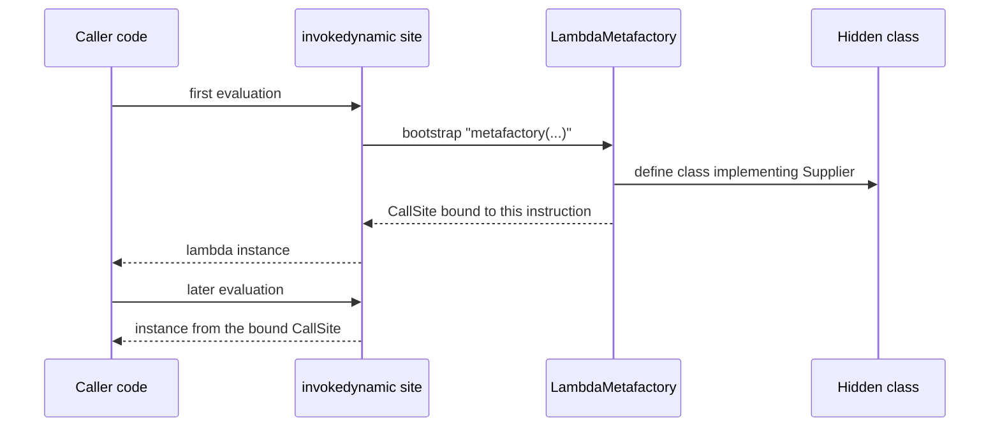

# 05. Lambdas, streams and `Optional`

> **What this covers:** functional programming in Java from the language up: functional interfaces, lambdas and method references, and how javac and the JVM compile and run them. Then the Stream API as interviews probe it: laziness and evaluation order, collectors, primitive streams, `reduce` vs `collect`, stream gatherers, parallel streams on the common `ForkJoinPool`, checked exceptions and resources inside pipelines, and `Optional` as a return type.
> **Prerequisites:** [03. Generics and type erasure § 2. Generic types, generic methods and type inference](03-java-generics.md#2-generic-types-generic-methods-and-type-inference), [§ 4. Wildcards, PECS and variance](03-java-generics.md#4-wildcards-pecs-and-variance), [04. Collections internals § 1. The Collections Framework](04-java-collections-internals.md#1-the-collections-framework-interfaces-contracts-and-sequenced-collections), [§ 8. Immutable, unmodifiable and fixed-size lists](04-java-collections-internals.md#8-immutable-unmodifiable-and-fixed-size-lists); also useful, [01. OOP fundamentals § 11. Nested types](01-java-oop-fundamentals.md#11-nested-types) for anonymous classes
> **Leads to:** [07. Modern language features](07-java-modern-language-features.md)
> **Applies to:** Java 25
> **Study time:** ~6 hours reading + ~4 hours exercises
> **Short on time:** [1. Functional interfaces and lambda expressions](#1-functional-interfaces-and-lambda-expressions), [4. Stream pipelines: laziness, short-circuiting and encounter order](#4-stream-pipelines-laziness-short-circuiting-and-encounter-order), [10. `Optional`: a return type for maybe-absent results](#10-optional-a-return-type-for-maybe-absent-results); questions [Q05.03](#q05-03), [Q05.10](#q05-10), [Q05.14](#q05-14), [Q05.24](#q05-24), [Q05.29](#q05-29); then [Summary](#summary).
> **Labs:** [`labs/java-language/`](../labs/java-language/), package `dev.interview.javalanguage.m05`. Run: `JAVA_HOME=$(/usr/libexec/java_home -v 25) mvn -q -f java-backend-guide/labs/pom.xml -pl java-language -am verify`. Needs Docker: no.

## Contents

1. [Functional interfaces and lambda expressions](#1-functional-interfaces-and-lambda-expressions)
2. [How lambdas compile and capture: `invokedynamic` and effectively final](#2-how-lambdas-compile-and-capture-invokedynamic-and-effectively-final)
3. [Method references](#3-method-references)
4. [Stream pipelines: laziness, short-circuiting and encounter order](#4-stream-pipelines-laziness-short-circuiting-and-encounter-order)
5. [Collectors: `toMap`, `groupingBy`, `teeing` and writing your own](#5-collectors-tomap-groupingby-teeing-and-writing-your-own)
6. [Primitive streams, `flatMap`, `mapMulti` and `reduce` vs `collect`](#6-primitive-streams-flatmap-mapmulti-and-reduce-vs-collect)
7. [Stream gatherers](#7-stream-gatherers)
8. [Parallel streams and the common `ForkJoinPool`](#8-parallel-streams-and-the-common-forkjoinpool)
9. [Checked exceptions and resources in lambdas and streams](#9-checked-exceptions-and-resources-in-lambdas-and-streams)
10. [`Optional`: a return type for maybe-absent results](#10-optional-a-return-type-for-maybe-absent-results)
- [Summary](#summary)
- [Question bank](#question-bank)
- [Hands-on exercises](#hands-on-exercises)
- [Check your understanding](#check-your-understanding)
- [Connections](#connections)

## 1. Functional interfaces and lambda expressions
### The problem it solves

A pricing service filters products with rules that change every quarter: "not blank", "not on the banned list", "in stock". Before Java 8 each rule was an anonymous class: five lines of `new Predicate<Product>() { @Override public boolean test(Product p) { … } }` around one line of logic. The rules were hard to read, so the team stopped composing them and wrote one long `if` chain inside the loop instead. Every new rule then meant editing that loop, and two quarters later nobody could say which conditions were still live. What was missing was a cheap way to pass *behavior* as a value: a rule you can name, store in a variable, hand to a method and combine with other rules.

### Mental model

A **lambda expression** is a function literal: parameters, an arrow and a body, `s -> s.isBlank()`. On its own it has no type. It becomes an object only when the code around it says which interface it must implement, the way a plug fits only once you know the socket. That socket is a **functional interface**: an interface with exactly one abstract method, the *functional method*. The lambda's parameters and result are matched to that one method, and the compiler checks the fit.

The JDK ships the common sockets in `java.util.function`. Each is named after its *function shape*, what goes in and what comes out:

| Interface | Shape | Where the JDK takes one |
|---|---|---|
| `Function<T, R>` | `T` → `R` | `Stream.map` |
| `Consumer<T>` | `T` → nothing | `Iterable.forEach` |
| `Supplier<T>` | nothing → `T` | `Optional.orElseGet` |
| `Predicate<T>` | `T` → `boolean` | `Stream.filter`, `Collection.removeIf` |
| `UnaryOperator<T>`, `BinaryOperator<T>` | `T` → `T`; (`T`, `T`) → `T` | `List.replaceAll`, `Stream.reduce` |
| `BiFunction<T, U, R>` | (`T`, `U`) → `R` | `Map.merge` (its remapping function) |

Each cell is a parameter type of that method in the Java 25 API, with wildcards left out ([Src: JDK 25, java.lang.Iterable](https://github.com/openjdk/jdk/blob/jdk-25-ga/src/java.base/share/classes/java/lang/Iterable.java) [Src: JDK 25, java.util.Collection](https://github.com/openjdk/jdk/blob/jdk-25-ga/src/java.base/share/classes/java/util/Collection.java) [Src: JDK 25, java.util.List](https://github.com/openjdk/jdk/blob/jdk-25-ga/src/java.base/share/classes/java/util/List.java) [Src: JDK 25, java.util.stream.Stream](https://github.com/openjdk/jdk/blob/jdk-25-ga/src/java.base/share/classes/java/util/stream/Stream.java) [Src: JDK 25, java.util.Optional](https://github.com/openjdk/jdk/blob/jdk-25-ga/src/java.base/share/classes/java/util/Optional.java) [Src: JDK 25, java.util.Map](https://github.com/openjdk/jdk/blob/jdk-25-ga/src/java.base/share/classes/java/util/Map.java)).

### How it actually works

**What makes an interface functional.** JLS §9.8 defines a functional interface as "an interface that is not declared `sealed` and has just one abstract method (aside from the methods of `Object`)" [Doc: JLS 25 §9.8](https://docs.oracle.com/javase/specs/jls/se25/html/jls-9.html#jls-9.8). Three kinds of member therefore do not count. Default methods have a body, so they are not abstract. Static methods are not instance methods at all. An abstract method with the signature of a public `Object` method, such as `boolean equals(Object)`, is already implemented by every class, which is why `Comparator` declares both `compare` and `equals` and is still functional [Doc: JLS 25 §9.8](https://docs.oracle.com/javase/specs/jls/se25/html/jls-9.html#jls-9.8). In the lab, an interface with one abstract `test`, a redeclared `equals` and `toString`, a default and a static method accepts a lambda [Lab: FunctionalInterfaceRulesTest](../labs/java-language/src/test/java/dev/interview/javalanguage/m05/s01/FunctionalInterfaceRulesTest.java). The exemption covers only *public* `Object` methods: declaring `Object clone()` in an interface adds a second abstract method, because `Object.clone` is protected, and the lab's lambda for such an interface fails with `compiler.err.prob.found.req`. A `sealed` interface with one abstract method is not functional either; the same key appears [Lab: FunctionalInterfaceRulesTest](../labs/java-language/src/test/java/dev/interview/javalanguage/m05/s01/FunctionalInterfaceRulesTest.java).

**`@FunctionalInterface` is a check, not a switch.** The annotation tells the compiler to report an error unless the annotated type is an interface that meets the definition; "the compiler will treat any interface meeting the definition of a functional interface as a functional interface regardless of whether or not a `FunctionalInterface` annotation is present" [Src: JDK 25, java.lang.FunctionalInterface](https://github.com/openjdk/jdk/blob/jdk-25-ga/src/java.base/share/classes/java/lang/FunctionalInterface.java). In the lab, annotating an interface with two abstract methods fails with `compiler.err.bad.functional.intf.anno.1` [Lab: FunctionalInterfaceRulesTest](../labs/java-language/src/test/java/dev/interview/javalanguage/m05/s01/FunctionalInterfaceRulesTest.java). Its value is protection against a later edit: someone who adds a second abstract method gets an error at the interface, not at every lambda that used it. `Runnable` (`@since 1.0`), `Callable` (1.5) and `Comparator` (1.2) predate Java 8 and carry the annotation today [Src: JDK 25, java.lang.Runnable](https://github.com/openjdk/jdk/blob/jdk-25-ga/src/java.base/share/classes/java/lang/Runnable.java) [Src: JDK 25, java.util.concurrent.Callable](https://github.com/openjdk/jdk/blob/jdk-25-ga/src/java.base/share/classes/java/util/concurrent/Callable.java) [Src: JDK 25, java.util.Comparator](https://github.com/openjdk/jdk/blob/jdk-25-ga/src/java.base/share/classes/java/util/Comparator.java).

**Target typing.** "Lambda expressions are always poly expressions": their type comes from the context, and a lambda may appear only in an assignment, invocation or casting context [Doc: JLS 25 §15.27](https://docs.oracle.com/javase/specs/jls/se25/html/jls-15.html#jls-15.27). The type the context supplies is the *target type*; the lambda is compatible with it when the target is a functional interface and the lambda's parameters, result and thrown exceptions fit its function type (JLS calls this *congruent*) [Doc: JLS 25 §15.27.3](https://docs.oracle.com/javase/specs/jls/se25/html/jls-15.html#jls-15.27.3). Three lab results follow from that rule [Lab: FunctionalInterfaceRulesTest](../labs/java-language/src/test/java/dev/interview/javalanguage/m05/s01/FunctionalInterfaceRulesTest.java):
- the same text `() -> "ready"` compiles as a `Supplier<String>` and as a `Callable<String>`, two unrelated interfaces with the same shape;
- `Object task = () -> {}` fails with `compiler.err.prob.found.req`, because `Object` is not a functional interface;
- `var same = (String s) -> s` fails with `compiler.err.cant.infer.local.var.type`, because `var` asks the initializer for a type and the lambda has none to give ([Q05.02](#q05-02) drills it; `var` itself is [03 §2](03-java-generics.md#2-generic-types-generic-methods-and-type-inference)).

Generic targets such as `Function<? super T, ? extends R>` are resolved by the inference rules of [03 §2](03-java-generics.md#2-generic-types-generic-methods-and-type-inference) and [03 §4](03-java-generics.md#4-wildcards-pecs-and-variance).

**The `java.util.function` families.** The package names four basic shapes, `Function`, `Consumer`, `Predicate` and `Supplier`, then modifies them with prefixes: an arity prefix (`BiFunction`), derived shapes (`UnaryOperator` extends `Function`, `BinaryOperator` extends `BiFunction`), and primitive specializations, where `ToXxx` specializes the result (`ToIntFunction<T>`), `Xxx` specializes arguments left to right (`IntPredicate`, `DoubleConsumer`) and `Obj` skips one (`ObjIntConsumer<T>`) [Doc: Java 25 API, java.util.function](https://docs.oracle.com/en/java/javase/25/docs/api/java.base/java/util/function/package-summary.html). The primitive forms exist so that a lambda over `int` values does not box each one into an `Integer` ([01 §13](01-java-oop-fundamentals.md#13-wrappers-autoboxing-and-the-integer-cache) covers boxing; [§6](#6-primitive-streams-flatmap-mapmulti-and-reduce-vs-collect) shows it in streams). The package is not a complete set: "other functional interfaces provided for specific purposes, such as `FileFilter`, are defined in the packages where they are used" [Doc: Java 25 API, java.util.function](https://docs.oracle.com/en/java/javase/25/docs/api/java.base/java/util/function/package-summary.html). Declare your own interface when the domain deserves a name (`PricingRule`) or a checked exception ([§9](#9-checked-exceptions-and-resources-in-lambdas-and-streams)).

**Composition.** The families carry default methods that build new functions from old ones. `f.andThen(g)` applies `f` first and then `g`; `f.compose(g)` applies `g` first [Src: JDK 25, java.util.function.Function](https://github.com/openjdk/jdk/blob/jdk-25-ga/src/java.base/share/classes/java/util/function/Function.java). In the lab, with `plusOne` and `twice`, `plusOne.andThen(twice).apply(3)` is 8 and `plusOne.compose(twice).apply(3)` is 7 [Lab: TextRulesTest](../labs/java-language/src/test/java/dev/interview/javalanguage/m05/s01/TextRulesTest.java). `Predicate.and` and `or` short-circuit: "if this predicate is `false`, then the `other` predicate is not evaluated" [Src: JDK 25, java.util.function.Predicate](https://github.com/openjdk/jdk/blob/jdk-25-ga/src/java.base/share/classes/java/util/function/Predicate.java), and the lab records only the first call [Lab: TextRulesTest](../labs/java-language/src/test/java/dev/interview/javalanguage/m05/s01/TextRulesTest.java). `negate()` inverts an existing predicate, and the static `Predicate.not(p)` (`@since 11`) does the same for a predicate written inline [Src: JDK 25, java.util.function.Predicate](https://github.com/openjdk/jdk/blob/jdk-25-ga/src/java.base/share/classes/java/util/function/Predicate.java). Combining small rules this way is the Strategy pattern without a class per strategy ([51](51-design-principles-and-patterns.md) names the pattern).

**Lambda vs anonymous class.** Both produce an object that implements an interface, but they differ in what the body sees:
- **`this` and names.** "Unlike code appearing in anonymous class declarations, the meaning of names and the `this` and `super` keywords appearing in a lambda body … are the same as in the surrounding context" [Doc: JLS 25 §15.27.2](https://docs.oracle.com/javase/specs/jls/se25/html/jls-15.html#jls-15.27.2). In the lab, `this.toString()` inside a lambda returns the enclosing `Greeter`'s text, and inside an anonymous class it returns the anonymous object's own [Lab: LambdaVsAnonymousTest](../labs/java-language/src/test/java/dev/interview/javalanguage/m05/s01/LambdaVsAnonymousTest.java).
- **Scope.** A lambda opens no new naming level. A lambda parameter or a local in its body may not reuse the name of a local still in scope ([Doc: JLS 25 §6.4](https://docs.oracle.com/javase/specs/jls/se25/html/jls-6.html#jls-6.4); in the lab, `int x = 1; IntUnaryOperator next = x -> x + 1;` fails with `compiler.err.already.defined` [Lab: FunctionalInterfaceRulesTest](../labs/java-language/src/test/java/dev/interview/javalanguage/m05/s01/FunctionalInterfaceRulesTest.java)). An anonymous class body is a class, so it may shadow freely.
- **State and reach.** An anonymous class may declare fields, extend a class, and implement an interface with several abstract methods. A lambda can only implement one functional interface and has no fields of its own; in the lab, an anonymous `Supplier<Integer>` with a `calls` field returns 1, 2, 3 on successive calls [Lab: LambdaVsAnonymousTest](../labs/java-language/src/test/java/dev/interview/javalanguage/m05/s01/LambdaVsAnonymousTest.java).
- **What they capture and compile to.** An anonymous class declared in an instance method keeps a reference to the enclosing instance, which is how listeners leak ([01 §11](01-java-oop-fundamentals.md#11-nested-types), [Q01.26](01-java-oop-fundamentals.md#q01-26)). A lambda captures `this` only if its body uses it, and it is not compiled into a class of its own; [§2](#2-how-lambdas-compile-and-capture-invokedynamic-and-effectively-final) shows both.

Lambdas arrived in Java 8 with JEP 126, which added "lambda expressions (closures) and supporting features, including method references, enhanced type inference, and virtual extension methods" (the default methods above) [Doc: JEP 126](https://openjdk.org/jeps/126).

### Code

The approach: express each tag rule as a small lambda, then combine the rules with the default methods instead of writing one method full of conditions.

1. Write `normalizer()` as two one-line `Function`s joined with `andThen`, so the order (strip, then lower-case) is visible.
2. Write each rejection rule as a `Predicate`, and invert them with `Predicate.not` and `negate()` rather than with `!` inside the lambda.
3. Join the rules with `and`, which short-circuits.
4. Return a lambda that normalizes first and tests second, so callers pass raw input.

```java
// Excerpt of labs/java-language/src/main/java/dev/interview/javalanguage/m05/s01/TextRules.java
    public static Function<String, String> normalizer() {
        Function<String, String> strip = s -> s.strip();
        Function<String, String> lower = s -> s.toLowerCase(Locale.ROOT);
        return strip.andThen(lower);
    }

    public static Predicate<String> acceptedTag(Set<String> banned) {
        Predicate<String> blank = s -> s.isBlank();
        Predicate<String> isBanned = s -> banned.contains(s);
        Predicate<String> rule = Predicate.not(blank).and(isBanned.negate());
        Function<String, String> normalize = normalizer();
        return tag -> rule.test(normalize.apply(tag));
    }
```

`TextRulesTest` checks that `"  Java "` is accepted, `" SPAM"` is rejected against the banned set `{"spam"}`, and a blank tag is rejected. The lambdas here could be method references (`String::strip`); [§3](#3-method-references) covers when that reads better.

The `this` difference, side by side. The approach: return the same "describe yourself" request once as a lambda and once as an anonymous class, and let `toString` reveal which object `this` is.

```java
// Excerpt of labs/java-language/src/main/java/dev/interview/javalanguage/m05/s01/Greeter.java
    // In a lambda body, this is the Greeter that created the lambda.
    public Supplier<String> lambdaThis() {
        return () -> this.toString();
    }

    // In an anonymous class body, this is the anonymous object itself.
    public Supplier<String> anonymousThis() {
        return new Supplier<>() {
            @Override
            public String get() {
                return this.toString();
            }

            @Override
            public String toString() {
                return "anonymous supplier";
            }
        };
    }
```

For `new Greeter("Ada")`, the first supplier returns `"Greeter for Ada"` and the second `"anonymous supplier"` [Lab: LambdaVsAnonymousTest](../labs/java-language/src/test/java/dev/interview/javalanguage/m05/s01/LambdaVsAnonymousTest.java).

#### Legacy

Code written before Java 8, and some still written today, passes behavior as anonymous classes. The conversion is mechanical when the anonymous class implements a functional interface, declares no fields and does not use `this` to mean itself: keep the parameter list and the body, drop the rest.

```java
// Excerpt of labs/java-language/src/main/java/dev/interview/javalanguage/m05/s01/LengthOrder.java
    public static final Comparator<String> ANONYMOUS = new Comparator<String>() {
        @Override
        public int compare(String a, String b) {
            return Integer.compare(a.length(), b.length());
        }
    };

    public static final Comparator<String> LAMBDA = (a, b) -> Integer.compare(a.length(), b.length());
```

Both sort `["stream", "map", "lambda", "of"]` into `["of", "map", "stream", "lambda"]` [Lab: LengthOrderTest](../labs/java-language/src/test/java/dev/interview/javalanguage/m05/s01/LengthOrderTest.java). When the body uses `this`, a field of the anonymous class, or an abstract class as its supertype, the conversion changes behavior or does not compile, so leave those as classes (`Comparator` itself is [02 §4](02-java-equality-immutability-records.md#4-ordering-comparable-and-comparator)'s subject; `Comparator.comparingInt(String::length)` is the idiomatic form there).

### Failure modes and operations

A lambda fails the way its body fails; this section has no runtime behavior of its own beyond that. What it costs to create and run one, and how it holds on to captured objects, is [§2](#2-how-lambdas-compile-and-capture-invokedynamic-and-effectively-final); what lambdas cost inside streams is [§6](#6-primitive-streams-flatmap-mapmulti-and-reduce-vs-collect) and [§8](#8-parallel-streams-and-the-common-forkjoinpool).

> [!NOTE]
> **Version notes.** Java 8: lambda expressions, method references and default methods [Final since Java 8, JEP 126] [Doc: JEP 126](https://openjdk.org/jeps/126); `java.util.function` and `@FunctionalInterface` are `@since 1.8` [Src: JDK 25, java.lang.FunctionalInterface](https://github.com/openjdk/jdk/blob/jdk-25-ga/src/java.base/share/classes/java/lang/FunctionalInterface.java) [Doc: Java 25 API, java.util.function](https://docs.oracle.com/en/java/javase/25/docs/api/java.base/java/util/function/package-summary.html); older interfaces with one abstract method, such as `Runnable` and `Comparator`, accept lambdas without changes. Java 11: `Predicate.not` [Src: JDK 25, java.util.function.Predicate](https://github.com/openjdk/jdk/blob/jdk-25-ga/src/java.base/share/classes/java/util/function/Predicate.java). Java 17: `sealed` interfaces [Final since Java 17, JEP 409] [Doc: JEP 409](https://openjdk.org/jeps/409), which JLS §9.8 excludes from being functional [Doc: JLS 25 §9.8](https://docs.oracle.com/javase/specs/jls/se25/html/jls-9.html#jls-9.8) (sealed types are [07](07-java-modern-language-features.md)'s subject).

### Best practices and anti-patterns

- Prefer a `java.util.function` type when one fits the shape, because every reader and every JDK method already knows it; declare your own interface when the concept deserves a domain name or needs a checked exception, because `Function` cannot declare one ([§9](#9-checked-exceptions-and-resources-in-lambdas-and-streams)).
- Annotate your own functional interfaces with `@FunctionalInterface`, because a later second abstract method then fails at the interface instead of at every lambda that targets it.
- Use the primitive specializations (`IntPredicate`, `ToLongFunction<T>`) on hot paths over numbers, because the generic forms box every value.
- Keep lambda bodies to an expression or a few statements, and move longer logic into a named method, because a stack trace or a code review then points at a name, not at `lambda$…` ([§2](#2-how-lambdas-compile-and-capture-invokedynamic-and-effectively-final)).
- Combine rules with `and`, `or`, `negate`, `Predicate.not`, `andThen` and `compose` instead of nesting conditions inside one lambda, because each rule stays testable on its own.
- Do not convert an anonymous class to a lambda when its body uses `this` to mean itself or keeps a field, because the lambda's `this` is the enclosing object and it cannot hold state.

### Misconceptions and traps

- *"A functional interface can have only one method."* It can have any number of default and static methods and may redeclare public `Object` methods; only the count of other abstract methods is limited to one [Doc: JLS 25 §9.8](https://docs.oracle.com/javase/specs/jls/se25/html/jls-9.html#jls-9.8) [Lab: FunctionalInterfaceRulesTest](../labs/java-language/src/test/java/dev/interview/javalanguage/m05/s01/FunctionalInterfaceRulesTest.java). The shorthand comes from the informal phrase "single-method interface", used before Java 8 added default methods.
- *"`@FunctionalInterface` is what makes an interface functional."* Any interface that meets the definition is functional; the annotation only asks the compiler to check it [Src: JDK 25, java.lang.FunctionalInterface](https://github.com/openjdk/jdk/blob/jdk-25-ga/src/java.base/share/classes/java/lang/FunctionalInterface.java). The belief exists because every interface in `java.util.function` carries it.
- *"A lambda is shorter syntax for an anonymous class."* `this`, name scope and state differ ([Doc: JLS 25 §15.27.2](https://docs.oracle.com/javase/specs/jls/se25/html/jls-15.html#jls-15.27.2) [Lab: LambdaVsAnonymousTest](../labs/java-language/src/test/java/dev/interview/javalanguage/m05/s01/LambdaVsAnonymousTest.java)), and the compiled form differs too ([§2](#2-how-lambdas-compile-and-capture-invokedynamic-and-effectively-final)). The idea comes from IDEs that offer "replace with lambda" on anonymous classes, which works for the common case.
- *"A lambda has a type, so `var f = x -> x` should work."* A lambda takes its type from the target, and `var` provides none [Doc: JLS 25 §15.27](https://docs.oracle.com/javase/specs/jls/se25/html/jls-15.html#jls-15.27) [Lab: FunctionalInterfaceRulesTest](../labs/java-language/src/test/java/dev/interview/javalanguage/m05/s01/FunctionalInterfaceRulesTest.java). The expectation comes from languages where function literals have function types of their own.
- *"`f.andThen(g)` and `f.compose(g)` are the same thing written two ways."* They apply the functions in opposite orders [Lab: TextRulesTest](../labs/java-language/src/test/java/dev/interview/javalanguage/m05/s01/TextRulesTest.java). The mix-up comes from mathematics, where `g ∘ f` is read right to left.

Questions that drill this section: [Q05.01](#q05-01), [Q05.02](#q05-02), [Q05.03](#q05-03), [Q05.04](#q05-04).

## 2. How lambdas compile and capture: `invokedynamic` and effectively final
### The problem it solves

A reporting job counts the words in each document that are at least six characters long. The first version wrote `int count = 0; words.forEach(w -> { if (w.length() >= 6) count++; });` and javac refused it with "local variables referenced from a lambda expression must be final or effectively final" (javac 25's wording; the lab asserts the diagnostic key). Someone found the classic workaround, `int[] count = {0}` with `count[0]++` inside the lambda. It compiled, the tests passed, and the job shipped. Months later a colleague switched `stream()` to `parallelStream()` to speed up large documents, and the nightly totals started to come out slightly low, by a different amount each night. Nothing failed, and no test caught it, because the tests ran on small sequential inputs. The rule javac enforced was protecting exactly this case. Getting past it without understanding what a lambda captures, and why, turned a compile error into silent data loss.

### Mental model

Think of a lambda as a sealed envelope created at the moment the lambda expression is *evaluated*. The body's code is already printed on the envelope's form. The values of the local variables it uses are copied into the envelope at that moment, and nothing outside can reach them afterwards. A field is different: the envelope holds a copy of `this`, the address of the owning object, so each call goes to that address and reads the field as it is now. Because locals are copied, the language insists they never change; a variable that kept changing after the copy would make the envelope lie about it.

On the compiler side, javac does not build the envelope's class at all. It leaves two things in the class file: the body, as a private method of the enclosing class, and an `invokedynamic` instruction that holds a recipe ("implement `Supplier.get` by calling this method"). The JVM follows the recipe the first time that instruction runs, defines the class in memory, and from then on reuses what it built.



What to notice: the bootstrap and the class definition happen once per call site, the first time it runs, not once per evaluation; every later evaluation only invokes the call site that is already bound [Doc: JVMS 25 §6.5 invokedynamic](https://docs.oracle.com/javase/specs/jvms/se25/html/jvms-6.html#jvms-6.5.invokedynamic) [Src: JDK 25, java.lang.invoke.LambdaMetafactory](https://github.com/openjdk/jdk/blob/jdk-25-ga/src/java.base/share/classes/java/lang/invoke/LambdaMetafactory.java).

### How it actually works

**What javac emits.** For a class `Shapes` with one method `ready()` returning `() -> "ready"`, the lab compiles the source in memory and reads the bytes with the Class-File API [Lab: CompiledFormTest](../labs/java-language/src/test/java/dev/interview/javalanguage/m05/s02/CompiledFormTest.java):
- javac writes one class file, `Shapes`; there is no class for the lambda;
- the lambda body is a method of `Shapes` whose name starts with `lambda$`, flagged `private`, `static` and synthetic;
- `ready()` contains one `invokedynamic` instruction whose bootstrap method is `java.lang.invoke.LambdaMetafactory.metafactory`.

The synthetic flag is required: "a construct emitted by a Java compiler must be marked as synthetic if it does not correspond to a construct declared explicitly or implicitly in source code" [Doc: JLS 25 §13.1](https://docs.oracle.com/javase/specs/jls/se25/html/jls-13.html#jls-13.1). The name itself is not specified: the JLS requires only the synthetic flag, and everything after `lambda$` is javac's own choice, so the lab asserts only the prefix and no code should depend on the rest. An anonymous class, by contrast, is an ordinary nested class: the same lab compiles a method that returns `new Runnable() { … }` into two class files, `Shapes` and `Shapes$1`, with no `invokedynamic` and no `lambda$` method [Lab: CompiledFormTest](../labs/java-language/src/test/java/dev/interview/javalanguage/m05/s02/CompiledFormTest.java).

**`invokedynamic` and the call site.** `invokedynamic` is the one invoke instruction that names no method. Its constant-pool entry is "a symbolic reference to a dynamically-computed call site", which the JVM resolves "for this specific `invokedynamic` instruction to obtain a reference to an instance of `java.lang.invoke.CallSite`"; that `CallSite` is then "bound" to the instruction, and each execution invokes its target method handle [Doc: JVMS 25 §6.5 invokedynamic](https://docs.oracle.com/javase/specs/jvms/se25/html/jvms-6.html#jvms-6.5.invokedynamic). Resolution runs the bootstrap method named in the entry. For lambdas and method references that is a method of `LambdaMetafactory`, whose Javadoc splits the work into three phases [Src: JDK 25, java.lang.invoke.LambdaMetafactory](https://github.com/openjdk/jdk/blob/jdk-25-ga/src/java.base/share/classes/java/lang/invoke/LambdaMetafactory.java):
- **linkage**, when the bootstrap runs: it "may involve dynamically loading a new class that implements the target interface", and returns a `CallSite` that acts as a factory for function objects;
- **capture**, each time the call site's target is invoked: it produces a function object, and "may involve allocation of a new function object, or may return a suitable existing function object";
- **invocation**, each time the interface method is called on that object.

Evaluating a lambda expression is capture; calling `get()` on the result is invocation [Src: JDK 25, java.lang.invoke.LambdaMetafactory](https://github.com/openjdk/jdk/blob/jdk-25-ga/src/java.base/share/classes/java/lang/invoke/LambdaMetafactory.java).

**The class the JDK builds is hidden.** In JDK 25 the linkage work is done by `InnerClassLambdaMetafactory`. It generates the class's bytes, names it after the capturing class plus `$$Lambda`, and defines it as a hidden class with the `NESTMATE_CLASS` option, which puts it in the capturing class's nest so its method may call the private `lambda$` method; each captured value becomes a `private final` field of that class [Src: JDK 25, java.lang.invoke.InnerClassLambdaMetafactory](https://github.com/openjdk/jdk/blob/jdk-25-ga/src/java.base/share/classes/java/lang/invoke/InnerClassLambdaMetafactory.java). Hidden classes came with JEP 371, whose motivation uses exactly this case: "javac does not translate a lambda expression into a dedicated class file at compile time but, rather, emits bytecode that dynamically generates and instantiates a class to yield an object corresponding to the lambda expression when needed" [Doc: JEP 371](https://openjdk.org/jeps/371). In the lab, a lambda's `getClass().isHidden()` is `true` and its name contains `$$Lambda`, while the anonymous class's is `false`, with `isAnonymousClass()` `true` and a name ending in `$1` [Lab: LambdaRuntimeTest](../labs/java-language/src/test/java/dev/interview/javalanguage/m05/s02/LambdaRuntimeTest.java).

**Capture is the call site's arguments.** What a lambda captures becomes the parameter list of its `invokedynamic` instruction: capture passes those values in, and the generated class stores them in its fields [Src: JDK 25, java.lang.invoke.InnerClassLambdaMetafactory](https://github.com/openjdk/jdk/blob/jdk-25-ga/src/java.base/share/classes/java/lang/invoke/InnerClassLambdaMetafactory.java). The lab compiles three lambdas in one class and reads each call site's type [Lab: CompiledFormTest](../labs/java-language/src/test/java/dev/interview/javalanguage/m05/s02/CompiledFormTest.java):
- `() -> 1` takes no arguments;
- `() -> n`, where `n` is a method parameter, takes one `int`;
- `() -> base`, where `base` is an instance field, takes one `Shapes`: the lambda captured `this`, not the field.

The same test shows the body method of the field-reading lambda is an instance method, while the other two are `static` [Lab: CompiledFormTest](../labs/java-language/src/test/java/dev/interview/javalanguage/m05/s02/CompiledFormTest.java). This is the precise sense of [§1](#1-functional-interfaces-and-lambda-expressions)'s "a lambda captures `this` only if its body uses it", and the reason a lambda that reads one field keeps its whole owner reachable.

**Identity is not part of the contract.** JLS §15.27.4 says that evaluating a lambda expression either allocates a new instance "or an existing instance … is referenced", so "the identity of the result of evaluating a lambda expression … is unpredictable", and `==`, `synchronized` and `System.identityHashCode` "may produce different results in different implementations … or even upon different lambda expression evaluations in the same implementation" [Doc: JLS 25 §15.27.4](https://docs.oracle.com/javase/specs/jls/se25/html/jls-15.html#jls-15.27.4). What JDK 25 happens to do: for a call site with no captured values, `InnerClassLambdaMetafactory` creates one instance during linkage and binds a constant call site to it ("for a non-capturing lambda, we optimize linkage by pre-computing a single instance") [Src: JDK 25, java.lang.invoke.InnerClassLambdaMetafactory](https://github.com/openjdk/jdk/blob/jdk-25-ga/src/java.base/share/classes/java/lang/invoke/InnerClassLambdaMetafactory.java). In the lab, two calls to a method returning `() -> {}` return the same object, while two calls to a method returning `() -> value` return two objects of one class [Lab: LambdaRuntimeTest](../labs/java-language/src/test/java/dev/interview/javalanguage/m05/s02/LambdaRuntimeTest.java). Treat both results as an implementation detail: never lock on a lambda, never key an identity map by one, and never expect `removeListener(x -> …)` to find a listener registered with an identical-looking lambda.

**Effectively final.** JLS §15.27.2: "any local variable, formal parameter, or exception parameter used but not declared in a lambda expression must either be final or effectively final", and it must be definitely assigned before the lambda body [Doc: JLS 25 §15.27.2](https://docs.oracle.com/javase/specs/jls/se25/html/jls-15.html#jls-15.27.2). A local declared with an initializer is effectively final when it is not declared `final`, never appears on the left of an assignment, and is never the operand of `++` or `--`. A local declared without an initializer qualifies if every assignment to it happens while it is still definitely unassigned, so a single assignment after the declaration is fine. Parameters count as locals with an initializer. The test is simple to apply: if adding `final` would not cause a compile error, the variable is effectively final [Doc: JLS 25 §4.12.4](https://docs.oracle.com/javase/specs/jls/se25/html/jls-4.html#jls-4.12.4). In the lab, each of these fails with `compiler.err.cant.ref.non.effectively.final.var` [Lab: CaptureRulesTest](../labs/java-language/src/test/java/dev/interview/javalanguage/m05/s02/CaptureRulesTest.java):
- capturing a local reassigned before the lambda;
- capturing one that is incremented after the lambda, even though the lambda never sees the change;
- incrementing the captured local inside the lambda;
- capturing the index of a classic `for` loop.

An anonymous class that reads a reassigned local fails with the same key, because "similar rules on variable use apply in the body of an inner class" [Doc: JLS 25 §15.27.2](https://docs.oracle.com/javase/specs/jls/se25/html/jls-15.html#jls-15.27.2). Three captures compile [Lab: CaptureRulesTest](../labs/java-language/src/test/java/dev/interview/javalanguage/m05/s02/CaptureRulesTest.java). The variable of an enhanced `for` loop can be captured, because it is "treated as distinct for each iteration" [Doc: JLS 25 §15.27.2](https://docs.oracle.com/javase/specs/jls/se25/html/jls-15.html#jls-15.27.2). A local declared first and assigned once later can be captured. So can a `List` that the lambda adds to, because the rule is about the variable, not the object it points to.

**Why the rule exists.** The JLS gives the reason itself: the restriction "prohibits access to dynamically-changing local variables, whose capture would likely introduce concurrency problems", and requiring only *effectively* final, rather than `final`, "reduces the clerical burden on programmers" [Doc: JLS 25 §15.27.2](https://docs.oracle.com/javase/specs/jls/se25/html/jls-15.html#jls-15.27.2). The mechanism above explains the shape of the rule. A captured local is copied into the lambda object when the lambda is evaluated, and the lambda may run later, on another thread, after the method that declared the local has returned and its stack frame is gone. If the variable could change after the copy, the lambda would silently see a stale value; forbidding the change makes the copy indistinguishable from the variable. A field has no such problem, because the lambda reaches it through `this` at every call. In the lab, after `tag.reprice(1_250)`, a lambda reading the `cents` field returns 1 250, while a lambda that captured a local copy of it returns the original 1 000 [Lab: CaptureBehaviorTest](../labs/java-language/src/test/java/dev/interview/javalanguage/m05/s02/CaptureBehaviorTest.java).

**The workarounds, and why they are a smell.** Wrapping the counter in something mutable, `int[] count = {0}` or an `AtomicInteger`, satisfies the compiler because the variable no longer changes; the object it refers to does. That reintroduces precisely what the rule was keeping out: state shared between the lambda and its surroundings. The lab counts long words three ways [Lab: CaptureBehaviorTest](../labs/java-language/src/test/java/dev/interview/javalanguage/m05/s02/CaptureBehaviorTest.java):
- sequentially, the array holder and the stream's own `count()` agree;
- over a parallel stream of 20 000 words, the array holder's `count[0]++` is an unsynchronized read-modify-write from several threads, so the test can only assert the permitted range, 1 to 20 000, because whether updates are lost depends on scheduling;
- the `AtomicInteger` and the `filter(…).count()` versions return exactly 20 000.

The atomic version is correct but still a side effect, and every matching element updates one shared counter [Lab: CaptureBehaviorTest](../labs/java-language/src/test/java/dev/interview/javalanguage/m05/s02/CaptureBehaviorTest.java). The stream version keeps the lambda a pure question about one element and lets the stream do the counting. The language allows side effects in lambda bodies. Whether a particular stream operation tolerates them is the stream contract's business, covered by [§4](#4-stream-pipelines-laziness-short-circuiting-and-encounter-order) (non-interference and stateless behavior) and [§8](#8-parallel-streams-and-the-common-forkjoinpool) (parallel execution). Why the unsynchronized increment loses updates is [11](11-concurrency-threads-and-jmm.md)'s subject.

**Serializable lambdas.** A lambda is serializable only when its target type is: "if the targeted functional interface type is a subtype of `java.io.Serializable`, the resulting object will automatically be an instance of a serializable class", and the JLS notes this is not the default because it "can have extra run time overhead and security implications" [Doc: JLS 25 §15.27.4](https://docs.oracle.com/javase/specs/jls/se25/html/jls-15.html#jls-15.27.4). The usual way to ask for it is an intersection cast, `(Runnable & Serializable) () -> {}`. In the lab, that call site's bootstrap becomes `LambdaMetafactory.altMetafactory`, and javac adds a `$deserializeLambda$` method to the capturing class, which contains its own `altMetafactory` call site to rebuild the lambda on the way back in [Lab: CompiledFormTest](../labs/java-language/src/test/java/dev/interview/javalanguage/m05/s02/CompiledFormTest.java). The serialized form is a `SerializedLambda` holding the interface method, the implementation method and the captured values, and its `readResolve` calls the capturing class's `$deserializeLambda$`, which is "responsible for validating that the properties of the `SerializedLambda` are consistent with a lambda actually captured by that class" [Src: JDK 25, java.lang.invoke.SerializedLambda](https://github.com/openjdk/jdk/blob/jdk-25-ga/src/java.base/share/classes/java/lang/invoke/SerializedLambda.java) [Src: JDK 25, java.lang.invoke.LambdaMetafactory](https://github.com/openjdk/jdk/blob/jdk-25-ga/src/java.base/share/classes/java/lang/invoke/LambdaMetafactory.java). The bytes therefore name a compiler-generated method of one compiled class, and everything that makes Java serialization risky applies to them as well ([06](06-java-exceptions-strings-io.md) covers serialization and deserialization filters).

### Code

The approach: keep the two kinds of capture side by side in one small class, so the difference between "reads the field now" and "remembers the value then" is visible in the code rather than explained.

1. Give the class a mutable field, `cents`, and a method that changes it.
2. Return a lambda that reads the field: it captures `this`.
3. Copy the field into a local first and return a lambda that reads the local: it captures the value.

```java
// Excerpt of labs/java-language/src/main/java/dev/interview/javalanguage/m05/s02/PriceTag.java
    // Captures this: every call reads the field as it is at that moment.
    public IntSupplier currentPrice() {
        return () -> cents;
    }

    // Captures a copy of the local: the value it had when the lambda was evaluated.
    public IntSupplier priceAtCreation() {
        int snapshot = cents;
        return () -> snapshot;
    }
```

`CaptureBehaviorTest` creates both suppliers for a price of 1 000, reprices to 1 250, and gets 1 250 and 1 000.

The counting job from the problem statement, before and after. The approach: replace the mutable holder with a stream that computes the count, so the lambda answers one question about one element and shares nothing.

1. Keep the array-holder version only as the anti-pattern the test compares against.
2. Move the condition into `filter`, so the lambda is a `Predicate` with no side effect.
3. Let the terminal operation `count()` produce the result, sequential or parallel.

```java
// Excerpt of labs/java-language/src/main/java/dev/interview/javalanguage/m05/s02/WordTally.java
    // Anti-pattern: a one-element array smuggles a mutable counter past the effectively final rule.
    public static int countWithArrayHolder(Stream<String> words, int minLength) {
        int[] count = {0};
        words.forEach(word -> {
            if (word.length() >= minLength) {
                count[0]++;
            }
        });
        return count[0];
    }

    // The stream owns the counting; the lambda only answers a question about one element.
    public static long countWithStream(Stream<String> words, int minLength) {
        return words.filter(word -> word.length() >= minLength).count();
    }
```

For `["map", "filter", "reduce", "of", "collect"]` and a minimum of six, both return 3; on a parallel stream only `countWithStream` and the `AtomicInteger` variant in the same file are guaranteed to be exact [Lab: CaptureBehaviorTest](../labs/java-language/src/test/java/dev/interview/javalanguage/m05/s02/CaptureBehaviorTest.java). To see the compiled form yourself, `javap -c -p` on a compiled class lists the `invokedynamic` instructions and the private `lambda$…` methods; the lab reads the same information with `java.lang.classfile` [Final since Java 24, JEP 484] [Doc: JEP 484](https://openjdk.org/jeps/484) in its test helper [`ClassFileView`](../labs/java-language/src/test/java/dev/interview/javalanguage/m05/support/ClassFileView.java).

### Failure modes and operations

**First-call linkage.** Each lambda call site pays for linkage the first time it runs: the bootstrap call, generating the class bytes, and defining a hidden class [Src: JDK 25, java.lang.invoke.LambdaMetafactory](https://github.com/openjdk/jdk/blob/jdk-25-ga/src/java.base/share/classes/java/lang/invoke/LambdaMetafactory.java) [Src: JDK 25, java.lang.invoke.InnerClassLambdaMetafactory](https://github.com/openjdk/jdk/blob/jdk-25-ga/src/java.base/share/classes/java/lang/invoke/InnerClassLambdaMetafactory.java). Later evaluations of that site skip all of it. A large application with thousands of distinct lambda and method-reference sites does that work during startup and warm-up, not on every request, so it shows up in startup time and in the first requests that reach each code path after a deploy, rather than in steady-state latency. Measuring and reducing startup cost is [10](10-jvm-performance-and-troubleshooting.md)'s subject.

**Captured `this` keeps the owner alive.** A lambda that reads a field captures the whole enclosing object ([Lab: CompiledFormTest](../labs/java-language/src/test/java/dev/interview/javalanguage/m05/s02/CompiledFormTest.java): its call site takes a `Shapes`). Registered as a listener on a longer-lived object, an event bus or a static registry, it keeps that owner reachable for as long as the registration lasts. That is the same leak as an anonymous listener ([01 §11](01-java-oop-fundamentals.md#11-nested-types), [Q01.26](01-java-oop-fundamentals.md#q01-26)), only less visible, because the lambda's text does not show `this`. In a heap dump, the path to the leaked owner runs through a field of a `…$$Lambda/0x…` class; [08](08-jvm-memory-and-class-loading.md) covers reading the path to GC roots.

**Reading stack traces.** An exception thrown inside a lambda body shows the body as a frame of the capturing class with a `lambda$` method name, followed by the method that called the functional interface; the frame of the hidden class's own method is left out. JEP 371: "methods of hidden classes are not shown in stack traces by default", and `Throwable::getStackTrace` omits them unless the JVM runs with `-XX:+UnlockDiagnosticVMOptions -XX:+ShowHiddenFrames` [Doc: JEP 371](https://openjdk.org/jeps/371). In the lab, a stack trace captured inside a lambda has a `lambda$…` method of `LambdaSites` as its first frame, `traceInsideLambda` as its second, and no `$$Lambda` frame at all [Lab: LambdaRuntimeTest](../labs/java-language/src/test/java/dev/interview/javalanguage/m05/s02/LambdaRuntimeTest.java). Find the lambda by the frame's line number rather than by its method name, because everything after `lambda$` is javac's choice. A long pipeline of anonymous lambdas makes those frames hard to tell apart, which is one reason to extract long bodies into named methods.

> [!NOTE]
> **Version notes.** Java 8: lambda expressions compile to an `invokedynamic` call site bootstrapped by `LambdaMetafactory` (`@since 1.8`) [Final since Java 8, JEP 126] [Doc: JEP 126](https://openjdk.org/jeps/126) [Src: JDK 25, java.lang.invoke.LambdaMetafactory](https://github.com/openjdk/jdk/blob/jdk-25-ga/src/java.base/share/classes/java/lang/invoke/LambdaMetafactory.java); javac writes no class file for a lambda [Doc: JEP 371](https://openjdk.org/jeps/371). Java 15: hidden classes [Final since Java 15, JEP 371] [Doc: JEP 371](https://openjdk.org/jeps/371), with `Class.isHidden()` `@since 15` [Src: JDK 25, java.lang.Class](https://github.com/openjdk/jdk/blob/jdk-25-ga/src/java.base/share/classes/java/lang/Class.java); JEP 371 moved `LambdaMetafactory` onto the new hidden-class API and deprecated `sun.misc.Unsafe::defineAnonymousClass` [Doc: JEP 371](https://openjdk.org/jeps/371). Java 24: the Class-File API used by this section's lab [Final since Java 24, JEP 484] [Doc: JEP 484](https://openjdk.org/jeps/484). Java 25 (default): lambda classes are hidden nestmates named `<Caller>$$Lambda`, and a non-capturing call site returns one pre-computed instance [Src: JDK 25, java.lang.invoke.InnerClassLambdaMetafactory](https://github.com/openjdk/jdk/blob/jdk-25-ga/src/java.base/share/classes/java/lang/invoke/InnerClassLambdaMetafactory.java), an implementation detail and not a guarantee.

### Best practices and anti-patterns

- Compute results with the stream (`count`, `sum`, `collect`) instead of mutating a captured holder, because a lambda with no side effect stays correct when the pipeline becomes parallel or is reused.
- Do not use `int[]`, `AtomicInteger` or a one-field wrapper just to get past the effectively final rule, because the error is pointing at shared mutable state; if the state really must be shared across threads, make it an explicit, documented concurrent object (see [12](12-concurrency-locks-atomics-collections.md)).
- Copy a field into a local before building a long-lived lambda when the lambda needs only the value, because then it captures that value instead of `this` and does not keep the owner reachable.
- Unregister a lambda listener with the reference you registered, stored in a variable, never by writing the same lambda again, because a new evaluation may be a different object [Doc: JLS 25 §15.27.4](https://docs.oracle.com/javase/specs/jls/se25/html/jls-15.html#jls-15.27.4).
- Never use a lambda's identity: no `synchronized (lambda)`, no `IdentityHashMap` keys, no `==` between lambdas, because the JLS leaves it unspecified and JDK behavior differs between capturing and non-capturing sites.
- Do not depend on synthetic names after the `lambda$` prefix in reflection, logging filters or tests, because they are javac's choice, not part of any specification [Doc: JLS 25 §13.1](https://docs.oracle.com/javase/specs/jls/se25/html/jls-13.html#jls-13.1).
- **Security:** do not make lambdas serializable unless a framework requires it, and never deserialize them from untrusted input, because the serialized form names a private method of your class and goes through the same Java deserialization path whose risks [06](06-java-exceptions-strings-io.md) covers; the JLS itself cites "security implications" as the reason serializability is not the default [Doc: JLS 25 §15.27.4](https://docs.oracle.com/javase/specs/jls/se25/html/jls-15.html#jls-15.27.4).

### Misconceptions and traps

- *"Lambdas are compiled to anonymous inner classes."* javac emits a private synthetic method and an `invokedynamic` instruction, and writes no class file for the lambda; the class is spun at run time as a hidden class [Lab: CompiledFormTest](../labs/java-language/src/test/java/dev/interview/javalanguage/m05/s02/CompiledFormTest.java) [Lab: LambdaRuntimeTest](../labs/java-language/src/test/java/dev/interview/javalanguage/m05/s02/LambdaRuntimeTest.java) [Doc: JEP 371](https://openjdk.org/jeps/371). The myth comes from early explanations of lambdas as "anonymous classes with less syntax", and from IDEs converting one into the other.
- *"Effectively final means the object cannot change."* Only the variable is fixed; a captured `List` can be added to, and the lab's lambda does so [Lab: CaptureBehaviorTest](../labs/java-language/src/test/java/dev/interview/javalanguage/m05/s02/CaptureBehaviorTest.java) [Doc: JLS 25 §4.12.4](https://docs.oracle.com/javase/specs/jls/se25/html/jls-4.html#jls-4.12.4). The confusion comes from `final` itself, which people already misread as "immutable" ([02](02-java-equality-immutability-records.md) separates the two).
- *"The rule exists because the lambda might change the variable."* A write after the lambda is rejected too, even though the lambda never writes [Lab: CaptureRulesTest](../labs/java-language/src/test/java/dev/interview/javalanguage/m05/s02/CaptureRulesTest.java). The rule exists so the copy taken at evaluation can never differ from the variable [Doc: JLS 25 §15.27.2](https://docs.oracle.com/javase/specs/jls/se25/html/jls-15.html#jls-15.27.2). The half-truth comes from the error's most common trigger, `count++` inside the lambda.
- *"A lambda that only reads a field captures just that field."* It captures `this`; the call site's argument is the enclosing object [Lab: CompiledFormTest](../labs/java-language/src/test/java/dev/interview/javalanguage/m05/s02/CompiledFormTest.java). It looks otherwise because the body says `cents`, not `this.cents`.
- *"Every evaluation of a lambda creates a new object"*, or the opposite, *"the same lambda is always the same object"*. Either may happen; on JDK 25 a non-capturing site returns one instance and a capturing site a new one each time [Lab: LambdaRuntimeTest](../labs/java-language/src/test/java/dev/interview/javalanguage/m05/s02/LambdaRuntimeTest.java) [Doc: JLS 25 §15.27.4](https://docs.oracle.com/javase/specs/jls/se25/html/jls-15.html#jls-15.27.4). Both beliefs come from generalizing one observed case.
- *"The `for` loop variable can never be captured."* The index of a classic `for` cannot, because `i++` assigns it; the variable of an enhanced `for` can, because each iteration declares a fresh one [Lab: CaptureRulesTest](../labs/java-language/src/test/java/dev/interview/javalanguage/m05/s02/CaptureRulesTest.java) [Doc: JLS 25 §15.27.2](https://docs.oracle.com/javase/specs/jls/se25/html/jls-15.html#jls-15.27.2). The two loops look alike, so a rule learned on one is applied to both.

Questions that drill this section: [Q05.03](#q05-03), [Q05.05](#q05-05), [Q05.06](#q05-06).

## 3. Method references
### The problem it solves

A notification service builds its senders at startup: `Consumer<String> send = router.current()::deliver;`. The code reviewer had asked for "a method reference instead of a lambda, it reads better", and the change from `msg -> router.current().deliver(msg)` looked purely cosmetic. A week later operations switched the router to a standby mailbox during an outage, and every message still went to the dead primary: the method reference had read `router.current()` once, at startup, and kept that mailbox. In a second service the same refactoring moved a `NullPointerException` from the first message sent to application startup, where the configuration was still incomplete. A method reference is usually a shorter way to write a lambda, but not always an equivalent one. Knowing the four kinds, and when each evaluates its receiver, is what tells the two cases apart.

### Mental model

A method reference is a lambda whose body is one call to an existing method, written by naming the method instead of calling it: `String::length` says "call `length` on whatever you are given". The compiler fills in the parameter list from the target functional interface, exactly as for a lambda. What differs between the four kinds is *who supplies the receiver*, the object on the left of the dot in the call:

| Kind | Syntax | Equivalent lambda | A functional interface it fits |
|---|---|---|---|
| Static method | `Integer::parseInt` | `s -> Integer.parseInt(s)` | `Function<String, Integer>` |
| Bound instance method | `prefix::concat` | `s -> prefix.concat(s)`, with `prefix` read once, when the reference is evaluated | `Function<String, String>` |
| Unbound instance method | `String::length`, `String::compareToIgnoreCase` | `s -> s.length()`, `(a, b) -> a.compareToIgnoreCase(b)` | `ToIntFunction<String>`, `Comparator<String>` |
| Constructor, array constructor | `ArrayList::new`, `int[]::new` | `() -> new ArrayList<>()`, `size -> new int[size]` | `Supplier<List<String>>`, `IntFunction<int[]>` |

Each row compiles and returns the same results as its lambda in the lab [Lab: MethodReferenceKindsTest](../labs/java-language/src/test/java/dev/interview/javalanguage/m05/s03/MethodReferenceKindsTest.java) [Lab: MethodReferenceRulesTest](../labs/java-language/src/test/java/dev/interview/javalanguage/m05/s03/MethodReferenceRulesTest.java). A static method has no receiver. A bound reference carries its receiver with it, like a phone number saved with one contact. An unbound reference takes the receiver as its first argument, like a phone number that dials whoever you hand it. A constructor reference creates the receiver.

### How it actually works

**The forms.** JLS §15.13 lists the method reference forms: `ExpressionName :: Identifier`, `Primary :: Identifier`, `ReferenceType :: Identifier`, `super :: Identifier`, `TypeName . super :: Identifier`, `ClassType :: new` and `ArrayType :: new`; a method reference "is used to refer to the invocation of a method without actually performing the invocation" [Doc: JLS 25 §15.13](https://docs.oracle.com/javase/specs/jls/se25/html/jls-15.html#jls-15.13). The four interview kinds map onto them. A bound reference has an expression before `::` (`prefix::concat`, `this::name`, `System.out::println`). Static and unbound references have a type before `::` and differ only in the method that the compiler finds. Constructor references use `new`. Like lambdas, method references are poly expressions that need a target type ([§1](#1-functional-interfaces-and-lambda-expressions)).

**How the compiler picks the method.** For a type on the left, `ReferenceType :: Identifier`, the compiler runs two searches against the target's parameter types `P1, …, Pn`. The first treats the reference as a call with all n arguments, which finds static methods. The second, when `P1` is a subtype of the type, treats it as a call on a `P1` receiver with the remaining `P2, …, Pn` arguments, which finds instance methods. A static winner of the first search is used only if the second search found no instance method, and an instance winner of the second only if the first found no static method; otherwise "there is no compile-time declaration" [Doc: JLS 25 §15.13.1](https://docs.oracle.com/javase/specs/jls/se25/html/jls-15.html#jls-15.13.1). That second search is why `String::compareToIgnoreCase`, an instance method with one parameter, fits `Comparator<String>`'s two-argument `compare`: the first string becomes the receiver. `Comparator` is an ordinary functional interface in this sense; how its `comparing` chains are built is [02 §4](02-java-equality-immutability-records.md#4-ordering-comparable-and-comparator) and [Q02.11](02-java-equality-immutability-records.md#q02-11).

<!-- ledger: honeywell-optum-md-01-08 -->

**Where the rules bite.** `Integer::toString` as a `Function<Integer, String>` matches both searches: the static `Integer.toString(int)` after unboxing, and the instance `toString()` on an `Integer` receiver. Neither may win, so in the lab javac rejects it with `compiler.err.prob.found.req` (the nested reason names the ambiguity) [Lab: MethodReferenceRulesTest](../labs/java-language/src/test/java/dev/interview/javalanguage/m05/s03/MethodReferenceRulesTest.java). The fix is a lambda, `i -> i.toString()` or `i -> Integer.toString(i)`, which says which one you mean. Three more mismatches fail in the same test, all about who supplies the receiver:
- `Refs::name` as a `Supplier<String>` fails with `compiler.err.prob.found.req`, because an unbound instance method needs the receiver as an argument and `get()` has none;
- `this::name` as a `Function<Refs, String>` fails with the same key, because a bound reference already has its receiver and `name()` takes no parameter;
- `this::name` inside a `static` method fails with `compiler.err.non-static.cant.be.ref`, because there is no `this` there.

`this::method` and `ClassName::method` are therefore not interchangeable: the first is a bound reference with no receiver parameter, the second an unbound one whose first parameter is the receiver. In the lab, `Mailbox.ownInbox()` returns `this::received` as a `Supplier<List<String>>`, and `Mailbox.anyInbox()` returns `Mailbox::received` as a `Function<Mailbox, List<String>>` that must be applied to a mailbox [Lab: MethodReferenceKindsTest](../labs/java-language/src/test/java/dev/interview/javalanguage/m05/s03/MethodReferenceKindsTest.java).

**When the receiver is evaluated.** This is where a bound reference differs from the lambda that looks equivalent. JLS §15.13.3: "if the method reference expression begins with an ExpressionName or a Primary, this subexpression is evaluated. If the subexpression evaluates to `null`, a `NullPointerException` is raised". The result "is stored until the method of the corresponding functional interface type is invoked", so the expression before `::` "is evaluated only when the program encounters the method reference expression, and is not re-evaluated on subsequent invocations" [Doc: JLS 25 §15.13.3](https://docs.oracle.com/javase/specs/jls/se25/html/jls-15.html#jls-15.13.3). A lambda `m -> current.accept(m)` instead reads `current` each time its body runs. In the lab, a `Router` hands out `current::accept` and `message -> current.accept(message)` and then switches to a second mailbox; the reference still delivers to the first mailbox and the lambda to the second. With `current` set to `null`, creating the reference throws `NullPointerException`, while creating the lambda succeeds and the exception comes only when it is called [Lab: ReceiverTimingTest](../labs/java-language/src/test/java/dev/interview/javalanguage/m05/s03/ReceiverTimingTest.java). For an unbound reference the receiver is the first argument, so a `null` element fails at call time, like the lambda.

**What javac emits.** Method references use the same `invokedynamic` and `LambdaMetafactory` machinery as lambdas ([§2](#2-how-lambdas-compile-and-capture-invokedynamic-and-effectively-final)); the metafactory exists "to support the *lambda expression* and *method reference expression* features" [Src: JDK 25, java.lang.invoke.LambdaMetafactory](https://github.com/openjdk/jdk/blob/jdk-25-ga/src/java.base/share/classes/java/lang/invoke/LambdaMetafactory.java). For `String::length`, the lab finds one `metafactory` call site whose implementation method handle is `String.length` itself, and no `lambda$` method in the class [Lab: MethodReferenceCompiledFormTest](../labs/java-language/src/test/java/dev/interview/javalanguage/m05/s03/MethodReferenceCompiledFormTest.java).

### Code

The approach: write the same delivery twice, once as a bound method reference and once as a lambda, so that the only difference is when `current` is read.

1. Keep the target mailbox in a mutable field, `current`.
2. `viaReference()` returns `current::accept`: the field is read now, and that mailbox is stored in the reference.
3. `viaLambda()` returns `message -> current.accept(message)`: the lambda captures `this` and reads the field on every call.

```java
// Excerpt of labs/java-language/src/main/java/dev/interview/javalanguage/m05/s03/Router.java
    // Reads current once, now, and keeps that Mailbox. Throws here if current is null.
    public Consumer<String> viaReference() {
        return current::accept;
    }

    // Reads current at every call. Throws only when called with current null.
    public Consumer<String> viaLambda() {
        return message -> current.accept(message);
    }
```

`ReceiverTimingTest` takes both consumers, calls `switchTo(second)`, and sends one message through each: `"by reference"` lands in the first mailbox and `"by lambda"` in the second. Neither form is wrong. Use the reference when the receiver should be fixed, and the lambda (or a `Supplier` of the receiver) when it should follow the field.

The four kinds side by side, as the lab keeps them:

```java
// Excerpt of labs/java-language/src/main/java/dev/interview/javalanguage/m05/s03/MethodRefs.java
    // Static: the function's arguments become the static method's arguments.
    public static final Function<String, Integer> PARSE_REF = Integer::parseInt;
    public static final Function<String, Integer> PARSE_LAMBDA = s -> Integer.parseInt(s);

    // Unbound instance: the first argument becomes the receiver.
    public static final ToIntFunction<String> LENGTH_REF = String::length;
    public static final ToIntFunction<String> LENGTH_LAMBDA = s -> s.length();
    public static final Comparator<String> IGNORE_CASE_REF = String::compareToIgnoreCase;
    public static final Comparator<String> IGNORE_CASE_LAMBDA = (a, b) -> a.compareToIgnoreCase(b);

    // Constructor and array constructor.
    public static final Supplier<List<String>> NEW_LIST_REF = ArrayList::new;
    public static final Supplier<List<String>> NEW_LIST_LAMBDA = () -> new ArrayList<>();
    public static final IntFunction<int[]> NEW_ARRAY_REF = int[]::new;
    public static final IntFunction<int[]> NEW_ARRAY_LAMBDA = size -> new int[size];

    private MethodRefs() {}

    // Bound instance: the receiver, prefix, is fixed when the reference is evaluated.
    public static Function<String, String> prefixRef(String prefix) {
        return prefix::concat;
    }
```

`MethodReferenceKindsTest` checks each pair: `"42"` parses to 42 both ways, `prefixRef("id-")` maps `"7"` to `"id-7"`, both comparators sort `bob, Alice, carol` into `Alice, bob, carol`, and both constructors produce an empty `ArrayList` and an `int[3]`.

### Failure modes and operations

A method reference fails the way the method it names fails; the one failure of its own is the bound receiver evaluated early, which moves a `NullPointerException` to the line that creates the reference and freezes a receiver that later changes [Doc: JLS 25 §15.13.3](https://docs.oracle.com/javase/specs/jls/se25/html/jls-15.html#jls-15.13.3) [Lab: ReceiverTimingTest](../labs/java-language/src/test/java/dev/interview/javalanguage/m05/s03/ReceiverTimingTest.java) ([Q05.08](#q05-08) drills it). Cost and capture are those of [§2](#2-how-lambdas-compile-and-capture-invokedynamic-and-effectively-final).

### Best practices and anti-patterns

- Prefer a method reference when the lambda only forwards its parameters, in order, to one method (`String::length`, `Order::id`, `ArrayList::new`), because the reader sees the method's name instead of a parameter list.
- Prefer a lambda when it reorders, adds or drops arguments, calls more than one method, or when the reference would be ambiguous (`Integer::toString`), because the lambda says exactly what it does and compiles.
- Use a lambda, not `holder.get()::method`, when the receiver is a field or a call result that may change or may be `null` later, because a bound reference evaluates and keeps it once.
- Write `this::method` for a method of the current object and `ClassName::method` only when the caller passes the object in, because the two have different shapes and only one fits the target.
- Turn a multi-line lambda into a private method and pass a reference to it (`this::isEligible`), because the logic gets a name in stack traces and can be tested on its own ([§2](#2-how-lambdas-compile-and-capture-invokedynamic-and-effectively-final)).

### Misconceptions and traps

- *"A method reference is always equivalent to its lambda."* A bound reference evaluates its receiver once, when the reference is evaluated, and throws there if it is `null`; the lambda reads it on every call [Doc: JLS 25 §15.13.3](https://docs.oracle.com/javase/specs/jls/se25/html/jls-15.html#jls-15.13.3) [Lab: ReceiverTimingTest](../labs/java-language/src/test/java/dev/interview/javalanguage/m05/s03/ReceiverTimingTest.java). The belief comes from IDE quick-fixes that offer "replace lambda with method reference" as a pure style change, which it is for static, unbound and constructor references.
- *"`this::method` and `ClassName::method` are interchangeable."* The first has no receiver parameter, the second takes the receiver as its first argument, and each fails to compile where the other fits [Lab: MethodReferenceRulesTest](../labs/java-language/src/test/java/dev/interview/javalanguage/m05/s03/MethodReferenceRulesTest.java). They look alike because both name the same method.
- *"`String::compareToIgnoreCase` cannot be a `Comparator`, because it takes one argument."* The unbound form adds the receiver as the first argument, so a one-parameter instance method fits a two-parameter function [Doc: JLS 25 §15.13.1](https://docs.oracle.com/javase/specs/jls/se25/html/jls-15.html#jls-15.13.1) [Lab: MethodReferenceKindsTest](../labs/java-language/src/test/java/dev/interview/javalanguage/m05/s03/MethodReferenceKindsTest.java). The mistake comes from counting the method's declared parameters and forgetting the receiver.
- *"A method reference is compiled to a lambda that calls the method."* For `String::length`, javac points the call site's implementation handle straight at `String.length` and generates no `lambda$` method [Lab: MethodReferenceCompiledFormTest](../labs/java-language/src/test/java/dev/interview/javalanguage/m05/s03/MethodReferenceCompiledFormTest.java). The idea comes from explaining method references as shorthand for lambdas, which is true of their meaning but not of their compiled form.

Questions that drill this section: [Q05.07](#q05-07), [Q05.08](#q05-08).

## 4. Stream pipelines: laziness, short-circuiting and encounter order
<!-- TASK: SEC-M05-04 -->
### The problem it solves
### Mental model
### How it actually works
### Code
### Failure modes and operations
### Best practices and anti-patterns
### Misconceptions and traps
<!-- /TASK: SEC-M05-04 -->

## 5. Collectors: `toMap`, `groupingBy`, `teeing` and writing your own
<!-- TASK: SEC-M05-05 -->
### The problem it solves
### Mental model
### How it actually works
### Code
### Failure modes and operations
### Best practices and anti-patterns
### Misconceptions and traps
<!-- /TASK: SEC-M05-05 -->

## 6. Primitive streams, `flatMap`, `mapMulti` and `reduce` vs `collect`
<!-- TASK: SEC-M05-06 -->
### The problem it solves
### Mental model
### How it actually works
### Code
### Failure modes and operations
### Best practices and anti-patterns
### Misconceptions and traps
<!-- /TASK: SEC-M05-06 -->

## 7. Stream gatherers
<!-- TASK: SEC-M05-07 -->
### The problem it solves
### Mental model
### How it actually works
### Code
### Failure modes and operations
### Best practices and anti-patterns
### Misconceptions and traps
<!-- /TASK: SEC-M05-07 -->

## 8. Parallel streams and the common `ForkJoinPool`
<!-- TASK: SEC-M05-08 -->
### The problem it solves
### Mental model
### How it actually works
### Code
### Failure modes and operations
### Best practices and anti-patterns
### Misconceptions and traps
<!-- /TASK: SEC-M05-08 -->

## 9. Checked exceptions and resources in lambdas and streams
<!-- TASK: SEC-M05-09 -->
### The problem it solves
### Mental model
### How it actually works
### Code
### Failure modes and operations
### Best practices and anti-patterns
### Misconceptions and traps
<!-- /TASK: SEC-M05-09 -->

## 10. `Optional`: a return type for maybe-absent results
<!-- TASK: SEC-M05-10 -->
### The problem it solves
### Mental model
### How it actually works
### Code
### Failure modes and operations
### Best practices and anti-patterns
### Misconceptions and traps
<!-- /TASK: SEC-M05-10 -->

## Summary
<!-- TASK: CLOSE-M05 -->
<!-- /TASK: CLOSE-M05 -->

## Question bank

<!-- TASK: QB-M05-01 -->
<a id="q05-01"></a>
### Q05.01 · Concept · What makes an interface functional: one abstract method, and why default, static and `Object` methods do not count

<a id="q05-02"></a>
### Q05.02 · Concept · Target typing: why a lambda has no type of its own, and why `var f = x -> x` does not compile

<a id="q05-03"></a>
### Q05.03 · Difference · Lambda vs anonymous class: `this`, scope, state, and what each compiles to

<a id="q05-04"></a>
### Q05.04 · Output · Composing functions: what do `andThen`, `compose`, `negate` and `Predicate.not` produce for the same input?

<a id="q05-05"></a>
### Q05.05 · Concept · How a lambda runs: the synthetic method, `invokedynamic` and `LambdaMetafactory`

<a id="q05-06"></a>
### Q05.06 · Bug hunt · "Local variables referenced from a lambda must be final or effectively final": why the rule exists, and why the one-element-array workaround is a trap

<a id="q05-07"></a>
### Q05.07 · Concept · The four kinds of method references, and which functional-interface shapes each one fits

<a id="q05-08"></a>
### Q05.08 · Output · `holder::get` vs `() -> holder.get()` when `holder` is `null`: which line throws, and when?

<!-- /TASK: QB-M05-01 -->

<!-- TASK: QB-M05-02 -->
<a id="q05-09"></a>
### Q05.09 · Concept · Anatomy of a stream pipeline: source, intermediate and terminal operations, and who pulls the elements

<a id="q05-10"></a>
### Q05.10 · Output · Laziness and vertical execution: in what order do `filter`, `map` and `peek` record their calls, with and without a terminal operation?

<a id="q05-11"></a>
### Q05.11 · Output · Short-circuiting on an infinite `Stream.iterate`: how many elements do `findFirst`, `limit` and `takeWhile` evaluate?

<a id="q05-12"></a>
### Q05.12 · Bug hunt · "stream has already been operated upon or closed": reusing a stream, and what to hold instead

<a id="q05-13"></a>
### Q05.13 · Concept · Stateless vs stateful operations and encounter order: what `sorted`, `distinct` and `unordered` change in a pipeline

<a id="q05-14"></a>
### Q05.14 · Output · `Collectors.toMap` with a duplicate key, with a `null` value, and with a merge function: what is thrown or returned?

<a id="q05-15"></a>
### Q05.15 · Concept · `groupingBy` and `partitioningBy` with downstream collectors: counting, mapping, a sorted map factory, and the two keys of a partition

<a id="q05-16"></a>
### Q05.16 · Concept · Writing a `Collector`: supplier, accumulator, combiner, finisher, characteristics, and where `teeing` fits

<!-- /TASK: QB-M05-02 -->

<!-- TASK: QB-M05-03 -->
<a id="q05-17"></a>
### Q05.17 · Difference · `reduce` vs `collect`: immutable vs mutable reduction, identity and associativity

<a id="q05-18"></a>
### Q05.18 · Bug hunt · `reduce(10, Integer::sum)` gives a different total once the stream is parallel: why, and what the identity must be

<a id="q05-19"></a>
### Q05.19 · Trade-off · `Stream<Integer>` vs `IntStream`: boxing, `sum` and `average`, and when converting is worth it

<a id="q05-20"></a>
### Q05.20 · Difference · `map`, `flatMap` and `mapMulti`: one to one, one to many, and when `mapMulti` is the better fit

<a id="q05-21"></a>
### Q05.21 · Concept · Stream gatherers: what a `Gatherer` can do that `collect`, `flatMap` and `mapMulti` cannot

<a id="q05-22"></a>
### Q05.22 · Output · `windowFixed(2)`, `windowSliding(2)` and `scan` over `1..5`: which lists come out?

<a id="q05-23"></a>
### Q05.23 · Concept · How a parallel stream splits and runs: spliterators, the common `ForkJoinPool` and its default parallelism

<a id="q05-24"></a>
### Q05.24 · Trade-off · When does a parallel stream help, and when does it hurt: size, source, ordering, blocking and shared state

<!-- /TASK: QB-M05-03 -->

<!-- TASK: QB-M05-04 -->
<a id="q05-25"></a>
### Q05.25 · Production scenario · After a report endpoint switches to `parallelStream()` with an HTTP call per element, unrelated async work across the service slows down

<a id="q05-26"></a>
### Q05.26 · Concept · Checked exceptions inside lambdas: why `Function` cannot throw `IOException`, and the workarounds ranked

<a id="q05-27"></a>
### Q05.27 · Production scenario · A nightly import reports success while skipping files: an exception caught and logged inside a lambda

<a id="q05-28"></a>
### Q05.28 · Concept · `Optional` done right: what it is for, `map` vs `flatMap`, `or`, and the anti-patterns (fields, parameters, `get()`, `Optional<List<T>>`)

<a id="q05-29"></a>
### Q05.29 · Output · `orElse(loadDefault())` vs `orElseGet(this::loadDefault)`: how many times does `loadDefault` run?

<a id="q05-30"></a>
### Q05.30 · Production scenario · `NoSuchElementException: No value present` pages the on-call after a lookup starts returning empty

<!-- /TASK: QB-M05-04 -->

## Hands-on exercises

<!-- TASK: EX-M05-01 -->
<a id="ex05-1"></a>
### Exercise 05.1 · An order report with collectors
<!-- /TASK: EX-M05-01 -->

<!-- TASK: EX-M05-02 -->
<a id="ex05-2"></a>
### Exercise 05.2 · A custom `Collector` that is correct in parallel
<!-- /TASK: EX-M05-02 -->

<!-- TASK: EX-M05-03 -->
<a id="ex05-3"></a>
### Exercise 05.3 · A gatherer: deduplicate consecutive elements and batch them
<!-- /TASK: EX-M05-03 -->

<!-- TASK: EX-M05-04 -->
<a id="ex05-4"></a>
### Exercise 05.4 · A config loader: checked exceptions, results and `Optional`
<!-- /TASK: EX-M05-04 -->

## Check your understanding
<!-- TASK: CLOSE-M05 -->
<!-- /TASK: CLOSE-M05 -->

## Connections
<!-- TASK: CLOSE-M05 -->
<!-- /TASK: CLOSE-M05 -->
