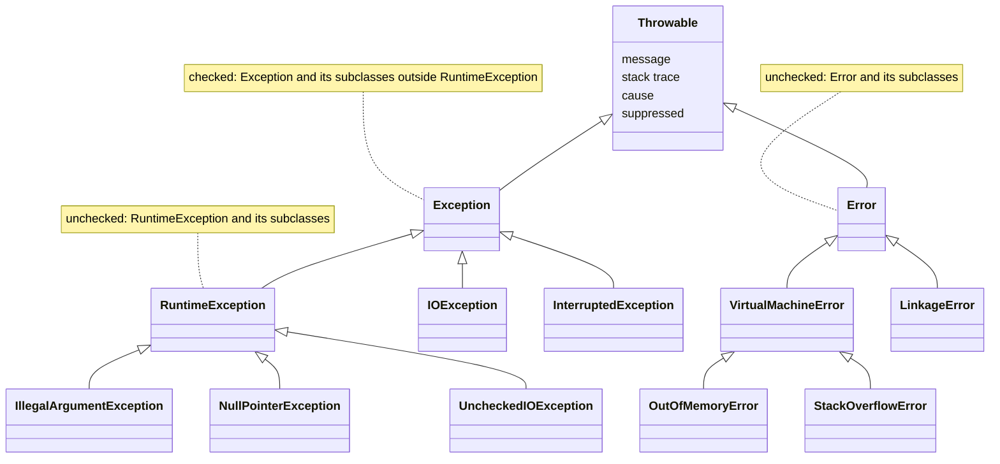
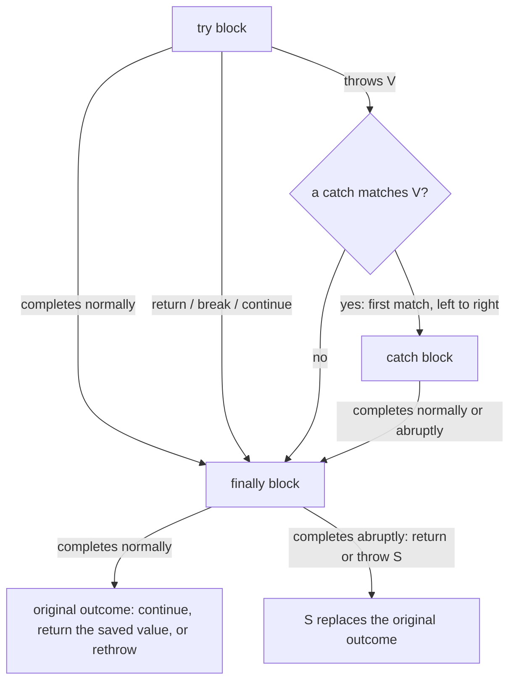
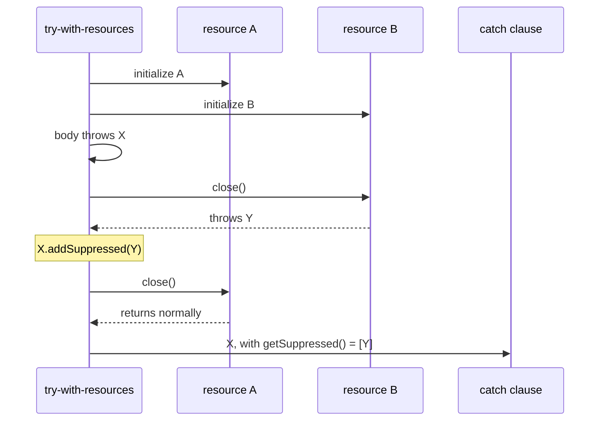

# 06. Exceptions, strings and I/O

> **What this covers:** how Java reports and handles failure, from the `Throwable` hierarchy and the exact control flow of `try`, `catch`, `finally` and try-with-resources to chaining, custom exceptions, the cost of stack traces, and what happens to an exception nobody catches, in a thread or in a thread pool. Then text and bytes: the string pool, compact strings and how `+` compiles, Unicode code points and charsets (UTF-8 by default since Java 18), byte and character streams and NIO.2, Java serialization and why deserializing untrusted data is dangerous, and locale-sensitive formatting.
> **Prerequisites:** [01. OOP fundamentals § 7. Inheritance, composition and `Object`](01-java-oop-fundamentals.md#7-inheritance-composition-and-object), [§ 8. Polymorphism: overloading, overriding and dispatch](01-java-oop-fundamentals.md#8-polymorphism-overloading-overriding-and-dispatch), [02. Equality, immutability and records § 5. Immutability](02-java-equality-immutability-records.md#5-immutability)
> **Leads to:** [22. JDBC and connection pooling](22-jdbc-and-connection-pooling.md)
> **Applies to:** Java 25
> **Study time:** ~6 hours reading + ~3 hours exercises
> **Short on time:** [1. The exception hierarchy: `Throwable`, `Error`, checked and unchecked](#1-the-exception-hierarchy-throwable-error-checked-and-unchecked), [3. try-with-resources, suppressed exceptions and chaining](#3-try-with-resources-suppressed-exceptions-and-chaining), [7. Unicode and charsets: `char`, code points and encodings](#7-unicode-and-charsets-char-code-points-and-encodings); questions [Q06.02](#q06-02), [Q06.03](#q06-03), [Q06.07](#q06-07), [Q06.13](#q06-13), [Q06.15](#q06-15), [Q06.22](#q06-22); then [Summary](#summary).
> **Labs:** [`labs/java-language/`](../labs/java-language/), package `dev.interview.javalanguage.m06`. Run: `JAVA_HOME=$(/usr/libexec/java_home -v 25) mvn -q -f java-backend-guide/labs/pom.xml -pl java-language -am verify`. Needs Docker: no.

## Contents

1. [The exception hierarchy: `Throwable`, `Error`, checked and unchecked](#1-the-exception-hierarchy-throwable-error-checked-and-unchecked)
2. [`try`, `catch` and `finally`: control flow and compile-time rules](#2-try-catch-and-finally-control-flow-and-compile-time-rules)
3. [try-with-resources, suppressed exceptions and chaining](#3-try-with-resources-suppressed-exceptions-and-chaining)
4. [Custom exceptions, the cost of stack traces, and the JVM's errors](#4-custom-exceptions-the-cost-of-stack-traces-and-the-jvms-errors)
5. [Exceptions at boundaries and uncaught exceptions](#5-exceptions-at-boundaries-and-uncaught-exceptions)
6. [Strings: the pool, compact strings, concatenation and the `String` API](#6-strings-the-pool-compact-strings-concatenation-and-the-string-api)
7. [Unicode and charsets: `char`, code points and encodings](#7-unicode-and-charsets-char-code-points-and-encodings)
8. [I/O: byte and character streams, buffering and NIO.2](#8-io-byte-and-character-streams-buffering-and-nio2)
9. [Java serialization and its risks](#9-java-serialization-and-its-risks)
10. [Internationalization: `Locale`, `ResourceBundle` and locale-sensitive formatting](#10-internationalization-locale-resourcebundle-and-locale-sensitive-formatting)
- [Summary](#summary)
- [Question bank](#question-bank)
- [Hands-on exercises](#hands-on-exercises)
- [Check your understanding](#check-your-understanding)
- [Connections](#connections)

## 1. The exception hierarchy: `Throwable`, `Error`, checked and unchecked
### The problem it solves

A stock service reserves items with `int reserve(String sku, int quantity)`, which returns a reservation number, or `-1` when the item is out of stock, or `-2` when the warehouse system did not answer. A new checkout flow calls it, never compares the result with `-1`, stores the number on the order and ships. Weeks later the warehouse finds orders that point at reservation `-1`. Nothing failed loudly, because a return code is a value like any other: the caller can ignore it, and the compiler cannot tell that it should not. The JLS describes this style as "returning funny values, such as the integer value -1", and notes that "too often such funny values are ignored or not checked for by callers" [Doc: JLS 25 §11](https://docs.oracle.com/javase/specs/jls/se25/html/jls-11.html). What the flow needed was a failure that cannot be mistaken for a result, that travels up the call stack until code able to handle it is found, and, for the failures a caller can plan for (an unavailable warehouse), a compiler that makes every caller decide what to do.

### Mental model

Think of an exception as an alarm raised on one floor of a building. It does not wait for the floor to check a status light: it goes up the stairwell (the call stack, the chain of method calls currently running) floor by floor, and every floor that has no responder for that kind of alarm is evacuated on the way (each method stops where it is). The first floor with a matching responder (a `catch` clause naming the exception's class or a superclass) takes over. If no floor has one, building management (the thread's uncaught-exception handler, [§5](#5-exceptions-at-boundaries-and-uncaught-exceptions)) gets it and the thread stops.

The building code adds a rule for some alarms. For **checked** exceptions, every floor must either have a responder or post a sign saying "this alarm passes through here" (a `throws` clause), and the inspector (the compiler) refuses the building otherwise. For **unchecked** exceptions there is no such rule: they are the alarms that can go off anywhere (a bug, the machine running out of memory), and a sign on every door would say nothing. Which rule applies depends only on the alarm's class, that is, on where it sits in this hierarchy:



What to notice: "checked" is a property of a class's position in the hierarchy, decided at compile time, not something that happens at run time; `IOException` and `UncheckedIOException` describe the same kind of failure and differ only in their superclass.

### How it actually works

**The root: `Throwable`.** "Only objects that are instances of this class (or one of its subclasses) are thrown by the Java Virtual Machine or can be thrown by the Java `throw` statement. Similarly, only this class or one of its subclasses can be the argument type in a `catch` clause" [Src: JDK 25, java.lang.Throwable](https://github.com/openjdk/jdk/blob/jdk-25-ga/src/java.base/share/classes/java/lang/Throwable.java). A throwable carries a message, a snapshot of its thread's stack taken when it was created (the *stack trace*: the list of method frames that were running), a *cause* (the throwable that caused this one) and the throwables it *suppressed* [Src: JDK 25, java.lang.Throwable](https://github.com/openjdk/jdk/blob/jdk-25-ga/src/java.base/share/classes/java/lang/Throwable.java); [§3](#3-try-with-resources-suppressed-exceptions-and-chaining) covers causes and suppression, [§4](#4-custom-exceptions-the-cost-of-stack-traces-and-the-jvms-errors) what the stack trace costs. `Throwable` is a direct subclass of `Object`, `Exception` and `Error` are its direct subclasses, and `RuntimeException` is a direct subclass of `Exception` [Doc: JLS 25 §11.1.1](https://docs.oracle.com/javase/specs/jls/se25/html/jls-11.html#jls-11.1.1). One restriction comes from the JVM: "a subclass of `Throwable` cannot be generic" [Doc: JLS 25 §11.1.1](https://docs.oracle.com/javase/specs/jls/se25/html/jls-11.html#jls-11.1.1), and "this restriction is needed since the catch mechanism of the Java Virtual Machine works only with non-generic classes" [Doc: JLS 25 §8.1.2](https://docs.oracle.com/javase/specs/jls/se25/html/jls-8.html#jls-8.1.2): a handler matches the thrown object's runtime class, which carries no type arguments ([03 §5](03-java-generics.md#5-type-erasure-and-bridge-methods) covers erasure). In the lab, `class Rules<T> extends Exception` fails with `compiler.err.generic.throwable` [Lab: ExceptionCompileRulesTest](../labs/java-language/src/test/java/dev/interview/javalanguage/m06/s01/ExceptionCompileRulesTest.java).

**`Exception`, `Error` and the checked/unchecked split.** The JLS defines the two groups by subclassing alone: "The unchecked exception classes are the run-time exception classes and the error classes", and "the checked exception classes are `Throwable` and all its subclasses other than `RuntimeException` and its subclasses and `Error` and its subclasses" [Doc: JLS 25 §11.1.1](https://docs.oracle.com/javase/specs/jls/se25/html/jls-11.html#jls-11.1.1). The Javadoc gives each branch its intent. `Exception` "indicates conditions that a reasonable application might want to catch" [Src: JDK 25, java.lang.Exception](https://github.com/openjdk/jdk/blob/jdk-25-ga/src/java.base/share/classes/java/lang/Exception.java); `Error` "indicates serious problems that a reasonable application should not try to catch" [Src: JDK 25, java.lang.Error](https://github.com/openjdk/jdk/blob/jdk-25-ga/src/java.base/share/classes/java/lang/Error.java); `RuntimeException` is "the superclass of those exceptions that can be thrown during the normal operation of the Java Virtual Machine" [Src: JDK 25, java.lang.RuntimeException](https://github.com/openjdk/jdk/blob/jdk-25-ga/src/java.base/share/classes/java/lang/RuntimeException.java). `Error` sits beside `Exception`, not under it, so that `catch (Exception e)` catches everything a program may recover from "without catching errors from which recovery is typically not possible" [Doc: JLS 25 §11.1.1](https://docs.oracle.com/javase/specs/jls/se25/html/jls-11.html#jls-11.1.1). The lab's `ExceptionKind.of` classifies a class by those two superclass checks and nothing else: `Throwable`, `Exception`, `IOException` and a class that extends `Throwable` directly come out checked; `RuntimeException`, `UncheckedIOException`, `NullPointerException`, `Error` and `OutOfMemoryError` come out unchecked [Lab: ExceptionHierarchyTest](../labs/java-language/src/test/java/dev/interview/javalanguage/m06/s01/ExceptionHierarchyTest.java).

**Where exceptions come from.** An exception is thrown for one of four reasons: a `throw` statement ran; an enabled `assert` failed; the JVM detected an abnormal condition synchronously; or an *asynchronous* exception occurred, one that is not tied to a particular statement and is always a `VirtualMachineError` [Doc: JLS 25 §11.1.2](https://docs.oracle.com/javase/specs/jls/se25/html/jls-11.html#jls-11.1.2) [Doc: JLS 25 §11.1.3](https://docs.oracle.com/javase/specs/jls/se25/html/jls-11.html#jls-11.1.3). The synchronous JVM conditions fall into three kinds: an expression violates the language's semantics, an error occurs while loading, linking or initializing a class (a `LinkageError`, [08](08-jvm-memory-and-class-loading.md)'s subject), or a resource limit stops the JVM (a `VirtualMachineError`) [Doc: JLS 25 §11.1.2](https://docs.oracle.com/javase/specs/jls/se25/html/jls-11.html#jls-11.1.2). JLS §15.6 lists the first kind operator by operator: integer division or remainder by zero throws `ArithmeticException`, an index outside an array throws `ArrayIndexOutOfBoundsException`, a negative array size `NegativeArraySizeException`, an impermissible cast `ClassCastException`, storing the wrong type into an array `ArrayStoreException`, dereferencing `null` through an array access, a field access or an instance method call `NullPointerException`, a `switch` expression or enhanced `switch` statement with no matching label `MatchException`, and creating an object or array `OutOfMemoryError` when memory runs out [Doc: JLS 25 §15.6](https://docs.oracle.com/javase/specs/jls/se25/html/jls-15.html#jls-15.6). In the lab the JVM raises each of the first six itself, and every one is unchecked [Lab: ExceptionHierarchyTest](../labs/java-language/src/test/java/dev/interview/javalanguage/m06/s01/ExceptionHierarchyTest.java). The `throw` statement accepts any expression assignable to `Throwable`, or `null`, and a `null` value makes it throw a new `NullPointerException` instead [Doc: JLS 25 §14.18](https://docs.oracle.com/javase/specs/jls/se25/html/jls-14.html#jls-14.18); the lab's `throw nothing` with a `null` variable throws exactly that [Lab: ExceptionHierarchyTest](../labs/java-language/src/test/java/dev/interview/javalanguage/m06/s01/ExceptionHierarchyTest.java).

**Propagation.** While an exception is being thrown, the JVM "abruptly completes, one by one, any expressions, statements, method and constructor invocations, initializers, and field initialization expressions that have begun but not completed execution in the current thread", until it finds a handler "that indicates that it handles that particular exception by naming the class of the exception or a superclass of the class of the exception" [Doc: JLS 25 §11](https://docs.oracle.com/javase/specs/jls/se25/html/jls-11.html). (*Abrupt completion* is the JLS term for a statement or expression that ends without producing its normal result.) The code that threw "is never resumed", and exceptions are *precise*: every effect before the throw point appears to have happened and nothing after it does [Doc: JLS 25 §11.3](https://docs.oracle.com/javase/specs/jls/se25/html/jls-11.html#jls-11.3). Monitors held by `synchronized` blocks and methods are released on the way out [Doc: JLS 25 §11](https://docs.oracle.com/javase/specs/jls/se25/html/jls-11.html). If no handler exists, the thread runs its `finally` clauses and terminates, and its uncaught-exception handler runs ([§5](#5-exceptions-at-boundaries-and-uncaught-exceptions)) [Doc: JLS 25 §11.3](https://docs.oracle.com/javase/specs/jls/se25/html/jls-11.html#jls-11.3). This is what exceptions buy over return codes: the normal path stays free of error checks, handlers are chosen by type, and a method that cannot handle a failure does nothing at all to pass it on. The five keywords involved are `try`, `catch` and `finally`, which form the handling statement ([§2](#2-try-catch-and-finally-control-flow-and-compile-time-rules)), and `throw` and `throws`, below.

**Catch or declare: what the compiler checks.** "For each checked exception which is a possible result, the `throws` clause for the method or constructor must mention the class of that exception or one of the superclasses of the class of that exception" [Doc: JLS 25 §11.2](https://docs.oracle.com/javase/specs/jls/se25/html/jls-11.html#jls-11.2). Formally, it is a compile-time error if a method or constructor body *can throw* a checked class that is not a subclass of a class in its `throws` clause [Doc: JLS 25 §11.2.3](https://docs.oracle.com/javase/specs/jls/se25/html/jls-11.html#jls-11.2.3). "Can throw" is computed from declarations, not from what the code really does: a method call can throw the exception types of the chosen method's `throws` clause, and a `throw` statement can throw the static type of its expression [Doc: JLS 25 §11.2.1](https://docs.oracle.com/javase/specs/jls/se25/html/jls-11.html#jls-11.2.1) [Doc: JLS 25 §11.2.2](https://docs.oracle.com/javase/specs/jls/se25/html/jls-11.html#jls-11.2.2). The two ways out are a `catch` around the call or the exception (or a superclass) in the caller's own `throws` clause. In the lab, a call to a method declaring `throws IOException` from a method that does neither fails with `compiler.err.unreported.exception.need.to.catch.or.throw`, and declaring or catching it compiles [Lab: ExceptionCompileRulesTest](../labs/java-language/src/test/java/dev/interview/javalanguage/m06/s01/ExceptionCompileRulesTest.java). Static initializers may not throw checked exceptions at all, since there is no `throws` clause to declare them in [Doc: JLS 25 §11.2.3](https://docs.oracle.com/javase/specs/jls/se25/html/jls-11.html#jls-11.2.3) ([01 §5](01-java-oop-fundamentals.md#5-constructors-and-initialization-order) shows what an unchecked one does).

**Why unchecked classes are exempt.** The JLS gives one reason for each group. Errors "can occur at many points in the program and recovery from them is difficult or impossible. A program declaring such exceptions would be cluttered, pointlessly." Run-time exceptions are exempt because "having to declare such exceptions would not aid significantly in establishing the correctness of programs": the compiler cannot prove that a `NullPointerException` is impossible even when the programmer knows it is, and requiring the declaration "would simply be an irritation to programmers" [Doc: JLS 25 §11.2](https://docs.oracle.com/javase/specs/jls/se25/html/jls-11.html#jls-11.2). A `throws` clause may still name unchecked classes; that is "permitted but not required" [Doc: JLS 25 §8.4.6](https://docs.oracle.com/javase/specs/jls/se25/html/jls-8.html#jls-8.4.6). In the lab, a method throwing `IllegalArgumentException` and `StackOverflowError`, its caller, and a method that lists `throws IllegalStateException` all compile without a `catch` [Lab: ExceptionCompileRulesTest](../labs/java-language/src/test/java/dev/interview/javalanguage/m06/s01/ExceptionCompileRulesTest.java). Unchecked exceptions propagate through methods that never mention them: the lab's `RateCards.current` declares nothing, and the loader's `IllegalArgumentException` reaches its caller unchanged [Lab: RateCardsTest](../labs/java-language/src/test/java/dev/interview/javalanguage/m06/s01/RateCardsTest.java).

**`throw` and `throws`.** `throw` is a statement that throws one object now. `throws` is part of a method or constructor declaration that lists exception *types*, class types or type variables, each a subtype of `Throwable` [Doc: JLS 25 §8.4.6](https://docs.oracle.com/javase/specs/jls/se25/html/jls-8.html#jls-8.4.6). The checked types in it "are part of the contract between the implementor and user of the method or constructor" [Doc: JLS 25 §11.2](https://docs.oracle.com/javase/specs/jls/se25/html/jls-11.html#jls-11.2), which is why overriding restricts them.

**The override rule.** "A method that overrides or hides another method, including methods that implement abstract methods defined in interfaces, may not be declared to throw more checked exceptions than the overridden or hidden method": every checked type in the override's `throws` clause must be the same class as, or a subclass of, one in the overridden method's clause [Doc: JLS 25 §8.4.8.3](https://docs.oracle.com/javase/specs/jls/se25/html/jls-8.html#jls-8.4.8.3). The reason is substitution: code that calls `move` through a `Point` reference was compiled against `Point.move`'s contract, so it has no handler for an exception only the subclass declares (JLS Example 8.4.8.3-3 makes this argument), and a subclass must work wherever its parent is expected ([01 §8](01-java-oop-fundamentals.md#8-polymorphism-overloading-overriding-and-dispatch) covers overriding in general). When one method overrides several interface methods at once, its `throws` clause must be compatible with all of them [Doc: JLS 25 §11.2](https://docs.oracle.com/javase/specs/jls/se25/html/jls-11.html#jls-11.2). In the lab, an override that adds `throws Exception` fails with `compiler.err.override.meth.doesnt.throw`; overrides of `save() throws IOException` that declare `FileNotFoundException`, nothing, or the unchecked `IllegalStateException` all compile [Lab: ExceptionCompileRulesTest](../labs/java-language/src/test/java/dev/interview/javalanguage/m06/s01/ExceptionCompileRulesTest.java).

**Only the compiler checks.** The `throws` clause is stored in the class file's `Exceptions` attribute, and the JVM specification says of the rule that a method throws only unchecked or declared exceptions: "These requirements are not enforced in the Java Virtual Machine; they are enforced only at compile time" [Doc: JVMS 25 §4.7.5](https://docs.oracle.com/javase/specs/jvms/se25/html/jvms-4.html#jvms-4.7.5). Code compiled against an older version of a library, code generated at run time, other JVM languages (Kotlin "treats all exceptions as unchecked" [Doc: Kotlin documentation, Exceptions](https://kotlinlang.org/docs/exceptions.html)), and Java code that tricks the compiler can all throw a checked exception from a method that does not declare it. The lab's `UncheckedThrow.sneakyThrow` uses a generic method whose `throws E` the compiler reads as `RuntimeException`; at run time the cast to `E` is erased, and the original `IOException` leaves a method with no `throws` clause [Lab: ExceptionHierarchyTest](../labs/java-language/src/test/java/dev/interview/javalanguage/m06/s01/ExceptionHierarchyTest.java). A lambda body is checked against the `throws` clause of its functional interface's method, which is why `Function` cannot wrap code that throws `IOException` ([05 §9](05-java-lambdas-streams-optional.md#9-checked-exceptions-and-resources-in-lambdas-and-streams)) [Doc: JLS 25 §11.2.3](https://docs.oracle.com/javase/specs/jls/se25/html/jls-11.html#jls-11.2.3).

**Choosing checked or unchecked.** The JLS suggests making most new exception classes checked, "to take advantage of compile-time checking for exception handlers" [Doc: JLS 25 §11.1.1](https://docs.oracle.com/javase/specs/jls/se25/html/jls-11.html#jls-11.1.1), and the JDK follows its own split: I/O, interruption and reflection failures are checked (`IOException`, `InterruptedException`, `ClassNotFoundException`), while precondition violations are unchecked (`IllegalArgumentException`, `IllegalStateException`, and the `NullPointerException` of `Objects.requireNonNull`), as the lab's classification of those classes confirms [Lab: ExceptionHierarchyTest](../labs/java-language/src/test/java/dev/interview/javalanguage/m06/s01/ExceptionHierarchyTest.java). The working rule that follows is about the caller, not the failure. A condition outside the program's control that the *immediate* caller can do something about (retry, fall back, ask the user) earns a checked exception, because the compiler then makes every caller decide. A bug in the caller, or a failure nobody near the call can handle, is unchecked, because a `catch` cannot fix a bug and a declaration on every method would only add noise. Many frameworks lean unchecked for the second reason: Spring's `DataAccessException` extends `RuntimeException` through `NestedRuntimeException`, and its Javadoc says "there is no need for user code to catch it or subclasses if any error is to be considered fatal (the usual case)" [Src: spring-tx 7.0.10, DataAccessException](https://github.com/spring-projects/spring-framework/blob/v7.0.10/spring-tx/src/main/java/org/springframework/dao/DataAccessException.java). The choice has consequences outside Java too: Spring rolls a transaction back by default only for unchecked exceptions and errors ([17 §5](17-spring-transactions.md#5-rollback-rules-and-rollback-only)), and [22](22-jdbc-and-connection-pooling.md) shows how JDBC's checked `SQLException` gets translated. [Q06.01](#q06-01) and [Q06.02](#q06-02) drill this section.

**Helpful `NullPointerException` messages.** Since Java 14 the JVM can compute a message that says which part of an expression was `null`, such as `Cannot read field "c" because "a.b" is null`: the first part names the action that failed, the second the null expression [Doc: JEP 358](https://openjdk.org/jeps/358). Local variable names appear only when the class was compiled with debug information (`javac -g`); otherwise the message uses a placeholder of the form `<local4>` [Doc: JEP 358](https://openjdk.org/jeps/358). In the lab, `order.customer().name()` with a null customer throws a message that starts with `Cannot invoke "` and ends with `Order.customer()" is null`, naming the method whose return value was null [Lab: ExceptionHierarchyTest](../labs/java-language/src/test/java/dev/interview/javalanguage/m06/s01/ExceptionHierarchyTest.java).

### Code

The approach: a rate-card loader whose two kinds of failure get the two kinds of exception, and a caller that handles only the one it can recover from.

1. Hide the storage behind a `RateSource` port whose `read` declares `IOException`, because a file share or a bucket can fail for reasons outside the program.
2. In `RateCardLoader.load`, reject a null or blank name with unchecked exceptions, because that is the caller's bug and no `catch` can repair it.
3. Declare `throws IOException` on `load` instead of catching it, because the loader cannot decide what a missing card means; its caller can.
4. In `RateCards.current`, catch only `IOException`, log it, and fall back to the last card that loaded, letting every unchecked exception propagate.

```java
// Excerpt of labs/java-language/src/main/java/dev/interview/javalanguage/m06/s01/RateCardLoader.java
    // IOException is declared: the storage can fail and the caller can do something about it.
    // A null or blank name is the caller's bug, reported with unchecked exceptions.
    public RateCard load(String name) throws IOException {
        Objects.requireNonNull(name, "name");
        if (name.isBlank()) {
            throw new IllegalArgumentException("rate card name is blank");
        }
        String text = source.read(name);
        return RateCard.parse(name, text);
    }
```

```java
// Excerpt of labs/java-language/src/main/java/dev/interview/javalanguage/m06/s01/RateCards.java
    public RateCard current(String name) {
        try {
            return loader.load(name);
        } catch (IOException e) {
            LOG.log(Level.WARNING, "rate card " + name + " unreadable, using last known good", e);
            return lastKnownGood;
        }
    }
```

`RateCardsTest` checks four outcomes: a readable source is parsed; a source that throws `IOException("share unreachable")` makes `load` throw it and `current` return the last known good card; a blank name throws `IllegalArgumentException` straight through `current`, which declares nothing; and a malformed line (`USD 1.10`) also propagates, because `RateCard.parse` reports it as `IllegalArgumentException` and a broken file is a defect to fix, not an outage to ride out [Lab: RateCardsTest](../labs/java-language/src/test/java/dev/interview/javalanguage/m06/s01/RateCardsTest.java). If `current` caught `Exception` instead, both bugs would silently turn into stale rates. Logging and rethrowing at boundaries is [§5](#5-exceptions-at-boundaries-and-uncaught-exceptions)'s subject.

The second snippet exists only to show that the check lives in the compiler. The approach: make the compiler believe a generic method throws `RuntimeException`, and let erasure throw the real object.

```java
// Excerpt of labs/java-language/src/main/java/dev/interview/javalanguage/m06/s01/UncheckedThrow.java
    public static void sneakyThrow(Throwable failure) {
        UncheckedThrow.<RuntimeException>rethrow(failure);
    }

    // E is RuntimeException at the call site, so javac sees no checked exception;
    // the cast is erased, so at run time the original Throwable is thrown unchanged.
    @SuppressWarnings("unchecked")
    private static <E extends Throwable> void rethrow(Throwable failure) throws E {
        throw (E) failure;
    }
```

`sneakyThrow(new IOException("disk"))` throws that same `IOException` object, from a method with no `throws` clause [Lab: ExceptionHierarchyTest](../labs/java-language/src/test/java/dev/interview/javalanguage/m06/s01/ExceptionHierarchyTest.java). The best practices below say why application code should not do this.

### Failure modes and operations

The runtime behavior of exceptions is the subject of the next sections: control flow through `finally` ([§2](#2-try-catch-and-finally-control-flow-and-compile-time-rules)), lost causes and suppressed failures ([§3](#3-try-with-resources-suppressed-exceptions-and-chaining)), the cost of stack traces and the JVM's errors ([§4](#4-custom-exceptions-the-cost-of-stack-traces-and-the-jvms-errors)), and exceptions nobody catches ([§5](#5-exceptions-at-boundaries-and-uncaught-exceptions)). One setting belongs here: the helpful `NullPointerException` message is controlled by the HotSpot flag `ShowCodeDetailsInExceptionMessages`, `true` by default in JDK 25 and declared manageable, with the description "Disable this to improve privacy" [Src: JDK 25, HotSpot globals.hpp](https://github.com/openjdk/jdk/blob/jdk-25-ga/src/hotspot/share/runtime/globals.hpp); `-XX:-ShowCodeDetailsInExceptionMessages` turns it off.

> [!NOTE]
> **Framework vs language.** Checked exceptions are a rule of the Java language, enforced by `javac` from `throws` clauses (JLS §11.2). The JVM stores the clause in the `Exceptions` attribute but does not enforce it [Doc: JVMS 25 §4.7.5](https://docs.oracle.com/javase/specs/jvms/se25/html/jvms-4.html#jvms-4.7.5), so Kotlin, which "treats all exceptions as unchecked" [Doc: Kotlin documentation, Exceptions](https://kotlinlang.org/docs/exceptions.html), and the lab's `sneakyThrow` can both throw a checked exception from a method that does not declare it [Lab: ExceptionHierarchyTest](../labs/java-language/src/test/java/dev/interview/javalanguage/m06/s01/ExceptionHierarchyTest.java). Frameworks add their own policies on top: Spring's data-access exceptions are unchecked by design [Src: spring-tx 7.0.10, DataAccessException](https://github.com/spring-projects/spring-framework/blob/v7.0.10/spring-tx/src/main/java/org/springframework/dao/DataAccessException.java), and its transaction rollback rules treat checked and unchecked exceptions differently ([17 §5](17-spring-transactions.md#5-rollback-rules-and-rollback-only)). Neither is a language rule.

> [!NOTE]
> **Version notes.** Java 1.0: `Throwable`, `Exception`, `RuntimeException` and `Error` are `@since 1.0` [Src: JDK 25, java.lang.Error](https://github.com/openjdk/jdk/blob/jdk-25-ga/src/java.base/share/classes/java/lang/Error.java) [Src: JDK 25, java.lang.RuntimeException](https://github.com/openjdk/jdk/blob/jdk-25-ga/src/java.base/share/classes/java/lang/RuntimeException.java). Java 14: helpful `NullPointerException` messages, off by default behind `-XX:+ShowCodeDetailsInExceptionMessages` [Final since Java 14, JEP 358] [Doc: JEP 358](https://openjdk.org/jeps/358). Java 15: [Changed in Java 15: `ShowCodeDetailsInExceptionMessages` defaults to `true`], so the messages print by default (JDK-8233014) [Doc: JDK 15 release notes, "Enable ShowCodeDetailsInExceptionMessages by default"](https://www.oracle.com/java/technologies/javase/15-relnote-issues.html). Java 21: `MatchException` (`@since 21`), thrown by a `switch` expression or enhanced `switch` statement that no label matches [Src: JDK 25, java.lang.MatchException](https://github.com/openjdk/jdk/blob/jdk-25-ga/src/java.base/share/classes/java/lang/MatchException.java) [Doc: JLS 25 §15.6](https://docs.oracle.com/javase/specs/jls/se25/html/jls-15.html#jls-15.6). Multi-catch and precise rethrow (Java 7) are [§2](#2-try-catch-and-finally-control-flow-and-compile-time-rules)'s; try-with-resources (Java 7, extended in 9) is [§3](#3-try-with-resources-suppressed-exceptions-and-chaining)'s.

### Best practices and anti-patterns

- Report a caller's bug with an unchecked exception (`IllegalArgumentException`, `IllegalStateException`, `Objects.requireNonNull`), because no caller can repair its own bug by catching it, and the JLS exempts these classes for exactly that reason [Doc: JLS 25 §11.2](https://docs.oracle.com/javase/specs/jls/se25/html/jls-11.html#jls-11.2).
- Declare a checked exception for a failure outside the program's control that the immediate caller can act on, because the compiler then forces each caller to choose between handling and declaring it; if no caller will ever handle it, prefer unchecked, because a `throws` clause repeated up twenty frames only moves the noise.
- Do not declare `throws Exception` or `throws Throwable`, because every caller must then catch or declare that broad type, and a `catch (Exception e)` is always legal [Doc: JLS 25 §11.2.3](https://docs.oracle.com/javase/specs/jls/se25/html/jls-11.html#jls-11.2.3), so the compiler can no longer tell anyone which failures are real.
- Catch `Exception`, not `Throwable`, at a last-resort boundary, because `Error` was placed outside `Exception` so that such a handler leaves errors alone [Doc: JLS 25 §11.1.1](https://docs.oracle.com/javase/specs/jls/se25/html/jls-11.html#jls-11.1.1); what a boundary handler must do is [§5](#5-exceptions-at-boundaries-and-uncaught-exceptions).
- Document the unchecked exceptions a caller should expect with Javadoc `@throws`, and list them in `throws` only when that helps readers, because the compiler ignores them there [Doc: JLS 25 §8.4.6](https://docs.oracle.com/javase/specs/jls/se25/html/jls-8.html#jls-8.4.6).
- Do not use "sneaky throw" helpers in application code, because callers cannot catch the hidden checked type by name: a `catch (IOException e)` around a call that declares nothing is a compile-time error [Doc: JLS 25 §11.2.3](https://docs.oracle.com/javase/specs/jls/se25/html/jls-11.html#jls-11.2.3). Wrap it in an unchecked exception with the original as cause instead ([§3](#3-try-with-resources-suppressed-exceptions-and-chaining)).
- **Security:** never return exception messages, helpful `NullPointerException` messages included, to a remote client, because they name internal fields and variables; the JDK 15 release note warns that such a message "could give remote attackers valuable hints about a potential vulnerable state of the software" [Doc: JDK 15 release notes, "Enable ShowCodeDetailsInExceptionMessages by default"](https://www.oracle.com/java/technologies/javase/15-relnote-issues.html). Send a generic error body ([18](18-spring-mvc-and-rest-controllers.md)) and keep the details in the logs ([44](44-observability-logging-metrics-slos.md)).

### Misconceptions and traps

- *"`Error`s cannot be caught."* `catch (StackOverflowError e)` works like any other handler, as the lab shows [Lab: ExceptionHierarchyTest](../labs/java-language/src/test/java/dev/interview/javalanguage/m06/s01/ExceptionHierarchyTest.java); the JLS even notes that "sophisticated programs may yet wish to catch and attempt to recover from some of these conditions" [Doc: JLS 25 §11.2](https://docs.oracle.com/javase/specs/jls/se25/html/jls-11.html#jls-11.2). The myth comes from the `Error` Javadoc's "should not try to catch", read as "cannot", and from `catch (Exception e)`, which indeed does not catch them.
- *"Checked exceptions are checked at run time."* Only `javac` checks them; the JVM does not [Doc: JVMS 25 §4.7.5](https://docs.oracle.com/javase/specs/jvms/se25/html/jvms-4.html#jvms-4.7.5) [Lab: ExceptionHierarchyTest](../labs/java-language/src/test/java/dev/interview/javalanguage/m06/s01/ExceptionHierarchyTest.java). The name suggests a runtime check, and the `throws` clause is visible in the class file, which makes it look enforced.
- *"`throws` must list every exception a method can throw."* It must list the checked ones; unchecked ones are "permitted but not required" [Doc: JLS 25 §8.4.6](https://docs.oracle.com/javase/specs/jls/se25/html/jls-8.html#jls-8.4.6) [Lab: ExceptionCompileRulesTest](../labs/java-language/src/test/java/dev/interview/javalanguage/m06/s01/ExceptionCompileRulesTest.java). The belief comes from reading `throws` as documentation of every failure, which it would be only if all exceptions were checked.
- *"A `RuntimeException` is an exception that happens at run time."* Every exception is thrown at run time. The name refers to exceptions that arise during expression evaluation and the normal operation of the JVM ([Doc: JLS 25 §11.1.1](https://docs.oracle.com/javase/specs/jls/se25/html/jls-11.html#jls-11.1.1) [Src: JDK 25, java.lang.RuntimeException](https://github.com/openjdk/jdk/blob/jdk-25-ga/src/java.base/share/classes/java/lang/RuntimeException.java)); what makes it special is only that it is exempt from compile-time checking. The confusion comes from contrasting "runtime" with "compile time", the two words used for the check.
- *"An overriding method must declare the same exceptions as the method it overrides."* It may declare fewer, narrower ones, none, or any unchecked ones; it may not add a checked exception the parent does not cover [Doc: JLS 25 §8.4.8.3](https://docs.oracle.com/javase/specs/jls/se25/html/jls-8.html#jls-8.4.8.3) [Lab: ExceptionCompileRulesTest](../labs/java-language/src/test/java/dev/interview/javalanguage/m06/s01/ExceptionCompileRulesTest.java). The myth comes from treating `throws` as part of the method's signature, which must match; the signature is only the name, type parameters and parameter types [Doc: JLS 25 §8.4.2](https://docs.oracle.com/javase/specs/jls/se25/html/jls-8.html#jls-8.4.2).
- *"Every exception class extends `Exception` or `Error`."* A class may extend `Throwable` directly, and it is then checked [Doc: JLS 25 §11.1.1](https://docs.oracle.com/javase/specs/jls/se25/html/jls-11.html#jls-11.1.1) [Lab: ExceptionHierarchyTest](../labs/java-language/src/test/java/dev/interview/javalanguage/m06/s01/ExceptionHierarchyTest.java). Nobody should write one, which is why the two-branch picture is the one everybody draws.

Questions that drill this section: [Q06.01](#q06-01), [Q06.02](#q06-02).

## 2. `try`, `catch` and `finally`: control flow and compile-time rules
### The problem it solves

A pricing service protects a slow downstream with a limiter: it counts calls in flight and rejects new ones above 20. The first version decrements the counter on the line after the downstream call returns. Every time the downstream resets a connection, the call throws, the decrement is skipped, and one slot is gone for good. After a few hundred resets over a week the counter sits at 20 with nothing running, and every request is rejected with "limit reached" while the downstream is idle. The code had one success path and the author wrote the cleanup for that path; the exception took a different exit. The problem is to run cleanup on *every* way out of a block (return, exception, `break`, `continue`) without writing it once per exit, and to know exactly what the caller sees when cleanup and failure meet.

### Mental model

A `try` statement is a room with one guarded exit. Code inside the room can leave in several ways: walk out normally, run out with an exception, or jump out with `return`, `break` or `continue`. The `catch` clauses are staff at the door who take the exceptions they were hired for, in the order they stand. The `finally` block is the exit corridor every path goes through, whatever happened inside. The corridor has one dangerous property: whoever walks through it carrying a new reason to leave (a `return` or a `throw` of its own) replaces whatever the room was about to hand to the caller.



What to notice: every arrow passes through `finally`, and the only way the caller does not get the original outcome is the last arrow, where `finally` itself returns or throws.

### How it actually works

**The forms and the grammar.** A `try` statement is `try Block Catches`, `try Block [Catches] Finally`, or a try-with-resources statement; only the last may omit both `catch` and `finally` [Doc: JLS 25 §14.20](https://docs.oracle.com/javase/specs/jls/se25/html/jls-14.html#jls-14.20). In the lab, a bare `try { … }` fails with `compiler.err.try.without.catch.finally.or.resource.decls` [Lab: TryCompileRulesTest](../labs/java-language/src/test/java/dev/interview/javalanguage/m06/s02/TryCompileRulesTest.java). The grammar puts the `catch` clauses and the `finally` clause directly after the block, so no statement may stand between them. Resources are [§3](#3-try-with-resources-suppressed-exceptions-and-chaining)'s subject.

**Choosing a handler.** "Exception handlers are considered in left-to-right order: the earliest possible catch clause accepts the exception" [Doc: JLS 25 §14.20](https://docs.oracle.com/javase/specs/jls/se25/html/jls-14.html#jls-14.20): the first clause whose type the thrown object's *runtime* class is assignment compatible with wins, and later clauses are not considered [Doc: JLS 25 §14.20.1](https://docs.oracle.com/javase/specs/jls/se25/html/jls-14.html#jls-14.20.1). In the lab, `CatchSelection.handle` returns "missing file" for a `FileNotFoundException`, "other I/O failure" for a plain `IOException`, "bug" for an `IllegalStateException` and "other checked" for an `InterruptedException` [Lab: FinallyFlowTest](../labs/java-language/src/test/java/dev/interview/javalanguage/m06/s02/FinallyFlowTest.java). If no clause matches, the `try` statement completes abruptly with the same exception, which continues to the next enclosing `try` in this method or up the call stack ([§1](#1-the-exception-hierarchy-throwable-error-checked-and-unchecked)); a nested `try` is simply the innermost enclosing one [Doc: JLS 25 §11.3](https://docs.oracle.com/javase/specs/jls/se25/html/jls-11.html#jls-11.3).

**Compile-time rules on handlers.** Four rules make most "does this compile?" questions mechanical:
- A clause that can catch only what an earlier clause already catches is an error: `catch (IOException e)` followed by `catch (FileNotFoundException e)` fails, because "a preceding catch clause of the immediately enclosing try statement can catch E1 or a superclass of E1" [Doc: JLS 25 §11.2.3](https://docs.oracle.com/javase/specs/jls/se25/html/jls-11.html#jls-11.2.3). The lab's key is `compiler.err.except.already.caught`. The reverse order (subclass first) is the correct one.
- Catching a checked exception the `try` block cannot throw is an error, "unless E1 is `Exception` or a superclass of `Exception`" [Doc: JLS 25 §11.2.3](https://docs.oracle.com/javase/specs/jls/se25/html/jls-11.html#jls-11.2.3). In the lab, `catch (IOException e)` around a `println` fails with `compiler.err.except.never.thrown.in.try`, while `catch (RuntimeException e)`, `catch (Exception e)` and `catch (Throwable t)` around the same code compile: unchecked classes can always occur, and `Exception` and `Throwable` include them.
- A statement after `throw` is unreachable, and "it is a compile-time error if a statement cannot be executed because it is unreachable" [Doc: JLS 25 §14.22](https://docs.oracle.com/javase/specs/jls/se25/html/jls-14.html#jls-14.22); a `throw` "always completes abruptly" [Doc: JLS 25 §14.18](https://docs.oracle.com/javase/specs/jls/se25/html/jls-14.html#jls-14.18). The lab's key is `compiler.err.unreachable.stmt`.
- A bare `try`, as above.

All four are asserted by diagnostic key in [Lab: TryCompileRulesTest](../labs/java-language/src/test/java/dev/interview/javalanguage/m06/s02/TryCompileRulesTest.java), and [Q06.05](#q06-05) drills them.

**What `finally` does with each outcome.** JLS §14.20.2 defines a `try` with `finally` case by case, and the cases reduce to one rule: `finally` runs after the `try` block and any `catch` block, "no matter how control leaves the try block or catch block" [Doc: JLS 25 §14.20](https://docs.oracle.com/javase/specs/jls/se25/html/jls-14.html#jls-14.20); if it completes normally, the statement ends the way it would have ended without it, and if it completes abruptly for a reason S, "the try statement completes abruptly for reason S (and reason R is discarded)" [Doc: JLS 25 §14.20.2](https://docs.oracle.com/javase/specs/jls/se25/html/jls-14.html#jls-14.20.2). *Completing abruptly* covers more than exceptions: `break`, `continue` and `return` are abrupt completions too, so `finally` runs for them. In the lab, a loop whose body `continue`s at 1 and `break`s at 3 records `finally` for iterations 0 to 3, and an `UnsupportedOperationException` that the only `catch` (for `IllegalArgumentException`) does not match leaves the events `try`, `finally` and then propagates [Lab: FinallyFlowTest](../labs/java-language/src/test/java/dev/interview/javalanguage/m06/s02/FinallyFlowTest.java).

**`return` and `finally`.** A `return` with a value "first evaluates the Expression"; then, if the `return` is inside a `try` with `finally`, "any finally clauses of those try statements will be executed, in order, innermost to outermost, before control is transferred to the invoker", and "abrupt completion of a finally clause can disrupt the transfer of control initiated by a return statement" [Doc: JLS 25 §14.17](https://docs.oracle.com/javase/specs/jls/se25/html/jls-14.html#jls-14.17). Three consequences, each in the lab [Lab: FinallyFlowTest](../labs/java-language/src/test/java/dev/interview/javalanguage/m06/s02/FinallyFlowTest.java):
- the order is: return expression evaluated, `finally` runs, caller resumes (events `try`, `return expression`, `finally`, `caller got result`);
- assigning the returned variable in `finally` does not change the result, because the value was already computed: `int count = 1; try { return count; } finally { count = 2; }` returns 1. For a reference, the *reference* was computed, so `finally` cannot swap the object but can mutate it: a returned list gains the element `finally` adds;
- a `return` in `finally` replaces the pending outcome, exception included: a `try` that throws `IllegalStateException` with `finally { return 42; }` returns 42 and the exception vanishes. A `throw` in `finally` does the same: the `IllegalArgumentException` from `try` is gone, and the `IllegalStateException` from `finally` has no cause and no suppressed exceptions. [Q06.03](#q06-03) drills all three.

**How javac compiles `finally`.** Class files of version 50.0 or below could compile `finally` as a subroutine called with the `jsr` and `ret` instructions; for a `return` inside `try`, the compiled code "saves the return value (if any) in a local variable", runs the `finally` code, and then returns the saved value, which is the mechanism behind the second consequence above [Doc: JVMS 25 §4.10.2.5](https://docs.oracle.com/javase/specs/jvms/se25/html/jvms-4.html#jvms-4.10.2.5). From class file version 51.0 on, `jsr`, `jsr_w` and `ret` "must not appear in the code array" [Doc: JVMS 25 §4.9.1](https://docs.oracle.com/javase/specs/jvms/se25/html/jvms-4.html#jvms-4.9.1), so javac copies the `finally` block into each exit path instead and adds a catch-all exception handler that runs the copy and rethrows. In the lab, reading the compiled `FinallyFlow.returnThenFinally` with the Class-File API [Final since Java 24, JEP 484] finds the `finally` block's string constant twice (normal path and handler), a handler with no catch type, and no `jsr` or `ret` [Lab: FinallyBytecodeTest](../labs/java-language/src/test/java/dev/interview/javalanguage/m06/s02/FinallyBytecodeTest.java) [Doc: JEP 484](https://openjdk.org/jeps/484). A large `finally` block therefore costs code size per exit path, one more reason to keep it short.

**When `finally` does not run.** `finally` runs whenever control leaves the `try` block. It does not run when control never leaves it, or when the JVM stops running Java code:
- **`System.exit` and `Runtime.exit`.** `exit` starts the shutdown sequence and "neither returns nor throws an exception; that is, it does not complete either normally or abruptly"; the shutdown hooks run, and when the JVM terminates, "`finally` clauses are not executed" [Src: JDK 25, java.lang.Runtime](https://github.com/openjdk/jdk/blob/jdk-25-ga/src/java.base/share/classes/java/lang/Runtime.java). In the lab, a child JVM that prints `try` and calls `System.exit(3)` inside `try` exits with status 3 and prints the shutdown hook's line but never `finally` [Lab: JvmExitTest](../labs/java-language/src/test/java/dev/interview/javalanguage/m06/s02/JvmExitTest.java).
- **`Runtime.halt`.** "Termination of the Java Virtual Machine is unconditional and immediate"; it does not even start the shutdown sequence, so hooks do not run either [Src: JDK 25, java.lang.Runtime](https://github.com/openjdk/jdk/blob/jdk-25-ga/src/java.base/share/classes/java/lang/Runtime.java).
- **Daemon threads at JVM exit.** The shutdown sequence starts "when the number of live non-daemon threads drops to zero", and at termination "threads' current methods do not complete normally or abruptly" [Src: JDK 25, java.lang.Runtime](https://github.com/openjdk/jdk/blob/jdk-25-ga/src/java.base/share/classes/java/lang/Runtime.java). In the lab, a daemon thread blocked inside `try` when `main` returns never prints its `finally` line [Lab: JvmExitTest](../labs/java-language/src/test/java/dev/interview/javalanguage/m06/s02/JvmExitTest.java). ([11](11-concurrency-threads-and-jmm.md) covers daemon threads.)
- **A `try` block that never finishes**, because of an infinite loop, a deadlock or a thread blocked forever: `finally` runs only after the block completes.
- **The process dies**: `kill -9`, an out-of-memory kill by the container runtime, a JVM crash. No Java code runs after that, by definition of the process being gone.

[Q06.04](#q06-04) drills these cases.

**Multi-catch.** A `catch` clause may name a union, `catch (IOException | InterruptedException e)`; it behaves like one clause per alternative sharing one body, and the parameter's type is the least upper bound of the alternatives [Doc: JLS 25 §14.20](https://docs.oracle.com/javase/specs/jls/se25/html/jls-14.html#jls-14.20). Two rules come with it. The parameter "is implicitly declared final", so assigning it is an error (lab key `compiler.err.multicatch.parameter.may.not.be.assigned`); and "it is a compile-time error if a union of types contains two alternatives Di and Dj (i ≠ j) where Di is a subtype of Dj" (lab key `compiler.err.multicatch.types.must.be.disjoint`), because the subclass alternative would add nothing [Doc: JLS 25 §14.20](https://docs.oracle.com/javase/specs/jls/se25/html/jls-14.html#jls-14.20) [Lab: TryCompileRulesTest](../labs/java-language/src/test/java/dev/interview/javalanguage/m06/s02/TryCompileRulesTest.java). The JLS notes that a compiler is "neither required nor recommended" to duplicate the body per alternative, since a class file can represent the clause without duplication [Doc: JLS 25 §14.20](https://docs.oracle.com/javase/specs/jls/se25/html/jls-14.html#jls-14.20).

**Precise rethrow.** A `throw` of a `final` or effectively final `catch` parameter can throw only the exception classes that the `try` block can throw, that the clause catches, and that no earlier clause catches [Doc: JLS 25 §11.2.2](https://docs.oracle.com/javase/specs/jls/se25/html/jls-11.html#jls-11.2.2). So a method whose `try` calls only `read() throws IOException` may `catch (Exception e) { log(e); throw e; }` and still declare just `throws IOException`. In the lab that compiles, and assigning `e = new Exception("wrapped", e)` before the `throw` turns the rule off: the parameter is no longer effectively final, the `throw` can throw `Exception`, and the method fails with `compiler.err.unreported.exception.need.to.catch.or.throw` [Lab: TryCompileRulesTest](../labs/java-language/src/test/java/dev/interview/javalanguage/m06/s02/TryCompileRulesTest.java). [Q06.06](#q06-06) drills multi-catch and precise rethrow.

### Code

The approach: release the limiter's slot in `finally`, so the release runs on every exit, and let a type variable carry the work's checked exception through unchanged.

1. Declare `Work<T, E extends Exception>` with `T run() throws E`, so the limiter can say "I throw whatever the work throws" (a type variable in a `throws` clause, [Doc: JLS 25 §8.4.6](https://docs.oracle.com/javase/specs/jls/se25/html/jls-8.html#jls-8.4.6)).
2. Take the slot with `incrementAndGet`; if that went over the limit, give it back and reject, before entering the `try`.
3. Enter `try` only after the slot is held, and release it in `finally`: the release must not run for a slot that was never taken.
4. Return the work's result from inside `try`; `finally` runs before the caller sees it.

```java
// Excerpt of labs/java-language/src/main/java/dev/interview/javalanguage/m06/s02/InFlightLimiter.java
    public <T, E extends Exception> T run(Work<T, E> work) throws E {
        if (inFlight.incrementAndGet() > limit) {
            inFlight.decrementAndGet();
            throw new RejectedExecutionException("limit " + limit + " reached");
        }
        try {
            return work.run();
        } finally {
            inFlight.decrementAndGet();
        }
    }
```

In the lab the slot is back to 0 after a normal return and after the work throws `IOException("downstream reset")`, and the next call is admitted [Lab: InFlightLimiterTest](../labs/java-language/src/test/java/dev/interview/javalanguage/m06/s02/InFlightLimiterTest.java). The caller catches exactly `IOException`; for a lambda that throws nothing checked, `E` is inferred as `RuntimeException` (a `throws` inference variable resolves to it [Doc: JLS 25 §18.4](https://docs.oracle.com/javase/specs/jls/se25/html/jls-18.html#jls-18.4)), so `limiter.run(() -> "priced")` needs no `try` at all.

#### Legacy

The version from the problem statement releases the slot after the call returns:

```java
// Excerpt of labs/java-language/src/main/java/dev/interview/javalanguage/m06/s02/LeakyLimiter.java
        T result = work.run();
        inFlight.decrementAndGet();
        return result;
```

In the lab, with a limit of 1, one failing call leaves the counter at 1, and the next call is rejected with `limit 1 reached` although nothing is running [Lab: InFlightLimiterTest](../labs/java-language/src/test/java/dev/interview/javalanguage/m06/s02/InFlightLimiterTest.java). Locks follow the same shape: `lock.lock(); try { … } finally { lock.unlock(); }` ([12](12-concurrency-locks-atomics-collections.md)). Anything that is an `AutoCloseable` resource is better closed with try-with-resources ([§3](#3-try-with-resources-suppressed-exceptions-and-chaining)).

### Failure modes and operations

- **The exception that disappears.** A `return` or `throw` in `finally`, or cleanup in `finally` that throws (a `close()` that fails while flushing), replaces the original exception with no trace of it: no cause, no suppressed entry [Doc: JLS 25 §14.20.2](https://docs.oracle.com/javase/specs/jls/se25/html/jls-14.html#jls-14.20.2) [Lab: FinallyFlowTest](../labs/java-language/src/test/java/dev/interview/javalanguage/m06/s02/FinallyFlowTest.java). The log shows the cleanup failure, whose top frame is the `finally` line, and the real failure is gone. javac has a lint category for this, `-Xlint:finally`, which "warns about finally clauses that do not terminate normally" [Doc: javac, -Xlint](https://docs.oracle.com/en/java/javase/25/docs/specs/man/javac.html); the lab's methods suppress that warning on purpose. [§3](#3-try-with-resources-suppressed-exceptions-and-chaining) has the incident and the fix (try-with-resources keeps the first exception and suppresses the second), and [Q06.08](#q06-08) the related case of a cause dropped while wrapping.
- **Leaked counters, permits and locks.** Cleanup written on the success path only, as in the problem statement, leaks one unit per failure. Under load the leak is proportional to the error rate, so it surfaces during a downstream incident, exactly when capacity is needed. A gauge of in-flight work that never returns to zero when traffic stops is the signal; the fix is the `try`/`finally` shape above, entered only after the resource is acquired.
- **`System.exit` in library or request code.** It ends the whole JVM: other requests in flight lose their `finally` blocks and try-with-resources closes, and in a container the main process exiting stops the container [Src: JDK 25, java.lang.Runtime](https://github.com/openjdk/jdk/blob/jdk-25-ga/src/java.base/share/classes/java/lang/Runtime.java). Throw an exception and let the application's entry point decide the exit status. When shutting down on purpose, put cleanup that must run at exit in a shutdown hook, not in a `finally` block, because hooks run on `exit` and on signals that start the shutdown sequence [Src: JDK 25, java.lang.Runtime](https://github.com/openjdk/jdk/blob/jdk-25-ga/src/java.base/share/classes/java/lang/Runtime.java).
- **Slow cleanup.** `finally` runs on the calling thread, before the caller sees the result or the exception, so a `finally` that does network I/O adds its latency, and its failures, to every exit path.

> [!NOTE]
> **Version notes.** Java 7: multi-catch and precise rethrow, together with try-with-resources, came from Project Coin, JSR 334, whose feature list includes "Multi-catch and more precise rethrow" and the "try-with-resources statement" [Doc: JSR 334](https://jcp.org/en/jsr/detail?id=334). Class files of version 51.0 and later may not contain `jsr` or `ret`, so current javac always inlines `finally` [Doc: JVMS 25 §4.9.1](https://docs.oracle.com/javase/specs/jvms/se25/html/jvms-4.html#jvms-4.9.1). Before Java 7, code that wanted one handler for two exception types either duplicated the body or caught a common superclass such as `Exception`, and a rethrow of `catch (Exception e)` forced the method to declare `throws Exception`. Java 9: try-with-resources accepts effectively final variables ([§3](#3-try-with-resources-suppressed-exceptions-and-chaining)). Java 24: the Class-File API used by the lab [Final since Java 24, JEP 484] [Doc: JEP 484](https://openjdk.org/jeps/484).

### Best practices and anti-patterns

- Acquire the resource immediately before `try` and release it in `finally` (or use try-with-resources), because entering `try` before the acquisition succeeds makes `finally` release something it never took.
- Never `return`, `throw`, `break` or `continue` out of a `finally` block, because each one replaces the pending outcome and silently discards an exception [Doc: JLS 25 §14.20.2](https://docs.oracle.com/javase/specs/jls/se25/html/jls-14.html#jls-14.20.2); enable `-Xlint:finally` so the compiler reports it [Doc: javac, -Xlint](https://docs.oracle.com/en/java/javase/25/docs/specs/man/javac.html).
- Keep `finally` blocks short and unable to fail where possible, because a failure there replaces the real one and the block is copied into every exit path of the compiled method [Lab: FinallyBytecodeTest](../labs/java-language/src/test/java/dev/interview/javalanguage/m06/s02/FinallyBytecodeTest.java).
- Order `catch` clauses from the most specific to the most general, because the first compatible clause wins and the compiler rejects a specific clause placed after a general one [Doc: JLS 25 §14.20.1](https://docs.oracle.com/javase/specs/jls/se25/html/jls-14.html#jls-14.20.1).
- Use multi-catch when two exceptions get the same handling, because duplicated handler bodies drift apart; do not widen to `catch (Exception e)` just to share a body, because that also catches every unchecked bug.
- When you catch broadly to log and rethrow, keep the parameter effectively final, because precise rethrow then keeps the method's `throws` clause narrow [Doc: JLS 25 §11.2.2](https://docs.oracle.com/javase/specs/jls/se25/html/jls-11.html#jls-11.2.2); logging and rethrowing at the same layer has its own cost ([§5](#5-exceptions-at-boundaries-and-uncaught-exceptions)).
- Do not call `System.exit` outside the application's entry point, because it skips every `finally` block in every thread [Src: JDK 25, java.lang.Runtime](https://github.com/openjdk/jdk/blob/jdk-25-ga/src/java.base/share/classes/java/lang/Runtime.java).

### Misconceptions and traps

- *"`finally` always runs."* It runs whenever control leaves the `try` block, which excludes `System.exit` and `halt`, daemon threads at JVM exit, a block that never finishes, and a dead process [Src: JDK 25, java.lang.Runtime](https://github.com/openjdk/jdk/blob/jdk-25-ga/src/java.base/share/classes/java/lang/Runtime.java) [Lab: JvmExitTest](../labs/java-language/src/test/java/dev/interview/javalanguage/m06/s02/JvmExitTest.java). The phrase is the usual one-line summary of JLS §14.20.2, which is about control leaving the block, not about the JVM stopping.
- *"A `return` in `finally` is harmless, it just returns."* It discards any exception in flight and any value `try` was returning [Lab: FinallyFlowTest](../labs/java-language/src/test/java/dev/interview/javalanguage/m06/s02/FinallyFlowTest.java). The myth survives because the method seems to work: it returns a value, and nothing logs the lost exception.
- *"`finally` can change the value being returned."* Not for the returned variable, whose value was computed before `finally` ran; only by mutating a returned object or by returning a new value, which is the trap above [Doc: JLS 25 §14.17](https://docs.oracle.com/javase/specs/jls/se25/html/jls-14.html#jls-14.17) [Lab: FinallyFlowTest](../labs/java-language/src/test/java/dev/interview/javalanguage/m06/s02/FinallyFlowTest.java). The confusion comes from the mutable-object case, which looks like the return value changed.
- *"Catch order does not matter as long as each type appears once."* The first compatible clause wins, and a subclass after its superclass does not compile [Doc: JLS 25 §11.2.3](https://docs.oracle.com/javase/specs/jls/se25/html/jls-11.html#jls-11.2.3) [Lab: TryCompileRulesTest](../labs/java-language/src/test/java/dev/interview/javalanguage/m06/s02/TryCompileRulesTest.java). The belief comes from `switch`, whose constant labels are disjoint and can be listed in any order.
- *"`catch (Exception e)` around code that throws nothing checked does not compile, like `catch (IOException e)`."* `Exception`, `Throwable` and every unchecked class are always allowed [Doc: JLS 25 §11.2.3](https://docs.oracle.com/javase/specs/jls/se25/html/jls-11.html#jls-11.2.3) [Lab: TryCompileRulesTest](../labs/java-language/src/test/java/dev/interview/javalanguage/m06/s02/TryCompileRulesTest.java). The rule is remembered as "you cannot catch what cannot be thrown", and `Exception` includes the unchecked exceptions, which can always be thrown.
- *"`throw e` from `catch (Exception e)` forces `throws Exception`."* Once true: until Java 6, the rethrown parameter had its declared type, so the method had to declare `throws Exception`. Now: [Changed in Java 7: precise rethrow] a rethrown effectively final parameter can throw only what the `try` block can throw [Doc: JSR 334](https://jcp.org/en/jsr/detail?id=334) [Doc: JLS 25 §11.2.2](https://docs.oracle.com/javase/specs/jls/se25/html/jls-11.html#jls-11.2.2) [Lab: TryCompileRulesTest](../labs/java-language/src/test/java/dev/interview/javalanguage/m06/s02/TryCompileRulesTest.java). The myth is the pre-Java 7 rule, still repeated in older books.

Questions that drill this section: [Q06.03](#q06-03), [Q06.04](#q06-04), [Q06.05](#q06-05), [Q06.06](#q06-06).

## 3. try-with-resources, suppressed exceptions and chaining
### The problem it solves

A nightly reconciliation job opens the bank's statement file, then borrows a connection from the ledger database's pool, and closes both in one `finally`: `finally { reader.close(); connection.close(); }`. It works for months. Then the database has a bad night. `getConnection` times out, `connection` is still `null`, and `finally` throws a `NullPointerException` that replaces the timeout, so the on-call engineer reads a stack trace about a null in cleanup code instead of "pool exhausted". On another night the statement file sits on a network mount that drops: `reader.close()` throws, `connection.close()` never runs, and the pool loses a connection for good. Writing cleanup correctly by hand means one nested `try`/`finally` per resource, each with its own null check, and even then a failing `close()` hides the exception that made the job fail. The problem is to close every resource that was opened, exactly once, in the right order, on every path, while keeping the first failure as the one the caller sees.

### Mental model

Think of checking out of a hotel at the end of a trip. You leave in the reverse order you arrived: the room you entered last is the first you hand back, and each handover happens even if the previous one went wrong. If the trip itself went wrong (a missed flight), that is the headline of your report; a broken key card at checkout is a footnote attached to it, not a replacement for it. try-with-resources is that checkout desk. Each `close()` failure is a footnote (a *suppressed* exception) on the headline exception, and the headline is whatever went wrong first.



What to notice: both resources are closed before the `catch` sees anything, and the exception that reaches it is the body's `X`; the close failure `Y` rides along inside it.

### How it actually works

**What can be a resource.** The header `try ( … )` holds one or more resources separated by `;`. Each is either a local variable declaration with an initializer, or a reference to an existing variable by name or field access [Doc: JLS 25 §14.20.3](https://docs.oracle.com/javase/specs/jls/se25/html/jls-14.html#jls-14.20.3). The rules, each asserted by diagnostic key in [Lab: TwrCompileRulesTest](../labs/java-language/src/test/java/dev/interview/javalanguage/m06/s03/TwrCompileRulesTest.java):
- the type "must be a subtype of `AutoCloseable`, or a compile-time error occurs": `try (String text = …)` fails with `compiler.err.prob.found.req`;
- a declared resource "is implicitly declared final", so assigning it in the body fails with `compiler.err.try.resource.may.not.be.assigned`;
- an existing variable "must be a final or effectively final variable that is definitely assigned before the try-with-resources statement": a reassigned local fails with `compiler.err.try.with.resources.expr.effectively.final.var`, and so does a non-final field, while a `final` field compiles;
- the `close()` call is part of the statement, so a try-with-resources statement "can throw" whatever "the automatic invocation of the `close()` method of a resource" can throw [Doc: JLS 25 §11.2.2](https://docs.oracle.com/javase/specs/jls/se25/html/jls-11.html#jls-11.2.2). `AutoCloseable.close()` declares `throws Exception`, so a resource whose static type is `AutoCloseable` forces the method to catch or declare `Exception`; the lab's key is `compiler.err.unreported.exception.implicit.close`. This is why `close()` overrides should declare the narrowest exception they can, which the `AutoCloseable` Javadoc "strongly" encourages [Src: JDK 25, java.lang.AutoCloseable](https://github.com/openjdk/jdk/blob/jdk-25-ga/src/java.base/share/classes/java/lang/AutoCloseable.java).

**What the compiler turns it into.** The JLS defines the statement by a translation into plain `try`/`catch`/`finally` [Doc: JLS 25 §14.20.3.1](https://docs.oracle.com/javase/specs/jls/se25/html/jls-14.html#jls-14.20.3.1). For one resource `R r = init`, the translation:
1. declares `final R r = init` *outside* the inner `try`, so if `init` throws, there is nothing to close and the statement throws that exception;
2. declares a hidden `Throwable primaryExc = null`;
3. runs the body in a `try` whose `catch (Throwable t)` records `primaryExc = t` and rethrows `t`;
4. in `finally`, if `r != null`: when `primaryExc` is set, calls `r.close()` inside its own `try` and passes any failure to `primaryExc.addSuppressed(…)`; otherwise calls `r.close()` directly, so a close failure after a normal body is thrown as is.

Several resources are handled by applying the same translation once per resource, which nests the `try` statements: "after n such translations, there are n nested try-catch-finally statements" [Doc: JLS 25 §14.20.3](https://docs.oracle.com/javase/specs/jls/se25/html/jls-14.html#jls-14.20.3). The nesting is what produces every ordering rule below; it is the hand-written code from the problem statement, written correctly once by the compiler.

**Order, `null` and failures during opening.** "Resources are initialized in left-to-right order"; if one "fails to initialize", "all resources initialized so far … are closed"; resources close "in the reverse order from that in which they were initialized"; "a resource is closed only if it initialized to a non-null value"; and "an exception from the closing of one resource does not prevent the closing of other resources" [Doc: JLS 25 §14.20.3](https://docs.oracle.com/javase/specs/jls/se25/html/jls-14.html#jls-14.20.3). In the lab, two resources record `open A`, `open B`, `body`, `close B`, `close A`; when `B`'s initializer throws, the events are `open A`, `open B failed`, `close A`, and the body never runs; a resource initialized to `null` is skipped without a `NullPointerException`; and `try (shared)` on an effectively final local closes it like a declared one [Lab: TryWithResourcesTest](../labs/java-language/src/test/java/dev/interview/javalanguage/m06/s03/TryWithResourcesTest.java).

**Which exception wins.** A close failure "is suppressed if an exception was thrown previously by an initializer, the try block, or the closing of a resource" [Doc: JLS 25 §14.20.3](https://docs.oracle.com/javase/specs/jls/se25/html/jls-14.html#jls-14.20.3). Three cases follow, each in [Lab: TryWithResourcesTest](../labs/java-language/src/test/java/dev/interview/javalanguage/m06/s03/TryWithResourcesTest.java):
- the body throws `IllegalArgumentException("body failed")` and `B.close()` throws: the caller gets the body's exception, and `getSuppressed()` holds exactly `close B failed`. `A` is still closed;
- the body completes and only `A.close()` throws: that exception is thrown, with nothing suppressed;
- the body completes and both closes throw: the exception "from the rightmost resource failing to close" is thrown and the others are added to its suppressed list [Doc: JLS 25 §14.20.3.1](https://docs.oracle.com/javase/specs/jls/se25/html/jls-14.html#jls-14.20.3.1). In the lab, `close B failed` is thrown with `close A failed` suppressed, because `B` closed first.

[Q06.07](#q06-07) drills these cases.

**`catch` and `finally` on the same statement.** A try-with-resources with a `catch` or `finally` is *extended*: the JLS translates it into the basic statement nested *inside* an ordinary `try` that carries the `catch` and `finally` clauses. "The effect of the translation is to put the resource specification 'inside' the try statement", so a `catch` can catch exceptions from opening and closing too, and "all resources will have been closed (or attempted to be closed) by the time the finally block is executed" [Doc: JLS 25 §14.20.3.2](https://docs.oracle.com/javase/specs/jls/se25/html/jls-14.html#jls-14.20.3.2). In the lab, the events are `close B`, `close A`, then `catch body failed`, then `finally` [Lab: TryWithResourcesTest](../labs/java-language/src/test/java/dev/interview/javalanguage/m06/s03/TryWithResourcesTest.java). A `catch` block therefore cannot use the resource: it is already closed, and the variable's scope is only "the remainder of the resource specification and the entire try block" [Doc: JLS 25 §6.3](https://docs.oracle.com/javase/specs/jls/se25/html/jls-6.html#jls-6.3).

**`AutoCloseable` and `Closeable`.** `java.io.Closeable` (since Java 5) extends `AutoCloseable` (since Java 7), so every `java.io` stream, reader and writer can be a resource [Src: JDK 25, java.io.Closeable](https://github.com/openjdk/jdk/blob/jdk-25-ga/src/java.base/share/classes/java/io/Closeable.java). The contracts differ on one point interviewers ask about: `Closeable.close()` on an already closed stream "has no effect", while `AutoCloseable.close()` "is *not* required to be idempotent" (calling it twice may have a visible effect), although implementers "are strongly encouraged" to make it so [Src: JDK 25, java.lang.AutoCloseable](https://github.com/openjdk/jdk/blob/jdk-25-ga/src/java.base/share/classes/java/lang/AutoCloseable.java). The same Javadoc gives two rules for writing a `close()` that can fail: release the underlying resource and mark the object closed *before* throwing, because "the `close` method is unlikely to be invoked more than once"; and do not throw `InterruptedException` from `close()`, because it "interacts with a thread's interrupted status, and runtime misbehavior is likely to occur" if it is suppressed ([11](11-concurrency-threads-and-jmm.md) covers interruption) [Src: JDK 25, java.lang.AutoCloseable](https://github.com/openjdk/jdk/blob/jdk-25-ga/src/java.base/share/classes/java/lang/AutoCloseable.java).

**Only declared variables are resources.** In `try (InputStream in = new GZIPInputStream(opener.open()))` the resource is `in`; the stream returned by `opener.open()` is just an argument. The `GZIPInputStream` constructor reads the GZIP header and throws `ZipException` "if a GZIP format error has occurred" [Src: JDK 25, java.util.zip.GZIPInputStream](https://github.com/openjdk/jdk/blob/jdk-25-ga/src/java.base/share/classes/java/util/zip/GZIPInputStream.java). When it does, `in` was never initialized, so nothing is closed, and the inner stream leaks. In the lab, reading plain text through that one-resource form throws `ZipException` and leaves the inner stream open; declaring `raw` and `in` as two resources closes `raw` [Lab: GzipReadingTest](../labs/java-language/src/test/java/dev/interview/javalanguage/m06/s03/GzipReadingTest.java). The rule follows from the translation: only declared variables are closed, and a resource that fails to initialize is not.

**The chaining API on `Throwable`.** Two exceptions can be linked in two ways, and they mean different things. A *cause* says "this exception was thrown because of that one" and is "semantically known at the time of its creation"; a *suppressed* exception is an independent failure from a sibling block that could not be propagated at the same time [Src: JDK 25, java.lang.Throwable](https://github.com/openjdk/jdk/blob/jdk-25-ga/src/java.base/share/classes/java/lang/Throwable.java). The methods, each in [Lab: ThrowableApiTest](../labs/java-language/src/test/java/dev/interview/javalanguage/m06/s03/ThrowableApiTest.java) unless noted:
- **The cause** is set by a constructor that takes a `Throwable`, or once by `initCause`. `initCause` "can be called at most once", and not at all after a cause constructor: a second call throws `IllegalStateException` ("Can't overwrite cause …"), and `initCause(this)` throws `IllegalArgumentException("Self-causation not permitted")` [Src: JDK 25, java.lang.Throwable](https://github.com/openjdk/jdk/blob/jdk-25-ga/src/java.base/share/classes/java/lang/Throwable.java). `initCause` exists for older exception classes that have no cause constructor. `getCause()` returns the cause or `null`.
- **The message.** `getMessage()` returns the detail message, possibly `null`. `getLocalizedMessage()` returns the same unless a subclass overrides it. `toString()` is the class name, then `": "` and the localized message when it is not `null`. The `Throwable(Throwable cause)` constructor uses `cause.toString()` as the message, so `new RuntimeException(new IOException("disk full"))` has the message `java.io.IOException: disk full` [Src: JDK 25, java.lang.Throwable](https://github.com/openjdk/jdk/blob/jdk-25-ga/src/java.base/share/classes/java/lang/Throwable.java).
- **Suppressed exceptions.** `addSuppressed` appends to the list; it rejects `this` (`IllegalArgumentException`) and `null` (`NullPointerException`). `getSuppressed()` returns a copy, so writing into the array changes nothing. Suppression can be turned off with the four-argument constructor `Throwable(message, cause, enableSuppression, writableStackTrace)`, after which `addSuppressed` does nothing and `getSuppressed()` is empty [Src: JDK 25, java.lang.Throwable](https://github.com/openjdk/jdk/blob/jdk-25-ga/src/java.base/share/classes/java/lang/Throwable.java). The other flag, `writableStackTrace`, is about the cost of exceptions ([§4](#4-custom-exceptions-the-cost-of-stack-traces-and-the-jvms-errors)).
- **`printStackTrace`.** It prints `toString()`, then one `\tat` line per frame, then each suppressed exception indented by a tab under the caption `Suppressed: `, then the cause under `Caused by: `, recursively. Frames an enclosed exception shares with its enclosing trace are collapsed to `... n more`, and a cause cycle is printed as `[CIRCULAR REFERENCE: …]` instead of looping, because the printer keeps an identity set of the exceptions already printed [Src: JDK 25, java.lang.Throwable](https://github.com/openjdk/jdk/blob/jdk-25-ga/src/java.base/share/classes/java/lang/Throwable.java). In the lab, an `ExportFailedException` with an `IOException` cause and one suppressed exception prints the `Suppressed:` line before the `Caused by:` line, and a two-exception cause cycle prints the circular-reference marker. The chain exists only on the exception object, which is why the object must be passed to the logger as the exception argument, not flattened into text.

**Chaining and translation between layers.** The `Throwable` Javadoc gives two reasons for a cause. A layer built on a lower one should not let the lower layer's exception escape, because "it is generally unrelated to the abstraction provided by the upper layer" and would "tie the API of the upper layer to the details of its implementation"; throwing a wrapped exception keeps the details without that coupling. And a method that implements a general interface (its example is a `Collection` whose `add` does I/O) may have to wrap a checked exception in an unchecked one because the interface does not declare it [Src: JDK 25, java.lang.Throwable](https://github.com/openjdk/jdk/blob/jdk-25-ga/src/java.base/share/classes/java/lang/Throwable.java). This is *exception translation*: a repository catches `SQLException` and throws its own `DataUnavailableException` with the `SQLException` as the cause, so callers depend on the domain type and the log still shows the driver's message. Spring does this for you with its unchecked `DataAccessException` hierarchy, which lets code "find and handle the kind of error encountered without knowing the details of the particular data access API in use" [Src: spring-tx 7.0.10, DataAccessException](https://github.com/spring-projects/spring-framework/blob/v7.0.10/spring-tx/src/main/java/org/springframework/dao/DataAccessException.java); how it maps vendor error codes belongs to [22](22-jdbc-and-connection-pooling.md), and which of those exceptions roll a transaction back to [17 §5](17-spring-transactions.md#5-rollback-rules-and-rollback-only). JDBC also has its own second chain, `SQLException.getNextException()`, for drivers that report several errors at once [Src: JDK 25, java.sql.SQLException](https://github.com/openjdk/jdk/blob/jdk-25-ga/src/java.sql/share/classes/java/sql/SQLException.java), covered in [22](22-jdbc-and-connection-pooling.md). The classic mistake is translating with `new RuntimeException(e.getMessage())`: the message survives, the cause, its class and its stack trace do not. In the lab, that wrapper has `getCause() == null` and its printed trace never mentions `IOException`, while `new RuntimeException("Failed to export batch b-7", e)` prints `Caused by: java.io.IOException: Connection reset` [Lab: ThrowableApiTest](../labs/java-language/src/test/java/dev/interview/javalanguage/m06/s03/ThrowableApiTest.java). Checked exceptions inside lambdas and streams, where `UncheckedIOException` is the standard wrapper, are [05 §9](05-java-lambdas-streams-optional.md#9-checked-exceptions-and-resources-in-lambdas-and-streams)'s subject. [Q06.08](#q06-08) and [Q06.09](#q06-09) drill chaining and translation.

### Code

The approach: let try-with-resources own the channel to the payment processor, so it is closed on every path and a close failure cannot hide a validation error, and translate only the transport's `IOException` into the exporter's own exception, keeping it as the cause.

1. Open the channel in the resource header, so a failure to open is a plain exception with nothing to close.
2. Validate and write each record in the body; an invalid record throws `IllegalArgumentException`, which is not an I/O failure and is not translated.
3. Catch `IOException` on the same statement: it covers `open`, `write` and the implicit `close()`, and by the time it runs the channel is already closed.
4. Throw `ExportFailedException` with a message that names the batch and the `IOException` as the cause.

```java
// Excerpt of labs/java-language/src/main/java/dev/interview/javalanguage/m06/s03/PaymentExporter.java
    public void export(String batchId, List<String> records) {
        try (ExportChannel channel = channels.open(batchId)) {
            for (String record : records) {
                channel.write(RecordValidator.validated(record));
            }
        } catch (IOException e) {
            throw new ExportFailedException("Failed to export batch " + batchId, e);
        }
    }
```

In the lab, a good batch is written and the channel closed; a batch with a blank record whose channel also fails to close throws `IllegalArgumentException("blank payment record")` with the `IOException("Connection reset")` in `getSuppressed()`; and a channel that cannot open produces `ExportFailedException("Failed to export batch b-7")` whose cause is the same `IOException` object [Lab: PaymentExporterTest](../labs/java-language/src/test/java/dev/interview/javalanguage/m06/s03/PaymentExporterTest.java). The `catch (IOException e)` does not catch the validation error, even though an `IOException` is suppressed inside it: a `catch` matches the primary exception only.

#### Legacy

Before Java 7 the same exporter closed the channel in `finally`:

```java
// Excerpt of labs/java-language/src/main/java/dev/interview/javalanguage/m06/s03/LegacyPaymentExporter.java
    public void export(String batchId, List<String> records) {
        try {
            ExportChannel channel = channels.open(batchId);
            try {
                for (String record : records) {
                    channel.write(RecordValidator.validated(record));
                }
            } finally {
                channel.close();
            }
        } catch (IOException e) {
            throw new ExportFailedException("Failed to export batch " + batchId, e);
        }
    }
```

With the same bad batch and failing `close()`, the caller gets `ExportFailedException` caused by `IOException("Connection reset")`, and the validation error is gone: no cause, no suppressed entry anywhere in the chain [Lab: PaymentExporterTest](../labs/java-language/src/test/java/dev/interview/javalanguage/m06/s03/PaymentExporterTest.java). The inner `try`/`finally` is already the careful version (opening is outside it, so there is no `null` check); with two resources it needs a second level of nesting, which is what the compiler writes for you.

### Failure modes and operations

- **The root cause replaced by a cleanup failure.** Hand-written `close()` in `finally` throws away the body's exception whenever `close()` also fails, and a `close()` that flushes buffered data fails most often exactly when the body failed (the connection is already broken) [Lab: PaymentExporterTest](../labs/java-language/src/test/java/dev/interview/javalanguage/m06/s03/PaymentExporterTest.java). The callout below is that incident, and [Q06.08](#q06-08) the related one where wrapping drops the cause.
- **Leaks on the error path, under load.** A resource that is opened but not declared in the header (an inner stream passed to a wrapper constructor, a connection obtained before the `try`) leaks when the next step throws [Lab: GzipReadingTest](../labs/java-language/src/test/java/dev/interview/javalanguage/m06/s03/GzipReadingTest.java). The leak is proportional to the error rate, so it appears during an incident: file descriptors run out ("Too many open files"), or a connection pool is drained until every borrower waits for its timeout ([22](22-jdbc-and-connection-pooling.md)). The JVM reports its own descriptor use through `com.sun.management.UnixOperatingSystemMXBean.getOpenFileDescriptorCount()` and `getMaxFileDescriptorCount()` on Unix-like systems [Src: JDK 25, com.sun.management.UnixOperatingSystemMXBean](https://github.com/openjdk/jdk/blob/jdk-25-ga/src/jdk.management/share/classes/com/sun/management/UnixOperatingSystemMXBean.java); a count that climbs with the error rate and never falls is the signal, and pool metrics show the same for connections.
- **A `close()` that is not idempotent.** A decorator closes the stream it wraps, so code that also closes the inner stream calls `close()` twice. That is harmless for a `Closeable`, whose contract says the second call "has no effect", but an `AutoCloseable` is "not required to be idempotent" [Src: JDK 25, java.lang.AutoCloseable](https://github.com/openjdk/jdk/blob/jdk-25-ga/src/java.base/share/classes/java/lang/AutoCloseable.java). A custom resource that returns a pooled object to its pool on `close()` returns it twice, and two borrowers then share one object. Make `close()` check a closed flag.
- **Slow or blocking `close()`.** Closing runs on the calling thread before the caller sees the result or the exception, so a `close()` that flushes over the network adds its latency and timeouts to every call. Bound it with the transport's own timeouts; a `close()` with no timeout can hold the request thread indefinitely.
- **Very long chains in logs.** Each translation layer adds a `Caused by:` block, and each suppressed failure its own indented trace. The `... n more` folding keeps repeated frames out, but a chain through five layers is still long, and a log pipeline that splits events by line or caps their size separates or cuts it; when the end is cut, the part lost is the bottom `Caused by:`, the root cause. Translate once per boundary, not in every method, and configure the log pipeline for multi-line events ([44](44-observability-logging-metrics-slos.md)).

> [!IMPORTANT]
> **Production scenario: a payment export logs only "Connection reset" and the real error is gone.** *As the interviewer frames it:* "Every few days the nightly payment export to the processor fails. The log shows `ExportFailedException: Failed to export batch` caused by `java.io.IOException: Connection reset`, so the team has been raising it with the processor, who says their endpoint was up. Retries fail the same way for the same batch, and other batches succeed."
> **Reasoning.** A network fault would not follow one batch through every retry, so the reset is probably a consequence, not the cause. The top frame of the `IOException` is the channel's `close()`, called from the exporter's `finally` line, and the chain has no other `Caused by:` and no `Suppressed:` entry. That is the signature of the Legacy shape above: the body failed first (here, a record the exporter rejects), control went to `finally`, `close()` tried to flush a half-written batch, the processor reset the connection, and that `IOException` replaced the body's exception [Doc: JLS 25 §14.20.2](https://docs.oracle.com/javase/specs/jls/se25/html/jls-14.html#jls-14.20.2) [Lab: PaymentExporterTest](../labs/java-language/src/test/java/dev/interview/javalanguage/m06/s03/PaymentExporterTest.java). Confirm by rerunning the failing batch with the channel replaced by an in-memory one, or by logging each record before writing it: the failure moves to a specific record. The fix is try-with-resources, which keeps the validation error as the primary exception with the `Connection reset` suppressed inside it [Doc: JLS 25 §14.20.3.1](https://docs.oracle.com/javase/specs/jls/se25/html/jls-14.html#jls-14.20.3.1); where a `finally` must stay, catch the cleanup failure and call `primary.addSuppressed(cleanupFailure)`. Prevention: forbid `close()` in `finally` in code review and static analysis, log exceptions through the logger's exception argument so `Suppressed:` blocks appear, and alert on exports that fail repeatedly for the same batch, which points at data rather than the network.

> [!NOTE]
> **Version notes.** Java 7: the try-with-resources statement came from Project Coin [Doc: JSR 334](https://jcp.org/en/jsr/detail?id=334), and `AutoCloseable`, `Throwable.addSuppressed`, `getSuppressed` and the four-argument constructor arrived in the same release (each `@since 1.7`) [Src: JDK 25, java.lang.Throwable](https://github.com/openjdk/jdk/blob/jdk-25-ga/src/java.base/share/classes/java/lang/Throwable.java); cause chaining (`getCause`, `initCause`, the cause constructors) is older, `@since 1.4`. Before Java 7, `close()` in `finally`, often wrapped in a helper that swallowed its exception, was the only way. Java 9: an effectively final variable can be named as the resource, `try (existing) { … }`, instead of declaring a new one [Doc: JEP 213](https://openjdk.org/jeps/213).

### Best practices and anti-patterns

- Use try-with-resources for every `AutoCloseable` you open, because it closes on every path, in reverse order, skips `null`, and keeps the first exception as the primary one [Doc: JLS 25 §14.20.3](https://docs.oracle.com/javase/specs/jls/se25/html/jls-14.html#jls-14.20.3).
- Declare each layer of a decorator chain as its own resource when a wrapper's constructor can throw (`GZIPInputStream`; `ObjectInputStream`, whose constructor reads and verifies a "serialization stream header" [Src: JDK 25, java.io.ObjectInputStream](https://github.com/openjdk/jdk/blob/jdk-25-ga/src/java.base/share/classes/java/io/ObjectInputStream.java)), because only declared variables are closed [Lab: GzipReadingTest](../labs/java-language/src/test/java/dev/interview/javalanguage/m06/s03/GzipReadingTest.java).
- Declare `close()` with the narrowest exception, or none, because the implicit `close()` call counts in the catch-or-declare analysis and `throws Exception` leaks into every caller [Doc: JLS 25 §11.2.2](https://docs.oracle.com/javase/specs/jls/se25/html/jls-11.html#jls-11.2.2) [Lab: TwrCompileRulesTest](../labs/java-language/src/test/java/dev/interview/javalanguage/m06/s03/TwrCompileRulesTest.java).
- In your own `close()`, release the resource and mark it closed before throwing, make a second call a no-op, and never throw `InterruptedException`, because that is what the `AutoCloseable` contract asks for and what callers that close twice rely on [Src: JDK 25, java.lang.AutoCloseable](https://github.com/openjdk/jdk/blob/jdk-25-ga/src/java.base/share/classes/java/lang/AutoCloseable.java).
- Translate exceptions at a layer boundary with the original as the cause (`new ExportFailedException("…batch " + id, e)`), because the cause keeps the class, message and stack trace of the real failure, and the message can add context the low-level exception lacks.
- Log an exception by passing it to the logger as the exception argument, not `e.getMessage()` or string concatenation, because only the full rendering shows `Caused by:` and `Suppressed:` [Src: JDK 25, java.lang.Throwable](https://github.com/openjdk/jdk/blob/jdk-25-ga/src/java.base/share/classes/java/lang/Throwable.java).
- When you must keep a hand-written `finally` (a lock, a counter), and the cleanup can fail, add its failure to the primary exception with `addSuppressed` instead of letting it escape, because that is the only way both survive [Src: JDK 25, java.lang.Throwable](https://github.com/openjdk/jdk/blob/jdk-25-ga/src/java.base/share/classes/java/lang/Throwable.java).
- **Security:** close resources on error paths with the same care as on the success path, because a request that a client can make fail on purpose, and that leaks a descriptor or a pooled connection each time, is a cheap way to exhaust the service; and never send a cause chain or `printStackTrace` output to the client, because translation exists to keep lower-layer details (SQL, hostnames, file paths) inside the service ([§5](#5-exceptions-at-boundaries-and-uncaught-exceptions) covers what the boundary returns).

### Misconceptions and traps

- *"try-with-resources swallows close exceptions."* A close failure after a normal body is thrown; one that happens while another exception is propagating is kept in that exception's `getSuppressed()` [Lab: TryWithResourcesTest](../labs/java-language/src/test/java/dev/interview/javalanguage/m06/s03/TryWithResourcesTest.java). The myth comes from logs that print only the top exception's `toString()`, where suppressed entries never appear, and from the pre-Java 7 "close quietly" helpers that really did swallow them.
- *"Resources are closed after the `catch` block, so the `catch` can still use them."* They are closed before any `catch` or `finally` of the same statement runs [Doc: JLS 25 §14.20.3.2](https://docs.oracle.com/javase/specs/jls/se25/html/jls-14.html#jls-14.20.3.2) [Lab: TryWithResourcesTest](../labs/java-language/src/test/java/dev/interview/javalanguage/m06/s03/TryWithResourcesTest.java). The belief comes from the layout: the header sits outside the braces, so the resources look like they belong to the whole statement.
- *"`catch (IOException e)` on a try-with-resources catches the close failure."* Only if the close failure is the primary exception. When the body threw something else, the `IOException` is suppressed inside it, and the `catch` never sees it [Lab: PaymentExporterTest](../labs/java-language/src/test/java/dev/interview/javalanguage/m06/s03/PaymentExporterTest.java). The confusion comes from thinking of the close failure as "thrown"; it was recorded, not thrown.
- *"Logging `e.getMessage()` is enough."* The message omits the exception's class, its stack trace, its cause chain and its suppressed exceptions, and is sometimes `null` [Src: JDK 25, java.lang.Throwable](https://github.com/openjdk/jdk/blob/jdk-25-ga/src/java.base/share/classes/java/lang/Throwable.java). It survives because the message is what users see on screen, so it feels like the important part.
- *"Wrapping in `RuntimeException` loses nothing."* `new RuntimeException(e)` and `new RuntimeException("context", e)` keep the cause; `new RuntimeException(e.getMessage())` keeps only the text [Lab: ThrowableApiTest](../labs/java-language/src/test/java/dev/interview/javalanguage/m06/s03/ThrowableApiTest.java). The two look the same in a one-line log, which is where the habit forms.
- *"Calling `close()` twice is always safe."* Only `Closeable` requires it; `AutoCloseable.close()` is explicitly not required to be idempotent [Src: JDK 25, java.lang.AutoCloseable](https://github.com/openjdk/jdk/blob/jdk-25-ga/src/java.base/share/classes/java/lang/AutoCloseable.java). The belief comes from `java.io`, where nearly every resource is a `Closeable`.
- *"The resource must be declared in the `try` header."* Once true: until Java 8, each resource had to be a new variable declared in the header. Now: [Changed in Java 9: an effectively final variable may be the resource] `try (existing) { … }` closes it [Doc: JEP 213](https://openjdk.org/jeps/213) [Lab: TryWithResourcesTest](../labs/java-language/src/test/java/dev/interview/javalanguage/m06/s03/TryWithResourcesTest.java). Older books and style guides still show only the Java 7 form.

Questions that drill this section: [Q06.07](#q06-07), [Q06.08](#q06-08), [Q06.09](#q06-09).

## 4. Custom exceptions, the cost of stack traces, and the JVM's errors
### The problem it solves

A checkout service calls a payment provider and has to react three ways: ask the customer for another card when the card is expired or the funds are short, stop and flag the order when the provider suspects fraud, and retry later when the provider is down. The first version throws `RuntimeException("declined: card expired")` for every case, so the controller parses the message with `contains("expired")` to decide what to do. A provider changes its wording, the parsing falls through to the generic branch, and customers with expired cards see "try again later" for a week. Separately, the same service's rate limiter throws a new exception for each rejected request; during a traffic spike it rejects tens of thousands a second, and allocation profiles show the time going into building stack traces nobody reads. And when the service fails to start in a new environment, the log is full of `NoClassDefFoundError: Could not initialize class PaymentConfig`, which the team reads as "a JAR is missing" for an hour. The problem is to design exceptions the caller can act on without parsing text, to know what an exception costs and where that cost comes from, and to read the JVM's own errors for what they actually say.

### Mental model

An exception type is a label on a parcel that the sorting office reads: the label decides which desk the parcel goes to, so each label should mean "a different desk", and everything that desk needs (the order id, the decline reason) goes inside the parcel as fields, not scribbled on the outside as a sentence to interpret. A stack trace is a photograph of the call stack taken when the parcel is *packed* (the exception is constructed), not when it is posted (thrown): packing is the expensive step, and a parcel that is sent ten thousand times a second with the same contents does not need a new photograph each time. The JVM's errors are a different kind of parcel: they come from the building itself (the stack ran out, memory ran out, a class could not be loaded or initialized), and most of them say "stop and look at the building", not "handle this and carry on".

### How it actually works

**A type per decision.** A caller can branch on a type with `catch`, and on a field with ordinary code, but on a message only by parsing text. So a new exception class earns its place when some caller handles it differently from its superclass; when every caller handles it the same way, an existing type with a good message is enough. Whether it is checked follows [§1](#1-the-exception-hierarchy-throwable-error-checked-and-unchecked)'s rule: checked when the caller can reasonably recover and the compiler should force the decision, unchecked for bugs and for failures the immediate caller cannot handle. The `Throwable` Javadoc sets the conventions for the constructors: a no-argument one and one taking a message, and, for an exception "that might likely have a cause", one taking the cause and one taking both [Src: JDK 25, java.lang.Throwable](https://github.com/openjdk/jdk/blob/jdk-25-ga/src/java.base/share/classes/java/lang/Throwable.java). Context goes in `final` fields with accessors, set in the constructor, and the message is built from them, so the log line and the code read the same values. In the lab, `PaymentDeclinedException` carries `orderId` and a `DeclineReason` enum whose `customerCanRetry()` drives the controller's branch, and its message is `payment for order ord-42 declined: CARD_EXPIRED` [Lab: CustomExceptionTest](../labs/java-language/src/test/java/dev/interview/javalanguage/m06/s04/CustomExceptionTest.java).

**Exceptions are serializable.** `Throwable` implements `java.io.Serializable`, so every exception class is serializable whether its author meant it or not, and its fields are written with it [Src: JDK 25, java.lang.Throwable](https://github.com/openjdk/jdk/blob/jdk-25-ga/src/java.base/share/classes/java/lang/Throwable.java). In the lab, a `PaymentDeclinedException` written with `ObjectOutputStream` and read back keeps its message and its `reason` field [Lab: CustomExceptionTest](../labs/java-language/src/test/java/dev/interview/javalanguage/m06/s04/CustomExceptionTest.java). A serializable class without an explicit `serialVersionUID` gets a default one computed "based on various aspects of the class", a computation the `Serializable` Javadoc calls "highly sensitive to class details that may vary depending on compiler implementations", which can cause "unexpected `InvalidClassException`s during deserialization" [Src: JDK 25, java.io.Serializable](https://github.com/openjdk/jdk/blob/jdk-25-ga/src/java.base/share/classes/java/io/Serializable.java) ([§9](#9-java-serialization-and-its-risks) explains serialization); `javac -Xlint:serial` warns about it, and the lab's key for an exception without one is `compiler.warn.missing.SVUID` [Lab: CustomExceptionTest](../labs/java-language/src/test/java/dev/interview/javalanguage/m06/s04/CustomExceptionTest.java). Declare `private static final long serialVersionUID` (with `@Serial`), and keep fields of an exception serializable or `transient`, because an exception is written along with any serialized object graph that holds it.

**Error codes vs exceptions.** Inside one process, an exception is the better channel for a failure: it cannot be ignored silently the way a returned code can, it carries a stack trace, and it unwinds to the layer that can handle it. At a boundary between processes the exception object does not travel: an HTTP API returns a status and a machine-readable error body with a stable code (Spring's `ProblemDetail`, [18](18-spring-mvc-and-rest-controllers.md)), and the client turns that code back into its own exception. Expected business outcomes that are not failures ("no such customer" on a search) are often better modelled as return values (`Optional`, a result type, a sealed interface) than as exceptions ([05](05-java-lambdas-streams-optional.md) covers `Optional`).

**Where the cost of an exception comes from.** Every public `Throwable` constructor calls `fillInStackTrace()`, which "records within this `Throwable` object information about the current state of the stack frames for the current thread" by calling a native method; the `StackTraceElement[]` array is built later, only when `getStackTrace()` or `printStackTrace()` first asks for it [Src: JDK 25, java.lang.Throwable](https://github.com/openjdk/jdk/blob/jdk-25-ga/src/java.base/share/classes/java/lang/Throwable.java). So the walk of the stack happens at construction, its cost grows with the depth of the stack (deep in a framework call chain, hundreds of frames), and `throw` itself only transfers control. In the lab, an exception created in `createHere()` and thrown later from `throwElsewhere()` has `createHere` as its top frame and no `throwElsewhere` frame at all [Lab: StackTraceCostTest](../labs/java-language/src/test/java/dev/interview/javalanguage/m06/s04/StackTraceCostTest.java). HotSpot also caps the recorded depth with `MaxJavaStackTraceDepth`, default 1024 ("0 means all") [Src: HotSpot jdk-25-ga, globals.hpp](https://github.com/openjdk/jdk/blob/jdk-25-ga/src/hotspot/share/runtime/globals.hpp).

**Turning the stack trace off.** The protected four-argument constructor `Throwable(message, cause, enableSuppression, writableStackTrace)` with `writableStackTrace = false` does not call `fillInStackTrace()`; later calls to `fillInStackTrace` and `setStackTrace` "will not set the stack trace", and `getStackTrace` returns "a zero length array". The Javadoc names the cases it is meant for: "a virtual machine reusing exception objects under low-memory situations", and an exception "repeatedly caught and rethrown, such as to implement control flow between two sub-systems" [Src: JDK 25, java.lang.Throwable](https://github.com/openjdk/jdk/blob/jdk-25-ga/src/java.base/share/classes/java/lang/Throwable.java). In the lab, `RateLimitedException` passes `false, false`: after `fillInStackTrace()`, `setStackTrace(…)` and `addSuppressed(…)` its stack trace and suppressed list are still empty. The older way, overriding `fillInStackTrace()` to `return this`, gives the same empty trace [Lab: StackTraceCostTest](../labs/java-language/src/test/java/dev/interview/javalanguage/m06/s04/StackTraceCostTest.java). What you lose is the location: when such an exception escapes to a log, it says what happened and nothing about where. That is acceptable only for a high-rate, expected outcome whose origin is always the same place, such as a rate limiter's rejection.

**The JVM does the same for some of its own exceptions.** HotSpot has a product flag `OmitStackTraceInFastThrow`, default `true`, described as "Omit backtraces for some 'hot' exceptions in optimized code" [Src: HotSpot jdk-25-ga, globals.hpp](https://github.com/openjdk/jdk/blob/jdk-25-ga/src/hotspot/share/runtime/globals.hpp). In the C2 compiler, a throw site of an implicit `NullPointerException`, `ArithmeticException`, `ArrayIndexOutOfBoundsException`, `ClassCastException` or `ArrayStoreException` that has become hot may throw a *preallocated* instance instead, and the compiled code clears that instance's detail message [Src: HotSpot jdk-25-ga, graphKit.cpp](https://github.com/openjdk/jdk/blob/jdk-25-ga/src/hotspot/share/opto/graphKit.cpp). In logs this shows up as a bare `java.lang.NullPointerException` with no message and no frames, after the same exception was logged with full traces earlier. The cure is to find the first occurrences in older logs, or to run with `-XX:-OmitStackTraceInFastThrow` while investigating. The lab does not assert this: it depends on JIT compilation and thresholds, and a test of it would be flaky (STYLE-GUIDE §7.5).

**The JVM's errors, from the caller's side.** These are `Error` subclasses, outside the checked hierarchy ([§1](#1-the-exception-hierarchy-throwable-error-checked-and-unchecked)), except `ClassNotFoundException`, which is a checked exception and is often confused with them.

| Throwable | What failed | Typical cause | First thing to check | Owning module |
|---|---|---|---|---|
| `ClassNotFoundException` (checked) | a lookup *by name*: `Class.forName`, `ClassLoader.loadClass` or `findSystemClass` found no definition [Src: JDK 25, ClassNotFoundException](https://github.com/openjdk/jdk/blob/jdk-25-ga/src/java.base/share/classes/java/lang/ClassNotFoundException.java) | a driver, plugin or configured class name absent from the classpath, or a typo in the name | the exact name in the message, and the classpath or module path of that loader | [08](08-jvm-memory-and-class-loading.md) |
| `NoClassDefFoundError` | linking a class that "existed when the currently executing class was compiled, but the definition can no longer be found" [Src: JDK 25, NoClassDefFoundError](https://github.com/openjdk/jdk/blob/jdk-25-ga/src/java.base/share/classes/java/lang/NoClassDefFoundError.java), or using a class whose initialization already failed | a dependency missing at run time (a `provided` scope, a shaded JAR); or a failed static initializer | the message: a class name means "not found", `Could not initialize class X` means "its initializer failed earlier"; then the cause | [08](08-jvm-memory-and-class-loading.md), [01 §5](01-java-oop-fundamentals.md#5-constructors-and-initialization-order) |
| `ExceptionInInitializerError` | "an exception occurred during evaluation of a static initializer or the initializer for a static variable" [Src: JDK 25, ExceptionInInitializerError](https://github.com/openjdk/jdk/blob/jdk-25-ga/src/java.base/share/classes/java/lang/ExceptionInInitializerError.java) | configuration parsed in a `static` field, a missing environment variable, a static connection | `getCause()`: the real exception | [01 §5](01-java-oop-fundamentals.md#5-constructors-and-initialization-order) |
| `StackOverflowError` | the thread's stack, when "an application recurses too deeply" [Src: JDK 25, StackOverflowError](https://github.com/openjdk/jdk/blob/jdk-25-ga/src/java.base/share/classes/java/lang/StackOverflowError.java) | unbounded recursion, often `toString`/`equals`/`hashCode` cycles between two objects; a deep recursive parser | the repeating frames at the top of the trace | [02](02-java-equality-immutability-records.md), [10](10-jvm-performance-and-troubleshooting.md) |
| `OutOfMemoryError` | an allocation the JVM "cannot allocate … and no more memory could be made available by the garbage collector" [Src: JDK 25, OutOfMemoryError](https://github.com/openjdk/jdk/blob/jdk-25-ga/src/java.base/share/classes/java/lang/OutOfMemoryError.java), or a native resource | a leak, a heap too small for the load, too many threads | the message (below), then a heap dump | [10](10-jvm-performance-and-troubleshooting.md), [09](09-jvm-garbage-collection.md) |

What to notice: the first column's name says *when* it was detected, and only the message and the cause say *what* is wrong.

**`ClassNotFoundException` vs `NoClassDefFoundError`.** In the lab, `Class.forName` of a name that does not exist throws `ClassNotFoundException` with the name as the message. Compiling `Caller` together with `Dependency` and then loading `Caller` from a class loader that lacks `Dependency` makes the call fail with `NoClassDefFoundError: Dependency`, whose cause is the loader's `ClassNotFoundException`: the JVM needed the class to link `Caller`'s call, the loader's by-name lookup failed, and the JVM reported it as an error [Lab: JvmErrorsTest](../labs/java-language/src/test/java/dev/interview/javalanguage/m06/s04/JvmErrorsTest.java). How loaders delegate is [08](08-jvm-memory-and-class-loading.md)'s subject.

**A failed static initializer.** JLS §12.4.2 defines class initialization step by step. If the initializers complete abruptly with an exception E that is not an `Error`, the JVM wraps it in a new `ExceptionInInitializerError`; in either case it labels the class "erroneous", and every later attempt finds the class "in an erroneous state" and throws `NoClassDefFoundError` [Doc: JLS 25 §12.4.2](https://docs.oracle.com/javase/specs/jls/se25/html/jls-12.html#jls-12.4.2). A class that failed to initialize stays unusable for the life of its class loader. In the lab, a class whose `static final int PORT` parses `"eighty"` throws `ExceptionInInitializerError` caused by `NumberFormatException` on the first call and `NoClassDefFoundError: Could not initialize class PortConfig` on the second, and an initializer that throws `AssertionError` (an `Error`) propagates it unwrapped the first time [Lab: JvmErrorsTest](../labs/java-language/src/test/java/dev/interview/javalanguage/m06/s04/JvmErrorsTest.java). In JDK 25 the second error's cause is an `ExceptionInInitializerError` that records the first failure: HotSpot keeps the initialization error and attaches it as the cause [Src: HotSpot jdk-25-ga, instanceKlass.cpp](https://github.com/openjdk/jdk/blob/jdk-25-ga/src/hotspot/share/oops/instanceKlass.cpp), and in the lab its message is `Exception java.lang.NumberFormatException: For input string: "eighty" [in thread "…"]`. [Q06.12](#q06-12) drills this sequence. Static initialization order itself is [01 §5](01-java-oop-fundamentals.md#5-constructors-and-initialization-order)'s subject.

**`StackOverflowError`.** Each thread has its own stack, sized by `-Xss` (the `java` man page gives defaults per platform, for example 1024 KB on Linux/x64) [Doc: java command, -Xss](https://docs.oracle.com/en/java/javase/25/docs/specs/man/java.html), or per thread by the `stackSize` argument of a `Thread` constructor, which the JVM "is free to treat … as a suggestion" and "on some platforms" may ignore [Src: JDK 25, java.lang.Thread](https://github.com/openjdk/jdk/blob/jdk-25-ga/src/java.base/share/classes/java/lang/Thread.java). In the lab, unbounded recursion in a thread created with a 256 KB stack request ends with `StackOverflowError`, a `VirtualMachineError`; the test asserts only the type, never a depth [Lab: JvmErrorsTest](../labs/java-language/src/test/java/dev/interview/javalanguage/m06/s04/JvmErrorsTest.java). Catching it is legal but rarely useful: the error can surface in any frame, including inside library code that was halfway through updating its state, so code that catches it cannot know what is consistent.

**`OutOfMemoryError` and its messages.** `OutOfMemoryError` is a `VirtualMachineError`, "thrown to indicate that the Java Virtual Machine is broken or has run out of resources necessary for it to continue operating" [Src: JDK 25, VirtualMachineError](https://github.com/openjdk/jdk/blob/jdk-25-ga/src/java.base/share/classes/java/lang/VirtualMachineError.java), and the JVM may construct it "as if suppression were disabled and/or the stack trace was not writable" [Src: JDK 25, OutOfMemoryError](https://github.com/openjdk/jdk/blob/jdk-25-ga/src/java.base/share/classes/java/lang/OutOfMemoryError.java), because there may be no memory to record either. The message names the resource. HotSpot's preallocated errors carry `Java heap space`, `Metaspace`, `Compressed class space`, `Requested array size exceeds VM limit` and `GC overhead limit exceeded` [Src: HotSpot jdk-25-ga, universe.cpp](https://github.com/openjdk/jdk/blob/jdk-25-ga/src/hotspot/share/memory/universe.cpp), and a failed thread start reports `unable to create native thread: possibly out of memory or process/resource limits reached` [Src: HotSpot jdk-25-ga, os.hpp](https://github.com/openjdk/jdk/blob/jdk-25-ga/src/hotspot/share/runtime/os.hpp). Heap space points at the heap and the objects in it; Metaspace at class metadata and class-loader leaks ([08](08-jvm-memory-and-class-loading.md)); native threads at thread counts and operating-system limits, not the heap. Diagnosis, heap dumps and sizing are [10](10-jvm-performance-and-troubleshooting.md)'s. The lab has no `OutOfMemoryError` test: provoking one would destabilize the shared test JVM.

### Code

The approach: one checked exception for "the provider declined", with the decision-relevant context as fields, and one unchecked, trace-free exception for the rate limiter's high-rate rejection.

1. Make `PaymentDeclinedException` checked, because the caller must decide (another card, or stop) and the compiler should force that decision; declare `serialVersionUID`.
2. Reduce the provider's many codes to a `DeclineReason` enum with the property the caller branches on, `customerCanRetry()`.
3. Provide the conventional constructors, with and without a cause, store the context in `final` fields, reject `null`, and build the message from the fields.
4. Make `RateLimitedException` unchecked and pass `writableStackTrace = false` (and `enableSuppression = false`) to the four-argument constructor, because it is thrown at the request rate and its origin is always the limiter.

```java
// Excerpt of labs/java-language/src/main/java/dev/interview/javalanguage/m06/s04/PaymentDeclinedException.java
public class PaymentDeclinedException extends Exception {

    @Serial
    private static final long serialVersionUID = 1L;

    private final String orderId;
    private final DeclineReason reason;

    public PaymentDeclinedException(String orderId, DeclineReason reason) {
        this(orderId, reason, null);
    }

    public PaymentDeclinedException(String orderId, DeclineReason reason, Throwable cause) {
        super("payment for order " + orderId + " declined: " + reason, cause);
        this.orderId = Objects.requireNonNull(orderId);
        this.reason = Objects.requireNonNull(reason);
    }
```

```java
// Excerpt of labs/java-language/src/main/java/dev/interview/javalanguage/m06/s04/RateLimitedException.java
    public RateLimitedException(String clientId) {
        super("rate limit exceeded for client " + clientId, null, false, false);
    }
```

In the lab, the declined exception exposes `orderId` and `reason` and keeps a `SocketTimeoutException` cause when given one, and the rate-limit exception has an empty stack trace and ignores `addSuppressed` [Lab: CustomExceptionTest](../labs/java-language/src/test/java/dev/interview/javalanguage/m06/s04/CustomExceptionTest.java) [Lab: StackTraceCostTest](../labs/java-language/src/test/java/dev/interview/javalanguage/m06/s04/StackTraceCostTest.java). The controller then branches with `catch (PaymentDeclinedException e)` and `e.reason().customerCanRetry()`, never on the message.

### Failure modes and operations

- **Exceptions as control flow at high rates.** Using an exception for an expected, frequent outcome (a cache miss, "not found" on a lookup, a validation result) costs an allocation plus a stack walk per occurrence, and the walk is deeper the deeper the framework stack [Src: JDK 25, java.lang.Throwable](https://github.com/openjdk/jdk/blob/jdk-25-ga/src/java.base/share/classes/java/lang/Throwable.java). Under load this shows as allocation pressure and CPU in `fillInStackTrace` in a profiler; an allocation profile shows which exception type is built how often ([10](10-jvm-performance-and-troubleshooting.md)). The fix is a return value for expected outcomes, or a trace-free exception where an exception must stay; never a number taken from someone else's benchmark.
- **The first error hidden by the repeats.** A failed static initializer produces one `ExceptionInInitializerError` and then a `NoClassDefFoundError` on every later use [Doc: JLS 25 §12.4.2](https://docs.oracle.com/javase/specs/jls/se25/html/jls-12.html#jls-12.4.2), so a busy service logs thousands of the second and one of the first, often at startup and long before the window someone is looking at. On JDK 18 and later the repeats carry the first failure as their cause [Src: HotSpot jdk-18-ga, instanceKlass.cpp](https://github.com/openjdk/jdk/blob/jdk-18-ga/src/hotspot/share/oops/instanceKlass.cpp); on older JDKs, search the log for the first `ExceptionInInitializerError`. The class stays broken until its loader is discarded, which in practice means a restart; avoid work that can fail in static initializers, and do it in an explicit startup step that fails the deployment's readiness check instead.
- **`StackOverflowError` from accidental recursion.** Two objects whose `toString`, `equals` or `hashCode` include each other (a bidirectional JPA association, a parent and child that print each other) recurse until the stack runs out, typically the first time something logs one of them ([02](02-java-equality-immutability-records.md)). The trace is a long run of the same two or three frames. Raising `-Xss` hides real bugs and raises memory use for every thread [Doc: java command, -Xss](https://docs.oracle.com/en/java/javase/25/docs/specs/man/java.html); fix the cycle.
- **Carrying on after an `OutOfMemoryError`.** A request handler that catches `Throwable` and returns an error response keeps the JVM serving after an `OutOfMemoryError`, when any allocation in any thread may fail next, including inside a lock, a connection pool or a cache halfway through an update. Let it propagate, and let the process die and be replaced: HotSpot has `ExitOnOutOfMemoryError` ("JVM exits on the first occurrence of an out-of-memory error thrown from JVM") and `CrashOnOutOfMemoryError` (which also writes an error log and a core dump), both default `false` [Src: HotSpot jdk-25-ga, globals.hpp](https://github.com/openjdk/jdk/blob/jdk-25-ga/src/hotspot/share/runtime/globals.hpp), and `-XX:+HeapDumpOnOutOfMemoryError` writes a heap dump first, "disabled" by default [Doc: java command, -XX:+HeapDumpOnOutOfMemoryError](https://docs.oracle.com/en/java/javase/25/docs/specs/man/java.html). A container orchestrator then restarts the instance; the dump is what [10](10-jvm-performance-and-troubleshooting.md) analyzes.
- **Messages and traces that vanish in hot code.** After a hot implicit exception switches to the preallocated instance, the log shows it without message or frames [Src: HotSpot jdk-25-ga, graphKit.cpp](https://github.com/openjdk/jdk/blob/jdk-25-ga/src/hotspot/share/opto/graphKit.cpp). Count such lines as a signal in themselves: a rising rate of bare `NullPointerException` lines is a hot bug, not a quiet one.

> [!NOTE]
> **Version notes.** Java 7: the four-argument `Throwable` constructor that can disable suppression and the writable stack trace (`@since 1.7`) [Src: JDK 25, java.lang.Throwable](https://github.com/openjdk/jdk/blob/jdk-25-ga/src/java.base/share/classes/java/lang/Throwable.java). JDK 18: a `NoClassDefFoundError` for a class whose initialization failed carries the original failure, as an `ExceptionInInitializerError`, as its cause [Changed in Java 18: `Could not initialize class` errors carry the initialization failure as their cause]; in JDK 17 HotSpot threw it with the message only [Src: HotSpot jdk-17-ga, instanceKlass.cpp](https://github.com/openjdk/jdk/blob/jdk-17-ga/src/hotspot/share/oops/instanceKlass.cpp) [Src: HotSpot jdk-18-ga, instanceKlass.cpp](https://github.com/openjdk/jdk/blob/jdk-18-ga/src/hotspot/share/oops/instanceKlass.cpp).

### Best practices and anti-patterns

- Create an exception type only when a caller handles it differently, and put the facts it branches on in fields, because a caller that has to parse the message breaks when the wording changes.
- Provide the four conventional constructors where they make sense (none, message, cause, message and cause), and always pass the cause through, because the `Throwable` conventions and every framework that wraps your exception assume a cause constructor [Src: JDK 25, java.lang.Throwable](https://github.com/openjdk/jdk/blob/jdk-25-ga/src/java.base/share/classes/java/lang/Throwable.java).
- Keep exception fields small, immutable and serializable (an id and an enum, not the whole request or an open connection), because exceptions are logged, serialized and kept in memory longer than the operation that threw them [Lab: CustomExceptionTest](../labs/java-language/src/test/java/dev/interview/javalanguage/m06/s04/CustomExceptionTest.java).
- Declare `serialVersionUID` on exception classes, because every exception is `Serializable` through `Throwable` and `-Xlint:serial` reports the missing field [Lab: CustomExceptionTest](../labs/java-language/src/test/java/dev/interview/javalanguage/m06/s04/CustomExceptionTest.java).
- Use return values (`Optional`, a result type) for expected, frequent outcomes, and exceptions for failures, because each exception pays for a stack walk at construction [Src: JDK 25, java.lang.Throwable](https://github.com/openjdk/jdk/blob/jdk-25-ga/src/java.base/share/classes/java/lang/Throwable.java).
- Disable the stack trace only for high-rate exceptions whose origin is always known, because a trace-free exception that escapes to a log cannot be located [Lab: StackTraceCostTest](../labs/java-language/src/test/java/dev/interview/javalanguage/m06/s04/StackTraceCostTest.java).
- Never catch `Error` or `Throwable` to keep serving requests, and run with `-XX:+HeapDumpOnOutOfMemoryError` and `-XX:+ExitOnOutOfMemoryError` where an orchestrator restarts the process, because after an `OutOfMemoryError` no state is known to be consistent [Src: HotSpot jdk-25-ga, globals.hpp](https://github.com/openjdk/jdk/blob/jdk-25-ga/src/hotspot/share/runtime/globals.hpp).
- Keep fallible work out of static initializers, because one failure there makes the class unusable until the class loader is discarded, and the repeated `NoClassDefFoundError`s hide the first failure [Doc: JLS 25 §12.4.2](https://docs.oracle.com/javase/specs/jls/se25/html/jls-12.html#jls-12.4.2).
- **Security:** do not put secrets or personal data (card numbers, tokens, full requests) in exception messages or fields, because messages go to logs and error trackers, and fields are serialized with the exception [Lab: CustomExceptionTest](../labs/java-language/src/test/java/dev/interview/javalanguage/m06/s04/CustomExceptionTest.java); and do not let deep recursion on client input reach `StackOverflowError` (a deeply nested JSON or XML document, a recursive pattern), because a client that controls the depth can then make every request fail; bound the depth instead.

### Misconceptions and traps

- *"Throwing an exception is slow."* Constructing it is the expensive part, because the constructor walks the stack through `fillInStackTrace()`; `throw` transfers control [Src: JDK 25, java.lang.Throwable](https://github.com/openjdk/jdk/blob/jdk-25-ga/src/java.base/share/classes/java/lang/Throwable.java) [Lab: StackTraceCostTest](../labs/java-language/src/test/java/dev/interview/javalanguage/m06/s04/StackTraceCostTest.java). The myth is a compression of "exceptions are slow", which comes from benchmarks that construct a new exception for every throw.
- *"`NoClassDefFoundError` means the JAR is missing."* Often it means the class was found and its static initializer failed earlier: the message is then `Could not initialize class X`, and the cause or an earlier `ExceptionInInitializerError` has the real error [Doc: JLS 25 §12.4.2](https://docs.oracle.com/javase/specs/jls/se25/html/jls-12.html#jls-12.4.2) [Lab: JvmErrorsTest](../labs/java-language/src/test/java/dev/interview/javalanguage/m06/s04/JvmErrorsTest.java). The belief comes from the name, and from the other case, a class missing at run time, which is common with misconfigured dependencies.
- *"`ClassNotFoundException` and `NoClassDefFoundError` are the same thing."* The first is a checked exception from a lookup by name that your code asked for; the second is an `Error` the JVM throws while linking or initializing a class your code already refers to, often with a `ClassNotFoundException` as its cause [Lab: JvmErrorsTest](../labs/java-language/src/test/java/dev/interview/javalanguage/m06/s04/JvmErrorsTest.java). Both mean "the class is not available", which is why they blur.
- *"You can recover from `OutOfMemoryError` by catching it."* You can catch it, but the failed allocation could have been in any thread and any library, so the program's state afterwards is unknown, and the JVM may not even have recorded a stack trace [Src: JDK 25, OutOfMemoryError](https://github.com/openjdk/jdk/blob/jdk-25-ga/src/java.base/share/classes/java/lang/OutOfMemoryError.java). The myth comes from cases where one huge allocation failed and the rest of the program was fine, such as `Requested array size exceeds VM limit` [Src: HotSpot jdk-25-ga, universe.cpp](https://github.com/openjdk/jdk/blob/jdk-25-ga/src/hotspot/share/memory/universe.cpp); those are the exception, not the rule.
- *"A missing stack trace means the logger is misconfigured."* It can also be HotSpot's fast-throw optimization, which throws preallocated instances of five implicit exceptions in hot compiled code [Src: HotSpot jdk-25-ga, graphKit.cpp](https://github.com/openjdk/jdk/blob/jdk-25-ga/src/hotspot/share/opto/graphKit.cpp), or an exception built with `writableStackTrace = false` [Lab: StackTraceCostTest](../labs/java-language/src/test/java/dev/interview/javalanguage/m06/s04/StackTraceCostTest.java). Logger configuration is the usual suspect because that is where stack traces are usually lost.
- *"Every exception from a static initializer is wrapped in `ExceptionInInitializerError`."* Only exceptions that are not `Error`s; an `Error` such as `AssertionError` propagates as itself [Doc: JLS 25 §12.4.2](https://docs.oracle.com/javase/specs/jls/se25/html/jls-12.html#jls-12.4.2) [Lab: JvmErrorsTest](../labs/java-language/src/test/java/dev/interview/javalanguage/m06/s04/JvmErrorsTest.java). The shortcut comes from the Javadoc's one-line summary, "an unexpected exception has occurred in a static initializer".

Questions that drill this section: [Q06.10](#q06-10), [Q06.11](#q06-11), [Q06.12](#q06-12).

## 5. Exceptions at boundaries and uncaught exceptions
<!-- TASK: SEC-M06-05 -->
### The problem it solves
### Mental model
### How it actually works
### Code
### Failure modes and operations
### Best practices and anti-patterns
### Misconceptions and traps
<!-- /TASK: SEC-M06-05 -->

## 6. Strings: the pool, compact strings, concatenation and the `String` API
<!-- TASK: SEC-M06-06 -->
### The problem it solves
### Mental model
### How it actually works
### Code
### Failure modes and operations
### Best practices and anti-patterns
### Misconceptions and traps
<!-- /TASK: SEC-M06-06 -->

## 7. Unicode and charsets: `char`, code points and encodings
<!-- TASK: SEC-M06-07 -->
### The problem it solves
### Mental model
### How it actually works
### Code
### Failure modes and operations
### Best practices and anti-patterns
### Misconceptions and traps
<!-- /TASK: SEC-M06-07 -->

## 8. I/O: byte and character streams, buffering and NIO.2
<!-- TASK: SEC-M06-08 -->
### The problem it solves
### Mental model
### How it actually works
### Code
### Failure modes and operations
### Best practices and anti-patterns
### Misconceptions and traps
<!-- /TASK: SEC-M06-08 -->

## 9. Java serialization and its risks
<!-- TASK: SEC-M06-09 -->
### The problem it solves
### Mental model
### How it actually works
### Code
### Failure modes and operations
### Best practices and anti-patterns
### Misconceptions and traps
<!-- /TASK: SEC-M06-09 -->

## 10. Internationalization: `Locale`, `ResourceBundle` and locale-sensitive formatting
<!-- TASK: SEC-M06-10 -->
### The problem it solves
### Mental model
### How it actually works
### Code
### Failure modes and operations
### Best practices and anti-patterns
### Misconceptions and traps
<!-- /TASK: SEC-M06-10 -->

## Summary
<!-- TASK: CLOSE-M06 -->
<!-- /TASK: CLOSE-M06 -->

## Question bank

<!-- TASK: QB-M06-01 -->
<a id="q06-01"></a>
### Q06.01 · Concept · The `Throwable` family: `Error`, `Exception` and `RuntimeException`, what `catch` may name, and which exceptions the JVM throws itself

<a id="q06-02"></a>
### Q06.02 · Difference · Checked vs unchecked exceptions: the catch-or-declare rule, `throw` vs `throws`, and when to use each

<a id="q06-03"></a>
### Q06.03 · Output · `return` in `try`, a change in `finally`, and a `return` in `finally`: what does each method return or throw?

<a id="q06-04"></a>
### Q06.04 · Concept · When does `finally` not run? `System.exit`, `halt`, a crash, a thread that never leaves `try`, and daemon threads

<a id="q06-05"></a>
### Q06.05 · Bug hunt · Five `try`/`catch` snippets: which compile, and why? (catch order, an unthrown checked exception, code after `throw`, a bare `try`, nesting)

<a id="q06-06"></a>
### Q06.06 · Concept · Multi-catch and precise rethrow: why the parameter is final, why alternatives cannot be subclasses, and what `throws` a rethrow needs

<a id="q06-07"></a>
### Q06.07 · Output · try-with-resources with two resources whose `close` and body throw: what is printed, in what order, and what does `getSuppressed` hold?

<!-- /TASK: QB-M06-01 -->

<!-- TASK: QB-M06-02 -->
<a id="q06-08"></a>
### Q06.08 · Production scenario · The incident report says only "Failed to export batch": a wrapped exception that dropped its cause

<a id="q06-09"></a>
### Q06.09 · Concept · Chaining and translation: `getCause`, `initCause`, "Caused by:" and "Suppressed:" in a stack trace, and where to translate between layers

<a id="q06-10"></a>
### Q06.10 · Design · Designing a custom exception: checked or unchecked, what context it carries, and error codes vs exceptions

<a id="q06-11"></a>
### Q06.11 · Trade-off · What does an exception cost? Stack-trace capture, `writableStackTrace`, preallocated exceptions and exceptions as control flow

<a id="q06-12"></a>
### Q06.12 · Difference · Output · `ClassNotFoundException` vs `NoClassDefFoundError`: what does a class with a failing static initializer throw on the first and the second use?

<a id="q06-13"></a>
### Q06.13 · Production scenario · Nightly tasks in a thread pool stop doing their work and nothing appears in the logs

<a id="q06-14"></a>
### Q06.14 · Bug hunt · A service layer that catches, logs and returns `null`, and swallows `InterruptedException`: what goes wrong, and what the boundary should do instead

<!-- /TASK: QB-M06-02 -->

<!-- TASK: QB-M06-03 -->
<a id="q06-15"></a>
### Q06.15 · Output · `==` between literals, constant expressions, runtime concatenation, `new String` and `intern()`: which comparisons print `true`?

<a id="q06-16"></a>
### Q06.16 · Concept · The string pool and compact strings: what is pooled, what `intern` does, where the pool lives, and how a `String` stores its characters

<a id="q06-17"></a>
### Q06.17 · Concept · How `+` compiles: constant folding, `StringConcatFactory` and `invokedynamic`, `String + double`, and concatenation in a loop

<a id="q06-18"></a>
### Q06.18 · Difference · `String` vs `StringBuilder` vs `StringBuffer`: mutability, synchronization, and what to use when

<a id="q06-19"></a>
### Q06.19 · Output · `String` API traps: `split` with `"."` and with trailing empty fields, a text block's indentation, and `strip` vs `trim`

<a id="q06-20"></a>
### Q06.20 · Concept · ASCII, Unicode, UTF-8 and UTF-16: code points, code units, how many bytes each encoding uses, and what a Java `char` is

<a id="q06-21"></a>
### Q06.21 · Output · An emoji and an accented letter: what do `length()`, `codePointCount`, `charAt`, `getBytes(UTF_8).length` and `'a' + 1` give?

<!-- /TASK: QB-M06-03 -->

<!-- TASK: QB-M06-04 -->
<a id="q06-22"></a>
### Q06.22 · Production scenario · After a JDK upgrade and a move to containers, a partner's CSV import shows `é` where customers' names had `é`

<a id="q06-23"></a>
### Q06.23 · Difference · Byte streams vs readers and writers: the decorator chain, buffering, where the charset enters, and what `read` and `readLine` return at the end

<a id="q06-24"></a>
### Q06.24 · Difference · `File` vs `Path` and `Files` vs `RandomAccessFile` and `FileChannel`: what each is for, and why NIO.2 reports errors better

<a id="q06-25"></a>
### Q06.25 · Trade-off · Java serialization end to end: what is written, `transient`, `static`, `serialVersionUID`, why deserializing untrusted bytes is dangerous, and why JSON or Protobuf replaced it

<a id="q06-26"></a>
### Q06.26 · Concept · `Locale` and `ResourceBundle`: how bundle lookup falls back, UTF-8 properties, locale-sensitive formatting, and why machine text uses `Locale.ROOT`

<!-- /TASK: QB-M06-04 -->

## Hands-on exercises

<!-- TASK: EX-M06-01 -->
<a id="ex06-1"></a>
### Exercise 06.1 · A batch exporter that never loses an error
<!-- /TASK: EX-M06-01 -->

<!-- TASK: EX-M06-02 -->
<a id="ex06-2"></a>
### Exercise 06.2 · A Unicode-safe text toolkit
<!-- /TASK: EX-M06-02 -->

<!-- TASK: EX-M06-03 -->
<a id="ex06-3"></a>
### Exercise 06.3 · Safe deserialization of a legacy cache entry
<!-- /TASK: EX-M06-03 -->

## Check your understanding
<!-- TASK: CLOSE-M06 -->
<!-- /TASK: CLOSE-M06 -->

## Connections
<!-- TASK: CLOSE-M06 -->
<!-- /TASK: CLOSE-M06 -->
